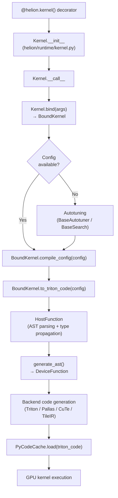
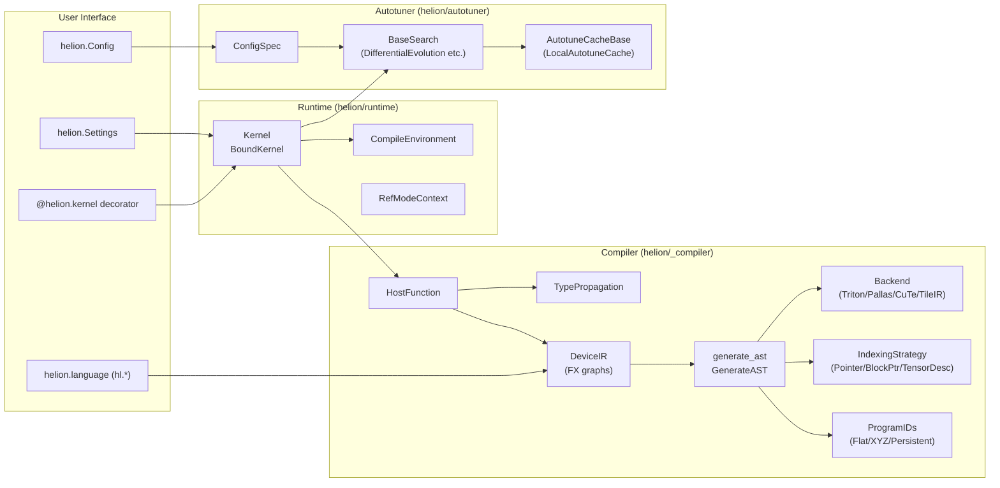
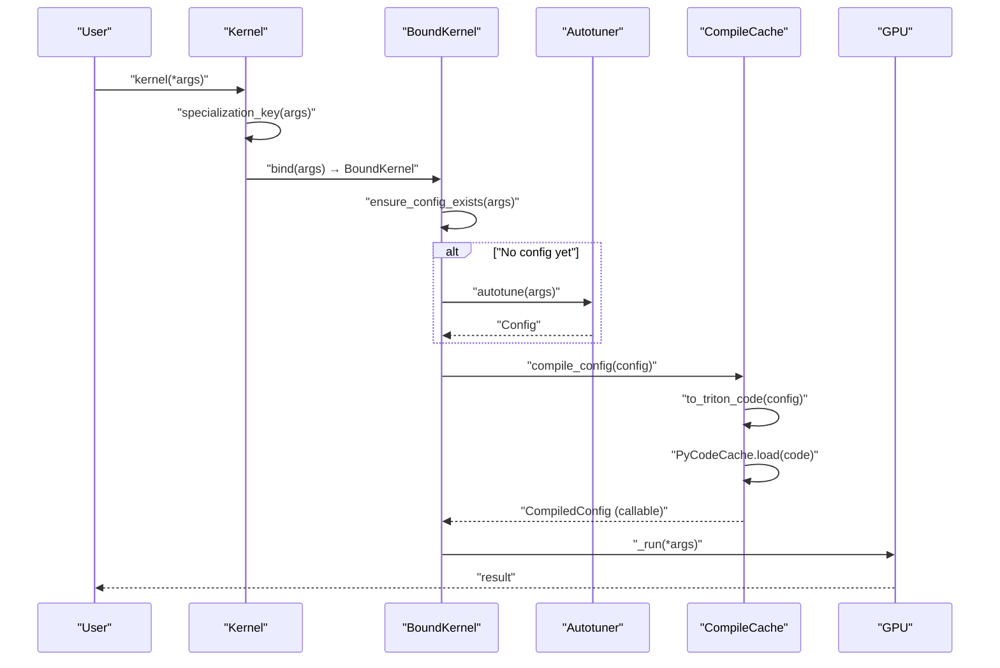

<!-- source: DeepWiki mcp.deepwiki.com · repo pytorch/helion · page 1 Overview · fetched 2026-10-21 -->

# Overview

<details>
<summary>Relevant source files</summary>

The following files were used as context for generating this wiki page:

- [.github/matrix.json](.github/matrix.json)
- [.github/workflows/lint.yml](.github/workflows/lint.yml)
- [.github/workflows/test.yml](.github/workflows/test.yml)
- [.gitignore](.gitignore)
- [README.md](README.md)
- [docs/api/config.md](docs/api/config.md)
- [docs/index.md](docs/index.md)
- [docs/installation.md](docs/installation.md)
- [docs/tileir_backend.md](docs/tileir_backend.md)
- [examples/segment_reduction.py](examples/segment_reduction.py)
- [examples/welford.py](examples/welford.py)
- [helion/autotuner/aot_cache.py](helion/autotuner/aot_cache.py)
- [helion/autotuner/base_cache.py](helion/autotuner/base_cache.py)
- [helion/autotuner/local_cache.py](helion/autotuner/local_cache.py)
- [helion/autotuner/progress_bar.py](helion/autotuner/progress_bar.py)
- [helion/runtime/kernel.py](helion/runtime/kernel.py)
- [pyproject.toml](pyproject.toml)
- [test/test_cache.py](test/test_cache.py)

</details>


This page is the top-level introduction to the Helion codebase. It describes what Helion is, its design goals, its key language constructs, and how its major subsystems relate to each other. For deeper coverage of any specific subsystem, follow the links to the appropriate wiki pages throughout this document.

---

## What Is Helion?

Helion is a **Python-embedded domain-specific language (DSL)** for authoring machine learning GPU kernels. Its primary design goal is to raise the level of abstraction above Triton while remaining compatible with standard PyTorch idioms.

A Helion kernel is written as an ordinary Python function decorated with `@helion.kernel()`. Code outside tile loops runs on the CPU (for tensor allocation, shape calculations). Code inside `hl.tile` / `hl.grid` loops is compiled into a single GPU kernel.

**Primary backends:** Triton (default), Pallas (TPU), CuTe (CUTLASS Python DSL), TileIR (Blackwell via Triton-to-tile-IR).

The name *Helion* refers to the nucleus of a helium-3 atom; *Triton* refers to hydrogen-3.

Sources: [README.md:16-22](), [docs/index.md:17-25]()

---

## Key Capabilities

| Capability | Description |
|---|---|
| **Automatic indexing** | Strides and indices are computed automatically. The `indexing` config parameter selects between `pointer`, `block_ptr`, and `tensor_descriptor` strategies. |
| **Implicit masking** | Out-of-bounds guard conditions are inserted automatically and eliminated when provably unnecessary. |
| **Autotuning** | Block sizes, loop orders, PID strategies, warp counts, pipeline stages, and more are searched automatically. |
| **Persistent kernels** | `pid_type` can be `persistent_blocked` or `persistent_interleaved` for improved SM utilization. |
| **Looping reductions** | Large reductions can be automatically converted to loop-based implementations via `reduction_loops`. |
| **PID swizzling** | L2-cache-friendly program ID reordering via `l2_groupings`. |
| **torch.compile integration** | Helion kernels are compatible with `torch.compile` via Dynamo and Inductor hooks. |
| **Multi-backend** | Triton (CUDA/ROCm/CPU), Pallas (TPU), CuTe (Blackwell), TileIR (Blackwell). |

Sources: [README.md:34-69](), [docs/index.md:35-69]()

---

## Minimal Example

```python
import torch, helion, helion.language as hl

@helion.kernel()
def matmul(x: torch.Tensor, y: torch.Tensor) -> torch.Tensor:
    m, k = x.size()
    k, n = y.size()
    out = torch.empty([m, n], dtype=x.dtype, device=x.device)
    for tile_m, tile_n in hl.tile([m, n]):          # outer = GPU grid
        acc = hl.zeros([tile_m, tile_n], dtype=torch.float32)
        for tile_k in hl.tile(k):                    # inner = loop in kernel
            acc = torch.addmm(acc, x[tile_m, tile_k], y[tile_k, tile_n])
        out[tile_m, tile_n] = acc
    return out
```

- Code outside the `for` loops: CPU, standard PyTorch.
- Code inside the `for` loops: compiled to a single GPU kernel.
- Tile sizes, loop ordering, and PID type are autotuned on first call.

Sources: [README.md:72-105](), [docs/index.md:83-117]()

---

## Config vs. Settings

Helion uses two distinct parameter namespaces. Understanding their separation is essential.

| | `helion.Config` | `helion.Settings` |
|---|---|---|
| **Purpose** | Controls GPU execution parameters | Controls compilation and development behavior |
| **Autotuned?** | Yes — the autotuner searches over `Config` | No — fixed at kernel definition time |
| **Examples** | `block_sizes`, `num_warps`, `indexing`, `pid_type` | `print_output_code`, `autotune_effort`, `static_shapes` |
| **Mechanism** | Passed as `config=` or `configs=` to `@helion.kernel()` | Passed as keyword args to `@helion.kernel()` or via env vars |

Sources: [docs/index.md:205-235](), [docs/api/config.md:26-33]()

---

## Top-Level Architecture

The following diagram shows how a user-authored Helion kernel flows through the system from Python source to GPU execution.

**Helion End-to-End Flow**



Sources: [helion/runtime/kernel.py:109-352](), [helion/runtime/kernel.py:361-441](), [helion/runtime/kernel.py:500-603]()

---

## Major Subsystems

**Helion Subsystem Map**



Sources: [helion/runtime/kernel.py:1-56](), [README.md:34-69]()

---

## Subsystem Descriptions

### Runtime (`helion/runtime/`)

| Class / File | Role |
|---|---|
| `Kernel` | Top-level object created by `@helion.kernel()`. Manages specialization cache and dispatches to `BoundKernel`. |
| `BoundKernel` | Specialization of `Kernel` for a specific set of argument dtypes/shapes. Holds `CompileEnvironment`, `HostFunction`, and the compile cache. |
| `CompileEnvironment` | Thread-local global state for the compilation of one kernel specialization. Holds `ConfigSpec`, backend, fake tensors, and shape environment. |
| `Config` | Dataclass of GPU execution parameters (block sizes, pid type, indexing, etc.). |
| `Settings` | Compilation control parameters (autotune effort, debug flags, static shapes). |
| `RefModeContext` | Enables CPU-side eager interpretation for debugging (`HELION_INTERPRET=1`). |

Sources: [helion/runtime/kernel.py:109-170](), [helion/runtime/kernel.py:361-460]()

### Language API (`helion/language/`)

The `helion.language` module (imported as `hl`) provides the DSL primitives used inside kernel bodies:

| Function | Purpose |
|---|---|
| `hl.tile(sizes)` | Defines a tiled iteration space; outer loop maps to GPU grid, inner loops to in-kernel loops. |
| `hl.grid(sizes)` | Similar to `hl.tile` but with different scheduling semantics. |
| `hl.zeros(shape, dtype)` | Allocates an accumulator tile initialized to zero. |
| `hl.load(tensor, indices)` | Explicit load with optional masking and eviction policy. |
| `hl.store(tensor, indices, value)` | Explicit store. |
| `hl.dot(a, b)` | Matrix multiplication on tiles. |
| `hl.atomic_add`, `hl.atomic_cas` | Atomic memory operations. |
| `hl.cumsum`, `hl.associative_scan` | Scan operations. |
| `hl.specialize(x)` | Forces specialization on the value of a dimension. |
| `hl.static_range(n)` | Generates `tl.static_range` instead of `tl.range`. |

For a complete reference, see [API Functions Reference](#3.5).

Sources: [README.md:114-123](), [docs/index.md:126-134]()

### Compilation Pipeline (`helion/_compiler/`)

See [Compilation Pipeline](#5) for full details. In summary:

1. **`HostFunction`** — parses the Python AST of the kernel function and orchestrates type propagation.
2. **`TypePropagation`** — infers `TypeInfo` for all variables; allocates `block_id`s for tile/grid loops.
3. **Device IR (FX graphs)** — computation graphs are constructed per loop nest via `_for_loop`, `_while_loop`, and related tracing ops.
4. **Graph transformations** — Inductor lowering, ATen op lowering, reduction strategy selection (`PersistentReductionStrategy`, `LoopedReductionStrategy`, etc.).
5. **`generate_ast` / `GenerateAST`** — constructs the final Python AST representing the Triton/Pallas/CuTe kernel.
6. **Backend** — `TritonBackend`, `PallasBackend`, `CuteBackend`, `TileIRBackend` each implement dtype mapping and launcher generation.
7. **Indexing strategies** — `PointerIndexingStrategy`, `BlockPtrIndexingStrategy`, `TensorDescriptorIndexingStrategy`.
8. **Program IDs** — `FlatProgramIDs`, `XYZProgramIDs`, `L2GroupingProgramIDs`, `PersistentBlockedProgramIDs`, `PersistentInterleavedProgramIDs`.

### Autotuning (`helion/autotuner/`)

See [Configuration and Autotuning](#4) for full details. In summary:

| Component | Role |
|---|---|
| `ConfigSpec` | Defines valid parameter ranges; validates and normalizes `Config` objects. |
| `BaseAutotuner` | Abstract interface; concrete subclasses implement `autotune()`. |
| `BaseSearch` | Population-based search (DE, LFBO, pattern search, finite search). |
| `AutotuneCacheBase` | Abstract cache; `LocalAutotuneCache` and `AOTAutotuneCache` implement disk persistence. |
| `LocalAutotuneCache` | Stores best configs on local filesystem under `HELION_CACHE_DIR`. Key includes kernel source hash, hardware, and input shape. |
| `StrictLocalAutotuneCache` | As above, but also hashes Helion, PyTorch, and Triton source code. |

Sources: [helion/autotuner/local_cache.py:42-119](), [helion/autotuner/base_cache.py:80-141]()

---

## Supported Backends

**Backend support matrix**

| Backend | Hardware | Enable Condition | Key Class |
|---|---|---|---|
| `triton` | CUDA (A100/H100/B200), ROCm (MI300X), CPU | Default | `TritonBackend` |
| `tileir` | Blackwell (SM100, SM120) | `ENABLE_TILE=1` | `TileIRBackend` |
| `pallas` | TPU (v7+) | `HELION_BACKEND=pallas` | `PallasBackend` |
| `cute` | Blackwell | `HELION_BACKEND=cute` + `nvidia-cutlass-dsl` | `CuteBackend` |

Sources: [.github/matrix.json:1-138](), [docs/tileir_backend.md:1-15]()

---

## Kernel Lifecycle

**Per-Call Execution Path**



Sources: [helion/runtime/kernel.py:338-352](), [helion/runtime/kernel.py:778-828](), [helion/runtime/kernel.py:540-603]()

---

## Environment Variables (Common)

| Variable | Effect |
|---|---|
| `HELION_AUTOTUNE_EFFORT` | `none` / `quick` / `full` — controls autotuning depth |
| `HELION_PRINT_OUTPUT_CODE` | `1` — print generated Triton code to stderr |
| `HELION_PRINT_REPRO` | `1` — print a self-contained repro script to stderr |
| `HELION_INTERPRET` | `1` — run kernel in CPU eager reference mode |
| `HELION_CACHE_DIR` | Override the autotune cache directory |
| `HELION_SKIP_CACHE` | `1` — bypass local autotune cache |
| `HELION_ASSERT_CACHE_HIT` | `1` — raise an error on cache miss |
| `HELION_FORCE_AUTOTUNE` | `1` — force autotuning even when a config is provided |
| `HELION_LOGS` | e.g. `all` or `+helion.runtime.kernel` — configure logging |
| `HELION_BACKEND` | Override backend (`triton`, `pallas`, `cute`) |
| `ENABLE_TILE` | `1` — enable TileIR backend |

For a complete reference, see [Settings and Environment Variables](#6.2).

Sources: [README.md:308-338](), [docs/index.md:239-265]()

---

## Repository Structure

```
helion/
├── runtime/          # Kernel, BoundKernel, Config, Settings, RefMode
├── _compiler/        # HostFunction, DeviceIR, generate_ast, backends, indexing
├── autotuner/        # BaseSearch, ConfigSpec, cache implementations
├── language/         # hl.tile, hl.load, hl.store, hl.zeros, etc.
├── _testing.py       # Test utilities, skip decorators
└── exc.py            # Exception hierarchy

examples/             # Reference kernel implementations
test/                 # Test suite
benchmarks/           # Local and CI benchmarking
docs/                 # Sphinx documentation source
notebooks/            # Interactive Colab notebooks
```

Sources: [pyproject.toml:116-124]()

---

## Related Pages

- For installation instructions and supported hardware, see [Installation](#2.1).
- For writing your first kernel step-by-step, see [Your First Kernel](#2.2).
- For the complete `helion.language` API, see [API Functions Reference](#3.5).
- For `helion.Config` parameter documentation, see [Configuration System](#4.1).
- For the autotuning search algorithms, see [Search Algorithms](#4.3).
- For the full compilation pipeline, see [Compilation Pipeline](#5).
- For backend-specific details (Pallas, CuTe, TileIR), see [Backend Implementations](#5.6).
- For debugging tools and error handling, see [Error Handling and Debugging](#9.4).

---

