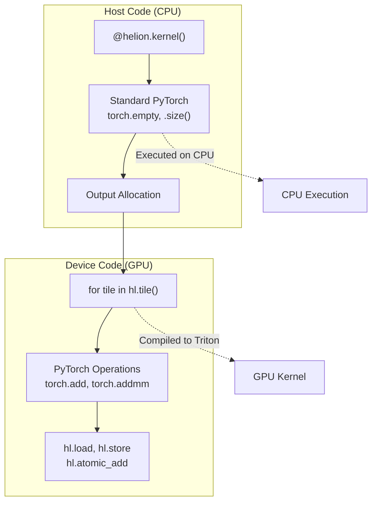
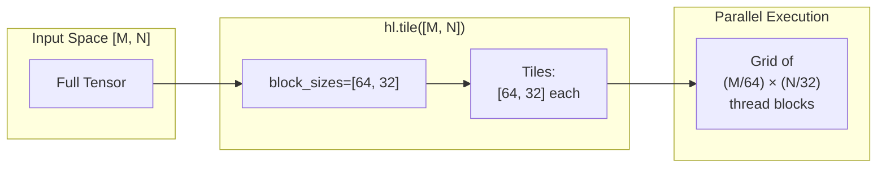
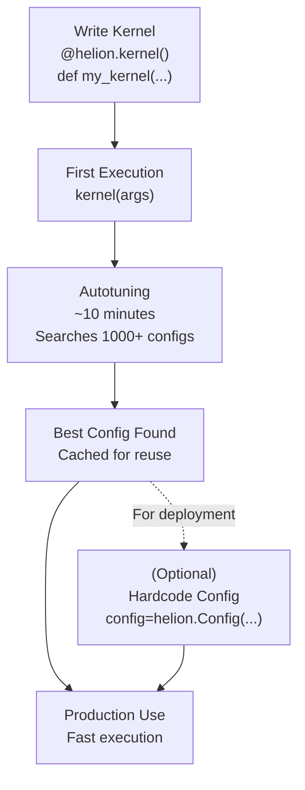
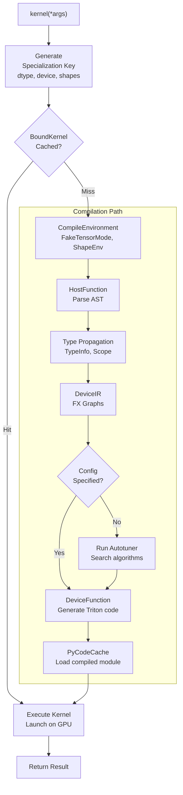
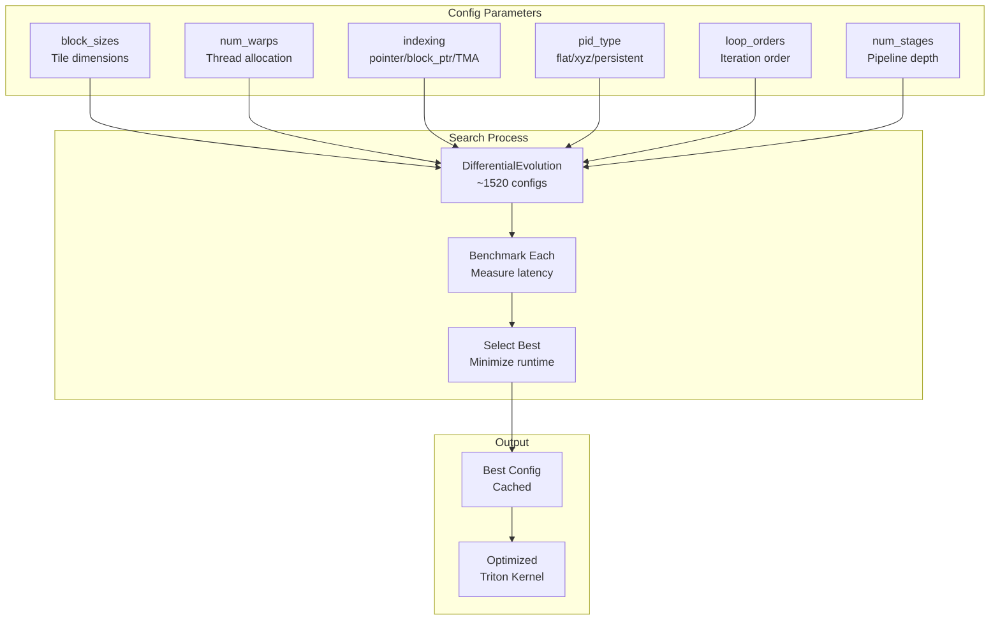
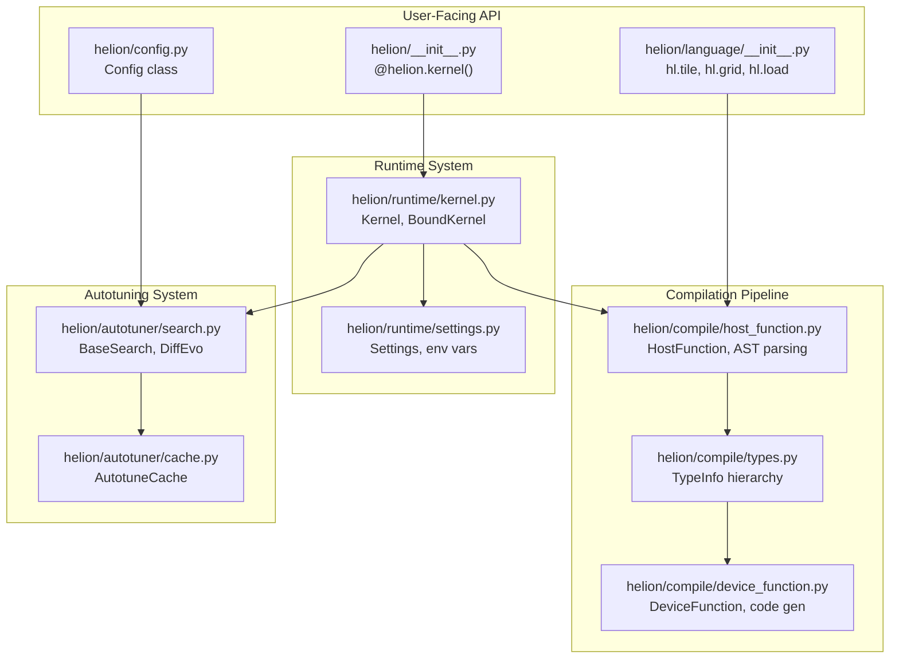

<!-- source: DeepWiki mcp.deepwiki.com · repo pytorch/helion · page 2 Getting Started · fetched 2026-10-21 -->

# Getting Started

<details>
<summary>Relevant source files</summary>

The following files were used as context for generating this wiki page:

- [README.md](README.md)
- [docs/api/config.md](docs/api/config.md)
- [docs/index.md](docs/index.md)
- [docs/installation.md](docs/installation.md)
- [docs/tileir_backend.md](docs/tileir_backend.md)
- [examples/segment_reduction.py](examples/segment_reduction.py)
- [helion/__init__.py](helion/__init__.py)
- [helion/experimental/__init__.py](helion/experimental/__init__.py)
- [helion/experimental/autodiff.py](helion/experimental/autodiff.py)
- [test/test_autodiff.expected](test/test_autodiff.expected)
- [test/test_autodiff.py](test/test_autodiff.py)

</details>


This page provides an overview of Helion's basic workflow and guides you through your first steps with the framework. It covers the fundamental concepts and execution model needed to start writing Helion kernels.

For detailed installation instructions, see [Installation](#2.1). For a complete walkthrough of writing your first kernel, see [Your First Kernel](#2.2).

---

## Prerequisites

Before using Helion, ensure you have:

| Requirement | Version | Notes |
|------------|---------|-------|
| **Operating System** | Linux | Other Unix-like systems may work but are not officially supported |
| **Python** | 3.10–3.14 | We recommend using [uv](https://docs.astral.sh/uv) for environment management |
| **PyTorch** | 2.9+ | Install from [pytorch.org](https://pytorch.org) |
| **Triton** | 3.5+ | Older versions lack support for TMA and may have lower performance |
| **GPU** | CUDA 8.0+ or ROCm 6.2+ | Required for execution (CPU mode available for testing) |

**Sources:** [README.md:326-336](), [docs/installation.md:4-19]()

---

## Installation Overview

Install Helion using pip:

```bash
pip install helion
```

For development or source installation, clone the repository and install in editable mode:

```bash
git clone https://github.com/pytorch/helion.git
cd helion
pip install -e '.[dev]'
```

For complete installation instructions including PyTorch and Triton setup, see [Installation](#2.1).

**Sources:** [README.md:339-365](), [docs/installation.md:23-46]()

---

## Core Concepts

### What is Helion?

Helion is a Python-embedded DSL for authoring machine learning kernels that compiles to Triton. It can be viewed as either:

- **PyTorch with tiles**: Extends PyTorch with tiling constructs for GPU parallelism
- **Higher-level Triton**: Automates low-level details that Triton requires manual specification


**Sources:** [README.md:16-23](), [docs/index.md:17-28]()

### Execution Model

Helion kernels have two distinct execution contexts:



**Code outside** `hl.tile()`/`hl.grid()` loops runs on the CPU as standard Python. **Code inside** these loops is compiled into a single Triton kernel that executes on the GPU.

**Sources:** [README.md:92-99](), [docs/index.md:104-110]()

### Tiling and Parallelism

The `hl.tile()` function subdivides the iteration space into tiles that execute in parallel:



The outer `for` loop maps to the GPU grid, while inner loops become device-side loops. Tile sizes are determined by autotuning or explicit configuration.

**Sources:** [README.md:100-113](), [docs/index.md:112-124]()

---

## Basic Workflow

The typical development workflow for a Helion kernel:



1. **Write** the kernel using `@helion.kernel()` decorator
2. **Execute** for the first time - triggers autotuning
3. **Autotune** searches configuration space (~10 minutes)
4. **Cache** best configuration for reuse
5. **Hardcode** configuration for production deployment (optional but recommended)

**Sources:** [README.md:126-186](), [docs/index.md:138-202]()

---

## Kernel Execution Flow

When you call a Helion kernel, the following sequence occurs:



**Key Classes:**
- `Kernel`: Main kernel wrapper created by `@helion.kernel` decorator
- `BoundKernel`: Specialization for specific argument signature
- `CompileEnvironment`: Compilation context with device and shape information
- `HostFunction`: Parsed and analyzed kernel AST
- `DeviceFunction`: Generates Triton code from device IR
- `PyCodeCache`: PyTorch Inductor's cache for compiled modules

**Sources:** [README.md:126-131](), Diagram 6 from high-level systems overview

---

## Configuration Space

Helion explores a large configuration space to find optimal kernel parameters:



**Sources:** [README.md:204-290](), [docs/api/config.md:36-161](), Diagram 3 from high-level systems overview

---

## Development Settings

For faster iteration during development, use these settings to skip autotuning:

| Setting | Environment Variable | Decorator Argument | Purpose |
|---------|---------------------|-------------------|---------|
| **Skip autotuning** | `HELION_AUTOTUNE_EFFORT=none` | `autotune_effort="none"` | Use default config (slow, dev only) |
| **Print Triton code** | `HELION_PRINT_OUTPUT_CODE=1` | `print_output_code=True` | View generated Triton kernel |
| **Print repro script** | `HELION_PRINT_REPRO=1` | `print_repro=True` | Generate standalone reproduction script |
| **Debug execution** | `HELION_INTERPRET=1` | N/A | Run in eager mode for debugging |
| **Force autotune** | `HELION_FORCE_AUTOTUNE=1` | N/A | Re-run autotuning even with cached config |
| **Enable logging** | `HELION_LOGS=all` | N/A | Show INFO-level logs |

Example usage:

```python
# Development kernel with debugging enabled
@helion.kernel(
    autotune_effort="none",      # Skip autotuning
    print_output_code=True        # Show generated code
)
def debug_kernel(x: torch.Tensor) -> torch.Tensor:
    # Implementation
    pass
```

**⚠ Warning:** The default configuration without autotuning is intentionally slow and not suitable for production or performance testing.

**Sources:** [README.md:292-323](), [docs/index.md:237-265]()

---

## Minimal Example

Here's a complete minimal example that demonstrates the key concepts:

```python
import torch
import helion
import helion.language as hl

@helion.kernel(autotune_effort="none")  # Skip autotuning for quick testing
def vector_add(x: torch.Tensor, y: torch.Tensor) -> torch.Tensor:
    # Host code: allocate output (runs on CPU)
    out = torch.empty_like(x)
    
    # Device code: iterate over tiles (compiles to GPU kernel)
    for tile in hl.tile(x.shape[0]):
        out[tile] = x[tile] + y[tile]
    
    return out

# Execute the kernel
x = torch.randn(1024, device='cuda')
y = torch.randn(1024, device='cuda')
result = vector_add(x, y)

# Verify correctness
torch.testing.assert_close(result, x + y)
```

This example demonstrates:
- `@helion.kernel()` decorator to mark a kernel function
- Host code outside the loop (allocation)
- Device code inside `hl.tile()` (GPU execution)
- Tensor subscripting with tile objects (`out[tile]`)
- Standard PyTorch operators inside device code

**Sources:** [docs/installation.md:129-147](), [README.md:74-90]()

---

## Code Structure Overview

Understanding where key components live in the codebase:



**Sources:** File paths from repository structure

---

## Next Steps

After completing the getting started guide:

1. **[Installation](#2.1)** - Complete installation with all dependencies
2. **[Your First Kernel](#2.2)** - Detailed walkthrough of writing and executing a kernel
3. **[Kernel Authoring Guide](#3)** - Comprehensive guide to kernel features
4. **[Configuration and Autotuning](#4)** - Deep dive into performance optimization
5. **[Examples](https://github.com/pytorch/helion/tree/main/examples)** - Real-world kernel implementations

For questions or feedback, join the [GPU MODE Discord](https://discord.gg/gpumode) in the `#helion` channel.

**Sources:** [README.md:384-386](), [docs/index.md:1-14]()

---

