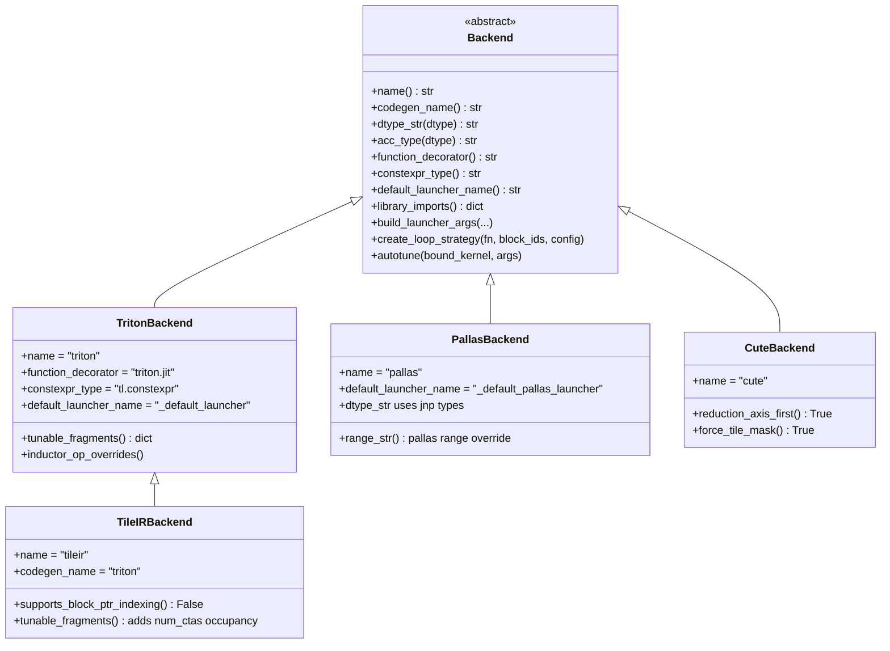
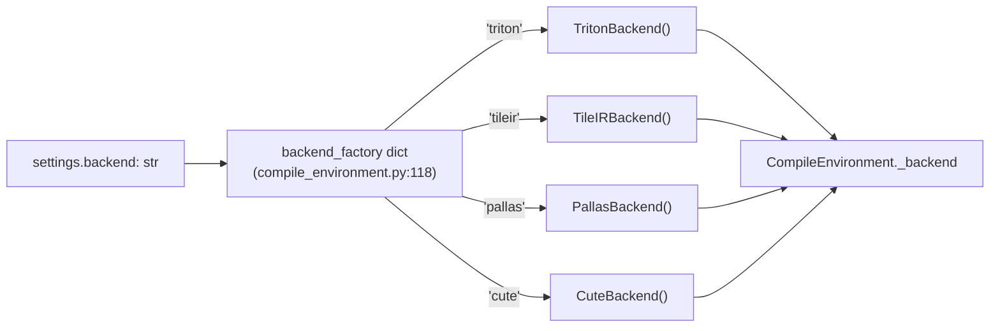
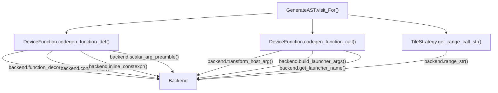
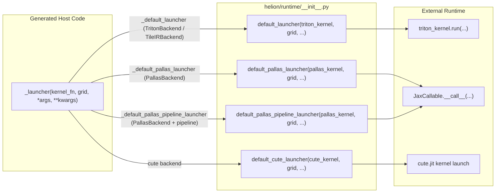

<!-- source: DeepWiki mcp.deepwiki.com · repo pytorch/helion · page 5.6 Backend Implementations · fetched 2026-10-21 -->

# Backend Implementations

<details>
<summary>Relevant source files</summary>

The following files were used as context for generating this wiki page:

- [helion/_compiler/backend.py](helion/_compiler/backend.py)
- [helion/_compiler/compile_environment.py](helion/_compiler/compile_environment.py)
- [helion/_compiler/device_function.py](helion/_compiler/device_function.py)
- [helion/_compiler/generate_ast.py](helion/_compiler/generate_ast.py)
- [helion/_compiler/tile_strategy.py](helion/_compiler/tile_strategy.py)
- [helion/runtime/__init__.py](helion/runtime/__init__.py)
- [test/test_cute_backend.py](test/test_cute_backend.py)
- [test/test_pallas.py](test/test_pallas.py)

</details>


This page documents the `Backend` abstract class and its four concrete implementations (`TritonBackend`, `TileIRBackend`, `PallasBackend`, `CuteBackend`). Backends control the code-generation target: which type strings, decorators, imports, and launcher calls appear in generated kernel code, and how that kernel is ultimately executed at runtime.

For the broader compilation pipeline that invokes backends, see the Compilation Pipeline overview ([5]()), and for how indexing strategies interact with backend selection, see Indexing Strategies ([5.5]()).

---

## The `Backend` Abstract Class

`Backend` is defined in [helion/_compiler/backend.py:30-396](). Every backend must implement a minimal set of abstract methods, and may override a large number of concrete defaults that cover the Triton idiom.

**Class hierarchy diagram: Backend and Subclasses**



Sources: [helion/_compiler/backend.py:30-641]()

### Abstract Interface

The following methods must be implemented by every concrete backend:

| Method | Return type | Role |
|--------|-------------|------|
| `name` | `str` | Key used in `backend_factory` and error messages |
| `dtype_str(dtype)` | `str` | Converts `torch.dtype` to backend type literal (e.g. `"tl.float32"`) |
| `acc_type(dtype)` | `str` | Accumulator type for reductions (may promote; e.g. `fp16 → fp32`) |
| `function_decorator` | `str` | Expression used as `@decorator` on the kernel function |
| `constexpr_type` | `str` | Type annotation for compile-time constant arguments |
| `default_launcher_name` | `str` | Name of the host-side launcher symbol |
| `library_imports` | `dict[str, str]` | Map of short alias → import statement for generated module header |

Sources: [helion/_compiler/backend.py:38-313]()

### Concrete Defaults

The base class provides working defaults for Triton. Notable methods that backends commonly override:

| Method | Default behavior | Purpose |
|--------|-----------------|---------|
| `cdiv_expr(numel, block_size, is_device)` | `(numel + block_size - 1) // block_size` | Ceiling division; Triton overrides to `tl.cdiv` / `triton.cdiv` |
| `range_str(begin, end, step)` | `None` (caller uses `tl.range`) | Optional full override of the loop range call |
| `arange_expr(...)` | `lid * block_size + tl.arange(0, block_size)` | Loop offset calculation |
| `program_id_expr(dim, index_dtype)` | raises `BackendUnsupported` | Must be overridden by grid-based backends |
| `scalar_load_expr(tensor_name)` | `tl.load(tensor_name)` | Loads a scalar from a 0-dim tensor argument |
| `reduction_expr(...)` | raises `BackendUnsupported` | Backend-specific reduction primitive |
| `force_tile_mask()` | `False` | CuTe overrides to `True` |
| `reduction_axis_first()` | `False` | CuTe overrides to `True` |
| `supports_block_ptr_indexing()` | `True` | TileIR overrides to `False` |
| `create_loop_strategy(fn, block_ids, config)` | Selects `FlattenedTileStrategy` or `NDTileStrategy` | Backends may override for custom tile strategies |
| `autotune(bound_kernel, args)` | raises `BackendUnsupported` | `TritonBackend` implements full autotuner dispatch |

Sources: [helion/_compiler/backend.py:67-396]()

---

## Backend Selection

`CompileEnvironment.__init__` uses a factory dict to instantiate the correct backend based on `settings.backend`:

```
backend_factory = {
    "triton":  TritonBackend,
    "pallas":  PallasBackend,
    "cute":    CuteBackend,
    "tileir":  TileIRBackend,
}
self._backend = backend_factory[settings.backend]()
```

The `pallas` and `cute` backends emit a deprecation warning at instantiation time.

**Backend selection diagram**



Sources: [helion/_compiler/compile_environment.py:118-124]()

Once stored on `CompileEnvironment`, the backend is accessed via `CompileEnvironment.current().backend` throughout codegen. The two derived properties `backend_name` and `codegen_name` are also used:

- `backend_name` — always returns `backend.name`; used in error messages and backend-specific branches
- `codegen_name` — returns `backend.codegen_name`; used to look up registered codegen functions in `GenerateAST`

Sources: [helion/_compiler/compile_environment.py:586-600]()

---

## Integration with Code Generation

**Diagram: How Backend methods are called during code generation**



Sources: [helion/_compiler/device_function.py:666-778](), [helion/_compiler/generate_ast.py:318-346](), [helion/_compiler/tile_strategy.py:243-277]()

### Codegen Function Dispatch

API functions registered in `helion.language` use `fn._codegen` — a dict keyed by backend `codegen_name`. During `GenerateAST.visit_Call` and `visit_For`, the lookup is:

```python
codegen_fn = fn._codegen.get(env.codegen_name)
if codegen_fn is None:
    codegen_fn = fn._codegen.get("common")
```

This means `TileIRBackend` (which returns `codegen_name = "triton"`) automatically reuses all codegen functions registered for Triton without requiring separate implementations.

Sources: [helion/_compiler/generate_ast.py:324-332](), [helion/_compiler/backend.py:47-48]()

---

## `TritonBackend`

`TritonBackend` is the primary and most complete backend, targeting NVIDIA and AMD CUDA GPUs via [OpenAI Triton](https://github.com/triton-lang/triton).

**Key properties:**

| Property | Value |
|----------|-------|
| `name` | `"triton"` |
| `function_decorator` | `"triton.jit"` |
| `constexpr_type` | `"tl.constexpr"` |
| `default_launcher_name` | `"_default_launcher"` |
| `inline_constexpr(name, val)` | `"{name} = tl.constexpr({val})"` |

**Library imports emitted to generated modules:**

| Alias | Import statement |
|-------|-----------------|
| `triton` | `import triton` |
| `tl` | `import triton.language as tl` |
| `triton_helpers` | `from torch._inductor.runtime import triton_helpers` |
| `tl_math` | `from torch._inductor.runtime.triton_helpers import math as tl_math` |
| `libdevice` | `from torch._inductor.runtime.triton_compat import libdevice` |
| `_default_launcher` | `from helion.runtime import default_launcher as _default_launcher` |

Sources: [helion/_compiler/backend.py:398-458]()

**Dtype conversion:** delegates to `torch._inductor.utils.triton_type()`. Accumulator types delegate to `torch._inductor.codegen.triton.triton_acc_type()`.

**Launcher keyword arguments** passed to every kernel call:

- `num_warps` (from config; bumped to ≥4 if warp specialization is active)
- `num_stages` (from config)
- `launch_cooperative_grid=True` when the kernel uses a barrier
- AMD-specific: `waves_per_eu`, `matrix_instr_nonkdim` (when `supports_amd_cdna_tunables()`)
- Any `_triton_config_*` keys in the config object

Sources: [helion/_compiler/backend.py:540-566]()

**Autotuning:** `TritonBackend.autotune()` is the only backend that implements the full autotuner dispatch, calling `settings.autotuner_fn` or `FiniteSearch` depending on whether fixed configs are provided.

Sources: [helion/_compiler/backend.py:584-610]()

---

## `TileIRBackend`

`TileIRBackend` extends `TritonBackend` and targets NVIDIA Blackwell (SM100+) GPUs via Triton's TileIR path.

**Key differences from `TritonBackend`:**

| Property | Value | Notes |
|----------|-------|-------|
| `name` | `"tileir"` | Distinct backend name |
| `codegen_name` | `"triton"` | Reuses Triton codegen functions |
| `supports_block_ptr_indexing()` | `False` | Block-ptr indexing unsupported on TileIR |
| `num_ctas` tunable | `PowerOfTwoFragment(1, 2, 1)` | Number of thread block clusters |
| `occupancy` tunable | `PowerOfTwoFragment(1, 8, 1)` | SM occupancy hint |

Because `codegen_name` returns `"triton"`, TileIR reuses all Triton-registered codegen functions. The distinction is at launch time: `num_ctas` and `occupancy` are passed as additional keyword arguments to the launcher.

The namespace reserved names for `tileir` include `num_ctas` and `occupancy` to prevent naming collisions in generated kernel parameters.

Sources: [helion/_compiler/backend.py:613-641](), [helion/_compiler/device_function.py:262-274]()

---

## `PallasBackend`

`PallasBackend` targets Google TPUs via [JAX Pallas](https://jax.readthedocs.io/en/latest/pallas). This backend is experimental.

**Key properties:**

| Property | Value |
|----------|-------|
| `name` | `"pallas"` |
| `function_decorator` | `""` (empty; Pallas functions are not JIT-decorated) |
| `constexpr_type` | `"jnp.int32"` |
| `default_launcher_name` | `"_default_pallas_launcher"` |

**Dtype mapping** (`_TORCH_TO_JAX_DTYPE`):

| `torch.dtype` | Pallas type string |
|---------------|-------------------|
| `torch.float16` | `"jnp.float16"` |
| `torch.float32` | `"jnp.float32"` |
| `torch.float64` | `"jnp.float64"` |
| `torch.bfloat16` | `"jnp.bfloat16"` |
| `torch.int8` | `"jnp.int8"` |
| `torch.int16` | `"jnp.int16"` |
| `torch.int32` | `"jnp.int32"` |
| `torch.int64` | `"jnp.int64"` |
| `torch.uint8` | `"jnp.uint8"` |
| `torch.bool` | `"jnp.bool_"` |
| `torch.complex64` | `"jnp.complex64"` |
| `torch.complex128` | `"jnp.complex128"` |

Sources: [helion/_compiler/backend.py:643-660]()

**Notable behavioral overrides:**

- `program_id_expr(dim)` emits `pl.program_id(dim)` instead of `tl.program_id(dim)`
- `range_str(begin, end, step)` returns a Pallas-specific range expression
- `arange_expr(...)` emits `jnp.arange(...)` instead of `tl.arange(...)`
- Scratch memory via `DeviceFunction.register_scratch()` is supported only on this backend

Sources: [helion/_compiler/device_function.py:836-843](), [test/test_pallas.py:164](), [test/test_pallas.py:249]()

**Pipeline mode:** When `use_emit_pipeline=True` is set in the config, the Pallas backend generates code using `pltpu.emit_pipeline` inside `EmitPipelineLoopState`, and the corresponding `default_pallas_pipeline_launcher` is used at runtime.

Sources: [test/test_pallas.py:280-294]()

---

## `CuteBackend`

`CuteBackend` targets CUDA GPUs using the [CUTLASS Python DSL (CuTe)](https://github.com/NVIDIA/cutlass). This backend is experimental.

**Key properties:**

| Property | Value |
|----------|-------|
| `name` | `"cute"` |
| `function_decorator` | `"cute.jit"` |
| `reduction_axis_first()` | `True` |
| `force_tile_mask()` | `True` |

**Dtype mapping** (used in `default_cute_launcher` via `_torch_dtype_to_cutlass`):

| `torch.dtype` | CuTe type |
|---------------|-----------|
| `torch.float16` | `cutlass.Float16` |
| `torch.float32` | `cutlass.Float32` |
| `torch.float64` | `cutlass.Float64` |
| `torch.bfloat16` | `cutlass.BFloat16` |
| `torch.int8` | `cutlass.Int8` |
| `torch.int32` | `cutlass.Int32` |
| `torch.int64` | `cutlass.Int64` |
| `torch.uint8` | `cutlass.Uint8` |

Sources: [helion/runtime/__init__.py:615-631]()

**Thread block model:** CuTe kernels use an explicit thread-block model. The `elements_per_thread` config parameter controls how many elements each thread processes. The thread block size is validated at codegen time — exceeding 1024 threads (or violating `elements_per_thread` divisibility) raises `BackendUnsupported`.

**`reduction_axis_first = True`:** CuTe places reduction thread axes before tile axes. The `FlattenedTileStrategy._flat_thread_axis()` accounts for this when computing the axis index for `arange_expr`.

Sources: [helion/_compiler/tile_strategy.py:580-593](), [test/test_cute_backend.py:204-212](), [test/test_cute_backend.py:258]()

---

## Launcher Functions

Each backend has one or more corresponding launcher functions in `helion/runtime/__init__.py` that are called from the generated host code.

**Launcher diagram**



Sources: [helion/runtime/__init__.py:109-128](), [helion/runtime/__init__.py:416-612]()

### `default_launcher`

The Triton launcher simply calls `triton_kernel.run(...)` with `grid`, `num_warps`, `num_stages`, and optional `launch_cooperative_grid`.

Sources: [helion/runtime/__init__.py:109-128]()

### `default_pallas_launcher`

Builds a `JaxCallable` (from `torch_tpu`) wrapping a `pl.pallas_call(...)`. Tensor arguments are reordered from Pallas's `[inputs..., outputs...]` convention back to the original kernel parameter order via `_pallas_make_reordered_kernel`. Block specs are inferred from tensor shapes and the grid via `_pallas_build_block_specs`, respecting TPU alignment constraints (last dim: multiple of 128, second-to-last: multiple of 8).

Sources: [helion/runtime/__init__.py:135-497]()

### `default_pallas_pipeline_launcher`

Used when `use_emit_pipeline=True`. Constructs a `PrefetchScalarGridSpec` with `memory_space=pl.ANY` (HBM refs) and `pltpu.VMEM` scratch shapes, then wraps everything in `pl.pallas_call(...)` with `pltpu.CompilerParams`.

Sources: [helion/runtime/__init__.py:500-612]()

### CuTe Launcher

`_create_cute_wrapper` dynamically constructs a `@cute.jit` wrapper function whose signature encodes each tensor argument as a `cute.Pointer` plus per-dimension `cutlass.Int64` shape and stride arguments, and each scalar as `cutlass.Boolean`, `cutlass.Int64`, or `cutlass.Float64`. The wrapper calls `.launch(grid=(...), block=(...))` on the kernel. The schema key (a tuple of argument descriptors) is used for caching the compiled wrapper.

Sources: [helion/runtime/__init__.py:653-727]()

---

## Backend Comparison Summary

| Feature | `TritonBackend` | `TileIRBackend` | `PallasBackend` | `CuteBackend` |
|---------|----------------|----------------|----------------|--------------|
| Target hardware | CUDA / ROCm | Blackwell (SM100+) | TPU | CUDA |
| Kernel decorator | `@triton.jit` | `@triton.jit` | (none) | `@cute.jit` |
| Constexpr type | `tl.constexpr` | `tl.constexpr` | `jnp.int32` | backend-specific |
| Block-ptr indexing | ✓ | ✗ | ✗ | ✗ |
| `codegen_name` | `"triton"` | `"triton"` | `"pallas"` | `"cute"` |
| Extra tunables | `waves_per_eu`, `matrix_instr_nonkdim` (AMD) | `num_ctas`, `occupancy` | — | `elements_per_thread` |
| Autotuner support | ✓ | ✓ (inherits) | ✗ | ✗ |
| `reduction_axis_first` | ✗ | ✗ | ✗ | ✓ |
| `force_tile_mask` | ✗ | ✗ | ✗ | ✓ |
| Scratch memory | ✗ | ✗ | ✓ | ✗ |

Sources: [helion/_compiler/backend.py:398-900](), [helion/runtime/__init__.py:109-780]()

---

