# Page: Overview

# Overview

<details>
<summary>Relevant source files</summary>

The following files were used as context for generating this wiki page:

- [.github/matrix.json](.github/matrix.json)
- [.github/workflows/lint.yml](.github/workflows/lint.yml)
- [.github/workflows/test.yml](.github/workflows/test.yml)
- [.gitignore](.gitignore)
- [README.md](README.md)
- [docs/api/config.md](docs/api/config.md)
- [docs/index.md](docs/index.md)
- [docs/installation.md](docs/installation.md)
- [docs/tileir_backend.md](docs/tileir_backend.md)
- [examples/segment_reduction.py](examples/segment_reduction.py)
- [examples/welford.py](examples/welford.py)
- [helion/autotuner/aot_cache.py](helion/autotuner/aot_cache.py)
- [helion/autotuner/base_cache.py](helion/autotuner/base_cache.py)
- [helion/autotuner/local_cache.py](helion/autotuner/local_cache.py)
- [helion/autotuner/progress_bar.py](helion/autotuner/progress_bar.py)
- [helion/runtime/kernel.py](helion/runtime/kernel.py)
- [pyproject.toml](pyproject.toml)
- [test/test_cache.py](test/test_cache.py)

</details>


This page is the top-level introduction to the Helion codebase. It describes what Helion is, its design goals, its key language constructs, and how its major subsystems relate to each other. For deeper coverage of any specific subsystem, follow the links to the appropriate wiki pages throughout this document.

---

## What Is Helion?

Helion is a **Python-embedded domain-specific language (DSL)** for authoring machine learning GPU kernels. Its primary design goal is to raise the level of abstraction above Triton while remaining compatible with standard PyTorch idioms.

A Helion kernel is written as an ordinary Python function decorated with `@helion.kernel()`. Code outside tile loops runs on the CPU (for tensor allocation, shape calculations). Code inside `hl.tile` / `hl.grid` loops is compiled into a single GPU kernel.

**Primary backends:** Triton (default), Pallas (TPU), CuTe (CUTLASS Python DSL), TileIR (Blackwell via Triton-to-tile-IR).

The name *Helion* refers to the nucleus of a helium-3 atom; *Triton* refers to hydrogen-3.

Sources: [README.md:16-22](), [docs/index.md:17-25]()

---

## Key Capabilities

| Capability | Description |
|---|---|
| **Automatic indexing** | Strides and indices are computed automatically. The `indexing` config parameter selects between `pointer`, `block_ptr`, and `tensor_descriptor` strategies. |
| **Implicit masking** | Out-of-bounds guard conditions are inserted automatically and eliminated when provably unnecessary. |
| **Autotuning** | Block sizes, loop orders, PID strategies, warp counts, pipeline stages, and more are searched automatically. |
| **Persistent kernels** | `pid_type` can be `persistent_blocked` or `persistent_interleaved` for improved SM utilization. |
| **Looping reductions** | Large reductions can be automatically converted to loop-based implementations via `reduction_loops`. |
| **PID swizzling** | L2-cache-friendly program ID reordering via `l2_groupings`. |
| **torch.compile integration** | Helion kernels are compatible with `torch.compile` via Dynamo and Inductor hooks. |
| **Multi-backend** | Triton (CUDA/ROCm/CPU), Pallas (TPU), CuTe (Blackwell), TileIR (Blackwell). |

Sources: [README.md:34-69](), [docs/index.md:35-69]()

---

## Minimal Example

```python
import torch, helion, helion.language as hl

@helion.kernel()
def matmul(x: torch.Tensor, y: torch.Tensor) -> torch.Tensor:
    m, k = x.size()
    k, n = y.size()
    out = torch.empty([m, n], dtype=x.dtype, device=x.device)
    for tile_m, tile_n in hl.tile([m, n]):          # outer = GPU grid
        acc = hl.zeros([tile_m, tile_n], dtype=torch.float32)
        for tile_k in hl.tile(k):                    # inner = loop in kernel
            acc = torch.addmm(acc, x[tile_m, tile_k], y[tile_k, tile_n])
        out[tile_m, tile_n] = acc
    return out
```

- Code outside the `for` loops: CPU, standard PyTorch.
- Code inside the `for` loops: compiled to a single GPU kernel.
- Tile sizes, loop ordering, and PID type are autotuned on first call.

Sources: [README.md:72-105](), [docs/index.md:83-117]()

---

## Config vs. Settings

Helion uses two distinct parameter namespaces. Understanding their separation is essential.

| | `helion.Config` | `helion.Settings` |
|---|---|---|
| **Purpose** | Controls GPU execution parameters | Controls compilation and development behavior |
| **Autotuned?** | Yes — the autotuner searches over `Config` | No — fixed at kernel definition time |
| **Examples** | `block_sizes`, `num_warps`, `indexing`, `pid_type` | `print_output_code`, `autotune_effort`, `static_shapes` |
| **Mechanism** | Passed as `config=` or `configs=` to `@helion.kernel()` | Passed as keyword args to `@helion.kernel()` or via env vars |

Sources: [docs/index.md:205-235](), [docs/api/config.md:26-33]()

---

## Top-Level Architecture

The following diagram shows how a user-authored Helion kernel flows through the system from Python source to GPU execution.

**Helion End-to-End Flow**

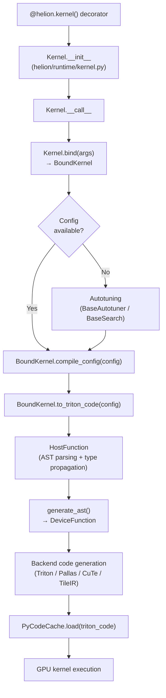

Sources: [helion/runtime/kernel.py:109-352](), [helion/runtime/kernel.py:361-441](), [helion/runtime/kernel.py:500-603]()

---

## Major Subsystems

**Helion Subsystem Map**

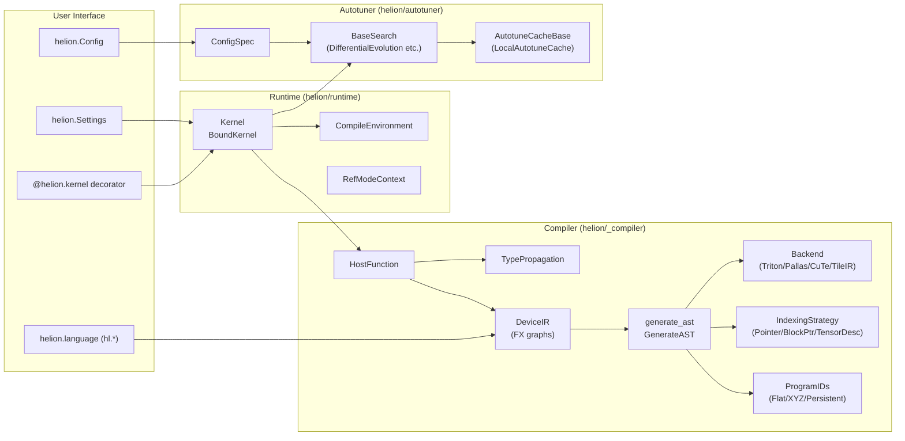

Sources: [helion/runtime/kernel.py:1-56](), [README.md:34-69]()

---

## Subsystem Descriptions

### Runtime (`helion/runtime/`)

| Class / File | Role |
|---|---|
| `Kernel` | Top-level object created by `@helion.kernel()`. Manages specialization cache and dispatches to `BoundKernel`. |
| `BoundKernel` | Specialization of `Kernel` for a specific set of argument dtypes/shapes. Holds `CompileEnvironment`, `HostFunction`, and the compile cache. |
| `CompileEnvironment` | Thread-local global state for the compilation of one kernel specialization. Holds `ConfigSpec`, backend, fake tensors, and shape environment. |
| `Config` | Dataclass of GPU execution parameters (block sizes, pid type, indexing, etc.). |
| `Settings` | Compilation control parameters (autotune effort, debug flags, static shapes). |
| `RefModeContext` | Enables CPU-side eager interpretation for debugging (`HELION_INTERPRET=1`). |

Sources: [helion/runtime/kernel.py:109-170](), [helion/runtime/kernel.py:361-460]()

### Language API (`helion/language/`)

The `helion.language` module (imported as `hl`) provides the DSL primitives used inside kernel bodies:

| Function | Purpose |
|---|---|
| `hl.tile(sizes)` | Defines a tiled iteration space; outer loop maps to GPU grid, inner loops to in-kernel loops. |
| `hl.grid(sizes)` | Similar to `hl.tile` but with different scheduling semantics. |
| `hl.zeros(shape, dtype)` | Allocates an accumulator tile initialized to zero. |
| `hl.load(tensor, indices)` | Explicit load with optional masking and eviction policy. |
| `hl.store(tensor, indices, value)` | Explicit store. |
| `hl.dot(a, b)` | Matrix multiplication on tiles. |
| `hl.atomic_add`, `hl.atomic_cas` | Atomic memory operations. |
| `hl.cumsum`, `hl.associative_scan` | Scan operations. |
| `hl.specialize(x)` | Forces specialization on the value of a dimension. |
| `hl.static_range(n)` | Generates `tl.static_range` instead of `tl.range`. |

For a complete reference, see [API Functions Reference](#3.5).

Sources: [README.md:114-123](), [docs/index.md:126-134]()

### Compilation Pipeline (`helion/_compiler/`)

See [Compilation Pipeline](#5) for full details. In summary:

1. **`HostFunction`** — parses the Python AST of the kernel function and orchestrates type propagation.
2. **`TypePropagation`** — infers `TypeInfo` for all variables; allocates `block_id`s for tile/grid loops.
3. **Device IR (FX graphs)** — computation graphs are constructed per loop nest via `_for_loop`, `_while_loop`, and related tracing ops.
4. **Graph transformations** — Inductor lowering, ATen op lowering, reduction strategy selection (`PersistentReductionStrategy`, `LoopedReductionStrategy`, etc.).
5. **`generate_ast` / `GenerateAST`** — constructs the final Python AST representing the Triton/Pallas/CuTe kernel.
6. **Backend** — `TritonBackend`, `PallasBackend`, `CuteBackend`, `TileIRBackend` each implement dtype mapping and launcher generation.
7. **Indexing strategies** — `PointerIndexingStrategy`, `BlockPtrIndexingStrategy`, `TensorDescriptorIndexingStrategy`.
8. **Program IDs** — `FlatProgramIDs`, `XYZProgramIDs`, `L2GroupingProgramIDs`, `PersistentBlockedProgramIDs`, `PersistentInterleavedProgramIDs`.

### Autotuning (`helion/autotuner/`)

See [Configuration and Autotuning](#4) for full details. In summary:

| Component | Role |
|---|---|
| `ConfigSpec` | Defines valid parameter ranges; validates and normalizes `Config` objects. |
| `BaseAutotuner` | Abstract interface; concrete subclasses implement `autotune()`. |
| `BaseSearch` | Population-based search (DE, LFBO, pattern search, finite search). |
| `AutotuneCacheBase` | Abstract cache; `LocalAutotuneCache` and `AOTAutotuneCache` implement disk persistence. |
| `LocalAutotuneCache` | Stores best configs on local filesystem under `HELION_CACHE_DIR`. Key includes kernel source hash, hardware, and input shape. |
| `StrictLocalAutotuneCache` | As above, but also hashes Helion, PyTorch, and Triton source code. |

Sources: [helion/autotuner/local_cache.py:42-119](), [helion/autotuner/base_cache.py:80-141]()

---

## Supported Backends

**Backend support matrix**

| Backend | Hardware | Enable Condition | Key Class |
|---|---|---|---|
| `triton` | CUDA (A100/H100/B200), ROCm (MI300X), CPU | Default | `TritonBackend` |
| `tileir` | Blackwell (SM100, SM120) | `ENABLE_TILE=1` | `TileIRBackend` |
| `pallas` | TPU (v7+) | `HELION_BACKEND=pallas` | `PallasBackend` |
| `cute` | Blackwell | `HELION_BACKEND=cute` + `nvidia-cutlass-dsl` | `CuteBackend` |

Sources: [.github/matrix.json:1-138](), [docs/tileir_backend.md:1-15]()

---

## Kernel Lifecycle

**Per-Call Execution Path**

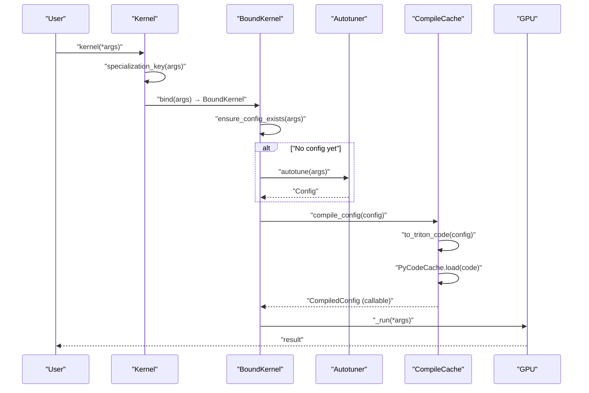

Sources: [helion/runtime/kernel.py:338-352](), [helion/runtime/kernel.py:778-828](), [helion/runtime/kernel.py:540-603]()

---

## Environment Variables (Common)

| Variable | Effect |
|---|---|
| `HELION_AUTOTUNE_EFFORT` | `none` / `quick` / `full` — controls autotuning depth |
| `HELION_PRINT_OUTPUT_CODE` | `1` — print generated Triton code to stderr |
| `HELION_PRINT_REPRO` | `1` — print a self-contained repro script to stderr |
| `HELION_INTERPRET` | `1` — run kernel in CPU eager reference mode |
| `HELION_CACHE_DIR` | Override the autotune cache directory |
| `HELION_SKIP_CACHE` | `1` — bypass local autotune cache |
| `HELION_ASSERT_CACHE_HIT` | `1` — raise an error on cache miss |
| `HELION_FORCE_AUTOTUNE` | `1` — force autotuning even when a config is provided |
| `HELION_LOGS` | e.g. `all` or `+helion.runtime.kernel` — configure logging |
| `HELION_BACKEND` | Override backend (`triton`, `pallas`, `cute`) |
| `ENABLE_TILE` | `1` — enable TileIR backend |

For a complete reference, see [Settings and Environment Variables](#6.2).

Sources: [README.md:308-338](), [docs/index.md:239-265]()

---

## Repository Structure

```
helion/
├── runtime/          # Kernel, BoundKernel, Config, Settings, RefMode
├── _compiler/        # HostFunction, DeviceIR, generate_ast, backends, indexing
├── autotuner/        # BaseSearch, ConfigSpec, cache implementations
├── language/         # hl.tile, hl.load, hl.store, hl.zeros, etc.
├── _testing.py       # Test utilities, skip decorators
└── exc.py            # Exception hierarchy

examples/             # Reference kernel implementations
test/                 # Test suite
benchmarks/           # Local and CI benchmarking
docs/                 # Sphinx documentation source
notebooks/            # Interactive Colab notebooks
```

Sources: [pyproject.toml:116-124]()

---

## Related Pages

- For installation instructions and supported hardware, see [Installation](#2.1).
- For writing your first kernel step-by-step, see [Your First Kernel](#2.2).
- For the complete `helion.language` API, see [API Functions Reference](#3.5).
- For `helion.Config` parameter documentation, see [Configuration System](#4.1).
- For the autotuning search algorithms, see [Search Algorithms](#4.3).
- For the full compilation pipeline, see [Compilation Pipeline](#5).
- For backend-specific details (Pallas, CuTe, TileIR), see [Backend Implementations](#5.6).
- For debugging tools and error handling, see [Error Handling and Debugging](#9.4).

---

# Page: Getting Started

# Getting Started

<details>
<summary>Relevant source files</summary>

The following files were used as context for generating this wiki page:

- [README.md](README.md)
- [docs/api/config.md](docs/api/config.md)
- [docs/index.md](docs/index.md)
- [docs/installation.md](docs/installation.md)
- [docs/tileir_backend.md](docs/tileir_backend.md)
- [examples/segment_reduction.py](examples/segment_reduction.py)
- [helion/__init__.py](helion/__init__.py)
- [helion/experimental/__init__.py](helion/experimental/__init__.py)
- [helion/experimental/autodiff.py](helion/experimental/autodiff.py)
- [test/test_autodiff.expected](test/test_autodiff.expected)
- [test/test_autodiff.py](test/test_autodiff.py)

</details>


This page provides an overview of Helion's basic workflow and guides you through your first steps with the framework. It covers the fundamental concepts and execution model needed to start writing Helion kernels.

For detailed installation instructions, see [Installation](#2.1). For a complete walkthrough of writing your first kernel, see [Your First Kernel](#2.2).

---

## Prerequisites

Before using Helion, ensure you have:

| Requirement | Version | Notes |
|------------|---------|-------|
| **Operating System** | Linux | Other Unix-like systems may work but are not officially supported |
| **Python** | 3.10–3.14 | We recommend using [uv](https://docs.astral.sh/uv) for environment management |
| **PyTorch** | 2.9+ | Install from [pytorch.org](https://pytorch.org) |
| **Triton** | 3.5+ | Older versions lack support for TMA and may have lower performance |
| **GPU** | CUDA 8.0+ or ROCm 6.2+ | Required for execution (CPU mode available for testing) |

**Sources:** [README.md:326-336](), [docs/installation.md:4-19]()

---

## Installation Overview

Install Helion using pip:

```bash
pip install helion
```

For development or source installation, clone the repository and install in editable mode:

```bash
git clone https://github.com/pytorch/helion.git
cd helion
pip install -e '.[dev]'
```

For complete installation instructions including PyTorch and Triton setup, see [Installation](#2.1).

**Sources:** [README.md:339-365](), [docs/installation.md:23-46]()

---

## Core Concepts

### What is Helion?

Helion is a Python-embedded DSL for authoring machine learning kernels that compiles to Triton. It can be viewed as either:

- **PyTorch with tiles**: Extends PyTorch with tiling constructs for GPU parallelism
- **Higher-level Triton**: Automates low-level details that Triton requires manual specification


**Sources:** [README.md:16-23](), [docs/index.md:17-28]()

### Execution Model

Helion kernels have two distinct execution contexts:

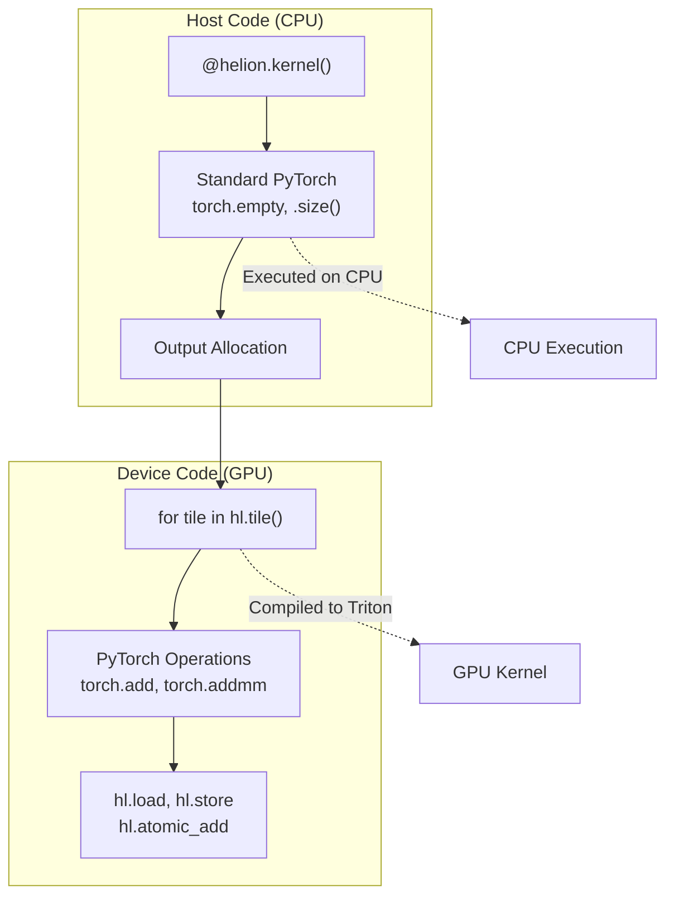

**Code outside** `hl.tile()`/`hl.grid()` loops runs on the CPU as standard Python. **Code inside** these loops is compiled into a single Triton kernel that executes on the GPU.

**Sources:** [README.md:92-99](), [docs/index.md:104-110]()

### Tiling and Parallelism

The `hl.tile()` function subdivides the iteration space into tiles that execute in parallel:

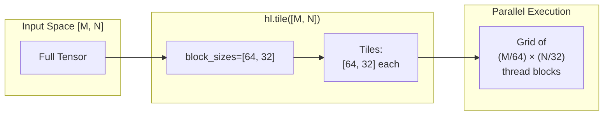

The outer `for` loop maps to the GPU grid, while inner loops become device-side loops. Tile sizes are determined by autotuning or explicit configuration.

**Sources:** [README.md:100-113](), [docs/index.md:112-124]()

---

## Basic Workflow

The typical development workflow for a Helion kernel:

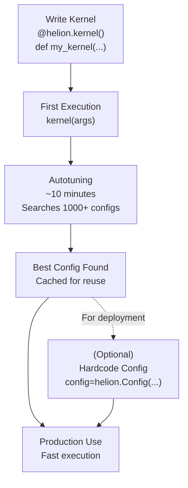

1. **Write** the kernel using `@helion.kernel()` decorator
2. **Execute** for the first time - triggers autotuning
3. **Autotune** searches configuration space (~10 minutes)
4. **Cache** best configuration for reuse
5. **Hardcode** configuration for production deployment (optional but recommended)

**Sources:** [README.md:126-186](), [docs/index.md:138-202]()

---

## Kernel Execution Flow

When you call a Helion kernel, the following sequence occurs:

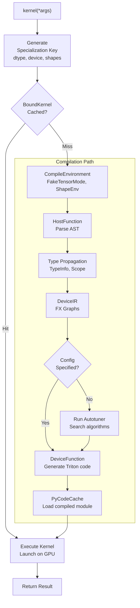

**Key Classes:**
- `Kernel`: Main kernel wrapper created by `@helion.kernel` decorator
- `BoundKernel`: Specialization for specific argument signature
- `CompileEnvironment`: Compilation context with device and shape information
- `HostFunction`: Parsed and analyzed kernel AST
- `DeviceFunction`: Generates Triton code from device IR
- `PyCodeCache`: PyTorch Inductor's cache for compiled modules

**Sources:** [README.md:126-131](), Diagram 6 from high-level systems overview

---

## Configuration Space

Helion explores a large configuration space to find optimal kernel parameters:

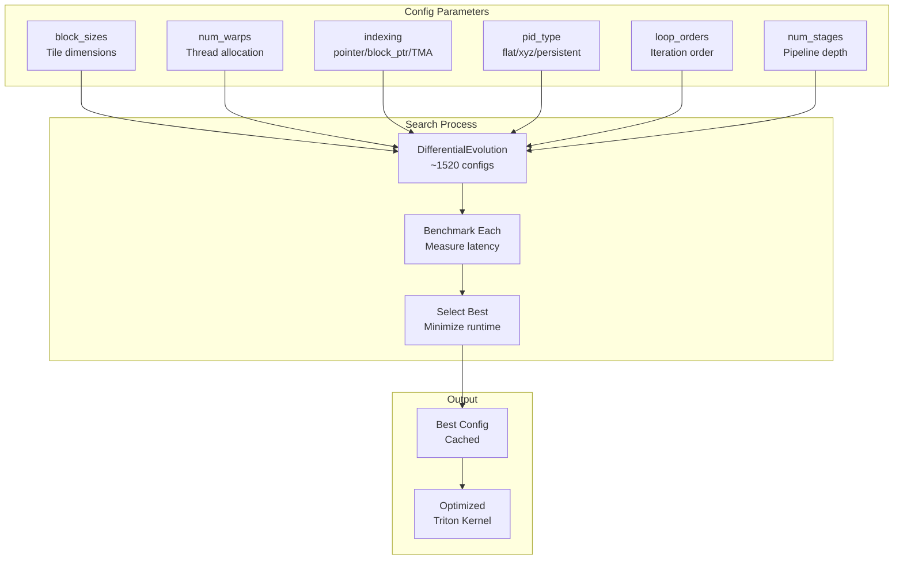

**Sources:** [README.md:204-290](), [docs/api/config.md:36-161](), Diagram 3 from high-level systems overview

---

## Development Settings

For faster iteration during development, use these settings to skip autotuning:

| Setting | Environment Variable | Decorator Argument | Purpose |
|---------|---------------------|-------------------|---------|
| **Skip autotuning** | `HELION_AUTOTUNE_EFFORT=none` | `autotune_effort="none"` | Use default config (slow, dev only) |
| **Print Triton code** | `HELION_PRINT_OUTPUT_CODE=1` | `print_output_code=True` | View generated Triton kernel |
| **Print repro script** | `HELION_PRINT_REPRO=1` | `print_repro=True` | Generate standalone reproduction script |
| **Debug execution** | `HELION_INTERPRET=1` | N/A | Run in eager mode for debugging |
| **Force autotune** | `HELION_FORCE_AUTOTUNE=1` | N/A | Re-run autotuning even with cached config |
| **Enable logging** | `HELION_LOGS=all` | N/A | Show INFO-level logs |

Example usage:

```python
# Development kernel with debugging enabled
@helion.kernel(
    autotune_effort="none",      # Skip autotuning
    print_output_code=True        # Show generated code
)
def debug_kernel(x: torch.Tensor) -> torch.Tensor:
    # Implementation
    pass
```

**⚠ Warning:** The default configuration without autotuning is intentionally slow and not suitable for production or performance testing.

**Sources:** [README.md:292-323](), [docs/index.md:237-265]()

---

## Minimal Example

Here's a complete minimal example that demonstrates the key concepts:

```python
import torch
import helion
import helion.language as hl

@helion.kernel(autotune_effort="none")  # Skip autotuning for quick testing
def vector_add(x: torch.Tensor, y: torch.Tensor) -> torch.Tensor:
    # Host code: allocate output (runs on CPU)
    out = torch.empty_like(x)
    
    # Device code: iterate over tiles (compiles to GPU kernel)
    for tile in hl.tile(x.shape[0]):
        out[tile] = x[tile] + y[tile]
    
    return out

# Execute the kernel
x = torch.randn(1024, device='cuda')
y = torch.randn(1024, device='cuda')
result = vector_add(x, y)

# Verify correctness
torch.testing.assert_close(result, x + y)
```

This example demonstrates:
- `@helion.kernel()` decorator to mark a kernel function
- Host code outside the loop (allocation)
- Device code inside `hl.tile()` (GPU execution)
- Tensor subscripting with tile objects (`out[tile]`)
- Standard PyTorch operators inside device code

**Sources:** [docs/installation.md:129-147](), [README.md:74-90]()

---

## Code Structure Overview

Understanding where key components live in the codebase:

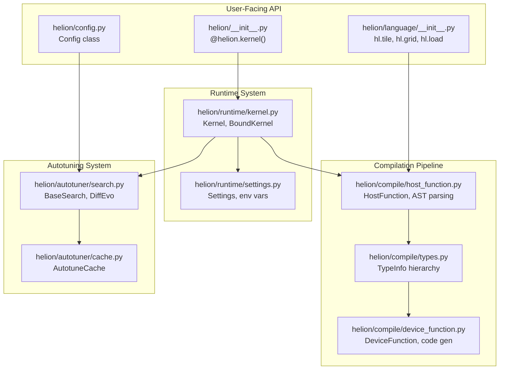

**Sources:** File paths from repository structure

---

## Next Steps

After completing the getting started guide:

1. **[Installation](#2.1)** - Complete installation with all dependencies
2. **[Your First Kernel](#2.2)** - Detailed walkthrough of writing and executing a kernel
3. **[Kernel Authoring Guide](#3)** - Comprehensive guide to kernel features
4. **[Configuration and Autotuning](#4)** - Deep dive into performance optimization
5. **[Examples](https://github.com/pytorch/helion/tree/main/examples)** - Real-world kernel implementations

For questions or feedback, join the [GPU MODE Discord](https://discord.gg/gpumode) in the `#helion` channel.

**Sources:** [README.md:384-386](), [docs/index.md:1-14]()

---

# Page: Installation

# Installation

<details>
<summary>Relevant source files</summary>

The following files were used as context for generating this wiki page:

- [.github/matrix.json](.github/matrix.json)
- [.github/workflows/lint.yml](.github/workflows/lint.yml)
- [.github/workflows/test.yml](.github/workflows/test.yml)
- [.gitignore](.gitignore)
- [README.md](README.md)
- [docs/api/config.md](docs/api/config.md)
- [docs/index.md](docs/index.md)
- [docs/installation.md](docs/installation.md)
- [docs/tileir_backend.md](docs/tileir_backend.md)
- [examples/segment_reduction.py](examples/segment_reduction.py)
- [pyproject.toml](pyproject.toml)

</details>


This page covers system requirements, installation procedures, hardware backend prerequisites, and the CI test matrix for Helion. For information on writing your first kernel after installation, see [Your First Kernel](#2.2). For available runtime settings and environment variables, see [Settings and Environment Variables](#6.2).

---

## System Requirements

| Requirement | Minimum Version | Notes |
|---|---|---|
| Operating System | Linux | Other Unix-like systems may work but are not officially tested |
| Python | 3.10 | Tested through 3.14 |
| PyTorch | 2.9 | Earlier versions lack required compiler hooks |
| Triton | 3.5 | Earlier versions lack TMA support on Hopper/Blackwell and may have lower performance |

Helion's core Python dependencies (declared in [pyproject.toml:19-26]()) are:

| Package | Minimum Version | Purpose |
|---|---|---|
| `typing_extensions` | 4.0.0 | Backported type annotations |
| `filecheck` | — | Output matching in tests |
| `psutil` | — | Process management during autotuning |
| `rich` | — | Formatted autotuning progress output |
| `numpy` | — | Array utilities |
| `scikit-learn` | 1.3.0 | Surrogate models in search algorithms |

Sources: [pyproject.toml:19-26](), [README.md:343-351](), [docs/installation.md:4-20]()

---

## Installation Methods

### From PyPI

```bash
pip install helion
```

This installs the stable release. PyTorch and Triton must be installed separately before this step (see [Dependency Installation](#dependency-installation) below).

### From Source (Development)

```bash
git clone https://github.com/pytorch/helion.git
cd helion

# Create and activate a virtual environment (uv recommended)
uv venv .venv
source .venv/bin/activate

# Install in editable mode with development dependencies
pip install -e '.[dev]'
```

The `[dev]` extra (declared in [pyproject.toml:29-36]()) adds `pytest`, `pytest-timeout`, `pre-commit`, `expecttest`, `hypothesis`, and `tabulate`.

Sources: [README.md:356-381](), [docs/installation.md:22-46](), [pyproject.toml:29-36]()

---

## Dependency Installation

### PyTorch

Install PyTorch 2.9 or later using the appropriate index URL for your hardware:

```bash
# CUDA 12.8
pip install "torch==2.9.*" --index-url https://download.pytorch.org/whl/cu128

# CUDA 13.0
pip install "torch==2.9.*" --index-url https://download.pytorch.org/whl/cu130

# ROCm 7.0
pip install "torch==2.9.*" --index-url https://download.pytorch.org/whl/rocm7.0

# Nightly (for latest features)
pip install --pre torch --index-url https://download.pytorch.org/whl/nightly/cu128
```

### Triton

Triton is typically bundled with PyTorch nightlies. For stable PyTorch releases or when a custom build is needed:

```bash
# From PyPI
pip install "triton>=3.5"
```

To build Triton from source (required for some CI configurations and the TileIR backend):

```bash
sudo apt-get install -y git clang-20 clang++-20 zlib1g-dev
export CC=clang-20
export CXX=clang++-20

git clone https://github.com/triton-lang/triton.git
cd triton
pip install -r python/requirements.txt
MAX_JOBS=$(nproc) TRITON_PARALLEL_LINK_JOBS=2 pip install .
```

Sources: [docs/installation.md:62-111](), [.github/workflows/test.yml:107-151]()

---

## Hardware Backend Support

The following diagram maps hardware targets to their required packages, environment variables, and Helion backend identifiers.

**Hardware Backends and Their Dependencies**

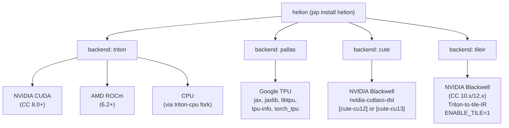

Sources: [.github/matrix.json:1-138](), [.github/workflows/test.yml:159-214](), [pyproject.toml:37-47](), [docs/tileir_backend.md:8-15]()

### CUDA (Triton backend)

No additional packages beyond PyTorch and Triton are required. Supported hardware per Triton's requirements (Compute Capability 8.0+). The `tensor_descriptor` indexing strategy requires Hopper (CC 9.0+) or newer and a recent Triton build.

### ROCm (Triton backend)

Install PyTorch from the ROCm index. The ROCm 7.0 runtime image used in CI is `rocm/dev-ubuntu-24.04:7.0-complete` [.github/matrix.json:93-103]().

### TPU / Pallas backend

The Pallas backend targets Google TPUs and requires additional packages not installed by default. Install the `[pallas-tpu]` extra or manually install:

```bash
pip install jax[tpu] absl-py
```

CI also installs `jaxlib`, `libtpu`, `tpu-info`, `jaxtyping`, `frozendict`, and a private `torch_tpu` wheel [.github/workflows/test.yml:166-208](). The `HELION_BACKEND=pallas` environment variable selects this backend.

### CuTe / CUTLASS DSL backend

Requires NVIDIA Blackwell hardware and the `nvidia-cutlass-dsl` package. Install via the optional extras:

```bash
# CUDA 12
pip install 'helion[cute-cu12]'

# CUDA 13
pip install 'helion[cute-cu13]'
```

Declared in [pyproject.toml:37-43](). Set `HELION_BACKEND=cute` to select this backend.

### TileIR backend (Blackwell GPUs)

Requires NVIDIA Blackwell GPUs (Compute Capability 10.x or 12.x) and the [Triton-to-tile-IR](https://github.com/triton-lang/Triton-to-tile-IR) backend installed in place of standard Triton.

```bash
# Clone and install Triton-to-tile-IR (builds from source)
git clone --recursive -b main https://github.com/triton-lang/Triton-to-tile-IR.git triton
cd triton
pip install -r python/requirements.txt
MAX_JOBS=$(nproc) TRITON_PARALLEL_LINK_JOBS=2 pip install .

# Enable at runtime
export ENABLE_TILE=1
```

Set `HELION_BACKEND=tileir`. Unsupported config parameters (`static_ranges`, `range_unroll_factors`, `block_ptr` indexing, etc.) are automatically excluded from the autotuning search space when TileIR is active. See [docs/tileir_backend.md]() for the full parameter compatibility table.

Sources: [docs/tileir_backend.md:8-15](), [.github/workflows/test.yml:139-151](), [README.md:292-305]()

---

## Optional Extras Summary

The [pyproject.toml:28-67]() file declares the following installable extras:

| Extra | Install Command | Contents |
|---|---|---|
| `dev` | `pip install 'helion[dev]'` | `pytest`, `pre-commit`, `expecttest`, `hypothesis`, `tabulate` |
| `cute-cu12` | `pip install 'helion[cute-cu12]'` | `nvidia-cutlass-dsl` (CUDA 12) |
| `cute-cu13` | `pip install 'helion[cute-cu13]'` | `nvidia-cutlass-dsl[cu13]` (CUDA 13) |
| `pallas-tpu` | `pip install 'helion[pallas-tpu]'` | `jax[tpu]`, `absl-py` |
| `pallas-cpu` | `pip install 'helion[pallas-cpu]'` | `jax`, `absl-py` |
| `docs` | `pip install 'helion[docs]'` | Sphinx and related documentation tools |

Sources: [pyproject.toml:28-67]()

---

## CI Test Matrix

The CI test matrix is defined in [.github/matrix.json:1-138]() and consumed by [.github/workflows/test.yml:14-28](). The following table summarizes the tested configurations:

**CI Test Matrix**

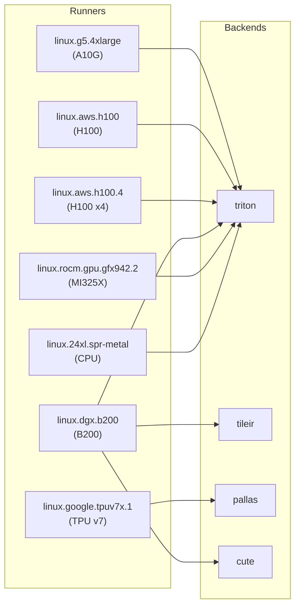

Sources: [.github/matrix.json:1-138]()

| Runner | GPU/Platform | Python | PyTorch | Backend | Alias |
|---|---|---|---|---|---|
| `linux.g5.4xlarge` | NVIDIA A10G | 3.10 | 2.9 | triton | a10g |
| `linux.g5.4xlarge` | NVIDIA A10G | 3.14 | nightly | triton | a10g |
| `linux.g5.4xlarge` | NVIDIA A10G | 3.12 | 2.9 | triton | a10g-dtype-asserts |
| `linux.g5.4xlarge` | NVIDIA A10G | 3.12 | nightly | triton | a10g-ref-eager |
| `linux.aws.h100` | NVIDIA H100 | 3.12 | nightly | triton | h100 |
| `linux.aws.h100.4` | NVIDIA H100 ×4 | 3.12 | nightly | triton | h100-distributed |
| `linux.dgx.b200` | NVIDIA B200 | 3.12 | 2.9 | triton | b200 |
| `linux.dgx.b200` | NVIDIA B200 | 3.12 | 2.9 | tileir | b200 |
| `linux.dgx.b200` | NVIDIA B200 | 3.12 | nightly | cute | b200 |
| `linux.rocm.gpu.gfx942.2` | AMD MI325X | 3.12 | nightly | triton | mi325x |
| `linux.24xl.spr-metal` | CPU | 3.12 | nightly | triton | cpu |
| `linux.google.tpuv7x.1` | Google TPU v7 | 3.12 | nightly | pallas | tpu |

Sources: [.github/matrix.json:1-138]()

The `HELION_BACKEND` environment variable selects the backend at runtime. The `ENABLE_TILE=1` environment variable additionally enables TileIR support. For the `ref-eager` alias, `HELION_INTERPRET=1` is set, enabling the Helion eager reference mode (see [Ref Eager Mode](#7.2)).

---

## Installation Verification

After installation, verify the setup with a minimal smoke test:

```python
import torch
import helion
import helion.language as hl

@helion.kernel(autotune_effort="none")
def test_kernel(x: torch.Tensor) -> torch.Tensor:
    out = torch.empty_like(x)
    for tile in hl.tile(x.shape[0]):
        out[tile] = x[tile] * 2
    return out

x = torch.randn(128, device='cuda')
result = test_kernel(x)
torch.testing.assert_close(result, x * 2)
print("Installation verified.")
```

The `autotune_effort="none"` setting skips the full autotuning process during verification. Setting `HELION_PRINT_OUTPUT_CODE=1` will print the generated Triton code to `stderr`, confirming the compilation pipeline is working.

Sources: [docs/installation.md:129-147](), [README.md:307-318]()

---

## Linting and Pre-commit

When working from source with the `[dev]` extra:

```bash
# One-time setup
pip install pre-commit
pre-commit install

# Run all checks
pre-commit run --all-files
```

Pre-commit runs `ruff` (linter/formatter) and `pyrefly` (type checker). The ruff configuration is in [pyproject.toml:73-114]() and the pyrefly configuration is in [pyproject.toml:135-140]().

Sources: [README.md:383-398](), [pyproject.toml:73-140]()

---

# Page: Your First Kernel

# Your First Kernel

<details>
<summary>Relevant source files</summary>

The following files were used as context for generating this wiki page:

- [README.md](README.md)
- [benchmarks/run.py](benchmarks/run.py)
- [docs/api/config.md](docs/api/config.md)
- [docs/index.md](docs/index.md)
- [docs/installation.md](docs/installation.md)
- [docs/tileir_backend.md](docs/tileir_backend.md)
- [examples/add.py](examples/add.py)
- [examples/attention.py](examples/attention.py)
- [examples/bmm.py](examples/bmm.py)
- [examples/concatenate.py](examples/concatenate.py)
- [examples/embedding.py](examples/embedding.py)
- [examples/jagged_dense_add.py](examples/jagged_dense_add.py)
- [examples/long_sum.py](examples/long_sum.py)
- [examples/moe_matmul_ogs.py](examples/moe_matmul_ogs.py)
- [examples/segment_reduction.py](examples/segment_reduction.py)
- [examples/softmax.py](examples/softmax.py)
- [test/test_examples.py](test/test_examples.py)

</details>


This page walks through writing and running a Helion kernel from scratch. It covers the `@helion.kernel` decorator, tiling with `hl.tile`, creating output tensors with `hl.zeros`, and what happens on the first kernel call. For background on what Helion is and how it fits into the ML stack, see [Overview](#1). For detailed reference on all tiling constructs, see [Tiling and Iteration](#3.1). For configuration and autotuning in depth, see [Configuration and Autotuning](#4).

---

## Anatomy of a Helion Kernel

Every Helion kernel follows a two-zone structure:

- **Host zone** — standard Python/PyTorch code that runs on the CPU before the GPU kernel launches. Used for shape arithmetic and output tensor allocation.
- **Device zone** — code inside `hl.tile` or `hl.grid` loops that is traced and compiled into a single Triton kernel.

**Helion Kernel Structure**

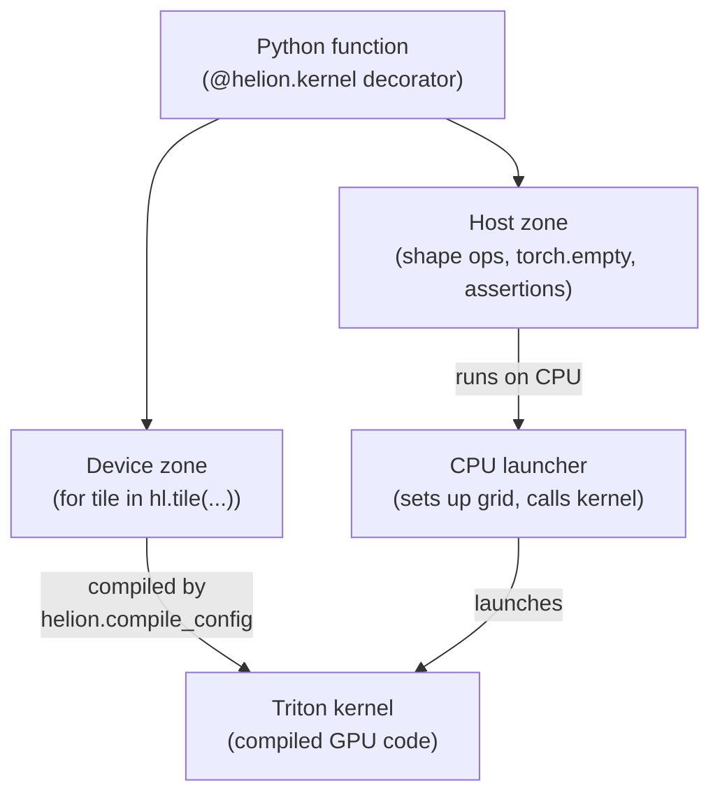

Sources: [README.md:72-113](), [docs/index.md:82-134]()

---

## A Minimal Kernel: Element-wise Addition

The simplest kernel is a pointwise operation. The `add` kernel from `examples/add.py` illustrates the full structure:

```
examples/add.py
```

[examples/add.py:28-51]()

Key observations:

| Code construct | Role |
|---|---|
| `@helion.kernel()` | Marks the function as a Helion kernel; wraps it in a `Kernel` object |
| `torch.broadcast_tensors(x, y)` | **Host zone** — runs on CPU, shapes output |
| `torch.empty(...)` | **Host zone** — allocates output tensor on GPU |
| `hl.tile(out.size())` | **Device zone** — partitions the iteration space into tiles |
| `out[tile] = x[tile] + y[tile]` | **Device zone** — compiled to Triton pointwise ops |

The `for tile in hl.tile(out.size())` loop tells Helion to partition all dimensions of the output tensor into blocks. Each tile is executed in parallel by a different GPU program. Tile sizes are determined at compile time, either by the autotuner or by an explicit `Config`.

Sources: [examples/add.py:1-87]()

---

## Using `hl.zeros` and Accumulator Patterns

Many kernels accumulate partial results across a reduction dimension. `hl.zeros` creates a tile-shaped accumulator inside the device zone. The `matmul` kernel from the README illustrates this:

```
README.md (matmul example)
```

[README.md:74-89]()

Key constructs in the matmul:

| Construct | Description |
|---|---|
| `hl.tile([m, n])` | 2D outer tile; maps to the GPU launch grid |
| `hl.zeros([tile_m, tile_n], dtype=torch.float32)` | Allocates a tile-shaped register accumulator |
| `hl.tile(k)` | Inner reduction tile; becomes a loop inside the GPU kernel |
| `torch.addmm(acc, x[tile_m, tile_k], y[tile_k, tile_n])` | Matrix multiply-accumulate mapped to Triton ops |
| `out[tile_m, tile_n] = acc` | Stores accumulated result to global memory |

`hl.zeros` only works inside the device zone (inside a `hl.tile` or `hl.grid` loop). It is distinct from `torch.zeros`, which would attempt to create a full CPU/GPU tensor.

Sources: [README.md:74-106](), [examples/softmax.py:64-93]()

---

## The `@helion.kernel` Decorator

`helion.kernel` is a callable that wraps a Python function and returns a `Kernel` object. Its most common arguments are:

| Argument | Type | Purpose |
|---|---|---|
| `config` | `helion.Config` | Pin a specific configuration; skips autotuning |
| `configs` | `list[helion.Config]` | Restrict autotuner to a candidate set |
| `autotune_effort` | `str` | `"none"`, `"quick"`, or `"full"` |
| `static_shapes` | `bool` | Whether to specialize per input shape (default `True`) |
| `print_output_code` | `bool` | Print generated Triton code to stderr |

The decorator can be called with or without parentheses:

- `@helion.kernel()` — default settings, full autotuning on first call
- `@helion.kernel(autotune_effort="none")` — skip autotuning, use a default config
- `@helion.kernel(config=helion.Config(...))` — use a pinned config, no autotuning

Sources: [README.md:76-105](), [docs/installation.md:136-148]()

---

## What Happens on the First Call

When you call a Helion kernel for the first time with given tensor shapes and dtypes, Helion goes through several stages:

**Kernel Call Lifecycle**

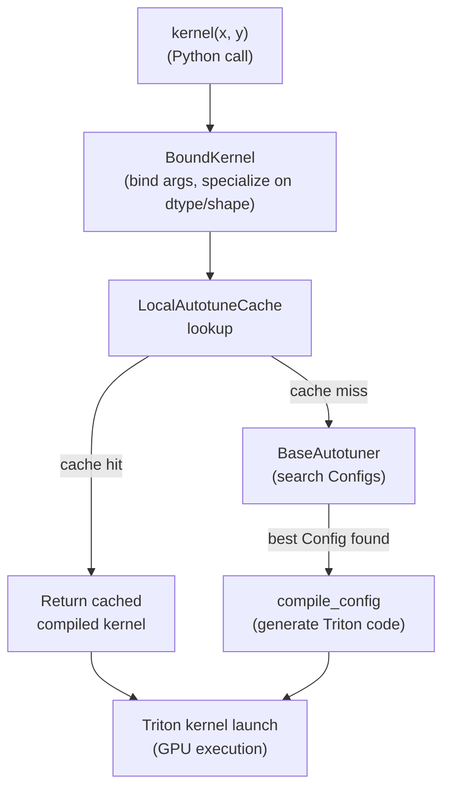

Sources: [README.md:126-145](), [docs/index.md:140-158]()

On first call with a new shape:

1. `BoundKernel` binds the arguments and extracts dtype/shape metadata.
2. `LocalAutotuneCache` is checked. On a cache miss, autotuning begins.
3. `BaseAutotuner` runs a search (e.g., `DifferentialEvolutionSearch`) over the `Config` space.
4. For each candidate `Config`, `compile_config` generates Triton code and benchmarks it.
5. The best `Config` is stored in the cache and used for this call.

Autotuning output looks like:

```
[0s] Starting DifferentialEvolutionSearch with population=40, generations=20, crossover_rate=0.8
[20s] Initial population: ... best=Config(block_sizes=[64, 32, 64], ...)
...
[586s] Autotuning complete in 586.6s after searching 1520 configs.
One can hardcode the best config and skip autotuning with:
    @helion.kernel(config=helion.Config(block_sizes=[64, 64, 64], ...))
```

Sources: [README.md:126-145](), [docs/index.md:140-183]()

---

## Skipping Autotuning During Development

For fast iteration during development, use `autotune_effort="none"` to get a default config immediately without searching:

```
docs/installation.md (verification example)
```

[docs/installation.md:136-147]()

This produces compilable code with a default (often non-optimal) config. Do not use `autotune_effort="none"` for performance benchmarking.

Alternatively, paste the config printed at the end of an autotuning session to skip future autotuning for that kernel:

```
README.md (hardcoded config example)
```

[README.md:152-169]()

---

## `hl.tile`: What It Does

`hl.tile` is the primary loop construct. It takes a shape (scalar or list of scalars) and yields a tile variable (or tuple of tile variables) on each iteration.

**`hl.tile` Semantics**

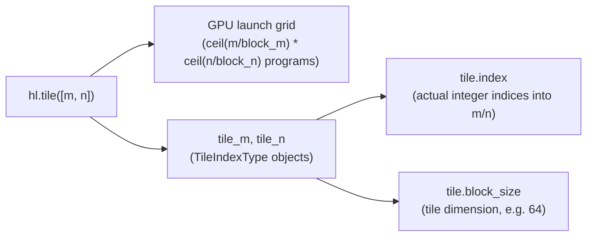

- **Outer `hl.tile`** (not nested inside another `hl.tile`) maps to the GPU launch grid. Each program processes one tile in parallel.
- **Inner `hl.tile`** (nested inside an outer tile) maps to a sequential loop inside the kernel, used for reductions.
- Block sizes are determined by the `Config.block_sizes` list. Each `hl.tile` call consumes one or more entries from this list in order.

Automatic masking handles the case where the tensor dimension is not evenly divisible by the block size — no manual boundary checks are needed.

Sources: [README.md:99-113](), [docs/index.md:113-117](), [examples/add.py:48-51]()

---

## Complete Worked Example: Softmax

`examples/softmax.py` shows how to use `hl.full`, `hl.zeros`, and nested tiles for a numerically stable kernel:

[examples/softmax.py:65-93]()

Structure:

| Loop | Maps to | Purpose |
|---|---|---|
| `for tile_m in hl.tile(m, block_size=block_size_m)` | GPU grid (outer) | Each program handles one row block |
| `hl.full([tile_m], float("-inf"), ...)` | Register tensor | Running max per row |
| `hl.zeros([tile_m], ...)` | Register tensor | Running denominator |
| `for tile_n in hl.tile(n, block_size=block_size_n)` | Sequential loop (inner) | Reduction over columns |

`hl.register_block_size(n)` registers a new tunable block size dimension that can be shared between two separate `hl.tile` calls — both passes over the `n` dimension use the same block size from the config.

Sources: [examples/softmax.py:65-93]()

---

## Checking Generated Triton Code

To inspect what Triton code Helion generates, set `print_output_code=True`:

```python
@helion.kernel(print_output_code=True, autotune_effort="none")
def my_kernel(x: torch.Tensor) -> torch.Tensor:
    ...
```

Or set the environment variable `HELION_PRINT_OUTPUT_CODE=1`. The Triton source is printed to stderr before kernel execution.

To obtain the Triton code as a string programmatically:

```python
code = my_kernel.bind(args).to_triton_code(config)
```

Sources: [README.md:313-318](), [docs/index.md:243-248]()

---

## Common Patterns Summary

| Pattern | Code construct | Notes |
|---|---|---|
| Pointwise kernel | `for tile in hl.tile(out.size())` | One outer tile; one Config block_size per dimension |
| Row-wise reduction | `for tile_m in hl.tile(m)` with `hl.zeros([tile_m])` | Outer tile over rows; inner tile over reduction |
| Matrix multiply | Nested `hl.tile` with `hl.zeros([tile_m, tile_n])` | Outer 2D tile; inner reduction over `k` |
| Accumulator | `hl.zeros([tile_m, tile_n], dtype=torch.float32)` | Allocated in registers; stored back with `out[tile_m, tile_n] = acc` |
| Skip autotuning | `autotune_effort="none"` | For development only |
| Pin a config | `config=helion.Config(block_sizes=[...])` | Skips autotuning entirely |

---

## Next Steps

- **Tiling and Iteration** ([3.1](#3.1)) — full reference for `hl.tile`, `hl.grid`, `hl.static_range`, block size configuration, and loop ordering.
- **API Functions Reference** ([3.5](#3.5)) — all `helion.language` functions including `hl.zeros`, `hl.full`, `hl.arange`, `hl.load`, `hl.store`.
- **Configuration System** ([4.1](#4.1)) — all `helion.Config` parameters and their valid values.
- **Autotuning Overview** ([4.2](#4.2)) — how the autotuner works, effort profiles, and deploying pre-tuned configs.
- **Kernel Examples** ([9.1](#9.1)) — annotated examples from the `examples/` directory covering matmul, attention, normalization, and more.

---

# Page: Kernel Authoring Guide

# Kernel Authoring Guide

<details>
<summary>Relevant source files</summary>

The following files were used as context for generating this wiki page:

- [README.md](README.md)
- [docs/api/config.md](docs/api/config.md)
- [docs/index.md](docs/index.md)
- [docs/installation.md](docs/installation.md)
- [docs/tileir_backend.md](docs/tileir_backend.md)
- [examples/segment_reduction.py](examples/segment_reduction.py)
- [helion/_compiler/roll_reduction.py](helion/_compiler/roll_reduction.py)
- [helion/language/__init__.py](helion/language/__init__.py)
- [helion/language/random_ops.py](helion/language/random_ops.py)
- [test/test_random.py](test/test_random.py)

</details>


This guide covers the fundamentals of writing kernels in Helion, a Python-embedded DSL for GPU kernel authoring. It explains the core concepts, language constructs, and patterns needed to write efficient and correct kernels.

For detailed coverage of specific topics, see:
- [Tiling and Iteration](#3.1) - In-depth guide to `hl.tile()` and iteration spaces
- [Tensor Indexing Patterns](#3.2) - All supported indexing patterns and semantics
- [Memory Operations](#3.3) - Load, store, and atomic operations
- [Control Flow](#3.4) - Loops and conditionals
- [API Functions Reference](#3.5) - Complete API documentation

For autotuning and configuration, see [Configuration and Autotuning](#4).

For compilation internals, see [Compilation Pipeline](#5).

## Kernel Structure Overview

A Helion kernel consists of two distinct code regions: **host code** and **device code**. The distinction is determined by the presence of `hl.tile()` loops.

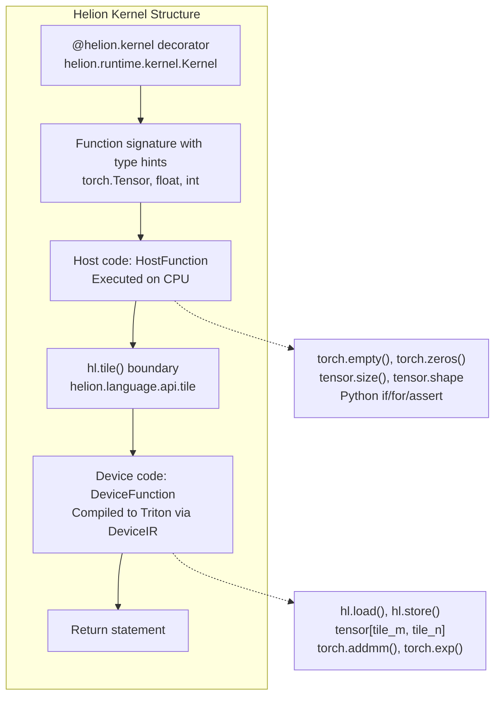

**Diagram: Kernel Structure with Host and Device Regions**
</thinking>

Sources: [helion/runtime/kernel.py](), [helion/language/api.py](), [helion/compiler/host_function.py](), [helion/compiler/device_function.py]()

**Host code** executes on the CPU during kernel invocation and typically performs:
- Shape computations and size queries
- Output tensor allocation
- Python control flow (if/else, loops over Python ranges)
- Argument validation

**Device code** is enclosed within `hl.tile()` loops and compiles to a single Triton kernel. It performs:
- Parallel computation over tiles
- Tensor indexing and memory access
- Mathematical operations via PyTorch operators
- Reductions and accumulations

Sources: [examples/add.py](https://github.com/pytorch/helion/blob/main/examples/add.py), [examples/matmul.py](https://github.com/pytorch/helion/blob/main/examples/matmul.py), [test/test_examples.py:27-36]()

### Basic Kernel Example

```python
import torch
import helion
import helion.language as hl

@helion.kernel()
def add(x: torch.Tensor, y: torch.Tensor) -> torch.Tensor:
    # Host code: runs on CPU
    x, y = torch.broadcast_tensors(x, y)
    out = torch.empty(x.shape, dtype=torch.promote_types(x.dtype, y.dtype), 
                      device=x.device)
    
    # Device code: compiles to Triton, runs on GPU
    for tile in hl.tile(out.size()):
        out[tile] = x[tile] + y[tile]
    
    # Host code: return result
    return out
```

Sources: [examples/add.py](), [test/test_examples.py:27-36]()

## The @helion.kernel Decorator

The `@helion.kernel` decorator transforms a Python function into a compilable Helion kernel. It manages compilation, autotuning, and execution.

### Decorator Syntax

The `@helion.kernel` decorator is implemented in [helion/runtime/kernel.py]() and accepts the following parameters:

```python
@helion.kernel(
    config=None,              # Single helion.Config object
    configs=None,             # List of helion.Config objects
    autotune_effort="auto",   # "none", "low", "auto", "high" - controls search algorithm
    static_shapes=True,       # Use static shape specialization in BoundKernel
    print_output_code=False,  # Print generated Triton code to stderr
    print_repro=False,        # Print reproduction script
    # ... other Settings fields
)
def kernel_function(...) -> ...:
    ...
```

All parameters except `config` and `configs` correspond to fields in the `Settings` class ([helion/runtime/settings.py]()).

Sources: [helion/runtime/kernel.py](), [helion/runtime/settings.py]()

### Configuration Modes

| Mode | Parameter | Behavior | Implementation |
|------|-----------|----------|----------------|
| **No config** | (omitted) | Full autotuning with `DifferentialEvolutionSearch` | [helion/autotuner/search.py]() |
| **Single config** | `config=Config(...)` | Uses provided config, skips autotuning | [helion/runtime/kernel.py:Kernel.bind()]() |
| **Multiple configs** | `configs=[Config(...), ...]` | Benchmarks via `FiniteSearch`, selects fastest | [helion/autotuner/search.py:FiniteSearch]() |
| **ConfigSpec** | `configs=ConfigSpec(...)` | Defines custom search space for autotuning | [helion/runtime/config_spec.py]() |

Sources: [helion/runtime/kernel.py](), [helion/runtime/config.py](), [helion/runtime/config_spec.py](), [helion/autotuner/search.py]()

Example with explicit configuration:

```python
@helion.kernel(config=helion.Config(
    block_sizes=[128, 128, 64],
    num_warps=4,
    num_stages=2,
    indexing="block_ptr"
))
def matmul_tuned(x: torch.Tensor, y: torch.Tensor) -> torch.Tensor:
    ...
```

Sources: [helion/runtime/kernel.py](), [README.md:152-172]()

## Host Code: CPU Execution

Host code executes standard Python and PyTorch operations on the CPU. It runs once per kernel invocation, before device code execution.

### Common Host Code Patterns

**Shape Computations**
```python
@helion.kernel()
def kernel_example(x: torch.Tensor, y: torch.Tensor) -> torch.Tensor:
    m, k = x.size()          # Extract dimensions
    k2, n = y.size()         # Validate shapes
    assert k == k2           # Shape validation
    ...
```

**Output Tensor Allocation**
```python
@helion.kernel()
def kernel_example(x: torch.Tensor) -> torch.Tensor:
    out = torch.empty_like(x)                    # Match input shape/dtype
    out = torch.empty([m, n], dtype=x.dtype,     # Explicit shape
                      device=x.device)
    out = torch.zeros([m, n], ...)              # Zero-initialized
    ...
```

**Tensor Reshaping**
```python
@helion.kernel()
def attention(q_in: torch.Tensor, k_in: torch.Tensor, 
              v_in: torch.Tensor) -> torch.Tensor:
    m_dim = q_in.size(-2)
    head_dim = q_in.size(-1)
    
    # Reshape for processing
    q_view = q_in.reshape([-1, m_dim, head_dim])
    k_view = k_in.reshape([-1, m_dim, head_dim]).transpose(1, 2)
    ...
```

Sources: [examples/matmul.py](), [examples/attention.py](), [test/test_examples.py:38-51]()

## Device Code: Tiling and Parallelization

Device code is defined by `hl.tile()` loops, which partition the iteration space into parallel work units (tiles) executed on the GPU.

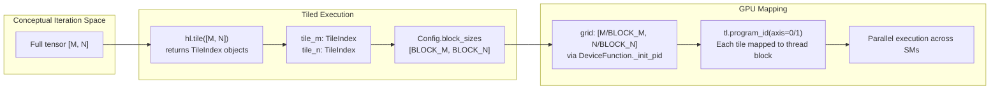

**Diagram: Tiling Maps Iteration Spaces to GPU Parallelism**

Sources: [helion/language/api.py](), [helion/compile_env/types.py](), [helion/runtime/config.py](), [helion/compiler/device_function.py]()

### Basic Tiling Patterns

**Single Dimension**
```python
for tile in hl.tile(n):
    # Process elements in tile
    out[tile] = x[tile] + 1
```

**Two Dimensions**
```python
for tile_m, tile_n in hl.tile([m, n]):
    # Process 2D tile
    out[tile_m, tile_n] = x[tile_m, tile_n] + y[tile_m, tile_n]
```

**Multiple Separate Tiles**
```python
for tile_m, tile_k in hl.tile([m, k]):
    for tile_n in hl.tile(n):
        # Nested iteration
        acc = torch.addmm(acc, x[tile_m, tile_k], y[tile_k, tile_n])
```

Sources: [examples/add.py](), [examples/matmul.py](), [test/test_examples.py:38-51]()

### Tile Objects

Tile objects returned by `hl.tile()` are instances of `TileIndex` (defined in [helion/compile_env/types.py]()) and provide:

| Attribute | Type | Description |
|-----------|------|-------------|
| `tile.size` | `SymInt` | Total size of the dimension |
| `tile.block_size` | `SymInt` | Size of each tile block |
| `tile.index` | `SymInt` or `torch.Tensor` | Current tile indices |
| `tile.is_grid` | `bool` | `True` for outer (grid) loops, `False` for device loops |

These attributes enable:
- **Tensor indexing**: `tensor[tile_m, tile_n]` via `__getitem__` and `__setitem__`
- **Size queries**: `tile_m.size`, `tile_n.block_size`
- **Index access**: `tile_m.index` for masking and conditional logic

For full details on tiling semantics and advanced patterns, see [Tiling and Iteration](#3.1).

Sources: [helion/compile_env/types.py:TileIndex](), [helion/language/api.py:tile()]()

## Tensor Operations in Device Code

Inside device loops, tensor operations use PyTorch operators that are automatically lowered to Triton operations through TorchInductor.

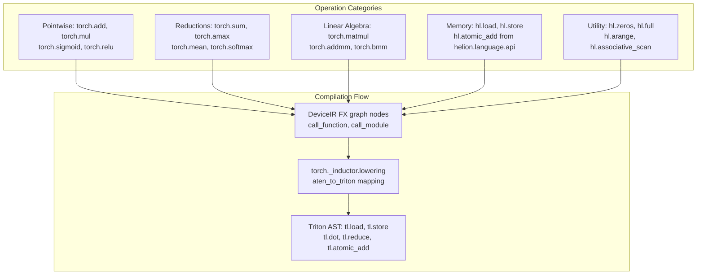

**Diagram: Operation Categories and Compilation Flow**

Sources: [helion/language/api.py](), [helion/compiler/device_ir.py](), [helion/compiler/generate_ast.py]()

### Pointwise Operations

All PyTorch element-wise operations work naturally in device code:

```python
for tile in hl.tile(n):
    # Arithmetic
    out[tile] = x[tile] + y[tile]
    out[tile] = x[tile] * 2.5
    
    # Activations
    out[tile] = torch.relu(x[tile])
    out[tile] = torch.sigmoid(x[tile])
    out[tile] = torch.exp(x[tile])
    
    # Comparisons
    mask = x[tile] > 0
    out[tile] = torch.where(mask, x[tile], 0)
```

Sources: [examples/add.py](https://github.com/pytorch/helion/blob/main/examples/add.py), [test/test_examples.py:27-36]()

### Reduction Operations

Reductions aggregate values across dimensions:

```python
for tile_m in hl.tile(m):
    # Reduce over last dimension
    row_max = torch.amax(x[tile_m, :], dim=-1)
    row_sum = torch.sum(x[tile_m, :], dim=-1)
    row_mean = torch.mean(x[tile_m, :], dim=-1)
```

For large reductions, use reduction loops (see [Tiling and Iteration](#3.1)):

```python
for tile_m in hl.tile(m):
    acc = hl.zeros([tile_m], dtype=torch.float32)
    for tile_n in hl.tile(n):  # Reduction loop
        acc += x[tile_m, tile_n]
    out[tile_m] = acc
```

Sources: [examples/softmax.py](), [test/test_examples.py:293-321]()

### Matrix Multiplication

Matrix operations use accumulator patterns:

```python
for tile_m, tile_n in hl.tile([m, n]):
    acc = hl.zeros([tile_m, tile_n], dtype=torch.float32)
    for tile_k in hl.tile(k):
        acc = torch.addmm(acc, x[tile_m, tile_k], y[tile_k, tile_n])
    out[tile_m, tile_n] = acc
```

Supported matrix operations:
- `torch.matmul(a, b)` - General matrix multiplication
- `torch.addmm(bias, a, b)` - Matrix multiply with bias
- `torch.bmm(a, b)` - Batch matrix multiplication
- `torch.dot(a, b)` - Dot product

Sources: [examples/matmul.py](), [test/test_examples.py:38-51]()

## Tensor Indexing

Helion supports multiple indexing patterns for accessing tensor elements within tiles.

### Basic Tile Indexing

The most common pattern uses tile objects directly:

```python
for tile_m, tile_n in hl.tile([m, n]):
    # Read
    value = x[tile_m, tile_n]
    
    # Write
    out[tile_m, tile_n] = value
```

### Slicing and Partial Indexing

Combine tiles with slices:

```python
for tile_m in hl.tile(m):
    # Full slice on second dimension
    row = x[tile_m, :]
    
    # Explicit range
    row_section = x[tile_m, :100]
```

### Advanced Indexing

```python
for tile_m, tile_n in hl.tile([m, n]):
    # Transpose access
    transposed = x[tile_n, tile_m]
    
    # Gather pattern
    indices = idx_tensor[tile_m]
    gathered = embedding[indices, tile_n]
```

For complete indexing semantics and patterns, see [Tensor Indexing Patterns](#3.2).

Sources: [examples/embedding.py](), [test/test_examples.py:544-574]()

## Memory Operations

Helion provides explicit memory operations for fine-grained control.

### Load and Store

```python
# Basic load
value = hl.load(tensor, [tile_m, tile_n])

# Load with masking
value = hl.load(tensor, [tile_m, tile_n], 
                extra_mask=(tile_m.index < valid_size))

# Store
hl.store(tensor, [tile_m, tile_n], value)

# Store with masking
hl.store(tensor, [tile_m, tile_n], value,
         extra_mask=(tile_n.index < valid_size))
```

### Atomic Operations

For concurrent writes from multiple tiles:

```python
for tile_e, tile_f in hl.tile([num_elements, num_features]):
    indices = idx_tensor[tile_e]
    values = data[tile_e, tile_f]
    
    # Atomic accumulation to avoid race conditions
    hl.atomic_add(output, [indices, tile_f], values)
```

### Eviction Policies

Control cache behavior for loads:

```python
# First-use eviction (for data used once)
value = hl.load(tensor, [tile_m], eviction_policy="first")

# Last-use eviction (for reused data)
value = hl.load(tensor, [tile_m], eviction_policy="last")
```

For detailed memory operation semantics, see [Memory Operations](#3.3).

Sources: [examples/segment_reduction.py:82-91](), [helion/language/api.py]()

## Control Flow

Device code supports both loops and conditionals, though they differ from host code control flow.

### Device Loops

Loops in device code are nested within `hl.tile()` loops:

```python
for tile_m, tile_n in hl.tile([m, n]):
    acc = hl.zeros([tile_m, tile_n], dtype=torch.float32)
    
    # Inner reduction loop
    for tile_k in hl.tile(k):
        acc = torch.addmm(acc, x[tile_m, tile_k], y[tile_k, tile_n])
    
    out[tile_m, tile_n] = acc
```

**Loop Types:**
- **Outer loops** (first `hl.tile()` in kernel) → Map to GPU grid
- **Inner loops** (nested `hl.tile()`) → Generate Triton `tl.range()` loops
- **Python loops** (in host code) → Regular Python iteration

### Conditionals

Standard Python if/else works in device code:

```python
for tile in hl.tile(n):
    value = x[tile]
    
    # Conditional computation
    if some_condition:
        result = torch.relu(value)
    else:
        result = -torch.relu(-value)
    
    out[tile] = result
```

**Important:** Conditionals in device code are subject to control flow analysis. Both branches must produce compatible types. See [Control Flow](#3.4) for details on type merging and scope handling.

Sources: [examples/matmul.py](), [test/test_examples.py:38-51]()

## Special Operations

### Accumulator Initialization

Use `hl.zeros()` and `hl.full()` to create tile-sized accumulators:

```python
for tile_m, tile_n in hl.tile([m, n]):
    # Zero accumulator
    acc = hl.zeros([tile_m, tile_n], dtype=torch.float32)
    
    # Constant-filled accumulator
    m_i = hl.full([tile_m], float("-inf"), dtype=torch.float32)
```

### Specialization

Use `hl.specialize()` to mark values as compile-time constants:

```python
@helion.kernel()
def attention(q: torch.Tensor, k: torch.Tensor, v: torch.Tensor) -> torch.Tensor:
    # Specialize head dimension for optimization
    head_dim = hl.specialize(q.size(-1))
    ...
```

This enables the compiler to generate optimized code for specific sizes.

### Associative Scan

For segmented reductions and prefix sums:

```python
def combine_fn(left_val, left_idx, right_val, right_idx):
    combined_val = torch.where(
        left_idx == right_idx, 
        left_val + right_val, 
        right_val
    )
    return combined_val, right_idx

for tile_e, tile_f in hl.tile([num_elements, num_features]):
    vals = input_data[tile_e, tile_f]
    idxs = indices[tile_e]
    
    tuple_in = (vals, idxs.float().unsqueeze(1).expand_as(vals))
    out_vals, _ = hl.associative_scan(combine_fn, tuple_in, dim=0)
    ...
```

Sources: [examples/segment_reduction.py:32-92](), [helion/language/api.py]()

## Type System and Compilation

Helion performs type inference to validate operations and generate efficient code.

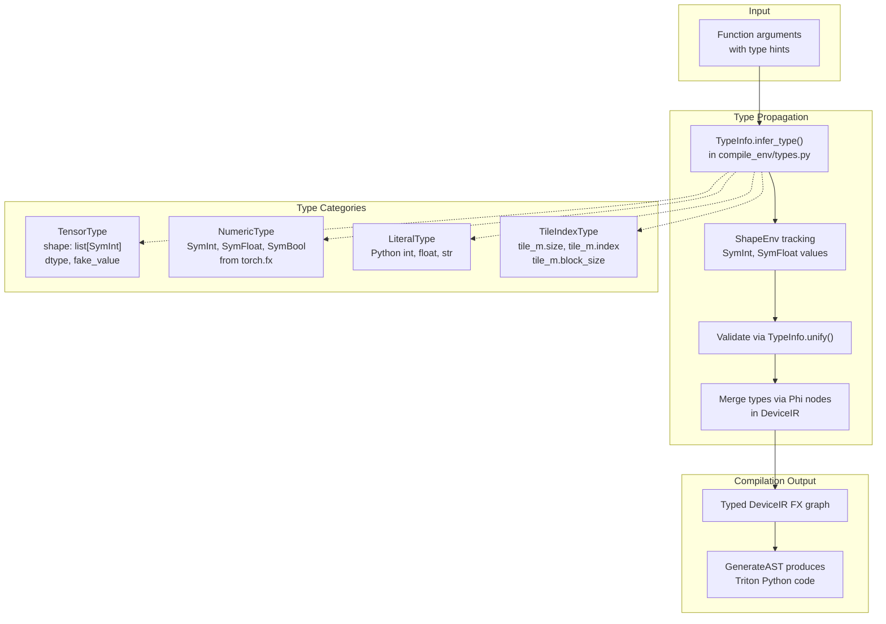

**Diagram: Type System Flow Through Compilation**

Sources: [helion/compile_env/types.py](), [helion/compile_env/shape_env.py](), [helion/compiler/device_ir.py](), [helion/compiler/generate_ast.py]()

**Key Type Categories:**

| Type | Description | Example |
|------|-------------|---------|
| `TensorType` | GPU tensors with shape and dtype | `torch.Tensor[m, n, float32]` |
| `NumericType` | Symbolic scalars | `SymInt`, `SymFloat` |
| `TileIndexType` | Tile objects from `hl.tile()` | `tile_m`, `tile_n` |
| `LiteralType` | Python constants | `1`, `"string"`, `3.14` |

**Type Annotations:**

Always provide type hints for kernel arguments:

```python
@helion.kernel()
def kernel(x: torch.Tensor, alpha: float, size: int) -> torch.Tensor:
    ...
```

This enables proper type inference and validation.

Sources: [helion/compile_env/types.py]()

## Common Patterns

### Pattern: Element-wise Operation

```python
@helion.kernel()
def element_wise(x: torch.Tensor, y: torch.Tensor) -> torch.Tensor:
    x, y = torch.broadcast_tensors(x, y)
    out = torch.empty_like(x)
    
    for tile in hl.tile(x.size(0)):
        out[tile] = x[tile] + y[tile]
    
    return out
```

### Pattern: Matrix Multiplication

```python
@helion.kernel()
def matmul(x: torch.Tensor, y: torch.Tensor) -> torch.Tensor:
    m, k = x.size()
    k, n = y.size()
    out = torch.empty([m, n], dtype=x.dtype, device=x.device)
    
    for tile_m, tile_n in hl.tile([m, n]):
        acc = hl.zeros([tile_m, tile_n], dtype=torch.float32)
        for tile_k in hl.tile(k):
            acc = torch.addmm(acc, x[tile_m, tile_k], y[tile_k, tile_n])
        out[tile_m, tile_n] = acc
    
    return out
```

### Pattern: Reduction

```python
@helion.kernel()
def row_sum(x: torch.Tensor) -> torch.Tensor:
    m, n = x.size()
    out = torch.empty([m], dtype=x.dtype, device=x.device)
    
    for tile_m in hl.tile(m):
        acc = hl.zeros([tile_m], dtype=torch.float32)
        for tile_n in hl.tile(n):
            acc += x[tile_m, tile_n]
        out[tile_m] = acc
    
    return out
```

### Pattern: Softmax (Reduction with Normalization)

```python
@helion.kernel()
def softmax(x: torch.Tensor) -> torch.Tensor:
    m, n = x.size()
    out = torch.empty_like(x)
    
    for tile_m in hl.tile(m):
        # Find max
        row_max = torch.amax(x[tile_m, :], dim=-1)
        
        # Compute exp and sum
        row_exp = torch.exp(x[tile_m, :] - row_max[:, None])
        row_sum = torch.sum(row_exp, dim=-1)
        
        # Normalize
        out[tile_m, :] = row_exp / row_sum[:, None]
    
    return out
```

### Pattern: Embedding Lookup

```python
@helion.kernel()
def embedding(indices: torch.Tensor, weight: torch.Tensor) -> torch.Tensor:
    batch_size, seq_len = indices.size()
    vocab_size, embedding_dim = weight.size()
    out = torch.empty([batch_size, seq_len, embedding_dim], 
                      dtype=weight.dtype, device=weight.device)
    
    for tile_b, tile_s, tile_d in hl.tile([batch_size, seq_len, embedding_dim]):
        idx = indices[tile_b, tile_s]
        out[tile_b, tile_s, tile_d] = weight[idx, tile_d]
    
    return out
```

### Pattern: Attention Mechanism

```python
@helion.kernel()
def attention(q: torch.Tensor, k: torch.Tensor, v: torch.Tensor) -> torch.Tensor:
    batch, heads, seq_q, head_dim = q.size()
    _, _, seq_kv, _ = k.size()
    
    out = torch.empty_like(q)
    qk_scale = 1.0 / (head_dim ** 0.5)
    
    for tile_b, tile_h, tile_q in hl.tile([batch, heads, seq_q]):
        m_i = hl.full([tile_b, tile_h, tile_q], float("-inf"), dtype=torch.float32)
        l_i = torch.full_like(m_i, 1.0)
        acc = hl.zeros([tile_b, tile_h, tile_q, head_dim], dtype=torch.float32)
        
        q_tile = q[tile_b, tile_h, tile_q, :]
        
        for tile_kv in hl.tile(seq_kv):
            k_tile = k[tile_b, tile_h, tile_kv, :]
            qk = torch.matmul(q_tile, k_tile.transpose(-2, -1))
            
            # Online softmax with running max
            m_ij = torch.maximum(m_i, torch.amax(qk, -1) * qk_scale)
            qk = qk * qk_scale - m_ij[..., None]
            p = torch.exp2(qk)
            l_ij = torch.sum(p, -1)
            
            alpha = torch.exp2(m_i - m_ij)
            l_i = l_i * alpha + l_ij
            acc = acc * alpha[..., None]
            
            v_tile = v[tile_b, tile_h, tile_kv, :]
            acc += torch.matmul(p, v_tile)
            
            m_i = m_ij
        
        out[tile_b, tile_h, tile_q, :] = acc / l_i[..., None]
    
    return out
```

Sources: [examples/add.py](), [examples/matmul.py](), [examples/softmax.py](), [examples/attention.py](), [examples/embedding.py]()

## Best Practices

### 1. Use Type Hints

Always annotate kernel arguments:

```python
# Good
@helion.kernel()
def kernel(x: torch.Tensor, alpha: float) -> torch.Tensor:
    ...

# Bad
@helion.kernel()
def kernel(x, alpha):
    ...
```

### 2. Allocate Output Tensors in Host Code

Create output tensors before device loops:

```python
# Good
@helion.kernel()
def kernel(x: torch.Tensor) -> torch.Tensor:
    out = torch.empty_like(x)  # Host code
    for tile in hl.tile(x.size(0)):
        out[tile] = x[tile] * 2
    return out

# Bad - output tensor created in device code
@helion.kernel()
def kernel(x: torch.Tensor) -> torch.Tensor:
    for tile in hl.tile(x.size(0)):
        out = torch.empty_like(x)  # Wrong!
        ...
```

### 3. Use Higher Precision for Accumulators

Avoid numerical instability by using `float32` for accumulators:

```python
for tile_m, tile_n in hl.tile([m, n]):
    acc = hl.zeros([tile_m, tile_n], dtype=torch.float32)  # Good
    for tile_k in hl.tile(k):
        acc = torch.addmm(acc, x[tile_m, tile_k], y[tile_k, tile_n])
    out[tile_m, tile_n] = acc.to(x.dtype)  # Convert at end
```

### 4. Use hl.specialize() for Compile-time Constants

When dimensions are known at compile time, use specialization:

```python
head_dim = hl.specialize(q.size(-1))  # Optimize for specific size
```

### 5. Use Atomic Operations for Concurrent Writes

When multiple tiles may write to the same location:

```python
for tile_e, tile_f in hl.tile([num_elements, num_features]):
    indices = idx[tile_e]
    values = data[tile_e, tile_f]
    hl.atomic_add(output, [indices, tile_f], values)  # Safe
```

### 6. Profile Before Over-optimizing

Use the default autotuning first, then manually tune only if needed:

```python
# Start with this
@helion.kernel()
def kernel(...):
    ...

# Only after profiling, consider manual tuning
@helion.kernel(config=helion.Config(...))
def kernel(...):
    ...
```

### 7. Validate Shapes in Host Code

Catch shape mismatches early:

```python
@helion.kernel()
def matmul(x: torch.Tensor, y: torch.Tensor) -> torch.Tensor:
    m, k = x.size()
    k2, n = y.size()
    assert k == k2, f"Inner dimensions must match: {k} != {k2}"
    ...
```

Sources: [examples/matmul.py](), [examples/attention.py]()

## Debugging and Development Tools

### Viewing Generated Code

To inspect the Triton code generated from a Helion kernel, use:

```python
# Environment variable
HELION_PRINT_OUTPUT_CODE=1 python my_kernel.py

# Or decorator parameter
@helion.kernel(print_output_code=True)
def my_kernel(x: torch.Tensor) -> torch.Tensor:
    ...

# Or programmatically
bound_kernel = my_kernel.bind(args)
triton_code = bound_kernel.to_triton_code(config)
print(triton_code)
```

### Generating Reproduction Scripts

For bug reports or sharing minimal reproducible examples:

```python
# Environment variable
HELION_PRINT_REPRO=1 python my_kernel.py

# Or decorator parameter
@helion.kernel(print_repro=True)
def my_kernel(x: torch.Tensor) -> torch.Tensor:
    ...
```

This generates a standalone script with the kernel definition, config, and helper function to recreate the runtime inputs.

### Eager Execution Mode

For debugging device code with `print()` or `breakpoint()`:

```python
# Run in Helion's eager interpreter
HELION_INTERPRET=1 python my_kernel.py

# Or use Triton's interpreter
TRITON_INTERPRET=1 python my_kernel.py
```

In eager mode, device loops execute on the CPU, allowing standard Python debugging tools.

Sources: [helion/runtime/settings.py](), [README.md:292-320](), [docs/index.md:237-266]()

## Next Steps

For deeper understanding of specific topics:

- **[Tiling and Iteration](#3.1)** - Advanced tiling patterns, loop ordering, flattening
- **[Tensor Indexing Patterns](#3.2)** - All indexing modes, masking, broadcasting
- **[Memory Operations](#3.3)** - Load/store semantics, atomic operations, eviction policies
- **[Control Flow](#3.4)** - Loop transformations, control flow merging, scope management
- **[API Functions Reference](#3.5)** - Complete documentation of all `hl.*` functions
- **[Configuration and Autotuning](#4)** - Performance tuning and configuration options
- **[Compilation Pipeline](#5)** - Understanding how kernels are compiled

To run and test kernels:

- **[Testing Framework](#7.1)** - Writing tests for your kernels
- **[Benchmarking](#8)** - Measuring kernel performance

Sources: All sections above

---

# Page: Tiling and Iteration

# Tiling and Iteration

<details>
<summary>Relevant source files</summary>

The following files were used as context for generating this wiki page:

- [helion/language/loops.py](helion/language/loops.py)
- [test/test_loops.py](test/test_loops.py)
- [test/test_reductions.expected](test/test_reductions.expected)
- [test/test_specialize.py](test/test_specialize.py)

</details>


**Purpose**: This page explains how Helion subdivides iteration spaces for parallel execution using `hl.tile()` and `hl.grid()`. It covers loop types (GRID vs DEVICE), tile properties, block size configuration, and how Helion compiles these constructs into efficient Triton kernels.

Related pages: For memory operations on tiles, see [Memory Operations](#3.3). For indexing patterns, see [Tensor Indexing Patterns](#3.2). For configuration parameters like `block_sizes` and `loop_orders`, see [Configuration System](#4.1).

---

## Overview

Helion provides two main primitives for iteration:

- **`hl.tile()`**: Subdivides an iteration space into tiles (blocks of elements) processed in parallel. Returns `Tile` objects that represent slices of data. Recommended for most use cases.
- **`hl.grid()`**: Iterates over scalar integer indices. Provides explicit control over the launch grid. Use when you need to process one element at a time.

The key difference: `tile` processes multiple elements at once (vectorized), while `grid` processes individual elements (scalar).

**Sources**: [helion/language/loops.py:62-206]()

---

## Loop Types: Grid vs Device

Helion distinguishes between two types of loops based on their position in the kernel:

### Grid Loops

The **outermost** `hl.tile()` or `hl.grid()` loop becomes the **kernel grid** - the parallel launch configuration. Each grid cell executes independently on the GPU.

```python
@helion.kernel()
def example(x: torch.Tensor) -> torch.Tensor:
    out = torch.empty_like(x)
    # This is a GRID loop - becomes the kernel grid
    for tile in hl.tile(x.size(0)):
        out[tile] = x[tile] * 2
    return out
```

### Device Loops

**Nested** `hl.tile()` or `hl.grid()` loops become **device loops** - loops that execute within each grid cell using Triton's `tl.range()` or `tl.static_range()`.

```python
@helion.kernel()
def matmul(x: torch.Tensor, y: torch.Tensor) -> torch.Tensor:
    m, k = x.size()
    k, n = y.size()
    out = torch.empty([m, n], dtype=x.dtype, device=x.device)
    
    # GRID loop - parallel across m, n
    for tile_m, tile_n in hl.tile([m, n]):
        acc = hl.zeros([tile_m, tile_n], dtype=torch.float32)
        # DEVICE loop - sequential within each grid cell
        for tile_k in hl.tile(k):
            acc = torch.addmm(acc, x[tile_m, tile_k], y[tile_k, tile_n])
        out[tile_m, tile_n] = acc
    return out
```

**Sources**: [helion/language/loops.py:96-112](), [test/test_loops.py:35-57]()

---

## Loop Type Determination Diagram

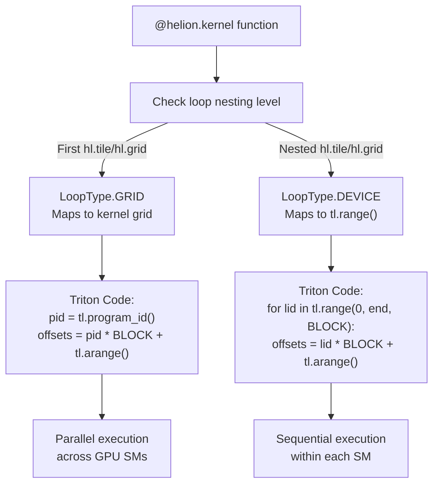

**Sources**: [helion/_compiler/ast_extension.py:20-27](), [helion/language/loops.py:390-432]()

---

## The `hl.tile()` Function

### Signature and Usage

```python
# Single dimension
for tile in hl.tile(size):
    # tile is a Tile object

# Multiple dimensions
for tile_i, tile_j in hl.tile([size_i, size_j]):
    # tile_i, tile_j are Tile objects

# With fixed block size
for tile in hl.tile(size, block_size=64):
    # Fixed 64 elements per tile

# With range (begin, end)
for tile in hl.tile(begin, end):
    # Iterate from begin to end
```

### Tile Object Properties

A `Tile` object provides several properties for working with the slice it represents:

| Property | Type | Description |
|----------|------|-------------|
| `begin` | `torch.SymInt` | Starting index of the tile |
| `end` | `torch.SymInt` | Ending index of the tile (exclusive) |
| `block_size` | `torch.SymInt` | Number of elements in the tile |
| `index` | `torch.Tensor` | Vector of all indices: `[begin, begin+1, ..., end-1]` |

**Example**: Accessing tile properties

```python
@helion.kernel()
def tile_properties_example(x: torch.Tensor) -> torch.Tensor:
    out = torch.zeros_like(x)
    for tile in hl.tile(x.size(0)):
        # Use tile properties in computation
        indices = tile.index  # [tile.begin, tile.begin+1, ..., tile.end-1]
        out[tile] = x[tile] + indices
    return out
```

**Sources**: [helion/language/loops.py:119-206]()

---

## Tile Indexing and Slicing

Tiles can be used directly in tensor subscripts to load/store data:

```python
@helion.kernel()
def add_kernel(x: torch.Tensor, y: torch.Tensor) -> torch.Tensor:
    out = torch.empty_like(x)
    for tile in hl.tile(x.size(0)):
        # Tile used as index - loads block of elements
        a = x[tile]  # Loads x[tile.begin:tile.end]
        b = y[tile]
        out[tile] = a + b  # Stores to out[tile.begin:tile.end]
    return out
```

Multi-dimensional tiling:

```python
@helion.kernel()
def copy_2d(x: torch.Tensor) -> torch.Tensor:
    out = torch.empty_like(x)
    m, n = x.shape
    for tile_m, tile_n in hl.tile([m, n]):
        # Loads 2D block: x[tile_m.begin:tile_m.end, tile_n.begin:tile_n.end]
        out[tile_m, tile_n] = x[tile_m, tile_n]
    return out
```

**Sources**: [test/test_loops.py:57-62](), [helion/language/loops.py:525-565]()

---

## The `hl.grid()` Function

### When to Use `hl.grid()`

Use `hl.grid()` when you need:
- Explicit control over the launch grid
- Scalar (single element) processing
- Fine-grained control over indices

Use `hl.tile()` when you want:
- Vectorized (multi-element) processing (recommended)
- Automatic optimization of block sizes
- Simpler code for most cases

### Signature and Usage

```python
# Single dimension
for i in hl.grid(size):
    # i is a scalar torch.SymInt

# Multiple dimensions
for i, j in hl.grid([size_i, size_j]):
    # i, j are scalar torch.SymInt values

# With step size
for i in hl.grid(begin, end, step=2):
    # Iterate with custom step
```

### Tile vs Grid Comparison

```python
# Using hl.tile (recommended)
@helion.kernel()
def add_with_tile(x: torch.Tensor, y: torch.Tensor) -> torch.Tensor:
    out = torch.empty_like(x)
    for tile in hl.tile(x.size(0)):
        # tile is a Tile object
        # Loads/stores blocks of elements
        out[tile] = x[tile] + y[tile]
    return out

# Using hl.grid (explicit control)
@helion.kernel()
def add_with_grid(x: torch.Tensor, y: torch.Tensor) -> torch.Tensor:
    out = torch.empty_like(x)
    for i in hl.grid(x.size(0)):
        # i is a scalar index
        # Loads/stores single elements
        out[i] = x[i] + y[i]
    return out
```

**Sources**: [helion/language/loops.py:626-697]()

---

## Block Size Configuration

### Automatic Block Size (Autotuned)

By default, block sizes are determined automatically through autotuning:

```python
@helion.kernel()
def kernel(x: torch.Tensor) -> torch.Tensor:
    out = torch.empty_like(x)
    # Block size chosen by autotuner
    for tile in hl.tile(x.size(0)):
        out[tile] = x[tile] * 2
    return out
```

### Fixed Block Size

Specify a fixed block size using the `block_size` parameter:

```python
@helion.kernel()
def kernel_fixed(x: torch.Tensor) -> torch.Tensor:
    out = torch.empty_like(x)
    # Always use 64 elements per tile
    for tile in hl.tile(x.size(0), block_size=64):
        out[tile] = x[tile] * 2
    return out
```

### Block Size Registration

Use `hl.register_block_size()` to share a block size variable across multiple loops or use it in computations:

```python
@helion.kernel()
def kernel_shared_block(x: torch.Tensor) -> torch.Tensor:
    BLOCK = hl.register_block_size(4, 256)  # min=4, max=256
    out = torch.zeros_like(x)
    
    # Use same BLOCK for multiple operations
    num_tiles = (x.size(0) + BLOCK - 1) // BLOCK
    for tile_id in hl.grid(num_tiles):
        base = tile_id * BLOCK
        idx = base + hl.arange(BLOCK)
        mask = idx < x.size(0)
        values = hl.load(x, [idx], extra_mask=mask)
        hl.store(out, [idx], values, extra_mask=mask)
    return out
```

**Sources**: [helion/language/loops.py:192-206](), [test/test_loops.py:280-305](), [test/test_loops.py:427-442]()

---

## Block Size Configuration Diagram

```mermaid
graph TB
    UserCode["User writes hl.tile(size)"]
    UserCode --> HasFixed{"Has block_size<br/>parameter?"}
    
    HasFixed --> |"Yes: block_size=64"| Fixed["Fixed block size<br/>not autotuned"]
    HasFixed --> |"No"| Auto["Automatic block size"]
    
    Auto --> Register["TileIndexType.allocate()<br/>creates block_id"]
    Register --> ConfigSpec["CompileEnvironment.config_spec<br/>adds to block_sizes list"]
    
    ConfigSpec --> Autotune["Autotuner explores<br/>different block sizes"]
    Autotune --> BestConfig["Best Config selected<br/>with optimal block_sizes"]
    
    Fixed --> Compile["Compilation"]
    BestConfig --> Compile
    
    Compile --> TritonCode["Triton code:<br/>_BLOCK_SIZE_0: tl.constexpr<br/>tl.arange(0, _BLOCK_SIZE_0)"]
```

**Sources**: [helion/language/loops.py:291-387](), [helion/language/loops.py:389-431]()

---

## Tiling Strategies

Helion uses different strategies to compile `hl.tile()` loops based on the configuration. The two main strategies are:

### FlattenedTileStrategy

Collapses multiple dimensions into a single flat iteration space. Enabled by `flatten_loops` configuration.

**Advantages**:
- Simpler indexing in generated code
- Better for irregular shapes
- Single program ID calculation

**Example**:
```python
# 2D tile becomes 1D iteration
for tile_i, tile_j in hl.tile([m, n]):  # User code
    ...

# Generates flattened Triton code:
# offsets_flat = pid * BLOCK + tl.arange(0, BLOCK)
# indices_i = offsets_flat // n
# indices_j = offsets_flat % n
```

### NDTileStrategy

Preserves dimensional structure with separate indices per dimension.

**Advantages**:
- Natural multi-dimensional indexing
- Better memory access patterns for strided tensors
- Supports loop reordering

**Example**:
```python
# 2D tile with separate dimensions
for tile_i, tile_j in hl.tile([m, n]):  # User code
    ...

# Generates N-dimensional Triton code:
# offset_i = pid_i * BLOCK_I + tl.arange(0, BLOCK_I)
# offset_j = pid_j * BLOCK_J + tl.arange(0, BLOCK_J)
```

**Sources**: [helion/_compiler/tile_strategy.py:434-598](), [helion/_compiler/tile_strategy.py:617-1076]()

---

## Tiling Strategy Selection Diagram

```mermaid
graph TB
    TileCall["hl.tile([dim1, dim2])"]
    TileCall --> Config{"Config has<br/>flatten_loops?"}
    
    Config --> |"True"| Flatten["FlattenedTileStrategy"]
    Config --> |"False"| ND["NDTileStrategy"]
    
    Flatten --> FlattenCode["Single 1D iteration:<br/>pid_flat = tl.program_id(0)<br/>offsets = pid_flat * BLOCK + tl.arange()<br/>idx_i = offsets // dim2<br/>idx_j = offsets % dim2"]
    
    ND --> PidType{"Config pid_type"}
    PidType --> |"flat"| FlatPID["FlatProgramIDs:<br/>pid_flat = tl.program_id(0)<br/>pid_i = pid_flat // grid_j<br/>pid_j = pid_flat % grid_j"]
    PidType --> |"xyz"| XYZPID["XYZProgramIDs:<br/>pid_i = tl.program_id(0)<br/>pid_j = tl.program_id(1)"]
    PidType --> |"persistent_*"| Persistent["Persistent kernels:<br/>for combined_pid in range(total_work)"]
    
    FlatPID --> NDCode["N-dimensional indexing:<br/>offset_i = pid_i * BLOCK_I + tl.arange(0, BLOCK_I)<br/>offset_j = pid_j * BLOCK_J + tl.arange(0, BLOCK_J)"]
    XYZPID --> NDCode
    Persistent --> NDCode
```

**Sources**: [helion/_compiler/tile_strategy.py:421-432](), [helion/_compiler/program_id.py:1-500]()

---

## Loop Configuration Options

The behavior of tiling loops is controlled by several configuration parameters (see [Configuration System](#4.1) for details):

### Block Sizes

| Config Parameter | Description | Example |
|-----------------|-------------|---------|
| `block_sizes` | Tile sizes for each `hl.tile()` call | `[64, 32, 16]` for 3 tiles |

### Loop Structure

| Config Parameter | Description | Example |
|-----------------|-------------|---------|
| `loop_orders` | Permutation of iteration order | `[[1, 0]]` reverses 2D loop |
| `flatten_loops` | Collapse multi-dim loops to 1D | `[True]` for first multi-dim loop |

### Device Loop Tuning

| Config Parameter | Description | Example |
|-----------------|-------------|---------|
| `range_unroll_factors` | Unroll factor for `tl.range()` | `[0, 2]` - unroll inner by 2 |
| `range_num_stages` | Pipeline stages for `tl.range()` | `[0, 3]` - 3 stages for inner |
| `range_multi_buffers` | Allow multi-buffering | `[None, True]` |
| `range_flattens` | Flatten `tl.range()` iteration | `[None, False]` |
| `range_warp_specializes` | Warp specialization (Blackwell+) | `[None, True]` |
| `static_ranges` | Use `tl.static_range()` | `[False, True]` |

### Program ID Layout

| Config Parameter | Description | Example |
|-----------------|-------------|---------|
| `pid_type` | Grid execution strategy | `"flat"`, `"xyz"`, `"persistent_blocked"` |
| `l2_groupings` | L2 cache locality grouping | `[8]` groups 8 consecutive tiles |

**Sources**: [helion/language/loops.py:389-459](), [helion/autotuner/config_spec.py]()

---

## Loop Ordering and Reordering

Multi-dimensional tiles can have their iteration order reordered for better cache locality:

```python
@helion.kernel(
    config=helion.Config(
        block_sizes=[32, 16],
        loop_orders=[[1, 0]]  # Reverse the order: iterate j, then i
    )
)
def reordered_kernel(x: torch.Tensor) -> torch.Tensor:
    out = torch.empty_like(x)
    m, n = x.shape
    # Loop order: normally i-then-j, but config makes it j-then-i
    for tile_i, tile_j in hl.tile([m, n]):
        out[tile_i, tile_j] = x[tile_i, tile_j]
    return out
```

The `loop_orders` parameter contains one entry per multi-dimensional `hl.tile()` call. Each entry is a permutation of dimension indices.

**Sources**: [test/test_loops.py:148-168](), [helion/language/loops.py:399-403]()

---

## Data-Dependent Bounds

Helion supports tiles with data-dependent bounds (where the size is stored in a tensor):

```python
@helion.kernel()
def data_dependent_kernel(x: torch.Tensor, end: torch.Tensor) -> torch.Tensor:
    out = x.new_empty([x.size(0)])
    for tile0 in hl.tile(x.size(0)):
        acc = hl.zeros([tile0])
        # end[0] is a tensor - data-dependent bound
        for tile1 in hl.tile(end[0]):
            acc += x[tile0, tile1].sum(-1)
        out[tile0] = acc
    return out
```

**Important**: Data-dependent bounds require persistent kernels (`pid_type` must be `"persistent_blocked"` or `"persistent_interleaved"`) to ensure CUDA graph compatibility.

**Sources**: [test/test_loops.py:308-401](), [helion/language/loops.py:417-422]()

---

## Nested Loops Example

A complete example showing grid and device loops:

```mermaid
graph TB
    subgraph "Python Code"
        Code["for tile_m, tile_n in hl.tile([m, n]):<br/>  acc = hl.zeros([tile_m, tile_n])<br/>  for tile_k in hl.tile(k):<br/>    acc += x[tile_m, tile_k] @ y[tile_k, tile_n]"]
    end
    
    subgraph "Loop Classification"
        Outer["Outer loop: GRID<br/>(tile_m, tile_n)"]
        Inner["Inner loop: DEVICE<br/>(tile_k)"]
    end
    
    subgraph "Generated Triton Code"
        GridCode["# Grid launch<br/>pid = tl.program_id(0)<br/>pid_m = pid // grid_n<br/>pid_n = pid % grid_n<br/>offset_m = pid_m * BLOCK_M + tl.arange(0, BLOCK_M)<br/>offset_n = pid_n * BLOCK_N + tl.arange(0, BLOCK_N)"]
        
        LoopCode["# Device loop<br/>for k_offset in tl.range(0, k, BLOCK_K):<br/>  offset_k = k_offset + tl.arange(0, BLOCK_K)<br/>  # Load and compute"]
    end
    
    Code --> Outer
    Code --> Inner
    Outer --> GridCode
    Inner --> LoopCode
```

**Sources**: [test/test_loops.py:253-278]()

---

## `hl.static_range()` — Compile-Time Loop Unrolling

`hl.static_range(begin_or_end, end_or_none, step=1)` is a device-only loop construct that completely unrolls at compile time. All arguments must be compile-time integer constants. The iteration variable becomes a constant literal in each unrolled copy of the loop body.

```python
@helion.kernel()
def unrolled_example(x: torch.Tensor) -> torch.Tensor:
    result = torch.zeros_like(x)
    for tile in hl.tile(x.size(0)):
        acc = torch.zeros([tile], dtype=x.dtype, device=x.device)
        # This loop gets completely unrolled: 3 separate instruction sequences
        for i in hl.static_range(3):
            acc += x[tile] * i
        result[tile] = acc
    return result
```

`hl.static_range` is distinct from `hl.tile()` and `hl.grid()`:

| Feature | `hl.static_range` | `hl.tile` / `hl.grid` |
|---------|-------------------|------------------------|
| Iteration variable | Compile-time integer constant | Runtime `Tile` or `SymInt` |
| Allocates block_id | No | Yes |
| Can be autotuned | No | Yes (via block_sizes) |
| Loop in output code | No (fully unrolled) | Yes (`tl.range()` or grid) |
| Bound type | Must be `int` literal | Can be dynamic |

The `register_fake` implementation simply returns `tuple(range(...))`, which triggers the existing tuple-iteration unrolling mechanism in Helion's compiler.

**Sources**: [helion/language/loops.py:1049-1153](), [helion/language/loops.py:1117-1141]()

---

## `tl.static_range` Optimization via Config

For device loops defined with `hl.tile()` that happen to have small, statically-known bounds, Helion can emit `tl.static_range()` instead of `tl.range()`. This is a separate mechanism from `hl.static_range`.

The `_allow_static_range` helper determines eligibility:

| Condition | Requirement |
|-----------|-------------|
| Begin | Compile-time `int` (or 0) |
| End | Compile-time `int` |
| Iteration count `(end - begin) / step` | ≤ 8 |

When eligible, the `static_ranges` Config parameter controls whether `tl.static_range` is actually emitted. When `tl.static_range` is active, other range-tuning options (`range_unroll_factors`, `range_num_stages`, `range_multi_buffers`, `range_flattens`) are ignored for that loop.

To make loop bounds statically known, use `hl.specialize()` on the bound value before using it in `hl.tile()`:

```python
@helion.kernel()
def static_range_example(x: torch.Tensor) -> torch.Tensor:
    out = torch.empty_like(x)
    M = hl.specialize(x.size(1))   # M is now a compile-time constant
    N = hl.specialize(x.size(2))   # N is now a compile-time constant
    for tile_outer in hl.tile(x.size(0)):
        # If M and N are small (≤ 8 tiles), can use tl.static_range
        for tile_m, tile_n in hl.tile([M, N]):
            out[tile_outer, tile_m, tile_n] = x[tile_outer, tile_m, tile_n] + 1
    return out
```

Config with `static_ranges=[True]` on the inner loop generates `tl.static_range` in Triton code; `static_ranges=[False]` (the default) uses `tl.range`.

**Sources**: [helion/language/loops.py:244-268](), [helion/language/loops.py:424-431](), [test/test_loops.py:967-1022]()

---

## Shape Specialization

Shape specialization converts dynamic tensor dimensions into compile-time constants, producing smaller kernel argument lists and enabling more aggressive compiler optimizations (including `tl.constexpr` folding and `tl.static_range`).

### `hl.specialize()`

`hl.specialize(value)` marks `value` as a compile-time constant for the kernel variant. The return value has `LiteralType` and is available as a `tl.constexpr` in generated Triton code.

```python
@helion.kernel()
def fn(x: torch.Tensor) -> torch.Tensor:
    n = hl.specialize(x.size(0))       # Inline x.size(0) as a constant
    shape = hl.specialize(x.shape)      # Specialize entire shape tuple
    stride = hl.specialize(x.stride(0)) # Specialize a stride value
    out = torch.empty_like(x)
    for tile in hl.tile(n):
        out[tile] = x[tile] + stride
    return out
```

**Effects of `hl.specialize()`:**

| Effect | Description |
|--------|-------------|
| Constant inlining | Value appears as a literal in Triton code, not a kernel argument |
| Cache partitioning | Each distinct specialized value produces a separate compiled variant |
| Enables `tl.static_range` | Loops bounded by specialized values may qualify for static range |
| Non-power-of-2 shapes | Allows `hl.zeros([tile, x.size(1)])` when size is not a power of 2 |

**Sources**: [test/test_specialize.py:40-55](), [test/test_specialize.py:73-110](), [test/test_specialize.py:282-298](), [test/test_specialize.py:320-335]()

### `torch._dynamo.mark_static()`

`torch._dynamo.mark_static(tensor, dim)` is an external PyTorch API to mark specific tensor dimensions as static without modifying the kernel source. It accepts a single dimension index or a list of indices (including negative indexing).

```python
x = torch.randn([96, 128], device="cuda")
y = torch.randn([128, 48], device="cuda")
torch._dynamo.mark_static(x, [0, -1])   # Mark x.size(0) and x.size(1) as static
torch._dynamo.mark_static(y, 1)          # Mark y.size(1) as static
result = kernel(x, y)
```

When both `hl.specialize()` and `torch._dynamo.mark_static()` are used on the same kernel call, they combine as a union: a dimension is treated as static if either API marks it.

```
hl.specialize(x.size(0)) + mark_static(x, -1)
  → both size(0) and size(1) become compile-time constants
```

**Sources**: [test/test_specialize.py:444-495](), [test/test_specialize.py:497-520]()
</old_str>
<new_str>
## `hl.static_range()` — Compile-Time Loop Unrolling

`hl.static_range(begin_or_end, end_or_none, step=1)` is a device-only loop construct that completely unrolls at compile time. All arguments must be compile-time integer constants. The iteration variable becomes a constant literal in each unrolled copy of the loop body.

```python
@helion.kernel()
def unrolled_example(x: torch.Tensor) -> torch.Tensor:
    result = torch.zeros_like(x)
    for tile in hl.tile(x.size(0)):
        acc = torch.zeros([tile], dtype=x.dtype, device=x.device)
        # This loop gets completely unrolled: 3 separate instruction sequences
        for i in hl.static_range(3):
            acc += x[tile] * i
        result[tile] = acc
    return result
```

`hl.static_range` is distinct from `hl.tile()` and `hl.grid()`:

| Feature | `hl.static_range` | `hl.tile` / `hl.grid` |
|---------|-------------------|------------------------|
| Iteration variable | Compile-time integer constant | Runtime `Tile` or `SymInt` |
| Allocates block_id | No | Yes |
| Can be autotuned | No | Yes (via block_sizes) |
| Loop in output code | No (fully unrolled) | Yes (`tl.range()` or grid) |
| Bound type | Must be `int` literal | Can be dynamic |

The `register_fake` implementation returns `tuple(range(...))`, which triggers the existing tuple-iteration unrolling mechanism in Helion's compiler.

**Sources**: [helion/language/loops.py:1049-1153](), [helion/language/loops.py:1117-1141]()

---

## `tl.static_range` Optimization via Config

For device loops defined with `hl.tile()` that happen to have small, statically-known bounds, Helion can emit `tl.static_range()` instead of `tl.range()`. This is a separate mechanism from `hl.static_range`.

The `_allow_static_range` helper determines eligibility:

| Condition | Requirement |
|-----------|-------------|
| Begin | Compile-time `int` (or 0) |
| End | Compile-time `int` |
| Iteration count `(end - begin) / step` | ≤ 8 |

When eligible, the `static_ranges` Config parameter controls whether `tl.static_range` is actually emitted. When `tl.static_range` is active, other range-tuning options (`range_unroll_factors`, `range_num_stages`, `range_multi_buffers`, `range_flattens`) are ignored for that loop.

To make loop bounds statically known, use `hl.specialize()` on the bound value before using it in `hl.tile()`:

```python
@helion.kernel()
def static_range_example(x: torch.Tensor) -> torch.Tensor:
    out = torch.empty_like(x)
    M = hl.specialize(x.size(1))   # M is now a compile-time constant
    N = hl.specialize(x.size(2))   # N is now a compile-time constant
    for tile_outer in hl.tile(x.size(0)):
        # If M and N are small (≤ 8 tiles), can use tl.static_range
        for tile_m, tile_n in hl.tile([M, N]):
            out[tile_outer, tile_m, tile_n] = x[tile_outer, tile_m, tile_n] + 1
    return out
```

Config with `static_ranges=[True]` on the inner loop generates `tl.static_range` in Triton code; `static_ranges=[False]` (the default) uses `tl.range`.

**Sources**: [helion/language/loops.py:244-268](), [helion/language/loops.py:424-431](), [test/test_loops.py:967-1022]()

---

## Shape Specialization

Shape specialization converts dynamic tensor dimensions into compile-time constants, producing smaller kernel argument lists and enabling more aggressive compiler optimizations (including `tl.constexpr` folding and `tl.static_range`).

### `hl.specialize()`

`hl.specialize(value)` marks `value` as a compile-time constant for the kernel variant. The return value has `LiteralType` and is available as a `tl.constexpr` in generated Triton code.

```python
@helion.kernel()
def fn(x: torch.Tensor) -> torch.Tensor:
    n = hl.specialize(x.size(0))       # Inline x.size(0) as a constant
    shape = hl.specialize(x.shape)      # Specialize entire shape tuple
    stride = hl.specialize(x.stride(0)) # Specialize a stride value
    out = torch.empty_like(x)
    for tile in hl.tile(n):
        out[tile] = x[tile] + stride
    return out
```

**Effects of `hl.specialize()`:**

| Effect | Description |
|--------|-------------|
| Constant inlining | Value appears as a literal in Triton code, not a kernel argument |
| Cache partitioning | Each distinct specialized value produces a separate compiled variant |
| Enables `tl.static_range` | Loops bounded by specialized values may qualify for static range |
| Non-power-of-2 shapes | Allows `hl.zeros([tile, x.size(1)])` when size is not a power of 2 |

**Sources**: [test/test_specialize.py:40-55](), [test/test_specialize.py:73-110](), [test/test_specialize.py:282-298](), [test/test_specialize.py:320-335]()

### `torch._dynamo.mark_static()`

`torch._dynamo.mark_static(tensor, dim)` is an external PyTorch API to mark specific tensor dimensions as static without modifying the kernel source. It accepts a single dimension index or a list of indices (including negative indexing).

```python
x = torch.randn([96, 128], device="cuda")
y = torch.randn([128, 48], device="cuda")
torch._dynamo.mark_static(x, [0, -1])   # Mark x.size(0) and x.size(1) as static
torch._dynamo.mark_static(y, 1)          # Mark y.size(1) as static
result = kernel(x, y)
```

When both `hl.specialize()` and `torch._dynamo.mark_static()` are used on the same kernel call, they combine as a union: a dimension is treated as static if either API marks it.

```
hl.specialize(x.size(0)) + mark_static(x, -1)
  → both size(0) and size(1) become compile-time constants
```

**Sources**: [test/test_specialize.py:444-495](), [test/test_specialize.py:497-520]()

---

## Complete Compilation Flow

```mermaid
graph TB
    UserCode["User Code:<br/>for tile in hl.tile(size):"]
    
    UserCode --> TypeProp["Type Propagation:<br/>TileIndexType.allocate()<br/>Assigns block_id"]
    
    TypeProp --> ConfigReg["Config Registration:<br/>ConfigSpec.block_sizes.append()<br/>Creates tunable parameter"]
    
    ConfigReg --> Autotune["Autotuning:<br/>Explores different<br/>block size values"]
    
    Autotune --> BestConf["Best Config Selected:<br/>block_sizes=[64]<br/>pid_type='flat'"]
    
    BestConf --> Strategy["Select TileStrategy:<br/>FlattenedTileStrategy or<br/>NDTileStrategy"]
    
    Strategy --> IsGrid{"Is Grid Loop?"}
    
    IsGrid --> |"Yes"| GridGen["codegen_grid():<br/>Generate program ID code<br/>Select ProgramIDs strategy"]
    IsGrid --> |"No"| DevGen["codegen_device_loop():<br/>Generate tl.range() loop<br/>Apply range_* configs"]
    
    GridGen --> TritonGrid["Triton Code:<br/>pid = tl.program_id(0)<br/>offsets = pid * BLOCK + tl.arange(0, BLOCK)"]
    
    DevGen --> TritonDev["Triton Code:<br/>for lid in tl.range(0, end, BLOCK):<br/>  offsets = lid * BLOCK + tl.arange(0, BLOCK)"]
```

**Sources**: [helion/language/loops.py:389-431](), [helion/_compiler/tile_strategy.py]()

---

## Key Takeaways

1. **`hl.tile()` vs `hl.grid()`**: Use `tile` for vectorized processing (recommended). Use `grid` for scalar processing or explicit control.

2. **Loop Types**: The first loop becomes the grid (parallel), nested loops become device loops (sequential within each grid cell).

3. **Block Sizes**: Can be autotuned (default), fixed (via `block_size=`), or registered (via `hl.register_block_size()`).

4. **Tile Properties**: Access `tile.begin`, `tile.end`, `tile.block_size`, and `tile.index` for computations.

5. **Configuration**: Many aspects of tiling are controlled by Config parameters like `block_sizes`, `loop_orders`, `flatten_loops`, and range tuning options.

6. **Strategies**: Helion selects between flattened and N-dimensional strategies based on configuration and use patterns.

**Sources**: [helion/language/loops.py:1-900](), [helion/_compiler/tile_strategy.py:1-1600](), [README.md:1-391]()

---

# Page: Tensor Indexing Patterns

# Tensor Indexing Patterns

<details>
<summary>Relevant source files</summary>

The following files were used as context for generating this wiki page:

- [README.md](README.md)
- [docs/api/config.md](docs/api/config.md)
- [docs/index.md](docs/index.md)
- [docs/installation.md](docs/installation.md)
- [docs/tileir_backend.md](docs/tileir_backend.md)
- [examples/segment_reduction.py](examples/segment_reduction.py)
- [helion/_compiler/indexing_strategy.py](helion/_compiler/indexing_strategy.py)
- [helion/language/tile_ops.py](helion/language/tile_ops.py)
- [helion/language/tile_proxy.py](helion/language/tile_proxy.py)
- [test/test_indexing.py](test/test_indexing.py)

</details>


This page explains how Helion accesses memory in GPU kernels: the three available indexing strategies, when each applies, how the `indexing` configuration parameter selects among them, and how out-of-bounds masking is handled automatically. This covers the user-facing behavior for kernel authors.

For the compiler-level code generation details of each strategy, see [Indexing Strategies (5.5)](#5.5). For the broader `Config` parameter reference including `indexing`, see [Configuration System (4.1)](#4.1).

---

## Overview

Helion compiles tensor reads (`x[tile_m, tile_k]`) and writes (`out[tile_m, tile_n] = acc`) to Triton memory operations. There are three distinct strategies for how those Triton memory operations are structured. The choice affects generated code performance and hardware compatibility.

| Strategy | Config Value | Triton Primitives Used | Backend Support |
|---|---|---|---|
| Pointer | `"pointer"` | `tl.load(ptr + offset, mask)` / `tl.store(...)` | All backends |
| Block pointer | `"block_ptr"` | `tl.make_block_ptr` + `tl.load(..., boundary_check=...)` | Triton (not TileIR) |
| Tensor descriptor | `"tensor_descriptor"` | `tl.make_tensor_descriptor` + `.load()` / `.store()` | Hopper+ GPU, Triton 3.5+ |

The default when `indexing` is omitted from the config is `"pointer"` for all operations.

Sources: [helion/_compiler/indexing_strategy.py:108-140](), [README.md:261-269]()

---

## Strategy Class Hierarchy

**Strategy classes and their Triton output:**

```mermaid
classDiagram
    class IndexingStrategy {
        +codegen_load(state, fake_tensor, subscript, extra_mask, eviction_policy) AST
        +codegen_store(state, fake_tensor, subscript, value, extra_mask) AST
        +select(indexing_literal) IndexingStrategy
    }
    class PointerIndexingStrategy {
        +codegen_load() "tl.load(ptr + offset, mask)"
        +codegen_store() "tl.store(ptr + offset, value, mask)"
    }
    class BlockPtrIndexingStrategy {
        +codegen_load() "tl.load(block_ptr, boundary_check=...)"
        +codegen_store() "tl.store(block_ptr, value, boundary_check=...)"
    }
    class TensorDescriptorIndexingStrategy {
        +is_supported(state, fake_tensor, subscript, extra_mask) bool
        +codegen_load() "descriptor.load(offsets)"
        +codegen_store() "descriptor.store(offsets, value)"
    }
    class StackIndexingStrategy {
        +codegen_load() "tl.load(dev_ptrs + offset, mask)"
        +codegen_store() "tl.store(dev_ptrs + offset, value, mask)"
    }
    IndexingStrategy <|-- PointerIndexingStrategy
    IndexingStrategy <|-- BlockPtrIndexingStrategy
    IndexingStrategy <|-- TensorDescriptorIndexingStrategy
    note for StackIndexingStrategy "Internal: used for stacked device pointer arrays"
```

Sources: [helion/_compiler/indexing_strategy.py:108-143](), [helion/_compiler/indexing_strategy.py:273-328](), [helion/_compiler/indexing_strategy.py:328-491](), [helion/_compiler/indexing_strategy.py:491-643]()

---

## Selecting an Indexing Strategy

The `indexing` field of `helion.Config` controls which strategy is used. `IndexingStrategy.select()` maps string literals to strategy objects at compile time.

**Config value → strategy selection → codegen:**

```mermaid
flowchart LR
    A["Config.indexing\n= 'pointer' / 'block_ptr' / 'tensor_descriptor'\nor list of strategies"]
    B["IndexingStrategy.select(indexing_literal)"]
    C["PointerIndexingStrategy"]
    D["BlockPtrIndexingStrategy"]
    E["TensorDescriptorIndexingStrategy"]
    F["tl.load / tl.store\n(pointer arithmetic)"]
    G["tl.make_block_ptr\n+ tl.load/store"]
    H["tl.make_tensor_descriptor\n.load / .store"]

    A --> B
    B -->|"'pointer'"| C --> F
    B -->|"'block_ptr'"| D --> G
    B -->|"'tensor_descriptor'"| E --> H
```

Sources: [helion/_compiler/indexing_strategy.py:130-140]()

### Single vs. Per-Operation Strategy

`indexing` can be specified as a single string (applies uniformly to all loads and stores) or as a list where each entry corresponds to one load or store operation in execution order.

```
# Single strategy — all loads and stores use block_ptr
indexing = "block_ptr"

# Per-operation — 2 loads use pointer, 1 store uses block_ptr
indexing = ["pointer", "pointer", "block_ptr"]
```

The list ordering is: all loads first (in execution order), then all stores. An empty list or an omitted `indexing` field defaults to `"pointer"` for all operations.

Sources: [README.md:261-269](), [docs/api/config.md:110-143]()

---

## The Three Strategies in Detail

### Pointer Indexing (`"pointer"`)

`PointerIndexingStrategy` computes a flat scalar or tensor offset from the subscript indices and generates a `tl.load` or `tl.store` call with an explicit mask argument.

- Always applicable. No hardware or shape restrictions.
- For multidimensional tensors, the offset is the dot product of indices with strides.
- Masking is handled via an explicit boolean tensor passed as the `mask=` argument to `tl.load`/`tl.store`.
- When a tensor dimension has size 1 and the tile covers multiple elements, a `tl.broadcast_to()` call is emitted automatically.

This strategy uses the `SubscriptIndexing` helper (a `NamedTuple` carrying `index_expr`, `mask_expr`, and `broadcast_dims`) to produce the offset and mask AST nodes.

Sources: [helion/_compiler/indexing_strategy.py:143-270](), [helion/_compiler/indexing_strategy.py:646-659]()

### Block Pointer Indexing (`"block_ptr"`)

`BlockPtrIndexingStrategy` uses Triton's `tl.make_block_ptr` API, which represents a tile as a structured block pointer with shape, strides, and offsets. The hardware or Triton runtime handles boundary checking through a `boundary_check=` tuple of dimension indices.

**Applicability check:** `BlockedSubscriptIndexing.is_supported()` determines whether block_ptr can be used. If not supported (e.g., when an `extra_mask` is present, or the subscript has unsupported index patterns), the strategy falls back transparently to `PointerIndexingStrategy`.

- Not supported on the TileIR backend (Blackwell GPU path).
- Does not support an `extra_mask` argument.

Sources: [helion/_compiler/indexing_strategy.py:273-325]()

### Tensor Descriptor Indexing (`"tensor_descriptor"`)

`TensorDescriptorIndexingStrategy` uses Tensor Memory Accelerators (TMA) through `tl.make_tensor_descriptor` (or `tl._experimental_make_tensor_descriptor` on older Triton). TMA moves data as 16-byte-aligned chunks and is significantly faster for compliant access patterns on Hopper+ hardware.

**Applicability is checked by `TensorDescriptorIndexingStrategy.is_supported()`:**

| Requirement | Detail |
|---|---|
| ndim | Must be between 2 and 5 |
| Stride-1 dimension | Exactly one dimension must have stride == 1 |
| Other strides | Must be 16-byte aligned (`stride * element_size % 16 == 0`) |
| Block size per dimension | Must give at least 16 bytes (`block_size * element_size >= 16`) |
| Slice steps | Slices with non-unit step are not supported |
| Extra mask | Not supported |

When any requirement is not met, it falls back to `PointerIndexingStrategy` automatically. The strategy also handles non-contiguous memory layouts via a permutation applied to the tensor descriptor and inverted on the load result.

**Hardware requirement:** Hopper GPU (SM90+) or newer. Requires Triton 3.5+.

Sources: [helion/_compiler/indexing_strategy.py:328-488]()

---

## Automatic Masking

Helion applies masking automatically for the last tile in a dimension when `tensor_size % block_size != 0`. This means kernel authors rarely write explicit bounds checks.

**How masking works per strategy:**

```mermaid
flowchart TD
    A["Tile access: x[tile_m, tile_n]"]
    B{"Strategy?"}
    C["SubscriptIndexing.create()\ncomputes index_expr + mask_expr"]
    D["tl.load(ptr + offset,\nmask=mask_expr, other=0)"]
    E["BlockedSubscriptIndexing.create()\ncomputes boundary_check dims"]
    F["tl.load(block_ptr,\nboundary_check=(dims,),\npadding_option='zero')"]
    G["Same as BlockedSubscriptIndexing\n+ TMA hardware boundary handling"]

    A --> B
    B -->|"pointer"| C --> D
    B -->|"block_ptr"| E --> F
    B -->|"tensor_descriptor"| G
```

- **Pointer:** `SubscriptIndexing.mask_expr` is `None` (a `ast.Constant(None)`) when the tile is provably in-bounds. Otherwise it emits a boolean tensor. `has_mask()` returns `True` only when a mask is needed.
- **Block pointer:** `boundary_check` is a tuple of dimension indices where masking is required. `padding_option='zero'` fills out-of-bounds loads with zeros.
- **Tensor descriptor:** TMA hardware handles boundary checking natively.

### Extra Mask

`hl.load` and `hl.store` both accept an `extra_mask` keyword argument for caller-supplied boolean conditions applied on top of the automatic boundary mask. This is only supported by the pointer strategy; passing `extra_mask` to block_ptr or tensor_descriptor operations forces fallback to pointer indexing.

Example from the test suite (masked store, pointer strategy):

[test/test_indexing.py:245-262]()

Sources: [helion/_compiler/indexing_strategy.py:646-660](), [helion/_compiler/indexing_strategy.py:147-181](), [helion/_compiler/indexing_strategy.py:276-301]()

---

## Strategy Fallback Behavior

Both `BlockPtrIndexingStrategy` and `TensorDescriptorIndexingStrategy` check applicability before emitting code. If a given load or store cannot use the requested strategy, they delegate to `PointerIndexingStrategy` transparently.

```mermaid
flowchart LR
    A["config.indexing = 'block_ptr'"]
    B["BlockPtrIndexingStrategy.codegen_load()"]
    C{"BlockedSubscriptIndexing\n.is_supported()?"}
    D["emit tl.make_block_ptr + tl.load"]
    E["PointerIndexingStrategy.codegen_load()"]
    F["emit tl.load(ptr + offset, mask)"]

    A --> B --> C
    C -->|"Yes"| D
    C -->|"No (extra_mask present,\nor unsupported pattern)"| E --> F
```

The same fallback applies for `"tensor_descriptor"`: if `TensorDescriptorIndexingStrategy.is_supported()` returns `False`, the call delegates to `PointerIndexingStrategy`.

This means a single `indexing` value in the config does not guarantee every load/store uses that exact Triton API. It is the preferred strategy, applied where supported.

Sources: [helion/_compiler/indexing_strategy.py:284-291](), [helion/_compiler/indexing_strategy.py:436-439](), [helion/_compiler/indexing_strategy.py:462-467]()

---

## Hardware and Backend Constraints

| Strategy | CUDA (Volta–Ada) | CUDA Hopper (SM90+) | TileIR (Blackwell SM100+) | ROCm |
|---|---|---|---|---|
| `"pointer"` | ✅ | ✅ | ✅ | ✅ |
| `"block_ptr"` | ✅ | ✅ | ❌ | ✅ |
| `"tensor_descriptor"` | ❌ | ✅ | ✅ | ❌ |

When using the TileIR backend (`ENABLE_TILE=1` on Blackwell hardware), `"block_ptr"` is excluded from the autotuner's search space automatically. The `"tensor_descriptor"` path on TileIR uses a different underlying API.

Sources: [docs/tileir_backend.md:62-76](), [docs/tileir_backend.md:157-169]()

---

## Index Dtype and Large Tensors

Pointer offsets are computed using `index_dtype`, which defaults to `torch.int32`. For tensors with more than `2^31` total elements, `torch.int32` overflows. Helion detects this at compile time and raises `InputTensorNumelExceedsIndexType` if the index type is too narrow.

Setting `index_dtype=torch.int64` in `helion.kernel(...)` forces 64-bit indexing, generating `tl.program_id(0).to(tl.int64)` and 64-bit pointer arithmetic throughout. When `index_dtype=None` (the default), Helion automatically upgrades to `int64` for large tensors.

Sources: [test/test_indexing.py:459-564](), [test/test_indexing.py:590-622]()

---

## StackIndexingStrategy

`StackIndexingStrategy` is an internal strategy (not user-selectable via `config.indexing`) used when a load or store targets a stack of device pointers sharing the same index pattern. It broadcasts the computed offset across the stacked pointer dimension and emits a vectorized `tl.load` or `tl.store`. This is used by certain internal kernel patterns and is not directly exposed to kernel authors.

Sources: [helion/_compiler/indexing_strategy.py:491-643]()

---

## Related Pages

- [Tiling and Iteration (3.1)](#3.1) — how `hl.tile` produces the subscript indices consumed by indexing strategies
- [Memory Operations (3.3)](#3.3) — `hl.load`, `hl.store`, and the `extra_mask` / `eviction_policy` parameters
- [Configuration System (4.1)](#4.1) — full reference for the `indexing` config field and how `ConfigSpec` validates it
- [Indexing Strategies (5.5)](#5.5) — compiler-level code generation for each strategy class

---

# Page: Memory Operations

# Memory Operations

<details>
<summary>Relevant source files</summary>

The following files were used as context for generating this wiki page:

- [helion/_compiler/device_ir.py](helion/_compiler/device_ir.py)
- [helion/_compiler/roll_reduction.py](helion/_compiler/roll_reduction.py)
- [helion/language/__init__.py](helion/language/__init__.py)
- [helion/language/_tracing_ops.py](helion/language/_tracing_ops.py)
- [helion/language/memory_ops.py](helion/language/memory_ops.py)
- [helion/language/random_ops.py](helion/language/random_ops.py)
- [test/test_eviction_policy.py](test/test_eviction_policy.py)
- [test/test_random.py](test/test_random.py)

</details>


This page describes memory operations in Helion kernels: loading from and storing to tensors. Memory operations are the primary way to transfer data between GPU memory and compute operations within a kernel.

For information about tensor indexing patterns and subscripting, see [Tensor Indexing Patterns](#3.2). For implementation details of different indexing strategies, see [Indexing Strategies](#5.5).

## Overview

Helion provides two ways to perform memory operations:

1. **Implicit operations**: Using standard Python subscript notation (`tensor[tile]`)
2. **Explicit operations**: Using `hl.load()` and `hl.store()` functions

Both approaches compile to the same underlying Triton memory operations, but explicit operations provide additional control over masking and cache behavior.

**Memory Operations Flow**

```mermaid
graph TB
    subgraph "User Code"
        A["tensor[tile]"]
        B["hl.load(tensor, [tile])"]
        C["tensor[tile] = value"]
        D["hl.store(tensor, [tile], value)"]
    end
    
    subgraph "API Layer"
        E["memory_ops.load()"]
        F["memory_ops.store()"]
    end
    
    subgraph "Indexing Strategy Selection"
        G["PointerIndexingStrategy"]
        H["BlockPtrIndexingStrategy"]
        I["TensorDescriptorIndexingStrategy"]
    end
    
    subgraph "Triton Code Generation"
        J["tl.load(ptr + offset, mask)"]
        K["tl.load(block_ptr, boundary_check)"]
        L["tensor_desc.load(offsets)"]
        M["tl.store(ptr + offset, value, mask)"]
        N["tl.store(block_ptr, value, boundary_check)"]
        O["tensor_desc.store(offsets, value)"]
    end
    
    A --> E
    B --> E
    C --> F
    D --> F
    
    E --> G
    E --> H
    E --> I
    F --> G
    F --> H
    F --> I
    
    G --> J
    H --> K
    I --> L
    G --> M
    H --> N
    I --> O
```

Sources: [helion/language/memory_ops.py:1-611](), [helion/_compiler/indexing_strategy.py:107-402]()

## Implicit Memory Operations

The most common way to load and store data is using standard Python subscript notation:

```python
@helion.kernel
def add_kernel(x: torch.Tensor, y: torch.Tensor) -> torch.Tensor:
    out = torch.empty_like(x)
    for tile in hl.tile(x.size(0)):
        # Implicit load from x[tile] and y[tile]
        # Implicit store to out[tile]
        out[tile] = x[tile] + y[tile]
    return out
```

When you write `x[tile]`, Helion automatically:
- Generates appropriate index expressions based on tile dimensions
- Applies masking to handle boundary conditions (e.g., when tile size doesn't evenly divide tensor size)
- Selects an indexing strategy based on the kernel configuration (pointer, block_ptr, or tensor_descriptor)

Sources: [helion/language/memory_ops.py:29-51]()

## Explicit Memory Operations

### hl.load()

The `hl.load()` function provides explicit control over loading data from tensors:

```python
def load(
    tensor: torch.Tensor | StackTensor,
    index: list[object],
    extra_mask: torch.Tensor | None = None,
    eviction_policy: str | None = None,
) -> torch.Tensor
```

**Parameters:**
- `tensor`: The tensor or stack tensor to load from
- `index`: List of indices (can include tiles, integers, or tensors)
- `extra_mask`: Optional boolean mask to apply beyond automatic tile bounds masking
- `eviction_policy`: Optional cache eviction policy hint (see [Eviction Policies](#eviction-policies))

**Example with extra masking:**

```python
@helion.kernel
def masked_load(x: torch.Tensor) -> torch.Tensor:
    out = torch.zeros_like(x)
    for tile in hl.tile(out.size(0)):
        # Only load elements where index is even
        out[tile] = hl.load(x, [tile], extra_mask=(tile.index % 2) == 0)
    return out
```

Sources: [helion/language/memory_ops.py:434-457](), [test/test_indexing.py:326-343]()

### hl.store()

The `hl.store()` function provides explicit control over storing data to tensors:

```python
def store(
    tensor: torch.Tensor | StackTensor,
    index: list[object],
    value: torch.Tensor | torch.SymInt | float,
    extra_mask: torch.Tensor | None = None,
) -> None
```

**Parameters:**
- `tensor`: The tensor or stack tensor to store to
- `index`: List of indices (can include tiles, integers, or tensors)
- `value`: The value to store
- `extra_mask`: Optional boolean mask to apply beyond automatic tile bounds masking

**Example with extra masking:**

```python
@helion.kernel
def masked_store(x: torch.Tensor) -> torch.Tensor:
    out = torch.zeros_like(x)
    for tile in hl.tile(out.size(0)):
        # Only store elements where index is even
        hl.store(out, [tile], x[tile], extra_mask=(tile.index % 2) == 0)
    return out
```

Sources: [helion/language/memory_ops.py:29-51](), [test/test_indexing.py:233-250]()

## Masking

Helion applies two types of masking to memory operations to ensure safe and correct behavior:

**Masking System Architecture**

```mermaid
graph TB
    subgraph "Mask Sources"
        A["Automatic Tile Bounds<br/>(tile.index < size)"]
        B["Extra Mask Parameter<br/>(user-specified)"]
    end
    
    subgraph "Mask Combination"
        C["Combined Mask<br/>(bounds_mask & extra_mask)"]
    end
    
    subgraph "Indexing Strategy"
        D["PointerIndexingStrategy"]
        E["BlockPtrIndexingStrategy"]
        F["TensorDescriptorIndexingStrategy"]
    end
    
    subgraph "Generated Code"
        G["tl.load/store with mask"]
        H["boundary_check parameter"]
        I["No explicit mask<br/>(hardware enforced)"]
    end
    
    A --> C
    B --> C
    
    C --> D
    C --> E
    C --> F
    
    D --> G
    E --> H
    F --> I
```

Sources: [helion/_compiler/indexing_strategy.py:143-402](), [helion/language/memory_ops.py:91-118]()

### Automatic Tile Bounds Masking

Helion automatically masks memory operations to prevent out-of-bounds accesses when tile sizes don't evenly divide tensor dimensions:

```python
@helion.kernel
def example(x: torch.Tensor) -> torch.Tensor:
    out = torch.empty_like(x)
    for tile in hl.tile(x.size(0)):  # x.size(0) = 100, block_size = 32
        # Automatically masked: last tile (indices 96-127) only accesses 96-99
        out[tile] = x[tile] * 2
    return out
```

The generated code includes a mask like `indices < 100` to prevent accessing indices 100-127 in the last tile.

Sources: [helion/_compiler/indexing_strategy.py:154-187](), [test/test_indexing.expected:14-30]()

### Extra Masking

The `extra_mask` parameter allows you to specify additional conditions beyond tile bounds:

```python
@helion.kernel
def conditional_operation(x: torch.Tensor) -> torch.Tensor:
    out = torch.zeros_like(x)
    for tile in hl.tile(x.size(0)):
        # Combine automatic bounds masking with custom condition
        mask_2d = (tile.index % 2) == 0
        hl.store(out, [tile], x[tile], extra_mask=mask_2d)
    return out
```

The final mask is the logical AND of automatic bounds masking and the extra mask.

Sources: [helion/language/memory_ops.py:35-49](), [test/test_indexing.py:252-324]()

## Eviction Policies

The `eviction_policy` parameter on `hl.load()` controls how the GPU cache handles loaded data. Eviction policies are a Triton-only feature; they are ignored on Pallas/CuTe backends.

**Supported Eviction Policies:**

| Short Name | Full Triton Name | Description |
|------------|------------------|-------------|
| `"first"` | `"evict_first"` | Evict data from cache as soon as possible (minimal caching) |
| `"last"` | `"evict_last"` | Keep data in cache as long as possible (maximal caching) |
| `""` / `None` | (none) | Use default cache behavior |

The mapping from short names to full Triton names is defined in `_EVICTION_POLICY_MAP` in `memory_ops.py`.

**Eviction Policy Resolution**

```mermaid
flowchart LR
    A["hl.load(...,\neviction_policy='last')"]
    B["hl.load(...)"]
    C["_EVICTION_POLICY_MAP\n{first: evict_first,\nlast: evict_last}"]
    D["config.load_eviction_policies\n(per-load tunable list)"]
    E["device_fn.device_load_index\n(incremented per load)"]
    F["tl.load(...,\neviction_policy='evict_last')"]
    G["tl.load(...,\neviction_policy='evict_first')"]
    H["tl.load(...)"]

    A -->|"explicit policy"| C
    C --> F
    B --> E
    E -->|"index into"| D
    D -->|"'last'"| G
    D -->|"''"| H
```

Sources: [helion/language/memory_ops.py:22-26](), [helion/language/memory_ops.py:497-558]()

**Example:**

```python
@helion.kernel
def example_with_eviction(x: torch.Tensor) -> torch.Tensor:
    out = torch.empty_like(x)
    for tile in hl.tile(x.size(0)):
        # Hint that this data won't be reused - evict from cache quickly
        value = hl.load(x, [tile], eviction_policy="first")
        out[tile] = value * 2
    return out
```

When `eviction_policy` is not specified on a call to `hl.load()`, Helion checks `config.load_eviction_policies` — a per-kernel, per-load-op list that is exposed to the autotuner. Each load in the kernel is assigned an index (`device_load_index`) which is used to look up that load's policy in the list. This allows the autotuner to independently explore cache policies for each load.

Sources: [helion/language/memory_ops.py:509-517](), [test/test_eviction_policy.py:76-105]()

## Stack Tensors

Helion supports loading from and storing to multiple tensors with shared indexing through `StackTensor` objects. A `StackTensor` holds a list of tensors that all share the same shape and dtype, plus a device-side pointer array (`dev_ptrs`). This is useful for operations like grouped matrix multiplications.

When `hl.load()` or `hl.store()` receives a `StackTensor`, the `prepare_args` decorator converts it to a `tuple` of `(tensor_like, dev_ptrs)`. Code generation then dispatches to `StackIndexingStrategy.codegen_load` / `codegen_store`.

The resulting output has the stack dimensions prepended to the tile shape: for a stack of `N` tensors loading a `[block_size]` tile, the result has shape `[N, block_size]`.

Sources: [helion/language/memory_ops.py:460-473](), [helion/language/memory_ops.py:559-568](), [helion/_compiler/indexing_strategy.py:404-461](), [helion/language/stack_tensor.py]()

## Atomic Operations

For concurrent writes to the same memory location, Helion provides atomic operations. All atomic ops are registered in `_MEMORY_OPS` in `helion/language/__init__.py` and in `_ATOMIC_OPS` in `roll_reduction.py`, which is used to classify them correctly during reduction rolling.

| Function | Operation |
|----------|-----------|
| `hl.atomic_add()` | Atomic addition |
| `hl.atomic_and()` | Atomic bitwise AND |
| `hl.atomic_or()` | Atomic bitwise OR |
| `hl.atomic_xor()` | Atomic bitwise XOR |
| `hl.atomic_xchg()` | Atomic exchange |
| `hl.atomic_max()` | Atomic maximum |
| `hl.atomic_min()` | Atomic minimum |
| `hl.atomic_cas()` | Atomic compare-and-swap |

These operations ensure thread-safe updates when multiple program instances write to overlapping memory regions. They compile to the corresponding `tl.atomic_*` Triton intrinsics.

**Atomic Ops in the Compilation Pipeline**

```mermaid
flowchart LR
    A["hl.atomic_add(tensor, index, value)"]
    B["atomic_ops.py\n(per-op API + codegen)"]
    C["_ATOMIC_OPS tuple\nroll_reduction.py:46-55"]
    D["_MEMORY_OPS tuple\n__init__.py:53-66"]
    E["ReductionRoller.should_go_in_inner_graph\nroll_reduction.py:93-184"]
    F["tl.atomic_add(ptr, value, mask)"]

    A --> B
    B --> D
    B --> C
    C --> E
    B --> F
```

The `_ATOMIC_OPS` tuple is specifically checked during reduction rolling so that atomic writes to non-reduction dimensions are correctly kept in the outer (non-rolled) graph even when their value argument depends on a reduction dimension.

See page 3.5 for the full API reference for each atomic operation.

Sources: [helion/language/__init__.py:3-10](), [helion/language/__init__.py:53-66](), [helion/_compiler/roll_reduction.py:46-55](), [helion/_compiler/roll_reduction.py:150-153](), [helion/language/atomic_ops.py]()

## Indexing Strategy Selection

Memory operations compile to different Triton patterns depending on the `indexing` configuration parameter:

| Strategy | Generated Code | Requirements |
|----------|----------------|--------------|
| `"pointer"` | `tl.load(ptr + offset, mask)` | Always available (fallback) |
| `"block_ptr"` | `tl.load(block_ptr, boundary_check)` | Block-aligned, contiguous access patterns |
| `"tensor_descriptor"` | `tensor_desc.load(offsets)` | Hardware tensor descriptor support, stride alignment, 2-5D tensors |

The strategy is selected during kernel compilation based on configuration and tensor properties. Each strategy has different performance characteristics:

- **Pointer**: Most flexible, works for any access pattern
- **Block Ptr**: Optimized for blocked memory access, reduces address computation
- **Tensor Descriptor**: Hardware-accelerated on supported GPUs (e.g., H100 with TMA), requires strict alignment

**Example generated code comparison:**

```python
# Pointer indexing
load = tl.load(x + (indices_0[:, None] * 512 + indices_1[None, :] * 1), None)

# Block pointer indexing
load = tl.load(
    tl.make_block_ptr(x, [128, 512], [512, 1], [offset_0, offset_1], 
                      [BLOCK_SIZE_0, BLOCK_SIZE_1], [0, 1]),
    boundary_check=[0, 1],
    padding_option='zero'
)

# Tensor descriptor indexing
x_desc = tl.make_tensor_descriptor(x, [128, 512], [512, 1], [BLOCK_SIZE_0, BLOCK_SIZE_1])
load = x_desc.load([offset_0, offset_1])
```

Sources: [helion/_compiler/indexing_strategy.py:107-141](), [test/test_indexing.expected:102-273]()

## Implementation Details

Memory operations flow through several compilation stages:

1. **API Layer** (`memory_ops.py`): Defines the user-facing `load()` and `store()` functions with decorators for type propagation, codegen, and fake implementations.

2. **Argument Preparation** (`_prepare_args` decorator): Converts tiles to sizes and normalizes arguments before tracing.

3. **FX Tracing**: Operations are captured in the FX graph with metadata about tensor shapes and types.

4. **Indexing Strategy Selection** (`indexing_strategy.py`): Based on kernel configuration and tensor properties, selects pointer, block_ptr, or tensor_descriptor strategy.

5. **Code Generation**: Each strategy's `codegen_load()` and `codegen_store()` methods generate appropriate Triton AST nodes.

6. **Masking Application**: Automatic and extra masks are combined and applied according to the indexing strategy.

**Key Implementation Classes:**

- `PointerIndexingStrategy` - [helion/_compiler/indexing_strategy.py:143-188]()
- `BlockPtrIndexingStrategy` - [helion/_compiler/indexing_strategy.py:190-240]()
- `TensorDescriptorIndexingStrategy` - [helion/_compiler/indexing_strategy.py:242-402]()
- `StackIndexingStrategy` - [helion/_compiler/indexing_strategy.py:404-571]()

Sources: [helion/language/memory_ops.py:1-365](), [helion/_compiler/indexing_strategy.py:1-571]()

---

# Page: Control Flow

# Control Flow

<details>
<summary>Relevant source files</summary>

The following files were used as context for generating this wiki page:

- [helion/_compiler/device_ir.py](helion/_compiler/device_ir.py)
- [helion/language/_tracing_ops.py](helion/language/_tracing_ops.py)
- [helion/language/memory_ops.py](helion/language/memory_ops.py)
- [test/test_control_flow.py](test/test_control_flow.py)
- [test/test_grid.py](test/test_grid.py)
- [test/test_loops.py](test/test_loops.py)
- [test/test_masking.py](test/test_masking.py)
- [test/test_reductions.expected](test/test_reductions.expected)
- [test/test_register_tunable.py](test/test_register_tunable.py)

</details>


This page covers how `for` loops, `while` loops, and `if` statements are written and compiled in Helion kernels. It explains the tracing mechanism that converts Python control flow into device IR, and how each construct is lowered to backend code.

For information on `hl.tile`, `hl.grid`, and `hl.static_range` as iteration constructs (loop ordering, block sizes, and grid parallelism), see [Tiling and Iteration](#3.1). For the Device IR and FX graph system that stores the output of this tracing, see [Device IR Generation](#5.2).

---

## For Loops

Helion supports three categories of `for` loop inside a kernel, distinguished at compile time by a loop type annotation attached during type propagation.

| Loop Category | Iterates Over | Tracing Behavior | Generated Code |
|---|---|---|---|
| **Grid loop** | `hl.grid(...)`, `range(...)` | Body executed inline; no subgraph | GPU program ID dimension |
| **Device loop** | `hl.tile(...)` (nested) | Body captured as `ForLoopGraphInfo` + `_for_loop` op | `tl.range` / Pallas inner loop |
| **Sequence unrolling** | Python `list` or `tuple` | Body statically unrolled at compile time | Repeated statements (no loop) |

### Grid Loops

`hl.grid(...)` and Python's built-in `range(...)` both produce grid-type loops. During tracing, `WalkDeviceAST.visit_For` detects `LoopType.GRID` and executes the loop body inline—no FX subgraph is created. The loop variable becomes a scalar program ID index.

```python
for i in hl.grid(b):        # grid dimension: one thread block per i
    for j in hl.grid(bj):   # another grid dimension
        ...
```

`range()` used inside a kernel body is treated identically to `hl.grid()`. This lets standard Python range syntax work within a kernel, as shown in tests such as `test_range_as_grid_basic` in [test/test_grid.py:280-298]().

### Device Loops

`hl.tile(...)` used inside another tile produces a `LoopType.DEVICE` loop. The compiler:

1. Analyzes read/write variable usage with `ReadWrites.from_ast` ([helion/_compiler/device_ir.py:849]()).
2. Identifies which tensors from the outer scope need to be passed in (`_lift_inputs`).
3. Traces the loop body into a new FX graph via `_trace_graph`, producing a `ForLoopGraphInfo`.
4. Inserts a `_for_loop` op into the outer FX graph referencing the subgraph by integer ID.
5. Merges any variables written inside the loop back to the outer scope via `_phi`.

The `_for_loop` op signature is defined in [helion/language/_tracing_ops.py:131-135]():

```
_for_loop(graph_id: int, begin: list[int], end: list[int], args: list[object]) -> list[object]
```

At code generation time, `ForLoopGraphInfo.codegen` emits the appropriate device loop via `TileStrategy.codegen_device_loop` ([helion/_compiler/device_ir.py:270-283]()).

**Reduction device loops** use the subclass `ReductionLoopGraphInfo`, which is structurally identical but named differently for reduction-specific handling.

### Sequence Unrolling

When a loop iterates over a Python `list` or `tuple` (detected as `SequenceType` by type propagation), the compiler calls `_handle_tuple_unrolling`, which unrolls the body once per element at compile time:

```python
for i in [1, 2, 3]:          # statically unrolled — no loop generated
    out[tile] += i
```

This also applies to tuples stored in kernel-scope variables. See `_handle_sequence_unrolling` in [helion/_compiler/device_ir.py:773-806]().

---

## While Loops

While loops are supported inside device loop bodies. The syntax `while ... else ...` is not supported and raises `StatementNotSupported`.

During tracing, `WalkDeviceAST.visit_While` ([helion/_compiler/device_ir.py:917-988]()) performs the following steps:

1. Collects variable read/write names from both the condition and body.
2. Traces the condition into a separate `WhileConditionGraphInfo` subgraph.
3. Traces the body into a `WhileLoopGraphInfo` subgraph (which holds a reference to the condition graph's ID via `cond_graph_id`).
4. Inserts a `_while_loop` op into the outer FX graph.
5. Merges written variables via `_phi`.

**Code generation** for while loops is handled by `WhileLoopGraphInfo.codegen` ([helion/_compiler/device_ir.py:334-403]()), which:

- Evaluates the condition, storing the result in a `while_cond` variable.
- Generates a `while while_cond:` block.
- At the end of each iteration, re-evaluates the condition and updates `while_cond`.

```python
while hl.atomic_cas(lock, [idx], 0, 1) == 1:
    pass   # spin-wait — generates a proper while loop in Triton/CuTe
```

See `test_while_atomic_cas_pass` and `test_while_accumulates_tensor` in [test/test_loops.py:77-114]() for concrete examples.

---

## If Statements

`if` statements inside kernel bodies are handled by `WalkDeviceAST.visit_If` in [helion/_compiler/device_ir.py:990]().

The behavior depends on whether the condition is statically known or dynamic:

### Static Conditions

If the condition evaluates to a Python `bool` at trace time (not a `torch.Tensor`, `torch.SymInt`, etc.), only the taken branch is traced. The other branch is completely eliminated from the IR. This is the common case for kernel arguments passed as Python scalars and for constant expressions:

```python
v = 4
if 3 < v < 7:           # condition is True at compile time
    out[tile] = torch.sigmoid(x[tile])   # only this branch exists in IR
else:
    out[tile] = torch.sin(x[tile])       # eliminated
```

See `test_constant_true` and `test_constant_false` in [test/test_control_flow.py:103-151]().

### Dynamic Conditions

If the condition is a symbolic value (a `torch.Tensor`, `torch.SymInt`, `torch.SymFloat`, or `torch.SymBool`), the compiler:

1. Traces the taken branch body into a new FX graph via `_trace_graph`, producing an `IfGraphInfo`.
2. Inserts an `_if` op into the outer FX graph referencing the subgraph by ID.

`IfGraphInfo.codegen` ([helion/_compiler/device_ir.py:297-305]()) emits an `if` statement in the generated device code. Only the `if` branch is captured; Helion does not currently generate an `else` subgraph.

The `_if` op is defined in [helion/language/_tracing_ops.py:484-492]():

```
_if(test: object, graph_id: int, args: list[object]) -> list[object]
```

On the Pallas backend, dynamic `if` with a scalar predicate is lowered to `lax.cond`. Tensor-derived predicates (from block-shaped loads) are unsupported on Pallas because `lax.cond` requires a scalar.

```python
if v > 0:               # v is a kernel argument — dynamic, scalar predicate
    out_a[tile] = x[tile] + 1.0
else:
    out_b[tile] = x[tile] + 2.0
```

See `test_if_arg` and `test_if_arg_side_effect` in [test/test_control_flow.py:24-213]().

---

## Tracing and IR Representation

Since PyTorch FX graphs are flat (no native control flow), all Helion control flow constructs are reified as function calls to special "tracing ops" in `_tracing_ops.py`. These ops are inserted into the outer FX graph during `WalkDeviceAST` traversal.

**Control flow tracing ops** (all declared with `@has_side_effect` so they are not dead-code eliminated):

| Op | Purpose |
|---|---|
| `_for_loop` | Represents a device `for` loop |
| `_while_loop` | Represents a `while` loop |
| `_if` | Represents an `if` statement |
| `_phi` | Merges variables modified inside control flow |

Each op carries an integer `graph_id` that indexes into `DeviceIR.graphs` — a flat list of `GraphInfo` objects.

### GraphInfo Class Hierarchy

**GraphInfo class hierarchy and relationships:**

```mermaid
classDiagram
    class GraphInfo {
        +graph_id: int
        +graph: fx.Graph
        +codegen(state) list
    }
    class RootGraphInfo {
        +phase_index: int
        +name: str
    }
    class NodeArgsGraphInfo {
        +node_args: list[fx.Node]
        +placeholder_to_outer_arg(node)
    }
    class ForLoopGraphInfo {
        +block_ids: list[int]
        +codegen(state): device loop
    }
    class ReductionLoopGraphInfo {
        +name: str
    }
    class IfGraphInfo {
        +codegen(state): if statement
    }
    class WhileConditionGraphInfo {
        +codegen(state): raises error
    }
    class WhileLoopGraphInfo {
        +cond_graph_id: int
        +codegen(state): while loop
    }
    GraphInfo <|-- RootGraphInfo
    GraphInfo <|-- NodeArgsGraphInfo
    NodeArgsGraphInfo <|-- ForLoopGraphInfo
    ForLoopGraphInfo <|-- ReductionLoopGraphInfo
    NodeArgsGraphInfo <|-- IfGraphInfo
    NodeArgsGraphInfo <|-- WhileConditionGraphInfo
    NodeArgsGraphInfo <|-- WhileLoopGraphInfo
```

Sources: [helion/_compiler/device_ir.py:194-403]()

### Control Flow Tracing Pipeline

**From Python source to device IR:**

```mermaid
flowchart TD
    A["Python kernel source\n(for/while/if)"] --> B["WalkDeviceAST\n(device_ir.py)"]
    B --> C{"Loop type?"}
    C --> |"LoopType.GRID"| D["Execute body inline\n(no subgraph)"]
    C --> |"LoopType.DEVICE"| E["_trace_graph()\ncreates ForLoopGraphInfo"]
    C --> |"SequenceType"| F["_handle_tuple_unrolling()\nstatic unroll"]
    B --> G{"While loop?"}
    G --> H["Trace cond → WhileConditionGraphInfo\nTrace body → WhileLoopGraphInfo"]
    B --> I{"If statement?"}
    I --> |"static bool"| J["Trace only taken branch\n(no IfGraphInfo)"]
    I --> |"symbolic"| K["Trace body → IfGraphInfo"]
    E --> L["Insert _for_loop op\ninto outer FX graph"]
    H --> M["Insert _while_loop op\ninto outer FX graph"]
    K --> N["Insert _if op\ninto outer FX graph"]
    L --> O["DeviceIR.graphs list"]
    M --> O
    N --> O
```

Sources: [helion/_compiler/device_ir.py:822-915](), [helion/_compiler/device_ir.py:917-988](), [helion/_compiler/device_ir.py:990](), [helion/language/_tracing_ops.py:129-492]()

---

## Variable Merging: Phi Nodes

When a variable is written inside a control flow construct and read afterward, Helion inserts a `_phi` op to merge the pre-loop and post-loop values. This is modeled after SSA phi nodes.

```python
# In device_ir.py visit_For / visit_While:
self.scope[name] = _tracing_ops._phi(self.scope[name], value)
```

At code generation time, `_phi`'s codegen ([helion/language/_tracing_ops.py:572-579]()) does not emit any output statement. Instead, it calls `merge_variable_names` on the device function, which ensures that the pre-loop and post-loop variables are unified into the same name in generated code.

If the types cannot be merged (mismatched dtype, shape, or device), a `CantCombineTypesInControlFlow` error is raised.

---

## Boolean Operations in Device Code

Boolean expressions in conditions (`and`, `or`, `not`, comparisons) are handled by `WalkDeviceAST.visit_BoolOp`, `visit_Compare`, and `visit_UnaryOp` in [helion/_compiler/device_ir.py:706-732]().

When operands are symbolic (tensors or SymInts), the compiler traces through `_and`, `_or`, `_not` tracing ops defined in [helion/language/_tracing_ops.py:608-700](). These generate `and`/`or`/`not` expressions in Triton and `&`/`|` in Pallas (which uses JAX semantics).

Short-circuit evaluation is preserved for statically-known values (early exit when the result is already determined without being a symbolic type).

---

## Limitations

| Construct | Status |
|---|---|
| `while ... else ...` | **Not supported** — raises `StatementNotSupported` |
| `for ... else ...` | **Not supported** |
| `if` with tensor-derived predicate on Pallas | **Not supported** — `lax.cond` requires scalar |
| Nested while loops with tensor accumulators on CuTe | **Not supported** (expected failure) |
| `break` / `continue` | **Not supported** |

Sources: [helion/_compiler/device_ir.py:917-919](), [helion/language/_tracing_ops.py:496-547](), [test/test_loops.py:98-133]()

---

# Page: API Functions Reference

# API Functions Reference

<details>
<summary>Relevant source files</summary>

The following files were used as context for generating this wiki page:

- [helion/_compiler/helper_function.py](helion/_compiler/helper_function.py)
- [helion/_compiler/roll_reduction.py](helion/_compiler/roll_reduction.py)
- [helion/language/__init__.py](helion/language/__init__.py)
- [helion/language/creation_ops.py](helion/language/creation_ops.py)
- [helion/language/random_ops.py](helion/language/random_ops.py)
- [helion/language/reduce_ops.py](helion/language/reduce_ops.py)
- [helion/language/scan_ops.py](helion/language/scan_ops.py)
- [helion/language/view_ops.py](helion/language/view_ops.py)
- [test/test_dot.py](test/test_dot.py)
- [test/test_random.py](test/test_random.py)

</details>


This page is a complete reference for all public functions in the `helion.language` module (imported as `hl`). It covers function signatures, arguments, return types, and backend availability. For higher-level conceptual documentation on iteration constructs (`hl.tile`, `hl.grid`, `hl.static_range`), see page [3.1](). For memory operation details including masking and indexing strategies, see page [3.3](). For control flow constructs, see page [3.4]().

All functions documented here are re-exported from `helion/language/__init__.py` and are available as `hl.<function_name>` when importing `import helion.language as hl`.

---

## Module Structure

**Module-to-source-file mapping:**

```mermaid
graph LR
    hl["helion.language (hl)"]
    hl --> atomic_ops["atomic_ops.py\nattomic_add, atomic_and,\natomic_cas, atomic_max,\natomic_min, atomic_or,\natomic_xchg, atomic_xor"]
    hl --> creation_ops["creation_ops.py\nzeros, full, arange"]
    hl --> scan_ops["scan_ops.py\ncumsum, cumprod,\nassociative_scan"]
    hl --> reduce_ops["reduce_ops.py\nreduce"]
    hl --> random_ops["random_ops.py\nrand, randint"]
    hl --> matmul_ops["matmul_ops.py\ndot, dot_scaled"]
    hl --> tile_ops["tile_ops.py\ntile_begin, tile_end,\ntile_index, tile_block_size,\ntile_id"]
    hl --> view_ops["view_ops.py\njoin, split, subscript"]
    hl --> memory_ops["memory_ops.py\nload, store"]
    hl --> loops["loops.py\ntile, grid, static_range"]
    hl --> signal_wait["signal_wait.py\nsignal, wait"]
    hl --> stack_tensor["stack_tensor.py\nStackTensor, stacktensor_like"]
    hl --> misc["misc\nbarrier, device_print,\nbreakpoint, specialize,\nconstexpr, inline_triton,\nregister_block_size,\nregister_tunable"]
```

Sources: [helion/language/__init__.py:1-66]()

---

**Functions grouped by internal classification:**

The `_MEMORY_OPS` tuple ([helion/language/__init__.py:53-66]()) determines which operations are treated as memory-writing ops for reduction rolling and scheduling:

| Group | Members |
|-------|---------|
| `_MEMORY_OPS` | `store`, `load`, `atomic_add`, `atomic_and`, `atomic_cas`, `atomic_max`, `atomic_min`, `atomic_or`, `atomic_xchg`, `atomic_xor`, `wait`, `signal` |

---

## Creation Operations

These functions create device-resident tensors inside a kernel tile loop. They must **not** be used for host-side output tensor allocation; use `torch.zeros` / `torch.empty` / `torch.full` for that.

Sources: [helion/language/creation_ops.py:1-261]()

### `hl.zeros`

```
hl.zeros(shape, dtype=torch.float32, device=None) -> torch.Tensor
```

Creates a device tensor filled with zeros. Delegates to `hl.full` with `value=0`.

| Argument | Type | Description |
|----------|------|-------------|
| `shape` | `list[int \| Tile]` | Sizes or tile indices; tiles are converted to their block size |
| `dtype` | `torch.dtype` | Element dtype (default: `torch.float32`) |
| `device` | `torch.device \| None` | Must match the current compile environment device |

**Lowered to:** `tl.zeros(shape, dtype)` (Triton) or equivalent backend call.

---

### `hl.full`

```
hl.full(shape, value, dtype=torch.float32, device=None) -> torch.Tensor
```

Creates a device tensor filled with a constant value.

| Argument | Type | Description |
|----------|------|-------------|
| `shape` | `list[int \| Tile]` | Sizes or tile indices |
| `value` | `float \| int \| bool` | Scalar fill value; supports `float('-inf')` |
| `dtype` | `torch.dtype` | Element dtype |
| `device` | `torch.device \| None` | Must match the kernel device |

Static values (literals) are preserved as literal expressions in generated code. Dynamic values (tensor elements) are emitted as variables. See [helion/language/creation_ops.py:130-149]() for the code generation logic.

---

### `hl.arange`

```
hl.arange(*args, dtype=None, device=None, **kwargs) -> torch.Tensor
```

Equivalent to `torch.arange`, but defaults to the current kernel device and index dtype. Passes `*args` and `**kwargs` directly to `torch.arange`.

| Argument | Type | Description |
|----------|------|-------------|
| `args` | `int` | `start`, `end`, `step` positional arguments for `torch.arange` |
| `dtype` | `torch.dtype \| None` | Defaults to `CompileEnvironment.index_dtype` |
| `device` | `torch.device \| None` | Defaults to current kernel device |

Sources: [helion/language/creation_ops.py:226-261]()

---

## Matrix Operations

Sources: [helion/language/matmul_ops.py](), [test/test_dot.py:33-70]()

### `hl.dot`

```
hl.dot(a, b, acc=None, out_dtype=None) -> torch.Tensor
```

Computes a matrix multiplication `a @ b`, optionally accumulating into `acc`.

| Argument | Type | Description |
|----------|------|-------------|
| `a` | `torch.Tensor` | Left operand; 2D or batched tile |
| `b` | `torch.Tensor` | Right operand |
| `acc` | `torch.Tensor \| None` | Accumulator tensor; if provided and compatible, fuses with `tl.dot(out_dtype=...)` |
| `out_dtype` | `torch.dtype \| None` | Output dtype hint passed to backend |

**Accumulator fusion rules:**
- If `acc` dtype matches the natural output dtype → fused via `tl.dot(..., out_dtype=acc_dtype)`
- If `acc` dtype differs (e.g., `float32` acc with `float16` inputs) → separate cast + addition emitted

**Lowered to:** `tl.dot` (Triton). When tile dimensions are smaller than the backend minimum (16 for most Triton targets), padding is applied automatically.

**Warning:** Using `+=` with `torch.mm`, `torch.matmul`, `torch.bmm`, `torch.baddbmm`, or `hl.dot` inside a `hl.tile` loop with a K-dimension emits a `TiledKMatmulAccumulationWarning` if accumulation is not handled through `acc=` parameter.

---

### `hl.dot_scaled`

```
hl.dot_scaled(a, a_scale, b, b_scale, out_dtype=None) -> torch.Tensor
```

Scaled matrix multiplication for FP8 and similar workflows. Applies element-wise scales `a_scale` and `b_scale` to the operands before multiplication.

| Argument | Type | Description |
|----------|------|-------------|
| `a` | `torch.Tensor` | Left operand |
| `a_scale` | `torch.Tensor \| float` | Scale for `a` |
| `b` | `torch.Tensor` | Right operand |
| `b_scale` | `torch.Tensor \| float` | Scale for `b` |
| `out_dtype` | `torch.dtype \| None` | Output dtype |

---

## Scan Operations

Sources: [helion/language/scan_ops.py:1-414]()

### `hl.cumsum`

```
hl.cumsum(input_tensor, dim, reverse=False) -> torch.Tensor
```

Cumulative sum along `dim`. Equivalent to `hl.associative_scan(torch.add, input_tensor, dim, reverse)`.

| Argument | Type | Description |
|----------|------|-------------|
| `input_tensor` | `torch.Tensor` | Input tile tensor |
| `dim` | `int` | Dimension to scan |
| `reverse` | `bool` | Scan from right-to-left if `True` |

**Returns:** Tensor with same shape as `input_tensor`.

**Lowered to:** `tl.associative_scan(input, dim, combine_fn)` where `combine_fn` is `torch.add`.

---

### `hl.cumprod`

```
hl.cumprod(input_tensor, dim, reverse=False) -> torch.Tensor
```

Cumulative product along `dim`. Equivalent to `hl.associative_scan(torch.mul, input_tensor, dim, reverse)`.

---

### `hl.associative_scan`

```
hl.associative_scan(combine_fn, input_tensor, dim, reverse=False)
    -> torch.Tensor | tuple[torch.Tensor, ...]
```

Prefix scan along `dim` using a user-supplied associative combine function.

| Argument | Type | Description |
|----------|------|-------------|
| `combine_fn` | `Callable[[T, T], T]` | Binary associative function. Accepts tensor→tensor or tuple→tuple signatures |
| `input_tensor` | `torch.Tensor \| tuple[torch.Tensor, ...]` | Input tensor or tuple of tensors |
| `dim` | `int` | Dimension to scan |
| `reverse` | `bool` | Scan direction |

**Returns:** Same shape as input; for tuple inputs, returns a tuple of tensors.

**Implementation:** During tracing, `combine_fn` is traced via `proxy_tensor.make_fx` into a `HelperFunctionGraphInfo` graph and registered as a `@triton.jit` helper function in generated code. The internal `_associative_scan` op (not public) is what appears in the device IR.

**Constraint:** `combine_fn` must be associative but does **not** need to be commutative.

Sources: [helion/language/scan_ops.py:26-207]()

---

## Reduction Operations

Sources: [helion/language/reduce_ops.py:1-549]()

### `hl.reduce`

```
hl.reduce(combine_fn, input_tensor, dim=None, other=0, keep_dims=False)
    -> torch.Tensor | tuple[torch.Tensor, ...]
```

User-defined reduction with a custom combine function. **Standard PyTorch reductions** (`tensor.sum()`, `tensor.max()`, etc.) work directly in kernels without this function; `hl.reduce` is only needed for custom associativity.

| Argument | Type | Description |
|----------|------|-------------|
| `combine_fn` | `Callable[[T, T], T]` | Binary associative and commutative function |
| `input_tensor` | `torch.Tensor \| tuple[torch.Tensor, ...]` | Tensor(s) to reduce |
| `dim` | `int \| None` | Dimension to reduce; `None` reduces all dims |
| `other` | `float \| tuple[float, ...]` | Fill value for masked/out-of-bounds elements |
| `keep_dims` | `bool` | Retain reduced dimension with size 1 if `True` |

**Returns:** Reduced tensor(s). Shape drops `dim` unless `keep_dims=True`.

**Lowered to:** `tl.reduce(input, dim, combine_fn, keep_dims=...)` (Triton). The `combine_fn` is traced into a `HelperFunctionGraphInfo` and emitted as a `@triton.jit` helper function.

---

## Random Operations

Sources: [helion/language/random_ops.py:1-349]()

Both random ops use a **Philox-based PRNG** independent of PyTorch's global RNG state. Offsets are derived from the full logical (non-blocked) sizes of tile dimensions, making outputs **deterministic across different block sizes** for the same seed.

### `hl.rand`

```
hl.rand(shape, seed, device=None) -> torch.Tensor
```

Generates uniform random floats in `[0, 1)`.

| Argument | Type | Description |
|----------|------|-------------|
| `shape` | `list[int \| Tile]` | Output shape; tiles are converted to block sizes |
| `seed` | `int \| torch.Tensor` | Scalar int64 tensor or int literal |
| `device` | `torch.device \| None` | Must match kernel device |

**Returns:** `float32` tensor.

**Lowered to:** `tl.rand(seed, offset)` where `offset` is computed from global (pre-blocking) logical indices, ensuring cross-tile reproducibility.

---

### `hl.randint`

```
hl.randint(shape, low, high, seed, device=None) -> torch.Tensor
```

Generates random integers in `[low, high)`.

| Argument | Type | Description |
|----------|------|-------------|
| `shape` | `list[int \| Tile]` | Output shape |
| `low` | `int` | Inclusive lower bound |
| `high` | `int` | Exclusive upper bound |
| `seed` | `int \| torch.Tensor` | Seed value |
| `device` | `torch.device \| None` | Must match kernel device |

**Returns:** `int32` tensor.

**Lowered to:** `low + tl.abs(tl.randint(seed, offset).to(tl.int32)) % (high - low)`.

---

## Tile Introspection Operations

These functions let you query properties of a tile variable obtained from `hl.tile`. They are useful for computing explicit indices and guards.

Sources: [helion/language/tile_ops.py]()

| Function | Signature | Returns | Description |
|----------|-----------|---------|-------------|
| `hl.tile_begin` | `tile_begin(tile) -> int` | Start index of tile in the full dimension | Equivalent to the lower bound of the current block |
| `hl.tile_end` | `tile_end(tile) -> int` | End index (exclusive) of tile | `tile_begin(tile) + block_size` |
| `hl.tile_index` | `tile_index(tile) -> int` | Block iteration index | Which block along the dimension (0-based) |
| `hl.tile_block_size` | `tile_block_size(tile) -> int` | Block size of tile | The configured block size for this tile dimension |
| `hl.tile_id` | `tile_id(tile) -> int` | Program ID for tile | The flat program ID associated with this tile dimension |

These are primarily used when you need to build custom index arithmetic not expressible via tensor subscript notation.

---

## View Operations

Sources: [helion/language/view_ops.py:1-219]()

### `hl.join`

```
hl.join(tensor0, tensor1) -> torch.Tensor
```

Joins two tensors along a new minor (last) dimension.

| Argument | Type | Constraint |
|----------|------|------------|
| `tensor0` | `torch.Tensor` | First tensor |
| `tensor1` | `torch.Tensor` | Must have same `dtype` and `device` as `tensor0`; shapes must be broadcast-compatible |

**Returns:** Shape is `broadcast(tensor0.shape, tensor1.shape) + (2,)`.

**Lowered to:** `tl.join(tensor0, tensor1)` (Triton only).

**Typical use:** Constructing interleaved data layouts; pairs with `hl.split`.

---

### `hl.split`

```
hl.split(tensor) -> tuple[torch.Tensor, torch.Tensor]
```

Splits the last dimension (which must have size 2) into two separate tensors.

| Argument | Type | Constraint |
|----------|------|------------|
| `tensor` | `torch.Tensor` | Last dimension must be size 2 |

**Returns:** `(lo, hi)` where each has shape `tensor.shape[:-1]`.

**Lowered to:** `tl.split(tensor)[0], tl.split(tensor)[1]` (Triton only).

---

### `hl.subscript`

```
hl.subscript(tensor, index) -> torch.Tensor
```

Indexes a kernel-side tensor with a list of `None` and `slice(None)` entries. Equivalent to Python indexing syntax `tensor[index]` but explicitly for kernel tensors.

| `index` entry | Effect |
|---------------|--------|
| `None` | Inserts new dimension of size 1 |
| `slice(None)` (`:`) | Keeps existing dimension |

Direct Python indexing syntax (`tensor[None, :]`) is preferred; `hl.subscript` is the underlying mechanism.

Sources: [helion/language/view_ops.py:23-129]()

---

## Atomic Operations

All atomic operations write to a host tensor at a given index and return the previous value. They appear in `_MEMORY_OPS` and are treated as memory-writing operations for scheduling purposes.

Sources: [helion/language/__init__.py:3-10](), [helion/_compiler/roll_reduction.py:44-55]()

### Common Signature Pattern

```
hl.atomic_<op>(tensor, index, value, sem=None, scope=None) -> torch.Tensor
```

| Argument | Type | Description |
|----------|------|-------------|
| `tensor` | `torch.Tensor` | Target host tensor (global memory) |
| `index` | `tuple` | Multi-dimensional index into `tensor` |
| `value` | `torch.Tensor \| scalar` | Value operand |
| `sem` | `str \| None` | Memory ordering semantics (`"acquire"`, `"release"`, `"acq_rel"`, `"relaxed"`) |
| `scope` | `str \| None` | Scope hint (`"gpu"`, `"sys"`) |

**Returns:** Previous value at the indexed location.

### Available Atomic Ops

| Function | Operation | Notes |
|----------|-----------|-------|
| `hl.atomic_add` | `*ptr += value` | Floating-point and integer |
| `hl.atomic_and` | `*ptr &= value` | Bitwise AND |
| `hl.atomic_or` | `*ptr \|= value` | Bitwise OR |
| `hl.atomic_xor` | `*ptr ^= value` | Bitwise XOR |
| `hl.atomic_max` | `*ptr = max(*ptr, value)` | |
| `hl.atomic_min` | `*ptr = min(*ptr, value)` | |
| `hl.atomic_xchg` | `old = *ptr; *ptr = value` | Exchange |
| `hl.atomic_cas` | Compare-and-swap | `value` is new value; takes extra `compare` argument |

**`hl.atomic_cas` signature:**
```
hl.atomic_cas(tensor, index, compare, value, sem=None) -> torch.Tensor
```

---

## Memory Operations

For full documentation of memory operations, see page [3.3]().

| Function | Quick Summary |
|----------|--------------|
| `hl.load(tensor, index, ...)` | Explicit load from a host tensor into a kernel tile |
| `hl.store(tensor, index, value, ...)` | Explicit store from a kernel tile back to a host tensor |

Both support eviction policies and are lowered to backend-specific pointer, `block_ptr`, or tensor descriptor loads/stores depending on the `indexing` config parameter.

---

## Iteration Operations

For full documentation of loop constructs, see page [3.1]().

| Function | Quick Summary |
|----------|--------------|
| `hl.tile(sizes, ...)` | Main tiling loop; maps to GPU program IDs |
| `hl.grid(sizes)` | Explicit grid-stride loop |
| `hl.static_range(start, stop, step)` | Compile-time unrolled range |

---

## Synchronization Operations

| Function | Signature | Description |
|----------|-----------|-------------|
| `hl.barrier` | `barrier()` | Block-level synchronization barrier (maps to `tl.debug_barrier`) |
| `hl.signal` | `signal(tensor, index, ...)` | Signal a semaphore in shared/global memory |
| `hl.wait` | `wait(tensor, index, ...)` | Wait on a semaphore in shared/global memory |

`signal` and `wait` are classified as memory ops in `_MEMORY_OPS` and support inter-block synchronization patterns (useful for persistent kernel pipelines).

Sources: [helion/language/__init__.py:37-38](), [helion/language/__init__.py:53-66]()

---

## StackTensor

Sources: [helion/language/stack_tensor.py]()

| Symbol | Description |
|--------|-------------|
| `hl.StackTensor` | A tensor type that represents on-chip (register/shared-memory) storage across tile iterations |
| `hl.stacktensor_like(tensor)` | Creates a `StackTensor` with the same shape and dtype as the given tensor |

`StackTensor` is used for accumulating values across multiple tile iterations without returning to global memory. For details, see page [3.3]().

---

## Shape Specialization Helpers

| Function | Signature | Description |
|----------|-----------|-------------|
| `hl.specialize` | `specialize(value) -> int` | Marks a runtime integer as a compile-time constant (forces recompilation per value) |
| `hl.constexpr` | Class alias for `ConstExpr` | Type annotation for constexpr values in kernel parameters |

`hl.specialize` wraps `torch._dynamo.mark_static` semantics to specialize the compilation on a particular integer value, improving code generation at the cost of recompilation on value change.

Sources: [helion/language/__init__.py:14-15]()

---

## Tunable Block Size Registration

| Function | Signature | Description |
|----------|-----------|-------------|
| `hl.register_block_size` | `register_block_size(size) -> int` | Registers a custom block size as a tunable parameter |
| `hl.register_tunable` | `register_tunable(value, choices) -> value` | Registers an arbitrary tunable parameter with discrete choices |

These allow user-defined dimensions beyond what `hl.tile` auto-registers. The autotuner will sweep over registered block sizes and tunable choices.

Sources: [helion/language/__init__.py:47-48]()

---

## Debugging and Diagnostic Operations

| Function | Signature | Description |
|----------|-----------|-------------|
| `hl.device_print` | `device_print(prefix, *values)` | Emits a `tl.device_print` in the kernel for on-device debugging |
| `hl.breakpoint` | `breakpoint()` | Inserts a device breakpoint (for debugger integration) |

Both are no-ops in the reference eager interpretation mode.

---

## Inline Backend Operations

| Function | Signature | Description |
|----------|-----------|-------------|
| `hl.inline_asm_elementwise` | See source | Emits inline PTX assembly for elementwise operations |
| `hl.inline_triton` | `inline_triton(fn)` | Wraps a raw Triton function for use inside a Helion kernel |
| `hl.triton_kernel` | Decorator | Marks a function as a raw Triton kernel callable from Helion |

These are escape hatches for operations not natively supported by Helion's high-level language. They are Triton-backend-only.

Sources: [helion/language/__init__.py:21-23]()

---

## Backend Availability Summary

```mermaid
graph TD
    subgraph "All Backends"
        zeros["hl.zeros"]
        full["hl.full"]
        arange["hl.arange"]
        atomics["hl.atomic_*"]
        load["hl.load"]
        store["hl.store"]
        tile["hl.tile / hl.grid / hl.static_range"]
        specialize["hl.specialize"]
        dot["hl.dot"]
    end
    subgraph "Triton Only"
        rand["hl.rand"]
        randint["hl.randint"]
        assoc_scan["hl.associative_scan"]
        cumsum["hl.cumsum"]
        cumprod["hl.cumprod"]
        reduce_fn["hl.reduce"]
        join["hl.join"]
        split["hl.split"]
        inline_triton["hl.inline_triton\nhl.inline_asm_elementwise"]
        dot_scaled["hl.dot_scaled"]
    end
```

Sources: [helion/language/random_ops.py:72](), [helion/language/scan_ops.py:331](), [helion/language/view_ops.py:158-211](), [helion/language/creation_ops.py:130]()

---

## Function Interaction Overview

The diagram below shows how creation, scan, and atomic ops relate to the tile loop construct during kernel execution:

```mermaid
sequenceDiagram
    participant "hl.tile loop" as TILE
    participant "hl.zeros / hl.full" as CREATION
    participant "hl.load / hl.store" as MEMOPS
    participant "hl.dot" as MATMUL
    participant "hl.cumsum / hl.associative_scan" as SCAN
    participant "hl.atomic_add" as ATOMIC

    TILE->>CREATION: "allocate accumulator\n(zeros([tile_m, tile_n]))"
    TILE->>MEMOPS: "load input tile\n(load(x, tile_m))"
    TILE->>MATMUL: "compute partial product\n(dot(a, b, acc=acc))"
    TILE->>SCAN: "prefix scan within tile\n(cumsum(values, dim=0))"
    TILE->>MEMOPS: "store result\n(store(out, tile_m, value))"
    TILE->>ATOMIC: "accumulate to global\n(atomic_add(out, idx, value))"
```

Sources: [helion/language/__init__.py:1-66](), [test/test_dot.py:44-48](), [helion/language/scan_ops.py:246-271]()

---

# Page: Configuration and Autotuning

# Configuration and Autotuning

<details>
<summary>Relevant source files</summary>

The following files were used as context for generating this wiki page:

- [helion/autotuner/base_search.py](helion/autotuner/base_search.py)
- [helion/autotuner/config_spec.py](helion/autotuner/config_spec.py)
- [helion/runtime/config.py](helion/runtime/config.py)
- [helion/runtime/settings.py](helion/runtime/settings.py)
- [test/test_autotuner.py](test/test_autotuner.py)

</details>


This page provides an overview of Helion's two closely related systems: the **configuration system** and the **autotuning system**. The configuration system defines what parameters a kernel accepts and validates their values. The autotuning system searches for the best configuration values given a specific set of inputs.

For detailed coverage of specific subsystems, see:
- Configuration parameters and `ConfigSpec` → [Configuration System](#4.1)
- Autotuning end-to-end process → [Autotuning Overview](#4.2)
- Available search algorithms → [Search Algorithms](#4.3)
- Persistent caching of tuned configs → [Autotune Caching](#4.4)
- Logging and diagnostics → [Autotuning Logging and Diagnostics](#4.5)

---

## The Two Systems and How They Interact

A Helion kernel has two kinds of parameters:

- **`Settings`** — user-controlled options that affect how code is compiled and how autotuning runs (backend, logging, timeout, etc.). These are never autotuned.
- **`Config`** — tunable hardware parameters (block sizes, number of warps, loop order, indexing strategy, etc.). These are either hardcoded by the user or found automatically by the autotuner.

The `ConfigSpec` class acts as the bridge: it is derived from the kernel's structure (number of tiled loops, reduction loops, etc.) and encodes what `Config` values are valid for that kernel. The autotuner uses `ConfigSpec` to generate and validate candidate configurations.

**Component Relationship Diagram**

```mermaid
graph TD
    BK["BoundKernel\nruntime/kernel.py"]
    CFG["helion.Config\nruntime/config.py"]
    SPEC["ConfigSpec\nautotuner/config_spec.py"]
    SET["Settings\nruntime/settings.py"]
    BA["BaseAutotuner\nautotuner/base_search.py"]
    BS["BaseSearch\nautotuner/base_search.py"]
    CC["LocalAutotuneCache\nautotuner/local_cache.py"]

    BK -->|"exposes .config_spec"| SPEC
    BK -->|"exposes .settings"| SET
    SET -->|"autotuner_fn creates"| BA
    BA -->|"implemented by"| BS
    BS -->|"wrapped by"| CC
    SPEC -->|"validates/normalizes"| CFG
    SPEC -->|"defines search space for"| BS
    BS -->|"returns best"| CFG
    CFG -->|"passed to compile_config()"| BK
```

Sources: [helion/runtime/config.py:1-301](), [helion/autotuner/config_spec.py:95-145](), [helion/autotuner/base_search.py:123-131](), [helion/runtime/settings.py:510-614]()

---

## `helion.Config`

`Config` is defined in [helion/runtime/config.py:19-300]() and implements `Mapping[str, object]`. It stores a flat dictionary of kernel tuning parameters.

### Key Parameters

| Parameter | Type | Description |
|-----------|------|-------------|
| `block_sizes` | `list[int]` | Tile sizes for each `hl.tile` invocation; must be powers of two |
| `num_warps` | `int` | Warps per thread block (default: 4) |
| `num_stages` | `int` | Software pipelining stages (default: 1) |
| `pid_type` | `str` | Program ID strategy: `"flat"`, `"xyz"`, `"persistent_blocked"`, `"persistent_interleaved"` |
| `indexing` | `str` or `list[str]` | Memory access strategy: `"pointer"`, `"block_ptr"`, `"tensor_descriptor"` |
| `loop_orders` | `list[list[int]]` | Permutations of iteration order per tiled loop nest |
| `l2_groupings` | `list[int]` | L2 cache locality grouping factors |
| `reduction_loops` | `list[int \| None]` | Per-reduction loop size; `None` means persistent reduction |
| `range_unroll_factors` | `list[int]` | Unroll factors for `tl.range` loops |
| `range_warp_specializes` | `list[bool \| None]` | Warp specialization for `tl.range` loops |
| `num_sm_multiplier` | `int` | Multi-occupancy multiplier for persistent kernels (1, 2, 4, 8) |
| `maxnreg` | `int \| None` | Max registers per thread; `None` = no limit (CUDA only) |

### Creating and Persisting Configs

```python
# Create manually
config = helion.Config(block_sizes=[64, 64], num_warps=4, num_stages=2)

# Save / load from file
config.save("/tmp/my_config.json")
config = helion.Config.load("/tmp/my_config.json")

# Serialize to JSON string
json_str = config.to_json()
config = helion.Config.from_json(json_str)

# Remove values that match defaults (compact representation)
minimal = config.minimize(bound_kernel.config_spec)
```

The `minimize()` method ([helion/runtime/config.py:155-184]()) compares a config against `ConfigSpec.default_config()` and removes any key whose value matches the default — except `block_sizes`, which is always required.

Sources: [helion/runtime/config.py:19-301]()

---

## `ConfigSpec`

`ConfigSpec` ([helion/autotuner/config_spec.py:95-535]()) is constructed during kernel binding. It describes the valid search space for a specific kernel+input combination.

Each tunable parameter is represented as a `BlockIdSequence` of typed spec objects:

| Spec class | Config key | Fragment type |
|---|---|---|
| `BlockSizeSpec` | `block_sizes` | `BlockSizeFragment` (power-of-two range) |
| `LoopOrderSpec` | `loop_orders` | `PermutationFragment` |
| `L2GroupingSpec` | `l2_groupings` | `PowerOfTwoFragment(1, 64)` |
| `FlattenLoopSpec` | `flatten_loops` | `BooleanFragment` |
| `ReductionLoopSpec` | `reduction_loops` | `BlockSizeFragment` |
| `RangeUnrollFactorSpec` | `range_unroll_factors` | `IntegerFragment(0, 4)` |
| `RangeWarpSpecializeSpec` | `range_warp_specializes` | `EnumFragment(None, False, True)` |

`ConfigSpec.normalize()` ([helion/autotuner/config_spec.py:190-442]()) validates and fills in defaults for a config dict in-place. It:
- Converts singular aliases (e.g., `block_size` → `block_sizes`)
- Rejects keys unsupported by the backend
- Caps `reduction_loops` at the backend's `max_reduction_threads`
- Enforces `num_sm_multiplier` and `maxnreg` are only used with persistent `pid_type`
- Ensures only one `range_warp_specializes` entry is `True`

`ConfigSpec.default_config()` returns a `helion.Config` using each fragment's default value. `ConfigSpec.valid_indexing_types()` checks hardware support to determine which indexing strategies are available.

Sources: [helion/autotuner/config_spec.py:95-535]()

---

## Autotuning Overview

When a kernel is called without a pre-selected config, Helion runs the autotuner to find the best `Config` for the given input shapes and device.

**Autotuning Flow**

```mermaid
flowchart TD
    call["kernel.__call__()"]
    bind["BoundKernel.bind(args)"]
    check{"Config\nhardcoded?"}
    cache{"LocalAutotuneCache\nhit?"}
    autotune["BaseSearch._autotune()"]
    baseline["_compute_baseline()"]
    generate["ConfigGeneration\n.random_population()"]
    bench["BaseSearch.parallel_benchmark()"]
    best["select best Config"]
    compile["BoundKernel.compile_config(config)"]
    execute["execute compiled fn"]

    call --> bind
    bind --> check
    check -->|"yes"| compile
    check -->|"no"| cache
    cache -->|"hit"| compile
    cache -->|"miss"| autotune
    autotune --> baseline
    baseline --> generate
    generate --> bench
    bench --> best
    best --> cache
    cache --> compile
    compile --> execute
```

Sources: [helion/autotuner/base_search.py:870-918](), [helion/runtime/settings.py:236-324]()

### Three Usage Modes

**1. Hardcoded config — no autotuning**

```python
@helion.kernel(config=helion.Config(block_sizes=[64, 64], num_warps=4))
def my_kernel(a, b): ...
```

The config is passed directly to `compile_config()` on every call.

**2. Finite list of configs — `FiniteSearch`**

```python
@helion.kernel(configs=[
    helion.Config(block_sizes=[32], num_warps=4),
    helion.Config(block_sizes=[64], num_warps=8),
])
def my_kernel(a, b): ...
```

The autotuner benchmarks all provided configs and selects the fastest.

**3. Automatic search — default**

```python
@helion.kernel()
def my_kernel(a, b): ...
```

The autotuner generates candidate configs using `ConfigGeneration` and runs a search algorithm (default: `LFBOTreeSearch`).

After autotuning completes, the log prints the best config as a decorator:

```
Autotuning complete in 12.3s after searching 45 configs.
One can hardcode the best config and skip autotuning with:
    @helion.kernel(config=helion.Config(block_sizes=[64, 64], num_warps=8, ...))
```

Sources: [helion/autotuner/base_search.py:900-918](), [helion/runtime/settings.py:236-324]()

---

## `Settings` for Autotuning

`Settings` ([helion/runtime/settings.py:510-614]()) is passed to `@helion.kernel(...)` as keyword arguments or read from environment variables at construction time. The fields most relevant to autotuning:

| Setting | Env Var | Default | Description |
|---|---|---|---|
| `autotune_effort` | `HELION_AUTOTUNE_EFFORT` | `"full"` | Effort preset: `"none"`, `"quick"`, `"full"` |
| `autotune_precompile` | `HELION_AUTOTUNE_PRECOMPILE` | `"fork"` | Parallel precompilation mode: `"fork"`, `"spawn"`, or `None` |
| `autotune_precompile_jobs` | `HELION_AUTOTUNE_PRECOMPILE_JOBS` | cpu count | Max concurrent precompile subprocesses |
| `autotune_compile_timeout` | `HELION_AUTOTUNE_COMPILE_TIMEOUT` | `60` | Per-config compilation timeout in seconds |
| `autotune_accuracy_check` | `HELION_AUTOTUNE_ACCURACY_CHECK` | `True` | Validate each config against baseline output |
| `autotune_ignore_errors` | `HELION_AUTOTUNE_IGNORE_ERRORS` | `False` | Skip configs that fail instead of raising |
| `autotune_adaptive_timeout` | `HELION_AUTOTUNE_ADAPTIVE_TIMEOUT` | `True` | Shrink compile timeout based on observed times |
| `autotune_max_generations` | `HELION_AUTOTUNE_MAX_GENERATIONS` | `None` | Override max iterations for search algorithms |
| `autotune_config_overrides` | `HELION_AUTOTUNE_CONFIG_OVERRIDES` | `{}` | Force specific config values during search |
| `autotune_log` | `HELION_AUTOTUNE_LOG` | `None` | Base path for `.csv` + `.log` output files |
| `autotune_cache` | `HELION_AUTOTUNE_CACHE` | `"LocalAutotuneCache"` | Cache class: `"LocalAutotuneCache"` or `"StrictLocalAutotuneCache"` |
| `force_autotune` | `HELION_FORCE_AUTOTUNE` | `False` | Re-autotune even when a config is hardcoded |
| `autotune_baseline_fn` | — | `None` | Custom reference function for accuracy checks |
| `autotune_baseline_atol` | — | `1e-2` | Absolute tolerance for accuracy validation |
| `autotune_baseline_rtol` | — | `1e-2` | Relative tolerance for accuracy validation |
| `autotuner_fn` | `HELION_AUTOTUNER` | `LFBOTreeSearch` | Override the autotuner class |

The `autotune_effort` preset controls how aggressively each search algorithm explores (number of iterations, population sizes, and rebenchmark threshold). The three values are `"none"` (skip search, use default config), `"quick"` (reduced iterations), and `"full"` (full search).

`autotune_config_overrides` accepts a JSON dictionary and pins specific config keys to fixed values during autotuning. For example:

```
HELION_AUTOTUNE_CONFIG_OVERRIDES='{"num_warps": 4, "indexing": "tensor_descriptor"}'
```

Sources: [helion/runtime/settings.py:371-614]()

---

## Class Hierarchy and Module Layout

**Autotuner Class Hierarchy**

```mermaid
classDiagram
    class BaseAutotuner {
        +autotune(skip_cache) Config
    }
    class BaseSearch {
        +kernel
        +settings Settings
        +config_spec ConfigSpec
        +args
        +benchmark(config) tuple
        +benchmark_function(config, fn) float
        +parallel_benchmark(configs) list
        +_prepare()
        +_compute_baseline() tuple
        +_autotune() Config
    }
    class FiniteSearch {
        +configs list~Config~
    }
    class RandomSearch {
        +count int
    }
    class PatternSearch {
        +initial_population int
        +max_generations int
    }
    class LFBOPatternSearch
    class LFBOTreeSearch
    class DifferentialEvolutionSearch {
        +population_size int
        +max_generations int
    }
    class DESurrogateHybrid
    class LocalAutotuneCache {
        +autotune(skip_cache) Config
    }

    BaseAutotuner <|-- BaseSearch
    BaseAutotuner <|-- LocalAutotuneCache
    BaseSearch <|-- FiniteSearch
    BaseSearch <|-- RandomSearch
    BaseSearch <|-- PatternSearch
    PatternSearch <|-- LFBOPatternSearch
    LFBOPatternSearch <|-- LFBOTreeSearch
    BaseSearch <|-- DifferentialEvolutionSearch
    DifferentialEvolutionSearch <|-- DESurrogateHybrid
    LocalAutotuneCache -->|"wraps"| BaseSearch
```

Sources: [helion/autotuner/base_search.py:123-131](), [helion/autotuner/base_search.py:226-939]()

### Module Layout

| Module | Contents |
|---|---|
| `helion/runtime/config.py` | `Config` class |
| `helion/autotuner/config_spec.py` | `ConfigSpec`, `BlockSizeSpec`, `LoopOrderSpec`, etc. |
| `helion/autotuner/config_generation.py` | `ConfigGeneration` — generates random/default flat configs |
| `helion/autotuner/config_fragment.py` | `BlockSizeFragment`, `PowerOfTwoFragment`, `EnumFragment`, etc. |
| `helion/autotuner/base_search.py` | `BaseAutotuner`, `BaseSearch`, `BenchmarkResult`, `PopulationMember` |
| `helion/autotuner/finite_search.py` | `FiniteSearch` |
| `helion/autotuner/pattern_search.py` | `PatternSearch`, `LFBOPatternSearch`, `LFBOTreeSearch` |
| `helion/autotuner/differential_evolution.py` | `DifferentialEvolutionSearch`, `DESurrogateHybrid` |
| `helion/autotuner/random_search.py` | `RandomSearch` |
| `helion/autotuner/local_cache.py` | `LocalAutotuneCache`, `StrictLocalAutotuneCache` |
| `helion/autotuner/effort_profile.py` | `AutotuneEffort`, `get_effort_profile()` |
| `helion/autotuner/logger.py` | `AutotuningLogger`, `AutotuneLogEntry`, `AutotuneLogSink` |
| `helion/runtime/settings.py` | `Settings`, `default_autotuner_fn()` |

---

## Accuracy Validation During Autotuning

By default, the autotuner validates each candidate config's output against a baseline before recording its benchmark time. This is controlled by `autotune_accuracy_check` (default: `True`).

The baseline is computed once at the start of autotuning ([helion/autotuner/base_search.py:311-373]()):
- If `autotune_baseline_fn` is set, that function is called.
- Otherwise, the default config (`ConfigSpec.default_config()`) is used.

For kernels with in-place mutations, the autotuner detects which input tensors were mutated and validates those as well.

For FP8 outputs, tolerances default to `0.0`/`0.0` (bitwise comparison) unless explicitly overridden.

Configs that fail accuracy checks return `inf` performance and are excluded from selection.

Sources: [helion/autotuner/base_search.py:311-497]()

---

## Deploying a Pre-Tuned Config

After autotuning, the logger prints the best config in the form of a `@helion.kernel(config=...)` decorator. Hardcoding this eliminates autotuning overhead on subsequent runs:

```python
@helion.kernel(
    config=helion.Config(block_sizes=[64, 64], num_warps=8, pid_type="persistent_blocked")
)
def matmul(a, b): ...
```

Configs can also be saved to disk and loaded:

```python
best_config.save("matmul_512x512_h100.json")

@helion.kernel(config=helion.Config.load("matmul_512x512_h100.json"))
def matmul(a, b): ...
```

The `minimize()` method on `Config` removes parameters that match the defaults for a specific kernel, producing a more readable hardcoded config ([helion/runtime/config.py:155-184]()).

Sources: [helion/runtime/config.py:155-199](), [helion/autotuner/base_search.py:900-918]()

---

# Page: Configuration System

# Configuration System

<details>
<summary>Relevant source files</summary>

The following files were used as context for generating this wiki page:

- [docs/api/kernel.md](docs/api/kernel.md)
- [docs/api/settings.md](docs/api/settings.md)
- [docs/deployment_autotuning.md](docs/deployment_autotuning.md)
- [helion/autotuner/config_spec.py](helion/autotuner/config_spec.py)
- [helion/autotuner/external.py](helion/autotuner/external.py)
- [helion/runtime/config.py](helion/runtime/config.py)
- [test/test_amd_cdna.py](test/test_amd_cdna.py)
- [test/test_config_api.py](test/test_config_api.py)
- [test/test_tileir.py](test/test_tileir.py)

</details>


This document describes the configuration system that controls kernel execution performance parameters. For information about compilation behavior settings (logging, debugging, autotuning options), see [Settings and Environment Variables](#6.2). For details on how autotuning searches the configuration space, see [Autotuning Overview](#4.2).

## Overview

The configuration system consists of two primary classes:

- **`Config`** - A dictionary-like container holding concrete performance parameters for a specific kernel execution
- **`ConfigSpec`** - A specification defining the valid search space for autotuning, built during kernel compilation

The `Config` object determines GPU resource allocation and execution strategy, while `ConfigSpec` defines which configurations are valid and provides bounds for autotuning searches.

**Sources:** [helion/runtime/config.py:1-216](), [helion/autotuner/config_spec.py:1-521]()

## Core Architecture

```mermaid
graph TB
    subgraph "User Code"
        A["@helion.kernel(config=...)"]
        B["@helion.kernel(configs=[...])"]
    end
    
    subgraph "Kernel Runtime"
        C["Kernel.configs<br/>list[Config]"]
        D["BoundKernel._config<br/>Config | None"]
        E["BoundKernel.env<br/>CompileEnvironment"]
    end
    
    subgraph "Config Specification"
        F["CompileEnvironment.config_spec<br/>ConfigSpec"]
        G["BlockIdSequence collections"]
        H["BlockSizeSpec"]
        I["LoopOrderSpec"]
        J["ReductionLoopSpec"]
        K["Range* Specs"]
    end
    
    subgraph "Autotuning"
        L["ConfigGeneration"]
        M["BaseSearch"]
        N["random_population()"]
        O["autotune()"]
    end
    
    subgraph "Code Generation"
        P["to_triton_code(config)"]
        Q["DeviceFunction"]
        R["TileStrategy"]
        S["IndexingStrategy"]
    end
    
    A --> C
    B --> C
    C --> D
    D --> P
    E --> F
    F --> G
    G --> H
    G --> I
    G --> J
    G --> K
    F --> L
    L --> N
    N --> M
    M --> O
    O --> D
    D --> P
    P --> Q
    F --> R
    F --> S
    
    style A fill:#f9f9f9
    style F fill:#f9f9f9
    style L fill:#f9f9f9
    style P fill:#f9f9f9
```

**Config Flow:** User-provided configs are stored in `Kernel.configs`. When a kernel is first called, `BoundKernel` either uses an explicit config, runs autotuning to find the best config, or uses a default. The selected config is then used to generate Triton code.

**ConfigSpec Flow:** During kernel binding, `CompileEnvironment` builds a `ConfigSpec` that describes valid configuration ranges based on kernel structure (number of tile dimensions, reduction loops, etc.). The autotuner uses this spec to explore the search space.

**Sources:** [helion/runtime/kernel.py:67-300](), [helion/autotuner/config_spec.py:61-315]()

## Config Class

### Structure

The `Config` class implements the `Mapping` interface and stores configuration parameters as a dictionary. All parameters are optional in the constructor and have sensible defaults applied during normalization.

```mermaid
classDiagram
    class Config {
        +dict config
        +__init__(**kwargs)
        +__getitem__(key)
        +to_json()
        +from_json()
        +save(path)
        +load(path)
        +property block_sizes
        +property num_warps
        +property indexing
        +property pid_type
    }
    
    class Mapping {
        <<interface>>
    }
    
    Mapping <|-- Config
```

**Sources:** [helion/runtime/config.py:19-216]()

### Creating Configs

Configs can be created directly or loaded from JSON:

```python
# Direct creation
config = helion.Config(
    block_sizes=[64, 64, 32],
    num_warps=4,
    num_stages=2,
    indexing="block_ptr"
)

# From JSON file
config = helion.Config.load("config.json")

# From JSON string
config = helion.Config.from_json('{"block_sizes": [64, 64], "num_warps": 4}')
```

Configs are typically passed to the `@helion.kernel` decorator:

```python
@helion.kernel(config=helion.Config(block_sizes=[64, 64]))
def my_kernel(x, y):
    ...

# Or multiple configs for finite search
@helion.kernel(configs=[
    helion.Config(block_sizes=[32, 32]),
    helion.Config(block_sizes=[64, 64]),
    helion.Config(block_sizes=[128, 128]),
])
def my_kernel(x, y):
    ...
```

**Sources:** [helion/runtime/config.py:22-89](), [test/test_autotuner.py:296-346]()

### Config Serialization

The `Config` class supports JSON serialization for persistence and sharing:

| Method | Purpose | Returns |
|--------|---------|---------|
| `to_json()` | Serialize to JSON string | `str` |
| `from_json(json_str)` | Deserialize from JSON string | `Config` |
| `save(path)` | Write to JSON file (atomic) | `None` |
| `load(path)` | Read from JSON file | `Config` |

The `save()` method uses atomic write-rename to ensure thread safety in multi-process environments.

**Sources:** [helion/runtime/config.py:120-143](), [test/test_autotuner.py:266-279]()

## Configuration Parameters

### Tiling and Parallelization Parameters

These parameters control how work is distributed across GPU threads and blocks.

#### block_sizes

**Type:** `list[int]`  
**Purpose:** Defines tile sizes for each dimension of `hl.tile()` invocations  
**Requirements:** Must be powers of two; length matches number of tile dimensions  
**Example:** `[64, 64, 16]` for 3D tiling

The block sizes determine how the iteration space is divided into parallel chunks. Each element corresponds to one tile dimension in source order.

```python
# Kernel with 2D tiling
@helion.kernel(config=helion.Config(block_sizes=[128, 64]))
def matmul(A, B):
    C = torch.zeros(...)
    for tile_m, tile_n in hl.tile(M, N):  # tile_m has size 128, tile_n has size 64
        ...
```

**Sources:** [helion/runtime/config.py:26-49](), [helion/autotuner/config_spec.py:346-406]()

#### num_warps

**Type:** `int`  
**Default:** `4`  
**Range:** Typically 1-32, must be power of two  
**Purpose:** Number of warps (groups of 32 threads) per thread block

Controls thread-level parallelism. Higher values increase occupancy but may reduce register availability.

**Sources:** [helion/runtime/config.py:162-163](), [helion/autotuner/config_spec.py:35-36]()

#### num_stages

**Type:** `int`  
**Default:** `2`  
**Range:** 1-8  
**Purpose:** Number of software pipeline stages for memory operations

Enables overlapping of memory loads with computation. Higher values can hide memory latency but increase register pressure.

**Sources:** [helion/runtime/config.py:165-167](), [helion/autotuner/config_spec.py:36]()

### Execution Strategy Parameters

#### indexing

**Type:** `IndexingLiteral` = `"pointer" | "tensor_descriptor" | "block_ptr"`  
**Default:** `"pointer"`  
**Purpose:** Selects memory access pattern for tensor loads/stores

| Value | Description | Requirements |
|-------|-------------|--------------|
| `"pointer"` | Pointer arithmetic with masks | Always available |
| `"block_ptr"` | Triton block pointers | Requires Triton support |
| `"tensor_descriptor"` | Hardware tensor descriptors | GPU support + alignment requirements |

See [Indexing Strategies](#5.5) for details on how each strategy generates code.

**Sources:** [helion/runtime/config.py:15-16, 206-208](), [helion/autotuner/config_spec.py:110-115]()

#### pid_type

**Type:** `PidTypeLiteral` = `"flat" | "xyz" | "persistent_blocked" | "persistent_interleaved"`  
**Default:** `"flat"`  
**Purpose:** Controls program ID assignment and loop structure

| Value | Description | Use Case |
|-------|-------------|----------|
| `"flat"` | Single flattened program ID | Simple kernels |
| `"xyz"` | 3D grid of program IDs | Multi-dimensional workloads |
| `"persistent_blocked"` | Persistent threads, blocked assignment | Reductions, blocked locality |
| `"persistent_interleaved"` | Persistent threads, interleaved assignment | Reductions, load balancing |

Persistent modes generate outer loops that process multiple tiles per thread block, useful for reductions and improving cache locality.

**Sources:** [helion/runtime/config.py:16, 174-175](), [helion/autotuner/config_spec.py:57]()

### Optimization Parameters

#### loop_orders

**Type:** `list[list[int]]`  
**Purpose:** Specifies iteration order permutations for tile loops  
**Format:** Each element is a permutation of tile dimension indices

Controls the order in which tiles are processed, affecting cache behavior and memory access patterns.

```python
# For 2D tiling with block_ids [0, 1]
loop_orders=[[0, 1]]  # Process dimension 0 outer, dimension 1 inner
loop_orders=[[1, 0]]  # Process dimension 1 outer, dimension 0 inner
```

**Sources:** [helion/runtime/config.py:27, 150-151](), [helion/autotuner/config_spec.py:317-336]()

#### flatten_loops

**Type:** `list[bool]`  
**Purpose:** Controls whether to flatten specific tile dimensions into a single loop  
**Format:** One boolean per tile loop

When `True`, multiple tile dimensions are collapsed into a flat iteration space, which can improve parallelism for irregularly-sized dimensions.

**Sources:** [helion/runtime/config.py:28, 154-155](), [helion/autotuner/config_spec.py:408-419]()

#### l2_groupings

**Type:** `list[int]`  
**Purpose:** Reorders program IDs to improve L2 cache locality  
**Requirements:** Powers of two  
**Format:** One value per tile dimension

Groups consecutive program IDs together to increase cache hit rates when accessing shared memory regions.

**Sources:** [helion/runtime/config.py:29, 170-171](), [helion/autotuner/config_spec.py:338-344]()

#### reduction_loops

**Type:** `list[int | None]`  
**Purpose:** Configures tile size for reduction dimensions  
**Format:** One value per reduction loop; `None` means persistent reduction

Controls how reduction dimensions are tiled. Smaller values create more reduction passes but use less memory.

**Sources:** [helion/runtime/config.py:30, 158-159](), [helion/autotuner/config_spec.py:421-455]()

### Range Loop Parameters

These parameters control behavior of `tl.range` loops generated by `hl.range()` calls.

#### range_unroll_factors

**Type:** `list[int]`  
**Default:** `[0, 0, ...]`  
**Purpose:** Loop unroll factors for each `tl.range` invocation

Unrolling can improve performance by reducing loop overhead but increases code size.

**Sources:** [helion/runtime/config.py:31, 178-179]()

#### range_warp_specializes

**Type:** `list[bool | None]`  
**Default:** `[None, None, ...]`  
**Purpose:** Enable warp specialization for each `tl.range`

When `True`, uses Triton's warp specialization feature for the loop. Only one range can be warp-specialized per kernel.

**Sources:** [helion/runtime/config.py:32, 182-183]()

#### range_num_stages

**Type:** `list[int]`  
**Default:** `[0, 0, ...]`  
**Purpose:** Number of pipeline stages for each `tl.range`

Enables software pipelining within range loops.

**Sources:** [helion/runtime/config.py:33, 186-187]()

#### range_multi_buffers

**Type:** `list[bool | None]`  
**Default:** `[None, None, ...]`  
**Purpose:** Controls accumulator multi-buffering for each `tl.range`

When `False`, disables multi-buffering which can reduce register usage.

**Sources:** [helion/runtime/config.py:34, 189-191]()

#### range_flattens

**Type:** `list[bool | None]`  
**Default:** `[None, None, ...]`  
**Purpose:** Flatten parameter for `tl.range` loops

Controls Triton's flatten optimization for each range loop.

**Sources:** [helion/runtime/config.py:35, 193-195]()

#### static_ranges

**Type:** `list[bool]`  
**Default:** `[False, False, ...]`  
**Purpose:** Use `tl.static_range` instead of `tl.range`

Static ranges can enable additional compiler optimizations when loop bounds are compile-time constants.

**Sources:** [helion/runtime/config.py:36, 197-199]()

### Memory Parameters

#### load_eviction_policies

**Type:** `list[str]`  
**Valid values:** `""`, `"first"`, `"last"`  
**Purpose:** Cache eviction policy hints for load operations

Controls which cache level to target for memory loads:
- `""` - Default caching behavior
- `"first"` - Evict from L1 cache
- `"last"` - Evict from L2 cache

**Sources:** [helion/runtime/config.py:37, 201-203](), [helion/autotuner/config_spec.py:58]()

## ConfigSpec Class

### Purpose and Structure

`ConfigSpec` defines the valid configuration search space for a kernel. It is built automatically during kernel compilation based on the kernel's structure (number of tile dimensions, reduction loops, range calls, etc.).

```mermaid
graph TB
    subgraph "ConfigSpec"
        A["ConfigSpec"]
        B["block_sizes<br/>BlockIdSequence[BlockSizeSpec]"]
        C["loop_orders<br/>BlockIdSequence[LoopOrderSpec]"]
        D["reduction_loops<br/>BlockIdSequence[ReductionLoopSpec]"]
        E["range_unroll_factors<br/>BlockIdSequence[RangeUnrollFactorSpec]"]
        F["range_warp_specialize<br/>BlockIdSequence[RangeWarpSpecializeSpec]"]
        G["user_defined_tunables<br/>dict[str, ConfigSpecFragment]"]
        H["allowed_pid_types<br/>tuple[PidTypeLiteral]"]
        I["grid_block_ids<br/>list[int]"]
    end
    
    subgraph "Spec Types"
        J["_BlockIdItem"]
        K["_PowerOfTwoBlockIdItem"]
        L["BlockSizeSpec"]
        M["LoopOrderSpec"]
        N["ReductionLoopSpec"]
    end
    
    A --> B
    A --> C
    A --> D
    A --> E
    A --> F
    A --> G
    A --> H
    A --> I
    
    J --> K
    K --> L
    J --> M
    K --> N
    
    B --> L
    C --> M
    D --> N
    
    style A fill:#f9f9f9
    style J fill:#f9f9f9
```

**Sources:** [helion/autotuner/config_spec.py:61-108]()

### Block ID Sequences

Each tunable parameter collection is stored as a `BlockIdSequence`, which maps block IDs to specification objects. Block IDs identify specific tile dimensions or range loops.

| Sequence | Spec Type | Purpose |
|----------|-----------|---------|
| `block_sizes` | `BlockSizeSpec` | Defines min/max/hint for each tile dimension |
| `loop_orders` | `LoopOrderSpec` | Permutation spec for iteration order |
| `l2_groupings` | `L2GroupingSpec` | Cache grouping size range |
| `flatten_loops` | `FlattenLoopSpec` | Boolean choice per dimension |
| `reduction_loops` | `ReductionLoopSpec` | Reduction tile size range |
| `range_unroll_factors` | `RangeUnrollFactorSpec` | Unroll factor range per range loop |
| `range_warp_specialize` | `RangeWarpSpecializeSpec` | Warp specialize choice per range |

**Sources:** [helion/autotuner/config_spec.py:63-107](), [helion/autotuner/block_id_sequence.py:1-200]()

### BlockSizeSpec

The most important spec type, `BlockSizeSpec`, defines the search space for tile sizes:

```mermaid
classDiagram
    class BlockSizeSpec {
        +int block_id
        +int size_hint
        +int min_size
        +int max_size
        +update_min(value)
        +update_max(value)
        +update_hint(value)
        +_fragment() BlockSizeFragment
    }
    
    class BlockSizeFragment {
        +int low
        +int high
        +int default
    }
    
    BlockSizeSpec ..> BlockSizeFragment : creates
```

- `size_hint` - Expected typical size based on tensor dimensions
- `min_size` / `max_size` - Bounds for autotuning search (powers of two)
- `update_min/max/hint()` - Methods to refine bounds during compilation

The `_fragment()` method converts the spec to a `BlockSizeFragment` used by the config generation system.

**Sources:** [helion/autotuner/config_spec.py:346-406]()

### Config Normalization

The `normalize()` method validates and fills in defaults for a config:

```python
def normalize(self, config: helion.Config | dict[str, object]) -> None:
    # Convert singular keys to plural lists
    if "block_size" in config:
        config["block_sizes"] = [config.pop("block_size")]
    
    # Normalize lists using BlockIdSequence
    config["block_sizes"] = self.block_sizes._normalize(...)
    
    # Apply defaults
    config.setdefault("num_warps", DEFAULT_NUM_WARPS)
    config.setdefault("num_stages", DEFAULT_NUM_STAGES)
    
    # Validate enum values
    if config["indexing"] not in self._valid_indexing_types():
        raise InvalidConfig(...)
```

This ensures all configs conform to the same structure before use.

**Sources:** [helion/autotuner/config_spec.py:136-269]()

### Default Config Generation

`ConfigSpec` can generate a default configuration:

```python
default_config = config_spec.default_config()
# Returns Config with sensible defaults based on kernel structure
```

The default is computed by calling `fragment.default()` on each fragment in the spec.

**Sources:** [helion/autotuner/config_spec.py:270-271]()

## Config Usage in Kernel Lifecycle

```mermaid
sequenceDiagram
    participant U as User
    participant K as Kernel
    participant BK as BoundKernel
    participant CS as ConfigSpec
    participant A as Autotuner
    participant CG as CodeGen
    
    U->>K: @helion.kernel(config=cfg)
    K->>K: Store in self.configs
    
    U->>K: kernel(*args)
    K->>BK: bind(args)
    BK->>CS: Build ConfigSpec from kernel structure
    
    alt Config provided
        BK->>BK: Use config from Kernel.configs
    else No config
        BK->>A: autotune(args)
        A->>CS: Get search space
        CS->>A: Return ConfigSpec
        A->>BK: Return best Config
    end
    
    BK->>CG: to_triton_code(config)
    CG->>BK: Generated code
    BK->>U: Execute kernel
```

1. **Decorator time:** User provides config(s) to `@helion.kernel`
2. **First call:** `Kernel.bind()` creates `BoundKernel` with `ConfigSpec`
3. **Config selection:** Use provided config, run autotuning, or use default
4. **Code generation:** `to_triton_code()` uses selected config to generate Triton code
5. **Subsequent calls:** Reuse cached compiled config

**Sources:** [helion/runtime/kernel.py:145-179, 617-644]()

## Config vs Settings

Understanding the distinction between `Config` and `Settings` is crucial:

| Aspect | Config | Settings |
|--------|--------|----------|
| **Purpose** | GPU execution parameters | Compilation behavior control |
| **Autotuned** | ✅ Yes | ❌ No |
| **Examples** | `block_sizes`, `num_warps`, `indexing` | `print_output_code`, `autotune_log_level` |
| **When to use** | Performance optimization | Debugging, development |
| **Passed via** | `config=` or `configs=` argument | Keyword args to decorator |
| **Affects** | Generated kernel code | Compilation process |
| **Can have multiple** | ✅ Yes (for finite search) | ❌ No (single settings object) |

Example showing both:

```python
@helion.kernel(
    # Config - affects performance
    config=helion.Config(block_sizes=[64, 64], num_warps=4),
    # Settings - affects compilation
    print_output_code=True,
    autotune_log_level=logging.DEBUG,
)
def kernel(x, y):
    ...
```

**Sources:** [helion/runtime/kernel.py:676-706](), [helion/runtime/settings.py:239-348](), [docs/api/settings.md:23-38]()

## Advanced Topics

### User-Defined Tunable Parameters

`ConfigSpec.user_defined_tunables` allows kernels to define custom configuration parameters using the `@hl.api_tunable` decorator. These are integrated into the autotuning search space.

**Sources:** [helion/autotuner/config_spec.py:96-98]()

### Config Hashing and Caching

Configs are hashable and used as cache keys:

```python
def __hash__(self) -> int:
    return hash(frozenset([(k, _to_hashable(v)) for k, v in self.config.items()]))
```

Lists and dicts in config values are recursively converted to tuples for hashing.

**Sources:** [helion/runtime/config.py:111-112, 210-215]()

### Persistent vs Non-Persistent Execution

The `pid_type` parameter fundamentally changes kernel structure:

- **Non-persistent** (`"flat"`, `"xyz"`): Each thread block processes one tile
- **Persistent** (`"persistent_blocked"`, `"persistent_interleaved"`): Thread blocks loop over multiple tiles

Persistent modes disable most range loop features (unroll, warp specialize, etc.) for grid dimensions since those are handled by the outer persistent loop.

**Sources:** [helion/autotuner/config_spec.py:234-246]()

### Warp Specialization Constraints

Only one `range_warp_specialize` can be `True` per kernel. When enabled, the corresponding `range_unroll_factor` is automatically set to `0`:

```python
# Normalize ensures only last warp_specialize is True
if range_warp_specializes and any(range_warp_specializes):
    for i in [j for j, val in enumerate(range_warp_specializes) if val][:-1]:
        range_warp_specializes[i] = None
    
    # Disable unroll for warp-specialized loop
    if range_unroll_factors and range_unroll_factors[-1]:
        range_unroll_factors[-1] = 0
```

**Sources:** [helion/autotuner/config_spec.py:248-264]()

---

# Page: Autotuning Overview

# Autotuning Overview

<details>
<summary>Relevant source files</summary>

The following files were used as context for generating this wiki page:

- [README.md](README.md)
- [docs/api/config.md](docs/api/config.md)
- [docs/api/kernel.md](docs/api/kernel.md)
- [docs/api/settings.md](docs/api/settings.md)
- [docs/deployment_autotuning.md](docs/deployment_autotuning.md)
- [docs/index.md](docs/index.md)
- [docs/installation.md](docs/installation.md)
- [docs/tileir_backend.md](docs/tileir_backend.md)
- [examples/segment_reduction.py](examples/segment_reduction.py)
- [helion/autotuner/base_search.py](helion/autotuner/base_search.py)
- [helion/runtime/settings.py](helion/runtime/settings.py)
- [test/test_autotuner.py](test/test_autotuner.py)

</details>


This page explains how Helion's autotuning system works, when it runs, and how to control its behavior. Autotuning is the process of automatically searching for the best kernel configuration by compiling and benchmarking many candidate configurations. For detailed information about specific search algorithms, see [Search Algorithms](#4.3). For information about how autotune results are cached, see [Autotune Caching](#4.4). For details about configuration parameters, see [Configuration System](#4.1).

## Purpose and Scope

Autotuning enables Helion to generate high-performance kernels without manual configuration tuning. The system:
- Explores a large configuration space automatically
- Benchmarks each configuration for performance and correctness
- Selects the best-performing valid configuration
- Caches results to avoid redundant tuning

## When Autotuning Runs

Autotuning is triggered **on the first call** to a kernel with a specific argument signature, unless a configuration is explicitly provided or cached results exist.

```mermaid
graph TB
    A["kernel(*args)"] --> B{"config provided?"}
    B -->|"Yes"| C["Use provided config"]
    B -->|"No"| D{"Check autotune cache"}
    D -->|"Hit"| E["Use cached config"]
    D -->|"Miss"| F{"autotune_effort='none'?"}
    F -->|"Yes"| G["Use default config"]
    F -->|"No"| H["Run autotuning"]
    H --> I["Benchmark configs"]
    I --> J["Select best"]
    J --> K["Store in cache"]
    C --> L["Compile & Execute"]
    E --> L
    G --> L
    K --> L
```

**Sources:** [helion/autotuner/base_search.py:511-548](), [README.md:124-147]()

### Specialization Keys

By default, Helion uses static shapes (`static_shapes=True`), meaning each unique combination of input shapes and strides gets its own specialization and autotune session. Setting `static_shapes=False` shares configurations across different shapes.

```python
# Each shape triggers separate autotuning
@helion.kernel(static_shapes=True)
def kernel1(x: torch.Tensor) -> torch.Tensor: ...

# Shares config across shapes
@helion.kernel(static_shapes=False)
def kernel2(x: torch.Tensor) -> torch.Tensor: ...
```

**Sources:** [README.md:193-202]()

## The Autotuning Process

The autotuning system consists of four main components that work together to find optimal configurations:

```mermaid
graph TB
    subgraph "Configuration Space"
        CS["ConfigSpec<br/>block_sizes, num_warps,<br/>indexing, etc."]
        CG["ConfigGeneration<br/>Flattens spec"]
    end
    
    subgraph "Search Strategy"
        BS["BaseSearch<br/>Abstract interface"]
        DE["DifferentialEvolutionSearch"]
        PS["PatternSearch"]
        RS["RandomSearch"]
        FS["FiniteSearch"]
    end
    
    subgraph "Benchmarking"
        PB["parallel_benchmark()<br/>Multi-config evaluation"]
        BF["benchmark_function()<br/>do_bench + accuracy"]
        PC["PrecompileFuture<br/>Subprocess isolation"]
    end
    
    subgraph "Result Selection"
        VAL["Validate against baseline"]
        CMP["Compare performance"]
        SEL["Select best config"]
    end
    
    CS --> CG
    CG --> DE
    CG --> PS
    CG --> RS
    CG --> FS
    
    DE --> PB
    PS --> PB
    RS --> PB
    FS --> PB
    
    PB --> PC
    PC --> BF
    BF --> VAL
    VAL --> CMP
    CMP --> SEL
```

**Sources:** [helion/autotuner/base_search.py:79-560](), [helion/autotuner/config_spec.py:62-314]()

### Core Classes

| Class | Purpose | Key Methods | Location |
|-------|---------|-------------|----------|
| `BaseAutotuner` | Abstract base for all autotuners and cache wrappers | `autotune()` | [helion/autotuner/base_search.py:123-130]() |
| `BaseSearch` | Core search implementation; base class for all search algorithms | `benchmark()`, `benchmark_function()`, `parallel_benchmark()`, `_compute_baseline()`, `create_precompile_future()` | [helion/autotuner/base_search.py:226-939]() |
| `PopulationMember` | Dataclass tracking one member of a population-based search | `perf` property, `fn`, `perfs`, `flat_values`, `config`, `compile_time` | [helion/autotuner/base_search.py:942-963]() |
| `BenchmarkResult` | Named tuple returned from `parallel_benchmark()` | Contains `config`, `fn`, `perf`, `status`, `compile_time` | [helion/autotuner/base_search.py:133-139]() |
| `ConfigSpec` | Defines the tunable parameter space for a bound kernel | `default_config()`, `valid_indexing_types()` | [helion/autotuner/base_search.py:72-73]() |
| `ConfigGeneration` | Flattens `ConfigSpec` into numeric vectors for search algorithms | `unflatten()`, `random_flat()`, `default_flat()`, `random_population()` | [helion/autotuner/config_generation.py]() |

**Sources:** [helion/autotuner/base_search.py:123-963](), [helion/runtime/settings.py:236-324]()

### Baseline Computation and Validation

Before exploring configurations, the autotuner establishes a baseline using `_compute_baseline()`:

```mermaid
graph LR
    A["_clone_args()"] --> B["Run baseline_fn or default_config"]
    B --> C{"Kernel mutates args?"}
    C -->|"Yes"| D["Store _baseline_post_args"]
    C -->|"No"| E["Store _baseline_output only"]
    D --> F["Baseline established"]
    E --> F
    
    G["benchmark_function()"] --> H["Run compiled fn(*args)"]
    H --> I["_validate_against_baseline()"]
    I -->|"Match"| J["Return perf"]
    I -->|"Mismatch"| K["Return inf (reject)"]
```

Sources: [helion/autotuner/base_search.py:311-373](), [helion/autotuner/base_search.py:474-497]()

The baseline serves two purposes:
1. **Correctness validation**: Each candidate configuration's output is compared against the baseline using `torch.testing.assert_close` with tolerances computed by `_compute_effective_tolerances()` (default: atol=1e-2, rtol=1e-2; or 0.0/0.0 for fp8 dtypes)
2. **Mutation detection**: For kernels that mutate their arguments (detected by comparing cloned args), the system validates that argument mutations match `_baseline_post_args`

The baseline can be customized via `Settings.autotune_baseline_fn` to use a reference implementation instead of the default configuration.

Sources: [helion/autotuner/base_search.py:311-423](), [helion/autotuner/base_search.py:474-497]()

### Parallel Benchmarking with Subprocess Isolation

To handle configurations that may hang during compilation or execution, Helion uses subprocess isolation via `create_precompile_future()`:

**Diagram: `parallel_benchmark` flow through `PrecompileFuture`**

```mermaid
graph TB
    A["parallel_benchmark(configs)"] --> B["kernel.compile_config() for each"]
    B --> C{"Settings.autotune_precompile?"}
    C -->|"fork/spawn"| D["create_precompile_future(config, fn)"]
    C -->|"disabled"| E["PrecompileFuture.skip()"]
    
    D --> F{"mode?"}
    F -->|"fork"| G["_prepare_precompiler_for_fork()<br/>make_precompiler()"]
    F -->|"spawn"| H["_serialize_compiled_fn()<br/>_run_kernel_in_subprocess_spawn()"]
    G --> I["mp.Process(fork)"]
    H --> I2["mp.Process(spawn)"]
    I --> J["PrecompileFuture.wait_for_all()"]
    I2 --> J
    
    J --> K{"Process result?"}
    K -->|"Success"| L["status='ok'"]
    K -->|"Timeout"| M["status='timeout'"]
    K -->|"Error"| N["status='error'"]
    
    L --> O["benchmark_function()<br/>sequentially with do_bench()"]
    M --> P["Skip config (perf=inf)"]
    N --> P
    
    E --> O
    O --> Q["BenchmarkResult(config, fn, perf, status, compile_time)"]
    P --> Q
```

Sources: [helion/autotuner/base_search.py:689-868]()

The system determines the number of parallel jobs via `_decide_num_jobs()`:
- Reads `Settings.autotune_precompile_jobs` (defaults to `os.cpu_count()`)
- For spawn mode: estimates memory usage via `_estimate_tree_bytes()` and caps jobs based on available GPU memory
- Warns if GPU memory limits parallel execution

Sources: [helion/autotuner/base_search.py:425-472](), [helion/autotuner/base_search.py:760-868]()

Each `benchmark_function()` call:
1. Clones args if kernel mutates them (`_clone_args()`)
2. Runs kernel and synchronizes
3. Validates output via `_validate_against_baseline()` if `autotune_accuracy_check=True`
4. Measures performance using `do_bench()` (50 repetitions, median)
5. Returns performance in milliseconds or `inf` on failure

Sources: [helion/autotuner/base_search.py:516-632](), [test/test_autotuner.py:97-163]()

## Effort Levels

The `Settings.autotune_effort` parameter controls the comprehensiveness of the search via `get_effort_profile()`:

| Effort Level | Search Algorithm | Typical Configuration | Typical Use Case |
|--------------|------------------|----------------------|------------------|
| `"none"` | None | Uses `config_spec.default_config()` | Development, quick iteration |
| `"quick"` | `LFBOTreeSearch` | Smaller population, fewer generations | Faster tuning with acceptable results |
| `"full"` | `LFBOTreeSearch` | Larger population and more generations | Production deployments (default) |
| Custom | Via `Settings.autotuner_fn` | User-defined parameters | Fine-grained control |

The default autotuner is `LFBOTreeSearch`, selected via `HELION_AUTOTUNER` environment variable (default value `"LFBOTreeSearch"`). Other available autotuners include `PatternSearch`, `LFBOPatternSearch`, `DifferentialEvolutionSearch`, `DESurrogateHybrid`, `FiniteSearch`, and `RandomSearch`.

Effort profile parameters (population size, generation count, etc.) are defined in `helion/autotuner/effort_profile.py` as `EffortProfile` dataclasses. The default autotuner selection and parameterization is handled by `default_autotuner_fn()` in [helion/runtime/settings.py:236-324]().

Sources: [helion/autotuner/effort_profile.py](), [helion/runtime/settings.py:236-324](), [helion/runtime/settings.py:479-486]()

Example usage:

```python
# Skip autotuning during development
@helion.kernel(autotune_effort="none")
def dev_kernel(x: torch.Tensor) -> torch.Tensor: ...

# Quick tuning
@helion.kernel(autotune_effort="quick")
def quick_kernel(x: torch.Tensor) -> torch.Tensor: ...

# Standard tuning (default)
@helion.kernel()
def prod_kernel(x: torch.Tensor) -> torch.Tensor: ...
```

**Sources:** [README.md:288-292](), [test/test_autotuner.py:620-634]()

## Controlling Autotuning Behavior

### Providing Explicit Configurations

You can skip autotuning entirely by providing one or more configurations:

```python
# Single config - no autotuning
@helion.kernel(config=helion.Config(
    block_sizes=[64, 64, 64],
    num_warps=8,
    num_stages=6,
    indexing='block_ptr'
))
def kernel_with_config(x: torch.Tensor) -> torch.Tensor: ...

# Multiple configs - lightweight selection
@helion.kernel(configs=[
    helion.Config(block_sizes=[32, 32], num_warps=4),
    helion.Config(block_sizes=[64, 64], num_warps=8),
])
def kernel_with_choices(x: torch.Tensor) -> torch.Tensor: ...
```

**Sources:** [README.md:152-186](), [test/test_autotuner.py:296-345]()

### Environment Variables and Settings

| Setting | Environment Variable | Default | Purpose |
|---------|---------------------|---------|---------|
| `autotune_effort` | `HELION_AUTOTUNE_EFFORT` | `"full"` | Control search comprehensiveness |
| `autotune_log_level` | `HELION_AUTOTUNE_LOG_LEVEL` | `logging.INFO` | Logging verbosity |
| `autotune_precompile` | `HELION_AUTOTUNE_PRECOMPILE` | `"fork"` | Subprocess mode: `"fork"`, `"spawn"`, or `None` |
| `autotune_precompile_jobs` | `HELION_AUTOTUNE_PRECOMPILE_JOBS` | `os.cpu_count()` | Max parallel compilation jobs |
| `autotune_compile_timeout` | `HELION_AUTOTUNE_COMPILE_TIMEOUT` | `60` | Seconds before killing subprocess |
| `autotune_adaptive_timeout` | `HELION_AUTOTUNE_ADAPTIVE_TIMEOUT` | `True` | Shrink timeout based on observed compile times |
| `autotune_ignore_errors` | `HELION_AUTOTUNE_IGNORE_ERRORS` | `False` | Skip configs that error |
| `autotune_accuracy_check` | `HELION_AUTOTUNE_ACCURACY_CHECK` | `True` | Validate outputs against baseline |
| `autotune_random_seed` | `HELION_AUTOTUNE_RANDOM_SEED` | time-based | Reproducible search |
| `autotune_max_generations` | `HELION_AUTOTUNE_MAX_GENERATIONS` | profile default | Override generation count |
| `autotune_rebenchmark_threshold` | `HELION_REBENCHMARK_THRESHOLD` | profile default | Re-benchmark configs within Nx of best |
| `autotune_progress_bar` | `HELION_AUTOTUNE_PROGRESS_BAR` | `True` | Show progress bar |
| `force_autotune` | `HELION_FORCE_AUTOTUNE` | `False` | Ignore provided configs and cache |
| N/A | `HELION_AUTOTUNER` | `"LFBOTreeSearch"` | Select search algorithm class |
| N/A | `HELION_DISALLOW_AUTOTUNING` | unset | Hard-disable all autotuning |

Sources: [helion/runtime/settings.py:370-613](), [README.md:288-309]()

### Disabling Autotuning

To prevent autotuning in production environments:

```bash
export HELION_DISALLOW_AUTOTUNING=1
```

This requires all kernels to have explicit configurations via the `config=` parameter.

**Sources:** [test/test_autotuner.py:712-732]()

## Progress Tracking and Logging

### Log Output Format

The autotuner uses `LambdaLogger` which prints to stderr with elapsed time:

```
[0s] Starting DifferentialEvolutionSearch with population=40, generations=20
[20s] Initial population: failed=4 min=0.0266 mid=0.1577 max=1.2390
[51s] Generation 2: replaced=17 min=0.0266 mid=0.0573 max=0.1331
...
[586s] Autotuning complete in 586.6s after searching 1520 configs
```

**Sources:** [helion/autotuner/logger.py:20-94](), [README.md:136-146]()

### Logging Levels

```python
import logging

# Standard INFO logs (generation summaries)
@helion.kernel(autotune_log_level=logging.INFO)
def kernel1(...): ...

# DEBUG logs (individual config results, Triton code)
@helion.kernel(autotune_log_level=logging.DEBUG)
def kernel2(...): ...

# Silent
@helion.kernel(autotune_log_level=logging.CRITICAL)
def kernel3(...): ...
```

**Sources:** [helion/autotuner/logger.py:35-66](), [helion/autotuner/base_search.py:112-116]()

### Progress Bars

When `Settings.autotune_progress_bar=True` (default), the system displays progress via `iter_with_progress()` for:
- Precompilation of configurations (`"Benchmarking precompiling"`)
- Benchmarking exploration (`"Benchmarking exploring neighbors"`)
- Rebenchmarking for outlier detection (`"Rebenchmarking"`)

The progress bar uses `tqdm` internally and shows elapsed time, iteration count, and estimated time remaining.

**Sources:** [helion/autotuner/base_search.py:577-602](), [helion/autotuner/base_search.py:914-962](), [helion/autotuner/progress_bar.py]()

## Best Practices

### For Development

```python
# Fast iteration - use default config
@helion.kernel(autotune_effort="none")
def dev_kernel(...): ...

# View generated code
@helion.kernel(print_output_code=True)
def debug_kernel(...): ...
```

### For Production

```python
# Autotune offline, then hardcode best config
@helion.kernel(config=helion.Config(
    # ... parameters from autotune output ...
))
def prod_kernel(...): ...
```

**Note:** For production deployment, use ahead-of-time tuned configurations rather than runtime autotuning. The autotuning process can be time-consuming and resource-intensive.

**Sources:** [README.md:190-191](), [README.md:288-306]()

### Handling Different Input Sizes

```python
# Option 1: Static shapes (best performance, separate tuning per shape)
@helion.kernel(static_shapes=True)
def kernel1(...): ...

# Option 2: Dynamic shapes (shared config, less tuning time)
@helion.kernel(static_shapes=False)
def kernel2(...): ...
```

**Sources:** [README.md:193-202]()

## Error Handling

The autotuner classifies errors via `classify_triton_exception()` into three categories:

| Category | Action | Examples | Implementation |
|----------|--------|----------|----------------|
| `"raise"` | Unexpected error, raise `TritonError` | Novel exceptions | Raise with decorator and suppressed code message |
| `"warn"` | Log warning via `log.warning()`, continue | `PassManager::run failed`, `PTXASError` | Log via `format_triton_compile_failure()` |
| `"debug"` | Expected error, log via `log.debug()` | `OutOfResources`, CUDA errors, invalid arguments | Skip with `perf=inf` |

Special handling exists for unrecoverable runtime errors (illegal memory access, misaligned address) which raise `TritonUnrecoverableRuntimeError` via `match_unrecoverable_runtime_error()`.

Sources: [helion/autotuner/base_search.py:573-632](), [helion/autotuner/logger.py]()

### Ignoring Errors

```python
# Skip all failing configs silently
@helion.kernel(autotune_ignore_errors=True)
def kernel(...): ...
```

Or via environment variable:
```bash
export HELION_AUTOTUNE_IGNORE_ERRORS=1
```

Sources: [test/test_autotuner.py:98-162](), [helion/autotuner/base_search.py:573-632](), [helion/runtime/settings.py:450-454]()

### Accuracy Validation

By default (`Settings.autotune_accuracy_check=True`), the autotuner validates each configuration's output against the baseline via `_validate_against_baseline()`. This uses `torch.testing.assert_close()` with tolerances from `_compute_effective_tolerances()`.

For fp8 dtypes, the system automatically uses bitwise comparison (atol=0.0, rtol=0.0) unless the user explicitly sets `autotune_baseline_atol` or `autotune_baseline_rtol`. This ensures correct handling of low-precision computations.

To disable accuracy checking:

```bash
export HELION_AUTOTUNE_ACCURACY_CHECK=0
```

Or programmatically:

```python
@helion.kernel(autotune_accuracy_check=False)
def kernel(...): ...
```

Sources: [helion/autotuner/base_search.py:474-497](), [helion/autotuner/base_search.py:375-423](), [helion/runtime/settings.py:428-432]()

## Autotuning Workflow Summary

```mermaid
sequenceDiagram
    participant User
    participant Kernel
    participant BaseSearch
    participant ConfigSpec
    participant Benchmark
    participant Cache

    User->>Kernel: kernel(*args)
    Kernel->>Cache: Check for cached config
    alt Cache Hit
        Cache-->>Kernel: Return cached config
    else Cache Miss
        Kernel->>BaseSearch: autotune(args)
        BaseSearch->>ConfigSpec: Get search space
        ConfigSpec-->>BaseSearch: Configuration fragments
        BaseSearch->>Benchmark: Compute baseline
        Benchmark-->>BaseSearch: Baseline output
        loop For each config
            BaseSearch->>Benchmark: benchmark(config)
            Benchmark->>Benchmark: Compile in subprocess
            Benchmark->>Benchmark: Measure performance
            Benchmark->>Benchmark: Validate vs baseline
            Benchmark-->>BaseSearch: Performance + status
        end
        BaseSearch->>BaseSearch: Select best config
        BaseSearch->>Cache: Store result
        BaseSearch-->>Kernel: Return best config
    end
    Kernel->>Kernel: compile_config(config)
    Kernel->>User: Execute kernel
```

**Sources:** [helion/autotuner/base_search.py:511-548](), [Diagram 3 from system overview]()

---

# Page: Search Algorithms

# Search Algorithms

<details>
<summary>Relevant source files</summary>

The following files were used as context for generating this wiki page:

- [helion/autotuner/base_search.py](helion/autotuner/base_search.py)
- [helion/autotuner/de_surrogate_hybrid.py](helion/autotuner/de_surrogate_hybrid.py)
- [helion/autotuner/differential_evolution.py](helion/autotuner/differential_evolution.py)
- [helion/autotuner/effort_profile.py](helion/autotuner/effort_profile.py)
- [helion/autotuner/finite_search.py](helion/autotuner/finite_search.py)
- [helion/autotuner/logger.py](helion/autotuner/logger.py)
- [helion/autotuner/pattern_search.py](helion/autotuner/pattern_search.py)
- [helion/autotuner/surrogate_pattern_search.py](helion/autotuner/surrogate_pattern_search.py)
- [helion/runtime/precompile_shim.py](helion/runtime/precompile_shim.py)
- [helion/runtime/settings.py](helion/runtime/settings.py)
- [test/test_autotuner.py](test/test_autotuner.py)

</details>


This page documents all search algorithm classes in Helion's autotuner, their parameters, and how `effort_profile` configures them. For a conceptual overview of the autotuning process and how search is triggered, see [Autotuning Overview](#4.2). For configuration parameters that the search algorithms operate over, see [Configuration System](#4.1). For caching that wraps these algorithms, see [Autotune Caching](#4.4).

---

## Overview

When a Helion kernel is called without a pre-tuned `Config`, the autotuner runs a search algorithm to find the best configuration. All search algorithms inherit from `BaseSearch` (in `helion/autotuner/base_search.py`), which provides benchmarking infrastructure: baseline computation, accuracy validation, parallel precompilation, and timing.

The default algorithm is `LFBOTreeSearch`, selected via the `HELION_AUTOTUNER` environment variable. The effort level (`autotune_effort` setting) controls each algorithm's parameters.

---

## Class Hierarchy

**Class hierarchy diagram**

```mermaid
classDiagram
    class "BaseAutotuner" {
        +autotune() Config
    }
    class "BaseSearch" {
        +kernel
        +settings
        +config_spec
        +args
        +benchmark(config) tuple
        +parallel_benchmark(configs) list
        +autotune() Config
        #_autotune() Config
    }
    class "PopulationBasedSearch" {
        +population list
        +config_gen ConfigGeneration
        +finishing_rounds int
        +parallel_benchmark_flat(flat_configs) list
        +rebenchmark_population()
        +run_finishing_phase()
    }
    class "FiniteSearch" {
        +configs list
        #_autotune() Config
    }
    class "PatternSearch" {
        +initial_population int
        +copies int
        +max_generations int
        #_autotune() Config
        #_generate_neighbors() list
        #_pattern_search_from() Iterator
    }
    class "LFBOPatternSearch" {
        +surrogate RandomForestClassifier
        +num_neighbors int
        +quantile float
        #_fit_surrogate()
        #_surrogate_select()
        #_autotune() Config
    }
    class "LFBOTreeSearch" {
        #_autotune() Config
    }
    class "DifferentialEvolutionSearch" {
        +population_size int
        +max_generations int
        +crossover_rate float
        +mutate() FlatConfig
        +evolve_population() int
        #_autotune() Config
    }
    class "DESurrogateHybrid" {
        +surrogate RandomForestRegressor
        +surrogate_threshold int
        +candidate_ratio int
        #_fit_surrogate()
        #_surrogate_select()
        #_autotune() Config
    }
    class "RandomSearch" {
        +count int
        #_autotune() Config
    }

    BaseAutotuner <|-- BaseSearch
    BaseSearch <|-- PopulationBasedSearch
    BaseSearch <|-- FiniteSearch
    PopulationBasedSearch <|-- PatternSearch
    PatternSearch <|-- LFBOPatternSearch
    LFBOPatternSearch <|-- LFBOTreeSearch
    PopulationBasedSearch <|-- DifferentialEvolutionSearch
    DifferentialEvolutionSearch <|-- DESurrogateHybrid
    BaseSearch <|-- RandomSearch
```

Sources: [helion/autotuner/base_search.py:123-940](), [helion/autotuner/pattern_search.py:32-248](), [helion/autotuner/surrogate_pattern_search.py:33-450](), [helion/autotuner/differential_evolution.py:22-244](), [helion/autotuner/de_surrogate_hybrid.py:55-330](), [helion/autotuner/finite_search.py:15-43]()

---

## Algorithm Selection

The algorithm is selected at runtime by `default_autotuner_fn` in `helion/runtime/settings.py`. The `HELION_AUTOTUNER` environment variable names one of the keys in the `search_algorithms` registry.

**Algorithm dispatch flow**

```mermaid
flowchart TD
    A["kernel called without Config"]
    B["default_autotuner_fn()"]
    C{"HELION_AUTOTUNER\nenvironment variable"}
    D["search_algorithms dict\n(helion/autotuner/__init__.py)"]
    E["get_effort_profile(autotune_effort)"]
    F{"algorithm name"}
    G["PatternSearch"]
    H["LFBOPatternSearch\nLFBOTreeSearch"]
    I["DifferentialEvolutionSearch"]
    J["RandomSearch"]
    K["FiniteSearch\n(when configs=[] provided)"]
    L["cache_cls wraps autotuner\n(LocalAutotuneCache)"]

    A --> B
    B --> C
    C -->|"default: LFBOTreeSearch"| D
    D --> E
    E --> F
    F -->|"PatternSearch"| G
    F -->|"LFBO*"| H
    F -->|"DifferentialEvolutionSearch"| I
    F -->|"RandomSearch"| J
    G --> L
    H --> L
    I --> L
    J --> L
    K --> L
```

Sources: [helion/runtime/settings.py:236-324]()

---

## Effort Profiles

Every algorithm reads its default parameters from `helion/autotuner/effort_profile.py`. The `autotune_effort` setting (or `HELION_AUTOTUNE_EFFORT` env var) selects one of three profiles.

| Effort | Algorithm | Key Parameters |
|--------|-----------|----------------|
| `none` | all | Not used; returns default config immediately |
| `quick` | `PatternSearch` / `LFBOPatternSearch` | `initial_population=30, copies=2, max_generations=5, strategy=from_default` |
| `quick` | `DifferentialEvolutionSearch` | `population_size=20, max_generations=8, strategy=from_default` |
| `quick` | `RandomSearch` | `count=100` |
| `full` | `PatternSearch` / `LFBOPatternSearch` | `initial_population=100, copies=5, max_generations=20` |
| `full` | `DifferentialEvolutionSearch` | `population_size=40, max_generations=40` |
| `full` | `RandomSearch` | `count=1000` |

The `finishing_rounds` field determines how many simplification passes run after search completes. The `rebenchmark_threshold` controls when top configs are re-benchmarked for accuracy (disabled in `quick` by setting threshold < 1.0).

Sources: [helion/autotuner/effort_profile.py:1-103]()

---

## FiniteSearch

**File:** `helion/autotuner/finite_search.py`

`FiniteSearch` is the simplest algorithm. It benchmarks a user-provided list of `Config` objects and returns the fastest one. It is used automatically when `@helion.kernel(configs=[...])` is passed.

**Behavior:**
1. Takes a list of `Config` objects (from the kernel's `.configs` attribute or explicit constructor argument).
2. Calls `parallel_benchmark()` on all configs.
3. Returns the config with the lowest median execution time.

Raises `NotEnoughConfigs` if fewer than 2 configs are provided.

Sources: [helion/autotuner/finite_search.py:15-43]()

---

## PatternSearch

**File:** `helion/autotuner/pattern_search.py`

`PatternSearch` is a coordinate-descent-style algorithm that explores single-parameter perturbations around promising configurations.

**Algorithm:**

```mermaid
flowchart TD
    A["Generate initial_population\nrandom flat configs"]
    B["parallel_benchmark_population()"]
    C["rebenchmark_population()\n(higher accuracy)"]
    D["Sort by perf, take top copies\nas starting points"]
    E["For each starting point:\n_pattern_search_from()"]
    F["_generate_neighbors(flat_config)\n(±1 step per param)"]
    G["Benchmark neighbors in parallel"]
    H{"Improvement\n> min_improvement_delta?"}
    I["Update current to best neighbor"]
    J["run_finishing_phase()"]
    K["Return best.config"]

    A --> B --> C --> D --> E
    E --> F --> G --> H
    H -->|"Yes"| I --> F
    H -->|"No"| J --> K
```

**Neighbor generation** (`_generate_neighbors`):
- For each config parameter, generates all valid adjacent values (e.g., for a `PowerOfTwoFragment(16, 128)`, neighbors of 32 are `[16, 64]`).
- Also generates all pairs of block-size parameter changes (since block sizes interact strongly).
- The `radius` parameter (default 1 for `PatternSearch`) controls how many steps away neighbors are generated.

**Key parameters:**

| Parameter | Default (full) | Description |
|-----------|---------------|-------------|
| `initial_population` | 100 | Number of random configs to benchmark initially |
| `copies` | 5 | Number of top configs to run parallel search from |
| `max_generations` | 20 | Max iterations per copy |
| `min_improvement_delta` | 0.001 | Stop if relative improvement < 0.1% |
| `initial_population_strategy` | `FROM_RANDOM` | `FROM_RANDOM` or `FROM_DEFAULT` |

Sources: [helion/autotuner/pattern_search.py:32-248]()

---

## LFBOPatternSearch

**File:** `helion/autotuner/surrogate_pattern_search.py`

`LFBOPatternSearch` extends `PatternSearch` with a **Likelihood-Free Bayesian Optimization (LFBO)** surrogate. Instead of evaluating all generated neighbors, it uses a `RandomForestClassifier` to predict which neighbors are likely to be "good," then only benchmarks the top fraction.

Requires `numpy` and `scikit-learn` (`pip install helion[surrogate]`).

**Surrogate model training:**

```mermaid
flowchart LR
    A["Observed configs\nwith perf values"]
    B["Compute quantile threshold\n(default: 30th percentile)"]
    C["Label configs:\n< threshold → class 1 good\n>= threshold → class 0 bad"]
    D["Sample weights:\nproportional to\n(threshold - perf) for good configs"]
    E["RandomForestClassifier.fit()\nn_estimators=100, criterion=log_loss"]
    F["Surrogate ready"]

    A --> B --> C --> D --> E --> F
```

**Neighbor selection with diversity penalty (`_surrogate_select`):**
1. Generate `num_neighbors` random neighbors around current best configs.
2. Score each neighbor: `P(class=1 | surrogate)`.
3. Compute pairwise leaf-node similarity between candidates.
4. **Sequential greedy selection:** pick candidates one-by-one, penalizing those similar to already-selected ones: `score = P(good) - similarity_penalty × mean_similarity_to_selected`.
5. Benchmark only the top `frac_selected` fraction.

**Key parameters:**

| Parameter | Default | Description |
|-----------|---------|-------------|
| `num_neighbors` | 300 | Neighbors generated per generation |
| `frac_selected` | 0.10 | Fraction of neighbors to actually benchmark |
| `radius` | 2 | Max perturbation steps in config space |
| `quantile` | 0.1 | Top 10% labeled as "good" |
| `patience` | 1 | Stop if no improvement for N generations |
| `similarity_penalty` | 1.0 | Diversity penalty weight |

Sources: [helion/autotuner/surrogate_pattern_search.py:33-420]()

---

## LFBOTreeSearch

**File:** `helion/autotuner/surrogate_pattern_search.py`

`LFBOTreeSearch` is a variant of `LFBOPatternSearch` and is the **default autotuner**. It shares the same constructor parameters and effort profile as `LFBOPatternSearch`. Both are handled identically in `default_autotuner_fn`.

To select it explicitly: `HELION_AUTOTUNER=LFBOTreeSearch` (the default).

Sources: [helion/runtime/settings.py:242-289](), [helion/autotuner/surrogate_pattern_search.py:1-50]()

---

## DifferentialEvolutionSearch

**File:** `helion/autotuner/differential_evolution.py`

`DifferentialEvolutionSearch` maintains a population of configs and evolves them via differential mutation and crossover. It uses `ConfigGeneration.differential_mutation()` to blend parameter values from three population members.

**Algorithm:**

```mermaid
flowchart TD
    A["Generate 2× population_size\nrandom flat configs"]
    B["parallel_benchmark all\n(initial_two_generations)"]
    C["Keep best population_size configs"]
    D["set_adaptive_compile_timeout()"]
    E["For generation in range(2, max_generations)"]
    F["For each member i:\nmutate(i) → trial config\nusing DE formula"]
    G["Benchmark trial configs\nparallel_benchmark_flat()"]
    H{"trial.perf < population[i].perf?"}
    I["Replace population[i]"]
    J["check_early_stopping()"]
    K["rebenchmark_population()"]
    L["run_finishing_phase()"]

    A --> B --> C --> D --> E --> F --> G --> H
    H -->|"Yes"| I --> J
    H -->|"No"| J
    J -->|"No stop"| E
    J -->|"Stop"| K --> L
```

**Mutation formula** (in `ConfigGeneration.differential_mutation`):
```
trial[param] = a[param] + F × (b[param] - c[param])
```
with crossover: for each parameter, use the trial value with probability `crossover_rate`, otherwise keep the base value.

**`immediate_update` mode:** When `autotune_precompile` is disabled, `immediate_update=True` updates the population member immediately after each evaluation. Otherwise, all mutations are evaluated in parallel before updating.

**Early stopping:** Disabled by default (`min_improvement_delta=None`, `patience=None`). When enabled, stops if relative improvement over the last `patience` generations is below `min_improvement_delta`.

**Key parameters:**

| Parameter | Default (full) | Description |
|-----------|---------------|-------------|
| `population_size` | 40 | Population size |
| `max_generations` | 40 | Max generations |
| `crossover_rate` | 0.8 | Crossover probability per parameter |
| `immediate_update` | auto | True if precompile disabled |
| `min_improvement_delta` | `None` | Early stopping threshold (disabled by default) |
| `patience` | `None` | Early stopping patience (disabled by default) |

Sources: [helion/autotuner/differential_evolution.py:22-244]()

---

## DESurrogateHybrid

**File:** `helion/autotuner/de_surrogate_hybrid.py`

`DESurrogateHybrid` extends `DifferentialEvolutionSearch` with a `RandomForestRegressor` surrogate to pre-screen DE candidates. After collecting enough observations, it generates `candidate_ratio × population_size` candidates per generation but only evaluates the `population_size` that the surrogate predicts will have the lowest latency.

Requires `numpy` and `scikit-learn` (`pip install helion[surrogate]`).

**Surrogate lifecycle:**
- Activates after `surrogate_threshold` (default: 100) total evaluations.
- Refits every `refit_frequency` generations (default: every 5).
- Falls back to random selection if the surrogate is not yet fitted.

**Key parameters:**

| Parameter | Default | Description |
|-----------|---------|-------------|
| `surrogate_threshold` | 100 | Min evaluations before surrogate is used |
| `candidate_ratio` | 3 | Oversampling factor for candidate generation |
| `refit_frequency` | 5 | Refit surrogate every N generations |
| `n_estimators` | 50 | Trees in the Random Forest |
| `min_improvement_delta` | 0.001 | Early stopping threshold (enabled by default) |
| `patience` | 3 | Early stopping patience (enabled by default) |

Sources: [helion/autotuner/de_surrogate_hybrid.py:55-330]()

---

## Surrogate Model Comparison

Both `LFBOPatternSearch` and `DESurrogateHybrid` use scikit-learn Random Forest models, but for different purposes:

| Aspect | `LFBOPatternSearch` | `DESurrogateHybrid` |
|--------|---------------------|---------------------|
| **Model type** | `RandomForestClassifier` | `RandomForestRegressor` |
| **Target** | Binary: "good" vs "bad" config | Continuous: predicted latency |
| **Training labels** | Quantile-based class labels | Raw performance values (ms) |
| **Sample weights** | Weighted by margin above threshold | None |
| **Diversity** | Leaf-node similarity penalty | None (pure performance ranking) |
| **File** | `surrogate_pattern_search.py` | `de_surrogate_hybrid.py` |

Sources: [helion/autotuner/surrogate_pattern_search.py:148-190](), [helion/autotuner/de_surrogate_hybrid.py:254-287]()

---

## BaseSearch Infrastructure

All algorithms inherit the following from `BaseSearch` and `PopulationBasedSearch` in `helion/autotuner/base_search.py`:

**Benchmarking pipeline:**

```mermaid
sequenceDiagram
    participant "Search Algorithm" as S
    participant "BaseSearch" as B
    participant "create_precompile_future()" as P
    participant "benchmark_function()" as BF
    participant "Kernel" as K

    S->>B: "parallel_benchmark(configs)"
    B->>K: "compile_config(config)"
    B->>P: "create_precompile_future(config, fn)"
    P-->>B: "PrecompileFuture"
    Note over P: "subprocess (fork or spawn)\ncompiles Triton kernel"
    B->>P: "PrecompileFuture.wait_for_all()"
    P-->>B: "is_working: bool[]"
    B->>BF: "benchmark_function(config, fn)"
    BF->>K: "fn(*args) — warm-up run"
    BF->>BF: "_validate_against_baseline()"
    BF->>BF: "do_bench() — 50 reps median"
    BF-->>B: "perf_ms: float"
    B-->>S: "BenchmarkResult[]"
```

**Accuracy validation:** Before accepting a config's benchmark time, `_validate_against_baseline` compares the kernel output to a baseline (either `autotune_baseline_fn` or the default config output). Tolerances default to `atol=rtol=1e-2`, with automatic `0.0` tolerance for fp8 outputs.

**Adaptive compile timeout:** After the initial population, `set_adaptive_compile_timeout()` adjusts `autotune_compile_timeout` to the Nth percentile of observed compile times (bounded below by `compile_timeout_lower_bound`). Controlled by `HELION_AUTOTUNE_ADAPTIVE_TIMEOUT`.

**`PopulationMember` dataclass** (defined in `base_search.py`):

| Field | Type | Description |
|-------|------|-------------|
| `fn` | `Callable` | Compiled kernel function |
| `perfs` | `list[float]` | Accumulated benchmark results (ms) |
| `flat_values` | `FlatConfig` | Flat list of config values |
| `config` | `Config` | Full Config object |
| `status` | `str` | `"ok"`, `"error"`, `"timeout"`, `"unknown"` |
| `compile_time` | `float \| None` | Subprocess compile duration |

Sources: [helion/autotuner/base_search.py:226-939](), [helion/autotuner/base_search.py:942-976]()

---

## Initial Population Strategies

All population-based algorithms support `InitialPopulationStrategy` (defined in `helion/autotuner/pattern_search.py`):

| Strategy | Behavior |
|----------|----------|
| `FROM_RANDOM` | Generates `initial_population` random configs via `ConfigGeneration.random_population_flat()` |
| `FROM_DEFAULT` | Starts from the default config (repeated), ignores `initial_population` count |

The strategy can be overridden globally with `HELION_AUTOTUNER_INITIAL_POPULATION=from_default` or `from_random`. The `quick` effort profile defaults to `FROM_DEFAULT` to reduce cold-start benchmarking time.

Sources: [helion/autotuner/pattern_search.py:22-30](), [helion/runtime/settings.py:205-233](), [helion/autotuner/effort_profile.py:61-98]()

---

## Configuration and Environment Variables

| Environment Variable | Default | Description |
|---------------------|---------|-------------|
| `HELION_AUTOTUNER` | `LFBOTreeSearch` | Search algorithm class name |
| `HELION_AUTOTUNE_EFFORT` | `full` | `none`, `quick`, or `full` effort profile |
| `HELION_AUTOTUNE_MAX_GENERATIONS` | (effort profile) | Override max generations for generation-based algorithms |
| `HELION_AUTOTUNER_INITIAL_POPULATION` | (effort profile) | `from_random` or `from_default` |
| `HELION_AUTOTUNE_ADAPTIVE_TIMEOUT` | `1` (enabled) | Enable/disable adaptive compile timeout |
| `HELION_AUTOTUNE_COMPILE_TIMEOUT` | `60` | Per-config compile timeout in seconds |
| `HELION_AUTOTUNE_PRECOMPILE` | `fork` | Precompile mode: `fork`, `spawn`, or disabled |
| `HELION_AUTOTUNE_PRECOMPILE_JOBS` | cpu_count | Max parallel precompile subprocesses |
| `HELION_AUTOTUNE_IGNORE_ERRORS` | `0` | Skip failing configs silently |
| `HELION_AUTOTUNE_ACCURACY_CHECK` | `1` | Validate outputs against baseline |
| `HELION_REBENCHMARK_THRESHOLD` | (effort profile) | Re-benchmark if within threshold × best perf |

Sources: [helion/runtime/settings.py:371-613](), [helion/autotuner/effort_profile.py:61-98]()

---

# Page: Autotune Caching

# Autotune Caching

<details>
<summary>Relevant source files</summary>

The following files were used as context for generating this wiki page:

- [docs/api/kernel.md](docs/api/kernel.md)
- [docs/api/settings.md](docs/api/settings.md)
- [docs/deployment_autotuning.md](docs/deployment_autotuning.md)
- [examples/welford.py](examples/welford.py)
- [helion/autotuner/aot_cache.py](helion/autotuner/aot_cache.py)
- [helion/autotuner/base_cache.py](helion/autotuner/base_cache.py)
- [helion/autotuner/local_cache.py](helion/autotuner/local_cache.py)
- [helion/autotuner/progress_bar.py](helion/autotuner/progress_bar.py)
- [helion/runtime/kernel.py](helion/runtime/kernel.py)
- [test/test_cache.py](test/test_cache.py)

</details>


Autotune caching persists the best configuration found by autotuning so that subsequent kernel executions can skip the expensive search process. The cache stores configurations on the filesystem and uses cache keys to determine when results can be reused across different inputs, hardware platforms, and code versions.

For information about the autotuning process itself, see [Autotuning Overview](#4.2). For details on search algorithms, see [Search Algorithms](#4.3).

## Architecture Overview

The autotune caching system consists of an abstract base class, concrete implementations with different strictness levels, and a hierarchy of cache key classes that determine when cached results are valid.

### Cache Class Hierarchy

```mermaid
graph TB
    BaseAutotuner["BaseAutotuner<br/>(abstract interface)"]
    AutotuneCacheBase["AutotuneCacheBase<br/>metaclass: AutotuneCacheMeta"]
    LocalAutotuneCache["LocalAutotuneCache<br/>key: LooseAutotuneCacheKey"]
    StrictLocalAutotuneCache["StrictLocalAutotuneCache<br/>key: StrictAutotuneCacheKey"]
    
    BaseAutotuner --> AutotuneCacheBase
    AutotuneCacheBase --> LocalAutotuneCache
    LocalAutotuneCache --> StrictLocalAutotuneCache
    
    AutotuneCacheBase -.contains.- BaseSearch["BaseSearch<br/>(wrapped autotuner)"]
    
    subgraph "Abstract Interface"
        AutotuneCacheBase
        get["get() -> Config | None"]
        put["put(config: Config)"]
        autotune_method["autotune() -> Config"]
    end
    
    AutotuneCacheBase --> get
    AutotuneCacheBase --> put
    AutotuneCacheBase --> autotune_method
```

**Sources:** [helion/autotuner/base_cache.py:136-189](), [helion/autotuner/local_cache.py:27-111]()

The `AutotuneCacheBase` class defines the contract for all cache implementations. It wraps a `BaseSearch` instance and intercepts `autotune()` calls to check the cache before running the expensive search. The metaclass `AutotuneCacheMeta` enables the `Cache[Search]` syntax for convenient cache creation.

### Cache Key Hierarchy

Cache keys determine when cached configurations can be reused. Different key classes provide different levels of strictness.

```mermaid
graph TB
    CacheKeyBase["CacheKeyBase<br/>stable_hash() -> str"]
    
    BoundKernelInMemoryCacheKey["BoundKernelInMemoryCacheKey<br/>- specialization_key<br/>- extra_results"]
    
    LooseAutotuneCacheKey["LooseAutotuneCacheKey<br/>+ kernel_source_hash<br/>+ hardware<br/>+ runtime_name"]
    
    StrictAutotuneCacheKey["StrictAutotuneCacheKey<br/>+ helion_key<br/>+ torch_key<br/>+ triton_key"]
    
    CacheKeyBase --> BoundKernelInMemoryCacheKey
    BoundKernelInMemoryCacheKey --> LooseAutotuneCacheKey
    LooseAutotuneCacheKey --> StrictAutotuneCacheKey
```

**Sources:** [helion/autotuner/base_cache.py:73-134]()

| Cache Key Class | Includes | Use Case |
|----------------|----------|----------|
| `BoundKernelInMemoryCacheKey` | Specialization key, extra results | In-memory bound kernel cache |
| `LooseAutotuneCacheKey` | + Kernel source hash, hardware, runtime version | Default filesystem cache (survives code changes in libraries) |
| `StrictAutotuneCacheKey` | + Helion/PyTorch/Triton version hashes | Maximum safety (invalidates on any library change) |

**Sources:** [helion/autotuner/base_cache.py:82-134]()

## Cache Implementations

### LocalAutotuneCache

The default filesystem-based cache that uses `LooseAutotuneCacheKey`. This cache persists across kernel invocations and Python sessions but allows cached results to survive updates to Helion, PyTorch, or Triton libraries.

**Key Generation:**
- Retrieves the in-memory cache key from `BoundKernel`
- Hashes the kernel source code using SHA-256
- Extracts hardware name and runtime version from tensor device properties
- Combines into `LooseAutotuneCacheKey`

**Storage Location:**
- Default: `torch.cache_dir() / "helion" / "{key.stable_hash()}.best_config"`
- Override: `$HELION_CACHE_DIR / "{key.stable_hash()}.best_config"`

**Sources:** [helion/autotuner/local_cache.py:27-100]()

### StrictLocalAutotuneCache

A stricter variant that includes library version hashes in the cache key. Use this when you need to ensure autotuning reruns if any dependency changes.

**Additional Key Components:**
- `helion_key()`: SHA-256 hash of all Helion source files
- `torch_key()`: PyTorch source hash from `torch._inductor.codecache`
- `triton_key()`: Triton version hash

**Sources:** [helion/autotuner/local_cache.py:102-111](), [helion/autotuner/base_cache.py:51-71]()

## Cache Lifecycle

The cache intercepts autotuning requests and handles cache lookups, misses, and population.

```mermaid
sequenceDiagram
    participant User
    participant BoundKernel
    participant AutotuneCache
    participant BaseSearch
    participant Filesystem
    
    User->>BoundKernel: kernel(*args)
    BoundKernel->>AutotuneCache: autotune()
    
    alt HELION_SKIP_CACHE set
        AutotuneCache->>BaseSearch: autotune()
        BaseSearch-->>AutotuneCache: Config
        AutotuneCache-->>BoundKernel: Config
    else Normal flow
        AutotuneCache->>AutotuneCache: generate_key()
        AutotuneCache->>Filesystem: get(key)
        
        alt Cache Hit
            Filesystem-->>AutotuneCache: Config
            AutotuneCache->>AutotuneCache: counters["cache_hit"] += 1
            AutotuneCache-->>BoundKernel: Config (cached)
        else Cache Miss
            AutotuneCache->>AutotuneCache: counters["cache_miss"] += 1
            AutotuneCache->>BaseSearch: autotune()
            BaseSearch-->>AutotuneCache: Config (best)
            AutotuneCache->>Filesystem: put(key, config)
            AutotuneCache->>AutotuneCache: counters["cache_put"] += 1
            AutotuneCache-->>BoundKernel: Config (new)
        end
    end
```

**Sources:** [helion/autotuner/base_cache.py:160-189]()

### Cache Operations

#### Get Operation

The `get()` method attempts to load a cached configuration from the filesystem:

```python
def get(self) -> Config | None:
    path = self._get_local_cache_path()
    try:
        return Config.load(path)
    except Exception:
        return None
```

Returns `None` on cache miss (file doesn't exist, is corrupt, or can't be read).

**Sources:** [helion/autotuner/local_cache.py:86-91]()

#### Put Operation

The `put()` method saves a configuration to the cache:

```python
def put(self, config: Config) -> None:
    path = self._get_local_cache_path()
    config.save(path)
```

The `Config.save()` method writes atomically using a temporary file and rename to avoid corruption in multithreaded environments.

**Sources:** [helion/autotuner/local_cache.py:93-95](), [helion/runtime/config.py:130-138]()

#### Autotune Method

The `autotune()` method orchestrates the cache lookup and population:

1. Check if `HELION_SKIP_CACHE` is set (bypass cache if true)
2. Call `get()` to check for cached result
3. On cache hit: increment counter, log message, return cached config
4. On cache miss: increment counter, call wrapped autotuner's `autotune()`
5. Call `put()` to cache the result
6. Return the new config

**Sources:** [helion/autotuner/base_cache.py:160-189]()

## Cache Key Generation

Cache keys are generated by combining multiple sources of information to uniquely identify when a cached configuration is valid.

```mermaid
graph LR
    subgraph "Input Information"
        Args["Kernel Arguments"]
        Source["Kernel Source Code"]
        Device["Device Properties"]
    end
    
    subgraph "Key Generation Process"
        SpecKey["specialization_key()<br/>from args"]
        ExtraResults["extra_results<br/>from hl.specialize"]
        SourceHash["SHA-256 hash<br/>of source"]
        Hardware["device_properties.name<br/>or gcnArchName"]
        Runtime["torch.version.cuda<br/>or .hip"]
    end
    
    subgraph "Optional Library Hashes"
        HelionKey["helion_key()<br/>SHA-256 of Helion source"]
        TorchKey["torch_key()<br/>PyTorch hash"]
        TritonKey["triton_key()<br/>Triton version"]
    end
    
    subgraph "Cache Key"
        LooseKey["LooseAutotuneCacheKey<br/>stable_hash()"]
        StrictKey["StrictAutotuneCacheKey<br/>stable_hash()"]
    end
    
    Args --> SpecKey
    Args --> ExtraResults
    Source --> SourceHash
    Device --> Hardware
    Device --> Runtime
    
    SpecKey --> LooseKey
    ExtraResults --> LooseKey
    SourceHash --> LooseKey
    Hardware --> LooseKey
    Runtime --> LooseKey
    
    LooseKey --> StrictKey
    HelionKey --> StrictKey
    TorchKey --> StrictKey
    TritonKey --> StrictKey
```

**Sources:** [helion/autotuner/local_cache.py:43-76](), [helion/autotuner/local_cache.py:108-110](), [helion/autotuner/base_cache.py:51-71]()

### Specialization Key Components

The specialization key includes information about all kernel inputs:
- Tensor shapes, strides, dtype, device
- Scalar values and types
- Results from `hl.specialize()` calls

**Sources:** [helion/autotuner/base_cache.py:82-96]()

### Hardware and Runtime Detection

The cache key generation extracts hardware information from the first tensor argument:

| Platform | Hardware Source | Runtime Source |
|----------|----------------|----------------|
| CUDA | `device_properties.name` | `torch.version.cuda` |
| ROCm | `device_properties.gcnArchName` | `torch.version.hip` |
| XPU | `device_properties.name` | `device_properties.driver_version` |

**Sources:** [helion/autotuner/local_cache.py:56-68]()

## Cache Configuration

### Environment Variables

| Variable | Type | Default | Description |
|----------|------|---------|-------------|
| `HELION_CACHE_DIR` | Path | `torch.cache_dir()/helion` | Directory for cache files |
| `HELION_SKIP_CACHE` | Bool | `0` | Skip cache entirely, always autotune |

**Sources:** [helion/autotuner/local_cache.py:79-84](), [helion/autotuner/base_cache.py:161-167]()

### Cache Directory Structure

```
{HELION_CACHE_DIR}/
├── {hash1}.best_config    # JSON config for key hash1
├── {hash2}.best_config    # JSON config for key hash2
└── ...
```

Each cache file contains a JSON-serialized `Config` object. The filename is the stable hash of the cache key.

**Sources:** [helion/autotuner/local_cache.py:78-84](), [helion/runtime/config.py:120-143]()

## Integration with Kernel System

The cache integrates with the kernel system through the `autotuner_fn` parameter on the `@helion.kernel` decorator.

### Usage Patterns

**Default (no explicit cache):**
```python
@helion.kernel()
def my_kernel(...):
    ...
```
Uses the search algorithm directly without caching.

**With LocalAutotuneCache:**
```python
from helion.autotuner import LocalAutotuneCache
from helion.autotuner import DifferentialEvolutionSearch

@helion.kernel(autotuner_fn=LocalAutotuneCache[DifferentialEvolutionSearch])
def my_kernel(...):
    ...
```

**With StrictLocalAutotuneCache:**
```python
from helion.autotuner import StrictLocalAutotuneCache
from helion.autotuner import PatternSearch

@helion.kernel(autotuner_fn=StrictLocalAutotuneCache[PatternSearch])
def my_kernel(...):
    ...
```

**Sources:** [test/test_cache.py:24-26](), [test/test_cache.py:71-74]()

### Cache Metaclass Syntax

The `AutotuneCacheMeta` metaclass enables the `Cache[Search]` syntax:

```python
LocalAutotuneCache[DifferentialEvolutionSearch]
```

This creates a factory function that:
1. Accepts a `BoundKernel` and arguments
2. Instantiates the search algorithm
3. Wraps it in the cache class
4. Returns the combined autotuner

**Sources:** [helion/autotuner/base_cache.py:30-48]()

## Cache Metrics and Debugging

The cache tracks metrics using the global `counters` dictionary:

| Counter | Meaning |
|---------|---------|
| `counters["autotune"]["cache_hit"]` | Number of cache lookups that found a result |
| `counters["autotune"]["cache_miss"]` | Number of cache lookups that failed |
| `counters["autotune"]["cache_put"]` | Number of configs written to cache |

**Sources:** [helion/autotuner/base_cache.py:170-187](), [test/test_cache.py:42-62]()

### Cache Information Messages

When a cache hit occurs, the system logs a message indicating where the cache is located and how to clear it:

```
Found cached config for <kernel_name>, skipping autotuning.
Cache directory: /path/to/cache. To run autotuning again, delete the cache directory or set HELION_SKIP_CACHE=1.
```

**Sources:** [helion/autotuner/base_cache.py:173-175](), [helion/autotuner/local_cache.py:97-99]()

## Cache Invalidation

Understanding when caches are invalidated is important for correct behavior:

### Automatic Invalidation

Caches are automatically invalidated when:
- Kernel source code changes (detected via source hash)
- Input tensor shapes, dtypes, or devices change
- Hardware platform changes (different GPU model)
- Runtime version changes (CUDA/ROCm update)
- Library versions change (**StrictLocalAutotuneCache only**)
- `hl.specialize()` decisions change

### Manual Invalidation

To force re-autotuning:
1. Set `HELION_SKIP_CACHE=1` environment variable
2. Delete cache files from `$HELION_CACHE_DIR`
3. Call `kernel.reset()` to clear in-memory bound kernel cache (forces new cache key lookup)

**Sources:** [helion/autotuner/base_cache.py:161-167](), [test/test_cache.py:46-62]()

## Choosing a Cache Strategy

| Use Case | Recommended Cache | Rationale |
|----------|------------------|-----------|
| Development | No cache or `LocalAutotuneCache` | Fast iteration, accepts library updates |
| Testing | `StrictLocalAutotuneCache` | Detect performance regressions from library changes |
| Production | `LocalAutotuneCache` | Balance safety and performance |
| CI/CD | `StrictLocalAutotuneCache` | Reproducible builds |

**Sources:** [helion/autotuner/local_cache.py:27-111]()

---

# Page: Autotuning Logging and Diagnostics

# Autotuning Logging and Diagnostics

<details>
<summary>Relevant source files</summary>

The following files were used as context for generating this wiki page:

- [helion/_logging/_internal.py](helion/_logging/_internal.py)
- [helion/autotuner/base_search.py](helion/autotuner/base_search.py)
- [helion/autotuner/finite_search.py](helion/autotuner/finite_search.py)
- [helion/autotuner/logger.py](helion/autotuner/logger.py)
- [helion/runtime/precompile_shim.py](helion/runtime/precompile_shim.py)
- [helion/runtime/settings.py](helion/runtime/settings.py)
- [test/test_autotuner.py](test/test_autotuner.py)
- [test/test_logging.py](test/test_logging.py)

</details>


This page documents the logging and diagnostic infrastructure used during Helion's autotuning process. It covers the `AutotuningLogger` and `AutotuneLogSink` classes for structured telemetry, how Triton compilation failures are classified and dumped, the `capture_output` mechanism, and the `make_precompiler` shim used for subprocess-based precompilation.

For an overview of the autotuning flow that produces these log events, see [Autotuning Overview](#4.2). For the caching layer that wraps the autotuner, see [Autotune Caching](#4.4). For settings that configure logging behavior, see [Settings and Environment Variables](#6.2).

---

## Component Map

**Logging flow diagram**

```mermaid
flowchart TD
    BS["BaseSearch\n(base_search.py)"] --> AL["AutotuningLogger\n(logger.py)"]
    AL --> SH["logging.StreamHandler\n(stderr)"]
    AL --> SINK["AutotuneLogSink\n(logger.py)"]
    SINK --> CSV["<base_path>.csv"]
    SINK --> LOG["<base_path>.log\n(FileHandler)"]
    BS --> ALE["AutotuneLogEntry\n(logger.py)"]
    ALE --> SINK
    BS --> MDF["maybe_dump_triton_failure\n(logger.py)"]
    MDF --> DTF["dump_triton_failure\n(logger.py)"]
    DTF --> DUMPFILE["<hash>.py\nin HELION_AUTOTUNER_TRITON_FAILURE_DUMP dir"]
```

Sources: [helion/autotuner/logger.py:60-136](), [helion/autotuner/base_search.py:247-265]()

---

## AutotuningLogger

`AutotuningLogger` is defined in [helion/autotuner/logger.py:60-238]() and is instantiated once per `BaseSearch` instance [helion/autotuner/base_search.py:260]().

### Design properties

- Does **not** propagate to the root Python logger (`self._logger.propagate = False`).
- Formats every record as `[<elapsed>s] <message>` using `_ElapsedFormatter`, where the elapsed time is wall-clock seconds since the logger was created.
- Accepts both plain strings and **callables** (`lambda: ...`) as message arguments, so expensive formatting is skipped if the log level is not active.
- Has convenience methods `error()`, `warning()`, and `debug()` that delegate to `__call__` with fixed log levels.
- The active log level is taken from `settings.autotune_log_level`, which corresponds to the `HELION_AUTOTUNE_LOG_LEVEL` environment variable (default: `logging.INFO`).

### Lifecycle

```mermaid
sequenceDiagram
    participant BS as "BaseSearch.__init__"
    participant AL as "AutotuningLogger"
    participant SINK as "AutotuneLogSink"

    BS->>AL: "AutotuningLogger(settings)"
    AL->>AL: "reset() — attach StreamHandler"
    BS->>AL: "autotune() calls log.autotune_logging()"
    AL->>SINK: "AutotuneLogSink(base_path).__enter__()"
    SINK->>SINK: "open() — create .csv + FileHandler for .log"
    AL->>AL: "_attach_sink(sink) — add FileHandler"
    loop "per config"
        BS->>AL: "record_autotune_entry(AutotuneLogEntry(...))"
        AL->>SINK: "sink.record(entry)"
    end
    BS->>AL: "log(message, level=INFO+5)"
    AL->>SINK: "AutotuneLogSink.__exit__()"
    SINK->>SINK: "close() — flush + close files"
    AL->>AL: "_detach_sink()"
```

Sources: [helion/autotuner/logger.py:60-149](), [helion/autotuner/base_search.py:880-918]()

### Handler management

`AutotuningLogger` maintains two lists:

| List | Purpose |
|------|---------|
| `_active_handlers` | Currently attached to the underlying `logging.Logger` |
| `_extra_handlers` | Persistent handlers that survive `reset()` |

Calling `reset()` removes all handlers and re-creates the `StreamHandler`. The `AutotuneLogSink` handler is temporary and is added/removed via `_attach_sink()` / `_detach_sink()` only for the duration of a tuning run.

---

## AutotuneLogSink

`AutotuneLogSink` [helion/autotuner/logger.py:264-361]() writes two files when active:

| File | Content |
|------|---------|
| `<base_path>.csv` | Per-config structured rows |
| `<base_path>.log` | Full text of all log messages at `DEBUG` level |

The base path is taken from `settings.autotune_log`, which corresponds to `HELION_AUTOTUNE_LOG`. For example, setting `HELION_AUTOTUNE_LOG=/tmp/run` produces `/tmp/run.csv` and `/tmp/run.log`.

### CSV schema

```
timestamp_s, config_index, generation, status, perf_ms, compile_time_s, config
```

| Column | Type | Notes |
|--------|------|-------|
| `timestamp_s` | float (2 dp) | Seconds since `start_run()` was called |
| `config_index` | int | Monotonically increasing counter, reset per run |
| `generation` | int | Search algorithm generation |
| `status` | str | One of `started`, `ok`, `error`, `timeout` |
| `perf_ms` | float (6 dp) | Empty if not finite |
| `compile_time_s` | float (2 dp) | Empty if unknown |
| `config` | str | `str(config)` representation |

The sink flushes the CSV file after every row [helion/autotuner/logger.py:360-361](), so data is not lost if the process is killed mid-run.

### AutotuneLogEntry

`AutotuneLogEntry` [helion/autotuner/logger.py:256-261]() is a `NamedTuple` with fields:

```
generation: int
status: str
perf_ms: float | None
compile_time: float | None
config: Config
```

In `parallel_benchmark`, two entries are written per config — one with `status="started"` before benchmarking, and one with `status="ok"` or `status="error"` after it completes [helion/autotuner/base_search.py:826-847]().

---

## Triton Failure Classification

When a Triton compile or runtime error occurs inside `benchmark_function`, the error is routed through `classify_triton_exception` [helion/autotuner/logger.py:485-506]().

**Failure triage diagram**

```mermaid
flowchart TD
    E["Exception raised in fn()"] --> UNR["match_unrecoverable_runtime_error(e)"]
    UNR -- "yes" --> RAISE_UNR["raise TritonUnrecoverableRuntimeError"]
    UNR -- "no" --> CLS["classify_triton_exception(e)"]
    CLS -- "debug" --> DBG["log.debug(...)"]
    CLS -- "warn" --> WARN["log.warning(format_triton_compile_failure(...))"]
    CLS -- "raise" --> RAISE_TRI["raise TritonError"]
    DBG --> RET["return inf"]
    WARN --> RET
```

Sources: [helion/autotuner/logger.py:444-506](), [helion/autotuner/base_search.py:573-632]()

### Classification rules

| Condition | Classification |
|-----------|---------------|
| `OutOfResources` exception type | `"debug"` |
| `PTXASError` exception type | `"warn"` |
| `"PassManager::run failed"` in message | `"warn"` |
| Matches `_EXPECTED_TRITON_ERRORS_RE` | `"debug"` |
| Matches `_UNRECOVERABLE_RUNTIME_ERROR_RE` | raises immediately |
| Anything else | `"raise"` |

`_EXPECTED_TRITON_ERRORS_RE` [helion/autotuner/logger.py:445-463]() is a compiled regex that matches strings such as:
- `[CUDA]: invalid argument`
- `PassManager::run failed`
- `triton.compiler.errors.CompilationError`
- `out of resource: shared memory`
- `exceeds triton maximum tensor numel`
- `too many resources requested for launch`

`_UNRECOVERABLE_RUNTIME_ERROR_RE` [helion/autotuner/logger.py:465-478]() matches:
- `illegal memory access`
- `misaligned address`
- `unspecified launch failure`
- `illegal instruction`

When `autotune_ignore_errors` is `True` (set via `HELION_AUTOTUNE_IGNORE_ERRORS=1`), none of the "raise" or "warn" paths fire — the error is silently discarded and `inf` is returned as the benchmark result [helion/autotuner/base_search.py:594-596]().

The message `SUPPRESSED_TRITON_CODE_MSG` [helion/autotuner/logger.py:364-366]() is appended to user-facing error messages to inform the user that setting `HELION_AUTOTUNE_LOG_LEVEL=DEBUG` will reveal the generated Triton code.

---

## Triton Failure Dump

When the environment variable `HELION_AUTOTUNER_TRITON_FAILURE_DUMP` is set to a directory path, every Triton failure during benchmarking is written to a file in that directory.

**Dump mechanism diagram**

```mermaid
flowchart LR
    BF["benchmark_function()"] -- "exception" --> CO["capture_output()\ncontext manager"]
    CO -- "captured text" --> MDF["maybe_dump_triton_failure(\n  bound_kernel, config, err,\n  captured_output=...)"]
    MDF --> GFD["_get_failure_dump_dir()\nreads HELION_AUTOTUNER_TRITON_FAILURE_DUMP"]
    GFD -- "dir set" --> DTF["dump_triton_failure(\n  dump_dir, triton_code, err,\n  remote_traceback, captured_output)"]
    DTF --> SH["_stable_hash(report)\nstrips paths + timestamps"]
    SH --> FILE["<hash>.py written\nto dump_dir"]
```

Sources: [helion/autotuner/logger.py:397-626](), [helion/autotuner/base_search.py:530-535](), [helion/autotuner/base_search.py:578-583]()

### dump_triton_failure output format

`dump_triton_failure` [helion/autotuner/logger.py:565-626]() writes a self-contained `.py` file containing:

1. A header comment with `triton.__version__` and the error type/message
2. The full Triton source code that failed
3. The Python traceback (or a remote traceback, if from a subprocess)
4. Any captured stdout/stderr output (from `capture_output()`)

The filename is derived from `_stable_hash(report)` [helion/autotuner/logger.py:516-520](), which hashes the content after normalizing away absolute filesystem paths (`_PATH_RE`) and timestamps (`_TIMESTAMP_RE`). This means identical failures across different machines or runs deduplicate to the same filename.

### capture_output

`capture_output` [helion/autotuner/logger.py:523-562]() is a context manager that captures stdout and stderr at the **file-descriptor level** (not just Python-level `print()`). This is needed to capture output from Triton's LLVM/MLIR compiler passes written in C++.

It works by:
1. Duplicating the real stdout/stderr file descriptors via `os.dup()`
2. Redirecting both to a temporary file via `os.dup2()`
3. On exit, restoring the originals and reading the temp file's contents

This is active only when `_get_failure_dump_dir()` returns a non-empty path. The captured text is passed into `maybe_dump_triton_failure`.

---

## make_precompiler and Precompilation Logging

`make_precompiler` [helion/runtime/precompile_shim.py:22-89]() is used during the precompilation phase to detect configs that hang or fail during Triton compilation before benchmarking begins.

When Triton compilation inside the precompiler subprocess fails, it uses:
- `classify_triton_exception` to decide whether the failure is expected
- `format_triton_compile_failure` to format the message for `stderr`

If the failure is classified as `"debug"`, the subprocess exits silently (`sys.exit(1)` without printing). Otherwise, it prints the formatted failure message to `stderr` before exiting.

`already_compiled` [helion/runtime/precompile_shim.py:92-93]() is a sentinel function returned when the Triton kernel cache already has a compiled entry for the given config — it causes the precompiler to skip recompilation.

---

## Logging-Related Settings Reference

The following settings control the logging and diagnostic behavior. All have corresponding environment variable overrides.

| Setting | Env Variable | Default | Description |
|---------|-------------|---------|-------------|
| `autotune_log_level` | `HELION_AUTOTUNE_LOG_LEVEL` | `logging.INFO` | Python log level. Accepts integer or level name (e.g., `DEBUG`). Set `0` to silence. |
| `autotune_log` | `HELION_AUTOTUNE_LOG` | `None` | Base path for `.csv` and `.log` output files. |
| `autotune_ignore_errors` | `HELION_AUTOTUNE_IGNORE_ERRORS` | `False` | If `True`, suppresses all error logging and never raises for compile/runtime failures. |
| `print_output_code` | `HELION_PRINT_OUTPUT_CODE` | `False` | After autotuning, prints the Triton code of the best config to `stderr`. |
| *(env only)* | `HELION_AUTOTUNER_TRITON_FAILURE_DUMP` | *(unset)* | Directory to write failure dump `.py` files. |
| *(env only)* | `HELION_LOGS` | *(unset)* | Comma-separated logger names to enable (prefix with `+` for DEBUG). |

Sources: [helion/runtime/settings.py:399-467](), [helion/autotuner/logger.py:397-404](), [helion/_logging/_internal.py:1-81]()

### Enabling debug-level Triton code logging

Setting `HELION_AUTOTUNE_LOG_LEVEL=DEBUG` (or `autotune_log_level=logging.DEBUG`) causes `log_generated_triton_code_debug` [helion/autotuner/logger.py:369-394]() to emit the generated Triton source for any failing config. Without this, only the message `"Enable HELION_AUTOTUNE_LOG_LEVEL=DEBUG to log generated Triton code."` is shown.

---

## End-to-End Example: What Happens on a Compile Failure

```mermaid
sequenceDiagram
    participant BS as "BaseSearch.benchmark_function"
    participant CO as "capture_output()"
    participant FN as "compiled fn"
    participant CLS as "classify_triton_exception"
    participant MDF as "maybe_dump_triton_failure"
    participant LOG as "AutotuningLogger"

    BS->>CO: "enter context (if FAILURE_DUMP set)"
    BS->>FN: "fn(*working_args)"
    FN-->>BS: "raises RuntimeError"
    BS->>BS: "e.__traceback__ = None"
    BS->>MDF: "maybe_dump_triton_failure(kernel, config, e, captured_output)"
    MDF->>MDF: "dump_triton_failure(...) -> <hash>.py"
    BS->>CLS: "classify_triton_exception(e)"
    CLS-->>BS: "warn / debug / raise"
    alt "warn"
        BS->>LOG: "log.warning(format_triton_compile_failure(...))"
    else "debug"
        BS->>LOG: "log.debug(...)"
    else "raise"
        BS->>LOG: "log.error(...)"
        BS->>BS: "raise TritonError"
    end
    BS-->>BS: "return inf"
```

Sources: [helion/autotuner/base_search.py:516-632](), [helion/autotuner/logger.py:407-506]()

Note that `e.__traceback__ = None` is set explicitly before any further processing to release references to local variables in call stack frames, preventing memory from being held by the exception object during the rest of the autotuning run [helion/autotuner/base_search.py:577]().

---

# Page: Compilation Pipeline

# Compilation Pipeline

<details>
<summary>Relevant source files</summary>

The following files were used as context for generating this wiki page:

- [helion/_compiler/compile_environment.py](helion/_compiler/compile_environment.py)
- [helion/_compiler/device_function.py](helion/_compiler/device_function.py)
- [helion/_compiler/device_ir.py](helion/_compiler/device_ir.py)
- [helion/_compiler/generate_ast.py](helion/_compiler/generate_ast.py)
- [helion/_compiler/tile_strategy.py](helion/_compiler/tile_strategy.py)
- [helion/language/_tracing_ops.py](helion/language/_tracing_ops.py)
- [helion/language/memory_ops.py](helion/language/memory_ops.py)

</details>


## Purpose and Scope

This page describes the multi-stage pipeline that transforms a Python function decorated with `@helion.kernel` into executable GPU kernel code. It covers the roles of each major compiler component, how they interact, and the data flow between stages.

Related sub-pages cover individual stages in depth:
- For type inference details, see [Type Propagation](#5.1)
- For FX graph construction, see [Device IR Generation](#5.2)
- For Inductor lowering passes, see [Graph Transformations](#5.3)
- For code generation internals, see [Compilation Environment and Code Generation](#5.4)
- For load/store code generation, see [Indexing Strategies](#5.5)
- For backend-specific emission, see [Backend Implementations](#5.6)
- For grid and program ID management, see [Program IDs and Grid Management](#5.7)
- For how a compiled kernel is invoked, see [Kernel Lifecycle](#6.1)

---

## Overview

Helion's compiler takes a Python function that uses `hl.tile`, `hl.load`, `hl.store`, and other `helion.language` primitives and produces a backend-specific source file (typically Triton Python). The pipeline runs once per unique `(kernel, Config)` pair. A single `CompileEnvironment` is shared across all configs for a given bound kernel; config-specific code generation runs separately for each `Config`.

**Pipeline Diagram: Compilation Stages**

```mermaid
flowchart TD
    A["@helion.kernel decorated fn"] --> B["BoundKernel\n(runtime/kernel.py)"]
    B --> C["CompileEnvironment\n(compile_environment.py)"]
    C --> D["HostFunction\n(host_function.py)\nAST parse + TypePropagation"]
    D --> E["DeviceIR\n(device_ir.py)\nWalkDeviceAST traces FX graphs"]
    E --> F["build_rolled_reductions()\nReductionRoller pass"]
    F --> G["generate_ast()\n(generate_ast.py)\nGenerateAST walks typed AST"]
    G --> H["DeviceFunction\n(device_function.py)\nArgument management + preamble"]
    H --> I["TileStrategy / ProgramIDs\n(tile_strategy.py, program_id.py)"]
    I --> J["codegen_call_with_graph()\nInductor lowering per FX node"]
    J --> K["Backend.emit()\nTriton/Pallas/CuTe source"]
    K --> L["ast.unparse() → .py source\ncompile() + cache"]
```

Sources: [helion/_compiler/compile_environment.py:94-100](), [helion/_compiler/device_ir.py:423-430](), [helion/_compiler/generate_ast.py:537-581](), [helion/_compiler/device_function.py:225-300]()

---

## Stage 1: Environment Setup

When a Helion kernel is called for the first time with a given combination of tensor dtypes, shapes, and device, a `CompileEnvironment` is created. It serves as the global compilation context for all subsequent stages and is accessed via `CompileEnvironment.current()` (a thread-local singleton).

**Key responsibilities of `CompileEnvironment`:**

| Field | Type | Purpose |
|---|---|---|
| `device` | `torch.device` | Target execution device |
| `settings` | `Settings` | User-facing compilation settings |
| `shape_env` | `ShapeEnv` | Symbolic shape reasoning (PyTorch) |
| `fake_mode` | `FakeTensorMode` | Fake tensor execution for tracing |
| `block_sizes` | `list[BlockSizeInfo]` | One entry per tile/grid dimension |
| `config_spec` | `ConfigSpec` | Valid config parameter ranges |
| `_backend` | `Backend` | Active backend (Triton, Pallas, etc.) |

`CompileEnvironment` does not store any config-specific state. It is reused across all `Config` variants for the same kernel invocation. The backend is selected at environment creation time from `settings.backend`, which maps to `TritonBackend`, `PallasBackend`, `CuteBackend`, or `TileIRBackend`.

**Block size allocation** happens incrementally during tracing. Each call to `hl.tile` or `hl.grid` allocates a `BlockSizeInfo` entry via `allocate_block_size()`, which creates an unbacked `torch.SymInt` symbol that is later resolved to a concrete integer from the `Config`.

Sources: [helion/_compiler/compile_environment.py:94-157](), [helion/_compiler/compile_environment.py:212-250](), [helion/_compiler/compile_environment.py:700-785]()

---

## Stage 2: AST Parsing and Type Propagation

`HostFunction` (in `helion/_compiler/host_function.py`) parses the Python source of the kernel function using `ast.parse`, then annotates every node in the resulting AST with type information via the `TypePropagation` pass.

Type propagation assigns a `TypeInfo` subclass to every expression node. Important types include:

| `TypeInfo` subclass | Meaning |
|---|---|
| `TensorType` | A tensor with a known `FakeTensor` shape/dtype |
| `TileIndexType` | The integer index of a tile (block_id) |
| `GridIndexType` | The integer offset of a grid dimension |
| `NumericType` | A scalar int, float, or bool |
| `CallableType` | A callable (function or API function) |
| `IterType` | An iterable (result of `hl.tile`, `hl.grid`, etc.) |

The type-annotated AST is stored as `HostFunction.body` (a list of `ExtendedAST` nodes) and is the input to all subsequent stages.

For details, see [Type Propagation](#5.1).

---

## Stage 3: Device IR Construction

After type propagation, the compiler constructs the **Device IR**: a collection of `torch.fx.Graph` objects, one per loop body or control flow region. This is done by `WalkDeviceAST` in `helion/_compiler/device_ir.py`.

`WalkDeviceAST` runs under a `make_fx` tracing context. As it walks the type-annotated AST, all tensor operations are recorded into the active FX graph. Control flow constructs are handled specially:

**Control flow → FX graph mapping:**

```mermaid
flowchart LR
    subgraph "AST constructs"
        FL["for tile in hl.tile(n)"]
        WL["while condition"]
        IF["if test"]
    end
    subgraph "DeviceIR graphs"
        FLG["ForLoopGraphInfo\n(graph_id, block_ids, node_args)"]
        WLG["WhileLoopGraphInfo\n+ WhileConditionGraphInfo"]
        IFG["IfGraphInfo"]
    end
    subgraph "FX ops in outer graph"
        FOP["_for_loop(graph_id, begin, end, args)"]
        WOP["_while_loop(cond_id, body_id, args)"]
        IOP["_if(test, graph_id, args)"]
    end
    FL --> FLG
    WL --> WLG
    IF --> IFG
    FLG --> FOP
    WLG --> WOP
    IFG --> IOP
```

Top-level `for tile in hl.grid(...)` loops become **root graphs**, stored in `DeviceIR.root_ids`. Each inner `for tile in hl.tile(...)` loop creates a nested `ForLoopGraphInfo`.

The `DeviceIR` class holds:
- `graphs: list[GraphInfo]` — all graphs in creation order
- `root_ids: list[int]` — indices of top-level graphs
- `rolled_reductions: list[RolledReductionInfo]` — reduction rollout metadata
- `phases: list[KernelPhase]` — barrier-separated execution phases

For details, see [Device IR Generation](#5.2).

Sources: [helion/_compiler/device_ir.py:423-570](), [helion/_compiler/device_ir.py:256-405](), [helion/language/_tracing_ops.py:131-141]()

---

## Stage 4: Graph Transformations

After the Device IR is built, two transformation passes run:

### 4.1 Reduction Rollout

`DeviceIR.build_rolled_reductions()` inspects each reduction dimension. If a reduction can be expressed as a looped reduction (rather than persistent), it creates a duplicate graph with the reduction dimension exposed as a `tl.range` loop. This is recorded in `RolledReductionInfo`.

At code generation time, `DeviceIR.get_root(config, graph_id)` selects between the persistent graph and the rolled reduction graph based on the active `Config.reduction_loops` setting.

### 4.2 Inductor Lowering

When a graph is being lowered to device code, `codegen_call_with_graph()` in `helion/_compiler/inductor_lowering.py` walks each FX node and dispatches to a registered lowering function. ATen ops are lowered to Triton/backend equivalents. The `prepare_graph_lowerings()` pass prepares the graph before lowering begins.

For details, see [Graph Transformations](#5.3).

Sources: [helion/_compiler/device_ir.py:504-560](), [helion/_compiler/device_ir.py:432-462]()

---

## Stage 5: Code Generation

Code generation is orchestrated by `generate_ast()` in `helion/_compiler/generate_ast.py`. It creates a `GenerateAST` instance (a node visitor) that walks the type-annotated AST from `HostFunction.body` and produces two outputs:

1. **Host-side Python code**: statements that compute block sizes, call the kernel launcher, etc.
2. **Device-side kernel code**: the Triton/Pallas/CuTe function body.

**`GenerateAST` key responsibilities:**

| Method / attribute | Role |
|---|---|
| `visit_For()` | Dispatches grid loops to tile strategy codegen |
| `visit_Call()` | Dispatches API function calls to their `_codegen` handlers |
| `add_device_loop()` | Context manager tracking active loop nests |
| `active_device_loops` | Maps `block_id → list[DeviceLoopOrGridState]` |
| `device_function` | The `DeviceFunction` being built |
| `host_statements` | Accumulates host-side Python AST nodes |

**`DeviceFunction`** manages the kernel function signature and body:

| Attribute | Role |
|---|---|
| `arguments` | Ordered list of `Argument` subclasses (tensors, sizes, strides, constexprs) |
| `preamble` | Statements before the kernel body (e.g., tensor descriptor creation) |
| `body` | The kernel body statements |
| `tile_strategy` | `TileStrategyDispatch` — per-block-id strategy lookup |
| `pid` | `ProgramIDs` instance — controls grid launch |

**Argument types:**

```mermaid
classDiagram
    class Argument {
        +name: str
        +host_str() str
        +arg_def_node() ast.arg
    }
    class TensorArg {
        +fake_value: Tensor
    }
    class TensorDescriptorArg {
        +permutation: list[int]
    }
    class TensorPropertyArg {
        +tensor_arg: TensorArg
        +dim: int
    }
    class TensorSizeArg
    class TensorStrideArg
    class ConstExprArg {
        +host_str() str
    }
    class SymbolArgument
    Argument <|-- TensorArg
    TensorArg <|-- TensorDescriptorArg
    Argument <|-- TensorPropertyArg
    TensorPropertyArg <|-- TensorSizeArg
    TensorPropertyArg <|-- TensorStrideArg
    Argument <|-- ConstExprArg
    Argument <|-- SymbolArgument
```

Sources: [helion/_compiler/generate_ast.py:47-70](), [helion/_compiler/generate_ast.py:537-581](), [helion/_compiler/device_function.py:102-200](), [helion/_compiler/device_function.py:225-300]()

---

## Stage 6: Tile Strategy and Grid Management

For each `for tile in hl.grid(...)` loop, `GenerateAST.visit_For()` invokes the appropriate `TileStrategy` to emit the program ID and offset computation. The strategy is determined by `Config.pid_type` and whether the tile dimensions are flattened.

**`TileStrategy` hierarchy:**

```mermaid
classDiagram
    class TileStrategy {
        +block_ids: list[int]
        +codegen_grid(state) DeviceGridState
        +codegen_device_loop(state) DeviceLoopState
        +user_size(block_index) sympy.Expr
    }
    class BlockSizeTileStrategy {
        +block_size: SymIntLike
        +loop_order: list[int]
        +select_pid_strategy() ProgramIDs
    }
    class FlattenedTileStrategy {
        +"Collapse dims to 1D"
    }
    class _BaseNDTileStrategy {
        +"N-D tile with separate block sizes"
    }
    TileStrategy <|-- BlockSizeTileStrategy
    BlockSizeTileStrategy <|-- FlattenedTileStrategy
    BlockSizeTileStrategy <|-- _BaseNDTileStrategy
```

For inner `for tile in hl.tile(...)` loops (device loops), `codegen_device_loop()` emits a `tl.range(...)` loop with offset/index/mask variable computation.

For the `ProgramIDs` hierarchy and grid construction, see [Program IDs and Grid Management](#5.7).

Sources: [helion/_compiler/tile_strategy.py:125-285](), [helion/_compiler/tile_strategy.py:357-667]()

---

## Stage 7: Final AST Assembly and Output

The `generate_ast()` function assembles the final `ast.Module` containing:

1. Import statements (from `HostFunction.codegen_imports()`)
2. Module-level constexpr definitions (e.g., `_BLOCK_SIZE_0 = tl.constexpr(256)`)
3. Helper function definitions (from `DeviceFunction.codegen_helper_functions()`)
4. The device kernel function definition (Triton `@triton.jit` decorated function)
5. The host launcher function definition
6. Optionally, a `call()` repro function and `if __name__ == "__main__"` block

The resulting `ast.Module` is unparsed with `ast.unparse()` to produce a Python source string, which is then compiled and cached. On cache hit for subsequent calls, the compiled kernel object is reused directly.

**Data flow through the final assembly:**

```mermaid
flowchart LR
    HF["HostFunction\n.body (typed AST)\n.device_ir (DeviceIR)\n.params"] --> GA["generate_ast()\ngenerates ast.Module"]
    GA --> KD["kernel_def\n(DeviceFunction.codegen_function_def)"]
    GA --> HD["host_def\n(HostFunction.codegen_function_def)"]
    GA --> MS["module_statements\n(constexpr defs)"]
    KD --> MOD["ast.Module"]
    HD --> MOD
    MS --> MOD
    MOD --> UP["ast.unparse()\n→ source string"]
    UP --> COMP["compile() + exec()\n→ callable kernel"]
```

Sources: [helion/_compiler/generate_ast.py:537-581](), [helion/_compiler/device_function.py:666-730]()

---

## Component Interaction Summary

This diagram maps the major components to their file locations and shows how they interact during compilation.

**Code entity diagram: Compilation Pipeline**

```mermaid
flowchart TD
    subgraph "helion/runtime"
        BK["BoundKernel\nkernel.py"]
    end
    subgraph "helion/_compiler"
        CE["CompileEnvironment\ncompile_environment.py"]
        HF["HostFunction\nhost_function.py"]
        TP["TypePropagation\ntype_propagation.py"]
        DIR["DeviceIR + WalkDeviceAST\ndevice_ir.py"]
        RR["ReductionRoller\nroll_reduction.py"]
        IL["prepare_graph_lowerings\ninductor_lowering.py"]
        GA["GenerateAST\ngenerate_ast.py"]
        DF["DeviceFunction\ndevice_function.py"]
        TS["TileStrategy\ntile_strategy.py"]
        PID["ProgramIDs\nprogram_id.py"]
        IS["IndexingStrategy\nindexing_strategy.py"]
        BE["Backend\nbackend.py"]
    end
    BK -->|"creates"| CE
    CE -->|"active during"| HF
    HF -->|"runs"| TP
    HF -->|"builds"| DIR
    DIR -->|"invokes"| RR
    GA -->|"reads"| HF
    GA -->|"creates"| DF
    DF -->|"uses"| TS
    TS -->|"selects"| PID
    GA -->|"calls"| IL
    IL -->|"dispatches to"| IS
    IL -->|"dispatches to"| BE
```

Sources: [helion/_compiler/compile_environment.py:94-157](), [helion/_compiler/device_ir.py:423-574](), [helion/_compiler/generate_ast.py:47-70](), [helion/_compiler/device_function.py:225-300](), [helion/_compiler/tile_strategy.py:125-165]()

---

## Key Invariants

- `CompileEnvironment.current()` is valid for the entire duration of a compilation. It is stored in a thread-local (`tls.env`) and entered/exited as a context manager.
- `HostFunction.current()` is valid during type propagation and device IR construction.
- `DeviceFunction.current()` is valid during code generation.
- Block size symbols (`BlockSizeInfo.var`) are unbacked `torch.SymInt` values. They are resolved to concrete integers from `Config` only during code generation via `BlockSizeInfo.from_config(config)`.
- No `Config`-specific state is stored in `CompileEnvironment`. All config-dependent decisions happen in `generate_ast()` and below.
- Dead code elimination (`DeviceFunction.dead_code_elimination()`) runs at the end of device function generation to remove unused variable assignments introduced during codegen.

Sources: [helion/_compiler/compile_environment.py:609-631](), [helion/_compiler/compile_environment.py:97-100](), [helion/_compiler/device_function.py:762-785]()

---

# Page: Type Propagation

# Type Propagation

<details>
<summary>Relevant source files</summary>

The following files were used as context for generating this wiki page:

- [examples/matmul.py](examples/matmul.py)
- [examples/matmul_split_k.py](examples/matmul_split_k.py)
- [helion/_compiler/type_propagation.py](helion/_compiler/type_propagation.py)
- [helion/exc.py](helion/exc.py)
- [test/test_errors.py](test/test_errors.py)
- [test/test_type_propagation.expected](test/test_type_propagation.expected)
- [test/test_type_propagation.py](test/test_type_propagation.py)

</details>


Type propagation is the first stage of the Helion compilation pipeline. It walks the host function's Python AST and infers type information for every variable and expression, tracking where each value originates from and validating operations according to type rules. This type information is essential for subsequent compilation stages including device IR generation ([5.2](#5.2)) and Inductor lowering ([5.3](#5.3)).

The type system distinguishes between host and device contexts, enforces tensor shape compatibility across control flow branches, and tracks symbolic shapes through PyTorch's fake tensor mode. All type inference occurs before any code generation, enabling early detection of errors with precise source locations.

---

## TypeInfo Hierarchy

The `TypeInfo` base class ([helion/_compiler/type_propagation.py:191-437]()) represents the type of any value in Helion code. Each subclass implements propagation methods for inferring result types:

**Type Propagation Methods:**

| Method | Purpose | Example |
|--------|---------|---------|
| `propagate_unary(op, origin)` | Unary operations | `-x`, `not x` |
| `propagate_call(args, kwargs, origin)` | Function calls | `torch.sin(x)`, `x.sum()` |
| `propagate_attribute(attr, origin)` | Attribute access | `x.shape`, `x.dtype` |
| `propagate_getitem(key, origin)` | Subscript read | `x[tile]`, `x[0:10]` |
| `propagate_setitem(key, value, origin)` | Subscript write | `x[tile] = value` |

**TypeInfo Class Hierarchy with Code Locations**

```mermaid
graph TB
    TypeInfo["TypeInfo<br/>(type_propagation.py:191)"]
    
    TypeInfo --> TensorType["TensorType<br/>(lines 439-648)<br/>fake_value: torch.Tensor"]
    TypeInfo --> NumericType["NumericType<br/>(lines 949-1029)<br/>value: SymInt/SymFloat/SymBool"]
    TypeInfo --> LiteralType["LiteralType<br/>(lines 721-783)<br/>value: int/float/bool/None"]
    TypeInfo --> CallableType["CallableType<br/>(lines 803-930)<br/>value: Callable"]
    TypeInfo --> CollectionType["CollectionType<br/>(lines 1040-1153)"]
    TypeInfo --> TileIndexType["TileIndexType<br/>(lines 1169-1208)<br/>block_id: int"]
    TypeInfo --> NoType["NoType<br/>(lines 1260-1266)"]
    TypeInfo --> IterType["IterType<br/>(lines 1268-1285)"]
    TypeInfo --> StringType["StringType<br/>(lines 785-789)"]
    
    NumericType --> SymIntType["SymIntType<br/>(lines 1031-1037)"]
    NumericType --> SymFloatType["SymFloatType<br/>(lines 1043-1049)"]
    NumericType --> SymBoolType["SymBoolType<br/>(lines 1055-1061)"]
    
    SymIntType --> BlockSizeType["BlockSizeType<br/>(lines 1063-1095)"]
    SymIntType --> GridIndexType["GridIndexType<br/>(lines 1097-1129)"]
    
    CollectionType --> SequenceType["SequenceType<br/>(lines 1155-1186)"]
    CollectionType --> DictType["DictType<br/>(lines 1188-1212)"]
    CollectionType --> ClassType["ClassType<br/>(lines 1214-1234)"]
    CollectionType --> SliceType["SliceType<br/>(lines 1236-1258)"]
    
    LiteralType --> ConfigFragmentType["ConfigFragmentType<br/>(lines 792-800)"]
    LiteralType --> PythonModuleType["PythonModuleType<br/>(lines 937-946)"]
    
    TensorType --> TensorAttributeType["TensorAttributeType<br/>(lines 650-718)"]
```

**Key TypeInfo Classes:**

| Class | Purpose | Code Location | Key Fields |
|-------|---------|---------------|------------|
| `TensorType` | Tensor values with symbolic shapes | [helion/_compiler/type_propagation.py:439-648]() | `fake_value: torch.Tensor` |
| `NumericType` | Base for symbolic numeric values | [helion/_compiler/type_propagation.py:949-1029]() | `value: SymInt/SymFloat/SymBool` |
| `TileIndexType` | Tile variable from `hl.tile()` | [helion/_compiler/type_propagation.py:1169-1208]() | `block_id: int` |
| `BlockSizeType` | Block size from `hl.register_block_size()` | [helion/_compiler/type_propagation.py:1063-1095]() | `block_id: int, value: SymInt` |
| `GridIndexType` | Grid index from `hl.grid()` | [helion/_compiler/type_propagation.py:1097-1129]() | `block_id: int, value: SymInt` |
| `TensorAttributeType` | Tensor method or attribute | [helion/_compiler/type_propagation.py:650-718]() | `tensor: TensorType, origin.key: str` |
| `LiteralType` | Compile-time constant values | [helion/_compiler/type_propagation.py:721-783]() | `value: object` |
| `CallableType` | Functions and API functions | [helion/_compiler/type_propagation.py:803-930]() | `value: Callable` |
| `SequenceType` | Lists/tuples with element types | [helion/_compiler/type_propagation.py:1155-1186]() | `element_types: list/tuple[TypeInfo]` |
| `SliceType` | Slice objects (e.g., `x[1:10:2]`) | [helion/_compiler/type_propagation.py:1236-1258]() | `start/stop/step: TypeInfo` |

**Sources:** [helion/_compiler/type_propagation.py:191-437](), [helion/_compiler/type_propagation.py:439-648](), [helion/_compiler/type_propagation.py:721-1285]()

---

## Origin Tracking System

Every `TypeInfo` has an `origin` field that records where the value came from. This enables precise error messages and helps track symbolic expressions back to their source arguments.

**Origin Class Hierarchy with Code Locations**

```mermaid
graph TB
    Origin["Origin (base)<br/>variable_origin.py:15-84<br/>function: HostFunction<br/>location: SourceLocation"]
    
    Origin --> ArgumentOrigin["ArgumentOrigin<br/>(lines 87-107)<br/>arg_idx: int<br/>name: str"]
    Origin --> TensorSizeOrigin["TensorSizeOrigin<br/>(lines 110-123)<br/>parent: Origin<br/>dim: int"]
    Origin --> BlockSizeOrigin["BlockSizeOrigin<br/>(lines 126-143)<br/>block_id: int"]
    Origin --> GridOrigin["GridOrigin<br/>(lines 146-161)<br/>block_id: int"]
    Origin --> AttributeOrigin["AttributeOrigin<br/>(lines 164-181)<br/>parent: Origin<br/>key: str"]
    Origin --> GetItemOrigin["GetItemOrigin<br/>(lines 184-201)<br/>parent: Origin<br/>key: int/str"]
    Origin --> SourceOrigin["SourceOrigin<br/>(lines 204-217)<br/>node: ast.AST"]
    Origin --> GlobalOrigin["GlobalOrigin<br/>(lines 220-233)<br/>name: str"]
    Origin --> BuiltinOrigin["BuiltinOrigin<br/>(lines 236-249)<br/>name: str"]
    Origin --> DeviceOrigin["DeviceOrigin<br/>(lines 252-270)<br/>parent: Origin"]
    
    TensorSizeOrigin --> SymbolOrigin["SymbolOrigin<br/>(host_function.py:53-67)<br/>origin: Origin<br/>fake_value: Tensor"]
```

**Origin Classes:**

| Class | Used For | Code Location | Example |
|-------|----------|---------------|---------|
| `ArgumentOrigin` | Function arguments | [helion/_compiler/variable_origin.py:87-107]() | `fn(x)` → `ArgumentOrigin(0, "x")` |
| `TensorSizeOrigin` | Tensor dimensions | [helion/_compiler/variable_origin.py:110-123]() | `x.size(0)` → `TensorSizeOrigin(x_origin, 0)` |
| `BlockSizeOrigin` | Block sizes from config | [helion/_compiler/variable_origin.py:126-143]() | Tile block dimensions |
| `GridOrigin` | Grid indices | [helion/_compiler/variable_origin.py:146-161]() | `hl.grid(n)` iteration variables |
| `AttributeOrigin` | Object attributes | [helion/_compiler/variable_origin.py:164-181]() | `x.shape` → `AttributeOrigin(x_origin, "shape")` |
| `GetItemOrigin` | Collection elements | [helion/_compiler/variable_origin.py:184-201]() | `tuple[0]` → `GetItemOrigin(tuple_origin, 0)` |
| `SourceOrigin` | AST expressions | [helion/_compiler/variable_origin.py:204-217]() | Most intermediate values |
| `DeviceOrigin` | Device-allocated values | [helion/_compiler/variable_origin.py:252-270]() | `hl.zeros([tile])` |
| `SymbolOrigin` | Symbolic expressions | [helion/_compiler/host_function.py:53-67]() | Links sympy expressions to origins |

**Key Origin Methods:**

| Method | Purpose | Implementation |
|--------|---------|----------------|
| `is_device()` | Check if value created in device loop | [helion/_compiler/variable_origin.py:43-44]() |
| `is_host()` | Check if value created in host context | [helion/_compiler/variable_origin.py:46-47]() |
| `depth()` | Distance from source argument | [helion/_compiler/variable_origin.py:49-51]() |
| `format()` | Generate error message with location | [helion/_compiler/variable_origin.py:53-59]() |

The `is_device()` and `is_host()` methods determine whether a value was created inside or outside device loops (`hl.tile`/`hl.grid`). This affects validation rules - for example, host tensors cannot be used directly in device operations without loading ([helion/_compiler/type_propagation.py:643-653]()).

**Sources:** [helion/_compiler/variable_origin.py:15-270](), [helion/_compiler/host_function.py:53-67](), [helion/_compiler/type_propagation.py:194-196]()

---

## Scope Management

The scope system manages variable visibility and handles control flow merging using SSA-like phi semantics.

**Scope Class Hierarchy and Methods**

```mermaid
graph TB
    Scope["Scope (abstract base)<br/>type_propagation.py:73-78<br/>get(name) → TypeInfo<br/>set(name, TypeInfo)"]
    
    Scope --> GlobalScope["GlobalScope<br/>(lines 81-120)<br/>function: HostFunction<br/>cache: dict[str, TypeInfo]"]
    Scope --> LocalScope["LocalScope<br/>(lines 123-182)<br/>parent: Scope<br/>variables: dict[str, TypeInfo]"]
    
    GlobalScope -->|"_get(name)"| LookupGlobal["1. function.__globals__[name]<br/>2. builtins.name<br/>3. Raise UndefinedVariable"]
    
    LocalScope -->|"get(name)"| LookupLocal["1. Check variables dict<br/>2. parent.get(name)<br/>3. Raise UndefinedVariable"]
    
    LocalScope -->|"merge(other)"| MergeScopes["lines 143-153<br/>Merge each variable:<br/>existing.merge(new)<br/>Returns self"]
    
    LocalScope -->|"merge_if_else(true, false)"| MergeIfElse["lines 155-170<br/>Variables in both: lhs.merge(rhs)<br/>Variables in one: add as-is<br/>Merged vars overwrite existing"]
    
    LocalScope -->|"clone()"| CloneScope["line 175<br/>LocalScope(parent, dict(variables))"]
```

**Scope Implementation Details:**

| Method | Implementation | Code Location |
|--------|----------------|---------------|
| `GlobalScope.get(name)` | Caches lookup of `fn.__globals__[name]` or `builtins` | [helion/_compiler/type_propagation.py:86-117]() |
| `GlobalScope._get(name)` | Performs actual lookup and creates TypeInfo | [helion/_compiler/type_propagation.py:91-117]() |
| `LocalScope.get(name)` | Checks `variables`, falls back to `parent.get()` | [helion/_compiler/type_propagation.py:128-131]() |
| `LocalScope.maybe_get(name)` | Like `get()` but returns None instead of raising | [helion/_compiler/type_propagation.py:133-137]() |
| `LocalScope.set(name, type_info)` | Updates `variables[name]` | [helion/_compiler/type_propagation.py:140-141]() |
| `LocalScope.merge(other)` | Merges variables using `TypeInfo.merge()` | [helion/_compiler/type_propagation.py:143-153]() |
| `LocalScope.merge_if_else(true, false)` | Merges both branches, requiring compatible types | [helion/_compiler/type_propagation.py:155-170]() |
| `LocalScope.clone()` | Creates copy for control flow branch | [helion/_compiler/type_propagation.py:175-176]() |

**Control Flow Merging Example:**

```python
# Before if statement: x has TensorType with shape [32, 64]
if condition:
    x = hl.zeros([tile_m, tile_n])  # TensorType([tile_m, tile_n], float32)
else:
    x = hl.ones([tile_m, tile_n])   # TensorType([tile_m, tile_n], float32)
# After: LocalScope.merge_if_else() calls x.merge() to check compatibility
```

The merge logic ([helion/_compiler/type_propagation.py:155-170]()) ensures that:
1. Variables defined in both branches have compatible types
2. Variables defined in only one branch are added to the merged scope
3. Variables defined in both branches overwrite any existing values

**Sources:** [helion/_compiler/type_propagation.py:73-182]()

---

## Type Propagation Process

Type propagation walks the host function's AST using the visitor pattern, inferring types for each expression and statement. The main entry point is the `WalkHostAST` class ([helion/_compiler/type_propagation.py:1287-1880]()).

**Type Propagation Flow with Code Entities**

```mermaid
graph TB
    Start["@helion.kernel decorated function"]
    Start --> HostFunction["HostFunction.__init__<br/>(host_function.py:70-148)<br/>Parses AST, creates fake args"]
    HostFunction --> CreateEnv["CompileEnvironment.current()<br/>ShapeEnv, BlockSizeMap, device"]
    CreateEnv --> CreateScope["GlobalScope(function)<br/>LocalScope(parent=global)"]
    CreateScope --> WalkAST["WalkHostAST(host_fn, scope)<br/>type_propagation.py:1287"]
    
    WalkAST --> VisitExpr["Expression Visitors:<br/>visit_Name (1352)<br/>visit_Attribute (1373)<br/>visit_Call (1420)<br/>visit_BinOp (1526)<br/>visit_Subscript (1672)"]
    WalkAST --> VisitStmt["Statement Visitors:<br/>visit_Assign (1543)<br/>visit_AugAssign (1579)<br/>visit_For (1714)<br/>visit_If (1682)<br/>visit_Return (1851)"]
    
    VisitExpr --> InferType["Infer TypeInfo using:<br/>TypeInfo.propagate_*() methods"]
    InferType --> StoreType["Store in ExtendedAST._type_info<br/>(ast_extension.py)"]
    
    VisitStmt --> UpdateScope["Update LocalScope.variables<br/>scope.set(name, type_info)"]
    
    VisitStmt --> HandleControlFlow["Control Flow:<br/>visit_For → clone scope<br/>visit_If → merge_if_else"]
```

**Key Visitor Methods with Code Locations:**

| Method | Purpose | Implementation | Code Location |
|--------|---------|----------------|---------------|
| `visit_Name` | Lookup variable | `scope.get(node.id)` | [helion/_compiler/type_propagation.py:1352-1357]() |
| `visit_Attribute` | Get attribute | `value_type.propagate_attribute(attr, origin)` | [helion/_compiler/type_propagation.py:1373-1400]() |
| `visit_Call` | Function call | `func_type.propagate_call(args, kwargs, origin)` | [helion/_compiler/type_propagation.py:1420-1491]() |
| `visit_BinOp` | Binary operation | `propagate_binop(lhs, op, rhs)` | [helion/_compiler/type_propagation.py:1526-1541]() |
| `visit_UnaryOp` | Unary operation | `operand_type.propagate_unary(op, origin)` | [helion/_compiler/type_propagation.py:1502-1507]() |
| `visit_Compare` | Comparison | `propagate_compare(left, ops, comparators)` | [helion/_compiler/type_propagation.py:1493-1500]() |
| `visit_Subscript` | Subscript access | `value_type.propagate_getitem(slice_type, origin)` | [helion/_compiler/type_propagation.py:1672-1680]() |
| `visit_Assign` | Assignment | Evaluates RHS, calls `scope.set()` | [helion/_compiler/type_propagation.py:1543-1578]() |
| `visit_For` | For loop | Detects `hl.tile`/`hl.grid`, clones scope | [helion/_compiler/type_propagation.py:1714-1816]() |
| `visit_If` | If statement | `scope.merge_if_else(true_scope, false_scope)` | [helion/_compiler/type_propagation.py:1682-1711]() |

**Type Inference for Operations:**

When the type system encounters an operation like `x + y` where both are tensors, it uses PyTorch's fake tensor mode to trace the operation and infer the output shape ([helion/_compiler/type_propagation.py:467-477]()):

```python
# In TensorType.propagate_unary:
def propagate_unary(self, op: ast.unaryop, origin: Origin) -> TypeInfo:
    if origin.is_host():
        warning(exc.TensorOperationInWrapper)
    try:
        return TypeInfo.from_example(_eval_unary(op, self.fake_value), origin)
    except exc.Base:
        raise
    except Exception as e:
        raise exc.TorchOpTracingError(e) from e
```

For function calls, `CallableType.propagate_call` ([helion/_compiler/type_propagation.py:825-921]()) traces the call using fake arguments to infer the result type.

**Sources:** [helion/_compiler/type_propagation.py:1287-1880](), [helion/_compiler/type_propagation.py:467-477](), [helion/_compiler/type_propagation.py:825-921]()

---

## Control Flow Handling

Type propagation handles control flow (if/else, loops) by cloning scopes, visiting branches independently, and merging results. Types must be compatible across branches.

```mermaid
graph TB
    IfStmt["visit_If(node)"]
    IfStmt --> CloneScopes["true_scope = scope.clone()<br/>false_scope = scope.clone()"]
    CloneScopes --> VisitTrue["Visit if-body with true_scope"]
    VisitTrue --> VisitFalse["Visit else-body with false_scope"]
    VisitFalse --> MergeScopes["scope.merge_if_else(true_scope, false_scope)"]
    MergeScopes --> CheckTypes["For each variable in both branches:<br/>TypeInfo.merge() validates compatibility"]
    
    CheckTypes --> Compatible["Compatible:<br/>Same type or mergeable"]
    CheckTypes --> Incompatible["Incompatible:<br/>Raise ControlFlowTensorMismatch"]
    
    Compatible --> Example1["Example: TensorType([32, 64], float32)<br/>merged with TensorType([32, 64], float32)<br/>→ OK"]
    Incompatible --> Example2["Example: TensorType([32, 64], float32)<br/>merged with TensorType([32, 64], int32)<br/>→ Error: dtype mismatch"]
```

**Merging Rules:**

| Left Type | Right Type | Result | Notes |
|-----------|------------|--------|-------|
| `TensorType` | `TensorType` | Merged if compatible | Checks device, dtype, rank, and shape |
| `LiteralType(5)` | `LiteralType(5)` | `LiteralType(5)` | Same value → keep |
| `LiteralType(5)` | `LiteralType(10)` | `SymIntType` (unbacked) | Different values → symbolic |
| `SymIntType` | `SymIntType` | Check equality | Uses `NumericType.known_equal()` |
| `NoType` | Any | Right type | `NoType` is identity element |
| Incompatible | Incompatible | Error | Raises `TypeInferenceError` or `ControlFlowTensorMismatch` |

**Tensor Compatibility Checks:**

[helion/_compiler/type_propagation.py:552-579]() shows the merge logic for `TensorType`:

```python
def merge(self, other: TypeInfo, var_name: str | None = None) -> TypeInfo:
    if isinstance(other, TensorType):
        if self.fake_value.device != other.fake_value.device:
            raise exc.ControlFlowTensorMismatch(var=var_name, details=f"device ...")
        if self.fake_value.dtype != other.fake_value.dtype:
            raise exc.ControlFlowTensorMismatch(var=var_name, details=f"dtype ...")
        if self.fake_value.dim() != other.fake_value.dim():
            raise exc.ControlFlowTensorMismatch(var=var_name, details=f"rank ...")
        # ... creates new TensorType with merged origin
```

**Sources:** [helion/_compiler/type_propagation.py:150-165](), [helion/_compiler/type_propagation.py:552-579](), [helion/_compiler/type_propagation.py:320-326](), [helion/_compiler/type_propagation.py:1682-1711]()

---

## Host vs Device Context Tracking

Type propagation distinguishes between host code (outside `hl.tile`/`hl.grid`) and device code (inside loops). Different operations are allowed in each context.

```mermaid
graph TB
    Origin["Every TypeInfo has origin"]
    Origin --> CheckDevice["origin.is_device()"]
    CheckDevice --> HostContext["Host Context<br/>(outside hl.tile/hl.grid)"]
    CheckDevice --> DeviceContext["Device Context<br/>(inside hl.tile/hl.grid)"]
    
    HostContext --> HostRules["Host Rules:<br/>- Can read all variables<br/>- Can create tensors with torch.*<br/>- Can call most PyTorch ops<br/>- Cannot use TileIndexType"]
    
    DeviceContext --> DeviceRules["Device Rules:<br/>- Cannot use host tensors directly<br/>- Must load with x[tile] or hl.load()<br/>- Cannot call x.item()<br/>- Cannot use data-dependent ops<br/>- Cannot modify host variables<br/>- Cannot return early"]
    
    HostRules --> HostExample["Example: x.size(0) ✓<br/>torch.empty_like(x) ✓<br/>x + y emits warning ⚠️"]
    
    DeviceRules --> DeviceExample["Example: x[tile] ✓<br/>hl.zeros([tile]) ✓<br/>x (direct use) ✗<br/>return out ✗"]
```

**Context-Dependent Validation:**

[helion/_compiler/type_propagation.py:516-538]() shows validation in `TensorType.propagate_setitem`:

```python
def propagate_setitem(self, key: TypeInfo, value: TypeInfo, origin: Origin) -> TypeInfo:
    if origin.is_host():
        warning(exc.TensorOperationInWrapper)  # Warn on host
    else:
        # On device: validate shapes match
        lhs_shape = self._device_indexing_size(key)
        if isinstance(value, TensorType):
            if lhs_rank != rhs_rank:
                raise exc.RankMismatch(...)
```

**Operations with Different Behavior:**

| Operation | Host Context | Device Context |
|-----------|--------------|----------------|
| Tensor ops (e.g., `x + y`) | Emits warning (unfused) | Normal operation |
| `hl.zeros([tile])` | Error: TileIndexType only on device | Creates device tensor |
| `x[tile]` | Error: TileIndexType only on device | Loads from tensor |
| `x.item()` | Allowed | Error: data-dependent |
| `torch.nonzero(x)` | Allowed | Error: data-dependent output shape |
| Variable assignment | Updates host variable | Error if modifying host var |

**Device Context Tracking:**

When visiting a for loop with `hl.tile()` or `hl.grid()`, type propagation wraps values created inside the loop with `DeviceOrigin`:

[helion/_compiler/type_propagation.py:1760-1780]() shows how device loops set context:

```python
def visit_For(self, node: ast.For) -> TypeInfo:
    # ... detect if hl.tile or hl.grid ...
    if is_device_loop:
        # Visit body with device context
        # All TypeInfos created inside get DeviceOrigin
```

**Sources:** [helion/_compiler/type_propagation.py:516-538](), [helion/_compiler/type_propagation.py:641-653](), [helion/_compiler/type_propagation.py:774-779](), [helion/_compiler/variable_origin.py]()

---

## Symbolic Shape Tracking

Type propagation tracks tensor shapes symbolically using PyTorch's `torch.SymInt`, enabling shape-polymorphic kernels.

```mermaid
graph TB
    Input["Input tensor argument"]
    Input --> FakeTensor["Create fake tensor<br/>via fake_mode.from_tensor()"]
    FakeTensor --> SymbolicShape["Shape contains SymInts<br/>e.g., [s0, s1]"]
    SymbolicShape --> PropagateOps["Operations propagate shapes:<br/>x[tile] → TensorType([tile.var, s1])"]
    PropagateOps --> TrackOrigins["SymbolOrigin tracks expression:<br/>expr_to_origin[s0._sympy_()] = SymbolOrigin(...)"]
    TrackOrigins --> ErrorMessages["Error messages show symbolic shape:<br/>'Expected [tile_m, s1] got [tile_m, tile_n]'"]
    
    SymbolicShape --> Operations["Symbolic operations:<br/>s0 + s1 → new SymInt<br/>s0 * 2 → new SymInt<br/>s0 == s1 → guard (if needed)"]
```

**Fake Tensor Creation:**

[helion/_compiler/host_function.py]() shows how input tensors are converted to fake tensors with symbolic shapes:

```python
def register_fake(self, value, origin):
    if isinstance(value, torch.Tensor):
        # Create fake tensor with symbolic shape
        fake = fake_mode.from_tensor(value, ...)
        return fake
```

**SymInt Type Propagation:**

When a tensor size is accessed, it returns a `SymIntType`:

```python
# x.size(0) where x.shape = [s0, 128]
tensor_type.propagate_attribute("size", origin)
# Returns TypeInfo.from_example([s0, 128], origin)
# Individual dimensions become SymIntType(origin, s0)
```

**Symbolic Expression Tracking:**

[helion/_compiler/type_propagation.py:964-968]() shows how `NumericType.populate_symbol_origins()` tracks symbolic expressions:

```python
def populate_symbol_origins(self, origin: Origin) -> None:
    expr_to_origin = HostFunction.current().expr_to_origin
    expr = CompileEnvironment.current().shape_env.simplify(self.value._sympy_())
    if expr not in expr_to_origin or origin.depth() < expr_to_origin[expr].depth():
        expr_to_origin[expr] = SymbolOrigin(origin)
```

This mapping enables Helion to report which input argument or tensor dimension a symbolic expression originated from, improving error messages.

**Sources:** [helion/_compiler/type_propagation.py:581-600](), [helion/_compiler/type_propagation.py:964-968](), [helion/_compiler/type_propagation.py:411-425]()

---

## Indexing Type Inference

Type propagation infers output shapes for tensor indexing operations by analyzing index types and computing result dimensions.

```mermaid
graph TB
    IndexOp["tensor[key]"]
    IndexOp --> ParseKey["Parse key into index components"]
    
    ParseKey --> IntIndex["int or SymInt:<br/>Consumes dimension, no output dim"]
    ParseKey --> NoneIndex["None:<br/>Adds dimension of size 1"]
    ParseKey --> SliceIndex["slice:<br/>Consumes dimension, outputs slice size"]
    ParseKey --> TileIndex["TileIndexType:<br/>Consumes dimension, outputs block size"]
    ParseKey --> TensorIndex["TensorType (1D):<br/>Consumes dimension, outputs tensor.size(0)"]
    
    SliceIndex --> ComputeSlice["compute_slice_size(slice, dim_size)<br/>Handles start:stop:step"]
    TileIndex --> GetBlockSize["env.block_sizes[tile.block_id].var"]
    
    ComputeSlice --> DeviceCheck{"origin.is_device()?"}
    DeviceCheck -->|Yes| UseSymbolic["Use symbolic size directly"]
    DeviceCheck -->|No| AllocateReduction["Allocate reduction dimension<br/>if size > 1"]
    
    GetBlockSize --> OutputShape["Output shape:<br/>TensorType(origin, new_sizes)"]
    AllocateReduction --> OutputShape
    UseSymbolic --> OutputShape
```

**Indexing Rules:**

[helion/_compiler/type_propagation.py:448-514]() implements `TensorType._device_indexing_size`:

| Index Type | Example | Effect | Output Dimension |
|------------|---------|--------|------------------|
| `int` or `SymInt` | `x[5]` or `x[i]` | Consumes 1 dimension | None (dimension removed) |
| `None` | `x[None, :]` | No dimension consumed | Size 1 |
| `slice` | `x[1:10]` or `x[::2]` | Consumes 1 dimension | `compute_slice_size(slice, size)` |
| `TileIndexType` | `x[tile_m]` | Consumes 1 dimension | `block_sizes[tile.block_id].var` |
| `TensorType` (1D) | `x[indices]` | Consumes 1 dimension | `indices.size(0)` |
| `TensorType` (bool) | `x[mask]` | Error: data-dependent shape | Error raised |

**Slice Size Computation:**

For slices with steps (e.g., `x[::2]`), the output size is calculated symbolically:

```python
# For slice(start, stop, step) and dimension size `size`:
size_expr = (stop - start + step - 1) // step  # Ceiling division
```

This expression is tracked as a `SymInt`, enabling shape-polymorphic behavior.

**Rank Validation:**

After processing all indices, type propagation validates that the number of dimensions consumed matches the tensor rank:

```python
if inputs_consumed != self.fake_value.ndim:
    raise exc.RankMismatch(
        self.fake_value.ndim,
        inputs_consumed,
        f"tensor shape: {tuple(self.fake_value.shape)}"
    )
```

**Sources:** [helion/_compiler/type_propagation.py:448-514](), [helion/_compiler/type_propagation.py:540-550](), [helion/_compiler/utils.py:compute_slice_size]()

---

## Error Reporting with Origins

Origin tracking enables precise error messages that show exactly where problematic values came from.

```mermaid
graph LR
    Error["Type error detected"]
    Error --> GetOrigin["origin.format()"]
    GetOrigin --> SourceLocation["Shows file:line:column<br/>with source code excerpt"]
    
    GetOrigin --> OriginChain["origin.depth() measures<br/>how far from source arg"]
    OriginChain --> BestOrigin["Choose origin with<br/>smallest depth"]
    
    BestOrigin --> Example["Example:<br/>Error in: x[tile_m, tile_n]<br/>x came from: arg 'x' at line 5<br/>tile_m came from: hl.tile(...) at line 7"]
```

**Error Example from Tests:**

[test/test_errors.py:401-416]() shows a control flow error with variable name:

```python
@helion.kernel()
def fn(a: torch.Tensor) -> torch.Tensor:
    out = torch.empty_like(a)
    for ti in hl.tile(a.size(0)):
        if ti.index < 1:
            x = hl.full([ti], 0.0, dtype=a.dtype)      # x: TensorType([ti])
        else:
            x = hl.full([ti, ti], 0.0, dtype=a.dtype)  # x: TensorType([ti, ti])
        out[ti] = x.sum()  # Error: cannot merge TensorType([ti]) and TensorType([ti, ti])
    return a

# Raises: ControlFlowTensorMismatch with variable name 'x' and details about rank mismatch
```

The error message includes:
- Variable name (`'x'`)
- Specific mismatch details ("rank 1 != 2")
- Source location for both branches
- Hint about ensuring same rank across branches

**Origin Depth Priority:**

[helion/_compiler/type_propagation.py:585-600]() shows how `TensorType.populate_symbol_origins()` uses origin depth to prefer more direct origins:

```python
if expr not in expr_to_origin or sub_origin.depth() < expr_to_origin[expr].depth():
    expr_to_origin[expr] = SymbolOrigin(sub_origin, fake_value=self.fake_value)
```

This ensures that when multiple paths lead to the same symbolic expression, the error message reports the most direct path from the user's code.

**Sources:** [helion/_compiler/type_propagation.py:581-600](), [helion/_compiler/variable_origin.py](), [test/test_errors.py:401-416](), [helion/exc.py:400-405]()

---

## Type Propagation Entry Points

The type propagation system integrates with the kernel compilation pipeline through several entry points.

**Type Propagation Pipeline with Code Entities**

```mermaid
graph TB
    KernelCall["kernel(*args)<br/>Kernel.__call__"]
    KernelCall --> Specialize["Kernel._specialize<br/>(kernel.py:359-387)<br/>Creates specialization key"]
    Specialize --> Bind["BoundKernel.from_args<br/>(kernel.py:449-512)<br/>Binds args to kernel"]
    Bind --> CreateEnv["CompileEnvironment.__init__<br/>(compile_environment.py:163-234)<br/>device, shape_env, fake_mode"]
    CreateEnv --> CreateHost["HostFunction.__init__<br/>(host_function.py:70-148)<br/>Parse AST, register fakes"]
    CreateHost --> RegisterFakes["HostFunction.register_fake<br/>(lines 221-234)<br/>Create fake tensors with SymInts"]
    RegisterFakes --> WalkAST["WalkHostAST.__init__<br/>(type_propagation.py:1293-1310)<br/>Start AST traversal"]
    WalkAST --> VisitNodes["WalkHostAST.visit(node)<br/>Infer TypeInfo for each node"]
    VisitNodes --> StoreTypes["ExtendedAST._type_info<br/>(ast_extension.py)<br/>Store inferred types"]
    StoreTypes --> PopulateOrigins["TypeInfo.populate_symbol_origins<br/>(lines 418-419, 628-647)<br/>Track symbolic expressions"]
    PopulateOrigins --> Complete["Type propagation complete<br/>host_fn.typed_ast available"]
    Complete --> NextStage["DeviceIR Generation<br/>WalkDeviceAST (5.2)"]
```

**Key Classes and Their Roles:**

| Class | Purpose | Code Location |
|-------|---------|---------------|
| `CompileEnvironment` | Holds shape_env, block_sizes, device, config_spec | [helion/_compiler/compile_environment.py:163-234]() |
| `HostFunction` | Parses AST, manages scopes, tracks origins | [helion/_compiler/host_function.py:70-148]() |
| `WalkHostAST` | AST visitor that infers types | [helion/_compiler/type_propagation.py:1287-1880]() |
| `ExtendedAST` | AST wrapper storing TypeInfo | [helion/_compiler/ast_extension.py]() |
| `GlobalScope` | Resolves global variables and builtins | [helion/_compiler/type_propagation.py:81-120]() |
| `LocalScope` | Tracks local variables and handles control flow | [helion/_compiler/type_propagation.py:123-182]() |

**Host Function Creation Details:**

`HostFunction.__init__` ([helion/_compiler/host_function.py:70-148]()) performs:
1. Parses function into `ExtendedAST`
2. Creates `GlobalScope` for the function
3. Initializes `expr_to_origin` and `tensor_to_origin` dicts
4. Calls `register_fake()` for each argument to create fake tensors

**Fake Tensor Registration:**

`HostFunction.register_fake()` ([helion/_compiler/host_function.py:221-234]()) converts real tensor arguments to fake tensors with symbolic shapes using `fake_mode.from_tensor()`. This enables shape-polymorphic type inference.

**AST Walking:**

Type propagation walks the host AST once via `WalkHostAST.visit()`, storing inferred `TypeInfo` on each `ExtendedAST` node's `_type_info` field. The annotated AST is then used by device IR generation ([5.2](#5.2)).

**Sources:** [helion/_compiler/host_function.py:70-234](), [helion/_compiler/compile_environment.py:163-234](), [helion/_compiler/type_propagation.py:1287-1310](), [helion/runtime/kernel.py:359-512]()

---

## Special Cases and Validation

Type propagation includes special handling for various edge cases and validation rules.

**API Functions:**

Functions decorated with `@api` (like `hl.zeros`, `hl.load`) have custom type functions:

```python
if is_api_func(fn := self.value):
    if fn._is_device_only and origin.is_host():
        raise exc.DeviceAPIOnHost(fn.__qualname__)
    return fn._type_function(*args, **kwargs, origin=origin)
```

**Data-Dependent Operations:**

Operations that produce data-dependent output shapes are blocked in device context:

```python
if self.value in (torch.nonzero, torch.Tensor.nonzero) and origin.is_device():
    raise exc.DataDependentOutputShapeNotSupported(op_desc="torch.nonzero")
```

[helion/_compiler/type_propagation.py:774-779]()

**Shape Specialization:**

Some operations require specializing symbolic shapes to concrete values, triggering errors:

```python
with patch.object(torch.SymInt, "__index__", _raise_shape_specializing):
    output_type = TypeInfo.from_example(self.value(*proxy_args, **proxy_kwargs), origin)
```

[helion/_compiler/type_propagation.py:821-828]()

This catches operations like `list(range(n))` where `n` is a `SymInt`, requiring users to use `hl.specialize(n)` or `hl.constexpr(n)`.

**Tensor Device Validation:**

Type propagation warns if tensors are on the wrong device:

```python
if isinstance(arg, TensorType) and arg.fake_value.device.type != env.device.type:
    warning(exc.WrongDevice(self.value, arg.fake_value.device, env.device))
```

[helion/_compiler/type_propagation.py:789-794]()

**Host Variable Modification:**

Variables defined outside device loops cannot be modified inside them (except via subscript assignment):

```python
# In visit_Assign for device context:
if target_type.origin.is_host():
    raise exc.CannotModifyHostVariableOnDevice(target_name)
```

This prevents confusion about execution order and ensures device loops remain side-effect-free (except for output writes).

**Sources:** [helion/_compiler/type_propagation.py:780-786](), [helion/_compiler/type_propagation.py:774-779](), [helion/_compiler/type_propagation.py:789-794](), [helion/_compiler/type_propagation.py:1543-1578]()

---

# Page: Device IR Generation

# Device IR Generation

<details>
<summary>Relevant source files</summary>

The following files were used as context for generating this wiki page:

- [helion/_compiler/compile_environment.py](helion/_compiler/compile_environment.py)
- [helion/_compiler/device_function.py](helion/_compiler/device_function.py)
- [helion/_compiler/device_ir.py](helion/_compiler/device_ir.py)
- [helion/_compiler/generate_ast.py](helion/_compiler/generate_ast.py)
- [helion/_compiler/tile_strategy.py](helion/_compiler/tile_strategy.py)
- [helion/language/_tracing_ops.py](helion/language/_tracing_ops.py)
- [helion/language/memory_ops.py](helion/language/memory_ops.py)

</details>


## Purpose and Scope

This page describes the Device IR (Intermediate Representation) generation phase of the Helion compilation pipeline. This phase takes the Host AST produced by type propagation ([see Type Propagation](#5.1)) and converts it into a collection of PyTorch FX graphs that represent the device computation. These FX graphs are later lowered to Triton operations ([see Inductor Lowering](#5.3)).

The Device IR generation phase is responsible for:
- Distinguishing between host-level and device-level code
- Creating separate FX graphs for each grid loop and nested device loops
- Handling control flow (conditionals and loops) by extracting subgraphs
- Performing graph-level optimizations including reduction rolling
- Validating host tensor usage patterns

**Sources:** [helion/_compiler/device_ir.py:1-1311]()

---

## Compilation Flow Overview

The device IR generation process transforms the Helion host AST into a structured collection of FX graphs through a two-phase walking process.

### High-Level Process

```mermaid
graph TB
    HostAST["Host AST<br/>(from Type Propagation)"]
    WalkHost["WalkHostAST<br/>Identify grid loops"]
    WalkDevice["WalkDeviceAST<br/>Trace device code"]
    DeviceIR["DeviceIR<br/>Collection of FX graphs"]
    Optimize["Graph Optimizations<br/>- Reduction rolling<br/>- Masking removal<br/>- Tile index cleanup"]
    Output["DeviceIR with optimized graphs"]
    
    HostAST --> WalkHost
    WalkHost --> |"For each grid loop"| WalkDevice
    WalkDevice --> |"Creates FX graphs via _make_fx"| DeviceIR
    DeviceIR --> Optimize
    Optimize --> Output
    
    WalkHost -.-> |"Identifies root graphs"| DeviceIR
    WalkDevice -.-> |"Creates nested graphs"| DeviceIR
```

**Sources:** [helion/_compiler/device_ir.py:1128-1154](), [helion/_compiler/device_ir.py:1056-1077](), [helion/_compiler/device_ir.py:404-451]()

---

## DeviceIR Data Structure

The `DeviceIR` class serves as the central container for all generated FX graphs and metadata about the kernel structure.

### DeviceIR Class Structure

```mermaid
classDiagram
    class DeviceIR {
        +list~GraphInfo~ graphs
        +list~int~ root_ids
        +list~RolledReductionInfo~ rolled_reductions
        +list~list~int~~ grid_block_ids
        +add_graph() int
        +add_root_graph() None
        +add_reduction_loop_graph() int
        +get_root() Graph
        +build_rolled_reductions() None
    }
    
    class GraphInfo {
        <<abstract>>
        +int graph_id
        +Graph graph
        +name() str
        +kwargs() dict
        +codegen() list
    }
    
    class RootGraphInfo {
        +name() "root_graph_{id}"
    }
    
    class ForLoopGraphInfo {
        +list~int~ block_ids
        +list~Node~ node_args
        +name() "for_loop_{id}"
    }
    
    class ReductionLoopGraphInfo {
        +name() "reduction_loop_{id}"
    }
    
    class IfGraphInfo {
        +list~Node~ node_args
        +name() "if_else_graph_{id}"
    }
    
    class HelperFunctionGraphInfo {
        +list~str~ _param_names
        +str original_function_name
        +name() "helper_function_{id}"
    }
    
    DeviceIR --> "*" GraphInfo
    GraphInfo <|-- RootGraphInfo
    GraphInfo <|-- NodeArgsGraphInfo
    NodeArgsGraphInfo <|-- ForLoopGraphInfo
    NodeArgsGraphInfo <|-- IfGraphInfo
    NodeArgsGraphInfo <|-- HelperFunctionGraphInfo
    ForLoopGraphInfo <|-- ReductionLoopGraphInfo
```

| Field | Type | Purpose |
|-------|------|---------|
| `graphs` | `list[GraphInfo]` | All FX graphs (root, loops, conditionals) |
| `root_ids` | `list[int]` | Indices of top-level grid loop graphs |
| `rolled_reductions` | `list[RolledReductionInfo]` | Metadata about reduction loop optimization |
| `grid_block_ids` | `list[list[int]]` | Block IDs used in each grid dimension |

**Sources:** [helion/_compiler/device_ir.py:274-315](), [helion/_compiler/device_ir.py:154-182](), [helion/_compiler/device_ir.py:184-212]()

---

## Host AST Walking

The `WalkHostAST` visitor identifies top-level grid loops and creates root FX graphs for each one.

### Grid Loop Identification

Grid loops (created via `hl.grid()`) represent the outermost parallelization dimension and become separate root graphs in the DeviceIR. Each root graph corresponds to one kernel launch.

```mermaid
graph LR
    subgraph "Host AST"
        ForGrid["for grid_i in hl.grid(...):<br/>LoopType.GRID"]
        Body["Device code body"]
        ForGrid --> Body
    end
    
    subgraph "WalkHostAST Processing"
        Visit["visit_For()"]
        Check["Check loop_type"]
        CreateRoot["add_root_graph()"]
    end
    
    subgraph "Result"
        RootGraph["root_graph_0"]
        BlockIDs["grid_block_ids = [[0]]"]
    end
    
    ForGrid --> Visit
    Visit --> Check
    Check --> |"_loop_type == GRID"| CreateRoot
    CreateRoot --> RootGraph
    CreateRoot --> BlockIDs
```

**Key Method:** `WalkHostAST.visit_For()` [helion/_compiler/device_ir.py:1061-1077]()

```python
def visit_For(self, node: ast.For) -> None:
    if node._loop_type == LoopType.GRID:
        # Create root graph by tracing device code
        self.device_ir.add_root_graph(
            _make_fx(lambda: WalkDeviceAST(self.device_ir).visit(node))
        )
        # Record block IDs for grid configuration
        iter_type = node.iter._type_info
        # ... extract block_ids and store in grid_block_ids
```

**Sources:** [helion/_compiler/device_ir.py:1056-1077](), [helion/_compiler/device_ir.py:329-331]()

---

## Device AST to FX Graph Conversion

The `WalkDeviceAST` visitor executes the device code body while tracing operations through PyTorch's FX tracing infrastructure (`proxy_tensor.make_fx`).

### Tracing Mechanism

```mermaid
sequenceDiagram
    participant WalkHost as WalkHostAST
    participant MakeFX as _make_fx()
    participant WalkDevice as WalkDeviceAST
    participant ProxyMode as ProxyTorchDispatchMode
    participant Graph as FX Graph
    
    WalkHost->>MakeFX: Trace grid loop body
    MakeFX->>ProxyMode: Enable proxy tracing
    MakeFX->>WalkDevice: Execute device AST
    
    loop For each operation
        WalkDevice->>WalkDevice: visit() AST node
        WalkDevice->>ProxyMode: Perform operation (hl.load, hl.store, etc.)
        ProxyMode->>Graph: Record operation as FX node
    end
    
    WalkDevice-->>MakeFX: Return traced values
    MakeFX->>Graph: graph.eliminate_dead_code()
    MakeFX-->>WalkHost: Return complete FX graph
```

The `_make_fx` function [helion/_compiler/device_ir.py:87-152]() wraps PyTorch's `make_fx` with custom handling for:
- Host tensors without origin (via `_host_tensor()` nodes)
- Symbolic values (via `_get_symnode()` nodes)
- Custom matmul replacements for better decomposition control
- Metadata preservation across graph transformations

**Sources:** [helion/_compiler/device_ir.py:87-152](), [helion/_compiler/device_ir.py:404-451]()

---

## Control Flow Handling

### Device Loops

Device loops (created with `hl.tile()` or `hl.range()`) are extracted into separate subgraphs because they represent parallelizable computation that will be lowered to Triton's block-parallel execution model.

#### Subgraph Extraction Process

```mermaid
graph TB
    subgraph "Device Loop in AST"
        ForNode["for tile_m, tile_n in hl.tile(...):<br/>LoopType.DEVICE"]
        LoopBody["x = hl.load(...)<br/>y = x * 2<br/>hl.store(...)"]
        ForNode --> LoopBody
    end
    
    subgraph "Subgraph Extraction"
        Analyze["ReadWrites.from_ast()<br/>Identify inputs/outputs"]
        LiftInputs["LiftTensorArgs(inputs)"]
        TraceBody["make_fx(run_subgraph)"]
        LiftOutputs["LiftTensorArgs(outputs)"]
    end
    
    subgraph "Result in Parent Graph"
        ForLoopNode["_for_loop(graph_idx, begin, end, inputs)"]
        PhiNodes["_phi(old_val, new_val)<br/>for modified variables"]
    end
    
    ForNode --> Analyze
    Analyze --> LiftInputs
    LiftInputs --> TraceBody
    TraceBody --> LiftOutputs
    LiftOutputs --> ForLoopNode
    ForLoopNode --> PhiNodes
```

**Key Components:**

1. **ReadWrites Analysis** [helion/_compiler/ast_read_writes.py]() - Identifies which variables are read/written in the loop body
2. **LiftTensorArgs** [helion/_compiler/device_ir.py:1019-1054]() - Extracts tensor arguments from nested scopes
3. **Subgraph Tracing** - Creates isolated FX graph for loop body
4. **Phi Nodes** - Merges values across control flow boundaries using `_phi()` operator

**Sources:** [helion/_compiler/device_ir.py:585-699](), [helion/_compiler/device_ir.py:1019-1054]()

### Conditionals

Conditional statements with symbolic test conditions are extracted similarly to device loops, creating subgraphs for each branch.

```mermaid
graph LR
    subgraph "AST"
        If["if symbolic_condition:"]
        Body["body statements"]
        If --> Body
    end
    
    subgraph "Extraction"
        TestProxy["Visit test expression"]
        ExtractBody["Extract body to subgraph"]
        ExtractElse["Extract orelse to subgraph"]
        
        TestProxy --> ExtractBody
        TestProxy --> ExtractElse
    end
    
    subgraph "FX Graph"
        IfNode1["_if(test, graph_idx1, inputs1)"]
        IfNode2["_if(not test, graph_idx2, inputs2)"]
        Phi["_phi for modified vars"]
        
        IfNode1 --> Phi
        IfNode2 --> Phi
    end
    
    If --> TestProxy
    Body --> ExtractBody
    ExtractBody --> IfNode1
    ExtractElse --> IfNode2
```

**Implementation:** `WalkDeviceAST.visit_If()` [helion/_compiler/device_ir.py:700-776]()

Static conditions (known at trace time) are optimized away - only the taken branch is included in the FX graph.

**Sources:** [helion/_compiler/device_ir.py:700-776](), [helion/_compiler/device_ir.py:711-776]()

---

## LiftTensorArgs: Managing Subgraph Boundaries

The `LiftTensorArgs` class handles the complex task of extracting tensor arguments from nested scopes and mapping them between parent and child graphs.

### LiftTensorArgs Workflow

| Phase | Method | Purpose |
|-------|--------|---------|
| **Initialization** | `__init__(values: dict)` | Flattens nested dict using PyTree, identifies tensor indices |
| **Argument Extraction** | `get_tensor_args()` | Returns list of tensors to pass to subgraph |
| **Node Extraction** | `get_node_args(tracer)` | Gets FX nodes corresponding to tensors |
| **Replacement** | `replace_tensor_args(args)` | Substitutes placeholder args in subgraph scope |
| **Reconstruction** | `unflatten()` | Rebuilds original dict structure with new values |

**Example Flow:**

```python
# Parent scope has: {"x": tensor1, "y": {"z": tensor2}, "tile": Tile(...)}
inputs = LiftTensorArgs({"x": tensor1, "y": {"z": tensor2}})

# Extract tensors -> [tensor1, tensor2]
tensor_args = inputs.get_tensor_args()

# Trace subgraph with placeholders
def run_subgraph(*args):
    # Replace tensors in scope
    scope = inputs.replace_tensor_args(args)  # {"x": placeholder1, "y": {"z": placeholder2}}
    # ... execute subgraph body ...
    return outputs.get_tensor_args()
```

**Sources:** [helion/_compiler/device_ir.py:1019-1054]()

---

## Graph Types and Metadata

Each `GraphInfo` subclass represents a different kind of graph in the DeviceIR and carries metadata about how it should be code-generated.

### GraphInfo Hierarchy

```mermaid
graph TB
    GraphInfo["GraphInfo (Abstract)<br/>- graph_id<br/>- graph<br/>- name()<br/>- codegen()"]
    
    Root["RootGraphInfo<br/>Top-level kernel"]
    NodeArgs["NodeArgsGraphInfo<br/>- node_args<br/>- placeholder_to_outer_arg()"]
    
    ForLoop["ForLoopGraphInfo<br/>- block_ids<br/>codegen: tile_strategy"]
    Reduction["ReductionLoopGraphInfo<br/>Optimized reduction"]
    If["IfGraphInfo<br/>codegen: ast.If node"]
    Helper["HelperFunctionGraphInfo<br/>- _param_names<br/>- original_function_name"]
    
    GraphInfo --> Root
    GraphInfo --> NodeArgs
    NodeArgs --> ForLoop
    NodeArgs --> If
    NodeArgs --> Helper
    ForLoop --> Reduction
```

### NodeArgsGraphInfo

Subgraphs that take arguments from outer graphs inherit from `NodeArgsGraphInfo` [helion/_compiler/device_ir.py:190-212](), which provides:

- `node_args`: List of FX nodes from the parent graph that are passed as arguments
- `placeholder_to_outer_arg()`: Maps placeholder nodes in the subgraph to their corresponding nodes in the parent graph

This mapping is essential during code generation to inline or call subgraphs correctly.

**Sources:** [helion/_compiler/device_ir.py:154-182](), [helion/_compiler/device_ir.py:190-263]()

---

## Reduction Rolling Optimization

Reduction rolling is a graph-level optimization that transforms reduction loops to improve performance by reducing synchronization overhead.

### Reduction Rolling Process

```mermaid
graph TB
    Start["DeviceIR with reduction loops"]
    Check{"build_rolled_reductions()"}
    
    HasRdim{"Has reduction<br/>block sizes?"}
    CheckMatmul{"Contains matmul or<br/>stack with rdim?"}
    
    Process["For each graph:<br/>ReductionRoller.process()"]
    CreateNew["Create rolled graph<br/>add_graph()"]
    RecordInfo["Store RolledReductionInfo"]
    AddSpec["Add ReductionLoopSpec<br/>to config_spec"]
    
    Start --> Check
    Check --> HasRdim
    HasRdim --> |No| End["Skip rolling"]
    HasRdim --> |Yes| CheckMatmul
    CheckMatmul --> |Yes| End
    CheckMatmul --> |No| Process
    Process --> CreateNew
    CreateNew --> RecordInfo
    RecordInfo --> AddSpec
    AddSpec --> End
```

**Key Classes:**

- `ReductionRoller` [helion/_compiler/roll_reduction.py]() - Transforms graphs to roll reduction loops
- `RolledReductionInfo` [helion/_compiler/device_ir.py:266-272]() - Metadata about rolled reductions
- `ReductionLoopSpec` [helion/autotuner/config_spec.py]() - Configuration for reduction loop parameters

The rolling process creates alternate versions of graphs where reduction loops are optimized. The `get_root()` method [helion/_compiler/device_ir.py:282-296]() selects between original and rolled graphs based on the active configuration.

**Sources:** [helion/_compiler/device_ir.py:332-389](), [helion/_compiler/device_ir.py:282-296](), [helion/_compiler/device_ir.py:266-272]()

---

## Graph-Level Optimizations

After FX graphs are generated, several optimization passes are applied before lowering to Triton.

### Optimization Pipeline

```mermaid
graph LR
    Generated["Generated FX Graphs"]
    
    Prepare["prepare_graph_lowerings()<br/>Attach lowering metadata"]
    Validate["validate_host_tensor_usage()<br/>Check scalar tensor usage"]
    TileOffset["add_tile_with_offset_metadata()<br/>Recognize tile.index + offset"]
    RemoveTile["remove_unnecessary_tile_index()<br/>Enable block_ptr indexing"]
    RemoveMask["remove_unnecessary_masking()<br/>Eliminate redundant masks"]
    
    Generated --> Prepare
    Prepare --> Validate
    Validate --> TileOffset
    TileOffset --> RemoveTile
    RemoveTile --> RemoveMask
    RemoveMask --> RollRed["build_rolled_reductions()"]
    RollRed --> Final["Optimized DeviceIR"]
```

### Specific Optimizations

#### 1. Tile Index Removal

**Purpose:** Enable `block_ptr` indexing by passing `Tile` objects directly to `hl.load`/`hl.store` instead of converting to indices first.

**Implementation:** `remove_unnecessary_tile_index()` [helion/_compiler/device_ir.py:1297-1311]()

```python
# Before: x = hl.load(tensor, [hl.tile_index(tile)])
# After:  x = hl.load(tensor, [tile])
```

**Sources:** [helion/_compiler/device_ir.py:1297-1311]()

#### 2. Tile With Offset Metadata

**Purpose:** Recognize patterns like `tile.index + offset` to enable tensor descriptor indexing.

**Implementation:** `add_tile_with_offset_metadata()` [helion/_compiler/device_ir.py:1208-1295]()

The pass identifies FX nodes representing addition of a tile index with an integer/SymInt offset and adds `tile_with_offset` metadata containing:
- `block_id`: The block dimension being indexed
- `offset`: The constant or symbolic offset value

**Sources:** [helion/_compiler/device_ir.py:1208-1295]()

#### 3. Unnecessary Masking Removal

**Purpose:** Eliminate masking operations when bounds checking is statically provable to be unnecessary.

**Implementation:** `remove_unnecessary_masking()` [helion/_compiler/node_masking.py]()

**Sources:** [helion/_compiler/node_masking.py](), [helion/_compiler/device_ir.py:1144]()

#### 4. Host Tensor Validation

**Purpose:** Ensure scalar host tensors are only used in operations that explicitly allow them.

**Implementation:** `validate_host_tensor_usage()` [helion/_compiler/device_ir.py:1182-1206]()

Checks that `_host_tensor` nodes (representing scalar tensors from host) only flow into API functions marked with `_allow_host_tensor=True`.

**Sources:** [helion/_compiler/device_ir.py:1182-1206]()

---

## Special Cases and Advanced Features

### Tuple Unrolling

Loops that iterate over statically-known tuples or lists are unrolled at trace time rather than creating dynamic loops.

```python
# Source code:
for x in [tensor1, tensor2, tensor3]:
    hl.store(out, ..., x * 2)

# FX graph contains three separate store operations (unrolled)
```

**Implementation:** `_handle_tuple_unrolling()` [helion/_compiler/device_ir.py:571-584]()

**Sources:** [helion/_compiler/device_ir.py:536-584](), [helion/_compiler/device_ir.py:591-604]()

### List Comprehensions

Simple list comprehensions over sequences are unrolled similar to tuple iteration.

```python
# Source code:
sizes = [tensor.size(0) for tensor in tensors]

# Result: tuple of concrete/symbolic size values
```

**Implementation:** `visit_ListComp()` and `_handle_listcomp_unrolling()` [helion/_compiler/device_ir.py:801-844]()

**Sources:** [helion/_compiler/device_ir.py:801-844]()

### Sequence Unrolling Helper

Both tuple unrolling and list comprehensions share common logic in `_handle_sequence_unrolling()` [helion/_compiler/device_ir.py:536-570](), which:

1. Evaluates the sequence to iterate over
2. For each element, either preserves scope (loops) or creates isolated scope (comprehensions)
3. Executes the body/expression for each element
4. Collects results if needed

**Sources:** [helion/_compiler/device_ir.py:536-570]()

### Eviction Policy Tuning

Device IR generation counts all `load` operations without explicit eviction policies and registers a tunable parameter for them.

**Process:**

```mermaid
graph LR
    Count["_count_device_loads()<br/>Count loads without eviction_policy"]
    Register["_register_eviction_policy_tunable()<br/>Add ListOf EnumFragment to config_spec"]
    Store["env.device_load_count = count"]
    
    Count --> Register
    Register --> Store
```

This allows the autotuner to search over different eviction policies (`evict_first`, `evict_last`, etc.) for optimal cache behavior.

**Sources:** [helion/_compiler/device_ir.py:1079-1126](), [helion/_compiler/device_ir.py:1112-1126]()

---

## Entry Point and Integration

The main entry point for Device IR generation is `lower_to_device_ir()` [helion/_compiler/device_ir.py:1128-1154](), which orchestrates the entire process:

```python
def lower_to_device_ir(func: HostFunction) -> DeviceIR:
    device_ir = DeviceIR()
    with func, device_ir, compile_lock:
        # 1. Walk host AST to identify grid loops
        visitor = WalkHostAST(device_ir)
        for stmt in func.body:
            visitor.visit(stmt)
        
        # 2. Validate we have device code
        if len(device_ir.root_ids) == 0:
            raise exc.NoDeviceLoopsInKernel
        
        # 3. Prepare lowering metadata for each graph
        for graph in device_ir.graphs:
            prepare_graph_lowerings(graph.graph)
        
        # 4. Apply graph optimizations
        for graph in device_ir.graphs:
            validate_host_tensor_usage(graph.graph)
            add_tile_with_offset_metadata(graph)
            remove_unnecessary_tile_index(graph.graph)
            remove_unnecessary_masking(graph.graph)
        
        # 5. Build rolled reduction variants
        device_ir.build_rolled_reductions()
        
        # 6. Configure grid restrictions and eviction policy tuning
        if len(device_ir.root_ids) > 1:
            CompileEnvironment.current().config_spec.disallow_pid_type("xyz")
        
        load_count = _count_device_loads(device_ir)
        _register_eviction_policy_tunable(load_count)
        
        return device_ir
```

The resulting `DeviceIR` is passed to the Inductor Lowering phase ([see Inductor Lowering](#5.3)) for conversion to Triton operations.

**Sources:** [helion/_compiler/device_ir.py:1128-1154]()

---

# Page: Graph Transformations

# Graph Transformations

<details>
<summary>Relevant source files</summary>

The following files were used as context for generating this wiki page:

- [helion/_compiler/aten_lowering.py](helion/_compiler/aten_lowering.py)
- [helion/_compiler/inductor_lowering.py](helion/_compiler/inductor_lowering.py)
- [helion/_compiler/reduction_strategy.py](helion/_compiler/reduction_strategy.py)
- [helion/_compiler/roll_reduction.py](helion/_compiler/roll_reduction.py)
- [helion/_compiler/tile_dispatch.py](helion/_compiler/tile_dispatch.py)
- [helion/language/__init__.py](helion/language/__init__.py)
- [helion/language/random_ops.py](helion/language/random_ops.py)
- [test/test_misc.py](test/test_misc.py)
- [test/test_random.py](test/test_random.py)
- [test/test_reductions.py](test/test_reductions.py)

</details>


## Purpose and Scope

After Device IR generation creates FX graphs representing kernel operations (see [Device IR Generation](#5.2)), several transformation passes optimize and prepare these graphs for final code generation. These transformations include metadata addition for indexing optimization, elimination of redundant operations, validation of tensor usage patterns, and reduction loop rolling.

For information about the code generation that uses these transformed graphs, see [Compilation Environment and Code Generation](#5.4).

## Transformation Pipeline Overview

Graph transformations execute in a specific sequence within `lower_to_device_ir` after all FX graphs have been created. The pipeline ensures graphs are properly optimized and validated before code generation.

```mermaid
graph TB
    DeviceIR["DeviceIR with FX Graphs<br/>Created by WalkHostAST/WalkDeviceAST"]
    
    PrepLowering["prepare_graph_lowerings()<br/>Associate Inductor lowerings"]
    ValidateHost["validate_host_tensor_usage()<br/>Check host tensor constraints"]
    TileOffset["add_tile_with_offset_metadata()<br/>Mark tile+offset patterns"]
    RemoveTileIdx["remove_unnecessary_tile_index()<br/>Eliminate redundant tile_index nodes"]
    RemoveMask["remove_unnecessary_masking()<br/>Eliminate redundant masking"]
    RollReductions["build_rolled_reductions()<br/>Create reduction loop variants"]
    
    CodeGen["Code Generation<br/>DeviceFunction, GenerateAST"]
    
    DeviceIR --> PrepLowering
    PrepLowering --> ValidateHost
    ValidateHost --> TileOffset
    TileOffset --> RemoveTileIdx
    RemoveTileIdx --> RemoveMask
    RemoveMask --> RollReductions
    RollReductions --> CodeGen
```

**Transformation Execution Order**

| Pass | Function | Primary Purpose |
|------|----------|----------------|
| 1 | `prepare_graph_lowerings` | Associate operations with Inductor lowering implementations |
| 2 | `validate_host_tensor_usage` | Ensure scalar host tensors only flow to allowed operations |
| 3 | `add_tile_with_offset_metadata` | Mark `tile.index + offset` patterns for tensor descriptor support |
| 4 | `remove_unnecessary_tile_index` | Eliminate redundant `tile_index` calls to enable block pointers |
| 5 | `remove_unnecessary_masking` | Remove masking operations that are provably unnecessary |
| 6 | `build_rolled_reductions` | Generate reduction loop variants for autotuning |

Sources: [helion/_compiler/device_ir.py:1520-1562]()

## Lowering Preparation

The first transformation, `prepare_graph_lowerings`, associates each operation node in the FX graph with its corresponding lowering implementation. This is imported from the `inductor_lowering` module and sets up the infrastructure for converting high-level operations to Triton code.

Sources: [helion/_compiler/device_ir.py:50]()

## Host Tensor Validation

The `validate_host_tensor_usage` transformation ensures that scalar tensors originating from host code only flow into operations explicitly designed to handle them.

```mermaid
graph LR
    HostTensor["_host_tensor node<br/>Scalar from host"]
    
    AllowedOp1["Operation with<br/>_allow_host_tensor=True"]
    AllowedOp2["Another allowed<br/>operation"]
    DisallowedOp["Operation without<br/>_allow_host_tensor"]
    
    HostTensor -->|"Valid"| AllowedOp1
    HostTensor -->|"Valid"| AllowedOp2
    HostTensor -.->|"Error raised"| DisallowedOp
```

**Validation Process**

The function walks the FX graph searching for `_host_tensor` nodes, which represent scalar tensors passed from host code. For each such node, it examines all user operations:

1. Check if the user operation is an API function (decorated with `@_decorators.api()`)
2. Verify the operation has `_allow_host_tensor=True` attribute
3. Raise `exc.HostTensorDirectUsage` if either condition fails

This prevents incorrect usage patterns where scalar host tensors might be used in contexts that expect device-allocated tensors.

Sources: [helion/_compiler/device_ir.py:1590-1613](), [helion/language/_tracing_ops.py:150](), [helion/language/_tracing_ops.py:360]()

## Tile-with-Offset Metadata

The `add_tile_with_offset_metadata` transformation recognizes patterns where tile indices are offset by constants or symbolic integers, marking them for efficient tensor descriptor indexing.

```mermaid
graph TB
    TileIndex["tile_index node<br/>Returns tile.index"]
    Constant["Constant/SymInt offset<br/>e.g., 16 or symnode"]
    AddOp["operator.add or<br/>torch.ops.aten.add.Tensor"]
    
    TileIndex --> AddOp
    Constant --> AddOp
    
    AddOp -->|"metadata added"| Metadata["node.meta['tile_with_offset'] = {<br/>'block_id': int,<br/>'offset': int | SymInt<br/>}"]
```

**Pattern Recognition Algorithm**

The transformation identifies addition operations where:
- One operand is a `tile_index` call or a node already marked with `tile_with_offset` metadata
- The other operand is an integer or `torch.SymInt` offset
- Multiple offsets can be accumulated (e.g., `tile.index + 10 + offset`)

**Metadata Structure**

When a pattern is recognized, the node receives metadata:

```python
node.meta["tile_with_offset"] = {
    "block_id": int,       # Which block dimension this relates to
    "offset": int | SymInt # Total accumulated offset
}
```

This metadata enables indexing strategies (see [Indexing Strategies](#5.5)) to generate efficient tensor descriptor loads instead of element-wise pointer arithmetic.

Sources: [helion/_compiler/device_ir.py:1616-1702]()

## Tile Index Elimination

The `remove_unnecessary_tile_index` transformation removes `hl.tile_index` nodes when passing the raw `Tile` object directly would enable more efficient block pointer indexing.

```mermaid
graph LR
    subgraph "Before Transformation"
        Tile1["Tile object"]
        TileIdx1["tile_index(tile)"]
        Load1["hl.load(tensor, [tile_index])"]
        
        Tile1 --> TileIdx1
        TileIdx1 --> Load1
    end
    
    subgraph "After Transformation"
        Tile2["Tile object"]
        Load2["hl.load(tensor, [tile])"]
        
        Tile2 --> Load2
    end
```

**Transformation Logic**

For each `hl.tile_index` node in the graph:

1. Examine all user nodes of the `tile_index` node
2. If the user is `hl.load` or `hl.store`, replace the `tile_index` node with the original `Tile` argument
3. After processing all users, erase the `tile_index` node if it has no remaining users

**Impact on Code Generation**

Passing `Tile` objects directly to load/store operations allows indexing strategies to recognize the pattern and generate block pointer operations (`tl.load(block_ptr)`) instead of element-wise pointer arithmetic.

Sources: [helion/_compiler/device_ir.py:1705-1718]()

## Masking Optimization

The `remove_unnecessary_masking` transformation eliminates masking operations that can be proven unnecessary through static analysis. This is imported from the `node_masking` module.

**Common Optimization Scenarios**

| Scenario | Optimization |
|----------|-------------|
| Load followed by operation that generates same masked value | Remove redundant masking from load |
| Reduction with constant masked value matching identity | Eliminate masking check |
| Sequential operations with identical masking requirements | Consolidate masking operations |

The transformation uses the `get_masked_value` decorator system to track which values operations produce when masking is applied, enabling safe elimination of redundant masking operations.

Sources: [helion/_compiler/device_ir.py:54](), [helion/language/_tracing_ops.py:353-357](), [helion/language/_tracing_ops.py:398-404]()

## Reduction Rolling

The `build_rolled_reductions` transformation creates alternative graph variants where reduction loops are "rolled" - converted from tiled parallel operations to sequential loops. This enables autotuning to choose between tiled and sequential reduction strategies.

```mermaid
graph TB
    subgraph "Original Graph"
        OrigTile["Reduction over tiled dimension<br/>Each thread handles block of elements"]
        OrigOp["Reduction operation<br/>Parallelized across tile"]
    end
    
    subgraph "Rolled Graph (New Variant)"
        RollLoop["Sequential for loop<br/>Iterate over reduction dimension"]
        RollOp["Reduction operation<br/>Accumulated sequentially"]
    end
    
    ConfigSpec["ConfigSpec.reduction_loops<br/>Autotuning can choose variant"]
    
    OrigTile -.->|"ReductionRoller.process()"| RollLoop
    RollLoop --> ConfigSpec
```

**Rolling Process**

The `ReductionRoller` class processes each graph:

1. **Check Constraints**: Verify the graph contains no matmul operations or stack tensors using the reduction dimension
2. **Create Reduction Loop Graph**: Transform tiled reduction operations into sequential loops
3. **Record Metadata**: Store `RolledReductionInfo` with:
   - `rolled_block_ids`: Which block dimensions were rolled
   - `original_graph_id`: Original graph reference
   - `new_graph_id`: New rolled variant graph reference
   - `used_rdim`: Whether reduction dimension was actually used
   - `can_be_rolled_by_caller`: Whether outer context can roll this reduction

**Autotuning Integration**

If any graph successfully uses the reduction dimension in a rollable way, the transformation adds a `ReductionLoopSpec` to the configuration space:

```python
env.config_spec.reduction_loops.append(
    ReductionLoopSpec(
        block_id=rdim.block_id,
        size_hint=rdim.size_hint(),
    )
)
```

This allows the autotuner to explore both tiled and sequential reduction strategies. The `DeviceIR.get_root()` method selects the appropriate graph variant based on the current configuration.

Sources: [helion/_compiler/device_ir.py:490-546](), [helion/_compiler/device_ir.py:434-448]()

## Load/Store Tunables Registration

After graph transformations, `lower_to_device_ir` counts device load and store operations to register configuration tunables. This happens after all transformations but before code generation.

**Operation Counting**

The `_count_device_loads_and_stores` function walks all non-rolled graphs counting:

| Metric | Purpose |
|--------|---------|
| `total_load_count` | Total loads (for indexing strategy tunable) |
| `loads_without_eviction_policy` | Loads needing eviction policy tuning |
| `store_count` | Total stores (for indexing strategy tunable) |

**Tunable Registration**

The `_register_load_store_tunables` function creates list-based configuration options:

- **`load_eviction_policies`**: List of eviction policy choices for each load without explicit policy
- **`indexing`**: List of indexing strategy choices (pointer/block_ptr/tensor_descriptor) for all loads and stores

These tunables allow the autotuner to explore different memory access strategies across all operations in the kernel.

Sources: [helion/_compiler/device_ir.py:1436-1560]()

## Transformation Infrastructure

**GraphInfo Classes**

Graph transformations operate on `GraphInfo` objects which wrap FX graphs with metadata:

```mermaid
classDiagram
    class GraphInfo {
        +int graph_id
        +Graph graph
        +name() str
        +kwargs() dict
        +codegen(state) list
    }
    
    class RootGraphInfo {
        +int phase_index
    }
    
    class ForLoopGraphInfo {
        +list~int~ block_ids
        +list~Node~ node_args
    }
    
    class ReductionLoopGraphInfo {
    }
    
    GraphInfo <|-- RootGraphInfo
    GraphInfo <|-- NodeArgsGraphInfo
    NodeArgsGraphInfo <|-- ForLoopGraphInfo
    ForLoopGraphInfo <|-- ReductionLoopGraphInfo
```

Each `GraphInfo` subclass represents a different graph context (root kernel, loop body, reduction loop, etc.) and provides appropriate code generation methods.

**Phi Nodes and Control Flow**

The `_phi` tracing operation combines values from different control flow branches. Graph transformations preserve these nodes because they may represent loop-carried dependencies not visible in the outer graph structure.

Sources: [helion/_compiler/device_ir.py:196-323](), [helion/language/_tracing_ops.py:149-178]()

---

# Page: Compilation Environment and Code Generation

# Tile Strategies and Compilation Environment

<details>
<summary>Relevant source files</summary>

The following files were used as context for generating this wiki page:

- [helion/_compiler/compile_environment.py](helion/_compiler/compile_environment.py)
- [helion/_compiler/device_function.py](helion/_compiler/device_function.py)
- [helion/_compiler/generate_ast.py](helion/_compiler/generate_ast.py)
- [helion/_compiler/host_function.py](helion/_compiler/host_function.py)
- [helion/_compiler/tile_strategy.py](helion/_compiler/tile_strategy.py)
- [test/test_broadcasting.py](test/test_broadcasting.py)
- [test/test_generate_ast.py](test/test_generate_ast.py)
- [test/test_matmul.py](test/test_matmul.py)

</details>


## Purpose and Scope

This page documents three interconnected systems that manage kernel compilation:

1. **Tile Strategies** - Determine how iteration spaces defined by `hl.tile()` loops are parallelized and mapped to GPU hardware resources
2. **Program ID Strategies** - Control how thread blocks are assigned to work items through different grid layouts
3. **Compilation Environment** - Maintains global state during compilation including shape tracking, symbol creation, and block size allocation

Together, these systems transform high-level loop constructs into efficient GPU code. For information about memory access patterns within tiles, see [Indexing Strategies](#5.5). For the overall pipeline context, see [Compilation Pipeline](#5).

---

## System Architecture

```mermaid
graph TB
    subgraph "Compilation Context"
        CE["CompileEnvironment<br/>tls.env"]
        ShapeEnv["ShapeEnv<br/>symbolic shapes"]
        FakeTensorMode["FakeTensorMode<br/>tracing context"]
        BlockSizes["block_sizes: list[BlockSizeInfo]"]
        ConfigSpec["config_spec: ConfigSpec"]
    end
    
    subgraph "Code Generation"
        DeviceFunction["DeviceFunction<br/>AST generation"]
        TileStrategyDispatch["TileStrategyDispatch<br/>strategy selector"]
        TileStrategy["TileStrategy<br/>(base class)"]
        FlattenedTileStrategy["FlattenedTileStrategy"]
        NDTileStrategy["NDTileStrategy"]
    end
    
    subgraph "Grid Mapping"
        ProgramIDs["ProgramIDs<br/>(base class)"]
        FlatProgramIDs["FlatProgramIDs"]
        XYZProgramIDs["XYZProgramIDs"]
        L2GroupingProgramIDs["L2GroupingProgramIDs"]
        PersistentBlockedProgramIDs["PersistentBlockedProgramIDs"]
        PersistentInterleavedProgramIDs["PersistentInterleavedProgramIDs"]
    end
    
    CE --> ShapeEnv
    CE --> FakeTensorMode
    CE --> BlockSizes
    CE --> ConfigSpec
    
    DeviceFunction --> TileStrategyDispatch
    TileStrategyDispatch --> TileStrategy
    TileStrategy --> FlattenedTileStrategy
    TileStrategy --> NDTileStrategy
    
    NDTileStrategy --> ProgramIDs
    ProgramIDs --> FlatProgramIDs
    ProgramIDs --> XYZProgramIDs
    ProgramIDs --> L2GroupingProgramIDs
    ProgramIDs --> PersistentBlockedProgramIDs
    ProgramIDs --> PersistentInterleavedProgramIDs
    
    CE -.->|"provides context"| DeviceFunction
    BlockSizes -.->|"informs"| TileStrategy
    ConfigSpec -.->|"guides"| TileStrategyDispatch
```

**System Architecture Overview**

The compilation environment provides global state that tile strategies query during code generation. Tile strategies select program ID strategies to map work to GPU threads.

**Sources:** [helion/_compiler/compile_environment.py:84-133](), [helion/_compiler/tile_strategy.py:92-103](), [helion/_compiler/device_function.py:200-251]()

---

## CompileEnvironment

### Purpose and Lifecycle

`CompileEnvironment` maintains global state for the duration of a single kernel compilation. It exists in a 1:1 relationship with a `BoundKernel` and is reused across multiple `Config` instances during autotuning. No config-specific or codegen-specific state is stored here.

```python
class CompileEnvironment:
    device: torch.device
    settings: Settings
    index_dtype: torch.dtype
    shape_env: ShapeEnv                    # PyTorch symbolic shapes
    fake_mode: FakeTensorMode              # Tracing context
    block_sizes: list[BlockSizeInfo]       # Allocated block dimensions
    config_spec: ConfigSpec                # Tunable parameter space
```

**Sources:** [helion/_compiler/compile_environment.py:84-133]()

### Thread-Local Storage Pattern

The environment uses thread-local storage to provide global access during compilation:

```python
tls: _TLS = typing.cast("_TLS", threading.local())

class CompileEnvironment:
    def __enter__(self) -> Self:
        assert tls.env is None, "CompileEnvironment already active"
        self.fake_mode.__enter__()
        tls.env = self
        return self
    
    @staticmethod
    def current() -> CompileEnvironment:
        if (env := tls.env) is not None:
            return env
        raise NoCurrentEnvironment
```

This pattern allows any part of the compilation pipeline to access the current environment via `CompileEnvironment.current()`.

**Sources:** [helion/_compiler/compile_environment.py:51-592]()

### Block Size Allocation

The environment is responsible for allocating and tracking block sizes for tile dimensions:

```mermaid
graph LR
    TileCall["hl.tile(N)<br/>in user code"]
    AllocateBlock["allocate_block_size()<br/>creates BlockSizeInfo"]
    BlockSizeInfo["BlockSizeInfo<br/>block_id, size, var"]
    BlockSizes["env.block_sizes<br/>list"]
    ConfigSpec["config_spec<br/>BlockSizeSpec"]
    
    TileCall --> AllocateBlock
    AllocateBlock --> BlockSizeInfo
    BlockSizeInfo --> BlockSizes
    AllocateBlock --> ConfigSpec
```

**Block Size Allocation Flow**

Each `hl.tile()` call allocates a block dimension tracked globally in the environment.

```python
def allocate_block_size(
    self,
    size: int | torch.SymInt | AutoSize | None,
    *,
    reduction: bool = False,
    source: BlockSizeSource,
    hint: int = 64,
    reuse_var: torch.SymInt | None = None,
) -> int:
    idx = len(self.block_sizes)
    var = reuse_var or self.create_block_var(f"block_size_{idx}", hint=hint)
    
    self.block_sizes.append(
        BlockSizeInfo(
            block_id=idx,
            size=size,
            var=var,
            reduction=reduction,
            block_size_source=source,
        )
    )
    return idx
```

**Sources:** [helion/_compiler/compile_environment.py:189-227](), [helion/_compiler/compile_environment.py:652-732]()

### Symbol Creation and Management

The environment creates symbolic integers that represent dynamic values during compilation:

| Method | Purpose | Returns |
|--------|---------|---------|
| `create_block_var(name, hint)` | Create unbacked symbol for block size | `torch.SymInt` |
| `create_unbacked_symint(hint)` | Create general unbacked symbol | `torch.SymInt` |
| `cached_create_unbacked_symint(key, hint)` | Create cached unbacked symbol | `torch.SymInt` |

These symbols integrate with PyTorch's `ShapeEnv` for symbolic shape tracking:

```python
def create_block_var(self, debug_name: str, hint: int = 64) -> torch.SymInt:
    source = _current_symbol_source()
    with self.shape_env.ignore_fresh_unbacked_symbols():
        sym = self.shape_env.create_unbacked_symint(source=source)
        self.shape_env.var_to_val[sym._sympy_()] = sympy.Integer(hint)
    
    # Store debug name for better error messages
    self.debug_shape_renames[sym._sympy_()] = sympy.Symbol(debug_name, integer=True)
    return sym
```

**Sources:** [helion/_compiler/compile_environment.py:273-324]()

### Fake Tensor Conversion

The environment converts concrete tensors to fake tensors for tracing:

```python
def to_fake(self, obj: object, origin: Origin) -> object:
    if isinstance(obj, torch.Tensor):
        return self._to_fake_tensor(obj, origin.to_source())
    if isinstance(obj, bool):
        return self.shape_env.create_unbacked_symbool()
    if isinstance(obj, int):
        return self.create_unbacked_symint(hint=obj)
    if isinstance(obj, float):
        return self.shape_env.create_unbacked_symfloat()
    # Handle lists, tuples, dicts recursively
    # ...
```

This enables symbolic execution while preserving shape relationships.

**Sources:** [helion/_compiler/compile_environment.py:410-518]()

### Size Hints and Specialization

The environment tracks which symbolic variables should be specialized to concrete values:

```python
specialized_vars: set[sympy.Symbol]          # Symbols to concretize
specialized_strides: set[tuple[str, int]]    # Stride specialization

def specialize_expr(self, expr: sympy.Expr) -> sympy.Expr:
    """Substitute specialized vars with concrete values."""
    if subs := {
        s: sympy.Integer(self.shape_env.size_hint(s))
        for s in expr.free_symbols & self.specialized_vars
    }:
        expr = expr.xreplace(subs)
    return expr

def size_hint(self, n: int | torch.SymInt) -> int:
    """Get concrete size hint for symbolic value."""
    if isinstance(n, torch.SymInt):
        if _has_unbacked(n._sympy_()):
            # Return hint stored in var_to_val
            return int(self.shape_env.var_to_val[n._sympy_()])
        return int(self.shape_env.size_hint(n._sympy_()))
    return n
```

**Sources:** [helion/_compiler/compile_environment.py:127-134](), [helion/_compiler/compile_environment.py:135-143](), [helion/_compiler/compile_environment.py:519-546]()

### Block ID Resolution

The environment provides utilities to map symbolic expressions back to their block IDs:

```python
def get_block_id(self, size: int | torch.SymInt | sympy.Basic) -> int | None:
    """Get block ID for a size expression."""
    if isinstance(size, torch.SymInt):
        size = size._sympy_()
    if isinstance(size, sympy.Symbol):
        origin_info = HostFunction.current().expr_to_origin.get(size)
        if origin_info and isinstance(origin_info.origin, BlockSizeOrigin):
            return origin_info.origin.block_id
    return None

def resolve_block_id(self, size: object) -> int | None:
    """Best-effort block ID lookup with fallback to constant matching."""
    block_id = self.get_block_id(size)
    if block_id is not None:
        return block_id
    
    # Fall back to matching constant reduction dimensions
    expr = _to_sympy(size)
    if expr and not getattr(expr, "free_symbols", None):
        for info in reversed(self.block_sizes):
            if info.reduction and info.size_matches(expr):
                return info.block_id
    return None
```

**Sources:** [helion/_compiler/compile_environment.py:593-642]()

### Tensor Indexing Shape Inference

The environment provides utilities for computing broadcast shapes during tensor indexing:

```python
def should_broadcast_tensor_indexers(self, index: Sequence[object]) -> bool:
    """Check whether tensor indexers need broadcasting."""
    # Returns True if multiple consecutive tensor indices need broadcasting
    # Returns False for single tensors or non-consecutive positions

def tensor_indexer_broadcast_shape(
    self, tensors: Sequence[torch.Tensor]
) -> list[int | torch.SymInt]:
    """Compute broadcast shape for tensor indexers."""
    # Handles both standard broadcast and Cartesian product cases
    # Normalizes dimensions to canonical block size variables

def new_index_result(
    self, tensor: torch.Tensor, output_shape: Sequence[int | torch.SymInt]
) -> torch.Tensor:
    """Create tensor for indexing ops with normalized shapes."""
    # Ensures all block-size dimensions use canonical variables
```

**Sources:** [helion/_compiler/compile_environment.py:337-408]()

---

## Tile Strategy Overview

When a Helion kernel contains `hl.tile()` loops, the compiler must decide how to map the iteration space to GPU threads. The tile strategy system provides two main approaches:

| Strategy | Description | Use Case |
|----------|-------------|----------|
| `FlattenedTileStrategy` | Collapses all dimensions into a single flat index | Irregular patterns, dynamic iteration bounds |
| `NDTileStrategy` | Maps each dimension to a separate grid axis (x/y/z) | Regular rectangular grids, maximizes parallelism |

Both strategies inherit from the abstract `TileStrategy` base class and implement the same interface for code generation.

**Sources:** [helion/_compiler/tile_strategy.py:92-243](), [helion/_compiler/compile_environment.py:84-133]()

---

## Strategy Architecture

```mermaid
graph TB
    TileStrategy["TileStrategy<br/>(base class)"]
    BlockSizeTileStrategy["BlockSizeTileStrategy<br/>+ block_size<br/>+ loop_order"]
    FlattenedTileStrategy["FlattenedTileStrategy<br/>Single flat index"]
    BaseNDTileStrategy["_BaseNDTileStrategy<br/>Multi-dimensional base"]
    NDTileStrategy["NDTileStrategy<br/>+ mask_vars<br/>+ l2_grouping"]
    
    TileStrategy --> BlockSizeTileStrategy
    BlockSizeTileStrategy --> FlattenedTileStrategy
    BlockSizeTileStrategy --> BaseNDTileStrategy
    BaseNDTileStrategy --> NDTileStrategy
    
    DeviceFunction["DeviceFunction"]
    TileStrategyDispatch["TileStrategyDispatch"]
    Config["Config"]
    
    DeviceFunction --> TileStrategyDispatch
    TileStrategyDispatch --> TileStrategy
    Config --> TileStrategyDispatch
```

**Tile Strategy Class Hierarchy**

The hierarchy separates concerns: `TileStrategy` defines the interface, `BlockSizeTileStrategy` adds block size and loop ordering, and concrete implementations provide specific parallelization approaches.

**Sources:** [helion/_compiler/tile_strategy.py:92-103](), [helion/_compiler/tile_strategy.py:279-306](), [helion/_compiler/tile_strategy.py:357-395](), [helion/_compiler/tile_strategy.py:535-552](), [helion/_compiler/tile_strategy.py:728-742]()

---

## Core Data Structures

### TileStrategy Base Class

The base class maintains shared state and defines the interface for code generation:

```python
class TileStrategy:
    _fn: weakref.ReferenceType[DeviceFunction]
    block_ids: list[int]                    # Dimension identifiers
    index_vars: dict[int, str]              # Variable names for indices
    offset_vars: dict[int, str]             # Variable names for offsets
```

**Key Methods:**

| Method | Returns | Purpose |
|--------|---------|---------|
| `codegen_grid(state)` | `DeviceGridState` | Generate grid-level parallelism using program IDs |
| `codegen_device_loop(state)` | `DeviceLoopState` | Generate explicit device loops |
| `offset_var(block_idx)` | `str` | Get the base offset variable name |
| `index_var(block_idx)` | `str` | Get the index array variable name |
| `mask_var(block_idx)` | `str \| None` | Get the mask variable name (if needed) |
| `block_size_var(block_idx)` | `str \| None` | Get the block size constant name |

**Sources:** [helion/_compiler/tile_strategy.py:92-130]()

### Loop and Grid State Objects

```mermaid
graph LR
    LoopDimInfo["LoopDimInfo<br/>end_var_name<br/>end_expr"]
    DeviceLoopOrGridState["DeviceLoopOrGridState<br/>strategy<br/>block_id_to_info"]
    DeviceLoopState["DeviceLoopState<br/>+ for_node<br/>+ inner_statements"]
    DeviceGridState["DeviceGridState"]
    PersistentReductionState["PersistentReductionState"]
    
    DeviceLoopOrGridState --> DeviceLoopState
    DeviceLoopOrGridState --> DeviceGridState
    DeviceLoopOrGridState --> PersistentReductionState
    LoopDimInfo -.-> DeviceLoopOrGridState
```

**State Object Types**

These objects carry information about the generated loops back to the code generator, including AST nodes and dimension bounds.

**Sources:** [helion/_compiler/tile_strategy.py:46-89]()

---

## FlattenedTileStrategy

### Concept

Flattened strategies collapse a multi-dimensional iteration space into a single linear index. This is useful when:
- Dimensions are not contiguous in memory access patterns
- Total iteration count is more important than dimensional structure
- Dynamic bounds make grid mapping complex

### Code Generation

```mermaid
graph TB
    subgraph "Grid Mode"
        A1["pid_0 = tl.program_id(0)"]
        A2["offsets = pid_0 * BLOCK_SIZE + tl.arange(0, BLOCK_SIZE)"]
        A3["indices_0 = offsets // numel_1"]
        A4["indices_1 = (offsets // numel_2) % numel_1"]
        A5["indices_2 = offsets % numel_2"]
        A6["mask = offsets < total_numel"]
        
        A1 --> A2
        A2 --> A3
        A3 --> A4
        A4 --> A5
        A5 --> A6
    end
    
    subgraph "Device Loop Mode"
        B1["for lid in tl.range(0, cdiv(total_numel, BLOCK_SIZE))"]
        B2["offsets = lid * BLOCK_SIZE + tl.arange(0, BLOCK_SIZE)"]
        B3["Compute indices_i from offsets"]
        B4["mask = offsets < total_numel"]
        
        B1 --> B2
        B2 --> B3
        B3 --> B4
    end
```

**Flattened Strategy Code Generation Flow**

The strategy computes a flat offset, then decomposes it into individual dimension indices using division and modulo operations.

**Key Implementation Points:**

1. **Single block size variable** - All dimensions share one `_BLOCK_SIZE` variable [helion/_compiler/tile_strategy.py:382-387]()
2. **Index decomposition** - Uses division and modulo to extract dimensional indices [helion/_compiler/tile_strategy.py:413-422]()
3. **Optional masking** - Only needed if total size is not a multiple of block size [helion/_compiler/tile_strategy.py:371-380]()
4. **Loop order** - Dimensions are reordered according to `loop_order` config [helion/_compiler/tile_strategy.py:294-302]()

### Grid Configuration

For flattened grids, the strategy creates a temporary `ProgramIDs` object that generates a 1D grid:

```python
grid = (triton.cdiv(total_numel, _BLOCK_SIZE), 1, 1)
```

**Sources:** [helion/_compiler/tile_strategy.py:357-459](), [helion/_compiler/tile_strategy.py:402-431](), [helion/_compiler/tile_strategy.py:433-459](), [helion/_compiler/tile_strategy.py:461-492]()

---

## NDTileStrategy

### Concept

ND (N-dimensional) strategies map each dimension of the iteration space to a separate axis of the GPU grid. This maximizes parallelism by allowing independent thread blocks to work on different tiles simultaneously.

### Grid vs Device Loop Generation

```mermaid
graph TB
    subgraph "Grid Mode (codegen_grid)"
        G1["Select PID strategy<br/>(xyz, flat, persistent)"]
        G2["For each dimension i:<br/>pid_i = program_id(axis_i)"]
        G3["offset_i = pid_i * BLOCK_SIZE_i"]
        G4["indices_i = offset_i + tl.arange(0, BLOCK_SIZE_i)"]
        G5["mask_i = indices_i < numel_i<br/>(if needed)"]
        G6["Set DeviceFunction.pid"]
        
        G1 --> G2
        G2 --> G3
        G3 --> G4
        G4 --> G5
        G5 --> G6
    end
    
    subgraph "Device Loop Mode (codegen_device_loop)"
        L1["For each dimension i:<br/>Create nested for loop"]
        L2["for offset_i in range(begin_i, end_i, BLOCK_SIZE_i)"]
        L3["indices_i = offset_i + tl.arange(0, BLOCK_SIZE_i)"]
        L4["mask_i = indices_i < end_i<br/>(if needed)"]
        L5["Nest loops according to loop_order"]
        
        L1 --> L2
        L2 --> L3
        L3 --> L4
        L4 --> L5
    end
```

**ND Strategy Dual Mode Generation**

The same strategy can generate either grid-level parallelism or explicit device loops depending on the context.

**Sources:** [helion/_compiler/tile_strategy.py:553-621](), [helion/_compiler/tile_strategy.py:650-721]()

### Masking Strategy

ND strategies only generate masks when the iteration size is not evenly divisible by the block size:

```python
if env.block_sizes[block_idx].known_multiple(block_size):
    self.mask_vars[block_idx] = None  # No mask needed
else:
    self.mask_vars[block_idx] = mask_var
    # Generate: mask = indices < end
```

**Sources:** [helion/_compiler/tile_strategy.py:746-766]()

### Program ID Strategies

The ND strategy delegates to different `ProgramIDs` implementations based on configuration:

| PID Type | Class | Grid Layout | Behavior |
|----------|-------|-------------|----------|
| `xyz` | `XYZProgramIDs` | Maps to `tl.program_id(0/1/2)` | Standard 3D grid, up to 3 dimensions |
| `flat` | `FlatProgramIDs` | Single `tl.program_id(0)` | 1D grid for any number of dimensions |
| `persistent_blocked` | `PersistentBlockedProgramIDs` | Persistent loop with blocking | Blocks process tiles sequentially |
| `persistent_interleaved` | `PersistentInterleavedProgramIDs` | Persistent loop with interleaving | Threads interleave across tiles |

Persistent kernels wrap the entire kernel body in a loop that allows each thread block to process multiple tiles, improving GPU utilization when the grid size is small relative to available SMs.

**Sources:** [helion/_compiler/tile_strategy.py:746-774](), [helion/_compiler/program_id.py:1-800]()

---

## Strategy Selection

```mermaid
graph TD
    Start["hl.tile() encountered"]
    CheckConfig{"Config.flatten_loops?"}
    CheckValid{"Valid flattening?<br/>(contiguous dims)"}
    UseFlatStrategy["Use FlattenedTileStrategy"]
    UseNDStrategy["Use NDTileStrategy"]
    
    Start --> CheckConfig
    CheckConfig -->|True| CheckValid
    CheckConfig -->|False| UseNDStrategy
    CheckValid -->|Yes| UseFlatStrategy
    CheckValid -->|No| UseNDStrategy
```

**Strategy Selection Flow**

The selection is driven by configuration and shape analysis to determine the optimal parallelization approach.

### Flatten Loop Validation

Before using a flattened strategy, the compiler validates that dimensions are contiguous in tensor access patterns:

```python
def update_allow_flattened(cls, shape: Sequence[sympy.Expr]) -> None:
    # Check if block_ids appear contiguously in shape
    for i, j in itertools.pairwise(block_ids):
        if i in used_indices and used_indices[i] + 1 != used_indices[j]:
            # Block indices must be contiguous
            flatten_loops.disable_block_id(block_ids[0])
```

This ensures flattening doesn't break memory access coalescing.

**Sources:** [helion/_compiler/tile_strategy.py:494-515]()

---

## Loop Ordering and Optimization

### Loop Order Configuration

The `loop_order` parameter determines the nesting order of loops in multi-dimensional tiles:

```python
# Given block_ids = [0, 1, 2] and loop_order = [2, 0, 1]
# Generates loops in order: block_2 (outer), block_0 (middle), block_1 (inner)
```

This affects cache behavior and memory access patterns.

**Sources:** [helion/_compiler/tile_strategy.py:286-302]()

### Range Call Configuration

Both strategies support advanced Triton loop features configured through `ConfigSpec`:

```python
def get_tl_range_kwargs(config: Config, block_idx: int) -> list[str]:
    kwargs = []
    
    # Loop unrolling
    if range_unroll_factor > 0:
        kwargs.append(f"loop_unroll_factor={range_unroll_factor}")
    
    # Warp specialization
    if range_warp_specialize is not None:
        kwargs.append(f"warp_specialize={range_warp_specialize}")
    
    # Multi-stage pipelining
    if range_num_stages > 0:
        kwargs.append(f"num_stages={range_num_stages}")
    
    # Data partitioning
    if dpf_value is not None:
        kwargs.append(f"data_partition_factor={dpf_value}")
```

**Sources:** [helion/_compiler/tile_strategy.py:130-196]()

### Static vs Dynamic Ranges

The compiler can use `tl.static_range()` instead of `tl.range()` when loop bounds are known at compile time:

```python
use_static_range = all(
    config.static_ranges.get(block_idx) is True
    for block_idx in block_ids
)

if use_static_range:
    return f"tl.static_range({args})"
else:
    return f"tl.range({args}, {kwargs})"
```

Static ranges enable better compiler optimizations.

**Sources:** [helion/_compiler/tile_strategy.py:198-227]()

---

## Block Size Management

### Block Size Variables

Each tile dimension has an associated block size that must be passed to the Triton kernel:

```mermaid
graph LR
    HostConfig["Config.block_sizes<br/>(host side)"]
    HostDef["Host statement:<br/>BLOCK_SIZE_i = config value"]
    ConstExprArg["ConstExprArg<br/>(device parameter)"]
    DeviceUsage["Device code:<br/>tl.arange(0, BLOCK_SIZE_i)"]
    
    HostConfig --> HostDef
    HostDef --> ConstExprArg
    ConstExprArg --> DeviceUsage
```

**Block Size Flow from Host to Device**

Block sizes are defined on the host, passed as constexpr parameters, and used in device code for range generation.

### Constexpr Setup

The `_setup_block_size_constexpr()` helper creates the necessary infrastructure:

```python
def _setup_block_size_constexpr(self, state, block_size_var, block_size):
    # Create constexpr argument in device function
    state.device_function.constexpr_arg_with_host_def(block_size_var, block_size)
    # Adds to host statements: block_size_var = <value>
    # Adds to device args: block_size_var: tl.constexpr
```

**Sources:** [helion/_compiler/tile_strategy.py:272-276](), [helion/_compiler/device_function.py:489-506]()

---

## Special Cases

### Tile End Folding

When an inner tile's end bound matches an outer tile's end bound, the compiler can optimize away redundant bound checks:

```python
# for outer in hl.tile(0, N, OUTER_SIZE):
#     for inner in hl.tile(outer.begin, outer.end, INNER_SIZE):
#         # If INNER_SIZE <= OUTER_SIZE, inner.end == outer.end

def _fold_tile_end_op(self, state, end, block_size):
    # Check if end comes from parent loop's tile_end()
    if matches_parent_loop_end(fx_node):
        # Replace with parent loop's end_expr
        return loop_info.end_expr
```

This optimization preserves precise bound information across nested tiles.

**Sources:** [helion/_compiler/tile_strategy.py:307-354]()

### Shape Compaction

The `compact_shape()` method optimizes dimension layouts for efficient code generation:

- **Flattened strategy**: Combines consecutive flattened dimensions into a single shape element
- **ND strategy**: Preserves dimension structure (future optimization opportunity for size-1 dims)

```python
# FlattenedTileStrategy merges block_ids [0,1,2] into single CompactedShape
# NDTileStrategy keeps them separate
```

**Sources:** [helion/_compiler/tile_strategy.py:241-242](), [helion/_compiler/tile_strategy.py:517-532](), [helion/_compiler/tile_strategy.py:723-725](), [helion/_compiler/tile_strategy.py:777-792]()

---

## Integration with DeviceFunction and CompileEnvironment

```mermaid
graph TB
    CompileEnvironment["CompileEnvironment<br/>tls.env"]
    DeviceFunction["DeviceFunction<br/>AST generation"]
    TileStrategyDispatch["tile_strategy:<br/>TileStrategyDispatch"]
    BlockSizeVarCache["block_size_var_cache<br/>dict[tuple[int,...], str]"]
    TileStrategy["TileStrategy instances"]
    IndexingStrategy["indexing_strategies<br/>list[IndexingStrategy]"]
    
    CompileEnvironment -->|"current()"| DeviceFunction
    DeviceFunction --> TileStrategyDispatch
    DeviceFunction --> BlockSizeVarCache
    DeviceFunction --> IndexingStrategy
    TileStrategyDispatch --> TileStrategy
    TileStrategy -.->|"queries"| BlockSizeVarCache
    TileStrategy -.->|"queries"| CompileEnvironment
```

**Integration Architecture**

The `DeviceFunction` maintains the tile strategy and coordinates with `CompileEnvironment` for global state queries. Tile strategies access block size information through both the device function cache and the environment.

**Sources:** [helion/_compiler/device_function.py:200-251](), [helion/_compiler/tile_strategy.py:92-117]()

### Initialization

```python
class DeviceFunction:
    def __init__(self, name: str, config: Config, codegen: GenerateAST):
        from .tile_dispatch import TileStrategyDispatch
        
        self.tile_strategy = TileStrategyDispatch(self, config)
        self.block_size_var_cache: dict[tuple[int, ...], str] = {}
        self.indexing_strategies: list[IndexingStrategy] = []
        self.expr_to_var_info: dict[sympy.Expr, VarInfo] = {}
```

The `TileStrategyDispatch` wrapper manages strategy selection and instantiation based on the current compilation context and queries `CompileEnvironment.current()` for block size information.

**Sources:** [helion/_compiler/device_function.py:200-251]()

### Variable Management

The `DeviceFunction` provides utilities for tile strategies to create and access variables:

| Method | Purpose | Implementation |
|--------|---------|----------------|
| `new_var(name, dce=False)` | Create unique variable name in namespace | Uses `_Namespace` to avoid collisions |
| `block_size_var(block_id)` | Get or create block size variable | Lazy creation with caching in `block_size_var_cache` |
| `unique_name(prefix, dce=False)` | Generate numbered unique name | Uses `itertools.count` per prefix |
| `sympy_expr(expr)` | Convert sympy expression to Triton code string | Queries `CompileEnvironment` for specialization |

The `block_size_var()` method lazily creates block size constexpr arguments:

```python
def block_size_var(self, block_id: int) -> str | None:
    key = (block_id,)
    if key not in self.block_size_var_cache:
        env = CompileEnvironment.current()
        block_value = env.block_sizes[block_id].from_config(self.config)
        
        if block_value is None:
            return None
        
        var_name = self.new_var(f"_BLOCK_SIZE_{block_id}")
        self.block_size_var_cache[key] = var_name
        self.constexpr_arg_with_host_def(var_name, block_value)
    
    return self.block_size_var_cache[key]
```

**Sources:** [helion/_compiler/device_function.py:313-332](), [helion/_compiler/device_function.py:376-416](), [helion/_compiler/device_function.py:444-451]()

---

## Advanced Features

### L2 Cache Grouping

The `NDTileStrategy` supports L2 cache grouping to improve data locality:

```python
class NDTileStrategy:
    def __init__(self, ..., l2_grouping: int):
        self.l2_grouping = l2_grouping
    
    def select_pid_strategy(self):
        if self.l2_grouping > 1:
            return L2GroupingProgramIDs(
                group_size=self.l2_grouping,
                parent_strategy=super().select_pid_strategy(),
            )
```

This wraps the base PID strategy to process multiple tiles per thread block, keeping data in L2 cache. The grouping parameter is set via `Config.l2_groupings` and validated during `CompileEnvironment.finalize_config_spec()`.

**Sources:** [helion/_compiler/tile_strategy.py:863-909](), [helion/_compiler/compile_environment.py:159-165]()

### Tensor Descriptor Compatibility

When using tensor descriptor indexing, certain loop optimizations are disabled to avoid CUDA errors:

```python
if config.indexing == "tensor_descriptor":
    # Disable multi-stage pipelining with unrolling
    if range_num_stages > 0:
        range_num_stages = 0
    if range_unroll_factor > 0 and num_stages > 1:
        range_unroll_factor = 0
```

**Sources:** [helion/_compiler/tile_strategy.py:147-153]()

### Persistent Reductions

The system tracks persistent reduction state separately from regular loops:

```python
class PersistentReductionState(DeviceLoopOrGridState):
    pass  # Marker class for persistent reduction contexts
```

This enables special handling of reduction patterns that span multiple iterations.

**Sources:** [helion/_compiler/tile_strategy.py:88-89]()

---

## BlockSizeInfo and Sources

### BlockSizeInfo Structure

Each allocated block dimension is tracked with metadata:

```python
@dataclasses.dataclass
class BlockSizeInfo:
    block_id: int                           # Unique identifier
    size: torch.SymInt | int | AutoSize | None  # Iteration bound
    var: torch.SymInt                       # Symbolic variable
    reduction: bool                         # Is this a reduction dimension?
    block_size_source: BlockSizeSource      # How to get block size from config
    debug_names: set[str]                   # User-facing names
```

The `size` field represents the iteration bound (e.g., tensor size), while the actual block size used for tiling comes from `block_size_source.from_config(config)`.

**Sources:** [helion/_compiler/compile_environment.py:652-732]()

### BlockSizeSource Hierarchy

Different sources provide block sizes from configuration:

```mermaid
graph TB
    BlockSizeSource["BlockSizeSource<br/>(abstract)"]
    FixedBlockSizeSource["FixedBlockSizeSource<br/>value: int | torch.SymInt"]
    LoopSpecBlockSizeSource["LoopSpecBlockSizeSource<br/>from config.block_sizes"]
    ReductionLoopBlockSizeSource["ReductionLoopBlockSizeSource<br/>from config.reduction_loops"]
    
    BlockSizeSource --> FixedBlockSizeSource
    BlockSizeSource --> LoopSpecBlockSizeSource
    BlockSizeSource --> ReductionLoopBlockSizeSource
```

**BlockSizeSource Type Hierarchy**

| Source Type | Purpose | Value Source |
|-------------|---------|--------------|
| `FixedBlockSizeSource` | User-specified fixed size | Literal value |
| `LoopSpecBlockSizeSource` | Autotunable tile loop | `config.block_sizes[index]` |
| `ReductionLoopBlockSizeSource` | Autotunable reduction | `config.reduction_loops[index]` |

```python
class LoopSpecBlockSizeSource(BlockSizeSource):
    def from_config(self, config: Config, block_size_info: BlockSizeInfo) -> int:
        env = CompileEnvironment.current()
        size = block_size_info.size
        if isinstance(size, (int, torch.SymInt)) and env.known_equal(size, 1):
            return 1
        index = env.config_spec.block_sizes.block_id_to_index(block_size_info.block_id)
        return config.block_sizes[index]

class ReductionLoopBlockSizeSource(BlockSizeSource):
    reduction_loop: int
    
    def from_config(self, config: Config, block_size_info: BlockSizeInfo) -> int | None:
        if (len(config.reduction_loops) <= self.reduction_loop
            or config.reduction_loops[self.reduction_loop] is None):
            return max(1, next_power_of_2(block_size_info.size_hint()))
        return config.reduction_loops[self.reduction_loop]
```

**Sources:** [helion/_compiler/compile_environment.py:734-776]()

### Reduction Dimension Allocation

Reduction dimensions receive special treatment with deduplication:

```python
def allocate_reduction_dimension(self, size: torch.SymInt | int) -> BlockSizeInfo:
    # Check for existing reduction dimensions with same size
    for rdim in self.block_sizes:
        if not rdim.reduction:
            continue
        if rdim.size == size or self.known_equal(rdim.size, size):
            return rdim  # Reuse existing
    
    # Allocate new reduction dimension
    rdim_idx = self.allocate_block_size(
        size,
        reduction=True,
        source=ReductionLoopBlockSizeSource(count),
        hint=next_power_of_2(self.size_hint(size)),
    )
    return self.block_sizes[rdim_idx]
```

This ensures that multiple reductions over the same dimension share a single block size variable.

**Sources:** [helion/_compiler/compile_environment.py:229-271]()

---

## Code Generation Examples

### Example 1: 2D Grid with ND Strategy

**Input Helion code:**
```python
for tile_m, tile_n in hl.tile([M, N], [64, 128]):
    # kernel body
```

**Generated grid code:**
```python
pid_0 = tl.program_id(0)
pid_1 = tl.program_id(1)
offset_0 = pid_0 * _BLOCK_SIZE_0
offset_1 = pid_1 * _BLOCK_SIZE_1
indices_0 = offset_0 + tl.arange(0, _BLOCK_SIZE_0)
indices_1 = offset_1 + tl.arange(0, _BLOCK_SIZE_1)
mask_0 = indices_0 < M
mask_1 = indices_1 < N
```

### Example 2: Flattened 3D Loop

**Input Helion code:**
```python
for tile_i, tile_j, tile_k in hl.tile([I, J, K], 256, flatten=True):
    # kernel body
```

**Generated grid code:**
```python
offsets = tl.program_id(0) * _BLOCK_SIZE + tl.arange(0, _BLOCK_SIZE)
indices_0 = offsets // (J * K)
indices_1 = (offsets // K) % J
indices_2 = offsets % K
mask = offsets < (I * J * K)
```

**Sources:** [helion/_compiler/tile_strategy.py:553-621](), [helion/_compiler/tile_strategy.py:433-459]()

---

# Page: Indexing Strategies

# Indexing Strategies

<details>
<summary>Relevant source files</summary>

The following files were used as context for generating this wiki page:

- [helion/_compiler/aten_lowering.py](helion/_compiler/aten_lowering.py)
- [helion/_compiler/indexing_strategy.py](helion/_compiler/indexing_strategy.py)
- [helion/language/tile_ops.py](helion/language/tile_ops.py)
- [helion/language/tile_proxy.py](helion/language/tile_proxy.py)
- [test/test_autotuner.expected](test/test_autotuner.expected)
- [test/test_indexing.py](test/test_indexing.py)
- [test/test_misc.py](test/test_misc.py)

</details>


## Purpose and Scope

This page describes the indexing strategy system in Helion's compilation pipeline, which determines how memory access operations (loads and stores) are compiled into Triton code. The system provides three distinct strategies—pointer arithmetic, block pointers, and tensor descriptors—each with different performance characteristics and hardware requirements. Strategy selection occurs during compilation based on configuration settings and tensor properties.

For information about how tile indices are generated and managed, see [Tile Strategies](#5.4). For the overall lowering process, see [Inductor Lowering](#5.3).

**Sources:** [helion/_compiler/indexing_strategy.py:1-1134]()

---

## Strategy Architecture

### Class Hierarchy

```mermaid
classDiagram
    class IndexingStrategy {
        <<abstract>>
        +codegen_load(state, tensor, subscript, mask, eviction_policy) ast.AST
        +codegen_store(state, tensor, subscript, value, mask) ast.AST
        +select(config)$ IndexingStrategy
    }
    
    class PointerIndexingStrategy {
        +codegen_load() ast.AST
        +codegen_store() ast.AST
    }
    
    class BlockPtrIndexingStrategy {
        +codegen_load() ast.AST
        +codegen_store() ast.AST
    }
    
    class TensorDescriptorIndexingStrategy {
        +is_supported(state, tensor, subscript, mask)$ bool
        +codegen_load() ast.AST
        +codegen_store() ast.AST
    }
    
    class StackIndexingStrategy {
        +codegen_load(state, stack_tensor, dev_ptrs_ast, subscript, mask, eviction_policy)$ ast.AST
        +codegen_store(state, stack_tensor, dev_ptrs_ast, subscript, value, mask)$ ast.AST
        +get_broadcast_str(stack_shape, subscript_shape)$ tuple
    }
    
    class SubscriptIndexing {
        <<NamedTuple>>
        +index_expr: ast.AST
        +mask_expr: ast.AST
        +has_mask() bool
        +compute_shape(tensor, index, state)$ list
        +create(state, tensor, index, extra_mask)$ SubscriptIndexing
    }
    
    class BlockedSubscriptIndexing {
        +offsets: list
        +block_shapes: list
        +strides: list
        +sizes: list
        +is_supported(state, tensor, subscript, mask)$ bool
        +create(state, tensor, subscript)$ BlockedSubscriptIndexing
        +make_block_ptr(state) ast.AST
        +boundary_check(state) str
        +tensor_descriptor(state) str
        +tensor_descriptor_arg(state) TensorDescriptorArg
    }
    
    IndexingStrategy <|-- PointerIndexingStrategy
    IndexingStrategy <|-- BlockPtrIndexingStrategy
    IndexingStrategy <|-- TensorDescriptorIndexingStrategy
    PointerIndexingStrategy -- SubscriptIndexing : uses
    BlockPtrIndexingStrategy -- BlockedSubscriptIndexing : uses
    TensorDescriptorIndexingStrategy -- BlockedSubscriptIndexing : uses
```

The `IndexingStrategy` base class defines the interface for load/store code generation. Each concrete strategy implements these methods to generate appropriate Triton code patterns. `SubscriptIndexing` and `BlockedSubscriptIndexing` are helper classes that compute index expressions and masks.

**Sources:** [helion/_compiler/indexing_strategy.py:108-141](), [helion/_compiler/indexing_strategy.py:143-271](), [helion/_compiler/indexing_strategy.py:273-326](), [helion/_compiler/indexing_strategy.py:328-488](), [helion/_compiler/indexing_strategy.py:491-643](), [helion/_compiler/indexing_strategy.py:646-920]()

---

## Strategy Selection

### Selection Flow

```mermaid
flowchart TD
    A["IndexingStrategy.select(config)"] --> B{config.indexing}
    B -->|"'pointer'"| C["PointerIndexingStrategy()"]
    B -->|"'block_ptr'"| D["BlockPtrIndexingStrategy()"]
    B -->|"'tensor_descriptor'"| E["TensorDescriptorIndexingStrategy()"]
    B -->|invalid| F["RuntimeError"]
    
    G["codegen_load/store called"] --> H{Strategy type?}
    H -->|Pointer| I["Always supported<br/>Generate tl.load/store"]
    H -->|BlockPtr| J{BlockedSubscriptIndexing<br/>.is_supported?}
    J -->|Yes| K["Generate tl.make_block_ptr<br/>+ tl.load/store"]
    J -->|No| L["Fallback to<br/>PointerIndexingStrategy"]
    H -->|TensorDescriptor| M{TensorDescriptorIndexingStrategy<br/>.is_supported?}
    M -->|Yes| N["Generate tl.make_tensor_descriptor<br/>+ desc.load/store"]
    M -->|No| O["Fallback to<br/>PointerIndexingStrategy"]
```

Strategy selection occurs in two phases:
1. **Initial selection** via `IndexingStrategy.select(config)` based on the `config.indexing` parameter
2. **Runtime validation** where `BlockPtrIndexingStrategy` and `TensorDescriptorIndexingStrategy` can fall back to `PointerIndexingStrategy` if requirements aren't met

**Sources:** [helion/_compiler/indexing_strategy.py:128-141](), [helion/_compiler/indexing_strategy.py:193-217](), [helion/_compiler/indexing_strategy.py:219-239](), [helion/_compiler/indexing_strategy.py:342-371](), [helion/_compiler/indexing_strategy.py:373-401]()

---

## PointerIndexingStrategy

### Overview

`PointerIndexingStrategy` is the universal fallback strategy that generates direct pointer arithmetic with explicit masking. It works with any tensor layout and subscript pattern, making it the most flexible but potentially less optimized approach.

### Generated Code Pattern

For a simple 1D load:
```python
# User code: x[tile]
# Generated Triton code:
tl.load(x + indices_0 * 1, mask_0, other=0)
```

For a 3D load with strides:
```python
# User code: x[tile_l, tile_m, tile_n]
# Generated Triton code:
tl.load(x + (indices_0[:, None, None] * 768 + 
             indices_1[None, :, None] * 32 + 
             indices_2[None, None, :] * 1), None)
```

### Implementation Details

```mermaid
flowchart LR
    A["codegen_load/<br/>codegen_store"] --> B["SubscriptIndexing.create()"]
    B --> C["Compute index_expr<br/>(offset calculation)"]
    B --> D["Compute mask_expr<br/>(boundary checks)"]
    C --> E["Generate tl.load/store<br/>with pointer arithmetic"]
    D --> E
    E --> F["Return ast.AST"]
```

The strategy:
1. Uses `SubscriptIndexing.create()` to compute offset expressions and masks
2. Generates code of the form `tl.load(tensor + offset, mask, other=0)`
3. Automatically handles broadcasting, strides, and boundary checking
4. Supports FP8 dtypes by using `other=0.0` instead of `other=0`

**Sources:** [helion/_compiler/indexing_strategy.py:143-188](), [helion/_compiler/indexing_strategy.py:655-920]()

### Test Examples

The pointer indexing strategy is demonstrated in the test expected output:

```python
# From test_broadcasting_pointer_indexing
load = tl.load(x + (indices_0[:, None, None] * 768 + 
                    indices_1[None, :, None] * 32 + 
                    indices_2[None, None, :] * 1), None)
```

**Sources:** [test/test_indexing.expected:157-213](), [test/test_indexing.py:740-752]()

---

## BlockPtrIndexingStrategy

### Overview

`BlockPtrIndexingStrategy` uses Triton's `tl.make_block_ptr` API to create optimized block pointers for accessing contiguous memory regions. This strategy provides better performance than pointer arithmetic when accessing regular, blocked patterns but requires specific conditions to be met.

### Requirements

The strategy can only be used when `BlockedSubscriptIndexing.is_supported()` returns `True`:

| Requirement | Description |
|------------|-------------|
| **No extra mask** | `extra_mask` parameter must be `None` |
| **Broadcastable sizes** | Broadcasting must produce valid block shapes |
| **Compatible subscripts** | Each subscript element must be a tile (SymInt), slice, or broadcast dimension |

**Sources:** [helion/_compiler/indexing_strategy.py:869-983]()

### Generated Code Pattern

```python
# User code: x[tile_l, tile_m, tile_n]
# Generated Triton code with block_ptr:
block_ptr = tl.make_block_ptr(
    x, 
    [16, 24, 32],           # tensor shape
    [768, 32, 1],           # strides
    [offset_0, offset_1, offset_2],  # offsets
    [_BLOCK_SIZE_0, _BLOCK_SIZE_1, _BLOCK_SIZE_2],  # block shape
    [2, 1, 0]               # order
)
tl.load(block_ptr, boundary_check=[0, 1, 2], padding_option='zero')
```

The `order` parameter `[2, 1, 0]` specifies that dimension 2 (rightmost) is contiguous in memory, then dimension 1, then dimension 0.

**Sources:** [test/test_indexing.expected:102-155](), [helion/_compiler/indexing_strategy.py:193-217](), [helion/_compiler/indexing_strategy.py:219-239]()

### Boundary Checking

The `boundary_check` parameter specifies which dimensions require bounds checking:

```python
def boundary_check(self, state: CodegenState) -> str:
    env = CompileEnvironment.current()
    checks = []
    for i, (size, block_shape) in enumerate(
        zip(self.sizes, self.block_shapes, strict=True)
    ):
        if not env.known_equal(size % block_shape, 0):
            checks.append(str(i))
    return f"[{', '.join(checks)}]"
```

Only dimensions where `size % block_shape != 0` need boundary checking, allowing the compiler to elide unnecessary checks.

**Sources:** [helion/_compiler/indexing_strategy.py:1012-1023]()

### Fallback Behavior

When requirements aren't met, the strategy gracefully falls back:

```python
def codegen_load(self, state, fake_tensor, subscript, extra_mask, eviction_policy):
    if not BlockedSubscriptIndexing.is_supported(
        state, fake_tensor, subscript, extra_mask
    ):
        return PointerIndexingStrategy().codegen_load(
            state, fake_tensor, subscript, extra_mask, eviction_policy
        )
    # ... generate block_ptr code
```

**Sources:** [helion/_compiler/indexing_strategy.py:193-217]()

---

## TensorDescriptorIndexingStrategy

### Overview

`TensorDescriptorIndexingStrategy` uses Triton's tensor descriptor API (TMA/WGMMA on NVIDIA) for hardware-accelerated memory access. This strategy provides the best performance but has the strictest requirements regarding tensor layouts and block sizes.

### Requirements

| Category | Requirement | Rationale |
|----------|------------|-----------|
| **Rank** | `2 <= ndim <= 5` | Hardware limitation |
| **Stride alignment** | Exactly one dimension with `stride == 1` | Identifies contiguous dimension |
| **Stride alignment** | Other strides must be 16-byte aligned | TMA requirement |
| **Block size** | `block_size * element_size >= 16 bytes` | TMA operates on 16-byte chunks |
| **Block size** | For 2D tensors, first dim `>= min(8, 32//itemsize)` | Hardware constraint |
| **Basic compatibility** | Must pass `BlockedSubscriptIndexing.is_supported()` | Inherits block_ptr requirements |

**Sources:** [helion/_compiler/indexing_strategy.py:245-340]()

### Stride Validation

```python
stride_one_count = 0
element_size = fake_tensor.element_size()
for dim in range(fake_tensor.ndim):
    stride = env.size_hint(fake_tensor.stride(dim))
    if stride == 1:
        stride_one_count += 1
    else:
        # All other dimensions should have 16-byte aligned strides
        byte_stride = stride * element_size
        if byte_stride % 16 != 0:
            return False
if stride_one_count != 1:
    return False  # Must have exactly one contiguous dimension
```

**Sources:** [helion/_compiler/indexing_strategy.py:263-279]()

### Generated Code Pattern

```python
# Tensor descriptor creation (once per kernel):
x_desc = tl.make_tensor_descriptor(
    x,                      # base pointer
    [16, 24, 32],          # shape
    [768, 32, 1],          # strides
    [_BLOCK_SIZE_0, _BLOCK_SIZE_1, _BLOCK_SIZE_2]  # block shape
)

# Load operation:
load = x_desc.load([offset_0, offset_1, offset_2])

# Store operation:
out_desc.store([offset_0, offset_1, offset_2], value)
```

Tensor descriptors are created once at kernel initialization and reused for multiple accesses, amortizing setup cost.

**Sources:** [test/test_indexing.expected:215-286](), [helion/_compiler/indexing_strategy.py:342-371](), [helion/_compiler/indexing_strategy.py:373-401]()

### Permutation Handling

When the tensor has a non-standard memory layout, permutation is applied:

```python
# Load with permutation:
load_expr = x_desc.load([offset_0, offset_1, offset_2])
load_expr = tl.permute(load_expr, desc_arg.inverse_permutation)

# Store with permutation:
store_value = tl.permute(value, desc_arg.permutation)
out_desc.store([offset_0, offset_1, offset_2], store_value)
```

This ensures the logical dimension order matches the physical memory layout.

**Sources:** [helion/_compiler/indexing_strategy.py:358-370](), [helion/_compiler/indexing_strategy.py:388-400]()

### Fallback Scenarios

The strategy automatically falls back to pointer indexing when:

1. Tensor rank is outside `[2, 5]`
2. Stride alignment requirements aren't met
3. Block sizes are too small (< 16 bytes)
4. Reduction loops interfere with layout requirements

**Sources:** [test/test_indexing.py:788-829]()

---

## SubscriptIndexing

### Purpose

`SubscriptIndexing` is a helper class that computes the index expression and mask expression for pointer-based memory access. It handles the complex logic of converting high-level subscripts (tiles, slices, tensors) into Triton pointer arithmetic.

### Core Computation

```mermaid
flowchart TD
    A["SubscriptIndexing.create()"] --> B["Iterate over subscript elements"]
    B --> C{Element type?}
    C -->|"None"| D["Add broadcast dimension"]
    C -->|"int"| E["Add constant offset"]
    C -->|"SymInt (tile)"| F["Add tile index<br/>Generate mask if needed"]
    C -->|"slice"| G["Compute slice range<br/>Generate mask"]
    C -->|"Tensor"| H["Add tensor indices<br/>with broadcasting"]
    C -->|"tile + offset"| I["Add offset index<br/>Use tile mask"]
    
    D --> J["Build index_expr"]
    E --> J
    F --> K["Build mask_expr"]
    G --> K
    H --> J
    I --> J
    
    J --> L["Return SubscriptIndexing<br/>(index_expr, mask_expr)"]
    K --> L
```

**Sources:** [helion/_compiler/indexing_strategy.py:655-920]()

### Shape Computation

The `compute_shape()` method determines the output shape of a subscript operation:

```python
@staticmethod
def compute_shape(tensor, index, state=None):
    input_size = collections.deque(tensor.size())
    output_size = []
    
    for k in index:
        if k is None:
            output_size.append(1)  # Broadcast dimension
        elif isinstance(k, int):
            input_size.popleft()   # Index dimension
        elif isinstance(k, torch.SymInt):
            # Tile dimension
            input_size.popleft()
            block_size = env.block_sizes[block_id].var
            if tensor.size(...) != 1:
                output_size.append(block_size)
            else:
                output_size.append(1)  # Broadcasting
        # ... handle slices, tensors, etc.
```

This is used during type propagation to determine result tensor shapes.

**Sources:** [helion/_compiler/indexing_strategy.py:567-627]()

### Index Expression Generation

The index expression combines strides and indices:

```python
# For 3D access x[i, j, k]:
# index = i * stride[0] + j * stride[1] + k * stride[2]
index_values.append(
    f"(({index_var}) + {offset_expr}){expand}"
)
```

The `expand` suffix broadcasts scalar indices to match tile shapes (e.g., `[:, None, None]`).

**Sources:** [helion/_compiler/indexing_strategy.py:682-696]()

### Mask Expression Generation

Masks are generated for dimensions that may exceed bounds:

```python
mask_values = {}
for i, k in enumerate(index):
    if is_tile_dimension(k):
        if mask_var := state.codegen.mask_var(block_id):
            mask_values[f"({mask_var}){expand}"] = None

# Combine all masks:
mask_expr = "&".join(mask_values.keys()) if mask_values else "None"
```

**Sources:** [helion/_compiler/indexing_strategy.py:691-695](), [helion/_compiler/indexing_strategy.py:843-867]()

---

## BlockedSubscriptIndexing

### Purpose

`BlockedSubscriptIndexing` extends `SubscriptIndexing` for block pointer and tensor descriptor strategies. It computes the parameters needed for `tl.make_block_ptr()` and tensor descriptor creation.

### Data Structure

```python
@dataclasses.dataclass
class BlockedSubscriptIndexing:
    offsets: list[str]           # Start offset for each dimension
    block_shapes: list[str]      # Block size for each dimension  
    strides: list[SymIntLike]    # Tensor strides
    sizes: list[SymIntLike]      # Tensor sizes
```

**Sources:** [helion/_compiler/indexing_strategy.py:986-990]()

### Creation Flow

```mermaid
flowchart TD
    A["BlockedSubscriptIndexing.create()"] --> B["Iterate dimensions"]
    B --> C{Subscript type?}
    C -->|"SymInt (tile)"| D["offsets: index_var * BLOCK_SIZE<br/>block_shapes: BLOCK_SIZE"]
    C -->|"slice"| E["offsets: slice.start<br/>block_shapes: RDIM_SIZE"]
    C -->|"int"| F["offsets: constant<br/>block_shapes: 1<br/>(broadcasting)"]
    
    D --> G["Collect strides<br/>from tensor"]
    E --> G
    F --> G
    
    G --> H["Determine order<br/>(memory layout)"]
    H --> I["Return BlockedSubscriptIndexing"]
```

**Sources:** [helion/_compiler/indexing_strategy.py:1025-1109]()

### Memory Layout Order

The `order` parameter specifies dimension ordering for optimal memory access:

```python
def compute_order(self) -> list[int]:
    """Determine dimension order based on strides."""
    stride_order = sorted(
        range(len(self.strides)),
        key=lambda i: self.strides[i]
    )
    return stride_order
```

A stride pattern of `[768, 32, 1]` produces order `[2, 1, 0]`, indicating dimension 2 is contiguous.

**Sources:** [helion/_compiler/indexing_strategy.py:1089-1107]()

---

## StackIndexingStrategy

### Overview

`StackIndexingStrategy` handles memory access for "stack tensors"—collections of device pointers that share the same indexing pattern. This enables efficient operations on multiple tensors simultaneously.

### Stack Tensor Pattern

```python
# Stack tensor representation:
stack_tensor = (tensor_like, dev_ptrs)
# where:
# - tensor_like: template tensor defining shape/dtype
# - dev_ptrs: torch.Tensor of device pointers

# Example usage:
load = hl.load(stack_tensor, [tile_m, tile_n])
# Generates stacked access to all pointers
```

**Sources:** [helion/_compiler/indexing_strategy.py:404-556]()

### Broadcasting Strategy

Stack indexing broadcasts between stack dimensions and subscript dimensions:

```python
# For stack_shape=[N] and subscript_shape=[M, K]:
stack_broadcast = "[0, None, None]"      # Stack dimension
tensor_broadcast = "[None, 0, 1]"        # Subscript dimensions

# Generated expression:
offset = (dev_ptrs[:, None, None] + indices[None, :, :])
```

**Sources:** [helion/_compiler/indexing_strategy.py:416-438]()

### Generated Code Pattern

```python
# Load from stack:
tl.load(
    (dev_ptrs.to(tl.pointer_type(dtype)))[stack_broadcast] + 
    (offset)[tensor_broadcast],
    mask,
    other=0
)

# Store to stack:
tl.store(
    dev_ptrs.to(tl.pointer_type(dtype))[stack_broadcast] + 
    (offset)[tensor_broadcast],
    value,
    mask
)
```

**Sources:** [helion/_compiler/indexing_strategy.py:485-521](), [helion/_compiler/indexing_strategy.py:523-555]()

---

## Integration with Compilation Pipeline

### Load/Store API Integration

The indexing strategies are invoked through the `load()` and `store()` API functions:

```mermaid
flowchart LR
    A["hl.load(tensor, index)"] --> B["memory_ops.load"]
    C["hl.store(tensor, index, value)"] --> D["memory_ops.store"]
    
    B --> E["@codegen decorator"]
    D --> E
    
    E --> F["state.device_function<br/>.indexing_strategy"]
    F --> G["strategy.codegen_load()"]
    F --> H["strategy.codegen_store()"]
    
    G --> I["Return ast.AST<br/>(Triton code)"]
    H --> I
```

**Sources:** [helion/language/memory_ops.py:183-280](), [helion/language/memory_ops.py:28-112]()

### DeviceFunction Integration

Each `DeviceFunction` instance holds the selected indexing strategy:

```python
class DeviceFunction:
    def __init__(self, config: Config, ...):
        self.indexing_strategy = IndexingStrategy.select(config)
```

The strategy is used throughout code generation for all memory operations in that kernel.

**Sources:** [helion/_compiler/device_function.py:1-1500]() (inferred from usage patterns)

### Configuration Flow

```mermaid
flowchart TD
    A["Config(indexing='...')"] --> B["DeviceFunction.__init__"]
    B --> C["IndexingStrategy.select(config)"]
    C --> D{config.indexing}
    
    D -->|"'pointer'"| E["PointerIndexingStrategy"]
    D -->|"'block_ptr'"| F["BlockPtrIndexingStrategy"]
    D -->|"'tensor_descriptor'"| G["TensorDescriptorIndexingStrategy"]
    
    E --> H["self.indexing_strategy"]
    F --> H
    G --> H
    
    I["generate_ast.py<br/>codegen_subscript_load/store"] --> H
    H --> J["strategy.codegen_load/<br/>codegen_store"]
```

**Sources:** [helion/_compiler/indexing_strategy.py:128-141]()

---

## Performance Characteristics

### Strategy Comparison

| Strategy | Flexibility | Performance | Hardware Requirements |
|----------|------------|-------------|---------------------|
| **Pointer** | Universal fallback | Baseline | None |
| **BlockPtr** | Regular block patterns | 10-30% faster | None |
| **TensorDescriptor** | Aligned layouts only | 30-50% faster | NVIDIA Hopper+ / AMD CDNA3+ |

**Notes:**
- Pointer arithmetic works for all access patterns but may be suboptimal
- Block pointers provide better compiler optimization opportunities
- Tensor descriptors leverage specialized hardware (TMA units on Hopper)

**Sources:** [helion/_compiler/indexing_strategy.py:1-1134]() (inferred from implementation)

### Optimization Opportunities

Each strategy enables different compiler optimizations:

1. **Pointer**: Manual strength reduction, CSE of address calculations
2. **BlockPtr**: Automatic prefetching, coalesced memory access
3. **TensorDescriptor**: Hardware-accelerated DMA, automatic swizzling

**Sources:** [helion/_compiler/indexing_strategy.py:143-402]()

---

## Test Coverage

### Test Organization

The test suite validates each strategy through parameterized tests:

```python
# Test pointer indexing
def test_broadcasting_pointer_indexing(self):
    code, result = code_and_output(
        broadcast_add_3d, (x, bias1, bias2),
        indexing="pointer", block_size=[8, 8, 8]
    )
    # Verify pointer arithmetic generation

# Test block_ptr indexing  
def test_broadcasting_block_ptr_indexing(self):
    code, result = code_and_output(
        broadcast_add_3d, (x, bias1, bias2),
        indexing="block_ptr", block_size=[8, 8, 8]
    )
    # Verify block_ptr API usage

# Test tensor_descriptor indexing
def test_broadcasting_tensor_descriptor_indexing(self):
    code, result = code_and_output(
        broadcast_add_3d, (x, bias1, bias2),
        indexing="tensor_descriptor", block_size=[8, 8, 8]
    )
    # Verify tensor_descriptor API usage
```

**Sources:** [test/test_indexing.py:740-786]()

### Expected Output Validation

The `.expected` file contains validated Triton code for each strategy, ensuring generated code matches expected patterns across compiler changes.

**Sources:** [test/test_indexing.expected:1-1200]()

---

# Page: Backend Implementations

# Backend Implementations

<details>
<summary>Relevant source files</summary>

The following files were used as context for generating this wiki page:

- [helion/_compiler/backend.py](helion/_compiler/backend.py)
- [helion/_compiler/compile_environment.py](helion/_compiler/compile_environment.py)
- [helion/_compiler/device_function.py](helion/_compiler/device_function.py)
- [helion/_compiler/generate_ast.py](helion/_compiler/generate_ast.py)
- [helion/_compiler/tile_strategy.py](helion/_compiler/tile_strategy.py)
- [helion/runtime/__init__.py](helion/runtime/__init__.py)
- [test/test_cute_backend.py](test/test_cute_backend.py)
- [test/test_pallas.py](test/test_pallas.py)

</details>


This page documents the `Backend` abstract class and its four concrete implementations (`TritonBackend`, `TileIRBackend`, `PallasBackend`, `CuteBackend`). Backends control the code-generation target: which type strings, decorators, imports, and launcher calls appear in generated kernel code, and how that kernel is ultimately executed at runtime.

For the broader compilation pipeline that invokes backends, see the Compilation Pipeline overview ([5]()), and for how indexing strategies interact with backend selection, see Indexing Strategies ([5.5]()).

---

## The `Backend` Abstract Class

`Backend` is defined in [helion/_compiler/backend.py:30-396](). Every backend must implement a minimal set of abstract methods, and may override a large number of concrete defaults that cover the Triton idiom.

**Class hierarchy diagram: Backend and Subclasses**

```mermaid
classDiagram
    class Backend {
        <<abstract>>
        +name() str
        +codegen_name() str
        +dtype_str(dtype) str
        +acc_type(dtype) str
        +function_decorator() str
        +constexpr_type() str
        +default_launcher_name() str
        +library_imports() dict
        +build_launcher_args(...)
        +create_loop_strategy(fn, block_ids, config)
        +autotune(bound_kernel, args)
    }
    class TritonBackend {
        +name = "triton"
        +function_decorator = "triton.jit"
        +constexpr_type = "tl.constexpr"
        +default_launcher_name = "_default_launcher"
        +tunable_fragments() dict
        +inductor_op_overrides()
    }
    class TileIRBackend {
        +name = "tileir"
        +codegen_name = "triton"
        +supports_block_ptr_indexing() False
        +tunable_fragments() adds num_ctas occupancy
    }
    class PallasBackend {
        +name = "pallas"
        +default_launcher_name = "_default_pallas_launcher"
        +dtype_str uses jnp types
        +range_str() pallas range override
    }
    class CuteBackend {
        +name = "cute"
        +reduction_axis_first() True
        +force_tile_mask() True
    }

    Backend <|-- TritonBackend
    TritonBackend <|-- TileIRBackend
    Backend <|-- PallasBackend
    Backend <|-- CuteBackend
```

Sources: [helion/_compiler/backend.py:30-641]()

### Abstract Interface

The following methods must be implemented by every concrete backend:

| Method | Return type | Role |
|--------|-------------|------|
| `name` | `str` | Key used in `backend_factory` and error messages |
| `dtype_str(dtype)` | `str` | Converts `torch.dtype` to backend type literal (e.g. `"tl.float32"`) |
| `acc_type(dtype)` | `str` | Accumulator type for reductions (may promote; e.g. `fp16 → fp32`) |
| `function_decorator` | `str` | Expression used as `@decorator` on the kernel function |
| `constexpr_type` | `str` | Type annotation for compile-time constant arguments |
| `default_launcher_name` | `str` | Name of the host-side launcher symbol |
| `library_imports` | `dict[str, str]` | Map of short alias → import statement for generated module header |

Sources: [helion/_compiler/backend.py:38-313]()

### Concrete Defaults

The base class provides working defaults for Triton. Notable methods that backends commonly override:

| Method | Default behavior | Purpose |
|--------|-----------------|---------|
| `cdiv_expr(numel, block_size, is_device)` | `(numel + block_size - 1) // block_size` | Ceiling division; Triton overrides to `tl.cdiv` / `triton.cdiv` |
| `range_str(begin, end, step)` | `None` (caller uses `tl.range`) | Optional full override of the loop range call |
| `arange_expr(...)` | `lid * block_size + tl.arange(0, block_size)` | Loop offset calculation |
| `program_id_expr(dim, index_dtype)` | raises `BackendUnsupported` | Must be overridden by grid-based backends |
| `scalar_load_expr(tensor_name)` | `tl.load(tensor_name)` | Loads a scalar from a 0-dim tensor argument |
| `reduction_expr(...)` | raises `BackendUnsupported` | Backend-specific reduction primitive |
| `force_tile_mask()` | `False` | CuTe overrides to `True` |
| `reduction_axis_first()` | `False` | CuTe overrides to `True` |
| `supports_block_ptr_indexing()` | `True` | TileIR overrides to `False` |
| `create_loop_strategy(fn, block_ids, config)` | Selects `FlattenedTileStrategy` or `NDTileStrategy` | Backends may override for custom tile strategies |
| `autotune(bound_kernel, args)` | raises `BackendUnsupported` | `TritonBackend` implements full autotuner dispatch |

Sources: [helion/_compiler/backend.py:67-396]()

---

## Backend Selection

`CompileEnvironment.__init__` uses a factory dict to instantiate the correct backend based on `settings.backend`:

```
backend_factory = {
    "triton":  TritonBackend,
    "pallas":  PallasBackend,
    "cute":    CuteBackend,
    "tileir":  TileIRBackend,
}
self._backend = backend_factory[settings.backend]()
```

The `pallas` and `cute` backends emit a deprecation warning at instantiation time.

**Backend selection diagram**

```mermaid
flowchart LR
    S["settings.backend: str"]
    F["backend_factory dict\n(compile_environment.py:118)"]
    T["TritonBackend()"]
    TI["TileIRBackend()"]
    P["PallasBackend()"]
    C["CuteBackend()"]
    E["CompileEnvironment._backend"]

    S --> F
    F -->|"'triton'"| T
    F -->|"'tileir'"| TI
    F -->|"'pallas'"| P
    F -->|"'cute'"| C
    T --> E
    TI --> E
    P --> E
    C --> E
```

Sources: [helion/_compiler/compile_environment.py:118-124]()

Once stored on `CompileEnvironment`, the backend is accessed via `CompileEnvironment.current().backend` throughout codegen. The two derived properties `backend_name` and `codegen_name` are also used:

- `backend_name` — always returns `backend.name`; used in error messages and backend-specific branches
- `codegen_name` — returns `backend.codegen_name`; used to look up registered codegen functions in `GenerateAST`

Sources: [helion/_compiler/compile_environment.py:586-600]()

---

## Integration with Code Generation

**Diagram: How Backend methods are called during code generation**

```mermaid
flowchart TD
    GA["GenerateAST.visit_For()"]
    DF["DeviceFunction.codegen_function_def()"]
    DFC["DeviceFunction.codegen_function_call()"]
    TS["TileStrategy.get_range_call_str()"]

    GA --> DF
    GA --> DFC
    GA --> TS

    DF -->|"backend.function_decorator"| B["Backend"]
    DF -->|"backend.constexpr_type"| B
    DF -->|"backend.inline_constexpr()"| B
    DF -->|"backend.scalar_arg_preamble()"| B

    DFC -->|"backend.transform_host_arg()"| B
    DFC -->|"backend.build_launcher_args()"| B
    DFC -->|"backend.get_launcher_name()"| B

    TS -->|"backend.range_str()"| B
```

Sources: [helion/_compiler/device_function.py:666-778](), [helion/_compiler/generate_ast.py:318-346](), [helion/_compiler/tile_strategy.py:243-277]()

### Codegen Function Dispatch

API functions registered in `helion.language` use `fn._codegen` — a dict keyed by backend `codegen_name`. During `GenerateAST.visit_Call` and `visit_For`, the lookup is:

```python
codegen_fn = fn._codegen.get(env.codegen_name)
if codegen_fn is None:
    codegen_fn = fn._codegen.get("common")
```

This means `TileIRBackend` (which returns `codegen_name = "triton"`) automatically reuses all codegen functions registered for Triton without requiring separate implementations.

Sources: [helion/_compiler/generate_ast.py:324-332](), [helion/_compiler/backend.py:47-48]()

---

## `TritonBackend`

`TritonBackend` is the primary and most complete backend, targeting NVIDIA and AMD CUDA GPUs via [OpenAI Triton](https://github.com/triton-lang/triton).

**Key properties:**

| Property | Value |
|----------|-------|
| `name` | `"triton"` |
| `function_decorator` | `"triton.jit"` |
| `constexpr_type` | `"tl.constexpr"` |
| `default_launcher_name` | `"_default_launcher"` |
| `inline_constexpr(name, val)` | `"{name} = tl.constexpr({val})"` |

**Library imports emitted to generated modules:**

| Alias | Import statement |
|-------|-----------------|
| `triton` | `import triton` |
| `tl` | `import triton.language as tl` |
| `triton_helpers` | `from torch._inductor.runtime import triton_helpers` |
| `tl_math` | `from torch._inductor.runtime.triton_helpers import math as tl_math` |
| `libdevice` | `from torch._inductor.runtime.triton_compat import libdevice` |
| `_default_launcher` | `from helion.runtime import default_launcher as _default_launcher` |

Sources: [helion/_compiler/backend.py:398-458]()

**Dtype conversion:** delegates to `torch._inductor.utils.triton_type()`. Accumulator types delegate to `torch._inductor.codegen.triton.triton_acc_type()`.

**Launcher keyword arguments** passed to every kernel call:

- `num_warps` (from config; bumped to ≥4 if warp specialization is active)
- `num_stages` (from config)
- `launch_cooperative_grid=True` when the kernel uses a barrier
- AMD-specific: `waves_per_eu`, `matrix_instr_nonkdim` (when `supports_amd_cdna_tunables()`)
- Any `_triton_config_*` keys in the config object

Sources: [helion/_compiler/backend.py:540-566]()

**Autotuning:** `TritonBackend.autotune()` is the only backend that implements the full autotuner dispatch, calling `settings.autotuner_fn` or `FiniteSearch` depending on whether fixed configs are provided.

Sources: [helion/_compiler/backend.py:584-610]()

---

## `TileIRBackend`

`TileIRBackend` extends `TritonBackend` and targets NVIDIA Blackwell (SM100+) GPUs via Triton's TileIR path.

**Key differences from `TritonBackend`:**

| Property | Value | Notes |
|----------|-------|-------|
| `name` | `"tileir"` | Distinct backend name |
| `codegen_name` | `"triton"` | Reuses Triton codegen functions |
| `supports_block_ptr_indexing()` | `False` | Block-ptr indexing unsupported on TileIR |
| `num_ctas` tunable | `PowerOfTwoFragment(1, 2, 1)` | Number of thread block clusters |
| `occupancy` tunable | `PowerOfTwoFragment(1, 8, 1)` | SM occupancy hint |

Because `codegen_name` returns `"triton"`, TileIR reuses all Triton-registered codegen functions. The distinction is at launch time: `num_ctas` and `occupancy` are passed as additional keyword arguments to the launcher.

The namespace reserved names for `tileir` include `num_ctas` and `occupancy` to prevent naming collisions in generated kernel parameters.

Sources: [helion/_compiler/backend.py:613-641](), [helion/_compiler/device_function.py:262-274]()

---

## `PallasBackend`

`PallasBackend` targets Google TPUs via [JAX Pallas](https://jax.readthedocs.io/en/latest/pallas). This backend is experimental.

**Key properties:**

| Property | Value |
|----------|-------|
| `name` | `"pallas"` |
| `function_decorator` | `""` (empty; Pallas functions are not JIT-decorated) |
| `constexpr_type` | `"jnp.int32"` |
| `default_launcher_name` | `"_default_pallas_launcher"` |

**Dtype mapping** (`_TORCH_TO_JAX_DTYPE`):

| `torch.dtype` | Pallas type string |
|---------------|-------------------|
| `torch.float16` | `"jnp.float16"` |
| `torch.float32` | `"jnp.float32"` |
| `torch.float64` | `"jnp.float64"` |
| `torch.bfloat16` | `"jnp.bfloat16"` |
| `torch.int8` | `"jnp.int8"` |
| `torch.int16` | `"jnp.int16"` |
| `torch.int32` | `"jnp.int32"` |
| `torch.int64` | `"jnp.int64"` |
| `torch.uint8` | `"jnp.uint8"` |
| `torch.bool` | `"jnp.bool_"` |
| `torch.complex64` | `"jnp.complex64"` |
| `torch.complex128` | `"jnp.complex128"` |

Sources: [helion/_compiler/backend.py:643-660]()

**Notable behavioral overrides:**

- `program_id_expr(dim)` emits `pl.program_id(dim)` instead of `tl.program_id(dim)`
- `range_str(begin, end, step)` returns a Pallas-specific range expression
- `arange_expr(...)` emits `jnp.arange(...)` instead of `tl.arange(...)`
- Scratch memory via `DeviceFunction.register_scratch()` is supported only on this backend

Sources: [helion/_compiler/device_function.py:836-843](), [test/test_pallas.py:164](), [test/test_pallas.py:249]()

**Pipeline mode:** When `use_emit_pipeline=True` is set in the config, the Pallas backend generates code using `pltpu.emit_pipeline` inside `EmitPipelineLoopState`, and the corresponding `default_pallas_pipeline_launcher` is used at runtime.

Sources: [test/test_pallas.py:280-294]()

---

## `CuteBackend`

`CuteBackend` targets CUDA GPUs using the [CUTLASS Python DSL (CuTe)](https://github.com/NVIDIA/cutlass). This backend is experimental.

**Key properties:**

| Property | Value |
|----------|-------|
| `name` | `"cute"` |
| `function_decorator` | `"cute.jit"` |
| `reduction_axis_first()` | `True` |
| `force_tile_mask()` | `True` |

**Dtype mapping** (used in `default_cute_launcher` via `_torch_dtype_to_cutlass`):

| `torch.dtype` | CuTe type |
|---------------|-----------|
| `torch.float16` | `cutlass.Float16` |
| `torch.float32` | `cutlass.Float32` |
| `torch.float64` | `cutlass.Float64` |
| `torch.bfloat16` | `cutlass.BFloat16` |
| `torch.int8` | `cutlass.Int8` |
| `torch.int32` | `cutlass.Int32` |
| `torch.int64` | `cutlass.Int64` |
| `torch.uint8` | `cutlass.Uint8` |

Sources: [helion/runtime/__init__.py:615-631]()

**Thread block model:** CuTe kernels use an explicit thread-block model. The `elements_per_thread` config parameter controls how many elements each thread processes. The thread block size is validated at codegen time — exceeding 1024 threads (or violating `elements_per_thread` divisibility) raises `BackendUnsupported`.

**`reduction_axis_first = True`:** CuTe places reduction thread axes before tile axes. The `FlattenedTileStrategy._flat_thread_axis()` accounts for this when computing the axis index for `arange_expr`.

Sources: [helion/_compiler/tile_strategy.py:580-593](), [test/test_cute_backend.py:204-212](), [test/test_cute_backend.py:258]()

---

## Launcher Functions

Each backend has one or more corresponding launcher functions in `helion/runtime/__init__.py` that are called from the generated host code.

**Launcher diagram**

```mermaid
flowchart LR
    subgraph "Generated Host Code"
        L["_launcher(kernel_fn, grid, *args, **kwargs)"]
    end

    subgraph "helion/runtime/__init__.py"
        DL["default_launcher(triton_kernel, grid, ...)"]
        PPL["default_pallas_launcher(pallas_kernel, grid, ...)"]
        PPPL["default_pallas_pipeline_launcher(pallas_kernel, grid, ...)"]
        CL["default_cute_launcher(cute_kernel, grid, ...)"]
    end

    subgraph "External Runtime"
        TRun["triton_kernel.run(...)"]
        JaxCall["JaxCallable.__call__(...)"]
        CuteLaunch["cute.jit kernel launch"]
    end

    L -->|"_default_launcher (TritonBackend / TileIRBackend)"| DL
    L -->|"_default_pallas_launcher (PallasBackend)"| PPL
    L -->|"_default_pallas_pipeline_launcher (PallasBackend + pipeline)"| PPPL
    L -->|"cute backend"| CL

    DL --> TRun
    PPL --> JaxCall
    PPPL --> JaxCall
    CL --> CuteLaunch
```

Sources: [helion/runtime/__init__.py:109-128](), [helion/runtime/__init__.py:416-612]()

### `default_launcher`

The Triton launcher simply calls `triton_kernel.run(...)` with `grid`, `num_warps`, `num_stages`, and optional `launch_cooperative_grid`.

Sources: [helion/runtime/__init__.py:109-128]()

### `default_pallas_launcher`

Builds a `JaxCallable` (from `torch_tpu`) wrapping a `pl.pallas_call(...)`. Tensor arguments are reordered from Pallas's `[inputs..., outputs...]` convention back to the original kernel parameter order via `_pallas_make_reordered_kernel`. Block specs are inferred from tensor shapes and the grid via `_pallas_build_block_specs`, respecting TPU alignment constraints (last dim: multiple of 128, second-to-last: multiple of 8).

Sources: [helion/runtime/__init__.py:135-497]()

### `default_pallas_pipeline_launcher`

Used when `use_emit_pipeline=True`. Constructs a `PrefetchScalarGridSpec` with `memory_space=pl.ANY` (HBM refs) and `pltpu.VMEM` scratch shapes, then wraps everything in `pl.pallas_call(...)` with `pltpu.CompilerParams`.

Sources: [helion/runtime/__init__.py:500-612]()

### CuTe Launcher

`_create_cute_wrapper` dynamically constructs a `@cute.jit` wrapper function whose signature encodes each tensor argument as a `cute.Pointer` plus per-dimension `cutlass.Int64` shape and stride arguments, and each scalar as `cutlass.Boolean`, `cutlass.Int64`, or `cutlass.Float64`. The wrapper calls `.launch(grid=(...), block=(...))` on the kernel. The schema key (a tuple of argument descriptors) is used for caching the compiled wrapper.

Sources: [helion/runtime/__init__.py:653-727]()

---

## Backend Comparison Summary

| Feature | `TritonBackend` | `TileIRBackend` | `PallasBackend` | `CuteBackend` |
|---------|----------------|----------------|----------------|--------------|
| Target hardware | CUDA / ROCm | Blackwell (SM100+) | TPU | CUDA |
| Kernel decorator | `@triton.jit` | `@triton.jit` | (none) | `@cute.jit` |
| Constexpr type | `tl.constexpr` | `tl.constexpr` | `jnp.int32` | backend-specific |
| Block-ptr indexing | ✓ | ✗ | ✗ | ✗ |
| `codegen_name` | `"triton"` | `"triton"` | `"pallas"` | `"cute"` |
| Extra tunables | `waves_per_eu`, `matrix_instr_nonkdim` (AMD) | `num_ctas`, `occupancy` | — | `elements_per_thread` |
| Autotuner support | ✓ | ✓ (inherits) | ✗ | ✗ |
| `reduction_axis_first` | ✗ | ✗ | ✗ | ✓ |
| `force_tile_mask` | ✗ | ✗ | ✗ | ✓ |
| Scratch memory | ✗ | ✗ | ✓ | ✗ |

Sources: [helion/_compiler/backend.py:398-900](), [helion/runtime/__init__.py:109-780]()

---

# Page: Program IDs and Grid Management

# Program IDs and Grid Management

<details>
<summary>Relevant source files</summary>

The following files were used as context for generating this wiki page:

- [helion/_compiler/compile_environment.py](helion/_compiler/compile_environment.py)
- [helion/_compiler/device_function.py](helion/_compiler/device_function.py)
- [helion/_compiler/generate_ast.py](helion/_compiler/generate_ast.py)
- [helion/_compiler/program_id.py](helion/_compiler/program_id.py)
- [helion/_compiler/tile_strategy.py](helion/_compiler/tile_strategy.py)

</details>


This page documents the `ProgramIDs` class hierarchy in `helion/_compiler/program_id.py`, which is responsible for two tightly coupled concerns: determining the GPU kernel **launch grid** (the `grid=(...)` tuple passed to Triton/Pallas) and generating the **device-side code** that maps raw program IDs to per-dimension tile indices.

For how tile strategies decide which `ProgramIDs` subclass to instantiate, see [Compilation Environment and Code Generation](#5.4). For the `pid_type` configuration parameter that controls which strategy is selected, see [Configuration System](#4.1). For persistent reductions specifically, see [Reduction Optimization](#9.2).

---

## Overview

Every Helion kernel launches on a grid of GPU programs (thread blocks). The `ProgramIDs` system abstracts:

1. **Grid construction** — what shape `(X, Y, Z)` tuple is passed at kernel launch.
2. **PID decomposition** — how each GPU program, given its raw program ID(s), computes its tile offsets (`pid_0`, `pid_1`, ...).
3. **Persistent kernel wrapping** — how the device body is wrapped in a software loop when fewer programs than tiles are launched.

The `pid_type` config option (`"flat"`, `"xyz"`, `"persistent_blocked"`, `"persistent_interleaved"`) selects which concrete strategy is used.

---

## Class Hierarchy

**Class hierarchy of `ProgramIDs` and related types**

```mermaid
classDiagram
    class ProgramIDs {
        +shared_pid_var: str | None
        +pid_info: list[PIDInfo]
        +append(pid: PIDInfo)
        +codegen(state: CodegenState)
        +codegen_grid() ast.AST
        +total_pids_expr(is_device) str
        +setup_persistent_kernel(device_function) list[ast.stmt] | None
    }
    class ForEachProgramID {
        +shared_pid_var: str
        +cases: list[ProgramIDs]
        +case_phases: list[int]
        +codegen_pid_init() list[ast.stmt]
        +codegen_test(state) ast.AST
    }
    class XYZProgramIDs {
        +codegen(state)
        +codegen_grid() ast.AST
    }
    class FlatProgramIDs {
        +codegen(state)
        +codegen_grid() ast.AST
    }
    class CuteProgramIDs
    class L2GroupingProgramIDs {
        +parent_strategy: ProgramIDs
        +group_size: int
        +codegen(state)
        +codegen_grid() ast.AST
    }
    class PersistentProgramIDs {
        +virtual_pid_var: str
        +total_pids_var: str
        +is_blocked: bool
        +grid_size_expr: str
        +setup_persistent_kernel(device_function)
        +codegen(state)
    }
    class PersistentBlockedProgramIDs
    class PersistentInterleavedProgramIDs

    ProgramIDs <|-- ForEachProgramID
    ProgramIDs <|-- XYZProgramIDs
    ProgramIDs <|-- FlatProgramIDs
    FlatProgramIDs <|-- CuteProgramIDs
    ProgramIDs <|-- L2GroupingProgramIDs
    ProgramIDs <|-- PersistentProgramIDs
    PersistentProgramIDs <|-- PersistentBlockedProgramIDs
    PersistentProgramIDs <|-- PersistentInterleavedProgramIDs
```

Sources: [helion/_compiler/program_id.py:1-751]()

---

## The `PIDInfo` Record

`PIDInfo` is a `NamedTuple` that holds per-dimension metadata gathered during grid code generation.

| Field | Type | Description |
|---|---|---|
| `pid_var` | `str` | Device-side variable name for this dimension's program ID (e.g., `"pid_0"`) |
| `block_size_var` | `str` | Constexpr variable name for the block size of this dimension |
| `numel` | `sympy.Expr \| str` | Total number of elements in this dimension |
| `block_id` | `int` | Index into `CompileEnvironment.block_sizes` |

`PIDInfo.num_pids_expr(is_device)` computes `ceil(numel / block_size)` — the number of programs needed for this dimension — using `cdiv_expr` from the backend. This value is used both in the device-side grid decomposition and in the host-side grid tuple.

Sources: [helion/_compiler/program_id.py:37-58]()

---

## How `ProgramIDs` Integrates with Code Generation

**Data flow from tile strategy to kernel launch**

```mermaid
sequenceDiagram
    participant "GenerateAST.visit_For" as GA
    participant "TileStrategy.codegen_grid" as TS
    participant "ProgramIDs.codegen" as PID
    participant "DeviceFunction.codegen_function_call" as DF

    GA->>TS: "codegen_grid(state)"
    TS->>TS: "select_pid_strategy() -> ProgramIDs"
    TS->>PID: "append(PIDInfo(...))"
    TS->>PID: "codegen(state)"
    Note over PID: "Inserts pid_* decomposition\nstatements into device body"
    TS->>DF: "set_pid(pids)"
    GA->>GA: "visit remaining roots"
    GA->>PID: "setup_persistent_kernel(device_function)"
    Note over PID: "Wraps body in persistent loop\n(persistent strategies only)"
    GA->>DF: "codegen_function_call()"
    DF->>PID: "codegen_grid() -> grid_expr"
    Note over DF: "Emits _launcher(kernel, grid_expr, ...)"
```

Sources: [helion/_compiler/generate_ast.py:267-402](), [helion/_compiler/device_function.py:737-778]()

The `DeviceFunction` holds a single `pid: ProgramIDs | None` field set via `set_pid()`. Once set, `codegen_function_call()` calls `pid.codegen_grid()` to produce the grid expression used in `_launcher(kernel, grid_expr, ...)`.

Sources: [helion/_compiler/device_function.py:253-253](), [helion/_compiler/device_function.py:408-410](), [helion/_compiler/device_function.py:758-761]()

---

## Strategy Selection

`BlockSizeTileStrategy.select_pid_strategy()` reads `config.pid_type` and returns the appropriate subclass. `NDTileStrategy` additionally wraps the result with `L2GroupingProgramIDs` when `l2_grouping > 1`.

```mermaid
flowchart TD
    A["config.pid_type"] --> B{"value?"}
    B -- "xyz" --> C["XYZProgramIDs"]
    B -- "persistent_blocked" --> D["PersistentBlockedProgramIDs"]
    B -- "persistent_interleaved" --> E["PersistentInterleavedProgramIDs"]
    B -- "flat" --> F["FlatProgramIDs"]
    F --> G{"l2_grouping > 1?"}
    C --> G
    G -- "yes" --> H["L2GroupingProgramIDs(parent=above)"]
    G -- "no" --> I["Use directly"]
```

Sources: [helion/_compiler/tile_strategy.py:473-483](), [helion/_compiler/tile_strategy.py:1067-1073]()

For kernels with multiple top-level `hl.tile` or `hl.grid` loops (multi-phase), `GenerateAST.visit_For()` wraps everything in a `ForEachProgramID` that dispatches via `if/else` on a shared PID variable.

Sources: [helion/_compiler/generate_ast.py:282-291]()

---

## Non-Persistent Strategies

### `FlatProgramIDs`

Uses a single 1-D launch grid (`grid=(total_pids,)`). The device kernel receives `tl.program_id(0)` and decomposes it into per-dimension `pid_*` variables via integer `//` and `%` arithmetic.

- **Grid**: `(ceil(numel_0 / bs_0) * ceil(numel_1 / bs_1) * ...,)`
- **Device decomposition**: `pid_0 = flat_pid % num_blocks_0`, `pid_1 = flat_pid // num_blocks_0`, etc.

Sources: [helion/_compiler/program_id.py:398-410]()

### `XYZProgramIDs`

Uses the GPU's native 3-D launch grid. Each dimension maps directly to a `tl.program_id(i)`. Requires 2 or 3 block dimensions.

- **Grid**: `(num_blocks_0, num_blocks_1, num_blocks_2)`
- **Device decomposition**: `pid_i = tl.program_id(i)` — no arithmetic needed.

Sources: [helion/_compiler/program_id.py:370-395]()

### `L2GroupingProgramIDs`

A wrapper around any other `ProgramIDs` strategy. It reorders the iteration over the two fastest-varying dimensions using a swizzle pattern to improve L2 cache reuse (commonly used in matmul kernels).

Given a flat PID, it computes:

```
group_id = pid // (group_size * num_pid_n)
first_pid_m = group_id * group_size
group_size_m = min(num_pid_m - first_pid_m, group_size)
pid_0 = first_pid_m + (pid % (group_size * num_pid_n)) % group_size_m
pid_1 = (pid % (group_size * num_pid_n)) // group_size_m
```

The `group_size` parameter comes from `BlockSizeSource.l2_grouping()`, which reads from the config's block size spec.

Sources: [helion/_compiler/program_id.py:417-574]()

---

## Persistent Strategies

Persistent kernels launch only `num_SMs` programs (one per streaming multiprocessor) and use a software loop to process all virtual tiles. This reduces kernel launch overhead and keeps the GPU fully occupied with work-stealing.

The constant `NUM_SM_VAR = "_NUM_SM"` holds the SM count, obtained at runtime via `helion.runtime.get_num_sm(device)`.

Sources: [helion/_compiler/program_id.py:34-34](), [helion/_compiler/program_id.py:577-687]()

### Common Setup (`PersistentProgramIDs`)

Both persistent variants share a base class that:

1. Allocates `virtual_pid_var` and `total_pids_var` variable names.
2. Registers `_NUM_SM` as a `constexpr` kernel argument.
3. Emits `_NUM_SM = helion.runtime.get_num_sm(device)` on the host.
4. In `setup_persistent_kernel()`, prepends setup assignments to `device_function.preamble` and wraps the body in a `tl.range(...)` loop over virtual PIDs.

Sources: [helion/_compiler/program_id.py:577-687]()

### `PersistentBlockedProgramIDs`

Each SM receives a contiguous chunk of virtual PIDs.

```
block_size = ceil(total_pids / NUM_SM)
start_pid  = tl.program_id(0) * block_size
end_pid    = min(start_pid + block_size, total_pids)
for virtual_pid in tl.range(start_pid, end_pid):
    ...
```

- **Grid**: `(NUM_SM,)` (or `(NUM_SM * num_sm_multiplier,)` for multi-occupancy)

Sources: [helion/_compiler/program_id.py:739-743](), [helion/_compiler/program_id.py:633-683]()

### `PersistentInterleavedProgramIDs`

Each SM processes every `NUM_SM`-th virtual PID (strided access).

```
for virtual_pid in tl.range(tl.program_id(0), total_pids, NUM_SM):
    ...
```

- **Grid**: `(NUM_SM,)` (or `(NUM_SM * num_sm_multiplier,)`)

Sources: [helion/_compiler/program_id.py:746-750](), [helion/_compiler/program_id.py:633-683]()

### Comparison

| Property | `persistent_blocked` | `persistent_interleaved` |
|---|---|---|
| SM access pattern | Contiguous chunk | Strided (every `NUM_SM`-th) |
| Range call | `tl.range(start_pid, end_pid)` | `tl.range(pid_id, total, NUM_SM)` |
| Locality | Better sequential locality | Better load balancing |
| `is_blocked` flag | `True` | `False` |

---

## Multi-Phase Kernels and `ForEachProgramID`

When a kernel has more than one top-level `hl.tile` loop (e.g., a kernel with `hl.barrier()`), `GenerateAST` sets up a `ForEachProgramID` to dispatch between phases.

**`ForEachProgramID` dispatch structure**

```mermaid
flowchart TD
    A["shared_pid_var = tl.program_id(0)"]
    A --> B{"shared_pid_var < phase_0_pids?"}
    B -- "yes" --> C["Phase 0 body\n(ProgramIDs case 0)"]
    B -- "no" --> D{"shared_pid_var < phase_0_pids + phase_1_pids?"}
    D -- "yes" --> E["Phase 1 body\n(ProgramIDs case 1)"]
    D -- "no" --> F["..."]
```

- `ForEachProgramID.codegen_pid_init()` emits `shared_pid_var = tl.program_id(0)` for non-persistent kernels.
- `ForEachProgramID.codegen_test(state)` produces the `if shared_pid < ...` condition.
- Each `case` is its own `ProgramIDs` instance with its `shared_pid_var` set.
- `codegen_grid()` returns the sum of all case grid sizes for non-persistent modes, or delegates to the first case's grid for persistent modes.

Sources: [helion/_compiler/program_id.py:154-367](), [helion/_compiler/generate_ast.py:282-401]()

For kernels with barriers (`hl.barrier()`), `ForEachProgramID._emit_phase_loops()` generates separate `tl.range(...)` loops per phase with `triton_helpers.x_grid_barrier(sem)` calls between them, requiring `persistent_blocked` mode.

Sources: [helion/_compiler/program_id.py:284-367]()

---

## Grid Construction Summary

**How each strategy builds the launch grid expression**

```mermaid
flowchart LR
    A["FlatProgramIDs.codegen_grid"] --> B["(total_pids,)"]
    C["XYZProgramIDs.codegen_grid"] --> D["(num_blocks_0, num_blocks_1, ...)"]
    E["PersistentProgramIDs.codegen_grid"] --> F["(NUM_SM,) or (NUM_SM * multiplier,)"]
    G["L2GroupingProgramIDs.codegen_grid"] --> H["delegates to parent_strategy.codegen_grid()"]
    I["ForEachProgramID.codegen_grid"] --> J["sum of case grids or case[0].codegen_grid()"]
```

`DeviceFunction.codegen_function_call()` uses the result as the second argument to `_launcher`:

```python
_launcher(_helion_kernel, {call_grid_expr}, arg0, arg1, ...)
```

Sources: [helion/_compiler/device_function.py:737-778]()

---

## Key Variables and Constants

| Symbol | Location | Description |
|---|---|---|
| `NUM_SM_VAR = "_NUM_SM"` | `program_id.py:34` | Constexpr device variable holding SM count |
| `PIDInfo.pid_var` | `program_id.py:38` | Device variable name for this dimension's PID (e.g., `pid_0`) |
| `ProgramIDs.shared_pid_var` | `program_id.py:65` | Shared PID var across cases in `ForEachProgramID` |
| `PersistentProgramIDs.virtual_pid_var` | `program_id.py:584` | Loop variable in the persistent software loop |
| `PersistentProgramIDs.total_pids_var` | `program_id.py:585` | Device variable: total number of virtual tiles |
| `PersistentProgramIDs.grid_size_expr` | `program_id.py:591` | `_NUM_SM` or `_NUM_SM * multiplier` |
| `DeviceFunction.pid` | `device_function.py:253` | The `ProgramIDs` instance for a compiled kernel |

Sources: [helion/_compiler/program_id.py:34-34](), [helion/_compiler/program_id.py:37-58](), [helion/_compiler/program_id.py:61-69](), [helion/_compiler/program_id.py:577-612](), [helion/_compiler/device_function.py:253-253]()

---

# Page: Runtime System

# Runtime System

<details>
<summary>Relevant source files</summary>

The following files were used as context for generating this wiki page:

- [examples/welford.py](examples/welford.py)
- [helion/_compiler/backend.py](helion/_compiler/backend.py)
- [helion/autotuner/aot_cache.py](helion/autotuner/aot_cache.py)
- [helion/autotuner/base_cache.py](helion/autotuner/base_cache.py)
- [helion/autotuner/local_cache.py](helion/autotuner/local_cache.py)
- [helion/autotuner/progress_bar.py](helion/autotuner/progress_bar.py)
- [helion/runtime/__init__.py](helion/runtime/__init__.py)
- [helion/runtime/kernel.py](helion/runtime/kernel.py)
- [test/test_cache.py](test/test_cache.py)
- [test/test_pallas.py](test/test_pallas.py)

</details>


This page describes the Helion runtime: the classes and functions that manage kernel execution, specialization, compilation caching, and backend dispatch. It covers the structures that bridge user-written Python functions and generated GPU code.

- For a step-by-step walkthrough of the full call lifecycle, see [Kernel Lifecycle](#6.1).
- For environment variables and `Settings` parameters, see [Settings and Environment Variables](#6.2).
- For `torch.compile` integration details, see [torch.compile Integration](#6.3).
- For the compilation pipeline that generates code, see [Compilation Pipeline](#5).

---

## Core Abstractions

The runtime is organized around two classes defined in [helion/runtime/kernel.py]():

| Class | Role |
|---|---|
| `Kernel` | Wraps the user-decorated function; manages the pool of `BoundKernel` instances keyed by argument specialization |
| `BoundKernel` | Represents a `Kernel` specialized to a particular set of argument dtypes, shapes, and devices; owns the compile cache and configuration |

A `Kernel` is created when a function is decorated with `@helion.kernel`. Each unique combination of argument characteristics produces a separate `BoundKernel`, which is cached in `Kernel._bound_kernels`.

**Class and ownership diagram**

```mermaid
classDiagram
    class Kernel {
        +fn: FunctionType
        +settings: Settings
        +configs: list~Config~
        +_bound_kernels: dict~BoundKernelInMemoryCacheKey, BoundKernel~
        +bind(args) BoundKernel
        +specialization_key(args) tuple
        +normalize_args(*args) tuple
        +autotune(args) Config
        +reset()
        +__call__(*args)
    }
    class BoundKernel {
        +kernel: Kernel
        +env: CompileEnvironment
        +host_function: HostFunction
        +_compile_cache: dict~Config, CompiledConfig~
        +_config: Config
        +_run: Callable
        +compile_config(config) CompiledConfig
        +to_triton_code(config) str
        +set_config(config)
        +ensure_config_exists(args)
        +autotune(args) Config
        +backend_cache_key(config) str
        +__call__(*args)
    }
    class BoundKernelInMemoryCacheKey {
        +specialization_key: tuple
        +extra_results: tuple
    }
    Kernel "1" --> "0..*" BoundKernel : "_bound_kernels"
    BoundKernel --> BoundKernelInMemoryCacheKey : "keyed by"
    BoundKernel --> CompileEnvironment : "env"
    BoundKernel --> HostFunction : "host_function"
```

Sources: [helion/runtime/kernel.py:109-165](), [helion/runtime/kernel.py:361-396](), [helion/autotuner/base_cache.py:89-103]()

---

## Execution Flow

When a user calls `kernel(*args)`, the following sequence runs:

**Kernel call flow diagram**

```mermaid
flowchart TD
    A["kernel.__call__(*args)"] --> B["Kernel.bind(args)"]
    B --> C{"BoundKernelInMemoryCacheKey\nin _bound_kernels?"}
    C -- "hit" --> D["return cached BoundKernel"]
    C -- "miss" --> E["create BoundKernel\n(traces fn, builds HostFunction)"]
    E --> F["store in _bound_kernels"]
    F --> D
    D --> G["BoundKernel.__call__(*args)"]
    G --> H{"_run is None?"}
    H -- "no" --> I["_run(*args)"]
    H -- "yes" --> J["ensure_config_exists(args)"]
    J --> K{"implicit config\navailable?"}
    K -- "yes" --> L["set_config(config)"]
    K -- "no" --> M["autotune(args)"]
    M --> L
    L --> N["compile_config(config)"]
    N --> O["to_triton_code(config)"]
    O --> P["PyCodeCache.load(triton_code)"]
    P --> Q["_run = module.kernel_name"]
    Q --> I
```

Sources: [helion/runtime/kernel.py:338-351](), [helion/runtime/kernel.py:809-828](), [helion/runtime/kernel.py:540-603](), [helion/runtime/kernel.py:778-792]()

---

## Specialization and Argument Binding

### Specialization Key

`Kernel.specialization_key(args)` produces a hashable tuple that encodes the distinguishing properties of a set of arguments. The key determines when a new `BoundKernel` must be created versus reusing an existing one.

| Argument type | Key component |
|---|---|
| `torch.Tensor` | `(dtype, device, shape, stride_layout, requires_grad)` |
| `ConstExpr` / `constexpr`-annotated | the raw value |
| `int`, `float`, `bool` | type tag only (not value, unless `ConstExpr`) |
| `list[Tensor]` | tuple of per-tensor keys |
| `GraphModule` | hash of the graph |
| `dataclass` | per-field recursive keys |

The `_specialization_extractors` registry in [helion/runtime/kernel.py]() maps Python types to extractor functions. An additional `_specialize_extra` mechanism captures `hl.specialize()`-marked dimension values via `TensorPropertySource` and `LocalSource` descriptors, stored in `BoundKernel._specialize_extra()`.

### In-Memory Cache Key

`BoundKernelInMemoryCacheKey` (defined in [helion/autotuner/base_cache.py:89-103]()) is a frozen dataclass that combines:

- `specialization_key`: the main tuple from `Kernel.specialization_key()`
- `extra_results`: per-call results of the `hl.specialize()` extractors

This key is used to look up and store entries in `Kernel._bound_kernels`.

### Default Argument Normalization

`Kernel.normalize_args()` calls `inspect.Signature.bind()` and `apply_defaults()` to fill in missing default arguments before specialization is computed [helion/runtime/kernel.py:296-309]().

---

## Compilation Cache

Each `BoundKernel` maintains two in-memory caches:

| Cache | Type | Key | Value |
|---|---|---|---|
| `_compile_cache` | `dict[Config, CompiledConfig]` | `Config` object | Loaded Python module callable |
| `_cache_path_map` | `dict[Config, str \| None]` | `Config` object | Path to the `.py` file on disk |

### `compile_config()`

[helion/runtime/kernel.py:540-603]() performs the following steps when a `Config` is not yet in `_compile_cache`:

1. Sets `TRITON_CACHE_DIR` to a per-device subdirectory under the Helion cache root (from `helion_triton_cache_dir()` in [helion/autotuner/local_cache.py:37-39]()), unless the user has already set it.
2. Calls `to_triton_code(config)` to generate the backend source string.
3. Passes the source to `PyCodeCache.load()` (from `torch._inductor.codecache`), which compiles and caches the Python module.
4. Retrieves the kernel function by name (`module.<kernel_name>`) and stores it.

### `to_triton_code()`

[helion/runtime/kernel.py:500-538]() calls `generate_ast()` → `unparse()` → `get_needed_imports()` to produce the final source string for any given `Config`.

**Compile cache layers diagram**

```mermaid
flowchart LR
    A["BoundKernel._compile_cache\n(dict Config→Callable)"] -- "miss" --> B["to_triton_code(config)"]
    B --> C["generate_ast + unparse"]
    C --> D["PyCodeCache.load(source)"]
    D --> E["module.__file__\n(disk .py file)"]
    D --> F["CompiledConfig callable"]
    F --> A
    G["LocalAutotuneCache\n(.best_config JSON files)"] -- "config lookup" --> H["BoundKernel.set_config"]
    H --> A
```

Sources: [helion/runtime/kernel.py:540-603](), [helion/autotuner/local_cache.py:120-162]()

---

## Configuration Selection

`BoundKernel._implicit_config()` determines whether a config can be used without triggering autotuning [helion/runtime/kernel.py:747-768]():

1. If `_config` is already set (from a previous `set_config()` call), use it.
2. If `settings.force_autotune` is True, return `None` (force autotuning).
3. If exactly one config was passed to `@helion.kernel(configs=[...])`, use it.
4. If zero configs and `autotune_effort == "none"`, use `config_spec.default_config()` and print a warning.
5. Otherwise, return `None`, which causes `ensure_config_exists()` to call `autotune()`.

`set_config(config)` compiles the config immediately and sets `_run` so subsequent calls skip all overhead [helion/runtime/kernel.py:664-682]().

---

## Launcher Functions

After compilation, the generated module contains a host-side launcher function that invokes the backend kernel. The runtime module (`helion/runtime/__init__.py`) provides the launcher implementations that are imported into generated code.

### `default_launcher` (Triton)

[helion/runtime/__init__.py:109-128]() wraps `triton_kernel.run(...)` with `warmup=False` and passes `num_warps`, `num_stages`, `launch_cooperative_grid`, and any additional kwargs. It is imported into generated Triton code as `_default_launcher`.

### `default_pallas_launcher` (TPU/Pallas)

[helion/runtime/__init__.py:416-497]() builds a `JaxCallable` from `torch_tpu` by:

1. Separating tensor arguments from scalar arguments.
2. Building Pallas `BlockSpec` objects via `_pallas_build_block_specs()`.
3. Constructing a `reordered_kernel` wrapper to restore original argument order.
4. Calling `pl.pallas_call()` to produce a JAX-compiled function.
5. Caching the `JaxCallable` on the kernel object as `_pallas_cache`.

### `default_pallas_pipeline_launcher` (TPU pipeline)

[helion/runtime/__init__.py:500-612]() is used when `use_emit_pipeline=True`. It uses `pltpu.PrefetchScalarGridSpec` with `memory_space=pl.ANY` for all tensors and adds VMEM scratch buffers for DMA pipelining.

**Launcher dispatch diagram**

```mermaid
flowchart TD
    A["BoundKernel.compile_config"] --> B["to_triton_code (generates source)"]
    B --> C["PyCodeCache.load"]
    C --> D["generated module"]
    D --> E["kernel_fn = module.kernel_name"]
    E -- "Triton/TileIR" --> F["_default_launcher\n(helion/runtime/__init__.py)"]
    E -- "Pallas (standard)" --> G["_default_pallas_launcher\n(helion/runtime/__init__.py)"]
    E -- "Pallas (pipeline)" --> H["_default_pallas_pipeline_launcher\n(helion/runtime/__init__.py)"]
    F --> I["triton_kernel.run(grid=..., num_warps=..., num_stages=...)"]
    G --> J["JaxCallable via pl.pallas_call"]
    H --> K["JaxCallable via PrefetchScalarGridSpec"]
```

Sources: [helion/runtime/__init__.py:109-128](), [helion/runtime/__init__.py:416-497](), [helion/runtime/__init__.py:500-612]()

---

## Backend Integration at Runtime

The `CompileEnvironment.backend` field (a subclass of `Backend` from [helion/_compiler/backend.py:30-396]()) determines how autotuning and launcher argument construction are handled at runtime:

| Backend class | `autotune()` behavior | Default launcher |
|---|---|---|
| `TritonBackend` | Calls `settings.autotuner_fn` or `FiniteSearch` | `_default_launcher` |
| `TileIRBackend` | Inherits from `TritonBackend` | `_default_launcher` |
| `PallasBackend` | Returns `config_spec.default_config()` immediately | `_default_pallas_launcher` |

`TritonBackend.autotune()` [helion/_compiler/backend.py:584-610]() applies the following logic:

- If `force=False` and a single config is provided, uses it directly.
- If multiple configs are provided, runs `FiniteSearch` over them.
- Otherwise calls `settings.autotuner_fn(bound_kernel, args).autotune(skip_cache=force)`.

`TritonBackend.launcher_keyword_args()` [helion/_compiler/backend.py:540-566]() builds the `num_warps`, `num_stages`, and optional `launch_cooperative_grid` arguments that appear in each generated kernel call.

---

## Triton Allocator Integration

On import of `helion.runtime`, if Triton is available, `set_triton_allocator()` is called [helion/runtime/__init__.py:35-52](). It replaces the default `NullAllocator` with a custom `_alloc_fn` that allocates scratch memory as `torch.empty(..., dtype=torch.int8)` on the active Triton backend device. This is required for kernels that need scratch buffers (e.g., cooperative kernels using barriers).

---

## Utility Functions

### `get_num_sm(device)`

[helion/runtime/__init__.py:55-106]() returns the number of streaming multiprocessors (or equivalent compute units) for a given device. Used when constructing persistent kernel grids. Supports `cuda`, `xpu`, `cpu`, and `mtia` device types.

```python
# Typical use: pass result to hl.grid() for a persistent kernel
num_sms = helion.runtime.get_num_sm(torch.device("cuda:0"), reserved_sms=2)
```

### `_resolve_index_dtype(settings, args)`

[helion/runtime/kernel.py:78-106]() determines whether to use `torch.int32` or `torch.int64` for index arithmetic. If any input tensor's `numel()` exceeds the `int32` maximum (`2^31 - 1`), it automatically selects `int64`. The `settings.index_dtype` field overrides this logic.

### `BoundKernel.backend_cache_key(config)`

[helion/runtime/kernel.py:830-873]() returns the base32-encoded SHA-256 hash that Triton uses to identify its compiled binary cache directory under `TRITON_CACHE_DIR`. Returns `None` before compilation or for non-Triton backends.

---

## Repro Logging

`BoundKernel.maybe_log_repro()` [helion/runtime/kernel.py:875-957]() is called on compilation errors and (when enabled) on successful compilations. When `settings.print_repro=True`, it emits a self-contained Python script to stderr that recreates the kernel invocation with matching tensor shapes, strides, and dtypes. This is useful for isolating compiler bugs.

---

## Ref Mode

When `settings.ref_mode` is enabled (`HELION_INTERPRET=1`), `BoundKernel.__call__()` routes to `run_ref()` [helion/runtime/kernel.py:795-807](). This executes the kernel function directly in Python using `RefModeContext` instead of compiling to Triton/Pallas. The `HostFunction` and `CompileEnvironment` are not constructed in this path. See [Ref Eager Mode](#7.2) for details.

---

## Key Data Flow Summary

**Data flow from decorator to execution**

```mermaid
flowchart LR
    A["@helion.kernel decorator"] --> B["Kernel.__init__\n(kernel.py:110)"]
    B --> C["Kernel.__call__(*args)\n(kernel.py:338)"]
    C --> D["Kernel.bind(args)\n(kernel.py:203)"]
    D --> E["Kernel.specialization_key\n(kernel.py:240)"]
    E --> F["BoundKernelInMemoryCacheKey\n(base_cache.py:89)"]
    F -- "cache miss" --> G["BoundKernel.__init__\n(kernel.py:362)"]
    G --> H["CompileEnvironment\n(compile_environment.py)"]
    G --> I["HostFunction\n(host_function.py)"]
    F -- "cache hit" --> J["BoundKernel.__call__\n(kernel.py:809)"]
    G --> J
    J --> K["ensure_config_exists\n(kernel.py:778)"]
    K --> L["compile_config\n(kernel.py:540)"]
    L --> M["to_triton_code\n(kernel.py:500)"]
    M --> N["PyCodeCache.load"]
    N --> O["_run callable\n(generated launcher)"]
    O --> P["default_launcher\n(runtime/__init__.py:109)"]
    P --> Q["GPU execution"]
```

Sources: [helion/runtime/kernel.py:109-351](), [helion/runtime/kernel.py:361-873](), [helion/runtime/__init__.py:109-128]()

---

# Page: Kernel Lifecycle

# Kernel Lifecycle

<details>
<summary>Relevant source files</summary>

The following files were used as context for generating this wiki page:

- [examples/welford.py](examples/welford.py)
- [helion/_compiler/backend.py](helion/_compiler/backend.py)
- [helion/autotuner/aot_cache.py](helion/autotuner/aot_cache.py)
- [helion/autotuner/base_cache.py](helion/autotuner/base_cache.py)
- [helion/autotuner/local_cache.py](helion/autotuner/local_cache.py)
- [helion/autotuner/progress_bar.py](helion/autotuner/progress_bar.py)
- [helion/runtime/__init__.py](helion/runtime/__init__.py)
- [helion/runtime/kernel.py](helion/runtime/kernel.py)
- [test/test_cache.py](test/test_cache.py)
- [test/test_pallas.py](test/test_pallas.py)

</details>


This page describes the end-to-end execution path of a Helion kernel: from the moment Python calls a `@helion.kernel`-decorated function, through argument binding, specialization, config resolution, compilation, and final GPU dispatch.

For details on how configs are tuned, see the [Autotuning Overview](#4.2). For the compilation stages that produce Triton/Pallas/CuTe code, see [Compilation Pipeline](#5). For environment variables and settings that control behavior described here, see [Settings and Environment Variables](#6.2).

---

## Overview

A Helion kernel passes through five distinct phases on every invocation. The first four phases are cached at various granularities so that hot paths pay only the cost of a few dictionary lookups.

**Phase table**

| Phase | Key Class / Function | Cached? |
|---|---|---|
| 1. Argument binding & specialization | `Kernel.bind`, `Kernel.specialization_key` | In-memory (`_bound_kernels`) |
| 2. Tracing / host function construction | `BoundKernel.__init__`, `HostFunction` | Per `BoundKernel` instance |
| 3. Config resolution | `BoundKernel.ensure_config_exists`, autotune cache | In-memory + disk |
| 4. Compilation | `BoundKernel.compile_config`, `PyCodeCache` | In-memory (`_compile_cache`) + Triton disk cache |
| 5. Execution | `_run(*args)` / backend launcher | — |

Sources: [helion/runtime/kernel.py:109-828]()

---

## Phase 1 — Argument Binding and Specialization

**Call entry point diagram**

```mermaid
flowchart TD
    A["caller: kernel(*args, **kwargs)"] --> B["Kernel.__call__"]
    B --> C["normalize_args(*args, **kwargs)"]
    C --> D["Kernel.bind(args)"]
    D --> E["specialization_key(args)"]
    E --> F{"cache hit in\n_bound_kernels?"}
    F -- yes --> G["return cached BoundKernel"]
    F -- no --> H["BoundKernel(kernel, args)"]
    H --> I["_create_bound_kernel_cache_key"]
    I --> J["store in _bound_kernels"]
    J --> G
    G --> K["BoundKernel.__call__(*args)"]
```

Sources: [helion/runtime/kernel.py:338-352](), [helion/runtime/kernel.py:203-238]()

### Specialization Key

`Kernel.specialization_key` produces a tuple that uniquely identifies a compilation unit. Each argument is mapped to a hashable key via `_specialization_extractors`, a registry of type-specific extractors.

For `torch.Tensor` arguments, the key captures device type, device index, dtype, shape (each dimension), and strides. For `ConstExpr`-annotated arguments, the actual runtime value is used. For unknown types (non-tensor scalars, lists, named tuples, dataclasses), dedicated extractors or registered handlers are called.

The optional `key=` argument to `@helion.kernel` appends an extra hashable component returned by a user-supplied callable.

The full in-memory cache key is `BoundKernelInMemoryCacheKey(specialization_key, extra_results)`, where `extra_results` comes from `hl.specialize()` decisions recorded in `CompileEnvironment.specialized_vars`.

Sources: [helion/runtime/kernel.py:240-264](), [helion/runtime/kernel.py:180-201](), [helion/autotuner/base_cache.py:89-103]()

---

## Phase 2 — BoundKernel Construction and Tracing

`BoundKernel.__init__` is called once per unique specialization. It does most of the compilation-time work.

**BoundKernel initialization diagram**

```mermaid
flowchart TD
    BK["BoundKernel.__init__(kernel, args)"] --> CE["CompileEnvironment(\n  device, settings, index_dtype)"]
    CE --> FT["env.to_fake(arg) for each arg\n→ fake_args list"]
    FT --> MS["_apply_mark_static(args)\n(propagates _dynamo_static_indices)"]
    MS --> HF["HostFunction(kernel.fn, fake_args, constexpr_args)"]
    HF --> TP["TypePropagation pass\n(allocates block_ids, infers TypeInfo)"]
    TP --> DIR["Device IR graph construction\n(ForLoopGraphInfo, etc.)"]
```

Sources: [helion/runtime/kernel.py:361-440](), [helion/runtime/kernel.py:442-454]()

Key details:
- `CompileEnvironment` is a process-global context object set as a thread-local when active. The device is detected from the first tensor argument (`_find_device`).
- `index_dtype` is resolved by `_resolve_index_dtype`: automatically `torch.int32` when all tensor elements fit within int32, otherwise `torch.int64` (or a user-specified override from `Settings.index_dtype`).
- Real tensors are replaced by `FakeTensor` instances via `env.to_fake`. This allows the compiler to reason about shapes/dtypes without GPU memory.
- `HostFunction` drives `TypePropagation` and builds the device IR. If it raises, a repro is logged (controlled by `Settings.print_repro`).

Sources: [helion/runtime/kernel.py:386-440](), [helion/runtime/kernel.py:78-106]()

---

## Phase 3 — Config Resolution

`BoundKernel.__call__` calls `ensure_config_exists` on the first invocation (when `_run` is `None`).

**Config resolution flowchart**

```mermaid
flowchart TD
    EC["ensure_config_exists(args)"] --> CC{"_config is\nalready set?"}
    CC -- yes --> done["return (already compiled)"]
    CC -- no --> IC["_implicit_config()"]
    IC --> IC1{"settings.force_autotune?"}
    IC1 -- yes --> None1["→ None (force autotune)"]
    IC1 -- no --> IC2{"len(kernel.configs) == 1?"}
    IC2 -- yes --> single["→ that single config"]
    IC2 -- no --> IC3{"autotune_effort == 'none'\nand no configs?"}
    IC3 -- yes --> def_cfg["→ config_spec.default_config()"]
    IC3 -- no --> None2["→ None (needs autotune)"]
    single --> SC["set_config(config)\n→ compile_config()"]
    def_cfg --> SC
    None1 --> AT["autotune(args, force=...)"]
    None2 --> AT
    AT --> SC
```

Sources: [helion/runtime/kernel.py:778-792](), [helion/runtime/kernel.py:747-768]()

### Implicit Config Selection Rules

| Condition | Result |
|---|---|
| `_config` already set (prior call or `set_config`) | Use it |
| `settings.force_autotune = True` | Always autotune |
| Exactly one config in `kernel.configs` | Use that config |
| No configs and `autotune_effort = "none"` | Use `config_spec.default_config()` |
| Otherwise | Run autotuner |

Sources: [helion/runtime/kernel.py:747-768]()

### Autotuning Dispatch

When autotuning is needed, `BoundKernel.autotune` delegates to `env.backend.autotune(self, args, force=force)`. For `TritonBackend`, this either:
- Runs `FiniteSearch` when `kernel.configs` is a finite list and `force=False`
- Calls `settings.autotuner_fn(bound_kernel, args).autotune(skip_cache=force)` otherwise

The `autotuner_fn` factory (default: `LocalAutotuneCache[PatternSearch]`) wraps a `BaseSearch` with a disk-backed `AutotuneCacheBase`. If a cached config is found on disk, autotuning is skipped. See [Autotune Caching](#4.4) for cache key construction.

Sources: [helion/_compiler/backend.py:584-610](), [helion/autotuner/base_cache.py:183-253]()

---

## Phase 4 — Compilation

`BoundKernel.compile_config(config)` converts a `Config` into an executable Python callable.

**Compilation pipeline diagram**

```mermaid
flowchart LR
    CC["compile_config(config)"] --> CACHE{"in\n_compile_cache?"}
    CACHE -- yes --> RV["return cached callable"]
    CACHE -- no --> TCD["to_triton_code(config)\n= config_spec.normalize(config)\n+ generate_ast(host_function, config)\n+ get_needed_imports + unparse"]
    TCD --> PCL["PyCodeCache.load(triton_code)\n(writes .py to disk, imports it)"]
    PCL --> GETATTR["getattr(module, kernel.name)\n→ CompiledConfig callable"]
    GETATTR --> STORE["_compile_cache[config] = rv\n_cache_path_map[config] = module.__file__"]
    STORE --> RV
```

Sources: [helion/runtime/kernel.py:540-603]()

Key steps inside `to_triton_code`:
1. `config_spec.normalize(config)` fills in defaults (indexing strategy, eviction policies, etc.)
2. `generate_ast(host_function, config)` produces a Python AST of the entire kernel module
3. `get_needed_imports(root) + unparse(root)` converts the AST to a source string

The resulting string is loaded via `torch._inductor.codecache.PyCodeCache`, which hashes the source, writes it to a `.py` file under `TRITON_CACHE_DIR`, and returns the imported module. If `TRITON_CACHE_DIR` is not set, Helion sets it under its own cache root (`helion_triton_cache_dir(device_index)`).

If `settings.print_output_code` is True, the generated Triton source is printed to `stderr`.

Sources: [helion/runtime/kernel.py:500-538](), [helion/runtime/kernel.py:560-603](), [helion/autotuner/local_cache.py:37-39]()

---

## Phase 5 — Execution

After `compile_config`, `_run` is the top-level Python function extracted from the compiled module (`getattr(module, kernel.name)`). On every subsequent call, `BoundKernel.__call__` simply invokes `self._run(*args)`.

The compiled module's top-level function (the "host launcher") computes the grid, assembles kernel arguments, and calls the backend-specific launcher.

**Backend launcher routing diagram**

```mermaid
flowchart TD
    run["_run(*args)\n(compiled module function)"] --> grid["compute grid from block sizes"]
    grid --> launcher{"backend"}
    launcher -- "TritonBackend" --> DL["_default_launcher(\n  triton_kernel, grid, *args,\n  num_warps=, num_stages=)"]
    launcher -- "PallasBackend" --> PL["_default_pallas_launcher(\n  pallas_kernel, grid, *args,\n  _output_indices=)"]
    launcher -- "TileIRBackend" --> DL
    DL --> TK["triton_kernel.run(*args, grid=grid, warmup=False, ...)"]
    PL --> JAX["JaxCallable.__call__(input_tensors)"]
```

Sources: [helion/runtime/__init__.py:109-128](), [helion/runtime/__init__.py:416-497](), [helion/_compiler/backend.py:398-474]()

`default_launcher` (Triton) calls `triton_kernel.run(...)` directly with `warmup=False`, bypassing Triton's lazy compilation delay.

`default_pallas_launcher` (TPU) wraps the kernel in a `pl.pallas_call`, builds `BlockSpec` objects for each tensor, and executes via `JaxCallable` from `torch_tpu`.

---

## Ref Mode (Interpretation)

When `Settings.ref_mode` is enabled (or `HELION_INTERPRET=1`), `BoundKernel` skips `HostFunction` construction entirely (`host_function` is `None`) and routes `__call__` to `run_ref`. This executes the original Python function inside a `RefModeContext`, interpreting tile operations on the CPU for debugging. See [Ref Eager Mode](#7.2) for full details.

Sources: [helion/runtime/kernel.py:392-395](), [helion/runtime/kernel.py:795-807](), [helion/runtime/kernel.py:819-823]()

---

## Full Lifecycle Summary

**End-to-end kernel lifecycle diagram**

```mermaid
sequenceDiagram
    participant caller as "caller"
    participant K as "Kernel.__call__"
    participant BK as "Kernel.bind → BoundKernel"
    participant HF as "HostFunction"
    participant AT as "backend.autotune / cache"
    participant CC as "compile_config / PyCodeCache"
    participant launcher as "_default_launcher"

    caller->>K: "kernel(*args)"
    K->>BK: "specialization_key(args)"
    alt "BoundKernel cache miss"
        BK->>HF: "HostFunction(fn, fake_args)"
        HF-->>BK: "host_function (typed IR)"
    end
    BK->>BK: "__call__(*args)"
    alt "_run is None"
        BK->>AT: "ensure_config_exists → autotune or default"
        AT-->>BK: "Config"
        BK->>CC: "compile_config(config)"
        CC-->>BK: "CompiledConfig (_run)"
    end
    BK->>launcher: "_run(*args)"
    launcher-->>caller: "result"
```

Sources: [helion/runtime/kernel.py:338-352](), [helion/runtime/kernel.py:809-828](), [helion/runtime/kernel.py:540-603](), [helion/runtime/__init__.py:109-128]()

---

## Key Classes and Responsibilities

| Class / Function | File | Role |
|---|---|---|
| `Kernel` | `helion/runtime/kernel.py` | Decorator target; owns `_bound_kernels` cache and `specialization_key` logic |
| `BoundKernel` | `helion/runtime/kernel.py` | Per-specialization object; holds `HostFunction`, `_compile_cache`, `_run` |
| `CompileEnvironment` | `helion/_compiler/compile_environment.py` | Global compilation state; device, dtypes, `config_spec`, `shape_env` |
| `HostFunction` | `helion/_compiler/host_function.py` | Traces the kernel function; drives `TypePropagation` |
| `_resolve_index_dtype` | `helion/runtime/kernel.py` | Selects `int32` vs `int64` indexing based on tensor sizes |
| `compile_config` | `helion/runtime/kernel.py` | Converts `Config` → executable callable via `generate_ast` + `PyCodeCache` |
| `default_launcher` | `helion/runtime/__init__.py` | Triton kernel launch wrapper |
| `default_pallas_launcher` | `helion/runtime/__init__.py` | JAX/Pallas kernel launch wrapper |
| `LocalAutotuneCache` | `helion/autotuner/local_cache.py` | Disk-backed cache wrapping a `BaseSearch` |
| `BoundKernelInMemoryCacheKey` | `helion/autotuner/base_cache.py` | In-memory cache key (specialization + `hl.specialize` extras) |

Sources: [helion/runtime/kernel.py:109-828](), [helion/runtime/__init__.py:109-128](), [helion/autotuner/base_cache.py:89-103](), [helion/autotuner/local_cache.py:42-130]()

---

## Cache Invalidation and `reset()`

Calling `kernel.reset()` clears `_bound_kernels`, which discards all `BoundKernel` objects and their associated `_compile_cache` and `_run` references. The next call re-traces and re-compiles from scratch.

The disk autotune cache (`LocalAutotuneCache`) is separate; it is keyed by a hash of kernel source, hardware, and specialization key. It persists across `reset()` calls and process restarts. Set `HELION_SKIP_CACHE=1` or `HELION_ASSERT_CACHE_HIT=1` to control cache behaviour.

Sources: [helion/runtime/kernel.py:353-358](), [helion/autotuner/local_cache.py:42-130](), [helion/autotuner/base_cache.py:183-253]()

---

# Page: Settings and Environment Variables

# Settings and Environment Variables

<details>
<summary>Relevant source files</summary>

The following files were used as context for generating this wiki page:

- [README.md](README.md)
- [docs/api/config.md](docs/api/config.md)
- [docs/api/kernel.md](docs/api/kernel.md)
- [docs/api/settings.md](docs/api/settings.md)
- [docs/deployment_autotuning.md](docs/deployment_autotuning.md)
- [docs/index.md](docs/index.md)
- [docs/installation.md](docs/installation.md)
- [docs/tileir_backend.md](docs/tileir_backend.md)
- [examples/segment_reduction.py](examples/segment_reduction.py)
- [helion/autotuner/base_search.py](helion/autotuner/base_search.py)
- [helion/runtime/settings.py](helion/runtime/settings.py)
- [test/test_autotuner.py](test/test_autotuner.py)

</details>


This page documents the `Settings` class and associated environment variables that control Helion's compilation behavior, debugging output, and development workflow. Settings are meta-compilation parameters that remain constant across configurations and are not subject to autotuning.

For kernel performance parameters that are autotuned (such as `block_sizes`, `num_warps`, `indexing`), see [Configuration System](#4.1).

---

## Overview

The `Settings` class controls:
- **Compilation behavior**: Shape specialization, index dtype, precision modes
- **Autotuning parameters**: Search algorithms, effort levels, timeout values
- **Debugging output**: Generated code printing, origin line annotations
- **Development modes**: Reference eager execution, dtype assertions

Settings are configured via environment variables or decorator arguments. When both are provided, decorator arguments take precedence.

**Sources:** [helion/runtime/settings.py:239-348]()

---

## Settings vs Config

| Aspect | Settings | Config |
|--------|----------|--------|
| **Purpose** | Control compilation process | Control execution performance |
| **Autotuned** | ❌ Never | ✅ Always (unless explicit) |
| **Examples** | `print_output_code`, `autotune_effort` | `block_sizes`, `num_warps`, `indexing` |
| **Scope** | Development and debugging | Runtime optimization |
| **Specialization** | Same for all invocations | Per-argument-signature |

```mermaid
graph LR
    subgraph "Settings Domain"
        A["Settings"]
        A1["print_output_code"]
        A2["autotune_effort"]
        A3["static_shapes"]
        A --> A1
        A --> A2
        A --> A3
    end
    
    subgraph "Config Domain"
        B["Config"]
        B1["block_sizes"]
        B2["num_warps"]
        B3["indexing"]
        B --> B1
        B --> B2
        B --> B3
    end
    
    C["@helion.kernel"]
    C --> A
    C --> B
    
    D["Autotuner"]
    B --> D
    A -.controls.-> D
```

**Settings Configuration Flow**

**Sources:** [helion/runtime/settings.py:350-404](), [helion/runtime/kernel.py:68-92](), [docs/api/settings.md:23-32]()

---

## Configuration Methods

### Method 1: Environment Variables

Environment variables are read when the `@helion.kernel` decorator is applied (typically at module import time):

```bash
export HELION_PRINT_OUTPUT_CODE=1
export HELION_AUTOTUNE_EFFORT=none
python my_kernel.py
```

### Method 2: Decorator Arguments

Pass settings as keyword arguments to `@helion.kernel()`:

```python
import helion

@helion.kernel(
    print_output_code=True,
    autotune_effort="none",
    static_shapes=False
)
def my_kernel(x: torch.Tensor) -> torch.Tensor:
    ...
```

### Method 3: Settings Object

Create a `Settings` instance explicitly:

```python
from helion import Settings

settings = Settings(
    print_output_code=True,
    autotune_effort="quick"
)

@helion.kernel(settings=settings)
def my_kernel(x: torch.Tensor) -> torch.Tensor:
    ...
```

### Precedence Rules

```mermaid
graph TD
    A["@helion.kernel kwargs"]
    B["Settings object param"]
    C["Environment variables"]
    D["Default values"]
    
    A -->|"Highest priority"| E["Final Settings"]
    B -->|"Medium priority"| E
    C -->|"Low priority"| E
    D -->|"Fallback"| E
    
    F["Note: Decorator kwargs<br/>override env vars"]
    F -.-> A
```

**Settings Priority Resolution**

**Sources:** [helion/runtime/kernel.py:676-723](), [docs/api/settings.md:34-45]()

---

## Settings Lifecycle

```mermaid
stateDiagram-v2
    [*] --> EnvVarRead: Import module
    EnvVarRead --> CreateSettings: @helion.kernel decorator
    CreateSettings --> KernelInit: Kernel.__init__
    KernelInit --> BindSettings: First call: bind()
    BindSettings --> CompileEnv: CompileEnvironment creation
    CompileEnv --> UseDuringCompile: Use throughout compilation
    UseDuringCompile --> [*]
    
    note right of EnvVarRead
        _env_get_bool()
        _env_get_int()
        _get_index_dtype()
        etc.
    end note
    
    note right of CreateSettings
        Settings(**kwargs)
        Merge decorator args
        with env defaults
    end note
```

**Settings Lifecycle Diagram**

Environment variables are read **once** when the decorator executes. To change settings after kernel definition, modify `kernel.settings` directly:

```python
kernel.settings.print_output_code = True
```

**Sources:** [helion/runtime/settings.py:239-348](), [helion/runtime/kernel.py:68-92]()

---

## Core Compilation Settings

### `index_dtype: torch.dtype`

Controls the dtype for index variables in generated Triton code.

- **Default:** `torch.int32`
- **Environment variable:** `HELION_INDEX_DTYPE`
- **Example:** `HELION_INDEX_DTYPE=int64` (accepts any `torch.<dtype>` name)

```python
@helion.kernel(index_dtype=torch.int64)
def my_kernel(...): ...
```

**Sources:** [helion/runtime/settings.py:133-145](), [docs/api/settings.md:81-84]()

---

### `dot_precision: Literal["tf32", "tf32x3", "ieee"]`

Precision mode for matrix multiplication operations (passed to `triton.language.dot`).

- **Default:** `"tf32"`
- **Environment variable:** `TRITON_F32_DEFAULT`
- **Options:**
  - `"tf32"`: TensorFloat-32 (faster, less precise)
  - `"tf32x3"`: Triple-pass TF32 (better accuracy)
  - `"ieee"`: IEEE 754 single precision

**Sources:** [helion/runtime/settings.py:246-253](), [docs/api/settings.md:86-88]()

---

### `static_shapes: bool`

When enabled, tensor shapes and strides are part of the specialization key, allowing aggressive shape-based optimizations.

- **Default:** `True`
- **Environment variable:** `HELION_STATIC_SHAPES`
- **Impact:**
  - `True`: One compiled kernel per unique shape/stride signature (best performance)
  - `False`: Kernel reused across shapes (reduces autotuning time, may reduce performance)

```python
# Kernel will autotune separately for [1024, 1024] and [2048, 2048]
@helion.kernel(static_shapes=True)
def matmul(x: torch.Tensor, y: torch.Tensor) -> torch.Tensor: ...

# Kernel will reuse same config for all shapes
@helion.kernel(static_shapes=False)
def matmul(x: torch.Tensor, y: torch.Tensor) -> torch.Tensor: ...
```

**Sources:** [helion/runtime/settings.py:254-256](), [helion/runtime/kernel.py:729-741](), [docs/api/settings.md:90-94](), [README.md:192-202]()

---

## Autotuning Settings

```mermaid
graph TB
    subgraph "Autotuning Control"
        A["autotune_effort"]
        B["force_autotune"]
        C["autotune_max_generations"]
        D["autotuner_fn"]
    end
    
    subgraph "Search Configuration"
        E["autotune_random_seed"]
        F["autotune_config_overrides"]
        G["autotune_accuracy_check"]
        H["autotune_rebenchmark_threshold"]
    end
    
    subgraph "Performance"
        I["autotune_precompile"]
        J["autotune_precompile_jobs"]
        K["autotune_compile_timeout"]
    end
    
    subgraph "Output"
        L["autotune_log_level"]
        M["autotune_progress_bar"]
        N["autotune_ignore_errors"]
    end
    
    A --> O["BaseSearch.autotune()"]
    B --> O
    C --> O
    D --> O
    E --> O
    F --> O
    G --> O
    H --> O
    I --> P["PrecompileFuture"]
    J --> P
    K --> P
    P --> O
    L --> O
    M --> O
    N --> O
```

**Autotuning Settings Architecture**

**Sources:** [helion/runtime/settings.py:257-348]()

---

### `autotune_effort: Literal["none", "quick", "full"]`

Presets controlling autotuning thoroughness.

- **Default:** `"full"`
- **Environment variable:** `HELION_AUTOTUNE_EFFORT`
- **Options:**
  - `"none"`: Skip autotuning, use default config (fastest iteration, slowest execution)
  - `"quick"`: Limited search for development (~2-5 minutes)
  - `"full"`: Exhaustive search for production (~10-20 minutes)

```bash
# Development iteration
HELION_AUTOTUNE_EFFORT=none python my_kernel.py

# Pre-production tuning
HELION_AUTOTUNE_EFFORT=quick python my_kernel.py

# Production deployment
HELION_AUTOTUNE_EFFORT=full python my_kernel.py
```

**Sources:** [helion/runtime/settings.py:328-335](), [helion/autotuner/effort_profile.py](), [docs/api/settings.md:165-173]()

---

### `force_autotune: bool`

Force autotuning even when explicit `config=` or `configs=` are provided.

- **Default:** `False`
- **Environment variable:** `HELION_FORCE_AUTOTUNE`

```python
@helion.kernel(config=helion.Config(...))
def my_kernel(...): ...

# Force re-tune despite explicit config
my_kernel.autotune(args, force=True)
```

**Sources:** [helion/runtime/settings.py:322-324](), [helion/runtime/kernel.py:252-277](), [docs/api/settings.md:99-102]()

---

### `autotune_max_generations: int | None`

Override the maximum number of generations for `PatternSearch` and `DifferentialEvolutionSearch`.

- **Default:** `None` (uses algorithm-specific default)
- **Environment variable:** `HELION_AUTOTUNE_MAX_GENERATIONS`

```python
# Limit search to 10 generations
@helion.kernel(autotune_max_generations=10)
def my_kernel(...): ...
```

**Sources:** [helion/runtime/settings.py:301-306](), [helion/runtime/settings.py:197-220](), [docs/api/settings.md:138-142]()

---

### `autotune_precompile: Literal["fork", "spawn"] | None`

Parallel precompilation mode for autotuning.

- **Default:** `"fork"` (on non-Windows platforms)
- **Environment variable:** `HELION_AUTOTUNE_PRECOMPILE`
- **Options:**
  - `"fork"`: Fast subprocess creation via `fork()` (no error checking)
  - `"spawn"`: Fresh Python process per config (includes error checking, slower)
  - `None`: Sequential compilation (no parallelism)

**Sources:** [helion/runtime/settings.py:263-275](), [docs/api/settings.md:119-126]()

---

### `autotune_precompile_jobs: int | None`

Maximum concurrent precompile processes.

- **Default:** `None` (uses CPU count)
- **Environment variable:** `HELION_AUTOTUNE_PRECOMPILE_JOBS`

**Sources:** [helion/runtime/settings.py:276-281](), [docs/api/settings.md:132-136]()

---

### `autotune_compile_timeout: int`

Maximum seconds to wait for Triton compilation during autotuning.

- **Default:** `60`
- **Environment variable:** `HELION_AUTOTUNE_COMPILE_TIMEOUT`

**Sources:** [helion/runtime/settings.py:258-262](), [docs/api/settings.md:114-116]()

---

### `autotune_random_seed: int`

Seed for random number generation in autotuning algorithms.

- **Default:** `int(time.time() * 1000) % 2**32`
- **Environment variable:** `HELION_AUTOTUNE_RANDOM_SEED`

**Sources:** [helion/runtime/settings.py:228-231](), [helion/runtime/settings.py:282-284](), [docs/api/settings.md:128-130]()

---

### `autotune_accuracy_check: bool`

Validate candidate configs against baseline output before accepting them.

- **Default:** `True`
- **Environment variable:** `HELION_AUTOTUNE_ACCURACY_CHECK`

When enabled, each config is run once to verify correctness before benchmarking.

**Sources:** [helion/runtime/settings.py:285-289](), [docs/api/settings.md:148-150]()

---

### `autotune_rebenchmark_threshold: float | None`

Re-benchmark configs within this multiplier of the best performance to filter outliers.

- **Default:** `None` (uses effort profile default, typically `1.5`)
- **Environment variable:** `HELION_REBENCHMARK_THRESHOLD`

Example: With threshold `1.5`, configs within 1.5× of the best time are re-benchmarked.

**Sources:** [helion/runtime/settings.py:290-295](), [helion/runtime/settings.py:450-463](), [docs/api/settings.md:152-154]()

---

### `autotune_progress_bar: bool`

Display an interactive progress bar during autotuning.

- **Default:** `True`
- **Environment variable:** `HELION_AUTOTUNE_PROGRESS_BAR`

**Sources:** [helion/runtime/settings.py:296-300](), [docs/api/settings.md:156-158]()

---

### `autotune_ignore_errors: bool`

Continue autotuning even when candidate configs raise recoverable runtime errors.

- **Default:** `False`
- **Environment variable:** `HELION_AUTOTUNE_IGNORE_ERRORS`

Useful when some configs legitimately fail (e.g., OOM) but others succeed.

**Sources:** [helion/runtime/settings.py:307-311](), [docs/api/settings.md:144-146]()

---

### `autotune_log_level: int`

Controls verbosity of autotuning output using Python logging levels.

- **Default:** `logging.INFO`
- **Environment variable:** `HELION_AUTOTUNE_LOG_LEVEL`
- **Common values:**
  - `0`: Disable all output
  - `logging.WARNING` (30): Errors and warnings only
  - `logging.INFO` (20): Standard progress
  - `logging.DEBUG` (10): Verbose debugging

```bash
# Quiet autotuning
HELION_AUTOTUNE_LOG_LEVEL=0 python my_kernel.py

# Verbose output
HELION_AUTOTUNE_LOG_LEVEL=DEBUG python my_kernel.py
```

**Sources:** [helion/runtime/settings.py:148-161](), [helion/runtime/settings.py:257](), [docs/api/settings.md:105-113]()

---

### `autotune_config_overrides: dict[str, object]`

Dictionary of config key/value pairs forced during autotuning.

- **Default:** `{}`
- **Environment variable:** `HELION_AUTOTUNE_CONFIG_OVERRIDES`

Accepts JSON string or file path:

```bash
# Inline JSON
HELION_AUTOTUNE_CONFIG_OVERRIDES='{"num_warps": 4, "indexing": "block_ptr"}' python my_kernel.py

# File path
HELION_AUTOTUNE_CONFIG_OVERRIDES=/path/to/overrides.json python my_kernel.py
```

**Sources:** [helion/runtime/settings.py:164-180](), [helion/runtime/settings.py:325-327](), [docs/api/settings.md:159-163]()

---

### `autotuner_fn: Callable`

Factory function for creating autotuner instances.

- **Default:** `default_autotuner_fn`
- **Environment variable:** `HELION_AUTOTUNER` (selects among built-in algorithms)

The default implementation uses `HELION_AUTOTUNER` to select among:
- `"PatternSearch"` (default)
- `"DifferentialEvolutionSearch"`
- `"RandomSearch"`
- `"FiniteSearch"`

**Sources:** [helion/runtime/settings.py:183-225](), [helion/runtime/settings.py:347](), [docs/api/settings.md:223-230]()

---

## Debugging and Development Settings

### `print_output_code: bool`

Print generated Triton code to stderr after compilation.

- **Default:** `False`
- **Environment variable:** `HELION_PRINT_OUTPUT_CODE`

```python
@helion.kernel(print_output_code=True)
def my_kernel(...): ...
```

**Sources:** [helion/runtime/settings.py:312-316](), [helion/runtime/kernel.py:459-464](), [docs/api/settings.md:189-192]()

---

### `output_origin_lines: bool`

Annotate generated Triton code with `# src[<file>:<line>]` comments indicating the originating Helion source.

- **Default:** `True`
- **Environment variable:** `HELION_OUTPUT_ORIGIN_LINES`

Example output:
```python
# src[my_kernel.py:10]
acc = tl.dot(a, b)
```

**Sources:** [helion/runtime/settings.py:317-321](), [helion/runtime/kernel.py:420-423](), [docs/api/settings.md:194-197]()

---

### `ignore_warnings: list[type[exc.BaseWarning]]`

List of warning types to suppress during compilation.

- **Default:** `[]`
- **Environment variable:** `HELION_IGNORE_WARNINGS`

Accepts comma-separated class names from `helion.exc`:

```bash
HELION_IGNORE_WARNINGS=TensorOperationInWrapper,UnusedVariable python my_kernel.py
```

**Sources:** [helion/runtime/settings.py:42-71](), [helion/runtime/settings.py:242-244](), [docs/api/settings.md:199-202]()

---

### `debug_dtype_asserts: bool`

Emit `tl.static_assert` dtype checks after each device node.

- **Default:** `False`
- **Environment variable:** `HELION_DEBUG_DTYPE_ASSERTS`

Useful for debugging dtype mismatches in generated code.

**Sources:** [helion/runtime/settings.py:341-345](), [docs/api/settings.md:204-206]()

---

### `ref_mode: RefMode`

Select the reference execution strategy.

- **Default:** `RefMode.OFF` (compiled execution)
- **Environment variable:** `HELION_INTERPRET`
- **Options:**
  - `RefMode.OFF`: Normal compiled execution
  - `RefMode.EAGER`: Python interpreter (for debugging)

```bash
# Run in interpreted mode
HELION_INTERPRET=1 python my_kernel.py
```

When `ref_mode=RefMode.EAGER`, kernels execute as pure Python without compilation.

**Sources:** [helion/runtime/settings.py:234-237](), [helion/runtime/settings.py:346](), [helion/runtime/kernel.py:325-328](), [docs/api/settings.md:215-218]()

---

### `allow_warp_specialize: bool`

Enable warp specialization for `tl.range` calls on compatible CUDA devices.

- **Default:** `True`
- **Environment variable:** `HELION_ALLOW_WARP_SPECIALIZE`

Only applies to Blackwell (SM90+) or newer architectures.

**Sources:** [helion/runtime/settings.py:336-340](), [docs/api/settings.md:211-214]()

---

## Autotuning Cache Settings

While not stored in `Settings`, these environment variables control the autotune result cache:

### `HELION_CACHE_DIR`

Override the directory for cached autotuning results.

- **Default:** PyTorch Inductor cache directory (typically `/tmp/torchinductor_$USER/helion`)
- **Usage:** `export HELION_CACHE_DIR=/my/custom/cache`

**Sources:** [docs/api/settings.md:177-184]()

---

### `HELION_SKIP_CACHE`

Ignore cached entries and force re-tuning.

- **Default:** Not set
- **Usage:** `export HELION_SKIP_CACHE=1`

**Sources:** [docs/api/settings.md:177-184]()

---

### `HELION_DISALLOW_AUTOTUNING`

Hard-disable autotuning; kernels must supply explicit configs.

- **Default:** Not set
- **Usage:** `export HELION_DISALLOW_AUTOTUNING=1`

Raises `AutotuningDisallowedInEnvironment` if autotuning is attempted.

**Sources:** [helion/runtime/settings.py:436-448](), [docs/api/settings.md:246]()

---

## Environment Variable Reference

```mermaid
graph TB
    subgraph "Core"
        E1["HELION_INDEX_DTYPE"]
        E2["TRITON_F32_DEFAULT"]
        E3["HELION_STATIC_SHAPES"]
    end
    
    subgraph "Autotuning Control"
        E4["HELION_AUTOTUNE_EFFORT"]
        E5["HELION_FORCE_AUTOTUNE"]
        E6["HELION_AUTOTUNE_MAX_GENERATIONS"]
        E7["HELION_AUTOTUNER"]
    end
    
    subgraph "Autotuning Performance"
        E8["HELION_AUTOTUNE_PRECOMPILE"]
        E9["HELION_AUTOTUNE_PRECOMPILE_JOBS"]
        E10["HELION_AUTOTUNE_COMPILE_TIMEOUT"]
        E11["HELION_AUTOTUNE_RANDOM_SEED"]
    end
    
    subgraph "Autotuning Quality"
        E12["HELION_AUTOTUNE_ACCURACY_CHECK"]
        E13["HELION_REBENCHMARK_THRESHOLD"]
        E14["HELION_AUTOTUNE_CONFIG_OVERRIDES"]
    end
    
    subgraph "Output Control"
        E15["HELION_AUTOTUNE_LOG_LEVEL"]
        E16["HELION_AUTOTUNE_PROGRESS_BAR"]
        E17["HELION_AUTOTUNE_IGNORE_ERRORS"]
        E18["HELION_PRINT_OUTPUT_CODE"]
        E19["HELION_OUTPUT_ORIGIN_LINES"]
    end
    
    subgraph "Debugging"
        E20["HELION_IGNORE_WARNINGS"]
        E21["HELION_DEBUG_DTYPE_ASSERTS"]
        E22["HELION_INTERPRET"]
        E23["HELION_ALLOW_WARP_SPECIALIZE"]
    end
    
    subgraph "Cache"
        E24["HELION_CACHE_DIR"]
        E25["HELION_SKIP_CACHE"]
        E26["HELION_DISALLOW_AUTOTUNING"]
    end
    
    S["Settings dataclass"]
    
    E1 --> S
    E2 --> S
    E3 --> S
    E4 --> S
    E5 --> S
    E6 --> S
    E7 --> S
    E8 --> S
    E9 --> S
    E10 --> S
    E11 --> S
    E12 --> S
    E13 --> S
    E14 --> S
    E15 --> S
    E16 --> S
    E17 --> S
    E18 --> S
    E19 --> S
    E20 --> S
    E21 --> S
    E22 --> S
    E23 --> S
    
    E24 -.-> C["LocalAutotuneCache"]
    E25 -.-> C
    E26 -.-> D["check_autotuning_disabled"]
```

**Environment Variable to Code Entity Mapping**

**Sources:** [helion/runtime/settings.py:62-348]()

---

### Complete Environment Variable Table

| Environment Variable | Setting Field | Type | Default | Description |
|---------------------|---------------|------|---------|-------------|
| `TRITON_F32_DEFAULT` | `dot_precision` | `str` | `"tf32"` | Dot product precision mode (`"tf32"`, `"tf32x3"`, `"ieee"`) |
| `HELION_INDEX_DTYPE` | `index_dtype` | `torch.dtype` | `torch.int32` | Index variable dtype |
| `HELION_STATIC_SHAPES` | `static_shapes` | `bool` | `True` | Enable static shape specialization |
| `HELION_FORCE_AUTOTUNE` | `force_autotune` | `bool` | `False` | Force autotuning even with explicit configs |
| `HELION_DISALLOW_AUTOTUNING` | N/A | `bool` | `False` | Hard-disable autotuning |
| `HELION_AUTOTUNE_COMPILE_TIMEOUT` | `autotune_compile_timeout` | `int` | `60` | Triton compilation timeout (seconds) |
| `HELION_AUTOTUNE_LOG_LEVEL` | `autotune_log_level` | `int` | `logging.INFO` | Logging verbosity (numeric or level name) |
| `HELION_AUTOTUNE_PRECOMPILE` | `autotune_precompile` | `str \| None` | `"fork"` | Precompile mode (`"fork"`, `"spawn"`, or empty) |
| `HELION_AUTOTUNE_PRECOMPILE_JOBS` | `autotune_precompile_jobs` | `int \| None` | CPU count | Max concurrent precompile processes |
| `HELION_AUTOTUNE_RANDOM_SEED` | `autotune_random_seed` | `int` | Time-based | Random seed for autotuning |
| `HELION_AUTOTUNE_MAX_GENERATIONS` | `autotune_max_generations` | `int \| None` | Algorithm default | Max generations for search algorithms |
| `HELION_AUTOTUNE_ACCURACY_CHECK` | `autotune_accuracy_check` | `bool` | `True` | Validate configs against baseline |
| `HELION_AUTOTUNE_EFFORT` | `autotune_effort` | `str` | `"full"` | Effort preset (`"none"`, `"quick"`, `"full"`) |
| `HELION_REBENCHMARK_THRESHOLD` | `autotune_rebenchmark_threshold` | `float \| None` | `1.5` | Re-benchmark threshold multiplier |
| `HELION_AUTOTUNE_PROGRESS_BAR` | `autotune_progress_bar` | `bool` | `True` | Show progress bar during autotuning |
| `HELION_AUTOTUNE_IGNORE_ERRORS` | `autotune_ignore_errors` | `bool` | `False` | Continue autotuning on recoverable errors |
| `HELION_AUTOTUNE_CONFIG_OVERRIDES` | `autotune_config_overrides` | `dict` | `{}` | JSON config key/value overrides |
| `HELION_CACHE_DIR` | N/A | `str` | PyTorch cache | Override autotune cache directory |
| `HELION_SKIP_CACHE` | N/A | `bool` | `False` | Ignore cached autotuning results |
| `HELION_PRINT_OUTPUT_CODE` | `print_output_code` | `bool` | `False` | Print generated Triton code to stderr |
| `HELION_OUTPUT_ORIGIN_LINES` | `output_origin_lines` | `bool` | `True` | Include source-origin comments in Triton code |
| `HELION_IGNORE_WARNINGS` | `ignore_warnings` | `list[type]` | `[]` | Comma-separated warning class names to suppress |
| `HELION_ALLOW_WARP_SPECIALIZE` | `allow_warp_specialize` | `bool` | `True` | Enable warp specialization |
| `HELION_DEBUG_DTYPE_ASSERTS` | `debug_dtype_asserts` | `bool` | `False` | Emit dtype assertions in generated code |
| `HELION_INTERPRET` | `ref_mode` | `RefMode` | `RefMode.OFF` | Enable reference interpreter mode |
| `HELION_AUTOTUNER` | `autotuner_fn` (indirectly) | `str` | `"PatternSearch"` | Select autotuner algorithm |

**Sources:** [helion/runtime/settings.py:62-348](), [docs/api/settings.md:238-267]()

---

## Common Usage Patterns

### Development Workflow

```bash
# Fast iteration: skip autotuning
HELION_AUTOTUNE_EFFORT=none HELION_PRINT_OUTPUT_CODE=1 python develop.py

# Debug compilation issues
HELION_OUTPUT_ORIGIN_LINES=1 HELION_DEBUG_DTYPE_ASSERTS=1 python debug.py

# Test with reference implementation
HELION_INTERPRET=1 python test.py
```

**Sources:** [README.md:287-310]()

---

### Production Deployment

```python
# Ahead-of-time tuned kernel
@helion.kernel(
    config=helion.Config(...),  # Hardcoded from autotuning
    static_shapes=True,          # Maximum specialization
    print_output_code=False,     # No debug output
    autotune_effort="none"       # Skip autotuning
)
def production_kernel(...): ...
```

**Sources:** [README.md:189-191]()

---

### Autotuning Configuration

```bash
# Quick tuning for CI
HELION_AUTOTUNE_EFFORT=quick \
HELION_AUTOTUNE_MAX_GENERATIONS=5 \
python benchmark.py

# Exhaustive production tuning
HELION_AUTOTUNE_EFFORT=full \
HELION_AUTOTUNE_PRECOMPILE=spawn \
HELION_AUTOTUNE_PRECOMPILE_JOBS=32 \
HELION_CACHE_DIR=/persistent/cache \
python tune.py
```

---

### Debugging Failed Autotuning

```bash
# Verbose output with error tolerance
HELION_AUTOTUNE_LOG_LEVEL=DEBUG \
HELION_AUTOTUNE_IGNORE_ERRORS=1 \
HELION_PRINT_OUTPUT_CODE=1 \
python debug_autotune.py
```

---

## Implementation Details

### Environment Variable Parsing

```mermaid
graph TD
    A["Environment Variable"]
    B["_env_get_bool"]
    C["_env_get_int"]
    D["_env_get_optional_int"]
    E["_env_get_optional_float"]
    F["_env_get_literal"]
    G["_get_index_dtype"]
    H["_get_ignore_warnings"]
    I["_get_autotune_config_overrides"]
    
    A --> B
    A --> C
    A --> D
    A --> E
    A --> F
    A --> G
    A --> H
    A --> I
    
    B --> J["Boolean Value"]
    C --> K["Integer Value"]
    D --> K
    E --> L["Float Value"]
    F --> M["Literal Type"]
    G --> N["torch.dtype"]
    H --> O["list[type]"]
    I --> P["dict[str, object]"]
    
    Q["Settings dataclass field"]
    J --> Q
    K --> Q
    L --> Q
    M --> Q
    N --> Q
    O --> Q
    P --> Q
```

**Environment Variable Parsing Flow**

Parsing functions handle:
- Empty/whitespace-only values (return defaults)
- Boolean literals: `1`, `true`, `yes`, `on` (case-insensitive)
- Type validation with clear error messages
- Special formats (JSON for config overrides, comma-separated for warnings)

**Sources:** [helion/runtime/settings.py:38-180]()

---

### Settings Validation

The `Settings.__init__` method performs validation:

```python
def __init__(self, **settings: object) -> None:
    super().__init__(**settings)
    self._check_ref_eager_mode_before_print_output_code()
```

Checks include:
- `ref_mode=RefMode.EAGER` incompatible with `print_output_code=True` (raises `RefEagerModeCodePrintError`)

**Sources:** [helion/runtime/settings.py:406-413](), [helion/runtime/settings.py:465-470]()

---

### Dynamic Rebenchmark Threshold

The `get_rebenchmark_threshold()` method provides dynamic resolution:

```python
def get_rebenchmark_threshold(self) -> float:
    if self.autotune_rebenchmark_threshold is not None:
        return self.autotune_rebenchmark_threshold
    
    from ..autotuner.effort_profile import get_effort_profile
    return get_effort_profile(self.autotune_effort).rebenchmark_threshold
```

This allows effort profiles to set defaults while explicit settings override them.

**Sources:** [helion/runtime/settings.py:450-463]()

---

## See Also

- [Configuration System](#4.1) - Autotuned performance parameters
- [Autotuning Overview](#4.2) - How autotuning uses settings
- [Kernel Lifecycle](#6.1) - When settings are applied during execution
- [Testing Framework](#7.1) - Using settings in tests

---

# Page: torch.compile Integration

# torch.compile Integration

<details>
<summary>Relevant source files</summary>

The following files were used as context for generating this wiki page:

- [helion/_compiler/_dynamo/__init__.py](helion/_compiler/_dynamo/__init__.py)
- [helion/_compiler/_dynamo/higher_order_ops.py](helion/_compiler/_dynamo/higher_order_ops.py)
- [helion/_compiler/_dynamo/variables.py](helion/_compiler/_dynamo/variables.py)
- [helion/_compiler/_inductor/__init__.py](helion/_compiler/_inductor/__init__.py)
- [helion/_compiler/_inductor/template_buffer.py](helion/_compiler/_inductor/template_buffer.py)
- [test/test_torch_compile.py](test/test_torch_compile.py)

</details>


This page documents how Helion kernels integrate with `torch.compile` via PyTorch's Dynamo and Inductor subsystems. It covers the Dynamo variable tracker (`HelionKernelVariable`), output/mutation analysis (`infer_output_spec`), the higher-order operators (HOPs) that model kernel side effects, the global kernel registry (`HelionKernelSideTable`), and the Inductor template buffer (`HelionTemplateBuffer`) that generates code.

This page focuses on the *compilation pipeline integration*. For how Helion kernels execute at runtime without `torch.compile`, see the Kernel Lifecycle page ([6.1](#6.1)). For the Helion compilation pipeline itself (type propagation, code generation), see section [5](#5).

---

## Overview

When a function containing a Helion kernel is passed to `torch.compile`, two separate systems are involved:

1. **Dynamo** traces the Python function and recognizes Helion `Kernel` objects. It emits a *higher-order operator* (HOP) node into the FX graph rather than breaking the graph.
2. **Inductor** receives the FX graph and lowers the HOP node into a `HelionTemplateBuffer`, which generates Triton source code and calls the kernel as a fused template.

This integration is **opt-in** for fusion mode. Without the environment variable `_WIP_DEV_ONLY_HELION_TORCH_COMPILE_FUSION=1`, Helion kernels inside `torch.compile` are treated as opaque user-defined callables (no graph breaks, no fusion, no Inductor lowering). With the env var set, full fusion via `HelionTemplateBuffer` is enabled. The env var is currently a development-only feature flag, as indicated by its `_WIP_DEV_ONLY_` prefix.

**Minimum PyTorch version for fusion mode:** 2.11

---

## Architecture

**Diagram: torch.compile Integration — End-to-End Flow**

```mermaid
flowchart TD
    A["User: torch.compile(f)"] --> B["Dynamo traces f()"]
    B --> C{"Encounters Kernel object?"}
    C -->|"fusion disabled"| D["wrap_user_defined: opaque callable"]
    C -->|"fusion enabled"| E["HelionKernelVariable.call_function()"]
    E --> F["infer_output_spec()"]
    F --> G["helion_kernel_wrapper_mutation HOP node in FX graph"]
    G --> H["Inductor: lower_helion_kernel()"]
    H --> I["HelionTemplateBuffer created"]
    I --> J["HelionTemplateBuffer.render()"]
    J --> K["generate_ast() → Triton source"]
    K --> L["Inductor scheduler emits kernel call"]
    L --> M["GPU execution"]
```

Sources: [helion/_compiler/_dynamo/variables.py:395-413](), [helion/_compiler/_dynamo/higher_order_ops.py:59-80](), [helion/_compiler/_inductor/template_buffer.py:302-420]()

---

**Diagram: Key Code Entities and Their Relationships**

```mermaid
classDiagram
    class HelionKernelVariable {
        +_kernel: Kernel
        +_kernel_idx: int
        +call_function(tx, args, kwargs) VariableTracker
    }
    class HelionKernelSideTable {
        +id_to_kernel: dict[int, Kernel]
        +kernel_to_id: dict[Kernel, int]
        +add_kernel(kernel) int
        +get_kernel(idx) Kernel
        +reset_table()
    }
    class HelionKernelWrapperMutation {
        +"helion_kernel_wrapper_mutation"
        +kernel_idx: int
        +constant_args: dict
        +tensor_args: dict
        +output_spec: dict
    }
    class HelionKernelWrapperFunctional {
        +"helion_kernel_wrapper_functional"
        +tensors_to_clone: list[str]
    }
    class HelionTemplateBuffer {
        +named_input_nodes: dict
        +_helion_kernel: Kernel
        +_bound_kernel: BoundKernel
        +render() PartialRender
        +call_kernel(kernel_name)
        +codegen_template_override(...)
        +emit_kernel_override(...)
    }
    class infer_output_spec {
        <<function>>
        +Returns output_spec dict
    }

    HelionKernelVariable --> HelionKernelSideTable : "stores/looks up kernel"
    HelionKernelVariable --> infer_output_spec : "calls to analyze outputs"
    HelionKernelVariable --> HelionKernelWrapperMutation : "emits into FX graph"
    HelionKernelWrapperMutation --> HelionTemplateBuffer : "lowered to by Inductor"
    HelionKernelWrapperMutation --> HelionKernelWrapperFunctional : "functionalization"
    HelionTemplateBuffer --> HelionKernelSideTable : "retrieves Kernel via kernel_idx"
```

Sources: [helion/_compiler/_dynamo/variables.py:26-413](), [helion/_compiler/_dynamo/higher_order_ops.py:26-345](), [helion/_compiler/_inductor/template_buffer.py:69-444]()

---

## Dynamo Registration

`register_dynamo_variable()` in [helion/_compiler/_dynamo/variables.py:395-413]() installs `HelionKernelVariable` into Dynamo's `VariableBuilder._type_dispatch()` under the `Kernel` type.

When Dynamo encounters a `Kernel` object during tracing:

- If `_WIP_DEV_ONLY_HELION_TORCH_COMPILE_FUSION=1` is set **and** PyTorch ≥ 2.11: creates a `HelionKernelVariable` and imports `helion._compiler._inductor.template_buffer` to register the Inductor lowering.
- Otherwise: falls back to `wrap_user_defined`, treating the kernel as a black box that is called eagerly. The kernel still runs correctly but without Inductor fusion.

---

## HelionKernelVariable

`HelionKernelVariable` ([helion/_compiler/_dynamo/variables.py:287-392]()) is the Dynamo `VariableTracker` for Helion `Kernel` objects. Its `call_function` method handles kernel invocations during Dynamo graph tracing.

### Argument Partitioning

Arguments are classified on each kernel call:

| Argument type | Classification | Storage location |
|---|---|---|
| Python scalars (`int`, `float`, `bool`, `str`) | constant | `constant_args` dict |
| `torch.Tensor` proxies | tensor | `tensor_args` dict (keyed by param name) |
| `TupleVariable`, `ListVariable`, `ConstDictVariable` | container | Flattened; elements go to `constant_args` or `tensor_args` with mangled keys `name.0`, `name.1`, etc. Container structure saved in `constant_args["__container_specs"]` |

### HOP Emission

After partitioning arguments and computing `output_spec`, `call_function` emits a `helion_kernel_wrapper_mutation` HOP node into the FX graph via `tx.output.create_proxy` or `_call_function_and_unflatten_output`. The output is then reconstructed by unflattening via `pytree.treespec_loads(tree_spec_str)`.

Direct output aliases (where a return value is exactly an input tensor) are handled by `_replace_direct_aliases` ([helion/_compiler/_dynamo/variables.py:260-284]()), which substitutes the original `VariableTracker` for the alias position rather than creating a new proxy.

Sources: [helion/_compiler/_dynamo/variables.py:303-392]()

---

## Output Specification Inference

`infer_output_spec(kernel, args)` ([helion/_compiler/_dynamo/variables.py:117-247]()) is the core analysis function. It runs at Dynamo tracing time to produce the `output_spec` dictionary that drives HOP lowering.

**Diagram: infer_output_spec Analysis Pipeline**

```mermaid
flowchart TD
    A["kernel.bind(args)"] --> B["host_function with FakeTensors"]
    B --> C["_get_flat_output(host_function)"]
    C --> D["flat_leaves, tree_spec, return_value"]
    D --> E["_validate_return()"]
    E --> F["_detect_output_aliases(flat_leaves, bind_param_tensors)"]
    F --> G["SymInt remapping: helion ShapeEnv → caller SymInts"]
    G --> H["_detect_mutated_inputs(body, param_names)"]
    H --> I["Build leaf_specs list"]
    I --> J["output_spec dict returned"]

    E --> E1{"Return in control flow?"}
    E1 -->|"yes"| E2["RuntimeError"]
    E1 -->|"no"| F

    F --> F1["id_to_name: tensor identity check"]
    F --> F2["storage_to_name: shared storage check"]
```

Sources: [helion/_compiler/_dynamo/variables.py:117-247]()

### output_spec Dictionary

| Key | Type | Description |
|---|---|---|
| `leaf_specs` | `list[dict]` | One entry per flattened output leaf. Tensors: `{type, shape, stride, dtype, device}`. Scalars: `{type, scalar_value}`. |
| `tree_spec_str` | `str \| None` | `pytree.treespec_dumps` of the return structure. `None` for pure-mutation kernels with no return. |
| `mutated_inputs` | `list[str]` | Parameter names mutated by subscript assignment (`x[tile] = ...`) or identified as output aliases. |
| `direct_aliases` | `dict[int, str]` | Maps flat leaf index to input parameter name when the output tensor is identical to an input tensor (same object). |

### Mutation Detection

`_detect_mutated_inputs` ([helion/_compiler/_dynamo/variables.py:30-33]()) uses `ReadWrites.from_list` on the kernel's AST body to find parameter names that appear in subscript write positions (`x[tile] = ...`). Kernels using `hl.inline_triton` conservatively mark all tensor inputs as mutated.

### Aliasing Detection

`_detect_output_aliases` ([helion/_compiler/_dynamo/variables.py:66-94]()) compares each output leaf against the bound `host_function.params` by:
- **Identity match** (`id(leaf) == id(param)`): direct alias — the output *is* the input.
- **Storage match** (`id(leaf.untyped_storage()) == id(param.untyped_storage())`): indirect alias — output shares storage with input (e.g., view, slice, permute).

### SymInt Remapping

`kernel.bind()` creates `FakeTensor` objects in Helion's own `ShapeEnv`. Output shapes expressed as `SymInt` from that env are invisible to the external tracer. `infer_output_spec` builds a remapping table (`sym_remap`) from Helion's `SymInt` expressions to the caller's original values (which may be tracer `SymInt`s), and substitutes these into the `leaf_specs` before returning.

Sources: [helion/_compiler/_dynamo/variables.py:66-247]()

---

## HelionKernelSideTable

`HelionKernelSideTable` ([helion/_compiler/_dynamo/higher_order_ops.py:26-56]()) is a thread-safe global registry that maps `Kernel` objects to integer IDs.

HOPs cannot directly store Python objects as arguments (they must be serializable). `HelionKernelSideTable` solves this by storing the `Kernel` reference globally and passing only a stable `kernel_idx: int` through the HOP interface.

The singleton instance is `helion_kernel_side_table`. In tests, `reset_table()` clears the registry between runs.

Sources: [helion/_compiler/_dynamo/higher_order_ops.py:26-56]()

---

## Higher-Order Operators

Two HOPs are defined in [helion/_compiler/_dynamo/higher_order_ops.py]():

### helion_kernel_wrapper_mutation

`HelionKernelWrapperMutation` is the primary HOP. It is registered as an `ORDERED` effectful op (`hop_effects._register_effectful_op`), which prevents Dynamo/Inductor from reordering or deduplicating kernel calls.

**Signature:** `(kernel_idx, constant_args, tensor_args, output_spec) → tuple[Tensor, ...]`

Dispatch implementations:

| Dispatch key | Implementation | Behavior |
|---|---|---|
| `CompositeExplicitAutograd` | `helion_kernel_wrapper_mutation_dense` | Retrieves kernel, reconstructs args, calls kernel, returns tensor leaves |
| `ProxyTorchDispatchMode` | `helion_kernel_wrapper_mutation_proxy` | Emits proxy into FX graph via `_trace_hop_proxy` |
| `py_functionalize_impl` | `helion_kernel_wrapper_mutation_functionalize` | Converts to functional form by dispatching to `helion_kernel_wrapper_functional`, then propagates mutations back via `ctx.replace/commit_update/sync` |
| Fake tensor | `register_fake(helion_kernel_wrapper_mutation)` | Creates empty tensors from `output_spec["leaf_specs"]` for shape analysis |

### helion_kernel_wrapper_functional

`HelionKernelWrapperFunctional` is used in the functionalization path. It accepts an additional `tensors_to_clone: list[str]` argument, clones those inputs before kernel execution, and returns both the kernel outputs and the cloned tensors.

**Signature:** `(..., tensors_to_clone) → (tuple[Tensor, ...], dict[str, Tensor])`

This separation allows Inductor's functional IR to model mutations without actually mutating the graph's value tensors.

**Diagram: Mutation Handling via Functionalization**

```mermaid
sequenceDiagram
    participant "Dynamo functionalize" as FN
    participant "helion_kernel_wrapper_mutation" as HKWM
    participant "helion_kernel_wrapper_functional" as HKWF
    participant "Kernel" as K

    FN->>HKWM: py_functionalize_impl called
    HKWM->>FN: unwrap tensors from functional wrapper
    HKWM->>HKWF: dispatch with tensors_to_clone=mutated_inputs
    HKWF->>HKWF: _clone_tensors(tensor_args, tensors_to_clone)
    HKWF->>HKWM: call mutation HOP with cloned args
    HKWM->>K: kernel executes on clones
    HKWF-->>HKWM: returns (outputs, cloned_tensors)
    HKWM-->>FN: ctx.replace / commit_update / sync for each mutated input
    FN-->>FN: wrap outputs in functional tensors
```

Sources: [helion/_compiler/_dynamo/higher_order_ops.py:83-345]()

---

## Inductor Lowering

When Inductor processes the FX graph, `lower_helion_kernel` ([helion/_compiler/_inductor/template_buffer.py:302-420]()) is invoked for `helion_kernel_wrapper_mutation` nodes.

### lower_helion_kernel Steps

1. **Realize inputs**: Converts `TensorBox` IR nodes to concrete buffers or `ReinterpretView` nodes via `ExternKernel.realize_input`.
2. **Build fake tensors**: Constructs `torch.empty_strided` tensors from the realized input layouts for kernel binding.
3. **Bind kernel**: Calls `kernel.bind(fake_tensors)` to get a `BoundKernel` with accurate output shapes.
4. **Create `HelionTemplateBuffer`**: Instantiates the template buffer with the realized inputs, kernel, and bound kernel.
5. **Create `MultiOutput` nodes**: For each tensor in the flattened output, creates a `MultiOutput(FallbackKernel.tensor_to_layout(output), buf, indices)` node. Direct aliases bypass this and return a `TensorBox` wrapping the input buffer directly.

A companion lowering `lower_helion_kernel_functional` handles `helion_kernel_wrapper_functional` by cloning the requested inputs and delegating to `lower_helion_kernel`.

Sources: [helion/_compiler/_inductor/template_buffer.py:302-444]()

---

## HelionTemplateBuffer

`HelionTemplateBuffer` ([helion/_compiler/_inductor/template_buffer.py:69-300]()) extends Inductor's `TritonTemplateBuffer`.

### Key Attributes

| Attribute | Type | Purpose |
|---|---|---|
| `named_input_nodes` | `dict[str, IRNode]` | Maps parameter names to realized Inductor IR nodes |
| `_helion_kernel` | `Kernel` | The Helion kernel object |
| `_bound_kernel` | `BoundKernel` | Bound instance with config and host function |
| `_constant_args_dict` | `dict[str, object]` | Non-tensor arguments |
| `_autotune_args` | `tuple \| None` | Fake tensors for triggering autotuning |
| `prologue_fused_inputs` | `OrderedSet[str]` | Required by Inductor scheduler interface |

### render()

`render()` ([helion/_compiler/_inductor/template_buffer.py:136-184]()) generates the Triton kernel source code:

1. Calls `self._bound_kernel.ensure_config_exists(autotune_args)` if autotuning hasn't run yet.
2. Calls `generate_ast(host_function, cfg)` to build the Python AST.
3. Renames functions in the AST: the host function is renamed to `Placeholder.KERNEL_NAME`, and the inner Triton function to `_helion_{name}_{Placeholder.KERNEL_NAME}`. Module-level variables (`_BLOCK_SIZE_0`, etc.) are similarly uniquified.
4. Runs `get_needed_imports(root) + unparse(root)` to produce the final source string.

### call_kernel()

`call_kernel()` ([helion/_compiler/_inductor/template_buffer.py:186-228]()) emits the Python call site into the wrapper code. It uses `_CodeExpr` (a `str` subclass whose `__repr__` returns itself) to embed variable names directly in the emitted call expression without extra quoting. Container arguments are rebuilt from their flattened `__container_specs` before constructing the call.

### emit_kernel_override()

`emit_kernel_override()` ([helion/_compiler/_inductor/template_buffer.py:258-295]()) adds the necessary imports to the generated wrapper. Required imports: `triton`, `tl`, `_default_launcher`. Conditional imports (`libdevice`, `tl_math`, `triton_helpers`, `helion`, `hl`) are added only if the kernel source references them. Imports for captured global variables (tracked in `host_function.global_imports`) are also emitted here.

Sources: [helion/_compiler/_inductor/template_buffer.py:69-300]()

---

## Supported Kernel Patterns

The following patterns are verified to work under `torch.compile` (with or without fusion mode):

| Pattern | Example kernel | Notes |
|---|---|---|
| Basic elementwise, returns new tensor | `k_add` | Standard case |
| Multiple tensor outputs (tuple) | `k_scale_two` | Different shapes allowed |
| Mixed tensor + scalar outputs | `k_scale_with_scalar_output`, `k_rms_norm` | Scalars passed via `scalar_value` in spec |
| In-place mutation, returns mutated input | `k_add_inplace` | Mutation detected from AST |
| Mutate both inputs, return both | `k_mutate_both` | Both listed in `mutated_inputs` |
| Pre-allocated output tensor as arg | `k_add_into_out` | Output alias detected |
| Atomic operations (`hl.atomic_add`) | `k_atomic_add`, `k_atomic_add_to_out` | Inputs marked mutated |
| Reduction kernels | `k_sum_rows` | Works with Inductor scheduler |
| `hl.inline_triton` | `k_inline_add` | All tensor inputs conservatively marked mutated |
| Permuted/view outputs | `k_mutate_permuted`, `k_create_return_view` | Indirect alias tracking |
| Kernel called multiple times | Sequential `k_add` calls | Each call gets a separate HOP node |
| Keyword / mixed positional+keyword args | Various | Mapped via `sig_params` |
| Captured global variables | `k_scale_with_global_var` | Via `global_imports` in host function |

Sources: [test/test_torch_compile.py:1-1121]()

---

## Known Limitations

| Limitation | Status | Notes |
|---|---|---|
| ROCm backend | Skipped | Kernel metadata missing in `torch.compile` on ROCm |
| TileIR backend | Skipped | Kernel metadata missing |
| `hl.signal` / `hl.wait` | Skipped (bug) | Generated code missing helion import |
| Indirect output aliasing (output is slice of input) | Bug | `k_slice_mutate` test marked `@unittest.skip` |
| Multiple mutated args sharing storage | `RuntimeError` | Explicitly detected in `infer_output_spec` |
| Outputs sharing storage with each other | `RuntimeError` | Detected in `_validate_return` |
| Return statements inside control flow | `RuntimeError` | Detected in `_validate_return` |
| Returning non-tensor non-scalar types | `RuntimeError` | Only `Tensor`, `int`, `float`, `bool`, `str`, `None`, `SymInt` are supported |

Sources: [helion/_compiler/_dynamo/variables.py:36-64](), [test/test_torch_compile.py:756-780](), [test/test_torch_compile.py:884-942]()

---

# Page: Testing and Validation

# Testing and Validation

<details>
<summary>Relevant source files</summary>

The following files were used as context for generating this wiki page:

- [.github/matrix.json](.github/matrix.json)
- [.github/workflows/lint.yml](.github/workflows/lint.yml)
- [.github/workflows/test.yml](.github/workflows/test.yml)
- [.gitignore](.gitignore)
- [helion/_compat.py](helion/_compat.py)
- [helion/_testing.py](helion/_testing.py)
- [pyproject.toml](pyproject.toml)
- [test/test_persistent_kernels.py](test/test_persistent_kernels.py)
- [test/test_tensor_descriptor.py](test/test_tensor_descriptor.py)

</details>


This page describes the testing infrastructure for Helion kernels, including test execution modes, the testing framework, utilities for validating correctness and generated code, and patterns for writing effective tests.

For information about benchmarking performance, see [Benchmarking](#8). For information about the compilation pipeline being tested, see [Compilation Pipeline](#5).

---

## Test Execution Modes

Helion supports two execution modes for testing kernels, controlled by the `HELION_INTERPRET` environment variable:

| Mode | Environment Variable | Execution Path | Use Case |
|------|---------------------|----------------|----------|
| **Normal Mode** | `HELION_INTERPRET` unset or `=0` | Compiles to Triton code and runs on GPU | Default mode; tests compilation pipeline and GPU execution |
| **Ref Eager Mode** | `HELION_INTERPRET=1` | Interprets Python directly using PyTorch operations | Tests kernel logic without compilation; faster iteration |

```mermaid
graph TB
    subgraph "Test Invocation"
        A["pytest test_examples.py"]
    end
    
    subgraph "Mode Selection"
        B{HELION_INTERPRET?}
        B -->|"unset or =0"| C["Normal Mode"]
        B -->|"=1"| D["Ref Eager Mode"]
    end
    
    subgraph "Normal Mode Execution"
        C --> E["Type Propagation"]
        E --> F["FX Graph Generation"]
        F --> G["Inductor Lowering"]
        G --> H["Triton Code Generation"]
        H --> I["JIT Compile to GPU"]
        I --> J["Execute Kernel"]
    end
    
    subgraph "Ref Eager Mode Execution"
        D --> K["BoundKernel.run_ref()"]
        K --> L["Interpret Host AST"]
        L --> M["Execute PyTorch Ops"]
        M --> N["Return Result"]
    end
    
    A --> B
    J --> O["Validate Result"]
    N --> O
    
    style C fill:#e1ffe1
    style D fill:#ffe1e1
```

**Sources:** [helion/_testing.py:63-70](), [helion/_testing.py:179-378](), [helion/runtime/ref_mode.py]()

The two modes enable complementary testing strategies:
- **Normal mode** validates the entire compilation stack and GPU correctness
- **Ref eager mode** validates kernel logic independently, useful for debugging semantic issues

---

## Testing Framework

### Base Classes

The testing framework provides specialized base classes that extend `unittest.TestCase`:

```mermaid
graph TB
    A["unittest.TestCase"]
    B["helion.TestCase"]
    C["RefEagerTestBase"]
    D["RefEagerTestDisabled"]
    
    A --> B
    B --> C
    B --> D
    
    E["assertExpectedJournal()"]
    F["setUp()/tearDown() tracking"]
    G["Assertion counting"]
    H["Skip in ref eager mode"]
    
    B --> E
    C --> F
    C --> G
    D --> H
    
    style B fill:#fff4e1
    style C fill:#e1ffe1
    style D fill:#ffe1e1
```

**Sources:** [helion/_testing.py:179-424]()

#### helion.TestCase

Base class that adds `assertExpectedJournal()` for validating generated Triton code against stored expected outputs.

**File:** [helion/_testing.py:179-424]()

#### RefEagerTestBase

Mixin for tests that should run in both normal and ref eager modes. Provides automatic tracking and validation:

- **setUp()**: 
  - Patches `torch.testing.assert_close` to count assertion calls [helion/_testing.py:224-231]()
  - Patches `assertRaises`, `skipTest`, `assertTrue`, `assertFalse`, `assertGreater` [helion/_testing.py:233-297]()
  - Initializes `track_run_ref_calls()` context manager [helion/_testing.py:254-255]()

- **tearDown()**:
  - Verifies that either `run_ref()` was called OR the test was skipped [helion/_testing.py:318-322]()
  - Ensures at least one assertion method was called [helion/_testing.py:324-345]()

**Usage Pattern:**
```python
class TestExamples(RefEagerTestBase, TestCase):
    def test_add(self):
        args = (
            torch.randn([512, 512], device=DEVICE, dtype=torch.float32),
            torch.randn([512], device=DEVICE, dtype=torch.float16),
        )
        self.assertExpectedJournal(
            check_example("add", args, sum(args), block_sizes=[128, 1])
        )
```

**Sources:** [test/test_examples.py:26-36](), [helion/_testing.py:179-424]()

#### RefEagerTestDisabled

Mixin for tests that should be skipped when `HELION_INTERPRET=1`. Used for tests that specifically validate compilation behavior.

**Example:**
```python
class TestCache(RefEagerTestDisabled, TestCase):
    def test_basic(self):
        # Test autotune cache behavior - not relevant in ref eager mode
        ...
```

**Sources:** [test/test_cache.py:22-63]()

---

## Test Utilities

### check_example()

Validates a kernel's correctness by comparing its output against an expected result and returns generated Triton code for inspection.

**Signature:**
```python
def check_example(
    example_name: str,
    args: tuple[object, ...],
    expected: object,
    fn_name: str | None = None,
    skip_accuracy: bool = False,
    rtol: float = 1e-2,
    atol: float = 1e-1,
    **config_kwargs: object
) -> str
```

**Parameters:**
- `example_name`: Module name in `examples/` directory (e.g., `"add"`, `"matmul"`)
- `args`: Tuple of arguments to pass to kernel
- `expected`: Expected output tensor(s) or tuple of tensors
- `fn_name`: Function name if different from module name
- `skip_accuracy`: If `True`, skip torch.testing.assert_close check
- `rtol`, `atol`: Relative and absolute tolerance for comparison
- `**config_kwargs`: Configuration parameters (e.g., `block_sizes=[64, 64]`)

**Returns:** Generated Triton code as string (or original source in ref eager mode)

**Workflow:**

```mermaid
graph LR
    A["check_example()"] --> B["import_path()"]
    B --> C["Load example module"]
    C --> D["Get kernel function"]
    D --> E{"fn_name specified?"}
    E -->|Yes| F["Use fn_name"]
    E -->|No| G["Use example_name"]
    F --> H["Create kernel config"]
    G --> H
    H --> I["code_and_output()"]
    I --> J["Execute kernel"]
    J --> K{"skip_accuracy?"}
    K -->|No| L["torch.testing.assert_close()"]
    K -->|Yes| M["Skip check"]
    L --> N["Return code"]
    M --> N
```

**Example Usage:**
```python
def test_matmul(self):
    args = (
        torch.randn([128, 128], device=DEVICE, dtype=torch.float32),
        torch.randn([128, 128], device=DEVICE, dtype=torch.float32),
    )
    self.assertExpectedJournal(
        check_example(
            "matmul",
            args,
            args[0] @ args[1],
            block_sizes=[16, 16, 16],
            l2_grouping=4,
        )
    )
```

**Sources:** [helion/_testing.py:597-790](), [test/test_examples.py:38-51]()

### run_example()

Higher-level utility that runs both correctness validation and benchmarking, supporting multiple kernel variants and baselines.

**Signature:**
```python
def run_example(
    kernel_fn: Callable[..., torch.Tensor] | Kernel | dict[str, Kernel],
    baseline_fn: Callable[..., torch.Tensor] | dict[str, Callable],
    args: tuple[object, ...],
    kernel_name: str = "helion",
    baseline_name: str = "torch",
    rtol: float = 1e-2,
    atol: float = 1e-1,
    bwd: bool = False,
) -> None
```

**Features:**
- Correctness checking against baseline
- Optional backward pass validation (when `bwd=True`)
- Automatic benchmarking of all variants
- Support for multiple kernels and baselines via dict

**Example:**
```python
def check(s: int, d: int) -> None:
    weight = torch.rand((d,), device=DEVICE, dtype=torch.float32)
    bias = torch.rand((d,), device=DEVICE, dtype=torch.float32)
    x = torch.rand((s, d), device=DEVICE, dtype=torch.float32)

    kernels = {"helion": welford}
    run_example(kernels, eager_layer_norm, (weight, bias, x))
```

**Sources:** [helion/_testing.py:471-635](), [examples/welford.py:114-116]()

### code_and_output()

Lower-level utility that executes a kernel and returns both the generated Triton code and the output.

**Signature:**
```python
def code_and_output(
    fn: Kernel,
    args: tuple[object, ...],
    **kwargs: object,
) -> tuple[str, object]
```

**Behavior:**
- In **ref eager mode**: Returns original Python source code via `inspect.getsource()` [helion/_testing.py:449-451]()
- In **normal mode**: 
  - Creates `Config` from `kwargs` if provided
  - Calls `to_triton_code(config)` to generate Triton AST [helion/_testing.py:461]()
  - Compiles and executes kernel [helion/_testing.py:462-467]()
  - Returns (triton_code, result)

**Sources:** [helion/_testing.py:438-468]()

### import_path()

Dynamically imports a Python module from a file path, used for loading example kernels.

**Implementation:**
```python
def import_path(filename: Path) -> types.ModuleType:
    module_name = f"{__name__}.{filename.stem}"
    if module_name not in sys.modules:
        spec = importlib.util.spec_from_file_location(module_name, filename)
        module = importlib.util.module_from_spec(spec)
        spec.loader.exec_module(module)
        sys.modules[module_name] = module
    return sys.modules[module_name]
```

**Sources:** [helion/_testing.py:426-435]()

---

## Expected Output Management

### assertExpectedJournal

Method provided by `helion.TestCase` that validates generated Triton code against stored expected outputs in `.expected` files.

**Workflow:**

```mermaid
graph TB
    A["Test calls assertExpectedJournal(code)"]
    B["Parse test method name"]
    C["Find section in .expected file"]
    D{EXPECTTEST_ACCEPT=1?}
    D -->|Yes| E["Update .expected file"]
    D -->|No| F["Compare actual vs expected"]
    
    A --> B
    B --> C
    C --> D
    E --> G["Test passes"]
    F --> H{Match?}
    H -->|Yes| G
    H -->|No| I["Test fails with diff"]
    
    style E fill:#fff4e1
    style F fill:#e1ffe1
```

**File Format:**

The `.expected` files contain sections for each test method:

```
--- assertExpectedJournal(TestExamples.test_add)
from __future__ import annotations

import torch
import triton
import triton.language as tl
from helion.runtime import default_launcher as _default_launcher

@triton.jit
def _helion_add(x, y, out, _BLOCK_SIZE_0_1: tl.constexpr):
    # src[add.py:N]: for tile in hl.tile(out.size()):
    offsets_0_1 = tl.program_id(0) * _BLOCK_SIZE_0_1 + tl.arange(0, _BLOCK_SIZE_0_1).to(tl.int32)
    ...

--- assertExpectedJournal(TestExamples.test_matmul)
...
```

**Sources:** [test/test_examples.expected:1-468]()

### Regenerating Expected Outputs

To update all expected outputs after intentional code changes:

```bash
EXPECTTEST_ACCEPT=1 pytest test/test_examples.py
```

This regenerates the `.expected` file with the new Triton code output. The header comment documents this:

```
This file is automatically generated by assertExpectedJournal calls in test_examples.py.
Update expected outputs by running tests with the EXPECTTEST_ACCEPT=1 environment variable set.
```

**Sources:** [test/test_examples.expected:1-3]()

---

## Skip Decorators

The testing framework provides decorators to conditionally skip tests based on execution mode, hardware, or platform.

### Execution Mode Skips

| Decorator | Skips When | Use Case |
|-----------|-----------|----------|
| `@skipIfRefEager(reason)` | `HELION_INTERPRET=1` | Tests that validate compiled code generation |
| `@skipIfNormalMode(reason)` | `HELION_INTERPRET` not set | Tests specific to ref eager interpretation |

**Example:**
```python
@skipIfRefEager("Test has skip_accuracy=True and doesn't call assert_close")
def test_moe_matmul_ogs(self):
    # This test skips accuracy checks, which ref eager mode requires
    ...
```

**Sources:** [helion/_testing.py:63-70](), [test/test_examples.py:674-698]()

### Hardware/Platform Skips

| Decorator | Skips When | Use Case |
|-----------|-----------|----------|
| `@skipIfRocm(reason)` | `torch.version.hip is not None` | Tests with NVIDIA-specific behavior |
| `@skipIfXPU(reason)` | `torch.xpu.is_available()` | Tests requiring CUDA/ROCm |
| `@skipIfA10G(reason)` | GPU model contains "A10G" | Tests failing on A10G GPUs |
| `@skipIfNotCUDA()` | Not running on CUDA | NVIDIA-only tests |
| `@skipIfLowVRAM(reason)` | Total VRAM < 30GB | Memory-intensive tests |

**Example:**
```python
@skipIfRocm("failure on rocm")
def test_matmul_layernorm_static_shapes(self):
    # This kernel has different behavior on AMD GPUs
    ...

@skipIfA10G("accuracy check fails on A10G GPUs")
def test_layernorm_bwd(self):
    # Known precision issues on A10G hardware
    ...
```

**Sources:** [helion/_testing.py:73-113](), [test/test_examples.py:129-150](), [test/test_examples.py:904-975]()

### Compute Capability Checks

For features requiring specific GPU capabilities:

```python
@unittest.skipIf(
    not torch.cuda.is_available() or torch.cuda.get_device_capability()[0] < 9,
    "FP8 requires GPU with compute capability >= 9.0 (e.g., H100)",
)
def test_fp8_gemm(self):
    # FP8 operations only available on Hopper (SM90+) GPUs
    ...
```

**Sources:** [test/test_examples.py:193-222]()

---

## Context Managers for Testing

### track_run_ref_calls()

Context manager that tracks calls to `BoundKernel.run_ref()` to verify execution mode.

**Usage:**
```python
with track_run_ref_calls() as run_ref_count:
    result = kernel(*args)
    assert run_ref_count[0] > 0  # Verify ref mode was used
```

**Implementation:** Patches `BoundKernel.run_ref` to increment a counter on each call.

**Sources:** [helion/_testing.py:120-142]()

### assert_helion_ref_mode()

Higher-level context manager that asserts correct execution mode:

```python
from helion.runtime.settings import RefMode

# Assert compilation (normal mode)
with assert_helion_ref_mode(ref_mode=RefMode.OFF):
    result = kernel(*args)
    # Fails if run_ref was called

# Assert ref eager mode
with assert_helion_ref_mode(ref_mode=RefMode.EAGER):
    result = kernel(*args)
    # Fails if run_ref was NOT called
```

**Convenience aliases:**
- `assert_helion_compilation` = `assert_helion_ref_mode(RefMode.OFF)`
- `assert_ref_eager_mode` = `assert_helion_ref_mode(RefMode.EAGER)`

**Sources:** [helion/_testing.py:144-177]()

---

## Test Configuration

### Device Selection

Tests use a global `DEVICE` constant that automatically selects the appropriate GPU type:

```python
DEVICE = torch.device("xpu") if torch.xpu.is_available() else torch.device("cuda")
```

**Sources:** [helion/_testing.py:37]()

### Environment Variables

| Variable | Default | Description |
|----------|---------|-------------|
| `HELION_INTERPRET` | unset | Set to `1` to enable ref eager mode |
| `HELION_SKIP_CACHE` | unset | Set to `1` to force re-autotuning |
| `HELION_CACHE_DIR` | `~/.cache/torch/helion` | Directory for autotune cache |
| `EXPECTTEST_ACCEPT` | unset | Set to `1` to regenerate `.expected` files |

**Sources:** [helion/_testing.py:63-70](), [helion/autotuner/base_cache.py:161-167](), [helion/autotuner/local_cache.py:78-84]()

### CI/CD Test Matrix

From the architecture overview, tests run across 7 configurations:

```mermaid
graph TB
    subgraph "Test Matrix Dimensions"
        A["Python Versions"]
        B["PyTorch Versions"]
        C["GPU Backends"]
        D["Hardware"]
        E["Test Modes"]
    end
    
    A -->|"3.10, 3.12, 3.14"| F["Matrix Cell"]
    B -->|"2.9, nightly"| F
    C -->|"CUDA 12.8/13.0, ROCm 7.0"| F
    D -->|"A10G, H100, B200, MI325X"| F
    E -->|"normal, ref-eager, dtype-asserts"| F
    
    F --> G["7 total configurations"]
```

**Sources:** Architecture Diagram 6, [.github/workflows]()

---

## Writing Effective Tests

### Test Pattern: Basic Correctness

```python
class TestExamples(RefEagerTestBase, TestCase):
    def test_add(self):
        # 1. Create test inputs
        args = (
            torch.randn([512, 512], device=DEVICE, dtype=torch.float32),
            torch.randn([512], device=DEVICE, dtype=torch.float16),
        )
        
        # 2. Compute expected result
        expected = sum(args)
        
        # 3. Validate kernel with configuration
        self.assertExpectedJournal(
            check_example(
                "add",              # example module name
                args,               # inputs
                expected,           # expected output
                block_sizes=[128, 1],  # config params
                flatten_loop=True
            )
        )
```

**Sources:** [test/test_examples.py:27-36]()

### Test Pattern: Backward Pass

```python
def test_matmul_bwd(self):
    # 1. Create tensors with requires_grad=True
    mat1 = torch.randn(
        [128, 128], device=DEVICE, dtype=torch.float32, requires_grad=True
    )
    mat2 = torch.randn(
        [128, 128], device=DEVICE, dtype=torch.float32, requires_grad=True
    )
    grad_out = torch.randn([128, 128], device=DEVICE, dtype=torch.float32)

    # 2. Compute expected gradients with PyTorch
    mat1_torch = mat1.detach().clone().requires_grad_(True)
    mat2_torch = mat2.detach().clone().requires_grad_(True)
    result_torch = torch.matmul(mat1_torch, mat2_torch)
    result_torch.backward(grad_out)

    # 3. Test backward kernel
    args = (grad_out, mat1, mat2)
    self.assertExpectedJournal(
        check_example(
            "matmul",
            args,
            (mat1_torch.grad, mat2_torch.grad),  # Expected gradients
            fn_name="matmul_bwd",
            block_sizes=[16, 16, 16, 16, 16, 16],
        )
    )
```

**Sources:** [test/test_examples.py:53-87]()

### Test Pattern: Multiple Variants

```python
def test_softmax(self):
    args = (torch.randn([1024, 1024], device=DEVICE, dtype=torch.float32),)
    
    # Test standard implementation
    self.assertExpectedJournal(
        check_example(
            "softmax",
            args,
            torch.nn.functional.softmax(*args, dim=1),
            block_size=1,
        )
    )

def test_softmax_decomposed(self):
    args = (torch.randn([1024, 1024], device=DEVICE, dtype=torch.float32),)
    
    # Test decomposed implementation
    self.assertExpectedJournal(
        check_example(
            "softmax",
            args,
            torch.nn.functional.softmax(*args, dim=1),
            fn_name="softmax_decomposed",  # Different function
            block_size=1,
        )
    )
```

**Sources:** [test/test_examples.py:293-337]()

### Test Pattern: Reference Implementation

When testing complex operations, import reference implementations:

```python
def test_jagged_mean(self):
    # Create test data
    num_rows, max_cols = 32, 64
    M = 8
    lengths = torch.randint(1, max_cols + 1, (num_rows,), device=DEVICE)
    x_offsets = torch.cat([
        torch.zeros(1, dtype=torch.long, device=DEVICE),
        torch.cumsum(lengths, dim=0),
    ])
    nnz = int(x_offsets[-1])
    x_data = torch.randn(nnz, M, dtype=torch.float32, device=DEVICE)
    feature_counts = torch.randint(1, M + 1, (num_rows,), dtype=torch.int32, device=DEVICE)
    
    args = (x_data, x_offsets, feature_counts, M)

    # Import and use the reference implementation
    mod = import_path(EXAMPLES_DIR / "jagged_mean.py")
    expected = mod.reference_jagged_mean_kernel_pytorch(
        x_data, x_offsets, feature_counts, M
    )

    self.assertExpectedJournal(
        check_example(
            "jagged_mean",
            args,
            expected,
            fn_name="jagged_mean_kernel",
            block_sizes=[16, 8, 16],
        )
    )
```

**Sources:** [test/test_examples.py:730-761]()

### Test Pattern: Tolerance Adjustment

For numerically sensitive operations, adjust tolerances:

```python
def test_rms_norm_bwd(self):
    # ... setup ...
    
    self.assertExpectedJournal(
        check_example(
            "rms_norm",
            args,
            expected,
            fn_name="rms_norm_bwd",
            block_size=[32, 1],
            rtol=1e-2,  # Relaxed relative tolerance
            atol=1e-2,  # Relaxed absolute tolerance
        )
    )
```

**Sources:** [test/test_examples.py:497-542]()

---

## Test Validation Flow

```mermaid
graph TB
    subgraph "Test Setup"
        A["Create test inputs"]
        B["Compute expected output"]
    end
    
    subgraph "Kernel Execution"
        C{Execution Mode?}
        C -->|Normal| D["Compile to Triton"]
        C -->|Ref Eager| E["Interpret Python"]
        D --> F["Execute on GPU"]
        E --> G["Execute with PyTorch"]
    end
    
    subgraph "Validation"
        F --> H["torch.testing.assert_close()"]
        G --> H
        H --> I{Match?}
        I -->|Yes| J["Success"]
        I -->|No| K["Assertion Error"]
    end
    
    subgraph "Code Validation"
        F --> L["to_triton_code()"]
        L --> M["assertExpectedJournal()"]
        M --> N{EXPECTTEST_ACCEPT?}
        N -->|Yes| O["Update .expected"]
        N -->|No| P["Compare vs .expected"]
        P --> Q{Match?}
        Q -->|Yes| J
        Q -->|No| R["Show diff"]
    end
    
    A --> B
    B --> C
    
    style D fill:#e1ffe1
    style E fill:#ffe1e1
    style J fill:#d4edda
    style K fill:#f8d7da
    style R fill:#f8d7da
```

**Sources:** [helion/_testing.py:438-790](), [test/test_examples.py:26-1290]()

---

## Cache Testing

Tests for autotune caching use `RefEagerTestDisabled` because cache behavior is not relevant in ref eager mode:

```python
class TestCache(RefEagerTestDisabled, TestCase):
    def test_basic(self):
        @helion.kernel(
            autotuner_fn=StrictLocalAutotuneCache[BasicSearch],
            autotune_effort="full"
        )
        def add(x, y):
            # ... kernel implementation ...
            return out
        
        # First call triggers autotuning
        result = add(*args_a)
        self.assertEqual(counters["autotune"]["cache_miss"], 1)
        self.assertEqual(counters["autotune"]["cache_hit"], 0)
        
        # Second call uses cache
        add.reset()
        result = add(*args_a)
        self.assertEqual(counters["autotune"]["cache_hit"], 1)
```

**Cache Counters:**

| Counter | Description |
|---------|-------------|
| `counters["autotune"]["cache_hit"]` | Number of successful cache lookups |
| `counters["autotune"]["cache_miss"]` | Number of cache misses triggering autotuning |
| `counters["autotune"]["cache_put"]` | Number of configs stored to cache |

**Sources:** [test/test_cache.py:22-108](), [helion/autotuner/base_cache.py:160-189]()

---

## Best Practices

### 1. Use RefEagerTestBase for Dual-Mode Testing

Most kernel tests should inherit from `RefEagerTestBase` to validate both compilation and logic:

```python
class TestExamples(RefEagerTestBase, TestCase):
    # Tests run in both normal and ref eager modes
    ...
```

### 2. Skip Tests Appropriately

Use skip decorators to avoid false failures:

```python
@skipIfRocm("precision differences with bf16xint16 operations on rocm")
@skipIfXPU("precision differences with bf16xint16 operations on xpu")
def test_bf16xint16(self):
    ...
```

### 3. Use Appropriate Tolerances

Different operations have different numerical stability:
- Matrix operations: `rtol=1e-2, atol=1e-1`
- Normalization operations: `rtol=1e-2, atol=1e-2`
- FP8 operations: `rtol=0.1, atol=0.2`

### 4. Document Expected Failures

When skipping tests, provide clear reasons:

```python
@skipIfRefEager("Test has skip_accuracy=True and doesn't call assert_close")
def test_moe_matmul_ogs(self):
    # TODO(yf225): fix unstable numerics
    ...
```

### 5. Test Configuration Variants

For complex kernels, test multiple configurations:

```python
def test_matmul(self):
    # Test with default config
    ...

def test_matmul_with_l2_grouping(self):
    # Test with L2 cache optimization
    check_example(..., l2_grouping=4)
```

**Sources:** [test/test_examples.py:1-1290](), [helion/_testing.py:1-1207]()

---

# Page: Testing Framework

# Testing Framework

<details>
<summary>Relevant source files</summary>

The following files were used as context for generating this wiki page:

- [.github/matrix.json](.github/matrix.json)
- [.github/workflows/lint.yml](.github/workflows/lint.yml)
- [.github/workflows/test.yml](.github/workflows/test.yml)
- [.gitignore](.gitignore)
- [helion/_compat.py](helion/_compat.py)
- [helion/_testing.py](helion/_testing.py)
- [pyproject.toml](pyproject.toml)
- [test/test_persistent_kernels.py](test/test_persistent_kernels.py)
- [test/test_tensor_descriptor.py](test/test_tensor_descriptor.py)

</details>


This document describes the testing infrastructure provided by Helion for validating kernel correctness and compilation behavior. The framework supports both compiled execution and interpreted reference mode, provides utilities for comparing kernel outputs against baselines, and manages expected code generation outputs.

For information about ref eager mode specifically, see [Ref Eager Mode](#7.2). For expected output file management, see [Expected Output Management](#7.3).

---

## Test Base Classes

Helion provides specialized test base classes that extend `unittest.TestCase` with kernel-specific testing capabilities.

### Class Hierarchy

```mermaid
graph TB
    unittest["unittest.TestCase"]
    TestCase["helion.TestCase<br/>assertExpectedJournal()"]
    RefEagerTestBase["RefEagerTestBase<br/>setUp/tearDown<br/>Assertion tracking"]
    RefEagerTestDisabled["RefEagerTestDisabled<br/>Skip if HELION_INTERPRET=1"]
    
    unittest --> TestCase
    TestCase --> RefEagerTestBase
    TestCase --> RefEagerTestDisabled
    
    style TestCase fill:#f9f9f9
    style RefEagerTestBase fill:#f9f9f9
    style RefEagerTestDisabled fill:#f9f9f9
```

**Sources:** [helion/_testing.py:179-424]()

### TestCase

The base `TestCase` class extends `unittest.TestCase` with the `assertExpectedJournal()` method for validating generated Triton code against expected outputs stored in `.expected` files.

```python
class TestCase(unittest.TestCase):
    def assertExpectedJournal(self, value: str) -> None:
        # Compares value against corresponding section in .expected file
```

**Usage Pattern:**
```python
class TestExamples(TestCase):
    def test_add(self):
        result = check_example("add", args, expected, block_sizes=[128, 1])
        self.assertExpectedJournal(result)
```

**Sources:** [helion/_testing.py:1-40](), [test/test_examples.py:26-36]()

### RefEagerTestBase

`RefEagerTestBase` is a mixin class that provides dual-mode testing support. When `HELION_INTERPRET=1` is set, tests run in interpreted mode; otherwise they run in compiled mode. The class automatically tracks assertions to ensure tests validate behavior in both modes.

**Key Features:**
- Patches `torch.testing.assert_close` to count assertion calls
- Patches `assertRaises`, `assertTrue`, `assertFalse`, `assertGreater`, `skipTest`
- Tracks `BoundKernel.run_ref` calls via `track_run_ref_calls()`
- Validates that tests either call assertions or are explicitly skipped
- No-ops `assertExpectedJournal` in ref eager mode since code generation is skipped

**Tracked Assertion Methods:**

| Method | Purpose | Counter |
|--------|---------|---------|
| `torch.testing.assert_close` | Tensor comparisons | `_assert_close_count` |
| `assertRaises` | Exception testing | `_assert_raises_count` |
| `assertTrue` | Boolean assertions | `_assert_true_count` |
| `assertFalse` | Negated boolean assertions | `_assert_false_count` |
| `assertGreater` | Numeric comparisons | `_assert_greater_count` |
| `skipTest` | Test skipping | `_skip_test_count` |

**Sources:** [helion/_testing.py:179-377]()

### RefEagerTestDisabled

A convenience base class that automatically skips all tests when running in ref eager mode (`HELION_INTERPRET=1`). Used for test classes that only make sense in compiled mode.

```python
class TestCache(RefEagerTestDisabled, TestCase):
    # These tests are automatically skipped in ref eager mode
```

**Sources:** [test/test_cache.py:22]()

---

## Testing Utilities

The testing framework provides three primary utility functions for validating kernel correctness.

### check_example Function

`check_example()` is the main utility for testing example kernels. It compiles a kernel with a specified configuration, executes it, validates the output, and returns a journal string containing both the generated Triton code and the host wrapper function.

**Signature:**
```python
def check_example(
    example_name: str,
    args: tuple[object, ...],
    expected: object,
    fn_name: str | None = None,
    skip_accuracy: bool = False,
    rtol: float = 1e-2,
    atol: float = 1e-1,
    **config_kwargs: object,
) -> str
```

**Parameters:**

| Parameter | Type | Description |
|-----------|------|-------------|
| `example_name` | `str` | Name of the example file (without `.py`) |
| `args` | `tuple` | Arguments to pass to the kernel |
| `expected` | `object` | Expected output for comparison |
| `fn_name` | `str \| None` | Specific function name if file contains multiple kernels |
| `skip_accuracy` | `bool` | Skip output validation (default: False) |
| `rtol` | `float` | Relative tolerance for `assert_close` (default: 1e-2) |
| `atol` | `float` | Absolute tolerance for `assert_close` (default: 1e-1) |
| `**config_kwargs` | `object` | Config parameters (block_sizes, num_warps, etc.) |

**Return Value:**
A formatted string containing:
1. Generated Triton kernel code with `@triton.jit` decorator
2. Host wrapper function with argument handling and launcher calls

**Example Usage:**
```python
def test_matmul(self):
    args = (
        torch.randn([128, 128], device=DEVICE, dtype=torch.float32),
        torch.randn([128, 128], device=DEVICE, dtype=torch.float32),
    )
    self.assertExpectedJournal(
        check_example(
            "matmul",
            args,
            args[0] @ args[1],
            block_sizes=[16, 16, 16],
            l2_grouping=4,
        )
    )
```

**Sources:** [helion/_testing.py:613-683](), [test/test_examples.py:38-51]()

### code_and_output Function

`code_and_output()` is a lower-level utility that compiles a kernel and returns both the generated code and the execution result without performing accuracy validation.

**Signature:**
```python
def code_and_output(
    fn: Kernel,
    args: tuple[object, ...],
    **kwargs: object,
) -> tuple[str, object]
```

**Behavior in Different Modes:**

```mermaid
graph TB
    fn["code_and_output(fn, args, **kwargs)"]
    check["is_ref_mode_enabled?"]
    
    fn --> check
    
    check -->|True| ref_path["Ref Eager Path"]
    check -->|False| compile_path["Compilation Path"]
    
    ref_path --> ref_source["source = inspect.getsource(fn.fn)"]
    ref_path --> ref_exec["result = fn(*args)"]
    ref_path --> ref_return["return (source, result)"]
    
    compile_path --> compile_config["Get Config"]
    compile_path --> compile_code["code = to_triton_code(config)"]
    compile_path --> compile_kernel["compiled = compile_config(config)"]
    compile_path --> compile_exec["result = compiled(*args)"]
    compile_path --> compile_return["return (code, result)"]
    
    style ref_path fill:#f9f9f9
    style compile_path fill:#f9f9f9
```

**Sources:** [helion/_testing.py:438-468]()

### run_example Function

`run_example()` provides a complete test workflow: correctness validation against baseline(s) and optional backward pass testing. Unlike `check_example()`, it does not return generated code.

**Signature:**
```python
def run_example(
    kernel_fn: Callable | Kernel | dict[str, Kernel],
    baseline_fn: Callable | dict[str, Callable],
    args: tuple[object, ...],
    kernel_name: str = "helion",
    baseline_name: str = "torch",
    rtol: float = 1e-2,
    atol: float = 1e-1,
    bwd: bool = False,
) -> None
```

**Features:**
- Supports multiple kernel variants via dict: `{"variant1": kernel1, "variant2": kernel2}`
- Supports multiple baselines for comparison
- Optional backward pass validation with `bwd=True`
- Prints benchmark results to stderr

**Example Usage:**
```python
def check(s: int, d: int) -> None:
    weight = torch.rand((d,), device=DEVICE)
    bias = torch.rand((d,), device=DEVICE)
    x = torch.rand((s, d), device=DEVICE)
    
    kernels = {"helion": welford}
    run_example(kernels, eager_layer_norm, (weight, bias, x))
```

**Sources:** [helion/_testing.py:471-610](), [examples/welford.py:101-116]()

---

## Test Execution Flow

The following diagram illustrates how `check_example()` processes a kernel test:

```mermaid
graph TB
    start["check_example(example_name, args, expected, **config)"]
    
    start --> import["import_path(EXAMPLES_DIR / example.py)"]
    import --> get_kernel["Get kernel function<br/>module[fn_name or example_name]"]
    get_kernel --> check_ref["is_ref_mode_enabled?"]
    
    check_ref -->|True| ref_branch["Ref Eager Branch"]
    check_ref -->|False| compile_branch["Compilation Branch"]
    
    ref_branch --> ref_create_config["Create Config(**config_kwargs)"]
    ref_create_config --> ref_wrap["Wrap kernel with config"]
    ref_wrap --> ref_execute["Execute: result = kernel(*args)"]
    ref_execute --> ref_compare["Compare with expected"]
    ref_compare --> ref_journal["journal = inspect.getsource(kernel.fn)"]
    
    compile_branch --> compile_bind["bound = kernel.bind(args)"]
    compile_bind --> compile_get_config["Get Config<br/>(from config_kwargs or kernel.configs)"]
    compile_get_config --> compile_code["code = bound.to_triton_code(config)"]
    compile_code --> compile_compile["compiled = bound.compile_config(config)"]
    compile_compile --> compile_execute["Execute: result = compiled(*args)"]
    compile_execute --> compile_compare["Skip or compare with expected"]
    compile_compare --> compile_journal["journal = format_journal(code)"]
    
    ref_journal --> return["return journal"]
    compile_journal --> return
    
    style ref_branch fill:#f9f9f9
    style compile_branch fill:#f9f9f9
```

**Sources:** [helion/_testing.py:613-683]()

---

## Test Modes and Environment Variables

### Test Mode Control

The testing framework responds to several environment variables:

| Variable | Values | Effect |
|----------|--------|--------|
| `HELION_INTERPRET` | `"1"` / unset | Enables ref eager mode when set to `"1"` |
| `EXPECTTEST_ACCEPT` | `"1"` / unset | Updates `.expected` files instead of comparing |
| `HELION_SKIP_CACHE` | `"1"` / unset | Skips autotune cache lookups when set |

### DEVICE Configuration

The `DEVICE` constant automatically selects the appropriate device:

```python
DEVICE = torch.device("xpu") if torch.xpu.is_available() else torch.device("cuda")
```

Tests use this constant to ensure device-agnostic execution:
```python
x = torch.randn([512, 512], device=DEVICE, dtype=torch.float32)
```

**Sources:** [helion/_testing.py:37]()

---

## Test Decorators

The testing framework provides decorators for conditionally skipping tests based on runtime conditions.

### Skip Decorators

| Decorator | Condition | Usage |
|-----------|-----------|-------|
| `skipIfRefEager(reason)` | `HELION_INTERPRET == "1"` | Skip in ref eager mode |
| `skipIfNormalMode(reason)` | `HELION_INTERPRET != "1"` | Skip in compiled mode |
| `skipIfRocm(reason)` | `torch.version.hip is not None` | Skip on AMD GPUs |
| `skipIfXPU(reason)` | `torch.xpu.is_available()` | Skip on Intel XPUs |
| `skipIfA10G(reason)` | GPU model contains "A10G" | Skip on A10G hardware |
| `skipIfNotCUDA()` | Not running on NVIDIA CUDA | Skip if not CUDA |
| `skipIfLowVRAM(reason)` | GPU VRAM < 30GB | Skip on low-memory GPUs |
| `skipIfPy314(reason)` | Python >= 3.14 | Skip on Python 3.14+ |

**Example Usage:**
```python
@skipIfRocm("failure on rocm")
def test_matmul_layernorm_static_shapes(self):
    # Test implementation
```

**Sources:** [helion/_testing.py:63-118](), [test/test_examples.py:129]()

---

## RefEagerTestBase Assertion Tracking

`RefEagerTestBase` implements a sophisticated assertion tracking mechanism to ensure tests provide meaningful validation in both execution modes.

### Tracking Mechanism

```mermaid
graph TB
    setUp["RefEagerTestBase.setUp()"]
    
    setUp --> check_mode{"HELION_INTERPRET == '1'?"}
    
    check_mode -->|No| skip["Skip patching<br/>Run as normal TestCase"]
    check_mode -->|Yes| reset_counters["Reset all counters<br/>_assert_close_count = 0<br/>_assert_raises_count = 0<br/>etc."]
    
    reset_counters --> patch_close["Patch torch.testing.assert_close<br/>with counting_assert_close()"]
    patch_close --> patch_raises["Patch self.assertRaises<br/>with counting_assert_raises()"]
    patch_raises --> patch_bool["Patch assertTrue/assertFalse<br/>with counting variants"]
    patch_bool --> track_ref["Enter track_run_ref_calls()<br/>context manager"]
    
    track_ref --> test_exec["Test execution"]
    
    test_exec --> tearDown["RefEagerTestBase.tearDown()"]
    
    tearDown --> check_skip{"Test skipped?"}
    check_skip -->|Yes| restore["Restore original functions"]
    check_skip -->|No| validate
    
    validate["Validate run_ref_count > 0"]
    validate --> check_assertions["total_assertions = sum(all counters)"]
    check_assertions --> assert_positive["assert total_assertions > 0"]
    assert_positive --> restore
    
    style reset_counters fill:#f9f9f9
    style validate fill:#f9f9f9
```

**Sources:** [helion/_testing.py:201-377]()

### Patched Methods

The framework patches the following methods to track assertion usage:

**torch.testing.assert_close:**
```python
def counting_assert_close(*args, **kwargs):
    RefEagerTestBase._assert_close_count += 1
    return RefEagerTestBase._original_assert_close_func(*args, **kwargs)

torch.testing.assert_close = counting_assert_close
```

**self.assertRaises:**
```python
def counting_assert_raises(*args, **kwargs):
    RefEagerTestBase._assert_raises_count += 1
    return RefEagerTestBase._original_assert_raises_func(*args, **kwargs)

self.assertRaises = counting_assert_raises
```

**Sources:** [helion/_testing.py:224-296]()

### Validation Rules

In `tearDown()`, the framework enforces:
1. If test not skipped: `run_ref_count[0] > 0` (kernel executed in ref mode)
2. If test not skipped: `total_assertions > 0` (at least one assertion made)

This ensures every ref eager test:
- Actually executes a kernel in interpreted mode
- Performs at least one validation check

**Sources:** [helion/_testing.py:299-377]()

---

## Helper Functions

### import_path

Dynamically imports a Python module from a file path, used to load example kernels:

```python
def import_path(filename: Path) -> types.ModuleType:
    module_name = f"{__name__}.{filename.stem}"
    # Uses importlib.util.spec_from_file_location
```

**Usage:**
```python
mod = import_path(EXAMPLES_DIR / "fp8_gemm.py")
expected = mod.reference_fp8_gemm_pytorch(x_fp8, y_fp8)
```

**Sources:** [helion/_testing.py:426-435](), [test/test_examples.py:210-211]()

### track_run_ref_calls

Context manager that tracks calls to `BoundKernel.run_ref` for validating execution mode:

```python
with track_run_ref_calls() as run_ref_count:
    # Execute test code
    # run_ref_count[0] increments on each run_ref() call
```

**Sources:** [helion/_testing.py:120-141]()

### assert_helion_ref_mode

Context manager that validates expected compilation behavior based on `RefMode`:

```python
with assert_helion_ref_mode(ref_mode=RefMode.OFF):
    # Code should compile (run_ref should not be called)

with assert_helion_ref_mode(ref_mode=RefMode.EAGER):
    # Code should interpret (run_ref should be called)
```

**Modes:**
- `RefMode.OFF`: Expects compilation, asserts `run_ref_count == 0`
- `RefMode.EAGER`: Expects interpretation, asserts `run_ref_count > 0`

**Convenience Aliases:**
```python
assert_helion_compilation = functools.partial(
    assert_helion_ref_mode, ref_mode=RefMode.OFF
)

assert_ref_eager_mode = functools.partial(
    assert_helion_ref_mode, ref_mode=RefMode.EAGER
)
```

**Sources:** [helion/_testing.py:144-176]()

---

## Integration with CI/CD

The testing framework integrates with Helion's CI/CD pipeline through:

1. **Test Matrix**: Multiple configurations (Python versions, PyTorch versions, hardware platforms)
2. **Mode Sharding**: Separate runs for normal mode and ref eager mode (`HELION_INTERPRET=1`)
3. **Expected Output Management**: `.expected` files track code generation across configurations
4. **Benchmark CI**: Uses `run_example()` for performance validation

For detailed CI/CD configuration and benchmark infrastructure, see [CI/CD Benchmarking](#8.2).

**Sources:** Diagram 6 from system architecture overview

---

## Summary

The Helion testing framework provides:

| Component | Purpose | Key Classes/Functions |
|-----------|---------|----------------------|
| Base Classes | Test organization | `TestCase`, `RefEagerTestBase`, `RefEagerTestDisabled` |
| Testing Utilities | Kernel validation | `check_example()`, `run_example()`, `code_and_output()` |
| Mode Support | Dual testing paths | `HELION_INTERPRET`, `track_run_ref_calls()` |
| Expected Outputs | Code gen validation | `assertExpectedJournal()`, `.expected` files |
| Skip Decorators | Conditional testing | `skipIfRefEager()`, `skipIfRocm()`, etc. |
| Assertion Tracking | Test completeness | Counter patching in `RefEagerTestBase` |

This infrastructure ensures that Helion kernels are validated for both correctness (output matching) and compilation behavior (code generation) across diverse hardware and software configurations.

---

# Page: Ref Eager Mode

# Ref Eager Mode

<details>
<summary>Relevant source files</summary>

The following files were used as context for generating this wiki page:

- [helion/_compat.py](helion/_compat.py)
- [helion/_compiler/tensor_utils.py](helion/_compiler/tensor_utils.py)
- [helion/_testing.py](helion/_testing.py)
- [helion/_utils.py](helion/_utils.py)
- [helion/runtime/ref_mode.py](helion/runtime/ref_mode.py)
- [test/test_persistent_kernels.py](test/test_persistent_kernels.py)
- [test/test_ref_eager.py](test/test_ref_eager.py)
- [test/test_tensor_descriptor.py](test/test_tensor_descriptor.py)

</details>


## Overview

Ref Eager Mode is Helion's reference execution mode that runs kernels as pure Python code without compilation to Triton. This mode is primarily used for debugging and testing, enabling the use of standard Python debugging tools like `print()` and `breakpoint()` inside kernel code.

For information about the testing framework infrastructure that uses Ref Eager Mode, see [Testing Framework](#7.1). For managing expected test outputs, see [Expected Output Management](#7.3).

**Sources:** [helion/runtime/kernel.py:47-48](), [helion/_testing.py:32-33]()

## Activation

Ref Eager Mode is activated by setting the `HELION_INTERPRET` environment variable:

```bash
HELION_INTERPRET=1 pytest test/test_misc.py
```

Alternatively, it can be controlled programmatically through the `Settings` class:

```python
import helion
from helion.runtime.settings import RefMode

@helion.kernel(ref_mode=RefMode.EAGER)
def my_kernel(x: torch.Tensor) -> torch.Tensor:
    # This kernel will always run in ref eager mode
    ...
```

The `is_ref_mode_enabled()` function checks whether ref mode is active for a given kernel's settings.

**Sources:** [helion/_testing.py:138-146](), [helion/runtime/kernel.py:47-48]()

## Execution Flow Comparison

```mermaid
graph TD
    Call["kernel.__call__(*args)"]
    BindCheck{"Ref Mode<br/>Enabled?"}
    NormalBind["BoundKernel.__init__<br/>- Parse AST<br/>- Type propagation<br/>- Device IR generation<br/>- Compilation"]
    RefBind["BoundKernel.__init__<br/>- Skip compilation<br/>- Set fake_args = []<br/>- Set host_function = None"]
    NormalRun["Execute compiled Triton kernel<br/>via self._run(*args)"]
    RefRun["BoundKernel.run_ref(*args)<br/>- Unwrap ConstExpr<br/>- Direct Python execution<br/>- Use RefModeContext"]
    
    Call --> BindCheck
    BindCheck -->|"Yes"| RefBind
    BindCheck -->|"No"| NormalBind
    RefBind --> RefRun
    NormalBind --> NormalRun
```

**Diagram: Kernel Execution Path with Ref Eager Mode**

**Sources:** [helion/runtime/kernel.py:378-381](), [helion/runtime/kernel.py:742-745]()

## BoundKernel Initialization in Ref Mode

When `is_ref_mode_enabled()` returns `True`, the `BoundKernel.__init__` method takes a minimal initialization path:

```python
# From helion/runtime/kernel.py:378-381
if is_ref_mode_enabled(self.kernel.settings):
    self.fake_args = []  # type: ignore[assignment]
    self.host_function = None  # type: ignore[assignment]
    return
```

This skips:
- AST parsing and validation
- Type propagation and shape inference
- Device IR generation
- Inductor lowering
- Code generation

**Sources:** [helion/runtime/kernel.py:378-381]()

## The run_ref Method

The `run_ref` method in `BoundKernel` executes the kernel function directly as Python code:

```python
# From helion/runtime/kernel.py:718-730
def run_ref(self, *args: object) -> _R:
    # Unwrap ConstExpr arguments
    clean_args = []
    for arg in args:
        if isinstance(arg, ConstExpr):
            clean_args.append(arg.value)
        else:
            clean_args.append(arg)

    # Pass the config to RefModeContext
    with RefModeContext(self.env, self._config):
        result = self.kernel.fn(*clean_args)
        return cast("_R", result)
```

Key behaviors:
1. **ConstExpr Unwrapping**: Arguments marked with `ConstExpr` are unwrapped to their raw values
2. **RefModeContext**: Establishes a context where `helion.language` operations execute as Python
3. **Direct Execution**: Calls the original kernel function (`self.kernel.fn`) with unwrapped arguments
4. **No Compilation**: The Python AST is executed directly by the interpreter

**Sources:** [helion/runtime/kernel.py:718-730]()

## RefModeContext and Language Operations

```mermaid
graph LR
    subgraph "Normal Mode"
        N1["hl.tile(shape)"]
        N2["Type Propagation"]
        N3["Device IR"]
        N4["Triton Code"]
        N1 --> N2 --> N3 --> N4
    end
    
    subgraph "Ref Eager Mode"
        R1["hl.tile(shape)"]
        R2["RefTile Iterator"]
        R3["Python range()"]
        R1 --> R2 --> R3
    end
```

**Diagram: Language Operation Execution Modes**

In Ref Eager Mode, `helion.language` constructs like `hl.tile`, `hl.grid`, and `hl.load` have special implementations that execute as pure Python:

- **hl.tile**: Returns a `RefTile` object that acts as an iterable, producing Python slice objects
- **hl.load/hl.store**: Execute as direct tensor indexing operations
- **hl.dot**: Falls back to `torch.matmul`
- **hl.reduce**: Uses PyTorch reduction operations

These implementations are selected via the `@_decorators.ref` decorator on each language construct.

**Sources:** [helion/runtime/kernel.py:47-48](), [helion/runtime/kernel.py:728]()

## Testing with RefEagerTestBase

The `RefEagerTestBase` class provides infrastructure for dual-mode testing, where tests run in both normal compilation mode and ref eager mode:

```mermaid
graph TB
    TestClass["Test Class inherits<br/>RefEagerTestBase"]
    SetupCheck{"HELION_INTERPRET<br/>== '1'?"}
    NormalSetup["Normal Test Setup<br/>No patching"]
    RefSetup["Ref Eager Setup<br/>- Patch torch.testing.assert_close<br/>- Patch self.assertRaises<br/>- Track run_ref calls<br/>- Patch pytest.raises"]
    TestMethod["Test Method Execution"]
    TeardownCheck{"In Ref Mode?"}
    NormalTeardown["Normal Teardown"]
    RefValidation["Ref Teardown Validation<br/>- Assert run_ref was called<br/>- Assert assertions were made<br/>- Restore original functions"]
    
    TestClass --> SetupCheck
    SetupCheck -->|"No"| NormalSetup
    SetupCheck -->|"Yes"| RefSetup
    NormalSetup --> TestMethod
    RefSetup --> TestMethod
    TestMethod --> TeardownCheck
    TeardownCheck -->|"No"| NormalTeardown
    TeardownCheck -->|"Yes"| RefValidation
```

**Diagram: RefEagerTestBase Test Lifecycle**

### Key Features

| Feature | Normal Mode | Ref Eager Mode |
|---------|-------------|----------------|
| `assertExpectedJournal()` | Validates generated code | No-op |
| `assertIn()`/`assertNotIn()` | Validates code properties | No-op |
| `assertEqualCode()` | Validates code equality | No-op |
| `torch.testing.assert_close()` | Validates output | Validates output (counted) |
| `assertRaises()` | Validates exceptions | Validates exceptions (counted) |

**Sources:** [helion/_testing.py:283-489]()

### Setup Method

The `setUp()` method in `RefEagerTestBase` patches assertion methods to track usage:

```python
# From helion/_testing.py:305-408
def setUp(self) -> None:
    super().setUp()
    
    # Check if HELION_INTERPRET is set
    self._in_ref_eager_mode = os.environ.get("HELION_INTERPRET") == "1"
    
    if not self._in_ref_eager_mode:
        return
    
    # Reset counters
    RefEagerTestBase._assert_close_count = 0
    RefEagerTestBase._assert_raises_count = 0
    
    # Patch torch.testing.assert_close
    def counting_assert_close(*args, **kwargs):
        RefEagerTestBase._assert_close_count += 1
        return RefEagerTestBase._original_assert_close_func(*args, **kwargs)
    
    torch.testing.assert_close = counting_assert_close
    
    # Track run_ref calls
    self._run_ref_tracker = track_run_ref_calls()
    self._run_ref_count = self._run_ref_tracker.__enter__()
```

**Sources:** [helion/_testing.py:305-408]()

### Teardown Validation

The `tearDown()` method validates that ref eager mode was actually used:

```python
# From helion/_testing.py:410-489
def tearDown(self) -> None:
    if not self._in_ref_eager_mode:
        super().tearDown()
        return
    
    try:
        # Exit the run_ref tracker
        self._run_ref_tracker.__exit__(None, None, None)
        
        # Check if test was skipped
        test_method = getattr(self, self._testMethodName, None)
        is_skipped = (test_method is not None and 
                     hasattr(test_method, "__unittest_skip__") and 
                     test_method.__unittest_skip__)
        
        # Assert that either run_ref was called or test was skipped
        if not is_skipped and self._run_ref_count[0] == 0:
            self.fail(f"Test {self._testMethodName} did not call run_ref")
        
        # Check that assertions were made
        if not is_skipped:
            total_assertions = (RefEagerTestBase._assert_close_count + 
                               RefEagerTestBase._assert_raises_count + ...)
            assert total_assertions > 0, "No assertions were made"
    finally:
        # Restore original functions
        ...
```

**Sources:** [helion/_testing.py:410-489]()

## code_and_output Helper

The `code_and_output()` function adapts to ref mode automatically:

```python
# From helion/_testing.py:560-592
def code_and_output(fn: Kernel, args: tuple, **kwargs):
    bound = fn.bind(args)
    if is_ref_mode_enabled(bound.kernel.settings):
        if kwargs:
            config = Config(**kwargs)
            bound._config = config
        result = fn(*args)
        # Return the original kernel source code
        code = inspect.getsource(fn.fn)
        return code, result
    
    # Normal mode: compile and generate Triton code
    if kwargs:
        config = Config(**kwargs)
    elif fn.configs:
        (config,) = fn.configs
    else:
        config = fn.bind(args).config_spec.default_config()
    code = fn.bind(args).to_triton_code(config)
    compiled_kernel = fn.bind(args).compile_config(config)
    result = compiled_kernel(*args)
    return code, result
```

In ref eager mode, `code_and_output()` returns:
- **code**: The original Python source code (via `inspect.getsource`)
- **result**: The output from executing `fn(*args)` via `run_ref`

**Sources:** [helion/_testing.py:560-592]()

## Debugging Capabilities

Ref Eager Mode enables standard Python debugging tools inside kernel code:

### Using print()

```python
@helion.kernel(autotune_effort="none")
def debug_kernel(x: torch.Tensor) -> torch.Tensor:
    result = torch.empty_like(x)
    for tile in hl.tile(x.shape):
        # This print() works in ref eager mode
        print(f"Processing tile: {tile.begin} to {tile.end}")
        result[tile] = x[tile] * 2
    return result

# Run with HELION_INTERPRET=1
# Output will show: Processing tile: 0 to 32, etc.
```

### Using breakpoint()

```python
@helion.kernel(autotune_effort="none")
def debug_kernel(x: torch.Tensor) -> torch.Tensor:
    result = torch.empty_like(x)
    for tile in hl.tile(x.shape):
        if tile.begin == 32:
            # Debugger will stop here in ref eager mode
            breakpoint()
        result[tile] = x[tile] * 2
    return result
```

### Inspecting Variables

```python
@helion.kernel(autotune_effort="none")
def debug_kernel(x: torch.Tensor) -> torch.Tensor:
    result = torch.empty_like(x)
    for tile in hl.tile(x.shape):
        tile_data = x[tile]
        # In ref eager mode, you can inspect tile_data
        print(f"Tile shape: {tile_data.shape}")
        print(f"Tile values: {tile_data}")
        result[tile] = tile_data * 2
    return result
```

**Sources:** [helion/runtime/kernel.py:717-730]()

## Limitations and Differences

### Config Handling

In ref mode, config-dependent behavior may differ:
- **Block sizes**: Not enforced; tiles may have different sizes
- **Indexing strategy**: Always uses direct tensor indexing
- **num_warps/num_stages**: Ignored

**Sources:** [helion/runtime/kernel.py:727-728]()

### Performance

Ref Eager Mode executes as pure Python without GPU kernel optimization:
- No tiling optimization
- No memory coalescing
- No parallel execution on GPU cores
- Useful for correctness checking, not performance

### Language Construct Behavior

Some `helion.language` constructs behave differently:

| Construct | Normal Mode | Ref Eager Mode |
|-----------|-------------|----------------|
| `hl.tile()` | Parallel GPU threads | Sequential Python iteration |
| `hl.grid()` | Parallel GPU threads | Sequential Python iteration |
| `hl.dot()` | Triton matrix multiply | `torch.matmul` |
| `hl.load()` | Pointer-based load | Direct tensor indexing |
| `hl.atomic_add()` | GPU atomic operation | Python addition |

**Sources:** [helion/runtime/kernel.py:717-730]()

## Testing Workflow

```mermaid
graph TB
    Write["Write Helion kernel"]
    NormalTest["Run test normally<br/>pytest test_file.py"]
    NormalCheck{"Test passes?"}
    RefTest["Run in ref eager mode<br/>HELION_INTERPRET=1 pytest test_file.py"]
    RefCheck{"Test passes?"}
    Debug["Debug with print()/breakpoint()"]
    Compare["Compare outputs:<br/>Normal vs Ref"]
    Success["Test suite complete"]
    
    Write --> NormalTest
    NormalTest --> NormalCheck
    NormalCheck -->|"No"| Debug
    NormalCheck -->|"Yes"| RefTest
    RefTest --> RefCheck
    RefCheck -->|"No"| Debug
    RefCheck -->|"Yes"| Compare
    Debug --> NormalTest
    Compare --> Success
```

**Diagram: Dual-Mode Testing Workflow**

The typical workflow:
1. Write kernel and test in normal mode
2. Verify compilation and correctness
3. Run same test in ref eager mode (`HELION_INTERPRET=1`)
4. Compare outputs to ensure reference implementation matches
5. Use ref eager mode for debugging if issues arise

**Sources:** [helion/_testing.py:283-489]()

## Skip Decorators

Tests can be conditionally skipped based on execution mode:

```python
# From helion/_testing.py:138-146
@skipIfRefEager("Decorator ordering checks not applicable in ref eager mode")
def test_decorator(self):
    # This test only runs in normal mode
    ...

@skipIfNormalMode("Test specific to ref eager mode")
def test_ref_mode_behavior(self):
    # This test only runs in ref eager mode
    ...
```

Available decorators:
- `skipIfRefEager(reason)`: Skip when `HELION_INTERPRET=1`
- `skipIfNormalMode(reason)`: Skip when `HELION_INTERPRET!=1`

**Sources:** [helion/_testing.py:138-146]()

## Assertion Tracking

The `track_run_ref_calls()` context manager monitors whether `run_ref` is executed:

```python
# From helion/_testing.py:224-246
@contextlib.contextmanager
def track_run_ref_calls() -> Generator[list[int], None, None]:
    """Context manager that tracks BoundKernel.run_ref calls."""
    from .runtime.kernel import BoundKernel
    
    original_run_ref = BoundKernel.run_ref
    run_ref_count = [0]
    
    def tracked_run_ref(self: BoundKernel, *args):
        run_ref_count[0] += 1
        return original_run_ref(self, *args)
    
    BoundKernel.run_ref = tracked_run_ref
    
    try:
        yield run_ref_count
    finally:
        BoundKernel.run_ref = original_run_ref
```

This enables test validation that ref mode was actually used.

**Sources:** [helion/_testing.py:224-246]()

## Example Test Using RefEagerTestBase

```python
# From test/test_misc.py:37-56
class TestMisc(RefEagerTestBase, TestCase):
    def test_binary_operation_duplicate_args(self):
        """Test binary operations with duplicate tensor references"""
        
        @helion.kernel(autotune_effort="none")
        def kernel_with_duplicate_refs(x: torch.Tensor) -> torch.Tensor:
            result = torch.empty_like(x)
            for tile in hl.tile(x.shape):
                val = x[tile]
                result[tile] = val * val + val
            return result
        
        x = torch.randn([16, 16], device=DEVICE)
        expected = x * x + x
        
        code, result = code_and_output(kernel_with_duplicate_refs, (x,))
        torch.testing.assert_close(result, expected)
```

This test:
- Inherits from `RefEagerTestBase`
- Works in both normal and ref eager modes
- Uses `code_and_output()` which adapts automatically
- Validates correctness with `assert_close()`

**Sources:** [test/test_misc.py:37-56]()

---

# Page: Expected Output Management

# Expected Output Management

<details>
<summary>Relevant source files</summary>

The following files were used as context for generating this wiki page:

- [benchmarks/run.py](benchmarks/run.py)
- [helion/_compat.py](helion/_compat.py)
- [helion/_compiler/aten_lowering.py](helion/_compiler/aten_lowering.py)
- [helion/_testing.py](helion/_testing.py)
- [test/test_examples.py](test/test_examples.py)
- [test/test_misc.py](test/test_misc.py)
- [test/test_persistent_kernels.py](test/test_persistent_kernels.py)
- [test/test_tensor_descriptor.py](test/test_tensor_descriptor.py)

</details>


## Purpose and Scope

This page documents how the Helion test suite captures and validates **generated device code** (Triton, Pallas, CuTe) and **execution outputs**. The primary mechanism is the `code_and_output` function in `helion/_testing.py`, which compiles a kernel and returns both the generated source code as a string and the execution result. Tests then assert on substrings of the generated code and compare numerical outputs against expected tensors.

For background on the broader testing infrastructure (skip/xfail decorators, CI matrix), see [7.1](). For the ref eager interpretation mode used in testing, see [7.2]().

---

## Overview

The expected output validation pattern has two concerns:

1. **Code shape validation** — asserting that the generated Triton/Pallas/CuTe source code contains (or does not contain) specific patterns.
2. **Numerical accuracy validation** — comparing kernel outputs against reference tensors computed in PyTorch eager mode.

These concerns are addressed by two functions: `code_and_output` (used directly in unit tests) and `check_example` (used in example-specific tests). Both are defined in `helion/_testing.py`.

---

## Core Functions

### `code_and_output`

The central function for expected output validation. It compiles a Helion kernel under a specified configuration and returns both the generated source code and the runtime output.

**Signature (inferred from usage):**
```python
code_and_output(
    kernel,
    args: tuple,
    *,
    block_sizes=None,
    block_size=None,
    indexing=None,
    pid_type=None,
    l2_grouping=None,
    num_warps=None,
    num_stages=None,
    loop_orders=None,
    reduction_loops=None,
    flatten_loop=None,
    ...
) -> tuple[str, Any]
```

The returned `str` is the complete generated host+device source code (Python calling a Triton/Pallas/CuTe kernel). The `Any` is the tensor(s) returned by the kernel.

**Typical usage in unit tests:**

```python
# test/test_misc.py
code, result = code_and_output(kernel_with_duplicate_refs, (x,))
torch.testing.assert_close(result, expected)
self.assertIn("some_generated_symbol", code)
```

```python
# test/test_persistent_kernels.py
code, result = code_and_output(add_kernel, args, pid_type="persistent_blocked")
self.assertIn("virtual_pid", code)
self.assertIn("total_pids", code)
```

Sources: [helion/_testing.py:1-57](), [test/test_misc.py:56-60](), [test/test_persistent_kernels.py:75-83]()

---

### `check_example`

A wrapper over `code_and_output` specifically for kernels in the `examples/` directory. It imports the example module, runs the kernel, and compares the output against a provided expected tensor.

**Signature (inferred from usage):**
```python
check_example(
    example_name: str,
    args: tuple,
    expected: Any,
    fn_name: str | None = None,
    skip_accuracy: bool = False,
    rtol: float = ...,
    atol: float = ...,
    **config_kwargs
) -> None
```

- `example_name`: Base name of a file in `examples/`, e.g. `"matmul"` → `examples/matmul.py`.
- `args`: Arguments passed to the kernel.
- `expected`: Reference tensor(s) to compare the output against.
- `fn_name`: If the example file exports multiple kernels, specifies which one to call.

**Typical usage:**
```python
# test/test_examples.py
check_example(
    "matmul",
    args,
    args[0] @ args[1],
    block_sizes=[16, 16, 16],
    l2_grouping=4,
)
```

Sources: [test/test_examples.py:54-65](), [test/test_examples.py:440-481](), [helion/_testing.py:194-196]()

---

## Backend Normalization

Before code string comparisons are performed, backend-specific launcher arguments are stripped from the generated code. This prevents test failures due to irrelevant tunable parameters that differ between hardware configurations.

**`_strip_launcher_args` in `helion/_testing.py`:**

| Backend | Stripped Patterns |
|---|---|
| AMD CDNA (`supports_amd_cdna_tunables()`) | `waves_per_eu=\d+`, `matrix_instr_nonkdim=\d+` |
| TileIR (`_get_backend() == "tileir"`) | `num_ctas=\d+`, `occupancy=\d+` |

Sources: [helion/_testing.py:46-57]()

---

## Validation Flow

The following diagram shows the full flow from a test invocation to validation of both code shape and numerical output.

**Diagram: code_and_output Validation Flow**

```mermaid
flowchart TD
    A["test method calls\ncode_and_output(kernel, args, **cfg)"] --> B["build helion.Config\nfrom cfg kwargs"]
    B --> C["kernel.bind(args)"]
    C --> D["BoundKernel.compile_config(config)"]
    D --> E["run compiled kernel"]
    E --> F["_strip_launcher_args(generated_code)"]
    F --> G["return (code_str, output)"]
    G --> H1["assertIn / assertNotIn\non code_str"]
    G --> H2["torch.testing.assert_close\n(output, expected)"]
```

Sources: [helion/_testing.py:46-57](), [test/test_misc.py:56-141](), [test/test_persistent_kernels.py:63-100]()

---

## `TestCase` Assertion Methods

Helion tests inherit from a `TestCase` class defined in `helion/_testing.py`. In addition to standard `unittest.TestCase` methods, this class adds helpers for code string comparison.

| Method | Purpose |
|---|---|
| `assertIn(pattern, code)` | Assert that a symbol or pattern appears in generated code |
| `assertNotIn(pattern, code)` | Assert that a symbol or pattern is absent from generated code |
| `assertNotEqualCode(code1, code2)` | Assert two generated code strings differ |
| `assertEqual(code1, code2)` | Assert two generated code strings are identical |

**Code shape assertion examples:**

```python
# Persistent kernel uses virtual_pid loop variable
self.assertIn("for virtual_pid in tl.range(start_pid, end_pid):", code)

# L2 grouping adds specific variables
self.assertIn("num_pid_in_group", code)

# Tensor descriptor uses tl.make_tensor_descriptor
self.assertIn(get_tensor_descriptor_fn_name(), code)

# Block-ptr indexing not used in this case
self.assertNotIn("tl.make_block_ptr", code)
```

Sources: [test/test_persistent_kernels.py:82-84](), [test/test_tensor_descriptor.py:57-59](), [test/test_misc.py:493-496]()

---

## Code Entity Map

The diagram below maps the conceptual expected-output validation system to the concrete code entities in `helion/_testing.py` and the test files.

**Diagram: Expected Output Management — Code Entities**

```mermaid
graph TD
    subgraph "_testing.py"
        A["code_and_output()"]
        B["check_example()"]
        C["_strip_launcher_args()"]
        D["TestCase"]
        E["RefEagerTestBase"]
        F["EXAMPLES_DIR"]
        G["PROJECT_ROOT"]
    end

    subgraph "test_examples.py"
        H["TestExamples"]
        I["test_matmul()"]
        J["test_attention_pointer()"]
    end

    subgraph "test_misc.py"
        K["TestMisc"]
        L["test_binary_operation_duplicate_args()"]
        M["test_torch_alloc()"]
    end

    subgraph "test_persistent_kernels.py"
        N["TestPersistentKernels"]
        O["test_persistent_blocked_simple_add()"]
    end

    H --> B
    H --> F
    K --> A
    N --> A

    B --> A
    A --> C

    H --> D
    K --> D
    N --> D

    D --> E
```

Sources: [helion/_testing.py:1-57](), [test/test_examples.py:1-52](), [test/test_misc.py:1-60](), [test/test_persistent_kernels.py:1-83]()

---

## Config Parameters in `code_and_output`

When calling `code_and_output` or `check_example`, the caller can pass configuration parameters as keyword arguments. These are assembled into a `helion.Config` object before compilation. The table below lists the most commonly used parameters.

| Parameter | Type | Description |
|---|---|---|
| `block_sizes` | `list[int]` | Block sizes for each tile dimension |
| `block_size` | `int \| list[int]` | Alias for single-value or per-dim block size |
| `indexing` | `str` | One of `"pointer"`, `"block_ptr"`, `"tensor_descriptor"` |
| `pid_type` | `str` | Program ID strategy (e.g., `"flat"`, `"xyz"`, `"persistent_blocked"`) |
| `l2_grouping` | `int \| list[int]` | L2 cache grouping factor |
| `num_warps` | `int` | Number of warps per block |
| `num_stages` | `int` | Pipeline stages |
| `loop_orders` | `list[list[int]]` | Iteration order for loop dimensions |
| `reduction_loops` | `list[int]` | Block sizes for reduction dimensions |
| `flatten_loop` | `bool` | Flatten tiling loop |
| `static_shapes` | `bool` | Compile with static shape specialization |
| `split_k` | `int` | Split-K factor |

Sources: [test/test_examples.py:52-868](), [test/test_misc.py:480-496](), [test/test_persistent_kernels.py:75-100]()

---

## `import_path` for Example Modules

When tests need to call helper functions from example files (e.g., reference implementations), they use `import_path` to dynamically load a Python file as a module.

```python
# test/test_examples.py
mod = import_path(EXAMPLES_DIR / "fp8_gemm.py")
expected = mod.reference_fp8_gemm_pytorch(x_fp8, y_fp8)
```

`EXAMPLES_DIR` is `PROJECT_ROOT / "examples"` as defined in `helion/_testing.py`.

Sources: [helion/_testing.py:194-196](), [test/test_examples.py:267-269]()

---

## Updating Expected Outputs

When Helion's code generation changes (e.g., a new optimization, a different variable naming scheme), tests that assert on specific generated code patterns will fail. The update process depends on what changed:

| What changed | What to update |
|---|---|
| Substring patterns in generated code (`assertIn`) | Edit the expected string literal in the test method |
| Numerical outputs differ due to new optimizations | Recompute the expected tensor and update the reference |
| Backend-specific launcher args | `_strip_launcher_args` handles this automatically |
| TileIR/ROCm-specific patterns | Check `skipIfTileIR` / `skipIfRocm` decorators; add if needed |

**Workflow for generated code changes:**

```mermaid
flowchart LR
    A["code generation\nchanges in compiler"] --> B["test assertion fails:\nassertIn('old_pattern', code)"]
    B --> C["run test to inspect\nnew code string"]
    C --> D["update expected pattern\nin test source"]
    D --> E["run tests again\nto verify"]
```

For accuracy changes in example tests, recompute the expected output with PyTorch eager, e.g.:
```python
expected = mod.rms_norm_pytorch(*args)
check_example("rms_norm", args, (expected, None), fn_name="rms_norm_fwd", ...)
```

Sources: [helion/_testing.py:46-57](), [test/test_examples.py:518-530](), [test/test_examples.py:46-52]()

---

## Relationship to Other Testing Components

The expected output management system interacts with several other test utilities:

- **`RefEagerTestBase`** ([7.2]()): tracks how many times `assert_close` is called, ensuring ref eager mode tests actually validate outputs.
- **`skipIfRefEager`** / **`skipIfNormalMode`**: some tests that check generated code patterns are skipped in ref eager mode (which never produces Triton code).
- **`onlyBackends(["triton"])`**: restricts tests that check Triton-specific patterns to the Triton backend only.

Sources: [helion/_testing.py:249-256](), [test/test_examples.py:44-46](), [test/test_misc.py:40-42]()

---

# Page: Benchmarking

# Benchmarking

<details>
<summary>Relevant source files</summary>

The following files were used as context for generating this wiki page:

- [.github/workflows/benchmark.yml](.github/workflows/benchmark.yml)
- [.github/workflows/benchmark_dispatch.yml](.github/workflows/benchmark_dispatch.yml)
- [.github/workflows/benchmark_nightly.yml](.github/workflows/benchmark_nightly.yml)
- [.github/workflows/compute-benchmark-matrix.yml](.github/workflows/compute-benchmark-matrix.yml)
- [benchmarks/run.py](benchmarks/run.py)
- [test/test_examples.py](test/test_examples.py)

</details>


This page covers Helion's benchmarking infrastructure: the local benchmark runner (`benchmarks/run.py`) and the GitHub Actions CI workflows that execute nightly and on-demand benchmark runs. For information about the example kernels that are benchmarked, see [Kernel Examples](#9.1). For information about autotuning configuration used during benchmarking, see [Autotuning Overview](#4.2).

---

## Overview

Helion benchmarks compare Helion kernel performance against Triton, `torch.compile`, and PyTorch eager baselines. The framework is built on top of [TritonBench](https://github.com/pytorch-labs/tritonbench), which provides standardized input generation and timing infrastructure.

The benchmarking system has two components:

| Component | Location | Purpose |
|---|---|---|
| Local runner | `benchmarks/run.py` | Run benchmarks interactively on any machine |
| CI workflows | `.github/workflows/benchmark*.yml` | Scheduled and manual runs on H100/B200/MI325X |

---

## Kernel Registry

The central data structure in `benchmarks/run.py` is `KERNEL_MAPPINGS`, a dictionary that registers every benchmarkable kernel. Each entry maps a TritonBench operator name to a tuple specifying:

1. The TritonBench module path (provides baseline implementations and input generation)
2. The Helion example module path (in `examples/`)
3. The Helion function name to benchmark
4. An optional `args` dictionary of overrides (e.g., `num_inputs`, `d_head`)

**`KERNEL_MAPPINGS` entry formats:**

| Format | Tuple Structure |
|---|---|
| Single kernel | `(tritonbench_module, helion_module, helion_func)` |
| Single kernel with args | `(tritonbench_module, helion_module, helion_func, args_dict)` |
| Multiple variants | `(tritonbench_module, [(helion_module, helion_func), ...])` |
| Multiple variants with args | `(tritonbench_module, [(helion_module, helion_func), ...], args_dict)` |

[benchmarks/run.py:111-352]()

A companion dictionary `KERNEL_METRIC_MAPPINGS` maps raw TritonBench metric strings (like `"helion_add-speedup"`) to standardized names (`"helion_speedup"`) for consistent result reporting across kernels.

[benchmarks/run.py:355-675]()

**Diagram: KERNEL_MAPPINGS data flow**

```mermaid
flowchart LR
    subgraph "benchmarks/run.py"
        KM["KERNEL_MAPPINGS\n(dict)"]
        KMM["KERNEL_METRIC_MAPPINGS\n(dict)"]
        RR["RunResult\n(dataclass)"]
    end

    subgraph "TritonBench"
        TBO["tritonbench.operators.*\n(input generation + baselines)"]
    end

    subgraph "examples/"
        HK["helion kernel functions\n(e.g. softmax_tritonbench)"]
    end

    KM -->|"resolves tritonbench_module"| TBO
    KM -->|"resolves helion_module + helion_func"| HK
    TBO -->|"timing + accuracy"| RR
    HK -->|"timing + accuracy"| RR
    KMM -->|"renames metric columns"| RR
```

Sources: [benchmarks/run.py:103-352](), [benchmarks/run.py:355-675]()

---

## Local Benchmarking

### Installation

The runner auto-installs TritonBench if it is not available. `check_and_setup_tritonbench()` detects whether a local checkout or a proper installation exists and clones the repository into `benchmarks/tritonbench/` if needed.

[benchmarks/run.py:844-905]()

### Running Benchmarks

```
# Single kernel
python benchmarks/run.py --metrics speedup,accuracy --kernel softmax

# Multiple kernels
python benchmarks/run.py --metrics speedup,accuracy --kernel softmax,rms_norm

# All registered kernels
python benchmarks/run.py --metrics speedup,accuracy

# Input sharding (run first quarter of inputs on GPU 1)
CUDA_VISIBLE_DEVICES=1 python benchmarks/run.py --input-shard 1/4 \
    --metrics accuracy,tflops,gbps,speedup --csv --output-dir ./

# Equally-spaced-k mode
python benchmarks/run.py --metrics speedup,accuracy --kernel softmax \
    --input-sample-mode equally-spaced-k --num-inputs 5
```

[benchmarks/run.py:1-18]()

### Key Command-Line Arguments

| Argument | Description |
|---|---|
| `--kernel` | Comma-separated kernel names from `KERNEL_MAPPINGS` |
| `--metrics` | Metrics to collect: `speedup`, `accuracy`, `tflops`, `gbps` |
| `--input-shard` | Fraction of inputs to run, e.g. `1/4` |
| `--input-sample-mode` | Input selection mode: `equally-spaced-k` or default |
| `--num-inputs` | Number of inputs to sample |
| `--csv` | Output results as CSV |
| `--output-dir` | Directory for output files |
| `--list-impls-for-benchmark-ci` | Print implementations and baseline for CI use |
| `--op` | TritonBench operator name |
| `--only` | Run only specific implementations |
| `--baseline` | Baseline implementation name |
| `--keep-going` | Continue on individual kernel failures |

### Custom Kernel Configurations

Kernels can be defined via external YAML or JSON config files, loaded by `load_kernel_config()`. Custom configs can add new kernels or override existing entries. `merge_kernel_configs()` merges custom configurations into the base `KERNEL_MAPPINGS` and `KERNEL_METRIC_MAPPINGS`.

[benchmarks/run.py:678-841]()

Hardware-specific overrides are supported via a `hardware_overrides` section in the config file, keyed by GPU model name (e.g. `"NVIDIA B200"`).

[benchmarks/run.py:742-758]()

### Result Structure

`RunResult` is the dataclass that holds one benchmark result:

```
RunResult(
    model: str,       # kernel name
    device: str,      # GPU device identifier
    shape: list[str], # input shape description
    metrics: dict[str, list[float]]  # metric name → values
)
```

[benchmarks/run.py:96-100]()

### Input Limiting

`MAX_NUM_INPUTS = 20` caps the number of inputs per kernel. Individual entries in `KERNEL_MAPPINGS` can further restrict this via `"num_inputs"` in the args dict.

[benchmarks/run.py:92]()

### Hardware Detection

`IS_B200` is set at module load time by checking the GPU model via `get_nvidia_gpu_model()`. This flag controls which TritonBench comparison implementations are used in `KERNEL_METRIC_MAPPINGS` for hardware-specific kernels like `fp8_gemm`.

[benchmarks/run.py:65-66]()

---

## CI/CD Benchmarking

The CI system uses four GitHub Actions workflow files that compose into a layered execution model:

**Diagram: CI workflow composition**

```mermaid
flowchart TD
    NW[".github/workflows/benchmark_nightly.yml\n(schedule: 0 8 * * *)"]
    DW[".github/workflows/benchmark_dispatch.yml\n(workflow_dispatch)"]
    MW[".github/workflows/compute-benchmark-matrix.yml\n(workflow_call)"]
    BW[".github/workflows/benchmark.yml\n(workflow_call)"]

    NW -->|"triggers"| DW
    DW -->|"calls per hardware target"| MW
    MW -->|"outputs kernel sharding matrix"| BW
    DW -->|"calls with sharded matrix"| BW
    BW -->|"uploads artifacts"| UA["benchmark-results-{alias}-{kernels}\n(GitHub artifact)"]
    BW -->|"uploads to"| UB["pytorch/test-infra upload_benchmark_results\n(schema v3)"]
```

Sources: [.github/workflows/benchmark_nightly.yml:1-31](), [.github/workflows/benchmark_dispatch.yml:1-117](), [.github/workflows/compute-benchmark-matrix.yml:1-49](), [.github/workflows/benchmark.yml:1-236]()

### `benchmark_nightly.yml`

Triggers at 00:00 PST (08:00 UTC) every day via `cron: '0 8 * * *'`. Dispatches `benchmark_dispatch.yml` with all three hardware targets enabled: H100, B200, MI325X.

[.github/workflows/benchmark_nightly.yml:1-31]()

### `benchmark_dispatch.yml`

A manually triggered workflow (`workflow_dispatch`) that accepts:

| Input | Default | Description |
|---|---|---|
| `run_h100` | `false` | Enable H100 runner |
| `run_b200` | `true` | Enable B200 runner |
| `run_mi325x` | `false` | Enable MI325X runner |
| `kernels` | (default set) | Comma-separated kernel list |
| `env_vars` | `""` | Extra environment variables |
| `custom_args` | `""` | Extra CLI arguments |

Default kernel list: `softmax,jsd,welford,kl_div,int4_gemm,layer_norm,layer_norm-bwd,rms_norm,rms_norm-bwd,cross_entropy,flash_attention,gemm,grouped_gemm`

**Hardware targets:**

| Alias | Runner | Image | Runtime |
|---|---|---|---|
| `h100` | `linux.aws.h100` | `nvidia/cuda:12.8.1-devel-ubuntu24.04` | `cu128` |
| `b200` | `linux.dgx.b200` | `nvidia/cuda:13.0.1-devel-ubuntu24.04` | `cu130` |
| `mi325x` | `linux.rocm.gpu.gfx942.2` | `rocm/dev-ubuntu-24.04:6.4.4-complete` | `rocm6.4` |

[.github/workflows/benchmark_dispatch.yml:1-117]()

### `compute-benchmark-matrix.yml`

A reusable workflow that shards a comma-separated kernel list across at most `max-runners` parallel runners. It distributes kernels using round-robin assignment and outputs a JSON matrix for GitHub Actions' `strategy.matrix`.

**Example:** 13 kernels across 13 runners → each runner gets 1 kernel. 14 kernels across 13 runners → one runner gets 2 kernels.

[.github/workflows/compute-benchmark-matrix.yml:1-49]()

### `benchmark.yml` (Core Workflow)

This is the reusable workflow invoked per hardware target per kernel shard. It performs the full benchmark in two passes:

**Diagram: Two-pass benchmark execution**

```mermaid
sequenceDiagram
    participant "benchmark.yml" as CI
    participant "benchmarks/run.py" as Runner
    participant "Helion autotuner" as Tuner
    participant "Helion cache" as Cache

    CI->>Runner: Pass 1 (autotune)\n--op $kernel --metrics speedup,accuracy
    Runner->>Tuner: compile and autotune
    Tuner->>Cache: write tuned config
    Runner-->>CI: results discarded

    CI->>CI: sleep 2m (GPU cooldown)

    CI->>Runner: Pass 2 (cached)\nHELION_PRINT_OUTPUT_CODE=1\nHELION_ASSERT_CACHE_HIT=1\n--output helionbench.json
    Runner->>Cache: read tuned config
    Runner-->>CI: helionbench.json written

    CI->>CI: upload-artifact (benchmark-results-*)
    CI->>CI: upload_benchmark_results (schema v3)
```

Sources: [.github/workflows/benchmark.yml:122-196]()

**Pass 1 flags** (autotune, results discarded):
- `--latency-measure-mode triton_do_bench`
- `--cudagraph`
- `--only-match-mode prefix-with-baseline`
- `--atol 1e-2 --rtol 1e-2`
- `--input-sample-mode equally-spaced-k`
- `--keep-going`

**Pass 2 flags** (cached run, results recorded):
- All pass 1 flags plus:
- `HELION_PRINT_OUTPUT_CODE=1` — prints generated Triton code
- `HELION_ASSERT_CACHE_HIT=1` — fails if autotune cache is not hit
- `--append-to-output` — appends to `helionbench.json`

[.github/workflows/benchmark.yml:154-188]()

**Outputs:**

- Artifact: `benchmark-results-{alias}-{kernels}` uploaded to GitHub
- Results uploaded to `pytorch/test-infra` using `upload_benchmark_results` action with schema version `v3`

[.github/workflows/benchmark.yml:217-235]()

---

## Supported Kernels

The following kernels are registered in `KERNEL_MAPPINGS`:

| TritonBench Op | Helion Module | Helion Function |
|---|---|---|
| `vector_add` | `examples.add` | `add` |
| `gemm` | `examples.matmul` | `matmul_tritonbench` |
| `addmm` | `examples.matmul` | `addmm_tritonbench` |
| `softmax` | `examples.softmax` | `softmax_tritonbench` |
| `rms_norm` | `examples.rms_norm` | `rms_norm_tritonbench` |
| `layer_norm` | `examples.layer_norm` | `layer_norm_tritonbench` |
| `cross_entropy` | `examples.cross_entropy` | `cross_entropy` |
| `flash_attention` | `examples.attention` | `attention` |
| `fp8_attention` | `examples.fp8_attention` | `fp8_attention_tritonbench` |
| `fp8_gemm` | `examples.fp8_gemm` | `fp8_gemm_tritonbench` |
| `grouped_gemm` | `examples.grouped_gemm` | `grouped_gemm_jagged_persistent_tritonbench` |
| `int4_gemm` | `examples.int4_gemm` | `int4_gemm_tritonbench` |
| `jsd` | `examples.jsd` | `jsd_tritonbench` |
| `kl_div` | `examples.kl_div` | `kl_div_tritonbench` |
| `welford` | `examples.welford` | `welford` |
| `swiglu` | `examples.swiglu` | `swiglu_tritonbench` |
| `geglu` | `examples.geglu` | `geglu_tritonbench` |
| `sum` | `examples.sum` | `sum_tritonbench` |
| `embedding` | `examples.embedding` | `embedding_tritonbench` |
| `jagged_mean` | `examples.jagged_mean` | `jagged_mean_tritonbench` |
| `jagged_softmax` | `examples.jagged_softmax` | `jagged_softmax_tritonbench` |
| `jagged_sum` | `examples.jagged_sum` | `jagged_sum_tritonbench` |
| `jagged_layer_norm` | `examples.jagged_layer_norm` | `jagged_layer_norm_tritonbench` |
| `low_mem_dropout` | `examples.low_mem_dropout` | `low_mem_dropout_tritonbench` |
| `bf16xint16_gemm` | `examples.bf16xint16_gemm` | `bf16xint16_gemm_tritonbench` |
| `blackwell_attentions` | `examples.blackwell_attention` | `blackwell_attention_tritonbench` |
| `mamba2_chunk_scan` | `examples.mamba2_chunk_scan` | `helion_mamba2_chunk_scan_kernel` |
| `mamba2_chunk_state` | `examples.mamba2_chunk_state` | `helion_mamba2_chunk_state_kernel` |
| `flex_attention` | `examples.flex_attention` | `flex_attention_tritonbench` |

[benchmarks/run.py:111-352]()

Backward pass variants (e.g. `gemm-bwd`, `rms_norm-bwd`, `softmax-bwd`) typically map to the same Helion module and function as the forward pass, with TritonBench handling the distinction.

---

## Environment Variables

| Variable | Used In | Effect |
|---|---|---|
| `HELION_BENCHMARK_DISABLE_LOGGING` | `benchmarks/run.py` | Set to `"1"` to suppress all logging output |
| `HELION_PRINT_OUTPUT_CODE` | CI pass 2 | Print generated Triton code during benchmark |
| `HELION_ASSERT_CACHE_HIT` | CI pass 2 | Fail if autotune cache is not populated |
| `HELION_AUTOTUNE_LOG_LEVEL` | `benchmark.yml` env | Set to `INFO` in CI runs |
| `CUDA_VISIBLE_DEVICES` | Local use | Select specific GPU for local runs |

[benchmarks/run.py:57-58](), [.github/workflows/benchmark.yml:40-41](), [.github/workflows/benchmark.yml:172-173]()

---

# Page: Local Benchmarking

# Local Benchmarking

<details>
<summary>Relevant source files</summary>

The following files were used as context for generating this wiki page:

- [.pre-commit-config.yaml](.pre-commit-config.yaml)
- [benchmarks/README.md](benchmarks/README.md)
- [benchmarks/run.py](benchmarks/run.py)
- [helion/autotuner/benchmarking.py](helion/autotuner/benchmarking.py)
- [lint.sh](lint.sh)
- [test/test_examples.py](test/test_examples.py)

</details>


This page documents how to run performance benchmarks locally against [TritonBench](https://github.com/meta-pytorch/tritonbench), covering the `benchmarks/run.py` entry point, the `KERNEL_MAPPINGS` registry, command-line arguments, and the low-level benchmarking utilities in `helion/autotuner/benchmarking.py`. For CI-based benchmarking workflows and scheduled nightly runs, see [CI/CD Benchmarking](#8.2).

---

## Overview

Helion's benchmarking infrastructure compares kernel performance across four implementations:

| Implementation | Description |
|---|---|
| **PyTorch eager** | Baseline eager-mode reference |
| **torch.compile** | `torch.compile` with max-autotune |
| **Triton** | Reference Triton kernel from TritonBench |
| **Helion** | Helion-compiled kernel from the `examples/` directory |

The benchmark runner is `benchmarks/run.py`. It delegates input generation and baseline implementations to [TritonBench](https://github.com/meta-pytorch/tritonbench), while injecting Helion kernels as additional implementations via TritonBench's operator registration mechanism.

---

## Entry Point: `benchmarks/run.py`

### Quick Start

```
# Run a single kernel
python benchmarks/run.py --metrics speedup,accuracy --kernel vector_add

# Run multiple kernels
python benchmarks/run.py --metrics speedup,accuracy --kernel vector_add,rms_norm

# Run all registered kernels
python benchmarks/run.py --metrics speedup,accuracy

# Shard inputs across GPUs (run first 1/4 of inputs on GPU 1)
CUDA_VISIBLE_DEVICES=1 python benchmarks/run.py --input-shard 1/4 \
  --metrics accuracy,tflops,gbps,speedup --csv --output-dir ./

# Sample 5 equally-spaced inputs
python benchmarks/run.py --metrics speedup,accuracy --kernel softmax \
  --input-sample-mode equally-spaced-k --num-inputs 5
```

### TritonBench Setup

`check_and_setup_tritonbench()` ([benchmarks/run.py:844-905]()) is called automatically at startup. It verifies that a usable TritonBench installation is present. If not (or if a partial install is detected via a `.tritonbench_installing` marker file), it:

1. Clones `https://github.com/meta-pytorch/tritonbench.git` into `benchmarks/tritonbench/`
2. Initializes submodules
3. Installs requirements via `pip`

### Environment Variables

| Variable | Default | Effect |
|---|---|---|
| `HELION_BENCHMARK_DISABLE_LOGGING` | `0` | Set to `1` to suppress all logging output |
| `CUDA_VISIBLE_DEVICES` | — | Selects which GPU to use for benchmarking |

---

## KERNEL_MAPPINGS

`KERNEL_MAPPINGS` ([benchmarks/run.py:111-352]()) is the central registry that associates TritonBench operator names with Helion example kernels.

**Kernel mapping flow diagram:**

```mermaid
flowchart LR
  tritonbench_op["TritonBench Op Name\n(e.g. 'vector_add')"]
  kernel_mappings["KERNEL_MAPPINGS\ndict in run.py"]
  tb_module["tritonbench_module\n(e.g. tritonbench.operators.vector_add.operator)"]
  helion_module["helion_module\n(e.g. examples.add)"]
  helion_func["helion_func\n(e.g. 'add')"]
  args_dict["optional args_dict\n(num_inputs, d_head, etc.)"]

  tritonbench_op --> kernel_mappings
  kernel_mappings --> tb_module
  kernel_mappings --> helion_module
  kernel_mappings --> helion_func
  kernel_mappings --> args_dict
```

Sources: [benchmarks/run.py:103-352]()

### Entry Format

Each entry in `KERNEL_MAPPINGS` takes one of four forms:

| Format | Tuple Structure |
|---|---|
| Single kernel | `(tritonbench_module, helion_module, helion_func)` |
| Single kernel + args | `(tritonbench_module, helion_module, helion_func, args_dict)` |
| Multiple variants | `(tritonbench_module, [(helion_module, helion_func), ...])` |
| Multiple variants + args | `(tritonbench_module, [(helion_module, helion_func), ...], args_dict)` |

The `args_dict` overrides TritonBench operator constructor arguments. Common keys:

| Key | Example | Purpose |
|---|---|---|
| `num_inputs` | `10` | Limit input count (CI time control) |
| `d_head` | `128` | Head dimension for attention operators |
| `non_square` | `""` | Enable non-square shape inputs |
| `rep` | `"3000"` | Repetition count for noisy hardware |
| `input_id` | `1` | Select a specific input configuration |
| `target_size` | `0` | Set target size for ragged ops |

### Registered Kernels (selected)

| TritonBench op | Helion module | Helion function |
|---|---|---|
| `vector_add` | `examples.add` | `add` |
| `gemm` | `examples.matmul` | `matmul_tritonbench` |
| `addmm` | `examples.matmul` | `addmm_tritonbench` |
| `rms_norm` | `examples.rms_norm` | `rms_norm_tritonbench` |
| `softmax` | `examples.softmax` | `softmax_tritonbench` |
| `layer_norm` | `examples.layer_norm` | `layer_norm_tritonbench` |
| `flash_attention` | `examples.attention` | `attention` |
| `fp8_gemm` | `examples.fp8_gemm` | `fp8_gemm_tritonbench` |
| `fp8_attention` | `examples.fp8_attention` | `fp8_attention_tritonbench` |
| `grouped_gemm` | `examples.grouped_gemm` | `grouped_gemm_jagged_persistent_tritonbench` |
| `cross_entropy` | `examples.cross_entropy` | `cross_entropy` |
| `welford` | `examples.welford` | `welford` |
| `mamba2_chunk_scan` | `examples.mamba2_chunk_scan` | `helion_mamba2_chunk_scan_kernel` |
| `blackwell_attentions` | `examples.blackwell_attention` | `blackwell_attention_tritonbench` |

The full list is in `KERNEL_MAPPINGS` ([benchmarks/run.py:111-352]()).

---

## KERNEL_METRIC_MAPPINGS

`KERNEL_METRIC_MAPPINGS` ([benchmarks/run.py:355-675]()) defines which TritonBench-reported metric keys to extract and how to rename them for Helion's output tables.

For each kernel, the dict maps raw TritonBench metric strings to normalized names. For example, for `vector_add`:

| Raw TritonBench Key | Normalized Name |
|---|---|
| `torch_add` | `baseline` |
| `triton_add-speedup` | `triton_speedup` |
| `triton_add-accuracy` | `triton_accuracy` |
| `torch_compile_add-speedup` | `torch_compile_speedup` |
| `helion_add-speedup` | `helion_speedup` |
| `helion_add-accuracy` | `helion_accuracy` |

Hardware-specific variants are handled: the `fp8_gemm` entry conditionally selects `blackwell_persistent_tma` or `triton_tma_persistent` keys based on `IS_B200` ([benchmarks/run.py:619-627]()).

---

## Custom Kernel Configuration Files

Beyond the hardcoded `KERNEL_MAPPINGS`, `benchmarks/run.py` supports loading kernel definitions from external YAML or JSON files via `load_kernel_config()` ([benchmarks/run.py:678-760]()).

**Config file structure:**

```
{
  "kernel_mappings": {
    "<op_name>": {
      "tritonbench_module": "...",
      "helion_module": "...",
      "helion_func": "...",
      "args": { ... }
    }
  },
  "kernel_metric_mappings": { ... },
  "hardware_overrides": {
    "NVIDIA B200": {
      "kernel_mappings": { ... },
      "kernel_metric_mappings": { ... }
    }
  }
}
```

`merge_kernel_configs()` ([benchmarks/run.py:808-841]()) merges custom configs with the built-in base, with custom entries taking precedence. `hardware_overrides` keys are matched against the GPU model string returned by `get_nvidia_gpu_model()`.

---

## Input Sharding and Sampling

`MAX_NUM_INPUTS = 20` ([benchmarks/run.py:92]()) is the default upper bound on the number of input configurations per kernel.

| CLI Argument | Example | Description |
|---|---|---|
| `--input-shard` | `1/4` | Run this shard's fraction of all inputs |
| `--num-inputs` | `5` | Limit to this many inputs |
| `--input-sample-mode` | `equally-spaced-k` | Select `k` evenly distributed inputs |

The `RunResult` dataclass ([benchmarks/run.py:95-100]()) captures the model name, device, input shapes, and metric values for each run.

---

## Benchmarking Utilities: `helion/autotuner/benchmarking.py`

These utilities are used both by the autotuner internally and by the benchmark runner.

**Module structure diagram:**

```mermaid
flowchart TD
  benchmarking_py["helion/autotuner/benchmarking.py"]
  do_bench["do_bench(fn, warmup, rep, ...)"]
  interleaved_bench["interleaved_bench(fns, repeat, desc)"]
  compute_repeat["compute_repeat(fn, target_ms, ...)"]
  sync_object["sync_object(obj)"]

  benchmarking_py --> do_bench
  benchmarking_py --> interleaved_bench
  benchmarking_py --> compute_repeat
  benchmarking_py --> sync_object

  compute_repeat --> interleaved_bench
  sync_object --> do_bench
```

Sources: [helion/autotuner/benchmarking.py:1-207]()

### `do_bench`

[helion/autotuner/benchmarking.py:133-206]()

A modified version of `triton.testing.do_bench`. Key differences from the upstream version:
- Calls `sync_object()` to ensure all distributed ranks run the same number of repetitions, preventing deadlocks in multi-GPU scenarios.

**Parameters:**

| Parameter | Default | Description |
|---|---|---|
| `fn` | — | Zero-argument callable to benchmark |
| `warmup` | `25` | Warmup duration in milliseconds |
| `rep` | `100` | Repetition duration in milliseconds |
| `grad_to_none` | `None` | Tensors whose `.grad` should be cleared each iteration |
| `quantiles` | `None` | List of quantile floats to return |
| `return_mode` | `"mean"` | One of `"min"`, `"max"`, `"mean"`, `"median"`, `"all"` |

Returns the runtime in milliseconds as a float (or tuple if `quantiles` is set or `return_mode="all"`).

### `interleaved_bench`

[helion/autotuner/benchmarking.py:57-114]()

Benchmarks multiple callables simultaneously by interleaving their executions. This reduces noise from external factors (GPU temperature drift, power throttling) that affect sequential benchmarks.

**Algorithm:**
1. Warm up all functions once.
2. For each repetition `i`, run every function `fns[j]` in sequence, surrounding each with CUDA event recording.
3. Return the **median** elapsed time per function across all repetitions.

**Parameters:**

| Parameter | Description |
|---|---|
| `fns` | List of zero-argument callables |
| `repeat` | Number of repetitions |
| `desc` | Optional string for the progress bar label |

Returns `list[float]` of median millisecond timings, one per function.

### `compute_repeat`

[helion/autotuner/benchmarking.py:18-54]()

Estimates how many repetitions are needed to produce a stable benchmark for one function call, using the same heuristic as Triton's `do_bench`. It:
1. Runs `estimate_runs=5` executions with L2 cache clearing.
2. Divides `target_ms` by the per-call estimate.
3. Clamps the result to `[min_repeat, max_repeat]` (defaults: 10–1000).

### `sync_object`

[helion/autotuner/benchmarking.py:117-127]()

When `torch.distributed` is initialized, broadcasts an object from rank 0 to all other ranks. Used by `do_bench` to ensure all ranks agree on the repeat count.

---

## Data Flow: From CLI to Result

```mermaid
flowchart TD
  cli["CLI: python benchmarks/run.py\n--kernel vector_add --metrics speedup,accuracy"]
  setup["check_and_setup_tritonbench()"]
  kernel_mappings["KERNEL_MAPPINGS\nlookup by kernel name"]
  load_tb["Import tritonbench operator module\n(e.g. tritonbench.operators.vector_add.operator)"]
  load_helion["Import helion module + function\n(e.g. examples.add.add)"]
  register["Register helion fn as\nTritonBench implementation"]
  tb_run["TritonBench operator.run()\nGenerates inputs, runs all impls"]
  metrics["Extract metrics via KERNEL_METRIC_MAPPINGS"]
  RunResult["RunResult(model, device, shape, metrics)"]
  output["Tabulated output / CSV via --csv"]

  cli --> setup
  setup --> kernel_mappings
  kernel_mappings --> load_tb
  kernel_mappings --> load_helion
  load_tb --> register
  load_helion --> register
  register --> tb_run
  tb_run --> metrics
  metrics --> RunResult
  RunResult --> output
```

Sources: [benchmarks/run.py:1-352](), [benchmarks/README.md:1-14]()

---

## Hardware Detection

`IS_B200` ([benchmarks/run.py:65]()) is a module-level constant set at import time:

```python
IS_B200 = is_cuda() and get_nvidia_gpu_model() == "NVIDIA B200"
```

This controls hardware-specific metric key selection in `KERNEL_METRIC_MAPPINGS` (e.g., which Triton baseline is compared for `fp8_gemm`). The `is_cuda()` helper checks `torch.version.cuda`.

---

## Logging

`log_tensor_metadata()` ([benchmarks/run.py:68-88]()) logs the shape, stride, dtype, and device of all tensor arguments passed to a kernel. It is called at warning level so output is suppressed unless the logger is configured appropriately.

Setting `HELION_BENCHMARK_DISABLE_LOGGING=1` calls `logging.disable(logging.CRITICAL)` ([benchmarks/run.py:57-58]()), suppressing all log output from the benchmark runner.

---

# Page: CI/CD Benchmarking

# CI/CD Benchmarking

<details>
<summary>Relevant source files</summary>

The following files were used as context for generating this wiki page:

- [.github/workflows/benchmark.yml](.github/workflows/benchmark.yml)
- [.github/workflows/benchmark_dispatch.yml](.github/workflows/benchmark_dispatch.yml)
- [.github/workflows/benchmark_nightly.yml](.github/workflows/benchmark_nightly.yml)
- [.github/workflows/compute-benchmark-matrix.yml](.github/workflows/compute-benchmark-matrix.yml)
- [benchmarks/run.py](benchmarks/run.py)
- [test/test_examples.py](test/test_examples.py)

</details>


This page documents the GitHub Actions workflows that automate performance benchmarking of Helion kernels in CI. It covers the workflow files, the two-pass benchmark execution strategy, hardware targets, kernel sharding, and result upload.

For documentation on running benchmarks locally, including the `KERNEL_MAPPINGS` dictionary and `benchmarks/run.py` CLI arguments, see [Local Benchmarking](#8.1).

---

## Overview

The CI benchmarking system consists of four GitHub Actions workflow files that together orchestrate scheduled and on-demand performance comparisons of Helion kernels against Triton, `torch.compile`, and PyTorch eager baselines across multiple GPU architectures.

**Workflow Files**

| File | Trigger | Purpose |
|---|---|---|
| `.github/workflows/benchmark_nightly.yml` | Cron (daily 00:00 PST) | Schedules full benchmark runs on all hardware |
| `.github/workflows/benchmark_dispatch.yml` | `workflow_dispatch` | Manual dispatch; selects hardware and kernel list |
| `.github/workflows/compute-benchmark-matrix.yml` | `workflow_call` | Shards a kernel list across N runners |
| `.github/workflows/benchmark.yml` | `workflow_call` | Core reusable benchmark job; installs, runs, uploads |

---

## Workflow Relationships

**Diagram: Workflow call graph**

```mermaid
flowchart TD
    nightly[".github/workflows/\nbenchmark_nightly.yml\n(cron: daily)"]
    dispatch[".github/workflows/\nbenchmark_dispatch.yml\n(workflow_dispatch)"]
    matrix[".github/workflows/\ncompute-benchmark-matrix.yml\n(workflow_call)"]
    core[".github/workflows/\nbenchmark.yml\n(workflow_call)"]
    infra["pytorch/test-infra\nupload_benchmark_results.yml"]

    nightly -->|"dispatches with\nrun_h100=true\nrun_b200=true\nrun_mi325x=true"| dispatch
    dispatch -->|"for each hardware target"| matrix
    matrix -->|"outputs JSON matrix\n(kernel shards)"| dispatch
    dispatch -->|"matrix strategy\nper kernel shard"| core
    core -->|"upload-benchmark-results job"| infra
```

Sources: [.github/workflows/benchmark_nightly.yml:1-31](), [.github/workflows/benchmark_dispatch.yml:1-118](), [.github/workflows/compute-benchmark-matrix.yml:1-49](), [.github/workflows/benchmark.yml:1-236]()

---

## Nightly Schedule

`benchmark_nightly.yml` runs on cron `0 8 * * *` (midnight PST / 08:00 UTC). It dispatches `benchmark_dispatch.yml` at `ref: main` with all three hardware flags set to `true` and no custom kernel overrides, meaning the default kernel list in `benchmark_dispatch.yml` is used.

Sources: [.github/workflows/benchmark_nightly.yml:5-30]()

---

## Manual Dispatch

`benchmark_dispatch.yml` accepts the following `workflow_dispatch` inputs:

| Input | Default | Description |
|---|---|---|
| `run_h100` | `false` | Run on H100 |
| `run_b200` | `true` | Run on B200 |
| `run_mi325x` | `false` | Run on MI325X |
| `kernels` | *(see below)* | Comma-separated kernel names |
| `env_vars` | `""` | Extra environment variables passed to benchmark runner |
| `custom_args` | `""` | Extra CLI arguments appended to `benchmarks/run.py` |

Default kernel list [.github/workflows/benchmark_dispatch.yml:25]():
```
softmax,jsd,welford,kl_div,int4_gemm,layer_norm,layer_norm-bwd,
rms_norm,rms_norm-bwd,cross_entropy,flash_attention,gemm,grouped_gemm
```

### Hardware Targets

| Alias | Runner | Docker Image | Runtime |
|---|---|---|---|
| `h100` | `linux.aws.h100` | `nvidia/cuda:12.8.1-devel-ubuntu24.04` | `cu128` |
| `b200` | `linux.dgx.b200` | `nvidia/cuda:13.0.1-devel-ubuntu24.04` | `cu130` |
| `mi325x` | `linux.rocm.gpu.gfx942.2` | `rocm/dev-ubuntu-24.04:6.4.4-complete` | `rocm6.4` |

Sources: [.github/workflows/benchmark_dispatch.yml:38-117]()

---

## Kernel Sharding

`compute-benchmark-matrix.yml` distributes the kernel list evenly across up to `max-runners` parallel runners using round-robin assignment.

**Diagram: Kernel sharding logic**

```mermaid
flowchart LR
    input["inputs:\nmax-runners=13\nkernels=softmax,gemm,..."]
    shard["bash: round-robin assign\nkernels → BUCKETS[i % jobs]"]
    output["outputs.matrix =\n{\"kernels\":[\"softmax,gemm\",\"jsd,...\",...]}"]

    input --> shard --> output
```

- If `total_kernels < max-runners`, the number of jobs equals the number of kernels (no empty shards).
- Each shard is a comma-separated string passed as the `kernels` input to `benchmark.yml`.
- H100 and B200 use `max-runners: 13`; MI325X uses `max-runners: 6`.

Sources: [.github/workflows/compute-benchmark-matrix.yml:23-48](), [.github/workflows/benchmark_dispatch.yml:43-44](), [.github/workflows/benchmark_dispatch.yml:67-68](), [.github/workflows/benchmark_dispatch.yml:93-94]()

---

## Core Benchmark Job (`benchmark.yml`)

This is the reusable workflow called for each kernel shard on each hardware target.

### Inputs

| Input | Required | Description |
|---|---|---|
| `runner` | yes | GitHub Actions runner label |
| `python-version` | yes | Python version (e.g. `"3.12"`) |
| `image` | yes | Docker container image |
| `runtime-version` | yes | PyTorch index URL suffix (e.g. `cu128`) |
| `container-options` | yes | Docker options (e.g. `--gpus all`) |
| `alias` | yes | Short name used in artifact naming |
| `kernels` | yes | Comma-separated kernel shard |
| `env-vars` | no | Extra env vars prepended to run commands |
| `custom-args` | no | Extra CLI args appended to `benchmarks/run.py` |

### Environment Setup Steps

1. Install system packages (`git`, etc.)
2. Check out code (`actions/checkout`)
3. Set up Python (`actions/setup-python`)
4. Install `uv` (`astral-sh/setup-uv`)
5. Create virtualenv via `uv venv`
6. Install PyTorch via `uv pip install "torch==2.9.*"`
7. Install Helion in editable mode: `uv pip install -e .'[dev]'`
8. Clone and install tritonbench from `https://github.com/pytorch-labs/tritonbench/`

Sources: [.github/workflows/benchmark.yml:62-121]()

---

### Two-Pass Execution Strategy

Each kernel in the shard is benchmarked in two sequential passes.

**Diagram: Two-pass execution per kernel**

```mermaid
sequenceDiagram
    participant CI as "benchmark.yml (Run Benchmark step)"
    participant query as "benchmarks/run.py\n--list-impls-for-benchmark-ci"
    participant pass1 as "benchmarks/run.py\n(autotuning pass)"
    participant sleep as "sleep 2m"
    participant pass2 as "benchmarks/run.py\nHELION_ASSERT_CACHE_HIT=1"
    participant out as "helionbench.json"

    CI->>query: --op $kernel
    query-->>CI: impls=..., baseline=...
    CI->>pass1: --metrics speedup,accuracy --cudagraph --only $IMPLS ...
    pass1-->>CI: (populates autotune cache)
    CI->>sleep: 2 minutes
    sleep-->>CI: done
    CI->>pass2: HELION_PRINT_OUTPUT_CODE=1 HELION_ASSERT_CACHE_HIT=1 --output helionbench.json --append-to-output
    pass2-->>out: append results
```

**Pass 1 — Autotuning run**

Runs `benchmarks/run.py` without writing results. This populates the autotune cache on disk. Key flags used:

| Flag | Value |
|---|---|
| `--metrics` | `speedup,accuracy` |
| `--latency-measure-mode` | `triton_do_bench` |
| `--cudagraph` | (flag) |
| `--only-match-mode` | `prefix-with-baseline` |
| `--input-sample-mode` | `equally-spaced-k` |
| `--keep-going` | (flag; continues on individual failures) |

**Sleep** — 2-minute pause between passes to allow the GPU to cool and stabilize.

**Pass 2 — Cache-hit run**

Reruns the same kernel with `HELION_ASSERT_CACHE_HIT=1` and `HELION_PRINT_OUTPUT_CODE=1`. `HELION_ASSERT_CACHE_HIT=1` causes Helion to raise an error if the autotune cache is not hit, verifying that pass 1 populated the cache correctly. Results are written (appended) to `test/test-reports/helionbench.json`.

Sources: [.github/workflows/benchmark.yml:122-196]()

### Implementation Discovery

Before each kernel's two-pass run, the workflow queries `benchmarks/run.py` for the list of implementations and the baseline:

```
python benchmarks/run.py --list-impls-for-benchmark-ci --op $kernel
```

The output line format is:
```
$kernel: impls=<comma-list> baseline=<name>
```

The `IMPLS` value is passed to `--only` and `BASELINE` to `--baseline`. If either is missing, the kernel is skipped with a warning.

Sources: [.github/workflows/benchmark.yml:139-151]()

---

### Result Collection and Upload

**Diagram: Result upload pipeline**

```mermaid
flowchart LR
    json["test/test-reports/helionbench.json"]
    artifact["GitHub Actions Artifact\nbenchmark-results-{alias}-{kernels}"]
    metadata["gather-benchmark-metadata\n(pytorch/test-infra action)"]
    runnersinfo["gather-runners-info\n(pytorch/test-infra action)"]
    deps["gather-dependencies\n(pytorch/test-infra action)"]
    upload["upload_benchmark_results.yml\n(pytorch/test-infra, schema-version: v3)"]

    json --> artifact
    artifact --> upload
    metadata --> upload
    runnersinfo --> upload
    deps --> upload
```

- The `benchmark` job outputs `benchmark-metadata`, `runners-info`, and `dependencies` from three `pytorch/test-infra` actions.
- The `upload-benchmark-results` job calls `pytorch/test-infra/.github/workflows/upload_benchmark_results.yml@main` with `schema-version: v3` and `dry-run: false`.
- Artifact name pattern: `benchmark-results-{alias}-{kernels}` (e.g. `benchmark-results-h100-softmax,gemm`).

Sources: [.github/workflows/benchmark.yml:198-236]()

---

## Kernel Coverage

The `KERNEL_MAPPINGS` dictionary in `benchmarks/run.py` defines every kernel that can appear in the `kernels` input. Each entry maps a TritonBench operator name to a Helion example module and function.

**Diagram: Kernel registry structure**

```mermaid
flowchart LR
    km["KERNEL_MAPPINGS\n(benchmarks/run.py)"]
    tb["TritonBench operator\n(tritonbench_module path)"]
    helion["Helion example\n(helion_module + helion_func)"]
    args["Optional args dict\n(e.g. num_inputs, d_head)"]

    km --> tb
    km --> helion
    km --> args
```

Several kernels override `num_inputs` in their args dict to cap CI runtime:

| Kernel | `num_inputs` override | Reason |
|---|---|---|
| `fp8_gemm` | 10 | Long compilation time |
| `flash_attention` | 6 | Long compilation time |
| `fp8_attention` | 10 | Long compilation time |
| `layer_norm-bwd` | 10 | Long compilation time |
| `rms_norm-bwd` | 5 | Triton OOM at last input |
| `gemm` | 8 | Long compilation; uses `rep=3000` for B200 stability |
| `gemm-bwd` | 10 | Long compilation time |
| `welford` | 6 | Long compilation time |
| `grouped_gemm` | 6 | Long compilation time |
| `int4_gemm` | 10 | Long compilation time |

The `IS_B200` flag in `benchmarks/run.py` [benchmarks/run.py:65]() switches metric key names in `KERNEL_METRIC_MAPPINGS` for `fp8_gemm` to use `blackwell_persistent_tma` and `blackwell_pt2` variants rather than the standard Triton TMA and PT2 variants.

Sources: [benchmarks/run.py:92-352](), [benchmarks/run.py:355-675]()

---

## Environment Variables Used in CI

| Variable | Set by | Effect |
|---|---|---|
| `HELION_AUTOTUNE_LOG_LEVEL` | `benchmark.yml` env block | Set to `INFO`; controls autotuner logging verbosity |
| `HELION_ASSERT_CACHE_HIT` | Pass 2 run command | Raises an error if autotune cache is not hit |
| `HELION_PRINT_OUTPUT_CODE` | Pass 2 run command | Prints generated Triton code to stdout |
| `HELION_BENCHMARK_DISABLE_LOGGING` | Optional (user-supplied) | Set to `"1"` to suppress all logging output from `run.py` |

Sources: [.github/workflows/benchmark.yml:40-41](), [.github/workflows/benchmark.yml:173-187](), [benchmarks/run.py:57-58]()

---

# Page: Advanced Topics

# Advanced Topics

<details>
<summary>Relevant source files</summary>

The following files were used as context for generating this wiki page:

- [README.md](README.md)
- [docs/_static/helion_logo.png](docs/_static/helion_logo.png)
- [docs/_static/helion_nobackground.png](docs/_static/helion_nobackground.png)
- [docs/_static/js/runllm-widget.js](docs/_static/js/runllm-widget.js)
- [docs/api/config.md](docs/api/config.md)
- [docs/conf.py](docs/conf.py)
- [docs/events.md](docs/events.md)
- [docs/index.md](docs/index.md)
- [docs/installation.md](docs/installation.md)
- [docs/tileir_backend.md](docs/tileir_backend.md)
- [examples/README.rst](examples/README.rst)
- [examples/distributed/README.rst](examples/distributed/README.rst)
- [examples/grpo_loss.py](examples/grpo_loss.py)
- [examples/segment_reduction.py](examples/segment_reduction.py)

</details>


This page documents advanced Helion features for power users and contributors, including internal mechanisms, optimization techniques, and extension points. Topics assume familiarity with basic kernel authoring (page 3) and the compilation pipeline (page 5).

**Navigation**: This page covers system internals and advanced patterns. For specific guides:
- Page 9.1: Comprehensive example kernel implementations
- Page 9.2: Reduction rolling optimization details
- Page 9.3: Performance tuning strategies
- Page 9.4: Guide to extending Helion with custom operations

Prerequisites: Understanding of [Kernel Authoring Guide](#3), [Compilation Pipeline](#5), and [Configuration and Autotuning](#4).

---

## Advanced Capabilities Overview

Helion's advanced features enable fine-grained control over code generation and optimization:

| Capability | Primary Use Case | Key Code Entities |
|------------|------------------|-------------------|
| **API Extension System** | Add custom operations with full compilation support | `@api()`, `APIFunc` protocol, `APIFuncLowering` |
| **Reduction Rolling** | Convert persistent reductions to loops for memory efficiency | `ReductionRoller`, `roll_reduction.py` |
| **Memory Operation Control** | Fine-grained load/store behavior | `hl.load()`, `hl.store()`, eviction policies, `extra_mask` |
| **Multi-Output Lowering** | Operations producing multiple tensors | `_inductor_lowering_extra`, `output_nodes` metadata |
| **Stack Tensors** | Batch processing with irregular sizes | `StackTensor`, `StackIndexingStrategy` |
| **Control Flow IR** | Internal loop/conditional representation | `_for_loop`, `_if`, `_phi`, `_new_var` |
| **Inductor Integration** | Leverage PyTorch's operator lowerings | `InductorLowering`, `aten_lowering_dispatch` |

Sources: [helion/language/_decorators.py:1-358](), [helion/_compiler/roll_reduction.py:1-412](), [helion/language/memory_ops.py:1-365](), [helion/_compiler/inductor_lowering.py:1-1171]()

---

## API Function Extension System

### Architecture of Custom Operations

Custom operations integrate into Helion through the `@api` decorator system, which provides hooks into each compilation phase.

**Diagram: API Function Compilation Pipeline**

```mermaid
graph TB
    subgraph "Definition"
        A["@api decorator"]
        B["@register_fake decorator"]
        C["@codegen decorator"]
        D["@type_propagation decorator"]
        
        A --> B
        A --> C
        A --> D
    end
    
    subgraph "APIFunc Protocol"
        E["_helion_api = True"]
        F["_fake_fn: Callable"]
        G["_codegen: dict[Backend, Callable]"]
        H["_type_function: Callable"]
        I["_signature: inspect.Signature"]
        
        B --> F
        C --> G
        D --> H
        A --> I
    end
    
    subgraph "Compilation Pipeline Usage"
        J["Type Propagation Phase"]
        K["FX Tracing Phase"]
        L["Inductor Lowering Phase"]
        M["Code Generation Phase"]
        
        H --> J
        F --> K
        E --> L
        G --> M
    end
    
    subgraph "Lowering Classes"
        N["is_api_func helper"]
        O["APIFuncLowering class"]
        P["CodegenState namedtuple"]
        
        N --> O
        O --> P
        G --> P
    end
    
    J --> L
    K --> L
    L --> M
```

**APIFunc Protocol Structure**

The `APIFunc` protocol defines the complete interface for custom operations:

```python
# From helion/language/_decorators.py:39-85
class APIFunc:
    _helion_api: bool = True
    _fake_fn: Callable | None
    _codegen: dict[Backend, Callable]
    _type_function: Callable | None
    _ref_fn: Callable | None
    _signature: inspect.Signature
    _prepare_args: Callable | None
    _get_masked_value: Callable | None
```

Sources: [helion/language/_decorators.py:39-85](), [helion/language/_decorators.py:125-204](), [helion/_compiler/inductor_lowering.py:722-754]()

### Key Decorator Functions

The extension system uses several cooperating decorators:

| Decorator | Purpose | Required | Implementation Location |
|-----------|---------|----------|------------------------|
| `@api()` | Mark function as API operation | Yes | [helion/language/_decorators.py:125-204]() |
| `@register_fake()` | Symbolic execution for tracing | Yes | [helion/language/_decorators.py:206-244]() |
| `@codegen()` | Generate Triton AST | Yes | [helion/language/_decorators.py:246-284]() |
| `@type_propagation()` | Custom type inference | Optional | [helion/language/_decorators.py:286-317]() |
| `@prepare_args()` | Transform arguments | Optional | [helion/language/_decorators.py:319-341]() |
| `@get_masked_value()` | Masking behavior | Optional | [helion/language/_decorators.py:343-358]() |
| `@ref()` | Reference implementation | Optional | Used by ref eager mode |

**Key Compilation Integration Points**:
- Type guard: `is_api_func()` at [helion/language/_decorators.py:91-92]()
- Lowering class: `APIFuncLowering` at [helion/_compiler/inductor_lowering.py:722-770]()
- Codegen state: `CodegenState` at [helion/_compiler/inductor_lowering.py:1133-1171]()

Sources: [helion/language/_decorators.py:1-358](), [helion/_compiler/inductor_lowering.py:722-770]()

---

## Reduction Rolling Optimization

Reduction rolling is an advanced optimization that converts persistent (unrolled) reductions into looped reductions to reduce register pressure and enable larger reduction dimensions.

### When Reductions Are Rolled

Reduction rolling is triggered when a reduction dimension is used by multiple operations, making loop-based execution more efficient than persistent unrolling.

**Diagram: Reduction Rolling Decision Logic**

```mermaid
graph TB
    A["DeviceIR.process_graph"]
    B{"Has ReductionLowering\nfor this rdim?"}
    C{"should_go_in_inner_graph\nreturns True for >1 node?"}
    D{"has_matmul_with_rdim?"}
    E{"has_stack_tensor_with_rdim?"}
    F{"Mixed rdim usage\nin control flow?"}
    
    G["Keep Persistent\nReduction"]
    H["ReductionRoller.process"]
    I["Split Graph"]
    J["inner_graph"]
    K["outer_graph"]
    L["_for_loop node\nwrapping inner_graph"]
    
    A --> B
    B -->|"No"| G
    B -->|"Yes"| C
    C -->|"No"| G
    C -->|"Yes"| D
    D -->|"Yes"| H
    D -->|"No"| E
    E -->|"Yes"| H
    E -->|"No"| F
    F -->|"Yes"| G
    F -->|"No"| H
    
    H --> I
    I --> J
    I --> K
    J --> L
    K --> L
```

**Key Decision Methods**:
- `is_reduction()`: Identifies reduction nodes - [helion/_compiler/roll_reduction.py:84-90]()
- `should_go_in_inner_graph()`: Tests for rdim usage - [helion/_compiler/roll_reduction.py:92-184]()
- `has_matmul_with_rdim()`: Detects matmul with rdim inputs - [helion/_compiler/roll_reduction.py:312-340]()
- `has_stack_tensor_with_rdim()`: Detects stack tensors with rdim - [helion/_compiler/roll_reduction.py:342-369]()

Sources: [helion/_compiler/roll_reduction.py:57-412]()

### ReductionRoller Implementation

The `ReductionRoller` class splits a graph into inner (uses rdim) and outer (does not use rdim) subgraphs:

**Core Methods**:

| Method | Purpose | Implementation |
|--------|---------|----------------|
| `is_reduction()` | Checks if node is a `ReductionLowering` for target rdim | [helion/_compiler/roll_reduction.py:84-90]() |
| `should_go_in_inner_graph()` | Determines rdim usage via tensor shapes | [helion/_compiler/roll_reduction.py:92-184]() |
| `process()` | Main loop: routes nodes to inner/outer graphs | [helion/_compiler/roll_reduction.py:371-407]() |
| `start_new_graph()` | Wraps inner graph in `_for_loop` node | [helion/_compiler/roll_reduction.py:199-273]() |
| `get_inner_arg()` | Creates placeholders or duplicates nodes | [helion/_compiler/roll_reduction.py:274-310]() |
| `size_node()` | Creates `_get_symnode` for rdim size | [helion/_compiler/roll_reduction.py:185-197]() |

**Special Handling**:
- Matmul operations: [helion/_compiler/roll_reduction.py:312-340]()
- Stack tensors: [helion/_compiler/roll_reduction.py:342-369]()
- Control flow (`_for_loop`, `_if`): [helion/_compiler/roll_reduction.py:104-115]()
- Atomic operations: [helion/_compiler/roll_reduction.py:46-54](), [helion/_compiler/roll_reduction.py:149-158]()
- Duplicate-safe ops: [helion/_compiler/roll_reduction.py:37-41]()

**Graph Splitting Algorithm**:
1. Iterate through all nodes in original graph
2. For each node, call `should_go_in_inner_graph()`
3. If inner: add to `inner_graph`, create placeholders for inputs via `get_inner_arg()`
4. If outer: add to `outer_graph`, possibly wrapping accumulated inner graph in `_for_loop`
5. When inner graph is wrapped, create `_for_loop` node with `graph_id`, bounds, and arguments

Sources: [helion/_compiler/roll_reduction.py:57-412]()

---

## Advanced Memory Operations

### Memory Operation Capabilities

The `hl.load()` and `hl.store()` operations provide control over memory access patterns and masking behavior:

**Feature Matrix**:

| Feature | `hl.load()` | `hl.store()` | Implementation |
|---------|-------------|--------------|----------------|
| Basic indexing | ✓ | ✓ | [helion/language/memory_ops.py:183-281]() |
| Extra masking | ✓ | ✓ | `extra_mask` parameter |
| Eviction policies | ✓ | ✗ | `eviction_policy` parameter |
| Stack tensors | ✓ | ✓ | [helion/language/memory_ops.py:70-76]() |
| Automatic masking | ✓ | ✓ | Generated from tile bounds |
| Masked value | Default 0 | N/A | `_get_masked_value()` |

### Eviction Policy Support

Load operations accept cache eviction hints to optimize memory hierarchies:

**Eviction Policy Mapping**:

The mapping from user-facing names to Triton-level names is defined at [helion/language/memory_ops.py:19-24]():

```python
_EVICTION_POLICY_MAP = {
    "": None,              # No explicit policy
    "first": "evict_first", # Evict earliest-loaded data first
    "last": "evict_last",   # Evict most-recently-loaded data first
}
```

**Configuration Integration**:

Eviction policies can be:
1. Specified explicitly: `hl.load(tensor, [i, j], eviction_policy="evict_last")`
2. Auto-tuned via `Config(load_eviction_policies=[...])`
3. Per-load indexing: `Config(load_eviction_policies=["", "evict_first", "evict_last"])`

The policy selection is implemented in the load codegen at [helion/language/memory_ops.py:252-260]().

Sources: [helion/language/memory_ops.py:19-24](), [helion/language/memory_ops.py:252-260]()

### Stack Tensor Operations

Stack tensors support batch processing with variable-sized elements by storing an array of device pointers.

**Diagram: Stack Tensor Structure and Codegen**

```mermaid
graph TB
    subgraph "Host_Side_Structure"
        A["StackTensor tuple"]
        B["tensor_like"]
        C["dev_ptrs Tensor N"]
    end
    
    subgraph "Type_System"
        D["is_stack_tensor check"]
        E["extract tensor_like shape"]
        F["extract dev_ptrs"]
    end
    
    subgraph "Indexing_Strategy"
        G["StackIndexingStrategy"]
        H["select_indexing_strategy"]
        I["codegen_load codegen_store"]
    end
    
    subgraph "Generated_Triton"
        J["dev_ptr_base = dev_ptrs stack_idx"]
        K["offset = compute_offset"]
        L["tl.load dev_ptr_base + offset"]
    end
    
    A --> B
    A --> C
    B --> D
    C --> D
    D --> E
    D --> F
    E --> G
    F --> G
    G --> H
    H --> I
    I --> J
    J --> K
    K --> L
```

**Implementation Points**:
- Stack tensor detection: [helion/language/memory_ops.py:70-76]()
- Load codegen for stacks: [helion/language/memory_ops.py:270-279]()
- Store codegen for stacks: [helion/language/memory_ops.py:102-112]()

**Usage Pattern**:
```python
# Create stack tensor with N elements
stack = (tensor_like, dev_ptrs_tensor)  # dev_ptrs_tensor has shape [N]

# Load from element at stack_idx
value = hl.load(stack, [i, j])  # Automatically uses dev_ptrs[stack_idx]
```

Sources: [helion/language/memory_ops.py:70-76](), [helion/language/memory_ops.py:102-112](), [helion/language/memory_ops.py:270-279]()

---

## Multi-Output Operations

Some operations naturally produce multiple outputs (e.g., `addmm_bwd` returns three gradients). Helion handles this through the Inductor lowering system.

### Multi-Output Lowering Process

Operations that produce multiple tensors (e.g., `addmm_bwd` with three gradients) require special handling to maintain 1:1 node-to-buffer mapping.

**Diagram: Multi-Output Node Creation**

```mermaid
graph TB
    A["prepare_node_lowering"]
    B["GraphLowering.call_function"]
    C["Multiple ComputedBuffers"]
    
    D["create_extra_node"]
    E["_inductor_lowering_extra"]
    F["Main node last buffer"]
    
    G["buffer_name_to_output_index dict"]
    H["node.meta output_index"]
    I["node.meta output_nodes"]
    J["_extra_deps kwarg"]
    
    A --> B
    B --> C
    
    C --> D
    D --> E
    
    C --> F
    
    C --> G
    G --> H
    
    H --> I
    F --> I
    F --> J
    J -.-> E
```

**Implementation Steps**:

1. **Buffer Creation**: Inductor lowering produces multiple `ComputedBuffer` objects - [helion/_compiler/inductor_lowering.py:197-255]()
2. **Extra Nodes**: Each non-final buffer gets an extra node via `create_extra_node()` - [helion/_compiler/inductor_lowering.py:304-331]()
3. **Index Tracking**: Buffers are mapped to output indices via `buffer_name_to_output_index` - [helion/_compiler/inductor_lowering.py:184-227]()
4. **Metadata Storage**: Main node stores `output_nodes` mapping index to node name - [helion/_compiler/inductor_lowering.py:256-269]()
5. **DCE Prevention**: `_extra_deps` ensures all output nodes are reachable - [helion/_compiler/inductor_lowering.py:267-269]()

**Collection at Codegen**:

During code generation, `_collect_multi_outputs()` reconstructs the tuple of results using the `output_nodes` metadata - [helion/_compiler/inductor_lowering.py:1011-1051]().

Sources: [helion/_compiler/inductor_lowering.py:197-269](), [helion/_compiler/inductor_lowering.py:304-331](), [helion/_compiler/inductor_lowering.py:1011-1051]()

---

## Control Flow Primitives

Helion uses internal operations to represent control flow constructs, as FX graphs don't natively support them.

### Internal Control Flow Operations

FX graphs don't natively support control flow, so Helion uses internal operations:

| Operation | Purpose | Args Structure | Implementation |
|-----------|---------|----------------|----------------|
| `_for_loop` | Device loop execution | `(graph_id, begin, end, args)` | [helion/language/_tracing_ops.py:78-89]() |
| `_if` | Conditional branching | `(test, graph_id, args)` | [helion/language/_tracing_ops.py:92-101]() |
| `_phi` | SSA-style merge | `(lhs, rhs)` | [helion/language/_tracing_ops.py:105-148]() |
| `_new_var` | Variable copy for phi | `(value,)` | [helion/language/_tracing_ops.py:313-355]() |

### Phi Node Semantics

Phi nodes merge variables from different control flow paths using name unification rather than explicit assignment:

**Diagram: Phi Node Flow**

```mermaid
graph TB
    A["Initial: x = value"]
    B["_new_var x -> x_copy"]
    C["Loop body execution"]
    D["x_updated = compute x_copy"]
    E["Loop exit"]
    F["_phi x_copy x_updated"]
    
    G["DeviceFunction.merge_variable_names"]
    H["Unified name x"]
    I["No assignment generated"]
    
    A --> B
    B --> C
    C --> D
    D --> E
    E --> F
    F --> G
    G --> H
    G --> I
```

**Codegen Implementation**:

The phi codegen at [helion/language/_tracing_ops.py:125-132]() calls `merge_variable_names()` to unify the two variable names, ensuring both branches refer to the same storage:

```python
@_decorators.codegen(_phi)
def _(state: CodegenState) -> ast.Name:
    lhs = state.ast_arg(0)  # Variable from one branch
    rhs = state.ast_arg(1)  # Variable from other branch
    state.device_function.merge_variable_names(lhs.id, rhs.id)
    return lhs  # Return unified name
```

This approach avoids explicit phi assignments in the generated Triton code, relying instead on variable name aliasing.

Sources: [helion/language/_tracing_ops.py:105-148](), [helion/language/_tracing_ops.py:125-132]()

---

## Example Kernel Patterns

The examples in `test/test_examples.py` demonstrate common kernel authoring patterns. See page 9.1 for comprehensive documentation of individual kernels.

### Pattern Categories

Example kernels are organized into several categories:

| Category | Kernels | Key Techniques |
|----------|---------|----------------|
| **Element-wise** | `test_add`, `test_sigmoid`, `test_sum` | Broadcasting, tile-based iteration |
| **Matrix Operations** | `test_matmul`, `test_matmul_bwd`, `test_bmm` | Reduction loops, tiled matmul, gradient computation |
| **Attention** | `test_attention_*` variants | Online softmax, persistent tiling, dynamic shapes |
| **Normalization** | `test_layernorm_*`, `test_rms_norm_*`, `test_softmax_*` | Reduction-based statistics, numerical stability |
| **Irregular Data** | `test_jagged_*`, `test_moe_*`, `test_segment_*` | Variable-length batches, sparse routing |
| **Low-Precision** | `test_fp8_*`, `test_bf16xint16` | Mixed-precision computation |

### Key Pattern Examples

| Pattern | Implementation | Test | Generated Code |
|---------|----------------|------|----------------|
| Broadcasting | Expand to match ranks | [test/test_examples.py:27-36]() | [test/test_examples.expected:4-49]() |
| Multi-output gradients | `addmm_bwd` with 3 outputs | [test/test_examples.py:53-87]() | [test/test_examples.expected:51-201]() |
| Flash attention | Block-based softmax | [test/test_examples.py:593-610]() | [test/test_examples.expected:203-331]() |
| Dynamic shapes | Symbolic dimension sizes | [test/test_examples.py:612-626]() | [test/test_examples.expected:333-466]() |
| Persistent + L2 grouping | Cache optimization | [test/test_examples.py:793-812]() | [test/test_examples.expected:468-561]() |

For detailed analysis of specific kernels and their optimization patterns, see page 9.1.

Sources: [test/test_examples.py:1-1323](), [test/test_examples.expected:1-65536]()

---

## Integration with Inductor Lowering

Helion leverages PyTorch's Inductor to automatically lower ATen operations to optimized device IR.

### Inductor Integration Architecture

**Diagram: Inductor Lowering Flow**

```mermaid
graph TB
    A["FX Node ATen op"]
    B["prepare_node_lowering"]
    C["GraphLowering.call_function"]
    D["ComputedBuffer"]
    
    E["Pointwise IR"]
    F["Reduction IR"]
    
    G["PointwiseLowering"]
    H["ReductionLowering"]
    
    I["inner_fn indices"]
    J["Reduction ranges"]
    
    K["GenerateASTFromInductor"]
    L["Triton AST"]
    
    M["aten_lowering_dispatch"]
    N["install_inductor_kernel_handlers"]
    O["INDUCTOR_PATCH"]
    
    A --> B
    B --> M
    M --> C
    C --> D
    
    D --> E
    D --> F
    
    E --> G
    F --> H
    
    G --> I
    H --> J
    
    G --> N
    H --> N
    N --> O
    
    I --> K
    J --> K
    K --> L
```

**Configuration**:

The `INDUCTOR_PATCH` at [helion/_compiler/inductor_lowering.py:70-77]() controls Inductor behavior:

```python
INDUCTOR_PATCH: dict[str, object] = {
    "triton.codegen_upcast_to_fp32": True,  # FP32 upcasts for correctness
    "split_reductions": False,               # Preserve reduction IR
    "unroll_reductions_threshold": 1,        # Avoid automatic unrolling
}
```

**Key Classes**:

| Class | Purpose | Implementation |
|-------|---------|----------------|
| `InductorLowering` | Base class for lowerings | [helion/_compiler/inductor_lowering.py:352-415]() |
| `PointwiseLowering` | Element-wise operations | [helion/_compiler/inductor_lowering.py:450-542]() |
| `ReductionLowering` | Reduction operations | [helion/_compiler/inductor_lowering.py:544-720]() |
| `GenerateASTFromInductor` | AST generation from Inductor IR | [helion/_compiler/inductor_lowering.py:787-921]() |

**Lowering Dispatch**:

The `aten_lowering_dispatch` registry at [helion/_compiler/aten_lowering.py]() maps ATen ops to lowering implementations. Standard ops use Inductor's built-in lowerings, while custom patterns can override specific operations.

Sources: [helion/_compiler/inductor_lowering.py:70-921](), [helion/_compiler/aten_lowering.py:1-100]()

---

## Best Practices Summary

For expert users, follow these guidelines when working with advanced features:

### Custom Operations
- Always provide `@register_fake()` for shape/dtype inference
- Implement `@codegen()` to generate correct Triton AST
- Use `@ref()` for testing in reference eager mode
- Set `tiles_as_sizes=True` for operations that should receive sizes instead of tile objects

### Reduction Optimization
- Let reduction rolling happen automatically for large reductions
- Avoid mixing reduction dimension usage within control flow unless necessary
- Use `Config(reduction_loops=[...])` to force specific reduction loop sizes
- Be aware that matmul and stack tensors prevent certain rolling optimizations

### Memory Patterns
- Use `extra_mask=` for conditional memory access beyond tile bounds
- Specify `eviction_policy=` for sequential access patterns
- Consider stack tensors for batch processing of variable-sized data
- Ensure proper masking to avoid out-of-bounds accesses

### Multi-Output Operations
- Rely on Inductor lowering's automatic multi-buffer handling
- Check `node.meta['output_nodes']` for output tensor mapping
- Use `_extra_deps` if outputs have no natural data dependency

### Performance
- Profile with different indexing strategies: `pointer`, `block_ptr`, `tensor_descriptor`
- Tune `l2_grouping` for cache locality in persistent kernels
- Use `pid_type="persistent_interleaved"` for persistent execution patterns
- Consider split-k strategies for reductions along large dimensions

For comprehensive examples, see [Kernel Examples Reference](#9.1). For specific optimization techniques, see [Reduction Optimization](#9.2) and [Performance Tuning Guide](#9.3). To add custom operations, see [Extending Helion](#9.4).

---

# Page: Kernel Examples

# Kernel Examples Reference

<details>
<summary>Relevant source files</summary>

The following files were used as context for generating this wiki page:

- [docs/_static/helion_logo.png](docs/_static/helion_logo.png)
- [docs/_static/helion_nobackground.png](docs/_static/helion_nobackground.png)
- [docs/_static/js/runllm-widget.js](docs/_static/js/runllm-widget.js)
- [docs/conf.py](docs/conf.py)
- [docs/events.md](docs/events.md)
- [examples/README.rst](examples/README.rst)
- [examples/add.py](examples/add.py)
- [examples/attention.py](examples/attention.py)
- [examples/bmm.py](examples/bmm.py)
- [examples/concatenate.py](examples/concatenate.py)
- [examples/cross_entropy.py](examples/cross_entropy.py)
- [examples/distributed/README.rst](examples/distributed/README.rst)
- [examples/embedding.py](examples/embedding.py)
- [examples/grpo_loss.py](examples/grpo_loss.py)
- [examples/jagged_dense_add.py](examples/jagged_dense_add.py)
- [examples/jagged_mean.py](examples/jagged_mean.py)
- [examples/long_sum.py](examples/long_sum.py)
- [examples/matmul.py](examples/matmul.py)
- [examples/matmul_split_k.py](examples/matmul_split_k.py)
- [examples/moe_matmul_ogs.py](examples/moe_matmul_ogs.py)
- [examples/rms_norm.py](examples/rms_norm.py)
- [examples/softmax.py](examples/softmax.py)
- [test/test_type_propagation.expected](test/test_type_propagation.expected)
- [test/test_type_propagation.py](test/test_type_propagation.py)

</details>


## Purpose and Scope

This document provides a comprehensive reference for all example kernels included in the Helion repository. These examples demonstrate various GPU kernel patterns and serve as both learning resources and performance benchmarks. Each example is located in the `examples/` directory and has corresponding test coverage in `test/test_examples.py`.

For information about writing your own kernels, see [Kernel Authoring Guide](#3). For benchmarking these examples, see [Local Benchmarking](#8.1) and [CI/CD Benchmarking](#8.2). For understanding the test infrastructure used to validate these examples, see [Testing Framework](#7.1).

## Example Organization

All example kernels reside in `examples/` directory as standalone Python files. Each file typically contains:
- One or more kernel implementations decorated with `@helion.kernel`
- Reference PyTorch implementations for correctness validation
- Helper functions for input generation and preprocessing

The test suite in [test/test_examples.py:1-1586]() validates each example by comparing its output against PyTorch reference implementations using `check_example()` utility.

### Example Taxonomy

```mermaid
graph TB
    subgraph "Basic Operations"
        A1["add.py<br/>Element-wise addition"]
        A2["exp.py<br/>Exponential function"]
        A3["concatenate.py<br/>Tensor concatenation"]
    end
    
    subgraph "Matrix Operations"
        B1["matmul.py<br/>Matrix multiplication"]
        B2["bmm.py<br/>Batch matrix multiply"]
        B3["fp8_gemm.py<br/>FP8 GEMM"]
        B4["bf16xint16_gemm.py<br/>Mixed precision"]
        B5["int4_gemm.py<br/>INT4 quantized"]
        B6["matmul_split_k.py<br/>Split-K strategy"]
        B7["gather_gemv.py<br/>Gather + GEMV"]
    end
    
    subgraph "Attention Mechanisms"
        C1["attention.py<br/>Scaled dot-product"]
        C2["fp8_attention.py<br/>FP8 precision"]
        C3["jagged_hstu_attn.py<br/>Variable length"]
    end
    
    subgraph "Normalization"
        D1["layer_norm.py<br/>Layer normalization"]
        D2["rms_norm.py<br/>RMS normalization"]
        D3["welford.py<br/>Welford's algorithm"]
        D4["jagged_layer_norm.py<br/>Jagged layout"]
    end
    
    subgraph "Reductions"
        E1["softmax.py<br/>Softmax variants"]
        E2["sum.py<br/>Sum reduction"]
        E3["cross_entropy.py<br/>Cross entropy loss"]
        E4["segment_reduction.py<br/>Segmented reduce"]
        E5["jagged_mean.py<br/>Jagged mean"]
        E6["jagged_sum.py<br/>Jagged sum"]
        E7["jagged_softmax.py<br/>Jagged softmax"]
    end
    
    subgraph "Activation Functions"
        F1["geglu.py<br/>GELU gating"]
        F2["swiglu.py<br/>SiLU gating"]
    end
    
    subgraph "Sparse & Jagged"
        G1["embedding.py<br/>Embedding lookup"]
        G2["jagged_dense_add.py<br/>Jagged addition"]
        G3["moe_matmul_ogs.py<br/>MoE routing"]
        G4["grouped_gemm.py<br/>Grouped GEMM"]
    end
    
    subgraph "Loss Functions"
        H1["jsd.py<br/>Jensen-Shannon"]
        H2["kl_div.py<br/>KL divergence"]
        H3["fused_linear_jsd.py<br/>Fused linear+JSD"]
    end
    
    subgraph "Advanced Patterns"
        I1["low_mem_dropout.py<br/>Memory efficient"]
        I2["matmul_layernorm.py<br/>Fused ops"]
        I3["squeeze_and_excitation_net.py<br/>SE-Net"]
    end
```

Sources: [test/test_examples.py:1-1586]()

## Test Coverage Map

```mermaid
graph LR
    subgraph "test_examples.py"
        T1["test_add()"]
        T2["test_matmul()"]
        T3["test_softmax()"]
        T4["test_attention_pointer()"]
        T5["test_layer_norm_fwd()"]
        T6["test_rms_norm_fwd()"]
        T7["test_embedding_pointers()"]
        T8["test_fp8_gemm()"]
        T9["test_jagged_mean()"]
        T10["test_moe_matmul_ogs()"]
    end
    
    subgraph "examples/"
        E1["add.py"]
        E2["matmul.py"]
        E3["softmax.py"]
        E4["attention.py"]
        E5["layer_norm.py"]
        E6["rms_norm.py"]
        E7["embedding.py"]
        E8["fp8_gemm.py"]
        E9["jagged_mean.py"]
        E10["moe_matmul_ogs.py"]
    end
    
    T1 --> E1
    T2 --> E2
    T3 --> E3
    T4 --> E4
    T5 --> E5
    T6 --> E6
    T7 --> E7
    T8 --> E8
    T9 --> E9
    T10 --> E10
```

Sources: [test/test_examples.py:1-1586]()

## Basic Operations

### Element-wise Addition

**File**: `examples/add.py`  
**Test**: [test/test_examples.py:27-36]()

Demonstrates basic element-wise operations with broadcasting support. Takes two tensors of potentially different dtypes and shapes, performs addition with broadcasting.

**Configuration**:
- `block_sizes=[128, 1]` - Single-dimensional tiling
- `flatten_loop=True` - Uses flattened iteration space

**Tested Signature**: `(torch.Tensor[512, 512, float32], torch.Tensor[512, float16]) -> torch.Tensor`

### Exponential Function

**File**: `examples/exp.py`  
**Tests**: 
- Forward: [test/test_examples.py:1390-1403]()
- Backward: [test/test_examples.py:1405-1425]()

Implements element-wise exponential function with forward and backward passes.

**Forward Configuration**:
- `block_sizes=[16]`
- `num_warps=4`, `num_stages=3`

**Backward Configuration**: Same as forward, computes gradient as `grad_out * exp(x)`

### Concatenation

**File**: `examples/concatenate.py`  
**Tests**:
- Pointer indexing: [test/test_examples.py:628-640]()
- Block pointer: [test/test_examples.py:642-657]()

Concatenates two tensors along dimension 1. Demonstrates conditional indexing based on tile position.

**Function**: `concat2d_dim1`  
**Block Pointer Configuration**:
- `block_sizes=[128, 64]`
- `indexing="block_ptr"`

## Matrix Operations

### Matrix Multiplication

**File**: `examples/matmul.py`  
**Tests**:
- Forward: [test/test_examples.py:38-51]()
- Backward: [test/test_examples.py:53-87]()
- Template with closure: [test/test_examples.py:224-290]()

Core GEMM implementation demonstrating blocked matrix multiplication with optional fusion of epilogue operations.

**Forward Configuration**:
- `block_sizes=[16, 16, 16]` - Tile dimensions for M, N, K
- `l2_grouping=4` - L2 cache optimization

**Backward Functions**:
- `matmul_bwd`: Computes gradients for both input matrices
- Block sizes: `[16, 16, 16, 16, 16, 16]` for separate tiles

**Template Pattern**: Accepts lambda for epilogue fusion (e.g., `lambda acc, tile: torch.relu(acc + bias[tile])`)

### Batch Matrix Multiply

**File**: `examples/bmm.py`  
**Test**: [test/test_examples.py:179-191]()

Batched matrix multiplication handling 3D tensors `[batch, M, K] @ [batch, K, N]`.

**Configuration**:
- `block_sizes=[16, 16, 16, 16]` - Batch, M, N, K tiles
- Requires PyTorch 2.8+

**Tested Signature**: `(torch.Tensor[16, 512, 768, float16], torch.Tensor[16, 768, 1024, float16]) -> torch.Tensor[16, 512, 1024]`

### FP8 GEMM

**File**: `examples/fp8_gemm.py`  
**Test**: [test/test_examples.py:198-222]()

Demonstrates FP8 matrix multiplication using `torch.float8_e4m3fn` dtype. Requires compute capability ≥ 9.0 (H100+).

**Configuration**:
- `block_sizes=[16, 16, 32]`
- `num_warps=4`, `num_stages=3`

**Reference Function**: `reference_fp8_gemm_pytorch(x_fp8, y_fp8)` in example file

### Mixed Precision GEMM (BF16×INT16)

**File**: `examples/bf16xint16_gemm.py`  
**Test**: [test/test_examples.py:445-474]()

Performs matrix multiplication with mixed bfloat16 and int16 operands. Demonstrates type conversion within kernel.

**Functions**:
- `_bf16xint16_gemm`: BF16 × INT16 → BF16
- `_int16xbf16_gemm`: INT16 × BF16 → BF16

**Reference**: `reference_bf16xint16_pytorch(x, w, swapped)`

### INT4 Quantized GEMM

**File**: `examples/int4_gemm.py`  
**Test**: [test/test_examples.py:1261-1294]()

Matrix multiplication with 4-bit integer weights packed into int8 storage. Two int4 values per byte.

**Function**: `matmul_bf16_int4`  
**Configuration**:
- `block_sizes=[64, 64, 32]`
- `num_warps=4`, `num_stages=3`
- Higher tolerance: `rtol=2e-1, atol=1.0`

**Packing Format**: Two int4 values packed as `(low & 0xF) | (high << 4)`

### Split-K Matrix Multiplication

**File**: `examples/matmul_split_k.py`  
**Test**: [test/test_examples.py:701-715]()

Implements split-K parallelization strategy for matrix multiplication, decomposing K dimension across blocks.

**Configuration**:
- `block_sizes=[16, 16, 32]`
- `split_k=8` - Parallel K-dimension chunks
- `indexing="block_ptr"`

### Gather + GEMV

**File**: `examples/gather_gemv.py`  
**Test**: [test/test_examples.py:1241-1259]()

Combines indexed weight gathering with matrix-vector multiplication: `w[idx] @ x`.

**Configuration**:
- `block_sizes=[16, 16]`
- `num_warps=8`, `num_stages=1`

**Signature**: `(w: [8, 1024, 1024], idx: [2], x: [1024]) -> [2, 1024]`

## Attention Mechanisms

### Scaled Dot-Product Attention

**File**: `examples/attention.py`  
**Tests**:
- Pointer indexing: [test/test_examples.py:577-591]()
- Block pointer: [test/test_examples.py:595-610]()
- Dynamic shapes: [test/test_examples.py:612-626]()
- Persistent interleaved: [test/test_examples.py:793-812]()

Implements Flash Attention pattern with online softmax computation.

**Pointer Configuration**:
- `block_sizes=[1, 64, 32]` - Batch, query block, key block
- `indexing="pointer"`

**Block Pointer Configuration**:
- `block_sizes=[16, 32, 16]`
- `num_stages=1`
- `indexing="block_ptr"`

**Advanced Features**:
- `pid_type="persistent_interleaved"` - Persistent kernel execution
- `l2_grouping=4` - L2 cache optimization

**Function Variants**:
- `attention`: Standard implementation
- `attention_dynamic`: Dynamic shape support

### FP8 Attention

**File**: `examples/fp8_attention.py`  
**Test**: [test/test_examples.py:819-856]()

Flash Attention variant using FP8 precision. Requires H100+ GPU (compute capability ≥ 9.0).

**Function**: `fp8_attention_kernel`  
**Configuration**:
- `block_sizes=[64, 64]`
- Higher tolerance: `atol=0.2, rtol=0.1`

**Preprocessing**: `preprocess_fp8_attention_inputs(q, k, v)` converts FP16 to FP8

**Reference**: `fp8_attention_pytorch(q, k, v)()` provides expected output

### Jagged HSTU Attention

**File**: `examples/jagged_hstu_attn.py`  
**Test**: [test/test_examples.py:1025-1085]()

Variable-length attention for jagged tensor layouts (e.g., batches with different sequence lengths).

**Function**: `_helion_jagged_attention_kernel`  
**Configuration**:
- `block_sizes=[16, 16]`
- `atol=1e-2, rtol=1e-2`

**Signature**: `(max_seq_len, alpha, q, k, v, seq_offsets) -> output`  
**Layout**: `[total_seq_len, heads, head_dim]` with `seq_offsets` marking batch boundaries

**Reference**: `reference_jagged_hstu_kernel_pytorch(q, k, v, seq_offsets, None, max_seq_len)`

## Normalization Operations

### Layer Normalization

**File**: `examples/layer_norm.py`  
**Tests**:
- Forward with bias: [test/test_examples.py:858-879]()
- Forward without bias: [test/test_examples.py:881-902]()
- Backward: [test/test_examples.py:906-974]()

Standard layer normalization with Welford's algorithm for numerical stability.

**Forward Function**: `layer_norm_fwd`  
**Returns**: `(output, mean, rstd)` - Mean and inverse std used in backward pass

**Configuration**:
- `block_size=32`
- `num_warps=4`, `num_stages=3`

**Backward Function**: `layer_norm_bwd`  
**Configuration**:
- `block_sizes=[32, 1]`
- Returns `(grad_x, grad_weight, grad_bias)`
- Tolerance: `rtol=5e-2, atol=3e-2`

### RMS Normalization

**File**: `examples/rms_norm.py`  
**Tests**:
- Forward: [test/test_examples.py:476-495]()
- Backward: [test/test_examples.py:497-542]()

Root Mean Square normalization, simpler variant of layer norm without mean centering.

**Forward Function**: `rms_norm_fwd`  
**Returns**: `(output, 1/rms)` - Inverse RMS saved for backward

**Configuration**:
- `block_sizes=[16]`
- `indexing="pointer"`

**Backward Function**: `rms_norm_bwd`  
**Returns**: `(grad_x, grad_weight)`

**Reference**: `rms_norm_pytorch(x, weight, eps)` in example file

### Welford's Algorithm

**File**: `examples/welford.py`  
**Test**: [test/test_examples.py:378-396]()

Implements Welford's online algorithm for computing mean and variance in a single pass, used in layer normalization.

**Output**: Layer normalized result using computed statistics  
**Signature**: `(weight, bias, x) -> normalized_output`

### Jagged Layer Normalization

**File**: `examples/jagged_layer_norm.py`  
**Test**: [test/test_examples.py:1361-1388]()

Layer normalization for jagged tensors with variable-length sequences.

**Function**: `jagged_layer_norm_kernel`  
**Configuration**:
- `block_sizes=[4, 8, 8, 8, 8, 8, 8]` - Multiple tiling dimensions

**Signature**: `(x_data, x_offsets, eps) -> normalized_output`  
**Layout**: `x_data[nnz, M]` with `x_offsets[num_rows+1]` indicating row boundaries

**Reference**: `reference_jagged_layer_norm_pytorch(x_data, x_offsets, eps)`

## Reduction Operations

### Softmax

**File**: `examples/softmax.py`  
**Tests**:
- Standard: [test/test_examples.py:293-305]()
- Looped: [test/test_examples.py:308-321]()
- Decomposed: [test/test_examples.py:324-337]()
- Two-pass: [test/test_examples.py:339-348]()
- Two-pass block pointer: [test/test_examples.py:351-362]()

Multiple softmax implementations demonstrating different reduction patterns.

**Standard Configuration**:
- `block_size=1` - One row per thread block
- `num_warps=4`, `num_stages=1`
- `indexing="block_ptr"`

**Looped Variant**:
- `reduction_loop=32` - Process reduction in chunks

**Function Variants**:
- `softmax`: Single-pass online algorithm
- `softmax_decomposed`: Explicit max/exp/sum steps
- `softmax_two_pass`: Separate passes for max-finding and normalization

**Two-Pass Block Pointer**:
- `block_sizes=[8, 64]`
- `indexing="block_ptr"`

### Sum Reduction

**File**: `examples/sum.py`  
**Test**: [test/test_examples.py:717-728]()

Reduces last dimension of tensor using block-level reduction.

**Function**: `sum_kernel`  
**Configuration**:
- `block_sizes=[1]`
- `reduction_loops=[32768]` - Explicit reduction loop size

**Signature**: `(x: [512, 512]) -> [512]` - Sums over last dimension

### Cross Entropy Loss

**File**: `examples/cross_entropy.py`  
**Test**: [test/test_examples.py:364-376]()

Computes cross entropy loss between logits and target class indices.

**Signature**: `(logits: [n, v], targets: [n]) -> scalar_loss`  
**Example**: `n=128` samples, `v=1000` vocabulary size

### Segmented Reduction

**File**: `examples/segment_reduction.py`  
**Test**: [test/test_examples.py:766-789]()

Performs reduction over segments defined by sorted indices using `torch._higher_order_ops.associative_scan`.

**Function**: `segmented_reduction_helion`  
**Signature**: `(indices, input_data, num_nodes) -> output`

**Example**:
- `indices`: [num_edges] sorted indices
- `input_data`: [num_edges, num_features]
- Output: [num_nodes, num_features]

**Reference**: `segmented_reduction_pytorch(*args)` in example file

**Note**: Not supported in ref eager mode yet

### Jagged Mean

**File**: `examples/jagged_mean.py`  
**Test**: [test/test_examples.py:730-761]()

Computes mean over variable-length rows with per-row feature masking.

**Function**: `jagged_mean_kernel`  
**Configuration**:
- `block_sizes=[16, 8, 16]`

**Signature**: `(x_data, x_offsets, feature_counts, M) -> [num_rows, M]`
- `x_data`: [nnz, M] jagged data
- `x_offsets`: [num_rows+1] row boundaries
- `feature_counts`: [num_rows] number of active features per row

**Reference**: `reference_jagged_mean_kernel_pytorch(x_data, x_offsets, feature_counts, M)`

### Jagged Sum

**File**: `examples/jagged_sum.py`  
**Test**: [test/test_examples.py:1296-1322]()

Sums variable-length rows in jagged tensor layout.

**Function**: `jagged_sum_kernel`  
**Configuration**:
- `block_sizes=[16, 8, 16]`

**Signature**: `(x_data, x_offsets) -> [num_rows, M]`

**Reference**: `reference_jagged_sum_kernel_pytorch(x_data, x_offsets)`

### Jagged Softmax

**File**: `examples/jagged_softmax.py`  
**Test**: [test/test_examples.py:997-1023]()

Applies softmax to variable-length rows in jagged tensors.

**Function**: `jagged_softmax_kernel`  
**Configuration**:
- `block_sizes=[16, 8, 16, 16]`

**Signature**: `(x_data, x_offsets) -> softmax_output`

**Reference**: `reference_jagged_softmax_pytorch(x_data, x_offsets)`

**Note**: Skipped in ref eager mode due to `hl.store` indexing issues

## Activation Functions

### GEGLU

**File**: `examples/geglu.py`  
**Test**: [test/test_examples.py:1159-1173]()

Gated Linear Unit with GELU activation: `GELU(x) * y`

**Configuration**:
- `block_sizes=[16]`
- `num_warps=4`, `num_stages=3`

**Signature**: `(x, y) -> GELU(x) * y`  
**GELU Variant**: Uses tanh approximation `approximate="tanh"`

### SwiGLU

**File**: `examples/swiglu.py`  
**Test**: [test/test_examples.py:1175-1189]()

Gated Linear Unit with SiLU (Swish) activation: `SiLU(x) * y`

**Configuration**:
- `block_sizes=[16]`
- `num_warps=4`, `num_stages=3`

**Signature**: `(x, y) -> SiLU(x) * y`  
**SiLU**: Sigmoid-weighted Linear Unit `x * sigmoid(x)`

## Sparse and Jagged Operations

### Embedding Lookup

**File**: `examples/embedding.py`  
**Tests**:
- Pointer indexing: [test/test_examples.py:544-557]()
- Block pointer: [test/test_examples.py:560-574]()

Gathers embeddings from table based on indices.

**Pointer Configuration**:
- `block_sizes=[1, 256]`
- `indexing="pointer"`

**Block Pointer Configuration**:
- `block_sizes=[8, 64]`
- `indexing="block_ptr"`
- `pid_type="xyz"` - Multi-dimensional grid mapping

**Signature**: `(indices: [8, 128, int32], weight: [1024, 256, float16]) -> [8, 128, 256]`

### Jagged Dense Addition

**File**: `examples/jagged_dense_add.py`  
**Test**: [test/test_examples.py:659-672]()

Adds jagged tensor to dense tensor, handling variable-length rows.

**Function**: `jagged_dense_add_2d`  
**Signature**: `(jagged_data, offsets, dense) -> result`

**Helper**: `random_jagged_2d(num_rows, max_cols, device)` generates test inputs

**Reference**: `jagged_dense_add_2d_reference(*args)` in example file

### MoE Matrix Multiplication (OGS)

**File**: `examples/moe_matmul_ogs.py`  
**Test**: [test/test_examples.py:675-698]()

Mixture of Experts matrix multiplication with expert routing.

**Configuration**:
- `block_sizes=[16, 16, 16]`
- `skip_accuracy=True` - Known numerical instability

**Signature**: `(A, W, top1_expert_per_token) -> output`
- `A`: [B, K] input tokens
- `W`: [n_experts, K, N] expert weights
- `top1_expert_per_token`: [B] expert assignments

**Helper**: `moe_matmul_ogs_helion_kernel_args_gen(A, W, top1_expert_per_token)` transforms inputs

**Reference**: `moe_matmul_ogs_reference(*args)` in example file

### Grouped GEMM

**File**: `examples/grouped_gemm.py`  
**Tests**:
- Jagged: [test/test_examples.py:1087-1119]()
- Persistent: [test/test_examples.py:1121-1157]()

Performs batched matrix multiplication with variable batch sizes (jagged layout).

**Function**: `grouped_gemm_jagged`  
**Signature**: `(A_packed, B_shared, group_offsets) -> C_packed`
- `A_packed`: Concatenated group matrices
- `B_shared`: Single weight matrix
- `group_offsets`: Boundaries of each group

**Persistent Variant**: `grouped_gemm_jagged_persistent` - Uses persistent kernel execution

**Example**:
```
G=3 groups, K=64, N=64
group_A = [32×64, 64×64, 96×64]  # Variable M dimensions
B_shared = 64×64
Output: Concatenated [32+64+96, 64]
```

## Loss Functions

### Jensen-Shannon Divergence

**File**: `examples/jsd.py`  
**Test**: [test/test_examples.py:1191-1215]()

Computes Jensen-Shannon divergence between two probability distributions.

**Function**: `jsd_forward`  
**Configuration**:
- `block_sizes=[1, 4096]`
- `num_warps=4`, `num_stages=3`

**Signature**: `(log_p, log_q, weight) -> (loss, None)`  
**Returns**: Tuple where second element is placeholder

**Reference**: `TorchJSDBaseline()(*args)` in example file

### KL Divergence

**File**: `examples/kl_div.py`  
**Test**: [test/test_examples.py:1217-1239]()

Kullback-Leibler divergence loss with batchmean reduction.

**Function**: `kl_div_forward`  
**Configuration**:
- `block_sizes=[1, 4096]`
- `num_warps=4`, `num_stages=3`

**Signature**: `(log_input, target) -> scalar_loss`  
**Target Format**: Not log-space (`log_target=False`)

**Reference**: `torch.nn.KLDivLoss(reduction="batchmean", log_target=False)`

### Fused Linear + JSD

**File**: `examples/fused_linear_jsd.py`  
**Test**: [test/test_examples.py:1324-1359]()

Fuses linear projection and Jensen-Shannon divergence computation.

**Function**: `fused_linear_jsd_kernel`  
**Configuration**:
- `block_sizes=[32]`

**Signature**: `(beta, ignore_index, temperature, student_logits, teacher_logits) -> loss`

**Reference**: `fused_linear_jsd_pytorch(beta, ignore_index, temperature, student_input, teacher_input, student_weight, teacher_weight)`

## Advanced Patterns

### Low Memory Dropout

**File**: `examples/low_mem_dropout.py`  
**Test**: [test/test_examples.py:398-441]()

Memory-efficient dropout using stateless random number generation. Forward and backward passes generate same random mask from seed.

**Functions**:
- `low_mem_dropout`: Forward pass
- `low_mem_dropout_bwd`: Backward pass

**Key Feature**: No mask storage required - regenerate from seed

**Signature**: `(p, x, seed) -> dropped_output`  
**Backward**: `(p, grad_y, seed) -> grad_x`

**Verification**: Same seed produces identical masks in forward and backward

### Fused MatMul + LayerNorm

**File**: `examples/matmul_layernorm.py`  
**Tests**:
- Static shapes: [test/test_examples.py:130-150]()
- Dynamic shapes: [test/test_examples.py:153-173]()

Fuses matrix multiplication with layer normalization in single kernel.

**Configuration**:
- `block_sizes=[16, 16]`
- `static_shapes=True/False`

**Signature**: `(x, weight_mm, weight_ln, bias_ln) -> normalized_output`

**Operation**: `layer_norm(x @ weight_mm, weight=weight_ln, bias=bias_ln)`

### Squeeze-and-Excitation Network

**File**: `examples/squeeze_and_excitation_net.py`  
**Tests**:
- Forward: [test/test_examples.py:1429-1451]()
- Backward dx: [test/test_examples.py:1455-1494]()
- Backward da: [test/test_examples.py:1498-1537]()
- Backward db: [test/test_examples.py:1541-1581]()

Implements SE-Net block with forward and three backward pass kernels for separate gradients.

**Forward Function**: `squeeze_and_excitation_net_fwd`  
**Returns**: `(output, c, d)` where c and d are intermediate activations

**Configuration**:
- `block_sizes=[16, 16, 16, 16]`
- `num_warps=4`, `num_stages=2`

**Operation**: `x * sigmoid(relu(x @ a) @ b)`

**Backward Functions**:
- `squeeze_and_excitation_net_bwd_dx`: Gradient w.r.t. x
- `squeeze_and_excitation_net_bwd_da`: Gradient w.r.t. a
- `squeeze_and_excitation_net_bwd_db`: Gradient w.r.t. b

**Backward Configuration**:
- `block_sizes=[16, 16, 16]`

## Common Configuration Patterns

```mermaid
graph TB
    subgraph "Indexing Strategies"
        I1["indexing='pointer'<br/>Direct arithmetic"]
        I2["indexing='block_ptr'<br/>Triton block pointers"]
        I3["indexing='tensor_descriptor'<br/>Hardware accelerated"]
    end
    
    subgraph "Tiling Patterns"
        T1["Single dim: [16]<br/>Element-wise ops"]
        T2["2D: [16, 16]<br/>Reductions, norms"]
        T3["3D: [16, 16, 16]<br/>GEMM operations"]
        T4["4D+: [16, 16, 16, 16]<br/>Batch/fused ops"]
    end
    
    subgraph "Loop Strategies"
        L1["flatten_loop=True<br/>Single flat index"]
        L2["pid_type='xyz'<br/>3D grid mapping"]
        L3["pid_type='persistent_interleaved'<br/>Persistent execution"]
    end
    
    subgraph "Memory Optimization"
        M1["l2_grouping=4<br/>L2 cache locality"]
        M2["num_stages=3<br/>Pipelining"]
        M3["split_k=8<br/>K-dimension parallel"]
    end
```

Sources: [test/test_examples.py:1-1586]()

## Testing Utilities

### check_example Function

The primary testing utility `check_example()` from `helion._testing` module:

```python
check_example(
    example_name: str,        # Example file name without .py
    args: tuple,              # Kernel input arguments
    expected: Any,            # Expected output (tensor or tuple)
    fn_name: str = None,      # Specific function if not main
    block_sizes: list = None, # Block size configuration
    indexing: str = None,     # Indexing strategy override
    rtol: float = 1e-5,       # Relative tolerance
    atol: float = 1e-8,       # Absolute tolerance
    skip_accuracy: bool = False,  # Skip correctness check
    **config_kwargs           # Additional Config parameters
) -> Journal
```

**Behavior**:
1. Imports example file from `examples/{example_name}.py`
2. Extracts kernel function (using `fn_name` if specified)
3. Creates `Config` with provided parameters
4. Runs kernel with configured settings
5. Compares output against expected using `torch.testing.assert_close`
6. Returns `Journal` containing generated Triton code

### Example Test Pattern

```python
def test_example_kernel(self):
    # Prepare inputs
    args = (
        torch.randn([M, K], device=DEVICE, dtype=torch.float32),
        torch.randn([K, N], device=DEVICE, dtype=torch.float32),
    )
    
    # Compute expected output
    expected = args[0] @ args[1]
    
    # Run and validate
    self.assertExpectedJournal(
        check_example(
            "example_name",
            args,
            expected,
            block_sizes=[16, 16, 16],
            num_warps=4,
            num_stages=3,
        )
    )
```

Sources: [test/test_examples.py:27-36](), [test/test_examples.py:38-51]()

## Hardware-Specific Examples

### FP8 Operations

Require compute capability ≥ 9.0 (H100, B200):
- `fp8_gemm.py` - FP8 matrix multiplication
- `fp8_attention.py` - FP8 Flash Attention

**Test Guards**: [test/test_examples.py:194-196](), [test/test_examples.py:815-817]()

### ROCm Incompatibilities

Several examples have known issues on AMD GPUs:
- `matmul_layernorm.py` - Static/dynamic variants [test/test_examples.py:129](), [test/test_examples.py:152]()
- `fp8_gemm.py` - FP8 support [test/test_examples.py:197]()
- `bf16xint16_gemm.py` - Precision differences [test/test_examples.py:443]()
- `attention.py` - Various pointer modes [test/test_examples.py:576]()
- `layer_norm.py` - Backward pass [test/test_examples.py:904]()

**Test Guards**: `@skipIfRocm("failure on rocm")`

### A10G Limitations

Certain operations fail on A10G GPUs:
- `layer_norm.py` - Backward pass [test/test_examples.py:905]()
- `squeeze_and_excitation_net.py` - All variants [test/test_examples.py:1428](), [test/test_examples.py:1453]()

**Test Guards**: `@skipIfA10G("failure on a10g")`

### XPU Support

Intel XPU has limited support:
- `attention.py` - Block pointer variant [test/test_examples.py:594]()
- Template closure tests [test/test_examples.py:247]()

**Test Guards**: `@skipIfXPU("failure on XPU")`

## Summary Table

| Category | Example Count | Key Patterns |
|----------|---------------|--------------|
| Basic Operations | 3 | Element-wise, broadcasting |
| Matrix Operations | 7 | GEMM variants, quantization |
| Attention | 3 | Flash Attention, FP8, jagged |
| Normalization | 4 | LayerNorm, RMSNorm, Welford |
| Reductions | 7 | Softmax, sum, segment reduce |
| Activations | 2 | GEGLU, SwiGLU |
| Sparse/Jagged | 4 | Embeddings, MoE, grouped ops |
| Loss Functions | 3 | JSD, KL divergence, fused |
| Advanced | 3 | Dropout, fusion, SE-Net |

Sources: [test/test_examples.py:1-1586]()

---

# Page: Reduction Optimization

# Reduction Optimization

<details>
<summary>Relevant source files</summary>

The following files were used as context for generating this wiki page:

- [examples/int4_gemm.py](examples/int4_gemm.py)
- [helion/_compiler/inductor_lowering.py](helion/_compiler/inductor_lowering.py)
- [helion/_compiler/reduction_strategy.py](helion/_compiler/reduction_strategy.py)
- [helion/_compiler/roll_reduction.py](helion/_compiler/roll_reduction.py)
- [helion/_compiler/tile_dispatch.py](helion/_compiler/tile_dispatch.py)
- [helion/language/__init__.py](helion/language/__init__.py)
- [helion/language/random_ops.py](helion/language/random_ops.py)
- [test/test_associative_scan.py](test/test_associative_scan.py)
- [test/test_closures.py](test/test_closures.py)
- [test/test_random.py](test/test_random.py)
- [test/test_reduce.py](test/test_reduce.py)
- [test/test_reductions.py](test/test_reductions.py)

</details>


## Overview

This page covers how Helion optimizes reduction operations (sum, max, mean, var, etc.) by selecting among three reduction strategies and optionally transforming persistent reductions into looped reductions via the `ReductionRoller` compiler pass.

For information about tile-based iteration and loop structures, see page 3.1. For details on the broader compilation pipeline, see page 5.

## What is Reduction Optimization?

Reductions aggregate a tensor dimension away (e.g., `x.sum(-1)` reduces the last dimension). Helion compiles these into one of three strategies depending on the configuration:

| Strategy | Class | Description |
|---|---|---|
| **Persistent** | `PersistentReductionStrategy` | Loads the full reduction dimension into registers in one shot |
| **Looped** | `LoopedReductionStrategy` | Loops over the reduction dimension in chunks of a configurable block size |
| **Block** | `BlockReductionStrategy` | Reduces within a tiled dimension (e.g., reducing across a sub-tile that is not a full tensor axis) |

The key tunable parameter is `reduction_loops` in `Config`. Setting it to `None` selects the persistent strategy; setting it to an integer selects the looped strategy with that block size.

Sources: [helion/_compiler/reduction_strategy.py](), [helion/_compiler/tile_dispatch.py:61-89]()

## Reduction Dimensions in Block Sizes

The `BlockSizeInfo` in `CompileEnvironment` carries a `reduction` flag to distinguish reduction axes from parallel tile axes.

**Block size classification diagram:**

```mermaid
graph LR
    A["BlockSizeInfo"]
    A --> B["reduction=False: maps to GPU grid axis (parallel)"]
    A --> C["reduction=True: candidate for PersistentReductionStrategy or LoopedReductionStrategy"]
```

The `reduction` flag is set when Helion encounters a reduction operation whose dimension does not correspond to an existing tiled axis, causing `allocate_reduction_dimension()` to create a new `BlockSizeInfo` with `reduction=True`.

Sources: [helion/_compiler/compile_environment.py](), [helion/_compiler/inductor_lowering.py:589-626]()

## Reduction Strategies

### PersistentReductionStrategy

`PersistentReductionStrategy` handles the case where the entire reduction dimension fits in registers. It generates a direct call to the backend's reduction primitive (e.g., `tl.sum`, `tl.max`) without any explicit loop.

Key behaviors:
- Emits a `_RDIM_SIZE_N` constexpr argument whose value is `next_power_of_2(numel)`.
- Generates a mask variable when the reduction size is not a power of two.
- Calls `codegen_reduction()` which maps to `backend.reduction_expr()`.

Sources: [helion/_compiler/reduction_strategy.py:192-307]()

### LoopedReductionStrategy

`LoopedReductionStrategy` handles cases where the reduction dimension is large. It generates a `tl.range()` loop with a configurable `block_size` (the `reduction_loops` config value) and accumulates into an accumulator tensor.

Key behaviors:
- Initializes an accumulator `acc = tl.full(shape, default, acc_dtype)` before the loop.
- Inside the loop, loads a chunk of the reduction dimension and combines with `acc` using `backend.reduction_combine_expr()`.
- After the loop, emits the final reduction of `acc` and assigns to the result variable.
- The result assignment is deferred to `outer_suffix` so downstream codegen knows the variable is not available inline.

Sources: [helion/_compiler/reduction_strategy.py:310-467]()

### BlockReductionStrategy

`BlockReductionStrategy` is used when a reduction operates on a tile dimension that is *not* a dedicated reduction axis (i.e., `BlockSizeInfo.reduction` is `False`). This handles patterns like `x[tile_m, :].sum(-1)` where the inner dimension is tiled but not a reduction dimension.

Key behaviors:
- Reuses the existing index variable from the active device loop (via `self._codegen.index_var(block_idx)`).
- Handles zero-size dimensions by emitting `backend.full_expr(...)` with the identity value.
- Falls back to `call_reduction_function()` for the actual reduction expression.

Sources: [helion/_compiler/reduction_strategy.py:470-528]()

### Strategy Selection

`TileStrategyDispatch._add_reduction_strategies()` is called during kernel compilation and selects the strategy per reduction dimension.

**Strategy selection logic:**

```mermaid
flowchart TD
    A["_add_reduction_strategies() in TileStrategyDispatch"]
    A --> B["For each block_id with reduction=True"]
    B --> C["config_get(config.reduction_loops, block_id)"]
    C --> D{"reduction_loop is None?"}
    D -->|"Yes"| E["Check backend max_reduction_threads"]
    E --> F{"size_hint > max_threads?"}
    F -->|"Yes"| G["Force looped: reduction_loop = max_threads"]
    F -->|"No"| H["PersistentReductionStrategy(fn, block_id)"]
    D -->|"No"| I["LoopedReductionStrategy(fn, block_id, reduction_loop)"]
    G --> I
```

Sources: [helion/_compiler/tile_dispatch.py:61-89]()

`ReductionLowering.codegen()` in `inductor_lowering.py` selects between the named strategies and `BlockReductionStrategy`:

```mermaid
flowchart TD
    A["ReductionLowering.codegen()"]
    A --> B{"block_sizes[block_index].reduction?"}
    B -->|"True"| C["tile_strategy.get_reduction_strategy(block_index)"]
    C --> D["PersistentReductionStrategy or LoopedReductionStrategy"]
    B -->|"False"| E["BlockReductionStrategy(state, block_index)"]
    D --> F["strategy.codegen_reduction(state, ...)"]
    E --> F
```

Sources: [helion/_compiler/inductor_lowering.py:647-721]()

## The ReductionRoller Compiler Pass

`ReductionRoller` (in `helion/_compiler/roll_reduction.py`) is described in its own docstring as doing "the opposite of unrolling": it takes a persistent reduction FX graph and splits it into an outer graph (no reduction dimension dependency) and one or more inner graphs (reduction dimension dependent), connected by `_for_loop` nodes.

**ReductionRoller graph transformation:**

```mermaid
flowchart LR
    A["Original FX graph (persistent)"]
    A --> B["ReductionRoller.process(graph)"]
    B --> C["outer_graph: nodes without rdim dependency"]
    B --> D["inner_graph(s): nodes with rdim dependency, wrapped in _for_loop"]
    C --> E["Contains _for_loop node(s) that reference inner_graph(s)"]
    D --> F["Becomes a ReductionLoopGraphInfo in DeviceIR"]
```

Sources: [helion/_compiler/roll_reduction.py:58-413]()

### should_go_in_inner_graph()

The method `ReductionRoller.should_go_in_inner_graph(node)` determines whether each FX node belongs in the inner (reduction) graph or the outer graph. The logic checks:

- If the node is a `ReductionLowering` node whose `block_index` matches the current `rdim`, it goes in the inner graph.
- If the node's output tensor has the reduction dimension in its shape, it goes in the inner graph.
- Special nodes like `_host_tensor`, `_get_symnode`, and duplicate ops are handled separately.
- `_for_loop` and `_if` nodes are examined recursively to check if they use the `rdim`.

Sources: [helion/_compiler/roll_reduction.py:93-184]()

### Safety Checks

`has_matmul_with_rdim()` and `has_stack_tensor_with_rdim()` are called before rolling to determine if the transformation is safe.

| Check | Method | Reason for blocking |
|---|---|---|
| Matmul using rdim | `has_matmul_with_rdim()` | Matmul has its own K-dimension reduction semantics; rolling conflicts |
| StackTensor using rdim | `has_stack_tensor_with_rdim()` | StackTensor memory ops cannot be split across loop boundaries |

Sources: [helion/_compiler/roll_reduction.py:313-371]()

### start_new_graph()

When the roller encounters a break in the inner graph (a node that cannot go in the current inner batch), `start_new_graph()` finalizes the current `inner_graph`, registers it with `DeviceIR.add_reduction_loop_graph()`, and emits a `_for_loop` call in the outer graph that iterates from `0` to `rdim.size` in chunks, collecting the outputs.

Sources: [helion/_compiler/roll_reduction.py:200-249]()

## Graph Representations

### ReductionLoopGraphInfo

Rolled reductions are stored as `ReductionLoopGraphInfo` nodes in `DeviceIR`. The class hierarchy is:

```mermaid
classDiagram
    direction TB
    class GraphInfo {
        +graph_id int
        +graph torch.fx.Graph
        +name() str
        +codegen(state) list
    }
    class NodeArgsGraphInfo {
        +node_args list
        +placeholder_to_outer_arg()
    }
    class ForLoopGraphInfo {
        +block_ids list
    }
    class ReductionLoopGraphInfo {
        +name() str
    }
    GraphInfo <|-- NodeArgsGraphInfo
    NodeArgsGraphInfo <|-- ForLoopGraphInfo
    ForLoopGraphInfo <|-- ReductionLoopGraphInfo
```

`ReductionLoopGraphInfo` instances are created by `DeviceIR.add_reduction_loop_graph()` and referenced from `_for_loop` nodes in the outer graph. During code generation, `LoopedReductionStrategy.codegen_device_loop()` generates the `tl.range()` loop structure.

Sources: [helion/_compiler/device_ir.py](), [helion/_compiler/reduction_strategy.py:342-394]()

## Configuration and Tuning

### Configuring Reduction Loops

The `reduction_loops` field in `Config` controls reduction behavior per reduction dimension:

| `reduction_loops` value | Strategy selected |
|---|---|
| `None` (default) | `PersistentReductionStrategy` |
| Integer `N` | `LoopedReductionStrategy` with `block_size=N` |

You can pass a list to configure multiple reduction dimensions independently, or a single value to apply to all.

**Example usage from tests:**

```python
# Persistent (no loop) - default
code, output = code_and_output(sum_kernel, args, block_size=1)

# Looped with block size 64
code, output = code_and_output(sum_kernel, args, block_size=2, reduction_loop=64)

# Multiple reduction dimensions
code, output = code_and_output(
    two_rdim_rms_norm,
    args,
    block_sizes=[1, 1],
    reduction_loop=16,
    pid_type="persistent_blocked",
)
```

Sources: [test/test_reductions.py:184-189](), [test/test_reductions.py:567-634](), [helion/_compiler/tile_dispatch.py:61-89]()

### Backend Constraints on Thread Count

Some backends (`max_reduction_threads()` returning non-`None`) limit the maximum number of threads for warp-level reductions. When the reduction size exceeds this limit, `TileStrategyDispatch` automatically forces looped mode:

```
if reduction_loop is None and size_hint > max_threads:
    reduction_loop = max_threads
```

Both `PersistentReductionStrategy` and `LoopedReductionStrategy` compute a `_thread_count` based on `next_power_of_2(min(size_hint, max_threads))` for thread-aware backends.

Sources: [helion/_compiler/tile_dispatch.py:62-88](), [helion/_compiler/reduction_strategy.py:211-223](), [helion/_compiler/reduction_strategy.py:332-337]()

## Code Generation for Looped Reductions

### Generated Triton Pattern

`LoopedReductionStrategy.codegen_reduction()` generates the following pattern:

**Looped reduction code generation flow:**

```mermaid
flowchart TD
    A["LoopedReductionStrategy.codegen_reduction()"]
    A --> B["Emit outer_prefix: acc = tl.full(shape, default, acc_dtype)"]
    B --> C["device_loop: for roffset in tl.range(0, numel, REDUCTION_BLOCK)"]
    C --> D["rindex = roffset + tl.arange(0, REDUCTION_BLOCK)"]
    D --> E["Emit mask if not known-multiple"]
    E --> F["Accumulate: acc = reduction_combine_expr(acc, input_chunk, acc_dtype)"]
    F --> G["After loop (outer_suffix): result = final_reduce(acc)"]
    G --> H["Cast to fake_output.dtype"]
```

The accumulator is initialized to `ir.Reduction.default_accumulator(reduction_type, acc_dtype)` (e.g., `0.0` for sum, `-inf` for max). The combine step uses `backend.reduction_combine_expr()` which emits expressions like `acc + chunk` for sum or `tl.maximum(acc, chunk)` for max.

Sources: [helion/_compiler/reduction_strategy.py:396-467]()

### Indexed Reductions (argmin / argmax)

For `argmin` and `argmax`, `LoopedReductionStrategy` maintains a pair of accumulators: one for values (`acc`) and one for indices (`acc_index`). It calls `backend.argreduce_loop_update_statements()` inside the loop and `call_indexed_reduction()` after the loop to finalize the result.

Sources: [helion/_compiler/reduction_strategy.py:428-454]()

## DeviceIR Integration

### Dual-Graph Approach

`DeviceIR` maintains both the original (persistent) graph and any rolled variants generated by `ReductionRoller`. During compilation, `DeviceIR.get_root()` selects the appropriate graph based on the active `Config`:

- If `reduction_loops` is `None` for a dimension, the original (persistent) graph is used.
- If `reduction_loops` has a value, the corresponding rolled graph (a `ReductionLoopGraphInfo`) is used.

This allows the autotuner to evaluate both persistent and looped variants at different block sizes without retracing the kernel.

Sources: [helion/_compiler/device_ir.py](), [helion/_compiler/tile_dispatch.py:84-88]()

### RolledReductionInfo

The `RolledReductionInfo` dataclass (defined in `device_ir.py`) records the outcome of each rolling attempt:

| Field | Type | Purpose |
|---|---|---|
| `rdim` | `BlockSizeInfo` | The reduction dimension being considered |
| `graph_id_to_info` | `dict[int, ...]` | Per-graph rolling metadata |
| `used_rdim` | `bool` | Whether the rdim was actually referenced in the graph |
| `can_be_rolled_by_caller` | `bool` | Whether a parent graph can roll this subgraph |

Sources: [helion/_compiler/roll_reduction.py:58-83](), [helion/_compiler/device_ir.py]()

## Common Reduction Patterns

### Simple Row Sum

The most common pattern reduces the last dimension of a 2D tile:

```python
for tile_n in hl.tile(n):
    out[tile_n] = x[tile_n, :].sum(-1)
```

With `reduction_loop=None` (persistent), the inner dimension is loaded entirely into registers and reduced with a single `tl.sum`. With `reduction_loop=64`, a `tl.range(0, inner_size, 64)` loop is generated.

Sources: [test/test_reductions.py:26-36](), [test/test_reductions.py:184-189]()

### Variance and Mean (`torch.var_mean`)

`torch.var_mean` generates two `ReductionLowering` nodes (one for variance, one for mean). The test suite exercises both persistent and looped variants, and verifies that the results match for non-power-of-two reduction sizes (e.g., 1536).

Sources: [test/test_reductions.py:256-294](), [test/test_reductions.py:396-469]()

### Multiple Reduction Dimensions

A kernel can have multiple distinct reduction dimensions (different `block_id`s marked `reduction=True`). Each is handled by a separate strategy instance. `ReductionRoller` processes one `rdim` at a time. The test `test_reduction_loop_with_multiple_rdims` exercises a kernel with two separate reduction dimensions using `hl.barrier()` to separate the phases.

Sources: [test/test_reductions.py:564-633]()

## associative_scan Implementation

`hl.associative_scan` (from `helion/language/scan_ops.py`) provides a prefix-scan operation using a user-supplied combine function. On the Triton backend it lowers to `tl.associative_scan`.

Key points:

- The combine function is traced and compiled as a separate `@triton.jit` helper function, emitted before the kernel.
- The function signature is normalized so positional arguments correspond to the tensor elements being combined.
- The `dim` parameter specifies which axis of the tile to scan along.
- `reverse=True` is supported and passed through to `tl.associative_scan(..., reverse=True)`.
- `hl.cumsum` and `hl.cumprod` are convenience wrappers that call `hl.associative_scan` with pre-defined add/mul combine functions.

Example generated code structure:
```
@triton.jit
def add_combine_fn_(param_0, param_1):
    return param_0 + param_1

# Inside kernel:
result = tl.associative_scan(row_data, 1, add_combine_fn_)
```

Sources: [helion/language/__init__.py:34-36](), [test/test_associative_scan.py:104-135]()

## Restrictions and Edge Cases

### Matmul Restrictions

If `has_matmul_with_rdim()` returns `True` for a graph, `ReductionRoller` marks that graph as non-rollable. The method checks for `aten.mm`, `aten.addmm`, `aten.bmm`, `aten.baddbmm`, `hl.dot`, and `hl.dot_scaled` operations where any input has the reduction dimension.

**Reason**: Matmul already encapsulates its own K-dimension reduction. Rolling would incorrectly wrap it in an outer loop.

Sources: [helion/_compiler/roll_reduction.py:313-342]()

### Stack Tensor Restrictions

If `has_stack_tensor_with_rdim()` returns `True`, rolling is disabled. This checks memory operations whose host tensor argument is a stack-tensor tuple where the stacked dimension has the `rdim`.

**Reason**: `StackTensor` memory operations have specialized indexing that cannot be split across a loop boundary.

Sources: [helion/_compiler/roll_reduction.py:344-371]()

### User-Defined Reductions (`hl._reduce`)

If a graph node targets `_reduce` (from `helion/language/reduce_ops.py`), `should_go_in_inner_graph()` raises `NotImplementedError`. User-defined reductions via `hl.reduce` are not currently compatible with reduction rolling.

Sources: [helion/_compiler/roll_reduction.py:99-103]()

### Constant-Size Reductions

When the reduction size is a compile-time constant integer (e.g., the inner dimension is known to be 2), `ReductionLowering.__init__()` calls `env.allocate_reduction_dimension(size_symint_or_int)` to create a matching `BlockSizeInfo`. This is exercised by `test_sum_constant_inner_dim` in the test suite.

Sources: [helion/_compiler/inductor_lowering.py:609-615](), [test/test_reductions.py:69-85]()

## Performance Considerations

### When to Use Persistent vs. Looped

| Situation | Recommended strategy |
|---|---|
| Reduction size fits in registers (< few thousand elements) | Persistent (`reduction_loops=None`) |
| Large reduction size, high register pressure | Looped with a tunable block size |
| Backend limits warp-level threads (e.g., CuTe) | Looped (auto-forced when `size_hint > max_threads`) |

### Tuning Reduction Loop Size

The `reduction_loops` parameter is exposed to the autotuner as a `ReductionLoopSpec`. The autotuner searches over powers-of-two block sizes. Larger loop sizes reduce loop overhead but increase register pressure; smaller block sizes reduce register pressure but add loop iteration cost.

See page 4.2 (Autotuning Overview) and page 9.3 (Performance Tuning Guide) for broader guidance on picking configurations.

Sources: [helion/_compiler/tile_dispatch.py:61-89](), [helion/autotuner/config_spec.py]()

## Debugging Rolled Reductions

### Checking if Reduction was Rolled

Inspect the `DeviceIR.rolled_reductions` list to see which graphs were rolled:

```python
for info in device_ir.rolled_reductions:
    print(f"Graph {info.original_graph_id} -> {info.new_graph_id}")
    print(f"Used rdim: {info.used_rdim}")
    print(f"Block IDs: {info.rolled_block_ids}")
```

**Sources:** [helion/_compiler/device_ir.py:266-272]()

### Viewing Generated Loops

Examine the generated Triton code to see the `tl.range()` loops:

```python
device_ir = lower_to_device_ir(host_function)
print(device_ir.debug_str())  # Shows all graphs with loops
```

**Sources:** [helion/_compiler/device_ir.py:298-303]()

### Disabling Rolling

To disable reduction rolling for debugging, configure without reduction loops:

```python
config = helion.Config(
    block_sizes=[...],  # Don't mark as reduction
    # Or explicitly set reduction_loops=[]
)
```

This will use the original unrolled graph for code generation.

---

# Page: Performance Tuning Guide

# Performance Tuning Guide

<details>
<summary>Relevant source files</summary>

The following files were used as context for generating this wiki page:

- [README.md](README.md)
- [docs/api/config.md](docs/api/config.md)
- [docs/api/kernel.md](docs/api/kernel.md)
- [docs/api/settings.md](docs/api/settings.md)
- [docs/deployment_autotuning.md](docs/deployment_autotuning.md)
- [docs/index.md](docs/index.md)
- [docs/installation.md](docs/installation.md)
- [docs/tileir_backend.md](docs/tileir_backend.md)
- [examples/segment_reduction.py](examples/segment_reduction.py)
- [test/test_loops.py](test/test_loops.py)
- [test/test_reductions.expected](test/test_reductions.expected)

</details>


This guide provides best practices for optimizing Helion kernel performance through configuration tuning. It covers selecting optimal block sizes, understanding cache locality optimizations, choosing execution strategies, and interpreting benchmark results.

For information about the autotuning system that automatically searches for optimal configurations, see [Autotuning Overview](#4.2). For details on configuration parameters and their valid ranges, see [Configuration System](#4.1). For benchmarking infrastructure, see [Local Benchmarking](#8.1) and [CI/CD Benchmarking](#8.2).

---

## Block Size Selection

Block sizes control the tile dimensions for `hl.tile` invocations and are the most critical performance parameter. They directly affect register usage, shared memory consumption, and parallelism.

### Block Size Trade-offs

```mermaid
graph LR
    BS["Block Size"]
    
    subgraph "Larger Block Sizes"
        LB1["More work per thread block"]
        LB2["Better arithmetic intensity"]
        LB3["Higher register pressure"]
        LB4["May spill to local memory"]
    end
    
    subgraph "Smaller Block Sizes"
        SB1["More thread blocks"]
        SB2["Better occupancy"]
        SB3["Lower register usage"]
        SB4["More synchronization overhead"]
    end
    
    BS --> LB1
    BS --> SB1
    LB1 --> LB2
    LB2 --> LB3
    LB3 --> LB4
    SB1 --> SB2
    SB2 --> SB3
    SB3 --> SB4
```

**Sources:** [helion/autotuner/config_spec.py:382-443]()

### Block Size Guidelines

| Kernel Type | Recommended Block Size | Rationale |
|-------------|----------------------|-----------|
| Element-wise operations | 128-256 | High parallelism, low register usage |
| Reductions (small) | 32 | Enables use of warp-level primitives |
| Reductions (medium) | 16 | Balances occupancy and reduction efficiency |
| Reductions (large) | 1 | Maximizes parallelism for persistent reductions |
| Matrix multiplication (M/N dims) | 16-64 | Balances tile reuse and occupancy |
| Matrix multiplication (K dim) | 16-32 | Fits in shared memory/registers |

The `BlockSizeSpec` class determines valid ranges based on size hints:

```python
# From BlockSizeSpec._fragment()
total_ndim = len(base.block_sizes)
reduction_numel = product([next_power_of_2(spec.size_hint) for spec in base.reduction_loops])

if total_ndim <= 2 and reduction_numel <= 128:
    default = 32
elif reduction_numel <= 256:
    default = 16
else:
    default = 1
```

**Sources:** [helion/autotuner/config_spec.py:428-443](), [test/test_examples.py:30-54]()

### Example: Matrix Multiplication Block Sizes

```python
# Small tiles for high occupancy
config = helion.Config(block_sizes=[16, 16, 16])

# Medium tiles for balanced performance  
config = helion.Config(block_sizes=[64, 64, 16])

# Large tiles for compute-bound workloads
config = helion.Config(block_sizes=[128, 128, 32])
```

The matmul test demonstrates multiple configurations:

**Sources:** [test/test_examples.py:41-54](), [test/test_examples.py:227-247]()

---

## L2 Cache Grouping

L2 grouping reorders program IDs to improve L2 cache hit rates by processing tiles that share data in close temporal proximity.

### How L2 Grouping Works

```mermaid
graph TB
    subgraph "Without L2 Grouping (Sequential)"
        SEQ["Program IDs: 0, 1, 2, 3, 4, 5, 6, 7, 8, ..."]
        SEQ1["Tile (0,0)"]
        SEQ2["Tile (0,1)"]
        SEQ3["Tile (0,2)"]
        SEQ4["Tile (0,3)"]
        SEQ5["Tile (1,0)"]
        SEQ --> SEQ1
        SEQ1 --> SEQ2
        SEQ2 --> SEQ3
        SEQ3 --> SEQ4
        SEQ4 --> SEQ5
    end
    
    subgraph "With L2 Grouping = 4"
        GRP["Grouped IDs: 0,4,8,12, 1,5,9,13, ..."]
        GRP1["Tile (0,0)"]
        GRP2["Tile (1,0)"]
        GRP3["Tile (2,0)"]
        GRP4["Tile (3,0)"]
        GRP5["Tile (0,1)"]
        GRP --> GRP1
        GRP1 --> GRP2
        GRP2 --> GRP3
        GRP3 --> GRP4
        GRP4 --> GRP5
    end
    
    CACHE["L2 Cache Benefits:<br/>Tiles in same column share K dimension<br/>Data stays in L2 longer"]
    
    GRP --> CACHE
```

**Sources:** [helion/autotuner/config_spec.py:374-379]()

### L2 Grouping Configuration

The `L2GroupingSpec` allows values from 1 (no grouping) to 64 (maximum grouping):

```python
# No grouping - sequential tile processing
config = helion.Config(l2_grouping=1)

# Small grouping - process 4 tiles along M dimension before moving to next N
config = helion.Config(l2_grouping=4)

# Large grouping - process 64 tiles along M dimension  
config = helion.Config(l2_grouping=64)
```

**Sources:** [helion/autotuner/config_spec.py:374-379](), [test/test_examples.py:41-54]()

### When to Use L2 Grouping

| Scenario | Recommended L2 Grouping | Reason |
|----------|------------------------|--------|
| Matrix multiplication | 4-64 | Reuses K dimension tiles across M dimension |
| Small tiles (<32) | 1 | Overhead of reordering exceeds cache benefits |
| Large input tensors | 16-64 | More opportunities for cache reuse |
| Memory-bound kernels | 8-32 | Maximizes data reuse from cache |
| Attention mechanisms | 4-16 | Balances Q reuse with KV access patterns |

**Sources:** [test/test_examples.py:836-855](), [test/test_examples.expected:476-626]()

---

## Loop Ordering

Loop ordering permutes the iteration order of tiled dimensions to optimize for access patterns or computational dependencies.

### Loop Order Syntax

```mermaid
graph LR
    TILE["for tile_m, tile_k, tile_n in hl.tile([M, K, N])"]
    
    subgraph "Default Order [0, 1, 2]"
        D0["Outer: tile_m"]
        D1["Middle: tile_k"]  
        D2["Inner: tile_n"]
    end
    
    subgraph "Reordered [1, 0, 2]"
        R0["Outer: tile_k"]
        R1["Middle: tile_m"]
        R2["Inner: tile_n"]
    end
    
    TILE --> D0
    TILE --> R0
    D0 --> D1
    D1 --> D2
    R0 --> R1
    R1 --> R2
```

**Sources:** [helion/autotuner/config_spec.py:353-372]()

### Loop Ordering Strategies

The `LoopOrderSpec` validates that configurations are valid permutations:

```python
# Default order - iterate M, then K, then N
config = helion.Config(loop_orders=[[0, 1, 2]])

# Reordered - iterate K first for better reduction locality
config = helion.Config(loop_orders=[[1, 0, 2]])
```

Common patterns:

| Pattern | Loop Order | Use Case |
|---------|-----------|----------|
| Row-major output | `[0, 1]` | Standard iteration, good for most cases |
| Column-major output | `[1, 0]` | Matches transposed output layout |
| Reduction inner | `[0, 1, 2]` | Standard matmul (M, K, N) |
| Reduction outer | `[2, 0, 1]` | Persistent reductions |

**Sources:** [helion/autotuner/config_spec.py:353-372](), [test/test_examples.py:227-247]()

---

## Indexing Strategies

Helion supports three indexing strategies for memory operations, each with different performance characteristics and hardware requirements.

### Indexing Strategy Comparison

```mermaid
graph TB
    subgraph "PointerIndexingStrategy"
        PTR["Pointer Arithmetic"]
        PTR1["Base pointer + computed offset"]
        PTR2["Most flexible"]
        PTR3["Available on all hardware"]
        PTR4["Manual masking for bounds"]
        PTR --> PTR1
        PTR --> PTR2
        PTR --> PTR3
        PTR --> PTR4
    end
    
    subgraph "BlockPtrIndexingStrategy"
        BP["Block Pointer (tl.make_block_ptr)"]
        BP1["Structured 2D/3D access"]
        BP2["Automatic bounds checking"]
        BP3["Available on most hardware"]
        BP4["Less flexible than pointer"]
        BP --> BP1
        BP --> BP2
        BP --> BP3
        BP --> BP4
    end
    
    subgraph "TensorDescriptorIndexingStrategy"
        TD["Tensor Descriptor (H100+ TMA)"]
        TD1["Hardware-accelerated loads"]
        TD2["Automatic bounds + out-of-bounds zeroing"]
        TD3["Requires Hopper (SM90) or newer"]
        TD4["Best for large tiles"]
        TD --> TD1
        TD --> TD2
        TD --> TD3
        TD --> TD4
    end
```

**Sources:** [helion/runtime/config.py:12](), [helion/autotuner/config_spec.py:134-140]()

### Selecting Indexing Strategies

Configuration syntax:

```python
# Single strategy for all loads/stores
config = helion.Config(indexing="pointer")

# Per-operation strategies (advanced)
config = helion.Config(indexing=["pointer", "block_ptr", "tensor_descriptor"])
```

Performance characteristics:

| Strategy | Hardware Req. | Performance | Flexibility | Best For |
|----------|--------------|-------------|-------------|----------|
| `pointer` | Any | Good | High | Complex access patterns, dynamic shapes |
| `block_ptr` | Most GPUs | Better | Medium | Structured 2D/3D access, static patterns |
| `tensor_descriptor` | H100+ | Best | Low | Large tiles, regular access, maximum bandwidth |

**Sources:** [helion/runtime/config.py:61-67](), [test/test_examples.py:574-604]()

### Example: Attention Indexing

```python
# Pointer indexing - most compatible
config = helion.Config(
    block_sizes=[1, 64, 32],
    indexing="pointer"
)

# Block pointer - better performance
config = helion.Config(
    block_sizes=[16, 32, 16],
    num_stages=1,
    indexing="block_ptr"
)
```

**Sources:** [test/test_examples.py:607-621](), [test/test_examples.py:623-640]()

---

## Persistent Execution Modes

Persistent execution modes control how program IDs are assigned to thread blocks, enabling advanced scheduling optimizations.

### PID Type Strategies

```mermaid
graph TB
    subgraph "flat"
        FLAT["Single flattened program ID"]
        FLAT1["pid = tl.program_id(0)"]
        FLAT2["Simple, most compatible"]
        FLAT3["Good for 1D problems"]
    end
    
    subgraph "xyz"
        XYZ["Multi-dimensional program IDs"]
        XYZ1["pid_x = tl.program_id(0)<br/>pid_y = tl.program_id(1)"]
        XYZ2["Natural for 2D/3D grids"]
        XYZ3["Better for complex indexing"]
    end
    
    subgraph "persistent_blocked"
        PB["Persistent with blocked assignment"]
        PB1["Each SM processes block of tiles"]
        PB2["Better cache locality"]
        PB3["Reduces kernel launch overhead"]
    end
    
    subgraph "persistent_interleaved"
        PI["Persistent with interleaved assignment"]
        PI1["Each SM cycles through tiles"]
        PI2["Better load balancing"]
        PI3["Combined with L2 grouping"]
    end
```

**Sources:** [helion/runtime/config.py:13](), [helion/autotuner/config_spec.py:60]()

### Persistent Kernel Benefits

Persistent kernels keep thread blocks alive to process multiple tiles:

```python
# Standard execution - one tile per thread block
config = helion.Config(pid_type="flat")

# Persistent execution - multiple tiles per thread block
config = helion.Config(pid_type="persistent_interleaved", l2_grouping=4)
```

Benefits:
- **Reduced launch overhead**: Amortize kernel launch cost across many tiles
- **Better cache utilization**: Thread blocks can reuse cached data
- **Improved load balancing**: Dynamic work assignment prevents tail effects

Use persistent modes when:
- Total tiles > number of SMs * 4 (enough parallelism)
- Memory-bound workloads (benefits from cache reuse)
- Variable-length sequences (dynamic load balancing)

**Sources:** [test/test_examples.py:836-855](), [test/test_examples.expected:476-626]()

---

## Reduction Optimization

The `reduction_loops` parameter controls how reductions are performed and has significant performance implications.

### Reduction Strategies

```mermaid
graph TB
    subgraph "Persistent Reduction (reduction_loop=None)"
        PR["Each block reduces entire dimension"]
        PR1["No intermediate writes"]
        PR2["Single atomic update at end"]
        PR3["Best for large reductions"]
        PR --> PR1
        PR1 --> PR2
        PR2 --> PR3
    end
    
    subgraph "Rolled Reduction (reduction_loop=size)"
        RR["Each block reduces tiles of size"]
        RR1["Loop over reduction dimension"]
        RR2["Accumulator in registers"]
        RR3["Good for medium reductions"]
        RR --> RR1
        RR1 --> RR2
        RR2 --> RR3
    end
    
    subgraph "Two-pass Reduction"
        TP["Separate reduce and combine kernels"]
        TP1["First pass: parallel reductions"]
        TP2["Second pass: combine results"]
        TP3["Best for huge reductions"]
        TP --> TP1
        TP1 --> TP2
        TP2 --> TP3
    end
```

**Sources:** [helion/autotuner/config_spec.py:459-493]()

### Reduction Configuration

The `ReductionLoopSpec` determines appropriate values:

```python
# Persistent reduction - single pass through entire dimension
config = helion.Config(reduction_loop=None)

# Rolled reduction - loop in blocks of 1024
config = helion.Config(reduction_loop=1024)

# Small tiles - each block reduces 32 elements
config = helion.Config(reduction_loop=32)
```

Decision criteria from `ReductionLoopSpec._flat_config()`:

```python
low = 8
high = next_power_of_2(max(low, self.size_hint))
default = min(high, 4096)

if value >= self.size_hint:
    return None  # Use persistent reduction
return value
```

**Sources:** [helion/autotuner/config_spec.py:469-484](), [test/test_examples.py:761-772]()

### Example: Softmax Reductions

```python
# Single-pass softmax (persistent)
config = helion.Config(
    block_size=1,
    num_warps=4,
    num_stages=1,
    indexing="block_ptr"
)

# Two-pass softmax with rolled reduction
config = helion.Config(
    block_size=1,
    num_warps=4,
    num_stages=1,
    indexing="block_ptr",
    reduction_loop=32
)
```

**Sources:** [test/test_examples.py:296-324]()

---

## GPU Execution Parameters

### Num Warps

The `num_warps` parameter controls thread block size (threads = warps × 32) and affects occupancy and resource usage.

```mermaid
graph LR
    NW["num_warps"]
    
    subgraph "Low (1-2 warps)"
        LW1["32-64 threads per block"]
        LW2["Low register pressure"]
        LW3["May underutilize SMs"]
    end
    
    subgraph "Medium (4-8 warps)"
        MW1["128-256 threads per block"]
        MW2["Balanced occupancy"]
        MW3["Good for most kernels"]
    end
    
    subgraph "High (16-32 warps)"
        HW1["512-1024 threads per block"]
        HW2["Maximum occupancy"]
        HW3["May cause register spilling"]
    end
    
    NW --> LW1
    NW --> MW1
    NW --> HW1
```

**Sources:** [helion/autotuner/config_spec.py:36-37](), [helion/runtime/config.py:166-169]()

Guidelines:

| Workload Type | Recommended num_warps | Rationale |
|---------------|----------------------|-----------|
| Memory-bound | 4-8 | Hides memory latency without excessive pressure |
| Compute-bound | 8-16 | Maximizes compute utilization |
| Small tiles | 2-4 | Matches workload granularity |
| Large tiles | 8-16 | Sufficient parallelism to fill SM |

### Num Stages

The `num_stages` parameter controls software pipelining depth for overlapping compute and memory operations.

```python
# Default - minimal pipelining
config = helion.Config(num_stages=1)

# Moderate pipelining - good balance
config = helion.Config(num_stages=3)

# Aggressive pipelining - maximum overlap
config = helion.Config(num_stages=5)
```

Trade-offs:
- **More stages**: Better memory/compute overlap, higher shared memory usage
- **Fewer stages**: Lower resource usage, may have idle time

Use more stages when:
- Memory-bound workloads (benefit from prefetching)
- Sufficient shared memory available
- Regular, predictable access patterns

**Sources:** [helion/autotuner/config_spec.py:37](), [helion/runtime/config.py:171-175](), [test/test_examples.py:540-572]()

---

## Range Optimization

For kernels using `tl.range` loops, several optimization parameters control loop execution.

### Range Parameters

```mermaid
graph TB
    subgraph "range_unroll_factors"
        URF["Unroll loop by factor"]
        URF1["0 = no unroll (compiler decides)"]
        URF2["1-4 = explicit unroll factor"]
        URF3["Reduces loop overhead"]
    end
    
    subgraph "range_warp_specializes"
        RWS["Warp specialization"]
        RWS1["True = split work across warps"]
        RWS2["Better for irregular work"]
        RWS3["One per kernel maximum"]
    end
    
    subgraph "range_num_stages"
        RNS["Software pipelining"]
        RNS1["0 = default pipelining"]
        RNS2["1-4 = explicit stages"]
        RNS3["Overlaps iterations"]
    end
    
    subgraph "range_multi_buffers"
        RMB["Multi-buffering control"]
        RMB1["True = allow multiple buffers"]
        RMB2["False = single accumulator"]
        RMB3["Affects register usage"]
    end
    
    subgraph "range_flattens"
        RF["Loop flattening"]
        RF1["True = flatten nested loops"]
        RF2["False = preserve structure"]
        RF3["Simplifies indexing"]
    end
```

**Sources:** [helion/autotuner/config_spec.py:83-97](), [helion/runtime/config.py:29-34]()

### Range Configuration Example

```python
config = helion.Config(
    range_unroll_factors=[2, 0],      # Unroll first loop 2x, second auto
    range_warp_specializes=[True, None],  # Specialize first loop only
    range_num_stages=[3, 0],          # Pipeline first loop with 3 stages
    range_multi_buffers=[True, None], # Allow multi-buffering first loop
    range_flattens=[False, None]      # Don't flatten first loop
)
```

**Sources:** [helion/autotuner/config_spec.py:520-554](), [helion/runtime/config.py:51-56]()

### Static Ranges

The `static_ranges` parameter converts `tl.range` to `tl.static_range` for compile-time known bounds:

```python
# Dynamic range - runtime bounds checking
config = helion.Config(static_ranges=[False])

# Static range - bounds known at compile time
config = helion.Config(static_ranges=[True])
```

Use `static_range=True` when:
- Loop bounds are compile-time constants
- Want maximum optimization by compiler
- Don't need runtime flexibility

**Sources:** [helion/autotuner/config_spec.py:542-554](), [helion/runtime/config.py:34]()

---

## Autotuning Logging and Diagnostics

### AutotuningLogger System

The `AutotuningLogger` class provides structured logging during autotuning with elapsed time tracking and CSV output.

**Title: AutotuningLogger Architecture**

```mermaid
graph TB
    subgraph "AutotuningLogger Class"
        Logger["AutotuningLogger"]
        StreamHandler["StreamHandler<br/>(stderr)"]
        FileHandler["FileHandler<br/>(.log file)"]
        CSVWriter["CSV Writer<br/>(.csv file)"]
    end
    
    subgraph "Log Levels (helion/autotuner/logger.py)"
        DEBUG["logging.DEBUG<br/>Detailed trace"]
        INFO["logging.INFO<br/>Default level"]
        ERROR["logging.ERROR<br/>Failures only"]
    end
    
    subgraph "Environment Variables (helion/runtime/settings.py)"
        LOG_LEVEL["HELION_AUTOTUNE_LOG_LEVEL"]
        LOG_PATH["HELION_AUTOTUNE_LOG"]
    end
    
    Logger --> StreamHandler
    Logger --> FileHandler
    Logger --> CSVWriter
    
    LOG_LEVEL --> DEBUG
    LOG_LEVEL --> INFO
    LOG_LEVEL --> ERROR
    
    LOG_PATH --> FileHandler
    LOG_PATH --> CSVWriter
```

**Sources:** [helion/autotuner/logger.py:56-235](), [helion/runtime/settings.py:160-181]()

### Enabling Autotune Logging

```bash
# Enable CSV and log file output
export HELION_AUTOTUNE_LOG=/tmp/autotune_run

# Set log verbosity (0=NOTSET, 10=DEBUG, 20=INFO, 30=WARNING)
export HELION_AUTOTUNE_LOG_LEVEL=10

# Run kernel - creates /tmp/autotune_run.csv and /tmp/autotune_run.log
python my_kernel.py
```

**Sources:** [helion/runtime/settings.py:160-175](), [helion/autotuner/logger.py:108-125]()

### CSV Log Format

The `AutotuneLogSink` writes structured data for each configuration tested:

**Title: AutotuneLogEntry CSV Schema**

```mermaid
graph LR
    subgraph "CSV Columns (AutotuneLogSink)"
        TS["timestamp_s"]
        CI["config_index"]
        GEN["generation"]
        STATUS["status<br/>(started/ok/error/timeout)"]
        PERF["perf_ms"]
        CTIME["compile_time_s"]
        CFG["config"]
    end
    
    subgraph "Status Values"
        STARTED["started<br/>Config benchmarking began"]
        OK["ok<br/>Successful benchmark"]
        ERROR["error<br/>Compilation/runtime error"]
        TIMEOUT["timeout<br/>Compilation timeout"]
    end
    
    STATUS --> STARTED
    STATUS --> OK
    STATUS --> ERROR
    STATUS --> TIMEOUT
```

**Sources:** [helion/autotuner/logger.py:252-358](), [helion/autotuner/base_search.py:617-638]()

Example CSV output:

```csv
timestamp_s,config_index,generation,status,perf_ms,compile_time_s,config
0.12,1,0,started,,,Config(block_sizes=[64, 32])
2.45,1,0,ok,0.0266,2.33,Config(block_sizes=[64, 32])
2.58,2,0,started,,,Config(block_sizes=[128, 64])
3.21,2,0,error,,,Config(block_sizes=[128, 64])
```

**Sources:** [helion/autotuner/logger.py:294-357]()

---

## Debugging Slow Kernels

### BaseSearch Benchmarking Methods

The `BaseSearch` class provides core benchmarking functionality used by all autotuners.

**Title: BaseSearch Benchmark Flow**

```mermaid
graph TB
    subgraph "BaseSearch.benchmark() [helion/autotuner/base_search.py:366-381]"
        COMPILE["compile_config(config)"]
        PRECOMPILE["start_precompile_and_check_for_hangs()"]
        BENCHFN["benchmark_function()"]
    end
    
    subgraph "benchmark_function() [base_search.py:383-478]"
        VALIDATE["_validate_against_baseline()"]
        DOBENCH["triton.testing.do_bench()"]
        CLASSIFY["classify_triton_exception()"]
    end
    
    subgraph "Precompile Modes [base_search.py:480-549]"
        FORK["fork mode<br/>Subprocess with fork"]
        SPAWN["spawn mode<br/>Subprocess with spawn"]
        TIMEOUT["Timeout detection<br/>autotune_compile_timeout"]
    end
    
    COMPILE --> PRECOMPILE
    PRECOMPILE --> BENCHFN
    BENCHFN --> VALIDATE
    VALIDATE --> DOBENCH
    DOBENCH --> CLASSIFY
    
    PRECOMPILE --> FORK
    PRECOMPILE --> SPAWN
    PRECOMPILE --> TIMEOUT
```

**Sources:** [helion/autotuner/base_search.py:366-549](), [helion/runtime/settings.py:374-391]()

### Accuracy Validation

The `_validate_against_baseline()` method checks numerical correctness during autotuning:

```python
# From BaseSearch._compute_baseline() [base_search.py:169-229]
if self.settings.autotune_baseline_fn is not None:
    baseline_output = self.settings.autotune_baseline_fn(*new_args)
else:
    baseline_config = self.config_spec.default_config()
    baseline_output = self.kernel.compile_config(baseline_config)(*new_args)

# From BaseSearch._validate_against_baseline() [base_search.py:340-364]
torch.testing.assert_close(
    output,
    self._baseline_output,
    atol=self._effective_atol,
    rtol=self._effective_rtol,
)
```

**Tolerance Configuration:**

| Setting | Environment Variable | Default | Description |
|---------|---------------------|---------|-------------|
| `autotune_baseline_atol` | N/A (programmatic only) | 1e-2 | Absolute tolerance for validation |
| `autotune_baseline_rtol` | N/A (programmatic only) | 1e-2 | Relative tolerance for validation |
| `autotune_accuracy_check` | `HELION_AUTOTUNE_ACCURACY_CHECK` | True | Enable/disable accuracy validation |

**Sources:** [helion/autotuner/base_search.py:231-289](), [helion/runtime/settings.py:401-404](), [helion/runtime/settings.py:473-475]()

### FP8 Automatic Tolerance Adjustment

For fp8 dtypes, Helion automatically uses bitwise comparison:

```python
# From BaseSearch._compute_effective_tolerances() [base_search.py:231-289]
fp8_dtypes = {
    torch.float8_e4m3fn,
    torch.float8_e5m2,
    torch.float8_e4m3fnuz,
    torch.float8_e5m2fnuz,
    torch.float8_e8m0fnu,
}

all_dtypes_are_fp8 = dtypes and all(dtype in fp8_dtypes for dtype in dtypes)

if all_dtypes_are_fp8:
    return 0.0, 0.0  # Bitwise comparison
```

**Sources:** [helion/autotuner/base_search.py:261-289]()

### Error Classification

The `classify_triton_exception()` function categorizes errors for appropriate handling:

**Title: Triton Exception Classification**

```mermaid
graph TB
    subgraph "classify_triton_exception() [helion/autotuner/logger.py:444-465]"
        EXC["Exception"]
        OOMEM["OutOfResources"]
        PTXAS["PTXASError"]
        PASSMGR["PassManager::run failed"]
        EXPECTED["_EXPECTED_TRITON_ERRORS_RE"]
        UNRECOV["_UNRECOVERABLE_RUNTIME_ERROR_RE"]
    end
    
    subgraph "Actions"
        DEBUG["debug<br/>Log at debug level, skip config"]
        WARN["warn<br/>Log warning, skip config"]
        RAISE["raise<br/>Stop autotuning"]
    end
    
    EXC --> OOMEM
    EXC --> PTXAS
    EXC --> PASSMGR
    EXC --> EXPECTED
    EXC --> UNRECOV
    
    OOMEM --> DEBUG
    EXPECTED --> DEBUG
    PTXAS --> WARN
    PASSMGR --> WARN
    UNRECOV --> RAISE
```

**Sources:** [helion/autotuner/logger.py:405-465](), [helion/autotuner/base_search.py:427-478]()

**Expected Errors (Skipped):**
- `[CUDA]: invalid argument` - Invalid CUDA parameter for config
- `PassManager::run failed` - Triton compilation pipeline failure
- `out of resource: shared memory` - Insufficient shared memory
- `exceeds triton maximum tensor numel` - Tile size too large

**Unrecoverable Errors (Raises):**
- `illegal memory access` - CUDA memory violation
- `misaligned address` - Memory alignment error
- `illegal instruction` - Invalid GPU instruction

**Sources:** [helion/autotuner/logger.py:406-442]()

### Ignoring Errors During Autotuning

```bash
# Skip all autotune errors (useful for exploring large config spaces)
export HELION_AUTOTUNE_IGNORE_ERRORS=1
```

```python
@helion.kernel(autotune_ignore_errors=True)
def experimental_kernel(x: torch.Tensor) -> torch.Tensor:
    # Will skip failing configs without stopping
    pass
```

**Sources:** [helion/runtime/settings.py:423-427](), [helion/autotuner/base_search.py:359-363](), [test/test_autotuner.py:113-154]()

---

## Interpreting Benchmark Results

### Performance Metrics

The benchmarking system provides multiple metrics for comparing kernel performance:

| Metric | Calculation | Interpretation |
|--------|-------------|----------------|
| `speedup` | `baseline_time / kernel_time` | > 1.0 means faster than baseline |
| `accuracy` | `torch.testing.assert_close` match | 1.0 = perfect, < 0.95 = issues |
| `tflops` | `(flops / time) / 1e12` | Tera floating-point operations/sec |
| `gbps` | `(bytes_transferred / time) / 1e9` | Gigabytes per second |

**Sources:** [benchmarks/run.py:1-343]()

### Benchmark Execution

**Title: Two-Phase Benchmark Process**

```mermaid
graph LR
    subgraph "Phase 1: Autotuning"
        P1_START["Initialize"]
        P1_SEARCH["BaseSearch.autotune()"]
        P1_BENCH["parallel_benchmark()"]
        P1_BEST["Select best config"]
    end
    
    subgraph "Phase 2: Validation"
        P2_LOAD["Load cached config"]
        P2_ASSERT["HELION_ASSERT_CACHE_HIT=1"]
        P2_VERIFY["Verify performance"]
    end
    
    P1_START --> P1_SEARCH
    P1_SEARCH --> P1_BENCH
    P1_BENCH --> P1_BEST
    P1_BEST --> P2_LOAD
    P2_LOAD --> P2_ASSERT
    P2_ASSERT --> P2_VERIFY
```

**Sources:** [helion/autotuner/base_search.py:551-659](), [helion/autotuner/base_search.py:661-702]()

### Rebenchmarking for Outlier Detection

The `rebenchmark()` method reduces measurement noise for top-performing configs:

```python
# From BaseSearch.should_rebenchmark() [base_search.py:899-912]
threshold = self.settings.get_rebenchmark_threshold()
return member.perf < threshold * self.best_perf_so_far

# From BaseSearch.rebenchmark() [base_search.py:914-945]
base_repeat = int(200 / self.best_perf_so_far) if self.best_perf_so_far > 0 else 1000
repeat = min(1000, max(3, base_repeat))
```

**Rebenchmark Threshold Settings:**

| Environment Variable | Default | Description |
|---------------------|---------|-------------|
| `HELION_REBENCHMARK_THRESHOLD` | Varies by effort | Multiplier for rebenchmarking |
| `autotune_effort="quick"` | Higher threshold | Less rebenchmarking |
| `autotune_effort="full"` | Lower threshold | More rebenchmarking |

**Sources:** [helion/autotuner/base_search.py:899-945](), [helion/runtime/settings.py:406-411](), [helion/runtime/settings.py:618-631]()

---

## Environment Variables Reference

### Core Settings

**Title: Settings Class Environment Variables**

```mermaid
graph TB
    subgraph "Autotuning Control (helion/runtime/settings.py)"
        EFFORT["HELION_AUTOTUNE_EFFORT<br/>none/quick/full"]
        FORCE["HELION_FORCE_AUTOTUNE<br/>1 to force autotune"]
        SEED["HELION_AUTOTUNE_RANDOM_SEED<br/>Reproducibility"]
        MAXGEN["HELION_AUTOTUNE_MAX_GENERATIONS<br/>Override search depth"]
    end
    
    subgraph "Precompilation (base_search.py:480-549)"
        PRECOMP["HELION_AUTOTUNE_PRECOMPILE<br/>fork/spawn/0"]
        JOBS["HELION_AUTOTUNE_PRECOMPILE_JOBS<br/>Concurrent jobs"]
        TIMEOUT["HELION_AUTOTUNE_COMPILE_TIMEOUT<br/>Default: 60s"]
    end
    
    subgraph "Validation and Debugging"
        ACCCHECK["HELION_AUTOTUNE_ACCURACY_CHECK<br/>Default: 1"]
        IGNORE["HELION_AUTOTUNE_IGNORE_ERRORS<br/>Skip failing configs"]
        PROGRESS["HELION_AUTOTUNE_PROGRESS_BAR<br/>Default: 1"]
    end
    
    subgraph "Output and Logging"
        PRINTCODE["HELION_PRINT_OUTPUT_CODE<br/>Show Triton code"]
        PRINTREPRO["HELION_PRINT_REPRO<br/>Show repro script"]
        LOGLEVEL["HELION_AUTOTUNE_LOG_LEVEL<br/>0-50"]
        LOGPATH["HELION_AUTOTUNE_LOG<br/>CSV/log file path"]
    end
```

**Sources:** [helion/runtime/settings.py:345-476]()

### Complete Environment Variable Table

| Variable | Type | Default | Description |
|----------|------|---------|-------------|
| `HELION_AUTOTUNE_EFFORT` | `none\|quick\|full` | `full` | Autotuning intensity |
| `HELION_AUTOTUNE_PRECOMPILE` | `fork\|spawn\|0` | `fork` | Subprocess mode for compile safety |
| `HELION_AUTOTUNE_PRECOMPILE_JOBS` | `int` | CPU count | Max concurrent precompile processes |
| `HELION_AUTOTUNE_COMPILE_TIMEOUT` | `int` | `60` | Seconds before killing hung compilation |
| `HELION_AUTOTUNE_RANDOM_SEED` | `int` | Time-based | Seed for random search |
| `HELION_AUTOTUNE_ACCURACY_CHECK` | `0\|1` | `1` | Validate configs against baseline |
| `HELION_AUTOTUNE_IGNORE_ERRORS` | `0\|1` | `0` | Skip errors instead of raising |
| `HELION_AUTOTUNE_PROGRESS_BAR` | `0\|1` | `1` | Show progress during autotuning |
| `HELION_AUTOTUNE_MAX_GENERATIONS` | `int` | Algorithm default | Override search generations |
| `HELION_AUTOTUNE_LOG_LEVEL` | `int` | `20` (INFO) | Logging verbosity (0=all, 50=critical) |
| `HELION_AUTOTUNE_LOG` | `path` | None | Base path for CSV/log output |
| `HELION_REBENCHMARK_THRESHOLD` | `float` | Effort-based | Rebenchmark if < threshold × best |
| `HELION_PRINT_OUTPUT_CODE` | `0\|1` | `0` | Print generated Triton code |
| `HELION_PRINT_REPRO` | `0\|1` | `0` | Print standalone repro script |
| `HELION_FORCE_AUTOTUNE` | `0\|1` | `0` | Force autotune even with explicit config |
| `HELION_STATIC_SHAPES` | `0\|1` | `1` | Use static shapes for specialization |
| `HELION_ALLOW_WARP_SPECIALIZE` | `0\|1` | `1` | Allow warp specialization on CUDA |

**Sources:** [helion/runtime/settings.py:345-476](), [README.md:293-319]()

---

## Performance Tuning Workflow

### Step-by-Step Optimization Process

**Title: Performance Optimization Decision Tree**

```mermaid
graph TB
    START["Run kernel with<br/>autotune_effort='none'"]
    BASELINE["Measure baseline performance"]
    
    PROFILE["Profile bottleneck:<br/>Nsight Compute/PyTorch Profiler"]
    
    subgraph "Memory-Bound [base_search.py:383-426]"
        MB1["Increase block_sizes<br/>(more work per block)"]
        MB2["Enable l2_grouping=4-16<br/>(improve cache hits)"]
        MB3["Use indexing='tensor_descriptor'<br/>(TMA on H100+)"]
        MB4["Increase num_stages=3-5<br/>(pipeline prefetch)"]
    end
    
    subgraph "Compute-Bound"
        CB1["Optimize loop_orders<br/>(data locality)"]
        CB2["Increase num_warps=8-16<br/>(more parallelism)"]
        CB3["Set range_unroll_factors=[2,0]<br/>(unroll tight loops)"]
        CB4["Use pid_type='persistent_interleaved'<br/>(better SM utilization)"]
    end
    
    subgraph "Occupancy-Limited"
        OL1["Reduce block_sizes<br/>(lower register pressure)"]
        OL2["Reduce num_warps=2-4<br/>(fewer threads)"]
        OL3["Reduce num_stages=1<br/>(less shared memory)"]
        OL4["Simplify indexing='pointer'<br/>(less complex code)"]
    end
    
    AUTOTUNE["Run full autotuner<br/>autotune_effort='full'"]
    COMPARE["Compare: is speedup > 1.5x?"]
    CACHE["Save config to cache"]
    
    START --> BASELINE
    BASELINE --> PROFILE
    
    PROFILE -->|"High memory<br/>wait time"| MB1
    PROFILE -->|"High ALU<br/>utilization"| CB1
    PROFILE -->|"Low<br/>occupancy"| OL1
    
    MB1 --> AUTOTUNE
    MB2 --> AUTOTUNE
    MB3 --> AUTOTUNE
    MB4 --> AUTOTUNE
    
    CB1 --> AUTOTUNE
    CB2 --> AUTOTUNE
    CB3 --> AUTOTUNE
    CB4 --> AUTOTUNE
    
    OL1 --> AUTOTUNE
    OL2 --> AUTOTUNE
    OL3 --> AUTOTUNE
    OL4 --> AUTOTUNE
    
    AUTOTUNE --> COMPARE
    COMPARE -->|Yes| CACHE
    COMPARE -->|No| PROFILE
```

**Sources:** [helion/autotuner/base_search.py:366-702](), [helion/runtime/settings.py:447-454]()

### Quick Debugging Commands

```bash
# 1. Disable autotuning for fast iteration
export HELION_AUTOTUNE_EFFORT=none

# 2. See generated Triton code
export HELION_PRINT_OUTPUT_CODE=1

# 3. Enable verbose autotuning logs
export HELION_AUTOTUNE_LOG_LEVEL=10  # DEBUG
export HELION_AUTOTUNE_LOG=/tmp/debug_autotune

# 4. Run kernel and inspect logs
python my_kernel.py

# 5. Analyze CSV for performance trends
cat /tmp/debug_autotune.csv | column -t -s,

# 6. Check for accuracy issues
grep "accuracy_mismatch" /tmp/debug_autotune.log
```

**Sources:** [README.md:293-323](), [helion/runtime/settings.py:428-434]()

### Common Optimization Patterns

**Pattern 1: Element-wise Operations**
```python
# Simple pointwise kernels (add, mul, sigmoid, etc.)
config = helion.Config(
    block_sizes=[128],              # Large tiles for high parallelism
    num_warps=4,                    # Moderate thread count
    indexing="pointer"              # Simple, flexible indexing
)
# Example: examples/add.py, test/test_examples.py:30-54
```

**Pattern 2: Matrix Multiplication**
```python
# Compute-intensive matmul on H100+
config = helion.Config(
    block_sizes=[64, 64, 16],       # M=64, N=64, K=16 tile sizes
    l2_grouping=16,                 # Group for K dimension reuse
    loop_orders=[[0, 1]],           # Standard M, N iteration
    num_warps=8,                    # Higher parallelism
    num_stages=3,                   # Pipeline for memory/compute overlap
    indexing="tensor_descriptor"    # Maximum bandwidth (TMA)
)
# Example: examples/matmul.py, test/test_examples.py:227-247
```

**Pattern 3: Reductions (Softmax)**
```python
# Large dimension reduction with persistent kernel
config = helion.Config(
    block_sizes=[1, 128],           # B=1 (all batches), N=128 (reduction dim)
    reduction_loop=None,            # Persistent reduction (single pass)
    num_warps=4,                    # Moderate thread count
    num_stages=1,                   # Low pipeline for reduction
    indexing="block_ptr"            # Structured 2D access
)
# Example: examples/softmax.py, test/test_examples.py:296-324
```

**Pattern 4: Attention (Flash Attention)**
```python
# Memory-efficient attention with dynamic Q/K/V tiles
config = helion.Config(
    block_sizes=[16, 32, 16],       # BATCH=16, SEQ_Q=32, SEQ_K=16
    pid_type="persistent_interleaved", # Dynamic load balancing
    l2_grouping=4,                  # Cache Q tiles across K iterations
    num_stages=1,                   # Low pipeline for flexibility
    num_warps=4,                    # Balanced occupancy
    indexing="block_ptr"            # Structured 2D access
)
# Example: examples/attention.py, test/test_examples.py:607-640
```

**Pattern 5: Segmented Reduction**
```python
# Atomic aggregation with associative scan
config = helion.Config(
    block_sizes=[8, 128],           # EDGES=8, FEATURES=128
    num_warps=4,                    # Moderate parallelism
    num_stages=1,                   # Simple pipeline
    indexing="pointer"              # Flexible for atomic_add
)
# Example: examples/segment_reduction.py
```

**Sources:** [test/test_examples.py:30-900](), [examples/segment_reduction.py:58-92](), [examples/matmul.py](), [examples/softmax.py](), [examples/attention.py]()

### Debugging Failed Configs

When autotuning encounters errors, inspect the autotune log to diagnose issues:

```python
# From classify_triton_exception() in logger.py:444-465
# Common patterns:

# OutOfResources - reduce block_sizes or num_stages
if "out of resource: shared memory" in error:
    # Try: block_sizes=[32, 32] instead of [64, 64]
    pass

# PTXASError - invalid assembly, often from complex code
if "ptxas" in error.lower():
    # Try: simpler indexing="pointer", reduce num_warps
    pass

# PassManager failure - Triton optimization pass failed  
if "PassManager::run failed" in error:
    # Try: different loop_orders, reduce num_stages
    pass
```

Use `HELION_AUTOTUNE_IGNORE_ERRORS=1` to continue searching despite errors:

```bash
# Explore entire space, log all failures for analysis
export HELION_AUTOTUNE_IGNORE_ERRORS=1
export HELION_AUTOTUNE_LOG=/tmp/full_search
python my_kernel.py

# Then analyze failure patterns
grep "error" /tmp/full_search.csv | cut -d, -f7 | sort | uniq -c
```

**Sources:** [helion/autotuner/logger.py:444-465](), [helion/autotuner/base_search.py:427-478](), [test/test_autotuner.py:120-154]()

---

## Summary: Key Performance Parameters

| Parameter | Primary Impact | Tuning Strategy |
|-----------|---------------|-----------------|
| `block_sizes` | Parallelism, occupancy, register usage | Start with defaults from autotuner, adjust based on profiling |
| `l2_groupings` | Cache hit rate | Use 4-16 for matmul-like kernels, 1 otherwise |
| `loop_orders` | Memory access patterns | Match output layout and reduction patterns |
| `reduction_loops` | Reduction efficiency | Use None for large reductions, explicit values for medium |
| `num_warps` | Occupancy, resource usage | 4-8 for most kernels, tune based on profile |
| `num_stages` | Memory/compute overlap | 1-3 for most kernels, higher for memory-bound |
| `pid_type` | Work distribution | Use persistent modes for >1000 tiles |
| `indexing` | Memory bandwidth | pointer (compatible), block_ptr (good), tensor_descriptor (best on H100+) |
| `range_unroll_factors` | Loop overhead | 0-2 for most cases, tune for tight loops |
| `range_warp_specializes` | Load balancing | True for irregular work within ranges |

For automatic exploration of these parameters, see [Search Algorithms](#4.3) and [Autotune Caching](#4.4).

**Sources:** [helion/runtime/config.py:1-228](), [helion/autotuner/config_spec.py:1-559](), [benchmarks/run.py:1-343]()

---

# Page: Error Handling and Debugging

# Error Handling and Debugging

<details>
<summary>Relevant source files</summary>

The following files were used as context for generating this wiki page:

- [docs/api/autotuner.md](docs/api/autotuner.md)
- [docs/api/exceptions.md](docs/api/exceptions.md)
- [docs/api/index.md](docs/api/index.md)
- [docs/api/language.md](docs/api/language.md)
- [helion/_compiler/type_propagation.py](helion/_compiler/type_propagation.py)
- [helion/autotuner/finite_search.py](helion/autotuner/finite_search.py)
- [helion/autotuner/logger.py](helion/autotuner/logger.py)
- [helion/exc.py](helion/exc.py)
- [helion/language/stack_tensor.py](helion/language/stack_tensor.py)
- [helion/runtime/precompile_shim.py](helion/runtime/precompile_shim.py)
- [test/test_errors.py](test/test_errors.py)

</details>


This document covers Helion's error handling system, common error patterns, and debugging techniques. It explains the exception hierarchy defined in [helion/exc.py](), debugging settings like `print_output_code` and `print_repro`, and techniques for diagnosing kernel compilation and execution issues.

For information about testing kernels, see [7. Testing and Validation](#7). For runtime settings and environment variables, see [6.2 Settings and Environment Variables](#6.2).

---

## Exception Hierarchy

Helion uses a custom exception hierarchy rooted in `helion.exc.Base` that provides structured error reporting with source location tracking.

### Base Exception Structure

```mermaid
graph TB
    Base["Base<br/>(RuntimeError)"]
    FixedMessage["_FixedMessage<br/>location tracking"]
    BaseError["BaseError<br/>report(): ERROR[...]"]
    BaseWarning["BaseWarning<br/>report(): WARNING[...]"]
    
    Base --> FixedMessage
    FixedMessage --> BaseError
    FixedMessage --> BaseWarning
    
    BaseError --> CompilationErrors["Compilation Errors<br/>TypeInferenceError<br/>RankMismatch<br/>InvalidConfig"]
    BaseError --> RuntimeErrors["Runtime Errors<br/>AutotuneError<br/>TritonError<br/>CacheAssertionError"]
    BaseError --> SemanticErrors["Semantic Errors<br/>NotAllowedOnDevice<br/>UndefinedVariable<br/>ClosuresNotSupported"]
    
    BaseWarning --> TensorOpWarning["TensorOperationInWrapper"]
    BaseWarning --> DeviceWarning["WrongDevice<br/>BlockSizeIgnoredInInterpretMode"]
    
    style Base fill:#e1f5ff
    style BaseError fill:#ffe1e1
    style BaseWarning fill:#fff4e1
```

**Key Components:**

| Class | Purpose | Location Tracking |
|-------|---------|-------------------|
| `Base` | Root exception class | Defines `report()` method |
| `_FixedMessage` | Base for formatted messages | Captures `SourceLocation` |
| `BaseError` | User-facing errors | Yes, via `current_location()` |
| `BaseWarning` | Non-fatal warnings | Yes, via `current_location()` |

The `_FixedMessage` class automatically captures the source location when an exception is raised using [helion/_compiler/source_location.py:current_location()]() and appends it to the error message.

**Sources:** [helion/exc.py:9-27](), [helion/exc.py:29-34]()

---

## Error Categories

### Compilation Errors

Errors that occur during kernel analysis and code generation:

```mermaid
graph LR
    UserCode["User Kernel<br/>@helion.kernel"]
    TypeProp["Type Propagation<br/>GlobalScope.get()<br/>TypeInfo.propagate_*"]
    DeviceIR["Device IR Generation<br/>WalkDeviceAST"]
    CodeGen["Code Generation<br/>DeviceFunction.to_triton_code()"]
    
    UserCode --> TypeProp
    TypeProp --> DeviceIR
    DeviceIR --> CodeGen
    
    TypeProp -.->|TypeInferenceError<br/>UndefinedVariable<br/>UnsupportedPythonType| Errors["Compilation<br/>Errors"]
    DeviceIR -.->|RankMismatch<br/>InvalidIndexingType<br/>ShapeMismatch| Errors
    CodeGen -.->|InvalidConfig<br/>InductorLoweringError| Errors
    
    style Errors fill:#ffe1e1
```

**Common Compilation Errors:**

| Exception | When Raised | Example |
|-----------|-------------|---------|
| `TypeInferenceError` | Type propagation fails | Unknown attribute access |
| `UndefinedVariable` | Variable not in scope | Typo in variable name |
| `RankMismatch` | Tensor indexing rank mismatch | `tensor[i]` for 2D tensor |
| `InvalidIndexingType` | Invalid tensor index type | `tensor[dict_key]` |
| `InvalidConfig` | Config parameters incompatible | Too few `block_sizes` |
| `UnsupportedPythonType` | Unsupported type in kernel | Custom class instance |

**Sources:** [helion/exc.py:461-467](), [helion/exc.py:115-136](), [helion/exc.py:138-140](), [helion/_compiler/type_propagation.py:92-100]()

### Semantic Errors

Errors for operations not allowed in specific contexts:

| Exception | Context | Description |
|-----------|---------|-------------|
| `NotAllowedOnDevice` | Device loop | Operation like `return` inside `hl.tile` |
| `DeviceAPIOnHost` | Host code | Calling `hl.zeros` outside device loop |
| `CannotModifyHostVariableOnDevice` | Device loop | Assignment to host variable without subscript |
| `CannotReadDeviceVariableOnHost` | Host code | Reading device-created variable |
| `HostTensorDirectUsage` | Device loop | Using tensor directly without indexing |
| `NotAllowedInHelperFunction` | Helper function | Operations requiring kernel context |

**Example:**

```python
@helion.kernel()
def bad_kernel(x: torch.Tensor) -> torch.Tensor:
    result = torch.empty_like(x)
    for tile in hl.tile(x.size()):
        # ERROR: Cannot modify host variable without subscript
        result = x[tile] * 2  # Should be: result[tile] = x[tile] * 2
    return result
```

**Sources:** [helion/exc.py:182-184](), [helion/exc.py:287-289](), [helion/exc.py:480-482](), [helion/exc.py:491-493](), [test/test_errors.py:257-268]()

### Loop and Control Flow Errors

Errors related to loop constructs and control flow:

```mermaid
graph TB
    LoopErrors["Loop Errors"]
    
    LoopErrors --> TileErrors["Tile Errors<br/>TileOfTile<br/>FailedToUnpackTile<br/>OverpackedTile<br/>InvalidTileRange"]
    
    LoopErrors --> GridErrors["Grid Errors<br/>NestedGridLoop<br/>DeviceLoopElseBlock<br/>InvalidDeviceForLoop"]
    
    LoopErrors --> NestedErrors["Nesting Errors<br/>NestedDeviceLoopsConflict<br/>NestedKernelCallsNotSupported"]
    
    LoopErrors --> BarrierErrors["Barrier Errors<br/>BarrierOnlyAllowedAtTopLevel<br/>BarrierRequiresPersistent"]
    
    style LoopErrors fill:#e1f5ff
```

**Common Loop Errors:**

| Exception | Description |
|-----------|-------------|
| `TileOfTile` | Passing a tile to `hl.tile()` instead of size |
| `FailedToUnpackTile` | Tuple unpacking mismatch for tiles |
| `OverpackedTile` | Tile wrapped in container during indexing |
| `InvalidTileRange` | Begin > end in range specification |
| `NestedGridLoop` | Grid loop not at top level |
| `InvalidDeviceForLoop` | Using Python loop instead of `hl.tile`/`hl.grid` |

**Sources:** [helion/exc.py:319-321](), [helion/exc.py:227-229](), [helion/exc.py:258-262](), [helion/exc.py:264-269](), [helion/exc.py:111-113](), [helion/exc.py:307-309]()

### Runtime and Autotuning Errors

Errors during kernel execution and autotuning:

| Exception | When Raised | Recovery |
|-----------|-------------|----------|
| `AutotuneError` | Autotuning process fails | Check config space |
| `NoConfigFound` | No valid configs after search | Review kernel complexity |
| `CacheAssertionError` | Expected cache hit missing | Check cache invalidation |
| `TritonError` | Triton compilation/execution error | Check generated code |
| `TritonUnrecoverableRuntimeError` | Unrecoverable Triton error | Use subprocess isolation |

**Autotuning Error Handling:**

The autotuner can be configured to handle errors gracefully:

- `autotune_ignore_errors=True` or `HELION_AUTOTUNE_IGNORE_ERRORS=1` - Skip failing configs
- `autotune_precompile="spawn"` or `HELION_AUTOTUNE_PRECOMPILE=spawn` - Isolate compilation in subprocess

**Sources:** [helion/exc.py:57-59](), [helion/exc.py:331-333](), [helion/exc.py:68-70](), [helion/exc.py:390-399](), [helion/exc.py:401-408]()

### Warnings

Non-fatal warnings that indicate potential issues:

| Warning | Trigger | Mitigation |
|---------|---------|-----------|
| `TensorOperationInWrapper` | Tensor op outside device loop | Move operation inside loop |
| `WrongDevice` | Operation returns wrong device | Check device consistency |
| `BlockSizeIgnoredInInterpretMode` | Block size in interpret mode | Expected behavior in ref mode |
| `TiledKMatmulAccumulationWarning` | Incorrect matmul accumulation | Use `torch.addmm` or `hl.dot(acc=...)` |

Warnings can be suppressed using `ignore_warnings` in the kernel decorator:

```python
@helion.kernel(ignore_warnings=[helion.exc.TensorOperationInWrapper])
def kernel_with_suppressed_warning(x: torch.Tensor) -> torch.Tensor:
    ...
```

**Sources:** [helion/exc.py:417-423](), [helion/exc.py:433-435](), [helion/exc.py:437-439](), [helion/exc.py:441-454]()

---

## Debugging Techniques

### Viewing Generated Code

The `print_output_code` setting displays the generated Triton code to stderr:

**Environment Variable:**
```bash
HELION_PRINT_OUTPUT_CODE=1 python my_kernel.py
```

**Decorator Argument:**
```python
@helion.kernel(print_output_code=True)
def debug_kernel(x: torch.Tensor) -> torch.Tensor:
    ...
```

**Programmatic Access:**
```python
kernel = helion.kernel()(my_function)
bound = kernel.bind(args)
code = bound.to_triton_code(config)
print(code)
```

The generated code includes:
- Triton kernel function with `@triton.jit` decorator
- Grid launch configuration
- Kernel argument handling
- Generated Triton operations

**Sources:** [README.md:299-302](), [docs/index.md:244-247]()

### Generating Reproducible Scripts

The `print_repro` setting generates a standalone script that reproduces the kernel execution:

```bash
HELION_PRINT_REPRO=1 python my_kernel.py
```

The repro script includes:
1. Kernel definition with `@helion.kernel` decorator
2. Config specification (if applicable)
3. `helion_repro_caller()` function that recreates runtime inputs
4. Invocation code

This is useful for:
- Sharing minimal reproducers in bug reports
- Isolating issues from larger codebases
- Testing specific configurations

**Sources:** [README.md:304-307](), [docs/index.md:249-252]()

### Interpret Mode for Debugging

```mermaid
graph LR
    UserKernel["User Kernel"]
    InterpretMode{"Interpret<br/>Mode?"}
    TritonCompile["Triton<br/>Compilation"]
    GPUExec["GPU<br/>Execution"]
    EagerExec["Eager<br/>Execution"]
    
    UserKernel --> InterpretMode
    InterpretMode -->|No| TritonCompile
    TritonCompile --> GPUExec
    InterpretMode -->|Yes<br/>HELION_INTERPRET=1<br/>or TRITON_INTERPRET=1| EagerExec
    
    EagerExec -.->|Allows| Debug["print()<br/>breakpoint()<br/>Direct inspection"]
    
    style EagerExec fill:#e1ffe1
    style Debug fill:#fff4e1
```

**Two Interpret Modes:**

| Environment Variable | Execution Mode |
|---------------------|----------------|
| `TRITON_INTERPRET=1` | Triton CPU interpreter |
| `HELION_INTERPRET=1` | Helion eager mode (ref mode) |

Both allow:
- `print()` statements inside device loops
- `breakpoint()` for interactive debugging
- Direct variable inspection

**Example:**
```python
@helion.kernel(autotune_effort="none")
def debug_kernel(x: torch.Tensor) -> torch.Tensor:
    out = torch.empty_like(x)
    for tile in hl.tile(x.size(0)):
        intermediate = x[tile] * 2
        print(f"tile={tile}, value={intermediate}")  # Works with HELION_INTERPRET=1
        breakpoint()  # Interactive debugging
        out[tile] = intermediate
    return out
```

**Sources:** [README.md:309-311](), [docs/index.md:249-252](), [helion/exc.py:299-301]()

### Logging System

Enable detailed logging for specific modules:

| Environment Variable | Effect |
|---------------------|--------|
| `HELION_LOGS=all` | INFO-level logs for all modules |
| `HELION_LOGS=+all` | DEBUG-level logs for all modules |
| `HELION_LOGS=+helion.runtime.kernel,helion.autotuner` | Module-specific logging |

**Logging Hierarchy:**

```mermaid
graph TB
    Root["HELION_LOGS"]
    
    Root --> All["all / +all"]
    Root --> Modules["Module-specific"]
    
    All --> Info["INFO level<br/>General execution flow"]
    All --> Debug["DEBUG level<br/>Detailed internals"]
    
    Modules --> Runtime["helion.runtime.kernel<br/>Kernel execution"]
    Modules --> Autotuner["helion.autotuner<br/>Search progress"]
    Modules --> Compiler["helion._compiler<br/>Compilation stages"]
    
    style Info fill:#e1ffe1
    style Debug fill:#fff4e1
```

**Sources:** [README.md:321-324](), [docs/index.md:263-266]()

### Type Propagation Debugging

To debug type inference issues, examine the internal representation:

```python
from helion import Kernel

kernel: Kernel = helion.kernel()(my_function)
bound = kernel.bind(args)
debug_info = bound._debug_str()
print(debug_info)
```

This shows:
- Type information for each variable
- Origin tracking for symbols
- Scope resolution details

**Sources:** [test/test_type_propagation.py:27-28]()

---

## Debugging Workflow

### Step-by-Step Debugging Process

```mermaid
graph TD
    Error["Kernel Error"]
    
    Error --> CheckMessage["Check Error Message<br/>and Location"]
    CheckMessage --> TypeCheck{"Type-related?"}
    CheckMessage --> RuntimeCheck{"Runtime?"}
    CheckMessage --> ConfigCheck{"Config-related?"}
    
    TypeCheck -->|Yes| ViewTypes["Use _debug_str()<br/>Check type propagation"]
    RuntimeCheck -->|Yes| ViewCode["HELION_PRINT_OUTPUT_CODE=1<br/>Inspect generated Triton"]
    ConfigCheck -->|Yes| ValidateConfig["Validate Config<br/>Check block_sizes length"]
    
    ViewTypes --> InterpretMode["Try HELION_INTERPRET=1<br/>Add print/breakpoint"]
    ViewCode --> InterpretMode
    ValidateConfig --> InterpretMode
    
    InterpretMode --> Repro["Generate Repro<br/>HELION_PRINT_REPRO=1"]
    Repro --> Report["Report Issue"]
    
    style Error fill:#ffe1e1
    style Repro fill:#e1ffe1
```

**Common Debugging Patterns:**

1. **Type Mismatch Errors:**
   - Use `_debug_str()` to inspect type propagation
   - Check tensor shapes and dtypes
   - Verify origin tracking for symbols

2. **Indexing Errors:**
   - Count dimensions in tensor indexing
   - Check for `RankMismatch` error details
   - Verify tile unpacking matches dimensions

3. **Configuration Errors:**
   - Ensure `block_sizes` length matches `hl.tile()` calls
   - Check `loop_orders` length matches multi-dim tiles
   - Validate `indexing` list length matches load/store count

4. **Autotuning Failures:**
   - Enable `autotune_ignore_errors=True` to skip failing configs
   - Use `autotune_precompile="spawn"` to isolate compilation
   - Check autotuning logs with `HELION_LOGS=+helion.autotuner`

**Sources:** [test/test_errors.py:169-189](), [test/test_errors.py:191-207](), [helion/exc.py:390-408]()

---

## Development Settings Summary

### Quick Reference Table

| Setting | Environment Variable | Decorator Argument | Purpose |
|---------|---------------------|-------------------|---------|
| Skip autotuning | `HELION_AUTOTUNE_EFFORT=none` | `autotune_effort="none"` | Fast iteration |
| View generated code | `HELION_PRINT_OUTPUT_CODE=1` | `print_output_code=True` | Inspect Triton output |
| Generate repro | `HELION_PRINT_REPRO=1` | `print_repro=True` | Create standalone script |
| Interpret mode | `HELION_INTERPRET=1` | - | Enable print/breakpoint |
| Triton interpreter | `TRITON_INTERPRET=1` | - | CPU-based debugging |
| Force autotuning | `HELION_FORCE_AUTOTUNE=1` | - | Ignore provided configs |
| Logging | `HELION_LOGS=all` or `+all` | - | Enable debug output |
| Ignore errors | `HELION_AUTOTUNE_IGNORE_ERRORS=1` | `autotune_ignore_errors=True` | Continue on autotune errors |
| Subprocess isolation | `HELION_AUTOTUNE_PRECOMPILE=spawn` | `autotune_precompile="spawn"` | Isolate compilation |

**Sources:** [README.md:292-324](), [docs/index.md:238-266]()

---

## Common Error Patterns and Solutions

### Pattern 1: Tensor Rank Mismatch

```python
# ERROR: RankMismatch - too few indices
for tile_m in hl.tile(m):
    x_val = x[tile_m]  # If x is 2D, need x[tile_m, :]
```

**Solution:** Ensure indexing dimensionality matches tensor rank.

### Pattern 2: Host Variable Modification

```python
# ERROR: CannotModifyHostVariableOnDevice
result = torch.empty_like(x)
for tile in hl.tile(x.size()):
    result = x[tile] * 2  # Should use subscript: result[tile] = ...
```

**Solution:** Use subscript assignment: `result[tile] = x[tile] * 2`

### Pattern 3: Device Variable in Host Context

```python
# ERROR: CannotReadDeviceVariableOnHost
for tile in hl.tile(batch):
    tmp = x[tile] * 2
return tmp  # tmp is device variable
```

**Solution:** Store to host-allocated tensor inside loop, return that tensor.

### Pattern 4: Configuration Mismatch

```python
# ERROR: InvalidConfig - insufficient block_sizes
@helion.kernel(config=helion.Config(block_sizes=[32, 64]))
def kernel(x: torch.Tensor) -> torch.Tensor:
    for i, j, k in hl.tile(x.shape):  # 3 dimensions, need 3 block_sizes
        ...
```

**Solution:** Provide `block_sizes=[32, 64, 16]` with matching length.

### Pattern 5: Tile Unpacking Error

```python
# ERROR: FailedToUnpackTile
for tile in hl.tile([m, n]):  # Returns single tile with 2D shape
    x_val = x[tile]  # Correct
    
for tile_m, tile_n in hl.tile(m):  # Single dimension, can't unpack
    ...  # ERROR
```

**Solution:** Match unpacking to tile dimensionality: `hl.tile([m, n])` for 2D unpacking.

**Sources:** [test/test_errors.py:191-207](), [test/test_errors.py:257-268](), [test/test_errors.py:270-281](), [test/test_errors.py:169-189](), [test/test_errors.py:116-126]()

---

## Error Message Anatomy

All Helion errors include source location information:

```
ERROR[RankMismatch]: Expected ndim=2, but got ndim=1 (tensor shape: (8,)). You have too few indices.
While processing:
  File "my_kernel.py", line 15, in kernel_function
    x_val = x[tile_m]
            ^^^^^^^^^
```

**Components:**

1. **Error Type:** `ERROR[RankMismatch]` - Exception class name
2. **Message:** Descriptive error with context
3. **Location:** File, line number, and code snippet
4. **Hint:** Additional context (e.g., "You have too few indices")

The location is captured automatically using [helion/_compiler/source_location.py:current_location()]() when the exception is constructed.

**Sources:** [helion/exc.py:18-26](), [helion/exc.py:115-136]()