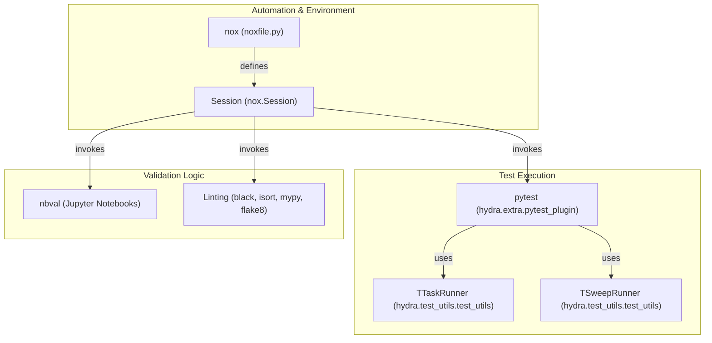
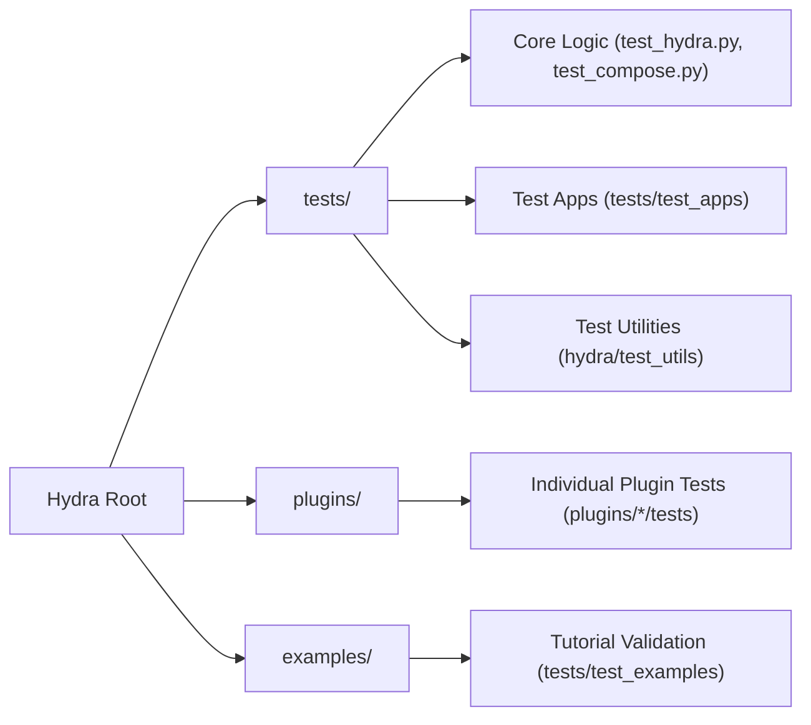

<!-- source: DeepWiki mcp.deepwiki.com · repo facebookresearch/hydra · page 4.3 Testing Approach · fetched 2026-10-21 -->

# Testing Approach

Relevant source files

The following files were used as context for generating this wiki page:

- [.pre-commit-config.yaml](.pre-commit-config.yaml)
- [README.md](README.md)
- [hydra/__init__.py](hydra/__init__.py)
- [hydra/_internal/config_loader_impl.py](hydra/_internal/config_loader_impl.py)
- [hydra/_internal/hydra.py](hydra/_internal/hydra.py)
- [hydra/_internal/utils.py](hydra/_internal/utils.py)
- [hydra/conf/__init__.py](hydra/conf/__init__.py)
- [hydra/core/config_loader.py](hydra/core/config_loader.py)
- [hydra/core/utils.py](hydra/core/utils.py)
- [hydra/errors.py](hydra/errors.py)
- [hydra/experimental/compose.py](hydra/experimental/compose.py)
- [hydra/experimental/initialize.py](hydra/experimental/initialize.py)
- [hydra/extra/pytest_plugin.py](hydra/extra/pytest_plugin.py)
- [hydra/test_utils/launcher_common_tests.py](hydra/test_utils/launcher_common_tests.py)
- [hydra/test_utils/test_utils.py](hydra/test_utils/test_utils.py)
- [noxfile.py](noxfile.py)
- [requirements/dev.txt](requirements/dev.txt)
- [setup.py](setup.py)
- [tests/test_basic_launcher.py](tests/test_basic_launcher.py)
- [tests/test_compose.py](tests/test_compose.py)
- [tests/test_config_loader.py](tests/test_config_loader.py)
- [tests/test_core_utils.py](tests/test_core_utils.py)
- [tests/test_errors.py](tests/test_errors.py)
- [tests/test_examples/test_advanced_package_overrides.py](tests/test_examples/test_advanced_package_overrides.py)
- [tests/test_examples/test_configure_hydra.py](tests/test_examples/test_configure_hydra.py)
- [tests/test_examples/test_instantiate_examples.py](tests/test_examples/test_instantiate_examples.py)
- [tests/test_examples/test_patterns.py](tests/test_examples/test_patterns.py)
- [tests/test_examples/test_structured_configs_tutorial.py](tests/test_examples/test_structured_configs_tutorial.py)
- [tests/test_examples/test_tutorials_basic.py](tests/test_examples/test_tutorials_basic.py)
- [tests/test_hydra.py](tests/test_hydra.py)
- [website/docs/development/overview.md](website/docs/development/overview.md)
- [website/docs/development/testing.md](website/docs/development/testing.md)

This document describes the testing approach and infrastructure used in the Hydra framework. It details the testing tools, test organization, and various test types employed to ensure Hydra's reliability and correctness across multiple environments.

## Overview

Hydra employs a comprehensive testing strategy that encompasses unit tests, integration tests, linting, static type checking, and example verification. The testing system is designed to:

1. Verify core configuration composition and override logic.
2. Ensure plugins (Sweepers, Launchers, Config Sources) integrate properly with the core.
3. Validate that tutorial code and example applications remain functional.
4. Maintain code quality through automated linting and type checking.
5. Test compatibility across multiple Python versions (3.9 to 3.14) and operating systems (Linux, MacOS, Windows). [noxfile.py:18-19]()

The testing infrastructure is built on the [nox](https://nox.thea.codes) automation tool, which manages isolated testing environments and multi-version matrix execution. [noxfile.py:12-13]()

Sources: [noxfile.py:11-71](), [README.md:7-9](), [setup.py:46-56]()

## Testing Infrastructure

Hydra uses a layered infrastructure to manage dependencies and execution environments.

### System Components to Code Entities

The following diagram maps high-level testing concepts to specific implementation entities in the codebase.

Title: Testing Infrastructure Mapping

| Component | Code Entity / Tool | Purpose |
|-----------|--------------------|---------|
| **Environment Manager** | `nox` [noxfile.py:12]() | Automates virtualenv creation and test execution across Python versions. |
| **Test Runner** | `pytest` [noxfile.py:150-161]() | The primary engine for executing Python test files. |
| **Task Simulation** | `TaskTestFunction` [hydra/test_utils/test_utils.py:34-89]() | A context manager that simulates a Hydra task execution for integration tests. |
| **Sweep Simulation** | `SweepTaskFunction` [hydra/test_utils/test_utils.py:103-167]() | Simulates `--multirun` scenarios in tests. |
| **Notebook Validator** | `nbval` [noxfile.py:637-640]() | Ensures Jupyter notebooks in documentation produce expected outputs. |
| **Pytest Plugin** | `hydra.extra.pytest_plugin` [setup.py:58]() | Provides Hydra-specific fixtures (like `hydra_restore_singletons`) to external projects. |

Sources: [noxfile.py:11-15](), [noxfile.py:294-295](), [hydra/test_utils/test_utils.py:34-181](), [setup.py:58]()

## Test Organization

Tests are categorized by their scope and the subsystem they target.

Title: Repository Test Structure

### Core Tests
Located in the `tests/` directory, these verify fundamental Hydra behaviors:
- **Composition**: `tests/test_compose.py` validates `hydra.compose()` and `hydra.initialize()`. [tests/test_compose.py:14-30]()
- **Config Loading**: `tests/test_config_loader.py` tests the `ConfigLoaderImpl` and search path logic. [tests/test_config_loader.py:11-22]()
- **Application Flow**: `tests/test_hydra.py` uses `hydra_task_runner` to test CLI behavior, working directory changes, and error conditions. [tests/test_hydra.py:32-150]()

### Plugin Tests
Plugins are tested in two ways:
1. **Isolated**: Testing the plugin's specific logic (e.g., `plugins/hydra_ax_sweeper`). [noxfile.py:532-550]()
2. **Integration**: The `test_plugins_vs_core` session ensures that installing a plugin doesn't break core Hydra functionality. [noxfile.py:555-577]()

Sources: [noxfile.py:487-515](), [tests/test_hydra.py:1-27](), [tests/test_compose.py:1-33]()

## Test Execution Control

Hydra uses environment variables to filter the test matrix in CI and local development.

| Variable | Description | Implementation |
|----------|-------------|----------------|
| `PLUGINS` | List of plugins to include (e.g., `hydra-ax-sweeper`). | [noxfile.py:33]() |
| `SKIP_PLUGINS` | List of plugins to exclude. | [noxfile.py:34]() |
| `SKIP_CORE_TESTS` | Boolean to bypass core tests and only run plugins. | [noxfile.py:36]() |
| `USE_OMEGACONF_DEV_VERSION` | Tests against the latest unreleased OmegaConf. | [noxfile.py:37]() |

### Plugin Selection Logic
The `list_plugins` function in `noxfile.py` scans the `plugins/` and `contrib/` directories, reading `setup.py` for each to determine compatibility with the current OS and Python version before adding them to the test queue. [noxfile.py:186-240]()

Sources: [noxfile.py:21-41](), [noxfile.py:186-240]()

## Testing Utilities

The `hydra.test_utils` package provides specialized tools for writing Hydra tests.

### Key Utilities
- **`chdir_hydra_root()`**: Ensures tests run relative to the project root regardless of where `pytest` was invoked. [hydra/test_utils/test_utils.py:184-193]()
- **`run_python_script()`**: Executes a Hydra app as a subprocess to test CLI entry points. [tests/test_hydra.py:73-75]()
- **`hydra_task_runner`**: A pytest fixture that provides a `TaskTestFunction` instance. This allows tests to run a "fake" Hydra app and inspect the resulting `JobReturn` object. [tests/test_hydra.py:85-99](), [hydra/test_utils/test_utils.py:34-89]()
- **`verify_dir_outputs()`**: Checks if `.hydra/` artifacts (config.yaml, overrides.yaml) were correctly saved to the output directory. [hydra/test_utils/test_utils.py:221-223]()

Sources: [hydra/test_utils/test_utils.py:34-223](), [tests/test_hydra.py:15-27]()

## Continuous Integration (CI)

Hydra uses CircleCI to run the full test suite. The configuration ensures that:
- Core tests pass on Linux, MacOS, and Windows. [noxfile.py:19]()
- Plugins that require specific dependencies (like `torch`) are handled by installing a minimal "CPU" version to speed up CI. [noxfile.py:139-148]()
- Code coverage is measured and must meet established thresholds. [noxfile.py:580-625]()

Sources: [noxfile.py:139-148](), [README.md:7-9]()

---

