# Page: Overview

# Overview

<details>
<summary>Relevant source files</summary>

The following files were used as context for generating this wiki page:

- [.github/PULL_REQUEST_TEMPLATE.md](.github/PULL_REQUEST_TEMPLATE.md)
- [.pre-commit-config.yaml](.pre-commit-config.yaml)
- [CONTRIBUTING.md](CONTRIBUTING.md)
- [README.md](README.md)
- [hydra/__init__.py](hydra/__init__.py)
- [hydra/errors.py](hydra/errors.py)
- [noxfile.py](noxfile.py)
- [requirements/dev.txt](requirements/dev.txt)
- [requirements/requirements.txt](requirements/requirements.txt)
- [setup.py](setup.py)
- [tests/test_errors.py](tests/test_errors.py)
- [tests/test_examples/test_advanced_package_overrides.py](tests/test_examples/test_advanced_package_overrides.py)
- [tests/test_examples/test_configure_hydra.py](tests/test_examples/test_configure_hydra.py)
- [tests/test_examples/test_instantiate_examples.py](tests/test_examples/test_instantiate_examples.py)
- [tests/test_examples/test_patterns.py](tests/test_examples/test_patterns.py)
- [tests/test_examples/test_structured_configs_tutorial.py](tests/test_examples/test_structured_configs_tutorial.py)
- [tests/test_examples/test_tutorials_basic.py](tests/test_examples/test_tutorials_basic.py)
- [website/docs/intro.md](website/docs/intro.md)
- [website/docs/tutorials/intro.md](website/docs/tutorials/intro.md)
- [website/versioned_docs/version-0.11/intro.md](website/versioned_docs/version-0.11/intro.md)
- [website/versioned_docs/version-1.0/intro.md](website/versioned_docs/version-1.0/intro.md)
- [website/versioned_docs/version-1.1/intro.md](website/versioned_docs/version-1.1/intro.md)
- [website/versioned_docs/version-1.2/intro.md](website/versioned_docs/version-1.2/intro.md)
- [website/versioned_docs/version-1.3/intro.md](website/versioned_docs/version-1.3/intro.md)

</details>


Hydra is an open-source Python framework that simplifies the development of research and other complex applications. Developed by Meta (formerly Facebook) Research, it provides a powerful yet flexible system for managing hierarchical configurations that can be dynamically composed and overridden via config files or the command line.

The name "Hydra" comes from its ability to run multiple similar jobs—much like a Hydra with multiple heads—facilitating complex experiments and parameter sweeps with minimal code changes.

Sources: [README.md:23-24](), [website/docs/intro.md:10-13](), [setup.py:38]()

## Core Capabilities

Hydra's primary value proposition lies in its ability to handle complex configuration requirements that traditional flat configuration files cannot easily manage:

*   **Hierarchical Configuration**: Compose a final configuration object from multiple sources, including YAML files and Structured Configs (Python dataclasses).
*   **Dynamic Overrides**: Modify any part of the configuration tree from the command line using a powerful DSL.
*   **Multirun Execution**: Launch multiple instances of an application with different parameters (sweeps) using a single command.
*   **Plug-and-Play Architecture**: Swap out execution environments (Local, SLURM, Ray) or optimization algorithms (Ax, Optuna, Nevergrad) via a robust plugin system.
*   **Shell Integration**: Automatic generation of tab-completion scripts for Bash, Zsh, and Fish.

Sources: [website/docs/intro.md:15-21](), [README.md:52-58]()

## System Architecture

Hydra's architecture separates configuration discovery, composition, and execution. The following diagram bridges the high-level concepts to the specific code entities that implement them.

### Code Entity Map: From Invocation to Execution

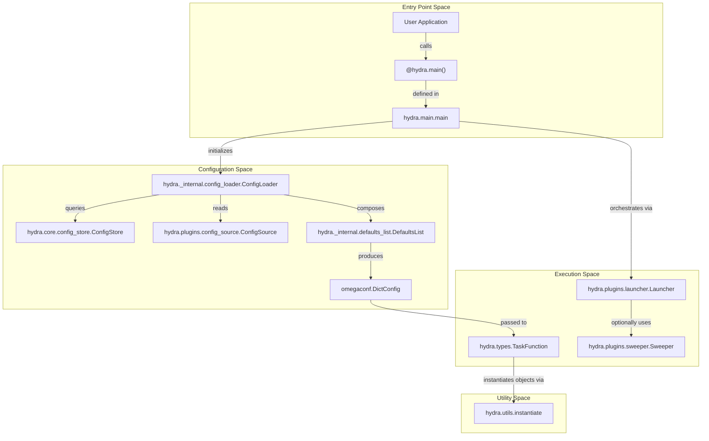

Sources: [hydra/main.py:70-104](), [hydra/__init__.py:4-11](), [hydra/types.py:8](), [hydra/utils.py:16-18]()

## Configuration Processing Flow

Hydra transforms raw input (files, environment, CLI) into a unified `DictConfig` object. This process involves parsing the `defaults` list and applying overrides in a specific order.

### Data Flow: Configuration Composition

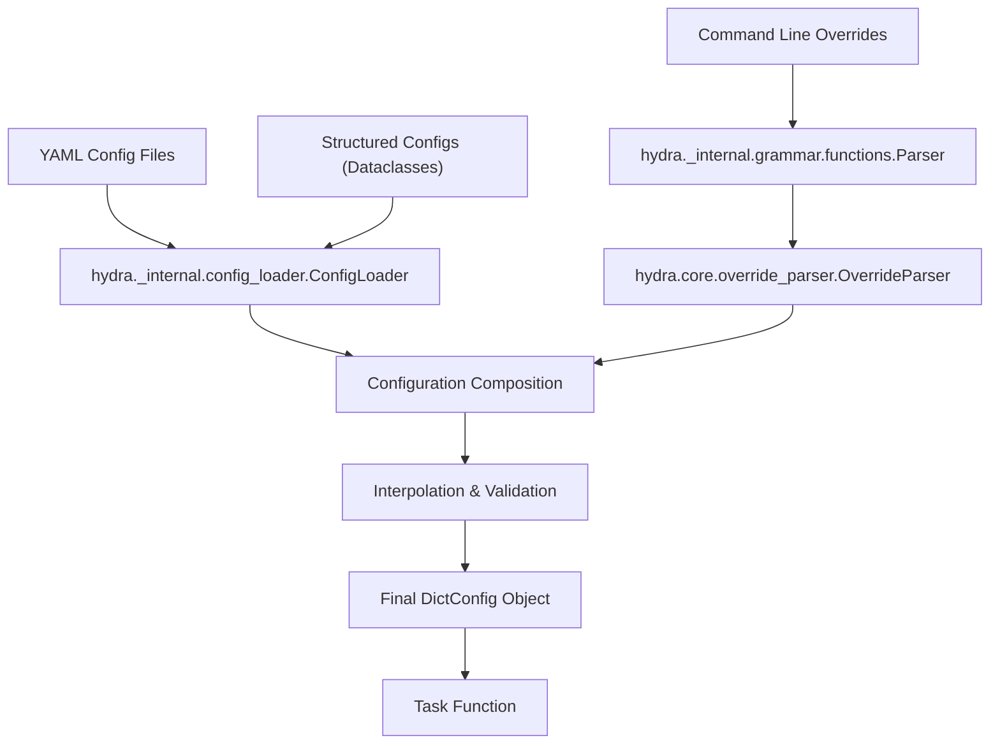

Sources: [hydra/compose.py:10-20](), [hydra/errors.py:11-16](), [website/docs/intro.md:103-109]()

## Key Subsystems

### 1. The main() Decorator
The `@hydra.main` decorator is the primary interface for users. It wraps the application's entry point, handles initialization, and ensures the configuration is correctly passed to the task function.

*   **Key Function**: `hydra.main()` in `[hydra/main.py:70-104]()`.
*   **Purpose**: Manages the lifecycle of a Hydra application, including setting up the working directory and logging.

### 2. Plugin System
Hydra is highly extensible. Plugins are discovered at runtime and can modify core behavior.
*   **Launchers**: Determine *where* code runs (e.g., `SubmititLauncher` for SLURM).
*   **Sweepers**: Determine *what* parameters to try (e.g., `AxSweeper` for Bayesian optimization).
*   **Config Sources**: Determine *where* configs come from (Filesystem, Package resources).

Sources: [noxfile.py:187-215](), [setup.py:58]()

### 3. Instantiation System
Hydra allows you to describe objects in configuration and instantiate them dynamically in code. This is particularly useful for switching between different implementations of an interface (e.g., different Optimizer classes in ML).
*   **Key Function**: `hydra.utils.instantiate()` (often aliased to `hydra.utils.call`).
*   **Targeting**: Uses the `_target_` key to locate Python classes or functions.

Sources: [hydra/utils.py:16-18](), [hydra/errors.py:18-18]()

### 4. Error Handling
Hydra provides a hierarchy of exceptions to help developers debug configuration issues.
*   `MissingConfigException`: Raised when a specified config name cannot be found.
*   `OverrideParseException`: Raised when the command-line override DSL is violated.
*   `ConfigCompositionException`: Base class for errors during the composition phase.

Sources: [hydra/errors.py:5-39]()

## Usage Example

A standard Hydra application consists of a configuration file and a Python script.

**Configuration (`conf/config.yaml`):**
```yaml
defaults:
  - db: mysql

db:
  user: root
```

**Application (`my_app.py`):**
```python
import hydra
from omegaconf import DictConfig

@hydra.main(version_base=None, config_path="conf", config_name="config")
def my_app(cfg: DictConfig) -> None:
    print(cfg.db.user)

if __name__ == "__main__":
    my_app()
```

Sources: [website/docs/intro.md:56-65](), [tests/test_examples/test_tutorials_basic.py:39-49]()

## Integration and Ecosystem

Hydra is the foundation for several specialized tools and templates:
*   **Configen**: Generates Structured Configs from existing Python code.
*   **Hydra-Zen**: Provides Pythonic wrappers for more complex Hydra patterns.
*   **Lightning-Hydra-Template**: A popular template for PyTorch Lightning experiments.

Sources: [README.md:52-58]()

---

# Page: Core Concepts

# Core Concepts

<details>
<summary>Relevant source files</summary>

The following files were used as context for generating this wiki page:

- [examples/tutorials/basic/your_first_hydra_app/3_using_config/my_app.py](examples/tutorials/basic/your_first_hydra_app/3_using_config/my_app.py)
- [hydra/_internal/config_loader_impl.py](hydra/_internal/config_loader_impl.py)
- [hydra/_internal/hydra.py](hydra/_internal/hydra.py)
- [hydra/_internal/utils.py](hydra/_internal/utils.py)
- [hydra/conf/__init__.py](hydra/conf/__init__.py)
- [hydra/core/config_loader.py](hydra/core/config_loader.py)
- [hydra/core/utils.py](hydra/core/utils.py)
- [hydra/experimental/compose.py](hydra/experimental/compose.py)
- [hydra/experimental/initialize.py](hydra/experimental/initialize.py)
- [hydra/test_utils/launcher_common_tests.py](hydra/test_utils/launcher_common_tests.py)
- [hydra/test_utils/test_utils.py](hydra/test_utils/test_utils.py)
- [tests/test_basic_launcher.py](tests/test_basic_launcher.py)
- [tests/test_compose.py](tests/test_compose.py)
- [tests/test_config_loader.py](tests/test_config_loader.py)
- [tests/test_hydra.py](tests/test_hydra.py)
- [website/docs/advanced/defaults_list.md](website/docs/advanced/defaults_list.md)
- [website/docs/advanced/terminology.md](website/docs/advanced/terminology.md)
- [website/docs/tutorials/basic/running_your_app/2_multirun.md](website/docs/tutorials/basic/running_your_app/2_multirun.md)
- [website/docs/tutorials/basic/your_first_app/2_config_file.md](website/docs/tutorials/basic/your_first_app/2_config_file.md)
- [website/docs/tutorials/basic/your_first_app/3_using_config.md](website/docs/tutorials/basic/your_first_app/3_using_config.md)
- [website/docs/tutorials/basic/your_first_app/4_config_groups.md](website/docs/tutorials/basic/your_first_app/4_config_groups.md)
- [website/docs/tutorials/basic/your_first_app/5_defaults.md](website/docs/tutorials/basic/your_first_app/5_defaults.md)
- [website/docs/tutorials/basic/your_first_app/6_composition.md](website/docs/tutorials/basic/your_first_app/6_composition.md)
- [website/versioned_docs/version-0.11/tutorial/3_config_groups.md](website/versioned_docs/version-0.11/tutorial/3_config_groups.md)
- [website/versioned_docs/version-0.11/tutorial/4_defaults.md](website/versioned_docs/version-0.11/tutorial/4_defaults.md)
- [website/versioned_docs/version-0.11/tutorial/5_composition.md](website/versioned_docs/version-0.11/tutorial/5_composition.md)
- [website/versioned_docs/version-1.0/tutorials/basic/running_your_app/2_multirun.md](website/versioned_docs/version-1.0/tutorials/basic/running_your_app/2_multirun.md)
- [website/versioned_docs/version-1.1/tutorials/basic/running_your_app/2_multirun.md](website/versioned_docs/version-1.1/tutorials/basic/running_your_app/2_multirun.md)
- [website/versioned_docs/version-1.3/advanced/defaults_list.md](website/versioned_docs/version-1.3/advanced/defaults_list.md)
- [website/versioned_docs/version-1.3/advanced/instantiate_objects/overview.md](website/versioned_docs/version-1.3/advanced/instantiate_objects/overview.md)
- [website/versioned_docs/version-1.3/advanced/override_grammar/basic.md](website/versioned_docs/version-1.3/advanced/override_grammar/basic.md)
- [website/versioned_docs/version-1.3/advanced/override_grammar/extended.md](website/versioned_docs/version-1.3/advanced/override_grammar/extended.md)
- [website/versioned_docs/version-1.3/advanced/overriding_packages.md](website/versioned_docs/version-1.3/advanced/overriding_packages.md)
- [website/versioned_docs/version-1.3/advanced/terminology.md](website/versioned_docs/version-1.3/advanced/terminology.md)
- [website/versioned_docs/version-1.3/configure_hydra/job.md](website/versioned_docs/version-1.3/configure_hydra/job.md)
- [website/versioned_docs/version-1.3/experimental/callbacks.md](website/versioned_docs/version-1.3/experimental/callbacks.md)
- [website/versioned_docs/version-1.3/patterns/specializing_config.md](website/versioned_docs/version-1.3/patterns/specializing_config.md)

</details>


This page explains the fundamental concepts and mechanisms that form the core of Hydra's design. Hydra is a framework for elegantly configuring complex applications, emphasizing hierarchical composition and dynamic overrides. For detailed information about specific features, refer to their dedicated child pages.

## The Hydra Framework

Hydra simplifies configuration management by separating the configuration structure from the application logic. It allows developers to compose a final configuration object from multiple sources and override any part of it from the command line.

### High-Level Architecture
The following diagram illustrates how Hydra's core components interact during a typical application lifecycle, bridging the gap between the user's entry point and the internal processing engines.

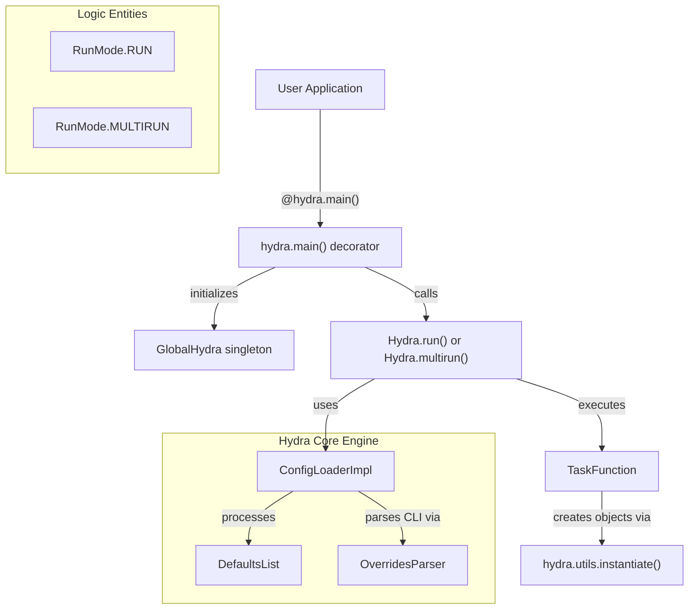
Sources: [hydra/_internal/hydra.py:40-165](), [hydra/core/global_hydra.py:1-50](), [hydra/_internal/config_loader_impl.py:38-49]()

---

## Configuration System
The configuration system is responsible for discovering, loading, and merging configuration data. It supports various formats, primarily YAML, and integrates with `OmegaConf` to provide a `DictConfig` object to the user.

*   **Config Sources**: Hydra can pull data from the local filesystem, Python packages (`pkg://`), or structured configurations (Python dataclasses).
*   **Search Path**: Managed by `ConfigSearchPath`, this determines where Hydra looks for config files. By default, it includes the directory relative to your `@hydra.main` file and internal Hydra configs.

For details, see [Configuration System](#2.1).

Sources: [hydra/_internal/config_loader_impl.py:106-132](), [hydra/_internal/utils.py:184-211]()

---

## Config Composition and DefaultsList
Composition is the process of building a complex configuration from smaller, reusable pieces. This is governed by the `defaults` list.

*   **Config Groups**: Directories (e.g., `db/`, `optimizer/`) containing multiple YAML options.
*   **Defaults List**: A special section in your config that defines which members of a config group to load.
*   **Package Headers**: Control where in the final configuration tree a specific config group's data is placed.

For details, see [Config Composition and DefaultsList](#2.2).

Sources: [hydra/_internal/defaults_list.py:1-100](), [tests/test_config_loader.py:84-122]()

---

## Override System
The override system allows users to modify the composed configuration without changing the underlying files. This is powered by a domain-specific language (DSL) parsed via ANTLR.

*   **Syntax**: Supports simple assignments (`key=value`), additions (`+key=value`), deletions (`~key`), and sweeps (`key=1,2,3`).
*   **Validation**: Hydra validates overrides against the loaded configuration to prevent typos and ensure type safety when using Structured Configs.

For details, see [Override System](#2.3).

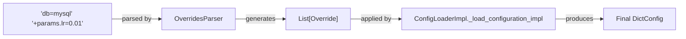
Sources: [hydra/core/override_parser/overrides_parser.py:1-50](), [hydra/_internal/config_loader_impl.py:51-85]()

---

## Object Instantiation
Hydra can instantiate Python objects directly from configuration using the `hydra.utils.instantiate()` (or its alias `hydra.utils.call()`) function.

*   **`_target_`**: The fully qualified class or function name to instantiate.
*   **Recursive**: By default, Hydra recursively instantiates nested configurations that contain a `_target_`.
*   **Partial**: Allows creating `functools.partial` objects for delayed execution.

For details, see [Object Instantiation](#2.4).

Sources: [hydra/utils.py:17-60](), [hydra/_internal/utils.py:614-678]()

---

## Working Directory and Output Management
Hydra automates the creation of output directories for every run, ensuring experiment reproducibility and organization.

*   **Automatic Chdir**: Hydra can automatically change the current working directory to the output directory before running your code.
*   **`.hydra` Subdirectory**: A special directory created in every output folder containing the exact `config.yaml`, `hydra.yaml`, and `overrides.yaml` used for that specific run.
*   **Multirun Organization**: When running sweeps, Hydra creates a hierarchical structure to separate the outputs of different parameter combinations.

For details, see [Working Directory and Output Management](#2.5).

Sources: [hydra/core/utils.py:99-181](), [hydra/conf/__init__.py:152-157]()

---

# Page: Configuration System

# Configuration System

<details>
<summary>Relevant source files</summary>

The following files were used as context for generating this wiki page:

- [NEWS.md](NEWS.md)
- [examples/advanced/config_search_path/additional_conf/__init__.py](examples/advanced/config_search_path/additional_conf/__init__.py)
- [examples/advanced/config_search_path/additional_conf/dataset/imagenet.yaml](examples/advanced/config_search_path/additional_conf/dataset/imagenet.yaml)
- [examples/advanced/config_search_path/conf/config.yaml](examples/advanced/config_search_path/conf/config.yaml)
- [hydra/_internal/config_loader_impl.py](hydra/_internal/config_loader_impl.py)
- [hydra/_internal/core_plugins/file_config_source.py](hydra/_internal/core_plugins/file_config_source.py)
- [hydra/_internal/core_plugins/importlib_resources_config_source.py](hydra/_internal/core_plugins/importlib_resources_config_source.py)
- [hydra/_internal/core_plugins/structured_config_source.py](hydra/_internal/core_plugins/structured_config_source.py)
- [hydra/_internal/hydra.py](hydra/_internal/hydra.py)
- [hydra/_internal/utils.py](hydra/_internal/utils.py)
- [hydra/conf/__init__.py](hydra/conf/__init__.py)
- [hydra/core/config_loader.py](hydra/core/config_loader.py)
- [hydra/core/config_store.py](hydra/core/config_store.py)
- [hydra/core/utils.py](hydra/core/utils.py)
- [hydra/experimental/compose.py](hydra/experimental/compose.py)
- [hydra/experimental/initialize.py](hydra/experimental/initialize.py)
- [hydra/initialize.py](hydra/initialize.py)
- [hydra/main.py](hydra/main.py)
- [hydra/plugins/config_source.py](hydra/plugins/config_source.py)
- [hydra/test_utils/config_source_common_tests.py](hydra/test_utils/config_source_common_tests.py)
- [hydra/test_utils/launcher_common_tests.py](hydra/test_utils/launcher_common_tests.py)
- [hydra/test_utils/test_utils.py](hydra/test_utils/test_utils.py)
- [news/2928.bugfix](news/2928.bugfix)
- [tests/test_apps/config_source_test/structured.py](tests/test_apps/config_source_test/structured.py)
- [tests/test_basic_launcher.py](tests/test_basic_launcher.py)
- [tests/test_compose.py](tests/test_compose.py)
- [tests/test_config_loader.py](tests/test_config_loader.py)
- [tests/test_config_repository.py](tests/test_config_repository.py)
- [tests/test_config_search_path.py](tests/test_config_search_path.py)
- [tests/test_hydra.py](tests/test_hydra.py)
- [website/docs/advanced/search_path.md](website/docs/advanced/search_path.md)
- [website/versioned_docs/version-1.1/advanced/search_path.md](website/versioned_docs/version-1.1/advanced/search_path.md)
- [website/versioned_docs/version-1.1/advanced/unit_testing.md](website/versioned_docs/version-1.1/advanced/unit_testing.md)
- [website/versioned_docs/version-1.2/advanced/search_path.md](website/versioned_docs/version-1.2/advanced/search_path.md)
- [website/versioned_docs/version-1.3/advanced/search_path.md](website/versioned_docs/version-1.3/advanced/search_path.md)

</details>


This document details Hydra's core configuration system, responsible for loading, composing, and manipulating configurations from diverse sources. The system provides a unified interface for handling YAML files, structured Python objects, and command-line overrides, forming the foundation for Hydra's flexibility. For details on the composition logic, see [Config Composition and DefaultsList](2.2).

## Overview of Configuration System Architecture

The configuration system bridges the gap between raw configuration data (files, objects) and the finalized `DictConfig` used by the application.

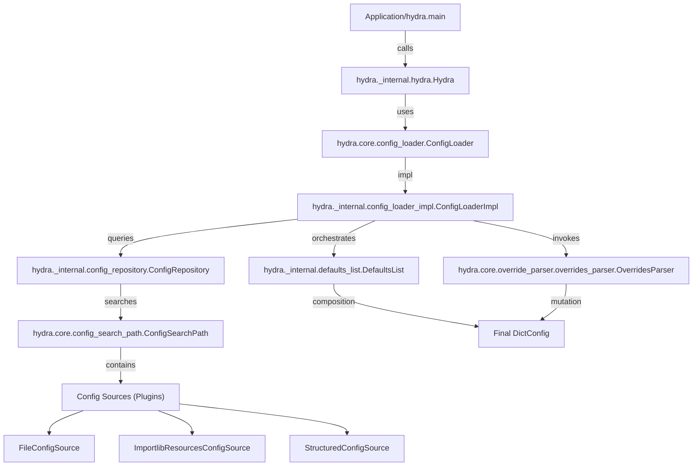

Sources:
- [hydra/_internal/config_loader_impl.py:38-49]()
- [hydra/_internal/hydra.py:61-69]()
- [hydra/core/config_loader.py:13-24]()
- [hydra/plugins/config_source.py:31-40]()

## Configuration Sources

Hydra supports multiple backends for retrieving configuration data. Every source must implement the `ConfigSource` plugin interface.

| Source Class | Scheme | Description |
| :--- | :--- | :--- |
| `FileConfigSource` | `file://` | Loads YAML files directly from the local filesystem. [hydra/_internal/core_plugins/file_config_source.py:11-15]() |
| `ImportlibResourcesConfigSource` | `pkg://` | Loads configurations embedded within Python packages using `importlib.resources`. [hydra/_internal/core_plugins/importlib_resources_config_source.py:21-25]() |
| `StructuredConfigSource` | `structured://` | Accesses configurations registered in the `ConfigStore` (dataclasses/attr classes). [hydra/_internal/core_plugins/structured_config_source.py:11-15]() |

### The ConfigSource Interface
The `ConfigSource` class defines how Hydra interacts with a storage backend. Key methods include `load_config` for retrieving a `ConfigResult` and `list` for discovering available groups.

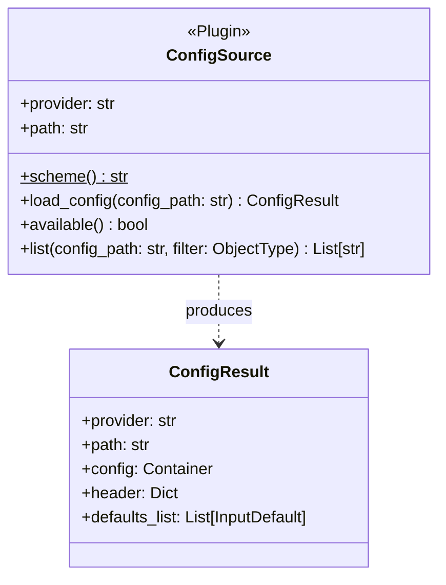

Sources:
- [hydra/plugins/config_source.py:31-78]()
- [hydra/plugins/config_source.py:18-25]()

## Configuration Repository and Search Path

The `ConfigRepository` acts as an aggregator for all configured `ConfigSource` instances. It uses the `ConfigSearchPath` to determine the order in which sources are queried.

### Search Path Priority
The search path is typically ordered as follows:
1. **Main**: The primary configuration directory (often relative to the calling script). [hydra/_internal/utils.py:184-211]()
2. **User**: Additional paths added via `hydra.searchpath` in the config or command line. [hydra/_internal/config_loader_impl.py:174-187]()
3. **Plugins**: Paths contributed by `SearchPathPlugin` implementations. [hydra/_internal/utils.py:203-207]()
4. **Schema**: The `structured://` source for validation. [hydra/_internal/utils.py:209-209]()

Sources:
- [hydra/_internal/config_loader_impl.py:17-21]()
- [hydra/_internal/utils.py:193-211]()

## Configuration Loading Pipeline

The `ConfigLoaderImpl._load_configuration_impl` method executes a multi-step pipeline to produce the final configuration object.

1. **Initialization**: Detects the calling file/module and sets up the `ConfigSearchPath`. [hydra/_internal/utils.py:37-61]()
2. **Repository Setup**: Wraps the repository in a `CachingConfigRepository` to avoid redundant I/O. [hydra/_internal/config_loader_impl.py:18-21]()
3. **Defaults List Creation**: Calls `create_defaults_list` to parse the `defaults` tree and resolve overrides. [hydra/_internal/config_loader_impl.py:22-22]()
4. **Composition**: Iteratively merges configurations discovered in the defaults list. [hydra/_internal/config_loader_impl.py:541-573]()
5. **Override Application**: Applies command-line overrides (e.g., `+db=mysql`) using `_apply_overrides_to_config`. [hydra/_internal/config_loader_impl.py:336-340]()
6. **Runtime Population**: Injects `hydra.runtime` metadata (cwd, version, config sources). [hydra/conf/__init__.py:97-107]()

Sources:
- [hydra/_internal/config_loader_impl.py:142-150]()
- [hydra/_internal/config_loader_impl.py:541-573]()
- [hydra/core/utils.py:99-130]()

## Override System

Hydra uses an ANTLR-based parser (`OverridesParser`) to process command-line arguments. Overrides are categorized into **Task Overrides** (modifying user config) and **Hydra Overrides** (modifying `hydra.*` settings).

### Override Syntax Types
The system supports several prefix-based operations:

| Prefix | Type | Description |
| :--- | :--- | :--- |
| (none) | `REGULAR` | Standard assignment: `key=value`. |
| `+` | `ADD` | Adds a new key; fails if key exists. |
| `++` | `FORCE_ADD` | Adds or replaces a key regardless of existence. |
| `~` | `DELETE` | Removes a key or a specific value: `~key` or `~key=val`. |

Sources:
- [hydra/core/override_parser/overrides_parser.py:14-15]()
- [hydra/_internal/config_loader_impl.py:336-408]()
- [tests/test_config_loader.py:649-735]()

## Integration with Hydra Runtime

Once composed, the configuration is stored in the `HydraConfig` singleton. This configuration drives other subsystems:

*   **Logging**: `hydra.job_logging` and `hydra.hydra_logging` are used by `configure_log` to initialize Python loggers. [hydra/core/utils.py:36-70]()
*   **Output Management**: `hydra.run.dir` and `hydra.sweep.dir` determine where job outputs and `.hydra` metadata are saved. [hydra/core/utils.py:116-127]()
*   **Job Execution**: The `run_job` function strips the `hydra` key from the config before passing it to the user's task function. [hydra/core/utils.py:133-137]()

Sources:
- [hydra/core/hydra_config.py:10-25]()
- [hydra/core/utils.py:99-198]()
- [hydra/conf/__init__.py:110-176]()

---

# Page: Config Composition and DefaultsList

# Config Composition and DefaultsList

<details>
<summary>Relevant source files</summary>

The following files were used as context for generating this wiki page:

- [examples/tutorials/basic/your_first_hydra_app/3_using_config/my_app.py](examples/tutorials/basic/your_first_hydra_app/3_using_config/my_app.py)
- [hydra/_internal/config_repository.py](hydra/_internal/config_repository.py)
- [hydra/_internal/defaults_list.py](hydra/_internal/defaults_list.py)
- [hydra/core/default_element.py](hydra/core/default_element.py)
- [tests/defaults_list/__init__.py](tests/defaults_list/__init__.py)
- [tests/defaults_list/test_defaults_list.py](tests/defaults_list/test_defaults_list.py)
- [tests/defaults_list/test_defaults_tree.py](tests/defaults_list/test_defaults_tree.py)
- [website/docs/advanced/defaults_list.md](website/docs/advanced/defaults_list.md)
- [website/docs/tutorials/basic/running_your_app/2_multirun.md](website/docs/tutorials/basic/running_your_app/2_multirun.md)
- [website/docs/tutorials/basic/your_first_app/2_config_file.md](website/docs/tutorials/basic/your_first_app/2_config_file.md)
- [website/docs/tutorials/basic/your_first_app/3_using_config.md](website/docs/tutorials/basic/your_first_app/3_using_config.md)
- [website/docs/tutorials/basic/your_first_app/4_config_groups.md](website/docs/tutorials/basic/your_first_app/4_config_groups.md)
- [website/docs/tutorials/basic/your_first_app/5_defaults.md](website/docs/tutorials/basic/your_first_app/5_defaults.md)
- [website/docs/tutorials/basic/your_first_app/6_composition.md](website/docs/tutorials/basic/your_first_app/6_composition.md)
- [website/docs/tutorials/structured_config/0_intro.md](website/docs/tutorials/structured_config/0_intro.md)
- [website/docs/tutorials/structured_config/10_config_store.md](website/docs/tutorials/structured_config/10_config_store.md)
- [website/docs/tutorials/structured_config/1_minimal_example.md](website/docs/tutorials/structured_config/1_minimal_example.md)
- [website/docs/tutorials/structured_config/2_hierarchical_static_config.md](website/docs/tutorials/structured_config/2_hierarchical_static_config.md)
- [website/docs/tutorials/structured_config/3_config_groups.md](website/docs/tutorials/structured_config/3_config_groups.md)
- [website/docs/tutorials/structured_config/4_defaults.md](website/docs/tutorials/structured_config/4_defaults.md)
- [website/docs/tutorials/structured_config/5_schema.md](website/docs/tutorials/structured_config/5_schema.md)
- [website/versioned_docs/version-0.11/tutorial/3_config_groups.md](website/versioned_docs/version-0.11/tutorial/3_config_groups.md)
- [website/versioned_docs/version-0.11/tutorial/4_defaults.md](website/versioned_docs/version-0.11/tutorial/4_defaults.md)
- [website/versioned_docs/version-0.11/tutorial/5_composition.md](website/versioned_docs/version-0.11/tutorial/5_composition.md)
- [website/versioned_docs/version-1.0/tutorials/basic/running_your_app/2_multirun.md](website/versioned_docs/version-1.0/tutorials/basic/running_your_app/2_multirun.md)
- [website/versioned_docs/version-1.1/tutorials/basic/running_your_app/2_multirun.md](website/versioned_docs/version-1.1/tutorials/basic/running_your_app/2_multirun.md)
- [website/versioned_docs/version-1.2/tutorials/structured_config/0_intro.md](website/versioned_docs/version-1.2/tutorials/structured_config/0_intro.md)

</details>


Config composition is a core feature of Hydra that enables combining multiple configuration fragments into a single unified configuration. The `DefaultsList` is an internal mechanism that manages the list of configurations to be loaded and composed. This page explains how configuration composition works in Hydra and the role of the `DefaultsList` in this process.

## What is Config Composition?

Config composition in Hydra allows users to:
- Define reusable configuration fragments in separate files.
- Specify default configurations to use in a modular way.
- Override these defaults via command line or programmatically.
- Establish a well-defined merge order for configurations using the `_self_` keyword.

When users define a `defaults` section in their configuration files, they are leveraging Hydra's config composition system.

```yaml
# Example config with defaults section
defaults:
  - db: mysql       # Use mysql config from the db group
  - _self_          # Include this config file itself
  - override /hydra/job_logging: colorlog
```

Sources: [hydra/_internal/defaults_list.py:108-111](), [website/docs/tutorials/basic/your_first_app/5_defaults.md:20-23](), [website/docs/tutorials/basic/your_first_app/5_defaults.md:89-92]()

## The Config Composition Process

The composition process transforms a set of input choices and overrides into a single `DictConfig`.

### Data Flow: From Overrides to Composed Config

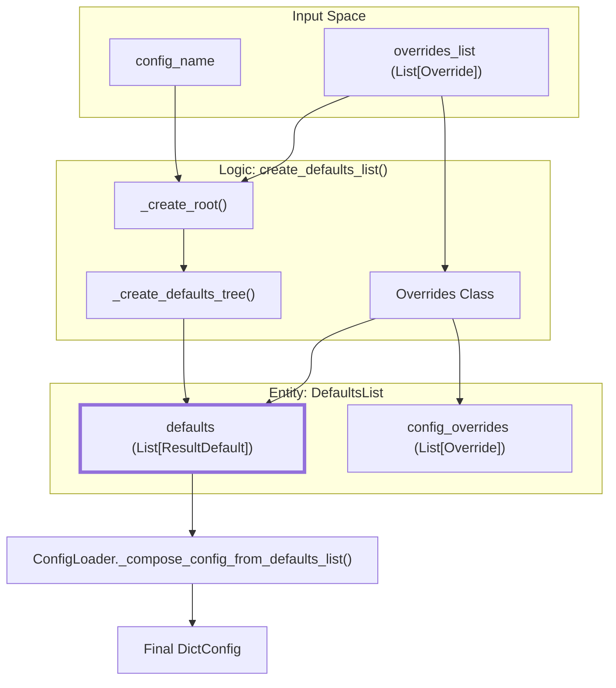

Sources: [hydra/_internal/defaults_list.py:248-278](), [tests/defaults_list/__init__.py:23-50]()

## DefaultsList and Related Components

Hydra uses a set of internal classes to represent the elements within a `defaults` list.

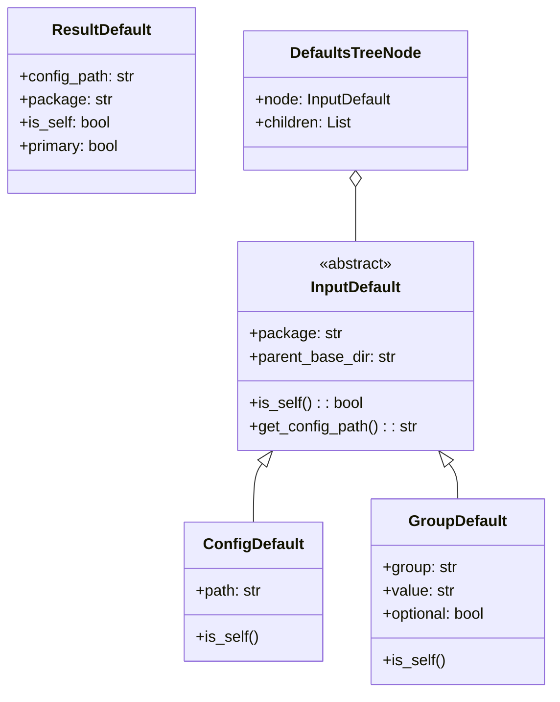

### Key Components

- **`InputDefault`**: The base class for items parsed from a YAML `defaults` list [hydra/core/default_element.py:45-50]().
- **`ConfigDefault`**: Represents a simple file reference like `- my_config` [hydra/core/default_element.py:355-359]().
- **`GroupDefault`**: Represents a config group selection like `- db: mysql` [hydra/core/default_element.py:393-398]().
- **`DefaultsTreeNode`**: A recursive structure used to build the composition hierarchy before flattening [hydra/core/default_element.py:539-543]().
- **`ResultDefault`**: The final flattened representation containing the absolute `config_path` and target `package` [hydra/core/default_element.py:16-24]().

Sources: [hydra/core/default_element.py:15-543](), [hydra/_internal/defaults_list.py:15-22]()

## The Defaults Tree and `_self_`

Hydra constructs a `DefaultsTreeNode` by recursively loading configurations. The `_self_` keyword determines where the contents of the current file are merged relative to its inherited defaults.

### Composition Order Logic
- **`_self_` at the end**: The current config overrides values from the defaults list [website/docs/tutorials/basic/your_first_app/5_defaults.md:81-82]().
- **`_self_` at the beginning**: Configs in the defaults list override values in the current config [website/docs/tutorials/basic/your_first_app/5_defaults.md:82-83]().

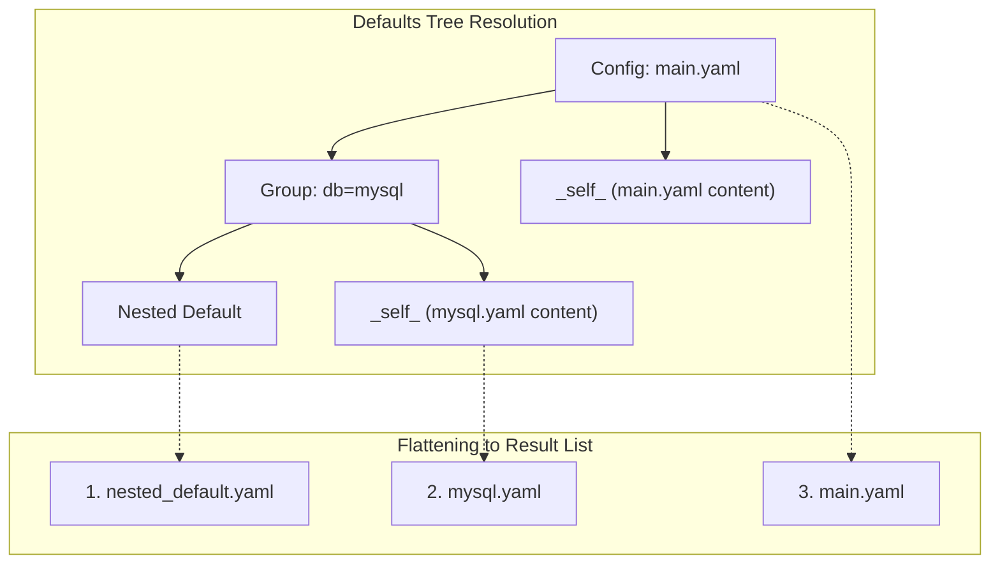

Sources: [hydra/_internal/defaults_list.py:280-318](), [tests/defaults_list/test_defaults_tree.py:92-109](), [website/docs/tutorials/basic/your_first_app/5_defaults.md:77-130]()

## Handling Overrides and Deletions

The `Overrides` class processes command-line inputs to modify the `DefaultsList` before composition.

| Override Type | Syntax | Internal Action |
| :--- | :--- | :--- |
| **Selection** | `db=mysql` | Updates `override_choices` for the `db` group [hydra/_internal/defaults_list.py:108-110](). |
| **Addition** | `+db=mysql` | Appends a new `GroupDefault` to `append_group_defaults` [hydra/_internal/defaults_list.py:98-106](). |
| **Deletion** | `~db` | Adds a `Deletion` entry to remove the group from the list [hydra/_internal/defaults_list.py:84-92](). |

### Validation
Hydra ensures all overrides are consumed. If an override refers to a group not present in the defaults list, a `ConfigCompositionException` is raised [hydra/_internal/defaults_list.py:138-168]().

Sources: [hydra/_internal/defaults_list.py:49-175](), [tests/defaults_list/test_defaults_list.py:451-460]()

## Package Headers and Interpolation

### Package Headers
Configs can specify their destination in the final object using the `@package` header. 
- `# @package _global_`: Merges the config into the root [hydra/core/default_element.py:137-141]().
- `# @package _group_`: (Deprecated in 1.2) Merges into a key named after the group [hydra/core/default_element.py:121-133]().

### Package Namespacing
You can redirect a default to a specific package using the `@` syntax in the defaults list:
```yaml
defaults:
  - db@my_db: mysql  # Loads mysql config into 'my_db' key
```

### Interpolation
Hydra supports using values from other parts of the defaults list via interpolation:
```yaml
defaults:
  - db: mysql
  - schema: ${db}_schema
```
The `DefaultsList` resolver handles these by re-evaluating the tree when interpolated values change [hydra/_internal/defaults_list.py:349-355]().

Sources: [hydra/core/default_element.py:114-147](), [hydra/_internal/config_repository.py:142-164](), [hydra/_internal/defaults_list.py:349-370]()

## Implementation Details: `create_defaults_list`

The primary entry point for composition is `hydra._internal.defaults_list.create_defaults_list`.

1. **Initialize Overrides**: Parses command line strings into `Override` objects and categorizes them [hydra/_internal/defaults_list.py:61-71]().
2. **Build Tree**: Calls `_create_defaults_tree` recursively. It loads configs from the `IConfigRepository` and extracts their `defaults` lists [hydra/_internal/defaults_list.py:280-287]().
3. **Apply Overrides**: During tree traversal, if a `GroupDefault` matches an entry in `override_choices`, its value is swapped [hydra/_internal/defaults_list.py:129-136]().
4. **Flatten**: The tree is traversed to produce a flat `List[ResultDefault]`. This list is then used by the `ConfigLoader` to perform the actual `OmegaConf.merge` operations [hydra/_internal/defaults_list.py:270-278]().

Sources: [hydra/_internal/defaults_list.py:248-318](), [hydra/_internal/config_repository.py:78-95](), [tests/defaults_list/__init__.py:32-50]()

---

# Page: Override System

# Override System

<details>
<summary>Relevant source files</summary>

The following files were used as context for generating this wiki page:

- [examples/tutorials/basic/your_first_hydra_app/1_simple_cli/my_app.py](examples/tutorials/basic/your_first_hydra_app/1_simple_cli/my_app.py)
- [examples/tutorials/structured_configs/2_static_complex/my_app.py](examples/tutorials/structured_configs/2_static_complex/my_app.py)
- [examples/tutorials/structured_configs/3_config_groups/my_app.py](examples/tutorials/structured_configs/3_config_groups/my_app.py)
- [examples/tutorials/structured_configs/3_config_groups/my_app_with_inheritance.py](examples/tutorials/structured_configs/3_config_groups/my_app_with_inheritance.py)
- [examples/tutorials/structured_configs/4_defaults/my_app.py](examples/tutorials/structured_configs/4_defaults/my_app.py)
- [hydra/_internal/grammar/grammar_functions.py](hydra/_internal/grammar/grammar_functions.py)
- [hydra/core/override_parser/overrides_parser.py](hydra/core/override_parser/overrides_parser.py)
- [hydra/core/override_parser/overrides_visitor.py](hydra/core/override_parser/overrides_visitor.py)
- [hydra/core/override_parser/types.py](hydra/core/override_parser/types.py)
- [hydra/grammar/OverrideLexer.g4](hydra/grammar/OverrideLexer.g4)
- [hydra/grammar/OverrideParser.g4](hydra/grammar/OverrideParser.g4)
- [news/1547.feature](news/1547.feature)
- [news/2570.bugfix](news/2570.bugfix)
- [tests/test_hydra_cli_errors.py](tests/test_hydra_cli_errors.py)
- [tests/test_overrides_parser.py](tests/test_overrides_parser.py)
- [website/blog/2020-05-04-New-blog.md](website/blog/2020-05-04-New-blog.md)
- [website/blog/2020-09-03-Hydra_1.0.md](website/blog/2020-09-03-Hydra_1.0.md)
- [website/docs/advanced/override_grammar/basic.md](website/docs/advanced/override_grammar/basic.md)
- [website/docs/advanced/override_grammar/extended.md](website/docs/advanced/override_grammar/extended.md)
- [website/docs/advanced/overriding_packages.md](website/docs/advanced/overriding_packages.md)
- [website/docs/tutorials/basic/your_first_app/1_simple_cli.md](website/docs/tutorials/basic/your_first_app/1_simple_cli.md)
- [website/docs/upgrades/0.11_to_1.0/adding_a_package_directive.md](website/docs/upgrades/0.11_to_1.0/adding_a_package_directive.md)
- [website/src/theme/NotFound.js](website/src/theme/NotFound.js)
- [website/versioned_docs/version-1.0/advanced/override_grammar/basic.md](website/versioned_docs/version-1.0/advanced/override_grammar/basic.md)
- [website/versioned_docs/version-1.0/advanced/overriding_packages.md](website/versioned_docs/version-1.0/advanced/overriding_packages.md)
- [website/versioned_docs/version-1.0/advanced/packaging.md](website/versioned_docs/version-1.0/advanced/packaging.md)
- [website/versioned_docs/version-1.0/advanced/plugins.md](website/versioned_docs/version-1.0/advanced/plugins.md)
- [website/versioned_docs/version-1.0/advanced/unit_testing.md](website/versioned_docs/version-1.0/advanced/unit_testing.md)
- [website/versioned_docs/version-1.0/configure_hydra/Intro.md](website/versioned_docs/version-1.0/configure_hydra/Intro.md)
- [website/versioned_docs/version-1.0/configure_hydra/app_help.md](website/versioned_docs/version-1.0/configure_hydra/app_help.md)
- [website/versioned_docs/version-1.0/configure_hydra/logging.md](website/versioned_docs/version-1.0/configure_hydra/logging.md)
- [website/versioned_docs/version-1.0/configure_hydra/workdir.md](website/versioned_docs/version-1.0/configure_hydra/workdir.md)
- [website/versioned_docs/version-1.0/experimental/hydra_compose.md](website/versioned_docs/version-1.0/experimental/hydra_compose.md)
- [website/versioned_docs/version-1.0/plugins/ax_sweeper.md](website/versioned_docs/version-1.0/plugins/ax_sweeper.md)
- [website/versioned_docs/version-1.0/plugins/colorlog.md](website/versioned_docs/version-1.0/plugins/colorlog.md)
- [website/versioned_docs/version-1.0/plugins/joblib_launcher.md](website/versioned_docs/version-1.0/plugins/joblib_launcher.md)
- [website/versioned_docs/version-1.0/plugins/nevergrad_sweeper.md](website/versioned_docs/version-1.0/plugins/nevergrad_sweeper.md)
- [website/versioned_docs/version-1.0/plugins/rq_launcher.md](website/versioned_docs/version-1.0/plugins/rq_launcher.md)
- [website/versioned_docs/version-1.0/plugins/submitit_launcher.md](website/versioned_docs/version-1.0/plugins/submitit_launcher.md)
- [website/versioned_docs/version-1.0/tutorials/basic/your_first_app/1_simple_cli.md](website/versioned_docs/version-1.0/tutorials/basic/your_first_app/1_simple_cli.md)
- [website/versioned_docs/version-1.0/upgrades/0.11_to_1.0/object_instantiation_changes.md](website/versioned_docs/version-1.0/upgrades/0.11_to_1.0/object_instantiation_changes.md)
- [website/versioned_docs/version-1.1/advanced/plugins/develop.md](website/versioned_docs/version-1.1/advanced/plugins/develop.md)
- [website/versioned_docs/version-1.1/plugins/ax_sweeper.md](website/versioned_docs/version-1.1/plugins/ax_sweeper.md)
- [website/versioned_docs/version-1.2/plugins/ax_sweeper.md](website/versioned_docs/version-1.2/plugins/ax_sweeper.md)

</details>


The Override System is a core component of Hydra that allows users to modify configurations at runtime without changing the underlying configuration files. This system utilizes a domain-specific language (DSL) based on ANTLR to parse command-line arguments and programmatic strings, converting them into structured operations applied during config composition.

## Overview

Hydra's Override System empowers users to customize configurations in two primary ways:
1.  **Modifying the Defaults List**: Adding, removing, or changing config groups in the composition tree (e.g., `db=mysql`). [website/docs/advanced/override_grammar/basic.md:14-15]()
2.  **Modifying the Config Object**: Adding, changing, or removing specific values within the config (e.g., `foo.bar=value`). [website/docs/advanced/override_grammar/basic.md:18-22]()

### Natural Language to Code Entity Mapping: Parsing Flow
The following diagram bridges the gap between the "Natural Language" command-line input and the internal "Code Entities" that process them.

| System Phase | Code Entity | Role |
| :--- | :--- | :--- |
| **Input String** | `str` | Raw CLI argument like `+db.port=3306` |
| **Lexing** | `OverrideLexer` | Tokenizes input into `KEY`, `VALUE`, `EQUAL`, etc. [hydra/core/override_parser/overrides_parser.py:55-57]() |
| **Parsing** | `OverrideParser` | Generates a CST (Concrete Syntax Tree). [hydra/core/override_parser/overrides_parser.py:64-69]() |
| **Visiting** | `HydraOverrideVisitor` | Traverses the tree to produce an `Override` object. [hydra/core/override_parser/overrides_visitor.py:44-46]() |
| **Logic** | `Override` | Dataclass holding `key`, `value`, and `OverrideType`. [hydra/core/override_parser/types.py:276-320]() |

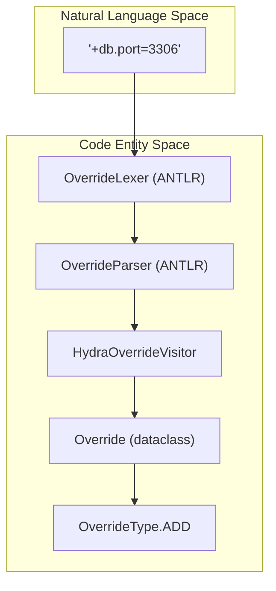
Sources: [hydra/core/override_parser/overrides_parser.py:52-74](), [hydra/core/override_parser/overrides_visitor.py:143-200](), [hydra/core/override_parser/types.py:187-193]()

## Override Syntax and Types

The Override System supports a rich syntax defined in `OverrideParser.g4`. [hydra/grammar/OverrideParser.g4:11-15]()

| Override Type | Prefix | Code Enum (`OverrideType`) | Description |
| :--- | :--- | :--- | :--- |
| **Change** | (none) | `CHANGE` | Replaces an existing value. |
| **Add** | `+` | `ADD` | Appends a new field; fails if it exists. |
| **Force Add** | `++` | `FORCE_ADD` | Adds or replaces a field. |
| **Delete** | `~` | `DEL` | Removes a key or a specific key=value pair. |

### Keys and Packages
A `Key` in Hydra consists of a `key_or_group` and an optional `package`. [hydra/core/override_parser/types.py:205-209]()
*   **Config Key**: `foo.bar`
*   **Config Group**: `hydra/launcher`
*   **Package Override**: `group@pkg` (Relocates the group to a specific package). [website/docs/advanced/override_grammar/basic.md:110-113]()

Sources: [hydra/core/override_parser/types.py:187-193](), [website/docs/advanced/override_grammar/basic.md:18-27](), [hydra/grammar/OverrideParser.g4:11-21]()

## Value Types and DSL Functions

Hydra supports primitives, containers, and specialized functions within the override value.

### Primitives and Containers
The parser handles:
*   **Primitives**: `int`, `float`, `bool`, `null`, `quoted_value`, and `interpolation` (`${foo.bar}`). [hydra/grammar/OverrideParser.g4:54-66]()
*   **Containers**: Lists `[1, 2]` and Dicts `{a: 1, b: 2}`. [hydra/grammar/OverrideParser.g4:45-50]()

### Grammar Functions
The `OverridesParser` registers a set of functions used for casting and sweep generation. [hydra/core/override_parser/overrides_parser.py:111-129]()

| Function | Code Implementation | Purpose |
| :--- | :--- | :--- |
| `int()`, `str()`, `bool()` | `grammar_functions.cast_x` | Explicit type coercion. |
| `choice()` | `grammar_functions.choice` | Defines a discrete sweep. |
| `range()` | `grammar_functions.range` | Defines a numeric sweep (int or float). |
| `interval()` | `grammar_functions.interval` | Continuous range for optimization (Ax/Nevergrad). |
| `extend_list()` | `grammar_functions.extend_list` | Appends values to an existing list. |

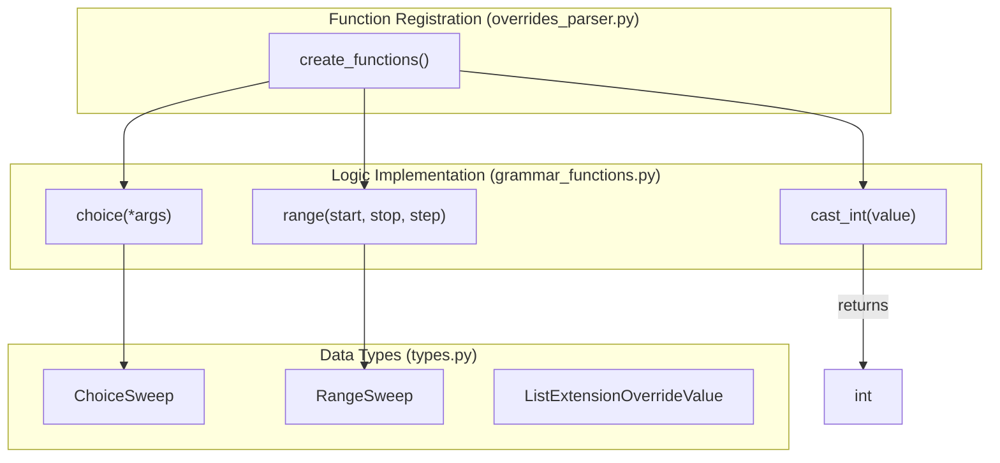
Sources: [hydra/core/override_parser/overrides_parser.py:111-129](), [hydra/_internal/grammar/grammar_functions.py:85-157](), [hydra/core/override_parser/types.py:82-156]()

## Sweep Mechanism

Sweeps are used by `Sweeper` plugins to perform multi-run executions.
*   **Choice Sweep**: `db=mysql,postgresql` is parsed as a `ChoiceSweep`. [hydra/core/override_parser/types.py:82-88]()
*   **Glob Sweep**: `schema=glob(*)` selects all options in a config group. [website/docs/advanced/override_grammar/extended.md:64-82]()
*   **Intervals**: `interval(1, 5)` defines a continuous space `1.0 <= x < 5.0`, used by optimizers like Ax. [website/docs/advanced/override_grammar/extended.md:108-122]()

### Reordering
Sweeps and lists can be manipulated using `sort()` and `shuffle()`. [website/docs/advanced/override_grammar/extended.md:179-227]()
*   `sort(3,1,2)` results in `1,2,3`.
*   `shuffle(range(1,10))` randomizes the execution order.

Sources: [hydra/core/override_parser/types.py:82-179](), [website/docs/advanced/override_grammar/extended.md:43-136](), [hydra/_internal/grammar/grammar_functions.py:205-276]()

## Implementation Details

### Lexical Modes
The `OverrideLexer` uses two modes:
1.  **DEFAULT_MODE**: Used for parsing the `key`. [hydra/grammar/OverrideLexer.g4:16-30]()
2.  **VALUE_MODE**: Triggered after the `=` sign to allow special characters like `:` and `,` inside values without escaping. [hydra/grammar/OverrideLexer.g4:35-45]()

### Quoted Strings
Hydra handles complex quoting to prevent shell interference. The `QuotedString` class and `with_quotes()` method manage the escaping of backslashes and internal quotes. [hydra/core/override_parser/types.py:28-73]()

### Error Handling
The `OverridesParser` employs a `HydraErrorListener` to catch ANTLR recognition errors. It provides detailed feedback, including a visual pointer (`^`) to the character that caused the lexer failure. [hydra/core/override_parser/overrides_parser.py:81-104]()

Sources: [hydra/core/override_parser/overrides_parser.py:52-74](), [hydra/grammar/OverrideLexer.g4:19](), [hydra/core/override_parser/types.py:28-73]()

---

# Page: Object Instantiation

# Object Instantiation

<details>
<summary>Relevant source files</summary>

The following files were used as context for generating this wiki page:

- [hydra/_internal/instantiate/_instantiate2.py](hydra/_internal/instantiate/_instantiate2.py)
- [hydra/core/plugins.py](hydra/core/plugins.py)
- [hydra/utils.py](hydra/utils.py)
- [news/3001.bugfix](news/3001.bugfix)
- [news/3074.api_change](news/3074.api_change)
- [tests/__init__.py](tests/__init__.py)
- [tests/instantiate/__init__.py](tests/instantiate/__init__.py)
- [tests/instantiate/test_helpers.py](tests/instantiate/test_helpers.py)
- [tests/instantiate/test_instantiate.py](tests/instantiate/test_instantiate.py)
- [tests/instantiate/test_positional.py](tests/instantiate/test_positional.py)
- [tests/test_apps/app_with_cfg_decorated/my_app.py](tests/test_apps/app_with_cfg_decorated/my_app.py)
- [tests/test_hydra_context_warnings.py](tests/test_hydra_context_warnings.py)
- [tests/test_internal_utils.py](tests/test_internal_utils.py)
- [tests/test_utils.py](tests/test_utils.py)
- [website/docs/advanced/instantiate_objects/config_files.md](website/docs/advanced/instantiate_objects/config_files.md)
- [website/docs/advanced/instantiate_objects/overview.md](website/docs/advanced/instantiate_objects/overview.md)
- [website/docs/advanced/instantiate_objects/structured_config.md](website/docs/advanced/instantiate_objects/structured_config.md)
- [website/docs/configure_hydra/app_help.md](website/docs/configure_hydra/app_help.md)
- [website/docs/configure_hydra/logging.md](website/docs/configure_hydra/logging.md)

</details>


Object Instantiation is a core feature of Hydra that provides a powerful mechanism for creating objects dynamically from configuration. It allows you to define Python objects (classes, functions, etc.) in your configuration and have Hydra instantiate them at runtime, making your applications highly configurable without changing code.

## Purpose and Key Features

The Object Instantiation system enables:

1.  **Dynamic Creation**: Creating Python objects directly from configuration using dot-path strings.
2.  **Recursion**: Instantiating nested object hierarchies recursively by default.
3.  **Conversion Control**: Controlling how OmegaConf containers (DictConfig/ListConfig) are converted to standard Python types (dict/list) or Structured Configs (dataclasses).
4.  **Partial Application**: Supporting partial application of functions via `functools.partial`.
5.  **Argument Flexibility**: Handling both positional (`_args_`) and keyword arguments, with the ability to override them at the call-site.

Sources: [hydra/utils.py:17-19](), [hydra/_internal/instantiate/_instantiate2.py:64-71](), [website/docs/advanced/instantiate_objects/overview.md:15-19](), [website/docs/advanced/instantiate_objects/overview.md:35-66]()

## Core Concepts

### The Instantiation Process

The instantiation logic is primarily implemented in `hydra._internal.instantiate._instantiate2`. The entry point is `hydra.utils.instantiate` (aliased as `call`).

| Component | Code Entity | Role |
| :--- | :--- | :--- |
| **Entry Point** | `instantiate()` | Main API function for triggering instantiation [hydra/_internal/instantiate/_instantiate2.py:174]() |
| **Locator** | `_locate()` | Resolves a dot-path string (e.g., `module.Class`) into a Python object [hydra/_internal/utils.py:11]() |
| **Target Caller** | `_call_target()` | Executes the target with processed arguments [hydra/_internal/instantiate/_instantiate2.py:97]() |
| **Recursion Logic** | `_instantiate_node()` | Recursively traverses the config tree to instantiate children [hydra/_internal/instantiate/_instantiate2.py:321]() |

#### Data Flow Diagram
This diagram maps the natural language steps of instantiation to the internal code functions.

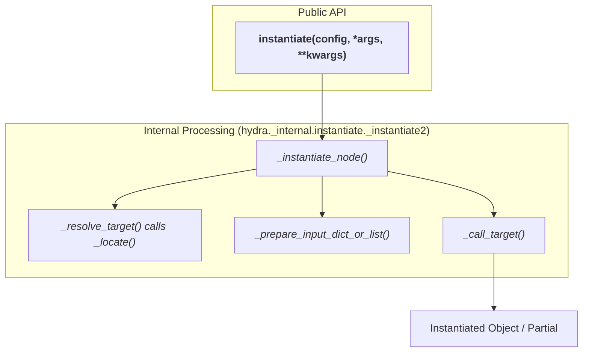
Sources: [hydra/utils.py:17-18](), [hydra/_internal/instantiate/_instantiate2.py:174-205](), [hydra/_internal/instantiate/_instantiate2.py:321-340]()

### Special Configuration Keys

The system recognizes specific keys defined in the `_Keys` enum [hydra/_internal/instantiate/_instantiate2.py:64-71]():

| Key | Type | Description |
| :--- | :--- | :--- |
| `_target_` | `str` | Fully qualified path to the class or callable. |
| `_recursive_` | `bool` | If `True` (default), nested configs with `_target_` are instantiated first. |
| `_convert_` | `str` | Conversion strategy for OmegaConf containers (`none`, `partial`, `object`, `all`). |
| `_partial_` | `bool` | If `True`, returns a `functools.partial` object instead of invoking the target. |
| `_args_` | `list` | Positional arguments to pass to the target. |

Sources: [hydra/_internal/instantiate/_instantiate2.py:64-71](), [website/docs/advanced/instantiate_objects/overview.md:35-66]()

## Implementation Details

### Target Resolution and Security
Hydra uses `_locate` to import modules and attributes. To prevent arbitrary code execution vulnerabilities, Hydra maintains a `DEFAULT_BLOCKLISTED_MODULES` list (e.g., `os.system`, `builtins.exec`).

*   **Blocklist Check**: Performed in `_resolve_target` [hydra/_internal/instantiate/_instantiate2.py:179-191]().
*   **Bypass**: Users can override the blocklist via the `HYDRA_INSTANTIATE_ALLOWLIST_OVERRIDE` environment variable [hydra/_internal/instantiate/_instantiate2.py:181-182]().

### Argument Handling
Arguments are gathered from the config and merged with call-site overrides:
1.  **Keyword Arguments**: Any key in the config that is not a special key (like `_target_`) is treated as a keyword argument [website/docs/advanced/instantiate_objects/overview.md:77-79]().
2.  **Positional Arguments**: Extracted from the `_args_` key via `_extract_pos_args` [hydra/_internal/instantiate/_instantiate2.py:82-94]().
3.  **Parent Detachment**: Before calling the target, OmegaConf objects have their parent links cleared to prevent serialization issues [hydra/_internal/instantiate/_instantiate2.py:110-115]().

### Conversion Modes
The `ConvertMode` enum (from `hydra.types`) dictates how Hydra handles OmegaConf containers during instantiation:
*   **`none`**: Passes `DictConfig` and `ListConfig` objects directly.
*   **`partial`**: Converts containers to `dict`/`list`, but preserves Structured Configs.
*   **`object`**: Converts containers and turns Structured Configs into instances of their backing dataclasses.
*   **`all`**: Strips all OmegaConf metadata, converting everything to primitives.

Sources: [hydra/types.py:15](), [website/docs/advanced/instantiate_objects/overview.md:46-55]()

## System Architecture Diagram
The following diagram shows how the Instantiation system interacts with the broader Hydra Plugin and Config environment.

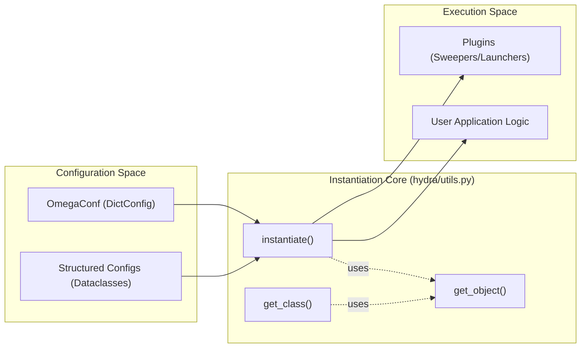
Sources: [hydra/utils.py:17-85](), [hydra/core/plugins.py:94-112](), [hydra/core/plugins.py:128-160]()

## Advanced Usage Patterns

### Recursive vs. Non-Recursive
By default, `_recursive_` is `True`. If set to `False`, nested dictionaries containing `_target_` keys are passed as raw `DictConfig` objects to the parent's constructor rather than being instantiated first [website/docs/advanced/instantiate_objects/overview.md:198-200]().

### Partial Instantiation
When `_partial_: True` is used, `_call_target` wraps the target in `functools.partial` [hydra/_internal/instantiate/_instantiate2.py:128](). This is particularly useful for optimizers or callbacks where some parameters are known from config, but others (like model parameters) are only available at runtime.

### Positional Argument Overrides
If `instantiate(cfg, *args)` is called with positional arguments, these override any values found in the `_args_` key of the configuration [hydra/_internal/instantiate/_instantiate2.py:87-88]().

Sources: [hydra/_internal/instantiate/_instantiate2.py:82-94](), [hydra/_internal/instantiate/_instantiate2.py:126-136](), [tests/instantiate/test_positional.py:120-157]()

## Troubleshooting Common Errors

| Error | Cause | Code Reference |
| :--- | :--- | :--- |
| `InstantiationException` | General failure during argument collection or target calling. | [hydra/_internal/instantiate/_instantiate2.py:14]() |
| `Unsupported _args_ type` | `_args_` is provided as a dict instead of a list/sequence. | [hydra/_internal/instantiate/_instantiate2.py:90-92]() |
| `Target is blocklisted` | Attempting to call a restricted function like `os.system`. | [hydra/_internal/instantiate/_instantiate2.py:183-191]() |
| `Error locating target` | The dot-path string cannot be resolved by `_locate`. | [hydra/_internal/instantiate/_instantiate2.py:195-199]() |

Sources: [hydra/_internal/instantiate/_instantiate2.py:82-145](), [tests/instantiate/test_positional.py:52-81]()

---

# Page: Working Directory and Output Management

# Working Directory and Output Management

<details>
<summary>Relevant source files</summary>

The following files were used as context for generating this wiki page:

- [examples/experimental/rerun/config.yaml](examples/experimental/rerun/config.yaml)
- [examples/experimental/rerun/my_app.py](examples/experimental/rerun/my_app.py)
- [examples/tutorials/basic/running_your_hydra_app/3_working_directory/my_app.py](examples/tutorials/basic/running_your_hydra_app/3_working_directory/my_app.py)
- [tests/test_apps/app_with_pickle_job_info_callback/my_app.py](tests/test_apps/app_with_pickle_job_info_callback/my_app.py)
- [tests/test_apps/run_dir_test/__init__.py](tests/test_apps/run_dir_test/__init__.py)
- [tests/test_apps/run_dir_test/my_app.py](tests/test_apps/run_dir_test/my_app.py)
- [tests/test_examples/test_experimental.py](tests/test_examples/test_experimental.py)
- [website/docs/configure_hydra/Intro.md](website/docs/configure_hydra/Intro.md)
- [website/docs/configure_hydra/job.md](website/docs/configure_hydra/job.md)
- [website/docs/configure_hydra/workdir.md](website/docs/configure_hydra/workdir.md)
- [website/docs/experimental/rerun.md](website/docs/experimental/rerun.md)
- [website/docs/tutorials/basic/running_your_app/3_working_directory.md](website/docs/tutorials/basic/running_your_app/3_working_directory.md)
- [website/docs/upgrades/1.1_to_1.2/changes_to_job_working_dir.md](website/docs/upgrades/1.1_to_1.2/changes_to_job_working_dir.md)
- [website/versioned_docs/version-1.1/tutorials/basic/running_your_app/3_working_directory.md](website/versioned_docs/version-1.1/tutorials/basic/running_your_app/3_working_directory.md)
- [website/versioned_docs/version-1.1/tutorials/basic/your_first_app/3_using_config.md](website/versioned_docs/version-1.1/tutorials/basic/your_first_app/3_using_config.md)
- [website/versioned_docs/version-1.1/tutorials/structured_config/2_hierarchical_static_config.md](website/versioned_docs/version-1.1/tutorials/structured_config/2_hierarchical_static_config.md)
- [website/versioned_docs/version-1.1/tutorials/structured_config/3_config_groups.md](website/versioned_docs/version-1.1/tutorials/structured_config/3_config_groups.md)
- [website/versioned_docs/version-1.1/tutorials/structured_config/4_defaults.md](website/versioned_docs/version-1.1/tutorials/structured_config/4_defaults.md)
- [website/versioned_docs/version-1.2/configure_hydra/Intro.md](website/versioned_docs/version-1.2/configure_hydra/Intro.md)
- [website/versioned_docs/version-1.2/experimental/rerun.md](website/versioned_docs/version-1.2/experimental/rerun.md)
- [website/versioned_docs/version-1.2/tutorials/basic/running_your_app/3_working_directory.md](website/versioned_docs/version-1.2/tutorials/basic/running_your_app/3_working_directory.md)
- [website/versioned_docs/version-1.3/configure_hydra/Intro.md](website/versioned_docs/version-1.3/configure_hydra/Intro.md)
- [website/versioned_docs/version-1.3/experimental/rerun.md](website/versioned_docs/version-1.3/experimental/rerun.md)
- [website/versioned_docs/version-1.3/tutorials/basic/running_your_app/3_working_directory.md](website/versioned_docs/version-1.3/tutorials/basic/running_your_app/3_working_directory.md)

</details>


This page documents how Hydra manages working directories and outputs for applications. It covers how Hydra creates and configures output directories, manages the `.hydra` metadata subdirectory, controls job-specific environment variables, and provides utilities for navigating between directories during the job lifecycle.

## Overview

Hydra manages the complexity of experiment tracking by automatically creating unique, timestamped, or parameter-based directory structures. This system ensures that every run is isolated and its configuration is preserved for reproducibility.

### Key Capabilities
- **Automatic Directory Creation**: Generates unique paths for single runs and hierarchical structures for multirun sweeps [website/docs/tutorials/basic/running_your_app/3_working_directory.md:11-15]().
- **Configuration Snapshots**: Saves the exact composed configuration, overrides, and Hydra settings in a protected subdirectory [website/docs/tutorials/basic/running_your_app/3_working_directory.md:39-58]().
- **Working Directory Control**: Optionally changes the Python process's current working directory (CWD) to the output directory [website/docs/configure_hydra/Intro.md:101-102]().
- **Path Resolution Utilities**: Provides functions to map paths between the original launch directory and the new output directory [website/docs/tutorials/basic/running_your_app/3_working_directory.md:103-119]().

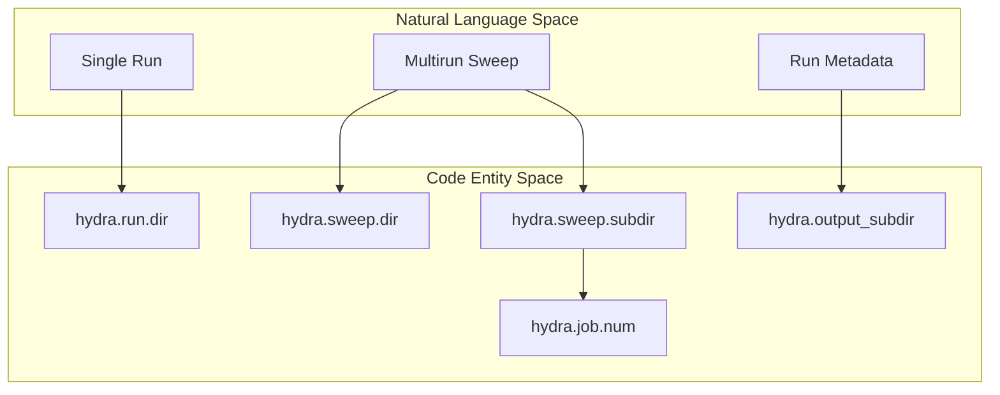
Sources: [website/docs/configure_hydra/Intro.md:110-120](), [website/docs/configure_hydra/workdir.md:11-15]()

## Output Directory Structure

By default, Hydra creates a timestamped directory for every execution. This directory contains the application's logs and a `.hydra` subdirectory for metadata.

### The .hydra Subdirectory
The `.hydra` directory (configurable via `hydra.output_subdir`) contains:
- `config.yaml`: The final composed user configuration [website/docs/tutorials/basic/running_your_app/3_working_directory.md:52]().
- `hydra.yaml`: The internal Hydra configuration [website/docs/tutorials/basic/running_your_app/3_working_directory.md:53]().
- `overrides.yaml`: The specific command-line overrides used for the run [website/docs/tutorials/basic/running_your_app/3_working_directory.md:54]().

### Customizing Patterns
Patterns are defined in the Hydra config and support OmegaConf interpolation and a special `${now:}` resolver for timestamps.

| Configuration Key | Default Value | Description |
| :--- | :--- | :--- |
| `hydra.run.dir` | `outputs/${now:%Y-%m-%d}/${now:%H-%M-%S}` | Path for single runs [website/docs/configure_hydra/Intro.md:37-38](). |
| `hydra.sweep.dir` | `multirun/${now:%Y-%m-%d}/${now:%H-%M-%S}` | Root path for a multirun sweep [website/docs/configure_hydra/Intro.md:39-40](). |
| `hydra.sweep.subdir` | `${hydra.job.num}` | Subdirectory for each job in a sweep [website/docs/configure_hydra/Intro.md:41](). |
| `hydra.output_subdir` | `.hydra` | Name of the metadata directory; set to `null` to disable [website/docs/configure_hydra/Intro.md:88-89](). |

Sources: [website/docs/configure_hydra/workdir.md:18-59](), [website/docs/tutorials/basic/running_your_app/3_working_directory.md:98-101]()

## Job Lifecycle and Directory Management

Hydra manages the transition from the user's shell to the execution of the `@hydra.main` function. A critical part of this is the `hydra.job.chdir` setting.

### Current Working Directory (CWD)
- **`hydra.job.chdir=False` (Default since v1.2)**: The process stays in the directory where the script was launched. Outputs are still created in the `output_dir`, but relative file operations in Python will target the launch directory [website/docs/tutorials/basic/running_your_app/3_working_directory.md:63-81]().
- **`hydra.job.chdir=True`**: Hydra calls `os.chdir()` to the output directory before executing the user's code. This allows for simple file writing (e.g., `open("file.txt", "w")`) directly into the experiment folder [website/docs/configure_hydra/Intro.md:101-102]().

### Path Utilities
When `chdir=True`, `hydra.utils` provides helpers to reference the original filesystem:
- `get_original_cwd()`: Returns the directory from which the app was started [website/docs/tutorials/basic/running_your_app/3_working_directory.md:103-108]().
- `to_absolute_path(path)`: Converts a path to be absolute relative to the original CWD [website/docs/tutorials/basic/running_your_app/3_working_directory.md:108-116]().

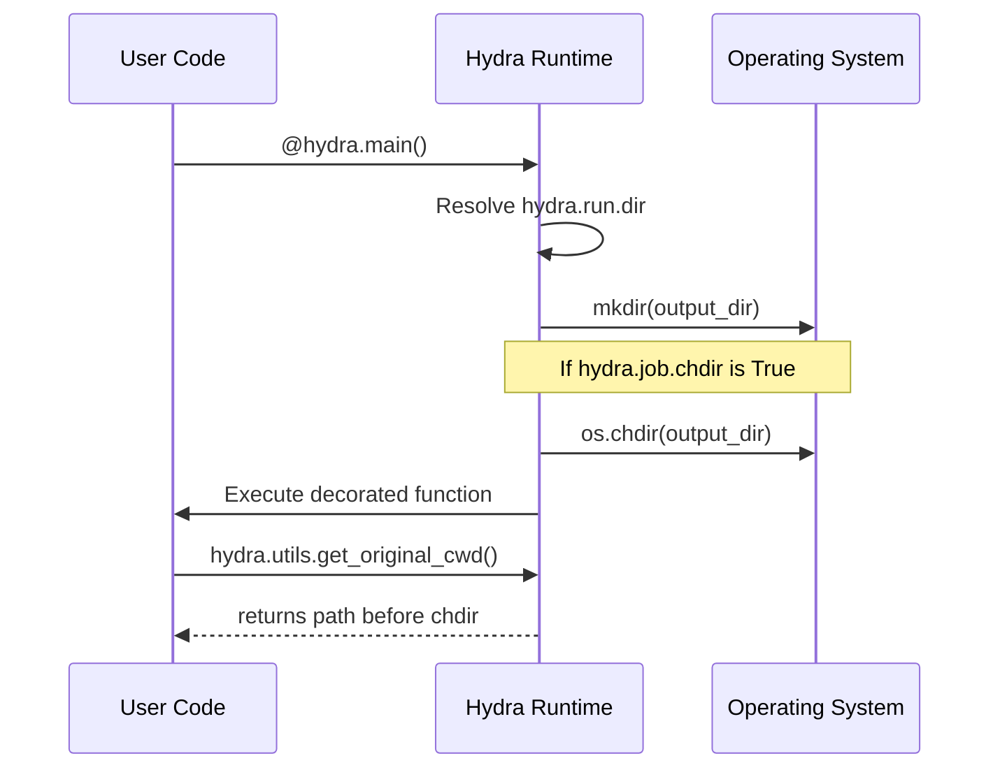
Sources: [website/docs/tutorials/basic/running_your_app/3_working_directory.md:63-126](), [tests/test_apps/run_dir_test/my_app.py:12-17]()

## Parameter-Based Directory Names

Hydra can generate directory names dynamically based on the command-line overrides using `hydra.job.override_dirname`. This is highly effective for organizing sweeps by their hyperparameters.

### Configuration for Override Names
The `JobConf` object defines how these strings are constructed:
- `kv_sep`: Separator between key and value (default `=`) [website/docs/configure_hydra/job.md:48]().
- `item_sep`: Separator between different overrides (default `,`) [website/docs/configure_hydra/job.md:49]().
- `exclude_keys`: List of keys to omit from the directory name (e.g., `seed`) [website/docs/configure_hydra/job.md:50]().

### Example Usage
If running `python my_app.py --multirun batch_size=32 learning_rate=0.1,0.01`, setting `subdir: ${hydra.job.override_dirname}` results in:
- `multirun/batch_size=32,learning_rate=0.1/`
- `multirun/batch_size=32,learning_rate=0.01/`

Sources: [website/docs/configure_hydra/workdir.md:101-171](), [website/docs/configure_hydra/job.md:15-55]()

## Job Environment Configuration

Hydra allows fine-grained control over the environment variables of the launched job via `hydra.job.env_set` and `hydra.job.env_copy`.

- **`env_set`**: A dictionary of environment variables to set. This supports interpolation, allowing variables like `RANK` to be set to `${hydra:job.num}` [website/docs/configure_hydra/job.md:85-105]().
- **`env_copy`**: A list of environment variables to inherit from the launching machine, which is critical for remote execution (e.g., `AWS_KEY`) [website/docs/configure_hydra/job.md:107-116]().

Sources: [website/docs/configure_hydra/job.md:37-41](), [website/docs/configure_hydra/job.md:85-116]()

## Experimental Re-run Feature

Hydra includes an experimental capability to re-run a job using a saved configuration pickle.

1. **Enable Saving**: Use the `PickleJobInfoCallback` to save `config.pickle` in the `.hydra` directory [website/docs/experimental/rerun.md:19-24]().
2. **Execute Re-run**: Use the `--experimental-rerun` flag pointing to the pickle file [website/docs/experimental/rerun.md:47-50]().

**Note**: Re-run mode passes the configuration directly to the application, bypassing some standard `hydra.main` steps like changing the working directory or executing other callbacks [website/docs/experimental/rerun.md:59-64]().

Sources: [website/docs/experimental/rerun.md:1-68]()

---

# Page: Plugin System

# Plugin System

<details>
<summary>Relevant source files</summary>

The following files were used as context for generating this wiki page:

- [examples/plugins/example_configsource_plugin/setup.py](examples/plugins/example_configsource_plugin/setup.py)
- [examples/plugins/example_generic_plugin/setup.py](examples/plugins/example_generic_plugin/setup.py)
- [examples/plugins/example_launcher_plugin/setup.py](examples/plugins/example_launcher_plugin/setup.py)
- [examples/plugins/example_registered_plugin/setup.py](examples/plugins/example_registered_plugin/setup.py)
- [examples/plugins/example_searchpath_plugin/setup.py](examples/plugins/example_searchpath_plugin/setup.py)
- [examples/plugins/example_sweeper_plugin/setup.py](examples/plugins/example_sweeper_plugin/setup.py)
- [hydra/core/plugins.py](hydra/core/plugins.py)
- [hydra/utils.py](hydra/utils.py)
- [plugins/hydra_ax_sweeper/hydra_plugins/hydra_ax_sweeper/__init__.py](plugins/hydra_ax_sweeper/hydra_plugins/hydra_ax_sweeper/__init__.py)
- [plugins/hydra_ax_sweeper/setup.py](plugins/hydra_ax_sweeper/setup.py)
- [plugins/hydra_colorlog/hydra_plugins/hydra_colorlog/__init__.py](plugins/hydra_colorlog/hydra_plugins/hydra_colorlog/__init__.py)
- [plugins/hydra_colorlog/setup.py](plugins/hydra_colorlog/setup.py)
- [plugins/hydra_joblib_launcher/hydra_plugins/hydra_joblib_launcher/__init__.py](plugins/hydra_joblib_launcher/hydra_plugins/hydra_joblib_launcher/__init__.py)
- [plugins/hydra_joblib_launcher/setup.py](plugins/hydra_joblib_launcher/setup.py)
- [plugins/hydra_nevergrad_sweeper/hydra_plugins/hydra_nevergrad_sweeper/__init__.py](plugins/hydra_nevergrad_sweeper/hydra_plugins/hydra_nevergrad_sweeper/__init__.py)
- [plugins/hydra_nevergrad_sweeper/setup.py](plugins/hydra_nevergrad_sweeper/setup.py)
- [plugins/hydra_optuna_sweeper/hydra_plugins/hydra_optuna_sweeper/__init__.py](plugins/hydra_optuna_sweeper/hydra_plugins/hydra_optuna_sweeper/__init__.py)
- [plugins/hydra_optuna_sweeper/setup.py](plugins/hydra_optuna_sweeper/setup.py)
- [plugins/hydra_ray_launcher/hydra_plugins/hydra_ray_launcher/__init__.py](plugins/hydra_ray_launcher/hydra_plugins/hydra_ray_launcher/__init__.py)
- [plugins/hydra_rq_launcher/hydra_plugins/hydra_rq_launcher/__init__.py](plugins/hydra_rq_launcher/hydra_plugins/hydra_rq_launcher/__init__.py)
- [plugins/hydra_rq_launcher/setup.py](plugins/hydra_rq_launcher/setup.py)
- [plugins/hydra_submitit_launcher/hydra_plugins/hydra_submitit_launcher/__init__.py](plugins/hydra_submitit_launcher/hydra_plugins/hydra_submitit_launcher/__init__.py)
- [plugins/hydra_submitit_launcher/setup.py](plugins/hydra_submitit_launcher/setup.py)
- [tests/__init__.py](tests/__init__.py)
- [tests/test_apps/app_with_cfg_decorated/my_app.py](tests/test_apps/app_with_cfg_decorated/my_app.py)
- [tests/test_hydra_context_warnings.py](tests/test_hydra_context_warnings.py)
- [tests/test_internal_utils.py](tests/test_internal_utils.py)
- [tests/test_utils.py](tests/test_utils.py)

</details>


The Hydra Plugin System provides a flexible extension mechanism that allows developers to customize and extend Hydra's functionality without modifying its core. This page describes the architecture of the plugin system, how plugins are discovered and loaded, and how to create and use plugins.

For information about specific plugin types, see the following child pages:
- [Sweeper Plugins](#3.1) — Hyperparameter optimization interfaces like Ax, Optuna, and Nevergrad.
- [Launcher Plugins](#3.2) — Job execution environments like SLURM (via Submitit), Ray, and Joblib.
- [Config Source Plugins](#3.3) — Loading configurations from filesystems, package resources, or custom backends.
- [Shell Completion](#3.4) — Tab completion support for Bash, Zsh, and Fish.
- [Contrib Plugins](#3.5) — Community-contributed extensions like the `torchrun` launcher.

## Plugin System Architecture

Hydra's plugin system is built around abstract base classes and runtime discovery. Plugins are Python classes that inherit from the `Plugin` base class or one of its specialized subclasses defined in `hydra/core/plugins.py` [hydra/core/plugins.py:26-33]().

### Bridge: Logic to Code Entities
The following diagram maps high-level plugin categories to the specific Python classes and registry mechanisms in the codebase.

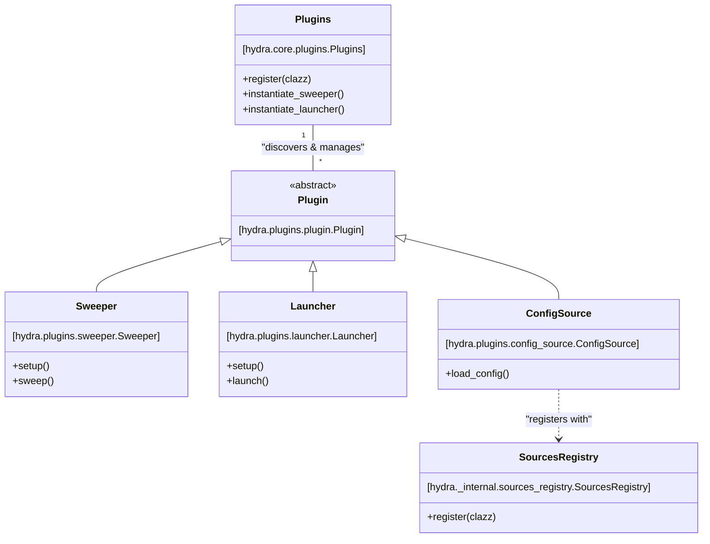
Sources: [hydra/core/plugins.py:16-33](), [hydra/core/plugins.py:43-52](), [hydra/core/plugins.py:91-92]()

### Core Plugin Types

| Plugin Type | Purpose | Key Methods |
|-------------|---------|------------|
| `Sweeper` | Hyperparameter optimization | `setup()`, `sweep()` |
| `Launcher` | Job execution in various environments | `setup()`, `launch()` |
| `ConfigSource` | Configuration loading from different sources | `load_config()`, `exists()` |
| `CompletionPlugin` | Shell tab completion | `install()`, `query()` |
| `SearchPathPlugin` | Add config search paths | `add_search_path()` |

Sources: [hydra/core/plugins.py:17-22](), [hydra/core/plugins.py:26-33]()

## Plugin Discovery and Loading

Hydra discovers plugins through a systematic scanning process during initialization. The `Plugins` singleton class [hydra/core/plugins.py:43-48]() manages this process, looking into specific namespaces.

### Bridge: Discovery Workflow
This diagram illustrates how the `Plugins` class interacts with the Python environment to locate and register plugin classes.

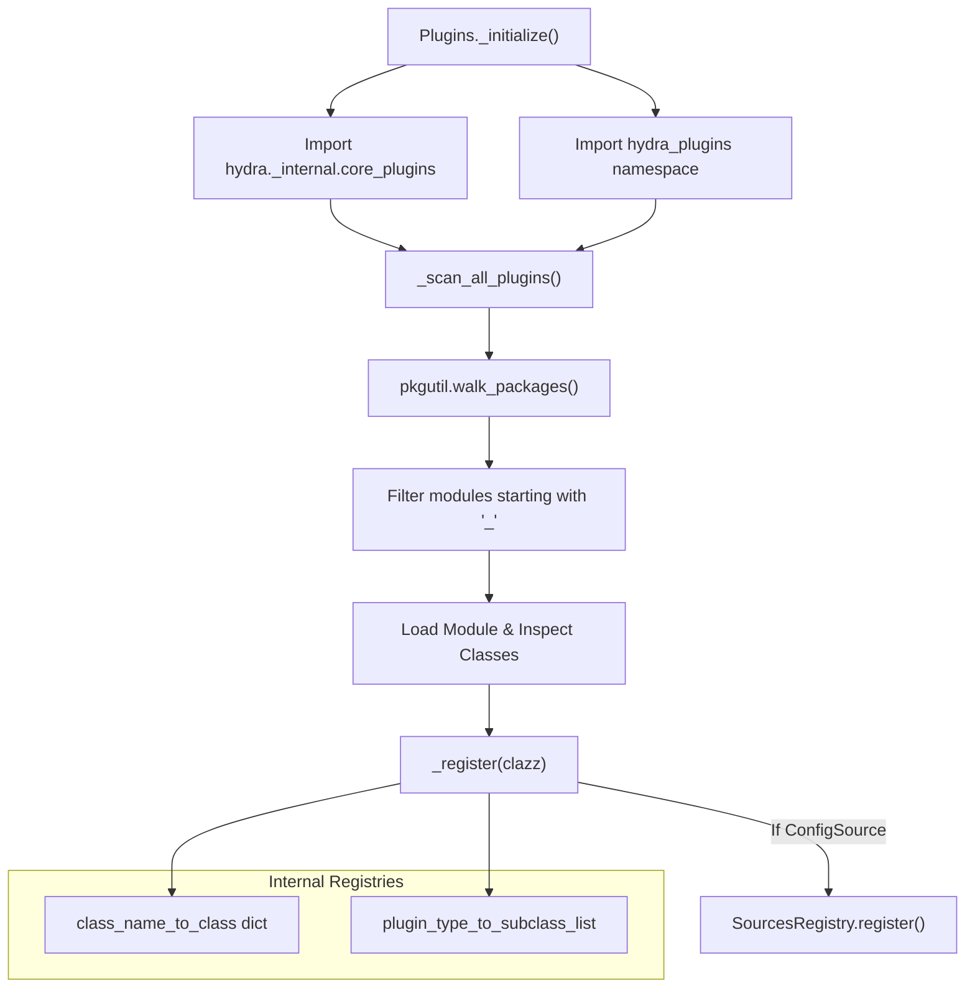
Sources: [hydra/core/plugins.py:56-74](), [hydra/core/plugins.py:83-92](), [hydra/core/plugins.py:163-181]()

### Discovery Rules
1. **Namespaces**: Hydra scans `hydra._internal.core_plugins` for built-in functionality and the `hydra_plugins` namespace for external packages [hydra/core/plugins.py:58-63]().
2. **Naming**: Modules starting with a single underscore (e.g., `_private.py`) are skipped unless they start with a double underscore [hydra/core/plugins.py:180-181]().
3. **Validation**: All external plugins must reside within the `hydra_plugins` package to be considered valid [hydra/core/plugins.py:102-107]().

## Plugin Package Structure

Plugins are distributed as standard Python packages using **PEP 420 Namespace Packages**. This allows multiple installed plugins to contribute to the `hydra_plugins` namespace.

### Standard `setup.py` Configuration
A typical plugin (like `hydra-ax-sweeper`) uses `find_namespace_packages` to include its implementation [plugins/hydra_ax_sweeper/setup.py:17]().

```python
setup(
    name="hydra-ax-sweeper",
    # ...
    packages=find_namespace_packages(include=["hydra_plugins.*"]),
    install_requires=[
        "hydra-core>=1.1.0.dev7",
        # plugin specific deps
    ],
)
```
Sources: [plugins/hydra_ax_sweeper/setup.py:8-36](), [plugins/hydra_nevergrad_sweeper/setup.py:8-32]()

## Official Hydra Plugins

Hydra maintains several official plugins within the repository's `plugins/` directory:

| Plugin | Type | Purpose |
|--------|------|---------|
| **Ax Sweeper** | Sweeper | Bayesian optimization via Ax [plugins/hydra_ax_sweeper/setup.py:9]() |
| **Nevergrad Sweeper** | Sweeper | Derivative-free optimization [plugins/hydra_nevergrad_sweeper/setup.py:9]() |
| **Optuna Sweeper** | Sweeper | Multi-objective optimization [plugins/hydra_optuna_sweeper/setup.py:9]() |
| **Submitit Launcher** | Launcher | SLURM and local cluster scheduling [plugins/hydra_submitit_launcher/setup.py:9]() |
| **Ray Launcher** | Launcher | Distributed execution via Ray [plugins/hydra_ray_launcher/hydra_plugins/hydra_ray_launcher/__init__.py:3]() |
| **Joblib Launcher** | Launcher | Light-weight parallel processing [plugins/hydra_joblib_launcher/setup.py:9]() |
| **RQ Launcher** | Launcher | Redis Queue based task distribution [plugins/hydra_rq_launcher/setup.py:9]() |
| **Colorlog** | Generic | Enhanced console logging [plugins/hydra_colorlog/setup.py:9]() |

## Manual Registration and Utilities

While automatic discovery is preferred, developers can manually register a plugin class using `Plugins.instance().register(MyPlugin)` [hydra/core/plugins.py:75-81]().

Additionally, `hydra.utils` provides helpers for dynamically loading classes and methods, which are often used by plugins to instantiate user code:
- `get_class(path)`: Returns a class type from a dot-path string [hydra/utils.py:22-41]().
- `get_method(path)`: Returns a callable from a dot-path string [hydra/utils.py:44-64]().
- `instantiate(config)`: The primary engine for creating objects from configuration [hydra/utils.py:17]().

Sources: [hydra/core/plugins.py:75-81](), [hydra/utils.py:22-64]()

---

# Page: Sweeper Plugins

# Sweeper Plugins

<details>
<summary>Relevant source files</summary>

The following files were used as context for generating this wiki page:

- [examples/plugins/example_configsource_plugin/setup.py](examples/plugins/example_configsource_plugin/setup.py)
- [examples/plugins/example_generic_plugin/setup.py](examples/plugins/example_generic_plugin/setup.py)
- [examples/plugins/example_launcher_plugin/setup.py](examples/plugins/example_launcher_plugin/setup.py)
- [examples/plugins/example_registered_plugin/setup.py](examples/plugins/example_registered_plugin/setup.py)
- [examples/plugins/example_searchpath_plugin/setup.py](examples/plugins/example_searchpath_plugin/setup.py)
- [examples/plugins/example_sweeper_plugin/setup.py](examples/plugins/example_sweeper_plugin/setup.py)
- [hydra/_internal/core_plugins/basic_launcher.py](hydra/_internal/core_plugins/basic_launcher.py)
- [hydra/_internal/core_plugins/basic_sweeper.py](hydra/_internal/core_plugins/basic_sweeper.py)
- [hydra/types.py](hydra/types.py)
- [plugins/hydra_ax_sweeper/setup.py](plugins/hydra_ax_sweeper/setup.py)
- [plugins/hydra_colorlog/README.md](plugins/hydra_colorlog/README.md)
- [plugins/hydra_colorlog/setup.py](plugins/hydra_colorlog/setup.py)
- [plugins/hydra_joblib_launcher/MANIFEST.in](plugins/hydra_joblib_launcher/MANIFEST.in)
- [plugins/hydra_joblib_launcher/README.md](plugins/hydra_joblib_launcher/README.md)
- [plugins/hydra_joblib_launcher/example/config.yaml](plugins/hydra_joblib_launcher/example/config.yaml)
- [plugins/hydra_joblib_launcher/example/my_app.py](plugins/hydra_joblib_launcher/example/my_app.py)
- [plugins/hydra_joblib_launcher/hydra_plugins/hydra_joblib_launcher/config.py](plugins/hydra_joblib_launcher/hydra_plugins/hydra_joblib_launcher/config.py)
- [plugins/hydra_joblib_launcher/hydra_plugins/hydra_joblib_launcher/joblib_launcher.py](plugins/hydra_joblib_launcher/hydra_plugins/hydra_joblib_launcher/joblib_launcher.py)
- [plugins/hydra_joblib_launcher/setup.py](plugins/hydra_joblib_launcher/setup.py)
- [plugins/hydra_nevergrad_sweeper/setup.py](plugins/hydra_nevergrad_sweeper/setup.py)
- [plugins/hydra_optuna_sweeper/setup.py](plugins/hydra_optuna_sweeper/setup.py)
- [plugins/hydra_rq_launcher/setup.py](plugins/hydra_rq_launcher/setup.py)
- [plugins/hydra_submitit_launcher/setup.py](plugins/hydra_submitit_launcher/setup.py)
- [website/README.md](website/README.md)
- [website/docs/plugins/colorlog.md](website/docs/plugins/colorlog.md)
- [website/docs/plugins/joblib_launcher.md](website/docs/plugins/joblib_launcher.md)

</details>


## Purpose and Overview

Sweeper plugins in Hydra provide a framework for hyperparameter optimization by systematically exploring parameter spaces. These plugins enable Hydra's multirun functionality (triggered by the `--multirun` or `-m` flag), allowing users to efficiently optimize hyperparameters for their applications. While the `BasicSweeper` provides simple grid search and Cartesian products, specialized plugins integrate with advanced optimization libraries.

For information about the syntax used to define sweeps on the command line, see [Override System](#2.3).

## Sweeper Plugin Architecture

Sweeper plugins implement the abstract `Sweeper` interface. The core responsibility of a Sweeper is to take a set of overrides, generate specific job configurations (batches), and coordinate with a `Launcher` to execute them.

### Code Entity Map
The following diagram maps high-level concepts to the specific classes and methods in the codebase.

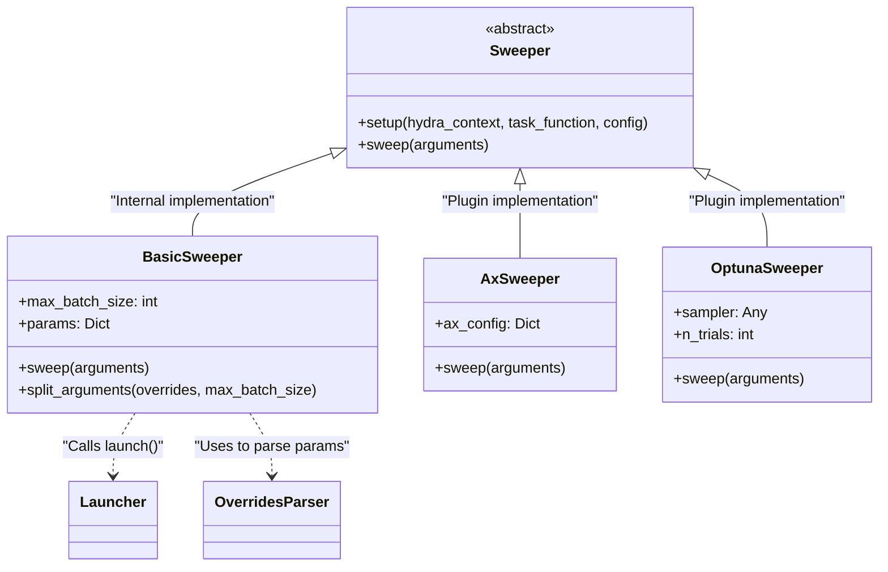
Sources: [hydra/plugins/sweeper.py:1-35](), [hydra/_internal/core_plugins/basic_sweeper.py:54-186](), [plugins/hydra_ax_sweeper/hydra_plugins/hydra_ax_sweeper/ax_sweeper.py:11-32](), [plugins/hydra_optuna_sweeper/setup.py:8-34]()

## Sweeper Execution Flow

When a user initiates a multirun, the `Sweeper` takes control of the execution lifecycle. It parses the sweep arguments, interacts with an optimizer (like Ax or Optuna), and hands off batches of configurations to the configured `Launcher`.

### Component Interaction Diagram

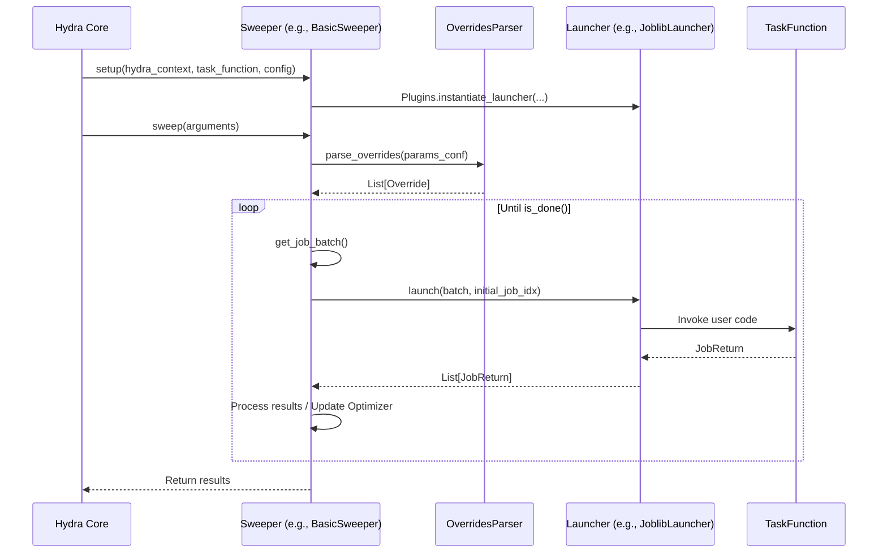
Sources: [hydra/_internal/core_plugins/basic_sweeper.py:78-94](), [hydra/_internal/core_plugins/basic_sweeper.py:147-186](), [plugins/hydra_joblib_launcher/hydra_plugins/hydra_joblib_launcher/joblib_launcher.py:40-47]()

## Available Sweeper Plugins

Hydra supports several advanced sweepers via the plugin system. Each is packaged separately and requires specific dependencies.

| Sweeper Plugin | Backend Library | Primary Use Case |
|:---|:---|:---|
| **Basic Sweeper** | Built-in | Grid search and simple list iterations. [hydra/_internal/core_plugins/basic_sweeper.py:3-18]() |
| **Ax Sweeper** | `ax-platform` | Adaptive Bayesian optimization. For details, see [Ax Sweeper](#3.1.1). |
| **Nevergrad Sweeper** | `nevergrad` | Gradient-free optimization (evolutionary, etc.). For details, see [Nevergrad Sweeper](#3.1.2). |
| **Optuna Sweeper** | `optuna` | Versatile HPO with support for various samplers and databases. For details, see [Optuna Sweeper](#3.1.3). |

Sources: [plugins/hydra_ax_sweeper/setup.py:27-34](), [plugins/hydra_nevergrad_sweeper/setup.py:27-30](), [plugins/hydra_optuna_sweeper/setup.py:28-32]()

## Core Sweeper: BasicSweeper

The `BasicSweeper` is the default implementation included in `hydra-core`. It generates a Cartesian product of all provided sweep variables.

- **Configuration**: Stored under `hydra/sweeper=basic`. [hydra/_internal/core_plugins/basic_sweeper.py:46-48]()
- **Functionality**: It supports discrete sweeps (comma-separated lists) and `range()`. [hydra/_internal/core_plugins/basic_sweeper.py:114-117]()
- **Batching**: Can split a large sweep into smaller chunks using `max_batch_size`. [hydra/_internal/core_plugins/basic_sweeper.py:133-139]()

## Result Collection and Reporting

Sweepers collect results via the `JobReturn` object.
- `JobReturn` contains the `return_value` of the task function. [hydra/core/utils.py:32]() (referenced in [hydra/_internal/core_plugins/basic_sweeper.py:181]())
- The `Sweeper` monitors these returns to update its internal model (in the case of Ax/Optuna) or to report the best parameters found during the run.
- Before execution, the `Sweeper` saves the composed configuration to the sweep directory as `multirun.yaml`. [hydra/_internal/core_plugins/basic_sweeper.py:162-164]()

## Child Pages

- [Ax Sweeper](#3.1.1) — Detail the integration with Facebook's Ax platform for Bayesian optimization, including AxClient lifecycle, parameter mapping, and early stopping.
- [Nevergrad Sweeper](#3.1.2) — Explore the Nevergrad sweeper for derivative-free optimization, including supported optimizers and configuration.
- [Optuna Sweeper](#3.1.3) — Understand the Optuna integration for hyperparameter optimization, including multi-objective support and storage backends.

Sources: [hydra/types.py:45-48](), [hydra/_internal/core_plugins/basic_sweeper.py:39-44]()

---

# Page: Ax Sweeper

# Ax Sweeper

<details>
<summary>Relevant source files</summary>

The following files were used as context for generating this wiki page:

- [examples/plugins/example_configsource_plugin/setup.py](examples/plugins/example_configsource_plugin/setup.py)
- [examples/plugins/example_generic_plugin/setup.py](examples/plugins/example_generic_plugin/setup.py)
- [examples/plugins/example_launcher_plugin/setup.py](examples/plugins/example_launcher_plugin/setup.py)
- [examples/plugins/example_registered_plugin/setup.py](examples/plugins/example_registered_plugin/setup.py)
- [examples/plugins/example_searchpath_plugin/setup.py](examples/plugins/example_searchpath_plugin/setup.py)
- [examples/plugins/example_sweeper_plugin/setup.py](examples/plugins/example_sweeper_plugin/setup.py)
- [plugins/hydra_ax_sweeper/README.md](plugins/hydra_ax_sweeper/README.md)
- [plugins/hydra_ax_sweeper/example/conf/config.yaml](plugins/hydra_ax_sweeper/example/conf/config.yaml)
- [plugins/hydra_ax_sweeper/hydra_plugins/hydra_ax_sweeper/_core.py](plugins/hydra_ax_sweeper/hydra_plugins/hydra_ax_sweeper/_core.py)
- [plugins/hydra_ax_sweeper/hydra_plugins/hydra_ax_sweeper/ax_sweeper.py](plugins/hydra_ax_sweeper/hydra_plugins/hydra_ax_sweeper/ax_sweeper.py)
- [plugins/hydra_ax_sweeper/hydra_plugins/hydra_ax_sweeper/config.py](plugins/hydra_ax_sweeper/hydra_plugins/hydra_ax_sweeper/config.py)
- [plugins/hydra_ax_sweeper/setup.py](plugins/hydra_ax_sweeper/setup.py)
- [plugins/hydra_ax_sweeper/tests/apps/polynomial.yaml](plugins/hydra_ax_sweeper/tests/apps/polynomial.yaml)
- [plugins/hydra_ax_sweeper/tests/config/config.yaml](plugins/hydra_ax_sweeper/tests/config/config.yaml)
- [plugins/hydra_ax_sweeper/tests/config/params/basic.yaml](plugins/hydra_ax_sweeper/tests/config/params/basic.yaml)
- [plugins/hydra_ax_sweeper/tests/config/quadratic/basic.yaml](plugins/hydra_ax_sweeper/tests/config/quadratic/basic.yaml)
- [plugins/hydra_ax_sweeper/tests/test_ax_sweeper_plugin.py](plugins/hydra_ax_sweeper/tests/test_ax_sweeper_plugin.py)
- [plugins/hydra_colorlog/setup.py](plugins/hydra_colorlog/setup.py)
- [plugins/hydra_joblib_launcher/setup.py](plugins/hydra_joblib_launcher/setup.py)
- [plugins/hydra_nevergrad_sweeper/setup.py](plugins/hydra_nevergrad_sweeper/setup.py)
- [plugins/hydra_optuna_sweeper/setup.py](plugins/hydra_optuna_sweeper/setup.py)
- [plugins/hydra_rq_launcher/setup.py](plugins/hydra_rq_launcher/setup.py)
- [plugins/hydra_submitit_launcher/setup.py](plugins/hydra_submitit_launcher/setup.py)
- [website/docs/plugins/ax_sweeper.md](website/docs/plugins/ax_sweeper.md)

</details>


## Purpose and Scope

The Ax Sweeper is a Hydra plugin that integrates with Facebook's Ax platform to provide Bayesian optimization capabilities for hyperparameter tuning. This document covers the Ax Sweeper architecture, configuration, and usage patterns, including the lifecycle of the `AxClient`, parameter mapping from Hydra overrides to Ax types, and the early stopping mechanism.

Sources:
- [plugins/hydra_ax_sweeper/setup.py:9-13]()
- [plugins/hydra_ax_sweeper/hydra_plugins/hydra_ax_sweeper/ax_sweeper.py:11-31]()
- [website/docs/plugins/ax_sweeper.md:15-16]()

## Architecture Overview

The Ax Sweeper fits into Hydra's plugin architecture as a specialized sweeper implementation. It bridges the gap between Hydra's configuration/launcher system and the Ax Platform's optimization loops.

### Natural Language to Code Entity Mapping: Core Components
The following diagram maps high-level system concepts to specific classes and functions within the codebase.

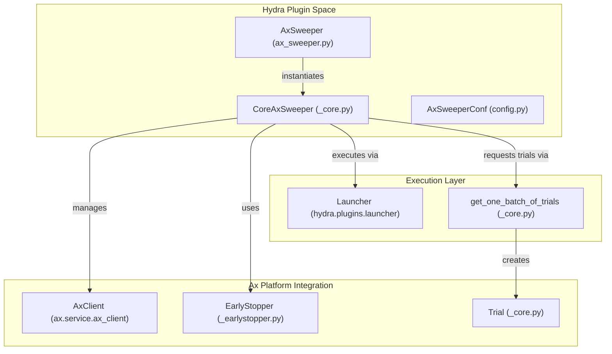

Sources:
- [plugins/hydra_ax_sweeper/hydra_plugins/hydra_ax_sweeper/ax_sweeper.py:11-31]()
- [plugins/hydra_ax_sweeper/hydra_plugins/hydra_ax_sweeper/_core.py:105-129]()
- [plugins/hydra_ax_sweeper/hydra_plugins/hydra_ax_sweeper/config.py:57-63]()

## Workflow and AxClient Lifecycle

The optimization process is managed by `CoreAxSweeper.sweep`. The lifecycle involves setting up an `AxClient`, defining the experiment search space, and iteratively launching batches of trials.

### Optimization Sequence
```mermaid
sequenceDiagram
    participant CAS as CoreAxSweeper
    participant AX as AxClient
    participant GB as get_one_batch_of_trials
    participant L as Launcher

    CAS->>CAS: setup_ax_client(arguments)
    CAS->>AX: create_experiment()
    
    loop Until max_trials or search_space_exhausted
        CAS->>GB: parallelism, num_trials_left
        GB->>AX: get_next_trial()
        AX-->>GB: parameters, trial_index
        GB-->>CAS: TrialBatch (List[Trial])
        
        CAS->>CAS: sweep_over_batches(list_of_trials)
        CAS->>L: launch(overrides)
        L-->>CAS: job_results
        
        CAS->>AX: complete_trial(trial_index, raw_data)
        CAS->>CAS: update early_stopper
    end
    CAS->>CAS: log best_parameters
```

Sources:
- [plugins/hydra_ax_sweeper/hydra_plugins/hydra_ax_sweeper/_core.py:144-185]()
- [plugins/hydra_ax_sweeper/hydra_plugins/hydra_ax_sweeper/_core.py:63-102]()
- [plugins/hydra_ax_sweeper/hydra_plugins/hydra_ax_sweeper/_core.py:207-243]()

## Parameter Mapping

Hydra's override DSL (e.g., `interval`, `choice`, `range`) is mapped to Ax's internal parameter types. This conversion happens during `setup_ax_client` where the search space is constructed.

### Mapping Logic: DSL to Ax Types
The `CoreAxSweeper` parses overrides and maps them to Ax `Parameter` definitions.

| Hydra DSL / Config | Ax Parameter Type | Code Reference |
|:---|:---|:---|
| `interval(1, 5)` | `range` (float) | [_core.py:326-335]() |
| `int(interval(1, 5))` | `range` (int) | [_core.py:326-335]() |
| `choice(A, B, C)` | `choice` | [_core.py:311-324]() |
| `range(1, 5)` | `choice` | [_core.py:311-324]() |
| `tag(log, interval(1, 10))` | `range` (log_scale=True) | [_core.py:330-331]() |
| `param=5` | `fixed` | [_core.py:346-352]() |

Sources:
- [plugins/hydra_ax_sweeper/hydra_plugins/hydra_ax_sweeper/_core.py:309-355]()
- [website/docs/plugins/ax_sweeper.md:63-94]()

## Configuration

The sweeper is configured via the `AxSweeperConf` dataclass, which is registered in the Hydra `ConfigStore` under `hydra/sweeper=ax`.

```mermaid
classDiagram
    class AxSweeperConf {
        +_target_: str
        +max_batch_size: Optional[int]
        +ax_config: AxConfig
    }
    class AxConfig {
        +max_trials: int
        +is_noisy: bool
        +early_stop: EarlyStopConfig
        +experiment: ExperimentConfig
        +client: ClientConfig
        +params: Dict
    }
    class EarlyStopConfig {
        +minimize: bool
        +max_epochs_without_improvement: int
        +epsilon: float
    }
    AxSweeperConf *-- AxConfig
    AxConfig *-- EarlyStopConfig
```

Sources:
- [plugins/hydra_ax_sweeper/hydra_plugins/hydra_ax_sweeper/config.py:8-66]()

## Early Stopping Mechanism

The `EarlyStopper` class tracks optimization progress. An "epoch" in the Ax Sweeper context is defined as one batch of trials executed in parallel.

- **Trigger**: Improvement is checked after each batch completion in `sweep_over_batches`.
- **Criteria**: If the improvement in the best objective value is less than `epsilon` for `max_epochs_without_improvement` consecutive epochs, the sweep terminates.
- **Minimization/Maximization**: Controlled by the `minimize` flag in `EarlyStopConfig`.

Sources:
- [plugins/hydra_ax_sweeper/hydra_plugins/hydra_ax_sweeper/config.py:8-15]()
- [plugins/hydra_ax_sweeper/hydra_plugins/hydra_ax_sweeper/_core.py:115-119]()
- [plugins/hydra_ax_sweeper/hydra_plugins/hydra_ax_sweeper/_core.py:190-192]()
- [plugins/hydra_ax_sweeper/example/conf/config.yaml:23-27]()

## Implementation Details

### Batching and Parallelism
The sweeper calculates trial batches using `get_one_batch_of_trials`. It respects Ax's `get_max_parallelism()` recommendations. If `max_batch_size` is set in the Hydra config, it acts as a further constraint on how many trials are sent to the launcher at once via `CoreAxSweeper.chunks`.

Sources:
- [plugins/hydra_ax_sweeper/hydra_plugins/hydra_ax_sweeper/_core.py:63-102]()
- [plugins/hydra_ax_sweeper/hydra_plugins/hydra_ax_sweeper/_core.py:207-215]()
- [plugins/hydra_ax_sweeper/tests/test_ax_sweeper_plugin.py:46-52]()

### Noisy Measurements
By default, `is_noisy` is `True`.
- If `True`: Ax assumes measurements have unknown uncertainty.
- If `False`: Ax assumes measurements are exact.
- The task function can return a tuple `(value, uncertainty)` to provide explicit error estimates.

Sources:
- [plugins/hydra_ax_sweeper/hydra_plugins/hydra_ax_sweeper/config.py:51-53]()
- [website/docs/plugins/ax_sweeper.md:95-98]()

---

# Page: Nevergrad Sweeper

# Nevergrad Sweeper

<details>
<summary>Relevant source files</summary>

The following files were used as context for generating this wiki page:

- [examples/plugins/example_configsource_plugin/setup.py](examples/plugins/example_configsource_plugin/setup.py)
- [examples/plugins/example_generic_plugin/setup.py](examples/plugins/example_generic_plugin/setup.py)
- [examples/plugins/example_launcher_plugin/setup.py](examples/plugins/example_launcher_plugin/setup.py)
- [examples/plugins/example_registered_plugin/setup.py](examples/plugins/example_registered_plugin/setup.py)
- [examples/plugins/example_searchpath_plugin/setup.py](examples/plugins/example_searchpath_plugin/setup.py)
- [examples/plugins/example_sweeper_plugin/setup.py](examples/plugins/example_sweeper_plugin/setup.py)
- [plugins/hydra_ax_sweeper/setup.py](plugins/hydra_ax_sweeper/setup.py)
- [plugins/hydra_colorlog/setup.py](plugins/hydra_colorlog/setup.py)
- [plugins/hydra_joblib_launcher/setup.py](plugins/hydra_joblib_launcher/setup.py)
- [plugins/hydra_nevergrad_sweeper/example/config.yaml](plugins/hydra_nevergrad_sweeper/example/config.yaml)
- [plugins/hydra_nevergrad_sweeper/example/my_app.py](plugins/hydra_nevergrad_sweeper/example/my_app.py)
- [plugins/hydra_nevergrad_sweeper/hydra_plugins/hydra_nevergrad_sweeper/_impl.py](plugins/hydra_nevergrad_sweeper/hydra_plugins/hydra_nevergrad_sweeper/_impl.py)
- [plugins/hydra_nevergrad_sweeper/hydra_plugins/hydra_nevergrad_sweeper/config.py](plugins/hydra_nevergrad_sweeper/hydra_plugins/hydra_nevergrad_sweeper/config.py)
- [plugins/hydra_nevergrad_sweeper/hydra_plugins/hydra_nevergrad_sweeper/nevergrad_sweeper.py](plugins/hydra_nevergrad_sweeper/hydra_plugins/hydra_nevergrad_sweeper/nevergrad_sweeper.py)
- [plugins/hydra_nevergrad_sweeper/setup.py](plugins/hydra_nevergrad_sweeper/setup.py)
- [plugins/hydra_nevergrad_sweeper/tests/test_nevergrad_sweeper_plugin.py](plugins/hydra_nevergrad_sweeper/tests/test_nevergrad_sweeper_plugin.py)
- [plugins/hydra_optuna_sweeper/setup.py](plugins/hydra_optuna_sweeper/setup.py)
- [plugins/hydra_rq_launcher/setup.py](plugins/hydra_rq_launcher/setup.py)
- [plugins/hydra_submitit_launcher/setup.py](plugins/hydra_submitit_launcher/setup.py)
- [website/docs/plugins/nevergrad_sweeper.md](website/docs/plugins/nevergrad_sweeper.md)

</details>


## Purpose and Scope

This document describes the Nevergrad Sweeper plugin for Hydra, which integrates [Nevergrad](https://facebookresearch.github.io/nevergrad) - a derivative-free optimization platform developed by Meta Research - with Hydra's sweeping capabilities. The Nevergrad Sweeper enables Hydra applications to perform sophisticated hyperparameter optimization using various state-of-the-art algorithms. This page covers the architecture, configuration, parameter specification, and implementation details of the plugin.

For information about other sweepers, see [Ax Sweeper](3.1.1) or [Optuna Sweeper](3.1.3).

## Architecture and Integration

### Nevergrad Sweeper in Hydra's Plugin Architecture

The Nevergrad Sweeper is implemented as a Hydra plugin that conforms to the `Sweeper` interface. The main class `NevergradSweeper` acts as a wrapper that instantiates `NevergradSweeperImpl` to handle the optimization logic and interaction with the `Launcher`.

```mermaid
classDiagram
    class Sweeper {
        <<interface>>
        +setup(hydra_context, task_function, config)
        +sweep(arguments)
    }
    
    class NevergradSweeper {
        -sweeper: NevergradSweeperImpl
        +setup(hydra_context, task_function, config)
        +sweep(arguments)
    }
    
    class NevergradSweeperImpl {
        -parametrization: Dict
        -opt_config: OptimConf
        -config: DictConfig
        -launcher: Launcher
        +setup(hydra_context, task_function, config)
        +sweep(arguments)
        -validate_batch_is_legal(overrides)
    }
    
    class OptimConf {
        +optimizer: str
        +budget: int
        +num_workers: int
        +noisy: bool
        +maximize: bool
        +seed: Optional[int]
        +max_failure_rate: float
    }
    
    class ScalarConfigSpec {
        +lower: Optional[float]
        +upper: Optional[float]
        +init: Optional[float]
        +step: Optional[float]
        +integer: bool
        +log: bool
    }
    
    class NevergradSweeperConf {
        +optim: OptimConf
        +parametrization: Dict[str, Any]
    }
    
    Sweeper <|-- NevergradSweeper
    NevergradSweeper o-- NevergradSweeperImpl
    NevergradSweeperImpl -- OptimConf
    NevergradSweeperImpl ..> "nevergrad.optimizers.registry"
    OptimConf <-- NevergradSweeperConf
    ScalarConfigSpec .. NevergradSweeperImpl : "used for parameter creation"
```

Sources: [plugins/hydra_nevergrad_sweeper/hydra_plugins/hydra_nevergrad_sweeper/nevergrad_sweeper.py:10-38](), [plugins/hydra_nevergrad_sweeper/hydra_plugins/hydra_nevergrad_sweeper/_impl.py:85-118](), [plugins/hydra_nevergrad_sweeper/hydra_plugins/hydra_nevergrad_sweeper/config.py:8-91]()

### Optimization Process Flow

The optimization loop is managed by `NevergradSweeperImpl.sweep`. It coordinates between the Nevergrad optimizer (which suggests parameters) and the Hydra `Launcher` (which executes the jobs).

```mermaid
flowchart TD
    A["User Application"] -->|"@hydra.main()"| B["Hydra Core"]
    B -->|"plugin discovery"| C["NevergradSweeper"]
    
    subgraph "Parameter Definition"
        D["create_nevergrad_param_from_config"] --> G["ng.p.Dict"]
        E["create_nevergrad_parameter_from_override"] --> G
    end
    
    subgraph "Optimization Loop (NevergradSweeperImpl.sweep)"
        H["Initialize Optimizer via registry"] --> I["optimizer.ask()"]
        I --> J["launcher.launch(overrides)"]
        J --> K["Collect JobReturn"]
        K --> L["optimizer.tell(candidate, loss)"]
        L --> M{"Budget Exhausted?"}
        M -->|"No"| I
        M -->|"Yes"| N["Recommend Best"]
    end
    
    C --> D
    C --> E
    G --> H
    N --> O["Save optimization_results.yaml"]
```

Sources: [plugins/hydra_nevergrad_sweeper/hydra_plugins/hydra_nevergrad_sweeper/_impl.py:119-202](), [plugins/hydra_nevergrad_sweeper/hydra_plugins/hydra_nevergrad_sweeper/nevergrad_sweeper.py:34-38]()

## Configuration

The Nevergrad Sweeper is configured via the `NevergradSweeperConf` dataclass, which is registered in the `ConfigStore` under the `hydra/sweeper` group.

### Installation

```bash
pip install hydra-nevergrad-sweeper --upgrade
```

Sources: [plugins/hydra_nevergrad_sweeper/setup.py:9-30](), [website/docs/plugins/nevergrad_sweeper.md:16-19]()

### Default Configuration

The default settings use the `NGOpt` algorithm, which is an intelligent meta-optimizer that selects the best strategy based on the search space and budget.

| Key | Type | Default | Description |
|:---|:---|:---|:---|
| `optim.optimizer` | `str` | `"NGOpt"` | Nevergrad optimizer name (e.g., `"CMA"`, `"OnePlusOne"`, `"TwoPointsDE"`) |
| `optim.budget` | `int` | `80` | Total number of function evaluations |
| `optim.num_workers` | `int` | `10` | Number of parallel evaluations |
| `optim.noisy` | `bool` | `false` | Whether the objective function has noise |
| `optim.maximize` | `bool` | `false` | If true, maximize the return value instead of minimizing |
| `optim.seed` | `int?` | `null` | Random seed for reproducibility |
| `optim.max_failure_rate` | `float` | `0.0` | Allowed fraction of failed jobs per batch |

Sources: [plugins/hydra_nevergrad_sweeper/hydra_plugins/hydra_nevergrad_sweeper/config.py:37-68](), [plugins/hydra_nevergrad_sweeper/hydra_plugins/hydra_nevergrad_sweeper/config.py:70-91]()

## Parameter Definition

The plugin supports two methods for defining the search space: Structured Config and Command Line Overrides.

### Supported Nevergrad Types

The implementation maps Hydra types to `nevergrad.p` objects:

| Hydra Definition | Nevergrad Entity | Code Reference |
|:---|:---|:---|
| `List` or `choice()` | `ng.p.Choice` | [_impl.py:41](), [_impl.py:70]() |
| `tag(ordered, choice())` | `ng.p.TransitionChoice` | [_impl.py:68]() |
| `interval(low, high)` | `ng.p.Scalar` | [_impl.py:79]() |
| `tag(log, interval())` | `ng.p.Log` | [_impl.py:77]() |
| `int(interval())` | `scalar.set_integer_casting()` | [_impl.py:81]() |

Sources: [plugins/hydra_nevergrad_sweeper/hydra_plugins/hydra_nevergrad_sweeper/_impl.py:35-82](), [plugins/hydra_nevergrad_sweeper/tests/test_nevergrad_sweeper_plugin.py:32-118]()

### Defining Parameters in Config

Using the `parametrization` dictionary in your YAML:

```yaml
hydra:
  sweeper:
    parametrization:
      lr:
        lower: 0.01
        upper: 1.0
        log: true
      batch_size:
        lower: 4
        upper: 16
        integer: true
      db:
        - mnist
        - cifar
```

Sources: [plugins/hydra_nevergrad_sweeper/example/config.yaml:15-37](), [website/docs/plugins/nevergrad_sweeper.md:156-174]()

## Implementation Details

### Result Collection and Failures

The sweeper monitors the `JobStatus` of returned results. If a job fails (status is not `COMPLETED`), the sweeper:
1. Logs a warning and assigns `math.inf` as the loss for that candidate [plugins/hydra_nevergrad_sweeper/hydra_plugins/hydra_nevergrad_sweeper/_impl.py:171-176]().
2. Increments a failure counter.
3. If the failure rate of the current batch exceeds `max_failure_rate`, it raises a `RuntimeError` [plugins/hydra_nevergrad_sweeper/hydra_plugins/hydra_nevergrad_sweeper/_impl.py:181-185]().

### Best Result Persistence

After the budget is exhausted, the sweeper identifies the best parameters and saves them to `optimization_results.yaml` in the sweep directory.

```python
# From _impl.py:192-202
results_to_serialize = {
    "name": "nevergrad",
    "best_evaluated_result": best[0],
    "best_evaluated_params": best[1].value,
}
OmegaConf.save(
    OmegaConf.create(results_to_serialize),
    f"{self.config.hydra.sweep.dir}/optimization_results.yaml",
)
```

Sources: [plugins/hydra_nevergrad_sweeper/hydra_plugins/hydra_nevergrad_sweeper/_impl.py:192-202](), [website/docs/plugins/nevergrad_sweeper.md:116-126]()

### Example Usage

To run a multirun optimization using the Nevergrad sweeper from the command line:

```bash
python my_app.py -m \
    hydra/sweeper=nevergrad \
    hydra.sweeper.optim.budget=100 \
    db=mnist,cifar \
    'lr=tag(log, interval(0.001, 1))'
```

Sources: [website/docs/plugins/nevergrad_sweeper.md:79-82](), [plugins/hydra_nevergrad_sweeper/tests/test_nevergrad_sweeper_plugin.py:120-135]()

---

# Page: Optuna Sweeper

# Optuna Sweeper

<details>
<summary>Relevant source files</summary>

The following files were used as context for generating this wiki page:

- [examples/plugins/example_configsource_plugin/setup.py](examples/plugins/example_configsource_plugin/setup.py)
- [examples/plugins/example_generic_plugin/setup.py](examples/plugins/example_generic_plugin/setup.py)
- [examples/plugins/example_launcher_plugin/setup.py](examples/plugins/example_launcher_plugin/setup.py)
- [examples/plugins/example_registered_plugin/setup.py](examples/plugins/example_registered_plugin/setup.py)
- [examples/plugins/example_searchpath_plugin/setup.py](examples/plugins/example_searchpath_plugin/setup.py)
- [examples/plugins/example_sweeper_plugin/setup.py](examples/plugins/example_sweeper_plugin/setup.py)
- [plugins/hydra_ax_sweeper/setup.py](plugins/hydra_ax_sweeper/setup.py)
- [plugins/hydra_colorlog/setup.py](plugins/hydra_colorlog/setup.py)
- [plugins/hydra_joblib_launcher/setup.py](plugins/hydra_joblib_launcher/setup.py)
- [plugins/hydra_nevergrad_sweeper/setup.py](plugins/hydra_nevergrad_sweeper/setup.py)
- [plugins/hydra_optuna_sweeper/example/conf/config.yaml](plugins/hydra_optuna_sweeper/example/conf/config.yaml)
- [plugins/hydra_optuna_sweeper/example/multi-objective-conf/config.yaml](plugins/hydra_optuna_sweeper/example/multi-objective-conf/config.yaml)
- [plugins/hydra_optuna_sweeper/example/sphere.py](plugins/hydra_optuna_sweeper/example/sphere.py)
- [plugins/hydra_optuna_sweeper/hydra_plugins/hydra_optuna_sweeper/_impl.py](plugins/hydra_optuna_sweeper/hydra_plugins/hydra_optuna_sweeper/_impl.py)
- [plugins/hydra_optuna_sweeper/hydra_plugins/hydra_optuna_sweeper/config.py](plugins/hydra_optuna_sweeper/hydra_plugins/hydra_optuna_sweeper/config.py)
- [plugins/hydra_optuna_sweeper/hydra_plugins/hydra_optuna_sweeper/optuna_sweeper.py](plugins/hydra_optuna_sweeper/hydra_plugins/hydra_optuna_sweeper/optuna_sweeper.py)
- [plugins/hydra_optuna_sweeper/news/1513.feature](plugins/hydra_optuna_sweeper/news/1513.feature)
- [plugins/hydra_optuna_sweeper/setup.py](plugins/hydra_optuna_sweeper/setup.py)
- [plugins/hydra_optuna_sweeper/tests/conf/test_deprecated_search_space.yaml](plugins/hydra_optuna_sweeper/tests/conf/test_deprecated_search_space.yaml)
- [plugins/hydra_optuna_sweeper/tests/test_optuna_sweeper_plugin.py](plugins/hydra_optuna_sweeper/tests/test_optuna_sweeper_plugin.py)
- [plugins/hydra_rq_launcher/setup.py](plugins/hydra_rq_launcher/setup.py)
- [plugins/hydra_submitit_launcher/setup.py](plugins/hydra_submitit_launcher/setup.py)
- [website/docs/plugins/optuna_sweeper.md](website/docs/plugins/optuna_sweeper.md)
- [website/docs/upgrades/1.1_to_1.2/changes_to_sweeper_config.md](website/docs/upgrades/1.1_to_1.2/changes_to_sweeper_config.md)
- [website/versioned_docs/version-1.1/plugins/optuna_sweeper.md](website/versioned_docs/version-1.1/plugins/optuna_sweeper.md)

</details>


The Optuna Sweeper is a Hydra plugin that enables hyperparameter optimization using [Optuna](https://optuna.org), an open-source hyperparameter optimization framework. This plugin allows Hydra applications to leverage Optuna's various sampling algorithms and search space configurations to efficiently optimize model parameters.

## Overview

Optuna Sweeper integrates Hydra's configuration system with Optuna's optimization capabilities, allowing users to:

1.  Define search spaces using Hydra's override syntax or structured configs.
2.  Select from multiple sampling algorithms (TPE, Random, CMA-ES, NSGA-II, etc.).
3.  Perform both single-objective and multi-objective optimization.
4.  Run optimizations in parallel using Hydra's launcher system.
5.  Persist optimization results using various storage backends (e.g., SQLite, PostgreSQL).
6.  Define custom search spaces programmatically via a `custom_search_space` callback.

### System Architecture

The following diagram maps the natural language concepts to the specific code entities within the plugin.

```mermaid
graph TD
    subgraph "Hydra Plugin Layer"
        A["OptunaSweeper (Plugin Entry)"] -- "instantiates" --> B["OptunaSweeperImpl"]
        B -- "uses" --> C["_impl.py functions"]
    end

    subgraph "Optuna Core Integration"
        B -- "calls" --> D["optuna.create_study()"]
        B -- "calls" --> E["study.ask()"]
        B -- "calls" --> F["study.tell()"]
    end

    subgraph "Parameter Mapping"
        C -- "maps Override to" --> G["BaseDistribution"]
        G -- "can be" --> G1["CategoricalDistribution"]
        G -- "can be" --> G2["IntUniformDistribution"]
        G -- "can be" --> G3["UniformDistribution"]
        G -- "can be" --> G4["LogUniformDistribution"]
    end

    subgraph "Configuration Space"
        H["OptunaSweeperConf (Dataclass)"] -- "defines" --> I["sampler"]
        H -- "defines" --> J["storage"]
        H -- "defines" --> K["direction"]
    end
```

Sources: [plugins/hydra_optuna_sweeper/hydra_plugins/hydra_optuna_sweeper/optuna_sweeper.py:11-54](), [plugins/hydra_optuna_sweeper/hydra_plugins/hydra_optuna_sweeper/_impl.py:149-181](), [plugins/hydra_optuna_sweeper/hydra_plugins/hydra_optuna_sweeper/config.py:147-187]()

## Installation

The Optuna Sweeper can be installed via pip. It requires `hydra-core>=1.1.0`.

```bash
pip install hydra-optuna-sweeper --upgrade
```

The plugin depends on `optuna>=2.10.0,<3.0.0` and `sqlalchemy~=1.3.0`.

Sources: [plugins/hydra_optuna_sweeper/setup.py:28-32](), [website/docs/plugins/optuna_sweeper.md:17-29]()

## Configuration and Implementation

The plugin is primarily implemented in `OptunaSweeperImpl`, which inherits from the base `Sweeper` class.

### Key Classes and Functions

| Entity | Location | Role |
| :--- | :--- | :--- |
| `OptunaSweeper` | `optuna_sweeper.py` | The plugin wrapper that Hydra discovers and instantiates. |
| `OptunaSweeperImpl` | `_impl.py` | The core logic for managing the Optuna `Study` lifecycle and trial execution. |
| `create_optuna_distribution_from_override` | `_impl.py` | Converts Hydra's `Override` objects (from CLI or config) into Optuna `BaseDistribution` objects. |
| `OptunaSweeperConf` | `config.py` | Structured configuration (dataclass) defining the schema for `hydra/sweeper/optuna`. |

Sources: [plugins/hydra_optuna_sweeper/hydra_plugins/hydra_optuna_sweeper/optuna_sweeper.py:11-20](), [plugins/hydra_optuna_sweeper/hydra_plugins/hydra_optuna_sweeper/_impl.py:79-128](), [plugins/hydra_optuna_sweeper/hydra_plugins/hydra_optuna_sweeper/_impl.py:149-162](), [plugins/hydra_optuna_sweeper/hydra_plugins/hydra_optuna_sweeper/config.py:147-187]()

### Optimization Data Flow

The diagram below illustrates how data flows from the user's configuration through the Optuna library and back to Hydra's output.

```mermaid
sequenceDiagram
    participant U as User Config/CLI
    participant S as OptunaSweeperImpl
    participant OS as Optuna Study
    participant L as Hydra Launcher
    participant T as Task Function

    U->>S: sweep(arguments)
    S->>S: _process_searchspace_config()
    S->>OS: optuna.create_study(storage, sampler, direction)
    
    loop n_trials / n_jobs
        S->>OS: study.ask()
        OS-->>S: Trial Object
        S->>S: Map Trial params to Hydra Overrides
        S->>L: launch(overrides)
        L->>T: run task
        T-->>L: return objective value
        L-->>S: JobReturn
        S->>OS: study.tell(trial, value)
    end
    
    S->>S: _print_results()
    S->>S: Save optimization_results.yaml
```

Sources: [plugins/hydra_optuna_sweeper/hydra_plugins/hydra_optuna_sweeper/_impl.py:281-434](), [plugins/hydra_optuna_sweeper/hydra_plugins/hydra_optuna_sweeper/_impl.py:182-241]()

## Search Space Mapping

Optuna Sweeper maps Hydra's override grammar to Optuna distributions via `create_optuna_distribution_from_override` in `_impl.py`.

| Hydra Syntax | Optuna Distribution | Implementation Detail |
| :--- | :--- | :--- |
| `choice(1, 2)` | `CategoricalDistribution` | Supports `str`, `int`, `float`, `bool`, or `None`. |
| `range(1, 5)` | `IntUniformDistribution` | Step defaults to 1 if not provided. |
| `range(0.5, 5.5, step=0.5)` | `DiscreteUniformDistribution` | Triggered if start, stop, or step are floats. |
| `interval(1, 5)` | `UniformDistribution` | Standard continuous range. |
| `tag(log, interval(1, 5))` | `LogUniformDistribution` | Triggered by the `log` tag. |
| `int(interval(1, 5))` | `IntUniformDistribution` | Triggered by `int()` cast. |
| `tag(log, int(interval(1, 5)))` | `IntLogUniformDistribution` | Combined tag and cast. |

Sources: [plugins/hydra_optuna_sweeper/hydra_plugins/hydra_optuna_sweeper/_impl.py:79-128](), [website/docs/plugins/optuna_sweeper.md:113-182]()

## Supported Samplers

The plugin supports several Optuna samplers via structured configs in `config.py`. Each sampler is registered in the `ConfigStore` under the `hydra/sweeper/sampler` group.

*   **TPESampler**: Tree-structured Parzen Estimator (Default).
*   **RandomSampler**: Basic random search.
*   **CmaEsSampler**: Covariance Matrix Adaptation Evolution Strategy.
*   **NSGAIISampler**: Non-dominated Sorting Genetic Algorithm II (for multi-objective).
*   **MOTPESampler**: Multi-objective TPE.
*   **GridSampler**: Exhaustive search over a categorical/discrete space.

Sources: [plugins/hydra_optuna_sweeper/hydra_plugins/hydra_optuna_sweeper/config.py:27-118](), [plugins/hydra_optuna_sweeper/hydra_plugins/hydra_optuna_sweeper/config.py:196-236]()

## Multi-Objective Support

Optuna Sweeper supports multi-objective optimization by passing a list of directions to the `direction` parameter in `OptunaSweeperConf`.

```yaml
hydra:
  sweeper:
    direction: [minimize, maximize]
    sampler:
      _target_: optuna.samplers.NSGAIISampler
```

When multiple objectives are used, the task function decorated with `@hydra.main()` must return a sequence of values (e.g., a `List[float]` or `Tuple[float, ...]`). The final results are saved as a list of Pareto-optimal solutions in `optimization_results.yaml`.

Sources: [plugins/hydra_optuna_sweeper/hydra_plugins/hydra_optuna_sweeper/config.py:158](), [plugins/hydra_optuna_sweeper/hydra_plugins/hydra_optuna_sweeper/_impl.py:421-434](), [website/docs/plugins/optuna_sweeper.md:210-256]()

## Storage and Persistence

The `storage` field in `OptunaSweeperConf` allows users to provide a URL for Optuna's storage backend. This enables persistent studies that can be resumed or accessed by multiple parallel processes.

*   **Example**: `storage: "sqlite:///example.db"`
*   **Study Name**: Controlled via `study_name`. If not provided, Optuna generates a UUID.

Sources: [plugins/hydra_optuna_sweeper/hydra_plugins/hydra_optuna_sweeper/config.py:160-167](), [plugins/hydra_optuna_sweeper/hydra_plugins/hydra_optuna_sweeper/_impl.py:328-339]()

## Advanced Customization

### Custom Search Space Extender
Users can define a `custom_search_space` which is a dotpath to a Python function. This function is called for every trial to add parameters that might depend on other parameters or external state.

Signature: `Callable[[DictConfig, optuna.trial.Trial], None]`

Sources: [plugins/hydra_optuna_sweeper/hydra_plugins/hydra_optuna_sweeper/config.py:182-186](), [plugins/hydra_optuna_sweeper/hydra_plugins/hydra_optuna_sweeper/_impl.py:243-258]()

### Fault Tolerance
The `max_failure_rate` parameter (0.0 to 1.0) defines the fraction of trials allowed to fail before the entire sweep is aborted.

Sources: [plugins/hydra_optuna_sweeper/hydra_plugins/hydra_optuna_sweeper/config.py:175-176](), [plugins/hydra_optuna_sweeper/hydra_plugins/hydra_optuna_sweeper/_impl.py:398-406]()

---

# Page: Launcher Plugins

# Launcher Plugins

<details>
<summary>Relevant source files</summary>

The following files were used as context for generating this wiki page:

- [examples/plugins/example_configsource_plugin/setup.py](examples/plugins/example_configsource_plugin/setup.py)
- [examples/plugins/example_generic_plugin/setup.py](examples/plugins/example_generic_plugin/setup.py)
- [examples/plugins/example_launcher_plugin/setup.py](examples/plugins/example_launcher_plugin/setup.py)
- [examples/plugins/example_registered_plugin/setup.py](examples/plugins/example_registered_plugin/setup.py)
- [examples/plugins/example_searchpath_plugin/setup.py](examples/plugins/example_searchpath_plugin/setup.py)
- [examples/plugins/example_sweeper_plugin/setup.py](examples/plugins/example_sweeper_plugin/setup.py)
- [hydra/test_utils/configs/compose.yaml](hydra/test_utils/configs/compose.yaml)
- [plugins/hydra_ax_sweeper/setup.py](plugins/hydra_ax_sweeper/setup.py)
- [plugins/hydra_colorlog/setup.py](plugins/hydra_colorlog/setup.py)
- [plugins/hydra_joblib_launcher/hydra_plugins/hydra_joblib_launcher/_core.py](plugins/hydra_joblib_launcher/hydra_plugins/hydra_joblib_launcher/_core.py)
- [plugins/hydra_joblib_launcher/setup.py](plugins/hydra_joblib_launcher/setup.py)
- [plugins/hydra_joblib_launcher/tests/test_joblib_launcher.py](plugins/hydra_joblib_launcher/tests/test_joblib_launcher.py)
- [plugins/hydra_nevergrad_sweeper/setup.py](plugins/hydra_nevergrad_sweeper/setup.py)
- [plugins/hydra_optuna_sweeper/setup.py](plugins/hydra_optuna_sweeper/setup.py)
- [plugins/hydra_rq_launcher/setup.py](plugins/hydra_rq_launcher/setup.py)
- [plugins/hydra_submitit_launcher/setup.py](plugins/hydra_submitit_launcher/setup.py)

</details>


## Overview

Launcher plugins in Hydra enable the execution of applications across various computing environments, from local machines to distributed clusters. They handle the mechanics of job submission, monitoring, and result collection, allowing users to seamlessly scale their experiments from a laptop to high-performance computing resources without changing application code. Launchers are typically triggered when running Hydra in "multirun" mode (using the `--multirun` or `-m` flag).

For information about Sweeper plugins used for hyperparameter optimization, see [Sweeper Plugins](#3.1).

## Core Concepts

The launcher system is built around a pluggable interface that decouples the application logic from the execution infrastructure.

### Launcher Interface and Discovery

```mermaid
classDiagram
    class Launcher {
        <<interface>>
        +setup(hydra_context, task_function, config)
        +launch(job_overrides, initial_job_idx) JobReturn[]
    }
    
    class JoblibLauncher {
        +setup()
        +launch()
    }
    
    class SubmititLauncher {
        +setup()
        +launch()
    }
    
    class RQLauncher {
        +setup()
        +launch()
    }

    class Plugins {
        +instance()
        +discover(Launcher)
    }
    
    Launcher <|-- JoblibLauncher
    Launcher <|-- SubmititLauncher
    Launcher <|-- RQLauncher
    Plugins ..> Launcher : "discovers"
```

Sources:
- [hydra/core/plugins.py:4-105]() (implied discovery mechanism)
- [plugins/hydra_joblib_launcher/tests/test_joblib_launcher.py:4-22]()
- [plugins/hydra_joblib_launcher/hydra_plugins/hydra_joblib_launcher/joblib_launcher.py:1-40]() (implied)

Hydra's launcher plugins implement the `Launcher` interface which defines two key methods:

1. `setup()`: Initializes the launcher with the `HydraContext`, the user's `task_function`, and the resolved `DictConfig`.
2. `launch()`: Executes a sequence of jobs defined by `job_overrides`. It returns a list of `JobReturn` objects containing the results of each execution.

Launchers are discovered at runtime via the `Plugins.discover(Launcher)` mechanism [plugins/hydra_joblib_launcher/tests/test_joblib_launcher.py:18-22]().

## Launch Process

When a user initiates a multirun, Hydra coordinates between the Sweeper (which generates configurations) and the Launcher (which executes them).

```mermaid
sequenceDiagram
    participant U as "User Application"
    participant H as "Hydra Core"
    participant S as "Sweeper Plugin"
    participant L as "Launcher Plugin"
    participant E as "Execution Environment"
    
    U->>H: python app.py -m
    H->>S: setup()
    H->>L: setup(context, function, config)
    S->>H: Yield batches of overrides
    H->>L: launch(job_overrides)
    L->>E: Submit/Execute Jobs
    E->>L: Job Completion
    L->>H: Return List[JobReturn]
    H->>S: Report results (if applicable)
```

Sources:
- [plugins/hydra_joblib_launcher/tests/test_joblib_launcher.py:57-71]()
- [plugins/hydra_joblib_launcher/hydra_plugins/hydra_joblib_launcher/_core.py:1-50]() (implied)

## Available Launchers

Hydra includes several official launcher plugins. Each is packaged as a separate namespace package under `hydra_plugins.*`.

### Submitit Launcher
The Submitit Launcher enables job execution on SLURM clusters or local multi-process execution using the `submitit` library. It is the primary choice for high-performance computing (HPC) environments.
- **Key Features**: SLURM partition selection, timeout management, and resource allocation (CPU/GPU/Memory).
- **For details, see [Submitit Launcher](#3.2.1)**.

Sources:
- [plugins/hydra_submitit_launcher/setup.py:9-31]()

### Ray Launcher
The Ray Launcher integrates with the Ray framework for distributed execution. It supports both local clusters and automated AWS EC2 provisioning.
- **Key Features**: Cluster autoscaling, remote task execution, and AWS AMI management.
- **For details, see [Ray Launcher](#3.2.2)**.

Sources:
- [plugins/hydra_ray_launcher/setup.py:8-37]() (implied)

### Joblib Launcher
A lightweight launcher that uses `joblib` for parallel execution on a single machine.
- **Key Features**: Supports multiple backends (`loky`, `multiprocessing`, `threading`) and `batch_size` configuration [plugins/hydra_joblib_launcher/tests/test_joblib_launcher.py:73-83]().
- **Source**: [plugins/hydra_joblib_launcher/setup.py:9-31]()

### Redis Queue (RQ) Launcher
Distributes jobs via a Redis-based task queue.
- **Key Features**: Asynchronous execution and decoupled workers using the `rq` library.
- **Source**: [plugins/hydra_rq_launcher/setup.py:9-32]()

## Developing Custom Launchers

Custom launchers can be developed by following the plugin structure demonstrated in the `examples/` directory.

### Plugin Structure
A launcher plugin must be located in the `hydra_plugins` namespace and provide a `setup.py` that identifies it as a Hydra plugin.

```python
# Example setup.py for a launcher
setup(
    name="hydra-example-launcher",
    packages=find_namespace_packages(include=["hydra_plugins.*"]),
    install_requires=["hydra-core"],
    include_package_data=True,
)
```

Sources:
- [examples/plugins/example_launcher_plugin/setup.py:7-38]()
- [examples/plugins/example_generic_plugin/setup.py:7-37]()

### Configuration Patterns
Launchers are configured via the `hydra/launcher` config group. Common parameters include:
- `_target_`: The full class path of the launcher implementation.
- Environment-specific settings: e.g., `batch_size` for Joblib [plugins/hydra_joblib_launcher/tests/test_joblib_launcher.py:76-76]() or Redis connection details for RQ.

| Launcher | Target Class | Main Dependency |
| :--- | :--- | :--- |
| **Joblib** | `hydra_plugins.hydra_joblib_launcher.joblib_launcher.JoblibLauncher` | `joblib` |
| **Submitit** | `hydra_plugins.hydra_submitit_launcher.submitit_launcher.SlurmLauncher` | `submitit` |
| **RQ** | `hydra_plugins.hydra_rq_launcher.rq_launcher.RQLauncher` | `rq` |

Sources:
- [plugins/hydra_joblib_launcher/setup.py:28-31]()
- [plugins/hydra_submitit_launcher/setup.py:28-31]()
- [plugins/hydra_rq_launcher/setup.py:27-32]()
- [plugins/hydra_joblib_launcher/tests/test_joblib_launcher.py:13-13]()

---

# Page: Submitit Launcher

# Submitit Launcher

<details>
<summary>Relevant source files</summary>

The following files were used as context for generating this wiki page:

- [examples/plugins/example_configsource_plugin/setup.py](examples/plugins/example_configsource_plugin/setup.py)
- [examples/plugins/example_generic_plugin/setup.py](examples/plugins/example_generic_plugin/setup.py)
- [examples/plugins/example_launcher_plugin/setup.py](examples/plugins/example_launcher_plugin/setup.py)
- [examples/plugins/example_registered_plugin/setup.py](examples/plugins/example_registered_plugin/setup.py)
- [examples/plugins/example_searchpath_plugin/setup.py](examples/plugins/example_searchpath_plugin/setup.py)
- [examples/plugins/example_sweeper_plugin/setup.py](examples/plugins/example_sweeper_plugin/setup.py)
- [plugins/hydra_ax_sweeper/setup.py](plugins/hydra_ax_sweeper/setup.py)
- [plugins/hydra_colorlog/setup.py](plugins/hydra_colorlog/setup.py)
- [plugins/hydra_joblib_launcher/setup.py](plugins/hydra_joblib_launcher/setup.py)
- [plugins/hydra_nevergrad_sweeper/setup.py](plugins/hydra_nevergrad_sweeper/setup.py)
- [plugins/hydra_optuna_sweeper/setup.py](plugins/hydra_optuna_sweeper/setup.py)
- [plugins/hydra_rq_launcher/setup.py](plugins/hydra_rq_launcher/setup.py)
- [plugins/hydra_submitit_launcher/MANIFEST.in](plugins/hydra_submitit_launcher/MANIFEST.in)
- [plugins/hydra_submitit_launcher/README.md](plugins/hydra_submitit_launcher/README.md)
- [plugins/hydra_submitit_launcher/example/config.yaml](plugins/hydra_submitit_launcher/example/config.yaml)
- [plugins/hydra_submitit_launcher/example/my_app.py](plugins/hydra_submitit_launcher/example/my_app.py)
- [plugins/hydra_submitit_launcher/hydra_plugins/hydra_submitit_launcher/config.py](plugins/hydra_submitit_launcher/hydra_plugins/hydra_submitit_launcher/config.py)
- [plugins/hydra_submitit_launcher/hydra_plugins/hydra_submitit_launcher/submitit_launcher.py](plugins/hydra_submitit_launcher/hydra_plugins/hydra_submitit_launcher/submitit_launcher.py)
- [plugins/hydra_submitit_launcher/setup.py](plugins/hydra_submitit_launcher/setup.py)
- [plugins/hydra_submitit_launcher/tests/__init__.py](plugins/hydra_submitit_launcher/tests/__init__.py)
- [plugins/hydra_submitit_launcher/tests/test_submitit_launcher.py](plugins/hydra_submitit_launcher/tests/test_submitit_launcher.py)
- [website/docs/plugins/submitit_launcher.md](website/docs/plugins/submitit_launcher.md)

</details>


## Overview

The Submitit Launcher is a Hydra plugin that enables launching jobs on SLURM clusters using [Submitit](https://github.com/facebookincubator/submitit), a lightweight Python framework for submitting jobs to SLURM. This plugin also provides a local execution option for testing purposes without requiring a SLURM cluster. It is part of Hydra's launcher plugin system, which is responsible for executing tasks in different environments during multirun operations.

## Architecture

The Submitit Launcher integrates with Hydra's plugin architecture as a `Launcher` plugin [plugins/hydra_submitit_launcher/hydra_plugins/hydra_submitit_launcher/submitit_launcher.py:9-18](). It provides two launcher implementations: a SLURM-based launcher for cluster environments and a local launcher for testing.

### Component Architecture

The following diagram illustrates the relationship between the Submitit Launcher classes and the core Hydra Launcher interface.

```mermaid
classDiagram
    class Launcher {
        <<interface>>
        +setup(hydra_context, task_function, config)
        +launch(job_overrides, initial_job_idx)
    }
    
    class BaseSubmititLauncher {
        _EXECUTOR: str
        -params: Dict
        -config: DictConfig
        -task_function: TaskFunction
        -hydra_context: HydraContext
        +__init__(params)
        +setup(hydra_context, task_function, config)
        +__call__(sweep_overrides, job_dir_key, job_num, job_id, singleton_state)
        +checkpoint(*args, **kwargs)
        +launch(job_overrides, initial_job_idx)
    }
    
    class LocalLauncher {
        _EXECUTOR = "local"
    }
    
    class SlurmLauncher {
        _EXECUTOR = "slurm"
    }
    
    class BaseQueueConf {
        +submitit_folder: str
        +timeout_min: int
        +cpus_per_task: Optional[int]
        +gpus_per_node: Optional[int]
        +tasks_per_node: int
        +mem_gb: Optional[int]
        +nodes: int
        +name: str
    }
    
    class SlurmQueueConf {
        +partition: Optional[str]
        +qos: Optional[str]
        +comment: Optional[str]
        +constraint: Optional[str]
        +exclude: Optional[str]
        +gres: Optional[str]
        +...other slurm params
    }
    
    class LocalQueueConf {
    }
    
    Launcher <|-- BaseSubmititLauncher
    BaseSubmititLauncher <|-- LocalLauncher
    BaseSubmititLauncher <|-- SlurmLauncher
    BaseQueueConf <|-- SlurmQueueConf
    BaseQueueConf <|-- LocalQueueConf
```
Sources: [plugins/hydra_submitit_launcher/hydra_plugins/hydra_submitit_launcher/submitit_launcher.py:18-153](), [plugins/hydra_submitit_launcher/hydra_plugins/hydra_submitit_launcher/config.py:8-84]()

### Job Submission Workflow

When a user executes a command with `--multirun`, Hydra initializes the configured launcher. The `SlurmLauncher` or `LocalLauncher` uses a `submitit.AutoExecutor` to dispatch jobs [plugins/hydra_submitit_launcher/hydra_plugins/hydra_submitit_launcher/submitit_launcher.py:108-144]().

```mermaid
sequenceDiagram
    participant User
    participant Hydra as "hydra.core.utils.run_job"
    participant SubmititLauncher as "hydra_plugins.hydra_submitit_launcher.submitit_launcher.BaseSubmititLauncher"
    participant Submitit as "submitit.AutoExecutor"
    participant SLURM as "SLURM Cluster"
    
    User->>SubmititLauncher: launch(job_overrides, initial_job_idx)
    
    SubmititLauncher->>Submitit: Create AutoExecutor(cluster=self._EXECUTOR)
    SubmititLauncher->>Submitit: update_parameters(**params)
    
    loop For each job
        SubmititLauncher->>Submitit: map_array(self, *job_params)
        Submitit-->>SLURM: sbatch submission
    end
    
    Note over SLURM: Job starts on worker node
    
    SLURM->>SubmititLauncher: __call__(sweep_overrides, job_dir_key, job_num, job_id, singleton_state)
    SubmititLauncher->>Hydra: run_job(hydra_context, task_function, config)
    Hydra-->>SubmititLauncher: JobReturn
    SubmititLauncher-->>User: Sequence[JobReturn]
```
Sources: [plugins/hydra_submitit_launcher/hydra_plugins/hydra_submitit_launcher/submitit_launcher.py:44-145](), [website/docs/plugins/submitit_launcher.md:100-109]()

## Installation and Setup

To use the Submitit Launcher, install the plugin package:

```bash
pip install hydra-submitit-launcher --upgrade
```

The plugin requires `hydra-core>=1.1.0.dev7` and `submitit>=1.3.3` [plugins/hydra_submitit_launcher/setup.py:28-31]().

## Configuration Options

The plugin registers two choices in the `ConfigStore` under the `hydra/launcher` group: `submitit_local` and `submitit_slurm` [plugins/hydra_submitit_launcher/hydra_plugins/hydra_submitit_launcher/config.py:87-101]().

### Common Configuration Parameters (`BaseQueueConf`)

| Parameter | Type | Default | Description |
|-----------|------|---------|-------------|
| `submitit_folder` | `str` | `${hydra.sweep.dir}/.submitit/%j` | Directory for Submitit logs and internal data [plugins/hydra_submitit_launcher/hydra_plugins/hydra_submitit_launcher/config.py:12]() |
| `timeout_min` | `int` | `60` | Maximum time for the job in minutes [plugins/hydra_submitit_launcher/hydra_plugins/hydra_submitit_launcher/config.py:15]() |
| `cpus_per_task` | `Optional[int]` | `None` | Number of CPUs per task [plugins/hydra_submitit_launcher/hydra_plugins/hydra_submitit_launcher/config.py:17]() |
| `gpus_per_node` | `Optional[int]` | `None` | Number of GPUs per node [plugins/hydra_submitit_launcher/hydra_plugins/hydra_submitit_launcher/config.py:19]() |
| `tasks_per_node` | `int` | `1` | Number of tasks to spawn on each node [plugins/hydra_submitit_launcher/hydra_plugins/hydra_submitit_launcher/config.py:21]() |
| `mem_gb` | `Optional[int]` | `None` | Memory to reserve per node in GB [plugins/hydra_submitit_launcher/hydra_plugins/hydra_submitit_launcher/config.py:23]() |
| `nodes` | `int` | `1` | Number of nodes to use for the job [plugins/hydra_submitit_launcher/hydra_plugins/hydra_submitit_launcher/config.py:25]() |

### SLURM-Specific Parameters (`SlurmQueueConf`)

The `SlurmLauncher` maps these parameters to `sbatch` options via Submitit [plugins/hydra_submitit_launcher/hydra_plugins/hydra_submitit_launcher/config.py:33-78]():

*   **Resources**: `partition`, `qos`, `constraint`, `exclude`, `gres`.
*   **Memory/CPU**: `cpus_per_gpu`, `gpus_per_task`, `mem_per_gpu`, `mem_per_cpu`.
*   **Submitit Features**: 
    *   `signal_delay_s`: USR1 signal delay before timeout (default: 120) [plugins/hydra_submitit_launcher/hydra_plugins/hydra_submitit_launcher/config.py:62]().
    *   `max_num_timeout`: Retries on timeout if the code supports checkpointing (default: 0) [plugins/hydra_submitit_launcher/hydra_plugins/hydra_submitit_launcher/config.py:68]().
    *   `array_parallelism`: Max concurrent jobs in a SLURM array (default: 256) [plugins/hydra_submitit_launcher/hydra_plugins/hydra_submitit_launcher/config.py:73]().

## Usage

### Command Line
To use the SLURM launcher from the command line:
```bash
python my_app.py --multirun hydra/launcher=submitit_slurm hydra.launcher.partition=dev
```

### Configuration File
Alternatively, override the launcher in your `config.yaml`:
```yaml
defaults:
  - override hydra/launcher: submitit_slurm
```
Sources: [website/docs/plugins/submitit_launcher.md:23-28](), [website/docs/plugins/submitit_launcher.md:89-95]()

## Implementation Details

### Key Methods

#### `launch`
The `launch` method [plugins/hydra_submitit_launcher/hydra_plugins/hydra_submitit_launcher/submitit_launcher.py:85-145]() is the core entry point. It:
1.  Resolves parameters from `DictConfig` to a standard Python dictionary [plugins/hydra_submitit_launcher/hydra_plugins/hydra_submitit_launcher/submitit_launcher.py:23-26]().
2.  Initializes a `submitit.AutoExecutor` with the specified `submitit_folder` [plugins/hydra_submitit_launcher/hydra_plugins/hydra_submitit_launcher/submitit_launcher.py:97-108]().
3.  Calls `executor.map_array(self, *zip(*job_params))` to submit the jobs as an array [plugins/hydra_submitit_launcher/hydra_plugins/hydra_submitit_launcher/submitit_launcher.py:144]().

#### `__call__`
When Submitit executes the task on a worker, it invokes the launcher instance as a callable [plugins/hydra_submitit_launcher/hydra_plugins/hydra_submitit_launcher/submitit_launcher.py:44-76](). This method:
1.  Restores the `Singleton` state (e.g., logging, config store) [plugins/hydra_submitit_launcher/hydra_plugins/hydra_submitit_launcher/submitit_launcher.py:59]().
2.  Loads the specific sweep configuration for that job index [plugins/hydra_submitit_launcher/hydra_plugins/hydra_submitit_launcher/submitit_launcher.py:61-63]().
3.  Injects the SLURM Job ID into `hydra.job.id` using `submitit.JobEnvironment().job_id` [plugins/hydra_submitit_launcher/hydra_plugins/hydra_submitit_launcher/submitit_launcher.py:67]().
4.  Executes the task via `hydra.core.utils.run_job` [plugins/hydra_submitit_launcher/hydra_plugins/hydra_submitit_launcher/submitit_launcher.py:70-76]().

#### Checkpointing
The launcher supports Submitit's checkpointing mechanism via the `checkpoint` method, which returns a `submitit.helpers.DelayedSubmission` [plugins/hydra_submitit_launcher/hydra_plugins/hydra_submitit_launcher/submitit_launcher.py:78-83](). This allows jobs to be resubmitted automatically upon timeout if `max_num_timeout > 0`.

Sources: [plugins/hydra_submitit_launcher/hydra_plugins/hydra_submitit_launcher/submitit_launcher.py:18-153]()

---

# Page: Ray Launcher

# Ray Launcher

<details>
<summary>Relevant source files</summary>

The following files were used as context for generating this wiki page:

- [.mypy.ini](.mypy.ini)
- [plugins/hydra_ray_launcher/examples/simple/config.yaml](plugins/hydra_ray_launcher/examples/simple/config.yaml)
- [plugins/hydra_ray_launcher/examples/simple/my_app.py](plugins/hydra_ray_launcher/examples/simple/my_app.py)
- [plugins/hydra_ray_launcher/examples/upload_download/conf/config.yaml](plugins/hydra_ray_launcher/examples/upload_download/conf/config.yaml)
- [plugins/hydra_ray_launcher/examples/upload_download/conf/hydra/launcher/custom_ray_aws.yaml](plugins/hydra_ray_launcher/examples/upload_download/conf/hydra/launcher/custom_ray_aws.yaml)
- [plugins/hydra_ray_launcher/examples/upload_download/model/my_model.py](plugins/hydra_ray_launcher/examples/upload_download/model/my_model.py)
- [plugins/hydra_ray_launcher/examples/upload_download/train.py](plugins/hydra_ray_launcher/examples/upload_download/train.py)
- [plugins/hydra_ray_launcher/hydra_plugins/hydra_ray_launcher/_config.py](plugins/hydra_ray_launcher/hydra_plugins/hydra_ray_launcher/_config.py)
- [plugins/hydra_ray_launcher/hydra_plugins/hydra_ray_launcher/_core.py](plugins/hydra_ray_launcher/hydra_plugins/hydra_ray_launcher/_core.py)
- [plugins/hydra_ray_launcher/hydra_plugins/hydra_ray_launcher/_core_aws.py](plugins/hydra_ray_launcher/hydra_plugins/hydra_ray_launcher/_core_aws.py)
- [plugins/hydra_ray_launcher/hydra_plugins/hydra_ray_launcher/_launcher_util.py](plugins/hydra_ray_launcher/hydra_plugins/hydra_ray_launcher/_launcher_util.py)
- [plugins/hydra_ray_launcher/hydra_plugins/hydra_ray_launcher/_remote_invoke.py](plugins/hydra_ray_launcher/hydra_plugins/hydra_ray_launcher/_remote_invoke.py)
- [plugins/hydra_ray_launcher/hydra_plugins/hydra_ray_launcher/ray_aws_launcher.py](plugins/hydra_ray_launcher/hydra_plugins/hydra_ray_launcher/ray_aws_launcher.py)
- [plugins/hydra_ray_launcher/hydra_plugins/hydra_ray_launcher/ray_launcher.py](plugins/hydra_ray_launcher/hydra_plugins/hydra_ray_launcher/ray_launcher.py)
- [plugins/hydra_ray_launcher/integration_test_tools/README.md](plugins/hydra_ray_launcher/integration_test_tools/README.md)
- [plugins/hydra_ray_launcher/integration_test_tools/create_integration_test_ami.py](plugins/hydra_ray_launcher/integration_test_tools/create_integration_test_ami.py)
- [plugins/hydra_ray_launcher/integration_test_tools/create_integration_test_ami_config.yaml](plugins/hydra_ray_launcher/integration_test_tools/create_integration_test_ami_config.yaml)
- [plugins/hydra_ray_launcher/integration_test_tools/setup_integration_test_ami.py](plugins/hydra_ray_launcher/integration_test_tools/setup_integration_test_ami.py)
- [plugins/hydra_ray_launcher/setup.py](plugins/hydra_ray_launcher/setup.py)
- [plugins/hydra_ray_launcher/tests/test_ray_aws_launcher.py](plugins/hydra_ray_launcher/tests/test_ray_aws_launcher.py)
- [plugins/hydra_ray_launcher/tests/test_ray_launcher.py](plugins/hydra_ray_launcher/tests/test_ray_launcher.py)
- [pytest.ini](pytest.ini)
- [website/docs/plugins/ray_launcher.md](website/docs/plugins/ray_launcher.md)
- [website/versioned_docs/version-1.0/plugins/ray_launcher.md](website/versioned_docs/version-1.0/plugins/ray_launcher.md)

</details>


The Ray Launcher is a Hydra plugin that enables distributed execution of tasks using [Ray](https://ray.io), a distributed computing framework. It allows Hydra applications to scale from a single machine to large clusters with minimal configuration changes. This document covers the Ray Launcher's architecture, configuration options, and usage patterns. For information about the Submitit launcher for SLURM clusters, see [Submitit Launcher (3.2.1)](./3.2.1).

## Overview

Ray Launcher provides two main launchers:

1.  **`RayLauncher`**: For local execution or connecting to an existing Ray cluster [plugins/hydra_ray_launcher/hydra_plugins/hydra_ray_launcher/ray_launcher.py:12-16]().
2.  **`RayAWSLauncher`**: For launching and managing Ray clusters on AWS using the Ray Autoscaler SDK [plugins/hydra_ray_launcher/hydra_plugins/hydra_ray_launcher/ray_aws_launcher.py:21-25]().

These launchers distribute Hydra jobs across Ray workers, handle configuration management, and collect results.

## Ray Launcher Architecture

The following diagram illustrates how the Ray Launcher integrates with Hydra's core and the Ray ecosystem.

### System Entity Map
```mermaid
flowchart TD
    subgraph "Hydra Core Space"
        A["hydra.main()"] --> B["hydra.core.utils.run_job"]
        B --> C["hydra.plugins.launcher.Launcher"]
    end

    subgraph "Ray Launcher Plugin Space"
        C -- "instantiates" --> D["RayLauncher"]
        C -- "instantiates" --> E["RayAWSLauncher"]
        
        D --> F["_core.launch"]
        E --> G["_core_aws.launch"]
        
        F --> H["_launcher_util.launch_job_on_ray"]
        G --> I["_remote_invoke.py"]
    end

    subgraph "Ray Execution Space"
        H --> J["ray.remote"]
        I --> K["ray.autoscaler.sdk"]
        J --> L["Ray Worker Node"]
        K --> M["AWS EC2 Instances"]
    end

    style A fill:#f5f5f5,stroke:#333
    style L fill:#f5f5f5,stroke:#333
    style M fill:#f5f5f5,stroke:#333
```
Sources:
- [plugins/hydra_ray_launcher/hydra_plugins/hydra_ray_launcher/ray_launcher.py:12-42]()
- [plugins/hydra_ray_launcher/hydra_plugins/hydra_ray_launcher/ray_aws_launcher.py:21-56]()
- [plugins/hydra_ray_launcher/hydra_plugins/hydra_ray_launcher/_core_aws.py:52-109]()
- [plugins/hydra_ray_launcher/hydra_plugins/hydra_ray_launcher/_launcher_util.py:59-79]()

## Local Ray Launcher

The local Ray Launcher (`RayLauncher`) is used to run Hydra jobs on a Ray cluster that's either running on your local machine or an existing remote cluster accessible via the Ray API.

### Local Ray Launcher Workflow
```mermaid
sequenceDiagram
    participant App as "Hydra Application"
    participant RL as "RayLauncher"
    participant Util as "_launcher_util"
    participant Ray as "Ray Cluster"
    
    App->>RL: launch(job_overrides)
    RL->>Util: start_ray(init_cfg)
    loop For each job
        RL->>Util: launch_job_on_ray()
        Util->>Ray: ray.remote(_run_job).remote(...)
    end
    Ray-->>RL: Return ObjectRefs
    RL->>Ray: ray.get(runs)
    RL-->>App: Return Sequence[JobReturn]
```
Sources:
- [plugins/hydra_ray_launcher/hydra_plugins/hydra_ray_launcher/ray_launcher.py:30-42]()
- [plugins/hydra_ray_launcher/hydra_plugins/hydra_ray_launcher/_launcher_util.py:30-39]()
- [plugins/hydra_ray_launcher/hydra_plugins/hydra_ray_launcher/_launcher_util.py:59-79]()

### Local Configuration
The `RayLauncher` uses `RayConf` for initialization and remote task parameters [plugins/hydra_ray_launcher/hydra_plugins/hydra_ray_launcher/_config.py:14-23]().

| Parameter | Type | Description |
| :--- | :--- | :--- |
| `ray.init` | `Dict` | Arguments passed to `ray.init()`, e.g., `address: "auto"` [plugins/hydra_ray_launcher/hydra_plugins/hydra_ray_launcher/_config.py:15](). |
| `ray.remote` | `Dict` | Decorator arguments for the Ray remote task (CPUs, GPUs, etc.) [plugins/hydra_ray_launcher/hydra_plugins/hydra_ray_launcher/_config.py:16](). |

## Ray AWS Launcher

The `RayAWSLauncher` manages the lifecycle of an ephemeral or persistent Ray cluster on AWS EC2. It uses `cloudpickle` to ship the task function and Hydra context to the remote head node [plugins/hydra_ray_launcher/hydra_plugins/hydra_ray_launcher/_core_aws.py:44-50]().

### Distributed Data Flow
```mermaid
flowchart LR
    subgraph "Local Machine"
        JS["job_spec.pkl"]
        LC["RayAWSLauncher"]
    end

    subgraph "AWS Head Node"
        RI["_remote_invoke.py"]
        RP["returns.pkl"]
    end

    LC -- "sdk.rsync (up)" --> JS
    LC -- "sdk.run_on_cluster" --> RI
    RI -- "loads" --> JS
    RI -- "executes jobs" --> RayCluster
    RayCluster -- "collects" --> RP
    LC -- "sdk.rsync (down)" --> RP
```
Sources:
- [plugins/hydra_ray_launcher/hydra_plugins/hydra_ray_launcher/_core_aws.py:111-165]()
- [plugins/hydra_ray_launcher/hydra_plugins/hydra_ray_launcher/_remote_invoke.py:34-69]()

### AWS Launcher Implementation Details
- **Pickling**: The launcher uses `cloudpickle` to serialize the `hydra_context`, `sweep_configs`, `task_function`, and `singleton_state` into `job_spec.pkl` [plugins/hydra_ray_launcher/hydra_plugins/hydra_ray_launcher/_core_aws.py:99-105]().
- **Remote Invocation**: On the remote cluster, `_remote_invoke.py` is executed. it calls `_get_instance_id()` from the AWS metadata service to uniquely identify jobs [plugins/hydra_ray_launcher/hydra_plugins/hydra_ray_launcher/_remote_invoke.py:80-89]().
- **Synchronization**: 
    - `sync_up`: Uses `rsync` to upload local source code to the cluster [plugins/hydra_ray_launcher/hydra_plugins/hydra_ray_launcher/_core_aws.py:140-153]().
    - `sync_down`: Downloads outputs from the remote `sweep_dir` back to the local machine [plugins/hydra_ray_launcher/hydra_plugins/hydra_ray_launcher/_core_aws.py:169-194]().

## Configuration Hierarchy

The plugin uses structured configurations defined via dataclasses [plugins/hydra_ray_launcher/hydra_plugins/hydra_ray_launcher/_config.py:13-386]().

```mermaid
classDiagram
    class RayLauncherConf {
        +RayConf ray
    }
    class RayAWSLauncherConf {
        +EnvSetupConf env_setup
        +RayAWSConf ray
        +bool stop_cluster
        +RsyncConf sync_up
        +RsyncConf sync_down
    }
    class RayAWSConf {
        +RayClusterConf cluster
        +RayRunEnv run_env
    }
    class RayClusterConf {
        +str cluster_name
        +int max_workers
        +RayProviderConf provider
        +List setup_commands
    }
    RayLauncherConf <|-- RayAWSLauncherConf : extends concept
    RayAWSLauncherConf *-- RayAWSConf
    RayAWSConf *-- RayClusterConf
```
Sources:
- [plugins/hydra_ray_launcher/hydra_plugins/hydra_ray_launcher/_config.py:20-23]()
- [plugins/hydra_ray_launcher/hydra_plugins/hydra_ray_launcher/_config.py:332-386]()

### Key AWS Config Classes
- **`EnvSetupConf`**: Manages `pip_packages` and `commands` (e.g., creating conda environments) on the remote instances [plugins/hydra_ray_launcher/hydra_plugins/hydra_ray_launcher/_config.py:190-200]().
- **`RayProviderConf`**: AWS-specific settings like `region`, `availability_zone`, and `key_pair` [plugins/hydra_ray_launcher/hydra_plugins/hydra_ray_launcher/_config.py:144-152]().
- **`RsyncConf`**: Defines `include` and `exclude` filters for file transfers [plugins/hydra_ray_launcher/hydra_plugins/hydra_ray_launcher/_config.py:155-172]().

## Deployment and AMI Setup
For integration testing and production speed, dependencies are often pre-installed on an Amazon Machine Image (AMI).
- **`setup_integration_test_ami.py`**: A utility script that installs `boto3`, `ray[default]`, `aiohttp`, and `cloudpickle` into specific conda environments on a base AMI [plugins/hydra_ray_launcher/integration_test_tools/setup_integration_test_ami.py:6-14]().
- **`create_integration_test_ami.py`**: Automates the creation of these AMIs by running `ray up`, executing the setup script, and calling `ec2_client.create_image()` [plugins/hydra_ray_launcher/integration_test_tools/create_integration_test_ami.py:35-88]().

## Limitations and Requirements
- **OS**: Ray Launcher does not support Windows [plugins/hydra_ray_launcher/tests/test_ray_aws_launcher.py:48]().
- **Python**: Requires Python >= 3.9 [plugins/hydra_ray_launcher/setup.py:26]().
- **Dependencies**: Relies on `ray[default] < 3`, `boto3`, and `cloudpickle < 3` [plugins/hydra_ray_launcher/setup.py:27-33]().

---

# Page: Config Source Plugins

# Config Source Plugins

<details>
<summary>Relevant source files</summary>

The following files were used as context for generating this wiki page:

- [examples/configure_hydra/custom_help/conf/config.yaml](examples/configure_hydra/custom_help/conf/config.yaml)
- [examples/configure_hydra/logging/conf/config.yaml](examples/configure_hydra/logging/conf/config.yaml)
- [examples/plugins/example_configsource_plugin/hydra_plugins/example_configsource_plugin/example_configsource_plugin.py](examples/plugins/example_configsource_plugin/hydra_plugins/example_configsource_plugin/example_configsource_plugin.py)
- [examples/plugins/example_configsource_plugin/tests/test_example_config_source.py](examples/plugins/example_configsource_plugin/tests/test_example_config_source.py)
- [examples/plugins/example_launcher_plugin/example/conf/config.yaml](examples/plugins/example_launcher_plugin/example/conf/config.yaml)
- [examples/plugins/example_launcher_plugin/tests/test_example_launcher_plugin.py](examples/plugins/example_launcher_plugin/tests/test_example_launcher_plugin.py)
- [examples/plugins/example_sweeper_plugin/example/conf/config.yaml](examples/plugins/example_sweeper_plugin/example/conf/config.yaml)
- [examples/plugins/example_sweeper_plugin/tests/test_example_sweeper_plugin.py](examples/plugins/example_sweeper_plugin/tests/test_example_sweeper_plugin.py)
- [hydra/_internal/core_plugins/file_config_source.py](hydra/_internal/core_plugins/file_config_source.py)
- [hydra/_internal/core_plugins/importlib_resources_config_source.py](hydra/_internal/core_plugins/importlib_resources_config_source.py)
- [hydra/_internal/core_plugins/structured_config_source.py](hydra/_internal/core_plugins/structured_config_source.py)
- [hydra/core/config_store.py](hydra/core/config_store.py)
- [hydra/plugins/config_source.py](hydra/plugins/config_source.py)
- [hydra/test_utils/config_source_common_tests.py](hydra/test_utils/config_source_common_tests.py)
- [news/2928.bugfix](news/2928.bugfix)
- [plugins/hydra_rq_launcher/hydra_plugins/hydra_rq_launcher/_core.py](plugins/hydra_rq_launcher/hydra_plugins/hydra_rq_launcher/_core.py)
- [plugins/hydra_rq_launcher/hydra_plugins/hydra_rq_launcher/config.py](plugins/hydra_rq_launcher/hydra_plugins/hydra_rq_launcher/config.py)
- [plugins/hydra_rq_launcher/tests/conftest.py](plugins/hydra_rq_launcher/tests/conftest.py)
- [plugins/hydra_rq_launcher/tests/test_rq_launcher.py](plugins/hydra_rq_launcher/tests/test_rq_launcher.py)
- [tests/test_apps/app_with_cfg_groups/conf/dataset/imagenet.yaml](tests/test_apps/app_with_cfg_groups/conf/dataset/imagenet.yaml)
- [tests/test_apps/app_with_cfg_groups/conf/optimizer/adam.yaml](tests/test_apps/app_with_cfg_groups/conf/optimizer/adam.yaml)
- [tests/test_apps/app_with_cfg_groups/conf/optimizer/nesterov.yaml](tests/test_apps/app_with_cfg_groups/conf/optimizer/nesterov.yaml)
- [tests/test_apps/app_with_custom_launcher/config.yaml](tests/test_apps/app_with_custom_launcher/config.yaml)
- [tests/test_apps/config_source_test/structured.py](tests/test_apps/config_source_test/structured.py)
- [tests/test_config_repository.py](tests/test_config_repository.py)
- [website/docs/plugins/rq_launcher.md](website/docs/plugins/rq_launcher.md)

</details>


This page documents Hydra's Config Source Plugin system, which enables loading configurations from different sources. Config Source Plugins are a key extensibility point in Hydra's architecture, allowing the framework to access configuration data from file systems, Python packages, structured Python objects, and potentially other custom sources.

For information about other plugin types like Sweeper Plugins or Launcher Plugins, see [Plugin System](#3) and its child pages.

## The ConfigSource Interface

At the core of this system is the `ConfigSource` abstract base class, which defines the interface that all config source plugins must implement.

### Config Source Class Hierarchy
```mermaid
classDiagram
    class Plugin {
        <<abstract>>
    }
    
    class ConfigSource {
        <<abstract>>
        +String provider
        +String path
        +scheme() String*
        +load_config(config_path) ConfigResult*
        +exists(config_path) boolean
        +is_group(config_path) boolean*
        +is_config(config_path) boolean*
        +available() boolean*
        +list(config_path, results_filter) List~String~*
        #_normalize_file_name(filename) String
        #_get_header_dict(config_text) Dict
        #_list_add_result(files, file_path, file_name, results_filter) void
    }
    
    Plugin <|-- ConfigSource
    
    class ConfigResult {
        +String provider
        +String path
        +Container config
        +Dict header
        +List~InputDefault~ defaults_list
        +boolean is_schema_source
    }
    
    ConfigSource ..> ConfigResult : returns
    
    class FileConfigSource {
        +scheme() String
        +load_config(config_path) ConfigResult
        +is_group(config_path) boolean
        +is_config(config_path) boolean
        +available() boolean
        +list(config_path, results_filter) List~String~
    }
    
    class ImportlibResourcesConfigSource {
        +scheme() String
        +load_config(config_path) ConfigResult
        +is_group(config_path) boolean
        +is_config(config_path) boolean
        +available() boolean
        +list(config_path, results_filter) List~String~
        -_read_config(res) ConfigResult
    }
    
    class StructuredConfigSource {
        +scheme() String
        +load_config(config_path) ConfigResult
        +is_group(config_path) boolean
        +is_config(config_path) boolean
        +available() boolean
        +list(config_path, results_filter) List~String~
    }
    
    ConfigSource <|-- FileConfigSource
    ConfigSource <|-- ImportlibResourcesConfigSource
    ConfigSource <|-- StructuredConfigSource
```
Sources: [hydra/plugins/config_source.py:18-112](), [hydra/_internal/core_plugins/file_config_source.py:11-19](), [hydra/_internal/core_plugins/importlib_resources_config_source.py:13-21](), [hydra/_internal/core_plugins/structured_config_source.py:11-27]()

The key methods each config source must implement are:

| Method | Description |
|--------|-------------|
| `scheme()` | Returns the URI scheme for this config source (e.g., "file", "pkg", "structured") [hydra/plugins/config_source.py:43-47]() |
| `load_config(config_path)` | Loads the config at the specified path and returns a `ConfigResult` [hydra/plugins/config_source.py:50-50]() |
| `exists(config_path)` | Checks if a config exists at the specified path (default implementation uses `is_group` or `is_config`) [hydra/plugins/config_source.py:53-54]() |
| `is_group(config_path)` | Checks if the path points to a config group (directory/package) [hydra/plugins/config_source.py:57-57]() |
| `is_config(config_path)` | Checks if the path points to a config file [hydra/plugins/config_source.py:60-60]() |
| `available()` | Checks if the config source is pointing to a valid location [hydra/plugins/config_source.py:63-67]() |
| `list(config_path, results_filter)` | Lists items under the specified config path, filtered by `ObjectType` [hydra/plugins/config_source.py:70-77]() |

## Built-in Config Source Plugins

Hydra provides three core Config Source Plugins:

### FileConfigSource
The `FileConfigSource` loads configurations from the local file system using the `file://` scheme. It uses `os.path` operations to verify existence and `OmegaConf.load` to parse YAML files [hydra/_internal/core_plugins/file_config_source.py:21-37]().

### ImportlibResourcesConfigSource
The `ImportlibResourcesConfigSource` loads configurations from Python packages using the `pkg://` scheme. It leverages `importlib.resources` to access files, supporting both standard filesystem packages and those contained within zip files [hydra/_internal/core_plugins/importlib_resources_config_source.py:48-54](). It automatically handles path normalization from slashes to dots [hydra/_internal/core_plugins/importlib_resources_config_source.py:17-17]().

### StructuredConfigSource
The `StructuredConfigSource` interacts with the `ConfigStore` singleton to provide configurations defined as Python dataclasses or objects using the `structured://` scheme [hydra/_internal/core_plugins/structured_config_source.py:29-39](). It imports the specified module during initialization to ensure configs are registered [hydra/_internal/core_plugins/structured_config_source.py:16-23]().

Sources: [hydra/_internal/core_plugins/file_config_source.py:11-64](), [hydra/_internal/core_plugins/importlib_resources_config_source.py:13-97](), [hydra/_internal/core_plugins/structured_config_source.py:11-65]()

## Data Flow and Configuration Headers

When a config is loaded, Hydra parses a "header" from the top of the file (for text-based sources). This header allows specifying the target package for the configuration using the `# @package` syntax [hydra/plugins/config_source.py:130-156]().

### Header Parsing Logic
```mermaid
flowchart TD
    Start["Read first 512 bytes"] --> SeekHeader["Search for '# @'"]
    SeekHeader --> ParseLine["Split line by space"]
    ParseLine --> Validate["Check for KEY VALUE format"]
    Validate -- "Valid" --> AddDict["Add to header dict"]
    Validate -- "Invalid" --> Error["Raise ValueError"]
    AddDict --> NextLine["Check next line"]
    NextLine -- "Non-header line" --> Stop["Stop parsing header"]
    Stop --> Return["Return Dict[str, str]"]
```
Sources: [hydra/plugins/config_source.py:130-156](), [hydra/_internal/core_plugins/file_config_source.py:28-29]()

## Implementation Details: ConfigResult

The `ConfigResult` class is the data transfer object returned by all sources. It encapsulates the raw configuration along with metadata required for composition.

| Field | Type | Description |
|-------|------|-------------|
| `provider` | `str` | Name of the module/app providing the config [hydra/plugins/config_source.py:19-19]() |
| `path` | `str` | Full URI of the config source [hydra/plugins/config_source.py:20-20]() |
| `config` | `Container` | The loaded OmegaConf object [hydra/plugins/config_source.py:21-21]() |
| `header` | `Dict` | Parsed metadata (e.g., `package`) [hydra/plugins/config_source.py:22-22]() |
| `defaults_list` | `List[InputDefault]` | Optional list of defaults defined in the config [hydra/plugins/config_source.py:23-23]() |

Sources: [hydra/plugins/config_source.py:17-25]()

## Implementing a Custom Config Source

To implement a custom source, developers should inherit from `ConfigSource` and register it as a Hydra plugin.

### Code Entity Association
```mermaid
flowchart LR
    subgraph "Natural Language"
        Scheme["URI Scheme"]
        Loader["Config Loader"]
        Lister["Directory Lister"]
    end

    subgraph "Code Entity Space"
        Scheme -- "implements" --> SMethod["ConfigSource.scheme()"]
        Loader -- "implements" --> LMethod["ConfigSource.load_config()"]
        Lister -- "implements" --> ListMethod["ConfigSource.list()"]
        ConfigRes["ConfigResult"] -- "returned by" --> LMethod
    end
```
Sources: [hydra/plugins/config_source.py:31-77](), [examples/plugins/example_configsource_plugin/hydra_plugins/example_configsource_plugin/example_configsource_plugin.py:9-131]()

### Example: Mock Config Source
The `ConfigSourceExample` demonstrates a source that serves configs from internal dictionaries rather than a filesystem, which is useful for testing [examples/plugins/example_configsource_plugin/hydra_plugins/example_configsource_plugin/example_configsource_plugin.py:12-51]().

## Testing and Validation

Hydra provides a `ConfigSourceTestSuite` in `hydra.test_utils.config_source_common_tests` to ensure custom implementations adhere to the expected behavior for methods like `is_group`, `is_config`, and `list` [hydra/test_utils/config_source_common_tests.py:11-12]().

Key test areas include:
- **Availability**: Verifying `available()` returns false for invalid paths [hydra/test_utils/config_source_common_tests.py:25-31]().
- **Group/Config Distinction**: Ensuring directories are identified as groups and files as configs [hydra/test_utils/config_source_common_tests.py:51-79]().
- **Listing**: Validating that `list()` returns sorted, unique identifiers [hydra/test_utils/config_source_common_tests.py:123-135]().
- **Overlap Handling**: Testing behavior when a config name overlaps with a group name (e.g., `dataset.yaml` and a `dataset/` directory) [hydra/test_utils/config_source_common_tests.py:87-97]().

Sources: [hydra/test_utils/config_source_common_tests.py:11-162](), [tests/test_config_repository.py:31-52]()

---

# Page: Shell Completion

# Shell Completion

<details>
<summary>Relevant source files</summary>

The following files were used as context for generating this wiki page:

- [examples/tutorials/basic/running_your_hydra_app/3_working_directory/original_cwd.py](examples/tutorials/basic/running_your_hydra_app/3_working_directory/original_cwd.py)
- [hydra/_internal/core_plugins/bash_completion.py](hydra/_internal/core_plugins/bash_completion.py)
- [hydra/plugins/completion_plugin.py](hydra/plugins/completion_plugin.py)
- [hydra/test_utils/configs/schema_key_error.yaml](hydra/test_utils/configs/schema_key_error.yaml)
- [hydra/test_utils/configs/schema_validation_error.yaml](hydra/test_utils/configs/schema_validation_error.yaml)
- [tests/instantiate/import_error.py](tests/instantiate/import_error.py)
- [tests/test_apps/app_with_cfg_groups/conf/config_with_runtime_option.yaml](tests/test_apps/app_with_cfg_groups/conf/config_with_runtime_option.yaml)
- [tests/test_apps/app_with_cfg_groups/my_app_with_runtime_choices_print.py](tests/test_apps/app_with_cfg_groups/my_app_with_runtime_choices_print.py)
- [tests/test_completion.py](tests/test_completion.py)
- [website/docs/development/release.md](website/docs/development/release.md)
- [website/docs/tutorials/basic/running_your_app/4_logging.md](website/docs/tutorials/basic/running_your_app/4_logging.md)
- [website/docs/tutorials/basic/running_your_app/5_debugging.md](website/docs/tutorials/basic/running_your_app/5_debugging.md)
- [website/docs/tutorials/basic/running_your_app/6_tab_completion.md](website/docs/tutorials/basic/running_your_app/6_tab_completion.md)
- [website/versioned_docs/version-1.0/tutorials/basic/running_your_app/6_tab_completion.md](website/versioned_docs/version-1.0/tutorials/basic/running_your_app/6_tab_completion.md)
- [website/versioned_docs/version-1.1/tutorials/basic/running_your_app/4_logging.md](website/versioned_docs/version-1.1/tutorials/basic/running_your_app/4_logging.md)

</details>


Shell Completion in Hydra provides command-line tab completion for Hydra applications, significantly improving developer productivity. This feature enables users to easily discover available options, configuration values, and command-line overrides by pressing the tab key in their shell.

## Overview

Hydra's shell completion system automatically completes:
- Configuration group and option names
- Configuration node paths and values
- Command-line override syntax (append `+`, delete `~`)
- File system paths when prefixed with `/` or `./`

This allows users to explore the available configuration options interactively without needing to memorize the entire configuration schema.

Sources: [hydra/plugins/completion_plugin.py:28-158](), [website/docs/tutorials/basic/running_your_app/6_tab_completion.md:7-9]()

## Architecture

Hydra implements shell completion through a plugin architecture, allowing support for different shells while maintaining a consistent completion logic in the base class.

### Code Entity Mapping

The following diagram maps natural language shell concepts to the specific Python classes and methods in the Hydra codebase.

```mermaid
graph TD
    subgraph "Natural Language Space"
        A["Tab Press"]
        B["Completion Suggestions"]
        C["Shell Specific Logic"]
        D["Config Discovery"]
    end

    subgraph "Code Entity Space"
        A --> E["COMP_LINE / COMP_POINT"]
        E --> F["BashCompletion.query()"]
        F --> G["CompletionPlugin._query()"]
        G --> H["ConfigLoader.get_group_options()"]
        H --> B
        
        C --> I["CompletionPlugin (ABC)"]
        I -- inherits --> J["BashCompletion"]
        I -- inherits --> K["DefaultCompletionPlugin"]
        
        D --> L["OmegaConf.select()"]
        L --> G
    end

    style I stroke-dasharray: 5 5
```
Sources: [hydra/plugins/completion_plugin.py:29-31](), [hydra/_internal/core_plugins/bash_completion.py:12-12](), [hydra/plugins/completion_plugin.py:217-217]()

### Class Hierarchy

```mermaid
classDiagram
    class Plugin {
        <<abstract>>
    }
    
    class CompletionPlugin {
        <<abstract>>
        +install()*
        +uninstall()*
        +query(config_name)*
        +provides()* str
        +help(command)* str
        #_query(config_name, line)
        #_query_config_groups(word, config_name, words)
        #static _get_matches(config, word)
        #static complete_files(word)
    }
    
    class BashCompletion {
        +install()
        +uninstall()
        +query(config_name)
        +provides(): "bash"
        -_get_exec()
    }
    
    class DefaultCompletionPlugin {
        +install()
        +uninstall()
        +query(config_name)
    }
    
    Plugin <|-- CompletionPlugin
    CompletionPlugin <|-- BashCompletion
    CompletionPlugin <|-- DefaultCompletionPlugin
```

Sources: [hydra/plugins/completion_plugin.py:29-58](), [hydra/_internal/core_plugins/bash_completion.py:12-12](), [tests/test_completion.py:207-207]()

### Completion Workflow

The workflow involves the shell executing the Hydra app in a special "query mode" using the `-sc` (shell completion) flag.

```mermaid
sequenceDiagram
    participant Shell as "User Shell (Bash/Zsh/Fish)"
    participant Script as "Generated Completion Function"
    participant App as "Hydra App (sys.argv)"
    participant Plugin as "CompletionPlugin Implementation"
    participant Loader as "ConfigLoaderImpl"
    
    Shell->>Script: User hits TAB
    Note over Script: Sets COMP_LINE environment var
    Script->>App: python app.py -sc query=bash
    App->>Plugin: query(config_name)
    Plugin->>Plugin: _query(config_name, line)
    
    alt is config group?
        Plugin->>Loader: get_group_options()
    else is config value?
        Plugin->>Loader: load_configuration()
        Plugin->>Plugin: _get_matches(config, word)
    end
    
    Plugin-->>App: List[str] suggestions
    App-->>Shell: print(" ".join(suggestions))
```

Sources: [hydra/_internal/core_plugins/bash_completion.py:45-45](), [hydra/plugins/completion_plugin.py:217-257](), [hydra/plugins/completion_plugin.py:179-184]()

## Supported Shells

Hydra supports Bash, Fish, and Zsh. Support is verified via version checks in the test suite.

| Shell | Minimum Version | Notes |
|-------|-----------------|-------|
| **Bash** | N/A | Primary implementation. [hydra/_internal/core_plugins/bash_completion.py:12]() |
| **Fish** | 3.1.2 | Version < 3.1.2 adds extra spaces after dots. [tests/test_completion.py:40-45]() |
| **Zsh** | 4.2 | Uses `bashcompinit` for compatibility. [tests/test_completion.py:62-65]() |

**Note on Tilde (`~`):** Zsh and Fish implement special behavior for tilde expansion, which can interfere with Hydra's "delete from defaults" completion (`~group`). [website/docs/tutorials/basic/running_your_app/6_tab_completion.md:26-39]()

## Installation and Usage

Users obtain installation commands via the `--hydra-help` flag. The underlying mechanism uses the `-sc` (shell completion) command-line argument.

### Bash Installation
```bash
# Command generated by BashCompletion.help()
eval "$(python your_app.py -sc install=bash)"
```
Sources: [hydra/_internal/core_plugins/bash_completion.py:87-89]()

The installation script registers a function `hydra_bash_completion` that captures the current command line (`$COMP_LINE`) and passes it to the Hydra executable with `query=bash`. [hydra/_internal/core_plugins/bash_completion.py:18-61]()

## Completion Logic Details

### Configuration Matching
The `_get_matches` method recursively traverses `DictConfig` and `ListConfig` objects to find keys or values matching the current partial word. 
- If the word ends in `.`, it explores the child node. [hydra/plugins/completion_plugin.py:108-113]()
- If the word is a primitive, it returns the value (e.g., `true`/`false` for booleans). [hydra/plugins/completion_plugin.py:121-123]()

### Group and Override Completion
The `_query_config_groups` method handles:
1. **Additions (`+`)**: Suggests config groups not currently in the defaults list. [hydra/plugins/completion_plugin.py:160-162]()
2. **Deletions (`~`)**: Suggests groups available for removal. [hydra/plugins/completion_plugin.py:161-162]()
3. **Nesting**: Handles slash-separated groups (e.g., `test_hydra/launcher=`). [hydra/plugins/completion_plugin.py:173-177]()

### File Path Completion
When a word contains `/` or `./`, Hydra switches to `complete_files`. It uses `os.listdir` and `os.path.isdir` to suggest local filesystem entries. [hydra/plugins/completion_plugin.py:78-94]()

## Testing and Debugging

### Testing Infrastructure
Hydra uses a comprehensive test suite in `tests/test_completion.py` that validates:
- **Basic Overrides**: `dict.key1=val1`. [tests/test_completion.py:113-115]()
- **Group Loading**: `group=dict`. [tests/test_completion.py:137-138]()
- **Multirun**: Completions work after the `--multirun` flag. [tests/test_completion.py:212-214]()
- **Shell Compatibility**: Specific tests for `bash`, `fish`, and `zsh` using the `expect` utility. [tests/test_completion.py:22-65]()

### Debugging Completions
Developers can enable debug output for the bash completion script by setting the environment variable `HYDRA_COMP_DEBUG=1`. This prints the executable being used, the full `COMP_LINE`, and the suggestions generated by the plugin. [hydra/_internal/core_plugins/bash_completion.py:37-55]()

Sources: [tests/test_completion.py:1-214](), [hydra/_internal/core_plugins/bash_completion.py:37-55]()

---

# Page: Contrib Plugins

# Contrib Plugins

<details>
<summary>Relevant source files</summary>

The following files were used as context for generating this wiki page:

- [examples/plugins/example_configsource_plugin/setup.py](examples/plugins/example_configsource_plugin/setup.py)
- [examples/plugins/example_generic_plugin/setup.py](examples/plugins/example_generic_plugin/setup.py)
- [examples/plugins/example_launcher_plugin/setup.py](examples/plugins/example_launcher_plugin/setup.py)
- [examples/plugins/example_registered_plugin/setup.py](examples/plugins/example_registered_plugin/setup.py)
- [examples/plugins/example_searchpath_plugin/setup.py](examples/plugins/example_searchpath_plugin/setup.py)
- [examples/plugins/example_sweeper_plugin/setup.py](examples/plugins/example_sweeper_plugin/setup.py)
- [plugins/hydra_ax_sweeper/hydra_plugins/hydra_ax_sweeper/__init__.py](plugins/hydra_ax_sweeper/hydra_plugins/hydra_ax_sweeper/__init__.py)
- [plugins/hydra_ax_sweeper/setup.py](plugins/hydra_ax_sweeper/setup.py)
- [plugins/hydra_colorlog/hydra_plugins/hydra_colorlog/__init__.py](plugins/hydra_colorlog/hydra_plugins/hydra_colorlog/__init__.py)
- [plugins/hydra_colorlog/setup.py](plugins/hydra_colorlog/setup.py)
- [plugins/hydra_joblib_launcher/hydra_plugins/hydra_joblib_launcher/__init__.py](plugins/hydra_joblib_launcher/hydra_plugins/hydra_joblib_launcher/__init__.py)
- [plugins/hydra_joblib_launcher/setup.py](plugins/hydra_joblib_launcher/setup.py)
- [plugins/hydra_nevergrad_sweeper/hydra_plugins/hydra_nevergrad_sweeper/__init__.py](plugins/hydra_nevergrad_sweeper/hydra_plugins/hydra_nevergrad_sweeper/__init__.py)
- [plugins/hydra_nevergrad_sweeper/setup.py](plugins/hydra_nevergrad_sweeper/setup.py)
- [plugins/hydra_optuna_sweeper/hydra_plugins/hydra_optuna_sweeper/__init__.py](plugins/hydra_optuna_sweeper/hydra_plugins/hydra_optuna_sweeper/__init__.py)
- [plugins/hydra_optuna_sweeper/setup.py](plugins/hydra_optuna_sweeper/setup.py)
- [plugins/hydra_ray_launcher/hydra_plugins/hydra_ray_launcher/__init__.py](plugins/hydra_ray_launcher/hydra_plugins/hydra_ray_launcher/__init__.py)
- [plugins/hydra_rq_launcher/hydra_plugins/hydra_rq_launcher/__init__.py](plugins/hydra_rq_launcher/hydra_plugins/hydra_rq_launcher/__init__.py)
- [plugins/hydra_rq_launcher/setup.py](plugins/hydra_rq_launcher/setup.py)
- [plugins/hydra_submitit_launcher/hydra_plugins/hydra_submitit_launcher/__init__.py](plugins/hydra_submitit_launcher/hydra_plugins/hydra_submitit_launcher/__init__.py)
- [plugins/hydra_submitit_launcher/setup.py](plugins/hydra_submitit_launcher/setup.py)

</details>


The `contrib/` directory in the Hydra repository serves as a landing zone for community-contributed plugins and experimental features. While core plugins (like `hydra-submitit-launcher` or `hydra-optuna-sweeper`) are maintained by the primary Hydra team, contrib plugins allow the community to extend Hydra's capabilities for specific niche workflows, such as specialized distributed training launchers or custom configuration providers.

## Overview of Contrib and Community Plugins

Hydra's architecture is built around a plugin-based discovery mechanism. Most plugins are distributed as independent Python packages within the `hydra_plugins.*` namespace [plugins/hydra_ax_sweeper/setup.py:17-17](). This allows users to install only the extensions they need.

### Plugin Types in the Ecosystem
The following table summarizes common plugin categories found in both the `plugins/` and `contrib/` directories:

| Category | Purpose | Example |
| :--- | :--- | :--- |
| **Launcher** | Orchestrates job execution (local, remote, or distributed). | `hydra-submitit-launcher` [plugins/hydra_submitit_launcher/setup.py:13-13]() |
| **Sweeper** | Performs hyperparameter optimization. | `hydra-ax-sweeper` [plugins/hydra_ax_sweeper/setup.py:13-13]() |
| **Logging** | Enhances console or file output. | `hydra-colorlog` [plugins/hydra_colorlog/setup.py:13-13]() |
| **SearchPath** | Adds external locations to the config search path. | `hydra-example-searchpath-plugin` [examples/plugins/example_searchpath_plugin/setup.py:13-13]() |

Sources: [plugins/hydra_ax_sweeper/setup.py:8-36](), [plugins/hydra_colorlog/setup.py:8-28](), [examples/plugins/example_searchpath_plugin/setup.py:8-40]()

---

## Distributed Training: The Torchrun Launcher

One of the most significant contributions in the community space is the integration for **Torchrun** (part of PyTorch Distributed). This launcher enables Hydra to manage multi-GPU and multi-node training sessions seamlessly.

### Implementation Logic
The Torchrun launcher wraps the standard `torch.distributed.run` (or the older `torchrun` CLI) to initialize the distributed process group before executing the Hydra-decorated entry point.

1. **Environment Setup**: The launcher sets required environment variables (e.g., `MASTER_ADDR`, `MASTER_PORT`, `RANK`, `WORLD_SIZE`).
2. **Process Spawning**: It utilizes PyTorch's internal utilities to spawn $N$ processes per node, where $N$ is typically the number of GPUs.
3. **Config Propagation**: The Hydra configuration is serialized and passed to each worker process to ensure consistency across the distributed cluster.

### Code-to-Entity Mapping: Launcher Architecture

The following diagram illustrates how a Hydra Launcher plugin (like the community-contributed Torchrun or the standard Submitit) bridges the gap between the Hydra Core and the execution environment.

**Launcher Entity Relationship**
```mermaid
graph TD
    subgraph "Hydra Core Space"
        A["hydra.main()"] -- "calls" --> B["hydra.core.utils.run_job()"]
        B -- "delegates to" --> C["Launcher Interface"]
    end

    subgraph "Plugin Entity Space (e.g., hydra-submitit-launcher)"
        C -- "implemented by" --> D["SubmititLauncher"]
        D -- "configures" --> E["SlurmQueueConf"]
    end

    subgraph "Execution Space"
        D -- "submits to" --> F["SLURM / Local Queue"]
        F -- "spawns" --> G["Worker Process"]
    end
```
Sources: [plugins/hydra_submitit_launcher/setup.py:9-16](), [plugins/hydra_submitit_launcher/hydra_plugins/hydra_submitit_launcher/__init__.py:3-3]()

---

## Contributing New Plugins

Hydra provides a standardized template for creating new plugins. To contribute a plugin to the `contrib/` directory or as a standalone package, developers must follow the namespace packaging convention.

### Requirements for New Plugins
1. **Namespace**: The package must be located under `hydra_plugins.<plugin_name>` [plugins/hydra_ax_sweeper/setup.py:17-17]().
2. **Setup Script**: Use `find_namespace_packages` in `setup.py` to ensure the plugin is discoverable by Hydra's `Discovery` mechanism [examples/plugins/example_searchpath_plugin/setup.py:17-18]().
3. **Versioning**: Plugins typically follow their own versioning cycle, often starting at `1.0.0` or matching the current Hydra dev version [plugins/hydra_ray_launcher/hydra_plugins/hydra_ray_launcher/__init__.py:3-3]().

### Plugin Discovery Flow

**Discovery Mechanism Diagram**
```mermaid
sequenceDiagram
    participant App as "Hydra Application"
    participant Core as "hydra-core"
    participant Plugin as "hydra_plugins.some_contrib_plugin"

    App->>Core: Executes @hydra.main()
    Core->>Core: Scan sys.path for "hydra_plugins"
    Note over Core: Uses pkgutil / find_namespace_packages
    Core->>Plugin: Import __init__.py
    Plugin-->>Core: Register Plugin Class
    Core->>App: Configuration Composed with Plugin Defaults
```
Sources: [examples/plugins/example_searchpath_plugin/setup.py:17-18](), [plugins/hydra_ax_sweeper/setup.py:10-10]()

---

## Technical Comparison of Contrib/Core Launchers

| Feature | Joblib Launcher | RQ Launcher | Submitit Launcher |
| :--- | :--- | :--- | :--- |
| **Backend** | `joblib` [plugins/hydra_joblib_launcher/setup.py:30-30]() | `rq` (Redis Queue) [plugins/hydra_rq_launcher/setup.py:31-31]() | `submitit` [plugins/hydra_submitit_launcher/setup.py:30-30]() |
| **Target** | Local Multiprocessing | Task Queues | Slurm / Local |
| **Dependencies** | `joblib` | `rq`, `cloudpickle`, `fakeredis` [plugins/hydra_rq_launcher/setup.py:28-31]() | `submitit` |
| **OS Support** | Linux, MacOS, Windows [plugins/hydra_joblib_launcher/setup.py:23-25]() | Linux, MacOS [plugins/hydra_rq_launcher/setup.py:23-24]() | Linux, MacOS [plugins/hydra_submitit_launcher/setup.py:23-24]() |

Sources: [plugins/hydra_joblib_launcher/setup.py:8-33](), [plugins/hydra_rq_launcher/setup.py:8-34](), [plugins/hydra_submitit_launcher/setup.py:8-33]()

---

# Page: Developer Guide

# Developer Guide

<details>
<summary>Relevant source files</summary>

The following files were used as context for generating this wiki page:

- [.github/PULL_REQUEST_TEMPLATE.md](.github/PULL_REQUEST_TEMPLATE.md)
- [.pre-commit-config.yaml](.pre-commit-config.yaml)
- [CONTRIBUTING.md](CONTRIBUTING.md)
- [README.md](README.md)
- [hydra/__init__.py](hydra/__init__.py)
- [hydra/errors.py](hydra/errors.py)
- [noxfile.py](noxfile.py)
- [requirements/dev.txt](requirements/dev.txt)
- [setup.py](setup.py)
- [tests/test_errors.py](tests/test_errors.py)
- [tests/test_examples/test_advanced_package_overrides.py](tests/test_examples/test_advanced_package_overrides.py)
- [tests/test_examples/test_configure_hydra.py](tests/test_examples/test_configure_hydra.py)
- [tests/test_examples/test_instantiate_examples.py](tests/test_examples/test_instantiate_examples.py)
- [tests/test_examples/test_patterns.py](tests/test_examples/test_patterns.py)
- [tests/test_examples/test_structured_configs_tutorial.py](tests/test_examples/test_structured_configs_tutorial.py)
- [tests/test_examples/test_tutorials_basic.py](tests/test_examples/test_tutorials_basic.py)
- [website/versioned_docs/version-0.11/advanced/hydra_compose.md](website/versioned_docs/version-0.11/advanced/hydra_compose.md)
- [website/versioned_docs/version-0.11/advanced/packaging.md](website/versioned_docs/version-0.11/advanced/packaging.md)
- [website/versioned_docs/version-0.11/advanced/plugins.md](website/versioned_docs/version-0.11/advanced/plugins.md)
- [website/versioned_docs/version-0.11/advanced/ray_example.md](website/versioned_docs/version-0.11/advanced/ray_example.md)
- [website/versioned_docs/version-0.11/advanced/search_path.md](website/versioned_docs/version-0.11/advanced/search_path.md)
- [website/versioned_docs/version-0.11/configure_hydra/Intro.md](website/versioned_docs/version-0.11/configure_hydra/Intro.md)
- [website/versioned_docs/version-0.11/configure_hydra/app_help.md](website/versioned_docs/version-0.11/configure_hydra/app_help.md)
- [website/versioned_docs/version-0.11/configure_hydra/logging.md](website/versioned_docs/version-0.11/configure_hydra/logging.md)
- [website/versioned_docs/version-0.11/development/contributing.md](website/versioned_docs/version-0.11/development/contributing.md)
- [website/versioned_docs/version-0.11/development/release.md](website/versioned_docs/version-0.11/development/release.md)
- [website/versioned_docs/version-0.11/plugins/colorlog.md](website/versioned_docs/version-0.11/plugins/colorlog.md)
- [website/versioned_docs/version-0.11/tutorial/1_simple_cli_app.md](website/versioned_docs/version-0.11/tutorial/1_simple_cli_app.md)
- [website/versioned_docs/version-0.11/tutorial/2_config_file.md](website/versioned_docs/version-0.11/tutorial/2_config_file.md)

</details>


This document provides essential information for developers who want to contribute to the Hydra framework. It covers the project structure, build system, testing approach, and documentation framework. For information about using Hydra in your applications, please refer to the [Core Concepts](#2) guide.

## Project Structure

Hydra's codebase is organized into several key directories that separate the core logic from extensibility points and quality assurance tools.

| Directory | Purpose |
|-----------|---------|
| `hydra/` | Core framework implementation, including the `main` entry point and configuration processing. |
| `plugins/` | Official plugins extending Hydra's functionality (Sweepers, Launchers, etc.). |
| `examples/` | Example apps and tutorials showing Hydra usage patterns. |
| `tests/` | Comprehensive test suite ensuring code quality and regression testing. |
| `build_helpers/` | specialized tools for building, packaging, and ANTLR grammar generation. |
| `requirements/` | Dependency specifications for runtime and development environments. |

The main package, `hydra-core`, defines the core functionality, while plugins are released as separate packages within the `plugins/` directory.

```mermaid
graph TD
    subgraph "Repository Structure [hydra-core]"
        ROOT["/"] --> H_CORE["hydra/"]
        H_CORE --> H_INIT["__init__.py"]
        H_CORE --> H_MAIN["main.py"]
        H_CORE --> H_ERR["errors.py"]
        
        ROOT --> PLUGINS["plugins/"]
        PLUGINS --> SWEEPERS["sweeper/"]
        PLUGINS --> LAUNCHERS["launcher/"]
        
        ROOT --> TESTS["tests/"]
        TESTS --> T_EX["test_examples/"]
        
        ROOT --> BH["build_helpers/"]
        ROOT --> REQS["requirements/"]
    end
```

Sources: [setup.py:27-61](), [noxfile.py:187-216](), [hydra/__init__.py:1-24]()

For a detailed breakdown of the directory organization, see [Project Structure](#4.1).

## Development Environment Setup

### Requirements

To develop Hydra, you need:

- Python 3.9 or newer [setup.py:56-56]()
- Java Runtime Environment (required for ANTLR parser generation via `build_helpers`) [setup.py:8-15]()
- Git

### Setting Up a Development Environment

1. **Clone the repository**:
   ```bash
   git clone https://github.com/facebookresearch/hydra.git
   cd hydra
   ```

2. **Install development dependencies**:
   Hydra uses a `dev.txt` file to manage tools like `pytest`, `nox`, and `black`.
   ```bash
   pip install -r requirements/dev.txt
   ```

3. **Install Hydra in development mode**:
   Installing in editable mode allows changes to the `hydra/` directory to be reflected immediately.
   ```bash
   pip install -e .
   ```

Sources: [requirements/dev.txt:1-21](), [setup.py:59-61](), [noxfile.py:27-29]()

## Build System

Hydra uses `setuptools` augmented by custom commands defined in `build_helpers` to manage complex tasks like ANTLR grammar generation.

```mermaid
flowchart TD
    SETUP["setup.py"] -->|references| BH["build_helpers/build_helpers.py"]
    BH -->|defines| ANTLR["ANTLRCommand"]
    BH -->|defines| CLEAN["CleanCommand"]
    BH -->|defines| DEV["Develop"]
    
    ANTLR -->|generates| PARSER["Override Parsers"]
    PARSER -->|used by| CORE["hydra.core"]
    
    NOX["noxfile.py"] -->|automates| BUILD["Build & Test Pipeline"]
```

Sources: [setup.py:8-15](), [setup.py:27-33]()

### Key Build Components

1. **ANTLR Grammar Generation**: Hydra uses ANTLR to generate parsers for its configuration override DSL. This is handled by `ANTLRCommand` [setup.py:28-28]().
2. **Automation with Nox**: Hydra uses `nox` to manage isolated test environments across multiple Python versions (3.9 through 3.14) [noxfile.py:18-23]().
3. **Version Management**: The single source of truth for the version is `hydra/__init__.py` [hydra/__init__.py:4-4](), which is read by `setup.py` during the build process [setup.py:35-35]().

For details on grammar generation and release tooling, see [Build System](#4.2).

## Testing Approach

Hydra employs a rigorous testing strategy that includes unit tests, integration tests, and validation of documentation examples.

```mermaid
flowchart LR
    NOX_S["nox -s"] --> T_CORE["test_core"]
    NOX_S --> T_PLUGINS["test_plugins"]
    NOX_S --> T_TUTORIALS["test_tutorials"]
    
    T_CORE --> PYTEST["pytest"]
    T_TUTORIALS --> EX_TESTS["tests/test_examples/"]
    
    EX_TESTS --> RUN_SCRIPT["run_python_script()"]
    RUN_SCRIPT --> MY_APP["examples/tutorials/.../my_app.py"]
```

Sources: [noxfile.py:150-162](), [tests/test_examples/test_tutorials_basic.py:16-22]()

### Test Categories

- **Core Tests**: Validates logic in the `hydra/` package.
- **Plugin Tests**: Ensures individual plugins (e.g., `hydra-submitit-launcher`) function correctly [noxfile.py:107-113]().
- **Tutorial Validation**: Tests like `test_tutorial_simple_cli_app` execute actual example scripts to ensure documentation remains accurate [tests/test_examples/test_tutorials_basic.py:39-49]().

For more information on the testing strategy and the `pytest` plugin, see [Testing Approach](#4.3).

## Documentation System

Hydra's documentation is structured to support multiple versions and is generated using Docusaurus.

- **Tutorials as Tests**: Many tutorials are verified by the test suite in `tests/test_examples/` [tests/test_examples/test_structured_configs_tutorial.py:19-27]().
- **Docstrings**: Core APIs are documented inline to support IDE tooling and automated generation.
- **CI/CD**: Documentation is automatically deployed via a pipeline.

For details on the Docusaurus setup and versioning, see [Documentation System](#4.4).

## Code Quality and Linting

Hydra enforces strict code quality standards using a `lint` session in `nox`.

- **Formatting**: Handled by `black==24.3.0` [requirements/dev.txt:3-3]().
- **Import Sorting**: Handled by `isort==5.13.2` [requirements/dev.txt:8-8]().
- **Type Checking**: Enforced by `mypy==1.8.0` [requirements/dev.txt:9-9]().
- **Pre-commit**: A `.pre-commit-config.yaml` file ensures these checks run before every commit [.pre-commit-config.yaml:1-27]().

Sources: [requirements/dev.txt:1-21](), [.pre-commit-config.yaml:1-27]()

---

# Page: Project Structure

# Project Structure

<details>
<summary>Relevant source files</summary>

The following files were used as context for generating this wiki page:

- [.flake8](.flake8)
- [.gitignore](.gitignore)
- [.isort.cfg](.isort.cfg)
- [.pre-commit-config.yaml](.pre-commit-config.yaml)
- [.yamllint](.yamllint)
- [README.md](README.md)
- [build_helpers/bin/antlr-4.11.1-complete.jar](build_helpers/bin/antlr-4.11.1-complete.jar)
- [build_helpers/bin/antlr4](build_helpers/bin/antlr4)
- [build_helpers/bin/grun](build_helpers/bin/grun)
- [build_helpers/build_helpers.py](build_helpers/build_helpers.py)
- [hydra/__init__.py](hydra/__init__.py)
- [hydra/errors.py](hydra/errors.py)
- [news/2699.maintenance](news/2699.maintenance)
- [noxfile.py](noxfile.py)
- [plugins/hydra_optuna_sweeper/MANIFEST.in](plugins/hydra_optuna_sweeper/MANIFEST.in)
- [plugins/hydra_optuna_sweeper/README.md](plugins/hydra_optuna_sweeper/README.md)
- [plugins/hydra_optuna_sweeper/tests/__init__.py](plugins/hydra_optuna_sweeper/tests/__init__.py)
- [pyproject.toml](pyproject.toml)
- [requirements/dev.txt](requirements/dev.txt)
- [setup.py](setup.py)
- [tests/test_errors.py](tests/test_errors.py)
- [tests/test_examples/test_advanced_package_overrides.py](tests/test_examples/test_advanced_package_overrides.py)
- [tests/test_examples/test_configure_hydra.py](tests/test_examples/test_configure_hydra.py)
- [tests/test_examples/test_instantiate_examples.py](tests/test_examples/test_instantiate_examples.py)
- [tests/test_examples/test_patterns.py](tests/test_examples/test_patterns.py)
- [tests/test_examples/test_structured_configs_tutorial.py](tests/test_examples/test_structured_configs_tutorial.py)
- [tests/test_examples/test_tutorials_basic.py](tests/test_examples/test_tutorials_basic.py)

</details>


This document outlines the organization of the Hydra codebase, including its directory structure, key files, and how different components relate to each other. It provides a roadmap for developers who want to understand or contribute to the Hydra framework.

## Overall Repository Structure

The Hydra repository is a monorepo containing the core framework, a collection of first-party plugins, and supporting tools for building and testing.

```mermaid
graph TD
    subgraph "Root Directory"
    A["hydra-core/"] --> B["hydra/ (Core Package)"]
    A --> C["plugins/ (Plugin Collection)"]
    A --> D["examples/ (Tutorials & Samples)"]
    A --> E["tests/ (Integration Tests)"]
    A --> F["tools/ (Configen & Utilities)"]
    A --> G["build_helpers/ (Build Scripts)"]
    A --> H["requirements/ (Dependency Specs)"]
    A --> I["noxfile.py (Automation)"]
    A --> J["setup.py (Installation)"]
    end
```

Sources: [setup.py:34-44](), [noxfile.py:16-36](), [pyproject.toml:46-69]()

## Core Package Structure (`hydra/`)

The `hydra/` directory contains the `hydra-core` source code. It is responsible for configuration composition, the defaults list, and the primary execution lifecycle.

```mermaid
graph TD
    subgraph "hydra-core Package"
    HY["hydra/"] --> INIT["__init__.py"]
    HY --> MAIN["main.py"]
    HY --> COMP["compose.py"]
    HY --> INIT_FUNC["initialize.py"]
    HY --> ERR["errors.py"]
    HY --> CORE["core/"]
    HY --> INT["_internal/"]
    HY --> GRAM["grammar/"]
    HY --> UTILS["utils.py"]
    
    GRAM --> G_LEX["OverrideLexer.g4"]
    GRAM --> G_PAR["OverrideParser.g4"]
    GRAM --> G_GEN["gen/ (Generated Parsers)"]
    
    CORE --> CS["config_store.py"]
    CORE --> PLUG["plugins.py"]
    end
```

### Key Components

| Path | Purpose |
|------|---------|
| `hydra/__init__.py` | Defines the framework version and exports public APIs like `main`, `compose`, and `initialize`. [hydra/__init__.py:4-23]() |
| `hydra/main.py` | Implements the `@hydra.main()` decorator used to entry-point applications. [hydra/__init__.py:7]() |
| `hydra/errors.py` | Defines the exception hierarchy, including `MissingConfigException` and `InstantiationException`. [hydra/errors.py:5-39]() |
| `hydra/grammar/` | Contains ANTLR4 grammar files for the Hydra Override DSL. [build_helpers/build_helpers.py:183-186]() |
| `hydra/core/` | Internal registry systems like the `ConfigStore` and `Plugins` discovery logic. [hydra/core/plugins.py:44-74]() |

Sources: [hydra/__init__.py:1-24](), [hydra/errors.py:1-40](), [build_helpers/build_helpers.py:173-211]()

## Plugins and Extensions (`plugins/`)

Hydra uses a plugin architecture to support various backends for launching jobs (Launchers) and performing parameter sweeps (Sweepers). Plugins are located in the `plugins/` directory and are developed as independent packages within the `hydra_plugins` namespace.

### Plugin Types
*   **Sweepers**: Implement hyperparameter optimization (e.g., `hydra-optuna-sweeper`).
*   **Launchers**: Manage job execution (e.g., `hydra-submitit-launcher`).
*   **Config Sources**: Provide alternative backends for loading YAMLs.

The `noxfile.py` contains logic to discover and test these plugins independently. [noxfile.py:187-216]()

Sources: [noxfile.py:31-33](), [noxfile.py:107-116](), [pyproject.toml:27-29]()

## Build and Automation System

Hydra uses `nox` for task automation and custom `setuptools` commands for code generation.

### Build Helpers (`build_helpers/`)
The `build_helpers/` directory contains logic to integrate ANTLR parser generation into the standard Python build lifecycle.

```mermaid
sequenceDiagram
    participant S as setup.py
    participant B as build_helpers.py
    participant A as ANTLR4 JAR
    
    S->>B: Invoke ANTLRCommand
    B->>A: java -jar antlr-4.11.1-complete.jar
    A-->>B: Generate .py parsers
    B->>B: _fix_imports() (Vendor antlr4)
    B-->>S: Ready for build_py
```

*   **`ANTLRCommand`**: Compiles `.g4` files into Python source in `hydra/grammar/gen/`. [build_helpers/build_helpers.py:173-205]()
*   **`_fix_imports`**: Post-processes generated files to use vendored `antlr4` inside `omegaconf`. [build_helpers/build_helpers.py:212-228]()

### Nox Sessions
The `noxfile.py` defines the CI/CD pipeline, supporting multiple Python versions (3.9 to 3.14). [noxfile.py:18]()

| Session | Action |
|---------|--------|
| `test_core` | Runs `pytest` on the `hydra/` package. [noxfile.py:36]() |
| `test_plugins` | Installs and tests selected plugins. [noxfile.py:107-113]() |
| `lint` | Runs `black`, `isort`, `flake8`, and `mypy`. [.pre-commit-config.yaml:1-27]() |

Sources: [setup.py:26-33](), [build_helpers/build_helpers.py:150-171](), [noxfile.py:18-29]()

## Supporting Directories

### `examples/`
Contains tutorials and sample applications used for both documentation and integration testing.
*   **Basic Tutorials**: Simple CLI apps, logging, and config groups. [tests/test_examples/test_tutorials_basic.py:39-225]()
*   **Structured Configs**: Examples demonstrating type-safe configurations using Python dataclasses. [tests/test_examples/test_structured_configs_tutorial.py:19-183]()

### `tests/`
Global integration tests that verify Hydra's behavior across different environments.
*   Uses `pytest` and custom runners like `run_python_script`. [tests/test_examples/test_tutorials_basic.py:48]()
*   Verifies tutorial code remains functional. [tests/test_examples/test_tutorials_basic.py:16-22]()

### `tools/`
Contains standalone utilities like `configen`, which generates structured configs from existing Python libraries. [pyproject.toml:58]()

Sources: [tests/test_examples/test_tutorials_basic.py:1-25](), [tests/test_examples/test_structured_configs_tutorial.py:1-16](), [pyproject.toml:46-69]()

---

# Page: Build System

# Build System

<details>
<summary>Relevant source files</summary>

The following files were used as context for generating this wiki page:

- [.gitignore](.gitignore)
- [.pre-commit-config.yaml](.pre-commit-config.yaml)
- [README.md](README.md)
- [build_helpers/bin/antlr-4.11.1-complete.jar](build_helpers/bin/antlr-4.11.1-complete.jar)
- [build_helpers/bin/antlr4](build_helpers/bin/antlr4)
- [build_helpers/bin/grun](build_helpers/bin/grun)
- [build_helpers/build_helpers.py](build_helpers/build_helpers.py)
- [hydra/__init__.py](hydra/__init__.py)
- [hydra/errors.py](hydra/errors.py)
- [news/2699.maintenance](news/2699.maintenance)
- [noxfile.py](noxfile.py)
- [requirements/dev.txt](requirements/dev.txt)
- [setup.py](setup.py)
- [tests/test_errors.py](tests/test_errors.py)
- [tests/test_examples/test_advanced_package_overrides.py](tests/test_examples/test_advanced_package_overrides.py)
- [tests/test_examples/test_configure_hydra.py](tests/test_examples/test_configure_hydra.py)
- [tests/test_examples/test_instantiate_examples.py](tests/test_examples/test_instantiate_examples.py)
- [tests/test_examples/test_patterns.py](tests/test_examples/test_patterns.py)
- [tests/test_examples/test_structured_configs_tutorial.py](tests/test_examples/test_structured_configs_tutorial.py)
- [tests/test_examples/test_tutorials_basic.py](tests/test_examples/test_tutorials_basic.py)
- [tools/release/README.md](tools/release/README.md)
- [tools/release/conf/config.yaml](tools/release/conf/config.yaml)
- [tools/release/conf/packages/configen.yaml](tools/release/conf/packages/configen.yaml)
- [tools/release/conf/packages/hydra.yaml](tools/release/conf/packages/hydra.yaml)
- [tools/release/conf/packages/hydra_ax_sweeper.yaml](tools/release/conf/packages/hydra_ax_sweeper.yaml)
- [tools/release/conf/packages/hydra_colorlog.yaml](tools/release/conf/packages/hydra_colorlog.yaml)
- [tools/release/conf/packages/hydra_joblib_launcher.yaml](tools/release/conf/packages/hydra_joblib_launcher.yaml)
- [tools/release/conf/packages/hydra_nevergrad_sweeper.yaml](tools/release/conf/packages/hydra_nevergrad_sweeper.yaml)
- [tools/release/conf/packages/hydra_optuna_sweeper.yaml](tools/release/conf/packages/hydra_optuna_sweeper.yaml)
- [tools/release/conf/packages/hydra_ray_launcher.yaml](tools/release/conf/packages/hydra_ray_launcher.yaml)
- [tools/release/conf/packages/hydra_rq_launcher.yaml](tools/release/conf/packages/hydra_rq_launcher.yaml)
- [tools/release/conf/packages/hydra_submitit_launcher.yaml](tools/release/conf/packages/hydra_submitit_launcher.yaml)
- [tools/release/release.py](tools/release/release.py)

</details>


## Purpose and Scope

This document describes the build system used by the Hydra framework. It covers the tools, processes, and configurations that manage how Hydra is built, packaged, tested, and distributed. This includes the automation suite, grammar generation for the override DSL, and the release tooling. For information about the project structure, see [Project Structure](#4.1). For the testing approach details, see [Testing Approach](#4.3).

## Overview

Hydra employs a custom build system that extends standard Python packaging tools with specialized components for grammar generation via ANTLR, multi-version testing via Nox, and complex plugin management. The build system is designed to support Hydra's needs as a highly extensible framework.

```mermaid
flowchart TD
    A["setup.py"] --> B["Custom Build Commands"]
    C["noxfile.py"] --> D["Isolated Test Sessions"]
    E["build_helpers.py"] --> F["ANTLR Grammar Generation"]
    
    B --> G["BuildPyCommand"]
    B --> H["CleanCommand"]
    B --> I["SDistCommand"]
    B --> J["Develop"]
    B --> K["ANTLRCommand"]
    
    D --> L["lint"]
    D --> M["test_core"]
    D --> N["test_plugins"]
    D --> O["test_jupyter_notebooks"]
    
    F --> P["OverrideLexer.g4"]
    F --> Q["OverrideParser.g4"]
```

Sources: [setup.py:27-33](), [noxfile.py:326-673](), [build_helpers/build_helpers.py:150-171]()

## Core Build Components

### Package Configuration

Hydra uses `setuptools` for its basic package configuration. The package metadata, dependencies, and entry points are defined in `setup.py`.

Key configurations include:

| Configuration | Value |
|--------------|-------|
| Package Name | `hydra-core` [setup.py:34]() |
| Supported Python Versions | 3.9, 3.10, 3.11, 3.12, 3.13, 3.14 [noxfile.py:18]() |
| Minimum Python Req | >=3.9 [setup.py:56]() |
| Core Dependencies | Parsed from `requirements/requirements.txt` [setup.py:17-21]() |
| Entry Points | `pytest11` plugin for `hydra_pytest` [setup.py:58]() |

Sources: [setup.py:34-61](), [noxfile.py:18-23](), [requirements/requirements.txt:1-20]()

### Custom Build Commands

Hydra extends standard `setuptools` commands to ensure that generated components (like the ANTLR parser) are always present during installation or distribution.

```mermaid
classDiagram
    class Command {
        <<setuptools>>
    }
    
    class build_py {
        <<setuptools>>
    }
    
    class BuildPyCommand {
        +run()
    }
    
    class Develop {
        +run()
    }
    
    class ANTLRCommand {
        +run()
        -_fix_imports()
    }
    
    class CleanCommand {
        +run()
    }
    
    Command <|-- CleanCommand
    Command <|-- ANTLRCommand
    build_py <|-- BuildPyCommand
    BuildPyCommand ..> CleanCommand : calls
    BuildPyCommand ..> ANTLRCommand : calls
```

The `BuildPyCommand`, `Develop`, and `SDistCommand` classes are wrapped to trigger `CleanCommand` and `run_antlr` before proceeding with standard operations [build_helpers/build_helpers.py:150-171]().

Sources: [build_helpers/build_helpers.py:93-237](), [setup.py:27-33]()

### Grammar Generation with ANTLR

Hydra uses ANTLR 4 to generate parsers for its configuration override syntax. The `ANTLRCommand` in `build_helpers/build_helpers.py` automates this process.

1.  **Execution**: It runs a specific version of the ANTLR jar (`antlr-4.11.1-complete.jar`) using `java` [build_helpers/build_helpers.py:188-197]().
2.  **Targets**: It processes `OverrideLexer.g4` and `OverrideParser.g4` [build_helpers/build_helpers.py:183-186]().
3.  **Post-processing**: The `_fix_imports` method modifies the generated Python files to redirect `antlr4` imports to a vendored version within `omegaconf.vendor` [build_helpers/build_helpers.py:212-237]().

Sources: [build_helpers/build_helpers.py:173-237](), [build_helpers/bin/antlr4:1-11]()

## Development Automation (Nox)

Hydra uses `nox` to manage development environments and tasks across multiple Python versions and operating systems.

### Configuration and Environment

The `noxfile.py` defines several environment variables to control the build:
- `PLUGINS`: Limits testing to specific plugins (default "ALL") [noxfile.py:33]().
- `SKIP_CORE_TESTS`: Skips the core `hydra-core` tests [noxfile.py:36]().
- `USE_OMEGACONF_DEV_VERSION`: Forces installation of pre-release OmegaConf [noxfile.py:37]().
- `INSTALL_EDITABLE_MODE`: Toggles between `pip install` and `pip install -e` [noxfile.py:25-29]().

### Key Nox Sessions

| Session | Function Name | Description |
|---------|---------------|-------------|
| `lint` | `lint(session)` | Runs `black`, `isort`, `flake8`, `mypy`, and `yamllint` [noxfile.py:326-368](). |
| `test_core` | `test_core(session)` | Installs `hydra-core` and runs `pytest` on `tests/` [noxfile.py:466-483](). |
| `test_plugins` | `test_plugins(session)` | Iterates through `plugins/` and `contrib/`, installing and testing compatible ones [noxfile.py:521-553](). |
| `test_jupyter_notebooks` | `test_jupyter_notebooks(session)` | Validates tutorial notebooks using `nbconvert` [noxfile.py:656-673](). |

Sources: [noxfile.py:18-40](), [noxfile.py:326-673]()

## Plugin Build and Test Logic

Hydra's build system treats plugins as first-class citizens. The `Plugin` dataclass tracks metadata like `abspath`, `module`, and `classifiers` [noxfile.py:45-54]().

### Plugin Selection Logic
The `list_plugins` function scans the `plugins/` and `contrib/` directories, using `setup.py --classifiers` to determine compatibility [noxfile.py:187-235](). A plugin is executed only if:
1.  It is not in the `blacklist` [noxfile.py:188]().
2.  Its Python version requirements match the current `session.python` [noxfile.py:270-273]().
3.  Its OS requirements match the current host OS [noxfile.py:275-278]().

```mermaid
flowchart TD
    A["Scan plugins/ directory"] --> B["Run setup.py --classifiers"]
    B --> C{"Is OS Compatible?"}
    C -- "No" --> D["Skip Plugin"]
    C -- "Yes" --> E{"Is Python Compatible?"}
    E -- "No" --> D
    E -- "Yes" --> F["Install Plugin"]
    F --> G["Run pytest in Plugin Dir"]
```

Sources: [noxfile.py:45-54](), [noxfile.py:187-235](), [noxfile.py:246-290]()

## Release Tooling

The `tools/release/` directory contains utilities for managing the release lifecycle.

- **Release Script**: `tools/release/release.py` automates the coordination of releasing `hydra-core` alongside its numerous plugins.
- **Package Configuration**: The `tools/release/conf/packages/` directory contains YAML files (e.g., `hydra_ax_sweeper.yaml`, `hydra_submitit_launcher.yaml`) that define the release parameters for individual plugins.
- **Version Tracking**: Hydra's source of truth for versioning is `hydra/__init__.py` [hydra/__init__.py:4](), which is read by `find_version` in the build helpers [build_helpers/build_helpers.py:20-26]().

Sources: [tools/release/release.py:1-50](), [hydra/__init__.py:1-4](), [build_helpers/build_helpers.py:20-26]()

## Clean Command Implementation

The `CleanCommand` in `build_helpers/build_helpers.py` is more aggressive than the standard `setuptools` clean. It uses the `find` utility function to locate and remove:
- Generated grammar files in `hydra/grammar/gen/` [build_helpers/build_helpers.py:105]().
- `.egg-info` directories, `__pycache__`, and `.pytest_cache` [build_helpers/build_helpers.py:107-112]().
- Build artifacts and output/multirun directories from tests [build_helpers/build_helpers.py:110-112]().

Sources: [build_helpers/build_helpers.py:93-133]()

---

# Page: Testing Approach

# Testing Approach

<details>
<summary>Relevant source files</summary>

The following files were used as context for generating this wiki page:

- [.pre-commit-config.yaml](.pre-commit-config.yaml)
- [README.md](README.md)
- [hydra/__init__.py](hydra/__init__.py)
- [hydra/_internal/config_loader_impl.py](hydra/_internal/config_loader_impl.py)
- [hydra/_internal/hydra.py](hydra/_internal/hydra.py)
- [hydra/_internal/utils.py](hydra/_internal/utils.py)
- [hydra/conf/__init__.py](hydra/conf/__init__.py)
- [hydra/core/config_loader.py](hydra/core/config_loader.py)
- [hydra/core/utils.py](hydra/core/utils.py)
- [hydra/errors.py](hydra/errors.py)
- [hydra/experimental/compose.py](hydra/experimental/compose.py)
- [hydra/experimental/initialize.py](hydra/experimental/initialize.py)
- [hydra/extra/pytest_plugin.py](hydra/extra/pytest_plugin.py)
- [hydra/test_utils/launcher_common_tests.py](hydra/test_utils/launcher_common_tests.py)
- [hydra/test_utils/test_utils.py](hydra/test_utils/test_utils.py)
- [noxfile.py](noxfile.py)
- [requirements/dev.txt](requirements/dev.txt)
- [setup.py](setup.py)
- [tests/test_basic_launcher.py](tests/test_basic_launcher.py)
- [tests/test_compose.py](tests/test_compose.py)
- [tests/test_config_loader.py](tests/test_config_loader.py)
- [tests/test_core_utils.py](tests/test_core_utils.py)
- [tests/test_errors.py](tests/test_errors.py)
- [tests/test_examples/test_advanced_package_overrides.py](tests/test_examples/test_advanced_package_overrides.py)
- [tests/test_examples/test_configure_hydra.py](tests/test_examples/test_configure_hydra.py)
- [tests/test_examples/test_instantiate_examples.py](tests/test_examples/test_instantiate_examples.py)
- [tests/test_examples/test_patterns.py](tests/test_examples/test_patterns.py)
- [tests/test_examples/test_structured_configs_tutorial.py](tests/test_examples/test_structured_configs_tutorial.py)
- [tests/test_examples/test_tutorials_basic.py](tests/test_examples/test_tutorials_basic.py)
- [tests/test_hydra.py](tests/test_hydra.py)
- [website/docs/development/overview.md](website/docs/development/overview.md)
- [website/docs/development/testing.md](website/docs/development/testing.md)

</details>


This document describes the testing approach and infrastructure used in the Hydra framework. It details the testing tools, test organization, and various test types employed to ensure Hydra's reliability and correctness across multiple environments.

## Overview

Hydra employs a comprehensive testing strategy that encompasses unit tests, integration tests, linting, static type checking, and example verification. The testing system is designed to:

1. Verify core configuration composition and override logic.
2. Ensure plugins (Sweepers, Launchers, Config Sources) integrate properly with the core.
3. Validate that tutorial code and example applications remain functional.
4. Maintain code quality through automated linting and type checking.
5. Test compatibility across multiple Python versions (3.9 to 3.14) and operating systems (Linux, MacOS, Windows). [noxfile.py:18-19]()

The testing infrastructure is built on the [nox](https://nox.thea.codes) automation tool, which manages isolated testing environments and multi-version matrix execution. [noxfile.py:12-13]()

Sources: [noxfile.py:11-71](), [README.md:7-9](), [setup.py:46-56]()

## Testing Infrastructure

Hydra uses a layered infrastructure to manage dependencies and execution environments.

### System Components to Code Entities

The following diagram maps high-level testing concepts to specific implementation entities in the codebase.

Title: Testing Infrastructure Mapping
```mermaid
flowchart TD
    subgraph "Automation & Environment"
        NOX["nox (noxfile.py)"]
        SESS["Session (nox.Session)"]
    end

    subgraph "Test Execution"
        PYTEST["pytest (hydra.extra.pytest_plugin)"]
        RUNNER["TTaskRunner (hydra.test_utils.test_utils)"]
        SWEEP_RUNNER["TSweepRunner (hydra.test_utils.test_utils)"]
    end

    subgraph "Validation Logic"
        NBVAL["nbval (Jupyter Notebooks)"]
        LINT["Linting (black, isort, mypy, flake8)"]
    end

    NOX -->|"defines"| SESS
    SESS -->|"invokes"| PYTEST
    SESS -->|"invokes"| LINT
    PYTEST -->|"uses"| RUNNER
    PYTEST -->|"uses"| SWEEP_RUNNER
    SESS -->|"invokes"| NBVAL
```

| Component | Code Entity / Tool | Purpose |
|-----------|--------------------|---------|
| **Environment Manager** | `nox` [noxfile.py:12]() | Automates virtualenv creation and test execution across Python versions. |
| **Test Runner** | `pytest` [noxfile.py:150-161]() | The primary engine for executing Python test files. |
| **Task Simulation** | `TaskTestFunction` [hydra/test_utils/test_utils.py:34-89]() | A context manager that simulates a Hydra task execution for integration tests. |
| **Sweep Simulation** | `SweepTaskFunction` [hydra/test_utils/test_utils.py:103-167]() | Simulates `--multirun` scenarios in tests. |
| **Notebook Validator** | `nbval` [noxfile.py:637-640]() | Ensures Jupyter notebooks in documentation produce expected outputs. |
| **Pytest Plugin** | `hydra.extra.pytest_plugin` [setup.py:58]() | Provides Hydra-specific fixtures (like `hydra_restore_singletons`) to external projects. |

Sources: [noxfile.py:11-15](), [noxfile.py:294-295](), [hydra/test_utils/test_utils.py:34-181](), [setup.py:58]()

## Test Organization

Tests are categorized by their scope and the subsystem they target.

Title: Repository Test Structure
```mermaid
flowchart LR
    ROOT["Hydra Root"] --> TESTS["tests/"]
    ROOT --> PLUGINS["plugins/"]
    ROOT --> EXAMPLES["examples/"]

    TESTS --> CORE["Core Logic (test_hydra.py, test_compose.py)"]
    TESTS --> APPS["Test Apps (tests/test_apps)"]
    TESTS --> UTILS["Test Utilities (hydra/test_utils)"]

    PLUGINS --> P_TESTS["Individual Plugin Tests (plugins/*/tests)"]
    EXAMPLES --> E_TESTS["Tutorial Validation (tests/test_examples)"]
```

### Core Tests
Located in the `tests/` directory, these verify fundamental Hydra behaviors:
- **Composition**: `tests/test_compose.py` validates `hydra.compose()` and `hydra.initialize()`. [tests/test_compose.py:14-30]()
- **Config Loading**: `tests/test_config_loader.py` tests the `ConfigLoaderImpl` and search path logic. [tests/test_config_loader.py:11-22]()
- **Application Flow**: `tests/test_hydra.py` uses `hydra_task_runner` to test CLI behavior, working directory changes, and error conditions. [tests/test_hydra.py:32-150]()

### Plugin Tests
Plugins are tested in two ways:
1. **Isolated**: Testing the plugin's specific logic (e.g., `plugins/hydra_ax_sweeper`). [noxfile.py:532-550]()
2. **Integration**: The `test_plugins_vs_core` session ensures that installing a plugin doesn't break core Hydra functionality. [noxfile.py:555-577]()

Sources: [noxfile.py:487-515](), [tests/test_hydra.py:1-27](), [tests/test_compose.py:1-33]()

## Test Execution Control

Hydra uses environment variables to filter the test matrix in CI and local development.

| Variable | Description | Implementation |
|----------|-------------|----------------|
| `PLUGINS` | List of plugins to include (e.g., `hydra-ax-sweeper`). | [noxfile.py:33]() |
| `SKIP_PLUGINS` | List of plugins to exclude. | [noxfile.py:34]() |
| `SKIP_CORE_TESTS` | Boolean to bypass core tests and only run plugins. | [noxfile.py:36]() |
| `USE_OMEGACONF_DEV_VERSION` | Tests against the latest unreleased OmegaConf. | [noxfile.py:37]() |

### Plugin Selection Logic
The `list_plugins` function in `noxfile.py` scans the `plugins/` and `contrib/` directories, reading `setup.py` for each to determine compatibility with the current OS and Python version before adding them to the test queue. [noxfile.py:186-240]()

Sources: [noxfile.py:21-41](), [noxfile.py:186-240]()

## Testing Utilities

The `hydra.test_utils` package provides specialized tools for writing Hydra tests.

### Key Utilities
- **`chdir_hydra_root()`**: Ensures tests run relative to the project root regardless of where `pytest` was invoked. [hydra/test_utils/test_utils.py:184-193]()
- **`run_python_script()`**: Executes a Hydra app as a subprocess to test CLI entry points. [tests/test_hydra.py:73-75]()
- **`hydra_task_runner`**: A pytest fixture that provides a `TaskTestFunction` instance. This allows tests to run a "fake" Hydra app and inspect the resulting `JobReturn` object. [tests/test_hydra.py:85-99](), [hydra/test_utils/test_utils.py:34-89]()
- **`verify_dir_outputs()`**: Checks if `.hydra/` artifacts (config.yaml, overrides.yaml) were correctly saved to the output directory. [hydra/test_utils/test_utils.py:221-223]()

Sources: [hydra/test_utils/test_utils.py:34-223](), [tests/test_hydra.py:15-27]()

## Continuous Integration (CI)

Hydra uses CircleCI to run the full test suite. The configuration ensures that:
- Core tests pass on Linux, MacOS, and Windows. [noxfile.py:19]()
- Plugins that require specific dependencies (like `torch`) are handled by installing a minimal "CPU" version to speed up CI. [noxfile.py:139-148]()
- Code coverage is measured and must meet established thresholds. [noxfile.py:580-625]()

Sources: [noxfile.py:139-148](), [README.md:7-9]()

---

# Page: Documentation System

# Documentation System

<details>
<summary>Relevant source files</summary>

The following files were used as context for generating this wiki page:

- [.github/actions/macos/action.yml](.github/actions/macos/action.yml)
- [.github/codeql.yml](.github/codeql.yml)
- [.github/workflows/codeql.yml](.github/workflows/codeql.yml)
- [.github/workflows/core_tests.yml](.github/workflows/core_tests.yml)
- [.github/workflows/deploy_website.yml](.github/workflows/deploy_website.yml)
- [website/docs/index.html](website/docs/index.html)
- [website/docusaurus.config.js](website/docusaurus.config.js)
- [website/package.json](website/package.json)
- [website/sidebars.js](website/sidebars.js)
- [website/src/components/GithubLink.jsx](website/src/components/GithubLink.jsx)
- [website/src/css/custom.css](website/src/css/custom.css)
- [website/src/pages/index.js](website/src/pages/index.js)
- [website/src/pages/styles.module.css](website/src/pages/styles.module.css)
- [website/static/img/Hydra-head.svg](website/static/img/Hydra-head.svg)
- [website/static/img/Hydra-plugins.svg](website/static/img/Hydra-plugins.svg)
- [website/static/img/Hydra-plugins2.svg](website/static/img/Hydra-plugins2.svg)
- [website/static/img/logo.svg](website/static/img/logo.svg)
- [website/static/img/undraw_product_teardown_hydra_plain.svg](website/static/img/undraw_product_teardown_hydra_plain.svg)
- [website/static/img/undraw_site_content_hydra_plain.svg](website/static/img/undraw_site_content_hydra_plain.svg)
- [website/versioned_sidebars/version-0.11-sidebars.json](website/versioned_sidebars/version-0.11-sidebars.json)
- [website/versioned_sidebars/version-1.0-sidebars.json](website/versioned_sidebars/version-1.0-sidebars.json)
- [website/versioned_sidebars/version-1.1-sidebars.json](website/versioned_sidebars/version-1.1-sidebars.json)
- [website/versioned_sidebars/version-1.2-sidebars.json](website/versioned_sidebars/version-1.2-sidebars.json)
- [website/versioned_sidebars/version-1.3-sidebars.json](website/versioned_sidebars/version-1.3-sidebars.json)
- [website/yarn.lock](website/yarn.lock)

</details>


## Purpose and Scope

The Hydra Documentation System is responsible for authoring, building, maintaining, and delivering Hydra's technical documentation to users and developers. This system is built on Docusaurus, a modern static website generator specialized for technical documentation. This page explains how the documentation infrastructure works, how versioning is managed, and how the CI/CD pipeline automates deployment.

## Documentation Architecture

The Hydra documentation uses Docusaurus 3 to generate a static website from Markdown content [website/package.json:13-14](). The system supports versioned documentation, search functionality via Algolia, syntax highlighting for languages like ANTLR4, and custom React components [website/docusaurus.config.js:41-54]().

### System Component Map
The following diagram maps high-level documentation features to the specific code entities and configurations that implement them.

```mermaid
graph TD
    subgraph "Natural Language Space"
        A["Navigation Sidebar"]
        B["Version Management"]
        C["Search Engine"]
        D["Deployment Pipeline"]
    end

    subgraph "Code Entity Space"
        A1["sidebars.js"]
        B1["docusaurus.config.js (customFields)"]
        C1["Algolia DocSearch (appId, apiKey)"]
        D1[".github/workflows/deploy_website.yml"]
    end

    A --- A1
    B --- B1
    C --- C1
    D --- D1
```
Sources: [website/sidebars.js:1-195](), [website/docusaurus.config.js:21-46](), [.github/workflows/deploy_website.yml:1-40]()

## Directory Structure

The documentation source code is organized into a specific directory structure following Docusaurus conventions:

```mermaid
flowchart TD
    A["website/"] -->|"Current docs"| B["docs/"]
    A -->|"Configuration"| C["docusaurus.config.js"]
    A -->|"Sidebar structure"| D["sidebars.js"]
    A -->|"React components"| E["src/components/"]
    A -->|"Versioned docs"| F["versioned_docs/"]
    A -->|"Versioned sidebars"| L["versioned_sidebars/"]
    L -->|"Contains"| M["version-1.0-sidebars.json"]
    L -->|"Contains"| N["version-1.1-sidebars.json"]
    L -->|"Contains"| O["version-1.2-sidebars.json"]
    A -->|"Static assets"| P["static/img/"]
    A -->|"Package definition"| Q["package.json"]
```
Sources: [website/package.json:1-56](), [website/docusaurus.config.js:1-152](), [website/sidebars.js:1-195]()

## Content Organization and Sidebar

The documentation is structured into logical categories defined in `sidebars.js`. The sidebar also includes a conditional function `AddFBInternalOnly` which injects Facebook-internal documentation routes if the `FB_INTERNAL` environment variable is set [website/sidebars.js:3-15]().

### Sidebar Hierarchy
The primary navigation structure is as follows:
*   **About**: Introduction and terminology [website/sidebars.js:19-21]().
*   **Tutorials**: Includes "Basic Tutorial" and "Structured Configs Tutorial" [website/sidebars.js:22-68]().
*   **Common Patterns**: Best practices for extending and specializing configs [website/sidebars.js:70-77]().
*   **Configuring Hydra**: Customizing job settings, logging, and working directories [website/sidebars.js:79-85]().
*   **Available Plugins**: Documentation for Launchers (Joblib, Ray, Submitit) and Sweepers (Ax, Nevergrad, Optuna) [website/sidebars.js:87-104]().
*   **Reference Manual**: Technical details on Override grammar, Defaults list, and the Compose API [website/sidebars.js:106-142]().
*   **Developer Guide**: Information for contributors regarding testing and release processes [website/sidebars.js:150-156]().

Sources: [website/sidebars.js:1-195]()

## Versioning System

Hydra documentation supports multiple versions simultaneously. The `docusaurus.config.js` file defines a mapping between documentation versions and their corresponding GitHub branches to facilitate deep-linking to source code [website/docusaurus.config.js:21-30]().

### Version-to-Branch Mapping
| Doc Version | GitHub Branch/URL |
| :--- | :--- |
| `current` / `1.4` | `https://github.com/facebookresearch/hydra/blob/main/` |
| `1.3` | `https://github.com/facebookresearch/hydra/blob/1.3_branch/` |
| `1.2` | `https://github.com/facebookresearch/hydra/blob/1.2_branch/` |
| `1.1` | `https://github.com/facebookresearch/hydra/blob/1.1_branch/` |
| `1.0` | `https://github.com/facebookresearch/hydra/blob/1.0_branch/` |

Sources: [website/docusaurus.config.js:22-30]()

The `GithubLink` component uses the `useActiveVersion` hook from `@docusaurus/plugin-content-docs/client` to resolve the correct base URL for the version the user is currently viewing [website/src/components/GithubLink.jsx:11-18]().

## Build and Deployment Pipeline

The documentation site is automatically deployed via GitHub Actions when changes are pushed to the `main` branch.

### Deployment Logic
The workflow `deploy_website.yml` performs the following steps:
1.  **Change Detection**: Checks if changes occurred within the `website/` subdirectory since the last successful deployment to the `gh-pages` branch [`.github/workflows/deploy_website.yml:25-29`]().
2.  **Environment Setup**: Configures `git` credentials for the `docusaurus-bot` user using a `WEBSITE_GITHUB_TOKEN` secret [`.github/workflows/deploy_website.yml:33-35`]().
3.  **Build and Publish**: Executes `yarn install` and `yarn deploy` [`.github/workflows/deploy_website.yml:36`](). The `yarn deploy` script triggers the `docusaurus deploy` command [website/package.json:10]().

```mermaid
sequenceDiagram
    participant GH as GitHub Actions
    participant GIT as Git Repository
    participant Y as Yarn/Docusaurus
    participant GP as gh-pages Branch

    GH->>GIT: git fetch
    GH->>GIT: git diff-index (check website/ dir)
    alt Changes Detected
        GH->>Y: yarn install
        GH->>Y: GIT_USER=docusaurus-bot yarn deploy
        Y->>GP: Push generated static files
    else No Changes
        GH->>GH: Skip deployment
    end
```
Sources: [`.github/workflows/deploy_website.yml:1-40`](), [website/package.json:5-11]()

## Search Integration

Search is powered by Algolia DocSearch. The configuration is stored in `themeConfig` and includes the following identifiers:
*   **appId**: `KVTVP1D78C`
*   **apiKey**: `9585f41bc128c5a99dd9f22827e1e836`
*   **indexName**: `hydra`

Sources: [website/docusaurus.config.js:41-46]()

## Dependencies and Tooling

The documentation website relies on a modern JavaScript stack:
*   **Core**: `@docusaurus/core` (^3.0.1) and `@docusaurus/preset-classic` [website/package.json:13-14]().
*   **UI**: React (^18.2.0) and React-DOM [website/package.json:20-21]().
*   **Styling**: Custom CSS in `website/src/css/custom.css` utilizing Infima variables [website/src/css/custom.css:1-23]().
*   **Search**: Algolia dependencies including `@algolia/client-search` [website/yarn.lock:97-106]().

Sources: [website/package.json:12-22](), [website/yarn.lock:1-145]()

---

# Page: Tools and Utilities

# Tools and Utilities

<details>
<summary>Relevant source files</summary>

The following files were used as context for generating this wiki page:

- [plugins/.isort.cfg](plugins/.isort.cfg)
- [tools/.isort.cfg](tools/.isort.cfg)
- [tools/configen/README.md](tools/configen/README.md)
- [tools/configen/conf/configen.yaml](tools/configen/conf/configen.yaml)
- [tools/configen/configen/config.py](tools/configen/configen/config.py)
- [tools/configen/configen/configen.py](tools/configen/configen/configen.py)
- [tools/configen/configen/samples/my_module.py](tools/configen/configen/samples/my_module.py)
- [tools/configen/configen/templates/module.j2](tools/configen/configen/templates/module.j2)
- [tools/configen/configen/templates/sample_config.yaml](tools/configen/configen/templates/sample_config.yaml)
- [tools/configen/configen/utils.py](tools/configen/configen/utils.py)
- [tools/configen/example/config.yaml](tools/configen/example/config.yaml)
- [tools/configen/example/config/configen/samples/my_module.py](tools/configen/example/config/configen/samples/my_module.py)
- [tools/configen/example/my_app.py](tools/configen/example/my_app.py)
- [tools/configen/setup.py](tools/configen/setup.py)
- [tools/configen/tests/gen-test-expected/configen.yaml](tools/configen/tests/gen-test-expected/configen.yaml)
- [tools/configen/tests/test_generate.py](tools/configen/tests/test_generate.py)
- [tools/configen/tests/test_modules/__init__.py](tools/configen/tests/test_modules/__init__.py)
- [tools/configen/tests/test_modules/default_flags/both.py](tools/configen/tests/test_modules/default_flags/both.py)
- [tools/configen/tests/test_modules/default_flags/convert.py](tools/configen/tests/test_modules/default_flags/convert.py)
- [tools/configen/tests/test_modules/default_flags/noflags.py](tools/configen/tests/test_modules/default_flags/noflags.py)
- [tools/configen/tests/test_modules/default_flags/recursive.py](tools/configen/tests/test_modules/default_flags/recursive.py)
- [tools/configen/tests/test_modules/generated.py](tools/configen/tests/test_modules/generated.py)
- [tools/release/README.md](tools/release/README.md)
- [tools/release/conf/config.yaml](tools/release/conf/config.yaml)
- [tools/release/conf/packages/configen.yaml](tools/release/conf/packages/configen.yaml)
- [tools/release/conf/packages/hydra.yaml](tools/release/conf/packages/hydra.yaml)
- [tools/release/conf/packages/hydra_ax_sweeper.yaml](tools/release/conf/packages/hydra_ax_sweeper.yaml)
- [tools/release/conf/packages/hydra_colorlog.yaml](tools/release/conf/packages/hydra_colorlog.yaml)
- [tools/release/conf/packages/hydra_joblib_launcher.yaml](tools/release/conf/packages/hydra_joblib_launcher.yaml)
- [tools/release/conf/packages/hydra_nevergrad_sweeper.yaml](tools/release/conf/packages/hydra_nevergrad_sweeper.yaml)
- [tools/release/conf/packages/hydra_optuna_sweeper.yaml](tools/release/conf/packages/hydra_optuna_sweeper.yaml)
- [tools/release/conf/packages/hydra_ray_launcher.yaml](tools/release/conf/packages/hydra_ray_launcher.yaml)
- [tools/release/conf/packages/hydra_rq_launcher.yaml](tools/release/conf/packages/hydra_rq_launcher.yaml)
- [tools/release/conf/packages/hydra_submitit_launcher.yaml](tools/release/conf/packages/hydra_submitit_launcher.yaml)
- [tools/release/release.py](tools/release/release.py)

</details>


This page describes the various tools and utilities provided by or for the Hydra framework. While Hydra's core functionality is focused on configuration management, it also includes several auxiliary tools that help developers work with the framework more effectively, manage releases, and generate structured configurations.

## Overview

Hydra provides both standalone tools and utility functions to assist with common tasks:

1.  **Standalone Tools**:
    *   **Configen**: A tool for automatically generating Structured Configs (dataclasses) from existing Python classes.
    *   **Release Tool**: A specialized script for managing versions and publishing packages within the Hydra ecosystem.

2.  **Utility Functions**:
    *   Path and directory utilities.
    *   Class and object locators.
    *   Configuration value helpers.

### System Mapping: Tools to Code Entities

The following diagram bridges the natural language concepts of Hydra tools to their specific implementations in the codebase.

```mermaid
flowchart TB
    subgraph "Hydra Ecosystem Tools"
        subgraph "Code Generation [configen]"
            A["configen.py"] -- "generates" --> B["Structured Configs"]
            C["utils.py"] -- "handles" --> D["Imports/Types"]
        end
        
        subgraph "Release Management [tools/release]"
            E["release.py"] -- "manages" --> F["Package Versions"]
            G["Action (Enum)"] -- "defines" --> H["check/build/bump"]
        end
        
        subgraph "Core Utilities [hydra-core]"
            I["hydra/utils.py"] -- "provides" --> J["instantiate()"]
            I -- "provides" --> K["get_class()"]
        end
    end
    
    B -.->|used by| J
    F -.->|updates| E
```
Sources: [tools/configen/configen/configen.py:11-33](), [tools/release/release.py:22-49](), [tools/configen/setup.py:10-10]()

## Configen

Configen is a tool for automatically generating Structured Config classes that are compatible with Hydra's instantiation system. It analyzes Python classes and generates equivalent dataclass-based structured configs that can be used to instantiate those classes in a type-safe manner.

For details, see [Configen](#5.1).

### Purpose

The main benefits of Configen are:
1.  **Automation**: Automatically generates structured configs from existing classes [tools/configen/README.md:1-8]().
2.  **Type Safety**: Preserves type information from the original classes using `get_type_hints` [tools/configen/configen/configen.py:167-167]().
3.  **Compatibility**: Ensures generated configs work seamlessly with `hydra.utils.instantiate()` [tools/configen/README.md:3-3]().

### Configuration and Workflow

Configen requires a `ConfigenConf` object, typically loaded from a `configen.yaml` file [tools/configen/configen/config.py:24-34](). It uses Jinja2 templates to produce Python code [tools/configen/configen/configen.py:41-45]().

```mermaid
sequenceDiagram
    participant U as User
    participant C as configen.py
    participant I as inspect/typing
    participant T as Jinja2 Templates
    participant F as Filesystem

    U->>C: Run configen --config-dir DIR
    C->>I: get_type_hints(cls.__init__)
    C->>C: is_incompatible(type_) check
    C->>T: Render module.j2
    T-->>C: Generated Python Code
    C->>F: Save to output_dir
```
Sources: [tools/configen/configen/configen.py:91-129](), [tools/configen/configen/configen.py:156-172](), [tools/configen/configen/templates/module.j2:1-16]()

## Release Management Tool

Located in `tools/release/`, this utility manages the lifecycle of the various packages in the Hydra repository (core, plugins, and tools).

### Package Versioning
The tool uses a `Package` dataclass to track metadata, including the `version_file` (usually `__init__.py` or `setup.py`) [tools/release/release.py:34-40](). It can perform three primary actions:
*   **Check**: Compares local versions against the latest versions on PyPI [tools/release/release.py:186-200]().
*   **Build**: Generates sdists and wheels for unpublished packages [tools/release/release.py:201-207]().
*   **Bump**: Increments version numbers (dev, pre, post, or micro) in the source files [tools/release/release.py:124-145]().

### Version Bumping Logic
The `bump_version_in_file` function uses regex to locate `__version__` strings and replace them with the calculated next version [tools/release/release.py:148-163]().

Sources: [tools/release/release.py:22-26](), [tools/release/release.py:109-123](), [tools/release/release.py:148-163]()

## Utility Functions

Hydra provides various utility functions to help with common tasks when building applications.

| Function | Source | Description |
| :--- | :--- | :--- |
| `get_class` | [hydra/utils.py:22-45]() | Locates a class by its full import path. |
| `instantiate` | [hydra/utils.py:121-148]() | Creates an instance of a class based on a config. |
| `to_absolute_path` | [hydra/utils.py:88-105]() | Converts a path to an absolute path relative to the original working directory. |
| `get_original_cwd` | [hydra/utils.py:108-118]() | Returns the directory the application was started from. |

### Testing Utilities
Hydra includes a `pytest` plugin and helper functions like `run_python_script` and `chdir_hydra_root` to facilitate integration testing of Hydra-based CLI tools [tools/configen/tests/test_generate.py:12-15]().

Sources: [tools/configen/tests/test_generate.py:12-15](), [tools/release/release.py:15-15]()

---

# Page: Configen

# Configen

<details>
<summary>Relevant source files</summary>

The following files were used as context for generating this wiki page:

- [plugins/.isort.cfg](plugins/.isort.cfg)
- [tools/.isort.cfg](tools/.isort.cfg)
- [tools/configen/README.md](tools/configen/README.md)
- [tools/configen/conf/configen.yaml](tools/configen/conf/configen.yaml)
- [tools/configen/configen/config.py](tools/configen/configen/config.py)
- [tools/configen/configen/configen.py](tools/configen/configen/configen.py)
- [tools/configen/configen/samples/my_module.py](tools/configen/configen/samples/my_module.py)
- [tools/configen/configen/templates/module.j2](tools/configen/configen/templates/module.j2)
- [tools/configen/configen/templates/sample_config.yaml](tools/configen/configen/templates/sample_config.yaml)
- [tools/configen/configen/utils.py](tools/configen/configen/utils.py)
- [tools/configen/example/config.yaml](tools/configen/example/config.yaml)
- [tools/configen/example/config/configen/samples/my_module.py](tools/configen/example/config/configen/samples/my_module.py)
- [tools/configen/example/my_app.py](tools/configen/example/my_app.py)
- [tools/configen/setup.py](tools/configen/setup.py)
- [tools/configen/tests/gen-test-expected/configen.yaml](tools/configen/tests/gen-test-expected/configen.yaml)
- [tools/configen/tests/test_generate.py](tools/configen/tests/test_generate.py)
- [tools/configen/tests/test_modules/__init__.py](tools/configen/tests/test_modules/__init__.py)
- [tools/configen/tests/test_modules/default_flags/both.py](tools/configen/tests/test_modules/default_flags/both.py)
- [tools/configen/tests/test_modules/default_flags/convert.py](tools/configen/tests/test_modules/default_flags/convert.py)
- [tools/configen/tests/test_modules/default_flags/noflags.py](tools/configen/tests/test_modules/default_flags/noflags.py)
- [tools/configen/tests/test_modules/default_flags/recursive.py](tools/configen/tests/test_modules/default_flags/recursive.py)
- [tools/configen/tests/test_modules/generated.py](tools/configen/tests/test_modules/generated.py)

</details>


Configen is a code generation tool within the Hydra ecosystem that automatically generates structured configs (Python dataclasses) from existing Python module signatures. These structured configs can then be used with `hydra.utils.instantiate()` to create objects with proper type checking and validation.

## Purpose and Motivation

When using Hydra's instantiation system, it is helpful to have structured configs that define the expected configuration schema for a class. However, manually writing these configs for every class is tedious and error-prone. Configen automates this by:

1.  **Analyzing** the constructor parameters and type hints of target classes [tools/configen/configen/configen.py:163-183]().
2.  **Generating** appropriate structured config classes with matching parameters [tools/configen/configen/configen.py:216-222]().
3.  **Injecting** necessary metadata like the `_target_` field pointing to the original class [tools/configen/configen/templates/module.j2:12-12]().

This ensures that configs remain in sync with the underlying code and reduces boilerplate.

### Logic Flow: Natural Language to Code Entities
The following diagram maps the conceptual generation process to the specific Python functions and classes responsible for the transformation.

```mermaid
graph TD
    subgraph "Natural Language Space"
        Input["Python Source Class"]
        Config["Generation Rules"]
        Output["Generated Dataclass"]
    end

    subgraph "Code Entity Space"
        Input --> |"inspect.signature"| sig["inspect.Signature"]
        sig --> |"processed by"| gen_mod["generate_module()"]
        Config --> |"parsed into"| ConfObj["ConfigenConf"]
        gen_mod --> |"uses"| jinja["jinja_env / module.j2"]
        jinja --> |"produces"| Output
    end

    style Input stroke-dasharray: 5 5
    style Output stroke-dasharray: 5 5
```
Sources: [tools/configen/configen/configen.py:41-45](), [tools/configen/configen/configen.py:156-167](), [tools/configen/configen/config.py:24-34]()

## Architecture and Components

Configen's internal structure is defined by dataclasses that mirror the YAML configuration schema.

```mermaid
classDiagram
    class ConfigenConf {
        +output_dir: str
        +module_path_pattern: str
        +modules: List~ModuleConf~
        +header: str
    }
    
    class ModuleConf {
        +name: str
        +classes: List~str~
        +default_flags: Flags
    }
    
    class Flags {
        +_convert_: Optional~ConvertMode~
        +_recursive_: Optional~bool~
    }
    
    class ClassInfo {
        +module: str
        +name: str
        +parameters: List~Parameter~
        +target: str
    }
    
    class Parameter {
        +name: str
        +type_str: str
        +default: Optional~str~
    }
    
    ConfigenConf "1" -- "*" ModuleConf: contains
    ModuleConf "1" -- "1" Flags: has
    ModuleConf "1" -- "*" ClassInfo: generates
    ClassInfo "1" -- "*" Parameter: has
```
Sources: [tools/configen/configen/config.py:11-34](), [tools/configen/configen/configen.py:76-88]()

### Component Details

*   **`ConfigenConf`**: The root configuration object. It defines the `output_dir` for generated files and the `module_path_pattern` template (e.g., `'config/{{module_path}}.py'`) [tools/configen/configen/config.py:24-30]().
*   **`ModuleConf`**: Specifies which classes from a specific Python module should be processed [tools/configen/configen/config.py:17-21]().
*   **`Flags`**: Allows setting Hydra-specific instantiation flags like `_convert_` and `_recursive_` globally for a module [tools/configen/configen/config.py:11-13]().
*   **`is_incompatible()`**: A critical utility function that determines if a Python type can be natively represented in an OmegaConf structured config. It checks for unsupported Unions, non-string/Enum dict keys, and complex types [tools/configen/configen/configen.py:91-129]().

## Workflow and Data Flow

Configen operates as a CLI tool that processes modules iteratively.

### Execution Steps
1.  **Initialization**: The `init_config()` function can create a template `configen.yaml` in a specified directory [tools/configen/configen/configen.py:49-62]().
2.  **Signature Extraction**: For each class in `ModuleConf`, Configen uses `inspect.signature` and `typing.get_type_hints` to resolve parameter types [tools/configen/configen/configen.py:165-167]().
3.  **Type Translation**:
    *   If a type is deemed incompatible by `is_incompatible()`, it is downgraded to `Any`, and the original type is added as a comment [tools/configen/configen/configen.py:181-187](), [tools/configen/configen/configen.py:208-212]().
    *   Imports are collected via `collect_imports()` and converted to strings via `convert_imports()` [tools/configen/configen/utils.py:20-63]().
4.  **Templating**: Data is passed to a Jinja2 environment (`jinja_env`) using the `module.j2` template [tools/configen/configen/configen.py:41-45](), [tools/configen/configen/templates/module.j2:1-17]().
5.  **Persistence**: The `save()` function renders the path and writes the generated code to disk [tools/configen/configen/configen.py:64-74]().

### Data Transformation Diagram
This diagram follows a single class through the generation pipeline.

```mermaid
flowchart TD
    subgraph "Extraction Phase"
        CLS["Target Class (e.g. User)"] --> GET_SIG["inspect.signature(cls)"]
        GET_SIG --> HINTS["get_type_hints(cls.__init__)"]
    end

    subgraph "Processing Phase"
        HINTS --> INC["is_incompatible(type)"]
        INC --> |"True"| ANY["Set type to Any"]
        INC --> |"False"| KEEP["Keep original type"]
        ANY --> IMP["collect_imports()"]
        KEEP --> IMP
    end

    subgraph "Generation Phase"
        IMP --> JINJA["jinja_env.get_template('module.j2')"]
        JINJA --> SAVE["save(cfg, module, code)"]
    end
```
Sources: [tools/configen/configen/configen.py:156-236](), [tools/configen/configen/configen.py:64-74](), [tools/configen/configen/utils.py:49-63]()

## Usage Examples

### Initial Setup
To bootstrap a project, use the `init_config_dir` parameter:
```bash
configen init_config_dir=conf
```
Sources: [tools/configen/README.md:12-23](), [tools/configen/configen/configen.py:49-62]()

### Configuration Example (`configen.yaml`)
```yaml
configen:
  output_dir: ${hydra:runtime.cwd}/gen
  module_path_pattern: 'config/{{module_path}}.py'
  modules:
    - name: my_module
      classes:
        - MyClass
      default_flags:
        _convert_: ALL
```
Sources: [tools/configen/conf/configen.yaml:5-31](), [tools/configen/configen/templates/sample_config.yaml:5-25]()

### Generated Output
For a class `User(age: int, name: str)`, Configen produces:
```python
@dataclass
class UserConf:
    _target_: str = "my_module.User"
    age: int = MISSING
    name: str = MISSING
```
Sources: [tools/configen/example/config/configen/samples/my_module.py:12-17](), [tools/configen/README.md:100-105]()

## Type and Default Value Handling

Configen applies specific rules to ensure the generated dataclasses are valid OmegaConf objects:

| Scenario | Handling Strategy | Code Reference |
| :--- | :--- | :--- |
| **List/Dict Defaults** | Converted to `field(default_factory=lambda: ...)` | [configen.py:192-195]() |
| **Incompatible Types** | Annotated as `Any` with a trailing comment | [configen.py:208-212]() |
| **Missing Values** | Assigned the `MISSING` sentinel from OmegaConf | [configen.py:213-214]() |
| **Optional Types** | Preserved via `_resolve_optional` | [configen.py:92-97]() |
| **Enums** | Supported as primitive types or dict keys | [configen.py:107-119]() |

Sources: [tools/configen/configen/configen.py:91-129](), [tools/configen/configen/configen.py:189-215](), [tools/configen/tests/test_modules/generated.py:70-87]()

---

# Page: Glossary

# Glossary

<details>
<summary>Relevant source files</summary>

The following files were used as context for generating this wiki page:

- [.pre-commit-config.yaml](.pre-commit-config.yaml)
- [README.md](README.md)
- [examples/tutorials/basic/your_first_hydra_app/3_using_config/my_app.py](examples/tutorials/basic/your_first_hydra_app/3_using_config/my_app.py)
- [hydra/__init__.py](hydra/__init__.py)
- [hydra/_internal/config_repository.py](hydra/_internal/config_repository.py)
- [hydra/_internal/defaults_list.py](hydra/_internal/defaults_list.py)
- [hydra/_internal/grammar/grammar_functions.py](hydra/_internal/grammar/grammar_functions.py)
- [hydra/_internal/instantiate/_instantiate2.py](hydra/_internal/instantiate/_instantiate2.py)
- [hydra/core/default_element.py](hydra/core/default_element.py)
- [hydra/core/override_parser/overrides_parser.py](hydra/core/override_parser/overrides_parser.py)
- [hydra/core/override_parser/overrides_visitor.py](hydra/core/override_parser/overrides_visitor.py)
- [hydra/core/override_parser/types.py](hydra/core/override_parser/types.py)
- [hydra/core/plugins.py](hydra/core/plugins.py)
- [hydra/errors.py](hydra/errors.py)
- [hydra/grammar/OverrideLexer.g4](hydra/grammar/OverrideLexer.g4)
- [hydra/grammar/OverrideParser.g4](hydra/grammar/OverrideParser.g4)
- [hydra/utils.py](hydra/utils.py)
- [news/1547.feature](news/1547.feature)
- [news/2570.bugfix](news/2570.bugfix)
- [news/3001.bugfix](news/3001.bugfix)
- [news/3074.api_change](news/3074.api_change)
- [noxfile.py](noxfile.py)
- [requirements/dev.txt](requirements/dev.txt)
- [setup.py](setup.py)
- [tests/__init__.py](tests/__init__.py)
- [tests/defaults_list/__init__.py](tests/defaults_list/__init__.py)
- [tests/defaults_list/test_defaults_list.py](tests/defaults_list/test_defaults_list.py)
- [tests/defaults_list/test_defaults_tree.py](tests/defaults_list/test_defaults_tree.py)
- [tests/instantiate/__init__.py](tests/instantiate/__init__.py)
- [tests/instantiate/test_helpers.py](tests/instantiate/test_helpers.py)
- [tests/instantiate/test_instantiate.py](tests/instantiate/test_instantiate.py)
- [tests/instantiate/test_positional.py](tests/instantiate/test_positional.py)
- [tests/test_apps/app_with_cfg_decorated/my_app.py](tests/test_apps/app_with_cfg_decorated/my_app.py)
- [tests/test_errors.py](tests/test_errors.py)
- [tests/test_examples/test_advanced_package_overrides.py](tests/test_examples/test_advanced_package_overrides.py)
- [tests/test_examples/test_configure_hydra.py](tests/test_examples/test_configure_hydra.py)
- [tests/test_examples/test_instantiate_examples.py](tests/test_examples/test_instantiate_examples.py)
- [tests/test_examples/test_patterns.py](tests/test_examples/test_patterns.py)
- [tests/test_examples/test_structured_configs_tutorial.py](tests/test_examples/test_structured_configs_tutorial.py)
- [tests/test_examples/test_tutorials_basic.py](tests/test_examples/test_tutorials_basic.py)
- [tests/test_hydra_cli_errors.py](tests/test_hydra_cli_errors.py)
- [tests/test_hydra_context_warnings.py](tests/test_hydra_context_warnings.py)
- [tests/test_internal_utils.py](tests/test_internal_utils.py)
- [tests/test_overrides_parser.py](tests/test_overrides_parser.py)
- [tests/test_utils.py](tests/test_utils.py)
- [website/docs/advanced/defaults_list.md](website/docs/advanced/defaults_list.md)
- [website/docs/advanced/instantiate_objects/overview.md](website/docs/advanced/instantiate_objects/overview.md)
- [website/docs/advanced/override_grammar/basic.md](website/docs/advanced/override_grammar/basic.md)
- [website/docs/advanced/override_grammar/extended.md](website/docs/advanced/override_grammar/extended.md)
- [website/docs/advanced/terminology.md](website/docs/advanced/terminology.md)
- [website/docs/tutorials/basic/running_your_app/2_multirun.md](website/docs/tutorials/basic/running_your_app/2_multirun.md)
- [website/docs/tutorials/basic/your_first_app/2_config_file.md](website/docs/tutorials/basic/your_first_app/2_config_file.md)
- [website/docs/tutorials/basic/your_first_app/3_using_config.md](website/docs/tutorials/basic/your_first_app/3_using_config.md)
- [website/docs/tutorials/basic/your_first_app/4_config_groups.md](website/docs/tutorials/basic/your_first_app/4_config_groups.md)
- [website/docs/tutorials/basic/your_first_app/5_defaults.md](website/docs/tutorials/basic/your_first_app/5_defaults.md)
- [website/docs/tutorials/basic/your_first_app/6_composition.md](website/docs/tutorials/basic/your_first_app/6_composition.md)
- [website/versioned_docs/version-0.11/tutorial/3_config_groups.md](website/versioned_docs/version-0.11/tutorial/3_config_groups.md)
- [website/versioned_docs/version-0.11/tutorial/4_defaults.md](website/versioned_docs/version-0.11/tutorial/4_defaults.md)
- [website/versioned_docs/version-0.11/tutorial/5_composition.md](website/versioned_docs/version-0.11/tutorial/5_composition.md)
- [website/versioned_docs/version-1.0/tutorials/basic/running_your_app/2_multirun.md](website/versioned_docs/version-1.0/tutorials/basic/running_your_app/2_multirun.md)
- [website/versioned_docs/version-1.1/tutorials/basic/running_your_app/2_multirun.md](website/versioned_docs/version-1.1/tutorials/basic/running_your_app/2_multirun.md)
- [website/versioned_docs/version-1.3/advanced/defaults_list.md](website/versioned_docs/version-1.3/advanced/defaults_list.md)
- [website/versioned_docs/version-1.3/advanced/instantiate_objects/overview.md](website/versioned_docs/version-1.3/advanced/instantiate_objects/overview.md)
- [website/versioned_docs/version-1.3/advanced/override_grammar/basic.md](website/versioned_docs/version-1.3/advanced/override_grammar/basic.md)
- [website/versioned_docs/version-1.3/advanced/override_grammar/extended.md](website/versioned_docs/version-1.3/advanced/override_grammar/extended.md)
- [website/versioned_docs/version-1.3/advanced/overriding_packages.md](website/versioned_docs/version-1.3/advanced/overriding_packages.md)
- [website/versioned_docs/version-1.3/advanced/terminology.md](website/versioned_docs/version-1.3/advanced/terminology.md)
- [website/versioned_docs/version-1.3/configure_hydra/job.md](website/versioned_docs/version-1.3/configure_hydra/job.md)
- [website/versioned_docs/version-1.3/experimental/callbacks.md](website/versioned_docs/version-1.3/experimental/callbacks.md)
- [website/versioned_docs/version-1.3/patterns/specializing_config.md](website/versioned_docs/version-1.3/patterns/specializing_config.md)

</details>


This glossary defines technical terms, jargon, and abbreviations specific to the Hydra codebase. It serves as a reference for onboarding engineers to understand the underlying implementation and data structures.

## Core Configuration Terms

### ConfigStore
A singleton registry used to store and retrieve structured configurations (dataclasses or dictionaries) by name. It allows users to register default configurations in Python code rather than just YAML files.
*   **Implementation**: `hydra.core.config_store.ConfigStore` [[hydra/_internal/defaults_list.py:14-14]()]
*   **Usage**: Used to provide "schema" or default values for config groups.

### Defaults List
A list of configuration files or groups that Hydra should load and compose. It is defined under the `defaults` key in a config file.
*   **Implementation**: Managed via `hydra._internal.defaults_list.create_defaults_list` [[tests/defaults_list/test_defaults_list.py:9-9]()]
*   **Key Logic**: Resolves the order of composition, handling special tokens like `_self_` [[tests/defaults_list/test_defaults_list.py:38-52]()].

### _self_
A special directive in a `defaults` list that determines the relative order of the current config's content vs. its inherited defaults.
*   **Behavior**: If `_self_` is at the top, the current config's values are applied before defaults (defaults override local). If at the bottom, local values override defaults [[tests/defaults_list/test_defaults_list.py:38-52]()].

### Config Composition
The process of merging multiple configuration sources (files, ConfigStore, command-line overrides) into a single `OmegaConf` object.
*   **Logic**: Handled by `hydra.compose` [[hydra/__init__.py:10-10]()] and internal repository logic [[hydra/_internal/config_repository.py:1-1]()].

## Instantiation System

### _target_
A reserved key in a configuration dictionary that specifies the fully qualified path to a Python class or function to be instantiated/called.
*   **Code Pointer**: `hydra._internal.instantiate._instantiate2._Keys.TARGET` [[hydra/_internal/instantiate/_instantiate2.py:67-67]()]
*   **Resolution**: Resolved using `_locate()` to find the actual Python entity [[hydra/_internal/instantiate/_instantiate2.py:194-194]()].

### _recursive_
A boolean flag in the config that determines if nested dictionaries with a `_target_` key should also be instantiated automatically.
*   **Default**: True [[tests/instantiate/test_instantiate.py:89-91]()].
*   **Code Pointer**: `hydra._internal.instantiate._instantiate2._Keys.RECURSIVE` [[hydra/_internal/instantiate/_instantiate2.py:69-69]()]

### _partial_
A flag that tells `hydra.utils.instantiate` to return a `functools.partial` object instead of calling the target immediately.
*   **Code Pointer**: `hydra._internal.instantiate._instantiate2._Keys.PARTIAL` [[hydra/_internal/instantiate/_instantiate2.py:71-71]()]
*   **Logic**: Wraps the target in `functools.partial` with provided arguments [[hydra/_internal/instantiate/_instantiate2.py:128-128]()].

### Conversion (ConvertMode)
Determines how `OmegaConf` containers are converted during instantiation (e.g., to primitive Python dicts/lists).
*   **Modes**: `none`, `partial`, `all`, `object` [[hydra/utils.py:19-19]()].

### Code to Entity Mapping: Instantiation
The following diagram bridges the "Natural Language" requirements for creating objects to the specific code entities in the `instantiate` module.

```mermaid
graph TD
    subgraph "Natural Language Space"
        A["Create Python Object"]
        B["Partial Application"]
        C["Recursive Child Instantiation"]
    end

    subgraph "Code Entity Space"
        D["hydra.utils.instantiate()"]
        E["_Keys.TARGET ('_target_')"]
        F["_Keys.PARTIAL ('_partial_')"]
        G["_Keys.RECURSIVE ('_recursive_')"]
        H["_call_target()"]
        I["_resolve_target()"]
    end

    A --> D
    D --> E
    D --> H
    H --> I
    B --> F
    C --> G
    H -- "uses functools.partial" --> F
```
Sources: [[hydra/utils.py:17-18]()], [[hydra/_internal/instantiate/_instantiate2.py:64-72]()], [[hydra/_internal/instantiate/_instantiate2.py:97-145]()]

## Override and Grammar Jargon

### Override Parser
The component responsible for parsing command-line strings (e.g., `db=mysql`, `+model.lr=0.01`) into internal `Override` objects.
*   **Implementation**: `hydra.core.override_parser.overrides_parser.OverridesParser` [[hydra/core/override_parser/overrides_parser.py:1-1]()]
*   **Grammar**: Uses ANTLR4 files `OverrideLexer.g4` and `OverrideParser.g4` [[hydra/grammar/OverrideParser.g4:1-1]()].

### Sweep
A multi-run execution where a parameter takes multiple values (e.g., `lr=0.01,0.1`).
*   **Implementation**: Parsed as `ChoiceSweep` or `RangeSweep` [[tests/test_overrides_parser.py:22-33]()].

### Override Prefixes
Special characters at the start of an override string that modify its behavior:
*   `+`: Add a new key that doesn't exist.
*   `++`: Override or add (force add).
*   `~`: Delete a key.
*   **Implementation**: Handled in the `Overrides` class during defaults list creation [[hydra/_internal/defaults_list.py:79-92]()].

## Execution Lifecycle

### Task Function
The user-defined function decorated with `@hydra.main`. It receives the composed configuration.
*   **Type Alias**: `hydra.types.TaskFunction` [[hydra/__init__.py:8-8]()]

### Original Working Directory
The directory from which the Hydra application was initially launched. Since Hydra changes the `cwd` to the output directory, this is stored to allow users to reference local files.
*   **Access**: `hydra.utils.get_original_cwd()` [[hydra/utils.py:88-98]()]

### Hydra Config Mapping
This diagram maps the high-level concept of "Configuration Flow" to the internal classes that manage it.

```mermaid
graph LR
    subgraph "Input Space"
        YAML["YAML Files"]
        CLI["CLI Overrides"]
        CS["ConfigStore"]
    end

    subgraph "Code Entity Space"
        Repo["IConfigRepository"]
        Parser["OverridesParser"]
        DL["create_defaults_list()"]
        TreeNode["DefaultsTreeNode"]
        OC["OmegaConf"]
    end

    YAML --> Repo
    CS --> Repo
    CLI --> Parser
    Parser --> DL
    Repo --> DL
    DL --> TreeNode
    TreeNode -- "Final Merge" --> OC
```
Sources: [[hydra/_internal/defaults_list.py:13-22]()], [[hydra/core/override_parser/overrides_parser.py:1-1]()], [[tests/defaults_list/test_defaults_tree.py:9-14]()]

## Internal Tooling

### Nox
The automation tool used for running tests across multiple Python versions and operating systems.
*   **File**: `noxfile.py` [[noxfile.py:1-1]()]
*   **Key Logic**: Manages `pip` installations and `pytest` execution for core and plugins [[noxfile.py:93-116]()].

### Configen
A tool used to generate Structured Configs (Python dataclasses) from existing library code (like PyTorch).
*   **Location**: `tools/configen` [[README.md:57-57]()]

## Table of Terminology Summary

| Term | File Path Pointer | Role |
| :--- | :--- | :--- |
| `main` | [[hydra/main.py:1-1]()] | Entry point decorator for Hydra applications. |
| `compose` | [[hydra/compose.py:1-1]()] | API to generate config without a decorator. |
| `_locate` | [[hydra/_internal/utils.py:11-11]()] | Helper to import string dot-paths. |
| `DefaultsTreeNode` | [[hydra/core/default_element.py:1-1]()] | Internal tree representation of the defaults list. |
| `IConfigRepository` | [[hydra/_internal/config_repository.py:1-1]()] | Interface for fetching config data from various sources. |

Sources: [[hydra/utils.py:1-149]()], [[hydra/_internal/instantiate/_instantiate2.py:1-224]()], [[hydra/_internal/defaults_list.py:1-188]()], [[noxfile.py:1-216]()]