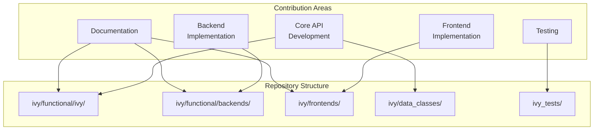
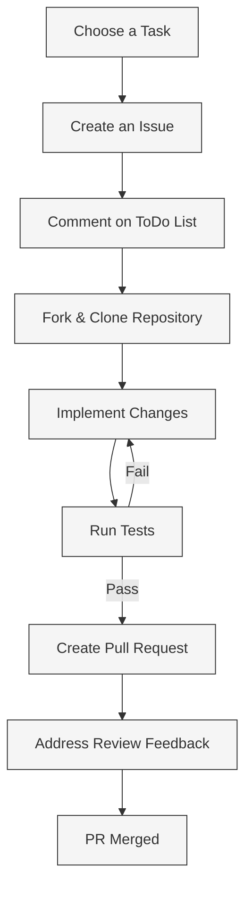
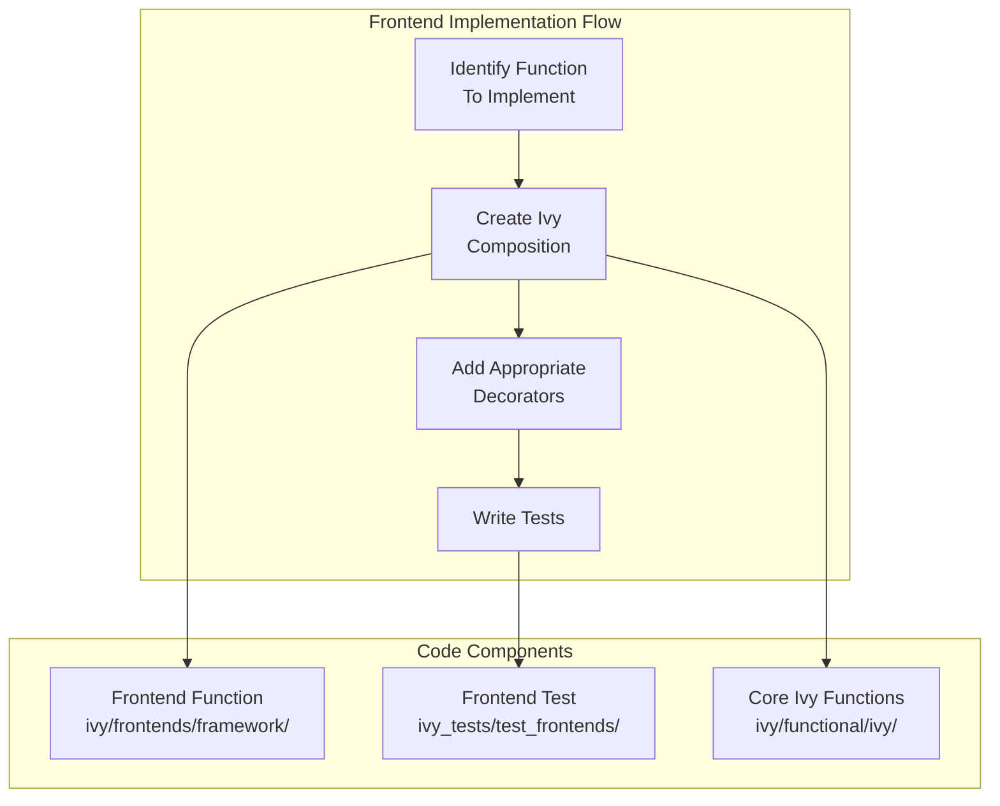

<!-- source: DeepWiki mcp.deepwiki.com · repo ivy-llc/ivy · page 7 Contributing Guide · fetched 2026-10-21 -->

# Contributing Guide

<details>
<summary>Relevant source files</summary>

The following files were used as context for generating this wiki page:

- [.github/ISSUE_TEMPLATE/docs_bug_report.yml](.github/ISSUE_TEMPLATE/docs_bug_report.yml)
- [.github/pull_request_template.md](.github/pull_request_template.md)
- [.github/workflows/checklist_actions.yml](.github/workflows/checklist_actions.yml)
- [CONTRIBUTING.md](CONTRIBUTING.md)
- [README.md](README.md)
- [automation_tools/checklists/frontend_checklist.md](automation_tools/checklists/frontend_checklist.md)
- [automation_tools/checklists/reformat_checklist.md](automation_tools/checklists/reformat_checklist.md)
- [docs/overview/contributing.rst](docs/overview/contributing.rst)
- [scripts/backend_generation/tree_generation.py](scripts/backend_generation/tree_generation.py)

</details>


This guide provides detailed instructions on how to contribute to the Ivy framework. Ivy is an open-source project aimed at unifying different machine learning frameworks, and we welcome contributions from developers of all skill levels. For information about testing guidelines specifically, see [Testing Guidelines](#7.2).

## Getting Started

Contributing to Ivy is accessible to everyone, regardless of your experience level with open-source development. This guide will help you understand how to setup your development environment, understand the codebase, and make meaningful contributions.

Sources: [docs/overview/contributing.rst:6-15](), [README.md:1226-1232]()

## Setting Up Your Development Environment

Before you start contributing, you'll need to set up your development environment.

### Installation from Source

To work on Ivy's code, you'll need to install it from source:

```bash
git clone https://github.com/ivy-llc/ivy.git
cd ivy
pip install --user -e .
```

For a more comprehensive setup that includes testing environments and framework-specific configurations, refer to the Setting Up page in the documentation.

### Environment Requirements

Depending on which part of the codebase you're contributing to, you may need different frameworks installed:

| Framework  | Required For |
|------------|--------------|
| PyTorch    | PyTorch frontend/backend |
| TensorFlow | TensorFlow frontend/backend |
| JAX        | JAX backend |
| NumPy      | NumPy backend |
| Paddle     | Paddle frontend |

Sources: [README.md:126-143]()

## Understanding the Codebase

Ivy has a well-structured architecture that helps unify different ML frameworks.

### High-Level Architecture



Understanding this structure will help you locate where your contributions should go.

## Contribution Workflow

The process for contributing to Ivy follows these steps:



### 1. Choose a Task

Start by choosing an open task that interests you. Currently, there are three main areas where contributions are needed:

- Transpiler development
- Frontend APIs implementation
- Ivy Experimental API

You can find tasks in the [ToDo list issues](https://github.com/ivy-llc/ivy/issues?q=is%3Aopen+is%3Aissue+label%3AToDo). Choose a task that:
- Is not already marked as completed
- Does not have an issue created for it
- Is not mentioned in the comments

Sources: [CONTRIBUTING.md:1-19]()

### 2. Create an Issue

Create a new issue with the title being the name of the sub-task you want to work on. This helps track your contribution and prevents duplication of effort.

Sources: [CONTRIBUTING.md:21-24]()

### 3. Comment on the ToDo List

Comment on the ToDo list issue with a reference to your new issue using the format `- [ ] #Issue_number`. For example, if your issue number is 12345, your comment should be `- [ ] #12345`.

Your issue will automatically be added to the ToDo list, and your comment will be deleted. You don't need to wait for this to happen before continuing.

Sources: [CONTRIBUTING.md:25-28]()

### 4. Implementation

Fork the repository, make your changes, and ensure that they meet the project's standards. When implementing features, keep in mind the architecture of Ivy and follow the existing patterns.

### 5. Testing

Ensure that your changes pass all tests. Run relevant tests locally before submitting your pull request. For more information on testing, see the [Testing Guidelines section](#7.2).

Sources: [.github/pull_request_template.md:23-27]()

### 6. Create a Pull Request

When you're ready to submit your changes, create a pull request following the PR template. Make sure to:

- Link your PR to the related issue using "Closes #[issue_number]"
- Complete the checklist in the PR template
- Ensure all tests are passing
- Ensure pre-commit checks don't fail

Sources: [.github/pull_request_template.md:1-45]()

### 7. Review Process

Wait for the maintainers to review your PR. Every time you respond to requested changes, re-request a review to notify the maintainers.

Once your PR is approved, it will be merged into the main branch, and you'll officially become an Ivy contributor!

Sources: [CONTRIBUTING.md:34-38]()

## Implementation Guidelines

When contributing code to Ivy, follow these guidelines based on what you're implementing.

### Implementing Frontend Functions/Methods

Frontend functions should adhere to these guidelines:

1. Match the naming and arguments of the original framework exactly
2. Compose using Ivy functions (not backend-specific code)
3. Use appropriate decorators (e.g., `@to_ivy_arrays_and_back`)
4. Add comprehensive tests



Sources: [automation_tools/checklists/frontend_checklist.md:16-43]()

### Reformatting Existing Code

When reformatting existing code:

1. Remove lambda and direct bindings for backend functions
2. Implement instance methods, static methods, and special methods as needed
3. Add appropriate type hints and docstrings
4. Include comprehensive examples in docstrings

Sources: [automation_tools/checklists/reformat_checklist.md:14-96]()

## Testing Guidelines

Testing is a critical part of the contribution process. All code changes must be tested thoroughly.

### Test Types

When adding a function, you should include:

1. Unit tests for the function
2. Frontend tests if implementing a frontend function
3. Docstring examples that serve as tests

### Running Tests

Before submitting a PR, make sure to:

1. Run tests for your specific function
2. Ensure docstring examples are passing
3. Verify that lint checks pass with pre-commit

Sources: [.github/pull_request_template.md:23-38]()

## Code Standards and Documentation

Ivy maintains high standards for code quality and documentation.

### Docstrings

All functions should have comprehensive docstrings that include:

1. A description of what the function does
2. Parameters with their types and descriptions
3. Return values with types and descriptions
4. Examples showing how to use the function

```python
def example_function(x, y=None, *, out=None):
    """
    Description of what the function does.

    Parameters
    ----------
    x
        Description of parameter x.
    y
        Description of parameter y. Default is None.
    out
        optional output array, for writing the result to. Default is None.

    Returns
    -------
    ret
        Description of return value.

    Examples
    --------
    >>> x = ivy.array([1, 2, 3])
    >>> y = ivy.example_function(x)
    >>> print(y)
    ivy.array([2, 3, 4])
    """
```

Sources: [automation_tools/checklists/reformat_checklist.md:29-41]()

### Formatting

Ivy uses several tools to ensure consistent code formatting:

1. Black for code formatting
2. Autoflake for removing unused imports
3. Pre-commit hooks for checking formatting before committing

## Troubleshooting Common Issues

When contributing to Ivy, you might encounter some common errors:

1. **Import errors**: Make sure you've installed all required dependencies
2. **Test failures**: Check that your implementation matches the expected behavior
3. **Pre-commit hook failures**: Run `pre-commit run --all-files` to identify and fix issues

For more detailed troubleshooting, refer to the Error Handling section in the documentation.

Sources: [docs/overview/contributing.rst:33-34]()

## Community and Communication

Join the Ivy community to get help and collaborate:

- Join the [Discord server](https://discord.gg/uYRmyPxMQq) for direct communication
- Check the [GitHub discussions](https://github.com/ivy-llc/ivy/discussions) for broader topics
- Follow the [documentation](https://docs.ivy.dev) for detailed information

Remember, Ivy aims to be an inclusive project, and all contributions are valued regardless of experience level.

Sources: [README.md:1238-1252](), [docs/overview/contributing.rst:6-15]()

---

