# Page: Overview

# Overview

<details>
<summary>Relevant source files</summary>

The following files were used as context for generating this wiki page:

- [.github/ISSUE_TEMPLATE/docs_bug_report.yml](.github/ISSUE_TEMPLATE/docs_bug_report.yml)
- [.github/pull_request_template.md](.github/pull_request_template.md)
- [.github/workflows/checklist_actions.yml](.github/workflows/checklist_actions.yml)
- [CONTRIBUTING.md](CONTRIBUTING.md)
- [README.md](README.md)
- [automation_tools/checklists/frontend_checklist.md](automation_tools/checklists/frontend_checklist.md)
- [automation_tools/checklists/reformat_checklist.md](automation_tools/checklists/reformat_checklist.md)
- [docs/overview/contributing.rst](docs/overview/contributing.rst)
- [ivy/__init__.py](ivy/__init__.py)
- [ivy/func_wrapper.py](ivy/func_wrapper.py)
- [ivy/functional/backends/jax/__init__.py](ivy/functional/backends/jax/__init__.py)
- [ivy/functional/backends/mxnet/__init__.py](ivy/functional/backends/mxnet/__init__.py)
- [ivy/functional/backends/numpy/__init__.py](ivy/functional/backends/numpy/__init__.py)
- [ivy/functional/backends/tensorflow/__init__.py](ivy/functional/backends/tensorflow/__init__.py)
- [ivy/functional/backends/torch/__init__.py](ivy/functional/backends/torch/__init__.py)
- [ivy/functional/ivy/__init__.py](ivy/functional/ivy/__init__.py)
- [scripts/backend_generation/tree_generation.py](scripts/backend_generation/tree_generation.py)

</details>


Ivy is a unified framework for machine learning that enables code conversion between different ML frameworks. This document provides a comprehensive overview of the Ivy codebase, its architecture, and how its various components interact. It serves as an entry point for understanding the system design and implementation details.

## Purpose and Scope

The primary purpose of Ivy is to provide a unified abstraction layer that allows developers to write code once and run it on any supported ML framework. Ivy achieves this through:

1. Framework transpilation - converting code between frameworks like PyTorch, TensorFlow, JAX, and NumPy
2. Graph tracing - creating optimized computational graphs
3. A unified API that works across frameworks

This overview covers the high-level architecture, core systems, and how they interact to provide Ivy's capabilities.

## High-Level Architecture

Ivy's architecture consists of several interconnected systems that work together to provide its unified functionality.

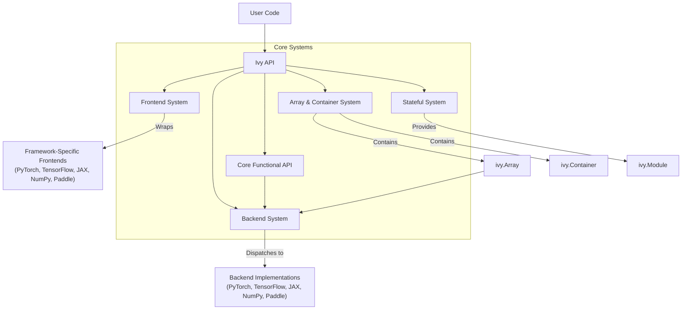

Sources: 
- [ivy/__init__.py:751-753](ivy/__init__.py:751-753)
- [ivy/func_wrapper.py:17-39](ivy/func_wrapper.py:17-39)
- [ivy/functional/ivy/__init__.py:1-45](ivy/functional/ivy/__init__.py:1-45)

### Frontend System

The Frontend System allows Ivy to mimic the API of various ML frameworks, enabling users to write code using familiar interfaces while leveraging Ivy's unified backend.

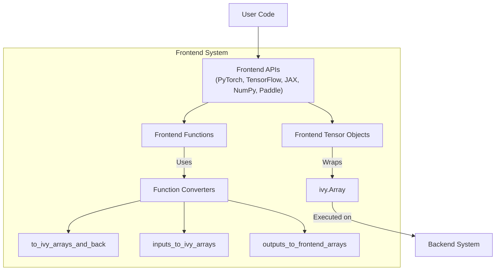

The Frontend System contains implementations that mimic various ML frameworks' APIs. When a user calls a function through a frontend, the inputs are converted to Ivy arrays, processed through the Ivy backend, and then converted back to the appropriate frontend format.

Sources:
- [ivy/func_wrapper.py:418-457](ivy/func_wrapper.py:418-457)
- [ivy/func_wrapper.py:573-590](ivy/func_wrapper.py:573-590)

### Backend System

The Backend System is responsible for dispatching function calls to the appropriate framework implementation. This allows Ivy to leverage different ML frameworks' capabilities while providing a consistent API.

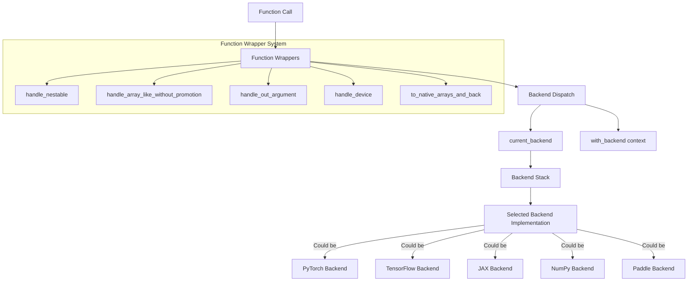

Each backend implementation provides native versions of Ivy's core functions. The system keeps track of the active backend and routes function calls accordingly. Backend switching is possible through context managers or explicit calls.

Sources:
- [ivy/func_wrapper.py:15-39](ivy/func_wrapper.py:15-39)
- [ivy/functional/backends/jax/__init__.py:55-68](ivy/functional/backends/jax/__init__.py:55-68)
- [ivy/functional/backends/torch/__init__.py:21-31](ivy/functional/backends/torch/__init__.py:21-31)
- [ivy/functional/backends/tensorflow/__init__.py:31-95](ivy/functional/backends/tensorflow/__init__.py:31-95)
- [ivy/functional/backends/numpy/__init__.py:17-25](ivy/functional/backends/numpy/__init__.py:17-25)

### Core Functional API

The Core Functional API is the heart of Ivy, providing a unified set of functions that work across all supported backends.

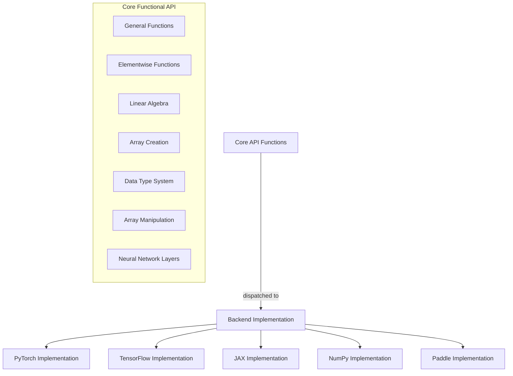

This API provides functions for common operations like array creation, manipulation, mathematical operations, and neural network layers. Each function has implementations across different backends, allowing seamless operation regardless of the active backend.

Sources:
- [ivy/functional/ivy/__init__.py:1-45](ivy/functional/ivy/__init__.py:1-45)
- [ivy/__init__.py:842-891](ivy/__init__.py:842-891)

### Array and Container System

Ivy provides two primary data structures: `ivy.Array` and `ivy.Container`. `ivy.Array` wraps native arrays from various backends, while `ivy.Container` enables working with nested collections of arrays.

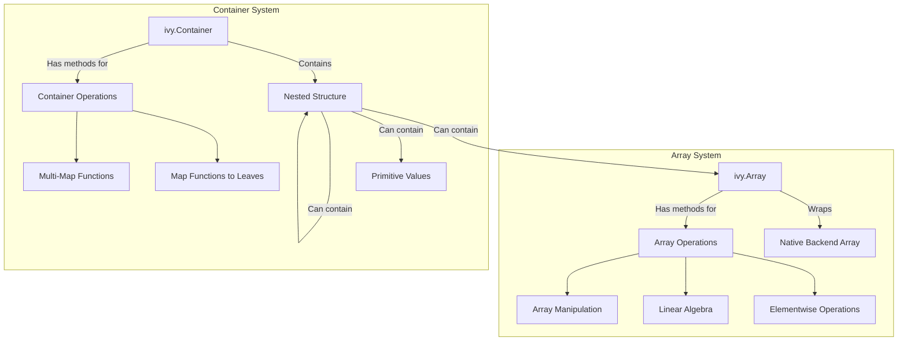

`ivy.Array` provides a consistent interface across different backends, while `ivy.Container` enables operations on nested structures of arrays, facilitating complex transformations and operations on hierarchical data.

Sources:
- [ivy/__init__.py:76-111](ivy/__init__.py:76-111)
- [ivy/__init__.py:228-510](ivy/__init__.py:228-510)
- [ivy/__init__.py:753-755](ivy/__init__.py:753-755)

### Stateful System

The Stateful System provides classes and utilities for building and managing stateful components like neural networks.

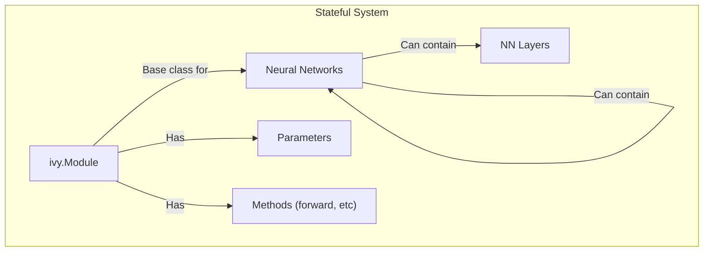

`ivy.Module` provides a framework-agnostic way to define neural network models. It manages parameters and provides methods for forward passes, training, and more.

Sources:
- [ivy/__init__.py:792-793](ivy/__init__.py:792-793)

## Function Wrapper System

One of the key components of Ivy is its function wrapper system, which transforms functions to handle various aspects like device placement, type conversion, array conversion, etc.

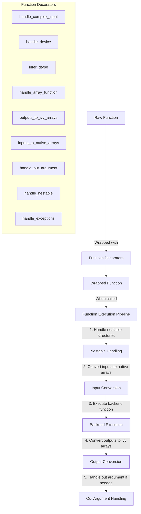

Function wrappers modify function behavior in a layered approach, with each wrapper handling a specific aspect like input conversion, nestable operations, or device placement. This layered approach allows for extensible and modular function behavior.

Sources:
- [ivy/func_wrapper.py:16-39](ivy/func_wrapper.py:16-39)
- [ivy/func_wrapper.py:871-914](ivy/func_wrapper.py:871-914)
- [ivy/func_wrapper.py:381-416](ivy/func_wrapper.py:381-416)
- [ivy/func_wrapper.py:496-524](ivy/func_wrapper.py:496-524)

## Key Features

### Framework Transpilation

One of Ivy's main features is its ability to transpile code between different ML frameworks. This allows developers to write code in one framework and execute it in another.

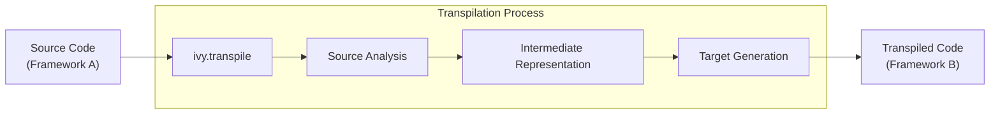

The transpilation process analyzes source code, converts it to an intermediate representation, and then generates equivalent code in the target framework. This allows for seamless conversion between frameworks like PyTorch, TensorFlow, JAX, and NumPy.

Sources:
- [README.md:78-82](README.md:78-82)
- [README.md:180-196](README.md:180-196)

### Graph Tracing

Ivy can trace computational graphs from functions, optimizing them for execution in any supported framework.

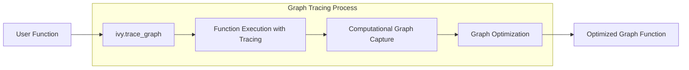

Graph tracing captures the computational structure of functions, allowing for optimizations like fusion of operations, elimination of redundant computations, and efficient execution on various hardware.

Sources:
- [README.md:78-82](README.md:78-82)
- [README.md:213-217](README.md:213-217)

## Unified Type System

Ivy provides a unified type system that abstracts away differences between framework-specific types.

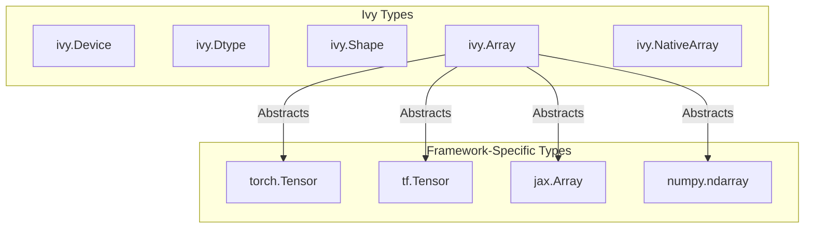

Ivy's type system provides consistent handling of arrays, devices, and data types across different frameworks, enabling framework-agnostic code.

Sources:
- [ivy/__init__.py:44-111](ivy/__init__.py:44-111)
- [ivy/__init__.py:116-223](ivy/__init__.py:116-223)
- [ivy/__init__.py:228-510](ivy/__init__.py:228-510)

## How Systems Interact

The interaction between Ivy's different systems creates a powerful unified framework for machine learning.

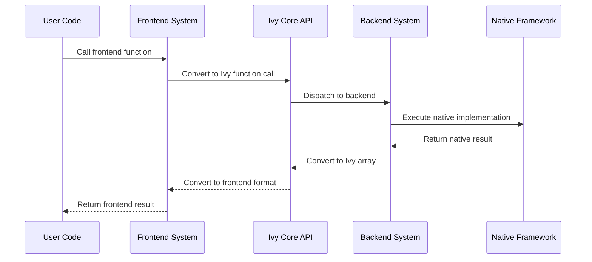

This sequence shows how a typical function call flows through Ivy's systems:
1. User code calls a frontend function
2. The frontend converts inputs to Ivy format
3. The Ivy API dispatches to the appropriate backend
4. The backend executes the function using the native framework
5. Results flow back through the system with appropriate conversions

Sources:
- [ivy/func_wrapper.py:418-457](ivy/func_wrapper.py:418-457)
- [ivy/func_wrapper.py:381-416](ivy/func_wrapper.py:381-416)
- [ivy/func_wrapper.py:496-524](ivy/func_wrapper.py:496-524)

## Backend Implementation Details

Each backend in Ivy implements the same functional API, allowing for consistent behavior across frameworks.

| Backend    | Native Array Type         | Native Module Type  | Supports Gradients | Native Inplace Support |
|------------|---------------------------|---------------------|--------------------|-----------------------|
| JAX        | jax.Array                 | Model/hk.Module     | Yes                | No                    |
| PyTorch    | torch.Tensor              | torch.nn.Module     | Yes                | Yes                   |
| TensorFlow | tf.Tensor                 | Model               | Yes                | No                    |
| NumPy      | numpy.ndarray             | None                | No                 | Yes                   |
| MXNet      | mxnet.ndarray.NDArray     | mx.gluon.nn.Block   | Yes                | Yes                   |

Each backend implementation provides the mapping between Ivy's unified API and the framework-specific operations, handling differences in functionality, type conversions, and execution models.

Sources:
- [ivy/functional/backends/jax/__init__.py:58-68](ivy/functional/backends/jax/__init__.py:58-68)
- [ivy/functional/backends/torch/__init__.py:22-31](ivy/functional/backends/torch/__init__.py:22-31)
- [ivy/functional/backends/tensorflow/__init__.py:96-102](ivy/functional/backends/tensorflow/__init__.py:96-102)
- [ivy/functional/backends/numpy/__init__.py:19-25](ivy/functional/backends/numpy/__init__.py:19-25)
- [ivy/functional/backends/mxnet/__init__.py:74-79](ivy/functional/backends/mxnet/__init__.py:74-79)

## Contributing to Ivy

Ivy welcomes contributions from developers of all skill levels. The contribution process involves:

1. Setting up the development environment
2. Understanding the codebase's structure
3. Finding an issue to work on
4. Creating a pull request with your contribution

For detailed information on contributing, see [Contributing Guide](#7).

Sources:
- [docs/overview/contributing.rst:1-47](docs/overview/contributing.rst:1-47)
- [CONTRIBUTING.md:1-41](CONTRIBUTING.md:1-41)

## Summary

Ivy provides a unified framework for machine learning that enables code to run on multiple backends and to be transpiled between frameworks. Its architecture consists of interconnected systems that handle frontend interfaces, backend implementations, core functionality, data structures, and stateful components. By abstracting away framework-specific details, Ivy allows developers to write framework-agnostic code while still leveraging the strengths of specific frameworks.

---

# Page: Key Features and Capabilities

# Key Features and Capabilities

<details>
<summary>Relevant source files</summary>

The following files were used as context for generating this wiki page:

- [.github/ISSUE_TEMPLATE/docs_bug_report.yml](.github/ISSUE_TEMPLATE/docs_bug_report.yml)
- [.github/pull_request_template.md](.github/pull_request_template.md)
- [.github/workflows/checklist_actions.yml](.github/workflows/checklist_actions.yml)
- [CONTRIBUTING.md](CONTRIBUTING.md)
- [README.md](README.md)
- [automation_tools/checklists/frontend_checklist.md](automation_tools/checklists/frontend_checklist.md)
- [automation_tools/checklists/reformat_checklist.md](automation_tools/checklists/reformat_checklist.md)
- [docs/overview/contributing.rst](docs/overview/contributing.rst)
- [ivy/functional/backends/jax/general.py](ivy/functional/backends/jax/general.py)
- [ivy/functional/backends/mxnet/general.py](ivy/functional/backends/mxnet/general.py)
- [ivy/functional/backends/numpy/general.py](ivy/functional/backends/numpy/general.py)
- [ivy/functional/backends/paddle/general.py](ivy/functional/backends/paddle/general.py)
- [ivy/functional/backends/tensorflow/general.py](ivy/functional/backends/tensorflow/general.py)
- [ivy/functional/backends/torch/general.py](ivy/functional/backends/torch/general.py)
- [ivy/functional/ivy/general.py](ivy/functional/ivy/general.py)
- [ivy_tests/test_ivy/test_functional/test_core/test_general.py](ivy_tests/test_ivy/test_functional/test_core/test_general.py)
- [scripts/backend_generation/tree_generation.py](scripts/backend_generation/tree_generation.py)

</details>


This page provides an overview of Ivy's core features and capabilities. Ivy is a framework designed to unify machine learning code across different backends (PyTorch, TensorFlow, JAX, NumPy, and Paddle), enabling seamless conversion between frameworks and optimized graph-based operations. For a high-level architectural overview, see [Architectural Overview](#1.2).

## Unified Framework Interface

Ivy provides a unified API that works across different machine learning frameworks, allowing code to be written once and run on any supported backend.

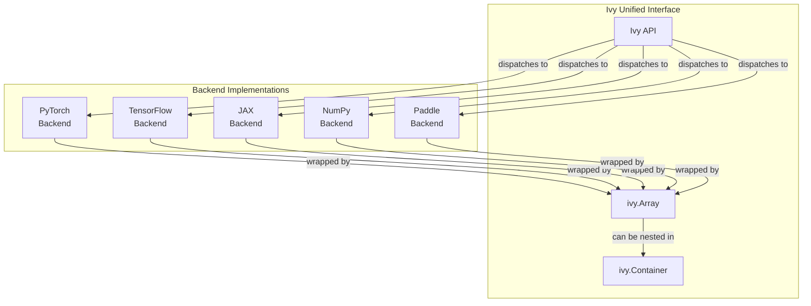

Sources:
- [ivy/functional/backends/tensorflow/general.py:1-96]()
- [ivy/functional/backends/jax/general.py:1-72]()
- [ivy/functional/backends/torch/general.py:1-57]()
- [ivy/functional/backends/numpy/general.py:1-33]()
- [ivy/functional/backends/paddle/general.py:1-62]()

## Framework Transpilation

Ivy's transpilation capability (`ivy.transpile`) allows you to convert code from one framework to another while maintaining complete functionality.

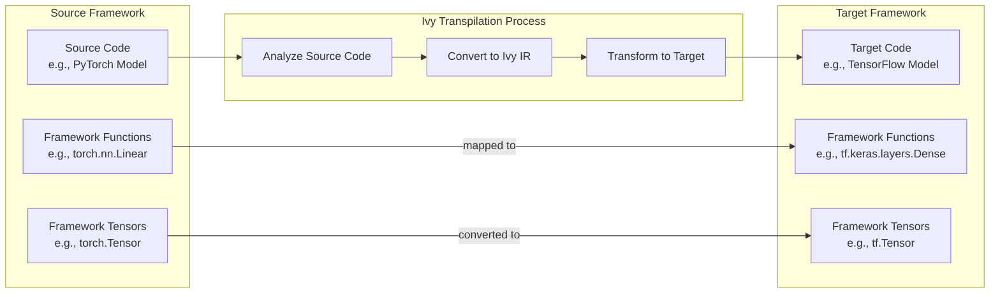

Sources:
- [README.md:80-82]()
- [README.md:168-171]()

## Graph Tracing

Ivy provides graph tracing capabilities (`ivy.trace_graph`) to optimize and analyze computational graphs from any backend.

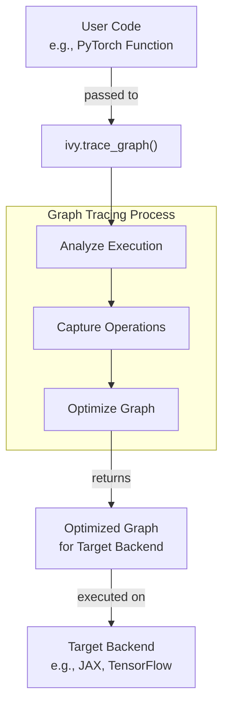

Sources:
- [README.md:82-82]()
- [README.md:200-216]()

## Backend System

The backend system enables seamless switching between different ML frameworks and handles the execution of functions on the appropriate backend.

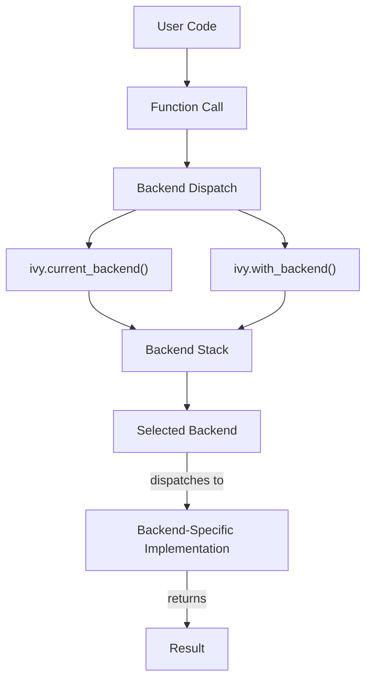

Sources:
- [ivy/functional/ivy/general.py:31-73]()
- [ivy/functional/backends/tensorflow/general.py:50-52]()
- [ivy/functional/backends/jax/general.py:49-51]()
- [ivy/functional/backends/torch/general.py:68-70]()
- [ivy/functional/backends/numpy/general.py:30-32]()

## Function Wrapping System

Ivy uses a sophisticated function wrapping system to handle array conversion, device placement, and other aspects of function execution.

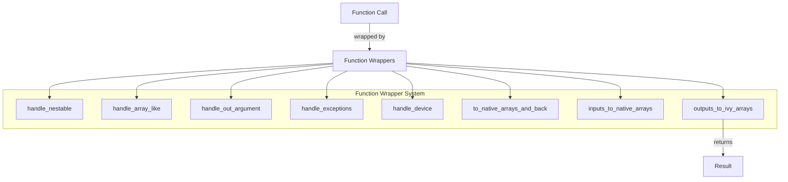

Sources:
- [ivy/functional/ivy/general.py:31-73]()
- [ivy/func_wrapper.py:referenced in file]()

## Array and Container System

Ivy provides `ivy.Array` and `ivy.Container` classes for working with arrays and nested collections across different backends.

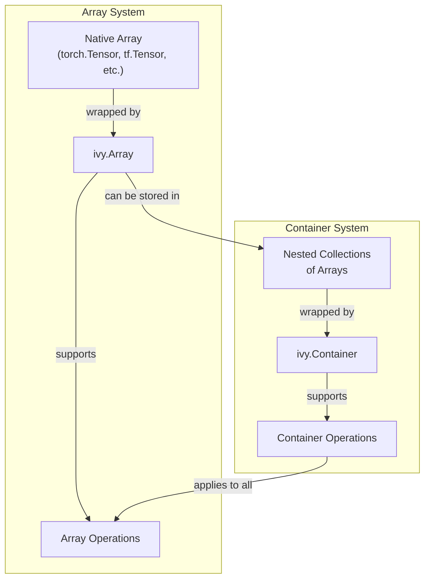

Sources:
- [ivy/functional/ivy/general.py:279-410]()
- [ivy/functional/backends/tensorflow/general.py:27-35]()
- [ivy/functional/backends/jax/general.py:53-71]()
- [ivy/functional/backends/torch/general.py:50-56]()
- [ivy/functional/backends/numpy/general.py:250-253]()

## Backend-Agnostic Data Type System

Ivy provides a comprehensive system for handling different data types across frameworks.

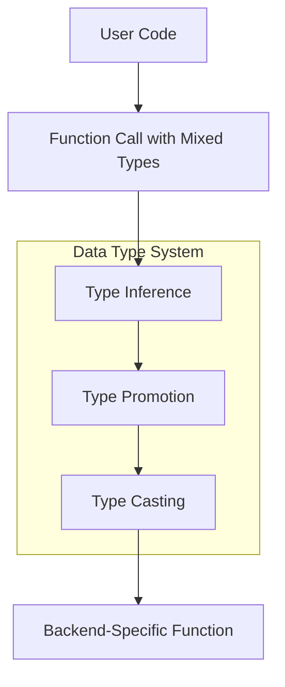

Sources:
- [ivy/functional/ivy/general.py:96-170]()

## Core Functional API

The Core Functional API provides a comprehensive set of operations that are implemented across all supported backends.

| Category | Description | Examples |
|----------|-------------|----------|
| General Functions | Utility and common operations | `to_numpy`, `array_equal`, `get_item`, `set_item` |
| Elementwise Functions | Operations applied to each element | Math, logic, and comparison operations |
| Linear Algebra | Matrix and vector operations | Matrix multiplication, decompositions, solvers |
| Array Creation | Functions to create arrays | `zeros`, `ones`, `eye`, `linspace` |
| Array Manipulation | Shape and dimension operations | Reshape, concat, split, transpose |
| Neural Network Layers | Building blocks for neural networks | Linear, convolutional, pooling, normalization layers |

Sources:
- [ivy/functional/ivy/general.py:279-1335]()
- [ivy/functional/backends/tensorflow/general.py:35-581]()
- [ivy/functional/backends/jax/general.py:53-472]()
- [ivy/functional/backends/torch/general.py:58-579]()
- [ivy/functional/backends/numpy/general.py:22-469]()

## Multi-Backend Mode Management

Ivy provides mechanisms to manage how code is executed across backends, including array mode, nestable mode, and exception handling.

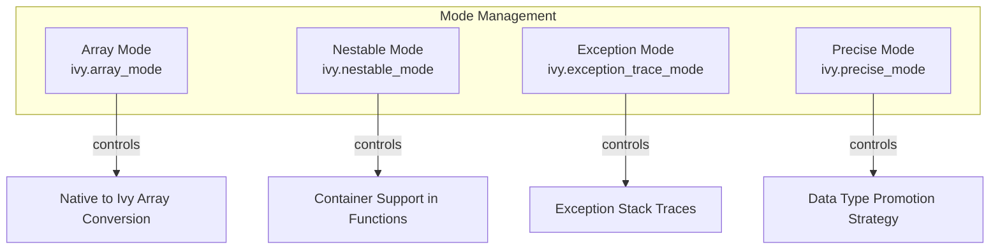

Sources:
- [ivy/functional/ivy/general.py:169-570]()

## Inplace Operations Support

Ivy provides capabilities for inplace updates to arrays, which can be critical for memory efficiency in certain applications.

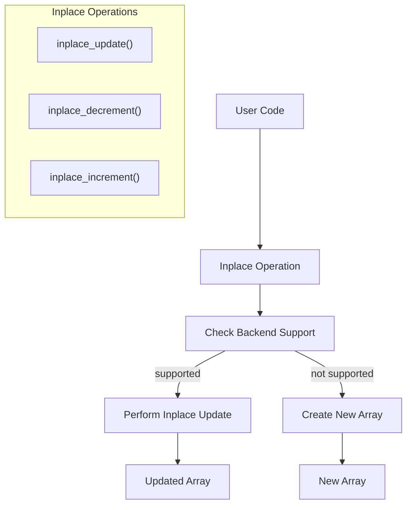

Sources:
- [ivy/functional/backends/tensorflow/general.py:239-337]()
- [ivy/functional/backends/jax/general.py:258-337]()
- [ivy/functional/backends/torch/general.py:368-396]()
- [ivy/functional/backends/numpy/general.py:185-243]()
- [ivy/functional/backends/paddle/general.py:350-466]()

## Framework Frontend APIs

Ivy provides frontends that mimic the APIs of other frameworks, allowing code written for specific frameworks to run on any backend.

```mermaid
flowchart LR
    subgraph "User Code"
        torch_code["PyTorch Code"]
        tf_code["TensorFlow Code"]
        jax_code["JAX Code"]
        numpy_code["NumPy Code"]
        paddle_code["Paddle Code"]
    end
    
    subgraph "Ivy Frontend System"
        torch_frontend["PyTorch Frontend"]
        tf_frontend["TensorFlow Frontend"]
        jax_frontend["JAX Frontend"]
        numpy_frontend["NumPy Frontend"]
        paddle_frontend["Paddle Frontend"]
        
        frontendConversion["Frontend Conversion Utilities"]
    end
    
    subgraph "Ivy Core"
        ivyAPI["Ivy API"]
        backendSystem["Backend System"]
    end
    
    torch_code --> torch_frontend
    tf_code --> tf_frontend
    jax_code --> jax_frontend
    numpy_code --> numpy_frontend
    paddle_code --> paddle_frontend
    
    torch_frontend --> |"uses"| frontendConversion
    tf_frontend --> |"uses"| frontendConversion
    jax_frontend --> |"uses"| frontendConversion
    numpy_frontend --> |"uses"| frontendConversion
    paddle_frontend --> |"uses"| frontendConversion
    
    frontendConversion --> ivyAPI
    ivyAPI --> backendSystem
```

Sources:
- [README.md:155-159]()

## Testing Framework

Ivy includes a comprehensive testing system to ensure compatibility and correctness across different backends.

```mermaid
flowchart TD
    subgraph "Testing System"
        function_testing["Function Testing"]
        frontend_testing["Frontend Testing"]
        test_execution["Test Execution"]
    end
    
    function_testing --> |"tests"| core_functions["Core API Functions"]
    frontend_testing --> |"tests"| frontend_functions["Frontend API Functions"]
    
    core_functions --> |"executed on"| backend_implementations["Backend Implementations"]
    frontend_functions --> |"executed on"| backend_implementations
    
    backend_implementations --> test_execution
    test_execution --> |"reports"| test_results["Test Results"]
```

Sources:
- [ivy_tests/test_ivy/test_functional/test_core/test_general.py:1-67]()

This overview covers the key features and capabilities of Ivy. Each of these components works together to provide a unified interface for machine learning across different frameworks, enabling code interoperability, optimization, and simplified development.

---

# Page: Architectural Overview

# Architectural Overview

<details>
<summary>Relevant source files</summary>

The following files were used as context for generating this wiki page:

- [ivy/__init__.py](ivy/__init__.py)
- [ivy/func_wrapper.py](ivy/func_wrapper.py)
- [ivy/functional/backends/jax/__init__.py](ivy/functional/backends/jax/__init__.py)
- [ivy/functional/backends/jax/general.py](ivy/functional/backends/jax/general.py)
- [ivy/functional/backends/mxnet/__init__.py](ivy/functional/backends/mxnet/__init__.py)
- [ivy/functional/backends/mxnet/general.py](ivy/functional/backends/mxnet/general.py)
- [ivy/functional/backends/numpy/__init__.py](ivy/functional/backends/numpy/__init__.py)
- [ivy/functional/backends/numpy/general.py](ivy/functional/backends/numpy/general.py)
- [ivy/functional/backends/paddle/general.py](ivy/functional/backends/paddle/general.py)
- [ivy/functional/backends/tensorflow/__init__.py](ivy/functional/backends/tensorflow/__init__.py)
- [ivy/functional/backends/tensorflow/general.py](ivy/functional/backends/tensorflow/general.py)
- [ivy/functional/backends/torch/__init__.py](ivy/functional/backends/torch/__init__.py)
- [ivy/functional/backends/torch/general.py](ivy/functional/backends/torch/general.py)
- [ivy/functional/ivy/__init__.py](ivy/functional/ivy/__init__.py)
- [ivy/functional/ivy/general.py](ivy/functional/ivy/general.py)
- [ivy_tests/test_ivy/test_functional/test_core/test_general.py](ivy_tests/test_ivy/test_functional/test_core/test_general.py)

</details>


## Purpose and Scope

This document provides a comprehensive overview of Ivy's architecture, explaining how it unifies multiple machine learning frameworks under a single API. It covers the key architectural components, including the Backend System, Functional API, Function Wrapping System, Array and Container abstractions, and Frontend System.

For implementation details about specific subsystems, refer to more specialized documentation pages such as [Frontend System](#2), [Backend System](#3), and [Core Functional API](#4).

## High-Level Architecture

### Ivy Framework Architecture

```mermaid
graph TD
    User["User Code"] -->|Uses| IvyAPI["Ivy API"]
    
    subgraph "Core Systems"
        IvyAPI -->|Calls| BackendSystem["Backend System"]
        IvyAPI -->|Operates on| ArraySystem["Array & Container System"]
        IvyAPI -->|Uses| FunctionalAPI["Core Functional API"]
        IvyAPI -->|Provides| FrontendSystem["Frontend System"]
        IvyAPI -->|Uses| StatefulSystem["Stateful System"]
        
        FunctionalAPI -->|Dispatched to| BackendSystem
        FrontendSystem -->|Converts to| ArraySystem
        FrontendSystem -->|Uses| FunctionalAPI
        StatefulSystem -->|Uses| FunctionalAPI
    end
    
    subgraph "Backend Implementations"
        BackendSystem -->|Executes on| PyTorch["PyTorch Backend"]
        BackendSystem -->|Executes on| TensorFlow["TensorFlow Backend"]
        BackendSystem -->|Executes on| JAX["JAX Backend"]
        BackendSystem -->|Executes on| NumPy["NumPy Backend"]
        BackendSystem -->|Executes on| Paddle["Paddle Backend"]
    end
```

The Ivy architecture consists of several key components that work together to provide a unified interface across multiple ML frameworks. The Backend System serves as the foundation, allowing operations to be executed on different backends like PyTorch, TensorFlow, JAX, NumPy, and Paddle. The Core Functional API provides framework-agnostic operations that are dispatched to the appropriate backend. The Array & Container System abstracts away backend-specific array implementations. The Frontend System allows users to write code in their familiar framework syntax while still leveraging Ivy's backend flexibility.

Sources:
- [ivy/__init__.py:1-892](ivy/__init__.py:1-892)
- [ivy/functional/ivy/__init__.py:1-58](ivy/functional/ivy/__init__.py:1-58)

## Backend System

### Backend Management Architecture

```mermaid
graph TD
    FunctionCall["Function Call"] --> FunctionWrappers["Function Wrappers"]
    
    subgraph "Function Wrapper System"
        FunctionWrappers -->|Applies| InputConversion["Input Conversion"]
        InputConversion -->|Applies| DeviceHandling["Device Handling"]
        DeviceHandling -->|Passes to| BackendDispatch["Backend Dispatch"]
    end
    
    BackendDispatch -->|Uses| CurrentBackend["current_backend()"]
    BackendDispatch -->|Or| WithBackend["with_backend()"]
    
    CurrentBackend --> BackendStack["Backend Stack"]
    WithBackend --> BackendStack
    
    BackendStack -->|Selects| SelectedBackend["Selected Backend Implementation"]
    
    SelectedBackend --> TorchImpl["PyTorch Implementation"]
    SelectedBackend --> TensorFlowImpl["TensorFlow Implementation"]
    SelectedBackend --> JAXImpl["JAX Implementation"]
    SelectedBackend --> NumPyImpl["NumPy Implementation"]
    SelectedBackend --> PaddleImpl["Paddle Implementation"]
    
    SelectedBackend -->|Executes| BackendImplementation["Backend Implementation"]
    BackendImplementation -->|Converts| ResultConversion["Result Conversion"]
    ResultConversion --> ReturnValue["Return Ivy Array"]
```

The Backend System manages multiple ML framework backends and dispatches function calls to the appropriate implementation. It maintains a backend stack that tracks the currently active backend. Functions like `current_backend()` and context managers like `with_backend()` allow querying and temporarily changing the active backend.

Each backend provides implementations for all core functions in the Ivy API, allowing consistent behavior regardless of which backend is being used. The backend system also handles conversion between different array types, ensuring that results are properly returned as Ivy arrays.

Sources:
- [ivy/utils/backend/handler.py](ivy/utils/backend/handler.py)
- [ivy/functional/backends/jax/__init__.py:1-196](ivy/functional/backends/jax/__init__.py:1-196)
- [ivy/functional/backends/torch/__init__.py:1-175](ivy/functional/backends/torch/__init__.py:1-175)
- [ivy/functional/backends/tensorflow/__init__.py:1-220](ivy/functional/backends/tensorflow/__init__.py:1-220)
- [ivy/functional/backends/numpy/__init__.py:1-148](ivy/functional/backends/numpy/__init__.py:1-148)
- [ivy/functional/backends/paddle/__init__.py](ivy/functional/backends/paddle/__init__.py)

## Function Wrapping System

### Function Wrapper Architecture

```mermaid
graph TD
    FunctionCall["Function Call"] -->|Processed by| FunctionWrappers["Function Wrappers"]
    
    subgraph "Wrapper Decorators"
        FunctionWrappers -->|1. Exception handling| HandleExceptions["handle_exceptions"]
        HandleExceptions -->|2. Array handling| HandleArrayLike["handle_array_like_without_promotion"]
        HandleArrayLike -->|3. Device handling| HandleDevice["handle_device"]
        HandleDevice -->|4. Nestable handling| HandleNestable["handle_nestable"]
        HandleNestable -->|5. Array function| HandleArrayFunction["handle_array_function"]
        HandleArrayFunction -->|6. Array conversion| InputsToNative["inputs_to_native_arrays"]
        InputsToNative -->|7. Output conversion| OutputsToIvy["outputs_to_ivy_arrays"]
        OutputsToIvy -->|8. Out argument| HandleOutArgument["handle_out_argument"]
    end
    
    OutputsToIvy --> BackendSpecificFunc["Backend-Specific Function"]
    BackendSpecificFunc --> ReturnIvyArray["Return Ivy Array"]
```

The Function Wrapping System is a key architectural component that processes and transforms function calls through a series of decorators. This system ensures consistent behavior across backends and handles various cross-cutting concerns.

The wrapper decorators are applied in a specific order, each handling a particular aspect:

1. **Exception handling**: Standardizes error handling
2. **Array handling**: Converts array-like inputs to arrays
3. **Device handling**: Manages device placement
4. **Nestable handling**: Processes container inputs
5. **Array function**: Handles special array methods
6. **Array conversion**: Converts inputs to native backend arrays
7. **Output conversion**: Converts backend outputs to Ivy arrays
8. **Out argument handling**: Manages in-place operations

This extensive wrapping system enables Ivy to provide a clean, consistent API despite the significant differences between underlying frameworks.

Sources:
- [ivy/func_wrapper.py:1-435](ivy/func_wrapper.py:1-435)
- [ivy/functional/ivy/general.py:76-188](ivy/functional/ivy/general.py:76-188)

## Array and Container System

### Array Abstraction System

```mermaid
graph TD
    UserCode["User Code"] -->|Creates and manipulates| IvyArray["ivy.Array"]
    UserCode -->|Creates and manipulates| IvyContainer["ivy.Container"]
    
    IvyArray -->|Wraps| NativeArray["Native Backend Array"]
    IvyArray -->|Has methods from| ElementwiseFuncs["Elementwise Functions"]
    IvyArray -->|Has methods from| LinearAlgebraFuncs["Linear Algebra Functions"]
    IvyArray -->|Has methods from| CreationFuncs["Creation Functions"]
    
    IvyContainer -->|Contains| ArraysOrContainers["Arrays or Containers"]
    IvyContainer -->|Applies functions to| NestedArrays["Nested Arrays"]
    
    NativeArray -->|Could be| TorchTensor["torch.Tensor"]
    NativeArray -->|Could be| TFTensor["tf.Tensor"]
    NativeArray -->|Could be| JAXArray["jax.Array"]
    NativeArray -->|Could be| NumPyArray["numpy.ndarray"]
    NativeArray -->|Could be| PaddleTensor["paddle.Tensor"]
    
    TorchTensor --> TorchOps["torch operations"]
    TFTensor --> TFOps["tensorflow operations"]
    JAXArray --> JAXOps["jax operations"]
    NumPyArray --> NumPyOps["numpy operations"]
    PaddleTensor --> PaddleOps["paddle operations"]
```

The Array and Container System provides unified abstractions for working with arrays across different backends. It consists of two main classes:

1. **ivy.Array**: A wrapper around native backend arrays (torch.Tensor, tf.Tensor, jax.Array, numpy.ndarray, paddle.Tensor) that provides a consistent interface. It includes methods for all the functional operations in Ivy.

2. **ivy.Container**: A nested container structure that can hold Ivy arrays or other containers. It allows applying functions to all contained arrays simultaneously, enabling batch operations on complex data structures.

The system provides functions for converting between Ivy arrays and native arrays, as well as utilities for checking array types and properties. This abstraction layer is fundamental to Ivy's backend-agnostic approach.

Sources:
- [ivy/__init__.py:44-550](ivy/__init__.py:44-550)
- [ivy/functional/ivy/general.py:277-410](ivy/functional/ivy/general.py:277-410)

## Functional API

### Core Functional API Structure

```mermaid
graph TD
    IvyAPI["Ivy API"] --> FunctionalModules["Functional Modules"]
    
    FunctionalModules --> General["General Functions"]
    FunctionalModules --> Elementwise["Elementwise Functions"]
    FunctionalModules --> LinearAlgebra["Linear Algebra"]
    FunctionalModules --> Creation["Array Creation"]
    FunctionalModules --> DataType["Data Type System"]
    FunctionalModules --> Manipulation["Array Manipulation"]
    FunctionalModules --> NNLayers["Neural Network Layers"]
    
    General --> DeviceOps["Device Operations"]
    General --> TypeConversion["Type Conversion"]
    General --> BackendSelection["Backend Selection"]
    
    Elementwise --> Math["Mathematical Operations"]
    Elementwise --> Logic["Logical Operations"]
    
    LinearAlgebra --> MatrixOps["Matrix Operations"]
    LinearAlgebra --> Decompositions["Matrix Decompositions"]
    
    NNLayers --> Conv["Convolutional Layers"]
    NNLayers --> Linear["Linear Layers"]
    NNLayers --> Pooling["Pooling Layers"]
    NNLayers --> Activation["Activation Functions"]
    
    subgraph "Per-Backend Implementation"
        PyTorchBackend["PyTorch Backend"]
        TensorFlowBackend["TensorFlow Backend"]
        JAXBackend["JAX Backend"]
        NumPyBackend["NumPy Backend"]
        PaddleBackend["Paddle Backend"]
    end
    
    General --> PyTorchBackend
    Elementwise --> TensorFlowBackend
    LinearAlgebra --> JAXBackend
    Creation --> NumPyBackend
    Manipulation --> PaddleBackend
```

The Core Functional API forms the heart of Ivy, providing a comprehensive set of operations that work across different backends. The API is organized into logical modules:

1. **General Functions**: Utilities for array management, backend selection, device operations, and type conversions (e.g., `array_equal`, `to_numpy`, `is_array`)

2. **Elementwise Functions**: Mathematical operations acting element-by-element (e.g., `add`, `multiply`, `sin`, `exp`)

3. **Linear Algebra**: Matrix operations, decompositions, and solvers (e.g., `matmul`, `svd`, `solve`)

4. **Array Creation**: Functions to create arrays (e.g., `array`, `zeros`, `linspace`)

5. **Data Type System**: Type management and conversion (e.g., `astype`, `promote_types`)

6. **Array Manipulation**: Functions to reshape, concatenate, and slice arrays (e.g., `reshape`, `concat`, `stack`)

7. **Neural Network Layers**: Building blocks for deep learning (e.g., `conv2d`, `linear`, `max_pool2d`)

Each function in the API has specialized implementations for each supported backend, allowing the same code to run on different frameworks seamlessly.

Sources:
- [ivy/functional/ivy/general.py:75-1350](ivy/functional/ivy/general.py:75-1350)
- [ivy/functional/backends/jax/general.py:1-200](ivy/functional/backends/jax/general.py:1-200)
- [ivy/functional/backends/tensorflow/general.py:1-200](ivy/functional/backends/tensorflow/general.py:1-200)
- [ivy/functional/backends/torch/general.py:1-200](ivy/functional/backends/torch/general.py:1-200)
- [ivy/functional/backends/numpy/general.py:1-200](ivy/functional/backends/numpy/general.py:1-200)
- [ivy/functional/backends/paddle/general.py:1-200](ivy/functional/backends/paddle/general.py:1-200)

## Frontend System

### Frontend Architecture

```mermaid
graph TD
    UserCode["User Code"] -->|Uses| FrontendAPI["Frontend API (PyTorch/TF/JAX/etc.)"]
    
    subgraph "Frontend System"
        FrontendAPI --> FrontendFunctions["Frontend Functions"]
        FrontendAPI --> FrontendTensors["Frontend Tensor Types"]
        
        FrontendFunctions -->|Uses| FunctionConverters["Function Converters"]
        FrontendTensors -->|Wraps| IvyArray["ivy.Array"]
        
        FunctionConverters --> ToIvyArrays["to_ivy_arrays_and_back"]
        FunctionConverters --> InputsToIvy["inputs_to_ivy_arrays"]
        FunctionConverters --> OutputsToFrontend["outputs_to_frontend_arrays"]
    end
    
    FrontendFunctions -->|Calls| IvyFunctions["Ivy Core Functions"]
    IvyFunctions -->|Executed on| BackendSystem["Backend System"]
    BackendSystem -->|Might be different from| OriginalFramework["Original Framework"]
```

The Frontend System allows users to write code using familiar framework APIs (PyTorch, TensorFlow, JAX, etc.) while executing on any supported backend. This enables framework interoperability and code transpilation.

The frontend system consists of:

1. **Frontend Tensor Types**: Wrappers around Ivy arrays that mimic the behavior of native framework tensors (e.g., torch.Tensor, tf.Tensor)

2. **Frontend Functions**: Implementations of framework-specific functions that internally use Ivy operations

3. **Function Converters**: Utilities that handle the conversion between frontend tensors and Ivy arrays, as well as converting inputs and outputs of functions

This architecture allows users to run PyTorch code on a TensorFlow backend, JAX code on a PyTorch backend, and so on, providing unparalleled flexibility in ML framework usage.

Sources:
- [ivy/func_wrapper.py:436-590](ivy/func_wrapper.py:436-590)

## Data Flow Through Ivy

### Function Execution Flow

```mermaid
sequenceDiagram
    participant User as "User Code"
    participant FuncAPI as "Ivy Functional API"
    participant FuncWrap as "Function Wrappers"
    participant Backend as "Backend Dispatcher"
    participant BackImpl as "Backend Implementation"
    
    User->>FuncAPI: Call function (e.g., ivy.matmul(x, y))
    FuncAPI->>FuncWrap: Process function call
    
    FuncWrap->>FuncWrap: handle_exceptions
    FuncWrap->>FuncWrap: handle_array_like
    FuncWrap->>FuncWrap: handle_device
    FuncWrap->>FuncWrap: handle_nestable
    FuncWrap->>FuncWrap: inputs_to_native_arrays
    
    FuncWrap->>Backend: Dispatch to current backend
    Backend->>BackImpl: Execute backend-specific implementation
    BackImpl->>FuncWrap: Return native array result
    
    FuncWrap->>FuncWrap: outputs_to_ivy_arrays
    FuncWrap->>FuncAPI: Return Ivy array result
    FuncAPI->>User: Return result to user
```

This diagram illustrates the typical flow of a function call through the Ivy framework:

1. The user calls an Ivy function like `ivy.matmul(x, y)`
2. The call enters the Ivy Functional API
3. Function wrappers process the call:
   - Exception handling is set up
   - Array-like inputs are converted to arrays
   - Device handling is applied
   - Nestable handling processes containers
   - Inputs are converted to native arrays for the current backend
4. The call is dispatched to the current backend
5. The backend-specific implementation executes the operation
6. The native array result is converted back to an Ivy array
7. The Ivy array is returned to the user

This process ensures consistent behavior across backends while maximizing performance by using native operations internally.

Sources:
- [ivy/func_wrapper.py:270-330](ivy/func_wrapper.py:270-330)
- [ivy/functional/ivy/general.py:630-700](ivy/functional/ivy/general.py:630-700)

## Backend Functionality Requirements

Each backend implementation must provide a common set of functionality to be compatible with Ivy:

### Common Backend Functions Table

| Category | Required Functions | Purpose |
|----------|-------------------|---------|
| Type Checking | `is_native_array()` | Check if an object is a native array for this backend |
| Array Creation | `array()`, `zeros()`, `ones()` | Create arrays with specific values or shapes |
| Array Conversion | `to_numpy()`, `to_scalar()`, `to_list()` | Convert between array types |
| Array Information | `shape()`, `get_num_dims()` | Get information about array dimensions |
| Device Management | `device()`, `to_device()` | Manage and change device placement |
| Type Management | `astype()`, `dtype()` | Handle and change data types |
| General Operations | `array_equal()`, `gather()`, `scatter_nd()` | Basic array operations |
| In-place Support | `inplace_update()`, `inplace_arrays_supported()` | Support for in-place operations |
| Backend Info | `current_backend_str()` | Return backend identifier string |

Each backend must implement all these functions with consistent behavior to ensure that Ivy works properly regardless of which backend is in use.

Sources:
- [ivy/functional/backends/jax/general.py:52-246](ivy/functional/backends/jax/general.py:52-246)
- [ivy/functional/backends/tensorflow/general.py:26-150](ivy/functional/backends/tensorflow/general.py:26-150)
- [ivy/functional/backends/torch/general.py:51-166](ivy/functional/backends/torch/general.py:51-166)
- [ivy/functional/backends/numpy/general.py:23-177](ivy/functional/backends/numpy/general.py:23-177)
- [ivy/functional/backends/paddle/general.py:22-142](ivy/functional/backends/paddle/general.py:22-142)

## Summary

The Ivy architecture is designed to unify multiple machine learning frameworks under a consistent API. Key architectural components include:

1. **Backend System**: Manages different framework backends and dispatches operations
2. **Array and Container System**: Provides unified abstractions for arrays and nested structures
3. **Function Wrapping System**: Processes function calls through a series of decorators
4. **Core Functional API**: Provides a comprehensive set of operations implemented for each backend
5. **Frontend System**: Allows using familiar framework APIs while executing on any backend

This architecture enables framework interoperability, code transpilation, and a unified approach to machine learning development, regardless of which framework is used as the backend.

---

# Page: Frontend System

# Frontend System

<details>
<summary>Relevant source files</summary>

The following files were used as context for generating this wiki page:

- [ivy/data_classes/container/conversions.py](ivy/data_classes/container/conversions.py)
- [ivy/functional/frontends/jax/func_wrapper.py](ivy/functional/frontends/jax/func_wrapper.py)
- [ivy/functional/frontends/numpy/func_wrapper.py](ivy/functional/frontends/numpy/func_wrapper.py)
- [ivy/functional/frontends/numpy/ndarray/ndarray.py](ivy/functional/frontends/numpy/ndarray/ndarray.py)
- [ivy/functional/frontends/onnx/func_wrapper.py](ivy/functional/frontends/onnx/func_wrapper.py)
- [ivy/functional/frontends/paddle/func_wrapper.py](ivy/functional/frontends/paddle/func_wrapper.py)
- [ivy/functional/frontends/tensorflow/compat/v1/nn.py](ivy/functional/frontends/tensorflow/compat/v1/nn.py)
- [ivy/functional/frontends/tensorflow/func_wrapper.py](ivy/functional/frontends/tensorflow/func_wrapper.py)
- [ivy/functional/frontends/tensorflow/general_functions.py](ivy/functional/frontends/tensorflow/general_functions.py)
- [ivy/functional/frontends/tensorflow/linalg.py](ivy/functional/frontends/tensorflow/linalg.py)
- [ivy/functional/frontends/tensorflow/math.py](ivy/functional/frontends/tensorflow/math.py)
- [ivy/functional/frontends/tensorflow/nn.py](ivy/functional/frontends/tensorflow/nn.py)
- [ivy/functional/frontends/tensorflow/raw_ops.py](ivy/functional/frontends/tensorflow/raw_ops.py)
- [ivy/functional/frontends/tensorflow/tensor.py](ivy/functional/frontends/tensorflow/tensor.py)
- [ivy/functional/frontends/torch/func_wrapper.py](ivy/functional/frontends/torch/func_wrapper.py)
- [ivy/functional/frontends/torch/tensor.py](ivy/functional/frontends/torch/tensor.py)
- [ivy_tests/test_ivy/test_frontends/test_jax/test_func_wrapper.py](ivy_tests/test_ivy/test_frontends/test_jax/test_func_wrapper.py)
- [ivy_tests/test_ivy/test_frontends/test_numpy/test_ndarray/test_ndarray.py](ivy_tests/test_ivy/test_frontends/test_numpy/test_ndarray/test_ndarray.py)
- [ivy_tests/test_ivy/test_frontends/test_tensorflow/test_compat/test_v1/test_nn.py](ivy_tests/test_ivy/test_frontends/test_tensorflow/test_compat/test_v1/test_nn.py)
- [ivy_tests/test_ivy/test_frontends/test_tensorflow/test_general_functions.py](ivy_tests/test_ivy/test_frontends/test_tensorflow/test_general_functions.py)
- [ivy_tests/test_ivy/test_frontends/test_tensorflow/test_linalg.py](ivy_tests/test_ivy/test_frontends/test_tensorflow/test_linalg.py)
- [ivy_tests/test_ivy/test_frontends/test_tensorflow/test_math.py](ivy_tests/test_ivy/test_frontends/test_tensorflow/test_math.py)
- [ivy_tests/test_ivy/test_frontends/test_tensorflow/test_nn.py](ivy_tests/test_ivy/test_frontends/test_tensorflow/test_nn.py)
- [ivy_tests/test_ivy/test_frontends/test_tensorflow/test_raw_ops.py](ivy_tests/test_ivy/test_frontends/test_tensorflow/test_raw_ops.py)
- [ivy_tests/test_ivy/test_frontends/test_tensorflow/test_tensor.py](ivy_tests/test_ivy/test_frontends/test_tensorflow/test_tensor.py)
- [ivy_tests/test_ivy/test_frontends/test_torch/test_tensor.py](ivy_tests/test_ivy/test_frontends/test_torch/test_tensor.py)

</details>


The Frontend System provides compatibility layers for popular machine learning frameworks (PyTorch, TensorFlow, JAX, NumPy, etc.) by implementing their APIs on top of Ivy's unified backend. This system allows users to write code using familiar framework syntax while leveraging Ivy's ability to run on any supported backend. For information about the backend systems that execute the actual computations, see [Backend System](#3).

## Architecture Overview

The Frontend System consists of three main components:

1. **Frontend Tensor Classes** - Classes that mimic the behavior of original framework tensor types
2. **Function Wrappers** - Utilities that handle conversion between frontend tensors and Ivy arrays
3. **Framework-specific APIs** - Implementations of each framework's functions using Ivy's unified operations

```mermaid
graph TD
    User["User Code"] --> FrontendAPI["Frontend API"]
    
    subgraph "Frontend System"
        FrontendAPI --> TensorClasses["Frontend Tensor Classes"]
        FrontendAPI --> FrameworkAPIs["Framework-specific APIs"]
        FrameworkAPIs --> FunctionWrappers["Function Wrappers"]
        
        TensorClasses --> PyTorchTensor["torch.Tensor"]
        TensorClasses --> TensorFlowTensor["tf.EagerTensor"]
        TensorClasses --> NumPyArray["np.ndarray"]
        TensorClasses --> JAXArray["jax.DeviceArray"]
        
        FunctionWrappers --> to_ivy["to_ivy_arrays_and_back"]
        FunctionWrappers --> inputs_to_ivy["inputs_to_ivy_arrays"]
        FunctionWrappers --> outputs_to_frontend["outputs_to_frontend_arrays"]
    end
    
    FunctionWrappers --> IvyCoreAPI["Ivy Core API"]
    IvyCoreAPI --> BackendSystem["Backend System"]
```

Sources: [ivy/functional/frontends/torch/tensor.py](), [ivy/functional/frontends/tensorflow/tensor.py](), [ivy/functional/frontends/numpy/ndarray/ndarray.py](), [ivy/functional/frontends/torch/func_wrapper.py](), [ivy/functional/frontends/tensorflow/func_wrapper.py](), [ivy/functional/frontends/numpy/func_wrapper.py](), [ivy/functional/frontends/jax/func_wrapper.py]()

## Frontend Tensor Classes

Each frontend implements a tensor class that wraps an Ivy array and provides methods that mimic the original framework's tensor type.

### PyTorch Tensor

The PyTorch frontend provides a `Tensor` class that wraps an Ivy array and implements methods that match the behavior of `torch.Tensor`:

```mermaid
classDiagram
    class Tensor {
        -_ivy_array: ivy.Array
        -_grads: Optional[ivy.Array]
        -_requires_grad: bool
        -_f_contiguous: bool
        +ivy_array: property
        +device: property
        +dtype: property
        +shape: property
        +T: property
        +reshape(shape): Tensor
        +add(other, alpha): Tensor
        +matmul(other): Tensor
        +view(size): Tensor
        +...()
    }
```

Key attributes and methods include:
- `ivy_array`: The underlying Ivy array
- `shape`, `device`, `dtype`: Properties that delegate to the Ivy array
- Methods like `reshape`, `view`, `add`, `matmul`, etc. which delegate to equivalent Ivy operations

Sources: [ivy/functional/frontends/torch/tensor.py:20-1012]()

### TensorFlow EagerTensor

The TensorFlow frontend provides an `EagerTensor` class that mimics `tf.Tensor`:

```mermaid
classDiagram
    class EagerTensor {
        -_ivy_array: ivy.Array
        +ivy_array: property
        +device: property
        +dtype: property
        +shape: property
        +get_shape(): Shape
        +numpy(): ndarray
        +__add__(y): EagerTensor
        +__div__(y): EagerTensor
        +...()
    }
```

Sources: [ivy/functional/frontends/tensorflow/tensor.py:11-289]()

### NumPy ndarray

The NumPy frontend provides an `ndarray` class that mimics `numpy.ndarray`:

```mermaid
classDiagram
    class ndarray {
        -_ivy_array: ivy.Array
        -_f_contiguous: bool
        +ivy_array: property
        +shape: property
        +size: property
        +dtype: property
        +ndim: property
        +astype(dtype): ndarray
        +reshape(newshape): ndarray
        +transpose(axes): ndarray
        +...()
    }
```

Sources: [ivy/functional/frontends/numpy/ndarray/ndarray.py:18-717]()

## Function Wrappers

Function wrappers are key components that enable conversion between frontend tensors and Ivy arrays, ensuring seamless operation of the Frontend System.

### to_ivy_arrays_and_back

This decorator wraps framework-specific functions to handle conversion between frontend tensors and Ivy arrays:

```python
def to_ivy_arrays_and_back(fn):
    @functools.wraps(fn)
    def _wrapper(*args, **kwargs):
        # Convert inputs to Ivy arrays
        ivy_args, ivy_kwargs = inputs_to_ivy_arrays(*args, **kwargs)
        # Call the function with Ivy arrays
        ret = fn(*ivy_args, **ivy_kwargs)
        # Convert the results back to frontend tensors
        ret = outputs_to_frontend_arrays(ret)
        return ret
    return _wrapper
```

### inputs_to_ivy_arrays

This function converts all input arguments (including nested structures) from frontend tensors to Ivy arrays:

```python
def inputs_to_ivy_arrays(*args, **kwargs):
    ivy_args = ivy.nested_map(_to_ivy_array, args)
    ivy_kwargs = ivy.nested_map(_to_ivy_array, kwargs)
    return ivy_args, ivy_kwargs
```

### outputs_to_frontend_arrays

This function converts all results (including nested structures) from Ivy arrays to frontend tensors:

```python
def outputs_to_frontend_arrays(ret):
    return ivy.nested_map(_to_frontend_array, ret)
```

Sources: [ivy/functional/frontends/torch/func_wrapper.py:10-34](), [ivy/functional/frontends/tensorflow/func_wrapper.py:15-35](), [ivy/functional/frontends/numpy/func_wrapper.py:12-40](), [ivy/functional/frontends/jax/func_wrapper.py:16-30]()

## Conversion Process Diagram

The following diagram illustrates how tensors are converted between frontend formats and Ivy arrays:

```mermaid
graph TD
    subgraph "User Code"
        UserInput["Frontend Tensor Input"]
        UserOutput["Frontend Tensor Output"]
    end
    
    subgraph "Frontend Function"
        FrontendFunction["Frontend Function (e.g., torch.add)"]
    end
    
    subgraph "Function Wrapper"
        to_ivy["to_ivy_arrays_and_back Decorator"]
        inputs_conversion["inputs_to_ivy_arrays"]
        outputs_conversion["outputs_to_frontend_arrays"]
    end
    
    subgraph "Ivy Core"
        IvyFunction["Ivy Core Function (e.g., ivy.add)"]
        IvyArrays["Ivy Arrays"]
    end
    
    UserInput --> FrontendFunction
    FrontendFunction --> to_ivy
    to_ivy --> inputs_conversion
    inputs_conversion --> IvyArrays
    IvyArrays --> IvyFunction
    IvyFunction --> outputs_conversion
    outputs_conversion --> UserOutput
```

Sources: [ivy/functional/frontends/torch/func_wrapper.py](), [ivy/functional/frontends/tensorflow/func_wrapper.py]()

## Framework-specific APIs

Each frontend implements functions that match the API of the corresponding framework using Ivy's unified backend operations.

### PyTorch API

```python
@to_ivy_arrays_and_back
def reshape(input, shape):
    return ivy.reshape(input, shape)

@to_ivy_arrays_and_back
def add(input, other, *, alpha=1):
    return ivy.add(input, ivy.multiply(other, alpha))
```

### TensorFlow API

```python
@to_ivy_arrays_and_back
def add(x, y, name=None):
    x, y = check_tensorflow_casting(x, y)
    return ivy.add(x, y)

@to_ivy_arrays_and_back
def relu(features, name=None):
    return ivy.relu(features)
```

Implementation details can be found in:
- TensorFlow mathematical functions: [ivy/functional/frontends/tensorflow/math.py:157-1242]()
- TensorFlow raw operations: [ivy/functional/frontends/tensorflow/raw_ops.py:329-915]()
- TensorFlow neural network functions: [ivy/functional/frontends/tensorflow/nn.py:72-114]()

## Operational Flow

The operational flow in the Frontend System is shown below:

```mermaid
sequenceDiagram
    participant User as "User Code"
    participant Frontend as "Frontend API"
    participant Wrapper as "Function Wrapper"
    participant IvyCore as "Ivy Core API"
    participant Backend as "Backend Implementation"
    
    User->>Frontend: Call Frontend Function (e.g., torch.add)
    Frontend->>Wrapper: to_ivy_arrays_and_back
    Wrapper->>Wrapper: inputs_to_ivy_arrays
    Note over Wrapper: Converts frontend tensors to ivy arrays
    Wrapper->>IvyCore: Call Ivy Core Function (e.g., ivy.add)
    IvyCore->>Backend: Backend-specific Implementation
    Backend->>IvyCore: Return Result as Ivy Array
    IvyCore->>Wrapper: Return Ivy Array
    Wrapper->>Wrapper: outputs_to_frontend_arrays
    Note over Wrapper: Converts ivy arrays to frontend tensors
    Wrapper->>Frontend: Return Frontend Tensor
    Frontend->>User: Return Result
```

Sources: [ivy/functional/frontends/torch/func_wrapper.py](), [ivy/functional/frontends/tensorflow/func_wrapper.py]()

## Usage Examples

Here are examples of using the Frontend System with different frameworks:

### PyTorch Frontend

```python
import ivy
import ivy.functional.frontends.torch as torch

# Set backend (e.g., TensorFlow, JAX, NumPy)
ivy.set_backend("tensorflow")

# Create PyTorch-like tensors
x = torch.tensor([1, 2, 3])
y = torch.tensor([4, 5, 6])

# Use PyTorch-like operations
z = torch.add(x, y)  # Method 1: Using function
w = x + y            # Method 2: Using operator overloading
reshaped = x.reshape([3, 1])  # Method 3: Using tensor method

# Switch backend dynamically
ivy.set_backend("jax")
# Operations now run on JAX backend
```

### TensorFlow Frontend

```python
import ivy
import ivy.functional.frontends.tensorflow as tf

# Create TensorFlow-like tensors
x = tf.constant([1, 2, 3])
y = tf.constant([4, 5, 6])

# Use TensorFlow-like operations
z = tf.math.add(x, y)
w = tf.reshape(x, [3, 1])
```

### NumPy Frontend

```python
import ivy
import ivy.functional.frontends.numpy as np

# Create NumPy-like arrays
x = np.array([1, 2, 3])
y = np.array([4, 5, 6])

# Use NumPy-like operations
z = np.add(x, y)
w = x.reshape([3, 1])
```

Sources: [ivy_tests/test_ivy/test_frontends/test_torch/test_tensor.py:490-516](), [ivy_tests/test_ivy/test_frontends/test_tensorflow/test_tensor.py:513-552](), [ivy_tests/test_ivy/test_frontends/test_numpy/test_ndarray/test_ndarray.py:212-238]()

## Testing Framework

The Frontend System is extensively tested to ensure compatibility with the original frameworks. Tests verify that:

1. Functions accept the same arguments as the original
2. Functions return the same types of outputs
3. Function behavior matches the original

Examples of frontend tests:

```python
@handle_frontend_method(
    class_tree=CLASS_TREE,
    init_tree="torch.tensor",
    method_name="__add__",
    dtype_and_x=helpers.dtype_and_values(
        available_dtypes=helpers.get_dtypes("float"),
        num_arrays=2,
        min_value=-1e04,
        max_value=1e04,
        allow_inf=False,
    ),
)
def test_torch___add__(
    dtype_and_x,
    frontend_method_data,
    init_flags,
    method_flags,
    frontend,
    on_device,
    backend_fw,
):
    input_dtype, x = dtype_and_x
    helpers.test_frontend_method(
        init_input_dtypes=input_dtype,
        backend_to_test=backend_fw,
        init_all_as_kwargs_np={
            "data": x[0],
        },
        method_input_dtypes=input_dtype,
        method_all_as_kwargs_np={
            "other": x[1],
        },
        frontend_method_data=frontend_method_data,
        init_flags=init_flags,
        method_flags=method_flags,
        frontend=frontend,
        on_device=on_device,
    )
```

Sources: [ivy_tests/test_ivy/test_frontends/test_torch/test_tensor.py:477-516](), [ivy_tests/test_ivy/test_frontends/test_tensorflow/test_raw_ops.py:446-464](), [ivy_tests/test_ivy/test_frontends/test_tensorflow/test_math.py:157-176]()

## Extending the Frontend System

To add support for a new framework, you would need to:

1. Create a frontend tensor class that wraps Ivy arrays
2. Implement function wrappers for conversion
3. Implement the framework's API using Ivy's unified backend

This follows the pattern established in existing frontends:

```python
# 1. Create a frontend tensor class
class NewFrameworkTensor:
    def __init__(self, array):
        self._ivy_array = array if isinstance(array, ivy.Array) else ivy.array(array)
    
    # Implement framework-specific methods
    def some_method(self, arg):
        return new_framework_frontend.some_function(self, arg)

# 2. Implement function wrappers
def _to_ivy_array(x):
    if isinstance(x, NewFrameworkTensor):
        return x.ivy_array
    return x

def _to_frontend_array(x):
    if isinstance(x, ivy.Array):
        return NewFrameworkTensor(x)
    return x

def to_ivy_arrays_and_back(fn):
    @functools.wraps(fn)
    def _wrapper(*args, **kwargs):
        # Convert to Ivy arrays
        # Call function
        # Convert back to frontend tensors
        return result
    return _wrapper

# 3. Implement framework API functions
@to_ivy_arrays_and_back
def some_function(tensor, arg):
    return ivy.some_operation(tensor, arg)
```

Sources: [ivy/functional/frontends/torch/func_wrapper.py](), [ivy/functional/frontends/tensorflow/func_wrapper.py](), [ivy/functional/frontends/numpy/func_wrapper.py](), [ivy/functional/frontends/jax/func_wrapper.py]()

---

# Page: PyTorch Frontend

# PyTorch Frontend

<details>
<summary>Relevant source files</summary>

The following files were used as context for generating this wiki page:

- [ivy/data_classes/container/conversions.py](ivy/data_classes/container/conversions.py)
- [ivy/functional/frontends/jax/func_wrapper.py](ivy/functional/frontends/jax/func_wrapper.py)
- [ivy/functional/frontends/numpy/func_wrapper.py](ivy/functional/frontends/numpy/func_wrapper.py)
- [ivy/functional/frontends/numpy/ndarray/ndarray.py](ivy/functional/frontends/numpy/ndarray/ndarray.py)
- [ivy/functional/frontends/onnx/func_wrapper.py](ivy/functional/frontends/onnx/func_wrapper.py)
- [ivy/functional/frontends/paddle/func_wrapper.py](ivy/functional/frontends/paddle/func_wrapper.py)
- [ivy/functional/frontends/tensorflow/func_wrapper.py](ivy/functional/frontends/tensorflow/func_wrapper.py)
- [ivy/functional/frontends/tensorflow/tensor.py](ivy/functional/frontends/tensorflow/tensor.py)
- [ivy/functional/frontends/torch/creation_ops.py](ivy/functional/frontends/torch/creation_ops.py)
- [ivy/functional/frontends/torch/func_wrapper.py](ivy/functional/frontends/torch/func_wrapper.py)
- [ivy/functional/frontends/torch/indexing_slicing_joining_mutating_ops.py](ivy/functional/frontends/torch/indexing_slicing_joining_mutating_ops.py)
- [ivy/functional/frontends/torch/miscellaneous_ops.py](ivy/functional/frontends/torch/miscellaneous_ops.py)
- [ivy/functional/frontends/torch/pointwise_ops.py](ivy/functional/frontends/torch/pointwise_ops.py)
- [ivy/functional/frontends/torch/reduction_ops.py](ivy/functional/frontends/torch/reduction_ops.py)
- [ivy/functional/frontends/torch/tensor.py](ivy/functional/frontends/torch/tensor.py)
- [ivy_tests/test_ivy/test_frontends/test_jax/test_func_wrapper.py](ivy_tests/test_ivy/test_frontends/test_jax/test_func_wrapper.py)
- [ivy_tests/test_ivy/test_frontends/test_numpy/test_ndarray/test_ndarray.py](ivy_tests/test_ivy/test_frontends/test_numpy/test_ndarray/test_ndarray.py)
- [ivy_tests/test_ivy/test_frontends/test_tensorflow/test_tensor.py](ivy_tests/test_ivy/test_frontends/test_tensorflow/test_tensor.py)
- [ivy_tests/test_ivy/test_frontends/test_torch/test_creation_ops.py](ivy_tests/test_ivy/test_frontends/test_torch/test_creation_ops.py)
- [ivy_tests/test_ivy/test_frontends/test_torch/test_indexing_slicing_joining_mutating_ops.py](ivy_tests/test_ivy/test_frontends/test_torch/test_indexing_slicing_joining_mutating_ops.py)
- [ivy_tests/test_ivy/test_frontends/test_torch/test_miscellaneous_ops.py](ivy_tests/test_ivy/test_frontends/test_torch/test_miscellaneous_ops.py)
- [ivy_tests/test_ivy/test_frontends/test_torch/test_pointwise_ops.py](ivy_tests/test_ivy/test_frontends/test_torch/test_pointwise_ops.py)
- [ivy_tests/test_ivy/test_frontends/test_torch/test_reduction_ops.py](ivy_tests/test_ivy/test_frontends/test_torch/test_reduction_ops.py)
- [ivy_tests/test_ivy/test_frontends/test_torch/test_tensor.py](ivy_tests/test_ivy/test_frontends/test_torch/test_tensor.py)

</details>


The PyTorch Frontend in Ivy provides a compatibility layer that allows developers to write code using PyTorch's familiar API while leveraging Ivy's unified backend system. This enables PyTorch code to run on any of Ivy's supported deep learning frameworks (TensorFlow, JAX, NumPy, and others) without requiring code rewrites.

This page covers the architecture and implementation of the PyTorch Frontend specifically. For information about the overall frontend system architecture, see [Frontend System](#2).

## Table of Contents

- [Architecture](#architecture)
- [Core Components](#core-components)
- [Implementation Details](#implementation-details)
  - [Tensor Class](#tensor-class)
  - [Function Wrapping](#function-wrapping)
  - [Operation Implementation](#operation-implementation)
- [Usage](#usage)

## Architecture

The PyTorch Frontend is implemented as part of Ivy's frontend system, which provides compatibility layers for various deep learning frameworks. The PyTorch Frontend specifically mimics the PyTorch API by implementing tensor objects and operations that match PyTorch's behavior but execute on Ivy's unified backend.

```mermaid
graph TD
    subgraph "User Code"
        PyTorchCode["PyTorch Code"]
    end

    subgraph "Ivy PyTorch Frontend"
        TorchTensor["torch.Tensor Class"]
        TorchFunctions["torch.* Functions"]
        ConversionUtils["Conversion Utilities"]
    end

    subgraph "Ivy Core"
        Array["ivy.Array"]
        CoreFunctions["ivy Core Functions"]
    end

    subgraph "Backend System"
        BackendSelection["Backend Selection"]
        BackendImpl["Backend-Specific Implementation"]
    end

    PyTorchCode --> TorchTensor
    PyTorchCode --> TorchFunctions
    
    TorchTensor --> ConversionUtils
    TorchFunctions --> ConversionUtils
    
    ConversionUtils -->|"to_ivy_arrays"| Array
    ConversionUtils -->|"to_frontend_arrays"| TorchTensor
    
    Array --> CoreFunctions
    CoreFunctions --> BackendSelection
    BackendSelection --> BackendImpl
    
    BackendImpl -->|"Result"| Array
    Array -->|"Conversion"| TorchTensor
```

Sources:
- [ivy/functional/frontends/torch/tensor.py]()
- [ivy/functional/frontends/torch/func_wrapper.py]()
- [ivy/functional/frontends/torch/pointwise_ops.py]()

## Core Components

The PyTorch Frontend consists of several key components:

1. **Tensor Class**: A wrapper class that mimics PyTorch's `Tensor` behavior while operating on Ivy arrays internally.

2. **Function Wrappers**: Utilities that handle conversions between PyTorch tensor operations and Ivy's array operations.

3. **Operation Implementations**: Implementations of PyTorch's operations using Ivy's unified functional API.

```mermaid
graph TD
    subgraph "PyTorch Frontend API"
        TensorClass["torch.Tensor Class"]
        FunctionAPI["torch.* Function API"]
    end

    subgraph "Implementation Layer"
        TensorImplementation["Tensor Methods"]
        FunctionImplementation["Function Implementations"]
        FunctionWrappers["Function Wrappers"]
    end

    subgraph "Conversion Layer"
        ToIvy["to_ivy_arrays_and_back"]
        ToFrontend["outputs_to_frontend_arrays"]
        FromIvy["inputs_to_ivy_arrays"]
    end

    TensorClass --> TensorImplementation
    FunctionAPI --> FunctionImplementation
    
    TensorImplementation --> FunctionWrappers
    FunctionImplementation --> FunctionWrappers
    
    FunctionWrappers --> ToIvy
    FunctionWrappers --> ToFrontend
    FunctionWrappers --> FromIvy
    
    ToIvy --> IvyCore["Ivy Core API"]
    ToFrontend --> IvyCore
    FromIvy --> IvyCore
```

Sources:
- [ivy/functional/frontends/torch/tensor.py]()
- [ivy/functional/frontends/torch/func_wrapper.py]()

## Implementation Details

### Tensor Class

The PyTorch Frontend's `Tensor` class is the core of the implementation. It wraps an Ivy array and provides an interface that matches PyTorch's `Tensor` class.

The `Tensor` class is implemented in `tensor.py` and provides:

1. **Properties**: Such as `shape`, `dtype`, `device`, `T`, `requires_grad`, etc.

2. **Methods**: Implementations of tensor operations like `reshape`, `add`, `matmul`, etc.

3. **Special Methods**: Python magic methods like `__add__`, `__mul__`, etc., to support operator overloading.

```python
# Key properties of the Tensor class
@property
def ivy_array(self):
    return self._ivy_array

@property
def dtype(self):
    return self.ivy_array.dtype

@property
def shape(self):
    return Size(self.ivy_array.shape)

# Methods for tensor operations
def reshape(self, *args, shape=None):
    # Implementation
    return torch_frontend.reshape(self, shape)

def add(self, other, *, alpha=1):
    return torch_frontend.add(self, other, alpha=alpha)
```

Sources:
- [ivy/functional/frontends/torch/tensor.py:20-1088]()

### Function Wrapping

Function wrapping is a critical part of the PyTorch Frontend implementation. It ensures that:

1. PyTorch-style function arguments are correctly translated to Ivy function arguments.
2. Input tensors are converted to Ivy arrays before computation.
3. Output Ivy arrays are converted back to PyTorch frontend tensors.

The primary function wrappers used in the PyTorch Frontend are:

- `to_ivy_arrays_and_back`: Decorator that converts input PyTorch tensors to Ivy arrays, calls the function, and converts the result back to PyTorch tensors.
- `numpy_to_torch_style_args`: Converts NumPy-style arguments (like `axis`) to PyTorch-style (like `dim`).

```mermaid
sequenceDiagram
    participant User as "User Code"
    participant TorchFn as "torch.function"
    participant Wrapper as "to_ivy_arrays_and_back"
    participant IvyFn as "ivy.function"
    participant Backend as "Backend Implementation"

    User->>TorchFn: Call with torch.Tensor
    TorchFn->>Wrapper: Pass torch.Tensor
    Wrapper->>Wrapper: Convert to ivy.Array
    Wrapper->>IvyFn: Call with ivy.Array
    IvyFn->>Backend: Execute operation
    Backend->>IvyFn: Return ivy.Array
    IvyFn->>Wrapper: Return ivy.Array
    Wrapper->>Wrapper: Convert to torch.Tensor
    Wrapper->>TorchFn: Return torch.Tensor
    TorchFn->>User: Return torch.Tensor
```

Sources:
- [ivy/functional/frontends/torch/func_wrapper.py]()

### Operation Implementation

The PyTorch Frontend implements a wide range of PyTorch operations using Ivy's unified API. These implementations are organized across multiple files:

1. **Pointwise Operations**: Basic element-wise operations like `abs`, `add`, `sin`, etc.
2. **Reduction Operations**: Operations that reduce dimensions, like `sum`, `mean`, `max`, etc.
3. **Indexing, Slicing, Joining Operations**: Operations for manipulating tensor structure.
4. **Creation Operations**: Functions for creating new tensors.
5. **Miscellaneous Operations**: Various other operations that don't fit into the above categories.

Example implementation of a pointwise operation:

```python
@to_ivy_arrays_and_back
def abs(input, *, out=None):
    return ivy.abs(input, out=out)

@with_unsupported_dtypes({"2.2 and below": ("float16",)}, "torch")
@to_ivy_arrays_and_back
def acos(input, *, out=None):
    return ivy.acos(input, out=out)
```

Sources:
- [ivy/functional/frontends/torch/pointwise_ops.py:16-582]()
- [ivy/functional/frontends/torch/reduction_ops.py]()
- [ivy/functional/frontends/torch/indexing_slicing_joining_mutating_ops.py]()
- [ivy/functional/frontends/torch/creation_ops.py]()
- [ivy/functional/frontends/torch/miscellaneous_ops.py]()

## Tensor Data Flow

Understanding how data flows through the PyTorch Frontend is essential. The diagram below illustrates how tensor data is converted and processed:

```mermaid
flowchart TD
    subgraph "User Code"
        PTTensor["PyTorch-style Tensor"]
        PTFunction["PyTorch-style Function Call"]
    end

    subgraph "Conversion Layer"
        ToIvy["_to_ivy_array()"]
        ToTorch["_from_ivy_array_to_torch_frontend_tensor()"]
    end

    subgraph "Ivy Core"
        IvyArray["ivy.Array"]
        IvyFunction["ivy.function()"]
    end

    subgraph "Backend"
        TFArray["TensorFlow Array"]
        JAXArray["JAX Array"]
        NumpyArray["NumPy Array"]
        PaddleArray["Paddle Array"]
    end

    PTTensor -->|"Access .ivy_array"| IvyArray
    PTFunction -->|"Function called"| ToIvy
    ToIvy -->|"Convert inputs"| IvyArray
    IvyArray -->|"Pass to"| IvyFunction
    IvyFunction -->|"Execute on selected backend"| Backend
    Backend -->|"Return result as ivy.Array"| IvyArray
    IvyArray -->|"Convert result"| ToTorch
    ToTorch -->|"Return to user"| PTTensor
```

Sources:
- [ivy/functional/frontends/torch/tensor.py:51-62]()
- [ivy/functional/frontends/torch/func_wrapper.py]()

## Usage

The PyTorch Frontend is designed to be a drop-in replacement for PyTorch, allowing users to run existing PyTorch code on any of Ivy's supported backends. Here's how it's typically used:

1. Import Ivy's PyTorch frontend instead of PyTorch:
   ```python
   import ivy.functional.frontends.torch as torch
   ```

2. Write code using the PyTorch API:
   ```python
   # Create a tensor
   x = torch.tensor([1, 2, 3])
   
   # Perform operations
   y = torch.sin(x)
   z = x + y
   ```

3. The operations will be executed using Ivy's unified backend system, allowing the code to run on any supported backend.

The PyTorch Frontend supports a comprehensive subset of PyTorch's API, including:

- Tensor creation and manipulation
- Mathematical operations
- Reduction operations
- Indexing and slicing
- Neural network operations

This enables a wide range of PyTorch code to run without modification, simply by changing the import statement.

Sources:
- [ivy/functional/frontends/torch/tensor.py]()
- [ivy/functional/frontends/torch/pointwise_ops.py]()
- [ivy_tests/test_ivy/test_frontends/test_torch/test_tensor.py]()

---

# Page: TensorFlow Frontend

# TensorFlow Frontend

<details>
<summary>Relevant source files</summary>

The following files were used as context for generating this wiki page:

- [ivy/functional/frontends/tensorflow/compat/v1/nn.py](ivy/functional/frontends/tensorflow/compat/v1/nn.py)
- [ivy/functional/frontends/tensorflow/general_functions.py](ivy/functional/frontends/tensorflow/general_functions.py)
- [ivy/functional/frontends/tensorflow/linalg.py](ivy/functional/frontends/tensorflow/linalg.py)
- [ivy/functional/frontends/tensorflow/math.py](ivy/functional/frontends/tensorflow/math.py)
- [ivy/functional/frontends/tensorflow/nn.py](ivy/functional/frontends/tensorflow/nn.py)
- [ivy/functional/frontends/tensorflow/raw_ops.py](ivy/functional/frontends/tensorflow/raw_ops.py)
- [ivy_tests/test_ivy/test_frontends/test_tensorflow/test_compat/test_v1/test_nn.py](ivy_tests/test_ivy/test_frontends/test_tensorflow/test_compat/test_v1/test_nn.py)
- [ivy_tests/test_ivy/test_frontends/test_tensorflow/test_general_functions.py](ivy_tests/test_ivy/test_frontends/test_tensorflow/test_general_functions.py)
- [ivy_tests/test_ivy/test_frontends/test_tensorflow/test_linalg.py](ivy_tests/test_ivy/test_frontends/test_tensorflow/test_linalg.py)
- [ivy_tests/test_ivy/test_frontends/test_tensorflow/test_math.py](ivy_tests/test_ivy/test_frontends/test_tensorflow/test_math.py)
- [ivy_tests/test_ivy/test_frontends/test_tensorflow/test_nn.py](ivy_tests/test_ivy/test_frontends/test_tensorflow/test_nn.py)
- [ivy_tests/test_ivy/test_frontends/test_tensorflow/test_raw_ops.py](ivy_tests/test_ivy/test_frontends/test_tensorflow/test_raw_ops.py)

</details>


This document provides a comprehensive overview of the TensorFlow Frontend in Ivy. The TensorFlow Frontend enables users to write code using the TensorFlow API syntax while leveraging Ivy's backend-agnostic capabilities. This allows TensorFlow code to be executed on any supported backend (PyTorch, JAX, NumPy, etc.) without modifying the API calls.

## Architecture Overview

The TensorFlow Frontend is part of Ivy's broader Frontend System that provides familiar interfaces for popular ML frameworks. It translates TensorFlow API calls into Ivy's unified functional API, which then dispatches to the appropriate backend implementation.

```mermaid
graph TD
    User["User Code\n(TensorFlow Syntax)"] --> TensorFlow_Frontend["TensorFlow Frontend API"]
    
    subgraph "Frontend System"
        TensorFlow_Frontend --> Frontend_Arrays["Frontend Arrays\n(tf.Tensor)"]
        TensorFlow_Frontend --> Frontend_Functions["Frontend Functions\n(tf.math, tf.nn, etc.)"]
        Frontend_Arrays --> Converters["Array Conversion Utilities"]
        Frontend_Functions --> Function_Wrappers["Function Wrappers\n(to_ivy_arrays_and_back)"]
    end
    
    Converters --> Ivy_Core["Ivy Core API"]
    Function_Wrappers --> Ivy_Core
    
    Ivy_Core --> Backend_System["Backend System"]
    Backend_System --> PyTorch["PyTorch Backend"]
    Backend_System --> TF_Backend["TensorFlow Backend"]
    Backend_System --> JAX_Backend["JAX Backend"]
    Backend_System --> NumPy_Backend["NumPy Backend"]
    Backend_System --> Paddle_Backend["Paddle Backend"]
    
    class TensorFlow_Frontend,Frontend_Arrays,Frontend_Functions,Function_Wrappers,Converters highImportance;
```

Sources:
- [ivy/functional/frontends/tensorflow/func_wrapper.py]()
- [ivy/functional/frontends/tensorflow/tensor.py]()

## Key Components

The TensorFlow Frontend consists of several key modules that mirror TensorFlow's organization:

| Module | Description | Key Functionality |
|--------|-------------|-------------------|
| `raw_ops` | Low-level TensorFlow operations | Basic operations like `Add`, `MatMul`, `Reshape` |
| `math` | Mathematical operations | Functions like `add`, `subtract`, `reduce_mean` |
| `nn` | Neural network operations | Layers and activations like `conv2d`, `relu`, `batch_normalization` |
| `linalg` | Linear algebra operations | Matrix operations like `det`, `inv`, `norm` |
| `general_functions` | General utility functions | Operations like `reshape`, `concat`, `identity` |
| `compat.v1` | TensorFlow 1.x compatibility | Backward compatible operations |

Sources:
- [ivy/functional/frontends/tensorflow/raw_ops.py]()
- [ivy/functional/frontends/tensorflow/math.py]()
- [ivy/functional/frontends/tensorflow/nn.py]()
- [ivy/functional/frontends/tensorflow/linalg.py]()
- [ivy/functional/frontends/tensorflow/general_functions.py]()
- [ivy/functional/frontends/tensorflow/compat/v1/nn.py]()

## Function Conversion Mechanism

The TensorFlow Frontend uses a series of function wrappers to convert TensorFlow API calls to Ivy's unified API. This conversion process is critical for maintaining the expected behavior while enabling cross-framework execution.

```mermaid
flowchart TD
    User["User Code\ncalls tf.math.add(x, y)"] --> TF_Frontend["TensorFlow Frontend\nFunction"]
    
    subgraph "Function Conversion"
        TF_Frontend --> Wrapper["@to_ivy_arrays_and_back\nDecorator"]
        Wrapper --> A["Convert TF Tensors\nto Ivy Arrays"]
        A --> B["Execute Ivy Core\nFunction (ivy.add)"]
        B --> C["Convert Results\nback to TF Tensors"]
    end
    
    C --> Result["Return Result\nto User"]
    
    classDef conversion fill:#f9f,stroke:#333,stroke-width:0px;
    class A,B,C conversion;
```

### Key Wrapper Functions

The TensorFlow Frontend uses several key wrapper functions:

1. **to_ivy_arrays_and_back**: The main decorator that handles the conversion of TensorFlow tensors to Ivy arrays and back.

2. **handle_tf_dtype**: Handles TensorFlow data types and converts them to Ivy data types.

3. **map_raw_ops_alias**: Maps TensorFlow raw operations to their corresponding frontend functions.

Sources:
- [ivy/functional/frontends/tensorflow/func_wrapper.py]()

## TensorFlow Frontend Modules

### Raw Operations

The `raw_ops` module implements low-level TensorFlow operations. These operations are the building blocks for higher-level functions:

```python
# Example of raw operations implementation
Acos = to_ivy_arrays_and_back(map_raw_ops_alias(tf_frontend.math.acos))
Add = to_ivy_arrays_and_back(map_raw_ops_alias(tf_frontend.math.add))
MatMul = to_ivy_arrays_and_back(map_raw_ops_alias(tf_frontend.linalg.matmul))
```

Sources:
- [ivy/functional/frontends/tensorflow/raw_ops.py:15-297]()

### Mathematical Operations

The `math` module implements mathematical operations like arithmetic, trigonometric, and statistical functions:

```mermaid
graph TD
    subgraph "TensorFlow Math Module"
        Basic["Basic Operations\nadd, subtract, multiply, divide"]
        Trig["Trigonometric Functions\nsin, cos, tan, asin, acos, atan"]
        Stat["Statistical Functions\nreduce_mean, reduce_sum, reduce_max"]
        Comparison["Comparison Operations\nequal, less, greater"]
        Special["Special Functions\nbessel_i1, digamma, zeta"]
        Complex["Complex Operations\ncomplex, real, imag"]
    end
    
    User["User Code"] --> Basic
    User --> Trig
    User --> Stat
    User --> Comparison
    User --> Special
    User --> Complex
    
    Basic --> Ivy_Core["Ivy Core API"]
    Trig --> Ivy_Core
    Stat --> Ivy_Core
    Comparison --> Ivy_Core
    Special --> Ivy_Core
    Complex --> Ivy_Core
```

Sources:
- [ivy/functional/frontends/tensorflow/math.py:155-1069]()

### Neural Network Operations

The `nn` module contains neural network operations, including convolution, pooling, and activation functions:

```mermaid
graph TD
    subgraph "TensorFlow NN Module"
        Conv["Convolution\nconv1d, conv2d, conv3d"]
        Pool["Pooling\navg_pool, max_pool"]
        Activ["Activations\nrelu, sigmoid, tanh"]
        Norm["Normalization\nbatch_normalization"]
        Loss["Loss Functions\nsoftmax_cross_entropy"]
    end
    
    User["User Code"] --> Conv
    User --> Pool
    User --> Activ
    User --> Norm
    User --> Loss
    
    Conv --> Ivy_NN["Ivy NN Functions"]
    Pool --> Ivy_NN
    Activ --> Ivy_NN
    Norm --> Ivy_NN
    Loss --> Ivy_NN
```

Sources:
- [ivy/functional/frontends/tensorflow/nn.py:71-626]()

### Linear Algebra Operations

The `linalg` module implements linear algebra operations:

```python
# Examples of linear algebra operations
@to_ivy_arrays_and_back
def det(input, name=None):
    return ivy.det(input)

@to_ivy_arrays_and_back
def inv(input, adjoint=False, name=None):
    return ivy.inv(input, adjoint=adjoint)
```

Sources:
- [ivy/functional/frontends/tensorflow/linalg.py:13-507]()

## Implementation Details

### Handling Data Types

The TensorFlow Frontend handles data type compatibility between TensorFlow and Ivy:

```python
@with_unsupported_dtypes({"2.15.0 and below": ("float16", "bfloat16")}, "tensorflow")
@to_ivy_arrays_and_back
def cholesky_solve(chol, rhs, name=None):
    chol, rhs = check_tensorflow_casting(chol, rhs)
    y = ivy.solve(chol, rhs)
    return ivy.solve(ivy.matrix_transpose(chol), y)
```

Sources:
- [ivy/functional/frontends/tensorflow/linalg.py:40-45]()

### Tensor Operations

TensorFlow tensor operations are mapped to corresponding Ivy functions:

```python
@to_ivy_arrays_and_back
def reshape(tensor, shape, name=None):
    shape = shape.to_list() if ivy.is_array(shape) else shape
    return ivy.reshape(tensor, shape=shape)
```

Sources:
- [ivy/functional/frontends/tensorflow/general_functions.py:376-379]()

### Neural Network Operations

Neural network operations are implemented using Ivy's unified API:

```python
@to_ivy_arrays_and_back
def conv2d(
    input, filters, strides, padding, data_format="NHWC", dilations=None, name=None
):
    dilations = 1 if dilations is None else dilations
    strides, dilations = _reduce_strides_dilations(2, strides, dilations)
    padding = _reduce_padding(padding, data_format)
    return ivy.conv2d(
        input, filters, strides, padding, data_format=data_format, dilations=dilations
    )
```

Sources:
- [ivy/functional/frontends/tensorflow/nn.py:176-185]()

## TensorFlow 1.x Compatibility

The TensorFlow Frontend also includes backward compatibility with TensorFlow 1.x through the `compat.v1` module:

```python
@with_unsupported_dtypes({"2.15.0 and below": ("float16",)}, "tensorflow")
def max_pool(value, ksize, strides, padding, data_format="NHWC", name=None, input=None):
    if input is not None and value is not None:
        raise ivy.utils.exceptions.IvyException(
            "Cannot specify both 'value' and 'input'."
        )
    return tf_nn.max_pool2d(
        input if input is not None else value,
        ksize,
        strides,
        padding,
        data_format=data_format,
    )
```

Sources:
- [ivy/functional/frontends/tensorflow/compat/v1/nn.py:107-122]()

## Testing

The TensorFlow Frontend includes comprehensive tests to ensure compatibility with the original TensorFlow API:

```python
@handle_frontend_test(
    fn_tree="tensorflow.math.add",
    dtype_and_x=helpers.dtype_and_values(
        available_dtypes=helpers.get_dtypes("numeric"),
        num_arrays=2,
        shared_dtype=True,
    ),
    test_with_out=st.just(False),
)
def test_tensorflow_add(
    *,
    dtype_and_x,
    frontend,
    test_flags,
    fn_tree,
    backend_fw,
    on_device,
):
    input_dtype, x = dtype_and_x
    helpers.test_frontend_function(
        input_dtypes=input_dtype,
        backend_to_test=backend_fw,
        frontend=frontend,
        test_flags=test_flags,
        fn_tree=fn_tree,
        on_device=on_device,
        x=x[0],
        y=x[1],
    )
```

Sources:
- [ivy_tests/test_ivy/test_frontends/test_tensorflow/test_math.py:147-176]()
- [ivy_tests/test_ivy/test_frontends/test_tensorflow/test_raw_ops.py:437-464]()
- [ivy_tests/test_ivy/test_frontends/test_tensorflow/test_nn.py:20-226]()

## Conclusion

The TensorFlow Frontend in Ivy provides a comprehensive implementation of the TensorFlow API that can be executed on any supported backend. It handles the conversion between TensorFlow tensors and Ivy arrays, maps TensorFlow functions to Ivy's unified API, and preserves the expected behavior of TensorFlow operations while enabling cross-framework execution.

---

# Page: Paddle Frontend

# Paddle Frontend

<details>
<summary>Relevant source files</summary>

The following files were used as context for generating this wiki page:

- [ivy/data_classes/array/array.py](ivy/data_classes/array/array.py)
- [ivy/functional/frontends/paddle/nn/functional/activation.py](ivy/functional/frontends/paddle/nn/functional/activation.py)
- [ivy/functional/frontends/paddle/tensor/manipulation.py](ivy/functional/frontends/paddle/tensor/manipulation.py)
- [ivy/functional/frontends/paddle/tensor/math.py](ivy/functional/frontends/paddle/tensor/math.py)
- [ivy/functional/frontends/paddle/tensor/random.py](ivy/functional/frontends/paddle/tensor/random.py)
- [ivy/functional/frontends/paddle/tensor/tensor.py](ivy/functional/frontends/paddle/tensor/tensor.py)
- [ivy_tests/test_ivy/test_frontends/test_paddle/test_nn/test_functional/test_activation.py](ivy_tests/test_ivy/test_frontends/test_paddle/test_nn/test_functional/test_activation.py)
- [ivy_tests/test_ivy/test_frontends/test_paddle/test_tensor/test_manipulation.py](ivy_tests/test_ivy/test_frontends/test_paddle/test_tensor/test_manipulation.py)
- [ivy_tests/test_ivy/test_frontends/test_paddle/test_tensor/test_math.py](ivy_tests/test_ivy/test_frontends/test_paddle/test_tensor/test_math.py)
- [ivy_tests/test_ivy/test_frontends/test_paddle/test_tensor/test_random.py](ivy_tests/test_ivy/test_frontends/test_paddle/test_tensor/test_random.py)
- [ivy_tests/test_ivy/test_frontends/test_paddle/test_tensor/test_tensor.py](ivy_tests/test_ivy/test_frontends/test_paddle/test_tensor/test_tensor.py)
- [ivy_tests/test_ivy/test_frontends/test_torch/test_nn/test_functional/test_non_linear_activation_functions.py](ivy_tests/test_ivy/test_frontends/test_torch/test_nn/test_functional/test_non_linear_activation_functions.py)
- [ivy_tests/test_ivy/test_misc/test_array.py](ivy_tests/test_ivy/test_misc/test_array.py)

</details>


This page documents the Paddle Frontend system in Ivy, which allows users to write code using PaddlePaddle's API syntax while leveraging Ivy's backend-agnostic execution capabilities. The Paddle Frontend translates PaddlePaddle operations to Ivy's unified API, enabling execution across different ML frameworks without code changes.

For general frontend information, see [Frontend System](#2). For other frontends like PyTorch or TensorFlow, see [PyTorch Frontend](#2.1) and [TensorFlow Frontend](#2.2).

## Architecture Overview

The Paddle Frontend implements the PaddlePaddle API interface while using Ivy's execution engine underneath. It consists of a `paddle.Tensor` class that wraps Ivy arrays and a collection of functions that mirror the Paddle API.

```mermaid
graph TD
    User["User Code (Paddle API)"] --> PaddleFrontend["paddle.to_tensor(...)"]
    
    subgraph "Paddle Frontend"
        PaddleFrontend --> PaddleTensor["paddle.Tensor Class"]
        PaddleFrontend --> PaddleFunctions["Paddle Functions (add, mul, etc.)"]
        
        PaddleTensor -->|"has"| TensorProps["Properties (shape, dtype, etc.)"]
        PaddleTensor -->|"has"| TensorMethods["Methods (reshape, abs, etc.)"]
        PaddleTensor -->|"has"| SpecialMethods["Special Methods (__add__, __mul__, etc.)"]
        
        PaddleFunctions -->|"uses"| FunctionWrappers["Function Wrappers"]
        TensorMethods -->|"uses"| FunctionWrappers
        SpecialMethods -->|"uses"| FunctionWrappers
        
        FunctionWrappers -->|"to_ivy_arrays_and_back"| IvyArray["ivy.Array"]
    end
    
    IvyArray --> BackendSystem["Ivy Backend System"]
    BackendSystem --> BackendImpl["Current Backend Implementation"]
```

Sources: [ivy/functional/frontends/paddle/tensor/tensor.py:12-1075](), [ivy/functional/frontends/paddle/func_wrapper.py]()

## Paddle Tensor Class

The `Tensor` class is the core component of the Paddle Frontend, wrapping an Ivy array and providing a Paddle-compatible interface.

```mermaid
classDiagram
    class Tensor {
        +_ivy_array: ivy.Array
        +_dtype: dtype
        +_place: place
        +_stop_gradient: bool
        
        +ivy_array(): Property
        +place(): Property
        +dtype(): Property
        +shape(): Property
        +ndim(): Property
        
        +reshape(shape): Tensor
        +reshape_(shape): Tensor
        +abs(): Tensor
        +ceil(): Tensor
        +exp(): Tensor
        +sqrt(): Tensor
        +tanh(): Tensor
        +add(y): Tensor
        +multiply(y): Tensor
        
        +__add__(y): Tensor
        +__sub__(y): Tensor
        +__mul__(y): Tensor
        +__lt__(y): Tensor
        +__gt__(y): Tensor
    }
```

The `Tensor` class provides:

1. **Properties** for accessing tensor metadata:
   - `ivy_array`: The underlying Ivy array
   - `place`: Device information (similar to Paddle's device concept)
   - `dtype`: Data type of the tensor
   - `shape`: Dimensions of the tensor
   - `ndim`: Number of dimensions

2. **Methods** for tensor operations:
   - Mathematical operations (`abs`, `ceil`, `exp`, etc.)
   - Manipulation operations (`reshape`, `squeeze`, etc.)
   - Neural network functions

3. **Special methods** for operator overloading:
   - `__add__`, `__sub__`, `__mul__`, etc. for basic arithmetic
   - `__lt__`, `__gt__`, etc. for comparisons

Sources: [ivy/functional/frontends/paddle/tensor/tensor.py:12-146](), [ivy/functional/frontends/paddle/tensor/tensor.py:281-409]()

### In-Place Operations

The Paddle Frontend supports in-place operations that modify tensors directly. These operations typically have an underscore suffix:

| In-Place Operation | Description |
|-------------------|-------------|
| `reshape_`        | Reshapes tensor in-place |
| `add_`            | Adds in-place |
| `ceil_`           | Applies ceiling function in-place |
| `exp_`            | Applies exponential function in-place |
| `floor_`          | Applies floor function in-place |
| `sqrt_`           | Computes square root in-place |
| `tanh_`           | Applies hyperbolic tangent in-place |

Example of in-place operation usage:
```python
x = paddle.to_tensor([1.5, 2.3, 3.7])
x.ceil_()  # Modifies x in-place to [2.0, 3.0, 4.0]
```

Sources: [ivy/functional/frontends/paddle/tensor/math.py:13-91](), [ivy/functional/frontends/paddle/tensor/tensor.py:295-462]()

## Conversion Mechanism

A key component of the Paddle Frontend is the conversion between Paddle tensors and Ivy arrays. This is primarily handled by the `to_ivy_arrays_and_back` decorator and the `_to_ivy_array` function.

```mermaid
sequenceDiagram
    participant User as User Code
    participant PF as Paddle Function
    participant Wrapper as to_ivy_arrays_and_back
    participant Ivy as Ivy Core Function
    participant Backend as Backend Implementation
    
    User->>PF: Call paddle.add(x, y)
    PF->>Wrapper: Process inputs and outputs
    Wrapper->>Wrapper: Convert Paddle tensors to Ivy arrays
    Wrapper->>Ivy: Call ivy.add with Ivy arrays
    Ivy->>Backend: Dispatch to current backend
    Backend-->>Ivy: Return result as Ivy array
    Ivy-->>Wrapper: Return Ivy array
    Wrapper->>Wrapper: Convert Ivy array back to Paddle tensor
    Wrapper-->>PF: Return Paddle tensor
    PF-->>User: Return result
```

The conversion process:
1. User calls a Paddle function (e.g., `paddle.add`)
2. The function is decorated with `to_ivy_arrays_and_back`
3. The decorator converts input Paddle tensors to Ivy arrays
4. The core operation is performed using Ivy's backend
5. Results are converted back to Paddle tensors before returning

Sources: [ivy/functional/frontends/paddle/func_wrapper.py](), [ivy/functional/frontends/paddle/tensor/tensor.py:9-146]()

## Function Categories

The Paddle Frontend implements a wide range of functions organized into several categories:

### 1. Mathematical Operations

Basic and advanced mathematical operations such as:
- Arithmetic: `add`, `subtract`, `multiply`, `divide`
- Advanced math: `exp`, `log`, `sqrt`, `pow`
- Trigonometric: `sin`, `cos`, `tan`, `asin`
- Statistical: `mean`, `var`, `std`

Sources: [ivy/functional/frontends/paddle/tensor/tensor.py:398-462](), [ivy/functional/frontends/paddle/tensor/tensor.py:699-743]()

### 2. Tensor Manipulation

Functions for reshaping and manipulating tensors:
- `reshape`: Change tensor dimensions
- `squeeze`/`unsqueeze`: Remove/add dimensions of size 1
- `transpose`: Permute tensor dimensions
- `flatten`: Flatten tensor dimensions
- `clip`: Clamp tensor values

Sources: [ivy/functional/frontends/paddle/tensor/tensor.py:281-293](), [ivy/functional/frontends/paddle/tensor/tensor.py:400-429](), [ivy/functional/frontends/paddle/tensor/tensor.py:540-554]()

### 3. Neural Network Functions

Implementations of neural network operations:
- Activation functions: `relu`, `sigmoid`, `tanh`, `gelu`
- Advanced activations: `hardswish`, `hardsigmoid`, `leaky_relu`
- Loss functions
- Normalization operations

Sources: [ivy/functional/frontends/paddle/nn/functional/activation.py:8-284]()

### 4. Random Operations

Functions for random number generation:
- `exponential_`: Generate random numbers from exponential distribution
- `uniform_`: Generate random numbers from uniform distribution

Sources: [ivy/functional/frontends/paddle/tensor/random.py:19-32]()

## Usage Examples

### Basic Tensor Operations

```python
import ivy.frontends.paddle as paddle

# Create a tensor
x = paddle.to_tensor([1, 2, 3], dtype="float32")
y = paddle.to_tensor([4, 5, 6], dtype="float32")

# Basic arithmetic
z = x + y  # Uses __add__ method
z = paddle.add(x, y)  # Function call

# Reshaping
z_reshaped = z.reshape([3, 1])
z.reshape_([3, 1])  # In-place

# Math operations
result = paddle.sqrt(z)
z.sqrt_()  # In-place

# Neural network
activated = paddle.nn.functional.relu(z)
```

### Special Methods

The `Tensor` class implements many special methods for operator overloading:

```python
# Arithmetic operations
z = x + y  # __add__
z = x - y  # __sub__
z = x * y  # __mul__
z = x / y  # __truediv__

# Comparisons
mask = x > y  # __gt__
mask = x < y  # __lt__
mask = x >= y  # __ge__
mask = x <= y  # __le__

# Iteration
for val in x:  # __iter__
    print(val)

# Indexing
val = x[0]  # __getitem__
```

Sources: [ivy/functional/frontends/paddle/tensor/tensor.py:62-242]()

## Integration with Ivy

The Paddle Frontend integrates seamlessly with Ivy's array abstraction and backend system:

1. The `paddle.Tensor._ivy_array` attribute holds the underlying Ivy array
2. Operations are ultimately executed using the current active Ivy backend
3. Device placement is handled through Ivy's device management
4. Data types are mapped between Paddle and Ivy's type system

This allows code written using the Paddle API to run on any supported backend (PyTorch, TensorFlow, JAX, NumPy, or even Paddle itself) without changes.

Sources: [ivy/functional/frontends/paddle/tensor/tensor.py:12-42](), [ivy/data_classes/array/array.py:95-136]()

## Limitations and Special Considerations

1. **Data Types**: Some operations may have limited support for certain data types
2. **In-place Operations**: Some operations have different behavior between eager and graph mode
3. **API Coverage**: Not all Paddle functions may be implemented in the frontend
4. **Backend-specific Behavior**: Some operations may have slightly different behavior across backends

Sources: [ivy/functional/frontends/paddle/tensor/tensor.py:64-75](), [ivy/functional/frontends/paddle/tensor/tensor.py:203-242]()

---

# Page: Frontend Conversion Utilities

# Frontend Conversion Utilities

<details>
<summary>Relevant source files</summary>

The following files were used as context for generating this wiki page:

- [ivy/data_classes/array/array.py](ivy/data_classes/array/array.py)
- [ivy/data_classes/container/conversions.py](ivy/data_classes/container/conversions.py)
- [ivy/functional/frontends/jax/func_wrapper.py](ivy/functional/frontends/jax/func_wrapper.py)
- [ivy/functional/frontends/numpy/func_wrapper.py](ivy/functional/frontends/numpy/func_wrapper.py)
- [ivy/functional/frontends/numpy/ndarray/ndarray.py](ivy/functional/frontends/numpy/ndarray/ndarray.py)
- [ivy/functional/frontends/onnx/func_wrapper.py](ivy/functional/frontends/onnx/func_wrapper.py)
- [ivy/functional/frontends/paddle/func_wrapper.py](ivy/functional/frontends/paddle/func_wrapper.py)
- [ivy/functional/frontends/paddle/nn/functional/activation.py](ivy/functional/frontends/paddle/nn/functional/activation.py)
- [ivy/functional/frontends/paddle/tensor/manipulation.py](ivy/functional/frontends/paddle/tensor/manipulation.py)
- [ivy/functional/frontends/paddle/tensor/math.py](ivy/functional/frontends/paddle/tensor/math.py)
- [ivy/functional/frontends/paddle/tensor/random.py](ivy/functional/frontends/paddle/tensor/random.py)
- [ivy/functional/frontends/paddle/tensor/tensor.py](ivy/functional/frontends/paddle/tensor/tensor.py)
- [ivy/functional/frontends/tensorflow/compat/v1/nn.py](ivy/functional/frontends/tensorflow/compat/v1/nn.py)
- [ivy/functional/frontends/tensorflow/func_wrapper.py](ivy/functional/frontends/tensorflow/func_wrapper.py)
- [ivy/functional/frontends/tensorflow/general_functions.py](ivy/functional/frontends/tensorflow/general_functions.py)
- [ivy/functional/frontends/tensorflow/linalg.py](ivy/functional/frontends/tensorflow/linalg.py)
- [ivy/functional/frontends/tensorflow/math.py](ivy/functional/frontends/tensorflow/math.py)
- [ivy/functional/frontends/tensorflow/nn.py](ivy/functional/frontends/tensorflow/nn.py)
- [ivy/functional/frontends/tensorflow/raw_ops.py](ivy/functional/frontends/tensorflow/raw_ops.py)
- [ivy/functional/frontends/tensorflow/tensor.py](ivy/functional/frontends/tensorflow/tensor.py)
- [ivy/functional/frontends/torch/func_wrapper.py](ivy/functional/frontends/torch/func_wrapper.py)
- [ivy/functional/frontends/torch/tensor.py](ivy/functional/frontends/torch/tensor.py)
- [ivy_tests/test_ivy/test_frontends/test_jax/test_func_wrapper.py](ivy_tests/test_ivy/test_frontends/test_jax/test_func_wrapper.py)
- [ivy_tests/test_ivy/test_frontends/test_numpy/test_ndarray/test_ndarray.py](ivy_tests/test_ivy/test_frontends/test_numpy/test_ndarray/test_ndarray.py)
- [ivy_tests/test_ivy/test_frontends/test_paddle/test_nn/test_functional/test_activation.py](ivy_tests/test_ivy/test_frontends/test_paddle/test_nn/test_functional/test_activation.py)
- [ivy_tests/test_ivy/test_frontends/test_paddle/test_tensor/test_manipulation.py](ivy_tests/test_ivy/test_frontends/test_paddle/test_tensor/test_manipulation.py)
- [ivy_tests/test_ivy/test_frontends/test_paddle/test_tensor/test_math.py](ivy_tests/test_ivy/test_frontends/test_paddle/test_tensor/test_math.py)
- [ivy_tests/test_ivy/test_frontends/test_paddle/test_tensor/test_random.py](ivy_tests/test_ivy/test_frontends/test_paddle/test_tensor/test_random.py)
- [ivy_tests/test_ivy/test_frontends/test_paddle/test_tensor/test_tensor.py](ivy_tests/test_ivy/test_frontends/test_paddle/test_tensor/test_tensor.py)
- [ivy_tests/test_ivy/test_frontends/test_tensorflow/test_compat/test_v1/test_nn.py](ivy_tests/test_ivy/test_frontends/test_tensorflow/test_compat/test_v1/test_nn.py)
- [ivy_tests/test_ivy/test_frontends/test_tensorflow/test_general_functions.py](ivy_tests/test_ivy/test_frontends/test_tensorflow/test_general_functions.py)
- [ivy_tests/test_ivy/test_frontends/test_tensorflow/test_linalg.py](ivy_tests/test_ivy/test_frontends/test_tensorflow/test_linalg.py)
- [ivy_tests/test_ivy/test_frontends/test_tensorflow/test_math.py](ivy_tests/test_ivy/test_frontends/test_tensorflow/test_math.py)
- [ivy_tests/test_ivy/test_frontends/test_tensorflow/test_nn.py](ivy_tests/test_ivy/test_frontends/test_tensorflow/test_nn.py)
- [ivy_tests/test_ivy/test_frontends/test_tensorflow/test_raw_ops.py](ivy_tests/test_ivy/test_frontends/test_tensorflow/test_raw_ops.py)
- [ivy_tests/test_ivy/test_frontends/test_tensorflow/test_tensor.py](ivy_tests/test_ivy/test_frontends/test_tensorflow/test_tensor.py)
- [ivy_tests/test_ivy/test_frontends/test_torch/test_nn/test_functional/test_non_linear_activation_functions.py](ivy_tests/test_ivy/test_frontends/test_torch/test_nn/test_functional/test_non_linear_activation_functions.py)
- [ivy_tests/test_ivy/test_frontends/test_torch/test_tensor.py](ivy_tests/test_ivy/test_frontends/test_torch/test_tensor.py)
- [ivy_tests/test_ivy/test_misc/test_array.py](ivy_tests/test_ivy/test_misc/test_array.py)

</details>


This page documents the frontend conversion utilities in the Ivy framework, which are responsible for translating between frontend framework tensor types (like PyTorch tensors, TensorFlow tensors, etc.) and Ivy's unified array representation. These utilities enable Ivy to provide consistent frontend APIs that mimic popular frameworks while internally using Ivy's backend-agnostic implementation.

For information about the overall Frontend System architecture, see [Frontend System](#2).

## Conversion Architecture

Frontend conversion utilities serve as the bridge between framework-specific tensor objects and Ivy's unified array representation. They enable seamless conversion in both directions, allowing users to work with familiar APIs while leveraging Ivy's backend-agnostic capabilities.

```mermaid
flowchart TD
    subgraph "User Code"
        UserCode[User Code]
    end

    subgraph "Frontend API Layer"
        TorchFrontend["torch.Tensor"]
        TFFrontend["tf.Tensor"]
        PaddleFrontend["paddle.Tensor"]
        NumpyFrontend["numpy.ndarray"]
    end

    subgraph "Conversion Layer"
        ToIvyArrays["to_ivy_arrays_and_back\ninputs_to_ivy_arrays"]
        ToFrontendArrays["outputs_to_frontend_arrays"]
    end

    subgraph "Ivy Core"
        IvyArray["ivy.Array"]
        IvyFunction["ivy Function"]
    end

    subgraph "Backend Layer"
        PyTorchBackend["PyTorch Backend"]
        TFBackend["TensorFlow Backend"]
        JAXBackend["JAX Backend"]
        NumpyBackend["NumPy Backend"]
        PaddleBackend["Paddle Backend"]
    end

    UserCode --> TorchFrontend
    UserCode --> TFFrontend
    UserCode --> PaddleFrontend
    UserCode --> NumpyFrontend

    TorchFrontend --> ToIvyArrays
    TFFrontend --> ToIvyArrays
    PaddleFrontend --> ToIvyArrays
    NumpyFrontend --> ToIvyArrays

    ToIvyArrays --> IvyArray
    IvyArray --> IvyFunction
    IvyFunction --> ToFrontendArrays

    ToFrontendArrays --> TorchFrontend
    ToFrontendArrays --> TFFrontend
    ToFrontendArrays --> PaddleFrontend
    ToFrontendArrays --> NumpyFrontend

    IvyArray --> BackendSelection[Backend Selection]
    BackendSelection --> PyTorchBackend
    BackendSelection --> TFBackend
    BackendSelection --> JAXBackend
    BackendSelection --> NumpyBackend
    BackendSelection --> PaddleBackend
```

Sources: 
- [ivy/functional/frontends/torch/func_wrapper.py]()
- [ivy/functional/frontends/tensorflow/func_wrapper.py]()
- [ivy/functional/frontends/numpy/func_wrapper.py]()
- [ivy/functional/frontends/paddle/func_wrapper.py]()

## Core Conversion Functions

### `_to_ivy_array`

This function converts a frontend framework tensor to an Ivy array. Each frontend has its own implementation, but they all serve the same purpose.

```mermaid
flowchart LR
    subgraph "Frontend Tensors"
        TorchTensor["torch.Tensor"]
        TFTensor["tf.Tensor"]
        PaddleTensor["paddle.Tensor"]
        NumpyArray["numpy.ndarray"]
    end

    subgraph "Conversion Functions"
        ToIvyTorch["_to_ivy_array\n(torch)"]
        ToIvyTF["_to_ivy_array\n(tensorflow)"]
        ToIvyPaddle["_to_ivy_array\n(paddle)"]
        ToIvyNumpy["_to_ivy_array\n(numpy)"]
    end

    IvyArray["ivy.Array"]

    TorchTensor --> ToIvyTorch
    TFTensor --> ToIvyTF
    PaddleTensor --> ToIvyPaddle
    NumpyArray --> ToIvyNumpy

    ToIvyTorch --> IvyArray
    ToIvyTF --> IvyArray
    ToIvyPaddle --> IvyArray
    ToIvyNumpy --> IvyArray
```

The basic implementation of `_to_ivy_array` for different frontends:

- **PyTorch**: Extracts the underlying array from a `torch.Tensor` object and converts it to an Ivy array
- **TensorFlow**: Converts a `tf.Tensor` object to an Ivy array using the appropriate backend
- **NumPy**: Converts a `numpy.ndarray` to an Ivy array
- **Paddle**: Extracts the underlying array from a `paddle.Tensor` object and converts it to an Ivy array

Sources:
- [ivy/functional/frontends/torch/func_wrapper.py:15-20]()
- [ivy/functional/frontends/tensorflow/func_wrapper.py:12-20]()
- [ivy/functional/frontends/paddle/func_wrapper.py:9-11]()
- [ivy/functional/frontends/numpy/func_wrapper.py:19-25]()

### `to_ivy_arrays_and_back`

This is a decorator that wraps frontend functions to handle the conversion of inputs to Ivy arrays and outputs back to frontend tensor types. It's a critical component that enables the transparent conversion between frontend and Ivy array types.

```mermaid
flowchart TD
    Start[Function Call] --> DecoratedFunction["to_ivy_arrays_and_back"]
    DecoratedFunction --> ConvertInputs["inputs_to_ivy_arrays"]
    ConvertInputs --> ExecuteFunction["Execute Ivy Function"]
    ExecuteFunction --> ConvertOutputs["outputs_to_frontend_arrays"]
    ConvertOutputs --> Return["Return Frontend Tensor"]
```

The general flow of the `to_ivy_arrays_and_back` decorator:

1. Intercepts a call to a frontend function
2. Converts all tensor inputs to Ivy arrays
3. Executes the function with Ivy arrays
4. Converts the result back to the frontend's tensor type
5. Returns the frontend tensor

Sources:
- [ivy/functional/frontends/torch/func_wrapper.py:23-91]()
- [ivy/functional/frontends/tensorflow/func_wrapper.py:23-73]()
- [ivy/functional/frontends/numpy/func_wrapper.py:76-124]()
- [ivy/functional/frontends/paddle/func_wrapper.py:14-50]()

## Framework-Specific Conversion Helpers

Different frameworks have different conventions and requirements. Ivy provides additional helpers to handle these differences.

### PyTorch-Specific Helpers

#### `numpy_to_torch_style_args`

This decorator converts NumPy-style arguments to PyTorch-style. For example, it converts `axis` to `dim` and `keepdims` to `keepdim`. This is useful because Ivy uses NumPy-style arguments internally but PyTorch uses different parameter names.

```python
# Example conversion:
# numpy-style: function(x, axis=0, keepdims=True)
# torch-style: function(x, dim=0, keepdim=True)
```

Sources:
- [ivy/functional/frontends/torch/func_wrapper.py:94-114]()
- [ivy/functional/frontends/torch/tensor.py:177-182]()

### TensorFlow-Specific Helpers

#### `map_raw_ops_alias`

Maps TensorFlow raw operations to their Ivy equivalents and handles argument name conversions. This is particularly important for TensorFlow's low-level raw operations API.

Sources:
- [ivy/functional/frontends/tensorflow/func_wrapper.py:76-98]()
- [ivy/functional/frontends/tensorflow/raw_ops.py:7-9]()

### NumPy-Specific Helpers

#### `handle_numpy_out_argument`

Handles NumPy's `out` parameter, which allows the result to be stored in a pre-existing array.

Sources:
- [ivy/functional/frontends/numpy/func_wrapper.py:127-139]()

## Conversion Process Details

The conversion process involves several phases to ensure proper handling of arrays, data types, devices, and other array properties.

```mermaid
flowchart TB
    subgraph "Input Conversion Phase"
        direction TB
        InputTensor["Frontend Tensor"] --> ExtractArray["Extract Underlying Array"]
        ExtractArray --> ConvertToIvy["Convert to ivy.Array"]
        ConvertToIvy --> HandleDtype["Handle Data Type Conversion"]
        HandleDtype --> HandleDevice["Handle Device Placement"]
    end

    subgraph "Function Execution Phase"
        direction TB
        IvyArrays["Ivy Arrays"] --> ExecuteFunction["Execute Ivy Function"]
        ExecuteFunction --> IvyResult["Ivy Array Result"]
    end

    subgraph "Output Conversion Phase"
        direction TB
        IvyResult["Ivy Array Result"] --> ExtractResult["Extract Result"]
        ExtractResult --> ConvertToFrontend["Convert to Frontend Tensor"]
        ConvertToFrontend --> RestoreDtype["Restore Original Data Type"]
        RestoreDtype --> RestoreDevice["Restore Original Device"]
    end

    InputConversion["Input Conversion Phase"] --> FunctionExecution["Function Execution Phase"]
    FunctionExecution --> OutputConversion["Output Conversion Phase"]
```

Sources:
- [ivy/functional/frontends/torch/func_wrapper.py:23-91]()
- [ivy/functional/frontends/tensorflow/func_wrapper.py:23-73]()

## Frontend Tensor Wrappers

Each frontend in Ivy provides a wrapper class that mimics the behavior of the corresponding framework's tensor class. These wrappers store an Ivy array internally and implement methods that match the behavior of the original framework.

```mermaid
classDiagram
    class IvyArray {
        +Array ivy_array
    }
    
    class TorchTensor {
        +IvyArray _ivy_array
        +ivy_array() 
        +reshape()
        +transpose()
        +__add__()
        +...()
    }
    
    class TensorflowTensor {
        +IvyArray _ivy_array
        +ivy_array() 
        +reshape()
        +transpose()
        +__add__()
        +...()
    }
    
    class NumpyNdarray {
        +IvyArray _ivy_array
        +ivy_array() 
        +reshape()
        +transpose()
        +__add__()
        +...()
    }
    
    class PaddleTensor {
        +IvyArray _ivy_array
        +ivy_array() 
        +reshape()
        +transpose()
        +__add__()
        +...()
    }
    
    IvyArray <-- TorchTensor : wraps
    IvyArray <-- TensorflowTensor : wraps
    IvyArray <-- NumpyNdarray : wraps
    IvyArray <-- PaddleTensor : wraps
```

All frontend tensor classes follow a similar pattern:
1. They store an Ivy array internally
2. They implement methods that match the original framework's API
3. They use conversion utilities to convert between Ivy arrays and frontend tensors

Sources:
- [ivy/functional/frontends/torch/tensor.py:20-1130]()
- [ivy/functional/frontends/tensorflow/tensor.py:11-116]()
- [ivy/functional/frontends/numpy/ndarray/ndarray.py:18-1137]()
- [ivy/functional/frontends/paddle/tensor/tensor.py:12-762]()

## Usage Examples

Let's examine how these conversion utilities are used in practice.

### Example 1: PyTorch Frontend Function

When implementing a PyTorch frontend function like `torch.add`, the conversion process ensures that inputs are converted to Ivy arrays, the core computation is performed, and the result is converted back to a PyTorch tensor.

```python
# Simplified example of a PyTorch frontend function
@to_ivy_arrays_and_back
def add(input, other, *, alpha=1, out=None):
    # At this point, input and other have been converted to Ivy arrays
    # We can use Ivy operations directly
    return ivy.add(input, ivy.multiply(alpha, other))
    # The result will be automatically converted back to a PyTorch tensor
```

### Example 2: Tensor Method Implementation

Tensor methods also use conversion utilities, typically calling the corresponding frontend function:

```python
# Method implementation in torch.Tensor
def add(self, other, *, alpha=1):
    # self._ivy_array is already an Ivy array
    # other might be a PyTorch tensor and needs conversion
    return torch_frontend.add(self, other, alpha=alpha)
    # The result is a PyTorch tensor containing an Ivy array
```

Sources:
- [ivy/functional/frontends/torch/tensor.py:162-164]()
- [ivy/functional/frontends/tensorflow/tensor.py:78-82]()
- [ivy/functional/frontends/numpy/ndarray/ndarray.py:223-228]()
- [ivy/functional/frontends/paddle/tensor/tensor.py:501-507]()

## Handling Special Cases

### Data Type Conversion

Different frameworks have different data type systems. The conversion utilities handle data type conversion between framework types and Ivy types.

```python
# Example of data type conversion
def to_ivy_dtype(dtype):
    # Convert framework dtype to Ivy dtype
    ...
```

### Device Placement

Different frameworks handle devices differently. The conversion utilities ensure proper device placement when converting between frameworks.

```python
# Example of handling device information
def to_ivy_array(tensor):
    # Extract device information and pass it to ivy.array
    ...
```

Sources:
- [ivy/functional/frontends/torch/func_wrapper.py:23-91]()
- [ivy/functional/frontends/tensorflow/func_wrapper.py:168-183]()

## Conclusion

Frontend conversion utilities are a crucial component of Ivy's architecture, enabling seamless interoperability between different framework interfaces while maintaining Ivy's unified backend implementation. These utilities handle the complexities of converting between various tensor representations, managing data types, and ensuring proper device placement.

Understanding these conversion mechanisms is essential for anyone working with Ivy's frontend implementations or developing new frontend interfaces for other frameworks.

---

# Page: Backend System

# Backend System

<details>
<summary>Relevant source files</summary>

The following files were used as context for generating this wiki page:

- [ivy/__init__.py](ivy/__init__.py)
- [ivy/func_wrapper.py](ivy/func_wrapper.py)
- [ivy/functional/backends/jax/__init__.py](ivy/functional/backends/jax/__init__.py)
- [ivy/functional/backends/jax/general.py](ivy/functional/backends/jax/general.py)
- [ivy/functional/backends/mxnet/__init__.py](ivy/functional/backends/mxnet/__init__.py)
- [ivy/functional/backends/mxnet/general.py](ivy/functional/backends/mxnet/general.py)
- [ivy/functional/backends/numpy/__init__.py](ivy/functional/backends/numpy/__init__.py)
- [ivy/functional/backends/numpy/general.py](ivy/functional/backends/numpy/general.py)
- [ivy/functional/backends/paddle/general.py](ivy/functional/backends/paddle/general.py)
- [ivy/functional/backends/tensorflow/__init__.py](ivy/functional/backends/tensorflow/__init__.py)
- [ivy/functional/backends/tensorflow/general.py](ivy/functional/backends/tensorflow/general.py)
- [ivy/functional/backends/torch/__init__.py](ivy/functional/backends/torch/__init__.py)
- [ivy/functional/backends/torch/general.py](ivy/functional/backends/torch/general.py)
- [ivy/functional/ivy/__init__.py](ivy/functional/ivy/__init__.py)
- [ivy/functional/ivy/general.py](ivy/functional/ivy/general.py)
- [ivy_tests/test_ivy/test_functional/test_core/test_general.py](ivy_tests/test_ivy/test_functional/test_core/test_general.py)

</details>


The Backend System is the core component of Ivy that enables framework-agnostic operations by abstracting away the differences between machine learning frameworks (PyTorch, TensorFlow, JAX, NumPy, and Paddle). It manages the current backend, handles dispatching function calls to the appropriate backend implementation, and provides utilities for array type conversion between Ivy and native arrays.

For information about frontend interfaces that adapt Ivy to mimic other frameworks' APIs, see [Frontend System](#2).

## Architecture

The Backend System consists of two main components:
1. **Backend Management** - Handles backend selection and switching
2. **Function Wrappers** - Process function calls to ensure consistent behavior across backends

### Backend System Overview

```mermaid
flowchart TD
    User["User Code"] -->|"calls"| IvyAPI["Ivy API Functions"]
    
    subgraph "Backend System"
        BackendManagement["Backend Management"]
        FunctionWrappers["Function Wrappers"]
        
        BackendManagement --- FunctionWrappers
    end
    
    IvyAPI -->|"processed by"| FunctionWrappers
    FunctionWrappers -->|"dispatched to"| CurrentBackend["Current Backend Implementation"]
    
    subgraph "Backends"
        PyTorchBackend["PyTorch Backend"]
        TensorFlowBackend["TensorFlow Backend"]
        JAXBackend["JAX Backend"]
        NumPyBackend["NumPy Backend"]
        PaddleBackend["Paddle Backend"]
    end
    
    CurrentBackend --> PyTorchBackend
    CurrentBackend --> TensorFlowBackend
    CurrentBackend --> JAXBackend
    CurrentBackend --> NumPyBackend
    CurrentBackend --> PaddleBackend
```

Sources: [ivy/utils/backend/handler.py](), [ivy/functional/backends/torch/general.py](), [ivy/functional/backends/tensorflow/general.py](), [ivy/functional/backends/jax/general.py](), [ivy/functional/backends/numpy/general.py](), [ivy/functional/backends/paddle/general.py]()

## Backend Management

The Backend Management component enables switching between different machine learning frameworks at runtime. Each backend implements Ivy's API functions for its specific framework.

### Backend Selection and Switching

```mermaid
sequenceDiagram
    participant User as "User Code"
    participant BackendStack as "Backend Stack"
    participant Handler as "Backend Handler"
    participant TorchBackend as "Torch Backend"
    participant TFBackend as "TensorFlow Backend"

    User->>Handler: set_backend("torch")
    Handler->>BackendStack: Push torch backend
    Handler->>User: Return

    User->>Handler: with_backend("tensorflow")
    Handler->>BackendStack: Push tensorflow backend
    Handler-->>User: Enter context

    User->>TFBackend: Function call
    TFBackend-->>User: Result

    User->>Handler: Exit context
    Handler->>BackendStack: Pop tensorflow backend
    Handler-->>User: Return

    User->>TorchBackend: Function call
    TorchBackend-->>User: Result
```

Sources: [ivy/functional/backends/torch/__init__.py](), [ivy/functional/backends/tensorflow/__init__.py](), [ivy/functional/backends/jax/__init__.py](), [ivy/functional/backends/numpy/__init__.py](), [ivy/functional/backends/paddle/__init__.py](), [ivy/utils/backend/handler.py]()

### Backend Context Managers

The Backend System provides two main ways to select and switch backends:

1. **Global Backend Setting**:
   ```python
   ivy.set_backend("torch")  # Set PyTorch as global backend
   ivy.unset_backend()       # Return to previous backend
   ```

2. **Temporary Backend Context**:
   ```python
   with ivy.with_backend("tensorflow"):
       # Code in this block uses TensorFlow
   # Outside the block reverts to the previous backend
   ```

The backend state is maintained using a stack system, allowing nested context managers to work correctly.

Sources: [ivy/__init__.py:767-784](), [ivy/utils/backend/handler.py]()

## Function Wrapping System

The Function Wrapping System is a collection of decorators that process function calls to ensure consistent behavior across backends.

### Function Wrapper Flow

```mermaid
flowchart TD
    FunctionCall["Function Call"] --> FunctionWrappers["Function Wrappers"]
    
    subgraph "Function Wrapper Pipeline"
        handle_exceptions["handle_exceptions"]
        handle_nestable["handle_nestable"]
        handle_array_like["handle_array_like_without_promotion"]
        handle_out_argument["handle_out_argument"]
        handle_device["handle_device"]
        to_native["to_native_arrays_and_back"]
        inputs_native["inputs_to_native_arrays"] 
        outputs_ivy["outputs_to_ivy_arrays"]
    end
    
    FunctionWrappers --> handle_exceptions
    handle_exceptions --> handle_nestable
    handle_nestable --> handle_array_like
    handle_array_like --> handle_out_argument
    handle_out_argument --> handle_device
    handle_device --> to_native
    to_native --> inputs_native
    inputs_native --> outputs_ivy
    
    outputs_ivy --> BackendDispatch["Backend Dispatch"]
    BackendDispatch --> current_backend["current_backend()"]
    BackendDispatch --> with_backend["with_backend context"]
    
    current_backend --> BackendStack["Backend Stack"]
    with_backend --> BackendStack
    
    BackendStack --> SelectedBackend["Selected Backend Implementation"]
    
    SelectedBackend --> BackendImplementation["Backend-specific Implementation"]
    BackendImplementation --> ResultConversion["Result Conversion"]
    ResultConversion --> ReturnValue["Return Value"]
```

Sources: [ivy/func_wrapper.py:16-39](), [ivy/func_wrapper.py:270-331](), [ivy/func_wrapper.py:381-457](), [ivy/func_wrapper.py:497-524](), [ivy/func_wrapper.py:553-570]()

### Key Function Wrappers

The function wrappers apply transformations to inputs and outputs of Ivy functions in a specific order. The main wrappers include:

| Wrapper | Purpose |
|---------|---------|
| `handle_exceptions` | Manages consistent error handling across backends |
| `handle_nestable` | Enables functions to work with nested containers |
| `handle_array_like_without_promotion` | Converts non-array inputs to arrays |
| `handle_out_argument` | Manages in-place updates via `out` parameter |
| `handle_device` | Places arrays on the appropriate device |
| `to_native_arrays_and_back` | Converts between Ivy and native arrays |
| `infer_dtype` | Determines appropriate data types for operations |

Sources: [ivy/func_wrapper.py:16-39](), [ivy/func_wrapper.py:270-331](), [ivy/func_wrapper.py:381-457](), [ivy/func_wrapper.py:497-524](), [ivy/func_wrapper.py:553-570](), [ivy/func_wrapper.py:689-719]()

## Array Conversion

A critical part of the Backend System is converting between Ivy arrays and framework-specific native arrays.

### Array Conversion Flow

```mermaid
flowchart TD
    UserInput["User Input"] --> TypeCheck["Type Check"]
    TypeCheck -->|"ivy.Array"| IvyArrayToNative["ivy.to_native(x)"]
    TypeCheck -->|"Native Array"| NativeArrayToIvy["ivy.to_ivy(x)"]
    TypeCheck -->|"Other (e.g., Container)"| RecursiveConversion["Recursive Conversion"]
    
    IvyArrayToNative --> BackendOperation["Backend Operation"]
    NativeArrayToIvy --> IvyOperation["Ivy Operation"]
    RecursiveConversion --> NestedConversion["Convert Each Element"]
    
    BackendOperation --> NativeResult["Native Result"]
    NativeResult --> BackToIvy["ivy.to_ivy(result)"]
    BackToIvy --> ReturnValue["Return Value"]
```

Sources: [ivy/func_wrapper.py:381-457](), [ivy/func_wrapper.py:497-524](), [ivy/func_wrapper.py:553-570]()

### Conversion Utilities

The Backend System provides several conversion utilities:

| Function | Purpose |
|----------|---------|
| `inputs_to_native_arrays` | Converts input arrays to native arrays |
| `inputs_to_ivy_arrays` | Converts input arrays to Ivy arrays |
| `outputs_to_ivy_arrays` | Converts output arrays to Ivy arrays |
| `to_native_arrays_and_back` | Converts inputs to native arrays and outputs back to Ivy arrays |
| `to_ivy` | Converts a native array to an Ivy array |
| `to_native` | Converts an Ivy array to a native array |

Sources: [ivy/func_wrapper.py:381-457](), [ivy/func_wrapper.py:497-524](), [ivy/func_wrapper.py:553-570]()

## Backend-Specific Implementations

Each supported framework has its own implementation of Ivy's API functions organized in parallel directory structures.

### Backend Directory Structure

```
ivy/
└── functional/
    └── backends/
        ├── jax/
        │   ├── __init__.py
        │   ├── activations.py
        │   ├── creation.py
        │   ├── general.py
        │   └── ...
        ├── numpy/
        │   ├── __init__.py
        │   ├── activations.py
        │   ├── creation.py
        │   ├── general.py
        │   └── ...
        ├── tensorflow/
        │   ├── __init__.py
        │   ├── activations.py
        │   ├── creation.py
        │   ├── general.py
        │   └── ...
        ├── torch/
        │   ├── __init__.py
        │   ├── activations.py
        │   ├── creation.py
        │   ├── general.py
        │   └── ...
        └── paddle/
            ├── __init__.py
            ├── activations.py
            ├── creation.py
            ├── general.py
            └── ...
```

Sources: [ivy/functional/backends/jax/general.py](), [ivy/functional/backends/torch/general.py](), [ivy/functional/backends/tensorflow/general.py](), [ivy/functional/backends/numpy/general.py](), [ivy/functional/backends/paddle/general.py]()

### Common Backend Functions

Each backend implements a set of common functions that provide the backend-specific behavior:

| Function | Purpose |
|----------|---------|
| `current_backend_str()` | Returns the name of the backend as a string |
| `is_native_array()` | Checks if an object is a native array for the backend |
| `to_numpy()` | Converts a native array to a NumPy array |
| `to_scalar()` | Converts a single-element array to a scalar |
| `to_list()` | Converts an array to a Python list |
| `array_equal()` | Checks if two arrays have the same values |
| `get_item()` | Gets items from an array using indices |
| `set_item()` | Sets items in an array using indices |
| `inplace_update()` | Updates array values in-place |

Sources: [ivy/functional/backends/jax/general.py:50-252](), [ivy/functional/backends/torch/general.py:51-178](), [ivy/functional/backends/tensorflow/general.py:27-141](), [ivy/functional/backends/numpy/general.py:23-79](), [ivy/functional/backends/paddle/general.py:22-223]()

## Usage Examples

### Switching Backends

```python
import ivy

# Using PyTorch backend
ivy.set_backend("torch")
x = ivy.array([1, 2, 3])
print(ivy.current_backend_str())  # "torch"

# Temporarily switch to TensorFlow
with ivy.with_backend("tensorflow"):
    y = ivy.array([4, 5, 6])
    print(ivy.current_backend_str())  # "tensorflow"

# Back to PyTorch
print(ivy.current_backend_str())  # "torch"
```

### Cross-Framework Compatibility

```python
import ivy
import torch
import tensorflow as tf
import numpy as np

# Create arrays in different frameworks
torch_array = torch.tensor([1, 2, 3])
tf_array = tf.constant([4, 5, 6])
numpy_array = np.array([7, 8, 9])

# Wrap in Ivy for framework-agnostic operations
ivy_from_torch = ivy.array(torch_array)
ivy_from_tf = ivy.array(tf_array)
ivy_from_numpy = ivy.array(numpy_array)

# Can work with arrays regardless of source framework
result = ivy.concatenate([ivy_from_torch, ivy_from_tf, ivy_from_numpy])
```

## Backend Compatibility

The Backend System ensures consistent behavior across different machine learning frameworks while respecting the unique characteristics of each framework. Some operations may be unavailable or have different behavior in specific backends, which is handled through the function wrappers.

### Framework-Specific Considerations

| Framework | Special Considerations |
|-----------|------------------------|
| PyTorch | Supports in-place operations; Handles gradient tensors |
| TensorFlow | Eager execution mode; Graph-compatible operations |
| JAX | Functional approach; No in-place operations; Handles JIT compilation |
| NumPy | No GPU support; No automatic differentiation |
| Paddle | Limited support for complex data types |

Sources: [ivy/functional/backends/torch/general.py:338-611](), [ivy/functional/backends/tensorflow/general.py:227-466](), [ivy/functional/backends/jax/general.py:255-334](), [ivy/functional/backends/numpy/general.py:181-247](), [ivy/functional/backends/paddle/general.py:253-591]()

## Common Troubleshooting

1. **Backend Switching Issues**: If you encounter issues when switching backends, ensure that the backend is properly installed and accessible. Use `ivy.current_backend_str()` to confirm which backend is active.

2. **Array Type Conversion**: If functions raise type errors, you may need to explicitly convert arrays using `ivy.array()` to ensure compatibility.

3. **Device Placement**: For GPU operations, ensure the device is specified correctly. Use `ivy.dev()` to check the current device of an array.

4. **In-place Operations**: Remember that not all backends support in-place operations. JAX, in particular, follows a functional paradigm and doesn't support in-place updates.

---

# Page: Backend Management

# Backend Management

<details>
<summary>Relevant source files</summary>

The following files were used as context for generating this wiki page:

- [ivy/__init__.py](ivy/__init__.py)
- [ivy/func_wrapper.py](ivy/func_wrapper.py)
- [ivy/functional/backends/jax/__init__.py](ivy/functional/backends/jax/__init__.py)
- [ivy/functional/backends/mxnet/__init__.py](ivy/functional/backends/mxnet/__init__.py)
- [ivy/functional/backends/numpy/__init__.py](ivy/functional/backends/numpy/__init__.py)
- [ivy/functional/backends/tensorflow/__init__.py](ivy/functional/backends/tensorflow/__init__.py)
- [ivy/functional/backends/torch/__init__.py](ivy/functional/backends/torch/__init__.py)
- [ivy/functional/ivy/__init__.py](ivy/functional/ivy/__init__.py)

</details>


## Purpose and Scope

This document details Ivy's backend management system, which is responsible for selecting, switching between, and managing different framework backends (PyTorch, TensorFlow, JAX, NumPy, and others). The backend management system enables Ivy to provide a consistent API across all supported frameworks while handling the complexities of framework-specific implementations behind the scenes.

For information about the function wrapping system that works with backends, see [Function Wrapping System](#3.2).

## Overview of Backend Architecture

Ivy's backend management system allows code to be written once and executed on any supported framework. Backend management handles framework selection, stack-based context switching, and proper conversion between native framework data types and Ivy's unified API.

```mermaid
flowchart TD
    UserCode["User Code"] --> IvyAPI["Ivy API"]
    
    IvyAPI --> BackendSystem["Backend System"]
    
    BackendSystem --> BackendStack["Backend Stack"]
    BackendSystem --> ContextManagement["Context Management"]
    BackendSystem --> BackendSelection["Backend Selection"]
    
    BackendStack --> CurrentBackend["current_backend()"]
    
    ContextManagement --> WithBackend["with_backend()"]
    
    BackendSelection --> SetBackend["set_backend()"]
    BackendSelection --> SetFrameworkBackend["set_X_backend()"]
    
    BackendSystem --> BackendImplementations["Backend Implementations"]
    
    BackendImplementations --> PyTorchBackend["PyTorch Backend"]
    BackendImplementations --> TensorFlowBackend["TensorFlow Backend"]
    BackendImplementations --> JAXBackend["JAX Backend"]
    BackendImplementations --> NumPyBackend["NumPy Backend"]
    BackendImplementations --> PaddleBackend["Paddle Backend"]
    BackendImplementations --> MXNetBackend["MXNet Backend"]
```

Sources: [ivy/__init__.py:770-785](), [ivy/functional/backends/jax/__init__.py:55-56](), [ivy/functional/backends/torch/__init__.py:21-22]()

## Backend Stack Management

The backend stack is a core concept in Ivy's backend management system. It maintains a stack of backends, with the current active backend being at the top of the stack.

### How the Backend Stack Works

The backend stack is implemented as a list that keeps track of selected backends. When a new backend is selected (either permanently or temporarily with context managers), it is pushed onto the stack. When a context ends, the backend is popped from the stack.

```mermaid
sequenceDiagram
    participant User
    participant API as Ivy API
    participant Stack as Backend Stack
    participant Impl as Backend Implementation
    
    User->>API: Call Ivy function
    API->>Stack: Query current_backend()
    Stack-->>API: Return active backend
    API->>Impl: Dispatch to implementation
    Impl-->>User: Return result
    
    User->>Stack: with_backend("torch")
    Stack->>Stack: Push "torch" to stack
    
    User->>API: Call Ivy function
    API->>Stack: Query current_backend()
    Stack-->>API: Return "torch"
    API->>Impl: Dispatch to torch implementation
    Impl-->>User: Return result
    
    User->>Stack: End context
    Stack->>Stack: Pop backend from stack
```

Sources: [ivy/__init__.py:770-785]()

## Backend Selection and Switching

Ivy provides several methods for selecting and switching between backends, both permanently and temporarily.

### Permanent Backend Selection

The `set_backend()` function sets the backend for all subsequent operations:

```python
# Setting to PyTorch backend
ivy.set_backend("torch")

# Setting to JAX backend
ivy.set_backend("jax")
```

There are also convenience functions for each supported backend:

- `set_numpy_backend()`
- `set_jax_backend()`
- `set_tensorflow_backend()`
- `set_torch_backend()`
- `set_paddle_backend()`
- `set_mxnet_backend()`

### Temporary Backend Switching

For temporary backend switching, use the `with_backend()` context manager:

```python
# Temporarily use TensorFlow backend
with ivy.with_backend("tensorflow"):
    # Code here runs on TensorFlow
    x = ivy.array([1, 2, 3])  # TensorFlow tensor
    
# Outside the context, back to previous backend
y = ivy.array([4, 5, 6])  # Original backend tensor
```

### Querying the Current Backend

To check the current active backend:

```python
current = ivy.current_backend()
```

Sources: [ivy/__init__.py:770-785]()

## Backend Compatibility System

One of the key challenges in Ivy is handling the differences between frameworks, including supported data types, devices, and operations.

### Data Type Compatibility

Each backend defines its valid and invalid data types. When a data type isn't supported by a backend, Ivy provides a closest valid alternative:

```mermaid
flowchart TD
    DataTypeRequest["Data Type Request"] --> IsSupportedCheck["Is Type Supported?"]
    
    IsSupportedCheck -->|Yes| UseRequestedType["Use Requested Type"]
    IsSupportedCheck -->|No| FindClosestValidType["Find Closest Valid Type"]
    
    FindClosestValidType --> BackendSpecificMapping["Backend-Specific Mappings"]
    BackendSpecificMapping --> JAXMapping["JAX: int64 → int32, float64 → float32"]
    BackendSpecificMapping --> TorchMapping["PyTorch: uint16/32/64 → uint8"]
    BackendSpecificMapping --> OtherMappings["Other Mappings..."]
    
    BackendSpecificMapping --> ReturnCompatibleType["Return Compatible Type"]
```

Each backend implements a `closest_valid_dtype()` function that handles this conversion logic.

Sources: [ivy/functional/backends/jax/__init__.py:192-197](), [ivy/functional/backends/torch/__init__.py:135-142](), [ivy/functional/backends/numpy/__init__.py:138-143](), [ivy/functional/backends/tensorflow/__init__.py:219-222]()

### Device Compatibility

Similarly, each backend supports specific devices. The backend management system handles device compatibility across frameworks:

- **Valid devices**: Each backend defines which devices it supports (CPU, GPU, TPU)
- **Invalid devices**: Devices that are explicitly not supported by the backend

Sources: [ivy/functional/backends/jax/__init__.py:73-75](), [ivy/functional/backends/torch/__init__.py:32-34](), [ivy/functional/backends/numpy/__init__.py:28-30](), [ivy/functional/backends/tensorflow/__init__.py:105-107]()

## Backend-Specific Features

Each backend has unique characteristics that the backend management system handles:

### Native Inplace Support

Whether the backend natively supports inplace operations:
- PyTorch: Yes (`native_inplace_support = True`)
- TensorFlow: No (`native_inplace_support = False`)
- JAX: No (`native_inplace_support = False`)
- NumPy: Yes (`native_inplace_support = True`)

### Gradient Support

Whether the backend supports automatic differentiation:
- PyTorch: Yes (`supports_gradients = True`)
- TensorFlow: Yes (`supports_gradients = True`) 
- JAX: Yes (`supports_gradients = True`)
- NumPy: No (`supports_gradients = False`)

### Native Module Support

Each backend provides its own implementation of neural network modules:
- PyTorch: `torch.nn.Module`
- TensorFlow: Custom `Model` class
- JAX: Conditional support for Flax or Haiku
- NumPy: None (no native module support)

Sources: [ivy/functional/backends/jax/__init__.py:187-189, 245-258](), [ivy/functional/backends/torch/__init__.py:130-133, 207](), [ivy/functional/backends/numpy/__init__.py:133-135, 196](), [ivy/functional/backends/tensorflow/__init__.py:214-216, 275]()

## Backend Context Manager

Each backend includes a `use` context manager that provides a way to use the backend temporarily:

```python
# Using the JAX backend temporarily
with ivy.functional.backends.jax.use:
    # Code here executes with JAX backend
    x = ivy.array([1, 2, 3])  # JAX array
```

This is implemented via the `ContextManager` class which maintains the backend stack.

Sources: [ivy/functional/backends/jax/__init__.py:55-56](), [ivy/functional/backends/torch/__init__.py:21-22](), [ivy/functional/backends/numpy/__init__.py:17-18](), [ivy/functional/backends/tensorflow/__init__.py:31-32]()

## Technical Implementation

### Backend Stack Implementation

The backend stack is implemented as a list maintained in the `backend_stack` variable. It's exposed in the `ivy.globals` dictionary for easy access and management:

```mermaid
flowchart TD
    GlobalsDict["ivy.globals (GlobalsDict)"] --> BackendStackRef["backend_stack reference"]
    
    BackendStackRef --> BackendStack["Backend Stack (List)"]
    
    BackendStack --> |"stack[0]"| DefaultBackend["Default Backend ('numpy')"]
    BackendStack --> |"stack[1]"| TemporaryBackend1["Temporary Backend (context)"]
    BackendStack --> |"stack[2]"| TemporaryBackend2["Temporary Backend (nested context)"]
    
    UserCode["User Code"] --> CurrentBackendFunc["current_backend()"]
    CurrentBackendFunc --> BackendStack
    
    UserCode --> WithBackendFunc["with_backend(backend)"]
    WithBackendFunc --> |"Push to stack"| BackendStack
    WithBackendFunc --> |"Pop after context"| BackendStack
    
    UserCode --> SetBackendFunc["set_backend(backend)"]
    SetBackendFunc --> |"Replace stack"| BackendStack
```

Sources: [ivy/__init__.py:770-785, 935-974]()

### Backend Versioning

Each backend maintains version information to handle version-specific compatibility issues:

```python
backend_version = {"version": jax.__version__}  # For JAX backend
backend_version = {"version": torch.__version__.split("+")[0]}  # For PyTorch backend
```

This version information is used for determining valid data types and other version-specific functionality.

Sources: [ivy/functional/backends/jax/__init__.py:18](), [ivy/functional/backends/torch/__init__.py:9](), [ivy/functional/backends/numpy/__init__.py:9](), [ivy/functional/backends/tensorflow/__init__.py:23]()

## Best Practices

1. **Prefer Context Managers for Temporary Changes**: Use `with ivy.with_backend(...)` rather than setting and resetting backends
2. **Check Backend Capabilities**: Be aware of backend-specific limitations (e.g., device support, data types)
3. **Handle Type Compatibility**: Use `ivy.as_ivy_dtype()` and `ivy.as_native_dtype()` when working with multiple backends
4. **Respect Backend Stack**: Don't manipulate the backend stack directly; use the provided API functions

## Conclusion

Ivy's backend management system enables framework-agnostic code by handling the complexities of multiple ML frameworks behind a unified API. Through a stack-based approach, it supports nested contexts, proper backend switching, and consistent behavior across different backend frameworks.

---

# Page: Function Wrapping System

# Function Wrapping System

<details>
<summary>Relevant source files</summary>

The following files were used as context for generating this wiki page:

- [ivy/__init__.py](ivy/__init__.py)
- [ivy/func_wrapper.py](ivy/func_wrapper.py)
- [ivy/functional/backends/jax/__init__.py](ivy/functional/backends/jax/__init__.py)
- [ivy/functional/backends/mxnet/__init__.py](ivy/functional/backends/mxnet/__init__.py)
- [ivy/functional/backends/numpy/__init__.py](ivy/functional/backends/numpy/__init__.py)
- [ivy/functional/backends/tensorflow/__init__.py](ivy/functional/backends/tensorflow/__init__.py)
- [ivy/functional/backends/torch/__init__.py](ivy/functional/backends/torch/__init__.py)
- [ivy/functional/ivy/__init__.py](ivy/functional/ivy/__init__.py)

</details>


## Purpose and Scope

The Function Wrapping System is a core component of Ivy's backend architecture that applies decorator functions to enhance and standardize the behavior of Ivy functions across different backend frameworks (PyTorch, TensorFlow, JAX, NumPy, etc.). This system enables Ivy to maintain consistent functionality regardless of which backend is currently active, handling tasks such as array type conversion, device placement, data type inference, and more.

This document covers the structure, components, and workflow of the Function Wrapping System. For information about the broader Backend System, see [Backend System](#3).

## System Overview

The Function Wrapping System works by applying a series of decorator functions to Ivy's functional API. These decorators add behaviors such as converting between array types, handling device placement, ensuring proper data type handling, supporting nestable containers, and managing inplace updates.

### High-Level Architecture

```mermaid
flowchart TD
    User["User Function Call"] --> IvyAPI["Ivy API Function"]
    
    subgraph "Function Wrapping System"
        IvyAPI --> Decorators["Applied Decorators"]
        
        subgraph "Decorator Categories"
            Decorators --> ArrayTypeConversion["Array Type Conversion"]
            Decorators --> DeviceHandling["Device Handling"]
            Decorators --> DTHandling["Data Type Handling"]
            Decorators --> NestableHandling["Nestable Handling"]
            Decorators --> ViewHandling["View Handling"]
            Decorators --> OutHandling["Out Argument Handling"]
            Decorators --> ExceptionHandling["Exception Handling"]
        end
    end
    
    Decorators --> BackendDispatch["Backend Dispatch"]
    BackendDispatch --> SelectedBackend["Selected Backend Implementation"]
    
    SelectedBackend --> TorchImpl["PyTorch Implementation"]
    SelectedBackend --> TFImpl["TensorFlow Implementation"]
    SelectedBackend --> JAXImpl["JAX Implementation"]
    SelectedBackend --> NumPyImpl["NumPy Implementation"]
    SelectedBackend --> PaddleImpl["Paddle Implementation"]
    
    subgraph "Result Flow"
        SelectedBackend --> RawOutput["Native Output"]
        RawOutput --> ProcessedOutput["Processed Output"]
        ProcessedOutput --> ReturnValue["Return Value"]
    end
```

Sources: [ivy/func_wrapper.py:16-39](), [ivy/functional/backends/jax/__init__.py:57-67](), [ivy/functional/backends/torch/__init__.py:23-27](), [ivy/functional/backends/numpy/__init__.py:19-23](), [ivy/functional/backends/tensorflow/__init__.py:96-103]()

## Decorator Definition and Order

The Function Wrapping System defines a sequence of function decorators that are applied in a specific order. The order is crucial for ensuring correct behavior, as each decorator may depend on transformations performed by previous ones.

```mermaid
flowchart TD
    Function["Original Function"] --> Wrapped["Wrapped Function"]
    
    subgraph "Wrapper Application Order"
        direction LR
        D1["handle_complex_input"] --> D2["handle_device"]
        D2 --> D3["infer_dtype"]
        D3 --> D4["handle_array_function"]
        D4 --> D5["outputs_to_ivy_arrays"]
        D5 --> D6["outputs_to_ivy_shapes"]
        D6 --> D7["outputs_to_native_arrays"]
        D7 --> D8["inputs_to_native_arrays"]
        D8 --> D9["inputs_to_native_shapes"]
        D9 --> D10["inputs_to_ivy_arrays"]
        D10 --> D11["handle_out_argument"]
        D11 --> D12["handle_view_indexing"]
        D12 --> D13["handle_view"]
        D13 --> D14["handle_array_like_without_promotion"]
        D14 --> D15["handle_partial_mixed_function"]
        D15 --> D16["handle_nestable"]
        D16 --> D17["handle_ragged"]
        D17 --> D18["handle_backend_invalid"]
        D18 --> D19["temp_asarray_wrapper"]
        D19 --> D20["handle_exceptions"]
        D20 --> D21["handle_nans"]
    end
```

Sources: [ivy/func_wrapper.py:16-39]()

## Core Decorator Categories

The Function Wrapping System includes several categories of decorators, each responsible for specific functionality.

### Array Type Conversion

These decorators handle conversion between native arrays (from frameworks like PyTorch, TensorFlow, etc.) and Ivy arrays.

| Decorator | Description |
|-----------|-------------|
| `inputs_to_native_arrays` | Converts Ivy arrays in input arguments to native arrays of the active backend |
| `inputs_to_ivy_arrays` | Converts native arrays in input arguments to Ivy arrays |
| `outputs_to_ivy_arrays` | Converts native arrays in function outputs to Ivy arrays |
| `outputs_to_native_arrays` | Converts Ivy arrays in function outputs to native arrays |

Sources: [ivy/func_wrapper.py:381-570]()

### Device Handling

The device handling decorator ensures that arrays are placed on the correct device before function execution.

```mermaid
flowchart TD
    Start["handle_device"] --> CheckDevice{"Device specified?"}
    CheckDevice -->|Yes| UseSpecified["Use specified device"]
    CheckDevice -->|No| SoftDeviceMode{"In soft device mode?"}
    
    SoftDeviceMode -->|Yes| DefaultDevice["Use default device"]
    SoftDeviceMode -->|No| CheckArrays{"Check input arrays"}
    
    CheckArrays --> HaveArrays{"Any arrays?"}
    HaveArrays -->|Yes| CheckSameDevice{"On same device?"}
    HaveArrays -->|No| DefaultDevice
    
    CheckSameDevice -->|Yes| UseFirst["Use first array device"]
    CheckSameDevice -->|No| RaiseError["Raise exception"]
    
    UseSpecified --> ExecuteFunction["Execute function"]
    DefaultDevice --> ExecuteFunction
    UseFirst --> ExecuteFunction
```

Sources: [ivy/func_wrapper.py:726-771]()

### Data Type Handling

The `infer_dtype` decorator determines the appropriate data type for function execution.

```mermaid
flowchart TD
    Start["infer_dtype"] --> CheckDtype{"dtype provided?"}
    CheckDtype -->|Yes| UseDtype["Use provided dtype"]
    CheckDtype -->|No| FindArray["Find first array argument"]
    FindArray --> DeriveDefault["Derive default dtype"]
    DeriveDefault --> UseDtype
    UseDtype --> ExecuteFunction["Execute function with explicit dtype"]
```

Sources: [ivy/func_wrapper.py:689-719]()

### Nestable Function Handling

The `handle_nestable` decorator allows functions to work with Ivy Containers, recursively applying the function to container elements.

```mermaid
flowchart TD
    Start["handle_nestable"] --> CheckArgs{"Any Container in args/kwargs?"}
    CheckArgs -->|Yes| ContainerFunction["Use Container version of function"]
    CheckArgs -->|No| OriginalFunction["Use original function"]
    
    ContainerFunction --> ReturnContainerResult["Return Container result"]
    OriginalFunction --> ReturnOriginalResult["Return original result"]
```

Sources: [ivy/func_wrapper.py:871-913]()

### View Handling

View handling decorators provide special treatment for functions that create views of arrays rather than new copies.

```mermaid
flowchart TD
    Start["handle_view"] --> CheckCopy{"copy=True?"}
    CheckCopy -->|Yes| OriginalFunction["Execute original function"]
    CheckCopy -->|No| CheckIvyArray{"Is ivy.Array?"}
    
    CheckIvyArray -->|No| OriginalFunction
    CheckIvyArray -->|Yes| GetOriginal["Get original array"]
    
    GetOriginal --> ExecuteFunction["Execute function"]
    ExecuteFunction --> BuildView["Build view with reference to original"]
    BuildView --> ReturnView["Return view"]
    
    OriginalFunction --> ReturnOriginal["Return original result"]
```

Sources: [ivy/func_wrapper.py:593-621]()

### Out Argument Handling

The `handle_out_argument` decorator manages functions with an `out` parameter for in-place updates.

```mermaid
flowchart TD
    Start["handle_out_argument"] --> CheckOut{"out provided?"}
    CheckOut -->|No| OriginalFunction["Execute function normally"]
    CheckOut -->|Yes| CheckBackendSupport{"Backend supports inplace?"}
    
    CheckBackendSupport -->|Yes| NativeOut["Handle with native inplace"]
    CheckBackendSupport -->|No| ExplicitOut["Handle with explicit inplace"]
    
    NativeOut --> ConvertAndReturn["Convert output to match out dtype"]
    ExplicitOut --> ConvertAndReturn
    
    ConvertAndReturn --> ReturnOut["Return out parameter"]
    OriginalFunction --> ReturnResult["Return function result"]
```

Sources: [ivy/func_wrapper.py:778-838]()

## Wrapping Process

The Function Wrapping System uses the `_wrap_function` function to apply the appropriate sequence of decorators to backend-specific implementations.

```mermaid
flowchart TD
    Start["_wrap_function"] --> CheckOriginal{"Original is wrapped?"}
    CheckOriginal -->|Yes| GetOriginalWrappers["Get original wrappers"]
    CheckOriginal -->|No| DefaultWrappers["Use default wrappers"]
    
    GetOriginalWrappers --> ApplyWrappers["Apply wrappers in correct order"]
    DefaultWrappers --> ApplyWrappers
    
    ApplyWrappers --> ReturnWrapped["Return wrapped function"]
```

Sources: [ivy/func_wrapper.py:1032-1167]()

## Backend-Specific Considerations

Different backends have different characteristics that the Function Wrapping System must account for:

| Backend | Native Inplace Support | Supports Gradients | Notes |
|---------|------------------------|-------------------|-------|
| NumPy | Yes | No | CPU only |
| JAX | No | Yes | Functional design requires special view handling |
| TensorFlow | No | Yes | Shape handling requires special support |
| PyTorch | Yes | Yes | Supports native torch.Tensor operations |
| Paddle | Yes | Yes | Has similar API to PyTorch |

Sources: [ivy/functional/backends/jax/__init__.py:187-189](), [ivy/functional/backends/torch/__init__.py:130-132](), [ivy/functional/backends/numpy/__init__.py:133-135](), [ivy/functional/backends/tensorflow/__init__.py:214-216](), [ivy/functional/backends/mxnet/__init__.py:157-158]()

## Functions and Their Decorators

The table below shows some common decorators and their applications:

| Function Type | Common Decorators |
|---------------|-------------------|
| Array Creation | `handle_device`, `infer_dtype`, `inputs_to_native_arrays`, `outputs_to_ivy_arrays` |
| Elementwise Operations | `handle_device`, `handle_out_argument`, `handle_nestable`, `handle_array_like_without_promotion` |
| Linear Algebra | `handle_device`, `infer_dtype`, `inputs_to_native_arrays`, `outputs_to_ivy_arrays` |
| Neural Network Layers | `handle_device`, `infer_dtype`, `handle_nestable` |

Sources: [ivy/func_wrapper.py:16-39](), [ivy/functional/ivy/__init__.py:1-58]()

## Array Type Flow During Function Execution

The diagram below shows how arrays flow through the wrappers during function execution:

```mermaid
sequenceDiagram
    participant User as User Code
    participant IvyFunc as Ivy Function
    participant Wrappers as Function Wrappers
    participant Backend as Backend Implementation
    
    User->>IvyFunc: Call with mixed arguments (ivy.Array, native arrays, etc.)
    IvyFunc->>Wrappers: Process arguments
    
    Wrappers->>Wrappers: Convert inputs to ivy.Array (if needed)
    Wrappers->>Wrappers: Handle device placement
    Wrappers->>Wrappers: Infer and check dtype
    Wrappers->>Wrappers: Convert to native arrays
    
    Wrappers->>Backend: Call with native arrays
    Backend->>Wrappers: Return native array result
    
    Wrappers->>Wrappers: Handle out argument (if present)
    Wrappers->>Wrappers: Convert output to ivy.Array
    
    Wrappers->>IvyFunc: Return processed result
    IvyFunc->>User: Return final result
```

Sources: [ivy/func_wrapper.py:381-570]()

## Conclusion

The Function Wrapping System is a critical component of Ivy that enables consistent functionality across multiple backend frameworks. By applying a series of decorators in a specific order, it handles various aspects of function execution including array conversion, device placement, data type inference, nestable container support, and more.

This system is what allows Ivy's framework-agnostic API to operate seamlessly, abstracting away the differences between various frameworks and providing a unified interface for machine learning operations.

---

# Page: Core Functional API

# Core Functional API

<details>
<summary>Relevant source files</summary>

The following files were used as context for generating this wiki page:

- [ivy/data_classes/array/elementwise.py](ivy/data_classes/array/elementwise.py)
- [ivy/data_classes/container/elementwise.py](ivy/data_classes/container/elementwise.py)
- [ivy/functional/backends/jax/elementwise.py](ivy/functional/backends/jax/elementwise.py)
- [ivy/functional/backends/jax/general.py](ivy/functional/backends/jax/general.py)
- [ivy/functional/backends/mxnet/elementwise.py](ivy/functional/backends/mxnet/elementwise.py)
- [ivy/functional/backends/mxnet/general.py](ivy/functional/backends/mxnet/general.py)
- [ivy/functional/backends/numpy/elementwise.py](ivy/functional/backends/numpy/elementwise.py)
- [ivy/functional/backends/numpy/general.py](ivy/functional/backends/numpy/general.py)
- [ivy/functional/backends/paddle/elementwise.py](ivy/functional/backends/paddle/elementwise.py)
- [ivy/functional/backends/paddle/general.py](ivy/functional/backends/paddle/general.py)
- [ivy/functional/backends/tensorflow/elementwise.py](ivy/functional/backends/tensorflow/elementwise.py)
- [ivy/functional/backends/tensorflow/general.py](ivy/functional/backends/tensorflow/general.py)
- [ivy/functional/backends/torch/elementwise.py](ivy/functional/backends/torch/elementwise.py)
- [ivy/functional/backends/torch/general.py](ivy/functional/backends/torch/general.py)
- [ivy/functional/ivy/elementwise.py](ivy/functional/ivy/elementwise.py)
- [ivy/functional/ivy/general.py](ivy/functional/ivy/general.py)
- [ivy_tests/test_ivy/test_functional/test_core/test_elementwise.py](ivy_tests/test_ivy/test_functional/test_core/test_elementwise.py)
- [ivy_tests/test_ivy/test_functional/test_core/test_general.py](ivy_tests/test_ivy/test_functional/test_core/test_general.py)

</details>


The Core Functional API is the heart of the Ivy framework, providing a comprehensive set of framework-agnostic mathematical operations that serve as the foundation for building higher-level functionality. This API is designed to work consistently across different machine learning frameworks by abstracting away backend-specific implementations while maintaining a unified interface.

## Overview

The Core Functional API provides fundamental operations that work with arrays across different ML frameworks. It includes categories such as elementwise functions, linear algebra operations, array creation utilities, data type handling, array manipulation, and neural network layers.

```mermaid
graph TD
    subgraph "Core Functional API Overview"
        CoreAPI["Core Functional API"]
        CoreAPI --> General["General Functions"]
        CoreAPI --> Elementwise["Elementwise Functions"]
        CoreAPI --> LinearAlgebra["Linear Algebra"]
        CoreAPI --> Creation["Array Creation"]
        CoreAPI --> DataType["Data Type System"]
        CoreAPI --> Manipulation["Array Manipulation"]
        CoreAPI --> NNLayers["Neural Network Layers"]
    end
    
    General --> |"includes"| Utils["Utility Functions"]
    General --> |"includes"| TypeConv["Type Conversion"]
    General --> |"includes"| DeviceHandling["Device Handling"]
    
    Elementwise --> |"includes"| Math["Mathematical Operations"]
    Elementwise --> |"includes"| Logic["Logical Operations"]
    Elementwise --> |"includes"| Comparison["Comparison Operations"]
    
    LinearAlgebra --> |"includes"| MatrixOps["Matrix Operations"]
    LinearAlgebra --> |"includes"| Decomp["Matrix Decompositions"]
    
    Creation --> |"includes"| ArrayConstr["Array Construction"]
    
    DataType --> |"includes"| TypeInfer["Type Inference"]
    DataType --> |"includes"| TypeProm["Type Promotion"]
    
    Manipulation --> |"includes"| Reshape["Reshape Operations"]
    Manipulation --> |"includes"| Concat["Concatenation Operations"]
    
    NNLayers --> |"includes"| Linear["Linear Layers"]
    NNLayers --> |"includes"| Conv["Convolutional Layers"]
    NNLayers --> |"includes"| Activ["Activation Functions"]
```

Sources:
- [ivy/functional/ivy/general.py:1-1346](ivy/functional/ivy/general.py:1-1346)
- [ivy/functional/ivy/elementwise.py:1-500](ivy/functional/ivy/elementwise.py:1-500)

## Function Execution Flow

When you call a function from the Core Functional API, it goes through several layers of processing before the actual computation is performed:

```mermaid
sequenceDiagram
    participant User as "User Code"
    participant IvyAPI as "Ivy API Function"
    participant Wrappers as "Function Wrappers"
    participant Backend as "Backend Implementation"
    participant Native as "Native Framework"
    
    User->>IvyAPI: Call function (e.g., ivy.abs(x))
    IvyAPI->>Wrappers: Pass through wrapper stack
    Note over Wrappers: @handle_exceptions
    Note over Wrappers: @handle_nestable
    Note over Wrappers: @handle_array_like_without_promotion 
    Note over Wrappers: @inputs_to_native_arrays
    Note over Wrappers: @handle_array_function
    Note over Wrappers: @handle_out_argument
    Note over Wrappers: @handle_device
    Wrappers->>Backend: Dispatch to current backend
    Backend->>Native: Execute native operation
    Native->>Backend: Return native result
    Backend->>Wrappers: Convert to ivy.Array
    Wrappers->>IvyAPI: Apply post-processing
    IvyAPI->>User: Return result
```

Sources:
- [ivy/functional/ivy/general.py:633-678](ivy/functional/ivy/general.py:633-678)
- [ivy/functional/ivy/elementwise.py:25-125](ivy/functional/ivy/elementwise.py:25-125)

## Function Categories

### General Functions

General functions provide utilities for array checking, conversions, mode settings, and special operations.

Key functions include:
- Array type checking: `is_array`, `is_native_array`
- Conversion functions: `to_numpy`, `to_scalar`, `to_list`
- Array comparison: `array_equal`, `all_equal`
- Vector operations: `clip_vector_norm`, `clip_matrix_norm`
- Data encoding: `fourier_encode`

```mermaid
classDiagram
    class GeneralFunctions {
        <<Interface>>
        +is_array(x, exclusive) bool
        +is_native_array(x, exclusive) bool
        +to_numpy(x, copy) ndarray
        +to_scalar(x) Number
        +to_list(x) list
        +array_equal(x0, x1) bool
        +all_equal(*xs, equality_matrix) bool
        +clip_vector_norm(x, max_norm, p) Array
        +clip_matrix_norm(x, max_norm, p) Array
        +fourier_encode(x, max_freq, num_bands) Array
    }
```

Sources:
- [ivy/functional/ivy/general.py:280-347](ivy/functional/ivy/general.py:280-347)
- [ivy/functional/ivy/general.py:633-778](ivy/functional/ivy/general.py:633-778)
- [ivy/functional/ivy/general.py:971-1069](ivy/functional/ivy/general.py:971-1069)
- [ivy/functional/ivy/general.py:1157-1307](ivy/functional/ivy/general.py:1157-1307)

### Elementwise Functions

Elementwise functions perform operations on individual elements of arrays, such as mathematical operations, comparisons, and bitwise manipulations.

Key functions include:
- Basic arithmetic: `add`, `subtract`, `multiply`, `divide` 
- Mathematical functions: `abs`, `exp`, `log`, `cos`, `sin`
- Comparison operations: `equal`, `greater`, `less`
- Rounding operations: `floor`, `ceil`

```mermaid
classDiagram
    class ElementwiseFunctions {
        <<Interface>>
        +abs(x, out) Array
        +add(x1, x2, alpha, out) Array
        +ceil(x, out) Array
        +cos(x, out) Array
        +divide(x1, x2, out) Array
        +equal(x1, x2, out) Array
        +exp(x, out) Array
        +floor(x, out) Array
        +greater(x1, x2, out) Array
        +less(x1, x2, out) Array
    }
```

Sources:
- [ivy/functional/ivy/elementwise.py:25-144](ivy/functional/ivy/elementwise.py:25-144)
- [ivy/functional/ivy/elementwise.py:347-494](ivy/functional/ivy/elementwise.py:347-494)
- [ivy_tests/test_ivy/test_functional/test_core/test_elementwise.py:164-201](ivy_tests/test_ivy/test_functional/test_core/test_elementwise.py:164-201)

## Backend System Integration

The Core Functional API is implemented across multiple backends, allowing seamless switching between different frameworks:

```mermaid
graph TD
    API["Core Functional API\n(ivy/functional/ivy)"]
    
    subgraph "Backend Implementations"
        TF["TensorFlow Backend\n(ivy/functional/backends/tensorflow)"]
        PT["PyTorch Backend\n(ivy/functional/backends/torch)"]
        JX["JAX Backend\n(ivy/functional/backends/jax)"]
        NP["NumPy Backend\n(ivy/functional/backends/numpy)"]
        PD["Paddle Backend\n(ivy/functional/backends/paddle)"]
    end
    
    API --> FunctionDef["Function Definition\n(e.g., elementwise.abs)"]
    FunctionDef --> BackendCall["Backend Call\n(current_backend(x).abs(x))"]
    
    BackendCall --> BackendSelection["Backend Selection\nBased on:"]
    BackendSelection --> InputType["Input Type"]
    BackendSelection --> CurrentBackend["Current Backend Setting"]
    
    BackendSelection --> |"If TensorFlow"| TF
    BackendSelection --> |"If PyTorch"| PT
    BackendSelection --> |"If JAX"| JX
    BackendSelection --> |"If NumPy"| NP
    BackendSelection --> |"If Paddle"| PD
    
    TF --> TFImpl["TensorFlow Implementation\n(tf.abs)"]
    PT --> PTImpl["PyTorch Implementation\n(torch.abs)"]
    JX --> JXImpl["JAX Implementation\n(jnp.absolute)"]
    NP --> NPImpl["NumPy Implementation\n(np.absolute)"]
    PD --> PDImpl["Paddle Implementation\n(paddle.abs)"]
```

Sources:
- [ivy/functional/ivy/elementwise.py:125](ivy/functional/ivy/elementwise.py:125)
- [ivy/functional/backends/tensorflow/elementwise.py:12-23](ivy/functional/backends/tensorflow/elementwise.py:12-23)
- [ivy/functional/backends/torch/elementwise.py:17-42](ivy/functional/backends/torch/elementwise.py:17-42)
- [ivy/functional/backends/jax/elementwise.py:19-28](ivy/functional/backends/jax/elementwise.py:19-28)
- [ivy/functional/backends/numpy/elementwise.py:12-22](ivy/functional/backends/numpy/elementwise.py:12-22)

## Function Wrapping System

Ivy uses a sophisticated function wrapping system to handle common concerns such as type conversion, device placement, and error handling:

```mermaid
graph TD
    FunctionCall["Function Call"]
    
    subgraph "Function Wrapper Stack"
        handle_exceptions["@handle_exceptions\nHandle errors uniformly"]
        handle_backend_invalid["@handle_backend_invalid\nCheck backend compatibility"]
        handle_nestable["@handle_nestable\nEnable container inputs"]
        handle_array_like["@handle_array_like_without_promotion\nConvert array-like inputs"]
        to_native_arrays["@to_native_arrays_and_back\nConvert to native backend arrays"]
        handle_out_argument["@handle_out_argument\nManage output array reuse"]
        handle_device["@handle_device\nPlace computation on device"]
    end
    
    FunctionCall --> handle_exceptions
    handle_exceptions --> handle_backend_invalid
    handle_backend_invalid --> handle_nestable
    handle_nestable --> handle_array_like
    handle_array_like --> to_native_arrays
    to_native_arrays --> handle_out_argument
    handle_out_argument --> handle_device
    handle_device --> BackendFunction["Backend-specific implementation"]
    BackendFunction --> Result["Return Result"]
```

Sources:
- [ivy/functional/ivy/elementwise.py:25-36](ivy/functional/ivy/elementwise.py:25-36)
- [ivy/functional/ivy/general.py:633-638](ivy/functional/ivy/general.py:633-638)
- [ivy/func_wrapper.py](ivy/func_wrapper.py)

## Array Classes and Method Bindings

The Core Functional API functions are also available as methods on array classes, making them more convenient to use in object-oriented style:

```mermaid
classDiagram
    class Array {
        +dtype
        +shape
        +device
        +abs() Array
        +add(other) Array
        +cos() Array
        +equal(other) Array
        +exp() Array
        ...
    }
    
    class Container {
        +abs() Container
        +add(other) Container
        +cos() Container
        +equal(other) Container
        +exp() Container
        ...
    }
    
    Array --> "_ArrayWithElementwise" : inherits methods
    Container --> "_ContainerWithElementwise" : inherits methods
```

Sources:
- [ivy/data_classes/array/elementwise.py:11-42](ivy/data_classes/array/elementwise.py:11-42)
- [ivy/data_classes/container/elementwise.py:9-52](ivy/data_classes/container/elementwise.py:9-52)

## Example Usage Patterns

Here are some typical usage patterns for the Core Functional API:

### Direct Function Calls

```python
# Using Core API functions directly
x = ivy.array([1.0, -2.0, 3.0])
y = ivy.array([2.0, 3.0, 4.0])

# Elementwise operations
abs_x = ivy.abs(x)                  # [1.0, 2.0, 3.0]
sum_xy = ivy.add(x, y)              # [3.0, 1.0, 7.0]
exp_x = ivy.exp(x)                  # [2.72, 0.14, 20.09]

# With out argument
result = ivy.zeros_like(x)
ivy.abs(x, out=result)              # result now contains [1.0, 2.0, 3.0]
```

### Method-Style Usage

```python
# Using methods on ivy.Array objects
x = ivy.array([1.0, -2.0, 3.0])
y = ivy.array([2.0, 3.0, 4.0])

# Elementwise operations as methods
abs_x = x.abs()                     # [1.0, 2.0, 3.0]
sum_xy = x.add(y)                   # [3.0, 1.0, 7.0]
exp_x = x.exp()                     # [2.72, 0.14, 20.09]
```

### Backend Switching

```python
# Switching backends
ivy.set_backend("torch")
x_torch = ivy.array([1.0, -2.0, 3.0])  # Creates a torch tensor internally

ivy.set_backend("tensorflow")
x_tf = ivy.array([1.0, -2.0, 3.0])     # Creates a tensorflow tensor internally

# Same API works across backends
abs_torch = ivy.abs(x_torch)  # Uses torch.abs internally
abs_tf = ivy.abs(x_tf)        # Uses tf.abs internally
```

Sources:
- [ivy/functional/ivy/elementwise.py:97-123](ivy/functional/ivy/elementwise.py:97-123)
- [ivy/functional/ivy/elementwise.py:463-492](ivy/functional/ivy/elementwise.py:463-492)
- [ivy/data_classes/array/elementwise.py:11-42](ivy/data_classes/array/elementwise.py:11-42)

## Performance and Optimization

The Core Functional API is designed to minimize overhead while providing a consistent interface across backends:

1. **Direct Backend Dispatching**: Core functions immediately delegate to the current backend implementation
2. **Native Array Handling**: Input arrays are converted to the appropriate backend's native format once, then processed
3. **Memory Reuse**: The `out` parameter allows reusing existing memory for outputs
4. **Function Caching**: Common function calls can be cached to avoid redundant computation

## Testing and Verification

The Core API functions are extensively tested across all supported backends to ensure consistent behavior:

```mermaid
graph TD
    TestFile["Test Files\n(ivy_tests/test_ivy/test_functional/test_core)"]
    
    TestFile --> ElementwiseTests["Elementwise Function Tests"]
    TestFile --> GeneralTests["General Function Tests"]
    
    ElementwiseTests --> TestFunction["test_function Helper"]
    GeneralTests --> TestFunction
    
    TestFunction --> BackendCheck["Verify across all backends"]
    
    BackendCheck --> TorchTest["Test with PyTorch"]
    BackendCheck --> TFTest["Test with TensorFlow"]
    BackendCheck --> JAXTest["Test with JAX"]
    BackendCheck --> NumPyTest["Test with NumPy"]
    
    TorchTest --> CompareResults["Compare Results\nAcross Backends"]
    TFTest --> CompareResults
    JAXTest --> CompareResults
    NumPyTest --> CompareResults
    
    CompareResults --> AssertAllClose["Assert Values\nMatch Within Tolerance"]
```

Sources:
- [ivy_tests/test_ivy/test_functional/test_core/test_elementwise.py:164-201](ivy_tests/test_ivy/test_functional/test_core/test_elementwise.py:164-201)
- [ivy_tests/test_ivy/test_functional/test_core/test_general.py:377-407](ivy_tests/test_ivy/test_functional/test_core/test_general.py:377-407)

## Extending the Core API

When adding new functions to the Core API, you need to:

1. Define the function in the appropriate file in `ivy/functional/ivy/`
2. Implement backend-specific versions in each `ivy/functional/backends/*/` directory
3. Add appropriate function wrappers (decorators)
4. Add test cases to verify behavior across backends
5. Optionally add the function to array and container classes

This ensures that new functionality maintains the same level of framework-agnostic compatibility as existing functions.

---

# Page: General Functions

# General Functions

<details>
<summary>Relevant source files</summary>

The following files were used as context for generating this wiki page:

- [ivy/functional/backends/jax/general.py](ivy/functional/backends/jax/general.py)
- [ivy/functional/backends/mxnet/general.py](ivy/functional/backends/mxnet/general.py)
- [ivy/functional/backends/numpy/general.py](ivy/functional/backends/numpy/general.py)
- [ivy/functional/backends/paddle/general.py](ivy/functional/backends/paddle/general.py)
- [ivy/functional/backends/tensorflow/general.py](ivy/functional/backends/tensorflow/general.py)
- [ivy/functional/backends/torch/general.py](ivy/functional/backends/torch/general.py)
- [ivy/functional/ivy/general.py](ivy/functional/ivy/general.py)
- [ivy_tests/test_ivy/test_functional/test_core/test_general.py](ivy_tests/test_ivy/test_functional/test_core/test_general.py)

</details>


General Functions in Ivy provide a collection of fundamental utility operations that are essential for cross-framework compatibility. These functions handle common operations like array type checking, data conversion, framework configuration, and basic array utilities that are required across all numerical computation frameworks.

## Purpose and Scope

The General Functions module serves as a foundation for Ivy's unified API, enabling framework-agnostic operations that work consistently across all supported backends (PyTorch, TensorFlow, JAX, NumPy, and Paddle). These functions help developers write code that can seamlessly run on different ML frameworks without modification.

For neural network specific functions, see [Neural Network Layers](#4.7). For array creation functions, see [Array Creation Functions](#4.4).

## Architecture Overview

```mermaid
flowchart TB
    User["User Code"] --> IvyAPI["Ivy API"]
    
    subgraph "Core System"
        IvyAPI --> GeneralFunctions["General Functions"]
        
        subgraph "Function Categories"
            GeneralFunctions --> TypeChecking["Type Checking Functions"]
            GeneralFunctions --> Conversion["Conversion Functions"]
            GeneralFunctions --> Modes["Mode Management"]
            GeneralFunctions --> ArrayOps["Array Operations"]
            GeneralFunctions --> EnvConfig["Environment Configuration"]
        end
    end
    
    GeneralFunctions --> BackendSystem["Backend System"]
    BackendSystem --> BackendFunctions["Backend-Specific Implementations"]
    
    BackendFunctions --> Torch["torch.general"]
    BackendFunctions --> TensorFlow["tensorflow.general"]
    BackendFunctions --> JAX["jax.general"]
    BackendFunctions --> NumPy["numpy.general"]
    BackendFunctions --> Paddle["paddle.general"]
```

Sources: [ivy/functional/ivy/general.py:1-55](). [ivy/functional/backends/tensorflow/general.py:1-20](). [ivy/functional/backends/jax/general.py:1-25](). [ivy/functional/backends/torch/general.py:1-25](). [ivy/functional/backends/numpy/general.py:1-22](). [ivy/functional/backends/paddle/general.py:1-21]().

## Key Function Categories

### Type Checking Functions

These functions determine the type of arrays and variables in the system.

```mermaid
flowchart LR
    Input["Input Value"] --> IsNativeArray["is_native_array()"]
    Input --> IsIvyArray["is_ivy_array()"]
    Input --> IsArray["is_array()"]
    Input --> IsIvyContainer["is_ivy_container()"]
    
    IsNativeArray --> Decision1{"Is backend\nnative array?"}
    IsIvyArray --> Decision2{"Is ivy.Array?"}
    IsArray --> Decision3{"Is any array\ntype?"}
    IsIvyContainer --> Decision4{"Is ivy.Container?"}
    
    Decision1 -->|"Yes"| True1["True"]
    Decision1 -->|"No"| False1["False"]
    Decision2 -->|"Yes"| True2["True"]
    Decision2 -->|"No"| False2["False"]
    Decision3 -->|"Yes"| True3["True"]
    Decision3 -->|"No"| False3["False"]
    Decision4 -->|"Yes"| True4["True"]
    Decision4 -->|"No"| False4["False"]
```

Sources: [ivy/functional/ivy/general.py:280-383](). [ivy/functional/backends/tensorflow/general.py:27-36](). [ivy/functional/backends/jax/general.py:54-71](). [ivy/functional/backends/torch/general.py:51-56](). [ivy/functional/backends/numpy/general.py:250-253](). [ivy/functional/backends/paddle/general.py:22-27]().

#### Key Type Checking Functions

| Function | Purpose | Example |
|----------|---------|---------|
| `is_native_array` | Checks if an input is a native array of the current backend | `ivy.is_native_array(x)` → `True` for `torch.Tensor` when PyTorch is backend |
| `is_ivy_array` | Checks if an input is an Ivy Array | `ivy.is_ivy_array(x)` → `True` for `ivy.Array` |
| `is_array` | Checks if an input is either a native array or Ivy Array | `ivy.is_array(x)` → `True` for both types |
| `is_ivy_container` | Checks if an input is an Ivy Container | `ivy.is_ivy_container(x)` → `True` for `ivy.Container` |

### Conversion Functions

These functions convert between different array types and formats.

```mermaid
flowchart TD
    Array["Array (ivy.Array or Native Array)"] --> ToNumpy["to_numpy()"]
    Array --> ToScalar["to_scalar()"]
    Array --> ToList["to_list()"]
    
    ToNumpy --> NumpyArray["numpy.ndarray"]
    ToScalar --> ScalarValue["Python scalar value"]
    ToList --> PythonList["Python list"]
```

Sources: [ivy/functional/ivy/general.py:772-968](). [ivy/functional/backends/tensorflow/general.py:114-140](). [ivy/functional/backends/jax/general.py:136-151](). [ivy/functional/backends/torch/general.py:128-178](). [ivy/functional/backends/numpy/general.py:63-77](). [ivy/functional/backends/paddle/general.py:192-222]().

#### Key Conversion Functions

| Function | Purpose | Example |
|----------|---------|---------|
| `to_numpy` | Converts an array to a NumPy array | `ivy.to_numpy(x)` → `numpy.ndarray` |
| `to_scalar` | Converts a single-element array to a scalar | `ivy.to_scalar(x)` → `3.14` |
| `to_list` | Converts an array to a nested Python list | `ivy.to_list(x)` → `[1, 2, 3]` |

### Mode Management Functions

Ivy provides various modes that control framework behavior. These functions manage those modes.

```mermaid
flowchart LR
    subgraph "Mode Management"
        direction TB
        SetPreciseMode["set_precise_mode()"] --> PreciseMode["precise_mode"]
        UnsetPreciseMode["unset_precise_mode()"] --> PreciseMode
        
        SetArrayMode["set_array_mode()"] --> ArrayMode["array_mode"]
        UnsetArrayMode["unset_array_mode()"] --> ArrayMode
        
        SetNestableMode["set_nestable_mode()"] --> NestableMode["nestable_mode"]
        UnsetNestableMode["unset_nestable_mode()"] --> NestableMode
        
        SetExceptionTraceMode["set_exception_trace_mode()"] --> ExceptionMode["exception_trace_mode"]
        UnsetExceptionTraceMode["unset_exception_trace_mode()"] --> ExceptionMode
    end
```

Sources: [ivy/functional/ivy/general.py:79-629]().

#### Key Mode Management Functions

| Mode | Set Function | Unset Function | Purpose |
|------|--------------|----------------|---------|
| Precise Mode | `set_precise_mode()` | `unset_precise_mode()` | Controls promotion table behavior for numerical precision |
| Array Mode | `set_array_mode()` | `unset_array_mode()` | Controls conversion between native arrays and ivy.Array |
| Nestable Mode | `set_nestable_mode()` | `unset_nestable_mode()` | Controls checking for Container inputs |
| Exception Trace Mode | `set_exception_trace_mode()` | `unset_exception_trace_mode()` | Controls exception stack trace detail level |

### Array Operations

These functions provide core operations for working with arrays.

```mermaid
flowchart TD
    subgraph "Array Operations"
        ArrayEqual["array_equal()"] --> CompareArrays["Compare two arrays for equality"]
        AllEqual["all_equal()"] --> CompareMultiple["Compare multiple arrays for equality"]
        
        Gather["gather()"] --> CollectValues["Collect values from indices along axis"]
        GatherND["gather_nd()"] --> CollectNDValues["Collect values from N-dimensional indices"]
        
        ScatterFlat["scatter_flat()"] --> ScatterValues1["Scatter updates into a 1D array"]
        ScatterND["scatter_nd()"] --> ScatterValuesND["Scatter updates into an N-D array"]
        
        ClipVectorNorm["clip_vector_norm()"] --> LimitNorm["Limit vector p-norm"]
        ClipMatrixNorm["clip_matrix_norm()"] --> LimitMatrixNorm["Limit matrix norm"]
    end
```

Sources: [ivy/functional/ivy/general.py:632-1122](). [ivy/functional/backends/tensorflow/general.py:38-225](). [ivy/functional/backends/jax/general.py:131-244](). [ivy/functional/backends/torch/general.py:59-326](). [ivy/functional/backends/numpy/general.py:23-169](). [ivy/functional/backends/paddle/general.py:131-435]().

#### Key Array Operation Functions

| Function | Purpose | Example |
|----------|---------|---------|
| `array_equal` | Checks if two arrays have identical values | `ivy.array_equal(x, y)` → `True/False` |
| `all_equal` | Checks if all input arrays have identical values | `ivy.all_equal(x, y, z)` → `True/False` |
| `gather` | Gathers values along an axis according to indices | `ivy.gather(params, indices, axis=1)` |
| `gather_nd` | Gathers values using N-dimensional indices | `ivy.gather_nd(params, indices)` |
| `scatter_flat` | Scatters updates into a flat array at given indices | `ivy.scatter_flat(indices, updates, size=10)` |
| `scatter_nd` | Scatters updates into an array at N-dimensional indices | `ivy.scatter_nd(indices, updates, shape=(5,5,5))` |
| `clip_vector_norm` | Clips the vector norm of an array | `ivy.clip_vector_norm(x, max_norm=2.0)` |
| `clip_matrix_norm` | Clips the matrix norm of an array | `ivy.clip_matrix_norm(x, max_norm=2.0)` |

### Environment Configuration Functions

These functions manage the backend environment and configuration.

```mermaid
flowchart TB
    subgraph "Environment Configuration"
        direction LR
        CurrentBackend["current_backend()"] --> GetBackend["Get current backend"]
        MultiProcessing["multiprocessing()"] --> MPContext["Get multiprocessing context"]
        Shape["shape()"] --> GetShape["Get array shape"]
        Size["size()"] --> GetSize["Get array size"]
        GetNumDims["get_num_dims()"] --> ArrayRank["Get array rank"]
    end
```

Sources: [ivy/functional/ivy/general.py:1255-1343](). [ivy/functional/backends/tensorflow/general.py:227-237](). [ivy/functional/backends/jax/general.py:246-252](). [ivy/functional/backends/torch/general.py:328-335](). [ivy/functional/backends/numpy/general.py:173-179](). [ivy/functional/backends/paddle/general.py:418-445]().

## Function Dispatch Mechanism

General functions in Ivy use a sophisticated dispatch mechanism to route function calls to the appropriate backend implementation:

```mermaid
sequenceDiagram
    participant User as "User Code"
    participant IvyAPI as "ivy.function()"
    participant FrontendWrapper as "Function Wrappers"
    participant Backend as "Backend Dispatch"
    participant Implementation as "Backend Implementation"
    
    User->>IvyAPI: Call function
    IvyAPI->>FrontendWrapper: Apply wrappers
    note over FrontendWrapper: handle_nestable<br>handle_array_like<br>handle_out_argument<br>etc.
    FrontendWrapper->>Backend: Dispatch to current backend
    Backend->>Implementation: Execute backend-specific code
    Implementation-->>User: Return result
```

Sources: [ivy/functional/ivy/general.py:31-52](). [ivy/functional/backends/tensorflow/general.py:6-25](). [ivy/functional/backends/jax/general.py:6-25](). [ivy/functional/backends/torch/general.py:6-25](). [ivy/functional/backends/numpy/general.py:6-20](). [ivy/functional/backends/paddle/general.py:6-20]().

## Mode Stack Implementation

Ivy uses a stack-based approach for managing modes, allowing for nested context changes:

```mermaid
flowchart LR
    subgraph "Mode Stacks"
        PreciseModeStack["precise_mode_stack"]
        ArrayModeStack["array_mode_stack"]
        NestableModeStack["nestable_mode_stack"]
        ExceptionModeStack["exception_trace_mode_stack"]
    end
    
    SetMode["set_X_mode()"] -->|"Push to stack"| ModeStacks
    UnsetMode["unset_X_mode()"] -->|"Pop from stack"| ModeStacks
    
    ModeStacks -->|"Current value"| GlobalMode["ivy.X_mode"]
```

Sources: [ivy/functional/ivy/general.py:56-73](). [ivy/functional/ivy/general.py:97-149](). [ivy/functional/ivy/general.py:413-465](). [ivy/functional/ivy/general.py:467-514](). [ivy/functional/ivy/general.py:517-570]().

## Common Utility Functions

### Array Checking and Comparison

```python
# Check if an input is a native array
is_native_array(x, exclusive=False)  # Returns boolean

# Check if two arrays are equal
array_equal(x0, x1)  # Returns boolean

# Check if multiple inputs are equal
all_equal(*xs, equality_matrix=False)  # Returns boolean or matrix
```

Sources: [ivy/functional/ivy/general.py:280-347](). [ivy/functional/ivy/general.py:633-678](). [ivy/functional/ivy/general.py:685-768]().

### Data Conversion

```python
# Convert an array to a NumPy array
to_numpy(x, copy=True)  # Returns np.ndarray

# Convert a single-element array to a scalar
to_scalar(x)  # Returns a Python number

# Convert an array to a Python list
to_list(x)  # Returns a Python list
```

Sources: [ivy/functional/ivy/general.py:772-834](). [ivy/functional/ivy/general.py:850-896](). [ivy/functional/ivy/general.py:906-968]().

### Mode Management

```python
# Context manager for setting a mode
with PreciseMode(True):
    # Code that runs with precise_mode=True
    pass  # Mode reverts to previous value after context

# Or directly setting/unsetting modes
set_array_mode(True)  # ivy.array_mode becomes True
unset_array_mode()    # ivy.array_mode reverts to previous value
```

Sources: [ivy/functional/ivy/general.py:79-95](). [ivy/functional/ivy/general.py:100-149](). [ivy/functional/ivy/general.py:169-184](). [ivy/functional/ivy/general.py:417-464]().

## Backend-Specific Implementation Details

Different backends implement general functions with varying approaches to match their frameworks' idioms:

| Function | PyTorch | TensorFlow | JAX | NumPy | Paddle |
|----------|---------|------------|-----|-------|--------|
| `is_native_array` | Checks `isinstance(x, torch.Tensor)` | Checks `isinstance(x, (tf.Tensor, tf.Variable))` | Checks `isinstance(x, (jnp.ndarray, jax.interpreters.ad.JVPTracer))` | Checks `isinstance(x, (np.ndarray, np.generic))` | Checks `isinstance(x, paddle.Tensor)` |
| `to_numpy` | Uses `.detach().cpu().numpy()` | Uses `.numpy()` | Uses `np.array(_to_array(x))` | Returns copy or original | Uses direct numpy conversion |
| `gather` | Uses `torch.gather` with shape handling | Uses `tf.gather` | Implements through `jnp.take` | Uses `np.take` | Implements custom gather |

Sources: [ivy/functional/backends/tensorflow/general.py:27-155](). [ivy/functional/backends/jax/general.py:54-183](). [ivy/functional/backends/torch/general.py:51-265](). [ivy/functional/backends/numpy/general.py:23-109](). [ivy/functional/backends/paddle/general.py:22-286]().

## Conclusion

General Functions in Ivy provide the essential utilities for cross-framework compatibility. They handle fundamental operations like type checking, data conversion, and environment configuration, allowing the rest of the Ivy ecosystem to build more complex functionality on a stable foundation. These functions abstract away the differences between backend frameworks, providing a consistent API for all array-related operations.

---

# Page: Elementwise Functions

# Elementwise Functions

<details>
<summary>Relevant source files</summary>

The following files were used as context for generating this wiki page:

- [ivy/data_classes/array/elementwise.py](ivy/data_classes/array/elementwise.py)
- [ivy/data_classes/container/elementwise.py](ivy/data_classes/container/elementwise.py)
- [ivy/functional/backends/jax/elementwise.py](ivy/functional/backends/jax/elementwise.py)
- [ivy/functional/backends/mxnet/elementwise.py](ivy/functional/backends/mxnet/elementwise.py)
- [ivy/functional/backends/numpy/elementwise.py](ivy/functional/backends/numpy/elementwise.py)
- [ivy/functional/backends/paddle/elementwise.py](ivy/functional/backends/paddle/elementwise.py)
- [ivy/functional/backends/tensorflow/elementwise.py](ivy/functional/backends/tensorflow/elementwise.py)
- [ivy/functional/backends/torch/elementwise.py](ivy/functional/backends/torch/elementwise.py)
- [ivy/functional/ivy/elementwise.py](ivy/functional/ivy/elementwise.py)
- [ivy_tests/test_ivy/test_functional/test_core/test_elementwise.py](ivy_tests/test_ivy/test_functional/test_core/test_elementwise.py)

</details>


Elementwise functions in Ivy are core mathematical operations that apply transformations independently to each element of an array or container. These functions form a fundamental building block in the Ivy library and provide the basis for many higher-level numerical operations.

This page documents the architecture, implementation, and usage of Ivy's elementwise function system. For information about linear algebra operations, see [Linear Algebra Functions](#4.3), and for general utility functions, see [General Functions](#4.1).

## Overview and Purpose

Elementwise functions in Ivy provide a consistent interface for performing element-by-element operations across different backend frameworks (PyTorch, TensorFlow, JAX, NumPy, etc.). These functions include:

- Basic arithmetic operations (add, subtract, multiply, divide)
- Trigonometric and inverse trigonometric functions (sin, cos, asin, acos)
- Hyperbolic and inverse hyperbolic functions (sinh, cosh, asinh, acosh)
- Exponential and logarithmic functions (exp, log, log10)
- Logical operations (logical_and, logical_or, logical_not)
- Comparison operations (equal, less, greater)
- Bitwise operations (bitwise_and, bitwise_or, bitwise_xor)
- Other mathematical functions (abs, sqrt, round, ceil, floor)

These functions enable array manipulation and computation while maintaining framework agnosticism, allowing users to write code that works consistently across all supported backend frameworks.

Sources: [ivy/functional/ivy/elementwise.py:21-125](), [ivy/functional/ivy/elementwise.py:129-345](), [ivy/functional/ivy/elementwise.py:348-583]()

## Architecture and Implementation

The elementwise function system follows Ivy's layered architecture pattern, with implementations at multiple levels:

### Elementwise Function Architecture

```mermaid
flowchart TD
    subgraph "Elementwise Function Call Flow"
        UserCode["User Code"] --> FrontendAPI["Frontend API (Optional)"]
        FrontendAPI --> IvyAPI["Ivy API Functions\n(ivy.functional.ivy.elementwise)"]
        IvyAPI --> FunctionWrappers["Function Wrappers\n(handle_out_argument, handle_nestable, etc.)"]
        FunctionWrappers --> BackendDispatch["Backend Dispatch System"]
        BackendDispatch --> BackendImpl["Backend-Specific Implementation\n(TensorFlow, PyTorch, JAX, NumPy, etc.)"]
        BackendImpl --> NativeExecution["Native Framework Execution"]
        NativeExecution --> Result["Result Conversion (Native to Ivy)"]
    end
```

Sources: [ivy/functional/ivy/elementwise.py:25-34](), [ivy/functional/ivy/elementwise.py:129-139]()

### Primary Components

```mermaid
classDiagram
    class ElementwiseFunction {
        +Primary implementation
        +Function signatures
        +Documentation
        +Special case handling
    }
    
    class BackendImplementation {
        +Framework-specific implementation
        +Data type handling
        +Performance optimizations
    }
    
    class ArrayClass {
        +instance methods
        +method wrapping
    }
    
    class ContainerClass {
        +instance methods
        +method wrapping
        +static methods
    }
    
    ElementwiseFunction <-- BackendImplementation : implements
    ElementwiseFunction <-- ArrayClass : wraps
    ElementwiseFunction <-- ContainerClass : wraps
```

Sources: [ivy/functional/ivy/elementwise.py](), [ivy/functional/backends/torch/elementwise.py](), [ivy/functional/backends/tensorflow/elementwise.py](), [ivy/data_classes/array/elementwise.py](), [ivy/data_classes/container/elementwise.py]()

### Core Implementation

The primary implementation of each elementwise function is defined in `ivy/functional/ivy/elementwise.py`. These implementations include:

1. Type annotations and function signatures
2. Comprehensive docstrings with parameter descriptions
3. Special case handling documentation
4. Function wrappers for handling:
   - Input type conversions
   - Output array handling
   - Nestable operations
   - Device placement
   - Backend invalidation
   - Array-like input handling

For example, the `abs` function definition includes wrappers for these cross-cutting concerns:

```python
@handle_exceptions
@handle_backend_invalid
@handle_nestable
@handle_array_like_without_promotion
@handle_out_argument
@to_native_arrays_and_back
@handle_array_function
@handle_device
def abs(
    x: Union[float, ivy.Array, ivy.NativeArray],
    /,
    *,
    out: Optional[ivy.Array] = None,
) -> ivy.Array:
    # Function implementation...
```

Sources: [ivy/functional/ivy/elementwise.py:25-125]()

### Backend Implementations

Each backend framework has its own implementation of the elementwise functions, tailored to the specific API and behavior of that framework. These implementations are found in:

- `ivy/functional/backends/tensorflow/elementwise.py`
- `ivy/functional/backends/torch/elementwise.py`
- `ivy/functional/backends/numpy/elementwise.py`
- `ivy/functional/backends/jax/elementwise.py`
- `ivy/functional/backends/paddle/elementwise.py`
- `ivy/functional/backends/mxnet/elementwise.py`

Backend implementations handle framework-specific edge cases and ensure consistent behavior across different frameworks.

Sources: [ivy/functional/backends/tensorflow/elementwise.py:13-34](), [ivy/functional/backends/torch/elementwise.py:17-75](), [ivy/functional/backends/numpy/elementwise.py:13-40]()

## Function Categories

Elementwise functions in Ivy can be grouped into several categories:

### Arithmetic Operations

Basic mathematical operations that form the foundation of numerical computing:

| Function | Description | Example |
|----------|-------------|---------|
| `add` | Adds two arrays element-wise | `ivy.add(x, y)` |
| `subtract` | Subtracts one array from another | `ivy.subtract(x, y)` |
| `multiply` | Multiplies two arrays element-wise | `ivy.multiply(x, y)` |
| `divide` | Divides one array by another | `ivy.divide(x, y)` |
| `floor_divide` | Integer division with floor rounding | `ivy.floor_divide(x, y)` |
| `negative` | Numerical negation | `ivy.negative(x)` |
| `positive` | Identity operation | `ivy.positive(x)` |

Sources: [ivy/functional/ivy/elementwise.py:347-494](), [ivy/functional/ivy/elementwise.py:729-798]()

### Trigonometric and Hyperbolic Functions

Functions related to angles, circles, and hyperbolic geometry:

| Function Group | Functions |
|----------------|-----------|
| Trigonometric | `sin`, `cos`, `tan` |
| Inverse Trigonometric | `asin`, `acos`, `atan`, `atan2` |
| Hyperbolic | `sinh`, `cosh`, `tanh` |
| Inverse Hyperbolic | `asinh`, `acosh`, `atanh` |

Sources: [ivy/functional/ivy/elementwise.py:136-346](), [ivy/functional/ivy/elementwise.py:502-623]()

### Logical and Comparison Operations

Functions for comparing values and performing logical operations:

| Function Group | Functions |
|----------------|-----------|
| Comparison | `equal`, `not_equal`, `greater`, `greater_equal`, `less`, `less_equal` |
| Logical | `logical_and`, `logical_or`, `logical_not`, `logical_xor` |

Sources: [ivy/functional/ivy/elementwise.py:692-802](), [ivy/functional/ivy/elementwise.py:2453-2579]()

### Bitwise Operations

Operations on the binary representation of integers:

| Function | Description |
|----------|-------------|
| `bitwise_and` | Bitwise AND |
| `bitwise_or` | Bitwise OR |
| `bitwise_xor` | Bitwise XOR |
| `bitwise_invert` | Bitwise NOT/inversion |
| `bitwise_left_shift` | Binary left shift |
| `bitwise_right_shift` | Binary right shift |

Sources: [ivy/functional/ivy/elementwise.py:1174-1520]()

### Mathematical Functions

Various mathematical functions applicable to numerical data:

| Function Group | Examples |
|----------------|----------|
| Exponential | `exp`, `expm1`, `exp2` |
| Logarithmic | `log`, `log10`, `log2`, `log1p`, `logaddexp`, `logaddexp2` |
| Rounding | `ceil`, `floor`, `round`, `trunc` |
| Special | `abs`, `sqrt`, `pow`, `sign`, `gcd`, `lcm` |

Sources: [ivy/functional/ivy/elementwise.py:583-691](), [ivy/functional/ivy/elementwise.py:803-966]()

## Function Call Flow

When an elementwise function is called, it goes through several stages:

```mermaid
sequenceDiagram
    participant User as "User Code"
    participant API as "Ivy API"
    participant Wrapper as "Function Wrappers"
    participant Backend as "Backend Dispatch"
    participant Impl as "Backend Implementation"
    
    User->>API: ivy.function(x, y)
    API->>Wrapper: Apply Function Wrappers
    Note over Wrapper: handle_nestable<br>handle_array_like<br>handle_out_argument<br>to_native_arrays_and_back<br>handle_device
    Wrapper->>Backend: Select appropriate backend
    Backend->>Impl: Call backend-specific implementation
    Impl->>Backend: Return result
    Backend->>Wrapper: Convert to Ivy Array
    Wrapper->>API: Apply post-processing
    API->>User: Return result
```

Sources: [ivy/functional/ivy/elementwise.py:25-34](), [ivy/functional/backends/torch/elementwise.py:23-40]()

## Special Considerations

### Type Promotion

Many elementwise functions support automatic type promotion when operating on arrays of different data types. For example, when adding a float array and an integer array, the result will be a float array.

```python
x = ivy.array([1, 2, 3])        # int32 array
y = ivy.array([1.5, 2.5, 3.5])  # float32 array
z = ivy.add(x, y)               # Result is float32
```

The type promotion rules follow established conventions from NumPy and are consistent across all backends.

Sources: [ivy/functional/ivy/elementwise.py:32-54](), [ivy/functional/backends/tensorflow/elementwise.py:53-59]()

### Special Values

Elementwise functions include detailed documentation on how they handle special values such as:
- NaN (Not a Number)
- Infinity (positive and negative)
- Zero (positive and negative)

These behaviors are standardized according to the Array API Standard where applicable.

Sources: [ivy/functional/ivy/elementwise.py:47-67](), [ivy/functional/ivy/elementwise.py:367-396]()

### Broadcasting

When operating on arrays with different shapes, Ivy applies broadcasting rules to make the operation possible. This allows operations between arrays of compatible shapes without explicit reshaping.

For example, you can add a scalar to an array, or add a 1D array to a 2D array along a particular axis.

Sources: [ivy/functional/ivy/elementwise.py:72-76](), [ivy/functional/ivy/elementwise.py:436-438]()

## Usage Examples

### Basic Usage

```python
# Basic arithmetic
x = ivy.array([1, 2, 3])
y = ivy.array([4, 5, 6])
z = ivy.add(x, y)  # [5, 7, 9]

# Trigonometric functions
angles = ivy.array([0, 0.5, 1.0])
sines = ivy.sin(angles)

# Logical operations
a = ivy.array([True, False, True])
b = ivy.array([False, False, True])
result = ivy.logical_and(a, b)  # [False, False, True]
```

### Array Instance Methods

All elementwise functions are also available as instance methods on Ivy Arrays:

```python
x = ivy.array([1, 2, 3])
y = ivy.array([4, 5, 6])
z = x.add(y)  # Same as ivy.add(x, y)

angles = ivy.array([0, 0.5, 1.0])
sines = angles.sin()  # Same as ivy.sin(angles)
```

Sources: [ivy/data_classes/array/elementwise.py:11-42](), [ivy/data_classes/array/elementwise.py:102-147]()

### Container Support

Elementwise functions can also operate on Ivy Containers:

```python
container = ivy.Container(a=ivy.array([1, 2, 3]), b=ivy.array([4, 5, 6]))
result = ivy.abs(container)  # Contains absolute values of each array

# Or using instance methods
result = container.abs()
```

Sources: [ivy/data_classes/container/elementwise.py:11-128](), [ivy/data_classes/container/elementwise.py:193-251]()

## Integration with Other Systems

Elementwise functions integrate with other Ivy subsystems:

1. **Data Type System**: Functions follow type promotion rules and handle data type conversions.
2. **Device System**: Operations respect device placement (CPU, GPU, etc.).
3. **Array API Standard**: Functions adhere to the Array API Standard where applicable.
4. **Backend System**: Functions are dispatched to the appropriate backend implementation.

This integration ensures that elementwise operations work consistently across different contexts and configurations.

Sources: [ivy/functional/ivy/elementwise.py:4-19](), [ivy/functional/backends/tensorflow/elementwise.py:3-10]()

## Testing

Elementwise functions are thoroughly tested with a comprehensive test suite in `ivy_tests/test_ivy/test_functional/test_core/test_elementwise.py`. The tests cover:

1. Correctness across different backends
2. Handling of special values
3. Type promotion
4. Shape broadcasting
5. Gradient computation (where applicable)

Sources: [ivy_tests/test_ivy/test_functional/test_core/test_elementwise.py:163-201](), [ivy_tests/test_ivy/test_functional/test_core/test_elementwise.py:229-255]()

## Summary

Elementwise functions form a critical building block in the Ivy library, providing the fundamental mathematical operations needed for array manipulation and numerical computing. With a consistent interface across different backend frameworks, these functions enable framework-agnostic code while maintaining high performance and adhering to established mathematical conventions.

---

# Page: Linear Algebra Functions

# Linear Algebra Functions

<details>
<summary>Relevant source files</summary>

The following files were used as context for generating this wiki page:

- [ivy/functional/backends/jax/linear_algebra.py](ivy/functional/backends/jax/linear_algebra.py)
- [ivy/functional/backends/mxnet/linear_algebra.py](ivy/functional/backends/mxnet/linear_algebra.py)
- [ivy/functional/backends/numpy/linear_algebra.py](ivy/functional/backends/numpy/linear_algebra.py)
- [ivy/functional/backends/paddle/linear_algebra.py](ivy/functional/backends/paddle/linear_algebra.py)
- [ivy/functional/backends/tensorflow/linear_algebra.py](ivy/functional/backends/tensorflow/linear_algebra.py)
- [ivy/functional/backends/torch/linear_algebra.py](ivy/functional/backends/torch/linear_algebra.py)
- [ivy/functional/ivy/linear_algebra.py](ivy/functional/ivy/linear_algebra.py)
- [ivy_tests/test_ivy/test_functional/test_core/test_linalg.py](ivy_tests/test_ivy/test_functional/test_core/test_linalg.py)

</details>


Linear Algebra Functions in Ivy provide a unified interface for essential matrix and vector operations across multiple backend frameworks (PyTorch, TensorFlow, JAX, NumPy, and Paddle). These functions form a core component of Ivy's mathematical capabilities, enabling consistent numerical computations regardless of the underlying framework.

For array creation functions, see [Array Creation Functions](#4.4). For elementwise operations, see [Elementwise Functions](#4.2).

## Overview and Architecture

The linear algebra module implements common operations like matrix multiplication, decompositions, determinants, and solving linear systems. All functions maintain consistent behavior across backends while leveraging each backend's optimized implementations.

```mermaid
graph TB
    User[User Code] --> IvyLinAlg["ivy.linear_algebra.*"]
    
    subgraph "Linear Algebra Function Architecture"
        IvyLinAlg --> FunctionWrappers["Function Wrappers<br>(Type conversion, Device handling, etc.)"]
        FunctionWrappers --> BackendDispatch["Backend Dispatch<br>(current_backend())"]
        
        BackendDispatch --> TorchLinAlg["PyTorch Linear Algebra<br>torch.linalg.*"]
        BackendDispatch --> TFLinAlg["TensorFlow Linear Algebra<br>tf.linalg.*"]
        BackendDispatch --> JAXLinAlg["JAX Linear Algebra<br>jnp.linalg.*"]
        BackendDispatch --> NumpyLinAlg["NumPy Linear Algebra<br>np.linalg.*"]
        BackendDispatch --> PaddleLinAlg["Paddle Linear Algebra<br>paddle.linalg.*"]
    end
```

Sources: [ivy/functional/ivy/linear_algebra.py:1-31](). [ivy/functional/backends/tensorflow/linear_algebra.py:1-19]()

## Function Categories

The linear algebra module is organized into several categories of related mathematical operations:

```mermaid
graph TD
    LinAlg["Linear Algebra Functions"] --> MatrixDecomp["Matrix Decompositions"]
    LinAlg --> MatrixOps["Matrix Operations"]
    LinAlg --> VectorOps["Vector Operations"]
    LinAlg --> LinearSystem["Linear System Solvers"]
    LinAlg --> UtilFuncs["Utility Functions"]
    
    MatrixDecomp --> Cholesky["cholesky()"]
    MatrixDecomp --> QR["qr()"]
    MatrixDecomp --> SVD["svd()"]
    MatrixDecomp --> Eig["eig(), eigh(), eigvalsh()"]
    
    MatrixOps --> MatMul["matmul()"]
    MatrixOps --> Det["det(), slogdet()"]
    MatrixOps --> Inv["inv()"]
    MatrixOps --> MatTrans["matrix_transpose()"]
    MatrixOps --> Trace["trace()"]
    MatrixOps --> MatPower["matrix_power()"]
    MatrixOps --> MatRank["matrix_rank()"]
    MatrixOps --> MatNorm["matrix_norm()"]
    
    VectorOps --> CrossProd["cross()"]
    VectorOps --> DotProd["inner(), vecdot()"]
    VectorOps --> OuterProd["outer()"]
    VectorOps --> VecNorm["vector_norm()"]
    
    LinearSystem --> Solve["solve()"]
    LinearSystem --> PInv["pinv()"]
    LinearSystem --> TensorSolve["tensorsolve()"]
    
    UtilFuncs --> Diagonal["diagonal()"]
    UtilFuncs --> Diag["diag()"]
    UtilFuncs --> Vander["vander()"]
    UtilFuncs --> Vec2Skew["vector_to_skew_symmetric_matrix()"]
```

Sources: [ivy/functional/ivy/linear_algebra.py:35-1128]()

### Matrix Decompositions

Matrix decompositions break down matrices into constituent parts, enabling efficient solutions to various problems.

| Function | Description | Signature |
|----------|-------------|-----------|
| `cholesky` | Computes the Cholesky decomposition of a positive-definite matrix | `cholesky(x, *, upper=False)` |
| `qr` | Computes the QR decomposition | `qr(x, *, mode="reduced")` |
| `svd` | Computes the Singular Value Decomposition | `svd(x, *, full_matrices=True, compute_uv=True)` |
| `svdvals` | Computes singular values without computing singular vectors | `svdvals(x, *, driver=None)` |
| `eigh` | Computes eigenvalues and eigenvectors of Hermitian/symmetric matrices | `eigh(x, *, UPLO="L")` |
| `eigvalsh` | Computes eigenvalues of Hermitian/symmetric matrices | `eigvalsh(x, *, UPLO="L")` |

Sources: [ivy/functional/ivy/linear_algebra.py:28-599](), [ivy/functional/backends/torch/linear_algebra.py:20-112](), [ivy/functional/backends/tensorflow/linear_algebra.py:20-154]()

#### Example: Cholesky Decomposition

The Cholesky decomposition factorizes a Hermitian, positive-definite matrix into the product of a lower triangular matrix and its conjugate transpose.

```mermaid
graph LR
    A["Input Matrix A<br>(positive-definite)"] --> Cholesky["ivy.cholesky()"]
    Cholesky --> L["Lower Triangular Matrix L"]
    
    subgraph "Mathematical Representation"
        Equation["A = L·Lᵀ where L is lower triangular"]
    end
```

Sources: [ivy/functional/ivy/linear_algebra.py:36-165](), [ivy/functional/backends/tensorflow/linear_algebra.py:20-33]()

### Matrix Operations

Core operations applied to matrices, forming the foundation of many linear algebra algorithms.

| Function | Description | Signature |
|----------|-------------|-----------|
| `matmul` | Matrix multiplication | `matmul(x1, x2, *, transpose_a=False, transpose_b=False, adjoint_a=False, adjoint_b=False)` |
| `det` | Matrix determinant | `det(x)` |
| `slogdet` | Sign and log-determinant | `slogdet(x)` |
| `inv` | Matrix inverse | `inv(x, *, adjoint=False)` |
| `matrix_transpose` | Transpose a matrix | `matrix_transpose(x, *, conjugate=False)` |
| `trace` | Sum of the diagonal elements | `trace(x, *, offset=0, axis1=0, axis2=1)` |
| `matrix_power` | Matrix raised to a power | `matrix_power(x, n)` |
| `matrix_rank` | Rank of a matrix | `matrix_rank(x, *, atol=None, rtol=None, hermitian=False)` |
| `matrix_norm` | Matrix norm | `matrix_norm(x, *, ord="fro", axis=(-2, -1), keepdims=False, dtype=None)` |

Sources: [ivy/functional/ivy/linear_algebra.py:165-400](), [ivy/functional/backends/numpy/linear_algebra.py:95-200]()

#### Example: Matrix Multiplication

Matrix multiplication is a fundamental operation in linear algebra, with applications in transformations, solving linear systems, and many algorithms.

```mermaid
graph LR
    A["Matrix A<br>m×k"] --> MM["ivy.matmul()"]
    B["Matrix B<br>k×n"] --> MM
    MM --> C["Matrix C<br>m×n"]
    
    subgraph "Optional Parameters"
        Transpose["transpose_a, transpose_b"]
        Adjoint["adjoint_a, adjoint_b"]
    end
    
    Transpose --> MM
    Adjoint --> MM
```

Sources: [ivy/functional/ivy/linear_algebra.py:205-268](), [ivy/functional/backends/tensorflow/linear_algebra.py:202-267]()

### Vector Operations

Operations specific to vectors and their interactions.

| Function | Description | Signature |
|----------|-------------|-----------|
| `cross` | Cross product of 3D vectors | `cross(x1, x2, *, axisa=-1, axisb=-1, axisc=-1, axis=None)` |
| `inner` | Inner product of two arrays | `inner(x1, x2)` |
| `vecdot` | Dot product along a specific axis | `vecdot(x1, x2, *, axis=-1)` |
| `outer` | Outer product of two arrays | `outer(x1, x2)` |
| `vector_norm` | Vector norm | `vector_norm(x, *, axis=None, keepdims=False, ord=2, dtype=None)` |

Sources: [ivy/functional/ivy/linear_algebra.py:175-268](), [ivy/functional/backends/torch/linear_algebra.py:500-531]()

#### Example: Vector Norm

The vector norm calculates the "length" of vectors, with different norms (L1, L2, etc.) measuring this length in different ways.

```mermaid
graph LR
    Vector["Input Vector x"] --> VN["ivy.vector_norm()"]
    Ord["Norm type (ord):<br>2: Euclidean<br>1: Manhattan<br>inf: Max"] --> VN
    Axis["axis (dimension)"] --> VN
    VN --> Norm["Scalar Norm Value"]
```

Sources: [ivy/functional/ivy/linear_algebra.py:611-648](), [ivy/functional/backends/tensorflow/linear_algebra.py:625-646]()

### Linear System Solvers

Functions for solving linear systems of equations, which are fundamental to many scientific computing problems.

| Function | Description | Signature |
|----------|-------------|-----------|
| `solve` | Solve linear system Ax = b | `solve(x1, x2, *, adjoint=False)` |
| `pinv` | Compute the Moore-Penrose pseudoinverse | `pinv(x, *, rtol=None)` |
| `tensorsolve` | Solve tensor equation ax = b | `tensorsolve(x1, x2, *, axes=None)` |

Sources: [ivy/functional/ivy/linear_algebra.py:800-900](), [ivy/functional/backends/jax/linear_algebra.py:318-353]()

#### Example: Solving Linear Systems

The `solve` function computes the solution to the linear system Ax = b where A is a square coefficient matrix and b is the right-hand side.

```mermaid
graph LR
    A["Matrix A (coefficients)"] --> LS["ivy.solve()"]
    B["Vector/Matrix b (right-hand side)"] --> LS
    LS --> X["Vector/Matrix x (solution)"]
    
    subgraph "Mathematical Representation"
        Equation["Ax = b, solve for x = A⁻¹b"]
    end
```

Sources: [ivy/functional/ivy/linear_algebra.py:850-950](), [ivy/functional/backends/tensorflow/linear_algebra.py:486-522]()

### Utility Functions

Supporting functions that assist with matrix manipulations and specialized operations.

| Function | Description | Signature |
|----------|-------------|-----------|
| `diagonal` | Extract the diagonal of a matrix | `diagonal(x, *, offset=0, axis1=-2, axis2=-1)` |
| `diag` | Extract a diagonal or construct a diagonal matrix | `diag(x, *, k=0)` |
| `vander` | Generate a Vandermonde matrix | `vander(x, *, N=None, increasing=False)` |
| `vector_to_skew_symmetric_matrix` | Convert 3D vector to skew-symmetric matrix | `vector_to_skew_symmetric_matrix(vector)` |

Sources: [ivy/functional/ivy/linear_algebra.py:356-525](), [ivy/functional/backends/numpy/linear_algebra.py:416-468]()

## Implementation Details

### Backend Dispatch Mechanism

Each linear algebra function follows the same pattern:
1. Define the function in the Ivy API with proper documentation and type hints
2. Apply function wrappers for handling arrays, devices, and other common operations
3. Dispatch to the current backend's implementation
4. Implement the function in each backend, handling backend-specific behaviors

```mermaid
sequenceDiagram
    participant User as User Code
    participant IvyAPI as Ivy API (linear_algebra.py)
    participant FuncWrap as Function Wrappers
    participant BackDisp as Backend Dispatcher
    participant BackImpl as Backend Implementation

    User->>IvyAPI: Call function (e.g., matmul)
    IvyAPI->>FuncWrap: Apply wrappers
    Note over FuncWrap: handle_nestable<br>handle_array_like<br>handle_out_argument<br>to_native_arrays_and_back
    FuncWrap->>BackDisp: Dispatch to current backend
    BackDisp->>BackImpl: Execute backend-specific implementation
    BackImpl-->>User: Return result
```

Sources: [ivy/functional/ivy/linear_algebra.py:8-17](), [ivy/functional/backends/tensorflow/linear_algebra.py:16-18]()

### Data Type Handling

Linear algebra functions in Ivy need to handle different data types across backends:

- Some operations only work with floating-point types
- Complex number support varies by backend
- Integer types often need to be cast to floating-point types
- Some backends have limited support for certain dtypes (e.g., float16, bfloat16)

This is managed using decorators like `@with_unsupported_dtypes` and `@with_supported_dtypes` that specify which data types are supported or unsupported for each backend version.

Sources: [ivy/functional/backends/tensorflow/linear_algebra.py:20-21](), [ivy/functional/backends/torch/linear_algebra.py:20-23]()

### Error Handling and Edge Cases

Linear algebra implementations carefully handle special cases such as:

- Empty arrays
- Broadcasting rules when combining arrays
- Scalar outputs from vector operations
- Proper handling of matrix dimensions
- Edge cases like singular matrices

Sources: [ivy/functional/backends/tensorflow/linear_algebra.py:235-267](), [ivy/functional/backends/torch/linear_algebra.py:396-408]()

## Usage Examples

### Matrix Decomposition Example

```python
# Compute Cholesky decomposition of a positive-definite matrix
import ivy
x = ivy.array([[3., -1], [-1., 3]])
L = ivy.cholesky(x)
# Result: lower triangular matrix L where x = L @ L.T
```

### Solving Linear Systems

```python
# Solve the linear system Ax = b
import ivy
A = ivy.array([[3., 1.], [1., 2.]])
b = ivy.array([9., 8.])
x = ivy.solve(A, b)
# Verify: ivy.matmul(A, x) should approximately equal b
```

### Eigenvalue Decomposition

```python
# Compute eigenvalues and eigenvectors of a symmetric matrix
import ivy
x = ivy.array([[1., 2.], [2., 1.]])
eigenvalues, eigenvectors = ivy.eigh(x)
# eigenvalues will be the eigenvalues of x
# eigenvectors will contain the corresponding eigenvectors
```

## Optimizations and Performance Considerations

1. **Backend-Specific Optimizations**: Each backend has optimized implementations for linear algebra operations. Ivy leverages these while providing a unified interface.

2. **Memory Management**: Some operations use out parameters to reuse memory when possible, reducing allocations.

3. **Type Promotion**: Operations between different data types follow type promotion rules for consistent behavior.

4. **Computation Precision**: For numerically sensitive operations like SVD or matrix inversion, some backends enforce minimum precision requirements.

Sources: [ivy/functional/backends/tensorflow/linear_algebra.py:455-465](), [ivy/functional/backends/torch/linear_algebra.py:312-324]()

## Testing

Linear algebra functions are thoroughly tested across all backends using parameterized tests that verify:

1. Correctness of results compared to ground truth
2. Consistent behavior across different input shapes and data types
3. Proper handling of edge cases
4. Gradient computation where applicable

Sources: [ivy_tests/test_ivy/test_functional/test_core/test_linalg.py:353-410](), [ivy_tests/test_ivy/test_functional/test_core/test_linalg.py:623-646]()

---

# Page: Array Creation Functions

# Array Creation Functions

<details>
<summary>Relevant source files</summary>

The following files were used as context for generating this wiki page:

- [ivy/data_classes/array/creation.py](ivy/data_classes/array/creation.py)
- [ivy/data_classes/container/creation.py](ivy/data_classes/container/creation.py)
- [ivy/functional/backends/jax/creation.py](ivy/functional/backends/jax/creation.py)
- [ivy/functional/backends/mxnet/creation.py](ivy/functional/backends/mxnet/creation.py)
- [ivy/functional/backends/numpy/creation.py](ivy/functional/backends/numpy/creation.py)
- [ivy/functional/backends/paddle/creation.py](ivy/functional/backends/paddle/creation.py)
- [ivy/functional/backends/tensorflow/creation.py](ivy/functional/backends/tensorflow/creation.py)
- [ivy/functional/backends/torch/creation.py](ivy/functional/backends/torch/creation.py)
- [ivy/functional/ivy/creation.py](ivy/functional/ivy/creation.py)
- [ivy_tests/test_ivy/test_functional/test_core/test_creation.py](ivy_tests/test_ivy/test_functional/test_core/test_creation.py)

</details>


Array creation functions in Ivy provide a consistent API for creating arrays across different machine learning frameworks. These functions serve as the foundation for initializing arrays with specific values, shapes, and properties, regardless of the underlying backend framework (PyTorch, TensorFlow, JAX, NumPy, or Paddle).

For information about array manipulation after creation, see [Array Manipulation](#4.6).

## Overview

Array creation functions allow developers to initialize arrays with specific patterns (e.g., zeros, ones), from existing data structures, or according to mathematical sequences. These functions share common parameters such as `dtype` (data type), `device` (computation device), and `out` (optional output array).

```mermaid
flowchart TD
    User["User Code"] --> IvyAPI["Ivy Array Creation API"]
    
    IvyAPI --> CoreFunctions["Core Creation Functions"]
    CoreFunctions --> zeros["zeros()"]
    CoreFunctions --> ones["ones()"]
    CoreFunctions --> arange["arange()"]
    CoreFunctions --> full["full()"]
    CoreFunctions --> asarray["asarray()"]
    CoreFunctions --> eye["eye()"]
    CoreFunctions --> otherCore["..."]
    
    IvyAPI --> DerivedFunctions["_like Variants"]
    DerivedFunctions --> zeros_like["zeros_like()"]
    DerivedFunctions --> ones_like["ones_like()"] 
    DerivedFunctions --> full_like["full_like()"]
    DerivedFunctions --> empty_like["empty_like()"]
    
    IvyAPI --> BackendSystem["Backend System"]
    BackendSystem --> PyTorch["PyTorch Backend"]
    BackendSystem --> TensorFlow["TensorFlow Backend"] 
    BackendSystem --> JAX["JAX Backend"]
    BackendSystem --> NumPy["NumPy Backend"]
    BackendSystem --> Paddle["Paddle Backend"]
```

Sources:
- [ivy/functional/ivy/creation.py:289-383]()
- [ivy/functional/ivy/creation.py:549-610]()
- [ivy/functional/ivy/creation.py:627-707]()

## Function Architecture and Processing Flow

Array creation functions follow a consistent architecture with a series of wrapper decorators that handle common functionality. When an array creation function is called, it passes through several processing layers before the actual array is created by the backend.

```mermaid
flowchart TD
    FunctionCall["Function Call (e.g., zeros())"] --> Decorators["Function Decorators"]
    
    subgraph "Decorator Processing Chain"
        Decorators --> handle_backend_invalid["@handle_backend_invalid"] 
        handle_backend_invalid --> handle_nestable["@handle_nestable"]
        handle_nestable --> handle_array_like["@handle_array_like_without_promotion"]
        handle_array_like --> handle_out_argument["@handle_out_argument"]
        handle_out_argument --> inputs_to_native_shapes["@inputs_to_native_shapes"]
        inputs_to_native_shapes --> outputs_to_ivy_arrays["@outputs_to_ivy_arrays"] 
        outputs_to_ivy_arrays --> infer_dtype["@infer_dtype"]
        infer_dtype --> handle_device["@handle_device"]
    end
    
    handle_device --> CurrentBackend["current_backend().function()"]
    CurrentBackend --> Backend1["PyTorch Implementation"] 
    CurrentBackend --> Backend2["TensorFlow Implementation"]
    CurrentBackend --> Backend3["JAX Implementation"]
    CurrentBackend --> Backend4["NumPy Implementation"]
    CurrentBackend --> Backend5["Paddle Implementation"]
    
    Backend1 --> IvyArray["Return Ivy Array"]
    Backend2 --> IvyArray
    Backend3 --> IvyArray
    Backend4 --> IvyArray
    Backend5 --> IvyArray
```

Sources:
- [ivy/functional/ivy/creation.py:19-36]()
- [ivy/functional/ivy/creation.py:548-610]()

## Core Array Creation Functions

### `asarray`

Converts the input to an array, handling a wide variety of input types.

```python
ivy.asarray(
    obj, 
    /, 
    *, 
    copy=None, 
    dtype=None, 
    device=None, 
    out=None
) -> ivy.Array
```

Key features:
- Converts various input types (lists, tuples, native arrays, etc.) to Ivy arrays
- Special handling for nestable inputs through the `_asarray_handle_nestable` wrapper
- Infers appropriate dtype and device when not specified
- Special handling for bfloat16 data types in numpy arrays

Sources:
- [ivy/functional/ivy/creation.py:460-546]()
- [ivy/functional/backends/torch/creation.py:104-143]()
- [ivy/functional/backends/tensorflow/creation.py:86-124]()

### `zeros` and `ones`

Create arrays filled with zeros or ones, respectively.

```python
ivy.zeros(
    shape, 
    *, 
    dtype=None, 
    device=None, 
    out=None
) -> ivy.Array

ivy.ones(
    shape, 
    *, 
    dtype=None, 
    device=None, 
    out=None
) -> ivy.Array
```

Key features:
- Create arrays of a specified shape filled with 0s or 1s
- Support for various dtypes including numeric, boolean, and complex types
- Consistent behavior across backends

Sources:
- [ivy/functional/ivy/creation.py:548-610]() - `zeros`
- [ivy/functional/ivy/creation.py:612-706]() - `ones`

### `_like` Variants

Functions like `zeros_like`, `ones_like`, `full_like`, and `empty_like` create arrays based on the shape of an existing array.

```python
ivy.zeros_like(
    x, 
    /, 
    *, 
    dtype=None, 
    device=None, 
    out=None
) -> ivy.Array
```

Key features:
- Create arrays with the same shape as the input array
- Can optionally specify a different dtype or device
- Consistent interface across all _like variants

Sources:
- [ivy/functional/ivy/creation.py:816-935]() - `full_like`
- [ivy/functional/ivy/creation.py:826-934]() - `ones_like`
- [ivy/functional/ivy/creation.py:945-1048]() - `zeros_like`

### `arange`

Creates a 1-D array with evenly spaced values within a given interval.

```python
ivy.arange(
    start, 
    /, 
    stop=None, 
    step=1, 
    *, 
    dtype=None, 
    device=None, 
    out=None
) -> ivy.Array
```

Key features:
- Similar to Python's range function but returns an array
- Supports floating-point and integer steps
- Handles edge cases (e.g., when start > stop with positive step)

Sources:
- [ivy/functional/ivy/creation.py:281-383]()
- [ivy/functional/backends/torch/creation.py:50-81]()
- [ivy/functional/backends/numpy/creation.py:25-43]()

### `eye`

Creates a 2-D array with ones on the diagonal and zeros elsewhere.

```python
ivy.eye(
    n_rows, 
    n_cols=None, 
    /, 
    *, 
    k=0, 
    batch_shape=None, 
    dtype=None, 
    device=None, 
    out=None
) -> ivy.Array
```

Key features:
- Creates identity matrices or matrices with the diagonal offset by k
- Supports batch dimensions for creating multiple matrices at once
- Handles positive and negative k values (diagonal above or below main diagonal)

Sources:
- [ivy/functional/backends/torch/creation.py:176-234]()
- [ivy/functional/backends/tensorflow/creation.py:149-195]()

### `linspace`

Creates a 1-D array with evenly spaced values within a given interval.

```python
ivy.linspace(
    start, 
    stop, 
    /, 
    num, 
    *, 
    axis=None, 
    endpoint=True, 
    dtype=None, 
    device=None, 
    out=None
) -> ivy.Array
```

Key features:
- Creates an array of `num` evenly spaced values
- Can include or exclude the endpoint (`stop` value)
- Can distribute the values along a specific axis

Sources:
- [ivy/functional/backends/torch/creation.py:289-340]()
- [ivy/functional/backends/jax/creation.py:168-235]()

### `tril` and `triu`

Create lower or upper triangular matrices by zeroing elements above or below the diagonal.

```python
ivy.tril(
    x, 
    /, 
    *, 
    k=0, 
    out=None
) -> ivy.Array

ivy.triu(
    x, 
    /, 
    *, 
    k=0, 
    out=None
) -> ivy.Array
```

Key features:
- `tril`: Keep elements on and below the diagonal, zero others
- `triu`: Keep elements on and above the diagonal, zero others
- Parameter `k` controls which diagonal to use (0 = main, +ve = above, -ve = below)

Sources:
- [ivy/functional/ivy/creation.py:1058-1104]() - `tril`
- [ivy/functional/ivy/creation.py:1114-1155]() - `triu`

## Backend Implementation Variations

Ivy's creation functions are implemented differently across backends to match each framework's native behavior while maintaining a consistent API.

```mermaid
flowchart LR
    A["ivy.zeros(shape, dtype=dtype)"] --> B{"Current Backend?"}
    
    B -->|"PyTorch"| C["torch.zeros(shape, dtype=dtype)"]
    B -->|"TensorFlow"| D["tf.zeros(shape, dtype=dtype)"]
    B -->|"JAX"| E["jnp.zeros(shape, dtype=dtype)"]
    B -->|"NumPy"| F["np.zeros(shape, dtype=dtype)"]
    B -->|"Paddle"| G["paddle.zeros(shape=shape).cast(dtype)"]
```

Differences in backend implementations include:
- Type promotion and conversion behavior
- Device placement and memory handling
- Support for different dtypes
- Performance optimizations

Sources:
- [ivy/functional/backends/torch/creation.py:513-523]()
- [ivy/functional/backends/tensorflow/creation.py:350-357]()
- [ivy/functional/backends/jax/creation.py:276-284]()
- [ivy/functional/backends/numpy/creation.py:227-236]()
- [ivy/functional/backends/paddle/creation.py:566-573]()

## Container Support

The array creation functions also support Ivy's Container class, allowing operations on nested containers of arrays.

```mermaid
flowchart TD
    CreationFunctionCalls["Creation Function Calls"] --> FunctionTypes["Function Types"]
    
    FunctionTypes --> StaticMethods["Static Container Methods"]
    StaticMethods --> _static_zeros["_static_zeros()"]
    StaticMethods --> _static_ones["_static_ones()"]
    StaticMethods --> _static_full["_static_full()"]
    
    FunctionTypes --> InstanceMethods["Container Instance Methods"]
    InstanceMethods --> zeros_like["zeros_like()"]
    InstanceMethods --> ones_like["ones_like()"]
    InstanceMethods --> full_like["full_like()"]
    
    StaticMethods --> ContMapFunc["cont_multi_map_in_function()"]
    InstanceMethods --> StaticMethods
    ContMapFunc --> ApplyToLeaves["Apply function to all container leaves"]
    ApplyToLeaves --> CoreFunctions["Core Ivy Creation Functions"]
```

The Container class provides:
- Static methods for creating containers of arrays
- Instance methods for creating arrays based on container shapes
- Key-chain management for selectively applying operations

Sources:
- [ivy/data_classes/container/creation.py:11-142]()
- [ivy/data_classes/container/creation.py:532-645]()

## Array Class Integration

The `ivy.Array` class integrates with creation functions through instance methods, allowing for chained operations.

```python
# Creating new arrays based on existing arrays
x = ivy.array([1, 2, 3])
y = x.zeros_like()  # Creates [0, 0, 0]
z = x.ones_like()   # Creates [1, 1, 1]
```

Key instance methods include:
- `asarray`: Convert to an Ivy array
- `zeros_like`, `ones_like`, `full_like`: Create arrays with the same shape
- `tril`, `triu`: Create triangular matrices

Sources:
- [ivy/data_classes/array/creation.py:14-502]()

## Function Wrappers and Helpers

Array creation functions rely on several helper functions and wrappers to manage common functionality:

```mermaid
flowchart TD
    CreationFunction["Array Creation Function"] --> Helpers["Helper Functions"]
    
    Helpers --> _asarray_to_native_arrays_and_back["_asarray_to_native_arrays_and_back"]
    Helpers --> _asarray_infer_device["_asarray_infer_device"]
    Helpers --> _asarray_infer_dtype["_asarray_infer_dtype"]
    Helpers --> _asarray_handle_nestable["_asarray_handle_nestable"]
    Helpers --> _asarray_inputs_to_native_shapes["_asarray_inputs_to_native_shapes"]
    
    Helpers --> ConversionHelpers["Conversion Helpers"]
    ConversionHelpers --> _ivy_to_native["_ivy_to_native()"]
    ConversionHelpers --> _shape_to_native["_shape_to_native()"]
    ConversionHelpers --> _flatten_nest["_flatten_nest()"]
    ConversionHelpers --> _remove_np_bfloat16["_remove_np_bfloat16()"]
```

Notable helper functions include:
- `_asarray_handle_nestable`: Handles container types by mapping functions to leaves
- `_ivy_to_native`: Converts Ivy arrays to native backend arrays
- `_asarray_infer_dtype`: Determines the appropriate dtype when not explicitly specified
- `_asarray_infer_device`: Determines the appropriate device when not explicitly specified

Sources:
- [ivy/functional/ivy/creation.py:38-215]()

## Conclusion

Array creation functions form a foundational component of the Ivy framework, providing a unified interface for creating arrays across different machine learning backends. These functions handle various input types, shapes, and data types, while dealing with the complexities of different backend implementations. The wrapper system ensures consistent behavior across backends, making it easier for developers to work with arrays in a framework-agnostic manner.

---

# Page: Data Type System

# Data Type System

<details>
<summary>Relevant source files</summary>

The following files were used as context for generating this wiki page:

- [ivy/functional/backends/jax/data_type.py](ivy/functional/backends/jax/data_type.py)
- [ivy/functional/backends/mxnet/data_type.py](ivy/functional/backends/mxnet/data_type.py)
- [ivy/functional/backends/numpy/data_type.py](ivy/functional/backends/numpy/data_type.py)
- [ivy/functional/backends/paddle/data_type.py](ivy/functional/backends/paddle/data_type.py)
- [ivy/functional/backends/tensorflow/data_type.py](ivy/functional/backends/tensorflow/data_type.py)
- [ivy/functional/backends/torch/data_type.py](ivy/functional/backends/torch/data_type.py)
- [ivy/functional/ivy/constants.py](ivy/functional/ivy/constants.py)
- [ivy/functional/ivy/data_type.py](ivy/functional/ivy/data_type.py)
- [ivy_tests/test_ivy/test_functional/test_core/test_dtype.py](ivy_tests/test_ivy/test_functional/test_core/test_dtype.py)

</details>


The Ivy Data Type System provides a unified interface for handling data types across different machine learning frameworks. It abstracts away backend-specific type implementations, allowing users to write framework-agnostic code while ensuring consistent behavior across PyTorch, TensorFlow, JAX, NumPy, and other supported frameworks.

This page explains how Ivy represents, converts, and manages data types, as well as how the type system integrates with various backends. For information about functions that create arrays, see [Array Creation Functions](#4.4).

## Type System Architecture

The Data Type System sits at the core of Ivy's framework-agnostic capabilities, providing a unified set of types and type-related operations.

```mermaid
graph TD
    subgraph "User Interaction"
        UserCode["User Code"] --> IvyAPI["Ivy API"]
    end
    
    IvyAPI --> DataTypeSystem["Data Type System"]
    
    subgraph "Data Type Components"
        DataTypeSystem --> TypeClasses["Type Classes\n(Dtype, FloatDtype, IntDtype, etc)"]
        DataTypeSystem --> TypeConversion["Type Conversion\n(as_ivy_dtype, as_native_dtype, astype)"]
        DataTypeSystem --> TypeInformation["Type Information\n(finfo, iinfo, dtype_bits)"]
        DataTypeSystem --> TypePromotion["Type Promotion\n(can_cast, result_type, promote_types)"]
        DataTypeSystem --> DefaultTypes["Default Type Management\n(default_float_dtype, etc)"]
    end
    
    DataTypeSystem --> BackendIntegration["Backend Integration"]
    
    BackendIntegration --> TorchTypes["PyTorch Types"]
    BackendIntegration --> TFTypes["TensorFlow Types"]
    BackendIntegration --> JAXTypes["JAX Types"]
    BackendIntegration --> NumpyTypes["NumPy Types"]
    BackendIntegration --> PaddleTypes["Paddle Types"]
```

Sources: [ivy/functional/ivy/data_type.py:1-22](). [ivy/functional/backends/torch/data_type.py:1-15](), [ivy/functional/backends/tensorflow/data_type.py:1-15](), [ivy/functional/backends/numpy/data_type.py:1-15](), [ivy/functional/backends/jax/data_type.py:1-15](), [ivy/functional/backends/paddle/data_type.py:1-15]()

## Type Representation

Ivy provides its own dtype classes to represent different categories of data types in a uniform way across backends.

### Ivy Dtype Classes

Ivy uses the following classes to represent different categories of data types:

- `Dtype`: Base class for all data types
- `FloatDtype`: Floating-point data types (float16, float32, float64, etc.)
- `IntDtype`: Integer data types (int8, int16, int32, int64, etc.)
- `UintDtype`: Unsigned integer data types (uint8, uint16, etc.)
- `ComplexDtype`: Complex number data types (complex64, complex128)

### Type Mapping System

Each backend implementation contains dictionaries that map between native backend data types and Ivy data types:

```mermaid
graph LR
    subgraph "Mapping System"
        IvyDtypeDict["ivy_dtype_dict\n(Native -> Ivy)"] <--> NativeDtypeDict["native_dtype_dict\n(Ivy -> Native)"]
    end
    
    subgraph "Ivy Types"
        IvyDtypeStr["'float32', 'int64', etc."]
        IvyTypeClasses["FloatDtype, IntDtype, etc."]
    end
    
    subgraph "Native Types"
        TorchTypes["torch.float32, torch.int64, etc."]
        TFTypes["tf.float32, tf.int64, etc."]
        NumpyTypes["np.float32, np.int64, etc."]
    end
    
    IvyDtypeDict --> IvyDtypeStr
    NativeDtypeDict --> TorchTypes
    NativeDtypeDict --> TFTypes
    NativeDtypeDict --> NumpyTypes
    
    IvyDtypeStr <--> IvyTypeClasses
```

Sources: [ivy/functional/backends/torch/data_type.py:12-40](), [ivy/functional/backends/tensorflow/data_type.py:14-48](), [ivy/functional/backends/numpy/data_type.py:12-59](), [ivy/functional/backends/jax/data_type.py:12-61](), [ivy/functional/backends/paddle/data_type.py:13-41]()

## Type Conversion

Ivy provides several functions to convert between different type representations:

### Core Conversion Functions

1. **as_ivy_dtype**: Converts a native backend data type to Ivy's dtype representation
   ```python
   result = ivy.as_ivy_dtype(torch.float32)  # Returns 'float32'
   ```

2. **as_native_dtype**: Converts an Ivy dtype to a backend-specific native dtype
   ```python
   result = ivy.as_native_dtype('float32')  # Returns torch.float32 if using PyTorch backend
   ```

3. **astype**: Converts an array from one data type to another
   ```python
   new_array = ivy.astype(x, 'float64')  # Converts array x to float64 type
   ```

### Conversion Flow

```mermaid
graph TD
    subgraph "Native Backend Types"
        TorchDtype["torch.float32"]
        TFDtype["tf.float32"]
        NPDtype["np.float32"]
    end
    
    subgraph "Ivy Type System"
        IvyDtype["'float32'"]
        IvyTypeClass["FloatDtype('float32')"]
    end
    
    subgraph "Arrays"
        ArrayX["Array with dtype A"]
        ArrayY["Array with dtype B"]
    end
    
    TorchDtype --> |"as_ivy_dtype()"| IvyDtype
    TFDtype --> |"as_ivy_dtype()"| IvyDtype
    NPDtype --> |"as_ivy_dtype()"| IvyDtype
    
    IvyDtype --> |"as_native_dtype()"| TorchDtype
    IvyDtype --> |"as_native_dtype()"| TFDtype
    IvyDtype --> |"as_native_dtype()"| NPDtype
    
    IvyDtype <--> IvyTypeClass
    
    ArrayX --> |"astype(dtype=B)"| ArrayY
```

Sources: [ivy/functional/ivy/data_type.py:1006-1037](), [ivy/functional/backends/torch/data_type.py:152-214](), [ivy/functional/backends/tensorflow/data_type.py:197-259](), [ivy/functional/backends/numpy/data_type.py:186-247](), [ivy/functional/backends/jax/data_type.py:189-254]()

## Type Information

Ivy provides several functions to query information about data types:

### Information Functions

1. **finfo**: Gets machine limits for floating-point types
   ```python
   info = ivy.finfo(ivy.float32)
   print(info.eps)  # Prints machine epsilon for float32
   print(info.max)  # Prints maximum representable value for float32
   ```

2. **iinfo**: Gets machine limits for integer types
   ```python
   info = ivy.iinfo(ivy.int32)
   print(info.min)  # Prints minimum representable value for int32
   print(info.max)  # Prints maximum representable value for int32
   ```

3. **dtype**: Gets the data type of an array
   ```python
   dt = ivy.dtype(x)  # Returns data type of array x as Ivy dtype
   ```

4. **dtype_bits**: Gets the number of bits used for a data type
   ```python
   bits = ivy.dtype_bits(ivy.float32)  # Returns 32
   ```

### Type Information Classes

Each backend implements classes to provide type information:

- `Finfo`: Provides information about floating-point types
- `Iinfo`: Provides information about integer types

These classes emulate NumPy's `finfo` and `iinfo` functionality.

### Backend Comparison of Supported Types

This table shows the data types supported across different backends:

| Data Type  | PyTorch | TensorFlow | NumPy | JAX | Paddle |
|------------|---------|------------|-------|-----|--------|
| int8       | ✓       | ✓          | ✓     | ✓   | ✓      |
| int16      | ✓       | ✓          | ✓     | ✓   | ✓      |
| int32      | ✓       | ✓          | ✓     | ✓   | ✓      |
| int64      | ✓       | ✓          | ✓     | ✓   | ✓      |
| uint8      | ✓       | ✓          | ✓     | ✓   | ✓      |
| uint16     | ✗       | ✓          | ✓     | ✓   | ✗      |
| uint32     | ✗       | ✓          | ✓     | ✓   | ✗      |
| uint64     | ✗       | ✓          | ✓     | ✓   | ✗      |
| float16    | ✓       | ✓          | ✓     | ✓   | ✓      |
| float32    | ✓       | ✓          | ✓     | ✓   | ✓      |
| float64    | ✓       | ✓          | ✓     | ✓   | ✓      |
| bfloat16   | ✓       | ✓          | ✗     | ✓   | ✓      |
| complex64  | ✓       | ✓          | ✓     | ✓   | ✓      |
| complex128 | ✓       | ✓          | ✓     | ✓   | ✓      |
| bool       | ✓       | ✓          | ✓     | ✓   | ✓      |

Sources: [ivy/functional/ivy/data_type.py:625-782](), [ivy/functional/backends/torch/data_type.py:42-78](), [ivy/functional/backends/tensorflow/data_type.py:50-85](), [ivy/functional/backends/numpy/data_type.py:83-118](), [ivy/functional/backends/jax/data_type.py:85-120](), [ivy/functional/backends/paddle/data_type.py:44-110]()

## Type Promotion and Casting

Type promotion is the process of determining the appropriate output type when operations involve multiple data types. Ivy provides functions to handle type promotion and to determine when casting between types is safe.

### Promotion and Casting Functions

1. **can_cast**: Determines if one data type can be cast to another
   ```python
   result = ivy.can_cast(ivy.float32, ivy.int32)  # Returns False
   ```

2. **result_type**: Determines the output dtype resulting from operations on inputs with specified dtypes
   ```python
   result = ivy.result_type(ivy.float32, ivy.int32)  # Returns 'float32'
   ```

3. **promote_types**: Determines a type that can represent both input types
   ```python
   result = ivy.promote_types(ivy.float32, ivy.int64)  # Returns 'float64'
   ```

### Type Promotion Flow

```mermaid
graph TD
    Array1["Array dtype A"] --> Operation["Mathematical Operation"]
    Array2["Array dtype B"] --> Operation
    
    Operation --> ResultTypeCheck["result_type(A, B)"]
    ResultTypeCheck --> ResultArray["Result with promoted dtype"]
    
    dtype1["dtype X"] --> CanCastCheck["can_cast(X, Y)"]
    dtype2["dtype Y"] --> CanCastCheck
    
    CanCastCheck --> |"True"| SafeCast["Safe casting allowed"]
    CanCastCheck --> |"False"| UnsafeCast["Unsafe casting may lose information"]
```

Sources: [ivy/functional/ivy/data_type.py:551-620](), [ivy/functional/ivy/data_type.py:790-848](), [ivy/functional/backends/torch/data_type.py:133-145](), [ivy/functional/backends/tensorflow/data_type.py:178-190](), [ivy/functional/backends/numpy/data_type.py:173-179]()

## Default Type Management

Ivy allows setting default data types for different type categories (float, int, uint, complex). The default types are used when a specific data type is not provided.

### Default Type System

Ivy maintains separate stacks for each default type category:

```python
default_dtype_stack = []
default_float_dtype_stack = []
default_int_dtype_stack = []
default_uint_dtype_stack = []
default_complex_dtype_stack = []
```

### Default Type Functions

1. **default_dtype**: Gets/sets the default data type
   ```python
   dtype = ivy.default_dtype()  # Gets current default dtype
   ```

2. **default_float_dtype**: Gets/sets the default float data type
   ```python
   dtype = ivy.default_float_dtype()  # Gets current default float dtype
   ```

3. **default_int_dtype**: Gets/sets the default integer data type
   ```python
   dtype = ivy.default_int_dtype()  # Gets current default int dtype
   ```

### Context Managers

Ivy provides context managers for temporarily setting default data types:

```python
with ivy.DefaultFloatDtype('float64'):
    # Inside this block, default float dtype is float64
    array = ivy.ones((3, 3))  # Will be float64

# Outside the block, default float dtype is restored
array = ivy.ones((3, 3))  # Will use original default (typically float32)
```

### Default Type Stack Management

```mermaid
graph TD
    subgraph "Default Type System"
        UserCode["User Code"] --> SetDefaultType["set_default_float_dtype('float64')"]
        SetDefaultType --> PushToStack["Push 'float64' to default_float_dtype_stack"]
        
        ContextMgr["with ivy.DefaultFloatDtype('float64'):"] --> EnterContext["__enter__: set_default_float_dtype('float64')"]
        EnterContext --> PushToStack
        
        UserCode --> UnsetDefaultType["unset_default_float_dtype()"]
        UnsetDefaultType --> PopFromStack["Pop from default_float_dtype_stack"]
        
        ContextMgr --> ExitContext["__exit__: unset_default_float_dtype()"]
        ExitContext --> PopFromStack
        
        DefaultTypeRequest["Request for default type"] --> CheckStack["Check appropriate type stack"]
        CheckStack --> |"Stack not empty"| UseStackTop["Use type at top of stack"]
        CheckStack --> |"Stack empty"| UseSystemDefault["Use system default type"]
    end
```

Sources: [ivy/functional/ivy/data_type.py:853-943](), [ivy/functional/ivy/data_type.py:1098-1293]()

## Broadcasting System

Broadcasting is the operation of making arrays with different shapes compatible for arithmetic operations. Ivy's Data Type System includes functions for broadcasting arrays.

### Broadcasting Functions

1. **broadcast_arrays**: Broadcasts multiple arrays against one another to make them compatible
   ```python
   result = ivy.broadcast_arrays(x, y)  # Returns broadcasted versions of x and y
   ```

2. **broadcast_to**: Broadcasts an array to a specified shape
   ```python
   result = ivy.broadcast_to(x, (3, 3, 3))  # Broadcasts x to shape (3, 3, 3)
   ```

### Broadcasting Rules

Arrays are compatible for broadcasting if for each dimension pair, either:
- The dimensions are equal
- One of the dimensions is 1
- One of the arrays doesn't have the dimension

```mermaid
graph TD
    Array1["Array shape (3, 1, 5)"] --> BroadcastingFunction["broadcast_arrays()"]
    Array2["Array shape (1, 4, 5)"] --> BroadcastingFunction
    BroadcastingFunction --> ResultArrays["Result arrays both with shape (3, 4, 5)"]
    
    SingleArray["Array shape (3, 1)"] --> BroadcastToFunction["broadcast_to((3, 4))"]
    BroadcastToFunction --> BroadcastedArray["Result array with shape (3, 4)"]
```

Sources: [ivy/functional/ivy/data_type.py:393-470](), [ivy/functional/ivy/data_type.py:481-543](), [ivy/functional/backends/torch/data_type.py:98-116](), [ivy/functional/backends/tensorflow/data_type.py:122-159](), [ivy/functional/backends/numpy/data_type.py:138-156](), [ivy/functional/backends/jax/data_type.py:141-158](), [ivy/functional/backends/paddle/data_type.py:139-192]()

## Backend Integration

The data type system is integrated with each backend through backend-specific implementations. The core functionality is defined in `ivy/functional/ivy/data_type.py`, and each backend provides its own implementation in files like `ivy/functional/backends/torch/data_type.py`.

### Dtype Mapping Implementation

Each backend has dictionaries to map between backend-specific types and Ivy types:

```python
# Example from PyTorch backend
ivy_dtype_dict = {
    torch.int8: "int8",
    torch.float32: "float32",
    # ...other mappings
}

native_dtype_dict = {
    "int8": torch.int8,
    "float32": torch.float32,
    # ...other mappings
}
```

### Function Wrapping

Functions in the Data Type System are wrapped with decorators like `handle_nestable` and `to_native_arrays_and_back` to ensure uniform behavior across backends:

```mermaid
graph TD
    subgraph "Function Execution Flow"
        FunctionCall["ivy.astype(x, 'float64')"] --> Decorators["Function Decorators\n(handle_nestable, to_native_arrays_and_back, etc.)"]
        
        Decorators --> BackendDispatch["Backend Dispatch"]
        BackendDispatch --> BackendImplementation["Backend-specific Implementation\n(torch.astype, tf.cast, etc.)"]
        
        BackendImplementation --> ConvertResult["Convert Result to Ivy Format"]
        ConvertResult --> ReturnValue["Return to User"]
    end
```

### Common Decorator Pattern

Most functions use a common set of decorators:

```python
@handle_exceptions
@handle_backend_invalid
@handle_nestable
@handle_array_like_without_promotion
@handle_out_argument
@to_native_arrays_and_back
@handle_array_function
@handle_device
def astype(x, dtype, /, *, copy=True, out=None):
    # Implementation or dispatch to backend
    return current_backend(x).astype(x, dtype, copy=copy, out=out)
```

Sources: [ivy/functional/ivy/data_type.py:13-27](), [ivy/functional/ivy/data_type.py:293-391](), [ivy/functional/backends/torch/data_type.py:84-96](), [ivy/functional/backends/tensorflow/data_type.py:108-119](), [ivy/functional/backends/numpy/data_type.py:124-135](), [ivy/functional/backends/jax/data_type.py:126-138]()

## Unsupported Data Types and Version Handling

Ivy provides mechanisms to handle backend-specific data type limitations and version-specific behavior.

### Function Decorators for Dtype Limitations

The `with_unsupported_dtypes` decorator specifies dtypes that are not supported by a particular backend or backend version:

```python
@with_unsupported_dtypes({"2.2 and below": ("bfloat16", "float16")}, backend_version)
def astype(x, dtype, /, *, copy=True, out=None):
    # Implementation
```

### Backend Version Detection

Ivy detects the version of each backend and adjusts behavior accordingly:

```python
# Usage pattern
if backend_version <= "2.2":
    # Use alternate implementation for older versions
else:
    # Use newer implementation
```

Sources: [ivy/functional/backends/torch/data_type.py:84](), [ivy/functional/backends/paddle/data_type.py:157-168]()

## Type System Helper Functions

Ivy provides several helper functions for working with the type system:

1. **closest_valid_dtype**: Returns the closest valid data type for a given data type
2. **is_float_dtype**: Checks if a data type is a floating-point type
3. **is_int_dtype**: Checks if a data type is an integer type
4. **is_uint_dtype**: Checks if a data type is an unsigned integer type
5. **is_complex_dtype**: Checks if a data type is a complex type
6. **is_bool_dtype**: Checks if a data type is a boolean type
7. **is_native_dtype**: Checks if a data type is a native backend dtype

### Example Usage

```python
ivy.is_float_dtype(x.dtype)  # Returns True if x has a float data type
ivy.is_int_dtype('int32')    # Returns True
ivy.is_native_dtype(torch.float32)  # Returns True if using PyTorch backend
```

Sources: [ivy/functional/ivy/data_type.py:1059-1293](), [ivy/functional/backends/torch/data_type.py:237-240](), [ivy/functional/backends/tensorflow/data_type.py:284-287](), [ivy/functional/backends/numpy/data_type.py:269-272](), [ivy/functional/backends/jax/data_type.py:276-279](), [ivy/functional/backends/paddle/data_type.py:287-290]()

---

# Page: Array Manipulation

# Array Manipulation

<details>
<summary>Relevant source files</summary>

The following files were used as context for generating this wiki page:

- [ivy/functional/backends/jax/manipulation.py](ivy/functional/backends/jax/manipulation.py)
- [ivy/functional/backends/mxnet/manipulation.py](ivy/functional/backends/mxnet/manipulation.py)
- [ivy/functional/backends/numpy/manipulation.py](ivy/functional/backends/numpy/manipulation.py)
- [ivy/functional/backends/paddle/manipulation.py](ivy/functional/backends/paddle/manipulation.py)
- [ivy/functional/backends/tensorflow/manipulation.py](ivy/functional/backends/tensorflow/manipulation.py)
- [ivy/functional/backends/torch/manipulation.py](ivy/functional/backends/torch/manipulation.py)
- [ivy/functional/ivy/manipulation.py](ivy/functional/ivy/manipulation.py)
- [ivy_tests/test_ivy/test_functional/test_core/test_manipulation.py](ivy_tests/test_ivy/test_functional/test_core/test_manipulation.py)

</details>


Array manipulation in Ivy refers to operations that transform the shape, structure, or organization of arrays without fundamentally changing the data values they contain. This module provides functions for reshaping, concatenating, splitting, stacking, flipping, rolling, and otherwise manipulating array data across multiple backend frameworks.

## Relationship to Other Components

Array manipulation functions are a core part of Ivy's functional API, sitting alongside other mathematical operations such as elementwise functions, linear algebra, and array creation. These functions provide the fundamental operations necessary for tensor reshaping in neural network architectures and data preprocessing.

```mermaid
graph TD
    subgraph "Ivy Core Function Categories"
        General["General Functions"]
        Elementwise["Elementwise Functions"]
        LinearAlgebra["Linear Algebra"]
        Creation["Array Creation"]
        DataType["Data Type System"]
        Manipulation["Array Manipulation"] 
        NNLayers["Neural Network Layers"]
    end
    
    User["User Code"] --> IvyAPI["Ivy API"]
    IvyAPI --> Manipulation
    
    Manipulation -->|includes| Reshape["Reshape Operations"]
    Manipulation -->|includes| Concat["Concatenation Operations"]
    Manipulation -->|includes| Split["Split Operations"]
    Manipulation -->|includes| Dim["Dimension Operations"]
    Manipulation -->|includes| Permute["Permutation Operations"]
    Manipulation -->|includes| Pad["Padding Operations"]
    
    Reshape -->|function| reshape["reshape()"]
    
    Concat -->|function| concat["concat()"]
    
    Split -->|functions| split_func["split(), unstack()"]
    
    Dim -->|functions| dim_funcs["expand_dims(), squeeze()"]
    
    Permute -->|functions| permute_funcs["permute_dims(), flip(), roll(), swapaxes()"]
    
    Pad -->|functions| pad_funcs["constant_pad(), zero_pad()"]
    
    Manipulation -->|other| Other["clip(), repeat(), tile()"]
```

Sources: [ivy/functional/ivy/manipulation.py:1-1100]()

## Implementation Architecture

Array manipulation functions follow Ivy's standard dispatch pattern, where the frontend functions are decorated with wrappers that handle type conversion, backend selection, and other cross-cutting concerns before dispatching to the backend-specific implementations.

```mermaid
graph TD
    subgraph "Frontend (Frontend-Agnostic API)"
        ManipFunc["Manipulation Function"]
        ManipFunc -->|decorated by| Wrappers["Function Wrappers"]
        Wrappers -->|includes| handle_array["handle_array_function"]
        Wrappers -->|includes| handle_out["handle_out_argument"] 
        Wrappers -->|includes| handle_nestable["handle_nestable"]
        Wrappers -->|includes| to_native["to_native_arrays_and_back"]
        Wrappers -->|includes| handle_device["handle_device"]
        Wrappers -->|includes| handle_backend["handle_backend_invalid"]
    end
    
    ManipFunc -->|dispatches to| Backend["current_backend()"]
    
    Backend --> ImplPT["PyTorch Implementation"]
    Backend --> ImplTF["TensorFlow Implementation"]
    Backend --> ImplJAX["JAX Implementation"]
    Backend --> ImplNP["NumPy Implementation"] 
    Backend --> ImplPaddle["Paddle Implementation"]
    
    ImplPT -->|calls| PTNative["torch.reshape, torch.stack, etc."]
    ImplTF -->|calls| TFNative["tf.reshape, tf.stack, etc."]
    ImplJAX -->|calls| JAXNative["jnp.reshape, jnp.stack, etc."]
    ImplNP -->|calls| NPNative["np.reshape, np.stack, etc."]
    ImplPaddle -->|calls| PaddleNative["paddle.reshape, paddle.stack, etc."]
```

Sources: 
- [ivy/functional/ivy/manipulation.py:10-21]()
- [ivy/functional/backends/torch/manipulation.py:1-20]()
- [ivy/functional/backends/tensorflow/manipulation.py:1-20]()
- [ivy/functional/backends/numpy/manipulation.py:1-20]()
- [ivy/functional/backends/jax/manipulation.py:1-20]()
- [ivy/functional/backends/paddle/manipulation.py:1-20]()

## Core Manipulation Functions

### Reshape Operations

#### reshape

Changes the shape of an array without changing its data.

```python
def reshape(
    x: Union[ivy.Array, ivy.NativeArray],
    /,
    shape: Union[ivy.Shape, ivy.NativeShape, Sequence[int]],
    *,
    copy: Optional[bool] = None,
    order: str = "C",
    allowzero: bool = True,
    out: Optional[ivy.Array] = None,
) -> ivy.Array
```

- **Parameters**:
  - `x`: Input array to be reshaped
  - `shape`: The new shape of the array (one dimension can be -1 to be inferred)
  - `copy`: Whether to copy the input array
  - `order`: "C" for C-style row-major or "F" for Fortran-style column-major
  - `allowzero`: Whether to allow dimensions of size 0
  - `out`: Optional output array

Sources: [ivy/functional/ivy/manipulation.py:459-573]()

### Concatenation Operations

#### concat

Joins a sequence of arrays along an existing axis.

```python
def concat(
    xs: Union[
        Tuple[Union[ivy.Array, ivy.NativeArray], ...],
        List[Union[ivy.Array, ivy.NativeArray]],
    ],
    /,
    *,
    axis: int = 0,
    out: Optional[ivy.Array] = None,
) -> ivy.Array
```

- **Parameters**:
  - `xs`: Arrays to join
  - `axis`: Axis along which to join (default: 0)
  - `out`: Optional output array

Sources: [ivy/functional/ivy/manipulation.py:67-116]()

### Dimension Operations

#### expand_dims

Expands the shape of an array by inserting a new axis (dimension) of size one.

```python
def expand_dims(
    x: Union[ivy.Array, ivy.NativeArray],
    /,
    *,
    copy: Optional[bool] = None,
    axis: Union[int, Sequence[int]] = 0,
    out: Optional[ivy.Array] = None,
) -> ivy.Array
```

- **Parameters**:
  - `x`: Input array
  - `copy`: Whether to copy the input array
  - `axis`: Position where new axis is inserted
  - `out`: Optional output array

Sources: [ivy/functional/ivy/manipulation.py:128-253]()

#### squeeze

Removes singleton dimensions (axes) from an array.

```python
def squeeze(
    x: Union[ivy.Array, ivy.NativeArray],
    /,
    *,
    axis: Optional[Union[int, Sequence[int]]] = None,
    copy: Optional[bool] = None,
    out: Optional[ivy.Array] = None,
) -> ivy.Array
```

- **Parameters**:
  - `x`: Input array
  - `axis`: Axis or axes to remove (if None, removes all singleton dimensions)
  - `copy`: Whether to copy the input array
  - `out`: Optional output array

Sources: [ivy/functional/ivy/manipulation.py:698-777]()

### Permutation Operations

#### permute_dims

Permutes the axes (dimensions) of an array.

```python
def permute_dims(
    x: Union[ivy.Array, ivy.NativeArray],
    /,
    axes: Tuple[int, ...],
    *,
    copy: Optional[bool] = None,
    out: Optional[ivy.Array] = None,
) -> ivy.Array
```

- **Parameters**:
  - `x`: Input array
  - `axes`: Tuple containing a permutation of (0, 1, ..., N-1) where N is the rank
  - `copy`: Whether to copy the input array
  - `out`: Optional output array

Sources: [ivy/functional/ivy/manipulation.py:359-447]()

#### flip

Reverses the order of elements in an array along the specified axis.

```python
def flip(
    x: Union[ivy.Array, ivy.NativeArray],
    /,
    *,
    copy: Optional[bool] = None,
    axis: Optional[Union[int, Sequence[int]]] = None,
    out: Optional[ivy.Array] = None,
) -> ivy.Array
```

- **Parameters**:
  - `x`: Input array
  - `copy`: Whether to copy the input array
  - `axis`: Axis or axes along which to flip (if None, flips all axes)
  - `out`: Optional output array

Sources: [ivy/functional/ivy/manipulation.py:265-347]()

#### roll

Rolls array elements along a specified axis.

```python
def roll(
    x: Union[ivy.Array, ivy.NativeArray, ivy.Container],
    /,
    shift: Union[int, Sequence[int]],
    *,
    axis: Optional[Union[int, Sequence[int]]] = None,
    out: Optional[ivy.Array] = None,
) -> Union[ivy.Array, ivy.Container]
```

- **Parameters**:
  - `x`: Input array
  - `shift`: Number of places by which elements are shifted
  - `axis`: Axis or axes along which to roll (if None, flattens the array first)
  - `out`: Optional output array

Sources: [ivy/functional/ivy/manipulation.py:584-686]()

### Stack and Split Operations

#### stack

Joins a sequence of arrays along a new axis.

```python
def stack(
    arrays: Union[
        Tuple[Union[ivy.Array, ivy.NativeArray], ...],
        List[Union[ivy.Array, ivy.NativeArray]],
    ],
    /,
    *,
    axis: int = 0,
    out: Optional[ivy.Array] = None,
) -> ivy.Array
```

- **Parameters**:
  - `arrays`: Input arrays having the same shape
  - `axis`: Axis along which to join (default: 0)
  - `out`: Optional output array

Sources: [ivy/functional/ivy/manipulation.py:788-863]()

#### split

Splits an array into multiple sub-arrays.

```python
def split(
    x: Union[ivy.Array, ivy.NativeArray],
    /,
    *,
    copy: Optional[bool] = None,
    num_or_size_splits: Optional[Union[int, List[int], ivy.Array]] = None,
    axis: int = 0,
    with_remainder: bool = False,
) -> List[ivy.Array]
```

- **Parameters**:
  - `x`: Input array
  - `copy`: Whether to copy the input array
  - `num_or_size_splits`: Number of equal splits or sizes of each split
  - `axis`: Axis along which to split
  - `with_remainder`: Whether to allow uneven splits if split not even

Sources: (Implemented in backend-specific files)

### Other Operations

#### clip

Clips (limits) the values in an array.

```python
def clip(
    x: Union[ivy.Array, ivy.NativeArray],
    /,
    x_min: Optional[Union[Number, ivy.Array, ivy.NativeArray]] = None,
    x_max: Optional[Union[Number, ivy.Array, ivy.NativeArray]] = None,
    *,
    out: Optional[ivy.Array] = None,
) -> ivy.Array
```

- **Parameters**:
  - `x`: Input array containing elements to clip
  - `x_min`: Minimum value (if None, no lower bound is applied)
  - `x_max`: Maximum value (if None, no upper bound is applied)
  - `out`: Optional output array

Sources: [ivy/functional/ivy/manipulation.py:878-977]()

#### constant_pad

Pads an array with a constant value.

```python
def constant_pad(
    x: Union[ivy.Array, ivy.NativeArray],
    /,
    pad_width: Iterable[Tuple[int]],
    *,
    value: Number = 0,
    out: Optional[ivy.Array] = None,
) -> ivy.Array
```

- **Parameters**:
  - `x`: Input array to pad
  - `pad_width`: Number of values padded to edges of each axis
  - `value`: Constant value to pad with (default: 0)
  - `out`: Optional output array

Sources: [ivy/functional/ivy/manipulation.py:1004-1088]()

#### repeat

Repeats elements of an array.

```python
def repeat(
    x: Union[ivy.Array, ivy.NativeArray],
    /,
    repeats: Union[int, Iterable[int]],
    *,
    axis: Optional[int] = None,
    out: Optional[ivy.Array] = None,
) -> ivy.Array
```

- **Parameters**:
  - `x`: Input array
  - `repeats`: Number of repetitions for each element
  - `axis`: Axis along which to repeat (if None, uses flattened input)
  - `out`: Optional output array

Sources: [ivy/functional/ivy/manipulation.py:1100-1159]()

## Backend Implementations

Each of the array manipulation functions has specific implementations in each supported backend. These implementations typically map to the closest corresponding native function in the backend framework while handling any framework-specific quirks.

| Function | PyTorch | TensorFlow | NumPy | JAX | Paddle |
|----------|---------|------------|-------|-----|--------|
| `reshape` | `torch.reshape` | `tf.reshape` | `np.reshape` | `jnp.reshape` | `paddle.reshape` |
| `concat` | `torch.cat` | `tf.concat` | `np.concatenate` | `jnp.concatenate` | `paddle.concat` |
| `expand_dims` | `torch.reshape` | `tf.reshape` | `np.expand_dims` | `jnp.expand_dims` | Custom reshaping |
| `squeeze` | `torch.squeeze` | `tf.squeeze` | `np.squeeze` | `jnp.squeeze` | `paddle.squeeze` |
| `permute_dims` | `torch.permute` | `tf.transpose` | `np.transpose` | `jnp.transpose` | `paddle.transpose` |
| `flip` | `torch.flip` | `tf.reverse` | `np.flip` | `jnp.flip` | `paddle.flip` |
| `stack` | `torch.stack` | `tf.experimental.numpy.stack` | `np.stack` | `jnp.stack` | `paddle.stack` |

Sources:
- [ivy/functional/backends/torch/manipulation.py:27-192]()
- [ivy/functional/backends/tensorflow/manipulation.py:28-244]()
- [ivy/functional/backends/numpy/manipulation.py:23-155]()
- [ivy/functional/backends/jax/manipulation.py:25-150]()
- [ivy/functional/backends/paddle/manipulation.py:29-268]()

## Backend Compatibility Considerations

Some array manipulation functions have specific dtype or backend limitations:

```mermaid
graph TD
    subgraph "Backend Compatibility"
        torch_compat["PyTorch"]
        tf_compat["TensorFlow"]
        numpy_compat["NumPy"]
        jax_compat["JAX"]
        paddle_compat["Paddle"] 
    end
    
    torch_compat -->|"permute_dims()"| torch_unsupported["Unsupported dtypes:\nbfloat16, float16"]
    torch_compat -->|"clip()"| torch_clip["Unsupported dtypes:\nbool, float16, complex"]
    
    tf_compat -->|"stack()"| tf_stack["Unsupported dtype:\nbfloat16"]
    tf_compat -->|"clip()"| tf_clip["Unsupported dtype:\ncomplex"]
    tf_compat -->|"tile()"| tf_tile["Unsupported dtypes:\nuint8, uint16, uint32, int8, int16"]
    
    numpy_compat -->|"repeat()"| np_repeat["Unsupported dtype:\nuint64"]
    
    jax_compat -->|"constant_pad()"| jax_pad["Unsupported dtype:\nuint64"]
    
    paddle_compat -->|"concat()"| paddle_concat["Unsupported dtypes:\nbfloat16, float16"]
    paddle_compat -->|"flip()"| paddle_flip["Unsupported dtypes:\nbfloat16, float16, int16, int8, uint8"]
```

Sources:
- [ivy/functional/backends/torch/manipulation.py:81-82, 316-318]()
- [ivy/functional/backends/tensorflow/manipulation.py:232-233, 296-306, 369-370]()
- [ivy/functional/backends/numpy/manipulation.py:201-202]()
- [ivy/functional/backends/jax/manipulation.py:240-241]()
- [ivy/functional/backends/paddle/manipulation.py:25-28, 94-96]()

## Common Patterns and Best Practices

1. **Copy parameter**: Most manipulation functions provide a `copy` parameter that controls whether the operation should create a new array or modify the existing one.

2. **Out parameter**: All functions support an `out` parameter for pre-allocated output arrays, following the Array API Standard.

3. **Working with singleton dimensions**: When using `squeeze` or `expand_dims`, be careful about axis specification to avoid errors.

4. **Order in reshape**: The `order` parameter in `reshape` determines memory layout - "C" (row-major) is the default, but "F" (column-major) is also supported for compatibility with Fortran-style arrays.

5. **Backend compatibility**: Some functions may have different behavior or limitations across backends. The Ivy API aims to provide a consistent interface, but be aware of potential backend-specific quirks, especially with complex dtypes or specialized operations.

---

# Page: Neural Network Layers

# Neural Network Layers

<details>
<summary>Relevant source files</summary>

The following files were used as context for generating this wiki page:

- [ivy/data_classes/array/experimental/layers.py](ivy/data_classes/array/experimental/layers.py)
- [ivy/data_classes/container/experimental/layers.py](ivy/data_classes/container/experimental/layers.py)
- [ivy/functional/backends/jax/experimental/layers.py](ivy/functional/backends/jax/experimental/layers.py)
- [ivy/functional/backends/jax/layers.py](ivy/functional/backends/jax/layers.py)
- [ivy/functional/backends/mxnet/experimental/layers.py](ivy/functional/backends/mxnet/experimental/layers.py)
- [ivy/functional/backends/mxnet/layers.py](ivy/functional/backends/mxnet/layers.py)
- [ivy/functional/backends/numpy/experimental/layers.py](ivy/functional/backends/numpy/experimental/layers.py)
- [ivy/functional/backends/numpy/layers.py](ivy/functional/backends/numpy/layers.py)
- [ivy/functional/backends/paddle/experimental/layers.py](ivy/functional/backends/paddle/experimental/layers.py)
- [ivy/functional/backends/paddle/layers.py](ivy/functional/backends/paddle/layers.py)
- [ivy/functional/backends/tensorflow/experimental/layers.py](ivy/functional/backends/tensorflow/experimental/layers.py)
- [ivy/functional/backends/tensorflow/layers.py](ivy/functional/backends/tensorflow/layers.py)
- [ivy/functional/backends/torch/experimental/layers.py](ivy/functional/backends/torch/experimental/layers.py)
- [ivy/functional/backends/torch/layers.py](ivy/functional/backends/torch/layers.py)
- [ivy/functional/frontends/torch/nn/functional/__init__.py](ivy/functional/frontends/torch/nn/functional/__init__.py)
- [ivy/functional/frontends/torch/nn/functional/layer_functions.py](ivy/functional/frontends/torch/nn/functional/layer_functions.py)
- [ivy/functional/ivy/experimental/layers.py](ivy/functional/ivy/experimental/layers.py)
- [ivy/functional/ivy/layers.py](ivy/functional/ivy/layers.py)
- [ivy_tests/test_docstrings.py](ivy_tests/test_docstrings.py)
- [ivy_tests/test_ivy/test_frontends/test_torch/test_nn/test_functional/test_layer_functions.py](ivy_tests/test_ivy/test_frontends/test_torch/test_nn/test_functional/test_layer_functions.py)
- [ivy_tests/test_ivy/test_functional/test_experimental/test_nn/test_layers.py](ivy_tests/test_ivy/test_functional/test_experimental/test_nn/test_layers.py)
- [ivy_tests/test_ivy/test_functional/test_nn/test_layers.py](ivy_tests/test_ivy/test_functional/test_nn/test_layers.py)

</details>


This document details the Neural Network (NN) Layers component of Ivy's Core Functional API. The NN Layers module provides implementations of common neural network building blocks that work consistently across all supported backend frameworks (PyTorch, TensorFlow, JAX, NumPy, and Paddle).

For information about the overall Module system that builds upon these layers, see [Module System](#5.3). For details on the Container system that can hold layer parameters, see [Container and Module System](#5).

## Architecture Overview

The NN Layers module is a key part of Ivy's Core Functional API, providing fundamental building blocks for neural networks.

```mermaid
graph TB
    subgraph "Neural Network Layers"
        LinearLayer["Linear Layer Function"] --> BackendDispatch
        Dropout["Dropout Function"] --> BackendDispatch
        Attention["Attention Mechanisms"] --> BackendDispatch
        
        subgraph "Experimental Layers"
            PoolingLayers["Pooling Layers 
            (Max/Avg Pool1D/2D/3D)"]
            DCT["Discrete Cosine Transform"]
        end
        
        PoolingLayers --> BackendDispatch
        DCT --> BackendDispatch
    end
    
    BackendDispatch["Backend Dispatch System"] --> BackendImpl["Backend-Specific Implementations"]
    
    BackendImpl --> TF["TensorFlow Implementation"]
    BackendImpl --> Torch["PyTorch Implementation"]
    BackendImpl --> JAX["JAX Implementation"]
    BackendImpl --> NumPy["NumPy Implementation"]
    BackendImpl --> Paddle["Paddle Implementation"]
    
    User["User Code"] --> LinearLayer
    User --> Dropout
    User --> Attention
    User --> PoolingLayers
```

Sources:
- [ivy/functional/ivy/layers.py:1-850]()
- [ivy/functional/ivy/experimental/layers.py:1-800]()

## Core Layer Functions

The NN Layers module provides several core functions that are essential for building neural networks:

### Linear Layer

The `linear` function applies a linear transformation to the incoming data: y = x * t(weight) + bias. The operation supports batching of weight matrices.

```mermaid
graph LR
    X["Input (x)"] --> MM["Matrix Multiplication"]
    W["Weight (weight)"] --> Transpose["Transpose"]
    Transpose --> MM
    MM --> Addition["Addition (Optional)"]
    B["Bias (bias)"] --> Addition
    Addition --> Y["Output (y)"]
```

The linear function has the following signature:

```
linear(x, weight, /, *, bias=None, out=None) -> ivy.Array
```

Where:
- `x`: Input array of shape [batch_shape, inner_batch_shape, in_features]
- `weight`: Weight matrix of shape [outer_batch_shape, out_features, in_features]
- `bias`: Optional bias vector of shape [outer_batch_shape, out_features]

The implementation handles various broadcasting rules to support batched operations.

Sources:
- [ivy/functional/ivy/layers.py:87-242]()
- [ivy/functional/backends/tensorflow/layers.py:20-42]()
- [ivy/functional/backends/torch/layers.py:119-135]()

### Dropout Layer

The `dropout` function randomly sets elements of the input tensor to zero with probability `prob` during training to prevent overfitting. Elements that are not set to zero are scaled by `1/(1-prob)` by default.

```mermaid
graph TB
    X["Input (x)"] --> Train{"Training?"}
    Train -- "Yes" --> Mask["Generate Random Mask"]
    Train -- "No" --> Y["Output (y)"]
    Mask --> Apply["Apply Mask to Input"]
    Apply --> Scale{"Scale?"}
    Scale -- "Yes" --> Scaling["Scale by 1/(1-prob)"]
    Scale -- "No" --> Y
    Scaling --> Y
```

The function signature is:

```
dropout(x, prob, /, *, scale=True, dtype=None, training=True, seed=None, noise_shape=None, out=None) -> ivy.Array
```

Where:
- `x`: Input array
- `prob`: Probability of zeroing out each array element
- `scale`: Whether to scale the output by `1/(1-prob)`
- `training`: Whether to apply dropout (True) or return input unchanged (False)

Sources:
- [ivy/functional/ivy/layers.py:245-428]()
- [ivy_tests/test_ivy/test_functional/test_nn/test_layers.py:30-67]()

### Attention Mechanisms

The module provides two primary attention implementations:

#### Scaled Dot-Product Attention

The `scaled_dot_product_attention` function computes attention weights between query, key, and value tensors.

```mermaid
graph TB
    Q["Query"] --> QKDot["Q·K^T Dot Product"]
    K["Key"] --> Transpose["Transpose"] --> QKDot
    QKDot --> Scale["Scale by 1/sqrt(d_k)"]
    Scale --> ApplyMask{{"Apply Mask (Optional)"}}
    ApplyMask --> Softmax["Softmax"]
    Softmax --> AttnWeights["Attention Weights"]
    AttnWeights --> WeightedSum["Weighted Sum"]
    V["Value"] --> WeightedSum
    WeightedSum --> Output["Output"]
```

Function signature:
```
scaled_dot_product_attention(query, key, value, /, *, scale=None, mask=None, dropout_p=0.0, is_causal=False, training=False, out=None) -> ivy.Array
```

#### Multi-Head Attention

The `multi_head_attention` function splits queries, keys, and values into multiple heads to enable parallel attention computations.

```mermaid
graph TB
    Q["Query"] --> Project["Project Q, K, V"]
    K["Key"] --> Project
    V["Value"] --> Project
    Project --> Split["Split into Multiple Heads"]
    Split --> SDPA["Scaled Dot-Product Attention"]
    SDPA --> Concat["Concatenate Heads"]
    Concat --> FinalProj["Final Projection"]
    FinalProj --> Output["Output"]
```

Function signature:
```
multi_head_attention(query, /, *, key=None, value=None, batch_first=True, num_heads=8, scale=None, attention_mask=None, in_proj_weights=None, q_proj_weights=None, k_proj_weights=None, v_proj_weights=None, out_proj_weights=None, in_proj_bias=None, out_proj_bias=None, is_causal=False, key_padding_mask=None, bias_k=None, bias_v=None, static_k=None, static_v=None, add_zero_attn=False, return_attention_weights=False, average_attention_weights=True, dropout=0.0, training=False, out=None) -> Union[ivy.Array, Tuple[ivy.Array, ivy.Array]]
```

Sources:
- [ivy/functional/ivy/layers.py:432-713]()
- [ivy/functional/ivy/layers.py:715-846]()
- [ivy_tests/test_ivy/test_functional/test_nn/test_layers.py:237-507]()

## Experimental Layers

The experimental module provides additional layer implementations that may not be fully stabilized yet:

### Pooling Layers

The experimental layers module includes various pooling operations:

#### Max Pooling

Max pooling operations extract the maximum value within a sliding window:
- `max_pool1d`: 1D max pooling
- `max_pool2d`: 2D max pooling
- `max_pool3d`: 3D max pooling

```mermaid
graph TB
    Input["Input Tensor"] --> SlidingWindow["Apply Sliding Window"]
    SlidingWindow --> ExtractMax["Extract Maximum"]
    ExtractMax --> Output["Output Tensor"]
```

#### Average Pooling

Average pooling operations compute the mean value within a sliding window:
- `avg_pool1d`: 1D average pooling
- `avg_pool2d`: 2D average pooling
- `avg_pool3d`: 3D average pooling

```mermaid
graph TB
    Input["Input Tensor"] --> SlidingWindow["Apply Sliding Window"]
    SlidingWindow --> ComputeAvg["Compute Average"]
    ComputeAvg --> Output["Output Tensor"]
```

#### Generic Pooling

The `pool` function provides a generic pooling operation that can be configured for different types of pooling.

Function signature:
```
pool(x, window_shape, pool_type, /, *, strides=None, padding="VALID", data_format=None, dilations=None, ceil_mode=False, out=None) -> ivy.Array
```

Sources:
- [ivy/functional/ivy/experimental/layers.py:29-618]()
- [ivy/functional/backends/tensorflow/experimental/layers.py:25-541]()
- [ivy/functional/backends/torch/experimental/layers.py:22-285]()
- [ivy/functional/backends/jax/experimental/layers.py:29-286]()

### Frequency Domain Transforms

The experimental layers module also includes frequency domain transformations:

#### Discrete Cosine Transform (DCT)

The `dct` function computes the Discrete Cosine Transform of a given signal.

Function signature:
```
dct(x, /, *, type=2, n=None, axis=-1, norm=None, out=None) -> ivy.Array
```

#### Inverse Discrete Cosine Transform (IDCT)

The `idct` function computes the Inverse Discrete Cosine Transform of a given signal.

Function signature:
```
idct(x, /, *, type=2, n=None, axis=-1, norm=None, out=None) -> ivy.Array
```

Sources:
- [ivy/functional/ivy/experimental/layers.py:621-799]()
- [ivy_tests/test_ivy/test_functional/test_experimental/test_nn/test_layers.py:238-323]()

## Backend Implementation Details

Ivy's neural network layers are implemented across multiple backends. Each implementation adheres to the same API but leverages backend-specific optimizations.

```mermaid
graph TB
    subgraph "Ivy Layer Function"
        LayerFunc["Layer Function (e.g., linear, dropout)"]
    end
    
    LayerFunc --> BackendHandler["Backend Handler 
    (Determines current backend)"]
    
    BackendHandler --> Backends

    subgraph "Backends"
        TF["TensorFlow Implementation"]
        Torch["PyTorch Implementation"]
        JAX["JAX Implementation"]
        NumPy["NumPy Implementation"]
        Paddle["Paddle Implementation"]
    end
    
    subgraph "Wrappers for Backend Compatibility"
        InputWraps["Input Conversion
        (inputs_to_native_arrays)"]
        OutputWraps["Output Conversion
        (outputs_to_ivy_arrays)"]
        DeviceHandling["Device Handling"]
        DtypeHandling["Data Type Handling"]
    end
    
    BackendHandler --> InputWraps
    InputWraps --> Backends
    Backends --> OutputWraps
    OutputWraps --> Result["Return Result"]
```

Key implementation aspects:

1. **Function Wrappers**: Layer functions use decorators like `@handle_nestable`, `@handle_array_like_without_promotion`, and `@handle_out_argument` to ensure consistent behavior.

2. **Backend Dispatch**: Functions are dispatched to the appropriate backend implementation via `ivy.current_backend()`.

3. **Data Format Handling**: Many layer functions handle different data formats (e.g., "NHWC" vs "NCHW") by transposing data when needed.

4. **Padding Logic**: Implementations handle different padding types ("SAME", "VALID", or explicit padding) consistently across backends.

Sources:
- [ivy/functional/backends/tensorflow/layers.py:1-332]()
- [ivy/functional/backends/torch/layers.py:1-255]()
- [ivy/functional/backends/jax/layers.py:1-210]()
- [ivy/functional/backends/numpy/layers.py:1-170]()
- [ivy/functional/backends/paddle/layers.py:1-180]()

## Usage Examples

Here are some examples demonstrating how to use the neural network layers in Ivy:

### Linear Layer Example

```python
# Create input tensor and weight matrix
x = ivy.array([1., 2., 3.])
weight = ivy.array([[1., 0., 0.]])

# Apply linear transformation
y = ivy.linear(x, weight)
print(y)  # Output: ivy.array([1.])

# With bias
bias = ivy.array([1.])
y = ivy.linear(x, weight, bias=bias)
print(y)  # Output: ivy.array([2.])
```

### Dropout Example

```python
x = ivy.array([[1., 2., 3.],
               [4., 5., 6.],
               [7., 8., 9.],
               [10., 11., 12.]])

# Apply dropout with 30% probability
y = ivy.dropout(x, 0.3)
print(y)  # Some elements will be zeroed out and others scaled

# Disable dropout during inference
y = ivy.dropout(x, 0.3, training=False)
print(y)  # Same as input (no dropout applied)
```

### Scaled Dot-Product Attention Example

```python
q = ivy.array([[[0.2, 1.], [2.2, 3.], [4.4, 5.6]]])
k = ivy.array([[[0.6, 1.5], [2.4, 3.3], [4.2, 5.1]]])
v = ivy.array([[[0.4, 1.3], [2.2, 3.1], [4.3, 5.3]]])

# Apply scaled dot-product attention
result = ivy.scaled_dot_product_attention(q, k, v, scale=1)
print(result)
```

### Max Pooling Example

```python
x = ivy.arange(0, 24.).reshape((2, 3, 4))
# Apply max pooling
y = ivy.max_pool1d(x, 2, 2, 'SAME')
print(y)
```

Sources:
- [ivy/functional/ivy/layers.py:130-194]()
- [ivy/functional/ivy/layers.py:310-394]()
- [ivy/functional/ivy/layers.py:495-683]()
- [ivy/functional/ivy/experimental/layers.py:82-102]()

## Integration with Container and Array Classes

Neural network layers can be used with Ivy's Container and Array classes, allowing for more object-oriented usage patterns.

### Array Methods

The Array class provides methods corresponding to each layer function, allowing layers to be applied directly to array objects:

```python
x = ivy.array([[1., 2., 3.], [4., 5., 6.]])
weight = ivy.array([[1., 0., 0.], [0., 1., 0.]])

# Using as a function
result1 = ivy.linear(x, weight)

# Using as an array method
result2 = x.linear(weight)
```

### Container Methods

Similarly, the Container class provides methods for working with containers of arrays:

```python
x_dict = {'a': ivy.array([1., 2., 3.]), 'b': ivy.array([4., 5., 6.])}
x_container = ivy.Container(x_dict)

w_dict = {'a': ivy.array([[1., 0., 0.]]), 'b': ivy.array([[0., 1., 0.]])}
w_container = ivy.Container(w_dict)

# Apply linear layer to container
result = x_container.linear(w_container)
```

Sources:
- [ivy/data_classes/array/experimental/layers.py:1-25]()
- [ivy/data_classes/container/experimental/layers.py:1-30]()

## Layer Testing

The Neural Network Layers module includes comprehensive testing to ensure consistent behavior across different backends:

1. **Functional Tests**: Each layer function is tested with various parameter combinations.
2. **Backend Consistency**: Tests verify that each layer produces consistent results across backends.
3. **Gradient Testing**: For differentiable layers, tests verify correct gradient computation.
4. **Edge Cases**: Tests include edge cases like zero-sized inputs, extreme values, etc.

Sources:
- [ivy_tests/test_ivy/test_functional/test_nn/test_layers.py:1-949]()
- [ivy_tests/test_ivy/test_functional/test_experimental/test_nn/test_layers.py:1-800]()
- [ivy_tests/test_docstrings.py:1-230]()

---

# Page: Container and Module System

# Container and Module System

<details>
<summary>Relevant source files</summary>

The following files were used as context for generating this wiki page:

- [ivy/functional/ivy/meta.py](ivy/functional/ivy/meta.py)
- [ivy/stateful/activations.py](ivy/stateful/activations.py)
- [ivy/stateful/converters.py](ivy/stateful/converters.py)
- [ivy/stateful/initializers.py](ivy/stateful/initializers.py)
- [ivy/stateful/layers.py](ivy/stateful/layers.py)
- [ivy/stateful/module.py](ivy/stateful/module.py)
- [ivy/stateful/norms.py](ivy/stateful/norms.py)
- [ivy/stateful/optimizers.py](ivy/stateful/optimizers.py)
- [ivy/stateful/sequential.py](ivy/stateful/sequential.py)
- [ivy_tests/test_ivy/test_functional/test_core/test_meta.py](ivy_tests/test_ivy/test_functional/test_core/test_meta.py)
- [ivy_tests/test_ivy/test_stateful/test_activations.py](ivy_tests/test_ivy/test_stateful/test_activations.py)
- [ivy_tests/test_ivy/test_stateful/test_converters.py](ivy_tests/test_ivy/test_stateful/test_converters.py)
- [ivy_tests/test_ivy/test_stateful/test_initializers.py](ivy_tests/test_ivy/test_stateful/test_initializers.py)
- [ivy_tests/test_ivy/test_stateful/test_layers.py](ivy_tests/test_ivy/test_stateful/test_layers.py)
- [ivy_tests/test_ivy/test_stateful/test_modules.py](ivy_tests/test_ivy/test_stateful/test_modules.py)
- [ivy_tests/test_ivy/test_stateful/test_norms.py](ivy_tests/test_ivy/test_stateful/test_norms.py)
- [ivy_tests/test_ivy/test_stateful/test_optimizers.py](ivy_tests/test_ivy/test_stateful/test_optimizers.py)
- [ivy_tests/test_ivy/test_stateful/test_sequential.py](ivy_tests/test_ivy/test_stateful/test_sequential.py)

</details>


This document covers Ivy's Container and Module System, which provides the foundation for building stateful neural networks and organizing collections of arrays. The Container class offers a powerful way to manage nested collections of arrays, while the Module class enables the creation of trainable neural network components with variables that can be updated during training.

For details on individual layer implementations, see [Neural Network Layers](#4.7).

## Overview

The Container and Module System forms a key part of Ivy's architecture, providing:

1. A class for nested collections of arrays (Container)
2. A base class for trainable modules (Module)
3. Variable management and tracking
4. Module composition capabilities
5. Conversion utilities for importing from other frameworks

These components enable both functional and object-oriented programming approaches to building and training neural networks.

```mermaid
classDiagram
    class "ivy.Container" {
        +dict_keys: dict keys
        +cont_map(func): Container
        +cont_to_iterator(): Iterator
        +cont_flatten(): Container
        +stop_gradient(): Container
    }
    
    class "ivy.Module" {
        -_build_mode: str
        -_v: Container
        -_built: bool
        +__call__(x): Output
        +v: Container
        +build(): Container
        +train(mode): Module
        +eval(): Module
    }
    
    "ivy.Module" --> "ivy.Container" : uses for variables
    
    class "ivy.Linear" {
        -_input_channels: int
        -_output_channels: int
        -_with_bias: bool
        +_forward(x): Output
    }
    
    class "ivy.Sequential" {
        -_submodules: List[Module]
        +_forward(x): Output
    }
    
    "ivy.Module" <|-- "ivy.Linear"
    "ivy.Module" <|-- "ivy.Sequential"
```

Sources: [ivy/stateful/module.py:39-663](ivy/stateful/module.py:39-663), [ivy/stateful/sequential.py:11-81](ivy/stateful/sequential.py:11-81)

## Container System

The Container class is a powerful data structure that acts as a nested dictionary for storing and manipulating arrays. It's especially useful for organizing the parameters of neural networks in a structured and convenient way.

### Key Features

- **Nested Structure**: Contains data organized in a hierarchical structure
- **Dictionary-like Interface**: Provides familiar dictionary access patterns
- **Array Type Compatibility**: Works with arrays from any supported backend framework
- **Functional Operations**: Supports mapping functions across all contained arrays
- **Gradient Management**: Capabilities for tracking and stopping gradients

```mermaid
graph TD
    subgraph "ivy.Container Example"
        A["Container"] --> B["layer1"]
        A --> C["layer2"]
        B --> D["w: Array(...)"]
        B --> E["b: Array(...)"]
        C --> F["w: Array(...)"]
        C --> G["b: Array(...)"]
    end
```

Sources: [ivy/stateful/module.py:99-101](ivy/stateful/module.py:99-101), [ivy/stateful/module.py:646-651](ivy/stateful/module.py:646-651)

## Module System

The Module class serves as the foundation for building neural networks in Ivy. It provides a stateful object-oriented interface that manages variables for training.

### Module Lifecycle

```mermaid
flowchart TD
    A["__init__()"] --> B{"build_mode?"}
    B -->|"on_init"| C["build()"]
    B -->|"explicit"| D["Wait for explicit build() call"]
    B -->|"on_call"| E["Wait for first __call__"]
    
    C --> F["_create_variables()"]
    D --> F
    E --> F
    
    F --> G["_find_variables()"]
    G --> H["Store in self._v"]
    
    I["__call__(x)"] --> J["_forward(x)"]
    J --> K["Return output"]
```

The Module lifecycle consists of three main phases:

1. **Initialization**: The `__init__` method sets up the module configuration
2. **Building**: Variables are created based on the build mode
3. **Forward Pass**: The `__call__` method triggers the forward computation

The build mode controls when variables are created:
- `on_init`: Build immediately during initialization (default)
- `explicit`: Wait for an explicit call to `build()`
- `on_call`: Build on the first call to `__call__()`

Sources: [ivy/stateful/module.py:42-149](ivy/stateful/module.py:42-149), [ivy/stateful/module.py:469-512](ivy/stateful/module.py:469-512)

### Variable Management

The Module class automatically manages variable creation and tracking:

```mermaid
graph TD
    A["Create Module"] --> B["_create_variables()"]
    B --> C["User-defined variables"]
    
    C --> D["Variables stored in self._v"]
    
    E["__call__(x)"] --> F["Access variables via self.v"]
    F --> G["_forward(x)"]

    subgraph "Variable Container"
        VC["self.v (Container)"]
        VC --> V1["linear0.w: Array(...)"]
        VC --> V2["linear0.b: Array(...)"]
        VC --> V3["linear1.w: Array(...)"]
        VC --> V4["linear1.b: Array(...)"]
    end
```

Module variables are stored in a Container accessible via the `.v` property. This Container holds all trainable parameters that can be updated during the training process.

Sources: [ivy/stateful/module.py:572-588](ivy/stateful/module.py:572-588), [ivy/stateful/module.py:645-657](ivy/stateful/module.py:645-657)

### Key Methods

| Method | Description |
|--------|-------------|
| `__init__()` | Initializes the module and optionally builds it |
| `build()` | Creates internal variables and prepares the module |
| `_build()` | Abstract method to be implemented by child classes |
| `_create_variables()` | Creates trainable variables for the module |
| `_forward()` | Implements the forward computation (must override) |
| `__call__()` | Handles the forward pass with variable management |
| `train(mode=True)` | Sets the module to training mode |
| `eval()` | Sets the module to evaluation mode |
| `save_weights(path)` | Saves module weights to a file |
| `to_device(device)` | Moves all variables to the specified device |

Sources: [ivy/stateful/module.py:151-466](ivy/stateful/module.py:151-466)

## Module Composition

Modules can be composed by nesting them within each other, creating complex neural network architectures:

```mermaid
graph TD
    A["User Code"] --> B["model = MyNetwork()"]
    B --> C["model(x)"]
    
    subgraph "Module Composition"
        M["MyNetwork (Module)"]
        M --> L1["self._conv1 (Conv2D)"]
        M --> L2["self._bn1 (BatchNorm2D)"]
        M --> L3["self._linear (Linear)"]
        
        L1 --> L1V["v.conv1.*"]
        L2 --> L2V["v.bn1.*"]
        L3 --> L3V["v.linear.*"]
    end
    
    C --> D["_forward(x)"]
    D --> E["x = self._conv1(x)"]
    E --> F["x = self._bn1(x)"]
    F --> G["x = self._linear(x)"]
```

Ivy provides `Sequential` for simple sequential composition of modules, similar to frameworks like PyTorch and TensorFlow:

```python
model = ivy.Sequential(
    ivy.Conv2D(3, 64, [3, 3]),
    ivy.ReLU(),
    ivy.Linear(64, 10)
)
```

Sources: [ivy/stateful/sequential.py:11-81](ivy/stateful/sequential.py:11-81)

## Creating Custom Modules

To create a custom module, you need to:

1. Subclass `ivy.Module`
2. Initialize components in `__init__()`
3. Implement the `_forward()` method

Example structure:

```mermaid
graph TD
    A["class MyModule(ivy.Module)"] --> B["__init__(...)"]
    A --> C["_forward(x)"]
    
    B --> D["Create sub-modules"]
    B --> E["Call super().__init__(...)"]
    
    C --> F["Implement forward pass"]
    C --> G["Return output"]
```

The framework will automatically track variables through the module hierarchy.

Sources: [ivy_tests/test_ivy/test_stateful/test_modules.py:14-33](ivy_tests/test_ivy/test_stateful/test_modules.py:14-33)

## Framework Converters

Ivy provides converters to import modules from other frameworks:

```mermaid
graph LR
    subgraph "External Frameworks"
        A["PyTorch Module"]
        B["TensorFlow/Keras Model"]
        C["JAX/Haiku Module"]
        D["JAX/Flax Module"]
        E["Paddle Layer"]
    end
    
    subgraph "Ivy Converters"
        A --> F["from_torch_module()"]
        B --> G["from_keras_module()"]
        C --> H["from_haiku_module()"]
        D --> I["from_flax_module()"]
        E --> J["from_paddle_module()"]
    end
    
    F --> K["ivy.Module"]
    G --> K
    H --> K
    I --> K
    J --> K
```

These converters provide interoperability for models built in different frameworks, allowing seamless integration with Ivy.

Sources: [ivy/stateful/converters.py:15-426](ivy/stateful/converters.py:15-426)

## Neural Network Implementation

Ivy provides implementations of common neural network components built on the Module system:

### Layers

Various neural network layers like Linear, Conv1D, Conv2D, Dropout, etc. are implemented as Module subclasses.

```mermaid
graph TD
    A["ivy.Module"] --> B["ivy.Linear"]
    A --> C["ivy.Conv1D/2D/3D"]
    A --> D["ivy.Dropout"]
    A --> E["ivy.MultiHeadAttention"]
    A --> F["ivy.Embedding"]
    A --> G["ivy.LayerNorm"]
    A --> H["ivy.BatchNorm2D"]
```

Sources: [ivy/stateful/layers.py:17-119](ivy/stateful/layers.py:17-119), [ivy/stateful/layers.py:131-193](ivy/stateful/layers.py:131-193)

### Activations

Common activation functions are implemented as Module subclasses:

```mermaid
graph TD
    A["ivy.Module"] --> B["ivy.GELU"]
    A --> C["ivy.ReLU"]
    A --> D["ivy.LeakyReLU"]
    A --> E["ivy.Sigmoid"]
    A --> F["ivy.Softmax"]
    A --> G["ivy.LogSoftmax"]
```

Sources: [ivy/stateful/activations.py:9-604](ivy/stateful/activations.py:9-604)

### Optimizers

Optimizers for training neural networks:

```mermaid
graph TD
    A["ivy.Optimizer"] --> B["ivy.SGD"]
    A --> C["ivy.Adam"]
    A --> D["ivy.LARS"]
    A --> E["ivy.LAMB"]
```

Sources: [ivy/stateful/optimizers.py:16-89](ivy/stateful/optimizers.py:16-89)

## Meta-Learning Support

The Container and Module System also supports meta-learning workflows:

```mermaid
graph TD
    A["Meta-Learning Algorithm"] --> B["fomaml_step()"]
    A --> C["maml_step()"]
    
    B --> D["Inner Optimization Loop"]
    C --> D
    
    D --> E["Module Variable Updates"]
    E --> F["Updated Module"]
```

Sources: [ivy/functional/ivy/meta.py:509-532](ivy/functional/ivy/meta.py:509-532)

## Summary

The Container and Module System forms the foundation of Ivy's stateful neural network capabilities, offering:

1. A flexible Container for organizing arrays and variables
2. A powerful Module base class for building neural networks
3. Automatic variable tracking and management
4. Support for module composition and reuse
5. Interoperability with other frameworks
6. Pre-built implementations of common neural network components

This system enables both researchers and practitioners to build, train, and deploy neural networks in a framework-agnostic manner.

---

# Page: Ivy Array

# Ivy Array

<details>
<summary>Relevant source files</summary>

The following files were used as context for generating this wiki page:

- [ivy/data_classes/container/conversions.py](ivy/data_classes/container/conversions.py)
- [ivy/functional/frontends/jax/func_wrapper.py](ivy/functional/frontends/jax/func_wrapper.py)
- [ivy/functional/frontends/numpy/func_wrapper.py](ivy/functional/frontends/numpy/func_wrapper.py)
- [ivy/functional/frontends/numpy/ndarray/ndarray.py](ivy/functional/frontends/numpy/ndarray/ndarray.py)
- [ivy/functional/frontends/onnx/func_wrapper.py](ivy/functional/frontends/onnx/func_wrapper.py)
- [ivy/functional/frontends/paddle/func_wrapper.py](ivy/functional/frontends/paddle/func_wrapper.py)
- [ivy/functional/frontends/tensorflow/func_wrapper.py](ivy/functional/frontends/tensorflow/func_wrapper.py)
- [ivy/functional/frontends/tensorflow/tensor.py](ivy/functional/frontends/tensorflow/tensor.py)
- [ivy/functional/frontends/torch/func_wrapper.py](ivy/functional/frontends/torch/func_wrapper.py)
- [ivy/functional/frontends/torch/tensor.py](ivy/functional/frontends/torch/tensor.py)
- [ivy/functional/ivy/meta.py](ivy/functional/ivy/meta.py)
- [ivy/stateful/activations.py](ivy/stateful/activations.py)
- [ivy/stateful/converters.py](ivy/stateful/converters.py)
- [ivy/stateful/initializers.py](ivy/stateful/initializers.py)
- [ivy/stateful/layers.py](ivy/stateful/layers.py)
- [ivy/stateful/module.py](ivy/stateful/module.py)
- [ivy/stateful/norms.py](ivy/stateful/norms.py)
- [ivy/stateful/optimizers.py](ivy/stateful/optimizers.py)
- [ivy/stateful/sequential.py](ivy/stateful/sequential.py)
- [ivy_tests/test_ivy/test_frontends/test_jax/test_func_wrapper.py](ivy_tests/test_ivy/test_frontends/test_jax/test_func_wrapper.py)
- [ivy_tests/test_ivy/test_frontends/test_numpy/test_ndarray/test_ndarray.py](ivy_tests/test_ivy/test_frontends/test_numpy/test_ndarray/test_ndarray.py)
- [ivy_tests/test_ivy/test_frontends/test_tensorflow/test_tensor.py](ivy_tests/test_ivy/test_frontends/test_tensorflow/test_tensor.py)
- [ivy_tests/test_ivy/test_frontends/test_torch/test_tensor.py](ivy_tests/test_ivy/test_frontends/test_torch/test_tensor.py)
- [ivy_tests/test_ivy/test_functional/test_core/test_meta.py](ivy_tests/test_ivy/test_functional/test_core/test_meta.py)
- [ivy_tests/test_ivy/test_stateful/test_activations.py](ivy_tests/test_ivy/test_stateful/test_activations.py)
- [ivy_tests/test_ivy/test_stateful/test_converters.py](ivy_tests/test_ivy/test_stateful/test_converters.py)
- [ivy_tests/test_ivy/test_stateful/test_initializers.py](ivy_tests/test_ivy/test_stateful/test_initializers.py)
- [ivy_tests/test_ivy/test_stateful/test_layers.py](ivy_tests/test_ivy/test_stateful/test_layers.py)
- [ivy_tests/test_ivy/test_stateful/test_modules.py](ivy_tests/test_ivy/test_stateful/test_modules.py)
- [ivy_tests/test_ivy/test_stateful/test_norms.py](ivy_tests/test_ivy/test_stateful/test_norms.py)
- [ivy_tests/test_ivy/test_stateful/test_optimizers.py](ivy_tests/test_ivy/test_stateful/test_optimizers.py)
- [ivy_tests/test_ivy/test_stateful/test_sequential.py](ivy_tests/test_ivy/test_stateful/test_sequential.py)

</details>


## Introduction

Ivy Array is the core data structure in the Ivy framework that provides a unified representation of multi-dimensional arrays across different machine learning frameworks. It serves as a critical abstraction layer that enables framework-agnostic programming by wrapping native arrays from backends like PyTorch, TensorFlow, JAX, NumPy, and others. This page explains the purpose, structure, and role of Ivy Array within the larger Ivy ecosystem.

For information about the Container data structure that can hold collections of Ivy Arrays, see [Ivy Container](#5.2).

Sources:
[ivy/functional/frontends/torch/tensor.py:20-39](),(ivy/functional/frontends/numpy/ndarray/ndarray.py:18-39]()

## Position in Ivy Architecture

The following diagram illustrates where Ivy Array sits within the overall architecture of the Ivy framework:

```mermaid
graph TD
    User["User Code"] --> IvyAPI["Ivy API"]
    
    subgraph "Array & Container System"
        Array["ivy.Array"] 
        Container["ivy.Container"]
    end
    
    IvyAPI --> Array_Container["Array & Container System"]
    Array_Container --> Array
    Array_Container --> Container
    
    subgraph "Backend System"
        Backend_System["Backend Management"]
        Function_Wrappers["Function Wrappers"]
        Backends["Backend Implementations"]
    end
    
    Array --> Backend_System
    
    Backend_System --> Backends
    Backends --> TorchBackend["PyTorch Backend"]
    Backends --> TFBackend["TensorFlow Backend"]
    Backends --> JAXBackend["JAX Backend"]
    Backends --> NumpyBackend["NumPy Backend"]
    Backends --> PaddleBackend["Paddle Backend"]
    
    subgraph "Frontend Interfaces"
        PyTorch["PyTorch Frontend"]
        TensorFlow["TensorFlow Frontend"]
        JAX["JAX Frontend"]
        NumPy["NumPy Frontend"]
        Paddle["Paddle Frontend"]
    end
    
    PyTorch --> |wraps| Array
    TensorFlow --> |wraps| Array
    JAX --> |wraps| Array
    NumPy --> |wraps| Array
    Paddle --> |wraps| Array
```

Sources:
[ivy/functional/frontends/torch/tensor.py:20-39](),(ivy/functional/frontends/numpy/ndarray/ndarray.py:18-40](), [ivy/functional/frontends/tensorflow/tensor.py:11-37]()

## Structure and Implementation

Ivy Array serves as an abstraction over native arrays from various machine learning frameworks. The following diagram illustrates how Ivy Array is structured and how it interacts with different components:

```mermaid
graph TD
    subgraph "Core Ivy Array System"
        ivy_Array["ivy.Array"] --> NativeArray["Native Array (PyTorch/TF/JAX/NumPy)"]
    end
    
    subgraph "Frontend Tensor Classes"
        PyTorchTensor["torch.Tensor Frontend Class"]
        TensorFlowTensor["tensorflow.EagerTensor Frontend Class"]
        NumPyArray["numpy.ndarray Frontend Class"]
    end
    
    PyTorchTensor --> |"_ivy_array property"| ivy_Array
    TensorFlowTensor --> |"_ivy_array property"| ivy_Array
    NumPyArray --> |"_ivy_array property"| ivy_Array
    
    subgraph "Function Conversion Utilities"
        to_ivy["inputs_to_ivy_arrays"]
        from_ivy["outputs_to_frontend_arrays"]
    end
    
    to_ivy --> |"converts frontend tensors to"| ivy_Array
    ivy_Array --> |"converted to frontend tensors by"| from_ivy
    
    User["User Code"] --> PyTorchTensor
    User --> TensorFlowTensor
    User --> NumPyArray
```

Sources:
[ivy/functional/frontends/torch/tensor.py:20-39](),(ivy/functional/frontends/torch/func_wrapper.py:97-125](), [ivy/functional/frontends/numpy/ndarray/ndarray.py:18-52](), [ivy/functional/frontends/tensorflow/tensor.py:11-37]()

### Core Structure

At its core, an Ivy Array is defined by:

1. The actual data stored in a native array format (e.g., PyTorch tensor, TensorFlow tensor)
2. Properties and methods that provide a consistent interface across frameworks
3. Conversion utilities that facilitate interoperability between frameworks

When a user interacts with Ivy's frontend API, they work with framework-specific classes (like `torch.Tensor` in the PyTorch frontend) that internally wrap an Ivy Array via the `_ivy_array` property.

Sources:
[ivy/functional/frontends/torch/tensor.py:59-104](),(ivy/functional/frontends/numpy/ndarray/ndarray.py:46-85](), [ivy/functional/frontends/tensorflow/tensor.py:27-43]()

## Frontend Integration

Ivy Array serves as the bridge between different frontend interfaces. Each frontend framework in Ivy (PyTorch, TensorFlow, NumPy, etc.) has its own tensor/array class that wraps an Ivy Array. This setup allows users to work with familiar APIs while leveraging Ivy's framework-agnostic capabilities.

### Example: PyTorch Frontend Tensor

In the PyTorch frontend, the `Tensor` class wraps an Ivy Array:

```mermaid
classDiagram
    class Tensor {
        -_ivy_array: ivy.Array
        +__init__(array, device, _init_overload, requires_grad)
        +ivy_array: property
        +device: property
        +dtype: property
        +shape: property
        +__add__(other)
        +__mul__(other)
        +reshape(shape)
        +to(device, dtype)
        +...()
    }
    
    class ivy_Array {
        +shape
        +dtype
        +device
    }
    
    Tensor --> ivy_Array: contains
```

The PyTorch frontend tensor defines numerous methods that operate on the underlying Ivy Array, including arithmetic operations, reshaping, type conversion, and more.

Sources:
[ivy/functional/frontends/torch/tensor.py:20-1100]()

### Example: NumPy Frontend ndarray

Similarly, the NumPy frontend has an `ndarray` class that wraps an Ivy Array:

```mermaid
classDiagram
    class ndarray {
        -_ivy_array: ivy.Array
        -_f_contiguous: bool
        +__init__(shape, dtype, order, _init_overload)
        +ivy_array: property
        +shape: property
        +dtype: property
        +ndim: property
        +astype(dtype)
        +reshape(newshape)
        +__add__(value)
        +__mul__(value)
        +...()
    }
    
    class ivy_Array {
        +shape
        +dtype
        +device
    }
    
    ndarray --> ivy_Array: contains
```

Sources:
[ivy/functional/frontends/numpy/ndarray/ndarray.py:18-668]()

### Example: TensorFlow Frontend EagerTensor

The TensorFlow frontend provides an `EagerTensor` class that also wraps an Ivy Array:

```mermaid
classDiagram
    class EagerTensor {
        -_ivy_array: ivy.Array
        +__init__(array)
        +ivy_array: property
        +device: property
        +dtype: property
        +shape: property
        +get_shape()
        +numpy()
        +__add__(y)
        +__mul__(y)
        +...()
    }
    
    class ivy_Array {
        +shape
        +dtype
        +device
    }
    
    EagerTensor --> ivy_Array: contains
```

Sources:
[ivy/functional/frontends/tensorflow/tensor.py:11-340]()

## Function Wrapper System

Ivy's function wrapper system plays a crucial role in handling conversions between frontend tensor objects and Ivy Arrays. This system allows functions to operate on Ivy Arrays internally while presenting a frontend-specific interface to the user.

```mermaid
sequenceDiagram
    participant User
    participant FrontendFunc as "Frontend Function"
    participant Wrapper as "Function Wrapper"
    participant CoreFunc as "Core Ivy Function"
    participant Backend as "Backend Implementation"
    
    User->>FrontendFunc: Call with frontend tensors
    FrontendFunc->>Wrapper: Pass to wrapper
    Wrapper->>Wrapper: Convert frontend tensors to ivy.Array
    Wrapper->>CoreFunc: Call with ivy.Array
    CoreFunc->>Backend: Dispatch to backend
    Backend->>CoreFunc: Return result as ivy.Array
    CoreFunc->>Wrapper: Return ivy.Array
    Wrapper->>Wrapper: Convert ivy.Array to frontend tensor
    Wrapper->>FrontendFunc: Return frontend tensor
    FrontendFunc->>User: Return result
```

Key conversion functions include:

1. `inputs_to_ivy_arrays`: Converts frontend tensors to Ivy Arrays
2. `outputs_to_frontend_arrays`: Converts Ivy Arrays back to frontend tensors
3. `to_ivy_arrays_and_back`: Combines both conversions in a single wrapper

Sources:
[ivy/functional/frontends/torch/func_wrapper.py:97-168](),(ivy/functional/frontends/numpy/func_wrapper.py:187-220](), [ivy/functional/frontends/tensorflow/func_wrapper.py:12-36]()

## Common Properties and Methods

Ivy Array provides a consistent set of properties and methods across different frontend implementations:

### Key Properties

| Property | Description | Implementation Examples |
|----------|-------------|------------------------|
| `ivy_array` | The underlying Ivy Array | All frontend tensor classes |
| `shape` | The shape of the array | All frontend tensor classes |
| `dtype` | The data type of the array | All frontend tensor classes |
| `device` | The device on which the array is stored | All frontend tensor classes |
| `T` | Transpose of the array | PyTorch, NumPy frontends |
| `ndim` | Number of dimensions | PyTorch, NumPy frontends |

### Common Methods

| Method | Description | Implementation Examples |
|--------|-------------|------------------------|
| `__add__`, `__mul__`, etc. | Arithmetic operations | All frontend tensor classes |
| `reshape` | Reshape the array | All frontend tensor classes |
| `transpose` | Transpose dimensions | All frontend tensor classes |
| `to` / `astype` | Convert to different dtype or device | PyTorch, NumPy frontends |
| `__getitem__` | Array indexing | All frontend tensor classes |

Sources:
[ivy/functional/frontends/torch/tensor.py:56-145](),(ivy/functional/frontends/numpy/ndarray/ndarray.py:46-87](), [ivy/functional/frontends/tensorflow/tensor.py:27-43]()

## Integration with Module System

Ivy Array is a fundamental component that integrates with the Ivy Module system. Modules in Ivy manage variables that are typically Ivy Arrays:

```mermaid
graph TD
    Module["ivy.Module"] --> Variables["Module Variables (v)"]
    Variables --> IvyArray["ivy.Array instances"]
    
    Module --> Methods["Forward Method"]
    Methods --> |"operates on"| IvyArray
    
    LinearLayer["ivy.Linear"] --> |"is a"| Module
    LinearLayer --> WeightVar["weight: ivy.Array"]
    LinearLayer --> BiasVar["bias: ivy.Array"]
    
    Optimizer["ivy.Optimizer"] --> |"updates"| Variables
```

The Module system has mechanisms to:
1. Create and manage Ivy Arrays as variables
2. Perform operations on these arrays through forward passes
3. Update arrays during training through optimizers

Sources:
[ivy/stateful/module.py:39-1072](),(ivy/stateful/layers.py:17-102]()

## Array Conversion Utilities

Ivy provides various utility functions to convert between different array types:

### Key Conversion Functions

| Function | Purpose |
|----------|---------|
| `_to_ivy_array` | Convert a native array or frontend tensor to an Ivy Array |
| `_from_ivy_array_to_torch_frontend_tensor` | Convert an Ivy Array to a PyTorch frontend tensor |
| `_ivy_array_to_tensorflow` | Convert an Ivy Array to a TensorFlow frontend tensor |
| `_ivy_to_numpy` | Convert an Ivy Array to a NumPy frontend array |

These conversion utilities allow seamless interoperation between different frameworks through Ivy's unified interface.

Sources:
[ivy/functional/frontends/torch/func_wrapper.py:97-125](),(ivy/functional/frontends/numpy/func_wrapper.py:187-220](), [ivy/functional/frontends/tensorflow/func_wrapper.py:12-36]()

## Summary

Ivy Array is the foundational data structure in the Ivy framework that provides a unified representation for multi-dimensional arrays across different machine learning frameworks. It enables framework-agnostic programming by:

1. Serving as a common representation for arrays from different frameworks
2. Providing a consistent interface for array operations
3. Facilitating conversion between different framework-specific tensor types
4. Integrating with Ivy's Module system for building and training neural networks

Through this unified array interface, Ivy achieves its goal of providing a single API that works across different machine learning frameworks, allowing code to be written once and run anywhere.

Sources:
[ivy/functional/frontends/torch/tensor.py:20-1100](),(ivy/functional/frontends/numpy/ndarray/ndarray.py:18-668](), [ivy/functional/frontends/tensorflow/tensor.py:11-340]()

---

# Page: Ivy Container

# Ivy Container

<details>
<summary>Relevant source files</summary>

The following files were used as context for generating this wiki page:

- [ivy/functional/ivy/meta.py](ivy/functional/ivy/meta.py)
- [ivy/stateful/activations.py](ivy/stateful/activations.py)
- [ivy/stateful/converters.py](ivy/stateful/converters.py)
- [ivy/stateful/initializers.py](ivy/stateful/initializers.py)
- [ivy/stateful/layers.py](ivy/stateful/layers.py)
- [ivy/stateful/module.py](ivy/stateful/module.py)
- [ivy/stateful/norms.py](ivy/stateful/norms.py)
- [ivy/stateful/optimizers.py](ivy/stateful/optimizers.py)
- [ivy/stateful/sequential.py](ivy/stateful/sequential.py)
- [ivy_tests/test_ivy/test_functional/test_core/test_meta.py](ivy_tests/test_ivy/test_functional/test_core/test_meta.py)
- [ivy_tests/test_ivy/test_stateful/test_activations.py](ivy_tests/test_ivy/test_stateful/test_activations.py)
- [ivy_tests/test_ivy/test_stateful/test_converters.py](ivy_tests/test_ivy/test_stateful/test_converters.py)
- [ivy_tests/test_ivy/test_stateful/test_initializers.py](ivy_tests/test_ivy/test_stateful/test_initializers.py)
- [ivy_tests/test_ivy/test_stateful/test_layers.py](ivy_tests/test_ivy/test_stateful/test_layers.py)
- [ivy_tests/test_ivy/test_stateful/test_modules.py](ivy_tests/test_ivy/test_stateful/test_modules.py)
- [ivy_tests/test_ivy/test_stateful/test_norms.py](ivy_tests/test_ivy/test_stateful/test_norms.py)
- [ivy_tests/test_ivy/test_stateful/test_optimizers.py](ivy_tests/test_ivy/test_stateful/test_optimizers.py)
- [ivy_tests/test_ivy/test_stateful/test_sequential.py](ivy_tests/test_ivy/test_stateful/test_sequential.py)

</details>


The Ivy Container is a versatile nested dictionary-like data structure in the Ivy library that provides hierarchical organization for arrays, variables, and other data. It's one of the core data classes in Ivy, enabling consistent representation and manipulation of structured data across different ML frameworks. For information about the Ivy Array class, see [Ivy Array](#5.1).

## Overview

The Ivy Container serves as a fundamental building block for organizing and manipulating collections of arrays or other values in a hierarchical manner. It's particularly important for:

1. Storing and managing trainable variables in neural networks
2. Organizing model parameters and gradients
3. Handling batched data with complex structures
4. Providing a consistent interface across different backend frameworks

Sources: [ivy/stateful/module.py:13-14](), [ivy/stateful/module.py:92-102]()

## Container Structure

The Container is essentially a hierarchical dictionary-like structure that can hold arrays, scalars, or other containers. It organizes data with string keys in a tree-like format, allowing for intuitive access to nested values using dot notation or key chains.

```mermaid
classDiagram
    class Container {
        +dict _cont_data
        +dict cont_config
        +__getattr__(key)
        +__setattr__(key, value)
        +cont_at_key_chains()
        +cont_set_at_key_chains()
        +cont_map()
        +cont_unstack_conts()
        +cont_to_iterator()
        +cont_to_dict()
        +to_native()
        +stop_gradient()
    }
    Container -- Container : nested
    Container -- Array : contains
    Container -- Scalar : contains
    
    class Array {
        +native_array data
    }
    
    class Scalar {
        +value
    }
```

### Key Attributes and Methods

The Container provides several important capabilities:

- **Key Chain Access**: Access nested values using dot notation or key chains
- **Mapping Operations**: Apply functions across all elements in the container
- **Shape Manipulation**: Operations like stacking, unstacking, and reshaping container structures
- **Type Conversion**: Methods to convert between native types and Ivy types
- **Gradient Control**: Control gradient flow through the container

Sources: [ivy/stateful/module.py:98-102](), [ivy/functional/ivy/meta.py:89-91](), [ivy/meta.py:98-106]()

## Container Usage in Module System

The Container is a core component of Ivy's Module system. Every Module instance maintains three primary containers:

1. **Variables Container (`self._v`)**: Stores trainable parameters
2. **Buffers Container (`self._buffers`)**: Stores non-trainable arrays used in the module
3. **Module Dictionary (`self._module_dict`)**: Keeps track of module structure

```mermaid
graph TD
    subgraph "Module Structure"
        Module["ivy.Module"] --> V["self._v: Container"]
        Module --> Buffers["self._buffers: Container"]
        Module --> ModuleDict["self._module_dict: Container"]
        
        V --> |"stores"| Variables["Trainable Parameters"]
        Buffers --> |"stores"| Tensors["Non-trainable Tensors"]
        ModuleDict --> |"organizes"| Submodules["Sub-module References"]
    end
    
    Variables --> |"used in"| Forward["Forward Computation"]
    Variables --> |"updated by"| Optimization["Optimization Steps"]
    
    Tensors --> |"used in"| Forward
    Tensors --> |"updated manually"| Module
```

### How Modules Use Containers

When a Module is built, it:

1. Creates variables in its `_create_variables` method
2. Stores these variables in a Container (`self._v`)
3. Uses these variables in the forward pass
4. Updates the variables during optimization

This Container-based architecture allows Modules to:
- Manage complex parameter hierarchies
- Track variable dependencies
- Efficiently update subsets of parameters
- Maintain a clean separation between variables and computation

Sources: [ivy/stateful/module.py:42-102](), [ivy/stateful/module.py:154-293]()

## Creating and Manipulating Containers

### Creating Containers

Containers can be created from dictionaries, other containers, or manually by adding attributes:

```python
# From dictionary
params = ivy.Container({'layer1': {'w': w1, 'b': b1}, 'layer2': {'w': w2, 'b': b2}})

# Using attributes
params = ivy.Container()
params.layer1.w = w1
params.layer1.b = b1
params.layer2.w = w2
params.layer2.b = b2
```

### Accessing Container Elements

Container elements can be accessed using attribute notation or key chains:

```python
# Attribute notation
weight1 = params.layer1.w

# Key chains
weight1 = params['layer1/w']  # Using string key chain
weight1 = params.cont_at_key_chains('layer1/w')  # Using method
```

### Container Operations

Containers support various operations for manipulation:

| Operation | Description | Method |
|-----------|-------------|--------|
| Mapping | Apply a function to all elements | `cont_map(fn)` |
| Filtering | Filter elements based on a condition | `cont_filter(fn)` |
| Unstacking | Split container along a dimension | `cont_unstack_conts(axis)` |
| Cloning | Create a copy of the container | `cont_copy()` |
| Pruning | Remove specific key chains | `cont_prune_key_chains(key_chains)` |
| Flattening | Convert to a flat container | `cont_flatten()` |

Sources: [ivy/functional/ivy/meta.py:89-91](), [ivy/stateful/module.py:98-102]()

## Container in Training and Optimization

The Container is particularly useful in training neural networks, as it provides a structured way to manage variables and gradients:

```mermaid
flowchart TD
    subgraph "Training Loop"
        Variables["variables: Container"] --> Forward["Forward Pass"]
        Forward --> Loss["Loss Computation"]
        Loss --> Gradients["gradients: Container"]
        Gradients --> Optimizer["Optimizer Step"]
        Optimizer --> |"updates"| Variables
    end

    subgraph "Container Structure"
        VarContainer["Variables Container"] --> Layer1["layer1"]
        VarContainer --> Layer2["layer2"]
        Layer1 --> W1["weights"]
        Layer1 --> B1["bias"]
        Layer2 --> W2["weights"]
        Layer2 --> B2["bias"]
    end
```

### Gradient Computation

When computing gradients, Ivy returns the gradients in a Container with the same structure as the variables:

```python
def loss_fn(v):
    # Forward pass using variables in v
    out = model(x, v=v)
    return ivy.mean(out)

# Compute gradients
loss, grads = ivy.execute_with_gradients(loss_fn, module.v)

# grads has the same structure as module.v
```

### Optimization

Optimizers use the gradient Container to update the variable Container:

```python
# Update variables with gradients
module.v = ivy.gradient_descent_update(module.v, grads, learning_rate)
```

Sources: [ivy_tests/test_ivy/test_stateful/test_modules.py:275-288](), [ivy/stateful/module.py:466-512]()

## Advanced Container Features

### Container Configuration

Containers have a configuration dictionary (`cont_config`) that controls behavior such as:
- Framework compatibility
- Implicit type conversion
- Gradient tracking options

### Container Nesting and Shape Operations

Containers support nested operations that preserve structure:

- **Reshaping**: Change the structure while preserving hierarchy
- **Broadcasting**: Apply operations across differently shaped containers
- **Reduction**: Aggregate values across container dimensions

### Container and Backend Integration

One powerful feature of Ivy's Container is its ability to work across different ML frameworks:

- Container elements can be native arrays from different frameworks (PyTorch, TensorFlow, JAX, etc.)
- Operations maintain framework compatibility through the Ivy backend system
- Type conversion happens automatically when required

Sources: [ivy/stateful/module.py:99-102](), [ivy/stateful/module.py:226-227]()

## Practical Examples

### Neural Network Parameter Organization

```python
# Module variables stored in a Container
model = ivy.Linear(10, 5)
print(model.v)
# Container with structure:
# {
#   'w': ivy.Array(shape=(10, 5)),
#   'b': ivy.Array(shape=(5,))
# }
```

### Meta-Learning with Nested Containers

Containers are especially useful in meta-learning, where you need to manage multiple sets of parameters:

```python
# Container of task-specific parameters
task_params = ivy.Container({
    'task1': {
        'layer1': {'w': w1, 'b': b1},
        'layer2': {'w': w2, 'b': b2}
    },
    'task2': {
        'layer1': {'w': w3, 'b': b3},
        'layer2': {'w': w4, 'b': b4}
    }
})
```

Sources: [ivy/functional/ivy/meta.py:89-106](), [ivy/functional/ivy/meta.py:428-437]()

## Container vs Other Data Structures

Compared to other Python data structures, the Ivy Container offers several advantages:

| Feature | Container | Dict | List | NamedTuple |
|---------|-----------|------|------|------------|
| Attribute access | ✓ | ✗ | ✗ | ✓ |
| Nested structures | ✓ | ✓ | ✓ | ✗ |
| Dynamic attributes | ✓ | ✓ | ✗ | ✗ |
| Vectorized operations | ✓ | ✗ | ✗ | ✗ |
| Backend compatibility | ✓ | ✗ | ✗ | ✗ |
| Gradient tracking | ✓ | ✗ | ✗ | ✗ |

The Container's combination of dictionary-like flexibility and object-like attribute access makes it particularly well-suited for complex neural network programming.

Sources: [ivy/stateful/module.py:98-102](), [ivy/functional/ivy/meta.py:89-91]()

## Summary

The Ivy Container is a powerful data structure that forms a core component of the Ivy library. It provides:

1. A hierarchical organization for neural network parameters
2. Intuitive access to nested data structures
3. Framework-agnostic operations on collections of arrays
4. Support for meta-learning and complex gradient operations

By combining dictionary-like nesting with object-like attribute access, Containers offer an elegant solution for managing the complex data structures required in machine learning applications.

---

# Page: Module System

# Module System

<details>
<summary>Relevant source files</summary>

The following files were used as context for generating this wiki page:

- [ivy/functional/ivy/meta.py](ivy/functional/ivy/meta.py)
- [ivy/stateful/activations.py](ivy/stateful/activations.py)
- [ivy/stateful/converters.py](ivy/stateful/converters.py)
- [ivy/stateful/initializers.py](ivy/stateful/initializers.py)
- [ivy/stateful/layers.py](ivy/stateful/layers.py)
- [ivy/stateful/module.py](ivy/stateful/module.py)
- [ivy/stateful/norms.py](ivy/stateful/norms.py)
- [ivy/stateful/optimizers.py](ivy/stateful/optimizers.py)
- [ivy/stateful/sequential.py](ivy/stateful/sequential.py)
- [ivy_tests/test_ivy/test_functional/test_core/test_meta.py](ivy_tests/test_ivy/test_functional/test_core/test_meta.py)
- [ivy_tests/test_ivy/test_stateful/test_activations.py](ivy_tests/test_ivy/test_stateful/test_activations.py)
- [ivy_tests/test_ivy/test_stateful/test_converters.py](ivy_tests/test_ivy/test_stateful/test_converters.py)
- [ivy_tests/test_ivy/test_stateful/test_initializers.py](ivy_tests/test_ivy/test_stateful/test_initializers.py)
- [ivy_tests/test_ivy/test_stateful/test_layers.py](ivy_tests/test_ivy/test_stateful/test_layers.py)
- [ivy_tests/test_ivy/test_stateful/test_modules.py](ivy_tests/test_ivy/test_stateful/test_modules.py)
- [ivy_tests/test_ivy/test_stateful/test_norms.py](ivy_tests/test_ivy/test_stateful/test_norms.py)
- [ivy_tests/test_ivy/test_stateful/test_optimizers.py](ivy_tests/test_ivy/test_stateful/test_optimizers.py)
- [ivy_tests/test_ivy/test_stateful/test_sequential.py](ivy_tests/test_ivy/test_stateful/test_sequential.py)

</details>


The Module System in Ivy provides the foundation for building and managing stateful neural network components. It offers a unified interface for creating trainable modules that work consistently across different backend frameworks. This page details the `ivy.Module` class, which is the central component for building neural networks in Ivy. For information about containers used within modules, see [Ivy Container](#5.2).

## Module Architecture 

The Module System is designed to provide a framework-agnostic way to build neural networks with managed state (parameters and buffers). It facilitates model creation, parameter management, and model training while maintaining compatibility with multiple ML frameworks.

```mermaid
classDiagram
    class "ivy.Module" {
        +__init__(build_mode="on_init", v=None, buffers=None, ...)
        +build(from_call=False, device=None, ...)
        +_build(*args, **kwargs)*
        +_create_variables(device=None, dtype=None)
        +_forward(*args, **kwargs)*
        +__call__(*args, v=None, buffers=None, ...)
        +train(mode=True)
        +eval()
        +trace_graph(args=None, kwargs=None, ...)
        +to_device(device)
        +save_weights(weights_path, )
        +save(filename)
        +load(filename)
    }
    
    class "ModuleHelpers" {
        #Helper methods for Module
    }
    
    class "ModuleConverters" {
        #Framework conversion methods
    }
    
    class "ModuleMeta" {
        #Meta class for Module
    }
    
    class "ivy.Container" {
        #Nested parameter container
    }
    
    "ivy.Module" --|> "ModuleHelpers"
    "ivy.Module" --|> "ModuleConverters"
    "ivy.Module" --|> "ModuleMeta"
    "ivy.Module" --> "ivy.Container" : stores variables in
```

Sources: [ivy/stateful/module.py:38-662](ivy/stateful/module.py:38-662)

### Core Components

The Module system comprises several key components:

1. **Module Class** - The base class for creating trainable neural network modules
2. **Variable Management** - Handling of trainable parameters and buffers
3. **Build System** - Configurable process for initializing module variables
4. **Framework Converters** - Tools for interoperating with other frameworks

## Module Lifecycle

The lifecycle of an Ivy Module follows several distinct phases:

```mermaid
flowchart TD
    A["Module Initialization\n(Module.__init__)"] --> B["Build Decision"]
    B -->|"build_mode='on_init'"| C["Immediate Build\n(build method)"]
    B -->|"build_mode='explicit'"| D["Wait for explicit\nbuild() call"]
    B -->|"build_mode='on_call'"| E["Wait for first\n__call__"]
    
    D -->|"build() called"| C
    E -->|"__call__ executed"| C
    
    C --> F["Variable Creation\n(_create_variables)"]
    F --> G["_build Method\n(User-defined)"]
    
    H["Forward Pass\n(__call__)"] --> I["Check if built"]
    I -->|"Not built"| C
    I -->|"Built"| J["Prepare Inputs"]
    
    J --> K["Call _forward\n(User-defined)"]
    K --> L["Return Output"]
```

Sources: [ivy/stateful/module.py:38-153](ivy/stateful/module.py:38-153), [ivy/stateful/module.py:154-299](ivy/stateful/module.py:154-299), [ivy/stateful/module.py:469-513](ivy/stateful/module.py:469-513)

### Initialization

When you create a new module instance, the `__init__` method configures the module with options including:

- **build_mode**: Controls when variables are built ("on_init", "explicit", or "on_call")
- **v**: Optional pre-defined variables container
- **with_partial_v**: Whether to allow partial specification of variables
- **device**: Device on which to create module variables
- **dtype**: Data type for module variables

```python
module = ivy.Module(
    build_mode="on_init",  # Build variables immediately
    device="cpu",          # Create variables on CPU
    dtype="float32"        # Use float32 data type
)
```

Sources: [ivy/stateful/module.py:42-149](ivy/stateful/module.py:42-149)

### Building

Module building is the process of creating internal variables (parameters). This can happen at different times depending on the `build_mode`:

- **on_init**: Variables are built during initialization (default)
- **explicit**: Variables are built only when `build()` is explicitly called
- **on_call**: Variables are built on the first call to the module

The building process involves:

1. Calling the user-defined `_build` method to set up the module structure
2. Creating variables with `_create_variables`
3. Finding and organizing all variables in a container structure

Sources: [ivy/stateful/module.py:154-298](ivy/stateful/module.py:154-298)

### Forward Pass

The forward pass is executed when the module is called with input data:

```python
output = module(input_data)  # Calls __call__ which invokes _forward
```

The `__call__` method:
1. Ensures the module is built
2. Optionally uses provided variables
3. Calls the user-defined `_forward` method with inputs
4. Returns the processed output

Sources: [ivy/stateful/module.py:469-513](ivy/stateful/module.py:469-513)

## Variable Management

Ivy Modules store variables (parameters) in the `v` property as an `ivy.Container`. Variable management involves:

```mermaid
flowchart TD
    A["Module Initialization"] --> B["Variable Source Decision"]
    B -->|"v provided"| C["Use provided variables"]
    B -->|"v not provided"| D["Create variables internally"]
    
    D --> E["_create_variables\n(User-defined)"]
    E --> F["build() collects all variables"]
    
    F --> G["Register variables in self._v"]
    
    H["Access variables via\nmodule.v property"] --> I["(If not built)\nBuild on first access"]
    I --> G
    
    J["Forward Pass\n(__call__)"] --> K["Use variables\n(optionally override)"]
    
    L["External Updates"] --> M["Update module.v"]
```

Sources: [ivy/stateful/module.py:572-588](ivy/stateful/module.py:572-588), [ivy/stateful/module.py:625-647](ivy/stateful/module.py:625-647), [ivy/stateful/module.py:514-520](ivy/stateful/module.py:514-520)

### Creating Variables

Variables are created by implementing the `_create_variables` method:

```python
def _create_variables(self, device=None, dtype=None):
    """Create internal variables for the layer."""
    return {
        "weight": self._weight_init.create_variables(
            self._weight_shape, device, dtype=dtype
        ),
        "bias": self._bias_init.create_variables(
            self._bias_shape, device, dtype=dtype
        ),
    }
```

The method returns a dictionary (or `ivy.Container`) of variables which is stored in the module's `v` property.

Sources: [ivy/stateful/layers.py:68-102](ivy/stateful/layers.py:68-102), [ivy/stateful/module.py:572-588](ivy/stateful/module.py:572-588)

### Buffers

In addition to trainable variables, modules can have buffers - non-trainable arrays that are part of the model state:

```python
# Register a buffer
module.register_buffer("running_mean", ivy.zeros(10))

# Access the buffer
running_mean = module.buffers.running_mean
```

Buffers are stored in the `buffers` property and included in the module's `state_dict`.

Sources: [ivy/stateful/module.py:339-352](ivy/stateful/module.py:339-352), [ivy/stateful/module.py:659-657](ivy/stateful/module.py:659-657)

## Creating Custom Modules

To create a custom module, subclass `ivy.Module` and implement at least the `_forward` method:

```python
class MyModule(ivy.Module):
    def __init__(self, in_features, out_features):
        self.linear = ivy.Linear(in_features, out_features)
        ivy.Module.__init__(self)
    
    def _forward(self, x):
        return ivy.relu(self.linear(x))
```

For more complex modules, you can also override the `_build` and `_create_variables` methods:

```python
def _build(self, *args, **kwargs):
    """Build the internal layers."""
    # Create internal layers
    return True  # Indicate successful build

def _create_variables(self, device=None, dtype=None):
    """Create module variables."""
    return {
        "param1": ivy.random_uniform(shape=(10, 10), device=device, dtype=dtype),
        "param2": ivy.zeros(shape=(10,), device=device, dtype=dtype)
    }
```

Sources: [ivy_tests/test_ivy/test_stateful/test_modules.py:14-33](ivy_tests/test_ivy/test_stateful/test_modules.py:14-33), [ivy/stateful/module.py:572-601](ivy/stateful/module.py:572-601), [ivy/stateful/module.py:590-601](ivy/stateful/module.py:590-601)

## Advanced Features

### Training Mode

Modules maintain a training flag that can be toggled with `train()` and `eval()` methods:

```python
# Enable training mode
module.train()

# Disable training mode (evaluation)
module.eval()
```

This flag affects the behavior of certain operations like dropout and batch normalization.

Sources: [ivy/stateful/module.py:366-377](ivy/stateful/module.py:366-377)

### Device Management

You can move a module's variables to a specific device:

```python
# Move to GPU
module.to_device("cuda:0")
```

This recursively moves all variables and buffers in the module.

Sources: [ivy/stateful/module.py:379-387](ivy/stateful/module.py:379-387)

### Graph Tracing

Modules can be traced for optimization:

```python
# Trace the module with example inputs
module.trace_graph(args=(example_input,))

# Now calls to the module will use the optimized graph
output = module(actual_input)
```

Tracing creates an optimized computation graph from the module's forward pass.

Sources: [ivy/stateful/module.py:300-337](ivy/stateful/module.py:300-337)

### Saving and Loading

Modules can be saved to disk and loaded back:

```python
# Save the module
module.save("model.pkl")

# Load the module
loaded_module = ivy.Module.load("model.pkl")
```

For saving just the weights (without the module structure):

```python
# Save only weights
module.save_weights("weights.hdf5")
```

Sources: [ivy/stateful/module.py:416-464](ivy/stateful/module.py:416-464)

## Framework Interoperability

Ivy provides converters for modules from other frameworks through the `ModuleConverters` class:

```mermaid
flowchart TD
    A["Native Framework Modules"] --> B["ivy.to_ivy_module()"]
    B --> C["Framework-specific Converter"]
    
    C --> D["from_haiku_module\n(Haiku)"]
    C --> E["from_flax_module\n(Flax)"] 
    C --> F["from_keras_module\n(TensorFlow)"]
    C --> G["from_paddle_module\n(Paddle)"]
    C --> H["from_torch_module\n(PyTorch)"]
    
    D --> I["_HaikuIvyModule"]
    E --> J["_FlaxIvyModule"]
    F --> K["_KerasIvyModule"]
    G --> L["_PaddleIvyModule"]
    H --> M["_TorchIvyModule"]
    
    I --> N["ivy.Module"]
    J --> N
    K --> N
    L --> N
    M --> N
</flowchart>
```

Sources: [ivy/stateful/converters.py:15-62](ivy/stateful/converters.py:15-62), [ivy/stateful/module.py:664-910](ivy/stateful/module.py:664-910)

### Conversion Methods

To convert a module from another framework to an Ivy module, use the appropriate conversion method:

```python
# Convert from PyTorch
ivy_module = ivy.to_ivy_module(torch_module)

# Convert from Haiku
ivy_module = ivy.Module.from_haiku_module(haiku_module, params_hk)

# Convert from Flax
ivy_module = ivy.Module.from_flax_module(flax_module, params_fx)

# Convert from Keras
ivy_module = ivy.Module.from_keras_module(keras_module)

# Convert from Paddle
ivy_module = ivy.Module.from_paddle_module(paddle_module)
```

The conversion process:
1. Wraps the native module
2. Extracts its variables/parameters
3. Creates an Ivy module that delegates forward passes to the native module
4. Manages variable conversion between Ivy and the native framework

Sources: [ivy/stateful/converters.py:64-634](ivy/stateful/converters.py:64-634), [ivy/stateful/module.py:664-910](ivy/stateful/module.py:664-910)

## Practical Example

Here's a complete example of creating, training, and using a custom module:

```python
# Define a custom module
class MLP(ivy.Module):
    def __init__(self, in_size, out_size, hidden_size=64):
        self._linear0 = ivy.Linear(in_size, hidden_size)
        self._linear1 = ivy.Linear(hidden_size, out_size)
        ivy.Module.__init__(self)
    
    def _forward(self, x):
        x = ivy.relu(self._linear0(x))
        return self._linear1(x)

# Create an instance
model = MLP(10, 1)

# Training loop
def loss_fn(v):
    pred = model(x_data, v=v)
    return ivy.mean((pred - y_data)**2)

# Forward pass and compute gradients
loss, grads = ivy.execute_with_gradients(loss_fn, model.v)

# Update parameters
model.v = ivy.gradient_descent_update(model.v, grads, lr=1e-3)

# Save the trained model
model.save("my_model.pkl")
```

## Summary

The Ivy Module System provides a powerful framework for building, training, and using neural networks in a framework-agnostic way. Key features include:

- **Flexible initialization** with different build modes
- **Variable management** through the `v` property and `_create_variables` method
- **Customization** by implementing `_build` and `_forward` methods
- **Training utilities** with train/eval modes
- **Advanced capabilities** like graph tracing and device management
- **Cross-framework compatibility** through converter methods

By leveraging the Module System, you can create neural networks that work consistently across different ML frameworks, enabling unified code that runs with any backend.

---

# Page: Testing Framework

# Testing Framework

<details>
<summary>Relevant source files</summary>

The following files were used as context for generating this wiki page:

- [.github/CODEOWNERS](.github/CODEOWNERS)
- [ivy/data_classes/container/__init__.py](ivy/data_classes/container/__init__.py)
- [ivy_tests/conftest.py](ivy_tests/conftest.py)
- [ivy_tests/test_ivy/conftest.py](ivy_tests/test_ivy/conftest.py)
- [ivy_tests/test_ivy/helpers/function_testing.py](ivy_tests/test_ivy/helpers/function_testing.py)
- [ivy_tests/test_ivy/helpers/globals.py](ivy_tests/test_ivy/helpers/globals.py)
- [ivy_tests/test_ivy/helpers/hypothesis_helpers/array_helpers.py](ivy_tests/test_ivy/helpers/hypothesis_helpers/array_helpers.py)
- [ivy_tests/test_ivy/helpers/hypothesis_helpers/dtype_helpers.py](ivy_tests/test_ivy/helpers/hypothesis_helpers/dtype_helpers.py)
- [ivy_tests/test_ivy/helpers/hypothesis_helpers/general_helpers.py](ivy_tests/test_ivy/helpers/hypothesis_helpers/general_helpers.py)
- [ivy_tests/test_ivy/helpers/hypothesis_helpers/number_helpers.py](ivy_tests/test_ivy/helpers/hypothesis_helpers/number_helpers.py)
- [ivy_tests/test_ivy/helpers/multiprocessing.py](ivy_tests/test_ivy/helpers/multiprocessing.py)
- [ivy_tests/test_ivy/helpers/pipeline_helper.py](ivy_tests/test_ivy/helpers/pipeline_helper.py)
- [ivy_tests/test_ivy/helpers/test_parameter_flags.py](ivy_tests/test_ivy/helpers/test_parameter_flags.py)
- [ivy_tests/test_ivy/helpers/testing_helpers.py](ivy_tests/test_ivy/helpers/testing_helpers.py)
- [ivy_tests/test_ivy/test_frontends/config/base.py](ivy_tests/test_ivy/test_frontends/config/base.py)
- [scripts/backend_generation/generate.py](scripts/backend_generation/generate.py)
- [scripts/run_tests/run_tests.py](scripts/run_tests/run_tests.py)
- [scripts/setup_tests/setup_failing_tests.py](scripts/setup_tests/setup_failing_tests.py)

</details>


This page provides an overview of Ivy's comprehensive testing system, which ensures that Ivy functions work consistently across different backend frameworks and that frontend interfaces properly mimic their original frameworks. This document covers the core testing components, hypothesis-based test generation, test configuration, and execution patterns.

For information on contributing tests, see [Contributing Guide](#7), and for detailed testing guidelines, see [Testing Guidelines](#7.2).

## Core Testing System Architecture

Ivy's testing framework is designed to verify the correctness of various components across different backends (PyTorch, TensorFlow, JAX, NumPy, etc.) while ensuring consistent behavior.

```mermaid
graph TD
    subgraph "Testing Infrastructure"
        TestSystem["Test System"] --> TestHelpers["Test Helpers"]
        TestSystem --> FunctionTesting["Function Testing"]
        TestSystem --> FrontendTesting["Frontend Testing"]
        TestSystem --> TestExecution["Test Execution"]
    end

    TestHelpers --> HypothesisHelpers["Hypothesis Helpers"]
    TestHelpers --> Assertions["Assertions"]
    TestHelpers --> BackendHandler["Backend Handler"]
    TestHelpers --> Globals["Global State Management"]

    HypothesisHelpers --> DtypeHelpers["Dtype Helpers"]
    HypothesisHelpers --> ArrayHelpers["Array Helpers"]
    HypothesisHelpers --> NumberHelpers["Number Helpers"]
    HypothesisHelpers --> GeneralHelpers["General Helpers"]

    FunctionTesting --> TestFunction["test_function()"]
    FunctionTesting --> BackendComputation["Backend Computation"]
    FunctionTesting --> GroundTruthComputation["Ground Truth Computation"]
    FunctionTesting --> GradientTesting["Gradient Testing"]

    FrontendTesting --> TestFrontendFunction["test_frontend_function()"]
    FrontendTesting --> FrontendResultVerification["Frontend Result Verification"]

    TestExecution --> PytestConfiguration["Pytest Configuration"]
    TestExecution --> CommandLineOptions["Command Line Options"]
    TestExecution --> TestFlags["Test Flags/Parameters"]
    TestExecution --> Multiprocessing["Multiprocessing Support"]
```

Sources:
- [ivy_tests/test_ivy/helpers/function_testing.py:1-361]()
- [ivy_tests/test_ivy/conftest.py:1-160]()
- [ivy_tests/test_ivy/helpers/testing_helpers.py:1-100]()

## Test Execution Flow

The following diagram illustrates how a typical test flows through the testing system:

```mermaid
sequenceDiagram
    participant User as "User/CI"
    participant Pytest as "Pytest Runner"
    participant HandlerDecorator as "Test Handler Decorator"
    participant TestFunction as "test_function()"
    participant BackendComp as "Backend Computation"
    participant GTComp as "Ground Truth Computation"
    participant ValueTest as "value_test()"

    User->>Pytest: Run test command
    Pytest->>HandlerDecorator: Execute decorated test
    HandlerDecorator->>TestFunction: Generate test parameters with Hypothesis
    
    TestFunction->>BackendComp: test_function_backend_computation()
    BackendComp-->>TestFunction: Return result from target backend
    
    TestFunction->>GTComp: test_function_ground_truth_computation()
    GTComp-->>TestFunction: Return result from ground truth backend
    
    alt Test gradients enabled
        TestFunction->>TestFunction: Run gradient_test()
    end
    
    TestFunction->>ValueTest: Compare results
    ValueTest-->>TestFunction: Assertion result
    TestFunction-->>HandlerDecorator: Test result
    HandlerDecorator-->>Pytest: Test status
    Pytest-->>User: Test report
```

Sources:
- [ivy_tests/test_ivy/helpers/function_testing.py:436-732]()
- [ivy_tests/test_ivy/helpers/testing_helpers.py:329-477]()

## Function Testing

The core of Ivy's testing framework is the function testing infrastructure, which tests Ivy functions against different backends and compares the results with a ground truth implementation.

### Key Components

1. **test_function()**: The main entry point for testing Ivy functions. It orchestrates:
   - Creating test inputs
   - Running the function on the target backend
   - Running the function on the ground truth backend
   - Comparing the results
   - Testing gradients when appropriate

2. **test_function_backend_computation()**: Handles running the function on the target backend.

3. **test_function_ground_truth_computation()**: Handles running the function on the ground truth backend.

4. **value_test()**: Compares the results from both backends to ensure they match within tolerance.

### Example Function Testing Flow

```python
# Simplified example of function testing flow
def test_some_ivy_function():
    # Decorated with handle_test() which sets up the test environment
    @handle_test(
        fn_tree="functional.ivy.some_function",
        dtype_and_x=helpers.dtype_and_values(...),
        ground_truth_backend="tensorflow"
    )
    def test_fn(dtype_and_x, test_flags, fn_name, backend):
        # Extract test parameters
        dtype, x = dtype_and_x
        
        # Run the test function
        ret, ret_gt = helpers.test_function(
            input_dtypes=dtype,
            test_flags=test_flags,
            fn_name=fn_name,
            backend_to_test=backend,
            x=x
        )
        
        # ret: result from backend being tested
        # ret_gt: result from ground truth backend
        # Assertions are handled automatically within test_function
```

Sources:
- [ivy_tests/test_ivy/helpers/function_testing.py:437-732]()
- [ivy_tests/test_ivy/helpers/testing_helpers.py:330-477]()

## Frontend Testing

Frontend testing ensures that Ivy's frontend interfaces, which mimic other frameworks' APIs, behave as expected.

### Key Components

1. **test_frontend_function()**: Tests a frontend function by comparing its result with the original framework.

2. **handle_frontend_test()**: Decorator for frontend function tests that sets up the test environment.

3. **Frontend Function Conversion**: Utilities to convert between frontend and Ivy array types.

```mermaid
graph TD
    TestFrontend["Frontend Test"]-->FrontendFunc["Frontend Function"]
    TestFrontend-->OriginalFunc["Original Framework Function"]
    FrontendFunc-->IvyBackend["Ivy Backend"]
    FrontendFunc-->FrontendConversion["Frontend Conversion Utilities"]
    FrontendFunc-->ResultsFrontend["Frontend Results"]
    OriginalFunc-->ResultsOriginal["Original Results"]
    ResultsFrontend-->Comparison["Result Comparison"]
    ResultsOriginal-->Comparison
```

Sources:
- [ivy_tests/test_ivy/helpers/function_testing.py:784-1037]()
- [ivy_tests/test_ivy/helpers/testing_helpers.py:479-622]()

## Test Parameter Generation with Hypothesis

Ivy uses the Hypothesis library for property-based testing, which generates a wide range of test inputs to help uncover edge cases.

### Key Hypothesis Helpers

1. **dtype_helpers.py**: Provides functions for generating data types.
   - `get_dtypes()`: Draws valid data types for testing
   - `array_dtypes()`: Generates data types for arrays

2. **array_helpers.py**: Functions for generating arrays and array-related parameters.
   - `dtype_and_values()`: Generates data types and corresponding array values
   - `dtype_values_axis()`: Generates data types, values, and a valid axis

3. **number_helpers.py**: Functions for generating numeric values.
   - `floats()`: Generates floating-point values with appropriate constraints
   - `ints()`: Generates integer values

### Example of Parameter Generation

```python
# Example of using hypothesis helpers to generate test parameters
@handle_test(
    fn_tree="functional.ivy.matmul",
    dtype_and_x=helpers.dtype_and_values(
        available_dtypes=helpers.get_dtypes("numeric"),
        num_arrays=2,
        shape=helpers.get_shape(min_num_dims=2, max_num_dims=5),
        shared_dtype=True,
    ),
    test_gradients=st.booleans(),
)
def test_matmul(*, dtype_and_x, test_flags, backend, fn_name):
    dtype, x = dtype_and_x
    # Test logic here...
```

Sources:
- [ivy_tests/test_ivy/helpers/hypothesis_helpers/array_helpers.py:290-546]()
- [ivy_tests/test_ivy/helpers/hypothesis_helpers/dtype_helpers.py:105-254]()
- [ivy_tests/test_ivy/helpers/hypothesis_helpers/number_helpers.py:17-146]()

## Test Configuration and Flags

Ivy's testing framework provides extensive configuration options through command-line arguments and test flags.

### Test Flags

Test flags customize test behavior for specific scenarios:

```mermaid
graph TD
    TestFlags["Test Flags"] --> FunctionFlags["Function Test Flags"]
    TestFlags --> FrontendFlags["Frontend Test Flags"]
    TestFlags --> MethodFlags["Method Test Flags"]
    
    FunctionFlags --> AsVariable["as_variable: Test with Variable arrays"]
    FunctionFlags --> NativeArrays["native_arrays: Test with backend native arrays"]
    FunctionFlags --> ContainerFlags["container: Test with Container objects"]
    FunctionFlags --> TestGradients["test_gradients: Test gradient computation"]
    FunctionFlags --> WithOut["with_out: Test with out parameter"]
    FunctionFlags --> WithCopy["with_copy: Test with copy parameter"]
    FunctionFlags --> TestTrace["test_trace: Test with traced functions"]
    FunctionFlags --> TraceEach["test_trace_each: Test tracing each example"]
    FunctionFlags --> TestTranspile["transpile: Test transpilation"]
    FunctionFlags --> PrecisionMode["precision_mode: Test with different precision"]
    
    FrontendFlags --> FrontendArrays["generate_frontend_arrays: \nTest with frontend arrays"]
    FrontendFlags --> Inplace["inplace: Test inplace operations"]
```

Sources:
- [ivy_tests/test_ivy/helpers/test_parameter_flags.py:1-156]()
- [ivy_tests/test_ivy/helpers/test_parameter_flags.py:157-195]()
- [ivy_tests/test_ivy/helpers/test_parameter_flags.py:256-286]()

### Command-Line Options

Command-line options configure the test execution environment:

```
--backend BACKEND       Specify which backend(s) to test (e.g., torch,tensorflow,jax)
--device DEVICE         Specify which device to test on (e.g., cpu,gpu:0)
--num-examples N        Set max examples generated by Hypothesis
--with-trace-testing    Enable trace testing
--skip-gradient-testing Skip gradient testing
--with-out-testing      Enable out parameter testing
--no-mp                 Disable multiprocessing
```

Sources:
- [ivy_tests/test_ivy/conftest.py:332-366]()
- [ivy_tests/conftest.py:63-175]()

## Multiprocessing and Test Execution

Ivy's testing framework supports multiprocessing to run tests in parallel for different backends or configurations.

### Multiprocessing Flow

```mermaid
graph TD
    TestRunner["Test Runner"] --> BackendProc["backend_proc()"]
    TestRunner --> FrontendProc["frontend_proc()"]
    
    BackendProc --> QueueManagement["Queue Management"]
    BackendProc --> BackendFunctions["Backend Functions"]
    
    QueueManagement --> InputQueue["input_queue"]
    QueueManagement --> OutputQueue["output_queue"]
    
    BackendFunctions --> DtypeHelpers["Dtype Helpers"]
    BackendFunctions --> FunctionTesting["Function Testing"]
    BackendFunctions --> GradientTesting["Gradient Testing"]
    BackendFunctions --> SupportedDtypes["Supported Dtypes"]
```

The multiprocessing system enables:
- Parallel testing across multiple backends
- Execution of tests with different backend versions
- Isolated backend environments to prevent interference

Sources:
- [ivy_tests/test_ivy/helpers/multiprocessing.py:1-50]()
- [ivy_tests/test_ivy/conftest.py:91-143]()
- [scripts/run_tests/run_tests.py:1-130]()

## Continuous Integration Pipeline

The testing framework integrates with CI/CD systems to ensure tests are run on code changes:

```mermaid
graph LR
    GithubPR["GitHub PR"] --> TestRunner["Test Runner Script"]
    TestRunner --> TestSelection["Test Selection"]
    TestSelection --> BackendTests["Backend Tests"]
    TestSelection --> FrontendTests["Frontend Tests"]
    BackendTests --> ResultCollection["Result Collection"]
    FrontendTests --> ResultCollection
    ResultCollection --> DatabaseUpdate["Database Update"]
    ResultCollection --> PRFeedback["PR Feedback"]
```

The CI pipeline:
1. Selects relevant tests based on code changes
2. Runs tests with appropriate backends and configurations
3. Collects and stores test results
4. Provides feedback to developers

Sources:
- [scripts/run_tests/run_tests.py:1-264]()
- [scripts/setup_tests/setup_failing_tests.py:1-120]()

## Extending the Testing Framework

### Adding New Tests

To add new tests to the Ivy project:

1. Use the appropriate test decorator:
   - `handle_test()` for Ivy functions
   - `handle_frontend_test()` for frontend functions
   - `handle_method()` for methods

2. Use Hypothesis helpers to generate test inputs

3. Structure your test to:
   - Set up input data
   - Call the function under test
   - Verify the results (automatic in most cases)

### Supporting New Backends

To support a new backend:

1. Add the backend to available frameworks in `ivy_tests/test_ivy/helpers/globals.py`
2. Define backend-specific type mappings and operations
3. Update the `scripts/backend_generation/generate.py` script to include the new backend

Sources:
- [ivy_tests/test_ivy/helpers/globals.py:1-174]()
- [scripts/backend_generation/generate.py:12-84]()
- [ivy_tests/test_ivy/test_frontends/config/base.py:1-132]()

## Conclusion

Ivy's testing framework provides a comprehensive system for ensuring correctness and compatibility across multiple backends and frontends. The property-based testing approach with Hypothesis enables thorough testing of edge cases, while the flexible configuration options allow tests to be customized for specific scenarios.

The framework's architecture supports:
- Testing across different backends and devices
- Verifying frontend interfaces match their original frameworks
- Testing with various data types, shapes, and parameters
- Gradient computation and verification
- Function tracing and transpilation testing

This robust testing infrastructure is essential for maintaining Ivy's compatibility with multiple frameworks and ensuring consistent behavior across backends.

---

# Page: Function Testing

# Function Testing

<details>
<summary>Relevant source files</summary>

The following files were used as context for generating this wiki page:

- [ivy/data_classes/container/__init__.py](ivy/data_classes/container/__init__.py)
- [ivy_tests/conftest.py](ivy_tests/conftest.py)
- [ivy_tests/test_ivy/conftest.py](ivy_tests/test_ivy/conftest.py)
- [ivy_tests/test_ivy/helpers/function_testing.py](ivy_tests/test_ivy/helpers/function_testing.py)
- [ivy_tests/test_ivy/helpers/globals.py](ivy_tests/test_ivy/helpers/globals.py)
- [ivy_tests/test_ivy/helpers/hypothesis_helpers/array_helpers.py](ivy_tests/test_ivy/helpers/hypothesis_helpers/array_helpers.py)
- [ivy_tests/test_ivy/helpers/hypothesis_helpers/dtype_helpers.py](ivy_tests/test_ivy/helpers/hypothesis_helpers/dtype_helpers.py)
- [ivy_tests/test_ivy/helpers/hypothesis_helpers/general_helpers.py](ivy_tests/test_ivy/helpers/hypothesis_helpers/general_helpers.py)
- [ivy_tests/test_ivy/helpers/hypothesis_helpers/number_helpers.py](ivy_tests/test_ivy/helpers/hypothesis_helpers/number_helpers.py)
- [ivy_tests/test_ivy/helpers/multiprocessing.py](ivy_tests/test_ivy/helpers/multiprocessing.py)
- [ivy_tests/test_ivy/helpers/pipeline_helper.py](ivy_tests/test_ivy/helpers/pipeline_helper.py)
- [ivy_tests/test_ivy/helpers/test_parameter_flags.py](ivy_tests/test_ivy/helpers/test_parameter_flags.py)
- [ivy_tests/test_ivy/helpers/testing_helpers.py](ivy_tests/test_ivy/helpers/testing_helpers.py)
- [ivy_tests/test_ivy/test_frontends/config/base.py](ivy_tests/test_ivy/test_frontends/config/base.py)
- [scripts/backend_generation/generate.py](scripts/backend_generation/generate.py)

</details>


Function Testing in Ivy is a comprehensive system designed to validate the correctness of mathematical operations across different backend frameworks (PyTorch, TensorFlow, JAX, NumPy, Paddle). It ensures that operations behave consistently across different backends, devices, and configurations.

For information about Frontend Testing, which validates framework-specific API compatibility, see [Frontend Testing](#6.2).

## Overview of Function Testing Architecture

Function Testing in Ivy revolves around comparing the results of operations between different backends. The central concept is to execute each function being tested with both a target backend and a "ground truth" backend, then compare the results to ensure they match within acceptable tolerances.

```mermaid
flowchart TD
    subgraph "Function Testing Process"
        A["Test Configuration"] --> B["Generate Test Inputs"]
        B --> C["Execute with Target Backend"]
        B --> D["Execute with Ground Truth Backend"]
        C --> E["Compare Results"]
        D --> E
        E --> F["Validate Test Flags\n(out, instance_method, etc.)"]
        F --> G["Gradient Testing\n(if applicable)"]
    end
```

Sources:
- [ivy_tests/test_ivy/helpers/function_testing.py:84-732]()
- [ivy_tests/test_ivy/helpers/testing_helpers.py:330-477]()

## Core Components

The Function Testing system consists of several key components that work together to provide comprehensive test coverage:

```mermaid
classDiagram
    class FunctionTestFlags {
        ground_truth_backend: str
        num_positional_args: int
        with_out: bool
        instance_method: bool
        as_variable: List[bool]
        native_arrays: List[bool]
        container: List[bool]
        test_gradients: bool
        test_trace: bool
        precision_mode: bool
        test_cython_wrapper: bool
    }
    
    class test_function {
        input_dtypes
        test_flags
        fn_name
        backend_to_test
        on_device
        test_values()
    }
    
    class test_function_backend_computation {
        backend
        test_flags
        all_as_kwargs_np
        input_dtypes
        on_device
        fn_name
    }
    
    class test_function_ground_truth_computation {
        ground_truth_backend
        on_device
        args_np
        kwargs_np
        input_dtypes
        test_flags
        fn_name
    }
    
    test_function --> test_function_backend_computation: executes
    test_function --> test_function_ground_truth_computation: executes
    test_function_backend_computation --> FunctionTestFlags: uses
    test_function_ground_truth_computation --> FunctionTestFlags: uses
```

Sources:
- [ivy_tests/test_ivy/helpers/function_testing.py:85-441]()
- [ivy_tests/test_ivy/helpers/test_parameter_flags.py:85-156]()

### FunctionTestFlags

`FunctionTestFlags` is a class that encapsulates various testing parameters:

| Flag | Description |
|------|-------------|
| `ground_truth_backend` | The backend to compare results against (e.g., "tensorflow") |
| `num_positional_args` | Number of positional arguments to pass to the function |
| `with_out` | Whether to test with pre-allocated output arrays |
| `instance_method` | Whether to test as an instance method of an array |
| `as_variable` | Whether to convert inputs to trainable variables |
| `native_arrays` | Whether to convert to backend-native arrays |
| `container` | Whether to wrap inputs in Ivy Containers |
| `test_gradients` | Whether to test gradient computation |
| `test_trace` | Whether to test with graph tracing |
| `test_trace_each` | Whether to trace each example separately |
| `precision_mode` | Whether to test with different precision modes |

Sources:
- [ivy_tests/test_ivy/helpers/test_parameter_flags.py:85-156]()
- [ivy_tests/test_ivy/helpers/function_testing.py:437-535]()

## Function Testing Workflow

The function testing workflow involves several distinct phases:

```mermaid
sequenceDiagram
    participant TC as Test Case
    participant TF as test_function
    participant BC as Backend Computation
    participant GTC as Ground Truth Computation
    participant VT as Value Test
    
    TC->>TF: Call with parameters
    activate TF
    
    TF->>BC: Execute function with target backend
    activate BC
    BC-->>TF: Return results
    deactivate BC
    
    TF->>GTC: Execute function with ground truth backend
    activate GTC
    GTC-->>TF: Return results
    deactivate GTC
    
    TF->>VT: Compare results
    activate VT
    VT-->>TF: Validation result
    deactivate VT
    
    alt test_gradients is True
        TF->>TF: Perform gradient testing
    end
    
    TF-->>TC: Return test results
    deactivate TF
```

Sources:
- [ivy_tests/test_ivy/helpers/function_testing.py:437-731]()
- [ivy_tests/test_ivy/helpers/testing_helpers.py:330-477]()

### 1. Test Configuration

Tests are configured using the `handle_test` decorator, which sets up test parameters and flags:

```python
@handle_test(
    fn_tree="functional.ivy.some_function",
    input_dtypes=["float32", "float64"],
    test_gradients=True,
    ground_truth_backend="tensorflow"
)
def test_some_function(backend_fw, test_flags, fn_name, ...):
    # Test implementation
```

Sources:
- [ivy_tests/test_ivy/helpers/testing_helpers.py:330-477]()

### 2. Backend Computation

The `test_function_backend_computation` function executes the target function using the specified backend:

1. Converts NumPy input arguments to backend-specific arrays
2. Applies test flags (variable conversion, native arrays, containers)
3. Executes the function with the prepared inputs
4. Captures the output and converts it back to NumPy arrays for comparison

Sources:
- [ivy_tests/test_ivy/helpers/function_testing.py:137-363]()

### 3. Ground Truth Computation

The `test_function_ground_truth_computation` function performs similar steps but with the "ground truth" backend:

1. Converts inputs to the ground truth backend's arrays
2. Executes the function
3. Captures the output for comparison

Sources:
- [ivy_tests/test_ivy/helpers/function_testing.py:365-435]()

### 4. Value Testing

The results from both the target backend and ground truth backend are compared to ensure:

1. The values match within specified tolerance (rtol/atol)
2. The return types match
3. The devices match
4. Any additional test flag conditions are satisfied (e.g., `with_out`)

Sources:
- [ivy_tests/test_ivy/helpers/function_testing.py:694-731]()

### 5. Gradient Testing (Optional)

If `test_gradients` is enabled and the function is differentiable:

1. Computes gradients with respect to inputs using the target backend
2. Computes gradients with respect to inputs using the ground truth backend
3. Compares the gradient values

Sources:
- [ivy_tests/test_ivy/helpers/function_testing.py:662-690]()

## Test Data Generation

Ivy uses the Hypothesis library for generating test inputs. Key aspects include:

1. `dtype_and_values`: Generates arrays with specific data types
2. `get_dtypes`: Retrieves compatible data types for the current backend
3. `num_positional_args`: Determines the number of positional arguments to use

Sources:
- [ivy_tests/test_ivy/helpers/hypothesis_helpers/array_helpers.py:290-546]()
- [ivy_tests/test_ivy/helpers/hypothesis_helpers/dtype_helpers.py:105-253]()
- [ivy_tests/test_ivy/helpers/testing_helpers.py:94-132]()

## Multiprocessing Support

Function testing can run in multiple processes to handle different backend versions:

```mermaid
flowchart TD
    subgraph "Main Process"
        A["Test Runner"]
        B["Test Case"]
    end
    
    subgraph "Backend Process 1 (e.g., PyTorch)"
        C["Backend Handler"]
        D["Function Backend Computation"]
    end
    
    subgraph "Backend Process 2 (e.g., TensorFlow)"
        E["Backend Handler"]
        F["Ground Truth Computation"]
    end
    
    A --> B
    B -->|"Input Queue"| C
    C --> D
    D -->|"Output Queue"| B
    B -->|"Input Queue"| E
    E --> F
    F -->|"Output Queue"| B
```

Sources:
- [ivy_tests/test_ivy/conftest.py:90-144]()
- [ivy_tests/test_ivy/helpers/function_testing.py:545-640]()
- [ivy_tests/test_ivy/helpers/multiprocessing.py:32-362]()

The multiprocessing system allows each backend to run in a separate process, which helps isolate different backends and their dependencies from each other.

## Test Parameter Flags

Test flags control various aspects of the testing process. They can be:

1. Set via command-line arguments (e.g., `--with-out-testing`)
2. Configured in the test decorator (e.g., `test_with_out=True`)
3. Generated dynamically using strategies

For instance, to run tests with output arrays:

```bash
pytest --with-out-testing
```

Sources:
- [ivy_tests/test_ivy/conftest.py:264-329]()
- [ivy_tests/test_ivy/helpers/test_parameter_flags.py:10-51]()

## Backend Context Management

When testing functions, the system manages backend switching using context managers:

```mermaid
flowchart TD
    A["Test Function"] --> B{"Using Multiprocessing?"}
    B -->|"Yes"| C["Send Test to Backend Process"]
    B -->|"No"| D["Use BackendHandler.update_backend()"]
    C --> E["Receive Results"]
    D --> F["Execute Test"]
    F --> G["Restore Original Backend"]
    E --> H["Compare and Validate Results"]
    G --> H
```

Sources:
- [ivy_tests/test_ivy/helpers/pipeline_helper.py:8-46]()
- [ivy_tests/test_ivy/helpers/function_testing.py:173-194]()

## Conclusion

The Function Testing system in Ivy provides a comprehensive framework for ensuring that mathematical operations produce consistent results across different backend frameworks. By comparing operations against a ground truth backend and testing with various configurations (data types, devices, etc.), it helps maintain compatibility and correctness in the Ivy codebase.

This system forms a core part of Ivy's testing infrastructure, enabling the library to offer a unified API across multiple machine learning frameworks while maintaining consistent behavior and accuracy.

---

# Page: Frontend Testing

# Frontend Testing

<details>
<summary>Relevant source files</summary>

The following files were used as context for generating this wiki page:

- [ivy/data_classes/container/__init__.py](ivy/data_classes/container/__init__.py)
- [ivy/functional/frontends/torch/creation_ops.py](ivy/functional/frontends/torch/creation_ops.py)
- [ivy/functional/frontends/torch/indexing_slicing_joining_mutating_ops.py](ivy/functional/frontends/torch/indexing_slicing_joining_mutating_ops.py)
- [ivy/functional/frontends/torch/miscellaneous_ops.py](ivy/functional/frontends/torch/miscellaneous_ops.py)
- [ivy/functional/frontends/torch/pointwise_ops.py](ivy/functional/frontends/torch/pointwise_ops.py)
- [ivy/functional/frontends/torch/reduction_ops.py](ivy/functional/frontends/torch/reduction_ops.py)
- [ivy_tests/conftest.py](ivy_tests/conftest.py)
- [ivy_tests/test_ivy/conftest.py](ivy_tests/test_ivy/conftest.py)
- [ivy_tests/test_ivy/helpers/function_testing.py](ivy_tests/test_ivy/helpers/function_testing.py)
- [ivy_tests/test_ivy/helpers/globals.py](ivy_tests/test_ivy/helpers/globals.py)
- [ivy_tests/test_ivy/helpers/hypothesis_helpers/array_helpers.py](ivy_tests/test_ivy/helpers/hypothesis_helpers/array_helpers.py)
- [ivy_tests/test_ivy/helpers/hypothesis_helpers/dtype_helpers.py](ivy_tests/test_ivy/helpers/hypothesis_helpers/dtype_helpers.py)
- [ivy_tests/test_ivy/helpers/hypothesis_helpers/general_helpers.py](ivy_tests/test_ivy/helpers/hypothesis_helpers/general_helpers.py)
- [ivy_tests/test_ivy/helpers/hypothesis_helpers/number_helpers.py](ivy_tests/test_ivy/helpers/hypothesis_helpers/number_helpers.py)
- [ivy_tests/test_ivy/helpers/multiprocessing.py](ivy_tests/test_ivy/helpers/multiprocessing.py)
- [ivy_tests/test_ivy/helpers/pipeline_helper.py](ivy_tests/test_ivy/helpers/pipeline_helper.py)
- [ivy_tests/test_ivy/helpers/test_parameter_flags.py](ivy_tests/test_ivy/helpers/test_parameter_flags.py)
- [ivy_tests/test_ivy/helpers/testing_helpers.py](ivy_tests/test_ivy/helpers/testing_helpers.py)
- [ivy_tests/test_ivy/test_frontends/config/base.py](ivy_tests/test_ivy/test_frontends/config/base.py)
- [ivy_tests/test_ivy/test_frontends/test_torch/test_creation_ops.py](ivy_tests/test_ivy/test_frontends/test_torch/test_creation_ops.py)
- [ivy_tests/test_ivy/test_frontends/test_torch/test_indexing_slicing_joining_mutating_ops.py](ivy_tests/test_ivy/test_frontends/test_torch/test_indexing_slicing_joining_mutating_ops.py)
- [ivy_tests/test_ivy/test_frontends/test_torch/test_miscellaneous_ops.py](ivy_tests/test_ivy/test_frontends/test_torch/test_miscellaneous_ops.py)
- [ivy_tests/test_ivy/test_frontends/test_torch/test_pointwise_ops.py](ivy_tests/test_ivy/test_frontends/test_torch/test_pointwise_ops.py)
- [ivy_tests/test_ivy/test_frontends/test_torch/test_reduction_ops.py](ivy_tests/test_ivy/test_frontends/test_torch/test_reduction_ops.py)
- [scripts/backend_generation/generate.py](scripts/backend_generation/generate.py)

</details>


This page explains how Ivy's frontend testing system works. Frontend testing validates that Ivy can correctly mimic the behavior of popular machine learning frameworks like PyTorch, TensorFlow, and others through its frontend interfaces. These tests ensure API compatibility, correct functionality, and consistent behavior across different backend implementations.

For information about testing the core Ivy functions, see [Function Testing](#6.1).

## Overview of Frontend Testing

The frontend testing system in Ivy ensures that frontend functions—which mimic other frameworks' APIs—work correctly across all supported backends. When a user writes code using a familiar framework API (like PyTorch or TensorFlow), Ivy's frontends transparently translate those operations to Ivy's unified API, which then dispatches to the appropriate backend implementation.

```mermaid
flowchart TD
    subgraph "Frontend Test Flow"
        TestDefinition["Test Definition\n@handle_frontend_test"] --> TestFunction["test_frontend_function()"]
        TestFunction --> InputPreparation["Prepare Inputs\n(Convert to right format)"]
        InputPreparation --> FrontendExecution["Execute Frontend Function"]
        FrontendExecution --> ResultVerification["Verify Results"]
    end

    subgraph "Ivy Architecture"
        FrontendAPI["Frontend API\n(torch, tensorflow, etc.)"] --> |"to_ivy_arrays_and_back"| IvyAPI["Ivy API"]
        IvyAPI --> BackendImpl["Backend Implementation\n(PyTorch, JAX, etc.)"]
    end

    FrontendExecution --> FrontendAPI
```

Sources: [ivy_tests/test_ivy/helpers/function_testing.py:784-1031](). [ivy/functional/frontends/torch/func_wrapper.py]().

## Key Components of Frontend Testing

### Test Function

The core of frontend testing is the `test_frontend_function()` which handles:
- Converting inputs to appropriate formats
- Executing the frontend function
- Comparing results with expected outputs
- Verifying correctness across various configurations

```mermaid
flowchart TD
    TestFrontendFunction["test_frontend_function()"] --> InputProcessing["Process Input Arguments"]
    InputProcessing --> ApplyTestFlags["Apply Test Flags\n(as_variable, native_arrays, etc.)"]
    ApplyTestFlags --> GenerateFrontendArrays["Generate Frontend Arrays\n(if needed)"]
    GenerateFrontendArrays --> ExecuteFunction["Execute Frontend Function"]
    ExecuteFunction --> VerifyResults["Verify Results"]
    
    subgraph "Test Flags"
        TestFlags["Frontend Function Test Flags"]
        TestFlags --> WithOut["with_out"]
        TestFlags --> AsVariable["as_variable"]
        TestFlags --> NativeArrays["native_arrays"]
        TestFlags --> GenerateArrays["generate_frontend_arrays"]
        TestFlags --> TestTracing["test_trace"]
        TestFlags --> Inplace["inplace"]
    end
    
    ApplyTestFlags -.- TestFlags
```

Sources: [ivy_tests/test_ivy/helpers/function_testing.py:784-1031](). [ivy_tests/test_ivy/helpers/test_parameter_flags.py]().

### Frontend Test Decorator

The `@handle_frontend_test` decorator provides a standardized way to define frontend tests. It manages:
- Test parameters and flags
- Backend selection
- Device placement
- Input data generation

### Array Conversion

A critical aspect of frontend testing is converting between different array types:
- Native arrays (PyTorch tensors, TensorFlow tensors, etc.)
- Ivy arrays
- Frontend arrays (Ivy's wrapper classes that mimic frontend APIs)

The process uses specialized decorators like `@to_ivy_arrays_and_back` to manage these conversions automatically.

## Frontend Test Structure

A typical frontend test follows this structure:

```python
@handle_frontend_test(
    fn_tree="torch.abs",  # Path to function in frontend namespace
    dtype_and_x=helpers.dtype_and_values(  # Input data generator
        available_dtypes=helpers.get_dtypes("numeric"),
    ),
)
def test_torch_abs(
    *,
    dtype_and_x,
    on_device,
    fn_tree,
    frontend,
    test_flags,
    backend_fw,
):
    input_dtype, x = dtype_and_x
    helpers.test_frontend_function(
        input_dtypes=input_dtype,
        backend_to_test=backend_fw,
        frontend=frontend,
        test_flags=test_flags,
        fn_tree=fn_tree,
        on_device=on_device,
        input=x[0],
    )
```

Sources: [ivy_tests/test_ivy/test_frontends/test_torch/test_pointwise_ops.py:132-150](). [ivy_tests/test_ivy/helpers/testing_helpers.py]().

## The Test Execution Process

Let's examine the complete process of testing a frontend function:

```mermaid
sequenceDiagram
    participant Test as Test Function
    participant TestFrontend as test_frontend_function
    participant Frontend as Frontend Function
    participant Ivy as Ivy Core API
    participant Backend as Backend Implementation

    Test->>TestFrontend: Call with test parameters
    Note over TestFrontend: Process test flags and<br/>prepare inputs
    
    TestFrontend->>TestFrontend: Convert to right array formats
    
    alt generate_frontend_arrays is True
        TestFrontend->>TestFrontend: Convert inputs to frontend arrays
    end
    
    TestFrontend->>Frontend: Execute frontend function
    
    Frontend->>Ivy: Convert to Ivy arrays
    Ivy->>Backend: Dispatch to backend
    Backend-->>Ivy: Return result
    Ivy-->>Frontend: Convert back to frontend arrays
    
    Frontend-->>TestFrontend: Return result
    
    alt test_values is True
        TestFrontend->>TestFrontend: Compare with ground truth
    end
    
    TestFrontend-->>Test: Return result (and ground truth)
```

Sources: [ivy_tests/test_ivy/helpers/function_testing.py:784-1031](). [ivy/functional/frontends/torch/func_wrapper.py]().

## Frontend Implementation

Frontend functions are typically implemented in a straightforward way using the `@to_ivy_arrays_and_back` decorator. Here's an example of a PyTorch frontend function:

```python
@to_ivy_arrays_and_back
def abs(input, *, out=None):
    return ivy.abs(input, out=out)
```

The decorator handles:
1. Converting frontend-specific inputs to Ivy arrays
2. Calling the corresponding Ivy function
3. Converting the result back to frontend-specific arrays

Sources: [ivy/functional/frontends/torch/pointwise_ops.py:16-19](). [ivy/functional/frontends/torch/func_wrapper.py]().

## Test Parameter Flags

Frontend testing supports various parameter flags that control test behavior:

| Flag | Description |
|------|-------------|
| `with_out` | Test with output arguments |
| `inplace` | Test inplace operations |
| `as_variable` | Test with variables |
| `native_arrays` | Test with native arrays |
| `container` | Test with containers |
| `generate_frontend_arrays` | Use frontend arrays for inputs |
| `test_trace` | Test function tracing |
| `test_gradients` | Test gradient computation |

Sources: [ivy_tests/test_ivy/helpers/test_parameter_flags.py:14-53](). [ivy_tests/test_ivy/helpers/function_testing.py:784-1031]().

## Testing with Different Backends

One of the key aspects of frontend testing is ensuring that frontend functions work correctly across all supported backends. The testing infrastructure allows testing with different backends:

```mermaid
flowchart LR
    FrontendTest["Frontend Test"] --> TestWithBackendA["Test with Backend A"]
    FrontendTest --> TestWithBackendB["Test with Backend B"]
    FrontendTest --> TestWithBackendC["Test with Backend C"]
    
    subgraph "Backend A"
        TestWithBackendA --> FrontendFunctionA["Frontend Function"]
        FrontendFunctionA --> IvyFunctionA["Ivy Function"]
        IvyFunctionA --> BackendImplA["Backend A Implementation"]
    end
    
    subgraph "Backend B"
        TestWithBackendB --> FrontendFunctionB["Frontend Function"]
        FrontendFunctionB --> IvyFunctionB["Ivy Function"]
        IvyFunctionB --> BackendImplB["Backend B Implementation"]
    end
    
    subgraph "Backend C"
        TestWithBackendC --> FrontendFunctionC["Frontend Function"]
        FrontendFunctionC --> IvyFunctionC["Ivy Function"]
        IvyFunctionC --> BackendImplC["Backend C Implementation"]
    end
```

Sources: [ivy_tests/test_ivy/conftest.py](). [ivy_tests/test_ivy/helpers/function_testing.py:784-1031]().

## Value Testing and Verification

A critical aspect of frontend testing is verifying that the frontend functions produce correct results:

1. **Value Verification**: The `value_test` function compares the results of frontend functions with the expected outputs
2. **Type Verification**: The `assert_same_type` function ensures that the output types match the expected types
3. **Device Verification**: Tests ensure that computations happen on the requested device

These verifications ensure that frontend functions behave identically to the original framework functions they mimic.

Sources: [ivy_tests/test_ivy/helpers/function_testing.py:703-725](). [ivy_tests/test_ivy/helpers/assertions.py]().

## Frontend Test Organization

Frontend tests are organized by framework and function category:

```
ivy_tests/test_ivy/test_frontends/
├── test_torch/
│   ├── test_pointwise_ops.py
│   ├── test_creation_ops.py
│   ├── test_indexing_slicing_joining_mutating_ops.py
│   ├── test_reduction_ops.py
│   └── test_miscellaneous_ops.py
├── test_tensorflow/
├── test_numpy/
└── ...
```

This organization makes it easy to locate and maintain tests for specific frameworks and functions.

Sources: [ivy_tests/test_ivy/test_frontends/test_torch/test_pointwise_ops.py](). [ivy_tests/test_ivy/test_frontends/test_torch/test_creation_ops.py](). [ivy_tests/test_ivy/test_frontends/test_torch/test_miscellaneous_ops.py]().

## Frontend Function Testing Examples

Let's look at some examples of frontend function tests:

### Example 1: PyTorch's `abs` function

```python
@handle_frontend_test(
    fn_tree="torch.abs",
    aliases=["torch.absolute"],
    dtype_and_x=helpers.dtype_and_values(
        available_dtypes=helpers.get_dtypes("numeric", full=False).filter(
            lambda x: "uint8" not in x[0]
            and "int8" not in x[0]
            and "uint16" not in x[0]
            and "int16" not in x[0]
            and "float16" not in x[0]
            and "bfloat16" not in x[0]
        ),
        large_abs_safety_factor=2.5,
        small_abs_safety_factor=2.5,
        safety_factor_scale="log",
    ),
)
def test_torch_abs(
    *,
    dtype_and_x,
    on_device,
    fn_tree,
    frontend,
    test_flags,
    backend_fw,
):
    input_dtype, x = dtype_and_x
    helpers.test_frontend_function(
        input_dtypes=input_dtype,
        backend_to_test=backend_fw,
        frontend=frontend,
        test_flags=test_flags,
        fn_tree=fn_tree,
        on_device=on_device,
        input=x[0],
    )
```

Sources: [ivy_tests/test_ivy/test_frontends/test_torch/test_pointwise_ops.py:114-150]().

### Example 2: PyTorch's `add` function

```python
@handle_frontend_test(
    fn_tree="torch.add",
    dtype_and_x=helpers.dtype_and_values(
        available_dtypes=helpers.get_dtypes("numeric"),
        num_arrays=2,
        large_abs_safety_factor=2.5,
        small_abs_safety_factor=2.5,
        safety_factor_scale="log",
    ),
    alpha=st.integers(min_value=1, max_value=5),
)
def test_torch_add(
    *,
    dtype_and_x,
    alpha,
    on_device,
    fn_tree,
    frontend,
    test_flags,
    backend_fw,
):
    input_dtype, x = dtype_and_x
    helpers.test_frontend_function(
        input_dtypes=input_dtype,
        backend_to_test=backend_fw,
        frontend=frontend,
        test_flags=test_flags,
        fn_tree=fn_tree,
        on_device=on_device,
        rtol=1e-03,
        input=x[0],
        other=x[1],
        alpha=alpha,
    )
```

Sources: [ivy_tests/test_ivy/test_frontends/test_torch/test_pointwise_ops.py:237-270]().

## Special Testing Cases

### Complex Types and Special Dtypes

Frontend testing handles special data types like complex numbers and bfloat16:

```python
@handle_frontend_test(
    fn_tree="torch.angle",
    dtype_and_input=helpers.dtype_and_values(
        available_dtypes=["float64", "complex64", "complex128"],
    ),
)
def test_torch_angle(
    *,
    dtype_and_input,
    frontend,
    test_flags,
    fn_tree,
    backend_fw,
    on_device,
):
    input_dtype, x = dtype_and_input
    helpers.test_frontend_function(
        input_dtypes=input_dtype,
        backend_to_test=backend_fw,
        frontend=frontend,
        test_flags=test_flags,
        fn_tree=fn_tree,
        on_device=on_device,
        input=x[0],
    )
```

Sources: [ivy_tests/test_ivy/test_frontends/test_torch/test_pointwise_ops.py:348-372](). [ivy_tests/test_ivy/helpers/hypothesis_helpers/dtype_helpers.py]().

### Inplace Operations and Out Arguments

Frontend testing handles inplace operations and functions with output arguments:

```python
if test_flags.with_out and "out" in list(
    inspect.signature(frontend_fn).parameters.keys()
):
    if not inspect.isclass(ret):
        is_ret_tuple = issubclass(ret.__class__, tuple)
    else:
        is_ret_tuple = issubclass(ret, tuple)
    out = ret
    if is_ret_tuple:
        # ... (handling tuple output)
    else:
        if ivy_backend.native_inplace_support and not any(
            (ivy_backend.isscalar(ret), ivy_backend.isscalar(out))
        ):
            assert ret.ivy_array.data is out.ivy_array.data
        assert ret is out
```

Sources: [ivy_tests/test_ivy/helpers/function_testing.py:958-988]().

## Conclusion

Frontend testing is a crucial part of Ivy's testing infrastructure, ensuring that frontend functions correctly mimic the behavior of popular machine learning frameworks. The testing system verifies:

1. API compatibility (function signatures, arguments, etc.)
2. Correct functionality (producing the expected outputs)
3. Type compatibility (handling different data types correctly)
4. Device compatibility (running on the expected device)
5. Cross-backend compatibility (working with all supported backends)

By comprehensively testing frontend functions, Ivy ensures that users can seamlessly transition from their familiar frameworks to Ivy's unified API.

---

# Page: Test Execution

# Test Execution

<details>
<summary>Relevant source files</summary>

The following files were used as context for generating this wiki page:

- [.github/CODEOWNERS](.github/CODEOWNERS)
- [scripts/run_tests/run_tests.py](scripts/run_tests/run_tests.py)
- [scripts/setup_tests/setup_failing_tests.py](scripts/setup_tests/setup_failing_tests.py)

</details>


This document explains how tests are executed in the Ivy CI pipeline. It covers the process of test selection, execution environments, configuration options, and result tracking. For information about writing tests, see [Function Testing](#6.1) and [Frontend Testing](#6.2).

## Overview of Test Execution

The Ivy testing system executes tests across multiple backends, devices, and configurations to ensure compatibility and correctness. Tests are run in isolated Docker containers with results stored in MongoDB for tracking and analysis.

```mermaid
flowchart TD
    subgraph "Test Selection"
        A["Test Selection"] --> B["tests_to_run File"]
    end
    
    subgraph "Test Execution"
        B --> C["run_tests.py"]
        C --> D["Docker Container Setup"]
        D --> E["Test Run via pytest"]
        E --> F["Result Collection"]
    end
    
    subgraph "Result Processing"
        F --> G["MongoDB Storage"]
        F --> H["Transpilation Testing"]
        H --> I["Transpilation Metrics"]
        I --> G
    end
    
    E -- "Failed" --> J["Workflow Failure"]
    E -- "Passed" --> H
```

Sources: [scripts/run_tests/run_tests.py:15-139](), [scripts/run_tests/run_tests.py:183-202]()

## Test Execution Environment

Tests in Ivy are executed in isolated Docker containers to ensure consistent environments across different execution contexts. Different Docker images are used depending on the test requirements.

```mermaid
flowchart LR
    subgraph "Docker Container"
        B["Test Code"]
        C["Test Dependencies"]
        D["Ivy Code"]
        E["pytest Execution"]
    end
    
    subgraph "Test Configurations"
        F["Backend Selection"]
        G["Device (CPU/GPU)"]
        H["Tracer Options"]
    end
    
    F --> B
    G --> B
    H --> B
    B --> E
    C --> E
    D --> E
    
    E --> I["Test Results"]
    I --> J["MongoDB"]
```

Sources: [scripts/run_tests/run_tests.py:112-134]()

## Test Selection and Execution Process

### 1. Test Selection

Tests to be executed are listed in a file called `tests_to_run`. Each line in this file represents a test path and the backend it should be run against, separated by a comma.

For failing tests, the `setup_failing_tests.py` script queries the MongoDB database to identify previously failed tests, which are then added to the `tests_to_run` file.

### 2. Test Execution

The main test execution script `run_tests.py` performs the following steps for each test:

1. Reads each test specification from the `tests_to_run` file
2. Determines if it's a frontend test or an ivy test
3. Sets up the appropriate Docker container for execution
4. Executes the test using pytest with the specified backend and device
5. Records the test results in the MongoDB database
6. For successful tests, additionally runs transpilation tests

### 3. Docker Configuration

Tests can be run in different Docker environments:

- Standard environment: `ivyllc/ivy:latest`
- GPU environment: `ivyllc/ivy:latest-gpu`
- Multi-version environment: `unifyai/multiversion:latest`

The appropriate Docker environment is selected based on the test configuration (device type, version testing requirements).

Sources: [scripts/run_tests/run_tests.py:64-65](), [scripts/run_tests/run_tests.py:112-134]()

## Test Configuration Options

The test execution system supports several configuration options:

| Option | Description | Implementation Details |
|--------|-------------|------------------------|
| Backend | Framework backend to test against (PyTorch, TensorFlow, JAX, NumPy, Paddle) | Specified in the `tests_to_run` file |
| Device | CPU or GPU execution | Determined by `gpu_flag` parameter |
| Version | Multi-version testing | Enabled by `version_flag` parameter |
| Tracer | Trace testing support | Enabled by `tracer_flag` parameter |
| Priority | Priority test execution | Determined by `priority_flag` parameter |

Sources: [scripts/run_tests/run_tests.py:15-58]()

## Test Result Tracking

Test results are stored in a MongoDB database to track test execution, performance metrics, and failures over time.

```mermaid
flowchart TD
    subgraph "MongoDB Database"
        A["ci_dashboard Database"]
        A --> B["ivy_tests Collection"]
        A --> C["frontend_tests Collection"]
        
        D["Ivy_tests_multi_gpu Database"]
        E["Ivy_tests_priority Database"]
    end
    
    subgraph "Test Results"
        F["Test Status (Pass/Fail)"]
        G["Workflow ID Reference"]
        H["Transpilation Metrics"]
    end
    
    F --> B
    F --> C
    G --> B
    G --> C
    H --> B
    H --> C
    
    I["Test Execution"] --> F
    I --> G
    I --> H
```

Each test result document in the database contains:

- Test function name as the document ID
- Test path information
- Submodule information
- Status (pass/fail) for each backend/version/device combination
- Workflow reference link
- Transpilation metrics (for successful tests)

Sources: [scripts/run_tests/run_tests.py:48-61](), [scripts/run_tests/run_tests.py:224-256]()

## Transpilation Testing

For tests that pass successfully, the system automatically runs transpilation tests to ensure that the Ivy code can be correctly transpiled to different backend frameworks.

### Transpilation Metrics

The system collects the following metrics for transpilation:

1. **Node count**: Number of nodes in the transpiled computation graph
2. **Execution time**: Time taken for transpilation
3. **Arguments handling**: How input arguments are processed
4. **Keyword arguments handling**: How keyword arguments are processed

These metrics are stored in the MongoDB database alongside the test results and provide insights into the transpilation efficiency and correctness.

Sources: [scripts/run_tests/run_tests.py:183-202](), [scripts/run_tests/run_tests.py:233-249]()

## Workflow Failure Handling

The test execution system is designed to fail the entire workflow if any test fails. This ensures that code changes introducing regressions are caught before merging.

The workflow failure is triggered by a non-zero exit code from the test execution script, which happens if any test in the `tests_to_run` file fails.

Sources: [scripts/run_tests/run_tests.py:261-263]()

## Integration with CI/CD Pipeline

The test execution system is integrated into the CI/CD pipeline through GitHub Actions workflows. Each workflow run is assigned a unique workflow ID, which is used to link test results in the MongoDB database to the specific GitHub Actions run.

This linkage allows for easy traceability between test failures and the specific code changes that caused them.

Sources: [scripts/run_tests/run_tests.py:26-29](), [scripts/run_tests/run_tests.py:142-149]()

---

# Page: Contributing Guide

# Contributing Guide

<details>
<summary>Relevant source files</summary>

The following files were used as context for generating this wiki page:

- [.github/ISSUE_TEMPLATE/docs_bug_report.yml](.github/ISSUE_TEMPLATE/docs_bug_report.yml)
- [.github/pull_request_template.md](.github/pull_request_template.md)
- [.github/workflows/checklist_actions.yml](.github/workflows/checklist_actions.yml)
- [CONTRIBUTING.md](CONTRIBUTING.md)
- [README.md](README.md)
- [automation_tools/checklists/frontend_checklist.md](automation_tools/checklists/frontend_checklist.md)
- [automation_tools/checklists/reformat_checklist.md](automation_tools/checklists/reformat_checklist.md)
- [docs/overview/contributing.rst](docs/overview/contributing.rst)
- [scripts/backend_generation/tree_generation.py](scripts/backend_generation/tree_generation.py)

</details>


This guide provides detailed instructions on how to contribute to the Ivy framework. Ivy is an open-source project aimed at unifying different machine learning frameworks, and we welcome contributions from developers of all skill levels. For information about testing guidelines specifically, see [Testing Guidelines](#7.2).

## Getting Started

Contributing to Ivy is accessible to everyone, regardless of your experience level with open-source development. This guide will help you understand how to setup your development environment, understand the codebase, and make meaningful contributions.

Sources: [docs/overview/contributing.rst:6-15](), [README.md:1226-1232]()

## Setting Up Your Development Environment

Before you start contributing, you'll need to set up your development environment.

### Installation from Source

To work on Ivy's code, you'll need to install it from source:

```bash
git clone https://github.com/ivy-llc/ivy.git
cd ivy
pip install --user -e .
```

For a more comprehensive setup that includes testing environments and framework-specific configurations, refer to the Setting Up page in the documentation.

### Environment Requirements

Depending on which part of the codebase you're contributing to, you may need different frameworks installed:

| Framework  | Required For |
|------------|--------------|
| PyTorch    | PyTorch frontend/backend |
| TensorFlow | TensorFlow frontend/backend |
| JAX        | JAX backend |
| NumPy      | NumPy backend |
| Paddle     | Paddle frontend |

Sources: [README.md:126-143]()

## Understanding the Codebase

Ivy has a well-structured architecture that helps unify different ML frameworks.

### High-Level Architecture

```mermaid
graph TD
    subgraph "Contribution Areas"
        CA1["Frontend<br>Implementation"]
        CA2["Backend<br>Implementation"]
        CA3["Core API<br>Development"]
        CA4["Testing"]
        CA5["Documentation"]
    end

    subgraph "Repository Structure"
        RS1["ivy/functional/ivy/"]
        RS2["ivy/functional/backends/"]
        RS3["ivy/frontends/"]
        RS4["ivy/data_classes/"]
        RS5["ivy_tests/"]
    end

    CA1 --> RS3
    CA2 --> RS2
    CA3 --> RS1
    CA3 --> RS4
    CA4 --> RS5
    CA5 --> RS1
    CA5 --> RS2
    CA5 --> RS3
```

Understanding this structure will help you locate where your contributions should go.

## Contribution Workflow

The process for contributing to Ivy follows these steps:

```mermaid
flowchart TD
    A["Choose a Task"] --> B["Create an Issue"]
    B --> C["Comment on ToDo List"]
    C --> D["Fork & Clone Repository"]
    D --> E["Implement Changes"]
    E --> F["Run Tests"]
    F -->|Pass| G["Create Pull Request"]
    F -->|Fail| E
    G --> H["Address Review Feedback"]
    H --> I["PR Merged"]

    style A fill:#f5f5f5,stroke:#333
    style B fill:#f5f5f5,stroke:#333
    style C fill:#f5f5f5,stroke:#333
    style D fill:#f5f5f5,stroke:#333
    style E fill:#f5f5f5,stroke:#333
    style F fill:#f5f5f5,stroke:#333
    style G fill:#f5f5f5,stroke:#333
    style H fill:#f5f5f5,stroke:#333
    style I fill:#f5f5f5,stroke:#333
```

### 1. Choose a Task

Start by choosing an open task that interests you. Currently, there are three main areas where contributions are needed:

- Transpiler development
- Frontend APIs implementation
- Ivy Experimental API

You can find tasks in the [ToDo list issues](https://github.com/ivy-llc/ivy/issues?q=is%3Aopen+is%3Aissue+label%3AToDo). Choose a task that:
- Is not already marked as completed
- Does not have an issue created for it
- Is not mentioned in the comments

Sources: [CONTRIBUTING.md:1-19]()

### 2. Create an Issue

Create a new issue with the title being the name of the sub-task you want to work on. This helps track your contribution and prevents duplication of effort.

Sources: [CONTRIBUTING.md:21-24]()

### 3. Comment on the ToDo List

Comment on the ToDo list issue with a reference to your new issue using the format `- [ ] #Issue_number`. For example, if your issue number is 12345, your comment should be `- [ ] #12345`.

Your issue will automatically be added to the ToDo list, and your comment will be deleted. You don't need to wait for this to happen before continuing.

Sources: [CONTRIBUTING.md:25-28]()

### 4. Implementation

Fork the repository, make your changes, and ensure that they meet the project's standards. When implementing features, keep in mind the architecture of Ivy and follow the existing patterns.

### 5. Testing

Ensure that your changes pass all tests. Run relevant tests locally before submitting your pull request. For more information on testing, see the [Testing Guidelines section](#7.2).

Sources: [.github/pull_request_template.md:23-27]()

### 6. Create a Pull Request

When you're ready to submit your changes, create a pull request following the PR template. Make sure to:

- Link your PR to the related issue using "Closes #[issue_number]"
- Complete the checklist in the PR template
- Ensure all tests are passing
- Ensure pre-commit checks don't fail

Sources: [.github/pull_request_template.md:1-45]()

### 7. Review Process

Wait for the maintainers to review your PR. Every time you respond to requested changes, re-request a review to notify the maintainers.

Once your PR is approved, it will be merged into the main branch, and you'll officially become an Ivy contributor!

Sources: [CONTRIBUTING.md:34-38]()

## Implementation Guidelines

When contributing code to Ivy, follow these guidelines based on what you're implementing.

### Implementing Frontend Functions/Methods

Frontend functions should adhere to these guidelines:

1. Match the naming and arguments of the original framework exactly
2. Compose using Ivy functions (not backend-specific code)
3. Use appropriate decorators (e.g., `@to_ivy_arrays_and_back`)
4. Add comprehensive tests

```mermaid
graph TD
    subgraph "Frontend Implementation Flow"
        A["Identify Function<br>To Implement"] --> B["Create Ivy<br>Composition"]
        B --> C["Add Appropriate<br>Decorators"]
        C --> D["Write Tests"]
    end

    subgraph "Code Components"
        E["Frontend Function<br>ivy/frontends/framework/"]
        F["Frontend Test<br>ivy_tests/test_frontends/"]
        G["Core Ivy Functions<br>ivy/functional/ivy/"]
    end

    B --> G
    B --> E
    D --> F
```

Sources: [automation_tools/checklists/frontend_checklist.md:16-43]()

### Reformatting Existing Code

When reformatting existing code:

1. Remove lambda and direct bindings for backend functions
2. Implement instance methods, static methods, and special methods as needed
3. Add appropriate type hints and docstrings
4. Include comprehensive examples in docstrings

Sources: [automation_tools/checklists/reformat_checklist.md:14-96]()

## Testing Guidelines

Testing is a critical part of the contribution process. All code changes must be tested thoroughly.

### Test Types

When adding a function, you should include:

1. Unit tests for the function
2. Frontend tests if implementing a frontend function
3. Docstring examples that serve as tests

### Running Tests

Before submitting a PR, make sure to:

1. Run tests for your specific function
2. Ensure docstring examples are passing
3. Verify that lint checks pass with pre-commit

Sources: [.github/pull_request_template.md:23-38]()

## Code Standards and Documentation

Ivy maintains high standards for code quality and documentation.

### Docstrings

All functions should have comprehensive docstrings that include:

1. A description of what the function does
2. Parameters with their types and descriptions
3. Return values with types and descriptions
4. Examples showing how to use the function

```python
def example_function(x, y=None, *, out=None):
    """
    Description of what the function does.

    Parameters
    ----------
    x
        Description of parameter x.
    y
        Description of parameter y. Default is None.
    out
        optional output array, for writing the result to. Default is None.

    Returns
    -------
    ret
        Description of return value.

    Examples
    --------
    >>> x = ivy.array([1, 2, 3])
    >>> y = ivy.example_function(x)
    >>> print(y)
    ivy.array([2, 3, 4])
    """
```

Sources: [automation_tools/checklists/reformat_checklist.md:29-41]()

### Formatting

Ivy uses several tools to ensure consistent code formatting:

1. Black for code formatting
2. Autoflake for removing unused imports
3. Pre-commit hooks for checking formatting before committing

## Troubleshooting Common Issues

When contributing to Ivy, you might encounter some common errors:

1. **Import errors**: Make sure you've installed all required dependencies
2. **Test failures**: Check that your implementation matches the expected behavior
3. **Pre-commit hook failures**: Run `pre-commit run --all-files` to identify and fix issues

For more detailed troubleshooting, refer to the Error Handling section in the documentation.

Sources: [docs/overview/contributing.rst:33-34]()

## Community and Communication

Join the Ivy community to get help and collaborate:

- Join the [Discord server](https://discord.gg/uYRmyPxMQq) for direct communication
- Check the [GitHub discussions](https://github.com/ivy-llc/ivy/discussions) for broader topics
- Follow the [documentation](https://docs.ivy.dev) for detailed information

Remember, Ivy aims to be an inclusive project, and all contributions are valued regardless of experience level.

Sources: [README.md:1238-1252](), [docs/overview/contributing.rst:6-15]()

---

# Page: Contribution Workflow

# Contribution Workflow

<details>
<summary>Relevant source files</summary>

The following files were used as context for generating this wiki page:

- [.github/ISSUE_TEMPLATE/docs_bug_report.yml](.github/ISSUE_TEMPLATE/docs_bug_report.yml)
- [.github/pull_request_template.md](.github/pull_request_template.md)
- [.github/workflows/checklist_actions.yml](.github/workflows/checklist_actions.yml)
- [CONTRIBUTING.md](CONTRIBUTING.md)
- [README.md](README.md)
- [automation_tools/checklists/frontend_checklist.md](automation_tools/checklists/frontend_checklist.md)
- [automation_tools/checklists/reformat_checklist.md](automation_tools/checklists/reformat_checklist.md)
- [docs/overview/contributing.rst](docs/overview/contributing.rst)
- [scripts/backend_generation/tree_generation.py](scripts/backend_generation/tree_generation.py)

</details>


This document outlines the process for contributing to the Ivy codebase. It covers how to pick a task, create an issue, implement changes, submit a pull request, and navigate the review process. For specific guidance on testing your contributions, see [Testing Guidelines](#7.2).

## Overview of the Contribution Process

The Ivy project welcomes contributions from developers of all skill levels. The general contribution workflow involves selecting a task from the open issues, creating a new issue for your chosen subtask, implementing the changes, submitting a pull request, and addressing feedback during review.

```mermaid
flowchart TD
    Start["Start Contributing"] --> ChooseTask["Choose a Task"]
    ChooseTask --> CreateIssue["Create Issue for Subtask"]
    CreateIssue --> CommentTodo["Comment on ToDo List"]
    CommentTodo --> Implement["Implement Solution"]
    Implement --> TestChanges["Test Changes"]
    TestChanges --> SubmitPR["Submit Pull Request"]
    SubmitPR --> ReviewProcess["Review Process"]
    ReviewProcess --> MakeChanges["Make Requested Changes"]
    MakeChanges --> ReRequestReview["Re-request Review"]
    ReRequestReview --> ReviewProcess
    ReviewProcess --> |"Approved"| Merged["PR Merged"]
    Merged --> IvyContributor["Become Ivy Contributor"]
```

Sources: [CONTRIBUTING.md:1-41]()

## Selecting a Task

The first step in contributing to Ivy is choosing a task to work on. Currently, there are three main categories of open tasks:

1. **Transpiler** - Tasks related to Ivy's framework transpilation capabilities
2. **Frontend APIs** - Implementing framework-specific frontend interfaces
3. **Ivy Experimental API** - Adding experimental functionality to Ivy's core API

When selecting a task:
- Choose one that isn't marked as completed (with a tick)
- Ensure no issue has been created for it already
- Verify it's not mentioned in the comments of the ToDo issue

```mermaid
flowchart TD
    subgraph "Task Selection Process"
        Start["Start"] --> CheckTask["Check Open ToDo Lists"]
        CheckTask --> Transpiler["Transpiler Tasks"]
        CheckTask --> FrontendAPIs["Frontend API Tasks"]
        CheckTask --> ExperimentalAPI["Experimental API Tasks"]
        
        Transpiler --> VerifyTask["Verify Task is Available"]
        FrontendAPIs --> VerifyTask
        ExperimentalAPI --> VerifyTask
        
        VerifyTask --> |"No tick mark"| NotCompleted["Not Completed ✓"]
        VerifyTask --> |"Has tick mark"| Completed["Already Completed ×"]
        
        NotCompleted --> |"No existing issue"| NoIssue["No Issue Created ✓"]
        NotCompleted --> |"Has existing issue"| HasIssue["Issue Already Created ×"]
        
        NoIssue --> |"Not in comments"| NotInComments["Not in Comments ✓"]
        NoIssue --> |"Mentioned in comments"| InComments["In Comments ×"]
        
        NotInComments --> TaskAvailable["Task Available"]
    end
```

Sources: [CONTRIBUTING.md:9-20]()

## Creating an Issue

After selecting an available task:

1. Create a new issue with a title that matches the name of the subtask
2. Comment on the relevant ToDo list issue with a reference to your new issue using the format `- [ ] #Issue_number`
3. Wait for your issue to be automatically added to the ToDo list (you don't need to wait before starting work)

```mermaid
flowchart LR
    subgraph "Issue Creation Process"
        CreateIssue["Create Issue with Subtask Name"] 
        --> CommentOnToDo["Comment on ToDo List with '- [ ] #1234'"]
        --> AutoAddedToList["Issue Automatically Added to ToDo List"]
    end
```

Sources: [CONTRIBUTING.md:21-29]()

## Implementing Your Changes

When implementing your changes, follow these guidelines:

1. Make sure your code follows the project style guidelines
2. Write appropriate tests for your changes
3. Ensure all tests pass locally before submitting
4. Follow specific requirements for different task types:

### Task-Specific Implementation Requirements

| Task Type | Implementation Requirements |
|-----------|----------------------------|
| Reformatting | Remove lambda/direct bindings, implement Array/Container methods, add docstrings & examples |
| Frontend APIs | Match original function signatures, compose using Ivy functions, add proper decorators & tests |
| Transpiler | Follow transpiler design patterns and test with multiple frameworks |

Sources: [CONTRIBUTING.md:30-33](), [automation_tools/checklists/reformat_checklist.md:1-96](), [automation_tools/checklists/frontend_checklist.md:1-44]()

## Submitting a Pull Request

When your implementation is ready:

1. Create a pull request following the PR template
2. Link the PR to your issue using "Closes #issue_number" in the PR description
3. Complete the checklist in the PR template
4. Mark your PR as a draft if tests are failing or pre-commit checks have issues

```mermaid
flowchart TD
    subgraph "Pull Request Process"
        StartPR["Create Pull Request"] --> UsePRTemplate["Use PR Template"]
        UsePRTemplate --> LinkIssue["Link to Issue with 'Closes #1234'"]
        LinkIssue --> CompleteChecklist["Complete PR Checklist"]
        CompleteChecklist --> CheckTests["All Tests Passing?"]
        CheckTests --> |"Yes"| ReadyForReview["Mark Ready for Review"]
        CheckTests --> |"No"| MarkAsDraft["Mark as Draft PR"]
        MarkAsDraft --> FixIssues["Fix Issues"]
        FixIssues --> CheckTests
    end
```

Sources: [.github/pull_request_template.md:1-45]()

## PR Checklist Requirements

All pull requests should address the following checklist items:

1. Did you add a function? (if applicable)
2. Did you add the tests?
3. Did you run your tests and are your tests passing?
4. Did pre-commit not fail on any check?
5. Did you follow the steps we provided?

For specific types of changes, additional checklists may be applied by commenting on the PR:

- `add_reformatting_checklist_[category_name]` - Adds a checklist for reformatting tasks
- `add_frontend_checklist` - Adds a checklist for frontend API tasks

These checklists are automatically added by GitHub Actions when the comments are made.

Sources: [.github/pull_request_template.md:21-38](), [.github/workflows/checklist_actions.yml:1-61]()

## Review Process

After submitting your PR:

1. Wait for maintainers to review your changes
2. Address any requested changes
3. Re-request a review after making changes to notify reviewers
4. Repeat until the PR is approved
5. Once merged, you become an Ivy contributor!

```mermaid
flowchart LR
    subgraph "Review Workflow"
        SubmitPR["Submit PR"] --> ReviewerAssigned["Reviewer Assigned"]
        ReviewerAssigned --> ReviewFeedback["Receive Review Feedback"]
        ReviewFeedback --> |"Changes Requested"| ImplementChanges["Implement Requested Changes"]
        ImplementChanges --> ReRequestReview["Re-request Review"]
        ReRequestReview --> ReviewFeedback
        ReviewFeedback --> |"Approved"| PRMerged["PR Merged"]
        PRMerged --> BecomeContributor["Become Ivy Contributor"]
    end
```

Sources: [CONTRIBUTING.md:34-37]()

## Task-Specific Checklists

### Reformatting Checklist

When working on reformatting tasks, you'll need to:

1. Remove lambda and direct bindings for backend functions
2. Implement various class methods (Array instances, Container instances, etc.)
3. Correct function arguments and type hints
4. Add proper docstrings
5. Add thorough docstring examples
6. Ensure tests pass

The complete checklist is automatically added to your PR when requested.

### Frontend API Checklist

For frontend API tasks, you should:

1. Ensure function/method definitions match the original framework's signatures
2. Properly handle function aliases
3. Implement functionality as a composition of Ivy functions
4. Add appropriate decorators
5. Implement comprehensive tests
6. Ensure all tests pass for all backends

The complete checklist is automatically added to your PR when requested.

Sources: [automation_tools/checklists/reformat_checklist.md:1-96](), [automation_tools/checklists/frontend_checklist.md:1-44]()

## Getting Help

If you run into issues or have questions during the contribution process:

1. Reach out on [Discord](https://discord.gg/uYRmyPxMQq)
2. Check the [Contributing Guide](https://docs.ivy.dev/overview/contributing.html) in the docs
3. Review the [Deep Dive](https://docs.ivy.dev/overview/deep_dive.html) for code implementation details

Sources: [CONTRIBUTING.md:40-41](), [docs/overview/contributing.rst:1-55]()

---

# Page: Testing Guidelines

# Testing Guidelines

<details>
<summary>Relevant source files</summary>

The following files were used as context for generating this wiki page:

- [.github/ISSUE_TEMPLATE/docs_bug_report.yml](.github/ISSUE_TEMPLATE/docs_bug_report.yml)
- [.github/pull_request_template.md](.github/pull_request_template.md)
- [.github/workflows/checklist_actions.yml](.github/workflows/checklist_actions.yml)
- [CONTRIBUTING.md](CONTRIBUTING.md)
- [README.md](README.md)
- [automation_tools/checklists/frontend_checklist.md](automation_tools/checklists/frontend_checklist.md)
- [automation_tools/checklists/reformat_checklist.md](automation_tools/checklists/reformat_checklist.md)
- [docs/overview/contributing.rst](docs/overview/contributing.rst)
- [ivy/data_classes/container/__init__.py](ivy/data_classes/container/__init__.py)
- [ivy_tests/conftest.py](ivy_tests/conftest.py)
- [ivy_tests/test_ivy/conftest.py](ivy_tests/test_ivy/conftest.py)
- [ivy_tests/test_ivy/helpers/function_testing.py](ivy_tests/test_ivy/helpers/function_testing.py)
- [ivy_tests/test_ivy/helpers/globals.py](ivy_tests/test_ivy/helpers/globals.py)
- [ivy_tests/test_ivy/helpers/hypothesis_helpers/array_helpers.py](ivy_tests/test_ivy/helpers/hypothesis_helpers/array_helpers.py)
- [ivy_tests/test_ivy/helpers/hypothesis_helpers/dtype_helpers.py](ivy_tests/test_ivy/helpers/hypothesis_helpers/dtype_helpers.py)
- [ivy_tests/test_ivy/helpers/hypothesis_helpers/general_helpers.py](ivy_tests/test_ivy/helpers/hypothesis_helpers/general_helpers.py)
- [ivy_tests/test_ivy/helpers/hypothesis_helpers/number_helpers.py](ivy_tests/test_ivy/helpers/hypothesis_helpers/number_helpers.py)
- [ivy_tests/test_ivy/helpers/multiprocessing.py](ivy_tests/test_ivy/helpers/multiprocessing.py)
- [ivy_tests/test_ivy/helpers/pipeline_helper.py](ivy_tests/test_ivy/helpers/pipeline_helper.py)
- [ivy_tests/test_ivy/helpers/test_parameter_flags.py](ivy_tests/test_ivy/helpers/test_parameter_flags.py)
- [ivy_tests/test_ivy/helpers/testing_helpers.py](ivy_tests/test_ivy/helpers/testing_helpers.py)
- [ivy_tests/test_ivy/test_frontends/config/base.py](ivy_tests/test_ivy/test_frontends/config/base.py)
- [scripts/backend_generation/generate.py](scripts/backend_generation/generate.py)
- [scripts/backend_generation/tree_generation.py](scripts/backend_generation/tree_generation.py)

</details>


## Purpose and Scope

This document provides guidelines for writing and executing tests in the Ivy framework. It covers both core function testing and frontend testing methodologies, including best practices, test organization, and configuration options. For information about the overall testing framework architecture, see [Testing Framework](#6).

## Testing System Overview

Ivy's testing system is designed to verify functionality across multiple backends (PyTorch, TensorFlow, JAX, NumPy, etc.) and devices (CPU, GPU, TPU). Tests are structured to ensure consistent behavior across these environments.

```mermaid
flowchart TD
    Test["Test Case"] --> |uses| TestFlags["Test Parameter Flags"]
    Test --> |uses| Hypothesis["Hypothesis Test Generators"]
    Test --> |calls| TestFunction["test_function Helper"]
    
    TestFlags --> AsVariable["as_variable"]
    TestFlags --> NativeArrays["native_arrays"]
    TestFlags --> Container["container"]
    TestFlags --> WithOut["with_out"]
    TestFlags --> Gradients["test_gradients"]
    TestFlags --> TestTrace["test_trace"]
    
    Hypothesis --> ArrayGen["Array Generators"]
    Hypothesis --> DtypeGen["Dtype Generators"]
    Hypothesis --> ShapeGen["Shape Generators"]
    
    TestFunction --> BackendComputation["Backend Computation"]
    TestFunction --> GroundTruthComputation["Ground Truth Computation"]
    TestFunction --> ValueTesting["Value Testing"]
    
    BackendComputation --> |executed on| TargetBackend["Target Backend"]
    GroundTruthComputation --> |executed on| GTBackend["Ground Truth Backend"]
    
    ValueTesting --> |compares| Results["Results"]
```

Sources: [ivy_tests/test_ivy/helpers/function_testing.py:84-732](), [ivy_tests/test_ivy/helpers/test_parameter_flags.py:10-52]()

## Test Types

### Function Tests

Function tests verify that Ivy functions produce correct results across all supported backends. They compare a function's output on the target backend against a ground-truth backend.

```mermaid
sequenceDiagram
    participant Test as Test Case
    participant FunctionTest as test_function
    participant Backend as Target Backend
    participant GT as Ground Truth Backend
    participant Value as Value Testing
    
    Test->>FunctionTest: Call with input data
    FunctionTest->>Backend: Execute function 
    Backend-->>FunctionTest: Return target results
    FunctionTest->>GT: Execute same function
    GT-->>FunctionTest: Return ground truth results
    FunctionTest->>Value: Compare results
    Value-->>FunctionTest: Test result
    FunctionTest-->>Test: Return test outcome
```

Sources: [ivy_tests/test_ivy/helpers/function_testing.py:437-732]()

### Frontend Tests

Frontend tests verify that Ivy's frontend implementations correctly mimic the behavior of the original frameworks (PyTorch, TensorFlow, etc.).

```mermaid
sequenceDiagram
    participant Test as Frontend Test
    participant FrontendTest as test_frontend_function
    participant Frontend as Frontend Function
    participant Backend as Backend System
    
    Test->>FrontendTest: Call with input data
    FrontendTest->>Frontend: Execute frontend function
    Frontend->>Backend: Convert to backend arrays
    Backend-->>Frontend: Return backend arrays
    Frontend-->>FrontendTest: Return frontend result
    FrontendTest-->>Test: Verify results match expected
```

Sources: [ivy_tests/test_ivy/helpers/function_testing.py:784-1017]()

## Writing Tests

### Function Test Structure

Function tests should use the `@handle_test` decorator and call the `test_function` helper:

```python
@handle_test(
    fn_tree="functional.ivy.some_function",
    input_dtypes=helpers.get_dtypes("numeric"),
    test_gradients=st.just(False),
)
def test_some_function(
    *,
    input_dtypes,
    test_flags,
    backend_fw,
    fn_name,
    on_device,
):
    # Test implementation
    x = draw(helpers.array_values(dtype=input_dtypes[0], shape=shape))
    
    # Test the function
    test_function(
        input_dtypes=input_dtypes,
        test_flags=test_flags,
        fn_name=fn_name,
        backend_to_test=backend_fw,
        on_device=on_device,
        x=x,
    )
```

Sources: [ivy_tests/test_ivy/helpers/testing_helpers.py:330-476]()

### Frontend Test Structure

Frontend tests should use the `@handle_frontend_test` decorator and call the `test_frontend_function` helper:

```python
@handle_frontend_test(
    fn_tree="torch.some_function",
    input_dtypes=helpers.get_dtypes("numeric"),
)
def test_torch_some_function(
    *,
    input_dtypes,
    test_flags,
    frontend,
    backend_fw,
    fn_name,
    on_device,
):
    # Test implementation
    x = draw(helpers.array_values(dtype=input_dtypes[0], shape=shape))
    
    # Test the frontend function
    test_frontend_function(
        input_dtypes=input_dtypes,
        frontend=frontend,
        test_flags=test_flags,
        fn_tree=fn_tree,
        backend_to_test=backend_fw,
        on_device=on_device,
        x=x,
    )
```

Sources: [ivy_tests/test_ivy/helpers/testing_helpers.py:480-549]()

## Test Configuration

### Test Parameter Flags

Test flags control various aspects of test behavior:

| Flag | Description |
|------|-------------|
| `as_variable` | Test with variables (gradients) |
| `native_arrays` | Test with native backend arrays |
| `container` | Test with ivy.Container |
| `instance_method` | Test as instance methods |
| `with_out` | Test with output arguments |
| `test_gradients` | Test gradient computation |
| `test_trace` | Test function tracing |
| `test_trace_each` | Test tracing each example separately |
| `transpile` | Test transpilation capabilities |
| `precision_mode` | Test different precision modes |

Sources: [ivy_tests/test_ivy/helpers/test_parameter_flags.py:10-52](), [ivy_tests/test_ivy/conftest.py:233-329]()

### Command Line Configuration

Tests can be configured via command line options:

```bash
# Test with specific backend
pytest --backend=torch

# Test on specific device
pytest --device=cpu

# Set number of test examples
pytest --num-examples=10

# Configure test flags
pytest --with-out-testing --skip-gradient-testing
```

Sources: [ivy_tests/test_ivy/conftest.py:332-374](), [ivy_tests/conftest.py:63-92]()

## Using Hypothesis for Input Generation

The Ivy test system uses Hypothesis for generating test inputs. Key generator functions include:

### Data Type Generators

```python
# Get numeric data types
numeric_dtypes = helpers.get_dtypes("numeric")

# Get float data types
float_dtypes = helpers.get_dtypes("float")

# Get multiple array dtypes
array_dtypes = helpers.array_dtypes(
    available_dtypes=helpers.get_dtypes("valid"),
    num_arrays=3
)
```

Sources: [ivy_tests/test_ivy/helpers/hypothesis_helpers/dtype_helpers.py:105-253]()

### Array Value Generators

```python
# Generate arrays with specific shapes and dtypes
arrays = helpers.dtype_and_values(
    available_dtypes=helpers.get_dtypes("numeric"),
    shape=helpers.get_shape(min_num_dims=1, max_num_dims=4),
    min_value=-1e3,
    max_value=1e3
)

# Generate arrays with axes
arrays_with_axis = helpers.dtype_values_axis(
    available_dtypes=helpers.get_dtypes("numeric"),
    min_num_dims=1,
    valid_axis=True
)
```

Sources: [ivy_tests/test_ivy/helpers/hypothesis_helpers/array_helpers.py:290-546](), [ivy_tests/test_ivy/helpers/hypothesis_helpers/array_helpers.py:549-798]()

## Value Testing

The `value_test` function compares results from the target backend with ground truth results:

```python
value_test(
    ret_np_flat=ret_np_flat_from_target,
    ret_np_from_gt_flat=ret_np_from_gt_flat,
    rtol=rtol_,
    atol=atol_,
)
```

Tolerances can be adjusted for different data types and operations.

Sources: [ivy_tests/test_ivy/helpers/function_testing.py:704-709]()

## Backend Handling

The `BackendHandler` class manages backend context:

```python
with BackendHandler.update_backend(backend) as ivy_backend:
    # Test code using ivy_backend
```

This ensures that all operations use the correct backend.

Sources: [ivy_tests/test_ivy/helpers/pipeline_helper.py:8-53]()

## Test Execution Flow

```mermaid
graph TD
    Start["Test Entry Point"] --> Setup["Setup Test Environment"]
    Setup --> GenerateInputs["Generate Test Inputs"]
    GenerateInputs --> TargetExecution["Execute on Target Backend"]
    TargetExecution --> GTExecution["Execute on Ground Truth Backend"]
    GTExecution --> Compare["Compare Results"]
    Compare --> Cleanup["Cleanup Test Environment"]
    Cleanup --> End["Test Completion"]
    
    subgraph "Setup Phase"
        Setup --> SetBackend["Set Backend"]
        Setup --> SetDevice["Set Device"]
        Setup --> SetFlags["Configure Test Flags"]
    end
    
    subgraph "Execution Phase"
        TargetExecution --> ApplyFlags["Apply Flags to Inputs"]
        ApplyFlags --> RunTarget["Run Target Function"]
        
        GTExecution --> ApplyGTFlags["Apply Flags to GT Inputs"]
        ApplyGTFlags --> RunGT["Run Ground Truth Function"]
    end
    
    subgraph "Comparison Phase"
        Compare --> CheckValues["Check Value Equality"]
        Compare --> CheckGradients["Check Gradients (Optional)"]
        Compare --> CheckDevices["Check Devices Match"]
    end
```

Sources: [ivy_tests/test_ivy/helpers/function_testing.py:437-732](), [ivy_tests/test_ivy/helpers/globals.py:72-173]()

## Best Practices

1. **Use Property-Based Testing**: Leverage Hypothesis to generate diverse test inputs rather than hardcoding values.

2. **Test All Backends**: Ensure tests run on all supported backends.

3. **Test All Devices**: Verify functionality across CPU, GPU, and TPU where applicable.

4. **Cover Edge Cases**: Include tests for special values (inf, NaN, zero) and extreme inputs.

5. **Test Gradient Computation**: Where applicable, verify gradient calculations.

6. **Test With Containers**: Verify functions work with nested Ivy Containers.

7. **Test With Variables**: Ensure functions work with trainable variables.

8. **Test Output Arguments**: Verify functions correctly handle output arguments.

9. **Test Instance Methods**: Verify instance method versions of functions.

10. **Test Frontend Compatibility**: For frontend functions, ensure they match the behavior of the original framework.

## Common Testing Pitfalls

1. **Backend-Specific Behavior**: Be aware that some operations might have slight numerical differences across backends.

2. **Device Limitations**: Some operations may not be supported on all devices (particularly TPU).

3. **Dtype Limitations**: Backends support different sets of dtypes.

4. **Gradient Limitations**: Not all operations support gradient calculation.

5. **Memory Limitations**: Be mindful of generating very large arrays that may cause OOM errors.

6. **Test Execution Time**: Complex tests may time out in CI environments.

Sources: [ivy_tests/test_ivy/helpers/function_testing.py:437-732](), [ivy_tests/test_ivy/helpers/testing_helpers.py:330-476]()