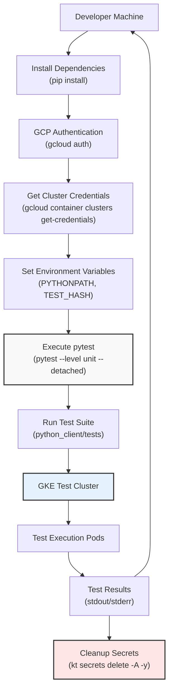
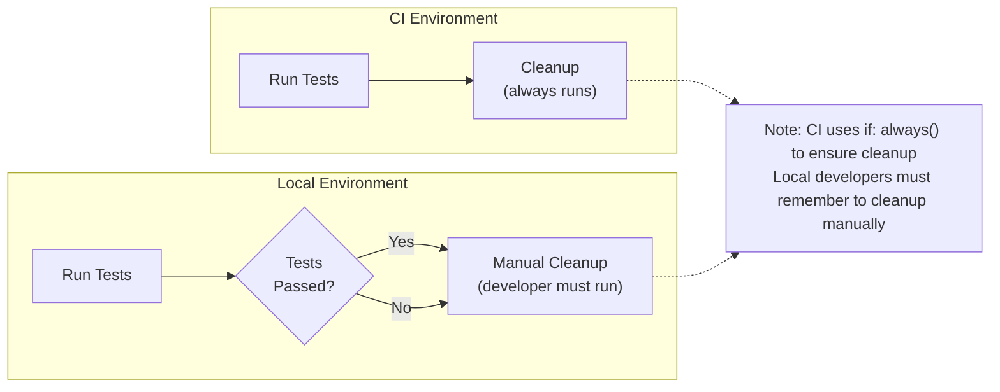
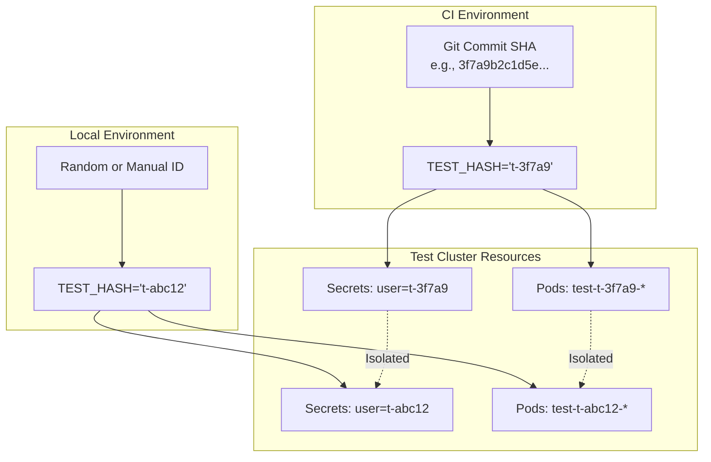

<!-- source: DeepWiki mcp.deepwiki.com · repo run-house/kubetorch · page 8.3 Running Tests Locally · fetched 2026-10-21 -->

# Running Tests Locally

<details>
<summary>Relevant source files</summary>

The following files were used as context for generating this wiki page:

- [.github/workflows/unit_tests.yaml](.github/workflows/unit_tests.yaml)

</details>


## Purpose and Scope

This document provides guidance for developers who want to run Kubetorch tests on their local machines. It covers the prerequisites, environment setup, test execution commands, and cleanup procedures required to replicate the CI testing environment locally.

For information about the overall testing infrastructure and test organization, see [Testing Infrastructure](#8.1). For details about the CI/CD pipeline and GitHub Actions workflows, see [CI/CD Pipeline](#8.2). For documentation on test fixtures and utilities, see [Test Fixtures and Utilities](#8.4).

## Prerequisites

Before running tests locally, ensure you have the following installed and configured:

| Requirement | Purpose | Verification Command |
|------------|---------|---------------------|
| Python 3.8+ | Test execution environment | `python --version` |
| pip | Package installation | `pip --version` |
| kubectl | Kubernetes cluster interaction | `kubectl version --client` |
| gcloud CLI | GCP authentication | `gcloud --version` |
| pytest | Test framework | `pytest --version` |
| GKE cluster access | Test cluster access | `gcloud container clusters list` |

### Required Secrets

The following secrets are required and should be configured in your local environment:

- **GCP_PROJECT_ID**: Your GCP project ID
- **GCP_SA_KEY**: GCP service account credentials (JSON key file)
- **KUBECONFIG**: Kubernetes cluster configuration
- **CI_CLUSTER_NAME**: Name of the test cluster
- **CI_CLUSTER_REGION**: Region where the test cluster is deployed

Sources: [.github/workflows/unit_tests.yaml:56-71]()

## Local Environment Setup

### Step 1: Install Python Dependencies

Navigate to the `python_client` directory and install the required packages:

```bash
cd python_client
pip install -e .
pip install pytest
```

The CI workflow also installs documentation requirements, which may be needed for certain tests:

```bash
pip install -r kubetorch/docs/requirements.txt
```

Sources: [.github/workflows/unit_tests.yaml:50-60]()

### Step 2: Configure GCP Authentication

Set up GCP credentials using your service account key:

```bash
export GOOGLE_APPLICATION_CREDENTIALS="/path/to/your/service-account-key.json"
gcloud auth activate-service-account --key-file=$GOOGLE_APPLICATION_CREDENTIALS
gcloud config set project YOUR_PROJECT_ID
```

Sources: [.github/workflows/unit_tests.yaml:53-57]()

### Step 3: Configure Kubernetes Access

Get credentials for your GKE test cluster:

```bash
gcloud container clusters get-credentials YOUR_CLUSTER_NAME \
  --region YOUR_CLUSTER_REGION \
  --project YOUR_PROJECT_ID
```

Verify cluster connectivity:

```bash
kubectl get nodes
kubectl get namespaces
```

Sources: [.github/workflows/unit_tests.yaml:67-71]()

### Step 4: Set Environment Variables

Configure the required environment variables:

```bash
# Set Python source root
export PYTHONPATH=$(pwd)/python_client

# Set CI flag (optional, may affect test behavior)
export CI=true

# Set test hash for resource isolation
export TEST_HASH="t-$(echo $RANDOM | md5sum | cut -c1-5)"
echo "Using TEST_HASH: $TEST_HASH"
```

The `TEST_HASH` is used to isolate test resources. In CI, it's derived from the Git commit SHA. Locally, you can generate a random hash or use a custom identifier.

Sources: [.github/workflows/unit_tests.yaml:34-79]()

## Running Unit Tests

### Basic Test Execution

From the `python_client` directory, run the unit tests:

```bash
cd python_client
pytest -v --level unit --detached
```

**Test Flags:**
- `-v`: Verbose output showing individual test names
- `--level unit`: Run only unit-level tests
- `--detached`: Run tests in detached mode (for cluster execution)

Sources: [.github/workflows/unit_tests.yaml:81-85]()

### Test Execution Workflow



Sources: [.github/workflows/unit_tests.yaml:46-93]()

### Running Specific Test Files or Functions

To run specific tests instead of the entire suite:

```bash
# Run a specific test file
pytest -v tests/test_specific_file.py --level unit --detached

# Run a specific test function
pytest -v tests/test_file.py::test_function_name --level unit --detached

# Run tests matching a pattern
pytest -v -k "test_pattern" --level unit --detached
```

### Timeout Considerations

The CI workflow sets a 60-minute timeout for test execution. Long-running tests should be designed to complete within this window. If tests timeout locally, check for:

- Cluster connectivity issues
- Resource availability in the test cluster
- Stuck or hanging test processes

Sources: [.github/workflows/unit_tests.yaml:85]()

## Cleanup Procedures

### Secret Cleanup

**Critical:** Always clean up test secrets after running tests, even if tests fail. This prevents resource leaks and conflicts with future test runs.

```bash
# Configure username to match your test hash
kt config set username $TEST_HASH

# Delete all secrets for the current user
kt secrets delete -A -y
```

The `-A` flag deletes all secrets, and `-y` auto-confirms the deletion.

Sources: [.github/workflows/unit_tests.yaml:87-93]()

### Cleanup Workflow Comparison



**Important:** The CI workflow uses `if: ${{ always() }}` to ensure cleanup runs regardless of test results. When running tests locally, you must manually run the cleanup commands even if tests fail or are interrupted.

Sources: [.github/workflows/unit_tests.yaml:88]()

## Test Isolation with TEST_HASH

### Purpose of TEST_HASH

The `TEST_HASH` environment variable provides resource isolation between concurrent test runs. This is especially important in CI where multiple workflows may run simultaneously, or locally when multiple developers share the same test cluster.



Sources: [.github/workflows/unit_tests.yaml:76-79](), [.github/workflows/unit_tests.yaml:91]()

### Generating TEST_HASH Locally

In CI, the test hash is derived from the Git commit SHA:

```bash
TEST_HASH="t-$(echo $GITHUB_SHA | cut -c1-5)"
```

Locally, you can use various methods:

```bash
# Method 1: Random hash (recommended for isolation)
export TEST_HASH="t-$(echo $RANDOM | md5sum | cut -c1-5)"

# Method 2: Use your username
export TEST_HASH="t-$(whoami | cut -c1-5)"

# Method 3: Custom identifier for debugging
export TEST_HASH="t-debug"
```

**Best Practice:** Use a unique hash for each test run to avoid conflicts. Save your `TEST_HASH` value to ensure you can clean up resources later:

```bash
echo $TEST_HASH > .test_hash_local
# Later, for cleanup:
export TEST_HASH=$(cat .test_hash_local)
kt config set username $TEST_HASH
kt secrets delete -A -y
```

Sources: [.github/workflows/unit_tests.yaml:76-79]()

## Complete Local Test Execution Script

Here's a complete script that replicates the CI test workflow locally:

```bash
#!/bin/bash
set -e

# Configuration
export CI=true
export PYTHONPATH=$(pwd)/python_client
export TEST_HASH="t-$(echo $RANDOM | md5sum | cut -c1-5)"

echo "==================================="
echo "Kubetorch Local Test Execution"
echo "Test Hash: $TEST_HASH"
echo "==================================="

# Step 1: Install dependencies
echo "Installing dependencies..."
cd python_client
pip install -e .
pip install pytest
pip install -r kubetorch/docs/requirements.txt

# Step 2: Authenticate to GCP
echo "Authenticating to GCP..."
gcloud auth activate-service-account --key-file=$GOOGLE_APPLICATION_CREDENTIALS
gcloud config set project $GCP_PROJECT_ID

# Step 3: Get cluster credentials
echo "Getting cluster credentials..."
gcloud container clusters get-credentials $CI_CLUSTER_NAME \
  --region $CI_CLUSTER_REGION \
  --project $GCP_PROJECT_ID

# Step 4: Run tests
echo "Running tests..."
pytest -v --level unit --detached
TEST_EXIT_CODE=$?

# Step 5: Cleanup (always runs)
echo "Cleaning up secrets..."
kt config set username $TEST_HASH
kt secrets delete -A -y

# Return test exit code
exit $TEST_EXIT_CODE
```

This script mirrors the CI workflow structure and ensures cleanup runs regardless of test outcome.

Sources: [.github/workflows/unit_tests.yaml:46-93]()

## Workflow Comparison: CI vs Local

```mermaid
graph TB
    subgraph "CI Workflow (.github/workflows/unit_tests.yaml)"
        CI_CHECKOUT["Checkout Code<br/>(actions/checkout@v3)"]
        CI_DEPS["Install Dependencies<br/>(.github/workflows/install_dependencies)"]
        CI_AUTH["Setup Authentications<br/>(.github/workflows/gke_authentications)"]
        CI_DOCS["Install Docs Requirements<br/>(pip install -r)"]
        CI_CLUSTER["Setup Test Cluster<br/>(.github/workflows/setup_test_cluster)"]
        CI_CREDS["Get GKE Credentials<br/>(gcloud container clusters get-credentials)"]
        CI_PYTHONPATH["Set PYTHONPATH<br/>(GITHUB_ENV)"]
        CI_HASH["Set TEST_HASH<br/>(from GITHUB_SHA)"]
        CI_PYTEST["Run pytest<br/>(--level unit --detached)"]
        CI_CLEANUP["Cleanup Secrets<br/>(if: always())"]
        
        CI_CHECKOUT --> CI_DEPS
        CI_DEPS --> CI_AUTH
        CI_AUTH --> CI_DOCS
        CI_DOCS --> CI_CLUSTER
        CI_CLUSTER --> CI_CREDS
        CI_CREDS --> CI_PYTHONPATH
        CI_PYTHONPATH --> CI_HASH
        CI_HASH --> CI_PYTEST
        CI_PYTEST --> CI_CLEANUP
    end
    
    subgraph "Local Workflow (Manual Steps)"
        LOCAL_CLONE["Clone Repository<br/>(git clone)"]
        LOCAL_DEPS["Install Dependencies<br/>(pip install)"]
        LOCAL_AUTH["Configure GCP Auth<br/>(gcloud auth)"]
        LOCAL_DOCS["Install Docs Requirements<br/>(pip install -r)"]
        LOCAL_CREDS["Get GKE Credentials<br/>(gcloud container clusters get-credentials)"]
        LOCAL_PYTHONPATH["Set PYTHONPATH<br/>(export)"]
        LOCAL_HASH["Set TEST_HASH<br/>(export, random)"]
        LOCAL_PYTEST["Run pytest<br/>(--level unit --detached)"]
        LOCAL_CLEANUP["Cleanup Secrets<br/>(manual command)"]
        
        LOCAL_CLONE --> LOCAL_DEPS
        LOCAL_DEPS --> LOCAL_AUTH
        LOCAL_AUTH --> LOCAL_DOCS
        LOCAL_DOCS --> LOCAL_CREDS
        LOCAL_CREDS --> LOCAL_PYTHONPATH
        LOCAL_PYTHONPATH --> LOCAL_HASH
        LOCAL_HASH --> LOCAL_PYTEST
        LOCAL_PYTEST --> LOCAL_CLEANUP
    end
    
    style CI_PYTEST fill:#e6f3ff,stroke:#333,stroke-width:2px
    style LOCAL_PYTEST fill:#e6f3ff,stroke:#333,stroke-width:2px
    style CI_CLEANUP fill:#ffe6e6,stroke:#333,stroke-width:2px
    style LOCAL_CLEANUP fill:#ffe6e6,stroke:#333,stroke-width:2px
```



**Key Differences:**
- **CI**: Uses reusable GitHub Actions for authentication and setup
- **Local**: Requires manual execution of equivalent commands
- **CI**: Automatically runs cleanup via `if: always()` condition
- **Local**: Developer must manually ensure cleanup runs
- **CI**: TEST_HASH derived from commit SHA for reproducibility
- **Local**: TEST_HASH generated randomly or manually for isolation

Sources: [.github/workflows/unit_tests.yaml:46-93]()

## Common Issues and Debugging

### Authentication Failures

**Symptom:** `gcloud` commands fail with authentication errors

**Solution:**
```bash
# Verify service account key is valid
gcloud auth list

# Re-authenticate if needed
gcloud auth activate-service-account --key-file=$GOOGLE_APPLICATION_CREDENTIALS

# Verify project is set correctly
gcloud config get-value project
```

### Cluster Connection Issues

**Symptom:** Tests fail to connect to Kubernetes cluster

**Solution:**
```bash
# Verify cluster credentials are loaded
kubectl config current-context

# Test cluster connectivity
kubectl get nodes

# Re-fetch credentials if needed
gcloud container clusters get-credentials $CI_CLUSTER_NAME \
  --region $CI_CLUSTER_REGION \
  --project $GCP_PROJECT_ID
```

### PYTHONPATH Not Set Correctly

**Symptom:** Import errors when running tests (e.g., `ModuleNotFoundError: No module named 'kubetorch'`)

**Solution:**
```bash
# Ensure PYTHONPATH points to python_client directory
export PYTHONPATH=$(pwd)/python_client

# Verify with:
python -c "import kubetorch; print(kubetorch.__file__)"
```

### Orphaned Test Resources

**Symptom:** Tests fail due to existing resources with conflicting names

**Solution:**
```bash
# List existing secrets
kt secrets list

# Delete all secrets for your test user
kt config set username $TEST_HASH
kt secrets delete -A -y

# Or delete all secrets (use with caution)
kubectl delete secrets --all -n kubetorch
```

### Test Timeout

**Symptom:** Tests hang or exceed 60-minute timeout

**Solution:**
- Check cluster resource availability: `kubectl top nodes`
- Verify test cluster has sufficient capacity
- Run tests with increased verbosity: `pytest -vv --level unit --detached`
- Check for stuck pods: `kubectl get pods -n kubetorch`

Sources: [.github/workflows/unit_tests.yaml:85-93]()

## Test Levels and Flags Reference

The test suite uses custom pytest markers to categorize tests by level. When running locally, you can filter tests using the `--level` flag:

```bash
# Run only unit tests (fast, no cluster interaction)
pytest --level unit --detached

# Run integration tests (requires cluster)
pytest --level integration --detached

# Run all tests
pytest --detached
```

The `--detached` flag is specific to Kubetorch and enables tests to run in detached mode on the cluster rather than blocking locally.

For more details on test organization and markers, see [Testing Infrastructure](#8.1).

Sources: [.github/workflows/unit_tests.yaml:82-84]()

## Summary

Running tests locally requires:

1. **Prerequisites**: Python, kubectl, gcloud CLI, and cluster access
2. **Authentication**: GCP service account and cluster credentials
3. **Environment**: PYTHONPATH and TEST_HASH configuration
4. **Execution**: `pytest --level unit --detached` from `python_client` directory
5. **Cleanup**: Always run `kt secrets delete -A -y` after tests

The local workflow mirrors the CI pipeline but requires manual execution of setup and cleanup steps. Using a unique `TEST_HASH` ensures resource isolation when multiple developers or test runs share the same cluster.

Sources: [.github/workflows/unit_tests.yaml:1-94]()

---

