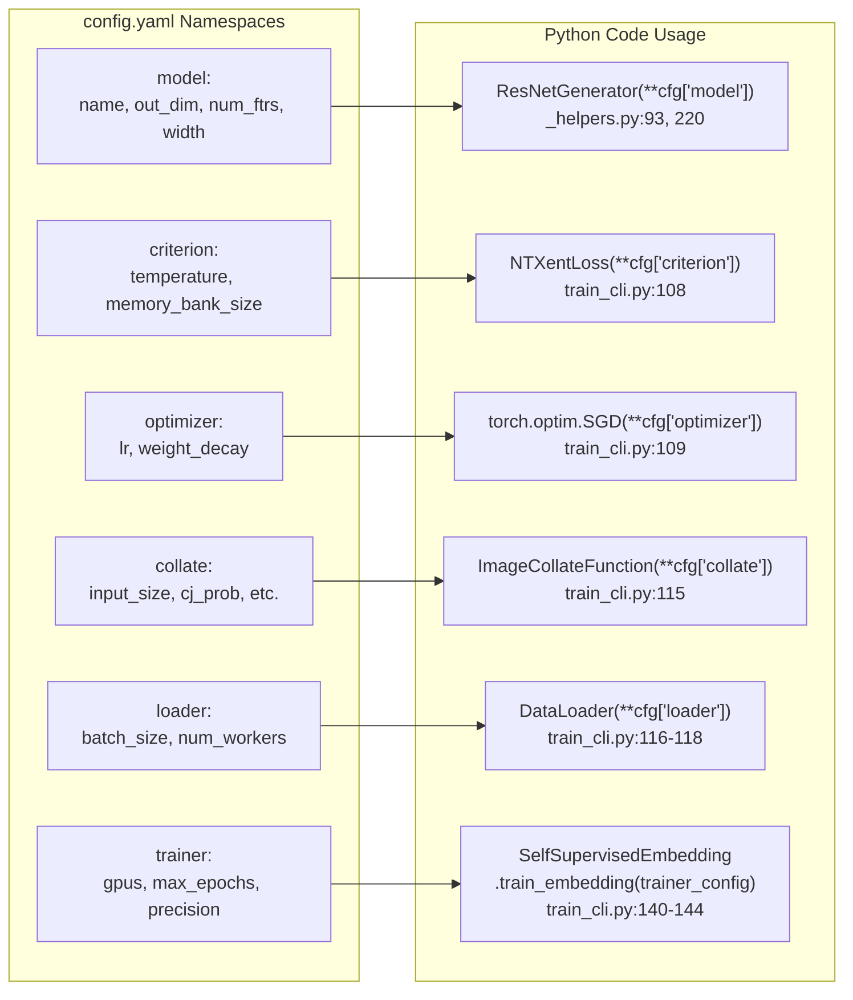
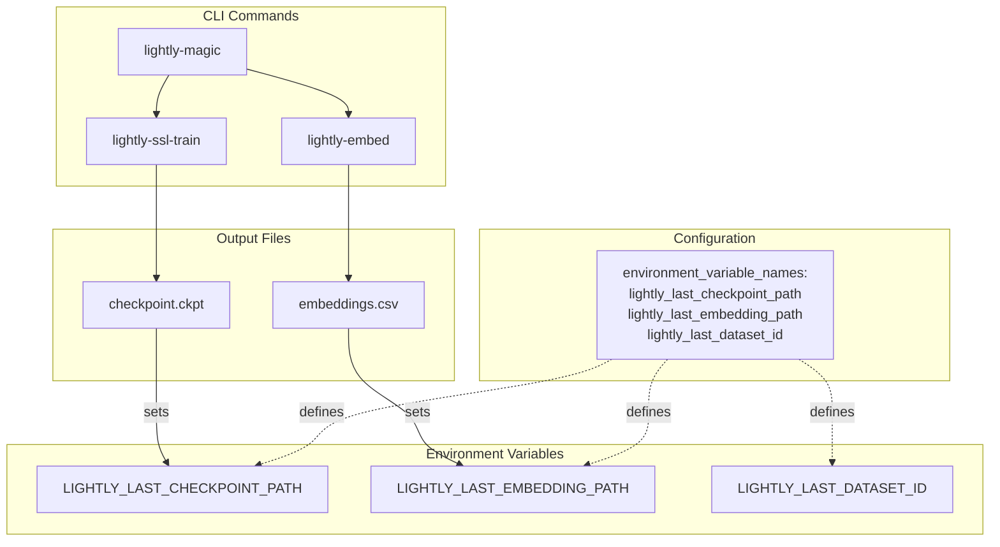

<!-- source: DeepWiki mcp.deepwiki.com · repo lightly-ai/lightly · page 4.4 CLI Configuration · fetched 2026-10-21 -->

# CLI Configuration

<details>
<summary>Relevant source files</summary>

The following files were used as context for generating this wiki page:

- [lightly/cli/_helpers.py](lightly/cli/_helpers.py)
- [lightly/cli/config/config.yaml](lightly/cli/config/config.yaml)
- [lightly/cli/embed_cli.py](lightly/cli/embed_cli.py)
- [lightly/cli/lightly_cli.py](lightly/cli/lightly_cli.py)
- [lightly/cli/train_cli.py](lightly/cli/train_cli.py)
- [tests/cli/test_cli_magic.py](tests/cli/test_cli_magic.py)
- [tests/cli/test_cli_train.py](tests/cli/test_cli_train.py)

</details>


This document describes the Hydra-based configuration system used by the Lightly CLI tools. It covers the structure of `config.yaml`, parameter override mechanisms, environment variable management, and Hydra integration specifics.

For information about the CLI commands that use this configuration system, see [Training Commands](#4.1) and [Embedding Generation](#4.2). For platform-specific configuration, see [Platform Integration Commands](#4.3).

## Overview

The Lightly CLI uses [Hydra](https://hydra.cc) for hierarchical configuration management. All CLI commands (`lightly-ssl-train`, `lightly-embed`, `lightly-magic`) load their default configuration from [lightly/cli/config/config.yaml:1-160]() and accept parameter overrides via command-line arguments. The configuration is organized into logical namespaces that map directly to Python objects used during training and embedding.

Sources: [lightly/cli/config/config.yaml:1-160](), [lightly/cli/train_cli.py:155-183](), [lightly/cli/embed_cli.py:93-124]()

## Configuration File Structure

The configuration file is organized into hierarchical namespaces, each controlling a specific aspect of the training or embedding pipeline.

### Configuration Namespace Overview

```mermaid
graph TB
    subgraph "Input/Output Configuration"
        IO["I/O Paths<br/>lines 1-11"]
        IO_INPUT["input_dir<br/>output_dir<br/>embeddings<br/>checkpoint<br/>label_dir"]
    end
    
    subgraph "Platform Configuration"
        PLATFORM["Lightly Platform<br/>lines 13-26"]
        PLATFORM_PARAMS["token<br/>dataset_id<br/>new_dataset_name<br/>upload<br/>embedding_name"]
    end
    
    subgraph "Model & Training Configuration"
        MODEL["model namespace<br/>lines 33-38"]
        CRITERION["criterion namespace<br/>lines 41-44"]
        OPTIMIZER["optimizer namespace<br/>lines 47-49"]
        
        MODEL_PARAMS["name: resnet-18<br/>out_dim: 128<br/>num_ftrs: 32<br/>width: 1"]
        CRITERION_PARAMS["temperature: 0.5<br/>memory_bank_size: 0"]
        OPTIMIZER_PARAMS["lr: 1.0<br/>weight_decay: 0.00001"]
    end
    
    subgraph "Data Pipeline Configuration"
        COLLATE["collate namespace<br/>lines 52-74"]
        LOADER["loader namespace<br/>lines 77-83"]
        
        COLLATE_PARAMS["input_size: 64<br/>cj_prob: 0.8<br/>min_scale: 0.15<br/>gaussian_blur: 0.5"]
        LOADER_PARAMS["batch_size: 16<br/>shuffle: True<br/>num_workers: -1<br/>drop_last: True"]
    end
    
    subgraph "Training Control Configuration"
        TRAINER["trainer namespace<br/>lines 86-92"]
        CHECKPOINT["checkpoint_callback namespace<br/>lines 95-99"]
        
        TRAINER_PARAMS["gpus: 1<br/>max_epochs: 100<br/>precision: 32"]
        CHECKPOINT_PARAMS["save_last: True<br/>save_top_k: 1<br/>dirpath: None"]
    end
    
    subgraph "System Configuration"
        ENV["environment_variable_names<br/>lines 106-109"]
        SEED["seed: 1<br/>line 112"]
        HYDRA["hydra namespace<br/>lines 114-160"]
        
        ENV_PARAMS["lightly_last_checkpoint_path<br/>lightly_last_embedding_path<br/>lightly_last_dataset_id"]
        HYDRA_PARAMS["run.dir<br/>help.header<br/>help.footer"]
    end
    
    IO --> IO_INPUT
    PLATFORM --> PLATFORM_PARAMS
    MODEL --> MODEL_PARAMS
    CRITERION --> CRITERION_PARAMS
    OPTIMIZER --> OPTIMIZER_PARAMS
    COLLATE --> COLLATE_PARAMS
    LOADER --> LOADER_PARAMS
    TRAINER --> TRAINER_PARAMS
    CHECKPOINT --> CHECKPOINT_PARAMS
    ENV --> ENV_PARAMS
    HYDRA --> HYDRA_PARAMS
```



Sources: [lightly/cli/config/config.yaml:1-160]()

### Core Configuration Namespaces

The following table summarizes each configuration namespace and its purpose:

| Namespace | Purpose | Passed To | Key Parameters |
|-----------|---------|-----------|----------------|
| `model` | Model architecture configuration | `lightly.models.ResNetGenerator` | `name`, `out_dim`, `num_ftrs`, `width` |
| `criterion` | Loss function configuration | `lightly.loss.NTXentLoss` | `temperature`, `memory_bank_size` |
| `optimizer` | Optimizer settings | `torch.optim.SGD` | `lr`, `weight_decay` |
| `collate` | Data augmentation pipeline | `lightly.data.ImageCollateFunction` | `input_size`, `cj_prob`, `min_scale`, `gaussian_blur` |
| `loader` | DataLoader settings | `torch.utils.data.DataLoader` | `batch_size`, `shuffle`, `num_workers`, `drop_last` |
| `trainer` | PyTorch Lightning trainer | `pytorch_lightning.Trainer` | `gpus`, `max_epochs`, `precision` |
| `checkpoint_callback` | Checkpoint saving behavior | Checkpoint callback config | `save_last`, `save_top_k`, `dirpath` |
| `summary_callback` | Model summary depth | Summary callback config | `max_depth` |
| `environment_variable_names` | Environment variable tracking | System environment | `lightly_last_checkpoint_path`, etc. |

Sources: [lightly/cli/config/config.yaml:33-103](), [lightly/cli/train_cli.py:93-144]()

### Configuration to Code Mapping



Sources: [lightly/cli/train_cli.py:93-144](), [lightly/cli/_helpers.py:93-237](), [lightly/cli/embed_cli.py:56-75]()

## Parameter Override System

Hydra allows overriding any configuration parameter via command-line arguments using dot notation. Parameters are specified as `key=value` or `namespace.key=value`.

### Override Syntax

The general syntax for parameter overrides:

```bash
lightly-<command> <config_path>=<value> [<namespace>.<key>=<value> ...]
```

Examples of valid override patterns:

```bash
# Top-level parameters
lightly-ssl-train input_dir=data/ checkpoint=model.ckpt

# Nested parameters using dot notation
lightly-ssl-train input_dir=data/ loader.batch_size=128

# Multiple overrides
lightly-ssl-train input_dir=data/ trainer.max_epochs=50 loader.batch_size=64

# Deep nesting
lightly-ssl-train input_dir=data/ collate.input_size=224 collate.cj_prob=0.9
```

Sources: [lightly/cli/config/config.yaml:127-149](), [lightly/cli/train_cli.py:156-183]()

### Common Override Patterns

The following table shows frequently used parameter overrides and their effects:

| Override | Default | Purpose | Example |
|----------|---------|---------|---------|
| `input_dir` | `''` | Specify input image directory | `input_dir=./my_dataset` |
| `loader.batch_size` | `16` | Control training batch size | `loader.batch_size=128` |
| `trainer.max_epochs` | `100` | Set training duration | `trainer.max_epochs=50` |
| `collate.input_size` | `64` | Set input image resolution | `collate.input_size=224` |
| `model.name` | `resnet-18` | Choose backbone architecture | `model.name=resnet-50` |
| `model.num_ftrs` | `32` | Set embedding dimension | `model.num_ftrs=512` |
| `trainer.precision` | `32` | Enable mixed precision | `trainer.precision=16` |
| `checkpoint` | `''` | Resume from checkpoint | `checkpoint=path/to/ckpt` |
| `pre_trained` | `True` | Use pre-trained weights | `pre_trained=False` |
| `loader.num_workers` | `-1` | Set data loader workers | `loader.num_workers=8` |

Sources: [lightly/cli/config/config.yaml:1-112](), [lightly/cli/train_cli.py:37-152]()

### Special Value Handling

Some parameters have special value interpretations:

- **`loader.num_workers = -1`**: Automatically uses `os.cpu_count()` to determine optimal worker count [lightly/cli/_helpers.py:20-26](), [lightly/cli/train_cli.py:66-67]()
- **`checkpoint = ''`**: When empty and `pre_trained=True`, downloads pre-trained model from model zoo [lightly/cli/train_cli.py:71-80]()
- **`trainer.gpus`**: Deprecated in PyTorch Lightning 2.0+, automatically converted to `accelerator` and `devices` [lightly/cli/train_cli.py:128-137]()
- **`collate.kernel_size = null`**: Deprecated in favor of `sigmas` parameter [lightly/cli/config/config.yaml:63-65]()

Sources: [lightly/cli/train_cli.py:66-80](), [lightly/cli/_helpers.py:20-26](), [lightly/cli/config/config.yaml:63-65]()

## Environment Variables

The CLI uses environment variables to track outputs and enable command chaining. These variables are set automatically after successful execution.

### Output Tracking Variables



Sources: [lightly/cli/config/config.yaml:106-109](), [lightly/cli/train_cli.py:149-152](), [lightly/cli/embed_cli.py:85-87]()

### Environment Variable Definitions

The environment variable names are configurable through the `environment_variable_names` namespace:

```yaml
environment_variable_names:
  lightly_last_checkpoint_path: LIGHTLY_LAST_CHECKPOINT_PATH
  lightly_last_embedding_path: LIGHTLY_LAST_EMBEDDING_PATH
  lightly_last_dataset_id: LIGHTLY_LAST_DATASET_ID
```

After executing `lightly-ssl-train`, the checkpoint path is stored:

```python
os.environ[cfg["environment_variable_names"]["lightly_last_checkpoint_path"]] = encoder.checkpoint
```

After executing `lightly-embed`, the embeddings path is stored:

```python
os.environ[cfg["environment_variable_names"]["lightly_last_embedding_path"]] = path
```

Sources: [lightly/cli/config/config.yaml:106-109](), [lightly/cli/train_cli.py:149-152](), [lightly/cli/embed_cli.py:85-87]()

### Command Chaining Example

Environment variables enable chaining commands without manually specifying intermediate outputs:

```bash
# Train model (sets LIGHTLY_LAST_CHECKPOINT_PATH)
lightly-ssl-train input_dir=data/ trainer.max_epochs=10

# Embed using the checkpoint from previous command
# (automatically reads from LIGHTLY_LAST_CHECKPOINT_PATH if checkpoint not specified)
lightly-embed input_dir=data/
```

Sources: [lightly/cli/train_cli.py:149-152](), [lightly/cli/embed_cli.py:85-87]()

## Hydra Integration

The CLI uses Hydra's `@hydra.main` decorator to enable hierarchical configuration management and automatic help generation.

### Hydra Decorator Usage

Each CLI entrypoint uses the `@hydra.main` decorator with version-adaptive arguments:

```python
@hydra.main(**fix_hydra_arguments(config_path="config", config_name="config"))
def train_cli(cfg):
    return _train_cli(cfg)
```

The `fix_hydra_arguments` helper ensures compatibility across Hydra versions:

```python
def fix_hydra_arguments(config_path: str = "config", config_name: str = "config"):
    hydra_args = {"config_path": config_path, "config_name": config_name}
    
    if version_compare(hydra.__version__, "1.2.0") >= 0:
        hydra_args["version_base"] = None
    elif version_compare(hydra.__version__, "1.1.2") > 0:
        hydra_args["version_base"] = "1.1"
    
    return hydra_args
```

Sources: [lightly/cli/train_cli.py:155-157](), [lightly/cli/_helpers.py:36-53]()

### Output Directory Management

Hydra automatically creates timestamped output directories for each run:

```yaml
hydra:
  run:
    dir: lightly_outputs/${now:%Y-%m-%d}/${now:%H-%M-%S}
```

This creates directory structures like:

```
lightly_outputs/
├── 2024-01-15/
│   ├── 10-30-45/
│   │   ├── .hydra/
│   │   │   ├── config.yaml
│   │   │   ├── hydra.yaml
│   │   │   └── overrides.yaml
│   │   ├── embeddings.csv
│   │   └── version_0/
│   │       └── checkpoints/
│   └── 14-22-11/
│       └── ...
```

Sources: [lightly/cli/config/config.yaml:116-118]()

### Path Resolution

Hydra changes the working directory to the output directory at runtime. The CLI uses `fix_input_path` to resolve relative paths correctly:

```python
def fix_input_path(path):
    """Fix broken relative paths."""
    if not os.path.isabs(path):
        path = utils.to_absolute_path(path)
    return path
```

This is applied to input paths before use:

```python
input_dir = cfg["input_dir"]
if input_dir and is_cli_call:
    input_dir = fix_input_path(input_dir)
```

Sources: [lightly/cli/_helpers.py:29-33](), [lightly/cli/train_cli.py:38-40](), [lightly/cli/embed_cli.py:44-46]()

### Help System

Hydra generates help text from the configuration file's `hydra.help` section:

```yaml
hydra:
  help:
    header: |
      == Description ==
      The lightly Python package is a command-line tool for self-supervised learning.
    
    footer: |
      == Examples ==
      
      Use a pre-trained resnet-18 to embed your images
      > lightly-embed input='path/to/image/folder' collate.input_size=224
      
      Train a self-supervised model on your image dataset from scratch
      > lightly-ssl-train input_dir='path/to/image/folder' pre_trained=False
```

Users can view help with `--help`:

```bash
lightly-ssl-train --help
```

Sources: [lightly/cli/config/config.yaml:119-159]()

## Configuration Validation and Warnings

The CLI performs runtime validation and issues warnings for problematic configurations:

### Small Batch Size Warning

Training with small batch sizes can harm embedding quality. The CLI warns when batch size is below 64:

```python
if cfg["loader"]["batch_size"] < 64:
    msg = "Training a self-supervised model with a small batch size: {}! "
    msg = msg.format(cfg["loader"]["batch_size"])
    msg += "Small batch size may harm embedding quality."
    warnings.warn(msg)
```

Sources: [lightly/cli/train_cli.py:57-63]()

### Batch Size Adjustment

The batch size is automatically reduced if it exceeds the dataset size:

```python
cfg["loader"]["batch_size"] = min(cfg["loader"]["batch_size"], len(dataset))
```

Sources: [lightly/cli/train_cli.py:113](), [lightly/cli/embed_cli.py:69]()

### Missing Checkpoint Warning

When `pre_trained=True` but no matching checkpoint exists in the model zoo:

```python
if not checkpoint:
    msg = "Cannot download checkpoint for key {} ".format(key)
    msg += "because it does not exist! "
    msg += "Model will be trained from scratch."
    warnings.warn(msg)
```

Sources: [lightly/cli/train_cli.py:75-79]()

## Configuration in Tests

Test files demonstrate configuration usage patterns:

### Test Configuration Setup

Tests use Hydra's `initialize` and `compose` functions to create test configurations:

```python
with initialize(config_path="../../lightly/cli/config", job_name="test_app"):
    self.cfg = compose(
        config_name="config",
        overrides=[
            f"input_dir={self.folder_path}",
            "trainer.max_epochs=1",
        ],
    )
```

Sources: [tests/cli/test_cli_train.py:26-33](), [tests/cli/test_cli_magic.py:27-34]()

### Programmatic Override Parsing

Tests parse CLI strings to apply overrides programmatically:

```python
def parse_cli_string(self, cli_words: str):
    cli_words = cli_words.replace("lightly-magic ", "")
    cli_words = re.split("=| ", cli_words)
    dict_keys = cli_words[0::2]
    dict_values = cli_words[1::2]
    
    for key, value in zip(dict_keys, dict_values):
        key_subparts = key.split(".")
        if len(key_subparts) == 1:
            self.cfg[key] = value
        elif len(key_subparts) == 2:
            self.cfg[key_subparts[0]][key_subparts[1]] = value
```

Sources: [tests/cli/test_cli_magic.py:50-73]()

## Advanced Configuration Patterns

### Seed Configuration

For reproducible training, set the seed parameter:

```yaml
seed: 1
```

This is applied to PyTorch's random number generators:

```python
if "seed" in cfg.keys():
    seed = cfg["seed"]
    torch.manual_seed(seed)
    torch.cuda.manual_seed(seed)
    torch.backends.cudnn.deterministic = True
    torch.backends.cudnn.benchmark = False
```

Sources: [lightly/cli/config/config.yaml:112](), [lightly/cli/train_cli.py:42-47]()

### Multi-GPU Configuration

For distributed training, configure multiple GPUs:

```bash
lightly-ssl-train input_dir=data/ trainer.gpus=4
```

This automatically enables DDP strategy:

```python
if accelerator == "gpu" and cfg["trainer"]["gpus"] > 1:
    devices = cfg["trainer"]["gpus"]
    strategy = "ddp"
else:
    devices = 1
    strategy = None
```

Sources: [lightly/cli/train_cli.py:49-55]()

### Checkpoint Directory Configuration

Control where checkpoints are saved:

```yaml
checkpoint_callback:
  save_last: True
  save_top_k: 1
  dirpath:  # None uses Hydra output dir
```

If `dirpath` is not set, checkpoints are stored in the Hydra-managed output directory.

Sources: [lightly/cli/config/config.yaml:95-99](), [lightly/cli/train_cli.py:142-143]()

---

