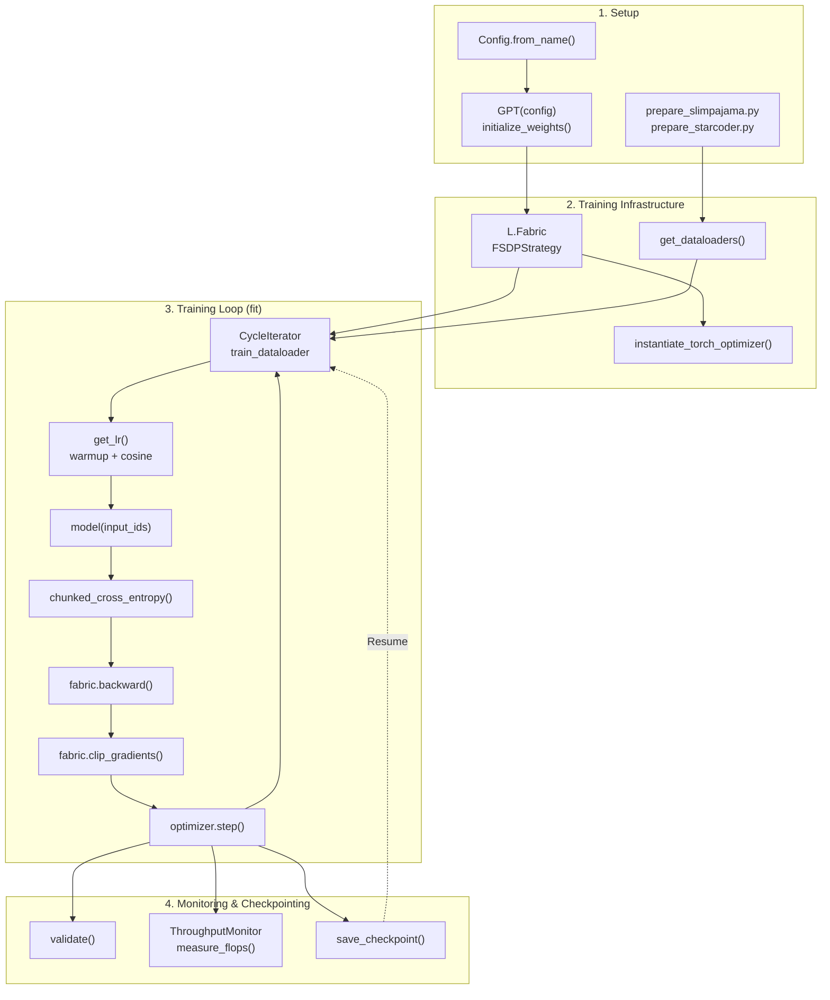
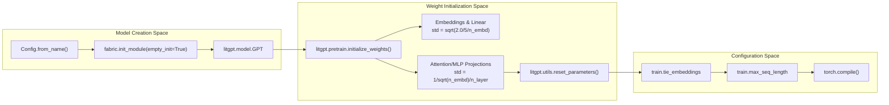
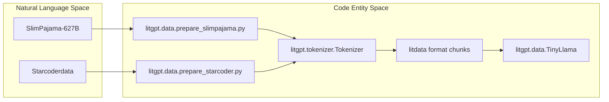
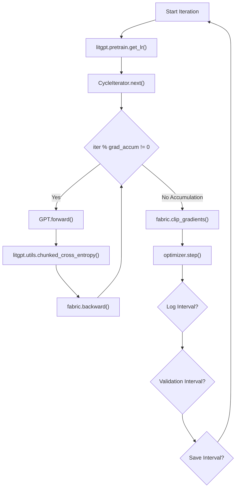

<!-- source: DeepWiki mcp.deepwiki.com · repo Lightning-AI/litgpt · page 4 Pretraining · fetched 2026-10-21 -->

# Pretraining

<details>
<summary>Relevant source files</summary>

The following files were used as context for generating this wiki page:

- [.gitignore](.gitignore)
- [config_hub/pretrain/debug.yaml](config_hub/pretrain/debug.yaml)
- [config_hub/pretrain/tinyllama.yaml](config_hub/pretrain/tinyllama.yaml)
- [config_hub/pretrain/tinystories.yaml](config_hub/pretrain/tinystories.yaml)
- [extensions/thunder/pretrain.py](extensions/thunder/pretrain.py)
- [litgpt/args.py](litgpt/args.py)
- [litgpt/finetune/full.py](litgpt/finetune/full.py)
- [litgpt/pretrain.py](litgpt/pretrain.py)
- [tests/test_pretrain.py](tests/test_pretrain.py)
- [tutorials/finetune.md](tutorials/finetune.md)
- [tutorials/pretrain.md](tutorials/pretrain.md)
- [tutorials/pretrain_tinyllama.md](tutorials/pretrain_tinyllama.md)

</details>


## Purpose and Scope

This document covers pretraining language models from scratch in LitGPT. Pretraining refers to the initial training phase where a model learns language patterns from large unlabeled text corpora. This differs from fine-tuning, which adapts a pretrained model to specific tasks using smaller, task-specific datasets.

For information about adapting existing pretrained models, see [Fine-tuning](#3), [LoRA Fine-tuning](#3.1), [Adapter Fine-tuning](#3.2), or [Full Fine-tuning](#3.4).

**Sources:** [litgpt/pretrain.py:1-527](), [tutorials/pretrain_tinyllama.md:1-200]()

---

## Overview

Pretraining in LitGPT trains transformer models from randomly initialized weights using massive text corpora. The reference implementation replicates the [TinyLlama](https://github.com/jzhang38/TinyLlama) training setup: a 1.1B parameter model trained on ~3 trillion tokens over 3 epochs using a mixture of SlimPajama (893 GB) and Starcoder (290 GB) datasets [tutorials/pretrain_tinyllama.md:9-28]().

Key characteristics:
- Trains on **tokens** rather than epochs (controlled by `max_tokens` parameter) [litgpt/args.py:25-27]()
- Uses **causal language modeling** objective (predicting next token) [litgpt/pretrain.py:348-355]()
- Requires **distributed training** for practical model sizes [litgpt/pretrain.py:142-147]()
- Supports **resume training** from checkpoints [litgpt/pretrain.py:234-237]()
- Uses **cosine learning rate schedule** with linear warmup [litgpt/pretrain.py:463-475]()

**Sources:** [litgpt/pretrain.py:48-174](), [tutorials/pretrain_tinyllama.md:9-28](), [litgpt/args.py:25-27]()

---

## Pretraining Workflow



**Sources:** [litgpt/pretrain.py:176-285](), [litgpt/pretrain.py:287-423](), [litgpt/pretrain.py:450-459]()

---

## Entry Point and CLI

The pretraining script is invoked via the `litgpt pretrain` command:

```bash
litgpt pretrain --config config_hub/pretrain/tinyllama.yaml
```

Or with inline arguments:

```bash
litgpt pretrain tiny-llama-1.1b \
  --train.global_batch_size 512 \
  --train.micro_batch_size 4 \
  --train.max_tokens 3000000000000
```

The `setup()` function at [litgpt/pretrain.py:48-174]() serves as the entry point, accepting these key parameters:

| Parameter | Type | Description |
|-----------|------|-------------|
| `model_name` | `str` | Model architecture (e.g., "tiny-llama-1.1b") |
| `model_config` | `Config` | Alternative to `model_name` for custom configs |
| `out_dir` | `Path` | Checkpoint and log output directory |
| `precision` | `str` | Training precision ("bf16-true", "bf16-mixed", "32-true") |
| `initial_checkpoint_dir` | `Path` | Optional checkpoint to continue pretraining from |
| `resume` | `bool/Path` | Resume from interrupted training |
| `data` | `DataModule` | Data configuration (default: `TinyLlama`) |
| `train` | `TrainArgs` | Training hyperparameters |
| `eval` | `EvalArgs` | Evaluation configuration |
| `devices` | `int/str` | Number of GPUs ("auto" uses all available) |
| `num_nodes` | `int` | Number of machines |

**Sources:** [litgpt/pretrain.py:48-174](), [tutorials/pretrain_tinyllama.md:101-127](), [litgpt/args.py:8-98]()

---

## Model Initialization

Unlike fine-tuning which loads pretrained weights, pretraining initializes models from scratch using GPT-NeoX initialization scheme [litgpt/pretrain.py:477-497]().



The initialization logic at [litgpt/pretrain.py:477-497]() implements the scheme:

1. **Standard layers** (embeddings, linear): Initialize with `std = sqrt(2.0 / 5 / n_embd)` [litgpt/pretrain.py:486]().
2. **Output projections** (attention output, MLP output): Initialize with `std = (1 / sqrt(n_embd)) / n_layer` [litgpt/pretrain.py:494]().

Key functions:
- `initialize_weights()` at [litgpt/pretrain.py:477-497]() sets up initialization callables.
- `reset_parameters()` utility triggers the actual weight initialization [litgpt/pretrain.py:214]().
- Optional `tie_embeddings` at [litgpt/pretrain.py:205-206]() shares weights between token embeddings and language model head.

**Sources:** [litgpt/pretrain.py:199-214](), [litgpt/pretrain.py:477-497](), [litgpt/utils.py:43]()

---

## Training Arguments

The `TrainArgs` dataclass at [litgpt/args.py:8-76]() controls training behavior:

| Argument | Default | Description |
|----------|---------|-------------|
| `global_batch_size` | 64 | Total batch size across all GPUs [litgpt/args.py:15]() |
| `micro_batch_size` | 4 | Batch size per GPU rank [litgpt/args.py:17]() |
| `max_tokens` | None | Total number of tokens to train on [litgpt/args.py:26]() |
| `lr_warmup_steps` | 100 | Iterations with LR warmup active [litgpt/args.py:19]() |
| `min_lr` | 6e-5 | Minimum learning rate for cosine decay [litgpt/args.py:39]() |
| `max_norm` | None | Gradient clipping threshold [litgpt/args.py:38]() |

**Gradient accumulation** is automatically calculated by `gradient_accumulation_iters(devices, num_nodes)` at [litgpt/args.py:56-60]().

**Sources:** [litgpt/args.py:8-76](), [litgpt/pretrain.py:56-66]()

---

## Data Pipeline

### Dataset Preparation

Raw text datasets must be preprocessed into binary token chunks before training:



Preprocessing commands from [tutorials/pretrain_tinyllama.md:72-95]():
```bash
# Starcoder
python litgpt/data/prepare_starcoder.py \
  --input_dir data/starcoderdata-raw \
  --output_dir data/starcoder \
  --tokenizer_path checkpoints/meta-llama/Llama-2-7b-hf

# SlimPajama
python litgpt/data/prepare_slimpajama.py \
  --input_dir data/slimpajama-raw/train \
  --output_dir data/slimpajama/train \
  --tokenizer_path checkpoints/meta-llama/Llama-2-7b-hf
```

**Sources:** [tutorials/pretrain_tinyllama.md:31-99](), [litgpt/data/prepare_slimpajama.py:1-100](), [litgpt/data/prepare_starcoder.py:1-100]()

### DataModule and DataLoader

The `TinyLlama` DataModule handles binary data loading [litgpt/data/__init__.py](). The `get_dataloaders()` function at [litgpt/pretrain.py:450-459]() connects the DataModule with the tokenizer and returns dataloaders wrapped in a `CycleIterator` at [litgpt/pretrain.py:326]() for infinite token streaming.

**Sources:** [litgpt/pretrain.py:450-459](), [litgpt/pretrain.py:326](), [litgpt/utils.py:30]()

---

## Training Loop

The core training loop in `fit()` at [litgpt/pretrain.py:287-423]() manages the forward/backward passes and optimization steps.



**Key operations:**
1. **Loss computation**: Uses `chunked_cross_entropy()` at [litgpt/pretrain.py:354]() for memory efficiency.
2. **Gradient clipping**: Clips to `max_norm` at [litgpt/pretrain.py:360]().
3. **Validation**: Periodic evaluation via `validate()` at [litgpt/pretrain.py:425-447]().

**Sources:** [litgpt/pretrain.py:287-423](), [litgpt/utils.py:34]()

---

## Learning Rate Schedule

Pretraining uses a cosine schedule with linear warmup, implemented in `get_lr()` at [litgpt/pretrain.py:463-475]():

1. **Warmup**: Linear increase from 0 to base LR over `warmup_iters` [litgpt/pretrain.py:465-466]().
2. **Cosine Decay**: Smooth reduction from base LR to `min_lr` over the remaining iterations [litgpt/pretrain.py:469-473]().

**Sources:** [litgpt/pretrain.py:463-475](), [litgpt/args.py:68-74]()

---

## Distributed Training with FSDP

LitGPT uses **Fully Sharded Data Parallel (FSDP)** for multi-GPU setups [litgpt/pretrain.py:142-147]():
- **Strategy**: `FSDPStrategy` with `auto_wrap_policy={Block}` [litgpt/pretrain.py:143]().
- **Sharding**: `HYBRID_SHARD` strategy for efficiency [litgpt/pretrain.py:143]().
- **Sync Control**: `fabric.no_backward_sync()` is used during gradient accumulation [litgpt/pretrain.py:352]().

**Sources:** [litgpt/pretrain.py:142-147](), [litgpt/pretrain.py:351-355]()

---

## Performance Monitoring

Throughput is monitored using `ThroughputMonitor` and `measure_flops()` at [litgpt/pretrain.py:310-318]().
- **MFU (Model FLOPs Utilization)**: Measures the percentage of theoretical peak hardware performance achieved [tutorials/pretrain_tinyllama.md:26]().
- **Metrics**: Logged every `log_interval` iterations, including loss, learning rate, and throughput [litgpt/pretrain.py:375-401]().

**Sources:** [litgpt/pretrain.py:310-318](), [litgpt/pretrain.py:375-401](), [tutorials/pretrain_tinyllama.md:15-28]()

---

## Advanced: Thunder Compiler Extension

The `extensions/thunder/pretrain.py` script provides an optimized pretraining path using the **Lightning Thunder** compiler [extensions/thunder/pretrain.py:1-520]().

- **JIT Compilation**: Uses `jit()` on the `forward_and_loss` function [extensions/thunder/pretrain.py:162-164]().
- **Custom Strategy**: Supports `ThunderFSDPStrategy` and `ThunderDDPStrategy` [extensions/thunder/pretrain.py:137-149]().
- **Optimized Kernels**: Leverages Unsloth kernels for cross-entropy and other operations [extensions/thunder/pretrain.py:52]().

**Sources:** [extensions/thunder/pretrain.py:1-520](), [extensions/thunder/pretrain.py:48-54](), [extensions/thunder/pretrain.py:136-156]()

---

