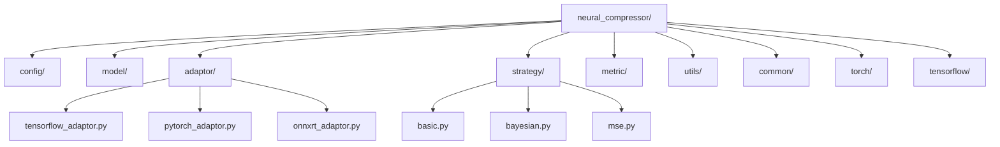
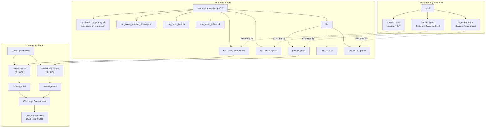
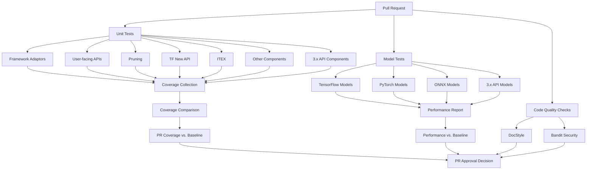

<!-- source: DeepWiki mcp.deepwiki.com · repo intel/neural-compressor · page 10 Development and Contribution · fetched 2026-10-21 -->

# Development and Contribution

<details>
<summary>Relevant source files</summary>

The following files were used as context for generating this wiki page:

- [.azure-pipelines/scripts/ut/3x/collect_log_3x.sh](.azure-pipelines/scripts/ut/3x/collect_log_3x.sh)
- [.azure-pipelines/scripts/ut/env_setup.sh](.azure-pipelines/scripts/ut/env_setup.sh)
- [.azure-pipelines/template/ut-template.yml](.azure-pipelines/template/ut-template.yml)
- [neural_compressor/__init__.py](neural_compressor/__init__.py)
- [neural_compressor/adaptor/torch_utils/auto_round.py](neural_compressor/adaptor/torch_utils/auto_round.py)
- [requirements.txt](requirements.txt)
- [setup.py](setup.py)
- [test/3x/torch/algorithms/fp8_quant/__init__.py](test/3x/torch/algorithms/fp8_quant/__init__.py)
- [test/3x/torch/algorithms/fp8_quant/conftest.py](test/3x/torch/algorithms/fp8_quant/conftest.py)
- [test/3x/torch/quantization/fp8_quant/conftest.py](test/3x/torch/quantization/fp8_quant/conftest.py)
- [test/adaptor/pytorch_adaptor/test_weight_only_adaptor_pytorch.py](test/adaptor/pytorch_adaptor/test_weight_only_adaptor_pytorch.py)
- [test/requirements.txt](test/requirements.txt)

</details>


This page provides comprehensive information for developers who want to contribute to Intel Neural Compressor. It covers setting up the development environment, understanding the repository structure, using the testing infrastructure, and following the contribution workflow.

## Repository Structure

Intel Neural Compressor follows a modular architecture to support various quantization techniques across different deep learning frameworks.



Sources: `neural_compressor/__init__.py`, `setup.py`

## Development Environment Setup

### Package Structure and Installation Options

Neural Compressor provides three distinct package configurations defined in [setup.py:45-94]():

| Package Name | Installation Command | Included Modules | Use Case |
|--------------|---------------------|------------------|----------|
| `neural_compressor` | `pip install neural-compressor` | All: 2.x API, 3.x API, all frameworks | Full development |
| `neural_compressor_pt` | `pip install neural-compressor-pt` | `common.*`, `torch.*`, `transformers.*`, `evaluation.*` | PyTorch-only development |
| `neural_compressor_tf` | `pip install neural-compressor_tf` | `common.*`, `tensorflow.*` | TensorFlow-only development |

### Development Installation

For development with editable installation, use environment variables to select the package configuration:

```bash
# Full package (default)
pip install -e .

# PyTorch-only (setuptools >= 80.0.0)
INC_PT_ONLY=1 pip install -e .

# TensorFlow-only (setuptools >= 80.0.0)
INC_TF_ONLY=1 pip install -e .

# For older setuptools versions
python setup.py develop pt    # PyTorch-only
python setup.py develop tf    # TensorFlow-only
```

The environment variables `INC_PT_ONLY` and `INC_TF_ONLY` are also checked at runtime to conditionally import modules [neural_compressor/__init__.py:22-34]():

```python
if not (os.environ.get("INC_PT_ONLY", False) or os.environ.get("INC_TF_ONLY", False)):
    from .config import (
        DistillationConfig,
        PostTrainingQuantConfig,
        # ... 2.x API imports
    )
```

### Dependencies

Core dependencies are defined in [requirements.txt:1-15]() and include:

- `numpy < 2.0`
- `pandas`, `Pillow`, `prettytable`
- `pycocotools` (platform-specific)
- `pyyaml`, `requests`, `schema`
- `scikit-learn`, `psutil`, `py-cpuinfo`

Framework-specific dependencies:
- **PyTorch**: `requirements_pt.txt` (torch, transformers, accelerate, peft, optimum)
- **TensorFlow**: `requirements_tf.txt` (tensorflow, intel-tensorflow)

Test dependencies are defined in [test/requirements.txt:1-21]() and include additional packages like `pytest`, `onnx`, `onnxruntime`, `auto-round`, and framework extensions.

Sources: [setup.py:45-155](), [requirements.txt:1-15](), [test/requirements.txt:1-21](), [neural_compressor/__init__.py:20-35]()

### Docker-Based Development

The CI/CD pipeline uses Docker containers for consistent testing environments. The setup is defined in [.azure-pipelines/template/docker-template.yml]() and referenced by unit test templates [.azure-pipelines/template/ut-template.yml:25-33]().

**Container Setup Process:**

```bash
# Build development container (from template)
docker build --build-arg PYTHON=python3.10 \
  --build-arg INC_BRANCH=master \
  -f docker/Dockerfile.devel \
  -t neural-compressor:devel .

# Run container with source mounted
docker run -it -v $(pwd):/neural-compressor neural-compressor:devel

# Inside container: install in development mode
cd /neural-compressor
pip install -e .
```

The CI pipeline installs dependencies using [.azure-pipelines/scripts/ut/env_setup.sh:1-108](), which:
1. Installs framework-specific versions based on environment variables
2. Copies pre-trained models and datasets
3. Installs test-specific dependencies (e.g., `auto-round`, `dynast`, `tensorflow-addons`)

Sources: [.azure-pipelines/template/ut-template.yml:25-38](), [.azure-pipelines/scripts/ut/env_setup.sh:1-108]()

## Testing Framework

Neural Compressor has a comprehensive testing infrastructure with unit tests, component tests, and model-level integration tests organized across multiple CI pipelines.

### Test Organization and Execution Flow



**Test Execution Process:**

1. **Environment Setup**: [.azure-pipelines/scripts/ut/env_setup.sh:1-108]() installs framework versions and test dependencies
2. **Test Execution**: Shell scripts run `pytest` with coverage measurement
3. **Coverage Collection**: [.azure-pipelines/scripts/ut/collect_log.sh]() and [.azure-pipelines/scripts/ut/3x/collect_log_3x.sh]() aggregate coverage
4. **Coverage Comparison**: Compare PR coverage against baseline with ±0.05% tolerance

Sources: [.azure-pipelines/scripts/ut/env_setup.sh:1-108](), [.azure-pipelines/scripts/ut/collect_log.sh:1-139](), [.azure-pipelines/scripts/ut/3x/collect_log_3x.sh:1-135]()

### Running Unit Tests Locally

Unit tests are organized by component and framework. Each test script uses `pytest` with coverage measurement.

**2.x API Tests:**

```bash
# Framework adaptor tests (pytorch_adaptor.py, tensorflow_adaptor.py, onnxrt_adaptor.py)
bash .azure-pipelines/scripts/ut/run_basic_adaptor.sh

# User-facing API tests (quantization.fit(), mix_precision.fit(), training.fit())
bash .azure-pipelines/scripts/ut/run_basic_api.sh

# Pruning tests
bash .azure-pipelines/scripts/ut/run_basic_pt_pruning.sh    # PyTorch pruning
bash .azure-pipelines/scripts/ut/run_basic_tf_pruning.sh    # TensorFlow pruning

# TensorFlow New API tests
bash .azure-pipelines/scripts/ut/run_basic_adaptor_tfnewapi.sh

# Intel Extension for TensorFlow (ITEX) tests
bash .azure-pipelines/scripts/ut/run_basic_itex.sh

# Other component tests (utils, metrics, benchmarking)
bash .azure-pipelines/scripts/ut/run_basic_others.sh
```

**3.x API Tests:**

```bash
# 3.x PyTorch API tests (torch.quantization.quantize(), RTN, GPTQ, AWQ, TEQ, AUTOROUND)
bash .azure-pipelines/scripts/ut/3x/run_3x_pt.sh

# 3.x TensorFlow API tests
bash .azure-pipelines/scripts/ut/3x/run_3x_tf.sh

# FP8 quantization tests (Intel Gaudi HPU)
bash .azure-pipelines/scripts/ut/3x/run_3x_pt_fp8.sh
```

**Test Configuration:**

FP8 tests require special environment setup [test/3x/torch/quantization/fp8_quant/conftest.py:1-19]():

```python
# HPU lazy mode and weight sharing configuration
os.environ.setdefault("PT_HPU_LAZY_MODE", "1")
os.environ.setdefault("PT_HPU_WEIGHT_SHARING", "0")
os.environ.setdefault("INC_PT_ONLY", "1")

def pytest_sessionstart():
    import habana_frameworks.torch.core as htcore
    htcore.hpu_set_inference_env()
```

**Running Individual Tests:**

```bash
# Run specific test file with coverage
cd test
pytest adaptor/pytorch_adaptor/test_weight_only_adaptor_pytorch.py -v --cov=neural_compressor --cov-report=html
```

Sources: [.azure-pipelines/scripts/ut/run_basic_adaptor.sh](), [.azure-pipelines/scripts/ut/run_basic_api.sh](), [.azure-pipelines/scripts/ut/3x/run_3x_pt.sh](), [.azure-pipelines/scripts/ut/3x/run_3x_pt_fp8.sh](), [test/3x/torch/quantization/fp8_quant/conftest.py:1-19]()

### Model Integration Tests

Model tests verify end-to-end quantization and benchmarking with real models. Tests are organized by framework and API version.

**Test Structure:**

```bash
# 2.x API Model Tests
examples/
├── pytorch/
│   └── image_recognition/resnet18_fx/
├── tensorflow/
│   └── image_recognition/resnet50v1.5/
└── onnxruntime/
    └── image_recognition/resnet50-v1-12/

# 3.x API Model Tests
examples/3.x_api/
├── pytorch/
│   └── nlp/huggingface_models/language-modeling/quantization/weight_only/
└── tensorflow/
    └── nlp/bert/quantization/ptq/
```

**Running Model Tests:**

```bash
# 2.x API: TensorFlow ResNet50
bash .azure-pipelines/scripts/models/run_tensorflow_models_trigger.sh \
  --model=resnet50v1.5 --mode=tuning

# 2.x API: PyTorch ResNet18
bash .azure-pipelines/scripts/models/run_pytorch_models_trigger.sh \
  --model=resnet18_fx --mode=tuning

# 2.x API: ONNX ResNet50
bash .azure-pipelines/scripts/models/run_onnxrt_models_trigger.sh \
  --model=resnet50-v1-12 --mode=tuning

# 3.x API: Weight-only quantization for LLMs
bash .azure-pipelines/scripts/models/run_3x_pt_models.sh
```

**Model Test Workflow:**

1. **Setup**: Download model and dataset
2. **Tuning**: Run `quantization.fit()` or `torch.quantization.quantize()`
3. **Benchmarking**: Measure INT8 and FP32 performance
4. **Validation**: Compare accuracy and performance against baselines
5. **Reporting**: Generate performance report with metrics

**Example Test Structure** [test/adaptor/pytorch_adaptor/test_weight_only_adaptor_pytorch.py:65-818]():

```python
class TestPytorchWeightOnlyAdaptor(unittest.TestCase):
    def test_RTN_int_quant(self):
        # Test RTN algorithm with various configurations
        conf = PostTrainingQuantConfig(approach="weight_only")
        q_model = quantization.fit(model, conf)
        q_model.save("saved")
        
    def test_GPTQ_fixed_length_quant(self):
        # Test GPTQ with fixed-length calibration data
        conf = PostTrainingQuantConfig(
            approach="weight_only",
            op_type_dict={".*": {"weight": {"algorithm": "GPTQ"}}}
        )
        q_model = quantization.fit(model, conf, calib_dataloader=dataloader)
        
    def test_AWQ_quant(self):
        # Test AWQ with activation-aware scaling
        conf = PostTrainingQuantConfig(
            approach="weight_only",
            recipes={"awq_args": {"enable_auto_scale": True}}
        )
        q_model = quantization.fit(model, conf, calib_dataloader=dataloader)
```

Sources: [.azure-pipelines/scripts/models/run_benchmark_common.sh](), [test/adaptor/pytorch_adaptor/test_weight_only_adaptor_pytorch.py:65-818]()

## Continuous Integration

Neural Compressor uses Azure Pipelines for CI/CD to ensure code quality and functionality.

### CI/CD Pipeline Architecture

The CI system consists of multiple Azure Pipelines for comprehensive validation:

**Pipeline Configuration Mapping:**

| Pipeline | Configuration File | Test Scripts | Purpose |
|----------|-------------------|--------------|---------|
| Code Scan | `.azure-pipelines/code-scan.yml` | N/A | DocStyle, Bandit security checks |
| Unit Test (2.x) | `.azure-pipelines/ut-basic.yml` | `scripts/ut/run_basic_*.sh` | Test 2.x API components |
| Unit Test (3.x PT) | `.azure-pipelines/ut-3x-pt.yml` | `scripts/ut/3x/run_3x_pt.sh` | Test 3.x PyTorch API |
| Unit Test (3.x TF) | `.azure-pipelines/ut-3x-tf.yml` | `scripts/ut/3x/run_3x_tf.sh` | Test 3.x TensorFlow API |
| Unit Test (3.x FP8) | `.azure-pipelines/ut-3x-pt-fp8.yml` | `scripts/ut/3x/run_3x_pt_fp8.sh` | Test FP8 on Gaudi HPU |
| Model Test (2.x) | `.azure-pipelines/model-test.yml` | `scripts/models/run_*_models_trigger.sh` | End-to-end model tests |
| Model Test (3.x) | `.azure-pipelines/model-test-3x.yml` | `scripts/models/run_3x_*.sh` | 3.x API model tests |

**Coverage Validation Process** [.azure-pipelines/scripts/ut/collect_log.sh:98-135]():

```bash
# Extract coverage from coverage.xml using get_coverage_data()
lines_PR_covered=... 
lines_PR_valid=...
coverage_PR_lines_rate=...  # Lines covered / Lines valid * 100

branches_PR_covered=...
branches_PR_valid=...
coverage_PR_branches_rate=...  # Branches covered / Branches valid * 100

# Compare with baseline (tolerance: 0.05%)
if (( $(bc -l <<< "${coverage_PR_lines_rate}+0.05 < ${coverage_base_lines_rate}") )); then
    fail_items+=("lines")
fi
if (( $(bc -l <<< "${coverage_PR_branches_rate}+0.05 < ${coverage_base_branches_rate}") )); then
    fail_items+=("branches")
fi

# Fail if coverage decreased by more than 0.05%
if [[ ${#fail_items[@]} -ne 0 ]]; then
    echo "Unit Test failed with ${item} coverage decrease"
    exit 1
fi
```

**Coverage File Generation** [.azure-pipelines/scripts/ut/3x/collect_log_3x.sh:4-18]():

```bash
# Set coverage configuration
export COVERAGE_RCFILE=/neural-compressor/.azure-pipelines/scripts/ut/3x/coverage.${1}

# Collect coverage from test runs
cp ut_3x_coverage/.coverage /neural-compressor/
cd /neural-compressor
coverage report -m --rcfile=${COVERAGE_RCFILE} | tee ${coverage_log}
coverage html -d log_dir/coverage_PR/htmlcov --rcfile=${COVERAGE_RCFILE}
coverage xml -o log_dir/coverage_PR/coverage.xml --rcfile=${COVERAGE_RCFILE}
```

Sources: [.azure-pipelines/ut-basic.yml](), [.azure-pipelines/ut-3x-pt.yml](), [.azure-pipelines/scripts/ut/collect_log.sh:44-135](), [.azure-pipelines/scripts/ut/3x/collect_log_3x.sh:1-135]()

### Workflow Visualization

The following diagram illustrates the CI workflow for Pull Requests:



Sources: `.azure-pipelines/ut-basic.yml`, `.azure-pipelines/model-test.yml`, `.azure-pipelines/ut-3x-pt.yml`, `.azure-pipelines/ut-3x-tf.yml`, `.azure-pipelines/scripts/ut/collect_log.sh`

## Contribution Workflow

To contribute to Intel Neural Compressor, follow these steps:

1. **Fork the Repository**: Create your own fork of https://github.com/intel/neural-compressor
2. **Create a Branch**: Make your changes in a new branch
3. **Develop and Test**:
   - Add features or fix issues
   - Add tests for new functionality
   - Verify all tests pass locally
4. **Submit a Pull Request**: Open a PR to the main repository
5. **CI Validation**: The CI system will validate your changes
6. **Code Review**: Maintainers will review your code
7. **Merge**: After approval, your changes will be merged

### Pull Request Requirements

PRs must satisfy the following requirements enforced by CI pipelines:

**1. Code Quality**

- **DocStyle Check**: Documentation style compliance
- **Bandit Check**: Security vulnerability scanning
- Configuration: [.azure-pipelines/code-scan.yml]()

**2. Test Coverage** [.azure-pipelines/scripts/ut/collect_log.sh:98-135]()

| Metric | Requirement | Tolerance |
|--------|-------------|-----------|
| Line Coverage | Must not decrease | ±0.05% |
| Branch Coverage | Must not decrease | ±0.05% |

```python
# Coverage validation formula
if coverage_PR_lines_rate + 0.05 < coverage_base_lines_rate:
    FAIL("Line coverage decreased")
if coverage_PR_branches_rate + 0.05 < coverage_base_branches_rate:
    FAIL("Branch coverage decreased")
```

**3. Functionality**

All unit tests must pass:
- 2.x API: Adaptor, API, Pruning, TFNewAPI, ITEX, Others
- 3.x API: PyTorch, TensorFlow, FP8

**4. Performance** (Model Tests)

- Quantized model accuracy must meet baseline thresholds
- Performance (latency/throughput) should not regress significantly
- Specific tolerances vary by model and are defined in test configurations

**5. Test Requirements for New Features**

| Feature Type | Required Tests |
|--------------|----------------|
| New quantization algorithm | Unit tests in `test/adaptor/` or `test/3x/` |
| New framework support | Adaptor tests + model tests |
| New API function | API tests + integration tests |
| Bug fix | Regression test reproducing the issue |

Sources: [.azure-pipelines/code-scan.yml](), [.azure-pipelines/scripts/ut/collect_log.sh:98-135](), [.azure-pipelines/scripts/ut/3x/collect_log_3x.sh:44-135]()

## Development Best Practices

### Adding New Features

**Feature Development Workflow:**


### Common Development Tasks

**1. Adding a New Weight-Only Quantization Algorithm**

File locations:
- Algorithm implementation: `neural_compressor/adaptor/torch_utils/waq/` or `neural_compressor/torch/algorithms/weight_only/`
- Configuration: Update `neural_compressor/config.py` or `neural_compressor/torch/quantization/config.py`
- Entry point: Add to `neural_compressor/torch/algorithms/weight_only/algorithm_entry.py`
- Tests: `test/adaptor/pytorch_adaptor/` or `test/3x/torch/algorithms/`

Example test structure [test/adaptor/pytorch_adaptor/test_weight_only_adaptor_pytorch.py:86-156]():

```python
def test_RTN_int_quant(self):
    model = Model()
    conf = PostTrainingQuantConfig(
        approach="weight_only",
        op_type_dict={".*": {"weight": {"algorithm": "RTN"}}}
    )
    q_model = quantization.fit(model, conf)
    q_model.save("saved")
    compressed_model = q_model.export_compressed_model()
```

**2. Adding Framework Adaptor Support**

For 2.x API:
- Create adaptor: `neural_compressor/adaptor/{framework}_adaptor.py`
- Implement interfaces: `query_fw_capability()`, `quantize()`, `evaluate()`
- Add tests: `test/adaptor/{framework}_adaptor/`

For 3.x API:
- Create module: `neural_compressor/torch/` or `neural_compressor/tensorflow/`
- Implement algorithm entries
- Add tests: `test/3x/torch/` or `test/3x/tensorflow/`

**3. Adding Hardware Backend Support**

Example: FP8 quantization for Intel Gaudi [test/3x/torch/algorithms/fp8_quant/conftest.py:9-19]():

```python
def pytest_sessionstart():
    # Initialize hardware environment
    import habana_frameworks.torch.core as htcore
    htcore.hpu_set_inference_env()
    
    # Set environment variables
    os.environ.setdefault("PT_HPU_LAZY_MODE", "1")
    os.environ.setdefault("INC_PT_ONLY", "1")
```

**4. Bug Fixes**

1. Write a failing test that reproduces the bug
2. Fix the issue in the source code
3. Verify the test passes
4. Run full test suite to ensure no regressions
5. Check coverage hasn't decreased

### Environment Variables for Development

| Variable | Purpose | Values |
|----------|---------|--------|
| `INC_PT_ONLY` | Import only PyTorch modules | `"1"` or `"True"` |
| `INC_TF_ONLY` | Import only TensorFlow modules | `"1"` or `"True"` |
| `PT_HPU_LAZY_MODE` | Enable HPU lazy mode (Gaudi) | `"1"` |
| `PT_HPU_WEIGHT_SHARING` | Control HPU weight sharing | `"0"` or `"1"` |

Sources: [neural_compressor/__init__.py:22-34](), [test/3x/torch/quantization/fp8_quant/conftest.py:1-19](), [test/adaptor/pytorch_adaptor/test_weight_only_adaptor_pytorch.py:65-818]()

### Test Execution and Debugging

**Running Specific Tests:**

```bash
# Run single test file
pytest test/adaptor/pytorch_adaptor/test_weight_only_adaptor_pytorch.py -v

# Run single test method
pytest test/adaptor/pytorch_adaptor/test_weight_only_adaptor_pytorch.py::TestPytorchWeightOnlyAdaptor::test_RTN_int_quant -v

# Run with coverage
pytest test/adaptor/ --cov=neural_compressor.adaptor --cov-report=html

# Run with verbose output
pytest test/ -v -s
```

**Debugging CI Failures:**

1. Check Azure Pipeline logs for the failing stage
2. Review coverage reports in pipeline artifacts
3. Reproduce locally using the same script: `.azure-pipelines/scripts/ut/run_basic_*.sh`
4. Use coverage reports to identify untested code paths
5. Fix and verify coverage metrics meet requirements

Sources: [.azure-pipelines/scripts/ut/env_setup.sh:1-108](), [.azure-pipelines/template/ut-template.yml:35-47]()

## Conclusion

Intel Neural Compressor welcomes contributions from the community. By following the guidelines in this document, you can effectively contribute to the project, ensuring high code quality and maintaining the performance of model optimization techniques.