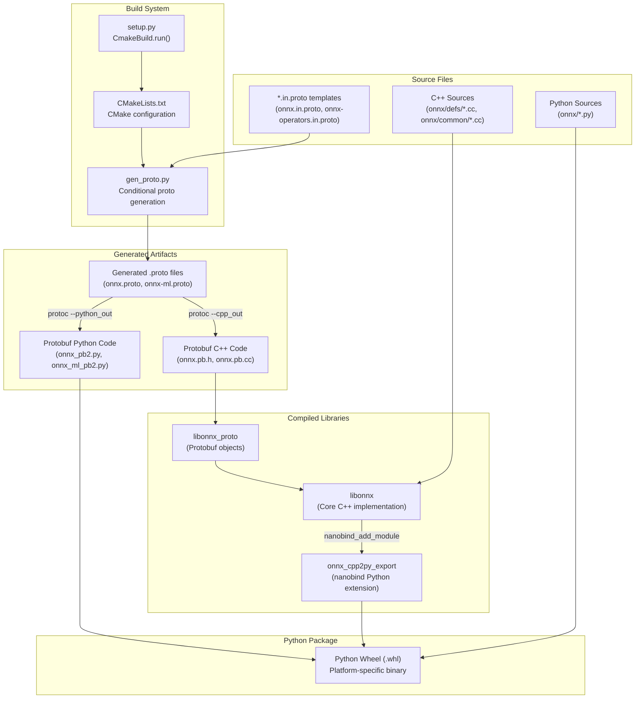
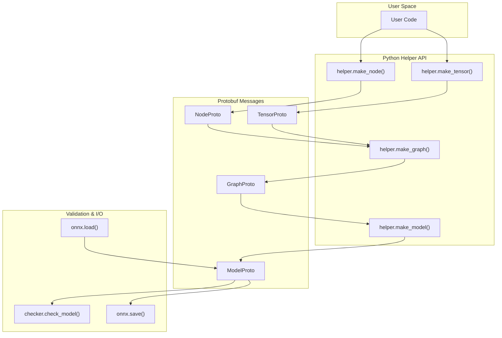
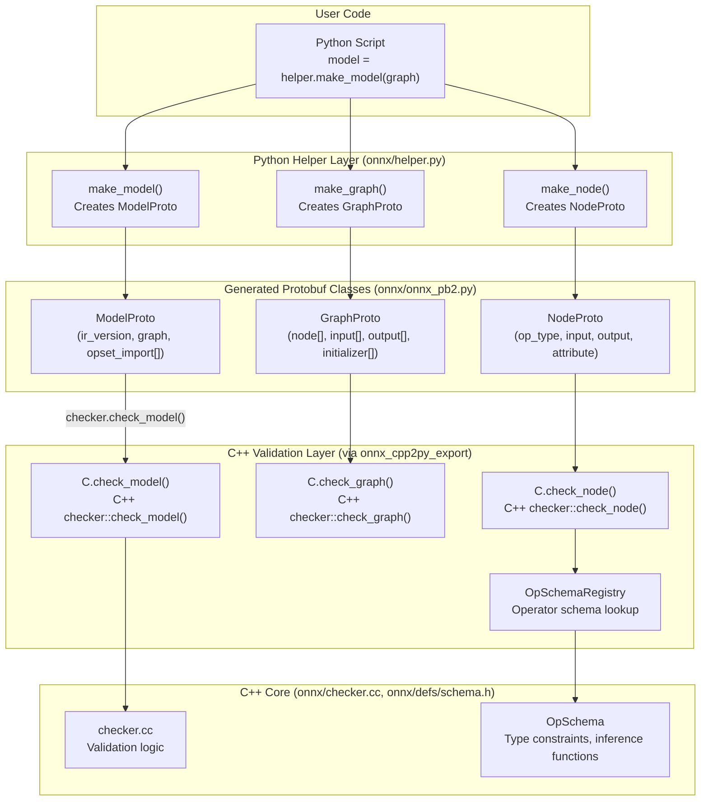
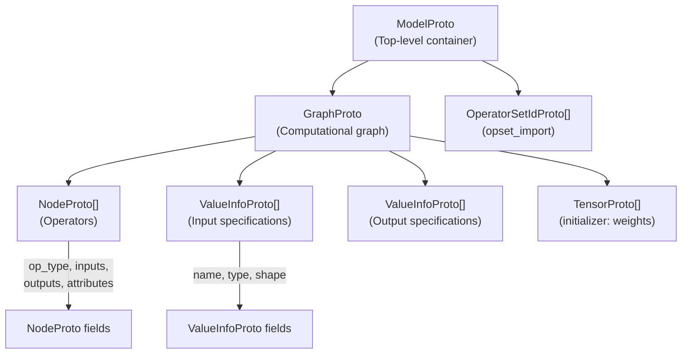

<!-- source: DeepWiki mcp.deepwiki.com · repo onnx/onnx · page 1.1 Getting Started with ONNX · fetched 2026-10-21 -->

# Getting Started with ONNX

<details>
<summary>Relevant source files</summary>

The following files were used as context for generating this wiki page:

- [.github/workflows/main.yml](.github/workflows/main.yml)
- [CMakeLists.txt](CMakeLists.txt)
- [README.md](README.md)
- [VERSION_NUMBER](VERSION_NUMBER)
- [cmake/ONNXConfig.cmake.in](cmake/ONNXConfig.cmake.in)
- [cmake/Utils.cmake](cmake/Utils.cmake)
- [cmake/external/googletest.cmake](cmake/external/googletest.cmake)
- [cmake/summary.cmake](cmake/summary.cmake)
- [cmake/unittest.cmake](cmake/unittest.cmake)
- [docs/IR.md](docs/IR.md)
- [docs/ImplementingAnOnnxBackend.md](docs/ImplementingAnOnnxBackend.md)
- [docs/OnnxBackendTest.md](docs/OnnxBackendTest.md)
- [docs/OnnxReleases.md](docs/OnnxReleases.md)
- [docs/Versioning.md](docs/Versioning.md)
- [onnx/__init__.py](onnx/__init__.py)
- [onnx/checker.py](onnx/checker.py)
- [onnx/common/version.h](onnx/common/version.h)
- [onnx/compose.py](onnx/compose.py)
- [onnx/defs/data_type_utils.cc](onnx/defs/data_type_utils.cc)
- [onnx/defs/data_type_utils.h](onnx/defs/data_type_utils.h)
- [onnx/external_data_helper.py](onnx/external_data_helper.py)
- [onnx/gen_proto.py](onnx/gen_proto.py)
- [onnx/helper.py](onnx/helper.py)
- [onnx/model_container.py](onnx/model_container.py)
- [onnx/numpy_helper.py](onnx/numpy_helper.py)
- [onnx/onnx-ml.proto](onnx/onnx-ml.proto)
- [onnx/onnx-ml.proto3](onnx/onnx-ml.proto3)
- [onnx/onnx.in.proto](onnx/onnx.in.proto)
- [onnx/onnx.proto](onnx/onnx.proto)
- [onnx/onnx.proto3](onnx/onnx.proto3)
- [onnx/onnx_cpp2py_export/checker.pyi](onnx/onnx_cpp2py_export/checker.pyi)
- [onnx/reference/ops/op_range.py](onnx/reference/ops/op_range.py)
- [onnx/serialization.py](onnx/serialization.py)
- [onnx/test/basic_test.py](onnx/test/basic_test.py)
- [onnx/test/checker_test.py](onnx/test/checker_test.py)
- [onnx/test/cmake/CMakeLists.txt](onnx/test/cmake/CMakeLists.txt)
- [onnx/test/cmake/main.cc](onnx/test/cmake/main.cc)
- [onnx/test/compose_test.py](onnx/test/compose_test.py)
- [onnx/test/cpp/checker_test.cc](onnx/test/cpp/checker_test.cc)
- [onnx/test/cpp/function_get_test.cc](onnx/test/cpp/function_get_test.cc)
- [onnx/test/cpp/test_main.cc](onnx/test/cpp/test_main.cc)
- [onnx/test/helper_test.py](onnx/test/helper_test.py)
- [onnx/test/numpy_helper_test.py](onnx/test/numpy_helper_test.py)
- [onnx/test/serialization_test.py](onnx/test/serialization_test.py)
- [onnx/test/test_external_data.py](onnx/test/test_external_data.py)
- [setup.py](setup.py)
- [workflow_scripts/protobuf/build_protobuf_unix.sh](workflow_scripts/protobuf/build_protobuf_unix.sh)
- [workflow_scripts/protobuf/build_protobuf_win.ps1](workflow_scripts/protobuf/build_protobuf_win.ps1)

</details>


## Purpose and Scope

This guide provides a practical introduction to installing ONNX and creating your first ONNX models using the Python API. You will learn how to install the ONNX package, construct simple models programmatically, validate them, and perform basic operations like loading and saving.

For deeper understanding of ONNX's core concepts and terminology, see [Core Concepts and Terminology](#1.2). For comprehensive Python API documentation, see [Python API](#4). For information about testing ONNX models, see [Testing ONNX Models and Backends](#5).

---

## Installation

### Installing from PyPI

The simplest way to install ONNX is via pip:

```bash
pip install onnx
```

For additional dependencies that enable the reference implementation for testing:

```bash
pip install onnx[reference]
```

ONNX provides [abi3](https://docs.python.org/3/c-api/stable.html)-compatible wheels for Python 3.12+ onwards, meaning a single binary wheel works across multiple Python versions. This is implemented through the Python Limited API with `Py_LIMITED_API` macro defined in the extension build.

Weekly development builds are available as a separate package for testing upcoming features:

```bash
pip install onnx-weekly
```

**Sources:** [README.md:79-90](), [setup.py:329-352]()

### Building from Source

For development or when binary wheels are unavailable, you can build ONNX from source. The build system uses CMake to compile C++ components and generate Python bindings via nanobind:

```bash
git clone https://github.com/onnx/onnx.git
cd onnx
pip install -e .
```

#### Build Configuration

Key environment variables controlling the build behavior:

| Variable | Default | Description |
|----------|---------|-------------|
| `ONNX_ML` | `1` | Enable `ai.onnx.ml` domain operators (traditional ML) |
| `ONNX_NAMESPACE` | `"onnx"` | C++ namespace for ONNX symbols |
| `DEBUG` | `0` | Build with debug symbols and optimizations disabled |
| `USE_MSVC_STATIC_RUNTIME` | `0` | Use static MSVC runtime library (Windows only) |
| `ONNX_BUILD_TESTS` | `0` | Build C++ test suite (`onnx_gtests`) |
| `ONNX_USE_LITE_PROTO` | `0` | Use `protobuf-lite` instead of full protobuf |

Additional CMake options can be passed via the `CMAKE_ARGS` environment variable.

**Sources:** [setup.py:40-54](), [CMakeLists.txt:43-70]()

#### Build Process Architecture



The build process follows these steps:

1. **Proto Generation**: [onnx/gen_proto.py:41-109]() processes `.in.proto` templates with conditional compilation based on `ONNX_ML` flag
2. **Protobuf Compilation**: The `protoc` compiler generates C++ and Python code from `.proto` files [CMakeLists.txt:304-392]()
3. **C++ Compilation**: CMake compiles C++ sources into `onnx_proto` and `onnx` libraries [CMakeLists.txt:417-423]()
4. **Python Extension**: [nanobind](https://nanobind.readthedocs.io) creates the `onnx_cpp2py_export` extension module [CMakeLists.txt:458-463]()
5. **Package Assembly**: [setup.py:272-316]() assembles the wheel with all generated files

**Sources:** [setup.py:150-254](), [CMakeLists.txt:304-463](), [onnx/gen_proto.py:41-109]()

---

## Your First ONNX Model

### ONNX Model Creation Workflow



**Sources:** [onnx/helper.py:1-1150](), [onnx/checker.py:1-173]()

### Creating a Simple Linear Model

Here's a minimal example that creates a model with a single `Add` operator:

```python
import onnx
from onnx import helper, TensorProto

# Step 1: Create nodes (operators)
add_node = helper.make_node(
    'Add',              # op_type: Operator name from operator schema
    ['X', 'Y'],         # inputs: List of input tensor names
    ['Z'],              # outputs: List of output tensor names
    name='my_add'       # name: Optional unique node identifier
)

# Step 2: Create a graph
graph = helper.make_graph(
    nodes=[add_node],
    name='simple_add',
    inputs=[
        helper.make_tensor_value_info('X', TensorProto.FLOAT, [2, 3]),
        helper.make_tensor_value_info('Y', TensorProto.FLOAT, [2, 3])
    ],
    outputs=[
        helper.make_tensor_value_info('Z', TensorProto.FLOAT, [2, 3])
    ]
)

# Step 3: Create a model
model = helper.make_model(graph, producer_name='my_producer')

# Step 4: Check the model (validates against operator schemas)
onnx.checker.check_model(model)

# Step 5: Save the model
onnx.save(model, 'simple_add.onnx')
```

#### Python-to-C++ API Flow



**How it works:**

1. **`helper.make_node()`** [onnx/helper.py:135-182]() creates a `NodeProto` protobuf message with:
   - `op_type`: String identifying the operator (e.g., "Add", "Conv")
   - `input`: List of input tensor names
   - `output`: List of output tensor names
   - `attribute`: Optional attributes as key-value pairs (passed as `**kwargs`)

2. **`helper.make_graph()`** [onnx/helper.py:202-243]() creates a `GraphProto` containing:
   - `node`: List of `NodeProto` in topological order
   - `input`/`output`: `ValueInfoProto` specifying tensor names, types, and shapes
   - `initializer`: Optional `TensorProto` constants (weights)

3. **`helper.make_model()`** [onnx/helper.py:296-329]() creates a `ModelProto` with:
   - `ir_version`: Set to current IR version (13)
   - `graph`: The computational graph
   - `opset_import`: Operator set versions (defaults to latest `ai.onnx` version)

4. **`checker.check_model()`** [onnx/checker.py:87-118]() validates the model by calling C++ validation code via the `onnx_cpp2py_export` extension, which checks operator schemas, type consistency, and graph structure.

**Sources:** [onnx/helper.py:135-182](), [onnx/helper.py:202-243](), [onnx/helper.py:296-329](), [onnx/checker.py:87-118]()

### Understanding Model Structure



A `ModelProto` [onnx/onnx_pb.py (generated)] contains:
- `ir_version`: Integer specifying the IR version (currently 13)
- `opset_import`: List of operator sets the model uses
- `graph`: The main `GraphProto` with nodes and data flow
- `producer_name`, `producer_version`: Optional metadata

A `GraphProto` contains:
- `node`: List of `NodeProto` operators in topological order
- `input`: Graph inputs as `ValueInfoProto` messages
- `output`: Graph outputs as `ValueInfoProto` messages  
- `initializer`: Constant tensors (weights) as `TensorProto` messages

**Sources:** [onnx/helper.py:294-326](), [onnx/test/helper_test.py:375-394]()

---

## Working with Models

### Creating Tensors and Initializers

Use `helper.make_tensor()` to create constant tensors (weights, biases):

```python
import numpy as np
from onnx import helper, TensorProto

# Create a tensor from a numpy array
weight_data = np.array([[1.0, 2.0], [3.0, 4.0]], dtype=np.float32)
weight_tensor = helper.make_tensor(
    name='W',
    data_type=TensorProto.FLOAT,
    dims=weight_data.shape,
    vals=weight_data.flatten()
)

# Or create with raw bytes (more efficient)
weight_tensor_raw = helper.make_tensor(
    name='W',
    data_type=TensorProto.FLOAT,
    dims=weight_data.shape,
    vals=weight_data.tobytes(),
    raw=True
)
```

The `make_tensor()` function [onnx/helper.py:390-504]() handles various data types including:
- Standard types: `FLOAT`, `INT32`, `INT64`, `BOOL`, `STRING`
- 16-bit types: `FLOAT16`, `BFLOAT16`, `INT16`, `UINT16`
- 8-bit types: `FLOAT8E4M3FN`, `INT8`, `UINT8`
- Low-bit packed types: `INT4`, `UINT4`, `INT2`, `UINT2`

**Sources:** [onnx/helper.py:390-504](), [onnx/test/helper_test.py:453-529]()

### Converting Between NumPy and ONNX

The `numpy_helper` module provides seamless conversion:

```python
from onnx import numpy_helper

# NumPy to ONNX TensorProto
np_array = np.array([[1, 2], [3, 4]], dtype=np.float32)
tensor_proto = numpy_helper.from_array(np_array, name='my_tensor')

# ONNX TensorProto to NumPy
recovered_array = numpy_helper.to_array(tensor_proto)
assert np.array_equal(np_array, recovered_array)
```

Key functions in [onnx/numpy_helper.py:1-588]():
- `from_array()` [onnx/numpy_helper.py:306-362](): Convert NumPy array to `TensorProto`
- `to_array()` [onnx/numpy_helper.py:172-283](): Convert `TensorProto` to NumPy array
- `from_list()`, `to_list()`: Work with sequence types
- `from_dict()`, `to_dict()`: Work with map types

**Sources:** [onnx/numpy_helper.py:172-362](), [onnx/test/numpy_helper_test.py:16-130]()

### Validating Models

The `checker` module validates model correctness:

```python
from onnx import checker

# Basic validation
checker.check_model(model)

# Validation with full shape inference
checker.check_model(model, full_check=True)

# Validate individual components
checker.check_graph(model.graph)
checker.check_node(node)
```

The checker [onnx/checker.py:1-173]() verifies:
- IR version compatibility
- Operator schema compliance (types, attributes)
- SSA (Single Static Assignment) form
- Topological ordering of nodes
- Type consistency across connections

**Sources:** [onnx/checker.py:121-170](), [onnx/test/checker_test.py:29-411]()

### Saving and Loading Models

ONNX supports multiple serialization formats through the `serialization.registry` system:

```python
import onnx

# Save to file (protobuf format - default)
onnx.save_model(model, 'my_model.onnx')

# Load from file
loaded_model = onnx.load_model('my_model.onnx')

# Explicit format specification
onnx.save_model(model, 'model.json', format='json')
onnx.save_model(model, 'model.txt', format='textproto')

# Load from protobuf string
model_bytes = model.SerializeToString()
loaded_from_bytes = onnx.load_model_from_string(model_bytes)
```

#### Serialization Format Registry

The `serialization.registry` [onnx/__init__.py:185-202]() maps file extensions to serialization formats:

| Format | File Extension | Description |
|--------|----------------|-------------|
| `protobuf` | `.onnx` | Binary protobuf (default, most compact) |
| `json` | `.json` | JSON representation |
| `textproto` | `.textproto` | Text protobuf format |
| `onnxtxt` | `.onnxtxt` | ONNX text syntax |

Format is auto-detected from file extension or can be specified explicitly via the `format` parameter.

**Large Model Handling:** Models can reference external data for tensors larger than 2GB (protobuf limit). Use `save_as_external_data=True`:

```python
# Save with external data
onnx.save_model(
    model, 
    'large_model.onnx',
    save_as_external_data=True,
    all_tensors_to_one_file=True,
    location='external_data.bin',
    size_threshold=1024  # Externalize tensors >= 1KB
)

# Load automatically loads external data from same directory
loaded = onnx.load_model('large_model.onnx')
```

**Checking Large Models:** For models larger than 2GB, use the file path directly with `checker.check_model()` to avoid loading the entire model into memory:

```python
# Check without fully loading (more memory-efficient)
checker.check_model('large_model.onnx')
```

**Sources:** [onnx/__init__.py:185-344](), [onnx/checker.py:87-118](), [onnx/external_data_helper.py:84-184]()

---

## Python Helper API Reference

### Core Model Construction Functions

| Function | Purpose | Returns |
|----------|---------|---------|
| `make_node()` | Create an operator node | `NodeProto` |
| `make_graph()` | Create a computation graph | `GraphProto` |
| `make_model()` | Create a model container | `ModelProto` |
| `make_tensor()` | Create a constant tensor | `TensorProto` |
| `make_tensor_value_info()` | Create input/output spec | `ValueInfoProto` |
| `make_attribute()` | Create node attribute | `AttributeProto` |
| `make_opsetid()` | Specify operator set version | `OperatorSetIdProto` |

**Sources:** [onnx/helper.py:133-256]()

### Example: Model with Weights

```python
import onnx
from onnx import helper, TensorProto
import numpy as np

# Create weight tensor
W = np.array([[1, 2], [3, 4], [5, 6]], dtype=np.float32)
W_tensor = helper.make_tensor(
    name='W',
    data_type=TensorProto.FLOAT,
    dims=W.shape,
    vals=W.flatten().tolist()  # Can also use W.tobytes() with raw=True
)

# Create MatMul node
matmul_node = helper.make_node(
    'MatMul',
    inputs=['X', 'W'],
    outputs=['Y']
)

# Create graph with initializer
graph = helper.make_graph(
    nodes=[matmul_node],
    name='matmul_example',
    inputs=[
        # X is a graph input with dynamic batch dimension (None)
        helper.make_tensor_value_info('X', TensorProto.FLOAT, [None, 2])
    ],
    outputs=[
        helper.make_tensor_value_info('Y', TensorProto.FLOAT, [None, 3])
    ],
    initializer=[W_tensor]  # Constant tensors (weights)
)

# Create model with explicit opset version
model = helper.make_model(
    graph,
    opset_imports=[helper.make_opsetid('', 18)]  # ai.onnx opset 18
)

onnx.checker.check_model(model)
```

**Key Concepts:**

- **Initializers** (`GraphProto.initializer`): Constant tensors that provide default values for graph inputs or serve as constant parameters. They are typically used for model weights.
- **Dynamic Dimensions**: `None` or a string like `"batch"` in shapes indicates a dimension that can vary at runtime
- **Opset Versions**: [helper.make_opsetid():245-258]() specifies which version of operators to use. Empty string `''` refers to the default `ai.onnx` domain.

**Sources:** [onnx/helper.py:202-243](), [onnx/helper.py:245-258](), [onnx/helper.py:392-507]()

---

## Common Patterns

### Setting Operator Attributes

Many operators accept attributes that control their behavior:

```python
# Conv operator with attributes
conv_node = helper.make_node(
    'Conv',
    inputs=['X', 'W', 'B'],
    outputs=['Y'],
    kernel_shape=[3, 3],
    strides=[1, 1],
    pads=[1, 1, 1, 1],
    dilations=[1, 1]
)

# Pad operator with mode attribute
pad_node = helper.make_node(
    'Pad',
    inputs=['data', 'pads', 'constant_value'],
    outputs=['output'],
    mode='constant'  # String attribute
)
```

The `make_node()` function accepts keyword arguments for attributes [onnx/helper.py:133-179](). The `make_attribute()` helper [onnx/helper.py:627-718]() can also create standalone attributes for more complex scenarios.

**Sources:** [onnx/helper.py:133-179](), [onnx/helper.py:627-718]()

### Automatic IR Version Selection

Use `make_model_gen_version()` to automatically infer the minimum required IR version based on operator sets:

```python
from onnx import helper

model = helper.make_model_gen_version(
    graph,
    opset_imports=[
        helper.make_opsetid('', 18),      # ai.onnx opset 18
        helper.make_opsetid('ai.onnx.ml', 3)  # ai.onnx.ml opset 3
    ]
)
# IR version will be automatically set based on opset requirements
```

The function [onnx/helper.py:331-337]() uses the version mapping table [onnx/helper.py:46-78]() to determine the minimum IR version needed.

**Sources:** [onnx/helper.py:331-337](), [onnx/helper.py:83-102](), [onnx/test/helper_test.py:412-450]()

---

## Next Steps

Now that you understand the basics of creating and working with ONNX models:

- Learn about **[Core Concepts and Terminology](#1.2)** to understand ONNX's type system, versioning, and graph semantics
- Explore **[Python API](#4)** for comprehensive documentation of all helper functions
- Study **[ONNX Model Representation](#2)** to understand protobuf schemas and the in-memory IR
- Read about **[ONNX Operator System](#3)** to understand how operators are defined and versioned
- Review **[Testing ONNX Models and Backends](#5)** to learn how to validate your implementations

For more examples, see:
- [ONNX Tutorials](https://github.com/onnx/tutorials)
- [Pre-trained ONNX Models](https://github.com/onnx/models)
- [Operator Documentation](https://onnx.ai/onnx/operators)

**Sources:** [README.md:24-44](), [docs/Versioning.md:1-204]()

---

