# Page: Introduction to ONNX

# Introduction to ONNX

<details>
<summary>Relevant source files</summary>

The following files were used as context for generating this wiki page:

- [.github/workflows/main.yml](.github/workflows/main.yml)
- [CMakeLists.txt](CMakeLists.txt)
- [README.md](README.md)
- [VERSION_NUMBER](VERSION_NUMBER)
- [cmake/ONNXConfig.cmake.in](cmake/ONNXConfig.cmake.in)
- [cmake/Utils.cmake](cmake/Utils.cmake)
- [cmake/external/googletest.cmake](cmake/external/googletest.cmake)
- [cmake/summary.cmake](cmake/summary.cmake)
- [cmake/unittest.cmake](cmake/unittest.cmake)
- [docs/Changelog.md](docs/Changelog.md)
- [docs/IR.md](docs/IR.md)
- [docs/ImplementingAnOnnxBackend.md](docs/ImplementingAnOnnxBackend.md)
- [docs/OnnxBackendTest.md](docs/OnnxBackendTest.md)
- [docs/OnnxReleases.md](docs/OnnxReleases.md)
- [docs/Operators.md](docs/Operators.md)
- [docs/TestCoverage.md](docs/TestCoverage.md)
- [docs/Versioning.md](docs/Versioning.md)
- [onnx/backend/test/case/node/cast.py](onnx/backend/test/case/node/cast.py)
- [onnx/backend/test/case/node/castlike.py](onnx/backend/test/case/node/castlike.py)
- [onnx/common/version.h](onnx/common/version.h)
- [onnx/defs/controlflow/defs.cc](onnx/defs/controlflow/defs.cc)
- [onnx/defs/controlflow/old.cc](onnx/defs/controlflow/old.cc)
- [onnx/defs/data_type_utils.cc](onnx/defs/data_type_utils.cc)
- [onnx/defs/data_type_utils.h](onnx/defs/data_type_utils.h)
- [onnx/defs/math/defs.cc](onnx/defs/math/defs.cc)
- [onnx/defs/math/old.cc](onnx/defs/math/old.cc)
- [onnx/defs/nn/defs.cc](onnx/defs/nn/defs.cc)
- [onnx/defs/nn/old.cc](onnx/defs/nn/old.cc)
- [onnx/defs/operator_sets.h](onnx/defs/operator_sets.h)
- [onnx/defs/reduction/defs.cc](onnx/defs/reduction/defs.cc)
- [onnx/defs/rnn/defs.cc](onnx/defs/rnn/defs.cc)
- [onnx/defs/rnn/old.cc](onnx/defs/rnn/old.cc)
- [onnx/defs/tensor/defs.cc](onnx/defs/tensor/defs.cc)
- [onnx/defs/tensor/old.cc](onnx/defs/tensor/old.cc)
- [onnx/gen_proto.py](onnx/gen_proto.py)
- [onnx/helper.py](onnx/helper.py)
- [onnx/numpy_helper.py](onnx/numpy_helper.py)
- [onnx/onnx-ml.proto](onnx/onnx-ml.proto)
- [onnx/onnx-ml.proto3](onnx/onnx-ml.proto3)
- [onnx/onnx.in.proto](onnx/onnx.in.proto)
- [onnx/onnx.proto](onnx/onnx.proto)
- [onnx/onnx.proto3](onnx/onnx.proto3)
- [onnx/reference/ops/op_range.py](onnx/reference/ops/op_range.py)
- [onnx/test/cmake/CMakeLists.txt](onnx/test/cmake/CMakeLists.txt)
- [onnx/test/cmake/main.cc](onnx/test/cmake/main.cc)
- [onnx/test/cpp/checker_test.cc](onnx/test/cpp/checker_test.cc)
- [onnx/test/cpp/function_get_test.cc](onnx/test/cpp/function_get_test.cc)
- [onnx/test/cpp/test_main.cc](onnx/test/cpp/test_main.cc)
- [onnx/test/helper_test.py](onnx/test/helper_test.py)
- [onnx/test/numpy_helper_test.py](onnx/test/numpy_helper_test.py)
- [onnx/test/shape_inference_test.py](onnx/test/shape_inference_test.py)
- [setup.py](setup.py)
- [workflow_scripts/protobuf/build_protobuf_unix.sh](workflow_scripts/protobuf/build_protobuf_unix.sh)
- [workflow_scripts/protobuf/build_protobuf_win.ps1](workflow_scripts/protobuf/build_protobuf_win.ps1)

</details>


## Purpose and Scope

This document provides a high-level introduction to ONNX (Open Neural Network Exchange) and the structure of this repository located at https://github.com/onnx/onnx. It explains what ONNX is, the key components that make up the codebase, and how they fit together to enable neural network model interchange.

This page focuses on the overall architecture and orientation. For installation instructions and first steps, see [Getting Started with ONNX](#1.1). For detailed explanations of core terminology like models, graphs, and operators, see [Core Concepts and Terminology](#1.2).

**Sources:** [README.md:1-122](), [docs/IR.md:1-50]()

## What is ONNX?

ONNX is an open source format for representing machine learning models. It provides:

1. **An extensible computation graph model** - defines how neural networks are represented as directed graphs
2. **Standard data types** - defines tensors, sequences, maps, and other data structures  
3. **Built-in operators** - defines ~170 standard operators (e.g., Conv, MatMul, Add) across two domains:
   - `ai.onnx` - Standard operators for deep learning (currently at opset version 26)
   - `ai.onnx.ml` - Traditional machine learning operators (currently at opset version 5)

The ONNX format enables interoperability between different ML frameworks. Models can be trained in one framework (e.g., PyTorch) and exported to ONNX for inference in another runtime (e.g., ONNX Runtime, TensorRT).

**Sources:** [README.md:17-21](), [docs/IR.md:27-36](), [docs/Operators.md:11-215]()

## Repository Organization

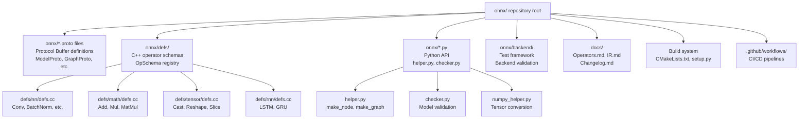

**Sources:** [README.md:24-52](), [CMakeLists.txt:1-560](), [onnx/defs/tensor/defs.cc:1-20](), [onnx/defs/math/defs.cc:1-20](), [onnx/defs/nn/defs.cc:1-20]()

## Core System Components

The ONNX repository consists of several major systems that work together:

### Protocol Buffer Layer (Serialization Format)

| Component | File Path | Purpose |
|-----------|-----------|---------|
| Base Protocol Definition | [onnx/onnx.in.proto:1-800]() | Template for generating protocol buffers |
| Generated Protocols | [onnx/onnx.proto:1-1000](), [onnx/onnx-ml.proto:1-1000]() | Generated protobuf files (ML vs non-ML variants) |
| Generator Script | [onnx/gen_proto.py]() | Generates .proto files with conditional compilation |
| Key Message Types | `ModelProto`, `GraphProto`, `NodeProto`, `TensorProto` | Core data structures in protobuf |

The protobuf definitions are the canonical serialization format. Models on disk are serialized `ModelProto` messages.

### C++ Core (Operator Registry and Schema System)

| Component | File Path | Purpose |
|-----------|-----------|---------|
| OpSchema Class | [onnx/defs/schema.h]() | Defines operator signature, types, inference functions |
| Operator Definitions | [onnx/defs/*/defs.cc:*-*]() | ~170 operator schemas defined via `ONNX_OPERATOR_SET_SCHEMA` macro |
| Schema Registry | [onnx/defs/operator_sets.h:1-100]() | Global registry of all operator schemas by domain/version |
| Shape Inference | [onnx/shape_inference/*.cc]() | Type and shape propagation system |
| Checker | [onnx/checker.cc]() | Validates models against schema rules |

Each operator is defined using the `ONNX_OPERATOR_SET_SCHEMA` macro which registers an `OpSchema` with inputs, outputs, type constraints, and inference functions.

### Python API (User-Facing Interface)

| Component | File Path | Purpose |
|-----------|-----------|---------|
| Public API | [onnx/__init__.py]() | Top-level exports: `load_model`, `save_model`, `checker.check_model` |
| Helper Functions | [onnx/helper.py:135-700]() | `make_node`, `make_graph`, `make_model`, `make_tensor` |
| Type Conversion | [onnx/numpy_helper.py:1-500]() | `from_array`, `to_array` - NumPy ↔ TensorProto |
| Checker | [onnx/checker.py]() | Python wrapper around C++ validation |
| C++ Bindings | [onnx/cpp2py_export.cc]() | nanobind exports C++ functionality to Python |

The Python API provides both model construction (via `helper.py`) and model manipulation (loading, saving, checking).

### Build System

| Component | File Path | Purpose |
|-----------|-----------|---------|
| CMake Build | [CMakeLists.txt:1-560]() | C++ compilation, protoc invocation, library creation |
| Python Setup | [setup.py:1-400]() | Python package building, wheel creation, dependency management |
| Protocol Generation | [CMakeLists.txt:304-395]() | `RELATIVE_PROTOBUF_GENERATE_CPP` function generates C++/Python from .proto |
| Conditional Compilation | `ONNX_ML`, `ONNX_NAMESPACE` | Environment variables control build variants |

The build system generates protocol buffer code, compiles C++ libraries (`onnx`, `onnx_proto`), and creates Python bindings (`onnx_cpp2py_export`).

**Sources:** [CMakeLists.txt:1-560](), [setup.py:1-300](), [onnx/onnx.proto:1-100](), [onnx/helper.py:1-200](), [onnx/defs/schema.h]()

## System Architecture: From User Code to ONNX Format

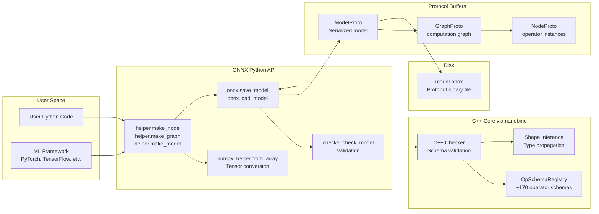

**Workflow Description:**

1. **Model Construction**: Users call `helper.make_node()`, `helper.make_graph()`, and `helper.make_model()` to construct ONNX models programmatically, or export from frameworks like PyTorch.

2. **Tensor Conversion**: NumPy arrays are converted to `TensorProto` messages via `numpy_helper.from_array()`.

3. **Validation**: `checker.check_model()` validates the model against operator schemas in `OpSchemaRegistry`, checking types, shapes, and constraints.

4. **Serialization**: `onnx.save_model()` serializes the in-memory `ModelProto` to a `.onnx` file on disk.

5. **Deserialization**: `onnx.load_model()` reads a `.onnx` file and reconstructs the `ModelProto` in memory.

**Sources:** [onnx/helper.py:135-500](), [onnx/__init__.py](), [onnx/numpy_helper.py:1-300](), [onnx/checker.py](), [onnx/cpp2py_export.cc]()

## Key Code Entities and Entry Points

### For Model Creation

```python
# Entry point: onnx.helper module
import onnx
from onnx import helper, TensorProto

# Create a node (operator instance)
node = helper.make_node(
    'Conv',  # op_type from OpSchema registry
    inputs=['X', 'W'],
    outputs=['Y'],
    kernel_shape=[3, 3]
)

# Create a graph
graph = helper.make_graph(
    [node],
    'simple_graph',
    inputs=[...],
    outputs=[...]
)

# Create a model
model = helper.make_model(graph, producer_name='example')
```

- `helper.make_node()` creates `NodeProto` messages - [onnx/helper.py:135-200]()
- `helper.make_graph()` creates `GraphProto` messages - [onnx/helper.py:250-350]()
- `helper.make_model()` creates `ModelProto` messages - [onnx/helper.py:400-500]()

### For Model Validation

```python
# Entry point: onnx.checker module
import onnx

model = onnx.load_model('model.onnx')
onnx.checker.check_model(model)  # Validates against schemas
```

- `checker.check_model()` - Python wrapper - [onnx/checker.py]()
- C++ `check_model()` - Core validation - [onnx/checker.cc]()
- Uses `OpSchemaRegistry::Schema()` to look up operator definitions

### For Operator Definition (C++ Development)

```cpp
// Entry point: ONNX_OPERATOR_SET_SCHEMA macro
// Example from onnx/defs/math/defs.cc

ONNX_OPERATOR_SET_SCHEMA(
    Add,
    14,
    OpSchema()
        .SetDoc("Performs element-wise binary addition...")
        .Input(0, "A", "First operand.", "T")
        .Input(1, "B", "Second operand.", "T")
        .Output(0, "C", "Result", "T")
        .TypeConstraint("T", OpSchema::all_numeric_types_ir4(), "...")
        .TypeAndShapeInferenceFunction([](InferenceContext& ctx) {
            // Shape inference logic
        })
);
```

- Defined in [onnx/defs/math/defs.cc:100-110]()
- Registers into `OpSchemaRegistry` - [onnx/defs/operator_sets.h:1-100]()
- `OpSchema` class - [onnx/defs/schema.h]()

**Sources:** [onnx/helper.py:135-700](), [onnx/checker.py](), [onnx/defs/math/defs.cc:100-170](), [onnx/defs/schema.h]()

## Documentation and Specification

| Document | Location | Content |
|----------|----------|---------|
| IR Specification | [docs/IR.md:1-1000]() | Normative semantics of ONNX format |
| Operator Documentation | [docs/Operators.md:1-150000]() | Auto-generated from `OpSchema` definitions |
| ML Operator Documentation | [docs/Operators-ml.md]() | Traditional ML operators (TreeEnsemble, SVM, etc.) |
| Changelog | [docs/Changelog.md:1-100000]() | Version history of all operators |
| Versioning | [docs/Versioning.md:1-500]() | Opset version strategy and IR versioning |

The operator documentation is **automatically generated** from C++ operator schemas using [onnx/defs/gen_doc.py](). When operator schemas change, running this script updates the Markdown documentation.

**Sources:** [docs/Operators.md:1-10](), [docs/IR.md:1-50](), [docs/Versioning.md:1-100]()

## Testing and Validation

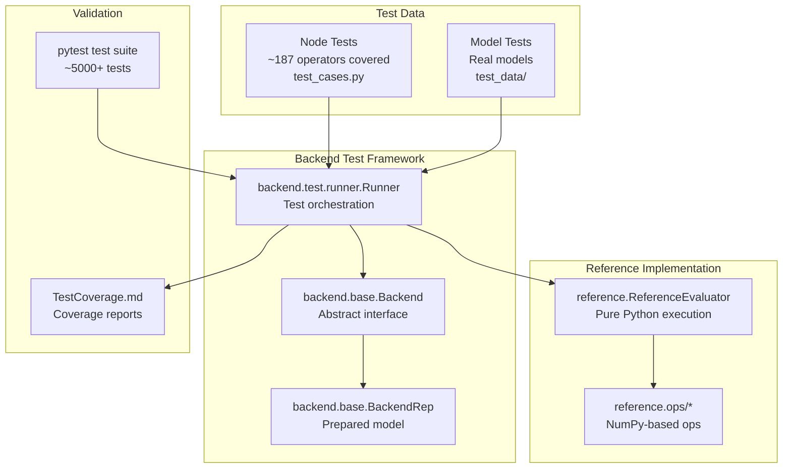

The backend test framework (`onnx/backend/test/`) allows any ONNX runtime to validate its implementation by running standardized test cases against the abstract `Backend` interface.

**Sources:** [onnx/backend/test/runner/__init__.py](), [onnx/backend/base.py](), [docs/TestCoverage.md:1-100](), [README.md:96-108]()

## Version Information

Current ONNX Version: **1.22.0** (from [VERSION_NUMBER:1]())

| Component | Version |
|-----------|---------|
| IR Version | 13 |
| ai.onnx Opset | 26 |
| ai.onnx.ml Opset | 5 |
| Supported Python | 3.10 - 3.14 (including free-threaded 3.13t, 3.14t) |

Version mapping is defined in [onnx/helper.py:46-80]() (`VERSION_TABLE`). This table maps release versions to IR versions and opset versions for each domain.

**Sources:** [VERSION_NUMBER:1](), [onnx/helper.py:46-80](), [docs/Versioning.md:1-200]()

## Build Variants and Configuration

The ONNX build supports multiple configurations controlled by environment variables and CMake options:

| Variable | Values | Effect |
|----------|--------|--------|
| `ONNX_ML` | 0 or 1 (default: 1) | Enable/disable traditional ML operators (ai.onnx.ml domain) |
| `ONNX_NAMESPACE` | string (default: "onnx") | C++ namespace for generated code |
| `ONNX_USE_LITE_PROTO` | 0 or 1 | Use protobuf-lite instead of full protobuf |
| `ONNX_VERIFY_PROTO3` | 0 or 1 | Verify proto3 compatibility |
| `ONNX_BUILD_TESTS` | 0 or 1 | Build C++ test suite |
| `ONNX_HARDENING` | 0 or 1 | Enable compiler hardening flags |

These are read by [CMakeLists.txt:63-79]() and [setup.py:42-53]() to conditionally compile different features.

**Sources:** [CMakeLists.txt:63-79](), [setup.py:42-53](), [README.md:79-122]()

## Navigating This Wiki

This wiki is organized into several major sections:

- **Section 1 (Introduction)**: You are here. See [Getting Started](#1.1) for installation and [Core Concepts](#1.2) for terminology.
- **Section 2 (Model Representation)**: Protocol buffer schema, IR structure, and model format details.
- **Section 3 (Operator System)**: The ~170 operator definitions, schema registry, and shape inference.
- **Section 4 (Python API)**: Helper functions, validation, I/O, and model manipulation.
- **Section 5 (Testing)**: Backend test framework for validating ONNX runtimes.
- **Section 6 (Build System)**: CMake configuration, protobuf generation, and Python packaging.
- **Section 7 (CI/CD)**: Continuous integration, release process, and quality automation.
- **Section 8 (Developer Guide)**: How to add new operators, contribute, and generate documentation.

Each section provides progressively more detail about specific subsystems.

**Sources:** Table of Contents provided in context

---

# Page: Getting Started with ONNX

# Getting Started with ONNX

<details>
<summary>Relevant source files</summary>

The following files were used as context for generating this wiki page:

- [.github/workflows/main.yml](.github/workflows/main.yml)
- [CMakeLists.txt](CMakeLists.txt)
- [README.md](README.md)
- [VERSION_NUMBER](VERSION_NUMBER)
- [cmake/ONNXConfig.cmake.in](cmake/ONNXConfig.cmake.in)
- [cmake/Utils.cmake](cmake/Utils.cmake)
- [cmake/external/googletest.cmake](cmake/external/googletest.cmake)
- [cmake/summary.cmake](cmake/summary.cmake)
- [cmake/unittest.cmake](cmake/unittest.cmake)
- [docs/IR.md](docs/IR.md)
- [docs/ImplementingAnOnnxBackend.md](docs/ImplementingAnOnnxBackend.md)
- [docs/OnnxBackendTest.md](docs/OnnxBackendTest.md)
- [docs/OnnxReleases.md](docs/OnnxReleases.md)
- [docs/Versioning.md](docs/Versioning.md)
- [onnx/__init__.py](onnx/__init__.py)
- [onnx/checker.py](onnx/checker.py)
- [onnx/common/version.h](onnx/common/version.h)
- [onnx/compose.py](onnx/compose.py)
- [onnx/defs/data_type_utils.cc](onnx/defs/data_type_utils.cc)
- [onnx/defs/data_type_utils.h](onnx/defs/data_type_utils.h)
- [onnx/external_data_helper.py](onnx/external_data_helper.py)
- [onnx/gen_proto.py](onnx/gen_proto.py)
- [onnx/helper.py](onnx/helper.py)
- [onnx/model_container.py](onnx/model_container.py)
- [onnx/numpy_helper.py](onnx/numpy_helper.py)
- [onnx/onnx-ml.proto](onnx/onnx-ml.proto)
- [onnx/onnx-ml.proto3](onnx/onnx-ml.proto3)
- [onnx/onnx.in.proto](onnx/onnx.in.proto)
- [onnx/onnx.proto](onnx/onnx.proto)
- [onnx/onnx.proto3](onnx/onnx.proto3)
- [onnx/onnx_cpp2py_export/checker.pyi](onnx/onnx_cpp2py_export/checker.pyi)
- [onnx/reference/ops/op_range.py](onnx/reference/ops/op_range.py)
- [onnx/serialization.py](onnx/serialization.py)
- [onnx/test/basic_test.py](onnx/test/basic_test.py)
- [onnx/test/checker_test.py](onnx/test/checker_test.py)
- [onnx/test/cmake/CMakeLists.txt](onnx/test/cmake/CMakeLists.txt)
- [onnx/test/cmake/main.cc](onnx/test/cmake/main.cc)
- [onnx/test/compose_test.py](onnx/test/compose_test.py)
- [onnx/test/cpp/checker_test.cc](onnx/test/cpp/checker_test.cc)
- [onnx/test/cpp/function_get_test.cc](onnx/test/cpp/function_get_test.cc)
- [onnx/test/cpp/test_main.cc](onnx/test/cpp/test_main.cc)
- [onnx/test/helper_test.py](onnx/test/helper_test.py)
- [onnx/test/numpy_helper_test.py](onnx/test/numpy_helper_test.py)
- [onnx/test/serialization_test.py](onnx/test/serialization_test.py)
- [onnx/test/test_external_data.py](onnx/test/test_external_data.py)
- [setup.py](setup.py)
- [workflow_scripts/protobuf/build_protobuf_unix.sh](workflow_scripts/protobuf/build_protobuf_unix.sh)
- [workflow_scripts/protobuf/build_protobuf_win.ps1](workflow_scripts/protobuf/build_protobuf_win.ps1)

</details>


## Purpose and Scope

This guide provides a practical introduction to installing ONNX and creating your first ONNX models using the Python API. You will learn how to install the ONNX package, construct simple models programmatically, validate them, and perform basic operations like loading and saving.

For deeper understanding of ONNX's core concepts and terminology, see [Core Concepts and Terminology](#1.2). For comprehensive Python API documentation, see [Python API](#4). For information about testing ONNX models, see [Testing ONNX Models and Backends](#5).

---

## Installation

### Installing from PyPI

The simplest way to install ONNX is via pip:

```bash
pip install onnx
```

For additional dependencies that enable the reference implementation for testing:

```bash
pip install onnx[reference]
```

ONNX provides [abi3](https://docs.python.org/3/c-api/stable.html)-compatible wheels for Python 3.12+ onwards, meaning a single binary wheel works across multiple Python versions. This is implemented through the Python Limited API with `Py_LIMITED_API` macro defined in the extension build.

Weekly development builds are available as a separate package for testing upcoming features:

```bash
pip install onnx-weekly
```

**Sources:** [README.md:79-90](), [setup.py:329-352]()

### Building from Source

For development or when binary wheels are unavailable, you can build ONNX from source. The build system uses CMake to compile C++ components and generate Python bindings via nanobind:

```bash
git clone https://github.com/onnx/onnx.git
cd onnx
pip install -e .
```

#### Build Configuration

Key environment variables controlling the build behavior:

| Variable | Default | Description |
|----------|---------|-------------|
| `ONNX_ML` | `1` | Enable `ai.onnx.ml` domain operators (traditional ML) |
| `ONNX_NAMESPACE` | `"onnx"` | C++ namespace for ONNX symbols |
| `DEBUG` | `0` | Build with debug symbols and optimizations disabled |
| `USE_MSVC_STATIC_RUNTIME` | `0` | Use static MSVC runtime library (Windows only) |
| `ONNX_BUILD_TESTS` | `0` | Build C++ test suite (`onnx_gtests`) |
| `ONNX_USE_LITE_PROTO` | `0` | Use `protobuf-lite` instead of full protobuf |

Additional CMake options can be passed via the `CMAKE_ARGS` environment variable.

**Sources:** [setup.py:40-54](), [CMakeLists.txt:43-70]()

#### Build Process Architecture

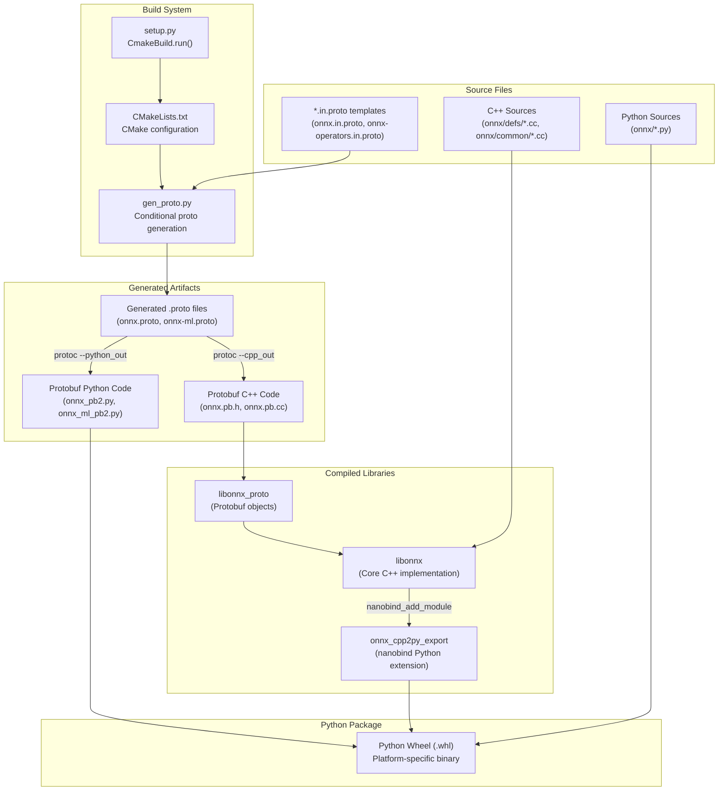

The build process follows these steps:

1. **Proto Generation**: [onnx/gen_proto.py:41-109]() processes `.in.proto` templates with conditional compilation based on `ONNX_ML` flag
2. **Protobuf Compilation**: The `protoc` compiler generates C++ and Python code from `.proto` files [CMakeLists.txt:304-392]()
3. **C++ Compilation**: CMake compiles C++ sources into `onnx_proto` and `onnx` libraries [CMakeLists.txt:417-423]()
4. **Python Extension**: [nanobind](https://nanobind.readthedocs.io) creates the `onnx_cpp2py_export` extension module [CMakeLists.txt:458-463]()
5. **Package Assembly**: [setup.py:272-316]() assembles the wheel with all generated files

**Sources:** [setup.py:150-254](), [CMakeLists.txt:304-463](), [onnx/gen_proto.py:41-109]()

---

## Your First ONNX Model

### ONNX Model Creation Workflow

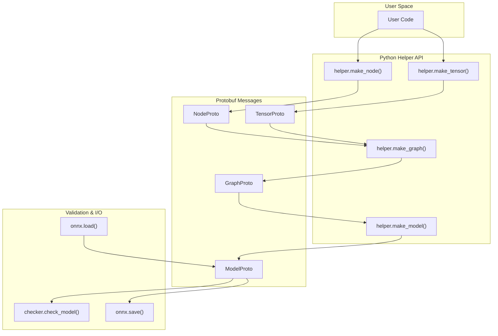

**Sources:** [onnx/helper.py:1-1150](), [onnx/checker.py:1-173]()

### Creating a Simple Linear Model

Here's a minimal example that creates a model with a single `Add` operator:

```python
import onnx
from onnx import helper, TensorProto

# Step 1: Create nodes (operators)
add_node = helper.make_node(
    'Add',              # op_type: Operator name from operator schema
    ['X', 'Y'],         # inputs: List of input tensor names
    ['Z'],              # outputs: List of output tensor names
    name='my_add'       # name: Optional unique node identifier
)

# Step 2: Create a graph
graph = helper.make_graph(
    nodes=[add_node],
    name='simple_add',
    inputs=[
        helper.make_tensor_value_info('X', TensorProto.FLOAT, [2, 3]),
        helper.make_tensor_value_info('Y', TensorProto.FLOAT, [2, 3])
    ],
    outputs=[
        helper.make_tensor_value_info('Z', TensorProto.FLOAT, [2, 3])
    ]
)

# Step 3: Create a model
model = helper.make_model(graph, producer_name='my_producer')

# Step 4: Check the model (validates against operator schemas)
onnx.checker.check_model(model)

# Step 5: Save the model
onnx.save(model, 'simple_add.onnx')
```

#### Python-to-C++ API Flow

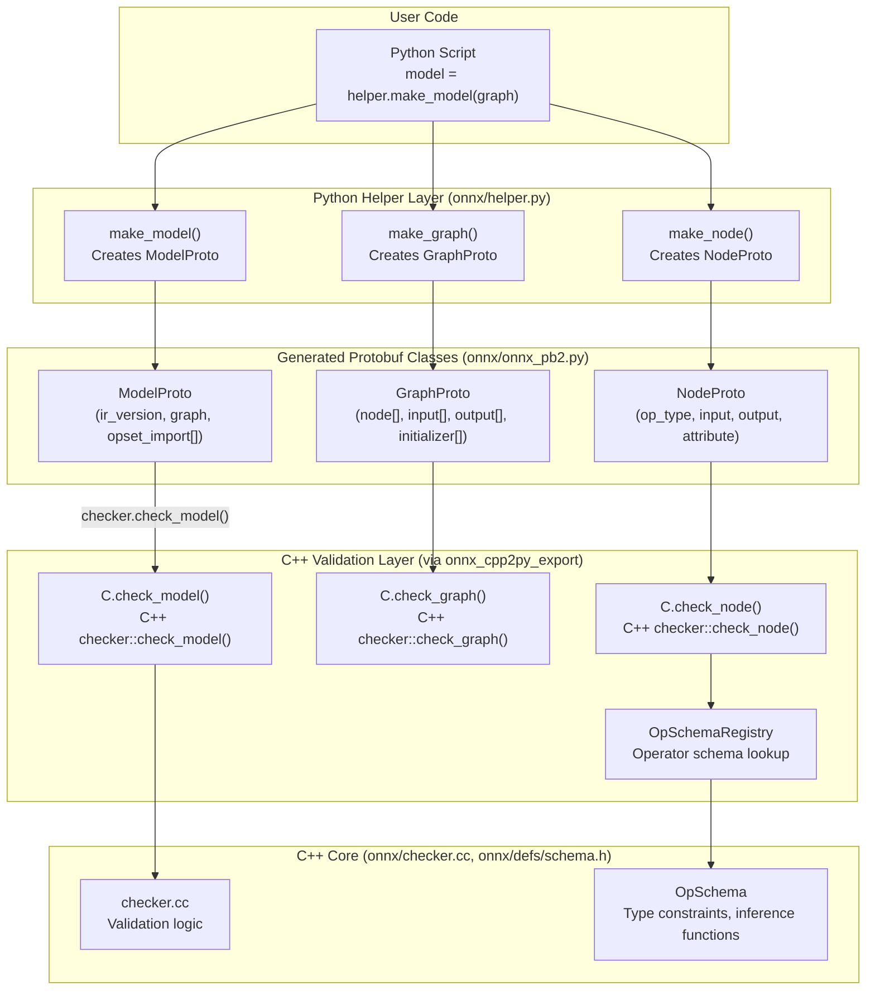

**How it works:**

1. **`helper.make_node()`** [onnx/helper.py:135-182]() creates a `NodeProto` protobuf message with:
   - `op_type`: String identifying the operator (e.g., "Add", "Conv")
   - `input`: List of input tensor names
   - `output`: List of output tensor names
   - `attribute`: Optional attributes as key-value pairs (passed as `**kwargs`)

2. **`helper.make_graph()`** [onnx/helper.py:202-243]() creates a `GraphProto` containing:
   - `node`: List of `NodeProto` in topological order
   - `input`/`output`: `ValueInfoProto` specifying tensor names, types, and shapes
   - `initializer`: Optional `TensorProto` constants (weights)

3. **`helper.make_model()`** [onnx/helper.py:296-329]() creates a `ModelProto` with:
   - `ir_version`: Set to current IR version (13)
   - `graph`: The computational graph
   - `opset_import`: Operator set versions (defaults to latest `ai.onnx` version)

4. **`checker.check_model()`** [onnx/checker.py:87-118]() validates the model by calling C++ validation code via the `onnx_cpp2py_export` extension, which checks operator schemas, type consistency, and graph structure.

**Sources:** [onnx/helper.py:135-182](), [onnx/helper.py:202-243](), [onnx/helper.py:296-329](), [onnx/checker.py:87-118]()

### Understanding Model Structure

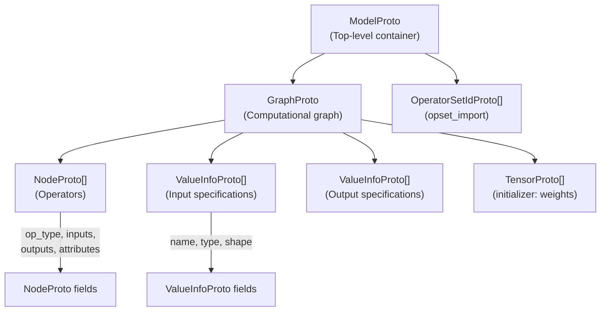

A `ModelProto` [onnx/onnx_pb.py (generated)] contains:
- `ir_version`: Integer specifying the IR version (currently 13)
- `opset_import`: List of operator sets the model uses
- `graph`: The main `GraphProto` with nodes and data flow
- `producer_name`, `producer_version`: Optional metadata

A `GraphProto` contains:
- `node`: List of `NodeProto` operators in topological order
- `input`: Graph inputs as `ValueInfoProto` messages
- `output`: Graph outputs as `ValueInfoProto` messages  
- `initializer`: Constant tensors (weights) as `TensorProto` messages

**Sources:** [onnx/helper.py:294-326](), [onnx/test/helper_test.py:375-394]()

---

## Working with Models

### Creating Tensors and Initializers

Use `helper.make_tensor()` to create constant tensors (weights, biases):

```python
import numpy as np
from onnx import helper, TensorProto

# Create a tensor from a numpy array
weight_data = np.array([[1.0, 2.0], [3.0, 4.0]], dtype=np.float32)
weight_tensor = helper.make_tensor(
    name='W',
    data_type=TensorProto.FLOAT,
    dims=weight_data.shape,
    vals=weight_data.flatten()
)

# Or create with raw bytes (more efficient)
weight_tensor_raw = helper.make_tensor(
    name='W',
    data_type=TensorProto.FLOAT,
    dims=weight_data.shape,
    vals=weight_data.tobytes(),
    raw=True
)
```

The `make_tensor()` function [onnx/helper.py:390-504]() handles various data types including:
- Standard types: `FLOAT`, `INT32`, `INT64`, `BOOL`, `STRING`
- 16-bit types: `FLOAT16`, `BFLOAT16`, `INT16`, `UINT16`
- 8-bit types: `FLOAT8E4M3FN`, `INT8`, `UINT8`
- Low-bit packed types: `INT4`, `UINT4`, `INT2`, `UINT2`

**Sources:** [onnx/helper.py:390-504](), [onnx/test/helper_test.py:453-529]()

### Converting Between NumPy and ONNX

The `numpy_helper` module provides seamless conversion:

```python
from onnx import numpy_helper

# NumPy to ONNX TensorProto
np_array = np.array([[1, 2], [3, 4]], dtype=np.float32)
tensor_proto = numpy_helper.from_array(np_array, name='my_tensor')

# ONNX TensorProto to NumPy
recovered_array = numpy_helper.to_array(tensor_proto)
assert np.array_equal(np_array, recovered_array)
```

Key functions in [onnx/numpy_helper.py:1-588]():
- `from_array()` [onnx/numpy_helper.py:306-362](): Convert NumPy array to `TensorProto`
- `to_array()` [onnx/numpy_helper.py:172-283](): Convert `TensorProto` to NumPy array
- `from_list()`, `to_list()`: Work with sequence types
- `from_dict()`, `to_dict()`: Work with map types

**Sources:** [onnx/numpy_helper.py:172-362](), [onnx/test/numpy_helper_test.py:16-130]()

### Validating Models

The `checker` module validates model correctness:

```python
from onnx import checker

# Basic validation
checker.check_model(model)

# Validation with full shape inference
checker.check_model(model, full_check=True)

# Validate individual components
checker.check_graph(model.graph)
checker.check_node(node)
```

The checker [onnx/checker.py:1-173]() verifies:
- IR version compatibility
- Operator schema compliance (types, attributes)
- SSA (Single Static Assignment) form
- Topological ordering of nodes
- Type consistency across connections

**Sources:** [onnx/checker.py:121-170](), [onnx/test/checker_test.py:29-411]()

### Saving and Loading Models

ONNX supports multiple serialization formats through the `serialization.registry` system:

```python
import onnx

# Save to file (protobuf format - default)
onnx.save_model(model, 'my_model.onnx')

# Load from file
loaded_model = onnx.load_model('my_model.onnx')

# Explicit format specification
onnx.save_model(model, 'model.json', format='json')
onnx.save_model(model, 'model.txt', format='textproto')

# Load from protobuf string
model_bytes = model.SerializeToString()
loaded_from_bytes = onnx.load_model_from_string(model_bytes)
```

#### Serialization Format Registry

The `serialization.registry` [onnx/__init__.py:185-202]() maps file extensions to serialization formats:

| Format | File Extension | Description |
|--------|----------------|-------------|
| `protobuf` | `.onnx` | Binary protobuf (default, most compact) |
| `json` | `.json` | JSON representation |
| `textproto` | `.textproto` | Text protobuf format |
| `onnxtxt` | `.onnxtxt` | ONNX text syntax |

Format is auto-detected from file extension or can be specified explicitly via the `format` parameter.

**Large Model Handling:** Models can reference external data for tensors larger than 2GB (protobuf limit). Use `save_as_external_data=True`:

```python
# Save with external data
onnx.save_model(
    model, 
    'large_model.onnx',
    save_as_external_data=True,
    all_tensors_to_one_file=True,
    location='external_data.bin',
    size_threshold=1024  # Externalize tensors >= 1KB
)

# Load automatically loads external data from same directory
loaded = onnx.load_model('large_model.onnx')
```

**Checking Large Models:** For models larger than 2GB, use the file path directly with `checker.check_model()` to avoid loading the entire model into memory:

```python
# Check without fully loading (more memory-efficient)
checker.check_model('large_model.onnx')
```

**Sources:** [onnx/__init__.py:185-344](), [onnx/checker.py:87-118](), [onnx/external_data_helper.py:84-184]()

---

## Python Helper API Reference

### Core Model Construction Functions

| Function | Purpose | Returns |
|----------|---------|---------|
| `make_node()` | Create an operator node | `NodeProto` |
| `make_graph()` | Create a computation graph | `GraphProto` |
| `make_model()` | Create a model container | `ModelProto` |
| `make_tensor()` | Create a constant tensor | `TensorProto` |
| `make_tensor_value_info()` | Create input/output spec | `ValueInfoProto` |
| `make_attribute()` | Create node attribute | `AttributeProto` |
| `make_opsetid()` | Specify operator set version | `OperatorSetIdProto` |

**Sources:** [onnx/helper.py:133-256]()

### Example: Model with Weights

```python
import onnx
from onnx import helper, TensorProto
import numpy as np

# Create weight tensor
W = np.array([[1, 2], [3, 4], [5, 6]], dtype=np.float32)
W_tensor = helper.make_tensor(
    name='W',
    data_type=TensorProto.FLOAT,
    dims=W.shape,
    vals=W.flatten().tolist()  # Can also use W.tobytes() with raw=True
)

# Create MatMul node
matmul_node = helper.make_node(
    'MatMul',
    inputs=['X', 'W'],
    outputs=['Y']
)

# Create graph with initializer
graph = helper.make_graph(
    nodes=[matmul_node],
    name='matmul_example',
    inputs=[
        # X is a graph input with dynamic batch dimension (None)
        helper.make_tensor_value_info('X', TensorProto.FLOAT, [None, 2])
    ],
    outputs=[
        helper.make_tensor_value_info('Y', TensorProto.FLOAT, [None, 3])
    ],
    initializer=[W_tensor]  # Constant tensors (weights)
)

# Create model with explicit opset version
model = helper.make_model(
    graph,
    opset_imports=[helper.make_opsetid('', 18)]  # ai.onnx opset 18
)

onnx.checker.check_model(model)
```

**Key Concepts:**

- **Initializers** (`GraphProto.initializer`): Constant tensors that provide default values for graph inputs or serve as constant parameters. They are typically used for model weights.
- **Dynamic Dimensions**: `None` or a string like `"batch"` in shapes indicates a dimension that can vary at runtime
- **Opset Versions**: [helper.make_opsetid():245-258]() specifies which version of operators to use. Empty string `''` refers to the default `ai.onnx` domain.

**Sources:** [onnx/helper.py:202-243](), [onnx/helper.py:245-258](), [onnx/helper.py:392-507]()

---

## Common Patterns

### Setting Operator Attributes

Many operators accept attributes that control their behavior:

```python
# Conv operator with attributes
conv_node = helper.make_node(
    'Conv',
    inputs=['X', 'W', 'B'],
    outputs=['Y'],
    kernel_shape=[3, 3],
    strides=[1, 1],
    pads=[1, 1, 1, 1],
    dilations=[1, 1]
)

# Pad operator with mode attribute
pad_node = helper.make_node(
    'Pad',
    inputs=['data', 'pads', 'constant_value'],
    outputs=['output'],
    mode='constant'  # String attribute
)
```

The `make_node()` function accepts keyword arguments for attributes [onnx/helper.py:133-179](). The `make_attribute()` helper [onnx/helper.py:627-718]() can also create standalone attributes for more complex scenarios.

**Sources:** [onnx/helper.py:133-179](), [onnx/helper.py:627-718]()

### Automatic IR Version Selection

Use `make_model_gen_version()` to automatically infer the minimum required IR version based on operator sets:

```python
from onnx import helper

model = helper.make_model_gen_version(
    graph,
    opset_imports=[
        helper.make_opsetid('', 18),      # ai.onnx opset 18
        helper.make_opsetid('ai.onnx.ml', 3)  # ai.onnx.ml opset 3
    ]
)
# IR version will be automatically set based on opset requirements
```

The function [onnx/helper.py:331-337]() uses the version mapping table [onnx/helper.py:46-78]() to determine the minimum IR version needed.

**Sources:** [onnx/helper.py:331-337](), [onnx/helper.py:83-102](), [onnx/test/helper_test.py:412-450]()

---

## Next Steps

Now that you understand the basics of creating and working with ONNX models:

- Learn about **[Core Concepts and Terminology](#1.2)** to understand ONNX's type system, versioning, and graph semantics
- Explore **[Python API](#4)** for comprehensive documentation of all helper functions
- Study **[ONNX Model Representation](#2)** to understand protobuf schemas and the in-memory IR
- Read about **[ONNX Operator System](#3)** to understand how operators are defined and versioned
- Review **[Testing ONNX Models and Backends](#5)** to learn how to validate your implementations

For more examples, see:
- [ONNX Tutorials](https://github.com/onnx/tutorials)
- [Pre-trained ONNX Models](https://github.com/onnx/models)
- [Operator Documentation](https://onnx.ai/onnx/operators)

**Sources:** [README.md:24-44](), [docs/Versioning.md:1-204]()

---

# Page: Core Concepts and Terminology

# Core Concepts and Terminology

<details>
<summary>Relevant source files</summary>

The following files were used as context for generating this wiki page:

- [VERSION_NUMBER](VERSION_NUMBER)
- [docs/Changelog.md](docs/Changelog.md)
- [docs/IR.md](docs/IR.md)
- [docs/OnnxReleases.md](docs/OnnxReleases.md)
- [docs/Operators.md](docs/Operators.md)
- [docs/TestCoverage.md](docs/TestCoverage.md)
- [docs/Versioning.md](docs/Versioning.md)
- [onnx/backend/test/case/node/cast.py](onnx/backend/test/case/node/cast.py)
- [onnx/backend/test/case/node/castlike.py](onnx/backend/test/case/node/castlike.py)
- [onnx/checker.cc](onnx/checker.cc)
- [onnx/checker.h](onnx/checker.h)
- [onnx/common/model_helpers.cc](onnx/common/model_helpers.cc)
- [onnx/common/status.cc](onnx/common/status.cc)
- [onnx/common/status.h](onnx/common/status.h)
- [onnx/common/version.h](onnx/common/version.h)
- [onnx/cpp2py_export.cc](onnx/cpp2py_export.cc)
- [onnx/defs/controlflow/defs.cc](onnx/defs/controlflow/defs.cc)
- [onnx/defs/controlflow/old.cc](onnx/defs/controlflow/old.cc)
- [onnx/defs/data_type_utils.cc](onnx/defs/data_type_utils.cc)
- [onnx/defs/data_type_utils.h](onnx/defs/data_type_utils.h)
- [onnx/defs/function.cc](onnx/defs/function.cc)
- [onnx/defs/function.h](onnx/defs/function.h)
- [onnx/defs/math/defs.cc](onnx/defs/math/defs.cc)
- [onnx/defs/math/old.cc](onnx/defs/math/old.cc)
- [onnx/defs/nn/defs.cc](onnx/defs/nn/defs.cc)
- [onnx/defs/nn/old.cc](onnx/defs/nn/old.cc)
- [onnx/defs/operator_sets.h](onnx/defs/operator_sets.h)
- [onnx/defs/reduction/defs.cc](onnx/defs/reduction/defs.cc)
- [onnx/defs/rnn/defs.cc](onnx/defs/rnn/defs.cc)
- [onnx/defs/rnn/old.cc](onnx/defs/rnn/old.cc)
- [onnx/defs/schema.cc](onnx/defs/schema.cc)
- [onnx/defs/schema.h](onnx/defs/schema.h)
- [onnx/defs/shape_inference.cc](onnx/defs/shape_inference.cc)
- [onnx/defs/shape_inference.h](onnx/defs/shape_inference.h)
- [onnx/defs/tensor/defs.cc](onnx/defs/tensor/defs.cc)
- [onnx/defs/tensor/old.cc](onnx/defs/tensor/old.cc)
- [onnx/helper.py](onnx/helper.py)
- [onnx/numpy_helper.py](onnx/numpy_helper.py)
- [onnx/onnx-ml.proto](onnx/onnx-ml.proto)
- [onnx/onnx-ml.proto3](onnx/onnx-ml.proto3)
- [onnx/onnx.in.proto](onnx/onnx.in.proto)
- [onnx/onnx.proto](onnx/onnx.proto)
- [onnx/onnx.proto3](onnx/onnx.proto3)
- [onnx/reference/ops/op_range.py](onnx/reference/ops/op_range.py)
- [onnx/shape_inference/implementation.cc](onnx/shape_inference/implementation.cc)
- [onnx/shape_inference/implementation.h](onnx/shape_inference/implementation.h)
- [onnx/test/helper_test.py](onnx/test/helper_test.py)
- [onnx/test/numpy_helper_test.py](onnx/test/numpy_helper_test.py)
- [onnx/test/shape_inference_test.py](onnx/test/shape_inference_test.py)

</details>


This document explains the fundamental concepts and terminology used in the ONNX framework. It provides an overview of the core components that make up the ONNX Intermediate Representation (IR) and how they relate to each other. For information about working with ONNX models programmatically, see [Python API](#5).

## ONNX Intermediate Representation (IR)

The ONNX Intermediate Representation (IR) is the foundation of ONNX, providing a standard format for representing deep learning and machine learning models. The IR consists of three core components:

1. **An extensible computation graph model**
2. **Definitions of standard data types**
3. **Definitions of built-in operators**

The IR is designed to be both framework-agnostic and hardware-agnostic, allowing models to be exchanged between different frameworks and deployed on various hardware platforms.

Sources: [docs/IR.md:8-35](). [onnx/onnx.proto:15-23]().

## Model Hierarchy

ONNX models follow a hierarchical structure with three primary components:

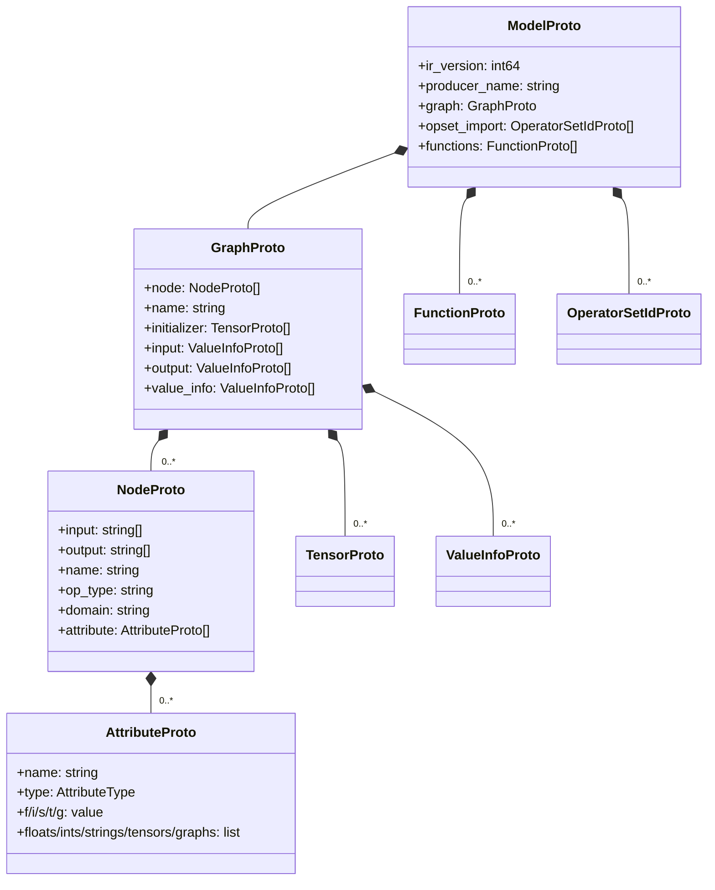

### ModelProto

The `ModelProto` is the top-level container for an ONNX model. It includes:

- **ir_version**: The version of the ONNX IR used by the model
- **opset_import**: The operator sets imported by the model
- **producer_name/producer_version**: The tool/framework that generated the model
- **domain**: The model namespace (typically using reverse domain name)
- **model_version**: The version of the model
- **graph**: The main computational graph
- **functions**: Model-local function definitions
- **metadata_props**: Additional metadata as key-value pairs

Sources: [onnx/onnx.proto:438-514](). [docs/IR.md:70-89]().

### GraphProto

The `GraphProto` represents a computation graph and includes:

- **node**: A list of nodes (the operations in the graph), sorted topologically
- **name**: The name of the graph
- **initializer**: Named tensor values used as constants
- **input**: The input parameters of the graph
- **output**: The output parameters of the graph
- **value_info**: Type and shape information for values

Sources: [onnx/onnx.proto:553-589](). [docs/IR.md:224-240]().

### NodeProto

The `NodeProto` represents a computation node (operation) in the graph:

- **input**: Names of the values used as inputs
- **output**: Names of the outputs produced by this node
- **name**: An optional identifier for the node
- **op_type**: The symbolic identifier of the operator to execute
- **domain**: The domain of the operator set (default is "ai.onnx")
- **attribute**: Named attributes that configure the operator

Sources: [onnx/onnx.proto:205-237](). [docs/IR.md:278-297]().

## Values and Tensors

### Value Representation

In ONNX, values are represented by their names in the graph, and their types and shapes are defined separately. Values can be graph inputs, outputs, initializers, or intermediate results produced by nodes.

The `ValueInfoProto` provides information about a value:
- **name**: The name of the value
- **type**: The type information, including shape for tensors
- **doc_string**: Optional documentation

Sources: [onnx/onnx.proto:193-204](). [docs/IR.md:241-249]().

### Tensors

Tensors are the primary data container in ONNX:

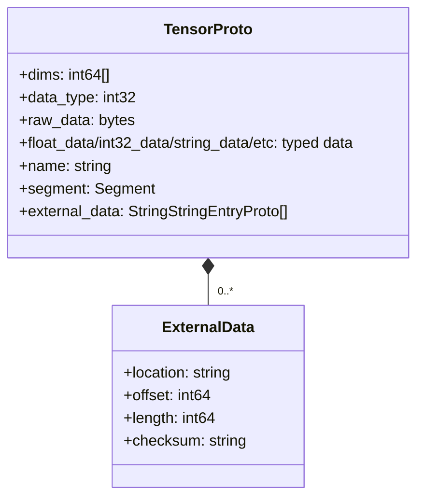

A `TensorProto` includes:
- **dims**: The shape of the tensor
- **data_type**: The data type (FLOAT, INT32, etc.)
- **raw_data/\*_data**: The actual data values
- **name**: An optional name
- **external_data**: For tensors stored externally

Sources: [onnx/onnx.proto:596-764](). [docs/IR.md:398-417]().

## Data Types

ONNX supports various data types for tensors and other values:

| Category | Types | Description |
|----------|-------|-------------|
| Floating Point | float16, float32, float64, bfloat16, float8e4m3fn, etc. | IEEE 754-2008 floating-point values |
| Integer | int4, int8, int16, int32, int64, uint4, uint8, uint16, uint32, uint64 | Signed and unsigned integers of various sizes |
| String | string | UTF-8 strings |
| Boolean | bool | Boolean values |
| Complex | complex64, complex128 | Complex numbers with float32/float64 components |
| Other | | Sequences, maps, optional types, sparse tensors |

Sources: [onnx/onnx.proto:597-642](). [docs/IR.md:423-426]().

## Type System

ONNX has a rich type system that extends beyond simple tensor types:

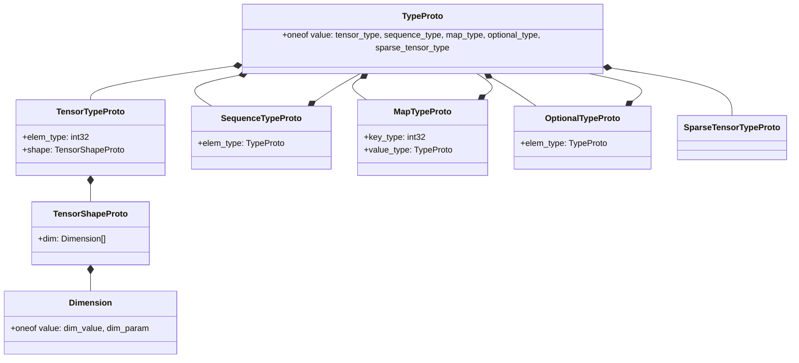

This type system allows representing:
- **Tensor types**: Multidimensional arrays with a specific element type
- **Sequence types**: Sequences of elements of a specific type
- **Map types**: Key-value mappings
- **Optional types**: Values that may be present or absent
- **Sparse tensor types**: Memory-efficient representation of tensors with many zeros

Sources: [onnx/onnx.proto:812-856](). [docs/IR.md:388-394]().

## Operators and Attributes

### Operators

Operators define the computations performed in an ONNX graph. Each operator:
- Has an `op_type` (e.g., "Conv", "MatMul")
- Belongs to a `domain` (default is "ai.onnx")
- Takes inputs and produces outputs
- May have attributes that configure its behavior

Operators are defined in operator sets, which are imported by models using `opset_import`. Each operator set has a domain and version.

Sources: [docs/IR.md:158-170](). [onnx/onnx.proto:220-226]().

### Attributes

Attributes configure operators and may contain:

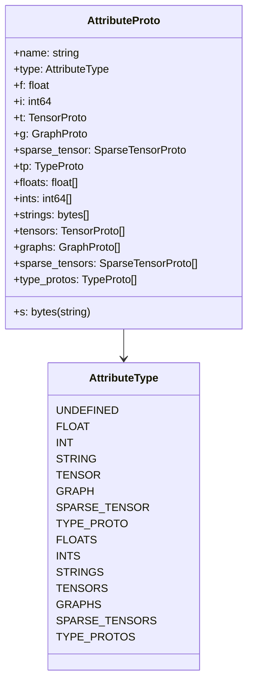

An `AttributeProto` includes:
- **name**: The name of the attribute
- **type**: The type of the attribute
- **value field**: One of various typed value fields (f, i, s, t, etc.)

Sources: [onnx/onnx.proto:126-189](). [docs/IR.md:325-351]().

## Functions

Functions allow defining complex operators in terms of more primitive ones:

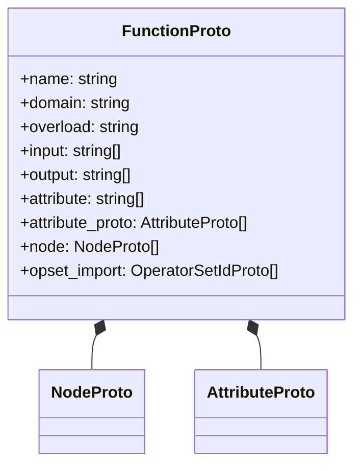

A `FunctionProto`:
- Has a signature (inputs, outputs, attributes) like an operator
- Contains a body graph built from other operators
- Can be used as a fallback implementation for an operator
- Is uniquely identified by (domain, name, overload)

Sources: [docs/IR.md:178-222](). [onnx/onnx.proto:190-206]().

## Versioning

ONNX employs a comprehensive versioning system:

| Component | Description |
|-----------|-------------|
| IR Version | The version of the ONNX IR specification (e.g., IR_VERSION_2023_5_5) |
| Operator Set Version | The version of an operator set (identified by domain and version) |
| Model Version | The version of a specific model |
| Operator Version | The version of an operator within an operator set |

When new IR versions are released, they may introduce new features or changes:
- IR Version 7 added support for training models
- IR Version 8 added support for sparse tensors and optional types
- IR Version 9 added support for default attribute values in functions

Sources: [onnx/onnx.proto:50-118](). [docs/IR.md:49-61]().

## Training Information (Optional)

Starting from IR version 7, ONNX supports training models with `TrainingInfoProto`:

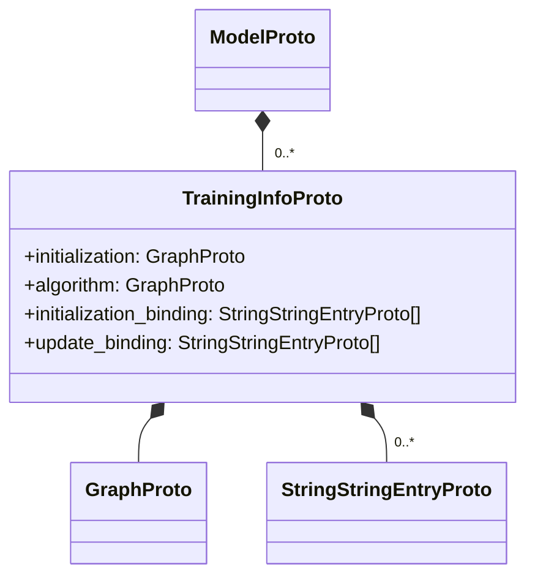

Training information includes:
- **initialization**: Graph for initializing model parameters
- **algorithm**: Graph for the training algorithm step
- **initialization_binding**: Binds initialization outputs to initializers
- **update_binding**: Binds algorithm outputs to update initializers

Sources: [onnx/onnx.proto:315-431](). [docs/IR.md:107-110]().

## Namespaces

Names in ONNX are organized into several namespaces, and within each namespace, names must be unique:

| Namespace | Description |
|-----------|-------------|
| Attribute | Names of attributes for a specific operator |
| Value | Names of values (node inputs/outputs, graph inputs/outputs) |
| Node | Names of graph nodes |
| Graph | Names of graphs within a domain |
| Operator | Names of operators within a domain |
| Shape | Names of tensor shape variables |

Sources: [docs/IR.md:262-276]().

## Serialization Format

ONNX models are serialized using Protocol Buffers (protobuf), which provides:
- A compact binary representation
- Compatibility between different languages
- A well-defined schema through `.proto` files

ONNX uses a subset of protobuf features that are compatible with both protobuf v2 and v3 to maximize framework compatibility.

Sources: [onnx/onnx.proto:9-12](). [docs/IR.md:32-43]().

---

# Page: ONNX Model Representation

# ONNX Model Representation

<details>
<summary>Relevant source files</summary>

The following files were used as context for generating this wiki page:

- [VERSION_NUMBER](VERSION_NUMBER)
- [docs/IR.md](docs/IR.md)
- [docs/OnnxReleases.md](docs/OnnxReleases.md)
- [docs/Versioning.md](docs/Versioning.md)
- [onnx/common/assertions.cc](onnx/common/assertions.cc)
- [onnx/common/assertions.h](onnx/common/assertions.h)
- [onnx/common/graph_node_list.h](onnx/common/graph_node_list.h)
- [onnx/common/interned_strings.cc](onnx/common/interned_strings.cc)
- [onnx/common/ir.h](onnx/common/ir.h)
- [onnx/common/ir_pb_converter.cc](onnx/common/ir_pb_converter.cc)
- [onnx/common/ir_pb_converter.h](onnx/common/ir_pb_converter.h)
- [onnx/common/tensor.h](onnx/common/tensor.h)
- [onnx/common/version.h](onnx/common/version.h)
- [onnx/defs/data_type_utils.cc](onnx/defs/data_type_utils.cc)
- [onnx/defs/data_type_utils.h](onnx/defs/data_type_utils.h)
- [onnx/helper.py](onnx/helper.py)
- [onnx/numpy_helper.py](onnx/numpy_helper.py)
- [onnx/onnx-ml.proto](onnx/onnx-ml.proto)
- [onnx/onnx-ml.proto3](onnx/onnx-ml.proto3)
- [onnx/onnx.in.proto](onnx/onnx.in.proto)
- [onnx/onnx.proto](onnx/onnx.proto)
- [onnx/onnx.proto3](onnx/onnx.proto3)
- [onnx/reference/ops/op_range.py](onnx/reference/ops/op_range.py)
- [onnx/test/helper_test.py](onnx/test/helper_test.py)
- [onnx/test/numpy_helper_test.py](onnx/test/numpy_helper_test.py)

</details>


## Purpose and Scope

This document explains how ONNX models are represented in the system, covering both the serialized protobuf format used for storage and the in-memory intermediate representation (IR) used for manipulation. It provides an overview of the complete model structure, from the top-level `ModelProto` down to individual tensors and attributes.

For detailed information about specific components:
- For protobuf schema details, see [Protocol Buffer Schema](#2.1)
- For in-memory IR implementation, see [In-Memory IR (Intermediate Representation)](#2.2)
- For operator versioning mechanisms, see [Operator Versioning and Domains](#2.3)
- For model extensions like training and external data, see [Model Extensions and Features](#2.4)
- For operator definitions and schemas, see [ONNX Operator System](#3)
- For Python APIs to construct models, see [Python API](#4)

## Dual Representation Model

ONNX models exist in two parallel representations that serve different purposes:

1. **Serialized Protobuf Representation** - Used for storage, transmission, and interchange between frameworks
2. **In-Memory IR Representation** - Used for graph manipulation, optimization, and analysis

### Representation Duality Diagram

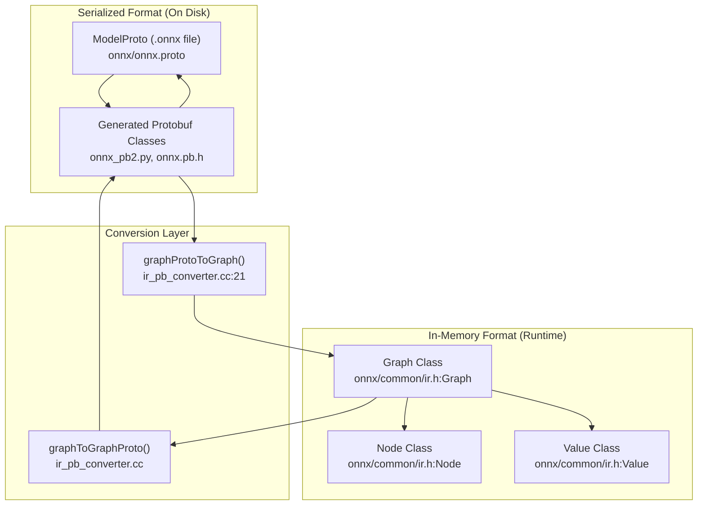

**Sources:** [onnx/common/ir_pb_converter.cc:21](), [onnx/common/ir.h:50-58](), [onnx/onnx.proto:1-127]()

The protobuf representation is the canonical serialization format defined in `.proto` files, while the IR representation provides efficient graph manipulation capabilities. The conversion layer in `ir_pb_converter.cc` maintains bidirectional conversion between these formats.

## Model Hierarchy Structure

ONNX models follow a hierarchical structure where each level contains specific information about the computation graph.

### Complete Model Hierarchy

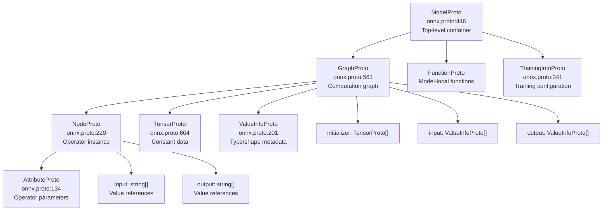

**Sources:** [onnx/onnx.proto:446-523](), [onnx/onnx.proto:561-599](), [onnx/onnx.proto:220-246](), [docs/IR.md:69-91]()

### Model Components Table

| Component | Type | Description | Location |
|-----------|------|-------------|----------|
| `ModelProto` | Message | Top-level model container with metadata and graph | [onnx.proto:446-523]() |
| `GraphProto` | Message | Computation graph with nodes, initializers, and I/O | [onnx.proto:561-599]() |
| `NodeProto` | Message | Individual operator invocation with inputs/outputs | [onnx.proto:220-246]() |
| `TensorProto` | Message | N-dimensional array with data and shape | [onnx.proto:604-859]() |
| `ValueInfoProto` | Message | Type and shape information for values | [onnx.proto:201-212]() |
| `AttributeProto` | Message | Static operator parameters (constants) | [onnx.proto:134-197]() |
| `FunctionProto` | Message | Model-local function definitions | [docs/IR.md:178-221]() |
| `TypeProto` | Message | Type specification for tensors, sequences, maps | [onnx.proto:1190-1294]() |

**Sources:** [onnx/onnx.proto:446-859](), [docs/IR.md:69-297]()

## ModelProto Structure

The `ModelProto` is the root object representing an entire ONNX model.

### ModelProto Fields

```mermaid
graph LR
    ModelProto["ModelProto"]
    
    ModelProto --> ir_version["ir_version: int64<br/>IR specification version"]
    ModelProto --> opset["opset_import: OperatorSetIdProto[]<br/>Required operator sets"]
    ModelProto --> producer["producer_name: string<br/>producer_version: string"]
    ModelProto --> domain_ver["domain: string<br/>model_version: int64"]
    ModelProto --> graph["graph: GraphProto<br/>Main computation graph"]
    ModelProto --> metadata["metadata_props: map<br/>Optional metadata"]
    ModelProto --> functions["functions: FunctionProto[]<br/>Model-local functions"]
    ModelProto --> training["training_info: TrainingInfoProto[]<br/>Training extensions"]
    ModelProto --> config["configuration: DeviceConfigurationProto[]<br/>Multi-device config (IR≥11)"]
```

**Sources:** [onnx/onnx.proto:446-523](), [docs/IR.md:69-91]()

### Version Information

ONNX models track three distinct version numbers:

| Version Type | Field | Description |
|--------------|-------|-------------|
| **IR Version** | `ir_version` | The version of ONNX IR specification (currently 13) |
| **Opset Version** | `opset_import[].version` | Version of operator sets imported by the model |
| **Model Version** | `model_version` | User-defined version of the trained model |

The IR version is defined as an enum in the proto file, with the current version being `IR_VERSION = 0x000000000000000D` (13).

**Sources:** [onnx/onnx.proto:50-126](), [onnx/helper.py:46-80](), [docs/Versioning.md:1-60]()

The `VERSION_TABLE` in `helper.py` maps release versions to IR versions and opset versions:

```python
# Example from helper.py:46-80
VERSION_TABLE = [
    ("1.0", 3, 1, 1),           # Release, IR, ai.onnx, ai.onnx.ml
    ("1.21.0", 13, 26, 5, 1),   # Latest: IR=13, opset=26
]
```

**Sources:** [onnx/helper.py:46-80](), [onnx/common/version.h:10]()

## GraphProto Structure

The `GraphProto` represents a computation graph as a Directed Acyclic Graph (DAG) of nodes.

### GraphProto Components

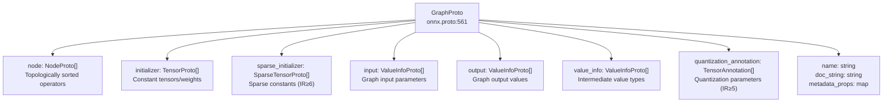

**Sources:** [onnx/onnx.proto:561-599](), [docs/IR.md:222-260]()

### Graph Semantics

Key constraints on graphs:

1. **Topological Order**: Nodes MUST be in topological order - a node's inputs must be defined before the node appears
2. **Single Static Assignment (SSA)**: All node output names MUST be unique within a graph
3. **Acyclic**: Node dependencies MUST NOT create cycles
4. **Initializers**: Can share names with graph inputs to provide default values

**Sources:** [docs/IR.md:257-316]()

## NodeProto Structure

A `NodeProto` represents a single operator invocation in the computation graph.

### NodeProto Anatomy

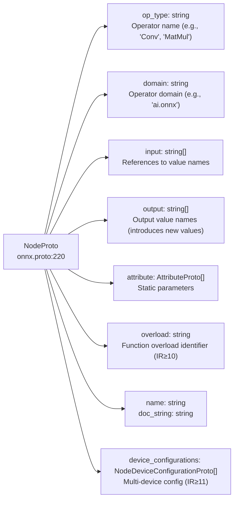

**Sources:** [onnx/onnx.proto:220-246](), [docs/IR.md:278-316]()

### Node Input/Output Model

Nodes connect to each other through named values:

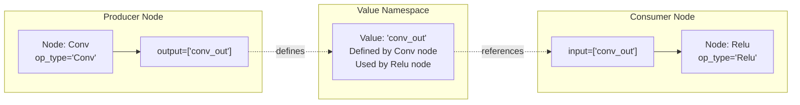

**Sources:** [docs/IR.md:299-310](), [onnx/onnx.proto:221-222]()

## TensorProto Structure

The `TensorProto` message stores multi-dimensional arrays used as constants (initializers) or external data references.

### TensorProto Data Storage

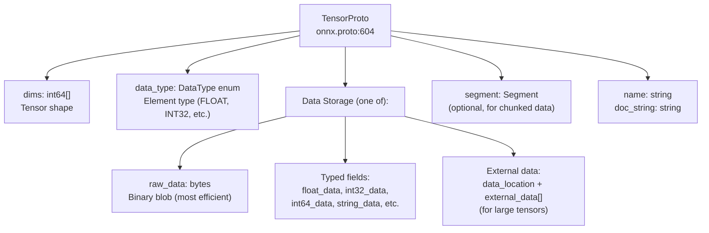

**Sources:** [onnx/onnx.proto:604-859](), [onnx/numpy_helper.py:172-252]()

### TensorProto Data Types

ONNX supports a comprehensive set of data types defined in `TensorProto.DataType` enum:

| Category | Types |
|----------|-------|
| **Floating Point** | FLOAT, DOUBLE, FLOAT16, BFLOAT16 |
| **8-bit Floats** | FLOAT8E4M3FN, FLOAT8E4M3FNUZ, FLOAT8E5M2, FLOAT8E5M2FNUZ, FLOAT8E8M0 (IR≥12) |
| **4-bit Floats** | FLOAT4E2M1 (IR≥11) |
| **Integers** | INT8, INT16, INT32, INT64, UINT8, UINT16, UINT32, UINT64 |
| **Sub-byte Integers** | INT2, UINT2 (IR≥13), INT4, UINT4 (IR≥10) |
| **Complex** | COMPLEX64, COMPLEX128 |
| **Other** | STRING, BOOL |

**Sources:** [onnx/onnx.proto:605-660](), [docs/IR.md:50-126]()

Sub-byte types (2-bit, 4-bit) are packed into bytes with specific bit-packing conventions defined in the specification.

**Sources:** [onnx/helper.py:364-390](), [onnx/numpy_helper.py:95-169]()

## In-Memory IR Representation

The C++ in-memory IR provides an efficient graph representation for manipulation and optimization.

### IR Class Hierarchy

```mermaid
graph TD
    Graph["Graph<br/>ir.h:50<br/>Owns all nodes and values"]
    Node["Node<br/>ir.h:54<br/>Computation operator"]
    Value["Value<br/>ir.h:58<br/>Input/output data reference"]
    Attributes["Attributes<Node><br/>ir.h:175<br/>CRTP base for node attributes"]
    
    Graph -->|owns| Node
    Graph -->|owns| Value
    Node -->|inputs| Value
    Node -->|outputs| Value
    Node -.->|inherits| Attributes
    
    Node -->|"next/prev<br/>(doubly-linked list)"| Node
    Value -->|"uses_in_current_graph_<br/>(use list)"| Node
```

**Sources:** [onnx/common/ir.h:46-58](), [onnx/common/ir.h:175-274]()

### Key IR Classes

| Class | File Location | Purpose |
|-------|---------------|---------|
| `Graph` | [ir.h:737-1159]() | Owns all nodes and values; maintains topological order |
| `Node` | [ir.h:399-735]() | Represents operator invocation; maintains attributes |
| `Value` | [ir.h:296-397]() | Represents data flowing between nodes; tracks uses |
| `Attributes<T>` | [ir.h:175-274]() | CRTP base providing attribute accessors |
| `Tensor` | [tensor.h:22-157]() | Stores tensor data in IR |
| `Dimension` | [ir.h:75-84]() | Represents symbolic or concrete dimension |

**Sources:** [onnx/common/ir.h:46-1159](), [onnx/common/tensor.h:22-157]()

### Graph Ownership Model

The IR uses a simple ownership model:

1. **Graph** owns all `Node` and `Value` objects
2. Nodes are stored in a doubly-linked intrusive list maintaining topological order
3. Values track their uses through a `uses_in_current_graph_` list
4. All pointers within the graph are raw pointers (no shared_ptr)
5. Destroying the Graph invalidates all Node and Value pointers

**Sources:** [onnx/common/ir.h:46-50]()

### Topological Order Maintenance

Nodes maintain topological invariants through linked list operations:

```mermaid
graph LR
    N1["Node 1"] --> N2["Node 2"]
    N2 --> N3["Node 3"]
    N3 --> Return["Return Sentinel"]
    
    Return -.->|prev| N3
    N3 -.->|prev| N2
    N2 -.->|prev| N1
```

Methods like `insertBefore()`, `insertAfter()`, `moveBefore()`, and `moveAfter()` maintain the topological sort invariant.

**Sources:** [onnx/common/ir.h:575-697]()

## Protobuf-IR Conversion

The conversion layer provides bidirectional mapping between protobuf and IR representations.

### Conversion Architecture

```mermaid
graph TB
    subgraph "Python Layer"
        PyModel["ModelProto (Python)<br/>onnx_pb2.py"]
    end
    
    subgraph "Conversion Functions"
        ProtoToGraph["graphProtoToGraph()<br/>ir_pb_converter.cc:21"]
        GraphToProto["graphToGraphProto()<br/>ir_pb_converter.cc"]
        NodeToProto["nodeToNodeProto()"]
        TensorToProto["tensorProtoToTensor()<br/>ir_pb_converter.cc:23"]
    end
    
    subgraph "IR Layer"
        IRGraph["Graph*<br/>ir.h"]
        IRNode["Node*<br/>ir.h"]
        IRValue["Value*<br/>ir.h"]
    end
    
    PyModel --> ProtoToGraph
    ProtoToGraph --> IRGraph
    IRGraph --> IRNode
    IRGraph --> IRValue
    
    IRGraph --> GraphToProto
    GraphToProto --> PyModel
    
    NodeToProto -.-> ProtoToGraph
    TensorToProto -.-> ProtoToGraph
```

**Sources:** [onnx/common/ir_pb_converter.cc:1-780](), [onnx/common/ir_pb_converter.h:15-43]()

### Conversion Functions

| Function | Signature | Purpose |
|----------|-----------|---------|
| `graphProtoToGraph` | `GraphProto → unique_ptr<Graph>` | Convert protobuf graph to IR |
| `graphToGraphProto` | `Graph* → GraphProto` | Convert IR graph to protobuf |
| `tensorProtoToTensor` | `TensorProto → Tensor` | Convert tensor representation |
| `attributeProtoToNode` | `AttributeProto → Node attr` | Extract node attributes |

**Sources:** [onnx/common/ir_pb_converter.cc:21-780](), [onnx/common/ir_pb_converter.h:15-43]()

The conversion maintains:
- Topological order of nodes
- SSA property of value names  
- Attribute data and types
- Tensor data (with format-specific handling)
- Graph metadata

## Python Helper API

The Python `helper` module provides high-level functions for constructing ONNX models programmatically.

### Model Construction Functions

```mermaid
graph TB
    subgraph "High-Level Builders"
        MakeModel["helper.make_model()<br/>helper.py:296"]
        MakeGraph["helper.make_graph()<br/>helper.py:202"]
        MakeNode["helper.make_node()<br/>helper.py:135"]
    end
    
    subgraph "Data Builders"
        MakeTensor["helper.make_tensor()<br/>helper.py:392"]
        MakeValueInfo["helper.make_tensor_value_info()<br/>helper.py:831"]
        MakeAttribute["helper.make_attribute()<br/>helper.py:629"]
    end
    
    subgraph "Type Builders"
        MakeTensorType["helper.make_tensor_type_proto()<br/>helper.py:786"]
        MakeSequenceType["helper.make_sequence_type_proto()<br/>helper.py:916"]
        MakeMapType["helper.make_map_type_proto()<br/>helper.py:934"]
    end
    
    MakeNode --> MakeAttribute
    MakeNode --> MakeGraph
    MakeGraph --> MakeTensor
    MakeGraph --> MakeValueInfo
    MakeGraph --> MakeModel
    MakeValueInfo --> MakeTensorType
```

**Sources:** [onnx/helper.py:135-957]()

### Core Helper Functions Table

| Function | Purpose | Returns |
|----------|---------|---------|
| `make_model(graph, **kwargs)` | Create ModelProto from graph | `ModelProto` |
| `make_graph(nodes, name, inputs, outputs, ...)` | Create GraphProto | `GraphProto` |
| `make_node(op_type, inputs, outputs, **attrs)` | Create NodeProto | `NodeProto` |
| `make_tensor(name, data_type, dims, vals, raw=False)` | Create TensorProto | `TensorProto` |
| `make_tensor_value_info(name, elem_type, shape)` | Create ValueInfoProto | `ValueInfoProto` |
| `make_attribute(key, value, doc_string=None)` | Create AttributeProto | `AttributeProto` |
| `make_tensor_type_proto(elem_type, shape)` | Create TypeProto for tensor | `TypeProto` |

**Sources:** [onnx/helper.py:135-957]()

### Example Usage Pattern

```python
# From helper.py usage pattern
import onnx
from onnx import helper, TensorProto

# Create nodes
node1 = helper.make_node('Relu', ['X'], ['Y'])
node2 = helper.make_node('Add', ['Y', 'Z'], ['Out'])

# Create graph
graph = helper.make_graph(
    [node1, node2],
    'example_graph',
    [helper.make_tensor_value_info('X', TensorProto.FLOAT, [1, 2])],
    [helper.make_tensor_value_info('Out', TensorProto.FLOAT, [1, 2])]
)

# Create model
model = helper.make_model(graph, producer_name='example')
```

**Sources:** [onnx/helper.py:135-329](), [onnx/test/helper_test.py:321-394]()

## Numpy Integration

The `numpy_helper` module provides conversion between ONNX tensors and NumPy arrays.

### Numpy Conversion Functions

| Function | Signature | Purpose |
|----------|-----------|---------|
| `to_array(tensor, base_dir="")` | `TensorProto → ndarray` | Convert ONNX tensor to NumPy |
| `from_array(arr, name=None)` | `ndarray → TensorProto` | Convert NumPy to ONNX tensor |
| `to_list(sequence)` | `SequenceProto → list` | Convert ONNX sequence |
| `from_list(lst, name=None, dtype=None)` | `list → SequenceProto` | Create ONNX sequence |
| `to_dict(map_proto)` | `MapProto → dict` | Convert ONNX map |
| `from_dict(dict, name=None)` | `dict → MapProto` | Create ONNX map |

**Sources:** [onnx/numpy_helper.py:172-252](), [onnx/numpy_helper.py:254-384]()

### Data Type Mapping

The numpy_helper maintains mappings between ONNX and NumPy data types, including support for extended types through `ml_dtypes`:

```python
# From numpy_helper usage
import numpy as np
import ml_dtypes
from onnx import numpy_helper, TensorProto

# ONNX FLOAT8E4M3FN maps to ml_dtypes.float8_e4m3fn
# ONNX BFLOAT16 maps to ml_dtypes.bfloat16
# ONNX INT4/UINT4 are packed into uint8 arrays
```

**Sources:** [onnx/numpy_helper.py:1-252](), [onnx/helper.py:2094-2179]()

## Summary

ONNX model representation consists of:

1. **Dual Format**: Serialized protobuf for storage/interchange and in-memory IR for manipulation
2. **Hierarchical Structure**: `ModelProto` → `GraphProto` → `NodeProto` with supporting types
3. **Version Management**: IR version, opset versions, and model version tracked independently
4. **Conversion Layer**: Bidirectional mapping between protobuf and IR representations
5. **Python API**: High-level helpers for programmatic model construction
6. **Numpy Integration**: Seamless conversion between ONNX tensors and NumPy arrays

The system provides a complete, type-safe representation suitable for both long-term storage and efficient runtime manipulation.

**Sources:** [onnx/onnx.proto:1-859](), [onnx/common/ir.h:46-1159](), [onnx/helper.py:1-957](), [docs/IR.md:1-345](), [onnx/common/ir_pb_converter.cc:1-780]()

---

# Page: Protocol Buffer Schema

# Protocol Buffer Schema

<details>
<summary>Relevant source files</summary>

The following files were used as context for generating this wiki page:

- [.github/workflows/main.yml](.github/workflows/main.yml)
- [CMakeLists.txt](CMakeLists.txt)
- [README.md](README.md)
- [VERSION_NUMBER](VERSION_NUMBER)
- [cmake/ONNXConfig.cmake.in](cmake/ONNXConfig.cmake.in)
- [cmake/Utils.cmake](cmake/Utils.cmake)
- [cmake/external/googletest.cmake](cmake/external/googletest.cmake)
- [cmake/summary.cmake](cmake/summary.cmake)
- [cmake/unittest.cmake](cmake/unittest.cmake)
- [docs/IR.md](docs/IR.md)
- [docs/ImplementingAnOnnxBackend.md](docs/ImplementingAnOnnxBackend.md)
- [docs/OnnxBackendTest.md](docs/OnnxBackendTest.md)
- [docs/OnnxReleases.md](docs/OnnxReleases.md)
- [docs/Versioning.md](docs/Versioning.md)
- [onnx/common/version.h](onnx/common/version.h)
- [onnx/defs/data_type_utils.cc](onnx/defs/data_type_utils.cc)
- [onnx/defs/data_type_utils.h](onnx/defs/data_type_utils.h)
- [onnx/gen_proto.py](onnx/gen_proto.py)
- [onnx/helper.py](onnx/helper.py)
- [onnx/numpy_helper.py](onnx/numpy_helper.py)
- [onnx/onnx-ml.proto](onnx/onnx-ml.proto)
- [onnx/onnx-ml.proto3](onnx/onnx-ml.proto3)
- [onnx/onnx.in.proto](onnx/onnx.in.proto)
- [onnx/onnx.proto](onnx/onnx.proto)
- [onnx/onnx.proto3](onnx/onnx.proto3)
- [onnx/reference/ops/op_range.py](onnx/reference/ops/op_range.py)
- [onnx/test/cmake/CMakeLists.txt](onnx/test/cmake/CMakeLists.txt)
- [onnx/test/cmake/main.cc](onnx/test/cmake/main.cc)
- [onnx/test/cpp/checker_test.cc](onnx/test/cpp/checker_test.cc)
- [onnx/test/cpp/function_get_test.cc](onnx/test/cpp/function_get_test.cc)
- [onnx/test/cpp/test_main.cc](onnx/test/cpp/test_main.cc)
- [onnx/test/helper_test.py](onnx/test/helper_test.py)
- [onnx/test/numpy_helper_test.py](onnx/test/numpy_helper_test.py)
- [setup.py](setup.py)
- [workflow_scripts/protobuf/build_protobuf_unix.sh](workflow_scripts/protobuf/build_protobuf_unix.sh)
- [workflow_scripts/protobuf/build_protobuf_win.ps1](workflow_scripts/protobuf/build_protobuf_win.ps1)

</details>


This page documents the Protocol Buffer (protobuf) schema that defines the serialization format of ONNX models. The schema consists of message definitions in `.proto` files that specify how models, graphs, operators, tensors, and other components are serialized to disk. This is distinct from the in-memory representation covered in page 2.2.

The protobuf schema is the authoritative definition of the ONNX file format. All ONNX files on disk conform to this schema, and all ONNX libraries must be able to parse models serialized in this format.

## Schema Files and Build Process

ONNX uses Protocol Buffers for serialization, maintaining compatibility with both proto2 and proto3. The schema is defined in template files that are processed during the build to generate final `.proto` files:

**Template File:**
- [onnx/onnx.in.proto]() - Master template with conditional compilation directives

**Generated Proto Files:**
- [onnx/onnx.proto]() - proto2 syntax, standard ONNX operators only
- [onnx/onnx.proto3]() - proto3 syntax, standard ONNX operators only  
- [onnx/onnx-ml.proto]() - proto2 syntax, includes ML operators
- [onnx/onnx-ml.proto3]() - proto3 syntax, includes ML operators

The build process uses [onnx/gen_proto.py]() to process the template file. This script:
1. Processes conditional compilation directives (`#if ONNX-ML`, `#else`, `#endif`)
2. Substitutes package names based on the `ONNX_NAMESPACE` configuration
3. Generates proto2 and proto3 variants
4. Produces ML-enabled and ML-disabled variants

The `ONNX_ML` CMake option controls whether ML operators are included ([CMakeLists.txt:63-70]()).

Sources: [onnx/onnx.in.proto:1-25](), [onnx/gen_proto.py:36-60](), [CMakeLists.txt:63-70]()

### Protobuf Message Hierarchy

The following diagram shows the core message types and their containment relationships, using actual protobuf field names:

```mermaid
classDiagram
    class ModelProto {
        field1: ir_version int64
        field2: producer_name string
        field3: producer_version string
        field4: domain string
        field5: model_version int64
        field6: doc_string string
        field7: graph GraphProto
        field8: opset_import OperatorSetIdProto[]
        field14: metadata_props StringStringEntryProto[]
        field20: training_info TrainingInfoProto[]
        field25: functions FunctionProto[]
        field26: configuration DeviceConfigurationProto[]
    }
    
    class GraphProto {
        field1: node NodeProto[]
        field2: name string
        field5: initializer TensorProto[]
        field10: doc_string string
        field11: input ValueInfoProto[]
        field12: output ValueInfoProto[]
        field13: value_info ValueInfoProto[]
        field14: quantization_annotation TensorAnnotation[]
        field15: sparse_initializer SparseTensorProto[]
        field16: metadata_props StringStringEntryProto[]
    }
    
    class NodeProto {
        field1: input string[]
        field2: output string[]
        field3: name string
        field4: op_type string
        field5: attribute AttributeProto[]
        field6: doc_string string
        field7: domain string
        field8: overload string
        field9: metadata_props StringStringEntryProto[]
        field10: device_configurations NodeDeviceConfigurationProto[]
    }
    
    class AttributeProto {
        field1: name string
        field2: f float
        field3: i int64
        field4: s bytes
        field5: t TensorProto
        field6: g GraphProto
        field7: floats float[]
        field8: ints int64[]
        field9: strings bytes[]
        field10: tensors TensorProto[]
        field11: graphs GraphProto[]
        field13: doc_string string
        field14: tp TypeProto
        field15: type_protos TypeProto[]
        field20: type AttributeType
        field21: ref_attr_name string
        field22: sparse_tensor SparseTensorProto
        field23: sparse_tensors SparseTensorProto[]
    }
    
    class TensorProto {
        field1: dims int64[]
        field2: data_type int32
        field3: segment Segment
        field4: float_data float[]
        field5: int32_data int32[]
        field6: string_data bytes[]
        field7: int64_data int64[]
        field8: name string
        field9: raw_data bytes
        field10: double_data double[]
        field11: uint64_data uint64[]
        field12: doc_string string
        field13: external_data StringStringEntryProto[]
        field14: data_location DataLocation
        field16: metadata_props StringStringEntryProto[]
    }
    
    class ValueInfoProto {
        field1: name string
        field2: type TypeProto
        field3: doc_string string
        field4: metadata_props StringStringEntryProto[]
    }
    
    class TypeProto {
        oneof_field1: tensor_type Tensor
        oneof_field2: sequence_type Sequence
        oneof_field3: map_type Map
        oneof_field7: opaque_type Opaque
        oneof_field8: sparse_tensor_type SparseTensor
        oneof_field9: optional_type Optional
    }
    
    class FunctionProto {
        field1: name string
        field4: input string[]
        field5: output string[]
        field6: attribute string[]
        field7: node NodeProto[]
        field8: doc_string string
        field9: opset_import OperatorSetIdProto[]
        field10: domain string
        field11: attribute_proto AttributeProto[]
        field12: overload string
        field13: value_info ValueInfoProto[]
        field14: metadata_props StringStringEntryProto[]
    }
    
    ModelProto *-- GraphProto : field7
    ModelProto *-- FunctionProto : field25
    ModelProto *-- TrainingInfoProto : field20
    GraphProto *-- NodeProto : field1
    GraphProto *-- TensorProto : field5
    GraphProto *-- ValueInfoProto : field11_12_13
    NodeProto *-- AttributeProto : field5
    AttributeProto *-- TensorProto : field5_10
    AttributeProto *-- GraphProto : field6_11
    ValueInfoProto *-- TypeProto : field2
    FunctionProto *-- NodeProto : field7
```

Sources: [onnx/onnx.proto:446-523](), [onnx/onnx.proto:561-599](), [onnx/onnx.proto:220-246](), [onnx/onnx.proto:134-198](), [onnx/onnx.proto:604-786](), [onnx/onnx.proto:201-212](), [onnx/onnx.proto:834-922](), [onnx/onnx.proto:924-1011]()

## Core Message Types

The ONNX protobuf schema defines several core message types that form the building blocks of the ONNX IR. These message types are defined in [onnx/onnx.proto]() and related files.

### ModelProto

`ModelProto` is the top-level container for an ONNX model. It contains metadata about the model as well as its computational graph.

| Field | Type | Field Number | Description |
|-------|------|--------------|-------------|
| `ir_version` | `int64` | 1 | The ONNX IR version (MUST be present) |
| `opset_import` | `repeated OperatorSetIdProto` | 8 | Operator sets imported by the model |
| `producer_name` | `string` | 2 | Name of the tool that generated the model |
| `producer_version` | `string` | 3 | Version of the generating tool |
| `domain` | `string` | 4 | Reverse DNS domain name of the model |
| `model_version` | `int64` | 5 | Version of the model itself |
| `doc_string` | `string` | 6 | Human-readable documentation (Markdown allowed) |
| `graph` | `GraphProto` | 7 | The main computational graph |
| `metadata_props` | `repeated StringStringEntryProto` | 14 | Named metadata key-value pairs |
| `training_info` | `repeated TrainingInfoProto` | 20 | Training-specific information (IR version >= 7) |
| `functions` | `repeated FunctionProto` | 25 | Model-local function definitions (IR version >= 8) |
| `configuration` | `repeated DeviceConfigurationProto` | 26 | Multi-device configurations (IR version >= 11) |

All models MUST have at least one entry in `opset_import` specifying the version of the ONNX operator set being used. The `ir_version` field MUST be present and indicates which version of the ONNX IR specification the model follows.

Sources: [onnx/onnx.proto:446-523]()

### GraphProto

`GraphProto` defines a computational graph as a directed acyclic graph (DAG) of nodes. Each graph contains nodes, inputs, outputs, and initializers. The nodes MUST be topologically sorted.

| Field | Type | Field Number | Description |
|-------|------|--------------|-------------|
| `node` | `repeated NodeProto` | 1 | Nodes in topological order |
| `name` | `string` | 2 | Name of the graph |
| `initializer` | `repeated TensorProto` | 5 | Named tensor constants |
| `sparse_initializer` | `repeated SparseTensorProto` | 15 | Sparse tensor constants (IR version >= 6) |
| `doc_string` | `string` | 10 | Human-readable documentation (Markdown allowed) |
| `input` | `repeated ValueInfoProto` | 11 | Graph input parameters |
| `output` | `repeated ValueInfoProto` | 12 | Graph output parameters |
| `value_info` | `repeated ValueInfoProto` | 13 | Type/shape info for intermediate values |
| `quantization_annotation` | `repeated TensorAnnotation` | 14 | Quantization parameter mappings (IR version >= 5) |
| `metadata_props` | `repeated StringStringEntryProto` | 16 | Named metadata key-value pairs (IR version >= 10) |

**Important constraints:**
- All `node` outputs MUST be unique (SSA form)
- `initializer` names MUST be unique across both `initializer` and `sparse_initializer`
- For IR version >= 4, initializers MAY appear in the `input` list to allow optional overriding
- Main graphs MUST define types and shapes for all inputs and outputs

Sources: [onnx/onnx.proto:561-599]()

### NodeProto

`NodeProto` represents a single computational node in a graph, which typically corresponds to a single operation (like convolution, addition, etc.).

| Field | Type | Field Number | Description |
|-------|------|--------------|-------------|
| `input` | `repeated string` | 1 | Names of input values (namespace: Value) |
| `output` | `repeated string` | 2 | Names of output values (namespace: Value) |
| `name` | `string` | 3 | Optional node identifier (namespace: Node) |
| `op_type` | `string` | 4 | Operator type to execute (namespace: Operator) |
| `domain` | `string` | 7 | Operator set domain (namespace: Domain) |
| `overload` | `string` | 8 | Overload identifier for model-local functions (IR version >= 10) |
| `attribute` | `repeated AttributeProto` | 5 | Named attributes for the operator |
| `doc_string` | `string` | 6 | Human-readable documentation (Markdown allowed) |
| `metadata_props` | `repeated StringStringEntryProto` | 9 | Named metadata (IR version >= 10) |
| `device_configurations` | `repeated NodeDeviceConfigurationProto` | 10 | Multi-device annotations (IR version >= 11) |

**Important notes:**
- Input/output names reference values defined elsewhere in the graph
- Empty string in `input` list indicates an optional input
- Empty string in `output` list indicates an optional output
- The `op_type` and `domain` together identify which operator schema to use
- All attribute names MUST be unique within a node

Sources: [onnx/onnx.proto:220-246]()

### AttributeProto

`AttributeProto` represents attributes (parameters) for operators. Attributes are used to pass constant values to operators, as opposed to inputs which can vary at runtime.

| Field | Type | Field Number | Description |
|-------|------|--------------|-------------|
| `name` | `string` | 1 | Attribute name (MUST be present) |
| `ref_attr_name` | `string` | 21 | Reference to parent function attribute |
| `doc_string` | `string` | 13 | Human-readable documentation |
| `type` | `AttributeType` | 20 | Type discriminator (MUST be present for IR >= 2) |
| `f` | `float` | 2 | Singular float value |
| `i` | `int64` | 3 | Singular int64 value |
| `s` | `bytes` | 4 | Singular UTF-8 string |
| `t` | `TensorProto` | 5 | Singular tensor value |
| `g` | `GraphProto` | 6 | Singular graph (subgraph) |
| `sparse_tensor` | `SparseTensorProto` | 22 | Singular sparse tensor (IR version >= 6) |
| `tp` | `TypeProto` | 14 | Singular type proto (IR version >= 8) |
| `floats` | `repeated float` | 7 | List of floats |
| `ints` | `repeated int64` | 8 | List of ints |
| `strings` | `repeated bytes` | 9 | List of UTF-8 strings |
| `tensors` | `repeated TensorProto` | 10 | List of tensors |
| `graphs` | `repeated GraphProto` | 11 | List of graphs |
| `sparse_tensors` | `repeated SparseTensorProto` | 23 | List of sparse tensors |
| `type_protos` | `repeated TypeProto` | 15 | List of type protos |

The `AttributeType` enum defines valid types:
```
UNDEFINED = 0, FLOAT = 1, INT = 2, STRING = 3, TENSOR = 4, GRAPH = 5,
FLOATS = 6, INTS = 7, STRINGS = 8, TENSORS = 9, GRAPHS = 10,
SPARSE_TENSOR = 11, SPARSE_TENSORS = 12, TYPE_PROTO = 13, TYPE_PROTOS = 14
```

**Important constraints:**
- Exactly ONE value field must be set (enforces union semantics)
- The `type` field MUST match the value field in use
- `ref_attr_name` is ONLY valid in function bodies, not main graphs
- When `ref_attr_name` is set, no value fields should be set

Sources: [onnx/onnx.proto:134-198](), [onnx/checker.cc:428-516]()

### TensorProto

`TensorProto` represents a tensor (multi-dimensional array) in ONNX. It can store data inline or reference external data.

| Field | Type | Field Number | Description |
|-------|------|--------------|-------------|
| `dims` | `repeated int64` | 1 | Shape of the tensor (row-major order) |
| `data_type` | `int32` | 2 | Element data type (MUST be valid DataType, MUST NOT be UNDEFINED) |
| `segment` | `Segment` | 3 | Optional segment info for chunked storage |
| `float_data` | `repeated float` | 4 | FLOAT/COMPLEX64 values (packed) |
| `int32_data` | `repeated int32` | 5 | INT32/INT16/INT8/UINT16/UINT8/BOOL/FLOAT16/BFLOAT16/FLOAT8/UINT4/INT4/UINT2/INT2/FLOAT4 values (packed) |
| `string_data` | `repeated bytes` | 6 | STRING values (UTF-8, no trailing null) |
| `int64_data` | `repeated int64` | 7 | INT64 values (packed) |
| `name` | `string` | 8 | Optional tensor name |
| `doc_string` | `string` | 12 | Human-readable documentation |
| `raw_data` | `bytes` | 9 | Raw bytes in little-endian, IEEE 754 format |
| `external_data` | `repeated StringStringEntryProto` | 13 | External file location metadata |
| `data_location` | `DataLocation` | 14 | DEFAULT (inline) or EXTERNAL |
| `double_data` | `repeated double` | 10 | DOUBLE/COMPLEX128 values (packed) |
| `uint64_data` | `repeated uint64` | 11 | UINT32/UINT64 values (packed) |
| `metadata_props` | `repeated StringStringEntryProto` | 16 | Named metadata (IR version >= 10) |

**Data storage rules:**
- For non-empty tensors, exactly ONE data field must be set (`float_data`, `int32_data`, `raw_data`, etc.)
- STRING data MUST use `string_data`, not `raw_data`
- If `data_location` is EXTERNAL, no data fields should be set; use `external_data` instead
- For 4-bit types (UINT4/INT4/FLOAT4), two elements are packed per byte (LSB first, MSB second)
- For 2-bit types (UINT2/INT2), four elements are packed per byte (LSB to MSB)
- COMPLEX64/COMPLEX128 store real and imaginary components interleaved

The `DataType` enum (field 2) includes:
```
FLOAT=1, UINT8=2, INT8=3, UINT16=4, INT16=5, INT32=6, INT64=7, STRING=8, BOOL=9,
FLOAT16=10, DOUBLE=11, UINT32=12, UINT64=13, COMPLEX64=14, COMPLEX128=15,
BFLOAT16=16, FLOAT8E4M3FN=17, FLOAT8E4M3FNUZ=18, FLOAT8E5M2=19, FLOAT8E5M2FNUZ=20,
UINT4=21, INT4=22, FLOAT4E2M1=23, FLOAT8E8M0=24, UINT2=25, INT2=26
```

Sources: [onnx/onnx.proto:604-786](), [onnx/checker.cc:78-206]()

### ValueInfoProto

`ValueInfoProto` defines information about a value, including its name, type, and shape.

| Field | Type | Field Number | Description |
|-------|------|--------------|-------------|
| `name` | `string` | 1 | Value name (MUST be present, namespace: Value) |
| `type` | `TypeProto` | 2 | Type and shape information (MUST be present for main graph I/O) |
| `doc_string` | `string` | 3 | Human-readable documentation (Markdown allowed) |
| `metadata_props` | `repeated StringStringEntryProto` | 4 | Named metadata (IR version >= 10) |

**Important notes:**
- For main graphs, `type` MUST be present for all inputs and outputs
- For subgraphs (e.g., in control flow ops), `type` MAY be absent
- The `name` field identifies the value and must be unique within its namespace

Sources: [onnx/onnx.proto:201-212](), [onnx/checker.cc:37-76]()

## Type System

ONNX defines a hierarchical type system in the protobuf schema that allows for representing various kinds of data used in machine learning models.

### TypeProto Structure

```mermaid
graph TB
    TypeProto["TypeProto"]
    
    TensorType["TypeProto.Tensor
    - int32 elem_type
    - TensorShapeProto shape"]
    
    SequenceType["TypeProto.Sequence
    - TypeProto elem_type"]
    
    MapType["TypeProto.Map
    - int32 key_type
    - TypeProto value_type"]
    
    OptionalType["TypeProto.Optional
    - TypeProto elem_type"]
    
    SparseTensorType["TypeProto.SparseTensor
    - int32 elem_type
    - TensorShapeProto shape"]
    
    OpaqueType["TypeProto.Opaque
    - string domain
    - string name"]
    
    TensorShape["TensorShapeProto
    - repeated Dimension dim"]
    
    Dimension["Dimension
    - int64 dim_value OR
    - string dim_param
    - string denotation"]
    
    TypeProto --> TensorType
    TypeProto --> SequenceType
    TypeProto --> MapType
    TypeProto --> OptionalType
    TypeProto --> SparseTensorType
    TypeProto --> OpaqueType
    
    TensorType --> TensorShape
    SparseTensorType --> TensorShape
    TensorShape --> Dimension
```

Sources: [onnx/onnx.proto:834-922](), [onnx/onnx.proto:815-829]()

### TypeProto

`TypeProto` is a union type (using protobuf `oneof`) that can represent various kinds of types used in ONNX. The active variant is indicated by the `value_case()` accessor.

| Variant | Type | Field Number | Description |
|---------|------|--------------|-------------|
| `tensor_type` | `Tensor` | 1 | Dense tensor type |
| `sequence_type` | `Sequence` | 2 | Sequence (list) type |
| `map_type` | `Map` | 3 | Map (dictionary) type |
| `opaque_type` | `Opaque` | 7 | Opaque type (ONNX-ML only) |
| `sparse_tensor_type` | `SparseTensor` | 8 | Sparse tensor type (IR version >= 8) |
| `optional_type` | `Optional` | 9 | Optional type (IR version >= 8) |

**TypeProto.Tensor:**
- `elem_type` (int32, field 1): Element data type (MUST NOT be UNDEFINED, MUST be valid)
- `shape` (TensorShapeProto, field 2): Optional shape information

**TypeProto.Sequence:**
- `elem_type` (TypeProto, field 1): Type of sequence elements (MUST be present)

**TypeProto.Map:**
- `key_type` (int32, field 1): Key data type (MUST be INT8/16/32/64, UINT8/16/32/64, or STRING)
- `value_type` (TypeProto, field 2): Value type

**TypeProto.Optional:**
- `elem_type` (TypeProto, field 1): Type of optional value (MUST be present)

**TypeProto.SparseTensor:**
- `elem_type` (int32, field 1): Element data type
- `shape` (TensorShapeProto, field 2): Shape of dense tensor

Sources: [onnx/onnx.proto:834-922](), [onnx/checker.cc:37-76]()

### TensorShapeProto

`TensorShapeProto` describes the shape of a tensor with support for symbolic dimensions.

| Field | Type | Field Number | Description |
|-------|------|--------------|-------------|
| `dim` | `repeated Dimension` | 1 | Dimensions of the tensor |

**Dimension:**
- `dim_value` (int64, field 1): Concrete dimension size (oneof with `dim_param`)
- `dim_param` (string, field 2): Symbolic dimension parameter (oneof with `dim_value`)
- `denotation` (string, field 3): Optional semantic annotation (e.g., "DATA_BATCH", "DATA_CHANNEL")

A dimension can be either:
1. A concrete value (`dim_value`) representing a fixed size
2. A symbolic parameter (`dim_param`) representing a dimension that may vary

The `denotation` field enables dimension type annotations for operations that need to know axis semantics (e.g., batch vs. spatial dimensions).

Sources: [onnx/onnx.proto:815-829]()

### Tensor Element Types

ONNX supports a wide range of element types for tensors, defined in the `TensorProto.DataType` enum:

| Enum Value | Name | Bits | Description |
|------------|------|------|-------------|
| 1 | FLOAT | 32 | IEEE 754 single-precision floating point |
| 2 | UINT8 | 8 | Unsigned 8-bit integer |
| 3 | INT8 | 8 | Signed 8-bit integer |
| 4 | UINT16 | 16 | Unsigned 16-bit integer |
| 5 | INT16 | 16 | Signed 16-bit integer |
| 6 | INT32 | 32 | Signed 32-bit integer |
| 7 | INT64 | 64 | Signed 64-bit integer |
| 8 | STRING | - | UTF-8 string |
| 9 | BOOL | 8 | Boolean (stored as byte: 0x00 or 0x01) |
| 10 | FLOAT16 | 16 | IEEE 754 half-precision (1 sign, 5 exponent, 10 mantissa) |
| 11 | DOUBLE | 64 | IEEE 754 double-precision floating point |
| 12 | UINT32 | 32 | Unsigned 32-bit integer |
| 13 | UINT64 | 64 | Unsigned 64-bit integer |
| 14 | COMPLEX64 | 64 | Complex number with float32 real/imaginary |
| 15 | COMPLEX128 | 128 | Complex number with float64 real/imaginary |
| 16 | BFLOAT16 | 16 | Brain float (1 sign, 8 exponent, 7 mantissa) |
| 17 | FLOAT8E4M3FN | 8 | 8-bit float (4-bit mantissa, 3-bit exponent, NaN, no Inf) (IR >= 9) |
| 18 | FLOAT8E4M3FNUZ | 8 | 8-bit float (4-bit mantissa, 3-bit exponent, NaN, no Inf/neg-zero) (IR >= 9) |
| 19 | FLOAT8E5M2 | 8 | 8-bit float (2-bit mantissa, 5-bit exponent, IEEE 754-like) (IR >= 9) |
| 20 | FLOAT8E5M2FNUZ | 8 | 8-bit float (2-bit mantissa, 5-bit exponent, NaN, no Inf/neg-zero) (IR >= 9) |
| 21 | UINT4 | 4 | Unsigned 4-bit integer [0, 15] (IR >= 10) |
| 22 | INT4 | 4 | Signed 4-bit integer [-8, 7] using two's complement (IR >= 10) |
| 23 | FLOAT4E2M1 | 4 | 4-bit floating point (IR >= 11) |
| 24 | FLOAT8E8M0 | 8 | 8-bit float for microscaling (MX) formats (IR >= 12) |
| 25 | UINT2 | 2 | Unsigned 2-bit integer [0, 3] (IR >= 13) |
| 26 | INT2 | 2 | Signed 2-bit integer [-2, 1] using two's complement (IR >= 13) |

**Packing for sub-byte types:**
- 4-bit types: Two elements per byte (first element in LSB 4 bits, second in MSB 4 bits)
- 2-bit types: Four elements per byte (packed LSB to MSB)

Sources: [onnx/onnx.proto:605-660](), [onnx/defs/data_type_utils.cc:419-451]()

## Additional Message Types

### FunctionProto

`FunctionProto` defines a model-local function that can be called from nodes in the graph. Functions provide a way to define reusable subgraphs.

| Field | Type | Field Number | Description |
|-------|------|--------------|-------------|
| `name` | `string` | 1 | Function name (MUST be present) |
| `input` | `repeated string` | 4 | Input parameter names |
| `output` | `repeated string` | 5 | Output parameter names |
| `attribute` | `repeated string` | 6 | Attribute parameter names (without default values) |
| `attribute_proto` | `repeated AttributeProto` | 11 | Attributes with default values (IR >= 9) |
| `node` | `repeated NodeProto` | 7 | Function body nodes (topologically sorted) |
| `doc_string` | `string` | 8 | Documentation |
| `opset_import` | `repeated OperatorSetIdProto` | 9 | Operator sets used by function |
| `domain` | `string` | 10 | Function domain (MUST be present for IR >= 8) |
| `overload` | `string` | 12 | Overload identifier (IR >= 10) |
| `value_info` | `repeated ValueInfoProto` | 13 | Type info for values (IR >= 10) |
| `metadata_props` | `repeated StringStringEntryProto` | 14 | Named metadata (IR >= 10) |

The tuple `(domain, name, overload)` uniquely identifies a function within a model (IR version >= 10).

Sources: [onnx/onnx.proto:924-1011](), [docs/IR.md:178-220]()

### TrainingInfoProto

`TrainingInfoProto` stores training-specific information including initialization and training algorithm graphs (added in IR version 7).

| Field | Type | Field Number | Description |
|-------|------|--------------|-------------|
| `initialization` | `GraphProto` | 1 | Graph to initialize training state |
| `algorithm` | `GraphProto` | 2 | Training algorithm step graph |
| `initialization_binding` | `repeated StringStringEntryProto` | 3 | Bindings from initialization outputs to initializers |
| `update_binding` | `repeated StringStringEntryProto` | 4 | Bindings from algorithm outputs to initializers |

The `initialization` graph computes initial values for trainable parameters. The `algorithm` graph defines one training iteration step. Bindings map graph outputs to initializers that should be updated.

Sources: [onnx/onnx.proto:341-438](), [docs/IR.md:323-340]()

### OperatorSetIdProto

`OperatorSetIdProto` identifies an operator set by domain and version.

| Field | Type | Field Number | Description |
|-------|------|--------------|-------------|
| `domain` | `string` | 1 | Operator set domain (empty string = ONNX default domain) |
| `version` | `int64` | 2 | Operator set version number |

All models MUST import at least the default ONNX operator set. The version determines which operator schemas are available.

Sources: [onnx/onnx.proto:1013-1024](), [docs/IR.md:121-133]()

### SparseTensorProto

`SparseTensorProto` represents sparse tensors efficiently by storing only non-zero values (added in IR version 6).

| Field | Type | Field Number | Description |
|-------|------|--------------|-------------|
| `values` | `TensorProto` | 1 | Non-zero values (rank-1 tensor of size NNZ) |
| `indices` | `TensorProto` | 2 | Indices of non-zero values (INT64 tensor) |
| `dims` | `repeated int64` | 3 | Shape of underlying dense tensor |

The `indices` tensor can be:
1. Rank-1 tensor [NNZ]: Linearized indices
2. Rank-2 tensor [NNZ, rank]: COO format with one index tuple per non-zero value

Indices MUST be in ascending order (linearized or lexicographic order).

Sources: [onnx/onnx.proto:789-810](), [onnx/checker.cc:378-424]()

### SequenceProto, MapProto, OptionalProto

These message types represent runtime values (not types) for sequences, maps, and optional values.

**SequenceProto:**
- `elem_type` (SequenceProto.DataType, field 1): Type of elements (TENSOR, SPARSE_TENSOR, SEQUENCE, MAP)
- `tensor_values` / `sparse_tensor_values` / `sequence_values` / `map_values`: Repeated elements

**MapProto:**
- `key_type` (int32, field 1): Key data type (MUST be INT8/16/32/64, UINT8/16/32/64, or STRING)
- `keys` / `string_keys`: Key values
- `values` (SequenceProto, field 4): Map values as a sequence

**OptionalProto:**
- `elem_type` (OptionalProto.DataType, field 1): Type of optional value
- `tensor_value` / `sparse_tensor_value` / `sequence_value` / `map_value`: Optional value (if present)

Sources: [onnx/onnx.proto:1026-1101](), [onnx/checker.cc:208-304]()

### StringStringEntryProto

`StringStringEntryProto` is a helper message that represents a key-value pair, used to simulate maps in a proto2/proto3-compatible way.

| Field | Type | Field Number | Description |
|-------|------|--------------|-------------|
| `key` | `string` | 1 | Key |
| `value` | `string` | 2 | Value |

This pattern is used throughout ONNX for:
- `metadata_props` in ModelProto, GraphProto, NodeProto, ValueInfoProto, etc.
- `external_data` in TensorProto
- `initialization_binding` and `update_binding` in TrainingInfoProto

Sources: [onnx/onnx.proto:539-542]()

### Multi-Device Configuration (IR >= 11)

**DeviceConfigurationProto:**
- `name` (string, field 1): Configuration name (MUST be present)
- `num_devices` (int32, field 2): Number of devices (MUST be present)
- `device` (repeated string, field 3): Optional device names (length MUST match `num_devices`)

**NodeDeviceConfigurationProto:**
- `configuration_id` (string, field 1): References a DeviceConfigurationProto name
- `sharding_spec` (repeated ShardingSpecProto, field 2): Per-tensor sharding specs
- `pipeline_stage` (int32, field 3): Pipeline stage identifier

**ShardingSpecProto:**
- `tensor_name` (string, field 1): Input/output tensor name being sharded
- `device` (repeated int64, field 2): Device indices for sharding
- `index_to_device_group_map` (repeated IntIntListEntryProto, field 3): Device grouping
- `sharded_dim` (repeated ShardedDimProto, field 4): Per-dimension sharding

Sources: [onnx/onnx.proto:525-535](), [onnx/onnx.proto:255-320]()

### External Data Handling

For large models, tensor data can be stored externally and referenced from the model file:

```mermaid
graph LR
    M["ModelProto"]
    T["TensorProto"]
    ED["external_data:
    - location (path)
    - offset
    - length
    - checksum"]
    EF["External File"]
    
    M --- T
    T --- ED
    ED -.- EF
```

The `external_data` field in `TensorProto` can contain key-value pairs that describe:
- `location`: Path to the external file (relative to the model file)
- `offset`: Byte offset in the file
- `length`: Length of the data in bytes
- `checksum`: Optional SHA1 digest for verification

Sources: [onnx/onnx.proto:726-743]()

### Sparse Tensor Representation

`SparseTensorProto` allows efficient representation of sparse tensors (tensors with many zero values):

- `values`: A tensor containing the non-zero values
- `indices`: A tensor specifying the indices of the non-zero values
- `dims`: The shape of the underlying dense tensor

Sources: [onnx/onnx.proto:766-788]()

## Versioning and Compatibility

The ONNX IR evolves over time, with new features and improvements added in each version. The `Version` enum in the protobuf schema tracks these changes.

```mermaid
graph TD
    subgraph "IR Versions Timeline"
        IR1["IR_VERSION_2017_10_10 (1)
        Initial version"]
        IR2["IR_VERSION_2017_10_30 (2)
        Added type discriminator"]
        IR3["IR_VERSION_2017_11_3 (3)
        Added operator versioning"]
        IR4["IR_VERSION_2019_1_22 (4)
        Relaxed initializer constraints
        Added BFLOAT16"]
        IR5["IR_VERSION_2019_3_18 (5)
        Added tensor annotations"]
        IR6["IR_VERSION_2019_9_19 (6)
        Added sparse tensor support"]
        IR7["IR_VERSION_2020_5_8 (7)
        Added training support"]
        IR8["IR_VERSION_2021_7_30 (8)
        Added Optional type
        Added SparseTensor type"]
        IR9["IR_VERSION_2023_5_5 (9)
        Added attributes to functions
        Added FLOAT8 types"]
        IR10["IR_VERSION_2024_3_25 (10)
        Added UINT4, INT4"]
        IR11["IR_VERSION (11)
        Added FLOAT4E2M1
        Added multi-device support"]
    end
    
    IR1 --> IR2 --> IR3 --> IR4 --> IR5 --> IR6 --> IR7 --> IR8 --> IR9 --> IR10 --> IR11
```

Sources: [onnx/onnx.proto:50-118]()

### IR Version History

Each IR version adds new features and capabilities:

1. **IR_VERSION_2017_10_10 (1)**: Initial version
2. **IR_VERSION_2017_10_30 (2)**: Added type discriminator to AttributeProto
3. **IR_VERSION_2017_11_3 (3)**: Added operator versioning and domains
4. **IR_VERSION_2019_1_22 (4)**: Relaxed initializer constraints, added BFLOAT16
5. **IR_VERSION_2019_3_18 (5)**: Added tensor annotations for quantization
6. **IR_VERSION_2019_9_19 (6)**: Added sparse tensor support
7. **IR_VERSION_2020_5_8 (7)**: Added training support
8. **IR_VERSION_2021_7_30 (8)**: Added Optional and SparseTensor types
9. **IR_VERSION_2023_5_5 (9)**: Added attributes to functions, FLOAT8 types
10. **IR_VERSION_2024_3_25 (10)**: Added UINT4, INT4 types
11. **IR_VERSION (11)**: Added FLOAT4E2M1, multi-device support

Sources: [onnx/onnx.proto:50-118]()

### Proto2/Proto3 Compatibility

ONNX maintains strict compatibility between protobuf v2 and v3 by using only features available in both versions. This design choice enables ONNX models to be read by any protobuf implementation.

**Compatibility Constraints:**

| Feature | Proto2 | Proto3 | ONNX Strategy |
|---------|--------|--------|---------------|
| `map` type | No | Yes | Use `repeated StringStringEntryProto` |
| `optional` keyword | Yes | Implicit | Use `optional` explicitly in proto2 |
| Field presence | Yes | No (scalar) | Document field requirements separately |
| Default values | Yes | No | Handle defaults in code, not schema |
| Enums | Yes | Yes | Use explicit enum values (not zero for first) |

**Design Patterns for Compatibility:**

1. **Key-Value Pairs Instead of Maps:**
   ```protobuf
   message StringStringEntryProto {
     optional string key = 1;
     optional string value = 2;
   }
   // Used as: repeated StringStringEntryProto metadata_props = 14;
   ```

2. **Explicit Type Discriminators:**
   The `AttributeProto.type` field explicitly indicates which value field is in use, rather than relying on proto3's implicit field presence detection.

3. **Enum Zero Reserved:**
   The `Version` enum uses `_START_VERSION = 0` as a reserved value, ensuring the actual IR version values are non-zero and explicitly serialized.

Sources: [onnx/onnx.in.proto:30-42](), [onnx/onnx.proto:539-542](), [onnx/onnx.proto:50-126](), [onnx/onnx.proto:134-198]()

## Schema Generation Pipeline

The ONNX protobuf schema generation pipeline transforms the template file into multiple output files:

```mermaid
graph TB
    subgraph Input["Input Files"]
        Template["onnx/onnx.in.proto
        - Contains conditional sections
        - Uses {PACKAGE_NAME} placeholder"]
        GenProto["onnx/gen_proto.py
        - Processes conditionals
        - Substitutes package name
        - Generates proto2/proto3"]
    end
    
    subgraph "CMake Configuration"
        CMake["CMakeLists.txt
        - ONNX_ML flag (lines 63-70)
        - ONNX_NAMESPACE (line 107-109)
        - ONNX_VERIFY_PROTO3 (line 72-79)"]
    end
    
    subgraph "Generated Proto Files"
        Proto2["onnx/onnx.proto
        syntax = proto2
        package onnx
        No ML operators"]
        
        Proto3["onnx/onnx.proto3
        syntax = proto3
        package onnx
        No ML operators"]
        
        ML2["onnx/onnx-ml.proto
        syntax = proto2
        package onnx
        With ML operators"]
        
        ML3["onnx/onnx-ml.proto3
        syntax = proto3
        package onnx
        With ML operators"]
    end
    
    subgraph "Protoc Compilation"
        Protoc["protoc compiler
        ONNX_PROTOC_EXECUTABLE"]
    end
    
    subgraph "Generated Code"
        CppProto["onnx.pb.h / onnx.pb.cc
        or onnx-ml.pb.h / onnx-ml.pb.cc
        C++ classes"]
        
        PyProto["onnx_pb2.py
        or onnx_ml_pb2.py
        Python classes"]
        
        PyStubs["onnx_pb2.pyi
        or onnx_ml_pb2.pyi
        Python type stubs"]
    end
    
    Template --> GenProto
    CMake -.->|"configure"| GenProto
    
    GenProto --> Proto2
    GenProto --> Proto3
    GenProto --> ML2
    GenProto --> ML3
    
    Proto2 --> Protoc
    ML2 --> Protoc
    
    Protoc --> CppProto
    Protoc --> PyProto
    Protoc --> PyStubs
```

**Key Build Functions:**

The `RELATIVE_PROTOBUF_GENERATE_CPP` function in [CMakeLists.txt:304-395]() orchestrates the generation:
1. Calls `gen_proto.py` with appropriate flags (`-m` for ML, `-l` for lite proto, `-p` for package name)
2. Invokes `protoc` to generate C++ code with `--cpp_out`
3. Invokes `protoc` to generate Python code with `--python_out` and optionally `pyi_out`

The generated files contain a warning header:
```
// WARNING: This file is automatically generated!  Please edit onnx.in.proto.
```

Sources: [onnx/gen_proto.py:19-25](), [onnx/gen_proto.py:41-60](), [CMakeLists.txt:304-395](), [CMakeLists.txt:346-364](), [CMakeLists.txt:373-391]()

## External Data Handling

For large models, tensor data can be stored in external files and referenced from the model file.

### External Data Fields in TensorProto

The `external_data` field in `TensorProto` contains `StringStringEntryProto` entries with the following recognized keys:

| Key | Required | Description |
|-----|----------|-------------|
| `location` | Yes | POSIX filesystem path relative to model directory |
| `offset` | No | Byte offset where data begins (as string-encoded integer) |
| `length` | No | Number of bytes containing data (as string-encoded integer) |
| `checksum` | No | SHA1 digest of the external file for verification |

**Important rules:**
- When `data_location` is EXTERNAL, the `external_data` field MUST have a "location" entry
- When `data_location` is EXTERNAL, no inline data fields (`float_data`, `raw_data`, etc.) should be set
- Offset values SHOULD be multiples of 4096 (page size) to enable memory-mapped I/O
- The location path is resolved relative to the directory containing the model file

```mermaid
graph LR
    ModelFile["model.onnx
    ModelProto"]
    
    TensorProto["TensorProto
    - data_location=EXTERNAL
    - external_data:
      location='weights.bin'
      offset='4096'
      length='1048576'"]
    
    ExternalFile["weights.bin
    (binary data)"]
    
    ModelFile --> TensorProto
    TensorProto -.->|"relative path"| ExternalFile
```

Sources: [onnx/onnx.proto:749-757](), [onnx/checker.cc:105-126]()

## Model Validation

The checker validates protobuf structures to ensure they conform to ONNX specifications.

### Validation Functions

The checker validates each protobuf message type:

| Function | Purpose |
|----------|---------|
| `check_model()` | Validates entire ModelProto |
| `check_graph()` | Validates GraphProto (SSA, topology, types) |
| `check_node()` | Validates NodeProto (schema, attributes) |
| `check_attribute()` | Validates AttributeProto (type consistency) |
| `check_tensor()` | Validates TensorProto (data fields, external data) |
| `check_sparse_tensor()` | Validates SparseTensorProto (indices, values) |
| `check_value_info()` | Validates ValueInfoProto (required fields) |
| `check_function()` | Validates FunctionProto (opset imports, SSA) |

**Key validation rules:**
- ModelProto MUST have `ir_version` and at least one `opset_import`
- GraphProto nodes MUST be in topological order
- All node output names MUST be unique (SSA form)
- TensorProto MUST have exactly one data field (or external data) for non-empty tensors
- AttributeProto MUST have `name` and `type` fields (IR >= 2)
- NodeProto MUST have non-empty `op_type`

Sources: [onnx/checker.h:146-157](), [onnx/checker.cc:530-707](), [docs/IR.md:15-23]()

## Conclusion

The ONNX protobuf schema provides a comprehensive and extensible way to represent machine learning models. Through careful design and versioning, it enables cross-platform compatibility and a shared standard for the machine learning ecosystem. The schema continues to evolve with new data types and features to support the advancing needs of the AI community.

---

# Page: In-Memory IR (Intermediate Representation)

# In-Memory IR (Intermediate Representation)

<details>
<summary>Relevant source files</summary>

The following files were used as context for generating this wiki page:

- [onnx/checker.cc](onnx/checker.cc)
- [onnx/checker.h](onnx/checker.h)
- [onnx/common/assertions.cc](onnx/common/assertions.cc)
- [onnx/common/assertions.h](onnx/common/assertions.h)
- [onnx/common/graph_node_list.h](onnx/common/graph_node_list.h)
- [onnx/common/interned_strings.cc](onnx/common/interned_strings.cc)
- [onnx/common/ir.h](onnx/common/ir.h)
- [onnx/common/ir_pb_converter.cc](onnx/common/ir_pb_converter.cc)
- [onnx/common/ir_pb_converter.h](onnx/common/ir_pb_converter.h)
- [onnx/common/model_helpers.cc](onnx/common/model_helpers.cc)
- [onnx/common/status.cc](onnx/common/status.cc)
- [onnx/common/status.h](onnx/common/status.h)
- [onnx/common/tensor.h](onnx/common/tensor.h)
- [onnx/cpp2py_export.cc](onnx/cpp2py_export.cc)
- [onnx/defs/function.cc](onnx/defs/function.cc)
- [onnx/defs/function.h](onnx/defs/function.h)
- [onnx/defs/schema.cc](onnx/defs/schema.cc)
- [onnx/defs/schema.h](onnx/defs/schema.h)
- [onnx/defs/shape_inference.cc](onnx/defs/shape_inference.cc)
- [onnx/defs/shape_inference.h](onnx/defs/shape_inference.h)
- [onnx/shape_inference/implementation.cc](onnx/shape_inference/implementation.cc)
- [onnx/shape_inference/implementation.h](onnx/shape_inference/implementation.h)

</details>


> **Note**: This page is marked as EXPERIMENTAL in the source code. The APIs described here are subject to change.

ONNX provides an in-memory C++ representation for programmatic manipulation of models, defined primarily in [onnx/common/ir.h](). This in-memory IR differs from the protobuf representation (see [Protobuf Schema Definition](#2.1)) in that it is optimized for graph transformations, analysis, and construction rather than serialization.

The in-memory IR is used internally by:
- ONNX's shape inference system
- ONNX's version converter
- Graph optimization passes
- Custom tools that need to manipulate ONNX models programmatically

For information about operator definitions, see [Operator System](#3).

Sources: [onnx/common/ir.h:1-9]()

## Purpose and Design Philosophy

The in-memory IR serves several purposes that the protobuf representation does not:

| Aspect | Protobuf (ModelProto) | In-Memory IR (Graph) |
|--------|----------------------|----------------------|
| **Primary Use** | Serialization, storage, network transport | Graph manipulation, analysis, construction |
| **String References** | Values referenced by string names | Values are pointer-based objects |
| **Topological Order** | Implicit via node ordering | Explicitly maintained via intrusive linked list |
| **Memory Ownership** | Managed by protobuf library | Graph owns all nodes and values |
| **Mutation Support** | Inefficient (requires full copy) | Efficient (pointers support in-place updates) |
| **Use Tracking** | Not available | Values track their uses |

Sources: [onnx/common/ir.h:49-53]()

## Relationship Between Protobuf and In-Memory IR

**Diagram: Conversion Between Representations**

```mermaid
graph TB
    subgraph "Serialized Protobuf Format"
        ModelProto["ModelProto<br/>(onnx.proto)"]
        GraphProto["GraphProto<br/>nodes: NodeProto[]<br/>inputs: ValueInfoProto[]"]
        NodeProto["NodeProto<br/>inputs: string[]<br/>outputs: string[]"]
    end

    subgraph "In-Memory IR"
        Graph["Graph<br/>(ir.h)<br/>owns all nodes/values"]
        Node["Node<br/>inputs_: Value*[]<br/>outputs_: Value*[]"]
        Value["Value<br/>node_: Node*<br/>uses_: Use[]"]
    end

    ModelProto -- "ImportModelProto()" --> Graph
    Graph -- "ExportModelProto()" --> ModelProto
    GraphProto -- "graphProtoToGraph()" --> Graph
    Graph -- "encodeGraph()" --> GraphProto
    
    NodeProto -- "string lookup" --> Value
    Node -- "direct pointers" --> Value
```

Sources: [onnx/common/ir_pb_converter.h:42-44](), [onnx/common/ir_pb_converter.cc:243-403](), [onnx/common/ir_pb_converter.cc:618-692]()

## Core Classes Overview

The in-memory IR consists of three primary classes:

**Diagram: Core IR Classes and Relationships**

```mermaid
classDiagram
    class Graph {
        +all_nodes: unordered_set~Node*~
        +all_values: unordered_set~Value*~
        +output_: Node* (sentinel)
        +input_: Node* (sentinel)
        +initializers_: vector~Tensor~
        +create() Node*
        +addInput() Value*
        +registerOutput() size_t
        +nodes() graph_node_list
    }

    class Node {
        +kind_: NodeKind
        +inputs_: vector~Value*~
        +outputs_: vector~Value*~
        +next_in_graph: array~Node*, 2~
        +addInput() Value*
        +addOutput() Value*
        +insertBefore() Node*
        +destroy() void
    }

    class Value {
        +node_: Node*
        +offset_: size_t
        +unique_: size_t
        +elem_type_: int32_t
        +sizes_: vector~Dimension~
        +uses_in_current_graph_: use_list
        +replaceAllUsesWith() void
    }

    Graph "1" --> "*" Node : owns
    Graph "1" --> "*" Value : owns
    Node "1" --> "*" Value : inputs
    Node "1" --> "*" Value : outputs
    Value "*" --> "1" Node : produced by
```

Sources: [onnx/common/ir.h:49-62](), [onnx/common/ir.h:888-1198](), [onnx/common/ir.h:403-829](), [onnx/common/ir.h:304-401]()

## Graph Class: Ownership and Structure

The `Graph` class owns all nodes and values in the computation graph. It uses a simple ownership model where destroying the graph invalidates all pointers to nodes and values within it.

### Key Members

| Member | Type | Purpose |
|--------|------|---------|
| `all_nodes` | `unordered_set<const Node*>` | Tracks all allocated nodes for cleanup |
| `all_values` | `unordered_set<const Value*>` | Tracks all allocated values for cleanup |
| `output_` | `Node*` | Sentinel node representing graph outputs |
| `input_` | `Node*` | Sentinel node representing graph inputs |
| `initializer_node_` | `Node*` | Sentinel node for initializers (IR >= 4) |
| `initializers_` | `vector<Tensor>` | Constant tensor data |
| `opset_versions_` | `vector<OpSetID>` | Operator set versions used |

**Diagram: Graph Memory Layout**

```mermaid
graph TB
    subgraph "Graph Ownership Structure"
        Graph["Graph"]
        AllNodes["all_nodes<br/>(unordered_set)"]
        AllValues["all_values<br/>(unordered_set)"]
        
        Input["input_<br/>(kParam sentinel)"]
        Output["output_<br/>(kReturn sentinel)"]
        InitNode["initializer_node_<br/>(kParam sentinel)"]
        
        Node1["Node 1"]
        Node2["Node 2"]
        
        Value1["Value 1"]
        Value2["Value 2"]
        Value3["Value 3"]
        
        Graph --> AllNodes
        Graph --> AllValues
        Graph --> Input
        Graph --> Output
        Graph --> InitNode
        
        AllNodes -.-> Node1
        AllNodes -.-> Node2
        AllNodes -.-> Input
        AllNodes -.-> Output
        
        AllValues -.-> Value1
        AllValues -.-> Value2
        AllValues -.-> Value3
        
        Input --> Value1
        Node1 --> Value2
        Node2 --> Value3
    end
```

Sources: [onnx/common/ir.h:888-912](), [onnx/common/ir.h:956]()

### Sentinel Nodes

The `Graph` uses three sentinel nodes with special purposes:

1. **`input_` (kParam)**: Graph inputs are outputs of this sentinel node
2. **`output_` (kReturn)**: Graph outputs are inputs to this sentinel node  
3. **`initializer_node_` (kParam)**: Initializers that don't exist in inputs (IR >= 4)

The `output_` sentinel also serves as the head of the intrusive linked list containing all nodes in topological order.

Sources: [onnx/common/ir.h:908-911]()

### Graph Creation and Manipulation

Key methods for graph construction:

| Method | Purpose |
|--------|---------|
| `create(NodeKind, num_outputs)` | Allocates a new node with specified outputs |
| `appendNode(Node*)` | Adds node at end of topological order |
| `prependNode(Node*)` | Adds node at beginning of topological order |
| `addInput()` | Creates a new graph input |
| `registerOutput(Value*)` | Registers a value as graph output |
| `addInitializer(Tensor&)` | Adds a constant initializer |
| `addInitializerAndCreateValue(Tensor&)` | Adds initializer and creates corresponding Value (IR >= 4) |

Sources: [onnx/common/ir.h:1092-1162]()

## Node Class: Operations and Topological Ordering

The `Node` class represents a single computation in the graph. Each node has a `kind` (the operator type), inputs, outputs, and attributes.

### Intrusive Linked List Structure

Nodes maintain topological order using an intrusive doubly-linked list. Each node has:

```cpp
std::array<Node*, 2> next_in_graph{nullptr, nullptr};
// next_in_graph[0] is next pointer (kNextDirection)
// next_in_graph[1] is prev pointer (kPrevDirection)
```

This structure allows efficient forward and reverse iteration without extra allocations.

**Diagram: Node Topological Order via Intrusive List**

```mermaid
graph LR
    subgraph "Intrusive Doubly-Linked List"
        Output["output_<br/>(sentinel)<br/>kReturn"]
        Node1["Node 1<br/>Add"]
        Node2["Node 2<br/>Mul"]
        Node3["Node 3<br/>Relu"]
        
        Output -.->|"prev[1]"| Node3
        Node3 -->|"next[0]"| Output
        Node3 -.->|"prev[1]"| Node2
        Node2 -->|"next[0]"| Node3
        Node2 -.->|"prev[1]"| Node1
        Node1 -->|"next[0]"| Node2
        Node1 -.->|"prev[1]"| Output
        Output -->|"next[0]"| Node1
    end
```

Sources: [onnx/common/ir.h:421-433](), [onnx/common/graph_node_list.h:14-38]()

### Topological Invariant

**Critical Concept**: The graph always maintains a valid topological ordering via the `next_in_graph` links. All graph transformations must preserve this invariant.

From [onnx/common/ir.h:579-589]():

> **Note [Topological invariant]**
> 
> We always maintain an up-to-date topological ordering of all nodes via the next()/prev() links. All transformations to graphs must preserve this topological ordering: for example, it is only valid to 'addInput' with an input which is topologically before the current node.

This means:
- When you call `node->addInput(value)`, `value` must already be produced by a node that appears earlier in the topological order
- Node insertion methods (`insertBefore`, `insertAfter`, `moveBefore`, `moveAfter`) automatically maintain this invariant
- The `destroy()` method removes a node from the list while maintaining links

Sources: [onnx/common/ir.h:579-589]()

### Node Input/Output Management

| Method | Purpose |
|--------|---------|
| `addInput(Value*)` | Adds input at end, registers use with the Value |
| `replaceInput(i, Value*)` | Replaces input at index i |
| `removeInput(i)` | Removes input (O(n) operation) |
| `addOutput()` | Creates and returns a new output Value |
| `replaceAllUsesWith(Node*)` | Redirects all outputs to another node |

When a node adds an input value, it registers a `Use` with that value:

```cpp
Value* addInput(Value* node) {
  ONNX_ASSERT(graph_ == node->owningGraph())
  node->uses_in_current_graph_.emplace_back(this, inputs_.size());
  inputs_.push_back(node);
  return node;
}
```

Sources: [onnx/common/ir.h:597-633]()

### Node Attributes

Nodes inherit from `Attributes<Node>` using CRTP (Curiously Recurring Template Pattern), providing type-safe attribute access:

| Attribute Type | Accessor Methods | Example |
|----------------|------------------|---------|
| Float | `f_()`, `f()` | `node->f_(Symbol("alpha"), 0.5)` |
| Int | `i_()`, `i()` | `node->i_(Symbol("axis"), 1)` |
| String | `s_()`, `s()` | `node->s_(Symbol("mode"), "linear")` |
| Tensor | `t_()`, `t()` | `node->t_(Symbol("value"), tensor)` |
| Graph | `g_()`, `g()` | `node->g_(Symbol("body"), subgraph)` |

All setter methods return `Node*` for method chaining:
```cpp
Node* n = g->create(kSelect)
           ->i_(kOffset, 3)
           ->f_(kValue, 3.5)
           ->s_(kMode, "bilinear");
```

Sources: [onnx/common/ir.h:178-236](), [onnx/common/ir.h:403-404]()

## Value Class: Edges and Use Tracking

The `Value` class represents edges in the computation graph. Each value is produced by exactly one node at a specific output index and may be consumed by multiple nodes.

### Value Properties

| Member | Type | Purpose |
|--------|------|---------|
| `node_` | `Node*` | The node that produces this value |
| `offset_` | `size_t` | Output index at the producing node |
| `unique_` | `size_t` | Unique identifier within graph |
| `unique_name_` | `string` | Optional name (for graph I/O) |
| `elem_type_` | `int32_t` | Tensor element type (TensorProto_DataType) |
| `sizes_` | `vector<Dimension>` | Shape information |
| `uses_in_current_graph_` | `use_list` | All nodes that use this value |

**Diagram: Value Use Tracking**

```mermaid
graph TB
    subgraph "Value Use Tracking"
        V1["Value 1<br/>produced by Node A"]
        
        NodeB["Node B<br/>input[0]"]
        NodeC["Node C<br/>input[1]"]
        NodeD["Node D<br/>input[0]"]
        
        V1 -.-> Use1["Use(NodeB, 0)"]
        V1 -.-> Use2["Use(NodeC, 1)"]
        V1 -.-> Use3["Use(NodeD, 0)"]
        
        Use1 --> NodeB
        Use2 --> NodeC
        Use3 --> NodeD
        
        NodeB -.->|"inputs_[0]"| V1
        NodeC -.->|"inputs_[1]"| V1
        NodeD -.->|"inputs_[0]"| V1
    end
```

Sources: [onnx/common/ir.h:304-318]()

### Use Structure

A `Use` represents one consumption of a value:

```cpp
struct Use {
  Use(Node* user, size_t offset) : user(user), offset(offset) {}
  Node* user;    // The node consuming the value
  size_t offset; // Index in user's input list
};
```

When you call `value->uses()`, you get a list of all `Use` objects, allowing you to find all consumers of that value.

Sources: [onnx/common/ir.h:287-291]()

### Value Replacement

The `replaceAllUsesWith()` method updates all consuming nodes to use a different value:

```cpp
// Given: %3 = f(%1, %2)
//        %4 = g(%3)
//        %5 = h(%3, %3)
// Execute: %3.replaceAllUsesWith(%6)
// Result: %3 = f(%1, %2)  [%3 is dead, no uses]
//         %4 = g(%6)
//         %5 = h(%6, %6)
```

This is implemented by iterating over all uses and calling `replaceInput()` on each consuming node.

Sources: [onnx/common/ir.h:382-391]()

### Dimension Representation

Shape information is stored as `vector<Dimension>`:

```cpp
struct Dimension {
  bool is_unknown;  // True if dimension is unknown
  bool is_int;      // True if dimension is integer (vs symbolic)
  int64_t dim;      // Dimension value (if is_int)
  string param;     // Symbolic name (if !is_int)
};
```

This supports three cases:
1. **Known dimension**: `is_int=true`, `dim=64`
2. **Symbolic dimension**: `is_int=false`, `param="batch_size"`
3. **Unknown dimension**: `is_unknown=true`

Sources: [onnx/common/ir.h:83-92]()

## IR Data Flow

The IR represents a directed acyclic graph (DAG) of computation. Values flow through this graph, being transformed by nodes along the way.

```mermaid
graph LR
    subgraph "Graph"
        A["Input Value"] --> B["Node 1"]
        B --> C["Intermediate Value"]
        C --> D["Node 2"]
        D --> E["Output Value"]
        F["Initializer"] --> B
    end
```

A node takes values as inputs, performs a computation based on its operation type and attributes, and produces values as outputs. Values can be graph inputs, graph outputs, or intermediate values produced by nodes.

Sources: [docs/IR.md:64-67](), [docs/IR.md:224-255]()

## IR Versioning

ONNX uses versioning for both the IR and operator sets:

- IR versions are simple monotonically increasing numbers (e.g., IR_VERSION_2019_1_22)
- Each new version may add features or fix issues
- Models must specify which IR version they target
- Operator sets have their own versioning
- Models must import the operator sets they use

```cpp
// From onnx.proto
enum Version {
  // ... older versions omitted
  IR_VERSION_2017_10_10 = 0x0000000000000001;
  IR_VERSION_2017_10_30 = 0x0000000000000002;
  // ... more versions omitted
  IR_VERSION = 0x000000000000000B;  // Current version
}
```

Sources: [onnx/onnx.proto:44-117](), [docs/IR.md:49-61]()

## Type System

ONNX defines a rich type system for values in the graph:

- Primitive types: `float`, `int`, `string`, `bool`, etc.
- Tensor types: Tensors of primitive types with shape information
- Complex types: Sequences, maps, optional values, and sparse tensors

The type system is implemented in `data_type_utils.h` and `data_type_utils.cc`.

```cpp
// From data_type_utils.h
namespace ONNX_NAMESPACE {
  // String pointer as unique TypeProto identifier.
  using DataType = const std::string*;

  namespace Utils {
    class DataTypeUtils final {
      // Methods for working with types
      static DataType ToType(const std::string& type_str);
      static DataType ToType(const TypeProto& type_proto);
      static const TypeProto& ToTypeProto(const DataType& data_type);
      // ... other methods omitted
    };
  }
}
```

Sources: [onnx/defs/data_type_utils.h:15-68](), [onnx/defs/data_type_utils.cc:87-369]()

## Shape Inference

ONNX provides a shape inference mechanism that can determine the shapes of intermediate values in a graph based on the shapes of inputs and the behavior of operators. Shape inference is critical for optimizing memory usage and detecting errors before runtime.

While the IR itself does not directly implement shape inference, it provides the data structures that shape inference operates on. Shape inference functions are associated with operator schemas and applied to nodes in the graph.

Sources: [docs/ShapeInference.md:1-22]()

## Summary

The ONNX IR defines a flexible and extensible representation for machine learning models. It consists of a serialized format based on Protocol Buffers and an in-memory representation for programmatic manipulation. The key components of the IR (ModelProto, GraphProto, NodeProto) provide a way to describe the structure, computation, and data flow of a model.

Sources: [docs/IR.md](), [onnx/onnx.proto](), [onnx/common/ir.h](), [onnx/common/ir_pb_converter.cc]()

---

# Page: Operator Versioning and Domains

# Operator Versioning and Domains

<details>
<summary>Relevant source files</summary>

The following files were used as context for generating this wiki page:

- [VERSION_NUMBER](VERSION_NUMBER)
- [docs/Changelog.md](docs/Changelog.md)
- [docs/IR.md](docs/IR.md)
- [docs/OnnxReleases.md](docs/OnnxReleases.md)
- [docs/Operators.md](docs/Operators.md)
- [docs/TestCoverage.md](docs/TestCoverage.md)
- [docs/Versioning.md](docs/Versioning.md)
- [onnx/backend/test/case/node/cast.py](onnx/backend/test/case/node/cast.py)
- [onnx/backend/test/case/node/castlike.py](onnx/backend/test/case/node/castlike.py)
- [onnx/checker.cc](onnx/checker.cc)
- [onnx/checker.h](onnx/checker.h)
- [onnx/common/model_helpers.cc](onnx/common/model_helpers.cc)
- [onnx/common/status.cc](onnx/common/status.cc)
- [onnx/common/status.h](onnx/common/status.h)
- [onnx/common/version.h](onnx/common/version.h)
- [onnx/cpp2py_export.cc](onnx/cpp2py_export.cc)
- [onnx/defs/controlflow/defs.cc](onnx/defs/controlflow/defs.cc)
- [onnx/defs/controlflow/old.cc](onnx/defs/controlflow/old.cc)
- [onnx/defs/data_type_utils.cc](onnx/defs/data_type_utils.cc)
- [onnx/defs/data_type_utils.h](onnx/defs/data_type_utils.h)
- [onnx/defs/function.cc](onnx/defs/function.cc)
- [onnx/defs/function.h](onnx/defs/function.h)
- [onnx/defs/math/defs.cc](onnx/defs/math/defs.cc)
- [onnx/defs/math/old.cc](onnx/defs/math/old.cc)
- [onnx/defs/nn/defs.cc](onnx/defs/nn/defs.cc)
- [onnx/defs/nn/old.cc](onnx/defs/nn/old.cc)
- [onnx/defs/operator_sets.h](onnx/defs/operator_sets.h)
- [onnx/defs/reduction/defs.cc](onnx/defs/reduction/defs.cc)
- [onnx/defs/rnn/defs.cc](onnx/defs/rnn/defs.cc)
- [onnx/defs/rnn/old.cc](onnx/defs/rnn/old.cc)
- [onnx/defs/schema.cc](onnx/defs/schema.cc)
- [onnx/defs/schema.h](onnx/defs/schema.h)
- [onnx/defs/shape_inference.cc](onnx/defs/shape_inference.cc)
- [onnx/defs/shape_inference.h](onnx/defs/shape_inference.h)
- [onnx/defs/tensor/defs.cc](onnx/defs/tensor/defs.cc)
- [onnx/defs/tensor/old.cc](onnx/defs/tensor/old.cc)
- [onnx/helper.py](onnx/helper.py)
- [onnx/numpy_helper.py](onnx/numpy_helper.py)
- [onnx/onnx-ml.proto](onnx/onnx-ml.proto)
- [onnx/onnx-ml.proto3](onnx/onnx-ml.proto3)
- [onnx/onnx.in.proto](onnx/onnx.in.proto)
- [onnx/onnx.proto](onnx/onnx.proto)
- [onnx/onnx.proto3](onnx/onnx.proto3)
- [onnx/reference/ops/op_range.py](onnx/reference/ops/op_range.py)
- [onnx/shape_inference/implementation.cc](onnx/shape_inference/implementation.cc)
- [onnx/shape_inference/implementation.h](onnx/shape_inference/implementation.h)
- [onnx/test/helper_test.py](onnx/test/helper_test.py)
- [onnx/test/numpy_helper_test.py](onnx/test/numpy_helper_test.py)
- [onnx/test/shape_inference_test.py](onnx/test/shape_inference_test.py)

</details>


## Purpose and Scope

This document describes ONNX's operator versioning system and domain organization. It covers how operators evolve across opset versions, how domains partition the operator namespace, and how the `OpSchema` registry manages multiple versions of operators for backward compatibility.

For information about defining new operators and their schemas, see [Adding New Operators](#8.1). For details on the shape inference system that uses these schemas, see [Type and Shape Inference](#3.3).

## Overview

ONNX operators evolve over time through a versioning system that maintains backward compatibility. Each operator:
- Belongs to a **domain** (namespace for operator collections)
- Has a **since_version** indicating when it was introduced or last modified
- Is registered in the `OpSchemaRegistry` with its complete specification
- Can have multiple versions coexisting in the registry

Models specify which operator versions they use through `opset_import` declarations in the `ModelProto`, allowing runtimes to load the correct operator definitions.

## Operator Domains

### Standard Domains

ONNX partitions operators into domains to organize functionality:

```mermaid
graph TB
    Model["ModelProto"]
    OpsetImports["opset_import (repeated)"]
    
    Model --> OpsetImports
    
    OpsetImports --> AiOnnx["domain: '' (ai.onnx)<br/>version: 26<br/>~170 operators"]
    OpsetImports --> AiOnnxML["domain: 'ai.onnx.ml'<br/>version: 5<br/>~20 ML operators"]
    OpsetImports --> Training["domain: 'ai.onnx.preview.training'<br/>version: 1<br/>Training operators"]
    
    AiOnnx --> TensorOps["Tensor: Cast, Reshape, Slice"]
    AiOnnx --> MathOps["Math: Add, MatMul, Softmax"]
    AiOnnx --> NNOps["NN: Conv, BatchNorm, Dropout"]
    
    AiOnnxML --> MLClassifier["LinearClassifier<br/>TreeEnsemble"]
    AiOnnxML --> MLPreprocess["Normalizer<br/>LabelEncoder"]
    
    Training --> TrainOps["Adagrad<br/>Adam<br/>Gradient"]
```

**Sources:** [onnx/defs/schema.h:1-800](), [onnx/helper.py:46-104](), [docs/Operators.md:11-224]()

### Domain Constants

The domain system is defined through constants:

| Constant | Value | Description |
|----------|-------|-------------|
| `ONNX_DOMAIN` | `""` (empty string) | Default domain for standard operators (ai.onnx) |
| `ONNX_ML_DOMAIN` | `"ai.onnx.ml"` | Traditional machine learning operators |
| `AI_ONNX_PREVIEW_TRAINING_DOMAIN` | `"ai.onnx.preview.training"` | Training-specific operators |

The empty string domain is used for backward compatibility and is equivalent to `"ai.onnx"`.

**Sources:** [onnx/defs/schema.h:1-50](), [onnx/test/shape_inference_test.py:33-39]()

## Opset Versioning System

### Version Structure

Each operator schema has a `since_version` field indicating when it was introduced or last changed. When an operator changes, a new version is registered while old versions remain available:

```mermaid
graph LR
    subgraph "Cast Operator Evolution"
        Cast1["Cast-1<br/>since_version: 1<br/>Basic types"]
        Cast6["Cast-6<br/>since_version: 6<br/>More types"]
        Cast9["Cast-9<br/>since_version: 9<br/>String support"]
        Cast13["Cast-13<br/>since_version: 13<br/>Bfloat16"]
        Cast19["Cast-19<br/>since_version: 19<br/>Float8"]
        Cast21["Cast-21<br/>since_version: 21<br/>Additional types"]
        Cast25["Cast-25<br/>since_version: 25<br/>Float8e8m0, saturate"]
        
        Cast1 --> Cast6
        Cast6 --> Cast9
        Cast9 --> Cast13
        Cast13 --> Cast19
        Cast19 --> Cast21
        Cast21 --> Cast25
    end
```

**Sources:** [docs/Operators.md:33](), [docs/Changelog.md:370-410](), [onnx/defs/tensor/defs.cc:23-76]()

### Opset Import Declaration

Models declare which operator versions they use via `OperatorSetIdProto`:

```mermaid
graph TB
    ModelProto["ModelProto"]
    OpsetImport1["OperatorSetIdProto<br/>domain: ''<br/>version: 18"]
    OpsetImport2["OperatorSetIdProto<br/>domain: 'ai.onnx.ml'<br/>version: 3"]
    
    ModelProto -->|opset_import[0]| OpsetImport1
    ModelProto -->|opset_import[1]| OpsetImport2
    
    OpsetImport1 --> Schema1["OpSchema: Add-13"]
    OpsetImport1 --> Schema2["OpSchema: Cast-13"]
    OpsetImport1 --> Schema3["OpSchema: Reshape-14"]
    
    OpsetImport2 --> Schema4["OpSchema: LinearClassifier-1"]
    OpsetImport2 --> Schema5["OpSchema: TreeEnsemble-3"]
```

**Sources:** [onnx/onnx.proto:450-473](), [onnx/helper.py:184-199]()

## OpSchema Registry Architecture

### Schema Registration

The `OpSchema` class defines an operator's interface, and `OpSchemaRegistry` stores all versions:

```mermaid
graph TB
    subgraph "Registration Process"
        MacroDef["ONNX_OPERATOR_SET_SCHEMA(Op, Ver, Schema)"]
        StaticReg["OpSchemaRegisterOnce static object"]
        Registry["OpSchemaRegistry::Instance()"]
        
        MacroDef --> StaticReg
        StaticReg -->|RegisterSchema| Registry
    end
    
    subgraph "OpSchemaRegistry Storage"
        Registry --> DomainMap["map: domain → VersionMap"]
        DomainMap --> VersionMap1["'': map: version → SchemaMap"]
        DomainMap --> VersionMap2["'ai.onnx.ml': map: version → SchemaMap"]
        
        VersionMap1 --> SchemaMap["map: op_name → OpSchema*"]
        SchemaMap --> AddSchema["'Add' → OpSchema(since_version=14)"]
        SchemaMap --> CastSchema["'Cast' → OpSchema(since_version=25)"]
    end
    
    subgraph "OpSchema Contents"
        OpSchema["OpSchema"]
        OpSchema --> Metadata["name, domain, since_version"]
        OpSchema --> IO["inputs_, outputs_"]
        OpSchema --> Attrs["attributes_"]
        OpSchema --> TypeCons["type_constraints_"]
        OpSchema --> InferFunc["type_inference_fn_"]
    end
```

**Sources:** [onnx/defs/schema.h:147-650](), [onnx/defs/schema.cc:39-112]()

### Key Data Structures

The registry uses a three-level map structure:

| Level | Key Type | Value Type | Purpose |
|-------|----------|------------|---------|
| 1 | `std::string` (domain) | `DomainToVersionRange` | Maps domain to version info |
| 2 | `int` (opset version) | `OpName_Domain_Version_Schema_Map` | Maps version to operators |
| 3 | `std::string` (operator name) | `OpSchema*` | Maps operator name to schema |

**Sources:** [onnx/defs/schema.cc:240-350]()

### Schema Lookup

Version resolution follows this algorithm:

```mermaid
graph TD
    Start["get_schema(name, version, domain)"]
    
    Start --> CheckDomain["Normalize domain<br/>(empty → 'ai.onnx')"]
    CheckDomain --> LookupDomain["Find domain in registry"]
    
    LookupDomain --> DomainFound{Domain exists?}
    DomainFound -->|No| Error1["throw SchemaError"]
    DomainFound -->|Yes| LookupVersion["Find opset version"]
    
    LookupVersion --> VersionFound{Version exists?}
    VersionFound -->|No| Error2["throw SchemaError"]
    VersionFound -->|Yes| LookupOp["Find operator name"]
    
    LookupOp --> OpFound{Operator exists?}
    OpFound -->|No| Error3["throw SchemaError"]
    OpFound -->|Yes| CheckVersion["Check since_version ≤ requested version"]
    
    CheckVersion --> ValidVersion{Valid?}
    ValidVersion -->|No| Error4["throw SchemaError"]
    ValidVersion -->|Yes| Return["Return OpSchema*"]
```

**Sources:** [onnx/defs/schema.cc:532-600](), [onnx/cpp2py_export.cc:350-420]()

## Operator Definition and Registration

### Registration Macro

Operators are registered using the `ONNX_OPERATOR_SET_SCHEMA` macro:

```mermaid
graph TB
    Source["onnx/defs/tensor/defs.cc"]
    
    Source --> Macro["ONNX_OPERATOR_SET_SCHEMA(Cast, 25, ...)"]
    
    Macro --> Expand1["Expands to class declaration"]
    Macro --> Expand2["Static registration object"]
    
    Expand1 --> ClassDef["class OpSchema_Onnx_ver25_Cast : public OpSchema"]
    ClassDef --> Constructor["Constructor calls OpSchema()"]
    Constructor --> SetDomain["SetDomain('ai.onnx')"]
    SetDomain --> SetVersion["SetSinceVersion(25)"]
    SetVersion --> SetDoc["SetDoc(...)"]
    SetDoc --> DefineIO["Input(), Output()"]
    DefineIO --> DefineAttrs["Attr()"]
    DefineAttrs --> TypeInference["TypeAndShapeInferenceFunction()"]
    
    Expand2 --> StaticObj["static OpSchemaRegisterOnce"]
    StaticObj --> CallRegister["Calls RegisterSchema()"]
    CallRegister --> AddToRegistry["Adds to OpSchemaRegistry"]
```

**Sources:** [onnx/defs/schema.h:840-1070](), [onnx/defs/tensor/defs.cc:23-76]()

### Maintaining Old Versions

Old operator versions are preserved in `old.cc` files:

| File | Purpose | Versions |
|------|---------|----------|
| `onnx/defs/tensor/old.cc` | Older tensor operator versions | Versions 1-24 |
| `onnx/defs/math/old.cc` | Older math operator versions | Versions 1-21 |
| `onnx/defs/nn/old.cc` | Older neural network operator versions | Versions 1-21 |
| `onnx/defs/rnn/old.cc` | Older RNN operator versions | Versions 1-21 |

This separation keeps the main definition files focused on the latest version while preserving backward compatibility.

**Sources:** [onnx/defs/tensor/old.cc:1-50](), [onnx/defs/math/old.cc:1-50]()

## Version Mapping and IR Compatibility

### Version Table

The `VERSION_TABLE` in `helper.py` defines the relationship between ONNX releases, IR versions, and opset versions:

```mermaid
graph LR
    subgraph "Version Relationships"
        Release["ONNX 1.20.0"]
        IRVer["IR Version 13"]
        OpsetAiOnnx["ai.onnx opset 25"]
        OpsetML["ai.onnx.ml opset 5"]
        OpsetTrain["ai.onnx.training opset 1"]
        
        Release --> IRVer
        IRVer --> OpsetAiOnnx
        IRVer --> OpsetML
        IRVer --> OpsetTrain
    end
```

Each row in `VERSION_TABLE` specifies:
- **Release version**: ONNX package version (e.g., "1.20.0")
- **IR version**: Model format version (e.g., 13)
- **ai.onnx opset version**: Standard operators version (e.g., 25)
- **ai.onnx.ml opset version**: ML operators version (e.g., 5)
- **ai.onnx.training opset version**: Training operators version (optional, e.g., 1)

**Sources:** [onnx/helper.py:46-104]()

### IR Version Determination

The function `find_min_ir_version_for()` determines the minimum IR version needed for a model:

```mermaid
graph TD
    Start["find_min_ir_version_for(opsetidlist)"]
    
    Start --> Init["result = 3 (default minimum)"]
    Init --> Loop["For each OperatorSetIdProto"]
    
    Loop --> GetKey["key = (domain, version)"]
    GetKey --> Lookup["Lookup key in OP_SET_ID_VERSION_MAP"]
    
    Lookup --> Found{Found?}
    Found -->|Yes| GetIR["ir_version = map[key]"]
    Found -->|No| Unknown{ignore_unknown?}
    
    Unknown -->|Yes| UseDefault["ir_version = 3"]
    Unknown -->|No| Error["raise ValueError"]
    
    GetIR --> UpdateMax["result = max(result, ir_version)"]
    UseDefault --> UpdateMax
    
    UpdateMax --> More{More opsets?}
    More -->|Yes| Loop
    More -->|No| Return["return result"]
```

**Sources:** [onnx/helper.py:107-133]()

## Backward Compatibility Strategy

### Multi-Version Support

The registry maintains all operator versions simultaneously:

```mermaid
graph TB
    subgraph "OpSchemaRegistry for 'Add' operator"
        Domain["domain: '' (ai.onnx)"]
        
        Domain --> V1["opset 1: Add-1"]
        Domain --> V6["opset 6: Add-6"]
        Domain --> V7["opset 7: Add-7"]
        Domain --> V13["opset 13: Add-13"]
        Domain --> V14["opset 14: Add-14 (current)"]
        
        V1 --> S1["OpSchema<br/>Limited broadcast<br/>float types only"]
        V6 --> S6["OpSchema<br/>Updated broadcast"]
        V7 --> S7["OpSchema<br/>Numpy broadcast"]
        V13 --> S13["OpSchema<br/>Bfloat16 support"]
        V14 --> S14["OpSchema<br/>Extended integer types"]
    end
    
    subgraph "Model Loading"
        Model["ModelProto<br/>opset_import: version=7"]
        Model --> SelectV7["Select Add-7 schema"]
        SelectV7 --> V7
    end
```

**Sources:** [docs/Changelog.md:50-448](), [onnx/defs/schema.cc:532-600]()

### Deprecation Process

When operators become deprecated:

1. **Mark in schema**: Set deprecation status in `OpSchema`
2. **Keep in registry**: Schema remains available for existing models
3. **Document in changelog**: Note deprecation in `Changelog.md`
4. **Update documentation**: Mark as deprecated in `Operators.md`

Example: The `Scatter` operator was deprecated in favor of `ScatterElements`:

**Sources:** [docs/Operators.md:132](), [docs/Changelog.md:1000-1100]()

## Schema Loading and Initialization

### Conditional Loading

The registry supports loading schemas on-demand or all at once:

```mermaid
graph TD
    Init["OpSchemaRegistry::loaded_schema_version<br/>Initial: -1 (not loaded)"]
    
    Init --> Request["get_schema() called"]
    Request --> CheckLoaded{Schemas loaded?}
    
    CheckLoaded -->|No| LoadAll["Load all versions<br/>RegisterOnnxMLOperatorSetSchema()"]
    CheckLoaded -->|Yes| Continue["Continue lookup"]
    
    LoadAll --> RegisterLoop["For each version 1..26"]
    RegisterLoop --> RegisterOps["Register operators<br/>ONNX_OPERATOR_SET_SCHEMA"]
    
    RegisterOps --> MarkLoaded["loaded_schema_version = 0<br/>(all loaded)"]
    MarkLoaded --> Continue
    
    Continue --> Lookup["Look up specific schema"]
```

**Sources:** [onnx/defs/schema.cc:32-58](), [onnx/defs/operator_sets.h:1-100]()

### Python Bindings

Python access to schemas is provided through `cpp2py_export.cc`:

| Python Function | C++ Implementation | Purpose |
|----------------|-------------------|---------|
| `defs.get_schema(name, version, domain)` | `OpSchemaRegistry::Schema()` | Get single operator schema |
| `defs.get_all_schemas()` | `OpSchemaRegistry::get_all_schemas()` | Get all registered schemas |
| `defs.has_schema(name, domain)` | `OpSchemaRegistry::has_schema()` | Check if schema exists |

**Sources:** [onnx/cpp2py_export.cc:350-520](), [onnx/test/shape_inference_test.py:55-88]()

## Testing and Validation

### Version-Parameterized Tests

The test suite validates all operator versions using parameterized tests:

```python
@parameterized.expand(all_versions_for("Cast"))
def test_cast(self, _, version):
    graph = self._make_graph(
        [("x", TensorProto.FLOAT, (2, 4, 3))],
        [make_node("Cast", ["x"], ["y"], to=TensorProto.UINT8)],
        [],
    )
    self._assert_inferred(
        graph,
        [make_tensor_value_info("y", TensorProto.UINT8, (2, 4, 3))],
        opset_imports=[helper.make_opsetid(ONNX_DOMAIN, version)],
    )
```

The `all_versions_for()` helper generates test cases for each version of an operator by querying the registry.

**Sources:** [onnx/test/shape_inference_test.py:55-428]()

### Schema Consistency Checks

During registration, the system validates:
- No duplicate registrations at the same (domain, version, name)
- `since_version` matches the opset version
- Type constraints are properly defined
- Input/output specifications are complete

**Sources:** [onnx/defs/schema.cc:39-112]()

## Summary

The ONNX operator versioning and domain system provides:

1. **Namespace Organization**: Domains partition operators by functionality (standard, ML, training)
2. **Version Evolution**: Each operator can evolve through multiple versions while maintaining backward compatibility
3. **Registry System**: `OpSchemaRegistry` maintains all operator versions indexed by (domain, version, name)
4. **Model Compatibility**: Models declare required operator versions via `opset_import`, enabling version resolution
5. **IR Versioning**: Version mapping tables link ONNX releases to IR versions and opset versions
6. **Backward Compatibility**: Old operator versions remain in the registry, preserved in `old.cc` files

This architecture enables ONNX to evolve operators over time while ensuring existing models continue to work correctly.

**Sources:** [onnx/defs/schema.h:1-1070](), [onnx/defs/schema.cc:1-900](), [onnx/helper.py:46-133](), [docs/IR.md:1-500]()

---

# Page: Model Extensions and Features

# Model Extensions and Features

<details>
<summary>Relevant source files</summary>

The following files were used as context for generating this wiki page:

- [VERSION_NUMBER](VERSION_NUMBER)
- [docs/IR.md](docs/IR.md)
- [docs/OnnxReleases.md](docs/OnnxReleases.md)
- [docs/Versioning.md](docs/Versioning.md)
- [onnx/__init__.py](onnx/__init__.py)
- [onnx/checker.py](onnx/checker.py)
- [onnx/common/version.h](onnx/common/version.h)
- [onnx/compose.py](onnx/compose.py)
- [onnx/defs/data_type_utils.cc](onnx/defs/data_type_utils.cc)
- [onnx/defs/data_type_utils.h](onnx/defs/data_type_utils.h)
- [onnx/external_data_helper.py](onnx/external_data_helper.py)
- [onnx/helper.py](onnx/helper.py)
- [onnx/model_container.py](onnx/model_container.py)
- [onnx/numpy_helper.py](onnx/numpy_helper.py)
- [onnx/onnx-ml.proto](onnx/onnx-ml.proto)
- [onnx/onnx-ml.proto3](onnx/onnx-ml.proto3)
- [onnx/onnx.in.proto](onnx/onnx.in.proto)
- [onnx/onnx.proto](onnx/onnx.proto)
- [onnx/onnx.proto3](onnx/onnx.proto3)
- [onnx/onnx_cpp2py_export/checker.pyi](onnx/onnx_cpp2py_export/checker.pyi)
- [onnx/reference/ops/op_range.py](onnx/reference/ops/op_range.py)
- [onnx/serialization.py](onnx/serialization.py)
- [onnx/test/basic_test.py](onnx/test/basic_test.py)
- [onnx/test/checker_test.py](onnx/test/checker_test.py)
- [onnx/test/compose_test.py](onnx/test/compose_test.py)
- [onnx/test/helper_test.py](onnx/test/helper_test.py)
- [onnx/test/numpy_helper_test.py](onnx/test/numpy_helper_test.py)
- [onnx/test/serialization_test.py](onnx/test/serialization_test.py)
- [onnx/test/test_external_data.py](onnx/test/test_external_data.py)

</details>


This document describes advanced features and extensions of the ONNX model format beyond the basic computation graph: **external data storage** for large tensors, **model metadata** for documentation and attribution, **training extensions** for trainable models, and **multi-device support** for distributed execution.

For information about basic model structure and inference graphs, see [ONNX Model Representation](#2). For operator versioning, see [Operator Versioning and Domains](#2.3).

## Overview

ONNX models support several optional extensions that enable advanced use cases:

- **External Data Storage** (IR version ≥ 3): Store large tensor data in separate files to overcome the 2GB protobuf size limit
- **Model Metadata** (IR version ≥ 10): Attach key-value metadata to models, graphs, nodes, and tensors for documentation and tooling
- **Training Extensions** (IR version ≥ 7): Define trainable models with initialization and training algorithm graphs
- **Multi-Device Execution** (IR version ≥ 11): Specify how computation should be distributed across multiple devices

These features are optional. Implementations can ignore extensions they do not support while still processing the core model graph.

**Sources:** [docs/IR.md:1-91](), [onnx/onnx.proto:1-127](), [onnx/__init__.py:64-72]()

## External Data Storage

### Overview and Motivation

ONNX models are serialized using Protocol Buffers, which has a 2GB file size limit. For large models with billions of parameters, tensor data must be stored externally. The external data feature allows `TensorProto` objects to reference data stored in separate files rather than embedding it directly in the protobuf message.

```mermaid
graph TB
    subgraph "Model with External Data"
        ModelFile["model.onnx<br/>(< 2GB)"]
        ModelProto["ModelProto"]
        GraphProto["GraphProto"]
        Initializers["initializer: TensorProto[]"]
        
        ModelFile --> ModelProto
        ModelProto --> GraphProto
        GraphProto --> Initializers
        
        Tensor1["TensorProto<br/>name='weights/layer1'<br/>external_data:<br/>location='weights.bin'<br/>offset=0<br/>length=4000000"]
        Tensor2["TensorProto<br/>name='weights/layer2'<br/>external_data:<br/>location='weights.bin'<br/>offset=4000000<br/>length=8000000"]
        
        Initializers --> Tensor1
        Initializers --> Tensor2
        
        ExtFile["weights.bin<br/>(external file)"]
        
        Tensor1 -.->|references| ExtFile
        Tensor2 -.->|references| ExtFile
    end
```

**Key concepts:**
- Tensors with external data have `raw_data` field empty
- `external_data` field contains key-value pairs specifying file location and offsets
- Multiple tensors can share the same external file using different offsets
- External files are located relative to the model file directory

**Sources:** [onnx/external_data_helper.py:1-46](), [docs/IR.md:603-677](), [onnx/checker.py:36]()

### TensorProto External Data Fields

The `TensorProto.external_data` field contains a list of `StringStringEntryProto` with the following standard keys:

| Key | Required | Description |
|-----|----------|-------------|
| `location` | **Yes** | Relative file path from model directory |
| `offset` | No | Byte offset into file (default: 0) |
| `length` | No | Number of bytes to read (default: read to end) |
| `checksum` | No | SHA1 digest for data integrity validation |
| `basepath` | No | Alternative base directory path |

**Example external_data encoding:**
```
external_data {
  key: "location"
  value: "model_data/weights.bin"
}
external_data {
  key: "offset"
  value: "0"
}
external_data {
  key: "length"
  value: "4194304"
}
external_data {
  key: "checksum"
  value: "5d41402abc4b2a76b9719d911017c592"
}
```

**Sources:** [onnx/external_data_helper.py:28-44](), [onnx/onnx.proto:720-749]()

### Python API for External Data

Diagram: **External Data API Functions**

```mermaid
graph TB
    subgraph "Reading Functions"
        LoadModel["onnx.load_model(path,<br/>load_external_data=True)"]
        LoadExtModel["load_external_data_for_model<br/>(model, base_dir)"]
        LoadExtTensor["load_external_data_for_tensor<br/>(tensor, base_dir)"]
        
        LoadModel --> LoadExtModel
        LoadExtModel --> LoadExtTensor
    end
    
    subgraph "Writing Functions"
        SaveModel["onnx.save_model(model,<br/>save_as_external_data=True,<br/>location='weights.bin')"]
        ConvertToExt["convert_model_to_external_data<br/>(model, all_tensors_to_one_file,<br/>location, size_threshold)"]
        WriteExtData["write_external_data_tensors<br/>(model, base_path)"]
        SetExtData["set_external_data<br/>(tensor, location,<br/>offset, length)"]
        
        SaveModel --> ConvertToExt
        ConvertToExt --> SetExtData
        SaveModel --> WriteExtData
    end
    
    subgraph "Utility Functions"
        UsesExt["uses_external_data(tensor)<br/>→ bool"]
        ConvertFromExt["convert_model_from_external_data<br/>(model)"]
        SaveExtData["save_external_data<br/>(tensor, base_path)"]
    end
```

**Sources:** [onnx/__init__.py:64-87](), [onnx/external_data_helper.py:46-240]()

#### Loading External Data

The `load_model` function automatically loads external data when `load_external_data=True` (default):

```python
# Automatic loading
model = onnx.load_model("model.onnx")  # Loads external data from same directory

# Manual loading for different directory
model = onnx.load_model("model.onnx", load_external_data=False)
onnx.load_external_data_for_model(model, "/path/to/data/")
```

**Function signatures:**
- `load_external_data_for_model(model: ModelProto, base_dir: str)` - Loads all external data in model
- `load_external_data_for_tensor(tensor: TensorProto, base_dir: str)` - Loads single tensor's data
- `uses_external_data(tensor: TensorProto) → bool` - Checks if tensor uses external storage

**Sources:** [onnx/__init__.py:204-233](), [onnx/external_data_helper.py:46-113]()

#### Saving External Data

When saving large models, use `save_as_external_data=True` to automatically convert tensors to external storage:

```python
# Save with automatic external data conversion
onnx.save_model(
    model,
    "model.onnx",
    save_as_external_data=True,
    all_tensors_to_one_file=True,      # All tensors in one file
    location="weights.bin",             # External file name
    size_threshold=1024,                # Only tensors >= 1KB
    convert_attribute=False             # Don't convert attribute tensors
)
```

**Parameters for `save_model`:**

| Parameter | Type | Default | Description |
|-----------|------|---------|-------------|
| `save_as_external_data` | `bool` | `False` | Enable external data conversion |
| `all_tensors_to_one_file` | `bool` | `True` | Use single external file vs. one per tensor |
| `location` | `str` | model name | External file name (relative path) |
| `size_threshold` | `int` | `1024` | Minimum tensor size in bytes to externalize |
| `convert_attribute` | `bool` | `False` | Also convert tensors in node attributes |

**Sources:** [onnx/__init__.py:293-343](), [onnx/external_data_helper.py:114-178]()

#### Manual Conversion

For more control, use `convert_model_to_external_data` directly:

```python
# Convert model in-place
onnx.convert_model_to_external_data(
    model,
    all_tensors_to_one_file=True,
    location="model_data.bin",
    size_threshold=0,  # Convert all tensors
    convert_attribute=True
)

# Then save
onnx.save_model(model, "model.onnx")
```

To convert back to embedded data:

```python
# Load external data and embed it
onnx.load_external_data_for_model(model, base_dir)
onnx.convert_model_from_external_data(model)
```

**Sources:** [onnx/external_data_helper.py:179-240](), [onnx/__init__.py:83-87]()

### External Data File Organization

There are two main strategies for organizing external data files:

#### Strategy 1: Single External File

All tensors stored in one file with different offsets. This is the default and recommended approach.

```
model_directory/
├── model.onnx              # Model with metadata
└── weights.bin             # All tensor data
```

**Advantages:**
- Simple file management
- Efficient for sequential reading
- Easier to transfer/backup

**Implementation:**
```python
onnx.save_model(model, "model.onnx", 
                save_as_external_data=True,
                all_tensors_to_one_file=True)
```

#### Strategy 2: Multiple External Files

Each tensor in its own file, named by tensor name.

```
model_directory/
├── model.onnx
├── weights_layer1.bin
├── weights_layer2.bin
└── weights_layer3.bin
```

**Advantages:**
- Can selectively load/update individual tensors
- Easier parallel file I/O

**Implementation:**
```python
onnx.save_model(model, "model.onnx",
                save_as_external_data=True,
                all_tensors_to_one_file=False)
```

**Sources:** [onnx/external_data_helper.py:114-178](), [onnx/test/test_external_data.py:40-100]()

### Security Considerations

The external data feature includes several security validations:

**Path traversal prevention:**
- Validates that external data paths don't contain `..` or absolute paths
- Enforced by `_sanitize_path` function
- Prevents accessing files outside model directory

**Validation functions:**
- `check_model(model)` validates external data references
- Ensures all referenced files can be resolved
- Checks that offset + length don't exceed file size

**Example security check:**
```python
# This raises an error (path traversal attempt)
set_external_data(tensor, location="../../../etc/passwd")  # ValueError

# This is safe (relative path within directory)
set_external_data(tensor, location="data/weights.bin")  # OK
```

**Sources:** [onnx/external_data_helper.py:242-285](), [onnx/checker.py:121-148]()

## Model Metadata

### Metadata Properties Overview

ONNX models support attaching arbitrary key-value metadata to multiple proto types. The `metadata_props` field was introduced in **IR version 10** and is available on:

- `ModelProto` - Model-level metadata
- `GraphProto` - Graph-level metadata  
- `FunctionProto` - Function-level metadata
- `NodeProto` - Node-level metadata
- `TensorProto` - Tensor-level metadata
- `ValueInfoProto` - Value-level metadata

```mermaid
graph TB
    subgraph "Metadata Locations"
        Model["ModelProto"]
        Graph["GraphProto"]
        Function["FunctionProto"]
        Node["NodeProto"]
        Tensor["TensorProto"]
        ValueInfo["ValueInfoProto"]
        
        Model -->|metadata_props| MP1["StringStringEntryProto[]"]
        Graph -->|metadata_props| MP2["StringStringEntryProto[]"]
        Function -->|metadata_props| MP3["StringStringEntryProto[]"]
        Node -->|metadata_props| MP4["StringStringEntryProto[]"]
        Tensor -->|metadata_props| MP5["StringStringEntryProto[]"]
        ValueInfo -->|metadata_props| MP6["StringStringEntryProto[]"]
    end
    
    subgraph "Metadata Entry Structure"
        Entry["StringStringEntryProto"]
        Key["key: string"]
        Value["value: string"]
        
        Entry --> Key
        Entry --> Value
    end
```

**Sources:** [onnx/onnx.proto:489-596](), [onnx/helper.py:342-361]()

### Standard Model Metadata

The ONNX specification defines standard optional metadata properties for models:

| Property | Description | Example |
|----------|-------------|---------|
| `model_author` | Comma-separated list of author names | "Jane Smith, John Doe" |
| `model_license` | License name or URL | "Apache-2.0" or "https://..." |

Additional custom metadata can be added for tooling-specific purposes. Keys should be distinct within each proto instance.

**Sources:** [docs/IR.md:113-120](), [onnx/helper.py:342-361]()

### Python API for Metadata

#### Setting Metadata

Use `set_metadata_props` or `set_model_props` to set metadata:

```python
# Set model-level metadata
model = onnx.helper.make_model(graph)
onnx.helper.set_model_props(model, {
    "model_author": "Jane Doe, AI Team",
    "model_license": "MIT",
    "custom_tool": "MyConverter v2.0"
})

# Or use set_metadata_props (more general)
onnx.helper.set_metadata_props(node, {
    "optimization_hint": "fuse_with_next",
    "device_preference": "GPU"
})
```

**Function behavior:**
- Clears existing metadata before setting new values
- Keys and values must be strings
- Keys should be distinct (no duplicates)

**Sources:** [onnx/helper.py:342-361](), [onnx/test/helper_test.py:395-410]()

#### Reading Metadata

Metadata is stored as repeated `StringStringEntryProto` fields:

```python
# Read model metadata
for prop in model.metadata_props:
    print(f"{prop.key}: {prop.value}")

# Convert to dict
metadata_dict = {prop.key: prop.value for prop in model.metadata_props}
```

#### Validation

The checker ensures metadata keys are unique:

```python
# This passes
onnx.checker.check_model(model)

# Adding duplicate key raises ValidationError
dupe = model.metadata_props.add()
dupe.key = "model_author"
dupe.value = "Different Author"
onnx.checker.check_model(model)  # ValidationError: duplicate key
```

**Sources:** [onnx/test/helper_test.py:395-410](), [onnx/checker.py:121-148]()

## Training Extensions

### TrainingInfoProto Structure

The training extension is represented by `TrainingInfoProto` messages stored in the `ModelProto.training_info` field. Each `TrainingInfoProto` defines a single training iteration consisting of two phases: initialization and algorithm execution.

```mermaid
graph TB
    ModelProto["ModelProto"]
    InferenceGraph["graph: GraphProto<br/>(Inference Graph)"]
    TrainingInfo["training_info: TrainingInfoProto[]"]
    
    ModelProto --> InferenceGraph
    ModelProto --> TrainingInfo
    
    TrainingInfo --> InitGraph["initialization: GraphProto<br/>(Parameter Initialization)"]
    TrainingInfo --> AlgoGraph["algorithm: GraphProto<br/>(Training Step)"]
    TrainingInfo --> InitBinding["initialization_binding:<br/>StringStringEntryProto[]"]
    TrainingInfo --> UpdateBinding["update_binding:<br/>StringStringEntryProto[]"]
    
    InitGraph --> InitNodes["RandomNormal, RandomUniform,<br/>Constant, etc."]
    AlgoGraph --> TrainNodes["Loss, Gradient, Optimizer,<br/>Counter nodes"]
    
    InitBinding --> InitDesc["Maps initialization outputs<br/>to initializer names"]
    UpdateBinding --> UpdateDesc["Maps algorithm outputs<br/>to initializer names"]
```

**Sources:** [onnx/onnx.proto:322-438](), [onnx/onnx.in.proto:321-437]()

### Initialization Graph

The `initialization` field contains a `GraphProto` that computes initial values for trainable parameters. This graph has no inputs and produces outputs that are bound to initializers through `initialization_binding`.

| Field | Type | Description |
|-------|------|-------------|
| `initialization` | `GraphProto` | Graph to compute initial tensor values |
| `initialization_binding` | `StringStringEntryProto[]` | Maps graph outputs to initializer names |

Common use cases:
- Randomizing weights using `RandomNormal` or `RandomUniform` operators
- Setting initial optimizer state (e.g., momentum to zero)
- Resetting training iteration counters

**Example initialization_binding:**
```
key: "weights/W1"  → value: "init_output_0"
key: "momentum/m1" → value: "init_output_1"
```

**Sources:** [onnx/onnx.proto:341-395](), [docs/IR.md:88-110]()

### Algorithm Graph

The `algorithm` field contains a `GraphProto` representing one training step. This graph is conceptually combined with the inference graph to form the complete training computation.

```mermaid
graph LR
    subgraph "Execution Model"
        InferenceNodes["Inference Graph Nodes<br/>(Forward Pass)"]
        AlgorithmNodes["Algorithm Graph Nodes<br/>(Loss + Backward + Update)"]
        
        InferenceNodes --> AlgorithmNodes
    end
    
    subgraph "Combined Graph Structure"
        InfInputs["ModelProto.graph.input"]
        InfInit["ModelProto.graph.initializer"]
        InfNodes["ModelProto.graph.node"]
        InfOutput["ModelProto.graph.output"]
        
        AlgoInputs["algorithm.input"]
        AlgoInit["algorithm.initializer"]
        AlgoNodes["algorithm.node"]
        AlgoOutput["algorithm.output"]
        
        InfInputs --> Combined["Combined Training Graph"]
        InfInit --> Combined
        InfNodes --> Combined
        InfOutput --> Combined
        AlgoInputs --> Combined
        AlgoInit --> Combined
        AlgoNodes --> Combined
        AlgoOutput --> Combined
    end
```

The algorithm graph typically contains:
- **Loss computation nodes** - calculate training loss from inference outputs
- **Gradient nodes** - compute gradients with respect to trainable parameters
- **Optimizer nodes** - apply gradient updates (SGD, Adam, etc.)
- **State update nodes** - increment iteration counters, update learning rate schedules

**Sources:** [onnx/onnx.proto:356-387](), [onnx/onnx-ml.proto:359-388]()

### Update Bindings and Mutable Variables

The `update_binding` field specifies which initializers should be updated after executing the algorithm graph. This implements the variable assignment semantics needed for training.

```mermaid
graph TB
    subgraph "Training Step Execution"
        Inputs["Training Inputs:<br/>features, labels"]
        Inference["Execute Inference Graph<br/>(Forward Pass)"]
        Algorithm["Execute Algorithm Graph<br/>(Loss, Gradient, Update)"]
        UpdateVars["Apply Update Bindings<br/>(Assign New Values)"]
        
        Inputs --> Inference
        Inference --> Algorithm
        Algorithm --> UpdateVars
    end
    
    subgraph "Update Binding Example"
        AlgoOut1["algorithm output: 'new_weights'"]
        AlgoOut2["algorithm output: 'new_momentum'"]
        
        InitW["initializer: 'weights'"]
        InitM["initializer: 'momentum'"]
        
        AlgoOut1 -.->|update_binding| InitW
        AlgoOut2 -.->|update_binding| InitM
    end
```

**Update binding constraints:**
1. Keys must be unique across all `update_binding` entries (single assignment)
2. Keys must reference initializers in `ModelProto.graph.initializer` or `TrainingInfoProto.algorithm.initializer`
3. Values must reference outputs from `algorithm` or `ModelProto.graph.output`
4. Mutable variables are initialized from their corresponding initializer values

**Sources:** [onnx/onnx.proto:397-437](), [onnx/onnx.in.proto:396-437]()

### Training Execution Semantics

The complete training workflow involves three operations:

| Operation | Purpose | Frequency |
|-----------|---------|-----------|
| **Initialize** | Reset model to untrained state | Once at start, or between training runs |
| **Train Step** | Execute one gradient descent iteration | Every training batch |
| **Inference** | Run forward pass without training | During evaluation |

**Initialize:**
```
1. Set all initializers to their default values
2. For each TrainingInfoProto in training_info:
   a. Execute initialization graph
   b. Apply initialization_binding to update initializers
```

**Train Step:**
```
1. For each TrainingInfoProto in training_info:
   a. Execute combined inference + algorithm graph
   b. Apply update_binding to update initializers
```

**Sources:** [onnx/onnx.proto:328-340](), [docs/IR.md:106-110]()

## Multi-Device Support

### Device Configuration Overview

Multi-device support enables ONNX models to specify how computation should be distributed across multiple devices (GPUs, TPUs, or other accelerators). This is introduced in **IR version 11** through several protobuf messages.

```mermaid
graph TB
    subgraph "Model-Level Configuration"
        ModelProto["ModelProto"]
        Configs["configuration:<br/>DeviceConfigurationProto[]"]
        
        ModelProto --> Configs
        
        Configs --> Config1["DeviceConfigurationProto:<br/>name='config_1'<br/>num_devices=4<br/>device=['gpu0','gpu1','gpu2','gpu3']"]
        Configs --> Config2["DeviceConfigurationProto:<br/>name='config_2'<br/>num_devices=8"]
    end
    
    subgraph "Node-Level Configuration"
        NodeProto["NodeProto"]
        NodeConfigs["device_configurations:<br/>NodeDeviceConfigurationProto[]"]
        
        NodeProto --> NodeConfigs
        
        NodeConfigs --> NodeConfig["NodeDeviceConfigurationProto:<br/>configuration_id='config_1'<br/>sharding_spec=[...]<br/>pipeline_stage=0"]
    end
```

**Sources:** [onnx/onnx.proto:520-535](), [onnx/onnx.proto:244-264]()

### DeviceConfigurationProto

Models can define multiple device configurations, each describing a specific multi-device setup. A configuration is identified by a unique name.

| Field | Type | Required | Description |
|-------|------|----------|-------------|
| `name` | `string` | **Yes** | Unique identifier for this configuration |
| `num_devices` | `int32` | **Yes** | Total number of devices in this configuration |
| `device` | `string[]` | Optional | Names of devices (length must equal `num_devices` if provided) |

**Example:**
```
DeviceConfigurationProto {
  name: "data_parallel_4gpu"
  num_devices: 4
  device: ["cuda:0", "cuda:1", "cuda:2", "cuda:3"]
}
```

**Sources:** [onnx/onnx.proto:525-535](), [onnx/onnx-ml.proto:526-535]()

### NodeDeviceConfigurationProto

Individual nodes can specify how they should be executed across devices by including `NodeDeviceConfigurationProto` messages in their `device_configurations` field.

```mermaid
graph TB
    subgraph "Node Device Configuration"
        Node["NodeProto:<br/>op_type='MatMul'"]
        NodeDevConfig["NodeDeviceConfigurationProto"]
        
        Node --> NodeDevConfig
        
        NodeDevConfig --> ConfigID["configuration_id: 'config_1'<br/>(REQUIRED)"]
        NodeDevConfig --> ShardingSpecs["sharding_spec:<br/>ShardingSpecProto[]"]
        NodeDevConfig --> PipelineStage["pipeline_stage: 0"]
    end
    
    subgraph "Sharding Specifications"
        ShardingSpecs --> Shard1["ShardingSpecProto:<br/>tensor_name='input_0'<br/>device=[0,1,2,3]<br/>sharded_dim=[...]"]
        ShardingSpecs --> Shard2["ShardingSpecProto:<br/>tensor_name='output_0'<br/>device=[0,1,2,3]<br/>sharded_dim=[...]"]
    end
```

| Field | Type | Required | Description |
|-------|------|----------|-------------|
| `configuration_id` | `string` | **Yes** | Must match a `DeviceConfigurationProto.name` |
| `sharding_spec` | `ShardingSpecProto[]` | Optional | Describes how inputs/outputs are sharded |
| `pipeline_stage` | `int32` | Optional | Pipeline stage for pipeline parallelism |

**Sources:** [onnx/onnx.proto:255-264](), [onnx/onnx.in.proto:254-263]()

### Tensor Sharding Specifications

The `ShardingSpecProto` describes how a specific tensor (node input or output) is distributed across devices. This enables data parallelism, model parallelism, and hybrid strategies.

```mermaid
graph TB
    subgraph "ShardingSpecProto Structure"
        ShardSpec["ShardingSpecProto"]
        TensorName["tensor_name: string<br/>(REQUIRED)"]
        Devices["device: int64[]<br/>(Device indices or groups)"]
        IndexMap["index_to_device_group_map:<br/>IntIntListEntryProto[]"]
        ShardedDims["sharded_dim:<br/>ShardedDimProto[]"]
        
        ShardSpec --> TensorName
        ShardSpec --> Devices
        ShardSpec --> IndexMap
        ShardSpec --> ShardedDims
    end
    
    subgraph "Device Group Example"
        DevList["device: [0, 1, 2, 3]"]
        NoMap["No index_to_device_group_map<br/>→ Each value is a single device"]
        
        DevListGroup["device: [100, 200]"]
        MapEntry1["index_to_device_group_map:<br/>key=100, value=[0,1]"]
        MapEntry2["key=200, value=[2,3]"]
        WithMap["With map → Value 100 represents<br/>device group {0,1}"]
        
        DevList --> NoMap
        DevListGroup --> MapEntry1
        DevListGroup --> MapEntry2
        MapEntry1 --> WithMap
        MapEntry2 --> WithMap
    end
```

| Field | Type | Required | Description |
|-------|------|----------|-------------|
| `tensor_name` | `string` | **Yes** | Name of input or output tensor being sharded |
| `device` | `int64[]` | Optional | Device indices or device group identifiers |
| `index_to_device_group_map` | `IntIntListEntryProto[]` | Optional | Maps device group IDs to actual device sets |
| `sharded_dim` | `ShardedDimProto[]` | Optional | Sharding specification for each tensor dimension |

**Sources:** [onnx/onnx.proto:266-292](), [onnx/onnx.in.proto:265-289]()

### Dimension Sharding

Each dimension of a tensor can be independently sharded using `ShardedDimProto` and `SimpleShardedDimProto`.

```mermaid
graph TB
    subgraph "ShardedDimProto"
        ShardedDim["ShardedDimProto"]
        Axis["axis: int64<br/>(REQUIRED)<br/>Range: [-r, r-1]"]
        SimpleShards["simple_sharding:<br/>SimpleShardedDimProto[]"]
        
        ShardedDim --> Axis
        ShardedDim --> SimpleShards
    end
    
    subgraph "SimpleShardedDimProto"
        SimpleShard["SimpleShardedDimProto"]
        DimOneof["dim (oneof)"]
        DimValue["dim_value: int64<br/>(concrete dimension size)"]
        DimParam["dim_param: string<br/>(symbolic dimension)"]
        NumShards["num_shards: int64<br/>(REQUIRED)"]
        
        SimpleShard --> DimOneof
        DimOneof --> DimValue
        DimOneof --> DimParam
        SimpleShard --> NumShards
    end
    
    subgraph "Sharding Example"
        Tensor["Tensor shape: [batch=128, seq=512, hidden=1024]"]
        BatchDim["axis=0: no sharding<br/>(replicated across devices)"]
        SeqDim["axis=1: no sharding"]
        HiddenDim["axis=2:<br/>dim_value=1024<br/>num_shards=4<br/>→ Each device gets 256"]
        
        Tensor --> BatchDim
        Tensor --> SeqDim
        Tensor --> HiddenDim
    end
```

**Key properties:**
- **axis**: Which dimension to shard (supports negative indexing)
- **dim_value** or **dim_param**: The size of the dimension (can be symbolic)
- **num_shards**: How many pieces to split the dimension into (must be constant)
- Multiple `SimpleShardedDimProto` entries can handle reshape operations that fuse axes

**Sources:** [onnx/onnx.proto:292-321](), [onnx/onnx.in.proto:291-319]()

## Integration with Model Structure

Both training and multi-device features integrate cleanly with the base ONNX model structure:

```mermaid
graph TB
    subgraph "Extended ModelProto"
        Model["ModelProto"]
        IRVer["ir_version: int64<br/>(>= 7 for training,<br/>>= 11 for multi-device)"]
        Graph["graph: GraphProto<br/>(Inference graph)"]
        TrainingInfo["training_info:<br/>TrainingInfoProto[]<br/>(IR >= 7)"]
        DevConfigs["configuration:<br/>DeviceConfigurationProto[]<br/>(IR >= 11)"]
        
        Model --> IRVer
        Model --> Graph
        Model --> TrainingInfo
        Model --> DevConfigs
    end
    
    subgraph "Extended NodeProto"
        Node["NodeProto"]
        OpType["op_type: string"]
        Inputs["input: string[]"]
        Outputs["output: string[]"]
        DeviceConfs["device_configurations:<br/>NodeDeviceConfigurationProto[]<br/>(IR >= 11)"]
        
        Node --> OpType
        Node --> Inputs
        Node --> Outputs
        Node --> DeviceConfs
    end
    
    subgraph "Compatibility"
        InferRuntime["Inference-only Runtime"]
        TrainRuntime["Training Runtime"]
        MultiDevRuntime["Multi-device Runtime"]
        
        Model --> InferRuntime
        Model --> TrainRuntime
        Model --> MultiDevRuntime
        
        InferRuntime -.->|ignores| TrainingInfo
        InferRuntime -.->|ignores| DevConfigs
        TrainRuntime -.->|uses| TrainingInfo
        MultiDevRuntime -.->|uses| DevConfigs
    end
```

**Sources:** [onnx/onnx.proto:446-523](), [onnx/onnx.proto:220-246](), [docs/IR.md:76-91]()

## Validation and Checking

The ONNX checker validates training and multi-device annotations to ensure correctness.

### Training Validation Rules

| Rule | Location |
|------|----------|
| Initialization graph outputs must match `initialization_binding` keys | Graph validation |
| Algorithm graph outputs must match `update_binding` values | Graph validation |
| `update_binding` keys must reference existing initializers | Checker context |
| Keys in `update_binding` must be unique (single assignment) | Binding validation |
| Combined inference + algorithm graph must be valid ONNX | Graph topology check |

### Multi-Device Validation Rules

| Rule | Location |
|------|----------|
| `DeviceConfigurationProto.name` must be present and unique | Model validation |
| `DeviceConfigurationProto.num_devices` must be present | Model validation |
| If `device` array provided, length must equal `num_devices` | Array length check |
| `NodeDeviceConfigurationProto.configuration_id` must be present | Node validation |
| `configuration_id` must match an existing configuration name | Reference validation |
| `ShardingSpecProto.tensor_name` must be present | Sharding validation |
| `tensor_name` must reference a node input or output | Name resolution |
| `ShardedDimProto.axis` must be present | Dimension validation |
| `SimpleShardedDimProto.num_shards` must be present | Sharding spec validation |

**Checker implementation:**

The checker validates these constraints through multiple passes:

1. **Model-level checks** - Validate `training_info` and `configuration` fields
2. **Node-level checks** - Validate `device_configurations` references
3. **Graph combination** - Verify inference + algorithm graphs are compatible
4. **Binding validation** - Ensure bindings reference valid names

**Sources:** [onnx/checker.cc:767-793](), [onnx/checker.h:153-190](), [docs/IR.md:286-313]()

## Protobuf Message Reference

### TrainingInfoProto Fields

```
message TrainingInfoProto {
  optional GraphProto initialization = 1;
  optional GraphProto algorithm = 2;
  repeated StringStringEntryProto initialization_binding = 3;
  repeated StringStringEntryProto update_binding = 4;
}
```

### DeviceConfigurationProto Fields

```
message DeviceConfigurationProto {
  optional string name = 1;              // REQUIRED
  optional int32 num_devices = 2;        // REQUIRED
  repeated string device = 3;            // Optional names
}
```

### NodeDeviceConfigurationProto Fields

```
message NodeDeviceConfigurationProto {
  optional string configuration_id = 1;   // REQUIRED
  repeated ShardingSpecProto sharding_spec = 2;
  optional int32 pipeline_stage = 3;
}
```

### ShardingSpecProto Fields

```
message ShardingSpecProto {
  optional string tensor_name = 1;        // REQUIRED
  repeated int64 device = 2;
  repeated IntIntListEntryProto index_to_device_group_map = 3;
  repeated ShardedDimProto sharded_dim = 4;
}
```

### ShardedDimProto Fields

```
message ShardedDimProto {
  optional int64 axis = 1;                // REQUIRED
  repeated SimpleShardedDimProto simple_sharding = 2;
}
```

### SimpleShardedDimProto Fields

```
message SimpleShardedDimProto {
  oneof dim {
    int64 dim_value = 1;
    string dim_param = 2;
  }
  optional int64 num_shards = 3;         // REQUIRED
}
```

**Sources:** [onnx/onnx.proto:322-438](), [onnx/onnx.proto:525-535](), [onnx/onnx.proto:255-321]()

---

# Page: ONNX Operator System

# ONNX Operator System

<details>
<summary>Relevant source files</summary>

The following files were used as context for generating this wiki page:

- [docs/Changelog.md](docs/Changelog.md)
- [docs/Operators.md](docs/Operators.md)
- [docs/TestCoverage.md](docs/TestCoverage.md)
- [onnx/backend/test/case/node/cast.py](onnx/backend/test/case/node/cast.py)
- [onnx/backend/test/case/node/castlike.py](onnx/backend/test/case/node/castlike.py)
- [onnx/checker.cc](onnx/checker.cc)
- [onnx/checker.h](onnx/checker.h)
- [onnx/common/model_helpers.cc](onnx/common/model_helpers.cc)
- [onnx/common/status.cc](onnx/common/status.cc)
- [onnx/common/status.h](onnx/common/status.h)
- [onnx/cpp2py_export.cc](onnx/cpp2py_export.cc)
- [onnx/defs/controlflow/defs.cc](onnx/defs/controlflow/defs.cc)
- [onnx/defs/controlflow/old.cc](onnx/defs/controlflow/old.cc)
- [onnx/defs/function.cc](onnx/defs/function.cc)
- [onnx/defs/function.h](onnx/defs/function.h)
- [onnx/defs/math/defs.cc](onnx/defs/math/defs.cc)
- [onnx/defs/math/old.cc](onnx/defs/math/old.cc)
- [onnx/defs/nn/defs.cc](onnx/defs/nn/defs.cc)
- [onnx/defs/nn/old.cc](onnx/defs/nn/old.cc)
- [onnx/defs/operator_sets.h](onnx/defs/operator_sets.h)
- [onnx/defs/reduction/defs.cc](onnx/defs/reduction/defs.cc)
- [onnx/defs/rnn/defs.cc](onnx/defs/rnn/defs.cc)
- [onnx/defs/rnn/old.cc](onnx/defs/rnn/old.cc)
- [onnx/defs/schema.cc](onnx/defs/schema.cc)
- [onnx/defs/schema.h](onnx/defs/schema.h)
- [onnx/defs/shape_inference.cc](onnx/defs/shape_inference.cc)
- [onnx/defs/shape_inference.h](onnx/defs/shape_inference.h)
- [onnx/defs/tensor/defs.cc](onnx/defs/tensor/defs.cc)
- [onnx/defs/tensor/old.cc](onnx/defs/tensor/old.cc)
- [onnx/shape_inference/implementation.cc](onnx/shape_inference/implementation.cc)
- [onnx/shape_inference/implementation.h](onnx/shape_inference/implementation.h)
- [onnx/test/shape_inference_test.py](onnx/test/shape_inference_test.py)

</details>


## Purpose and Scope

The ONNX Operator System is the core component of ONNX that defines the semantics, type constraints, and inference behavior for all operators in the standard. This page documents the operator schema registry, operator definitions across different categories, the type and shape inference system, data propagation mechanisms, function bodies, and versioning.

For information about:
- The protocol buffer representation of models and operators, see [ONNX Model Representation](#2)
- Python APIs for accessing operator schemas, see [Schema Access and Introspection](#4.5)
- Testing operator implementations, see [Testing ONNX Models and Backends](#5)
- Contributing new operators, see [Adding New Operators](#8.1)

---

## System Overview

The operator system consists of approximately 170+ operators organized into distinct categories. Each operator is defined through an `OpSchema` that specifies inputs, outputs, attributes, type constraints, and inference functions. The system supports multiple opset versions (currently 26 for standard operators, 5 for ML operators) with backward compatibility.

### High-Level Architecture

```mermaid
graph TB
    subgraph "Operator Definition Layer"
        TensorDefs["Tensor Operators<br/>onnx/defs/tensor/defs.cc<br/>Cast, Reshape, Gather, etc."]
        MathDefs["Math Operators<br/>onnx/defs/math/defs.cc<br/>Add, Mul, MatMul, etc."]
        NNDefs["NN Operators<br/>onnx/defs/nn/defs.cc<br/>Conv, BatchNorm, etc."]
        RNNDefs["RNN Operators<br/>onnx/defs/rnn/defs.cc<br/>LSTM, GRU, RNN"]
        ControlDefs["Control Flow<br/>onnx/defs/controlflow/defs.cc<br/>If, Loop, Scan"]
        ReductionDefs["Reduction Operators<br/>onnx/defs/reduction/defs.cc<br/>ReduceSum, ArgMax, etc."]
        MLDefs["ML Operators<br/>onnx/defs/traditionalml/defs.cc<br/>ai.onnx.ml domain"]
    end
    
    subgraph "Schema Construction"
        OpSchemaClass["OpSchema Class<br/>onnx/defs/schema.h"]
        MacroSystem["ONNX_OPERATOR_SET_SCHEMA Macro<br/>Registration system"]
        BuilderAPI["Fluent Builder API<br/>.Input().Output().Attr()"]
    end
    
    subgraph "Registry System"
        Registry["OpSchemaRegistry<br/>onnx/defs/schema.cc<br/>Global singleton"]
        DomainMap["Domain → Version → OpName → Schema<br/>Indexed storage"]
        OpsetVersions["Operator Set Versions<br/>onnx/defs/operator_sets.h<br/>OpSet_Onnx_ver1-26"]
    end
    
    subgraph "Schema Components"
        Inputs["FormalParameter<br/>Inputs with types"]
        Outputs["FormalParameter<br/>Outputs with types"]
        Attributes["AttributeProto<br/>Type, default, required"]
        TypeConstraints["Type Constraints<br/>Generic type parameters"]
        InferenceFn["TypeAndShapeInferenceFunction<br/>C++ lambda"]
        DataPropFn["PartialDataPropagationFunction<br/>Constant folding"]
        FunctionBody["FunctionBodyBuilder<br/>Context-dependent expansion"]
    end
    
    subgraph "Inference Engine"
        InferenceContext["InferenceContext<br/>onnx/defs/shape_inference.h"]
        ShapeInferImpl["Shape Inference<br/>onnx/shape_inference/implementation.cc"]
        DataPropContext["DataPropagationContext<br/>Value tracking"]
    end
    
    subgraph "Documentation Generation"
        GenDoc["gen_doc.py<br/>Schema → Markdown"]
        OperatorsMd["docs/Operators.md<br/>Auto-generated"]
        ChangelogMd["docs/Changelog.md<br/>Version history"]
    end
    
    TensorDefs --> MacroSystem
    MathDefs --> MacroSystem
    NNDefs --> MacroSystem
    RNNDefs --> MacroSystem
    ControlDefs --> MacroSystem
    ReductionDefs --> MacroSystem
    MLDefs --> MacroSystem
    
    MacroSystem --> OpSchemaClass
    OpSchemaClass --> BuilderAPI
    
    BuilderAPI --> Inputs
    BuilderAPI --> Outputs
    BuilderAPI --> Attributes
    BuilderAPI --> TypeConstraints
    BuilderAPI --> InferenceFn
    BuilderAPI --> DataPropFn
    BuilderAPI --> FunctionBody
    
    Inputs --> Registry
    Outputs --> Registry
    Attributes --> Registry
    TypeConstraints --> Registry
    InferenceFn --> Registry
    DataPropFn --> Registry
    FunctionBody --> Registry
    
    Registry --> DomainMap
    DomainMap --> OpsetVersions
    
    InferenceFn --> InferenceContext
    DataPropFn --> DataPropContext
    InferenceContext --> ShapeInferImpl
    DataPropContext --> ShapeInferImpl
    
    Registry --> GenDoc
    GenDoc --> OperatorsMd
    GenDoc --> ChangelogMd
```

**Sources:** [onnx/defs/schema.h:147-528](), [onnx/defs/schema.cc:1-500](), [onnx/defs/tensor/defs.cc:1-100](), [onnx/defs/math/defs.cc:1-100](), [onnx/defs/nn/defs.cc:1-100](), [onnx/defs/operator_sets.h:1-200]()

---

## OpSchema Class

The `OpSchema` class is the central data structure that defines an operator. It is defined in [onnx/defs/schema.h:147-528]() and provides a fluent API for building operator definitions.

### Core Components

| Component | Type | Purpose |
|-----------|------|---------|
| `name_` | `std::string` | Operator name (e.g., "Conv", "Add") |
| `domain_` | `std::string` | Domain (e.g., "", "ai.onnx.ml") |
| `since_version_` | `int` | First opset version |
| `inputs_` | `std::vector<FormalParameter>` | Input specifications |
| `outputs_` | `std::vector<FormalParameter>` | Output specifications |
| `attributes_` | `std::vector<Attribute>` | Attribute definitions |
| `type_constraints_` | `TypeConstraintMap` | Generic type parameters |
| `type_inference_function_` | `InferenceFunction` | Shape/type inference |
| `data_propagation_function_` | `DataPropagationFunction` | Partial evaluation |

### FormalParameter Structure

```mermaid
graph LR
    FormalParam["FormalParameter"]
    Name["name_<br/>std::string"]
    TypeSet["type_set_<br/>DataTypeSet"]
    TypeStr["type_str_<br/>std::string<br/>(e.g., 'T')"]
    Desc["description_<br/>std::string"]
    Option["param_option_<br/>Single/Optional/Variadic"]
    Homogeneous["is_homogeneous_<br/>bool"]
    MinArity["min_arity_<br/>int"]
    DiffCategory["differentiation_category_<br/>Differentiable/NonDifferentiable"]
    
    FormalParam --> Name
    FormalParam --> TypeSet
    FormalParam --> TypeStr
    FormalParam --> Desc
    FormalParam --> Option
    FormalParam --> Homogeneous
    FormalParam --> MinArity
    FormalParam --> DiffCategory
```

**Sources:** [onnx/defs/schema.h:184-228]()

### OpSchema Builder Pattern

Operators are defined using a fluent builder API with the `ONNX_OPERATOR_SET_SCHEMA` macro:

**Example from Cast operator:**

```cpp
// From onnx/defs/tensor/defs.cc:23-76
ONNX_OPERATOR_SET_SCHEMA(
    Cast,
    25,
    OpSchema()
        .SetDoc(Cast_ver25_doc)
        .Attr("to", "The data type to which...", AttributeProto::INT)
        .Input(0, "input", "Input tensor...", "T1", OpSchema::Single, true, 1, OpSchema::Differentiable)
        .Output(0, "output", "Output tensor...", "T2", OpSchema::Single, true, 1, OpSchema::Differentiable)
        .TypeConstraint("T1", OpSchema::all_non_complex_tensor_types_ir13(), "...")
        .TypeConstraint("T2", OpSchema::all_non_complex_tensor_types_ir13(), "...")
        .TypeAndShapeInferenceFunction([](InferenceContext& ctx) {
            propagateElemTypeFromAttributeToOutput(ctx, "to", 0);
            if (hasNInputShapes(ctx, 1)) {
                propagateShapeFromInputToOutput(ctx, 0, 0);
            }
        })
);
```

**Sources:** [onnx/defs/tensor/defs.cc:23-76]()

---

## Operator Categories and File Organization

Operators are organized into category-specific source files. Each category contains related operator definitions.

### Operator Category Mapping

```mermaid
graph TB
    subgraph "onnx/defs/"
        TensorFile["tensor/defs.cc<br/>~30 operators"]
        MathFile["math/defs.cc<br/>~25 operators"]
        NNFile["nn/defs.cc<br/>~20 operators"]
        RNNFile["rnn/defs.cc<br/>~3 operators"]
        ControlFile["controlflow/defs.cc<br/>~3 operators"]
        ReductionFile["reduction/defs.cc<br/>~10 operators"]
        TraditionalMLFile["traditionalml/defs.cc<br/>~20 operators"]
    end
    
    TensorOps["Tensor Operations:<br/>Cast, Reshape, Transpose<br/>Concat, Slice, Gather<br/>Squeeze, Unsqueeze<br/>Shape, Size, Flatten"]
    MathOps["Math Operations:<br/>Add, Sub, Mul, Div<br/>Abs, Neg, Sqrt, Pow<br/>Sin, Cos, Exp, Log<br/>MatMul, Gemm"]
    NNOps["Neural Network Ops:<br/>Conv, ConvTranspose<br/>BatchNormalization<br/>MaxPool, AveragePool<br/>Dropout, Softmax"]
    RNNOps["RNN Operations:<br/>LSTM, GRU, RNN"]
    ControlOps["Control Flow:<br/>If, Loop, Scan"]
    ReductionOps["Reduction Operations:<br/>ReduceSum, ReduceMean<br/>ReduceMax, ReduceMin<br/>ArgMax, ArgMin"]
    MLOps["Traditional ML:<br/>LinearClassifier<br/>TreeEnsembleClassifier<br/>SVMClassifier<br/>Normalizer, Scaler"]
    
    TensorFile --> TensorOps
    MathFile --> MathOps
    NNFile --> NNOps
    RNNFile --> RNNOps
    ControlFile --> ControlOps
    ReductionFile --> ReductionOps
    TraditionalMLFile --> MLOps
```

**Sources:** [onnx/defs/tensor/defs.cc:1-1000](), [onnx/defs/math/defs.cc:1-500](), [onnx/defs/nn/defs.cc:1-400](), [onnx/defs/rnn/defs.cc:1-200](), [onnx/defs/controlflow/defs.cc:1-200](), [onnx/defs/reduction/defs.cc:1-100]()

### Old Version Files

Each category has an `old.cc` file containing deprecated operator versions for backward compatibility:

- [onnx/defs/tensor/old.cc:1-10000]() - Old tensor operator versions
- [onnx/defs/math/old.cc:1-5000]() - Old math operator versions  
- [onnx/defs/nn/old.cc:1-5000]() - Old NN operator versions
- [onnx/defs/controlflow/old.cc:1-3000]() - Old control flow versions

**Sources:** [onnx/defs/tensor/old.cc:1-100](), [onnx/defs/math/old.cc:1-100](), [onnx/defs/nn/old.cc:1-100]()

---

## Schema Registry System

The `OpSchemaRegistry` is a singleton that manages all operator schemas indexed by domain, version, and operator name.

### Registry Architecture

```mermaid
graph TB
    RegSingleton["OpSchemaRegistry::Instance()<br/>Global singleton<br/>onnx/defs/schema.cc:109-112"]
    
    MapStructure["map<br/>&lt;domain,<br/>map&lt;version,<br/>map&lt;op_name, OpSchema&gt;&gt;&gt;"]
    
    RegFunc["RegisterSchema()<br/>onnx/defs/schema.cc:39-58"]
    DeregFunc["DeregisterSchema()<br/>onnx/defs/schema.cc:62-64"]
    
    OpsetVersions["Operator Set Versions<br/>onnx/defs/operator_sets.h"]
    OpSet1["OpSet_Onnx_ver1<br/>Original operators"]
    OpSet13["OpSet_Onnx_ver13<br/>Type system update"]
    OpSet26["OpSet_Onnx_ver26<br/>Latest version"]
    OpSetML["OpSet_OnnxML_ver5<br/>ML domain"]
    
    LoadSchema["loaded_schema_version<br/>static int<br/>-1=not loaded<br/>0=all loaded<br/>N=specific version"]
    
    GetSchema["GetSchema(name, version, domain)<br/>Lookup function"]
    GetAllSchemas["GetAllSchemas()<br/>Iterate all schemas"]
    
    RegSingleton --> MapStructure
    RegFunc --> MapStructure
    DeregFunc --> MapStructure
    
    OpsetVersions --> OpSet1
    OpsetVersions --> OpSet13
    OpsetVersions --> OpSet26
    OpsetVersions --> OpSetML
    
    OpSet1 --> RegFunc
    OpSet13 --> RegFunc
    OpSet26 --> RegFunc
    OpSetML --> RegFunc
    
    MapStructure --> GetSchema
    MapStructure --> GetAllSchemas
    
    LoadSchema -.-> RegFunc
```

**Sources:** [onnx/defs/schema.cc:109-200](), [onnx/defs/operator_sets.h:1-300]()

### Schema Registration Flow

The registration process uses macros to create schema objects at static initialization time:

| Step | Macro/Function | Purpose |
|------|----------------|---------|
| 1 | `ONNX_OPERATOR_SET_SCHEMA(name, version, ...)` | Define schema inline |
| 2 | Creates class `ONNX_OPERATOR_SET_SCHEMA_CLASS_NAME(domain, ver, name)` | Generate unique class |
| 3 | `OpSchemaRegisterOnce::OpSchemaRegisterImpl()` | Register with singleton |
| 4 | Store in `OpSchemaRegistry::map_` | Index by domain/version/name |

**Example registration:**

From [onnx/defs/math/defs.cc:100-105]():
```cpp
ONNX_OPERATOR_SET_SCHEMA(
    Add,
    14,
    OpSchema().FillUsing(MathDocGenerator("addition"))
              .PartialDataPropagationFunction([](DataPropagationContext& ctx) {
                  MathOpDataPropagator(ctx, "Add");
              }));
```

This expands to create a class and register it with the `OpSchemaRegistry`.

**Sources:** [onnx/defs/schema.cc:39-58](), [onnx/defs/schema.h:550-650]()

---

## Type Constraints

Type constraints define generic type parameters and their allowed data types. They enable type polymorphism while maintaining type safety.

### Type Constraint System

```mermaid
graph LR
    TypeConstraint["TypeConstraint<br/>(name, allowed_types, description)"]
    
    GenericParam["Generic Type Parameter<br/>e.g., 'T', 'T1', 'T2'"]
    AllowedTypes["DataTypeSet<br/>std::unordered_set&lt;DataType&gt;"]
    
    CommonSets["Common Type Sets"]
    AllNumeric["all_numeric_types_ir4()<br/>int8-int64, uint8-uint64<br/>float16, float32, double, bfloat16"]
    AllTensor["all_tensor_types_ir13()<br/>All tensor element types<br/>including float8 variants"]
    FloatTypes["all_float_types_ir4()<br/>float16, float, double, bfloat16"]
    
    TypeConstraint --> GenericParam
    TypeConstraint --> AllowedTypes
    TypeConstraint --> CommonSets
    
    CommonSets --> AllNumeric
    CommonSets --> AllTensor
    CommonSets --> FloatTypes
```

**Example from Add operator:**

From [onnx/defs/math/defs.cc:87-88]():
```cpp
.TypeConstraint(
    "T", 
    OpSchema::all_numeric_types_ir4(), 
    "Constrain input and output types to all numeric tensors.")
```

### Homogeneous Type Constraints

When a type parameter appears multiple times (e.g., inputs A and B both use "T"), the checker enforces that all uses have the same concrete type at runtime.

**Sources:** [onnx/defs/schema.h:122-126](), [onnx/defs/schema.cc:114-147]()

---

## Shape and Type Inference

The shape inference system computes output shapes and types based on input shapes, types, and operator semantics. This is critical for model optimization and validation.

### Inference Architecture

```mermaid
graph TB
    subgraph "Inference Context"
        InfCtx["InferenceContext<br/>onnx/defs/shape_inference.h:83-425"]
        NumInputs["getNumInputs()"]
        NumOutputs["getNumOutputs()"]
        InputType["getInputType(i)<br/>const TypeProto*"]
        OutputType["getOutputType(i)<br/>TypeProto*"]
        InputData["getInputData(i)<br/>const TensorProto*"]
        GetAttr["getAttribute(name)<br/>const AttributeProto*"]
    end
    
    subgraph "Type Inference Functions"
        InfFunc["TypeAndShapeInferenceFunction<br/>std::function&lt;void(InferenceContext&)&gt;"]
        CommonInf["Common Inference Functions<br/>onnx/defs/shape_inference.cc"]
        PropElem["propagateElemTypeFromInputToOutput(ctx, in, out)"]
        PropShape["propagateShapeFromInputToOutput(ctx, in, out)"]
        BidiCastBroadcast["bidirectionalBroadcastShapeInference(...)"]
        ConvPoolShape["convPoolShapeInference(...)"]
    end
    
    subgraph "Shape Inference Implementation"
        ShapeInfImpl["onnx/shape_inference/implementation.cc"]
        InferShapes["InferShapes(model, options)<br/>Entry point"]
        GraphInferencer["GraphInferencerImpl<br/>Per-graph inference"]
        SymbolTable["SymbolTableImpl<br/>Track symbolic dimensions"]
        MergeShapes["MergeShapes()<br/>Combine inferred with existing"]
    end
    
    subgraph "Helper Functions"
        HasNInputShapes["hasNInputShapes(ctx, n)<br/>Check shape availability"]
        HasInputShape["hasInputShape(ctx, i)<br/>Check single input"]
        GetInputShape["getInputShape(ctx, i)<br/>TensorShapeProto&"]
        UpdateOutputShape["updateOutputShape(ctx, i, dims)<br/>Set output shape"]
        GetShapeInput["getShapeInput(ctx, i)<br/>Shape from data input"]
    end
    
    InfCtx --> NumInputs
    InfCtx --> NumOutputs
    InfCtx --> InputType
    InfCtx --> OutputType
    InfCtx --> InputData
    InfCtx --> GetAttr
    
    InfFunc --> InfCtx
    CommonInf --> PropElem
    CommonInf --> PropShape
    CommonInf --> BidiCastBroadcast
    CommonInf --> ConvPoolShape
    
    InferShapes --> GraphInferencer
    GraphInferencer --> SymbolTable
    GraphInferencer --> InfFunc
    InfFunc --> CommonInf
    InfFunc --> Helper
    CommonInf --> Helper
    
    Helper --> HasNInputShapes
    Helper --> HasInputShape
    Helper --> GetInputShape
    Helper --> UpdateOutputShape
    Helper --> GetShapeInput
    
    GraphInferencer --> MergeShapes
```

**Sources:** [onnx/defs/shape_inference.h:83-425](), [onnx/shape_inference/implementation.cc:1-1000](), [onnx/defs/shape_inference.cc:1-500]()

### Inference Function Examples

**Simple element-wise operation (Abs):**

From [onnx/defs/math/defs.cc:197-208]():
```cpp
.TypeAndShapeInferenceFunction(propagateShapeAndTypeFromFirstInput)
```

**Broadcasting operation (Add):**

From [onnx/defs/math/defs.cc:89-96]():
```cpp
.TypeAndShapeInferenceFunction([](InferenceContext& ctx) {
    propagateElemTypeFromInputToOutput(ctx, 0, 0);
    if (hasNInputShapes(ctx, 2))
        bidirectionalBroadcastShapeInference(
            ctx.getInputType(0)->tensor_type().shape(),
            ctx.getInputType(1)->tensor_type().shape(),
            *ctx.getOutputType(0)->mutable_tensor_type()->mutable_shape());
})
```

**Convolution operation:**

From [onnx/defs/nn/defs.cc:304-315]():
```cpp
.TypeAndShapeInferenceFunction([use_dilation](InferenceContext& ctx) {
    propagateElemTypeFromInputToOutput(ctx, 0, 0);
    if (ctx.getNumOutputs() > 1) {
        // MaxPool with two outputs case
        auto* output_type = ctx.getOutputType(1);
        if (output_type->value_case() == TypeProto::kTensorType ||
            output_type->value_case() == TypeProto::VALUE_NOT_SET) {
            output_type->mutable_tensor_type()->set_elem_type(TensorProto::INT64);
        }
    }
    convPoolShapeInference(ctx, use_dilation, true, 0, 1);
})
```

**Sources:** [onnx/defs/math/defs.cc:189-208](), [onnx/defs/math/defs.cc:89-96](), [onnx/defs/nn/defs.cc:304-315]()

### Symbolic Shape Inference

The system supports symbolic dimensions (dimension parameters) for dynamic shapes:

| Feature | Purpose | Example |
|---------|---------|---------|
| `dim_param` | Named symbolic dimension | `batch_size`, `seq_length` |
| `SymbolTable` | Track and create symbols | Creates unique symbols like `unk__0` |
| Symbol merging | Unify equivalent symbols | If two branches produce same shape |

**Sources:** [onnx/shape_inference/implementation.h:30-65](), [onnx/defs/shape_inference.h:36-46]()

---

## Data Propagation

Data propagation enables partial evaluation of constant expressions during inference. This allows computing shapes that depend on data values.

### Data Propagation System

```mermaid
graph TB
    DataPropCtx["DataPropagationContext<br/>onnx/defs/shape_inference.h:427-474"]
    GetInputData["getInputData(i)<br/>const TensorShapeProto*"]
    AddOutputData["addOutputData(i, shape)<br/>Store computed shape"]
    GetAttr["getAttribute(name)<br/>Attribute access"]
    
    DataPropFunc["PartialDataPropagationFunction<br/>std::function&lt;void(DataPropagationContext&)&gt;"]
    
    ShapeOp["Shape Operator<br/>Outputs input's shape as data"]
    ShapeData["Returns TensorShapeProto<br/>with dimension values"]
    
    ReshapeOp["Reshape Operator<br/>Uses shape input for output"]
    ReshapeInf["Reads shape data<br/>to infer output shape"]
    
    AddOp["Add Operator<br/>Element-wise on shape values"]
    MathProp["MathOpDataPropagator<br/>Compute on dimension values"]
    
    ExpandOp["Expand Operator<br/>Uses shape input"]
    
    DataValueMap["DataValueMap<br/>std::unordered_map&lt;string, TensorShapeProto&gt;<br/>Stores known data values"]
    
    DataPropCtx --> GetInputData
    DataPropCtx --> AddOutputData
    DataPropCtx --> GetAttr
    
    DataPropFunc --> DataPropCtx
    
    ShapeOp --> ShapeData
    ShapeData --> DataValueMap
    
    ReshapeOp --> ReshapeInf
    ReshapeInf --> DataValueMap
    
    AddOp --> MathProp
    MathProp --> DataValueMap
    
    ExpandOp --> DataValueMap
    
    DataValueMap --> GetInputData
    AddOutputData --> DataValueMap
```

**Sources:** [onnx/defs/shape_inference.h:427-474](), [onnx/shape_inference/implementation.h:23-28]()

### Data Propagation Example

**Shape operator** ([onnx/defs/tensor/defs.cc:447-465]()):
```cpp
.PartialDataPropagationFunction([](DataPropagationContext& ctx) {
    if (hasInputShape(ctx, 0)) {
        auto& input_shape = ctx.getInputType(0)->tensor_type().shape();
        int64_t rank = static_cast<int64_t>(input_shape.dim_size());
        int64_t start = getAttribute(ctx, "start", 0);
        int64_t end = getAttribute(ctx, "end", rank);
        // ... compute slice of shape ...
        TensorShapeProto output_shape;
        for (int64_t d = start; d < end; ++d) {
            *output_shape.add_dim() = input_shape.dim(static_cast<int>(d));
        }
        ctx.addOutputData(0, std::move(output_shape));
    }
})
```

**Math operators** ([onnx/defs/math/defs.cc:20-46]()):
```cpp
static void MathOpDataPropagator(DataPropagationContext& ctx, const std::string& op_type) {
    const auto* const input_0 = ctx.getInputData(0);
    const auto* const input_1 = ctx.getInputData(1);
    if (input_0 == nullptr || input_1 == nullptr) {
        return;
    }
    // ... perform element-wise operation on dimension values ...
    TensorShapeProto tsp;
    for (int i = 0; i < size_out; ++i) {
        if (input_dim_0.has_dim_value() && input_dim_1.has_dim_value()) {
            tsp.mutable_dim()->Add()->set_dim_value(
                MathOpTwoIntegers(op_type, input_dim_0.dim_value(), input_dim_1.dim_value()));
        }
    }
    ctx.addOutputData(0, std::move(tsp));
}
```

**Sources:** [onnx/defs/tensor/defs.cc:447-465](), [onnx/defs/math/defs.cc:20-46]()

---

## Function Bodies

Some operators are defined as composite operations using function bodies rather than requiring native implementation. Function bodies can be static or context-dependent.

### Function Body System

```mermaid
graph TB
    subgraph "Function Body Types"
        StaticFunc["Static Function Body<br/>Fixed expansion<br/>.FunctionBody(onnx_text)"]
        ContextFunc["Context-Dependent Function<br/>Dynamic based on attributes/types<br/>.SetContextDependentFunctionBodyBuilder(...)"]
    end
    
    subgraph "Function Body Builder"
        BuildCtx["FunctionBodyBuildContext<br/>onnx/defs/schema.h:29-37"]
        GetAttribute["getAttribute(name)<br/>Access node attributes"]
        GetInputType["getInputType(i)<br/>Access input types"]
        HasInput["hasInput(i), hasOutput(i)<br/>Check optional I/O"]
    end
    
    subgraph "Function Builder API"
        FuncProto["FunctionProto<br/>Output function definition"]
        FuncBuilder["FunctionBuilder<br/>onnx/defs/function.h:18-81"]
        AddNode["Add(onnx_text_line)<br/>Add node to function"]
        AddAttr["AddAttr(name, value)<br/>Default attributes"]
    end
    
    subgraph "Examples"
        CastLike["CastLike = Cast with type from input"]
        CastLikeImpl["Reads target input type<br/>Generates Cast node"]
        
        Relu["Relu = Max(X, 0)"]
        ReluImpl["Creates constant Zero<br/>CastLike, then Max"]
        
        Softmax["Softmax"]
        SoftmaxImpl["Different for axis=-1 vs others<br/>Uses Exp, ReduceSum, Div"]
    end
    
    StaticFunc --> FuncProto
    ContextFunc --> BuildCtx
    
    BuildCtx --> GetAttribute
    BuildCtx --> GetInputType
    BuildCtx --> HasInput
    
    BuildCtx --> FuncBuilder
    FuncBuilder --> AddNode
    FuncBuilder --> AddAttr
    FuncBuilder --> FuncProto
    
    CastLike --> CastLikeImpl
    CastLikeImpl --> ContextFunc
    
    Relu --> ReluImpl
    ReluImpl --> StaticFunc
    
    Softmax --> SoftmaxImpl
    SoftmaxImpl --> ContextFunc
```

**Sources:** [onnx/defs/schema.h:29-95](), [onnx/defs/function.h:18-81]()

### Static Function Body Example

**Relu operator** ([onnx/defs/math/defs.cc:280-307]()):
```cpp
ONNX_OPERATOR_SET_SCHEMA(
    Relu,
    14,
    OpSchema()
        .SetDoc(Relu_ver14_doc)
        .Input(0, "X", "Input tensor", "T", OpSchema::Single, true, 1, OpSchema::Differentiable)
        .Output(0, "Y", "Output tensor", "T", OpSchema::Single, true, 1, OpSchema::Differentiable)
        .TypeConstraint("T", {...}, "...")
        .FunctionBody(
            R"ONNX(
          {
            Zero = Constant <value = float {0.0}>()
            ZeroCast = CastLike (Zero, X)
            Y = Max (X, ZeroCast)
          }
        )ONNX",
            18)
        .TypeAndShapeInferenceFunction(propagateShapeAndTypeFromFirstInput));
```

### Context-Dependent Function Body Example

**CastLike operator** ([onnx/defs/tensor/defs.cc:129-152]()):
```cpp
.SetContextDependentFunctionBodyBuilder(
    [](const FunctionBodyBuildContext& ctx, const OpSchema& schema, FunctionProto& functionProto) -> bool {
        auto target_type = ctx.getInputType(1);
        if ((target_type == nullptr) || (!target_type->has_tensor_type())) {
            // Cannot create function body without knowing target type
            return false;
        }
        auto target_elt_type = target_type->tensor_type().elem_type();
        FunctionBuilder builder(functionProto);
        builder.Add(MakeString(
            "output = Cast <to= ",
            static_cast<int64_t>(target_elt_type),
            ", saturate: int = @saturate> (input)").c_str());
        schema.BuildFunction(functionProto);
        return true;
    })
```

**Sources:** [onnx/defs/math/defs.cc:280-307](), [onnx/defs/tensor/defs.cc:129-152]()

---

## Operator Versioning

ONNX uses opset versioning to maintain backward compatibility while allowing operator evolution. Each operator tracks its `since_version` and older versions are preserved.

### Versioning System

```mermaid
graph TB
    OpsetID["OperatorSetIdProto<br/>domain + version"]
    
    ModelOpset["Model Opset Imports<br/>Declares required opsets"]
    
    CurrentOps["Current Operator Definitions<br/>onnx/defs/*/defs.cc<br/>Latest version in each category"]
    
    OldOps["Old Operator Versions<br/>onnx/defs/*/old.cc<br/>Deprecated versions"]
    
    OpsetVersions["Opset Version Sets<br/>onnx/defs/operator_sets.h"]
    OpSet1["OpSet_Onnx_ver1<br/>ONNX 1.0 operators"]
    OpSet7["OpSet_Onnx_ver7<br/>Added Upsample, etc."]
    OpSet13["OpSet_Onnx_ver13<br/>Type system expansion"]
    OpSet18["OpSet_Onnx_ver18<br/>Function body versioning"]
    OpSet26["OpSet_Onnx_ver26<br/>Latest (2024)"]
    
    ChangelogMd["docs/Changelog.md<br/>Version history<br/>Breaking changes"]
    
    OpsetID --> ModelOpset
    
    ModelOpset --> OpsetVersions
    
    OpsetVersions --> OpSet1
    OpsetVersions --> OpSet7
    OpsetVersions --> OpSet13
    OpsetVersions --> OpSet18
    OpsetVersions --> OpSet26
    
    CurrentOps --> OpSet26
    OldOps --> OpSet1
    OldOps --> OpSet7
    OldOps --> OpSet13
    
    OpsetVersions --> ChangelogMd
```

**Sources:** [onnx/defs/operator_sets.h:1-500](), [docs/Changelog.md:1-100]()

### Version Management Strategy

| Aspect | Approach |
|--------|----------|
| **New operator** | Add to current defs.cc with `since_version=N` |
| **Operator update** | Create new version in defs.cc, move old to old.cc |
| **Breaking change** | New opset version, document in Changelog.md |
| **Backward compatibility** | Keep all old versions in old.cc files |
| **Function versioning** | Function bodies can specify minimum opset |

**Example: Conv operator versions:**

- Version 1: [onnx/defs/nn/old.cc]() - Original definition
- Version 11: [onnx/defs/nn/old.cc]() - Added dilations
- Version 22: [onnx/defs/nn/defs.cc]() - Current version

**Sources:** [onnx/defs/operator_sets.h:108-3500]()

### Opset Version Declarations

Models declare their required opset versions in the `opset_import` field:

```cpp
// From model proto
message ModelProto {
    repeated OperatorSetIdProto opset_import = 8;
}

message OperatorSetIdProto {
    string domain = 1;     // "" for ai.onnx, "ai.onnx.ml", etc.
    int64 version = 2;     // Opset version number
}
```

**Sources:** [docs/Changelog.md:1-50]()

---

## Documentation Generation

Operator documentation is automatically generated from schema definitions using reflection.

### Documentation Generation Pipeline

```mermaid
graph LR
    Schemas["OpSchemaRegistry<br/>All registered schemas"]
    
    GenDocScript["onnx/defs/gen_doc.py<br/>Documentation generator"]
    
    Introspect["Schema Introspection"]
    OpName["operator name"]
    Domain["domain"]
    SinceVersion["since_version"]
    DocString["documentation"]
    Inputs["inputs with types"]
    Outputs["outputs with types"]
    Attrs["attributes"]
    TypeCons["type_constraints"]
    Examples["code examples"]
    
    OperatorsMd["docs/Operators.md<br/>~500K+ lines<br/>All ai.onnx operators"]
    OperatorsMLMd["docs/Operators-ml.md<br/>All ai.onnx.ml operators"]
    ChangelogMd["docs/Changelog.md<br/>Version history"]
    TestCoverageMd["docs/TestCoverage.md<br/>Test coverage report"]
    
    Schemas --> GenDocScript
    
    GenDocScript --> Introspect
    Introspect --> OpName
    Introspect --> Domain
    Introspect --> SinceVersion
    Introspect --> DocString
    Introspect --> Inputs
    Introspect --> Outputs
    Introspect --> Attrs
    Introspect --> TypeCons
    Introspect --> Examples
    
    Introspect --> OperatorsMd
    Introspect --> OperatorsMLMd
    Introspect --> ChangelogMd
    Introspect --> TestCoverageMd
```

**Generated documentation structure for each operator:**

1. **Operator name and version links** - e.g., "Abs" with links to versions 1, 6, 13
2. **Description** - From `.SetDoc()` in schema
3. **Version information** - "This version... since version N"
4. **Attributes** - Name, type, default, required, description
5. **Inputs** - Name, type constraint, differentiability, description
6. **Outputs** - Same as inputs
7. **Type constraints** - Generic type parameters and allowed types
8. **Examples** - Code snippets (if provided)
9. **Sample implementation** - Reference implementation (if available)

**Example output** ([docs/Operators.md:226-298]()):
```markdown
### Abs

Absolute takes one input data (Tensor<T>) and produces one output data
(Tensor<T>) where absolute value, y = abs(x), is applied to
the tensor elementwise.

#### Version
This version of the operator has been available since version 13...

#### Inputs
- X (differentiable) : T
  Input tensor

#### Outputs
- Y (differentiable) : T
  Output tensor

#### Type Constraints
- T : tensor(uint8), tensor(uint16), ..., tensor(bfloat16)
  Constrain input and output types to all numeric tensors.
```

**Sources:** [docs/Operators.md:1-500](), [docs/Changelog.md:1-100](), [onnx/defs/gen_doc.py]() (referenced but not in file list)

---

## Usage in Model Validation

The operator system is used extensively during model checking and validation.

### Validation Flow

```mermaid
graph TB
    Model["ModelProto<br/>Input model"]
    
    Checker["checker::check_model()<br/>onnx/checker.cc"]
    CheckGraph["check_graph()<br/>Validate graph structure"]
    CheckNode["check_node()<br/>Validate each node"]
    
    GetSchema["OpSchemaRegistry::get_schema()<br/>Lookup operator schema"]
    Schema["OpSchema<br/>Operator definition"]
    
    VerifyInputs["Verify input count<br/>VerifyInputNum()"]
    VerifyOutputs["Verify output count<br/>VerifyOutputNum()"]
    VerifyAttrs["Verify attributes<br/>Check required, types"]
    
    CheckTypes["CheckInputOutputType()<br/>Type constraint validation"]
    TypeInfer["TypeAndShapeInferenceFunction<br/>Infer types/shapes"]
    
    MergeTypes["Merge inferred with existing<br/>checkShapesAndTypes()"]
    
    ValidModel["Valid Model<br/>or error"]
    
    Model --> Checker
    Checker --> CheckGraph
    CheckGraph --> CheckNode
    
    CheckNode --> GetSchema
    GetSchema --> Schema
    
    Schema --> VerifyInputs
    Schema --> VerifyOutputs
    Schema --> VerifyAttrs
    Schema --> CheckTypes
    Schema --> TypeInfer
    
    VerifyInputs --> ValidModel
    VerifyOutputs --> ValidModel
    VerifyAttrs --> ValidModel
    CheckTypes --> ValidModel
    
    TypeInfer --> MergeTypes
    MergeTypes --> ValidModel
```

**Key validation checks:**

1. **Node validation** ([onnx/checker.cc:200-350]()):
   - Operator exists in registry for declared opset
   - Input/output count matches schema
   - All required attributes present
   - Attribute types correct

2. **Type validation** ([onnx/defs/schema.cc:114-200]()):
   - Input types satisfy type constraints
   - Homogeneous type constraints enforced
   - Output types match expected

3. **Shape inference** ([onnx/shape_inference/implementation.cc:100-500]()):
   - Compute output shapes
   - Merge with existing value_info
   - Check for conflicts

**Sources:** [onnx/checker.cc:200-400](), [onnx/defs/schema.cc:114-200](), [onnx/shape_inference/implementation.cc:100-300]()

---

## Python Bindings

The C++ operator system is exposed to Python through nanobind bindings.

### Python API Exposure

```mermaid
graph LR
    CppSchema["OpSchema (C++)<br/>onnx/defs/schema.h"]
    CppRegistry["OpSchemaRegistry (C++)<br/>onnx/defs/schema.cc"]
    
    NanobindExport["onnx_cpp2py_export<br/>onnx/cpp2py_export.cc"]
    
    PySchema["OpSchema (Python)<br/>Python class wrapper"]
    PyRegistry["Schema Registry (Python)<br/>Access functions"]
    
    GetSchema["get_schema(name, version, domain)<br/>Python function"]
    GetAllSchemas["get_all_schemas_with_history()<br/>Returns all schemas"]
    HasSchema["has_schema(name, domain)<br/>Check existence"]
    
    PythonAPI["Python API<br/>import onnx.defs"]
    
    CppSchema --> NanobindExport
    CppRegistry --> NanobindExport
    
    NanobindExport --> PySchema
    NanobindExport --> PyRegistry
    
    PyRegistry --> GetSchema
    PyRegistry --> GetAllSchemas
    PyRegistry --> HasSchema
    
    PySchema --> PythonAPI
    GetSchema --> PythonAPI
    GetAllSchemas --> PythonAPI
    HasSchema --> PythonAPI
```

**Exported Python functions** ([onnx/cpp2py_export.cc:500-700]()):

| Python Function | C++ Source | Purpose |
|----------------|------------|---------|
| `get_schema(name, version, domain)` | `OpSchemaRegistry::Schema()` | Lookup operator schema |
| `get_all_schemas()` | `OpSchemaRegistry::get_all_schemas()` | Get all current schemas |
| `get_all_schemas_with_history()` | Iterate all versions | Get all schemas including old |
| `has_schema(name, domain)` | Check registry | Test if operator exists |

**Python usage example:**

```python
import onnx
from onnx import defs

# Get schema for specific version
schema = defs.get_schema("Conv", 11, "")

# Access schema properties
print(schema.name)               # "Conv"
print(schema.since_version)      # 11
print(schema.domain)             # ""
print(schema.doc)                # Documentation string

# Iterate inputs
for i, input in enumerate(schema.inputs):
    print(f"Input {i}: {input.name} ({input.typeStr})")

# Iterate outputs  
for i, output in enumerate(schema.outputs):
    print(f"Output {i}: {output.name} ({output.typeStr})")

# Check type constraints
for name, (types, desc) in schema.type_constraints.items():
    print(f"Type constraint {name}: {desc}")
```

**Sources:** [onnx/cpp2py_export.cc:500-800](), [onnx/defs/schema.h:147-400]()

---

## Summary

The ONNX Operator System is a sophisticated framework for defining, registering, and validating operators. Key characteristics:

| Aspect | Details |
|--------|---------|
| **Organization** | ~170 operators in 6 categories + ML domain |
| **Definition** | C++ schemas with fluent API in category-specific files |
| **Registration** | Global singleton registry indexed by domain/version/name |
| **Versioning** | 26 opset versions for ai.onnx, 5 for ai.onnx.ml |
| **Type system** | Generic type constraints with polymorphism |
| **Shape inference** | Compute output shapes from inputs + attributes |
| **Data propagation** | Partial evaluation for shape-dependent operations |
| **Function bodies** | Composite operators defined via other operators |
| **Documentation** | Auto-generated from schemas via reflection |
| **Validation** | Used by checker for model validation |
| **Python access** | Exposed via nanobind for introspection |

The system enables ONNX to maintain a stable, versioned, well-documented set of operators with strong type safety and inference capabilities.

**Sources:** [onnx/defs/schema.h:147-600](), [onnx/defs/schema.cc:1-800](), [onnx/defs/operator_sets.h:1-300](), [onnx/shape_inference/implementation.cc:1-500](), [docs/Operators.md:1-100]()

---

# Page: Operator Schema Registry

# Operator Schemas

<details>
<summary>Relevant source files</summary>

The following files were used as context for generating this wiki page:

- [docs/Changelog.md](docs/Changelog.md)
- [docs/Operators.md](docs/Operators.md)
- [docs/TestCoverage.md](docs/TestCoverage.md)
- [onnx/backend/test/case/node/cast.py](onnx/backend/test/case/node/cast.py)
- [onnx/backend/test/case/node/castlike.py](onnx/backend/test/case/node/castlike.py)
- [onnx/checker.cc](onnx/checker.cc)
- [onnx/checker.h](onnx/checker.h)
- [onnx/common/model_helpers.cc](onnx/common/model_helpers.cc)
- [onnx/common/status.cc](onnx/common/status.cc)
- [onnx/common/status.h](onnx/common/status.h)
- [onnx/cpp2py_export.cc](onnx/cpp2py_export.cc)
- [onnx/defs/controlflow/defs.cc](onnx/defs/controlflow/defs.cc)
- [onnx/defs/controlflow/old.cc](onnx/defs/controlflow/old.cc)
- [onnx/defs/function.cc](onnx/defs/function.cc)
- [onnx/defs/function.h](onnx/defs/function.h)
- [onnx/defs/math/defs.cc](onnx/defs/math/defs.cc)
- [onnx/defs/math/old.cc](onnx/defs/math/old.cc)
- [onnx/defs/nn/defs.cc](onnx/defs/nn/defs.cc)
- [onnx/defs/nn/old.cc](onnx/defs/nn/old.cc)
- [onnx/defs/operator_sets.h](onnx/defs/operator_sets.h)
- [onnx/defs/reduction/defs.cc](onnx/defs/reduction/defs.cc)
- [onnx/defs/rnn/defs.cc](onnx/defs/rnn/defs.cc)
- [onnx/defs/rnn/old.cc](onnx/defs/rnn/old.cc)
- [onnx/defs/schema.cc](onnx/defs/schema.cc)
- [onnx/defs/schema.h](onnx/defs/schema.h)
- [onnx/defs/shape_inference.cc](onnx/defs/shape_inference.cc)
- [onnx/defs/shape_inference.h](onnx/defs/shape_inference.h)
- [onnx/defs/tensor/defs.cc](onnx/defs/tensor/defs.cc)
- [onnx/defs/tensor/old.cc](onnx/defs/tensor/old.cc)
- [onnx/shape_inference/implementation.cc](onnx/shape_inference/implementation.cc)
- [onnx/shape_inference/implementation.h](onnx/shape_inference/implementation.h)
- [onnx/test/shape_inference_test.py](onnx/test/shape_inference_test.py)

</details>


Operator schemas are a fundamental component in the ONNX framework that define the specification and behavior of all operators available in ONNX. They serve as the contract between model producers and consumers, describing the inputs, outputs, attributes, type constraints, and validation rules for each operation.

For information about standard operators implemented using these schemas, see [Standard Operators](#3.2). For information about the shape inference system built on these schemas, see [Shape Inference](#3.5).

## Operator Schema Structure

The core of the operator schema system is the `OpSchema` class which encapsulates all the information needed to define an operator.

```mermaid
classDiagram
    class OpSchema {
        +string name
        +string domain
        +int since_version
        +string doc
        +vector~FormalParameter~ inputs
        +vector~FormalParameter~ outputs
        +map~string, Attribute~ attributes
        +vector~TypeConstraintParam~ type_constraints
        +InferenceFunction tensor_inference_function
        +FunctionProto function_body
        +Verify(NodeProto)
        +CheckInputOutputType(InferenceContext)
    }
    
    class FormalParameter {
        +string name
        +string type_str
        +string description
        +DataTypeSet type_set
        +FormalParameterOption param_option
        +bool is_homogeneous
        +int min_arity
        +DifferentiationCategory differentiation_category
    }
    
    class Attribute {
        +string name
        +string description
        +AttributeProto::AttributeType type
        +bool required
        +AttributeProto default_value
    }
    
    class TypeConstraintParam {
        +string type_param_str
        +vector~string~ allowed_type_strs
        +string description
    }
    
    OpSchema --* FormalParameter : inputs/outputs
    OpSchema --* Attribute : attributes
    OpSchema --* TypeConstraintParam : type_constraints
```

Sources: [onnx/defs/schema.h:94-859](), [onnx/defs/schema.cc:147-205]()

### Key Components

#### Formal Parameters (Inputs and Outputs)

Formal parameters define the inputs and outputs of an operator, with several important properties:

| Property | Description |
|----------|-------------|
| Name | Identifier for the parameter |
| Type String | Type specification (concrete type or type parameter) |
| Description | Documentation for the parameter |
| Option | Single, Optional, or Variadic |
| Is Homogeneous | For variadic parameters, whether all must be same type |
| Min Arity | For variadic parameters, minimum number required |
| Differentiation Category | Whether parameter is differentiable (for auto-diff) |

```mermaid
graph TD
    subgraph "Parameter Options"
        A["Single"] --> B["Exactly one parameter required"]
        C["Optional"] --> D["Parameter may be present or absent"]
        E["Variadic"] --> F["Multiple parameters allowed"]
    end
    
    subgraph "Differentiation Categories"
        G["Unknown"] --> H["Default state, unknown differentiability"]
        I["Differentiable"] --> J["Can be used for gradient computation"]
        K["NonDifferentiable"] --> L["Cannot be used for gradient computation"]
    end
```

Sources: [onnx/defs/schema.h:152-176](), [onnx/defs/schema.h:180-289](), [onnx/defs/schema.cc:69-103]()

#### Attributes

Attributes act as configurable parameters for operators. They have the following properties:

| Property | Description |
|----------|-------------|
| Name | Identifier for the attribute |
| Type | Data type (INT, FLOAT, STRING, TENSOR, etc.) |
| Description | Documentation for the attribute |
| Required | Whether the attribute must be provided |
| Default Value | Value used if attribute is not provided |

Attributes can be scalar values or lists, and their types correspond to the `AttributeProto` types in the ONNX protobuf definition.

Sources: [onnx/defs/schema.h:428-448](), [onnx/checker.cc:427-496]()

#### Type Constraints

Type constraints define the allowed data types for inputs and outputs:

| Property | Description |
|----------|-------------|
| Type Parameter String | Identifier for the type parameter (e.g., "T") |
| Allowed Type Strings | List of allowed concrete types (e.g., ["tensor(float)", "tensor(int32)"]) |
| Description | Documentation for the constraint |

Type constraints enable polymorphic operators that can work with different data types.

Sources: [onnx/defs/schema.h:487-502](), [onnx/defs/schema.cc:577-582]()

## Schema Registration and Organization

ONNX organizes operator schemas by domain and version, allowing for evolution of operators over time.

```mermaid
graph TD
    subgraph "Schema Registry Structure"
        A["OpSchemaRegistry"] --> B["OpName_Domain_Version_Schema_Map"]
        B --> C["map<name, map<domain, map<version, OpSchema>>>"]
        
        D["DomainToVersionRange"] --> E["map<domain, pair<min_version, max_version>>"]
    end
    
    subgraph "Registration Process"
        F["ONNX_OPERATOR_SET_SCHEMA macro"] --> G["OpSchema creation"]
        G --> H["OpSchemaRegisterOnce"]
        H --> I["OpSchemaRegistry::RegisterSchema"]
        I --> J["Add to registry map"]
    end
```

Sources: [onnx/defs/schema.h:860-999](), [onnx/defs/schema.cc:26-60]()

### Domain Organization

Operators in ONNX are organized into domains:

| Domain | Description |
|--------|-------------|
| `""` (empty string) | Default ONNX domain, also referred to as `ai.onnx` |
| `ai.onnx.ml` | Machine learning specific operators |
| `ai.onnx.training` | Training-specific operators |
| Custom domains | User-defined operator domains |

Each domain has its own version range, specifying which opset versions are supported.

Sources: [onnx/defs/__init__.py:27-29](), [onnx/defs/schema.h:883-902]()

### Schema Registration

Operators are registered using macros or functions that add them to the registry:

```
ONNX_OPERATOR_SCHEMA(name)
    .NumInputs(n)
    .NumOutputs(n)
    .TypeConstraint("T", {"float", "double"}, "Allowed data types")
    .Input(0, "X", "Input tensor", "T")
    .Output(0, "Y", "Output tensor", "T")
    .SetDoc("Documentation")
    .TypeAndShapeInferenceFunction([](InferenceContext& ctx) {...});
```

The `OpSchema` class provides a fluent interface for defining all aspects of an operator.

Sources: [onnx/defs/schema.h:129-147](), [onnx/defs/schema.cc:377-438]()

## Schema Validation

A primary purpose of operator schemas is to validate operator nodes in an ONNX graph:

```mermaid
sequenceDiagram
    participant Checker
    participant OpSchema
    participant NodeProto
    
    Checker->>NodeProto: Extract node details
    Checker->>OpSchema: Get schema for op_type and domain
    OpSchema->>NodeProto: Verify(node)
    
    OpSchema->>OpSchema: VerifyInputNum(node.input_size())
    OpSchema->>OpSchema: VerifyOutputNum(node.output_size())
    
    loop For each attribute
        OpSchema->>NodeProto: Validate attribute type and value
    end
    
    loop For each input
        OpSchema->>NodeProto: Check input requirements (Single/Optional/Variadic)
    end
    
    loop For each output
        OpSchema->>NodeProto: Check output requirements (Single/Optional/Variadic)
    end
    
    OpSchema->>NodeProto: CheckInputOutputType(ctx) for type constraints
```

Sources: [onnx/defs/schema.cc:180-331](), [onnx/checker.cc:529-575]()

### Input and Output Validation

The schema verifies that:
- The number of inputs and outputs matches the schema specification
- Required inputs/outputs are provided
- Optional and variadic inputs/outputs are correctly handled
- Input and output types conform to type constraints

Sources: [onnx/defs/schema.cc:342-376](), [onnx/defs/schema.h:816-830]()

### Attribute Validation

For attributes, the schema checks:
- All required attributes are present
- Attribute types match the specified types
- Default values are used when attributes are missing
- No unknown attributes are provided (unless `AllowUncheckedAttributes()` is used)

Sources: [onnx/defs/schema.cc:232-330](), [onnx/checker.cc:427-496]()

## Shape Inference

Operator schemas include type and shape inference functions that determine output shapes based on input shapes:

```mermaid
graph TD
    A["NodeProto"] --> B["Get OpSchema"]
    B --> C["GetTypeAndShapeInferenceFunction"]
    C --> D["InferenceFunction"]
    
    E["Input TypeProtos"] --> F["InferenceContext"]
    G["Input TensorProtos (data)"] --> F
    
    D --> F
    F --> H["Compute output shapes"]
    H --> I["Output TypeProtos"]
```

Each schema can define a shape inference function using `TypeAndShapeInferenceFunction()`. This function:
- Takes an InferenceContext with input types and shapes
- Applies operator-specific logic to compute output shapes
- Sets the output type information in the context

Sources: [onnx/defs/schema.h:377-389](), [onnx/shape_inference.py:22-103](), [onnx/cpp2py_export.cc:65-111]()

## Function-Based Operators

ONNX allows operators to be defined as functions composed of other operators:

```mermaid
graph TD
    A["OpSchema"] --> B{"HasFunction?"}
    B -->|Yes| C["Get FunctionProto"]
    B -->|No| D["Native Implementation"]
    
    C --> E["Function Body"]
    E --> F["Graph of other operators"]
    
    G["HasContextDependentFunction?"] -->|Yes| H["Build function dynamically"]
    G -->|No| I["Use static function"]
    
    J["FunctionBodyBuilder"] --> H
    C --> I
```

Function-based operators:
- Allow defining operators in terms of other operators
- Support versioning with different implementations for different opset versions
- Can be context-dependent, with function bodies built at runtime based on input types

Sources: [onnx/defs/schema.h:734-791](), [onnx/defs/schema.cc:381-409]()

## Using Operator Schemas in Python

The Python API exposes operator schemas through the `onnx.defs` module:

```python
import onnx.defs

# Get a specific schema
schema = onnx.defs.get_schema("Conv", domain="")

# Access schema properties
print(f"Name: {schema.name}")
print(f"Domain: {schema.domain}")
print(f"Since version: {schema.since_version}")
print(f"Inputs: {len(schema.inputs)}")
print(f"Outputs: {len(schema.outputs)}")

# Get all schemas
all_schemas = onnx.defs.get_all_schemas()

# Check if a schema exists
has_schema = onnx.defs.has("Conv")
```

You can also use shape inference based on schemas:

```python
import onnx.shape_inference

# Infer output types for a node
output_types = onnx.shape_inference.infer_node_outputs(
    schema, 
    node,
    input_types,
    input_data
)
```

Sources: [onnx/defs/__init__.py:32-149](), [onnx/cpp2py_export.cc:112-404](), [onnx/shape_inference.py:102-149]()

## Understanding Schema Documentation Generation

The ONNX documentation for operators is auto-generated from the schema definitions using the `gen_doc.py` script. This ensures that documentation remains in sync with the actual operator implementations.

```mermaid
graph TD
    A["Operator Schemas"] --> B["gen_doc.py script"]
    B --> C["Operators.md / Changelog.md"]
    
    D["OpSchema.doc"] --> B
    E["OpSchema.since_version"] --> B
    F["OpSchema.inputs/outputs"] --> B
    G["OpSchema.attributes"] --> B
    H["OpSchema.type_constraints"] --> B
```

The documentation includes:
- Operator description
- Version information
- Input and output details
- Attribute details
- Type constraints
- Examples (if available)

Sources: [onnx/defs/gen_doc.py:37-431]()

## Summary

Operator schemas are a central component of the ONNX framework that:
- Define the interface and behavior of operators
- Enable model validation and type checking
- Support shape inference
- Allow for operator versioning and evolution
- Provide a foundation for function-based operators

Understanding operator schemas is essential for both consumers and producers of ONNX models, as well as for developers extending ONNX with new operators.

Sources: [onnx/defs/schema.h:94-859](), [onnx/checker.cc:529-575](), [onnx/shape_inference.py:22-103]()

---

# Page: Operator Definitions and Categories

# Operator Definitions and Categories

<details>
<summary>Relevant source files</summary>

The following files were used as context for generating this wiki page:

- [docs/Changelog.md](docs/Changelog.md)
- [docs/Operators.md](docs/Operators.md)
- [docs/TestCoverage.md](docs/TestCoverage.md)
- [onnx/backend/test/case/node/cast.py](onnx/backend/test/case/node/cast.py)
- [onnx/backend/test/case/node/castlike.py](onnx/backend/test/case/node/castlike.py)
- [onnx/checker.cc](onnx/checker.cc)
- [onnx/checker.h](onnx/checker.h)
- [onnx/common/model_helpers.cc](onnx/common/model_helpers.cc)
- [onnx/common/status.cc](onnx/common/status.cc)
- [onnx/common/status.h](onnx/common/status.h)
- [onnx/cpp2py_export.cc](onnx/cpp2py_export.cc)
- [onnx/defs/controlflow/defs.cc](onnx/defs/controlflow/defs.cc)
- [onnx/defs/controlflow/old.cc](onnx/defs/controlflow/old.cc)
- [onnx/defs/function.cc](onnx/defs/function.cc)
- [onnx/defs/function.h](onnx/defs/function.h)
- [onnx/defs/math/defs.cc](onnx/defs/math/defs.cc)
- [onnx/defs/math/old.cc](onnx/defs/math/old.cc)
- [onnx/defs/nn/defs.cc](onnx/defs/nn/defs.cc)
- [onnx/defs/nn/old.cc](onnx/defs/nn/old.cc)
- [onnx/defs/operator_sets.h](onnx/defs/operator_sets.h)
- [onnx/defs/reduction/defs.cc](onnx/defs/reduction/defs.cc)
- [onnx/defs/rnn/defs.cc](onnx/defs/rnn/defs.cc)
- [onnx/defs/rnn/old.cc](onnx/defs/rnn/old.cc)
- [onnx/defs/schema.cc](onnx/defs/schema.cc)
- [onnx/defs/schema.h](onnx/defs/schema.h)
- [onnx/defs/shape_inference.cc](onnx/defs/shape_inference.cc)
- [onnx/defs/shape_inference.h](onnx/defs/shape_inference.h)
- [onnx/defs/tensor/defs.cc](onnx/defs/tensor/defs.cc)
- [onnx/defs/tensor/old.cc](onnx/defs/tensor/old.cc)
- [onnx/shape_inference/implementation.cc](onnx/shape_inference/implementation.cc)
- [onnx/shape_inference/implementation.h](onnx/shape_inference/implementation.h)
- [onnx/test/shape_inference_test.py](onnx/test/shape_inference_test.py)

</details>


This document explains how ONNX operators are organized, defined, and implemented across different functional categories. ONNX operators in the default `ai.onnx` domain are organized into modular categories based on their functionality, with each category implemented in separate source files under the `onnx/defs/` directory.

## Operator Organization and File Structure

ONNX operators in the `ai.onnx` domain are organized into functional categories under `onnx/defs/`, with each category in its own directory containing schema definitions and helper functions.

Diagram: ONNX Operator Directory Structure (onnx/defs)
```mermaid
graph TD
    A["onnx/defs/"] --> B["tensor/defs.cc<br/>Cast,Reshape,Transpose,Concat"]
    A --> C["math/defs.cc<br/>Add,Mul,MatMul,Abs,Neg"]
    A --> D["nn/defs.cc<br/>Conv,BatchNormalization,MaxPool"]
    A --> E["rnn/defs.cc<br/>LSTM,GRU,RNN"]
    A --> F["reduction/defs.cc<br/>ReduceSum,ReduceMean,ReduceMax"]
    A --> G["controlflow/defs.cc<br/>If,Loop,Scan"]
    A --> H["logical/defs.cc<br/>And,Or,Equal,Greater"]
    A --> I["generator/defs.cc<br/>Constant,RandomNormal"]
    A --> J["sequence/defs.cc<br/>SequenceConstruct,SequenceAt"]
    A --> K["quantization/defs.cc<br/>QuantizeLinear,DequantizeLinear"]
    A --> L["traditionalml/defs.cc<br/>TreeEnsemble,LinearClassifier"]
    
    B --> B1["tensor/old.cc<br/>Previous versions"]
    C --> C1["math/old.cc"]
    D --> D1["nn/old.cc"]
    
    B --> B2["tensor/utils.h<br/>Shape inference helpers"]
    C --> C2["math/utils.h"]
    D --> D2["nn/utils.h<br/>convPoolShapeInference"]
```

Each category directory structure:
- `defs.cc`: Current operator schemas using `ONNX_OPERATOR_SET_SCHEMA` macro
- `old.cc`: Previous opset versions for backward compatibility  
- `utils.h`/`utils.cc`: Shared shape inference functions (e.g., `convPoolShapeInference`, `bidirectionalBroadcastShapeInference`)

All operator schemas are registered through `OpSchemaRegistry` defined in [onnx/defs/schema.h:109-245]() and collected into opset versions in [onnx/defs/operator_sets.h:1-100]().

Sources:
- [onnx/defs/tensor/defs.cc:1-77]()
- [onnx/defs/math/defs.cc:1-18]()
- [onnx/defs/nn/defs.cc:1-15]()
- [onnx/defs/rnn/defs.cc:1-11]()
- [onnx/defs/reduction/defs.cc:1-11]()
- [onnx/defs/controlflow/defs.cc:1-13]()
- [onnx/defs/schema.h:109-245]()
- [onnx/defs/operator_sets.h:1-100]()

## Operator Definition Structure

All ONNX operators are registered using the `ONNX_OPERATOR_SET_SCHEMA` macro defined in [onnx/defs/schema.h:147-243](), which creates and registers an `OpSchema` object through `OpSchemaRegistry`.

Diagram: OpSchema Registration and Components
```mermaid
graph TB
    A["ONNX_OPERATOR_SET_SCHEMA<br/>macro in schema.h"] --> B["OpSchema<br/>class in schema.h"]
    B --> C["OpSchemaRegistry::OpSchemaRegisterOnce<br/>Registration"]
    
    B --> D["SetDoc<br/>kDoc_* constants"]
    B --> E["Input<br/>FormalParameter"]
    B --> F["Output<br/>FormalParameter"]
    B --> G["TypeConstraint<br/>TypeConstraintMap"]
    B --> H["Attr<br/>AttributeProto"]
    B --> I["TypeAndShapeInferenceFunction<br/>InferenceContext"]
    B --> J["PartialDataPropagationFunction<br/>DataPropagationContext"]
    B --> K["FunctionBody<br/>FunctionProto or string"]
    
    E --> E1["OpSchema::Single<br/>OpSchema::Optional<br/>OpSchema::Variadic"]
    E --> E2["OpSchema::Differentiable<br/>OpSchema::NonDifferentiable"]
    
    G --> G1["OpSchema::all_tensor_types_ir13<br/>OpSchema::all_numeric_types_ir4"]
    
    I --> I1["propagateElemTypeFromInputToOutput<br/>propagateShapeFromInputToOutput<br/>bidirectionalBroadcastShapeInference"]
    
    J --> J1["PropagateShapeDataFromInputToOutput<br/>Used for constant folding"]
```

### Anatomy of an Operator Definition

```cpp
// Example from onnx/defs/tensor/defs.cc:23-76
ONNX_OPERATOR_SET_SCHEMA(
    Cast,                    // Operator name
    25,                      // Opset version
    OpSchema()
        .SetDoc(Cast_ver25_doc)   // Documentation from defs/doc_strings.h
        .Attr(
            "to",
            "The data type to which elements are cast",
            AttributeProto::INT)     // From onnx.proto
        .Input(
            0,                       // Input index
            "input",                 // Input name
            "Input tensor to be cast.",
            "T1",                    // Type constraint parameter
            OpSchema::Single,        // FormalParameterOption
            true,                    // is_required
            1,                       // min_arity
            OpSchema::Differentiable) // DifferentiationCategory
        .Output(
            0, "output", "Output tensor with same shape as input", "T2",
            OpSchema::Single, true, 1, OpSchema::Differentiable)
        .TypeConstraint(
            "T1",
            OpSchema::all_non_complex_tensor_types_ir13(),
            "Constrain input types. Casting from complex not supported.")
        .TypeConstraint(
            "T2",
            OpSchema::all_non_complex_tensor_types_ir13(),
            "Constrain output types. Casting to complex not supported.")
        .TypeAndShapeInferenceFunction([](InferenceContext& ctx) {
            propagateElemTypeFromAttributeToOutput(ctx, "to", 0);
            if (hasNInputShapes(ctx, 1)) {
                propagateShapeFromInputToOutput(ctx, 0, 0);
            }
        })
        .PartialDataPropagationFunction([](DataPropagationContext& ctx) {
            PropagateShapeDataFromInputToOutput(ctx, 0);
        }));
```

### Key OpSchema Methods

| Method | Purpose | Code Reference |
|--------|---------|----------------|
| `Input()` / `Output()` | Define formal parameters with type constraints | [onnx/defs/schema.h:184-227]() |
| `TypeConstraint()` | Specify allowed types for type parameters | [onnx/defs/schema.h:122-126]() |
| `Attr()` | Define operator attributes with defaults | [onnx/defs/schema.h:147-243]() |
| `TypeAndShapeInferenceFunction()` | Lambda for output type/shape inference | [onnx/defs/shape_inference.h:80-195]() |
| `PartialDataPropagationFunction()` | Lambda for constant folding | [onnx/defs/shape_inference.h:197-264]() |
| `FunctionBody()` | Define operator as function composition | [onnx/defs/function.h:1-150]() |
| `SetContextDependentFunctionBodyBuilder()` | Runtime function body generation | [onnx/defs/schema.h:94-95]() |

Sources:
- [onnx/defs/tensor/defs.cc:23-76]()
- [onnx/defs/schema.h:147-243]()
- [onnx/defs/shape_inference.h:80-264]()
- [onnx/defs/function.h:1-150]()

## Operator Categories Overview

ONNX operators in the `ai.onnx` domain are organized into functional categories. As of opset version 26, there are approximately 170 operators across these categories.

Diagram: ONNX Operator Categories (ai.onnx domain)
```mermaid
graph TB
    A["ai.onnx domain<br/>~170 operators"] --> B["tensor/<br/>~35 ops"]
    A --> C["math/<br/>~40 ops"]
    A --> D["nn/<br/>~25 ops"]
    A --> E["reduction/<br/>~10 ops"]
    A --> F["controlflow/<br/>3 ops"]
    A --> G["rnn/<br/>3 ops"]
    A --> H["logical/<br/>~15 ops"]
    A --> I["generator/<br/>~10 ops"]
    A --> J["sequence/<br/>~10 ops"]
    A --> K["quantization/<br/>~8 ops"]
    
    B --> B1["Cast,Reshape,Transpose<br/>Shape,Size,Flatten<br/>Concat,Split,Squeeze"]
    C --> C1["Add,Sub,Mul,Div<br/>MatMul,Gemm<br/>Abs,Neg,Sqrt,Exp"]
    D --> D1["Conv,ConvTranspose<br/>BatchNormalization<br/>MaxPool,AveragePool"]
    E --> E1["ReduceSum,ReduceMean<br/>ReduceMax,ReduceMin"]
    F --> F1["If,Loop,Scan"]
    G --> G1["LSTM,GRU,RNN"]
    H --> H1["And,Or,Not<br/>Equal,Greater,Less"]
    I --> I1["Constant,ConstantOfShape<br/>RandomNormal,RandomUniform"]
    J --> J1["SequenceConstruct<br/>SequenceAt,SequenceInsert"]
    K --> K1["QuantizeLinear<br/>DequantizeLinear"]
```

### Category Summary Table

| Category | Directory | Operators Count | Key Functions | Latest Opset |
|----------|-----------|-----------------|---------------|--------------|
| **Tensor** | `onnx/defs/tensor/` | ~35 | Type conversion, reshaping, slicing | 26 |
| **Math** | `onnx/defs/math/` | ~40 | Arithmetic, trigonometric, matrix ops | 14 |
| **Neural Network** | `onnx/defs/nn/` | ~25 | Convolution, pooling, normalization | 22 |
| **Reduction** | `onnx/defs/reduction/` | ~10 | Aggregation along axes | 20 |
| **Control Flow** | `onnx/defs/controlflow/` | 3 | Conditionals, loops, recursion | 25 |
| **RNN** | `onnx/defs/rnn/` | 3 | Recurrent layers | 22 |
| **Logical** | `onnx/defs/logical/` | ~15 | Boolean and comparison | 7 |
| **Generator** | `onnx/defs/generator/` | ~10 | Constant and random generation | 25 |
| **Sequence** | `onnx/defs/sequence/` | ~10 | Sequence type operations | 24 |
| **Quantization** | `onnx/defs/quantization/` | ~8 | Quantize/dequantize operations | 25 |

All operators are indexed by opset version in [onnx/defs/operator_sets.h:109-2000]() with version-specific class declarations like `OpSet_Onnx_ver26`.

Sources:
- [docs/Operators.md:11-215]()
- [onnx/defs/operator_sets.h:109-2000]()
- [onnx/defs/tensor/defs.cc:1-2000]()
- [onnx/defs/math/defs.cc:1-1000]()
- [onnx/defs/nn/defs.cc:1-1500]()

## Tensor Operations Category

Tensor operations handle fundamental tensor manipulation tasks like type conversion, reshaping, and data rearrangement.

### Cast Operator

The `Cast` operator converts tensor elements from one data type to another, supporting all ONNX data types including float8 types.

Diagram: Cast Operator Definition
```mermaid
graph TD
    A["ONNX_OPERATOR_SET_SCHEMA Cast 25"] --> B["SetDoc"]
    A --> C["Attr: to - Target data type"]
    A --> D["Attr: saturate - Overflow behavior"]
    A --> E["Attr: round_mode - Rounding for float8e8m0"]
    A --> F["Input: input - T1"]
    A --> G["Output: output - T2"]
    A --> H["TypeConstraint T1"]
    A --> I["TypeConstraint T2"]
    A --> J["TypeAndShapeInferenceFunction"]
    
    B --> B1["Cast_ver25_doc"]
    C --> C1["AttributeProto::INT"]
    D --> D1["Default: 1 true"]
    E --> E1["Default: up"]
    H --> H1["all_non_complex_tensor_types_ir13"]
    I --> I1["all_non_complex_tensor_types_ir13"]
    J --> J1["propagateElemTypeFromAttributeToOutput"]
    J --> J2["propagateShapeFromInputToOutput"]
```

Key implementation details:
- Defined in: [onnx/defs/tensor/defs.cc:102-156]()
- Supports all numeric types, boolean, and string conversions
- Special handling for float8 types with saturation modes
- Shape is preserved from input to output

### Reshape Operator

The `Reshape` operator changes tensor dimensions while preserving element count.

```cpp
// Simplified schema structure
ONNX_OPERATOR_SET_SCHEMA(
    Reshape,
    25,
    OpSchema()
        .SetDoc(Reshape_ver25_doc)
        .Attr("allowzero", "Allow zero dimensions", AttributeProto::INT, 0)
        .Input(0, "data", "Input tensor", "T")
        .Input(1, "shape", "New shape specification", "tensor(int64)")
        .Output(0, "reshaped", "Reshaped tensor", "T")
        .TypeAndShapeInferenceFunction([](InferenceContext& ctx) {
            // Complex shape inference logic handling -1 and 0 dimensions
        })
);
```

Implementation: [onnx/defs/tensor/defs.cc:251-397]()

### Shape Operator

The `Shape` operator extracts tensor dimensions as a 1D int64 tensor.

```cpp
ONNX_OPERATOR_SET_SCHEMA(
    Shape,
    25,
    OpSchema()
        .Input(0, "data", "Input tensor", "T")
        .Output(0, "shape", "Shape of input", "T1")
        .Attr("start", "Start axis", AttributeProto::INT, 0)
        .Attr("end", "End axis (exclusive)", AttributeProto::INT, OPTIONAL_VALUE)
        .TypeConstraint("T1", {"tensor(int64)"}, "Output is int64")
        .PartialDataPropagationFunction([](DataPropagationContext& ctx) {
            // Propagates shape information statically when possible
        })
);
```

Implementation: [onnx/defs/tensor/defs.cc:440-552]()

Sources:
- [onnx/defs/tensor/defs.cc:102-552]()
- [docs/Operators.md:224-481]()

## Math Operations Category

Math operators implement element-wise and matrix operations. They follow common patterns for broadcasting and type constraints.

### Binary Math Operators

Math operators like `Add`, `Sub`, `Mul`, and `Div` share a common schema generated by `MathDocGenerator`.

Diagram: Binary Math Operator Structure
```mermaid
graph TD
    A["MathDocGenerator"] --> B["OpSchema Template"]
    B --> C["Input A - T"]
    B --> D["Input B - T"]
    B --> E["Output C - T"]
    B --> F["TypeConstraint T"]
    B --> G["TypeAndShapeInferenceFunction"]
    B --> H["PartialDataPropagationFunction"]
    
    F --> F1["all_numeric_types_ir4"]
    G --> G1["propagateElemTypeFromInputToOutput"]
    G --> G2["bidirectionalBroadcastShapeInference"]
    H --> H1["MathOpDataPropagator"]
    
    I["Add"] --> A
    J["Sub"] --> A
    K["Mul"] --> A
    L["Div"] --> A
```

Example implementation:
```cpp
ONNX_OPERATOR_SET_SCHEMA(
    Add,
    14,
    OpSchema()
        .FillUsing(MathDocGenerator("addition"))
        .PartialDataPropagationFunction([](DataPropagationContext& ctx) {
            MathOpDataPropagator(ctx, "Add");
        })
);
```

Key characteristics:
- Support NumPy-style broadcasting
- Type constraint: `all_numeric_types_ir4()` includes uint8-uint64, int8-int64, float16, float, double, bfloat16
- Opset 14 added support for uint8, int8, uint16, int16

Implementation: [onnx/defs/math/defs.cc:43-148]()

### Unary Math Operators

Unary operators like `Abs`, `Neg`, `Sqrt`, `Exp` apply element-wise transformations.

```cpp
ONNX_OPERATOR_SET_SCHEMA(
    Abs,
    13,
    OpSchema()
        .SetDoc(Abs_ver13_doc)
        .Input(0, "X", "Input tensor", "T", OpSchema::Differentiable)
        .Output(0, "Y", "Output tensor", "T", OpSchema::Differentiable)
        .TypeConstraint(
            "T",
            OpSchema::all_numeric_types_ir4(),
            "Constrain to numeric tensors"
        )
        .TypeAndShapeInferenceFunction(propagateShapeAndTypeFromFirstInput)
);
```

Implementation: [onnx/defs/math/defs.cc:176-194]()

### MatMul Operator

Matrix multiplication with broadcasting support:

```cpp
// MatMul handles various input rank combinations:
// - (2,) x (2,) -> scalar
// - (M, K) x (K, N) -> (M, N)
// - (B, M, K) x (B, K, N) -> (B, M, N)
// - Broadcasting for different ranks
```

Implementation: [onnx/defs/math/defs.cc]() (in old.cc for previous versions)

Sources:
- [onnx/defs/math/defs.cc:43-270]()
- [docs/Operators.md:410-475]()

## Neural Network Operations Category

Neural network operators implement common deep learning layers and operations.

### Conv Operator

Convolution operation with extensive configuration options.

Diagram: Conv Operator Parameters
```mermaid
graph TD
    A["Conv Operator"] --> B["Inputs"]
    A --> C["Attributes"]
    A --> D["Shape Inference"]
    
    B --> B1["X - Input tensor N,C,H,W"]
    B --> B2["W - Weight tensor M,C/group,kH,kW"]
    B --> B3["B - Bias optional M"]
    
    C --> C1["auto_pad - NOTSET/SAME_UPPER/SAME_LOWER/VALID"]
    C --> C2["dilations - Dilation values"]
    C --> C3["group - Number of groups"]
    C --> C4["kernel_shape - Kernel dimensions"]
    C --> C5["pads - Padding values"]
    C --> C6["strides - Stride values"]
    
    D --> D1["convPoolShapeInference"]
    D --> D2["Compute effective kernel size"]
    D --> D3["Compute output spatial shape"]
```

Key features:
- Supports 1D, 2D, and 3D convolutions
- Group convolution support via `group` attribute
- Dilated convolutions via `dilations` attribute
- Multiple padding modes via `auto_pad` attribute
- Extensive shape inference logic in [onnx/defs/nn/defs.cc:38-194]()

Implementation: [onnx/defs/nn/defs.cc]() and older versions

### BatchNormalization

Normalizes activations using batch statistics:

```cpp
// BatchNormalization computes:
// Y = scale * (X - mean) / sqrt(var + epsilon) + B
// where mean and var are per-channel statistics
```

Key attributes:
- `epsilon`: Small value to avoid division by zero
- `momentum`: Factor for running mean/variance
- `training_mode`: Controls output of running statistics

Implementation details in [onnx/defs/nn/defs.cc]()

### Pooling Operators

MaxPool and AveragePool share a common schema generation pattern via `PoolOpSchemaGenerator`.

```cpp
ONNX_OPERATOR_SET_SCHEMA(
    AveragePool,
    22,
    OpSchema()
        .FillUsing(PoolOpSchemaGenerator(
            "AveragePool",
            "average",
            "Output divided by number of elements (exclude pad)",
            true,   // use_dilation
            false   // supports8bit
        ))
        .Attr("count_include_pad", "Include pad in average", AttributeProto::INT, 0)
);
```

Common pooling parameters:
- `kernel_shape`: Size of pooling window
- `strides`: Stride for pooling window
- `pads`: Padding to apply
- `ceil_mode`: Use ceiling instead of floor for output shape
- `dilations`: Dilation for MaxPool

Implementation: [onnx/defs/nn/defs.cc:203-336]()

Sources:
- [onnx/defs/nn/defs.cc:38-456]()
- [docs/Operators.md:560-800]()

## Reduction Operations Category

Reduction operators compute aggregate values along specified axes.

### Reduce Operator Pattern

Reduction operators share a common pattern defined by `ReduceOpGenerator` and `ReduceOpDynamicAxes`.

Diagram: Reduction Operator Schema Pattern
```mermaid
graph TD
    A["ReduceOpGenerator/ReduceOpDynamicAxes"] --> B["Common Attributes"]
    A --> C["Input/Output"]
    A --> D["Type Constraints"]
    A --> E["Shape Inference"]
    
    B --> B1["axes - Axes to reduce optional"]
    B --> B2["keepdims - Keep reduced dimensions"]
    B --> B3["noop_with_empty_axes - Behavior for empty axes"]
    
    C --> C1["Input: data - T"]
    C --> C2["Input: axes - tensor int64 optional"]
    C --> C3["Output: reduced - T"]
    
    D --> D1["T - all_numeric_types_with_bfloat"]
    
    E --> E1["reduceShapeInference"]
    E --> E2["Handle keepdims flag"]
    E --> E3["Reduce specified dimensions"]
```

Example implementations:

```cpp
// ReduceSum - Sum along axes
ONNX_OPERATOR_SET_SCHEMA(
    ReduceSum,
    13,
    OpSchema().FillUsing(ReduceOpDynamicAxes("sum", EMPTY_ZERO))
);

// ReduceMax - Maximum along axes  
ONNX_OPERATOR_SET_SCHEMA(
    ReduceMax,
    20,
    OpSchema().FillUsing(ReduceOpGenerator("max", EMPTY_MIN, true, true, nullptr, nullptr, true))
);
```

### Function-Based Reductions

Some reductions are implemented as function compositions:

```cpp
// ReduceSumSquare = Square + ReduceSum
static constexpr const char* reduce_sum_square_func_body = R"ONNX(
  {
    data_square = Mul(data, data)
    reduced = ReduceSum<keepdims: int = @keepdims, 
                        noop_with_empty_axes: int = @noop_with_empty_axes>(data_square, axes)
  }
)ONNX";

ONNX_OPERATOR_SET_SCHEMA(
    ReduceSumSquare,
    18,
    OpSchema().FillUsing(ReduceFunctionOp("sum square", EMPTY_ZERO, reduce_sum_square_func_body))
);
```

Available reduction operators:
- `ReduceSum`, `ReduceMean`, `ReduceProd`
- `ReduceMax`, `ReduceMin`
- `ReduceL1`, `ReduceL2`, `ReduceSumSquare`
- `ReduceLogSum`, `ReduceLogSumExp`

Implementation: [onnx/defs/reduction/defs.cc:12-79]()

Sources:
- [onnx/defs/reduction/defs.cc:1-79]()
- [onnx/defs/reduction/utils.h]()
- [docs/Operators.md:2000-2200]()

## RNN Operations Category

RNN operators in `onnx/defs/rnn/` implement recurrent neural network layers with shared shape inference logic.

### RNN Shape Inference Function

All three RNN operators (`LSTM`, `GRU`, `RNN`) use the shared `RNNShapeInference` function defined in [onnx/defs/rnn/defs.cc:12-73]().

Diagram: RNNShapeInference Logic (onnx/defs/rnn/defs.cc)
```mermaid
graph TB
    A["RNNShapeInference<br/>InferenceContext& ctx"] --> B["Parse direction attribute<br/>forward/reverse/bidirectional"]
    A --> C["Parse hidden_size attribute"]
    A --> D["Parse layout attribute<br/>0 or 1"]
    
    B --> E["Set num_directions<br/>1 or 2"]
    C --> F["Set hidden_size dimension"]
    D --> G["Extract seq_length and batch_size<br/>from input shape"]
    
    G --> G1["layout=0:<br/>seq_length=dim0, batch_size=dim1"]
    G --> G2["layout=1:<br/>batch_size=dim0, seq_length=dim1"]
    
    E --> H["Set output 0 Y shape"]
    F --> H
    G --> H
    
    H --> H1["layout=0:<br/>seq_length,num_directions,batch_size,hidden_size"]
    H --> H2["layout=1:<br/>batch_size,seq_length,num_directions,hidden_size"]
    
    E --> I["Set output 1 Y_h shape<br/>num_directions,batch_size,hidden_size"]
    F --> I
    
    E --> J["Set output 2 Y_c shape<br/>LSTM only<br/>num_directions,batch_size,hidden_size"]
    F --> J
```

### LSTM Operator

LSTM (Long Short-Term Memory) is defined in [onnx/defs/rnn/defs.cc:75-400]() with the following structure:

```cpp
// From onnx/defs/rnn/defs.cc
ONNX_OPERATOR_SET_SCHEMA(
    LSTM,
    22,
    OpSchema()
        .SetDoc(LSTM_ver22_doc)
        .Attr("hidden_size", "Number of neurons in hidden layer", AttributeProto::INT)
        .Attr("direction", "forward|reverse|bidirectional", AttributeProto::STRING, "forward")
        .Attr("layout", "0: [seq,batch,input] 1: [batch,seq,input]", AttributeProto::INT, 0)
        .Attr("activations", "[f,g,h] per direction", AttributeProto::STRINGS, ...)
        .Attr("activation_alpha", "Alpha values for activations", AttributeProto::FLOATS, ...)
        .Attr("activation_beta", "Beta values for activations", AttributeProto::FLOATS, ...)
        .Attr("clip", "Cell clip threshold", AttributeProto::FLOAT, ...)
        .Attr("input_forget", "Couple input and forget gates", AttributeProto::INT, 0)
        .Input(0, "X", "[seq,batch,input_size] or [batch,seq,input_size]", "T")
        .Input(1, "W", "[num_directions,4*hidden_size,input_size]", "T")
        .Input(2, "R", "[num_directions,4*hidden_size,hidden_size]", "T")
        .Input(3, "B", "Optional [num_directions,8*hidden_size]", "T", OpSchema::Optional)
        .Input(4, "sequence_lens", "Optional [batch_size]", "T1", OpSchema::Optional)
        .Input(5, "initial_h", "Optional [num_directions,batch,hidden_size]", "T", OpSchema::Optional)
        .Input(6, "initial_c", "Optional [num_directions,batch,hidden_size]", "T", OpSchema::Optional)
        .Input(7, "P", "Optional peephole weights [num_directions,3*hidden_size]", "T", OpSchema::Optional)
        .Output(0, "Y", "All hidden states [seq,num_directions,batch,hidden_size]", "T", OpSchema::Optional)
        .Output(1, "Y_h", "Last hidden state [num_directions,batch,hidden_size]", "T", OpSchema::Optional)
        .Output(2, "Y_c", "Last cell state [num_directions,batch,hidden_size]", "T", OpSchema::Optional)
        .TypeConstraint("T", {"tensor(float16)", "tensor(float)", "tensor(double)"}, "Constrain to float types")
        .TypeConstraint("T1", {"tensor(int32)"}, "Constrain sequence_lens to int32")
        .TypeAndShapeInferenceFunction(RNNShapeInference)
);
```

### GRU and RNN Operators

- **GRU** (Gated Recurrent Unit): Simplified architecture without cell state, defined in [onnx/defs/rnn/defs.cc]()
- **RNN** (Simple RNN): Basic recurrent layer, defined in [onnx/defs/rnn/defs.cc]()

All three share:
- Same attribute set for `direction`, `hidden_size`, `layout`
- Same input structure (X, W, R, optional B, sequence_lens, initial_h)
- Same `RNNShapeInference` function
- Support for bidirectional processing

Sources:
- [onnx/defs/rnn/defs.cc:12-73]()
- [onnx/defs/rnn/defs.cc:75-400]()
- [docs/Operators.md:1274-1450]()

## Generator and Logical Operations

### Generator Operations

Generator operators create tensors with specific patterns or random values.

Diagram: Generator Operator Types
```mermaid
graph TD
    A["Generator Operators"] --> B["Constant Generators"]
    A --> C["Random Generators"]
    
    B --> B1["Constant - Single constant tensor"]
    B --> B2["ConstantOfShape - Tensor filled with value"]
    
    C --> C1["RandomNormal - Normal distribution"]
    C --> C2["RandomUniform - Uniform distribution"]
    C --> C3["RandomNormalLike - Normal with shape"]
    C --> C4["RandomUniformLike - Uniform with shape"]
    C --> C5["Multinomial - Multinomial sampling"]
```

Key operators:

**Constant** (version 25):
- Supports multiple ways to specify constant value:
  - `value`: TensorProto attribute
  - `sparse_value`: SparseTensorProto attribute
  - `value_int`, `value_ints`: Integer scalar or 1D tensor
  - `value_float`, `value_floats`: Float scalar or 1D tensor
  - `value_string`, `value_strings`: String scalar or 1D tensor
- Implementation: [onnx/defs/generator/defs.cc:17-60]()

**ConstantOfShape** (version 25):
- Creates tensor of specified shape filled with constant value
- Input: `input` - 1D tensor with desired output shape
- Attribute: `value` - Optional 1-element tensor (default: 0.0 float32)
- Implementation: [onnx/defs/generator/defs.cc:62-179]()

### Logical Operations

Logical operators implement boolean and comparison operations.

Binary logical operators generated by `BinaryLogicDocGenerator`:

```cpp
std::function<void(OpSchema&)> BinaryLogicDocGenerator(const char* name) {
    return [=](OpSchema& schema) {
        schema.SetDoc("Element-wise {name} logical operation with broadcasting");
        schema.Input(0, "A", "First operand", "T");
        schema.Input(1, "B", "Second operand", "T");
        schema.Output(0, "C", "Result tensor", "T1");
        // Type inference always outputs bool
        schema.TypeAndShapeInferenceFunction(binaryLogicalOpInference);
    };
}

ONNX_OPERATOR_SET_SCHEMA(And, 7, OpSchema().FillUsing(BinaryLogicDocGenerator("and")));
ONNX_OPERATOR_SET_SCHEMA(Or, 7, OpSchema().FillUsing(BinaryLogicDocGenerator("or")));
ONNX_OPERATOR_SET_SCHEMA(Xor, 7, OpSchema().FillUsing(BinaryLogicDocGenerator("xor")));
```

Comparison operators (Equal, Greater, Less, etc.):
- All output bool tensors
- Support broadcasting
- Type constraints vary by operator

Implementation: [onnx/defs/logical/defs.cc:9-265]()

Sources:
- [onnx/defs/generator/defs.cc:17-179]()
- [onnx/defs/logical/defs.cc:9-265]()
- [docs/Operators.md:600-900]()

## Conclusion

ML operators in ONNX provide a standardized representation for traditional machine learning algorithms. They enable interoperability between different ML frameworks and deployment platforms, allowing models to be trained in one environment and deployed in another.

The operators are organized into categories based on their functionality, including feature processing, classification models, regression models, and data transformation. Key operators like `TreeEnsemble`, `LinearClassifier`, and `LabelEncoder` provide the building blocks for representing various ML models.

The versioning system ensures backward compatibility while allowing for enhancements over time. The integration with the broader ONNX ecosystem enables hybrid models that combine traditional ML and deep learning techniques.

Sources:
- [onnx/defs/traditionalml/defs.cc]()
- [docs/Operators-ml.md]()
- [docs/Changelog-ml.md]()

---

# Page: Type and Shape Inference

# Type and Shape Inference

<details>
<summary>Relevant source files</summary>

The following files were used as context for generating this wiki page:

- [docs/Changelog.md](docs/Changelog.md)
- [docs/Operators.md](docs/Operators.md)
- [docs/TestCoverage.md](docs/TestCoverage.md)
- [onnx/backend/test/case/node/cast.py](onnx/backend/test/case/node/cast.py)
- [onnx/backend/test/case/node/castlike.py](onnx/backend/test/case/node/castlike.py)
- [onnx/checker.cc](onnx/checker.cc)
- [onnx/checker.h](onnx/checker.h)
- [onnx/common/model_helpers.cc](onnx/common/model_helpers.cc)
- [onnx/common/status.cc](onnx/common/status.cc)
- [onnx/common/status.h](onnx/common/status.h)
- [onnx/cpp2py_export.cc](onnx/cpp2py_export.cc)
- [onnx/defs/controlflow/defs.cc](onnx/defs/controlflow/defs.cc)
- [onnx/defs/controlflow/old.cc](onnx/defs/controlflow/old.cc)
- [onnx/defs/function.cc](onnx/defs/function.cc)
- [onnx/defs/function.h](onnx/defs/function.h)
- [onnx/defs/math/defs.cc](onnx/defs/math/defs.cc)
- [onnx/defs/math/old.cc](onnx/defs/math/old.cc)
- [onnx/defs/nn/defs.cc](onnx/defs/nn/defs.cc)
- [onnx/defs/nn/old.cc](onnx/defs/nn/old.cc)
- [onnx/defs/operator_sets.h](onnx/defs/operator_sets.h)
- [onnx/defs/reduction/defs.cc](onnx/defs/reduction/defs.cc)
- [onnx/defs/rnn/defs.cc](onnx/defs/rnn/defs.cc)
- [onnx/defs/rnn/old.cc](onnx/defs/rnn/old.cc)
- [onnx/defs/schema.cc](onnx/defs/schema.cc)
- [onnx/defs/schema.h](onnx/defs/schema.h)
- [onnx/defs/shape_inference.cc](onnx/defs/shape_inference.cc)
- [onnx/defs/shape_inference.h](onnx/defs/shape_inference.h)
- [onnx/defs/tensor/defs.cc](onnx/defs/tensor/defs.cc)
- [onnx/defs/tensor/old.cc](onnx/defs/tensor/old.cc)
- [onnx/shape_inference/implementation.cc](onnx/shape_inference/implementation.cc)
- [onnx/shape_inference/implementation.h](onnx/shape_inference/implementation.h)
- [onnx/test/shape_inference_test.py](onnx/test/shape_inference_test.py)

</details>


## Purpose and Scope

This document describes the type and shape inference system in ONNX, which automatically determines the data types and tensor shapes of intermediate and output values in an ONNX model graph. Shape inference enables model validation, optimization, and execution planning by computing static shape information at graph construction time.

For information about operator schema definitions that provide the inference functions, see [Operator Schema Registry](#3.1). For the validation system that uses inferred types, see [Model Validation and Checking](#4.2).

## Core Concepts

Type and shape inference in ONNX operates on two levels:

1. **Type Inference**: Determines the data type (element type) of tensors, sequences, maps, and optional values
2. **Shape Inference**: Determines the dimensionality and size of each dimension for tensors

Inference is performed by:
- Propagating type and shape information forward through the graph
- Using operator-specific inference functions registered in `OpSchema` definitions
- Supporting symbolic dimensions for unknown or dynamic sizes
- Optionally propagating constant values to enable shape computation

**Key Properties:**
- **Forward propagation**: Inference proceeds from inputs to outputs following topological order
- **Partial inference**: Can handle unknown dimensions and symbolic parameters
- **Strict mode**: Optional validation that fails on inference errors vs. best-effort mode
- **Data propagation**: Optional constant folding for shape-computing operators

Sources: [onnx/defs/shape_inference.h:1-80](), [onnx/shape_inference/implementation.h:1-40]()

## Architecture Overview

```mermaid
graph TB
    subgraph "Python API Layer"
        PY_API["onnx.shape_inference.infer_shapes()"]
        PY_NODE["infer_node_outputs()"]
        PY_FUNC["infer_function_output_types()"]
    end
    
    subgraph "C++ Core Engine"
        CPP_INFER["InferShapes()<br/>shape_inference::InferShapes"]
        GRAPH_INF["GraphInferencerImpl"]
        SYMBOL_TBL["SymbolTableImpl"]
        TOPO_SORT["TopologicalSort()"]
    end
    
    subgraph "Inference Context"
        INF_CTX["InferenceContext<br/>(abstract interface)"]
        INF_CTX_IMPL["InferenceContextImpl<br/>(concrete implementation)"]
        DATA_CTX["DataPropagationContext"]
        DATA_CTX_IMPL["DataPropagationContextImpl"]
    end
    
    subgraph "Operator Schemas"
        OP_SCHEMA["OpSchema"]
        TYPE_SHAPE_FN["TypeAndShapeInferenceFunction<br/>std::function"]
        DATA_PROP_FN["PartialDataPropagationFunction<br/>std::function"]
        SCHEMA_REG["OpSchemaRegistry::Instance()"]
    end
    
    subgraph "Helper Functions"
        HELPERS["propagateElemTypeFromInputToOutput<br/>propagateShapeFromInputToOutput<br/>bidirectionalBroadcastShapeInference<br/>convPoolShapeInference"]
    end
    
    subgraph "Protocol Buffer Types"
        MODEL["ModelProto"]
        GRAPH["GraphProto"]
        NODE["NodeProto"]
        VALUE_INFO["ValueInfoProto"]
        TYPE_PROTO["TypeProto"]
        TENSOR_SHAPE["TensorShapeProto"]
    end
    
    PY_API --> CPP_INFER
    PY_NODE --> CPP_INFER
    PY_FUNC --> CPP_INFER
    
    CPP_INFER --> GRAPH_INF
    CPP_INFER --> SYMBOL_TBL
    CPP_INFER --> TOPO_SORT
    
    GRAPH_INF --> INF_CTX_IMPL
    INF_CTX_IMPL --> INF_CTX
    GRAPH_INF --> DATA_CTX_IMPL
    DATA_CTX_IMPL --> DATA_CTX
    
    INF_CTX --> TYPE_SHAPE_FN
    DATA_CTX --> DATA_PROP_FN
    
    TYPE_SHAPE_FN --> HELPERS
    TYPE_SHAPE_FN --> OP_SCHEMA
    DATA_PROP_FN --> OP_SCHEMA
    OP_SCHEMA --> SCHEMA_REG
    
    GRAPH_INF --> MODEL
    MODEL --> GRAPH
    GRAPH --> NODE
    GRAPH --> VALUE_INFO
    VALUE_INFO --> TYPE_PROTO
    TYPE_PROTO --> TENSOR_SHAPE
```

**Type and Shape Inference System Architecture**

The system has four main layers:
1. **Python API** (`onnx.shape_inference` module) exposes inference functions to users
2. **C++ Core Engine** (`shape_inference::InferShapes()`) implements graph traversal and inference algorithm
3. **Inference Context** (`InferenceContextImpl`) provides operator-specific inference with access to inputs/outputs
4. **Operator Schemas** (`OpSchema` with registered inference functions) define per-operator inference logic

Sources: [onnx/shape_inference/implementation.h:1-200](), [onnx/shape_inference/implementation.cc:1-100](), [onnx/defs/shape_inference.h:1-100](), [onnx/defs/schema.h:1-300](), [onnx/cpp2py_export.cc:1-100]()

## The Inference Process

```mermaid
flowchart TD
    START["Start: infer_shapes(model)"]
    INIT["Initialize SymbolTable<br/>Load existing symbols"]
    TOPO["Topological sort of nodes<br/>Handle subgraphs recursively"]
    
    LOOP_START{"More nodes<br/>to process?"}
    GET_NODE["Get next node in order"]
    LOOKUP_SCHEMA["Look up OpSchema<br/>from OpSchemaRegistry"]
    
    CHECK_FUNC{"Has function<br/>body?"}
    EXPAND_FUNC["Expand function<br/>Infer on expanded nodes"]
    
    CREATE_CTX["Create InferenceContextImpl<br/>with input types/shapes"]
    
    CHECK_INF_FN{"Has TypeAndShape<br/>InferenceFunction?"}
    CALL_INF["Call inference function<br/>Updates output types/shapes"]
    
    CHECK_DATA_PROP{"Data propagation<br/>enabled?"}
    CHECK_DATA_FN{"Has PartialData<br/>PropagationFunction?"}
    CALL_DATA["Call data propagation<br/>Compute constant values"]
    
    MERGE["Merge inferred types<br/>with existing ValueInfo"]
    VALIDATE["Validate consistency<br/>Check type/shape matches"]
    
    ERROR{"Inference<br/>error?"}
    STRICT{"Strict<br/>mode?"}
    FAIL["Throw InferenceError"]
    WARN["Log warning, continue"]
    
    LOOP_END["Next node"]
    DONE["Return inferred model"]
    
    START --> INIT
    INIT --> TOPO
    TOPO --> LOOP_START
    
    LOOP_START -->|Yes| GET_NODE
    LOOP_START -->|No| DONE
    
    GET_NODE --> LOOKUP_SCHEMA
    LOOKUP_SCHEMA --> CHECK_FUNC
    
    CHECK_FUNC -->|Yes| EXPAND_FUNC
    CHECK_FUNC -->|No| CREATE_CTX
    EXPAND_FUNC --> CREATE_CTX
    
    CREATE_CTX --> CHECK_INF_FN
    CHECK_INF_FN -->|Yes| CALL_INF
    CHECK_INF_FN -->|No| CHECK_DATA_PROP
    
    CALL_INF --> CHECK_DATA_PROP
    CHECK_DATA_PROP -->|Yes| CHECK_DATA_FN
    CHECK_DATA_PROP -->|No| MERGE
    
    CHECK_DATA_FN -->|Yes| CALL_DATA
    CHECK_DATA_FN -->|No| MERGE
    CALL_DATA --> MERGE
    
    MERGE --> VALIDATE
    VALIDATE --> ERROR
    
    ERROR -->|Yes| STRICT
    ERROR -->|No| LOOP_END
    
    STRICT -->|Yes| FAIL
    STRICT -->|No| WARN
    WARN --> LOOP_END
    
    LOOP_END --> LOOP_START
```

**Shape Inference Algorithm Flow**

The inference process:
1. Initializes symbol table from existing graph annotations
2. Topologically sorts nodes to process dependencies first
3. For each node, looks up its schema and calls inference functions
4. Optionally expands function-based operators
5. Merges inferred information with existing ValueInfo
6. Validates consistency in strict mode or continues with warnings

Sources: [onnx/shape_inference/implementation.cc:400-800](), [onnx/shape_inference/implementation.h:30-150]()

## InferenceContext API

The `InferenceContext` interface provides operator inference functions with access to node information and methods to infer output types and shapes. Defined in [onnx/defs/shape_inference.h:80-300]().

### Key Methods

| Method | Purpose | Returns | Location |
|--------|---------|---------|----------|
| `getNumInputs()` | Number of actual inputs | `size_t` | [shape_inference.h:120]() |
| `getNumOutputs()` | Number of actual outputs | `size_t` | [shape_inference.h:121]() |
| `getInputType(i)` | Type proto for input i (read-only) | `const TypeProto*` | [shape_inference.h:122]() |
| `getOutputType(i)` | Mutable type proto for output i | `TypeProto*` | [shape_inference.h:135]() |
| `getAttribute(name)` | Attribute value by name | `const AttributeProto*` | [shape_inference.h:148]() |
| `getInputData(i)` | Constant input tensor (if known) | `const TensorProto*` | [shape_inference.h:165]() |
| `getAllInputData(i, data)` | Get all input data for variadic inputs | `bool` | [shape_inference.h:169]() |

### Context Implementation Classes

```mermaid
classDiagram
    class InferenceContext {
        <<interface>>
        +getNumInputs() size_t
        +getNumOutputs() size_t
        +getInputType(size_t) const TypeProto*
        +getOutputType(size_t) TypeProto*
        +getAttribute(string) const AttributeProto*
        +getInputData(size_t) const TensorProto*
        +getInputSparseTensor(size_t) const SparseTensorProto*
        +getGraphAttributeInferencer(string) GraphInferencer*
    }
    
    class InferenceContextImpl {
        -node_proto_: const NodeProto&
        -value_types_: unordered_map
        -input_data_by_name_: unordered_map
        -graph_inference_context_: GraphInferenceContext*
        -outer_scope_value_types_map_: const unordered_map*
        +InferenceContextImpl(node, valueTypes, inputData, ...)
        +getNumInputs() size_t
        +getInputType(size_t) const TypeProto*
        +getOutputType(size_t) TypeProto*
        +getGraphAttributeInferencer(string) GraphInferencer*
    }
    
    class DataPropagationContext {
        <<interface>>
        +getInputData(size_t) const TensorShapeProto*
        +addOutputData(size_t, TensorShapeProto) void
        +getInputType(size_t) const TypeProto*
    }
    
    class DataPropagationContextImpl {
        -inference_context_: InferenceContext&
        -input_data_by_index_: unordered_map
        -output_data_by_index_: unordered_map
        +DataPropagationContextImpl(InferenceContext&, ...)
        +getInputData(size_t) const TensorShapeProto*
        +addOutputData(size_t, TensorShapeProto) void
    }
    
    InferenceContext <|.. InferenceContextImpl
    DataPropagationContext <|.. DataPropagationContextImpl
    DataPropagationContextImpl --> InferenceContext : uses
```

**InferenceContext Class Hierarchy**

The `InferenceContextImpl` wraps:
- `node_proto_`: The current node being inferred
- `value_types_`: Map of value names to their `TypeProto`
- `input_data_by_name_`: Map of constant input data (for data propagation)
- `graph_inference_context_`: Context for inferring subgraph attributes

The context provides:
- Read access to input types and shapes
- Write access to output types and shapes
- Attribute values for the node
- Optional access to constant input values (when data propagation is enabled)

Sources: [onnx/defs/shape_inference.h:80-300](), [onnx/shape_inference/implementation.h:50-200](), [onnx/shape_inference/implementation.cc:100-300]()

## Registering Inference Functions

Operators register type and shape inference functions in their `OpSchema` definitions using the `TypeAndShapeInferenceFunction()` method.

### Example: Cast Operator

The Cast operator demonstrates simple type and shape inference [onnx/defs/tensor/defs.cc:23-76]():

```cpp
ONNX_OPERATOR_SET_SCHEMA(
    Cast,
    25,
    OpSchema()
        .TypeAndShapeInferenceFunction([](InferenceContext& ctx) {
          propagateElemTypeFromAttributeToOutput(ctx, "to", 0);
          if (hasNInputShapes(ctx, 1)) {
            propagateShapeFromInputToOutput(ctx, 0, 0);
          }
        })
        .PartialDataPropagationFunction([](DataPropagationContext& ctx) {
          PropagateShapeDataFromInputToOutput(ctx, 0);
        })
)
```

The Cast operator:
1. Propagates the element type from the "to" attribute to output 0 using `propagateElemTypeFromAttributeToOutput()`
2. Propagates the shape from input 0 to output 0 if input shape is known
3. Propagates shape data for constant folding

### Common Inference Helper Functions

| Function | Location | Usage |
|----------|----------|-------|
| `propagateElemTypeFromInputToOutput(ctx, in, out)` | [shape_inference.h:400]() | Copy element type from input to output |
| `propagateShapeFromInputToOutput(ctx, in, out)` | [shape_inference.h:410]() | Copy shape from input to output |
| `propagateElemTypeFromAttributeToOutput(ctx, attr, out)` | [shape_inference.h:420]() | Set type from attribute value |
| `propagateShapeAndTypeFromFirstInput(ctx)` | [shape_inference.h:430]() | Copy both type and shape from input 0 |
| `bidirectionalBroadcastShapeInference(shape1, shape2, out)` | [shape_inference.h:440-500]() | Compute broadcasted shape |
| `convPoolShapeInference(ctx, ...)` | [nn/defs.cc:41-196]() | Conv/Pool output shape calculation |
| `hasNInputShapes(ctx, n)` | [shape_inference.h:350]() | Check if first n inputs have shapes |
| `hasInputShape(ctx, i)` | [shape_inference.h:340]() | Check if input i has shape |

### Example: Reshape Operator

The Reshape operator demonstrates complex inference with symbolic dimensions and data propagation [onnx/defs/tensor/defs.cc:253-401]():

```cpp
ONNX_OPERATOR_SET_SCHEMA(
    Reshape,
    25,
    OpSchema()
        .Attr("allowzero", "...", AttributeProto::INT, static_cast<int64_t>(0))
        .TypeAndShapeInferenceFunction([](InferenceContext& ctx) {
          // Type inference
          propagateElemTypeFromInputToOutput(ctx, 0, 0);
          
          // Get target shape from input 1 (via data propagation)
          bool found;
          TensorShapeProto targetShapeProto = getShapeInput(ctx, 1, found);
          if (!found) return;
          
          int allowzero = static_cast<int>(getAttribute(ctx, "allowzero", 0));
          
          // Process each dimension in target shape
          // Handle -1 (infer dimension), 0 (copy from input), or explicit values
          for (int i = 0; i < targetShapeProto.dim_size(); ++i) {
            const auto dim_value = targetShapeProto.dim(i).dim_value();
            if (dim_value == -1) {
              // Mark for later inference
            } else if (dim_value == 0 && allowzero == 0) {
              // Copy dimension from input
            } else {
              // Use explicit value
            }
          }
        })
)
```

Key features:
1. Uses `getShapeInput()` to retrieve shape values from input tensor
2. Handles special dimension values: `-1` (infer), `0` (copy or literal)
3. Computes unknown `-1` dimension from total element count
4. Supports symbolic dimensions in input/output

Sources: [onnx/defs/tensor/defs.cc:253-401]()

## Shape Inference Implementation

The core inference implementation in `InferShapes()` processes graphs in topological order.

### Main Inference Function

```mermaid
graph TD
    LOAD_SCHEMA["Load OpSchema for<br/>current opset version"]
    PROCESS_NODE["Process each node in<br/>topological order"]
    
    subgraph "For Each Node"
        GET_SCHEMA["Get OpSchema from registry<br/>OpSchemaRegistry::Schema()"]
        CHECK_SUBGRAPH{"Has subgraph<br/>attributes?"}
        INFER_SUBGRAPH["Recursively infer<br/>subgraph shapes"]
        
        BUILD_CTX["Build InferenceContextImpl<br/>with input types"]
        GET_INF_FN["Get TypeAndShapeInferenceFunction<br/>from OpSchema"]
        CALL_FN["Call inference function"]
        UPDATE_VALUE_INFO["Update ValueInfo with<br/>inferred types/shapes"]
    end
    
    LOAD_SCHEMA --> PROCESS_NODE
    PROCESS_NODE --> GET_SCHEMA
    GET_SCHEMA --> CHECK_SUBGRAPH
    CHECK_SUBGRAPH -->|Yes| INFER_SUBGRAPH
    CHECK_SUBGRAPH -->|No| BUILD_CTX
    INFER_SUBGRAPH --> BUILD_CTX
    BUILD_CTX --> GET_INF_FN
    GET_INF_FN --> CALL_FN
    CALL_FN --> UPDATE_VALUE_INFO
```

**Node-Level Inference Process**

### Key Implementation Details

1. **Topological Ordering**: Nodes are processed in dependency order using `TopologicalSort()`
2. **Context Creation**: `InferenceContextImpl` is created with current type information
3. **Function Expansion**: Function-based operators are expanded before inference
4. **Type Merging**: `checkShapesAndTypes()` validates consistency between existing and inferred types

### Handling Missing Information

The inference system gracefully handles missing information:
- Unknown input shapes: Outputs remain unknown
- Symbolic dimensions: Preserved and propagated through operations
- Missing schemas: Skipped with optional warnings
- Inference errors: Caught and either thrown (strict mode) or logged (permissive mode)

Sources: [onnx/shape_inference/implementation.cc:400-1200]()

## Symbolic Shape Handling

ONNX supports symbolic dimensions using `dim_param` in `TensorShapeProto::Dimension`.

### Symbolic Dimension Representation

A dimension can be:
1. **Concrete value**: `dim_value = 10`
2. **Symbolic parameter**: `dim_param = "N"`
3. **Unknown**: Neither field set

### SymbolTable Management

```mermaid
classDiagram
    class SymbolTable {
        <<interface>>
        +addFromGraph(graph) void
        +createNew(prefix) string
    }
    
    class SymbolTableImpl {
        -symbols_ set~string~
        -counter_ int
        +addFromGraph(graph) void
        +createNew(prefix) string
        -addFromShape(shape) void
        -addFromType(type) void
    }
    
    SymbolTable <|-- SymbolTableImpl
```

**SymbolTable manages symbolic dimension names**

The `SymbolTableImpl`:
- Tracks all existing symbolic names in the graph
- Generates new unique symbols with `createNew()`
- Ensures no duplicate symbols are created
- Processes entire graph to collect existing symbols

### Symbolic Dimension Propagation

Example from MatMul inference:
```
// Input shapes: (M, K) x (K, N) -> (M, N)
// If M is symbolic "batch", it propagates to output
auto& dim_0 = input_shape_0.dim(0);  // batch
auto& dim_1 = input_shape_1.dim(1);  // N
output_shape->add_dim()->CopyFrom(dim_0);  // Preserves "batch"
output_shape->add_dim()->CopyFrom(dim_1);
```

### Symbolic Broadcasting

The `bidirectionalBroadcastShapeInference()` function handles symbolic dimensions in broadcasting:
- If both dimensions are concrete, computes result
- If one is symbolic and other is 1, uses symbolic
- If both symbolic with same name, uses that name
- Otherwise, creates new symbolic dimension

Sources: [onnx/shape_inference/implementation.h:30-60](), [onnx/shape_inference/implementation.cc:50-150]()

## Data Propagation

Data propagation (also called partial constant folding) computes statically-known tensor values to enable better shape inference. This is controlled by the `enable_data_propagation` flag in `ShapeInferenceOptions` [onnx/defs/shape_inference.h:21-33]().

### When Data Propagation Helps

Consider this example where shape computation depends on intermediate values:
```python
shape = Shape(input)                      # shape = [N, C, H, W]
batch_channels = Slice(shape, [0], [2])   # [N, C]
new_shape = Concat([batch_channels, [-1]])  # [N, C, -1]
output = Reshape(data, new_shape)         # Need to know new_shape values
```

Without data propagation, the Reshape cannot infer output shape because `new_shape` is computed dynamically. With data propagation:
1. `Shape` operator computes shape values from input shape dimensions
2. `Slice` extracts the first two dimensions
3. `Concat` computes concatenated constant values
4. `Reshape` uses these propagated values to infer output shape

This pattern is common in models that manipulate shapes dynamically.

### DataPropagationContext

```mermaid
graph LR
    subgraph "Input Values"
        INPUT_DATA["Input Tensors<br/>TensorShapeProto"]
    end
    
    subgraph "DataPropagationContext"
        GET_INPUT["getInputData(i)"]
        ADD_OUTPUT["addOutputData(i, data)"]
        INPUT_MAP["input_data_by_index_<br/>map<int, TensorShapeProto>"]
        OUTPUT_MAP["output_data_by_index_<br/>map<int, TensorShapeProto>"]
    end
    
    subgraph "Operators with Data Prop"
        SHAPE_OP["Shape: propagate input shape"]
        CONCAT_OP["Concat: concatenate values"]
        GATHER_OP["Gather: index into values"]
        CONSTANT_OP["Constant: return value"]
    end
    
    INPUT_DATA --> GET_INPUT
    GET_INPUT --> INPUT_MAP
    
    INPUT_MAP --> SHAPE_OP
    INPUT_MAP --> CONCAT_OP
    INPUT_MAP --> GATHER_OP
    
    SHAPE_OP --> ADD_OUTPUT
    CONCAT_OP --> ADD_OUTPUT
    GATHER_OP --> ADD_OUTPUT
    CONSTANT_OP --> ADD_OUTPUT
    
    ADD_OUTPUT --> OUTPUT_MAP
```

**Data Propagation Flow**

### Registering Data Propagation Functions

Operators register data propagation with `PartialDataPropagationFunction()` in their `OpSchema` [onnx/defs/tensor/defs.cc:447-465]():

```cpp
ONNX_OPERATOR_SET_SCHEMA(
    Shape,
    25,
    OpSchema()
        .PartialDataPropagationFunction([](DataPropagationContext& ctx) {
          if (hasInputShape(ctx, 0)) {
            auto& input_shape = ctx.getInputType(0)->tensor_type().shape();
            int64_t start = getAttribute(ctx, "start", 0);
            int64_t end = getAttribute(ctx, "end", rank);
            
            TensorShapeProto output_shape;
            for (int64_t d = start; d < end; ++d) {
              *output_shape.add_dim() = input_shape.dim(static_cast<int>(d));
            }
            ctx.addOutputData(0, std::move(output_shape));
          }
        })
)
```

The `Shape` operator:
1. Extracts dimension values from input tensor shape
2. Creates a `TensorShapeProto` representing the output 1D tensor values
3. Calls `ctx.addOutputData(0, output_shape)` to register the computed values

### Operators Supporting Data Propagation

| Operator | Propagated Values | Implementation |
|----------|-------------------|----------------|
| `Shape` | Input tensor shape dimensions | [tensor/defs.cc:447-465]() |
| `Size` | Total number of elements | [tensor/defs.cc:490-496]() |
| `Constant` | The constant value | Via attribute |
| `Gather` | Selected elements from input | [data_propagators.cc]() |
| `Concat` | Concatenated constant values | [tensor/defs.cc:522-600]() |
| `Slice` | Sliced elements | [data_propagators.cc]() |
| `Squeeze/Unsqueeze` | Shape with dims removed/added | [data_propagators.cc]() |
| `Reshape` | Propagates shape input | [tensor/defs.cc:74-76]() |
| `Add/Sub/Mul` | Computed arithmetic results | [math/defs.cc:20-46]() |

Sources: [onnx/defs/tensor/defs.cc:447-520](), [onnx/defs/data_propagators.cc:1-200](), [onnx/defs/math/defs.cc:20-105]()

## Function Expansion

ONNX operators can be defined using function bodies composed of simpler operators. During inference, these are expanded and inferred recursively.

### Function Types

1. **Static Functions**: Function body is fixed in OpSchema
2. **Context-Dependent Functions**: Function body depends on input types or attributes

### Context-Dependent Function Example

The `CastLike` operator builds its function body based on the target input type:

```
.SetContextDependentFunctionBodyBuilder(
  [](const FunctionBodyBuildContext& ctx, const OpSchema& schema, FunctionProto& functionProto) {
    auto target_type = ctx.getInputType(1);
    if (!target_type || !target_type->has_tensor_type()) {
      return false;  // Cannot build without knowing target type
    }
    auto target_elt_type = target_type->tensor_type().elem_type();
    FunctionBuilder builder(functionProto);
    builder.Add("output = Cast <to= " + std::to_string(target_elt_type) + "> (input)");
    return true;
  }
)
```

### Function Expansion Process

```mermaid
sequenceDiagram
    participant Inf as InferShapes
    participant Schema as OpSchema
    participant Builder as FunctionBodyBuilder
    participant SubInf as Function Inferencer
    
    Inf->>Schema: Get schema for node
    Schema->>Schema: Check has_function_body()
    Schema->>Builder: BuildContextDependentFunction()
    Builder->>Builder: Create FunctionProto
    Builder->>SubInf: InferShapes on function body
    SubInf->>SubInf: Process function nodes
    SubInf-->>Inf: Return inferred output types
    Inf->>Inf: Merge with node output types
```

**Function Expansion and Inference Sequence**

### Function Body Components

A `FunctionProto` contains:
- `name`: Function name
- `input`: Formal parameter names
- `output`: Output value names
- `node`: Sequence of nodes defining the function
- `opset_import`: Required opsets

The function body is a sub-graph that is independently inferred, with input types provided by the calling context.

Sources: [onnx/defs/schema.h:29-95](), [onnx/defs/tensor/defs.cc:219-233](), [onnx/shape_inference/implementation.cc:200-400]()

## Python API

The Python interface wraps the C++ inference implementation for easy use.

### Main Functions

```python
from onnx import shape_inference

# Infer shapes for entire model
inferred_model = shape_inference.infer_shapes(
    model,
    check_type=False,      # Validate type consistency
    strict_mode=True,      # Fail on inference errors
    data_prop=False        # Enable data propagation
)

# Infer shapes for a single node
output_types = shape_inference.infer_node_outputs(
    schema,
    node,
    input_types,
    input_data=None
)

# Infer shapes for a function
output_types = shape_inference.infer_function_output_types(
    function_proto,
    input_types,
    input_data_list=None
)
```

### ShapeInferenceOptions

```python
class ShapeInferenceOptions:
    check_type: bool           # Validate type equality
    error_mode: int            # 0=permissive, 1=strict  
    enable_data_propagation: bool  # Enable partial constant folding
```

### Usage Example: Basic Shape Inference

```python
import onnx
from onnx import shape_inference, helper, TensorProto

# Create a simple model
node = helper.make_node('Add', ['x', 'y'], ['sum'])
graph = helper.make_graph(
    [node],
    'test',
    [helper.make_tensor_value_info('x', TensorProto.FLOAT, [10, 20]),
     helper.make_tensor_value_info('y', TensorProto.FLOAT, [10, 20])],
    [helper.make_tensor_value_info('sum', TensorProto.FLOAT, None)]  # Shape unknown
)
model = helper.make_model(graph)

# Infer shapes with strict validation
inferred_model = shape_inference.infer_shapes(model, strict_mode=True)

# Access inferred shape
output_shape = inferred_model.graph.output[0].type.tensor_type.shape
print(output_shape.dim[0].dim_value)  # 10
print(output_shape.dim[1].dim_value)  # 20
```

### Usage Example: With Data Propagation

```python
import onnx
from onnx import helper, TensorProto, shape_inference

# Create model that uses Shape and Reshape
nodes = [
    helper.make_node('Shape', ['x'], ['x_shape']),
    helper.make_node('Constant', [], ['minus_one'], 
                     value=helper.make_tensor('', TensorProto.INT64, [1], [-1])),
    helper.make_node('Concat', ['x_shape', 'minus_one'], ['new_shape'], axis=0),
    helper.make_node('Reshape', ['data', 'new_shape'], ['output'])
]
graph = helper.make_graph(
    nodes, 'test',
    [helper.make_tensor_value_info('x', TensorProto.FLOAT, [2, 3, 4]),
     helper.make_tensor_value_info('data', TensorProto.FLOAT, [24])],
    [helper.make_tensor_value_info('output', TensorProto.FLOAT, None)]
)
model = helper.make_model(graph)

# Infer with data propagation enabled
inferred = shape_inference.infer_shapes(model, data_prop=True)

# Output shape is inferred as [2, 3, 4, -1] which becomes [2, 3, 4, 1]
output_shape = inferred.graph.output[0].type.tensor_type.shape
print([d.dim_value for d in output_shape.dim])  # [2, 3, 4, 1]
```

### Error Handling

The Python API raises `onnx.shape_inference.InferenceError` on failures:

```python
try:
    inferred = shape_inference.infer_shapes(model, strict_mode=True)
except onnx.shape_inference.InferenceError as e:
    print(f"Inference failed: {e}")
    print(f"Context: {e.args[0]}")  # Contains node information
```

Sources: [onnx/shape_inference.py:1-200](), [onnx/cpp2py_export.cc:1600-1800]()

## Common Inference Patterns

### Element-wise Binary Operations with Broadcasting

Element-wise operations like `Add`, `Mul`, `Sub` preserve element type and compute output shape via broadcasting [onnx/defs/math/defs.cc:89-96]():

```cpp
// Example: Add, Mul, Sub, Div
ONNX_OPERATOR_SET_SCHEMA(
    Add,
    14,
    OpSchema()
        .TypeAndShapeInferenceFunction([](InferenceContext& ctx) {
          propagateElemTypeFromInputToOutput(ctx, 0, 0);
          if (hasNInputShapes(ctx, 2))
            bidirectionalBroadcastShapeInference(
                ctx.getInputType(0)->tensor_type().shape(),
                ctx.getInputType(1)->tensor_type().shape(),
                *ctx.getOutputType(0)->mutable_tensor_type()->mutable_shape());
        })
)
```

The `bidirectionalBroadcastShapeInference()` function [onnx/defs/shape_inference.cc:100-200]():
- Compares dimensions from right to left
- Broadcasts dimensions where one is 1
- Preserves symbolic dimensions when compatible
- Fails if incompatible concrete dimensions

### Reduction Operations

Reduction operations like `ReduceSum`, `ReduceMean` reduce dimensions based on `axes` attribute or input [onnx/defs/reduction/utils.h:1-100]():

```cpp
// Example: ReduceSum, ReduceMean, ReduceMax
.TypeAndShapeInferenceFunction([](InferenceContext& ctx) {
  propagateElemTypeFromInputToOutput(ctx, 0, 0);
  if (!hasNInputShapes(ctx, 1)) return;
  
  auto& input_shape = ctx.getInputType(0)->tensor_type().shape();
  std::vector<int64_t> axes = ...;  // From attribute or input[1]
  int keepdims = getAttribute(ctx, "keepdims", 1);
  
  auto* output_shape = ctx.getOutputType(0)->mutable_tensor_type()->mutable_shape();
  for (int i = 0; i < input_shape.dim_size(); ++i) {
    if (axes contains i) {
      if (keepdims) output_shape->add_dim()->set_dim_value(1);
    } else {
      *output_shape->add_dim() = input_shape.dim(i);
    }
  }
})
```

### Convolution and Pooling Operations

Conv and pooling operations compute output spatial dimensions from kernel, stride, padding, and dilation [onnx/defs/nn/defs.cc:41-196]():

```cpp
// Shared inference function for Conv, MaxPool, AveragePool
void convPoolShapeInference(
    InferenceContext& ctx,
    bool use_dilation,
    bool require_kernel_shape,
    int input1Idx,
    int input2Idx) {
  
  // Extract attributes: kernel_shape, strides, pads, dilations, auto_pad
  // Calculate effective kernel size with dilation
  // effective_kernel_shape[i] = (kernel_shape[i] - 1) * dilations[i] + 1
  
  // Calculate output size for each spatial dimension:
  // output_size = floor((input_size + pad_before + pad_after 
  //                      - effective_kernel_shape[i]) / stride[i]) + 1
  // (with ceil_mode adjustment if needed)
}
```

Invoked by operators:
```cpp
.TypeAndShapeInferenceFunction([](InferenceContext& ctx) {
  propagateElemTypeFromInputToOutput(ctx, 0, 0);
  convPoolShapeInference(ctx, /*use_dilation=*/true, /*require_kernel_shape=*/true, 0, 1);
})
```

### MatMul and GEMM Operations

Matrix multiplication infers output shape based on input ranks [onnx/defs/math/defs.cc:600-700]():

```cpp
// MatMul: supports broadcasting for batch dimensions
.TypeAndShapeInferenceFunction([](InferenceContext& ctx) {
  propagateElemTypeFromInputToOutput(ctx, 0, 0);
  if (!hasNInputShapes(ctx, 2)) return;
  
  auto& shape0 = ctx.getInputType(0)->tensor_type().shape();
  auto& shape1 = ctx.getInputType(1)->tensor_type().shape();
  
  // Cases: (M,K) x (K,N) -> (M,N)
  //        (B,M,K) x (B,K,N) -> (B,M,N)
  //        etc.
  // Broadcast batch dimensions, multiply inner dimensions
})
```

Sources: [onnx/defs/math/defs.cc:48-167](), [onnx/defs/nn/defs.cc:41-196](), [onnx/defs/reduction/utils.h:1-100]()

## Testing Shape Inference

The test suite validates inference behavior across all operators.

### Test Structure

```python
class TestShapeInference(TestShapeInferenceHelper):
    def test_operator_name(self):
        graph = self._make_graph(
            [("x", TensorProto.FLOAT, (2, 3, 4))],  # Inputs
            [make_node("Operator", ["x"], ["y"])],   # Nodes
            []                                       # Additional value_info
        )
        self._assert_inferred(
            graph,
            [make_tensor_value_info("y", TensorProto.FLOAT, (expected_shape))]
        )
```

### Test Categories

| Category | Test Count | Description |
|----------|-----------|-------------|
| Basic operators | ~200 | Element-wise, reduction, shape manipulation |
| Broadcasting | ~50 | Numpy-style broadcasting rules |
| Subgraphs | ~30 | If, Loop, Scan with nested inference |
| Symbolic dimensions | ~20 | Symbol propagation and broadcasting |
| Error cases | ~40 | Invalid shapes, type mismatches |

### Example Test: MatMul with Symbolic Dimensions

```python
def test_matmul_allow_unknown(self):
    self._make_matmul_test_allow_unknown(
        version, (4, None), (2, "a"), (4, "a")
    )
    # Input shapes: (4, ?) x (2, a) -> Output: (4, a)
```

This validates that:
- Unknown dimensions (None or ?) are handled
- Symbolic dimensions ("a") are propagated correctly
- Incompatible dimensions are detected

Sources: [onnx/test/shape_inference_test.py:1-500](), [onnx/test/shape_inference_test.py:326-389]()

---

# Page: Data Propagation and Partial Evaluation

# Data Propagation and Constant Folding

<details>
<summary>Relevant source files</summary>

The following files were used as context for generating this wiki page:

- [docs/Changelog.md](docs/Changelog.md)
- [docs/Operators.md](docs/Operators.md)
- [docs/TestCoverage.md](docs/TestCoverage.md)
- [onnx/backend/test/case/node/cast.py](onnx/backend/test/case/node/cast.py)
- [onnx/backend/test/case/node/castlike.py](onnx/backend/test/case/node/castlike.py)
- [onnx/checker.cc](onnx/checker.cc)
- [onnx/checker.h](onnx/checker.h)
- [onnx/common/model_helpers.cc](onnx/common/model_helpers.cc)
- [onnx/common/status.cc](onnx/common/status.cc)
- [onnx/common/status.h](onnx/common/status.h)
- [onnx/cpp2py_export.cc](onnx/cpp2py_export.cc)
- [onnx/defs/controlflow/defs.cc](onnx/defs/controlflow/defs.cc)
- [onnx/defs/controlflow/old.cc](onnx/defs/controlflow/old.cc)
- [onnx/defs/function.cc](onnx/defs/function.cc)
- [onnx/defs/function.h](onnx/defs/function.h)
- [onnx/defs/math/defs.cc](onnx/defs/math/defs.cc)
- [onnx/defs/math/old.cc](onnx/defs/math/old.cc)
- [onnx/defs/nn/defs.cc](onnx/defs/nn/defs.cc)
- [onnx/defs/nn/old.cc](onnx/defs/nn/old.cc)
- [onnx/defs/operator_sets.h](onnx/defs/operator_sets.h)
- [onnx/defs/reduction/defs.cc](onnx/defs/reduction/defs.cc)
- [onnx/defs/rnn/defs.cc](onnx/defs/rnn/defs.cc)
- [onnx/defs/rnn/old.cc](onnx/defs/rnn/old.cc)
- [onnx/defs/schema.cc](onnx/defs/schema.cc)
- [onnx/defs/schema.h](onnx/defs/schema.h)
- [onnx/defs/shape_inference.cc](onnx/defs/shape_inference.cc)
- [onnx/defs/shape_inference.h](onnx/defs/shape_inference.h)
- [onnx/defs/tensor/defs.cc](onnx/defs/tensor/defs.cc)
- [onnx/defs/tensor/old.cc](onnx/defs/tensor/old.cc)
- [onnx/shape_inference/implementation.cc](onnx/shape_inference/implementation.cc)
- [onnx/shape_inference/implementation.h](onnx/shape_inference/implementation.h)
- [onnx/test/shape_inference_test.py](onnx/test/shape_inference_test.py)

</details>


## Purpose and Scope

This page explains ONNX's data propagation system, also known as constant folding, which computes statically-known tensor values during shape inference. This mechanism enables more precise shape inference by evaluating constant expressions at compile time, particularly for operators whose output shapes depend on computed input values (like `Reshape`, `Expand`, and `Slice`).

For general information about type and shape inference, see [Type and Shape Inference](#3.3). For operator schema definitions and registration, see [Operator Schema Registry](#3.1).

---

## Overview

Data propagation is a partial evaluation mechanism that works alongside shape inference to compute constant values during graph analysis. When enabled, it allows the inference system to:

1. **Compute concrete tensor values** from operators like `Shape` and `ConstantOfShape`
2. **Propagate these values** through operations like arithmetic and type conversions
3. **Use computed values** to infer shapes for operators like `Reshape` whose output shapes depend on runtime-computed inputs
4. **Improve shape inference precision** by resolving shape dependencies that would otherwise be unknown

This is particularly critical for modern neural network architectures where shapes are often computed dynamically within the graph rather than being static attributes.

**Sources:** [onnx/shape_inference/implementation.h:21-28](), [onnx/defs/shape_inference.h:28-32]()

---

## Architecture

### Core Components

```mermaid
graph TB
    subgraph "Shape Inference Engine"
        SI["Shape Inference<br/>Implementation"]
        OPT["ShapeInferenceOptions<br/>enable_data_propagation"]
    end
    
    subgraph "Data Propagation System"
        DPC["DataPropagationContext<br/>Interface"]
        DVM["DataValueMap<br/>std::unordered_map"]
        TSP["TensorShapeProto<br/>Value Storage"]
    end
    
    subgraph "Operator Schema System"
        OPSCHEMA["OpSchema"]
        PDPF["PartialDataPropagationFunction<br/>Registered Function"]
        TSIF["TypeAndShapeInferenceFunction"]
    end
    
    subgraph "Helper Functions"
        PROP["PropagateShapeDataFromInputToOutput"]
        MATHDP["MathOpDataPropagator"]
    end
    
    SI -->|"creates"| DPC
    OPT -->|"enables"| SI
    DPC -->|"reads/writes"| DVM
    DVM -->|"stores values as"| TSP
    
    OPSCHEMA -->|"registers"| PDPF
    OPSCHEMA -->|"also has"| TSIF
    PDPF -->|"receives"| DPC
    
    PDPF -->|"uses"| PROP
    PDPF -->|"uses"| MATHDP
    
    PROP -->|"updates"| DVM
    MATHDP -->|"updates"| DVM
    
    style DPC fill:#f9f9f9
    style PDPF fill:#f9f9f9
    style DVM fill:#f9f9f9
```

**Sources:** [onnx/defs/shape_inference.h:117-162](), [onnx/shape_inference/implementation.h:23-28](), [onnx/defs/schema.h]()

---

### DataPropagationContext Interface

The `DataPropagationContext` class provides the interface for operators to access statically-known input values and produce output values during propagation.

```mermaid
classDiagram
    class DataPropagationContext {
        +getInputData(size_t index) const TensorShapeProto*
        +addOutputData(size_t index, TensorShapeProto&&) void
        +getNumInputs() const size_t
        +getNumOutputs() const size_t
        +getInputType(size_t index) const TypeProto*
        +getOutputType(size_t index) TypeProto*
        +hasInputData(size_t index) bool
    }
    
    class TensorShapeProto {
        +dim_size() int
        +dim(int i) Dimension
        +add_dim() Dimension*
    }
    
    class PartialDataPropagationFunction {
        <<function>>
        +operator()(DataPropagationContext&) void
    }
    
    DataPropagationContext --> TensorShapeProto : returns
    PartialDataPropagationFunction --> DataPropagationContext : receives
```

**Key Methods:**
- `getInputData(index)`: Retrieves statically-known value for input tensor at given index
- `addOutputData(index, value)`: Stores computed output value for downstream propagation
- `hasInputData(index)`: Checks if input has a known constant value

**Sources:** [onnx/defs/shape_inference.h:117-162]()

---

## Data Flow Through the System

### Propagation Pipeline

```mermaid
flowchart TD
    START["Graph with Nodes"]
    
    ENABLE{"enable_data_propagation<br/>enabled?"}
    
    NODE["Process Node"]
    HASPDPF{"Has<br/>PartialDataPropagationFunction?"}
    
    GETINPUT["Get Input Data via<br/>ctx.getInputData()"]
    HASINPUT{"All required inputs<br/>have data?"}
    
    EXECUTE["Execute PDPF<br/>Compute output values"]
    STORE["Store output via<br/>ctx.addOutputData()"]
    
    NEXTNODE["Next Node"]
    
    USESHAPE["Shape Inference uses<br/>propagated data"]
    
    START --> ENABLE
    ENABLE -->|"No"| NEXTNODE
    ENABLE -->|"Yes"| NODE
    
    NODE --> HASPDPF
    HASPDPF -->|"No"| NEXTNODE
    HASPDPF -->|"Yes"| GETINPUT
    
    GETINPUT --> HASINPUT
    HASINPUT -->|"No"| NEXTNODE
    HASINPUT -->|"Yes"| EXECUTE
    
    EXECUTE --> STORE
    STORE --> NEXTNODE
    
    NEXTNODE --> USESHAPE
    USESHAPE -->|"More nodes"| NODE
    USESHAPE -->|"Done"| END["End"]
    
    END
```

**Sources:** [onnx/shape_inference/implementation.cc](), [onnx/defs/shape_inference.h:28-32]()

---

## Operator-Specific Implementations

### Shape Operator

The `Shape` operator is the primary source of constant data in the propagation system. It produces the dimensions of its input tensor as concrete integer values.

```mermaid
flowchart LR
    INPUT["Input Tensor X<br/>shape: [2, 3, 4]"]
    SHAPE["Shape Operator"]
    OUTPUT["Output: [2, 3, 4]<br/>TensorShapeProto"]
    DVM["DataValueMap<br/>stores as<br/>dim[0]=2, dim[1]=3, dim[2]=4"]
    
    INPUT -->|"has known shape"| SHAPE
    SHAPE -->|"produces constant"| OUTPUT
    OUTPUT -->|"stored in"| DVM
    
    style SHAPE fill:#f9f9f9
    style DVM fill:#f9f9f9
```

**Implementation:**
- Extracts input tensor's shape dimensions
- Creates `TensorShapeProto` with concrete dimension values
- Stores via `ctx.addOutputData(0, shape_data)`

**Sources:** [onnx/defs/tensor/defs.cc:482-492]()

---

### Cast Operator

The `Cast` operator propagates shape data through type conversions without modifying values.

**Implementation Pattern:**
```
PartialDataPropagationFunction([](DataPropagationContext& ctx) {
    PropagateShapeDataFromInputToOutput(ctx, 0);
})
```

This simply copies the shape data from input 0 to output 0, preserving constant values through the type cast.

**Sources:** [onnx/defs/tensor/defs.cc:153-155]()

---

### Math Operators (Add, Sub, Mul)

Math operators can propagate constant values when both operands are statically known, enabling constant folding of arithmetic expressions.

```mermaid
flowchart TD
    INPUT_A["Input A<br/>TensorShapeProto<br/>values: [2, 4]"]
    INPUT_B["Input B<br/>TensorShapeProto<br/>values: [1, 3]"]
    
    CHECK{"Both inputs<br/>have data?"}
    
    BROADCAST["Check broadcasting<br/>compatibility"]
    
    COMPUTE["Compute element-wise<br/>operation"]
    
    OUTPUT["Output<br/>TensorShapeProto<br/>values: [3, 7]"]
    
    SKIP["Skip propagation"]
    
    INPUT_A --> CHECK
    INPUT_B --> CHECK
    CHECK -->|"Yes"| BROADCAST
    CHECK -->|"No"| SKIP
    
    BROADCAST -->|"Compatible"| COMPUTE
    BROADCAST -->|"Incompatible"| SKIP
    
    COMPUTE --> OUTPUT
    
    style COMPUTE fill:#f9f9f9
```

**Implementation:** The `MathOpDataPropagator` function handles broadcasting and element-wise computation for operations like Add, Sub, and Mul.

**Key Logic:**
1. Check if both inputs have constant data
2. Verify broadcasting compatibility
3. Compute result element-wise using `MathOpTwoIntegers` utility
4. Store result via `ctx.addOutputData()`

**Sources:** [onnx/defs/math/defs.cc:15-41](), [onnx/defs/math/defs.cc:84-86]()

---

### Reshape Operator

The `Reshape` operator benefits from data propagation by using the propagated shape input to determine its output shape precisely.

```mermaid
sequenceDiagram
    participant Shape as Shape Op
    participant DVM as DataValueMap
    participant Reshape as Reshape Op
    participant ShapeInf as Shape Inference
    
    Shape->>DVM: Store shape [2, 3, 4]
    Note over DVM: Constant value available
    
    Reshape->>DVM: Query shape input
    DVM->>Reshape: Return [2, 3, 4]
    
    Reshape->>ShapeInf: Compute output shape
    Note over Reshape,ShapeInf: Uses concrete values<br/>to resolve -1 or 0 dims
    
    ShapeInf->>Reshape: Output shape determined
```

**Without data propagation:** Shape input is unknown, output shape may be partially unknown  
**With data propagation:** Shape input is concrete, output shape fully determined

**Sources:** [onnx/defs/tensor/defs.cc:251-397]()

---

## Value Representation

### Using TensorShapeProto for Values

ONNX reuses the `TensorShapeProto` message to represent constant tensor values, not just shapes. This design choice enables efficient storage and avoids creating new protobuf message types.

```mermaid
graph LR
    subgraph "TensorShapeProto Structure"
        TSP["TensorShapeProto"]
        D0["dim[0]<br/>dim_value: 2"]
        D1["dim[1]<br/>dim_value: 3"]
        D2["dim[2]<br/>dim_value: 4"]
        
        TSP --> D0
        TSP --> D1
        TSP --> D2
    end
    
    subgraph "Represents"
        SHAPE["Shape: [2, 3, 4]"]
        OR["OR"]
        VALUES["1D Tensor Values:<br/>[2, 3, 4]"]
        
        SHAPE -.->|"interpretation 1"| TSP
        VALUES -.->|"interpretation 2"| TSP
    end
    
    style TSP fill:#f9f9f9
```

**Encoding Rules:**
- Each `dim` in `TensorShapeProto` represents one element of a 1D tensor
- `dim_value` stores the integer value
- Only supports integer values (shape-like data)
- Cannot represent floating-point constant values

**Sources:** [onnx/shape_inference/implementation.h:23-26]()

---

## Registration and Usage

### Registering Data Propagation Functions

Operators register data propagation functions on their schema using the `PartialDataPropagationFunction` method:

```mermaid
flowchart TD
    SCHEMA["ONNX_OPERATOR_SET_SCHEMA<br/>OpSchema Definition"]
    
    ATTR["Attributes<br/>Inputs<br/>Outputs<br/>TypeConstraints"]
    
    TSIF["TypeAndShapeInferenceFunction<br/>(mandatory)"]
    
    PDPF["PartialDataPropagationFunction<br/>(optional)"]
    
    LAMBDA["Lambda function<br/>[](DataPropagationContext& ctx)"]
    
    SCHEMA --> ATTR
    SCHEMA --> TSIF
    SCHEMA --> PDPF
    
    PDPF --> LAMBDA
    
    style PDPF fill:#f9f9f9
    style LAMBDA fill:#f9f9f9
```

**Example Pattern:**
```cpp
ONNX_OPERATOR_SET_SCHEMA(
    OperatorName,
    Version,
    OpSchema()
        .SetDoc(...)
        .Input(...)
        .Output(...)
        .TypeAndShapeInferenceFunction([](InferenceContext& ctx) {
            // Regular type and shape inference
        })
        .PartialDataPropagationFunction([](DataPropagationContext& ctx) {
            // Data propagation logic
        }));
```

**Sources:** [onnx/defs/tensor/defs.cc:102-156](), [onnx/defs/math/defs.cc:81-86]()

---

## Complete Example: Shape → Reshape Pipeline

### Scenario

A common pattern where a `Shape` operator extracts dimensions, and a `Reshape` operator uses those dimensions to reshape another tensor.

```mermaid
graph TB
    INPUT_X["Input: X<br/>shape [2, 3, 4]<br/>data unknown"]
    INPUT_Y["Input: Y<br/>shape [24]<br/>data values"]
    
    SHAPE["Shape<br/>op_type: Shape"]
    RESHAPE["Reshape<br/>op_type: Reshape"]
    
    SHAPE_OUT["shape_tensor<br/>value: [2, 3, 4]<br/>(via data propagation)"]
    
    RESHAPE_OUT["Output: reshaped<br/>shape: [2, 3, 4]<br/>(precisely inferred)"]
    
    INPUT_X -->|"input"| SHAPE
    SHAPE -->|"output"| SHAPE_OUT
    
    INPUT_Y -->|"data input"| RESHAPE
    SHAPE_OUT -->|"shape input"| RESHAPE
    
    RESHAPE -->|"output"| RESHAPE_OUT
    
    style SHAPE_OUT fill:#f9f9f9
    style RESHAPE_OUT fill:#f9f9f9
```

### Execution Flow

| Step | Operator | Action | Result |
|------|----------|--------|--------|
| 1 | `Shape` | Extract dimensions from X | Creates `TensorShapeProto` with values [2, 3, 4] |
| 2 | `Shape` | Store in DataValueMap | `shape_tensor` → [2, 3, 4] |
| 3 | `Reshape` | Query shape input | Retrieves [2, 3, 4] from DataValueMap |
| 4 | `Reshape` | Shape inference | Uses concrete values to determine output is [2, 3, 4] |

**Without data propagation:** Output shape of `Reshape` would be partially unknown  
**With data propagation:** Output shape is fully determined as [2, 3, 4]

**Sources:** [onnx/defs/tensor/defs.cc:251-397](), [onnx/defs/tensor/defs.cc:482-492]()

---

## Enabling Data Propagation

### Configuration

Data propagation is controlled by the `ShapeInferenceOptions` structure:

```mermaid
classDiagram
    class ShapeInferenceOptions {
        +bool check_type
        +int error_mode
        +bool enable_data_propagation
        +ShapeInferenceOptions(bool, int, bool)
    }
    
    class InferShapesAPI {
        +infer_shapes(model, options)
    }
    
    ShapeInferenceOptions --* InferShapesAPI
```

**Python API:**
```python
import onnx.shape_inference

inferred_model = onnx.shape_inference.infer_shapes(
    model,
    strict_mode=True,
    data_prop=True  # Enable data propagation
)
```

**C++ API:**
```cpp
ShapeInferenceOptions options(
    /*check_type=*/false,
    /*error_mode=*/1,
    /*enable_data_propagation=*/true
);
```

**Sources:** [onnx/defs/shape_inference.h:21-33](), [onnx/test/shape_inference_test.py:142-149]()

---

## Supported Operators

### Operators with Data Propagation

The following table lists operators that implement `PartialDataPropagationFunction`:

| Operator | Propagation Type | Purpose |
|----------|------------------|---------|
| `Shape` | **Source** | Produces shape dimensions as constant values |
| `Size` | **Source** | Produces total element count as constant |
| `Cast` | **Pass-through** | Propagates values through type conversion |
| `CastLike` | **Pass-through** | Propagates values through type conversion |
| `Reshape` | **Consumer** | Uses propagated shape to determine output |
| `Transpose` | **Pass-through** | Propagates shape data with dimension reordering |
| `Squeeze` | **Pass-through** | Propagates shape data with dimension removal |
| `Unsqueeze` | **Pass-through** | Propagates shape data with dimension addition |
| `Add` | **Compute** | Computes constant sum when inputs known |
| `Sub` | **Compute** | Computes constant difference when inputs known |
| `Mul` | **Compute** | Computes constant product when inputs known |
| `Concat` | **Compute** | Concatenates constant values |
| `Slice` | **Compute** | Extracts constant slice when indices known |
| `Gather` | **Compute** | Gathers constant values when indices known |

**Sources:** [onnx/defs/tensor/defs.cc](), [onnx/defs/math/defs.cc](), [onnx/defs/generator/defs.cc]()

---

## Limitations and Constraints

### Current Limitations

1. **Integer Values Only**
   - `TensorShapeProto` representation limited to integer dimensions
   - Cannot propagate floating-point constants
   - Cannot propagate string or boolean constants

2. **1D Tensors Only**
   - Data propagation primarily handles 1D shape tensors
   - Multi-dimensional constant propagation limited

3. **No Control Flow**
   - Does not propagate through `If`, `Loop`, or `Scan` operators
   - Subgraph boundaries prevent propagation

4. **Partial Implementation**
   - Not all operators implement data propagation
   - Some operators may benefit but lack implementation

### Design Trade-offs

| Aspect | Choice | Rationale |
|--------|--------|-----------|
| **Value Storage** | Reuse `TensorShapeProto` | Avoids new message types, efficient for shape data |
| **Scope** | Shape-related operators | Focuses on most impactful use case |
| **Precision** | Best-effort | Graceful degradation when propagation unavailable |
| **Performance** | Opt-in via flag | Avoids overhead when not needed |

**Sources:** [onnx/shape_inference/implementation.h:21-28]()

---

## Implementation Guide

### Adding Data Propagation to an Operator

To add data propagation support to an operator:

**1. Define the propagation logic:**
```cpp
void MyOpDataPropagation(DataPropagationContext& ctx) {
    // Check if required inputs have data
    const auto* input_data = ctx.getInputData(0);
    if (input_data == nullptr) {
        return;  // Cannot propagate
    }
    
    // Perform computation
    TensorShapeProto output_data;
    // ... compute output values ...
    
    // Store result
    ctx.addOutputData(0, std::move(output_data));
}
```

**2. Register on OpSchema:**
```cpp
ONNX_OPERATOR_SET_SCHEMA(
    MyOp,
    1,
    OpSchema()
        .Input(...)
        .Output(...)
        .TypeAndShapeInferenceFunction(...)
        .PartialDataPropagationFunction(MyOpDataPropagation));
```

**3. Test propagation:**
```python
# Python test
graph = make_graph(
    nodes=[
        make_node("Shape", ["x"], ["shape"]),
        make_node("MyOp", ["shape"], ["output"]),
    ],
    ...
)
model = make_model(graph)
inferred = onnx.shape_inference.infer_shapes(model, data_prop=True)
# Verify output shape is correctly inferred
```

**Sources:** [onnx/defs/tensor/defs.cc:153-155](), [onnx/defs/math/defs.cc:15-41]()

---

## Helper Functions

### Common Propagation Patterns

The ONNX codebase provides reusable helper functions for common propagation patterns:

| Function | Purpose | Usage |
|----------|---------|-------|
| `PropagateShapeDataFromInputToOutput` | Copy data from input to output | Pass-through operators |
| `MathOpDataPropagator` | Arithmetic on constant values | Math operators |
| `MathOpTwoIntegers` | Element-wise integer operations | Low-level computation |

**Example - Simple Pass-through:**
```cpp
.PartialDataPropagationFunction([](DataPropagationContext& ctx) {
    PropagateShapeDataFromInputToOutput(ctx, 0);
})
```

**Example - With Computation:**
```cpp
.PartialDataPropagationFunction([](DataPropagationContext& ctx) {
    MathOpDataPropagator(ctx, "Add");
})
```

**Sources:** [onnx/defs/data_propagators.h](), [onnx/defs/math/defs.cc:15-41]()

---

## Testing Data Propagation

### Test Infrastructure

Tests verify that data propagation correctly computes constant values:

```mermaid
flowchart TD
    TEST["Test Case"]
    
    CREATE["Create graph with<br/>Shape → Reshape pattern"]
    
    INFER["Call infer_shapes<br/>with data_prop=True"]
    
    VERIFY["Verify output shape<br/>is precisely determined"]
    
    PASS["Test passes"]
    FAIL["Test fails"]
    
    TEST --> CREATE
    CREATE --> INFER
    INFER --> VERIFY
    
    VERIFY -->|"Correct"| PASS
    VERIFY -->|"Incorrect"| FAIL
    
    style VERIFY fill:#f9f9f9
```

**Test Pattern:**
```python
def test_data_propagation():
    # Create model with constant folding opportunity
    graph = make_graph([
        make_node("Shape", ["x"], ["shape"]),
        make_node("Reshape", ["y", "shape"], ["output"]),
    ], ...)
    
    # Infer with data propagation enabled
    inferred = onnx.shape_inference.infer_shapes(
        make_model(graph),
        data_prop=True
    )
    
    # Verify output shape is concrete
    assert output_has_concrete_shape(inferred)
```

**Sources:** [onnx/test/shape_inference_test.py:142-152]()

---

## Relationship to Shape Inference

### Integration Points

```mermaid
graph TB
    subgraph "Shape Inference Pipeline"
        SI_START["Start Shape Inference"]
        NODE_PROC["Process Node"]
        
        TYPE_INF["TypeAndShapeInferenceFunction"]
        DATA_PROP["PartialDataPropagationFunction"]
        
        MERGE["Merge Results"]
        SI_NEXT["Next Node"]
    end
    
    subgraph "Data Structures"
        TYPE_MAP["Type Information<br/>(TypeProto)"]
        DATA_MAP["Value Information<br/>(DataValueMap)"]
    end
    
    SI_START --> NODE_PROC
    NODE_PROC --> TYPE_INF
    NODE_PROC --> DATA_PROP
    
    TYPE_INF --> TYPE_MAP
    DATA_PROP --> DATA_MAP
    
    TYPE_INF --> MERGE
    DATA_PROP --> MERGE
    
    TYPE_MAP -.->|"reads"| TYPE_INF
    DATA_MAP -.->|"reads"| TYPE_INF
    DATA_MAP -.->|"reads"| DATA_PROP
    
    MERGE --> SI_NEXT
    
    style DATA_PROP fill:#f9f9f9
    style DATA_MAP fill:#f9f9f9
```

**Key Points:**
- Data propagation runs **alongside** shape inference, not instead of it
- `TypeAndShapeInferenceFunction` can use propagated data via `getSymbolicInput()`
- Both systems share the same traversal order (topological)
- Data propagation is optional and transparent to operators that don't need it

**Sources:** [onnx/shape_inference/implementation.cc](), [onnx/defs/shape_inference.h:109-110]()

---

# Page: Function Bodies and Operator Composition

# Function Bodies and Operator Composition

<details>
<summary>Relevant source files</summary>

The following files were used as context for generating this wiki page:

- [docs/Changelog.md](docs/Changelog.md)
- [docs/Operators.md](docs/Operators.md)
- [docs/TestCoverage.md](docs/TestCoverage.md)
- [onnx/backend/test/case/node/cast.py](onnx/backend/test/case/node/cast.py)
- [onnx/backend/test/case/node/castlike.py](onnx/backend/test/case/node/castlike.py)
- [onnx/checker.cc](onnx/checker.cc)
- [onnx/checker.h](onnx/checker.h)
- [onnx/common/model_helpers.cc](onnx/common/model_helpers.cc)
- [onnx/common/status.cc](onnx/common/status.cc)
- [onnx/common/status.h](onnx/common/status.h)
- [onnx/cpp2py_export.cc](onnx/cpp2py_export.cc)
- [onnx/defs/controlflow/defs.cc](onnx/defs/controlflow/defs.cc)
- [onnx/defs/controlflow/old.cc](onnx/defs/controlflow/old.cc)
- [onnx/defs/function.cc](onnx/defs/function.cc)
- [onnx/defs/function.h](onnx/defs/function.h)
- [onnx/defs/math/defs.cc](onnx/defs/math/defs.cc)
- [onnx/defs/math/old.cc](onnx/defs/math/old.cc)
- [onnx/defs/nn/defs.cc](onnx/defs/nn/defs.cc)
- [onnx/defs/nn/old.cc](onnx/defs/nn/old.cc)
- [onnx/defs/operator_sets.h](onnx/defs/operator_sets.h)
- [onnx/defs/reduction/defs.cc](onnx/defs/reduction/defs.cc)
- [onnx/defs/rnn/defs.cc](onnx/defs/rnn/defs.cc)
- [onnx/defs/rnn/old.cc](onnx/defs/rnn/old.cc)
- [onnx/defs/schema.cc](onnx/defs/schema.cc)
- [onnx/defs/schema.h](onnx/defs/schema.h)
- [onnx/defs/shape_inference.cc](onnx/defs/shape_inference.cc)
- [onnx/defs/shape_inference.h](onnx/defs/shape_inference.h)
- [onnx/defs/tensor/defs.cc](onnx/defs/tensor/defs.cc)
- [onnx/defs/tensor/old.cc](onnx/defs/tensor/old.cc)
- [onnx/shape_inference/implementation.cc](onnx/shape_inference/implementation.cc)
- [onnx/shape_inference/implementation.h](onnx/shape_inference/implementation.h)
- [onnx/test/shape_inference_test.py](onnx/test/shape_inference_test.py)

</details>


This page describes how ONNX operators can be defined in terms of other operators using **function bodies**. This mechanism allows complex operators to be specified as compositions of simpler primitive operators, enabling operator expansion, optimization, and portability across different ONNX implementations.

For information about operator schema definitions, see [Operator Schema Registry](#3.1). For shape and type inference, see [Type and Shape Inference](#3.3).

## Overview

Function bodies provide a way to define operators by composing other operators rather than implementing them natively. When an operator has a function body, ONNX tools can:

- **Expand** the operator into its constituent operations during model optimization
- **Inline** the function during compilation or execution
- **Provide reference implementations** for testing and validation
- **Enable portability** by allowing backends to either implement the high-level operator directly or use the function expansion

Function bodies come in two forms:
1. **Static function bodies**: Fixed composition that applies to all uses of the operator
2. **Context-dependent function bodies**: Composition varies based on operator attributes, input types, or other context

```mermaid
graph TB
    OpSchema["OpSchema<br/>(Operator Definition)"]
    
    StaticFB["Static Function Body<br/>FunctionProto"]
    ContextDepFB["Context-Dependent<br/>Function Builder"]
    
    FBContext["FunctionBodyBuildContext<br/>(Attributes, Input Types)"]
    
    GeneratedFB["Generated FunctionProto"]
    
    Expansion["Function Expansion<br/>(Inline/Optimize)"]
    
    OpSchema -->|"FunctionBody()"| StaticFB
    OpSchema -->|"SetContextDependentFunctionBodyBuilder()"| ContextDepFB
    
    ContextDepFB --> FBContext
    FBContext --> GeneratedFB
    
    StaticFB --> Expansion
    GeneratedFB --> Expansion
    
    style OpSchema fill:#f9f9f9
    style StaticFB fill:#f9f9f9
    style ContextDepFB fill:#f9f9f9
```

**Diagram: Function Body Architecture**

Sources: [onnx/defs/schema.h:29-95]()

## Static Function Bodies

Static function bodies are defined directly in the operator schema using a fixed ONNX function representation. The composition is specified once and applies uniformly to all uses of the operator.

### Definition Pattern

Static function bodies are defined using the `FunctionBody()` method in the operator schema. The function is typically specified using ONNX textual format:

```mermaid
graph LR
    OpDef["Operator Definition<br/>.FunctionBody()"]
    FuncProto["FunctionProto String<br/>(ONNX Text Format)"]
    Parser["ONNX Function Parser"]
    CompiledFunc["Compiled FunctionProto"]
    
    OpDef --> FuncProto
    FuncProto --> Parser
    Parser --> CompiledFunc
    
    style OpDef fill:#f9f9f9
    style CompiledFunc fill:#f9f9f9
```

**Diagram: Static Function Body Compilation**

Sources: [onnx/defs/math/defs.cc:277-304]()

### Example: Relu

The `Relu` operator is defined as a function body that composes `Constant`, `CastLike`, and `Max`:

```
Relu(X) = Max(X, CastLike(Constant(0.0), X))
```

This definition creates a zero constant, casts it to match the input type, and takes the element-wise maximum. The actual function body from the code:

Sources: [onnx/defs/math/defs.cc:295-302]()

The function body uses:
- **Constant nodes** to create literal values
- **CastLike** to ensure type compatibility
- **Max** as the core operation

### Example: LeakyRelu

The `LeakyRelu` operator demonstrates function bodies with attributes:

```
LeakyRelu(X, alpha) = Where(X >= 0, X, alpha * X)
```

Sources: [onnx/defs/math/defs.cc:306-358]()

## Context-Dependent Function Bodies

Context-dependent function bodies are generated dynamically based on:
- **Operator attributes**: Different attribute values produce different compositions
- **Input types**: Type-specific implementations
- **Input shapes**: Shape-dependent logic

### Build Context Interface

The `FunctionBodyBuildContext` interface provides access to the context needed to build a function:

| Method | Purpose |
|--------|---------|
| `getAttribute(name)` | Access operator attribute values |
| `hasInput(index)` | Check if optional input is provided |
| `hasOutput(index)` | Check if optional output is present |
| `getInputType(index)` | Access input type information |

Sources: [onnx/defs/schema.h:29-37]()

### Implementation Class

The `FunctionBodyBuildContextImpl` class provides the concrete implementation:

```mermaid
classDiagram
    class FunctionBodyBuildContext {
        <<interface>>
        +getAttribute(name)*
        +hasInput(index)*
        +hasOutput(index)*
        +getInputType(index)*
    }
    
    class FunctionBodyBuildContextImpl {
        -NodeProto node_proto_
        -vector~TypeProto~ input_types_
        -unordered_map attributesByName_
        +getAttribute(name)
        +hasInput(index)
        +hasOutput(index)
        +getInputType(index)
    }
    
    FunctionBodyBuildContext <|-- FunctionBodyBuildContextImpl
```

**Diagram: Function Body Build Context Class Hierarchy**

Sources: [onnx/defs/schema.h:39-89]()

### Example: CastLike

The `CastLike` operator uses a context-dependent function body that varies based on the target type:

The builder function:
1. Retrieves the target input type from context
2. Extracts the element type
3. Generates a `Cast` node with appropriate `to` attribute
4. Includes the `saturate` attribute if present

Sources: [onnx/defs/tensor/defs.cc:219-233]()

The function adapts to the actual target type at runtime while preserving type safety.

## Function Body Builder Pattern

Context-dependent functions use the `ContextDependentFunctionBodyBuilder` callback:

```cpp
using ContextDependentFunctionBodyBuilder = 
    std::function<bool(const FunctionBodyBuildContext&, 
                       const OpSchema&, 
                       FunctionProto&)>;
```

The builder returns:
- `true` if function body was successfully generated
- `false` if context is insufficient (e.g., type information missing)

Sources: [onnx/defs/schema.h:94-95]()

### Builder Pattern Steps

```mermaid
sequenceDiagram
    participant Schema as OpSchema
    participant Builder as ContextDependentBuilder
    participant Context as FunctionBodyBuildContext
    participant Helper as FunctionBuilder
    participant Proto as FunctionProto
    
    Schema->>Builder: Call with context
    Builder->>Context: getAttribute("attr_name")
    Context-->>Builder: AttributeProto
    
    Builder->>Context: getInputType(0)
    Context-->>Builder: TypeProto
    
    Builder->>Helper: Create FunctionBuilder(proto)
    Builder->>Helper: Add nodes via helper
    
    Helper->>Proto: Build FunctionProto
    
    Builder-->>Schema: Return true/false
```

**Diagram: Context-Dependent Function Building Sequence**

Sources: [onnx/defs/tensor/defs.cc:219-233]()

## Function Composition with FunctionBuilder

The `FunctionBuilder` class provides a fluent interface for constructing function bodies programmatically:

| Method | Purpose |
|--------|---------|
| `Add(statement)` | Add a node statement |
| `Const1D(name, value)` | Create 1D constant |
| `Constant(name, tensor)` | Create constant from tensor |

Sources: [onnx/defs/function.h]() (referenced but not in provided files)

### Example Usage Pattern

```
FunctionBuilder builder(functionProto);
builder
    .Const1D("zero", 0.0f)
    .Add("casted = CastLike(zero, X)")
    .Add("output = Max(X, casted)");
```

This pattern is used extensively in reduction operators and other complex functions.

Sources: [onnx/defs/math/old.cc:14-37]()

## Operator Function Status

The ONNX specification distinguishes between:
- **Native operators**: Require backend implementation
- **Function operators**: Can be expanded to other operators

The operator documentation indicates function status:

| Operator Type | Definition | Example |
|---------------|------------|---------|
| Native | Direct implementation required | `MatMul`, `Conv` |
| Function | Has function body | `Relu`, `LeakyRelu`, `CastLike` |

Sources: [docs/Operators.md:169-212]()

### Function Operator Table

From the operator documentation, functions are clearly marked:

```
|**Function**|**Since version**|**Function version**|
|AffineGrid|20|20|
|Attention|24|24|
|CastLike|25|25|
|Clip|13|13|
```

Each function operator lists its function version, which may differ from the operator's since version.

Sources: [docs/Operators.md:169-212]()

## Function Expansion and Inlining

ONNX provides utilities to expand function bodies into the main graph:

```mermaid
graph TB
    ModelWithFunc["Model with<br/>Function Operators"]
    
    Inliner["ONNX Inliner"]
    
    ExpandedModel["Model with<br/>Expanded Nodes"]
    
    FuncProto["Function Prototypes<br/>(in Model or OpSchema)"]
    
    ModelWithFunc --> Inliner
    FuncProto --> Inliner
    Inliner --> ExpandedModel
    
    style ModelWithFunc fill:#f9f9f9
    style ExpandedModel fill:#f9f9f9
```

**Diagram: Function Inlining Process**

Sources: [onnx/inliner/inliner.h]() (referenced in imports)

The inliner:
1. Identifies function call nodes
2. Retrieves function body from model or schema
3. Substitutes function inputs/outputs
4. Inserts function body nodes into main graph
5. Removes original function call node

Sources: [onnx/cpp2py_export.cc:28]()

## Function Versioning

Functions have their own versioning independent of operator versioning:

- **Operator since_version**: When the operator was introduced
- **Function version**: When the function body was defined/updated

This allows:
- Function implementations to evolve independently
- Backward compatibility with older function definitions
- Multiple function versions for different opsets

Example from documentation:
```
|LayerNormalization|17|17, 18|
```

`LayerNormalization` was introduced in opset 17 but has function bodies for versions 17 and 18.

Sources: [docs/Operators.md:187]()

## Schema Registration with Functions

Operators register function bodies during schema creation:

```mermaid
graph LR
    OPSchema["ONNX_OPERATOR_SET_SCHEMA"]
    
    StaticReg["FunctionBody(text, version)"]
    ContextReg["SetContextDependentFunctionBodyBuilder(callback)"]
    
    Registry["OpSchemaRegistry"]
    
    OPSchema --> StaticReg
    OPSchema --> ContextReg
    
    StaticReg --> Registry
    ContextReg --> Registry
    
    style Registry fill:#f9f9f9
```

**Diagram: Function Body Registration**

Sources: [onnx/defs/tensor/defs.cc:102-155](), [onnx/defs/math/defs.cc:277-304]()

The registration process:
1. `ONNX_OPERATOR_SET_SCHEMA` macro creates schema
2. Schema builder calls either `FunctionBody()` or `SetContextDependentFunctionBodyBuilder()`
3. Function is stored in `OpSchema` object
4. Schema is registered in `OpSchemaRegistry`

## Function Query and Retrieval

The schema system provides methods to check for and retrieve function bodies:

| Method | Purpose |
|--------|---------|
| `HasFunction()` | Check if operator has function body |
| `HasContextDependentFunction()` | Check if function is context-dependent |
| `BuildFunction(proto)` | Build function into proto |

Sources: [onnx/defs/schema.h:400-600]() (approximate location based on class structure)

## Use Cases

### Portability

Backends can choose to:
- Implement function operators directly for performance
- Expand functions for simpler implementation
- Selectively inline based on optimization level

### Testing and Validation

Function bodies provide:
- Reference implementations for operator testing
- Consistency validation across implementations
- Documentation of operator semantics

### Model Optimization

Functions enable:
- Operator fusion across function boundaries
- Dead code elimination of unused function outputs
- Constant folding through function expansion

Sources: [onnx/test/shape_inference_test.py:1-50]() (demonstrates function usage in tests)

## Best Practices

### When to Use Function Bodies

**Use static functions when:**
- Composition is fixed and simple
- No type or attribute dependencies
- Clear semantic mapping to primitives

**Use context-dependent functions when:**
- Behavior varies by type or attribute
- Type casting or specialization needed
- Conditional logic based on attributes

### Function Definition Guidelines

1. **Keep functions simple**: Prefer composition of few operators
2. **Minimize context dependencies**: Makes functions easier to optimize
3. **Document function semantics**: Include comments explaining the composition
4. **Test both native and expanded forms**: Ensure consistency

Sources: [onnx/defs/math/defs.cc:1-304](), [onnx/defs/tensor/defs.cc:1-500]()

---

# Page: Traditional ML Operators

# Traditional ML Operators

<details>
<summary>Relevant source files</summary>

The following files were used as context for generating this wiki page:

- [docs/Changelog-ml.md](docs/Changelog-ml.md)
- [docs/Changelog.md](docs/Changelog.md)
- [docs/Operators-ml.md](docs/Operators-ml.md)
- [docs/Operators.md](docs/Operators.md)
- [docs/TestCoverage.md](docs/TestCoverage.md)
- [onnx/backend/test/case/node/cast.py](onnx/backend/test/case/node/cast.py)
- [onnx/backend/test/case/node/castlike.py](onnx/backend/test/case/node/castlike.py)
- [onnx/defs/__init__.py](onnx/defs/__init__.py)
- [onnx/defs/controlflow/defs.cc](onnx/defs/controlflow/defs.cc)
- [onnx/defs/controlflow/old.cc](onnx/defs/controlflow/old.cc)
- [onnx/defs/gen_doc.py](onnx/defs/gen_doc.py)
- [onnx/defs/math/defs.cc](onnx/defs/math/defs.cc)
- [onnx/defs/math/old.cc](onnx/defs/math/old.cc)
- [onnx/defs/nn/defs.cc](onnx/defs/nn/defs.cc)
- [onnx/defs/nn/old.cc](onnx/defs/nn/old.cc)
- [onnx/defs/operator_sets.h](onnx/defs/operator_sets.h)
- [onnx/defs/reduction/defs.cc](onnx/defs/reduction/defs.cc)
- [onnx/defs/rnn/defs.cc](onnx/defs/rnn/defs.cc)
- [onnx/defs/rnn/old.cc](onnx/defs/rnn/old.cc)
- [onnx/defs/tensor/defs.cc](onnx/defs/tensor/defs.cc)
- [onnx/defs/tensor/old.cc](onnx/defs/tensor/old.cc)
- [onnx/defs/traditionalml/defs.cc](onnx/defs/traditionalml/defs.cc)
- [onnx/defs/traditionalml/old.cc](onnx/defs/traditionalml/old.cc)
- [onnx/onnx_cpp2py_export/defs.pyi](onnx/onnx_cpp2py_export/defs.pyi)
- [onnx/onnx_cpp2py_export/shape_inference.pyi](onnx/onnx_cpp2py_export/shape_inference.pyi)
- [onnx/shape_inference.py](onnx/shape_inference.py)
- [onnx/test/inference_function_test.py](onnx/test/inference_function_test.py)
- [onnx/test/schema_test.py](onnx/test/schema_test.py)
- [onnx/test/shape_inference_test.py](onnx/test/shape_inference_test.py)

</details>


This page documents the Traditional Machine Learning (ML) operators in ONNX, which provide support for classical machine learning algorithms beyond deep neural networks. These operators are defined in the `ai.onnx.ml` domain and include classifiers, regressors, transformers, and preprocessing operations commonly used in scikit-learn and other traditional ML frameworks.

For information about standard neural network operators in the `ai.onnx` domain, see [Operator Definitions and Categories](#3.2). For the operator schema registry system that manages all operators, see [Operator Schema Registry](#3.1).

## Overview and Domain

Traditional ML operators are defined in a separate domain (`ai.onnx.ml`) from standard ONNX operators and are conditionally compiled based on the `ONNX_ML` build flag. This separation allows ONNX implementations to include or exclude traditional ML support based on their requirements.

**Key Characteristics:**
- **Domain**: `ai.onnx.ml` (distinct from `ai.onnx` default domain)
- **Operator Count**: ~20+ operators covering classification, regression, and feature transformation
- **Conditional Compilation**: Protected by `#ifdef ONNX_ML` preprocessor directives
- **Opset Versioning**: Currently at version 5 for the ML domain
- **Use Cases**: Scikit-learn model conversion, classical ML pipelines, feature engineering

```mermaid
graph TB
    subgraph "ONNX ML Domain Architecture"
        MLFlag["ONNX_ML Build Flag<br/>#ifdef ONNX_ML"]
        MLDomain["ONNX_ML_DOMAIN<br/>ai.onnx.ml"]
        
        subgraph "Operator Definition"
            DefFile["onnx/defs/traditionalml/defs.cc"]
            Macro["ONNX_ML_OPERATOR_SET_SCHEMA"]
            Utils["onnx/defs/traditionalml/utils.h"]
        end
        
        subgraph "Operator Categories"
            Classifiers["Classifiers<br/>LinearClassifier<br/>SVMClassifier<br/>TreeEnsembleClassifier"]
            Regressors["Regressors<br/>LinearRegressor<br/>SVMRegressor<br/>TreeEnsembleRegressor"]
            Transformers["Transformers<br/>Normalizer<br/>Scaler<br/>Binarizer<br/>OneHotEncoder"]
            Utilities["Utilities<br/>ArrayFeatureExtractor<br/>FeatureVectorizer<br/>CategoryMapper<br/>LabelEncoder"]
        end
        
        subgraph "Registration System"
            Registry["OpSchemaRegistry<br/>Domain: ai.onnx.ml"]
            OpSet["OpSet_Onnx_ml_ver1-5"]
        end
        
        subgraph "Generated Documentation"
            OpDoc["docs/Operators-ml.md"]
            ChangeDoc["docs/Changelog-ml.md"]
            GenScript["onnx/defs/gen_doc.py"]
        end
        
        MLFlag --> DefFile
        DefFile --> Macro
        Macro --> Classifiers
        Macro --> Regressors
        Macro --> Transformers
        Macro --> Utilities
        
        MLDomain --> Registry
        Classifiers --> Registry
        Regressors --> Registry
        Transformers --> Registry
        Utilities --> Registry
        
        Registry --> OpSet
        Registry --> GenScript
        GenScript --> OpDoc
        GenScript --> ChangeDoc
    end
    
    style MLFlag fill:#f9f,stroke:#333,stroke-width:2px
    style MLDomain fill:#fcf,stroke:#333,stroke-width:2px
    style Registry fill:#ffc,stroke:#333,stroke-width:2px
```

**Diagram: Traditional ML Operators Architecture**

Sources: [onnx/defs/traditionalml/defs.cc:1-1500](), [onnx/defs/__init__.py:1-100](), [onnx/defs/operator_sets.h:1-200]()

## Operator Categories

Traditional ML operators are organized into four primary categories based on their functionality:

| Category | Operators | Purpose |
|----------|-----------|---------|
| **Classifiers** | `LinearClassifier`, `SVMClassifier`, `TreeEnsembleClassifier` | Binary and multi-class classification with probability scores |
| **Regressors** | `LinearRegressor`, `SVMRegressor`, `TreeEnsembleRegressor` | Continuous value prediction |
| **Feature Transformers** | `Normalizer`, `Scaler`, `Binarizer`, `OneHotEncoder`, `Imputer` | Data preprocessing and normalization |
| **Utilities** | `ArrayFeatureExtractor`, `FeatureVectorizer`, `CategoryMapper`, `LabelEncoder`, `DictVectorizer`, `ZipMap`, `CastMap` | Feature extraction, encoding, and format conversion |

### Classifiers and Regressors

```mermaid
graph TB
    subgraph "Classification and Regression Operators"
        Input["Input Features<br/>X: tensor(float/double/int)"]
        
        subgraph "Linear Models"
            LinearClass["LinearClassifier<br/>coefficients, intercepts<br/>multi_class, classlabels"]
            LinearReg["LinearRegressor<br/>coefficients, intercepts<br/>targets"]
        end
        
        subgraph "SVM Models"
            SVMClass["SVMClassifier<br/>kernel_type, kernel_params<br/>support_vectors, coefficients"]
            SVMReg["SVMRegressor<br/>kernel_type: LINEAR, POLY, RBF, SIGMOID<br/>n_supports"]
        end
        
        subgraph "Tree Models"
            TreeClass["TreeEnsembleClassifier<br/>nodes_*: tree structure arrays<br/>class_*, classlabels<br/>post_transform: NONE, SOFTMAX, LOGISTIC"]
            TreeReg["TreeEnsembleRegressor<br/>n_targets, aggregate_function<br/>base_values"]
        end
        
        subgraph "Outputs"
            ClassOut["Classification Outputs<br/>Y: predicted class<br/>Z: class probabilities"]
            RegOut["Regression Output<br/>Y: predicted values"]
        end
        
        Input --> LinearClass
        Input --> LinearReg
        Input --> SVMClass
        Input --> SVMReg
        Input --> TreeClass
        Input --> TreeReg
        
        LinearClass --> ClassOut
        SVMClass --> ClassOut
        TreeClass --> ClassOut
        
        LinearReg --> RegOut
        SVMReg --> RegOut
        TreeReg --> RegOut
    end
```

**Diagram: Classifier and Regressor Operator Flow**

Sources: [onnx/defs/traditionalml/defs.cc:200-800](), [docs/Operators-ml.md:1-2000]()

## Schema Definition System

Traditional ML operators use the same schema definition system as standard operators but with domain-specific macros and registration:

```mermaid
graph LR
    subgraph "Schema Definition Components"
        MacroDef["ONNX_ML_OPERATOR_SET_SCHEMA<br/>name, version"]
        OpSchemaBuilder["OpSchema Builder<br/>.SetDoc()<br/>.Input()<br/>.Output()<br/>.Attr()<br/>.TypeConstraint()"]
        TypeInfer["TypeAndShapeInferenceFunction<br/>propagateElemTypeFromInputToOutput<br/>updateOutputShape"]
    end
    
    subgraph "Registration Flow"
        Registry["OpSchemaRegistry<br/>registerOpSchema()"]
        Domain["ONNX_ML_DOMAIN = 'ai.onnx.ml'"]
        OpSet["OpSet_Onnx_ml_ver1<br/>OpSet_Onnx_ml_ver2<br/>...<br/>OpSet_Onnx_ml_ver5"]
    end
    
    MacroDef --> OpSchemaBuilder
    OpSchemaBuilder --> TypeInfer
    TypeInfer --> Registry
    Domain --> Registry
    Registry --> OpSet
```

**Diagram: ML Operator Schema Registration Flow**

### Key Schema Components

Each traditional ML operator schema includes:

1. **Operator Metadata**
   - Name and version (opset version)
   - Domain (`ONNX_ML_DOMAIN`)
   - Documentation string

2. **Inputs and Outputs**
   - Type constraints (e.g., `tensor(float)`, `tensor(int64)`)
   - Shape specifications
   - Optional/variadic flags

3. **Attributes**
   - Model parameters (e.g., coefficients, kernel parameters)
   - Configuration options (e.g., `post_transform`, `kernel_type`)
   - Default values

4. **Type and Shape Inference Functions**
   - Compute output types from input types
   - Propagate or compute output shapes
   - Validate attribute values

Sources: [onnx/defs/traditionalml/defs.cc:1-100](), [onnx/defs/schema.h:1-200]()

## Feature Transformation Operators

These operators handle data preprocessing, normalization, and feature engineering:

| Operator | Purpose | Key Attributes |
|----------|---------|----------------|
| `Normalizer` | Normalize vectors using L1, L2, or Max norm | `norm: 'MAX', 'L1', 'L2'` |
| `Scaler` | Linear scaling: `Y = (X - offset) * scale` | `scale`, `offset` arrays |
| `Binarizer` | Threshold-based binarization | `threshold` (default: 0.0) |
| `Imputer` | Replace missing values | `imputed_value_floats/ints` |
| `OneHotEncoder` | Categorical to one-hot encoding | `cats_int64s`, `cats_strings`, `zeros` |
| `LabelEncoder` | Map labels to numeric indices | `keys_*`, `values_*`, `default_*` |

### Example: Normalizer Operator

The `Normalizer` operator demonstrates typical ML operator structure:

**Inputs:**
- `X`: Input tensor to normalize (type: `T`)

**Outputs:**
- `Y`: Normalized tensor (type: `tensor(float)`)

**Attributes:**
- `norm`: Normalization method - `"MAX"`, `"L1"`, or `"L2"` (default: `"MAX"`)

**Type Constraints:**
- `T`: `tensor(float)`, `tensor(double)`, `tensor(int64)`, `tensor(int32)`

Sources: [onnx/defs/traditionalml/defs.cc:450-550](), [docs/Operators-ml.md:800-900]()

## Utility Operators

```mermaid
graph TB
    subgraph "Utility Operator Patterns"
        subgraph "Feature Extraction"
            ArrayFE["ArrayFeatureExtractor<br/>X: data tensor<br/>Y: indices tensor(int64)<br/>→ Z: selected features"]
            FeatVec["FeatureVectorizer<br/>Multiple inputs X1, X2, ...<br/>inputdimensions attribute<br/>→ Y: concatenated vector"]
        end
        
        subgraph "Mapping and Encoding"
            CatMap["CategoryMapper<br/>X: input categories<br/>cats_*, default_* attributes<br/>→ Y: mapped values"]
            LabelEnc["LabelEncoder<br/>X: labels<br/>keys_*, values_* attributes<br/>→ Y: encoded indices"]
            CastMap["CastMap<br/>X: map input<br/>cast_to, map_form attributes<br/>→ Y: tensor or sequence"]
        end
        
        subgraph "Format Conversion"
            DictVec["DictVectorizer<br/>X: map(string/int64, *)<br/>→ Y: tensor representation"]
            ZipMap["ZipMap<br/>X: class probabilities<br/>classlabels_* attribute<br/>→ Z: sequence of maps"]
        end
    end
```

**Diagram: Utility Operator Categories**

### ArrayFeatureExtractor

Selects elements from input tensors based on indices - commonly used after classifiers to extract specific features:

- **Operation**: `Z = X[..., Y]` (applies indices to last axis)
- **Shape Inference**: Output rank = input rank, last dimension = total indices
- **Use Case**: Extracting specific class probabilities or feature subsets

### FeatureVectorizer

Concatenates multiple feature vectors into a single vector:

- **Variadic Inputs**: `X1, X2, ..., Xn`
- **Attribute**: `inputdimensions` specifies size of each input
- **Output**: Flattened concatenation of all inputs
- **Use Case**: Combining heterogeneous features before model input

Sources: [onnx/defs/traditionalml/defs.cc:14-150](), [onnx/defs/traditionalml/utils.h:1-100]()

## Build Configuration and Conditional Compilation

Traditional ML operators are controlled by the `ONNX_ML` preprocessor flag:

```mermaid
graph TB
    subgraph "Build System Integration"
        CMake["CMakeLists.txt<br/>ONNX_ML option"]
        GenProto["gen_proto.py<br/>ONNX_ML environment variable"]
        
        subgraph "Source Files"
            DefCC["defs/traditionalml/defs.cc<br/>#ifdef ONNX_ML<br/>operator definitions<br/>#endif"]
            ProtoIn["onnx-ml.in.proto<br/>@ONNX_ML_START@<br/>ML-specific messages<br/>@ONNX_ML_END@"]
        end
        
        subgraph "Generated Artifacts"
            ProtoFiles["onnx-ml.proto<br/>onnx_ml_pb2.py<br/>onnx-ml.pb.h/cc"]
            OpsetHeader["operator_sets.h<br/>OpSet_Onnx_ml_ver*<br/>ForEachSchema()"]
        end
        
        subgraph "Registration"
            Registry["OpSchemaRegistry<br/>Domain: ai.onnx.ml<br/>Version: 1-5"]
            InitFunc["RegisterOnnxMLOperatorSetSchema()"]
        end
        
        CMake --> GenProto
        GenProto --> ProtoIn
        ProtoIn --> ProtoFiles
        
        CMake --> DefCC
        DefCC --> OpsetHeader
        OpsetHeader --> InitFunc
        InitFunc --> Registry
    end
    
    style CMake fill:#ffe,stroke:#333,stroke-width:2px
    style DefCC fill:#eff,stroke:#333,stroke-width:2px
    style Registry fill:#fef,stroke:#333,stroke-width:2px
```

**Diagram: Build Configuration Flow**

### Build Flags

| Flag | Default | Effect |
|------|---------|--------|
| `ONNX_ML` | ON | Includes traditional ML operators in build |
| `ONNX_ML=0` (env) | N/A | Excludes ML operators from protocol buffer generation |

### Code Structure

**Conditional Compilation Pattern:**
```
#ifdef ONNX_ML
namespace ONNX_NAMESPACE {
  ONNX_ML_OPERATOR_SET_SCHEMA(OperatorName, version, OpSchema()...);
}
#endif
```

Sources: [onnx/defs/traditionalml/defs.cc:12-13](), [onnx/defs/gen_doc.py:24]()

## Tree Ensemble Operators

Tree ensemble operators (`TreeEnsembleClassifier`, `TreeEnsembleRegressor`) deserve special attention due to their complexity:

### Tree Structure Representation

Trees are encoded using parallel arrays:

| Attribute | Type | Description |
|-----------|------|-------------|
| `nodes_treeids` | `list of ints` | Tree ID for each node |
| `nodes_nodeids` | `list of ints` | Node ID within tree |
| `nodes_featureids` | `list of ints` | Feature index for split |
| `nodes_modes` | `list of strings` | Branch mode: `BRANCH_LEQ`, `BRANCH_LT`, `BRANCH_GTE`, etc. |
| `nodes_values` | `list of floats` | Split threshold values |
| `nodes_truenodeids` | `list of ints` | True branch destination |
| `nodes_falsenodeids` | `list of ints` | False branch destination |
| `nodes_missing_value_tracks_true` | `list of ints` | Missing value handling |

### Leaf Values

| Attribute | Purpose |
|-----------|---------|
| `class_treeids` | Tree ID for leaf classes |
| `class_nodeids` | Node ID for leaf classes |
| `class_ids` | Class label for leaf |
| `class_weights` | Weight/probability for leaf |
| `target_*` | Regression target values |

### Aggregation and Post-Transform

**TreeEnsembleClassifier:**
- `aggregate_function`: How to combine tree outputs (e.g., `SUM`, `AVERAGE`)
- `post_transform`: Applied to final scores (`NONE`, `SOFTMAX`, `LOGISTIC`, `SOFTMAX_ZERO`, `PROBIT`)

**TreeEnsembleRegressor:**
- `aggregate_function`: `SUM` (default), `AVERAGE`, `MIN`, `MAX`
- `n_targets`: Number of regression targets
- `base_values`: Base prediction values

Sources: [onnx/defs/traditionalml/defs.cc:900-1500](), [docs/Operators-ml.md:1500-2500]()

## Type Constraints and Inference

Traditional ML operators have specific type constraint patterns:

### Common Type Patterns

1. **Flexible Numeric Input:**
   - `T`: `tensor(float)`, `tensor(double)`, `tensor(int64)`, `tensor(int32)`
   - Used by: `LinearClassifier`, `SVMClassifier`, `Normalizer`

2. **String or Integer Keys:**
   - Maps and categorical operators support both string and integer keys
   - `CategoryMapper`, `LabelEncoder`, `ZipMap`

3. **Mixed Type Support:**
   - `DictVectorizer`: Input is `map(string, T1)` or `map(int64, T2)`
   - Output: `tensor(float)` or `tensor(double)`

### Shape Inference Examples

**LinearClassifier:**
```
Input: X [N, F]  (N samples, F features)
Output: Y [N]    (N class predictions)
Output: Z [N, C] (N samples, C class probabilities)
```

**TreeEnsembleRegressor:**
```
Input: X [N, F]      (N samples, F features)
Output: Y [N, T]     (N samples, T targets)
  where T = n_targets attribute
```

**Normalizer:**
```
Input: X [N, F]  or [F]
Output: Y (same shape as X)
  with element type always tensor(float)
```

Sources: [onnx/defs/traditionalml/defs.cc:200-1500](), [onnx/defs/traditionalml/utils.h:1-100]()

## Opset Versioning

The `ai.onnx.ml` domain follows its own opset versioning independent of the standard `ai.onnx` domain:

| ML Opset Version | Key Changes | Operators |
|-----------------|-------------|-----------|
| **1** | Initial release | All core ML operators |
| **2** | Updates to `LinearClassifier`, `SVMClassifier` | Type constraint expansion |
| **3** | Enhanced `TreeEnsemble*` operators | Additional aggregation functions |
| **4** | `LabelEncoder` string/int64 unification | Improved type flexibility |
| **5** | Current version | Latest refinements |

**Version Registration:**
- Defined in [onnx/defs/operator_sets.h:5000-6000]()
- Functions: `OpSet_Onnx_ml_ver1::ForEachSchema()` through `OpSet_Onnx_ml_ver5::ForEachSchema()`
- Domain constant: `ONNX_ML_DOMAIN = "ai.onnx.ml"`

Sources: [onnx/defs/operator_sets.h:5000-6000](), [docs/Changelog-ml.md:1-1000]()

## Documentation Generation

Traditional ML operator documentation is auto-generated using the same system as standard operators:

```mermaid
graph LR
    subgraph "Documentation Generation Pipeline"
        Schema["OpSchemaRegistry<br/>ai.onnx.ml domain"]
        GenDoc["onnx/defs/gen_doc.py<br/>collect ML schemas"]
        
        subgraph "Generated Files"
            OpML["docs/Operators-ml.md<br/>Current operator docs"]
            ChangeML["docs/Changelog-ml.md<br/>Version history"]
            TestCov["docs/TestCoverage.md<br/>Test coverage (all domains)"]
        end
        
        subgraph "Content Sources"
            DocStrings["SetDoc() strings<br/>from schema definitions"]
            Snippets["Test snippets<br/>backend test cases"]
            Examples["Usage examples<br/>expect() calls"]
        end
        
        Schema --> GenDoc
        DocStrings --> GenDoc
        Snippets --> GenDoc
        Examples --> GenDoc
        
        GenDoc --> OpML
        GenDoc --> ChangeML
        GenDoc --> TestCov
    end
```

**Diagram: ML Operator Documentation Generation**

**Key Functions:**
- `should_render_domain(domain, output)`: Filters ML vs. standard operators based on output file
- `format_name_with_domain(domain, schema_name)`: Prefixes operators with `ai.onnx.ml.`
- Domain detection: Checks for `"-ml"` in output filename to route ML operators correctly

Sources: [onnx/defs/gen_doc.py:33-50](), [docs/Operators-ml.md:1-10](), [docs/Changelog-ml.md:1-10]()

## Integration with Standard Operators

Traditional ML operators integrate with the broader ONNX ecosystem:

**Model Composition:**
- ML operators can be combined with standard neural network operators in the same model
- Example: Neural network feature extraction followed by `LinearClassifier`
- Requires specifying opset imports for both `ai.onnx` and `ai.onnx.ml` domains

**Opset Import Example:**
```python
model.opset_import.add(domain='', version=18)        # ai.onnx
model.opset_import.add(domain='ai.onnx.ml', version=5)  # ai.onnx.ml
```

**Shared Infrastructure:**
- Type and shape inference system ([Type and Shape Inference](#3.3))
- Schema registry ([Operator Schema Registry](#3.1))
- Model validation and checking ([Model Validation and Checking](#4.2))
- Protocol buffer serialization ([Protocol Buffer Schema](#2.1))

Sources: [onnx/defs/traditionalml/defs.cc:1-20](), [onnx/defs/schema.h:1-100]()

---

# Page: Python API

# Python API

<details>
<summary>Relevant source files</summary>

The following files were used as context for generating this wiki page:

- [VERSION_NUMBER](VERSION_NUMBER)
- [docs/IR.md](docs/IR.md)
- [docs/OnnxReleases.md](docs/OnnxReleases.md)
- [docs/Versioning.md](docs/Versioning.md)
- [onnx/__init__.py](onnx/__init__.py)
- [onnx/checker.py](onnx/checker.py)
- [onnx/common/version.h](onnx/common/version.h)
- [onnx/compose.py](onnx/compose.py)
- [onnx/defs/data_type_utils.cc](onnx/defs/data_type_utils.cc)
- [onnx/defs/data_type_utils.h](onnx/defs/data_type_utils.h)
- [onnx/external_data_helper.py](onnx/external_data_helper.py)
- [onnx/helper.py](onnx/helper.py)
- [onnx/model_container.py](onnx/model_container.py)
- [onnx/numpy_helper.py](onnx/numpy_helper.py)
- [onnx/onnx-ml.proto](onnx/onnx-ml.proto)
- [onnx/onnx-ml.proto3](onnx/onnx-ml.proto3)
- [onnx/onnx.in.proto](onnx/onnx.in.proto)
- [onnx/onnx.proto](onnx/onnx.proto)
- [onnx/onnx.proto3](onnx/onnx.proto3)
- [onnx/onnx_cpp2py_export/checker.pyi](onnx/onnx_cpp2py_export/checker.pyi)
- [onnx/reference/ops/op_range.py](onnx/reference/ops/op_range.py)
- [onnx/serialization.py](onnx/serialization.py)
- [onnx/test/basic_test.py](onnx/test/basic_test.py)
- [onnx/test/checker_test.py](onnx/test/checker_test.py)
- [onnx/test/compose_test.py](onnx/test/compose_test.py)
- [onnx/test/helper_test.py](onnx/test/helper_test.py)
- [onnx/test/numpy_helper_test.py](onnx/test/numpy_helper_test.py)
- [onnx/test/serialization_test.py](onnx/test/serialization_test.py)
- [onnx/test/test_external_data.py](onnx/test/test_external_data.py)

</details>


The Python API is the primary interface for interacting with ONNX models from Python code. It provides comprehensive functionality for creating, loading, saving, validating, and manipulating ONNX models and their components. The API consists of pure Python modules that wrap high-performance C++ implementations through nanobind bindings, providing both ease of use and efficient execution.

For detailed information about specific subsystems:
- Model construction utilities: see [Helper Functions for Model Creation](#4.1)
- Model validation: see [Model Validation and Checking](#4.2)
- Array/tensor conversion: see [NumPy Conversion and Data Handling](#4.3)
- Type and shape inference: see [Shape Inference API](#4.4)
- Operator introspection: see [Schema Access and Introspection](#4.5)
- Model persistence: see [Loading and Saving Models](#4.6)
- Graph manipulation: see [Graph Composition and Manipulation](#4.7)
- Text format support: see [Textual Syntax Parser and Printer](#4.8)

## Architecture Overview

The Python API is organized into distinct functional modules, each responsible for specific aspects of ONNX model manipulation. The implementation follows a layered architecture where user-facing Python code delegates performance-critical operations to C++ implementations.

```mermaid
graph TB
    subgraph "User Code"
        UserApp["User Application<br/>import onnx<br/>model manipulation"]
    end
    
    subgraph "Python API Layer (onnx/__init__.py)"
        MainAPI["Main API<br/>load_model()<br/>save_model()<br/>Proto classes"]
        Helper["helper module<br/>make_model()<br/>make_node()<br/>make_tensor()"]
        Checker["checker module<br/>check_model()<br/>check_graph()<br/>ValidationError"]
        NumpyHelper["numpy_helper module<br/>to_array()<br/>from_array()"]
        ShapeInf["shape_inference module<br/>infer_shapes()"]
        Compose["compose module<br/>merge_models()<br/>merge_graphs()"]
        Parser["parser module<br/>parse_model()"]
        Printer["printer module<br/>to_text()"]
    end
    
    subgraph "Serialization Layer (onnx/serialization.py)"
        Registry["ProtoSerializerRegistry<br/>format registry<br/>get() by format"]
        Serializers["Serializers<br/>ProtobufSerializer<br/>JsonSerializer<br/>TextProtoSerializer<br/>OnnxTextSerializer"]
    end
    
    subgraph "C++ Backend (via onnx_cpp2py_export)"
        CppChecker["C++ Checker<br/>C.check_model()<br/>C.check_graph()<br/>C.check_node()"]
        CppSchema["C++ Schema<br/>OpSchema access<br/>get_schema()"]
        CppInfer["C++ Inference<br/>InferShapes()<br/>TypeInference"]
        CppParser["C++ Parser/Printer<br/>OnnxParser<br/>ProtoPrinter"]
    end
    
    subgraph "Protocol Buffer Layer"
        ProtoClasses["Proto Classes<br/>ModelProto<br/>GraphProto<br/>NodeProto<br/>TensorProto<br/>TypeProto"]
    end
    
    UserApp --> MainAPI
    UserApp --> Helper
    UserApp --> Checker
    UserApp --> NumpyHelper
    UserApp --> Compose
    
    MainAPI --> Registry
    MainAPI --> ProtoClasses
    Registry --> Serializers
    
    Checker --> CppChecker
    ShapeInf --> CppInfer
    Parser --> CppParser
    Printer --> CppParser
    
    Helper --> ProtoClasses
    NumpyHelper --> ProtoClasses
    Compose --> ProtoClasses
    
    CppChecker --> ProtoClasses
    CppSchema --> ProtoClasses
    CppInfer --> ProtoClasses
    
    style MainAPI fill:#e6f3ff
    style CppChecker fill:#ffe6e6
    style ProtoClasses fill:#fff4e6
```

**Sources:** [onnx/__init__.py:1-465](), [onnx/helper.py:1-100](), [onnx/checker.py:1-150](), [onnx/serialization.py:1-200]()

## Module Organization

The Python API is exposed through the `onnx` package and organized into the following modules:

| Module | Primary Purpose | Key Functions/Classes |
|--------|----------------|----------------------|
| `onnx` (main) | Model I/O, constants, proto classes | `load_model()`, `save_model()`, `ModelProto`, `GraphProto` |
| `onnx.helper` | Model construction utilities | `make_model()`, `make_node()`, `make_tensor()`, `make_attribute()` |
| `onnx.checker` | Model validation | `check_model()`, `check_graph()`, `check_node()`, `ValidationError` |
| `onnx.numpy_helper` | NumPy/tensor conversion | `to_array()`, `from_array()`, `from_dict()`, `to_list()` |
| `onnx.shape_inference` | Type and shape inference | `infer_shapes()`, `infer_shapes_path()` |
| `onnx.compose` | Graph merging and manipulation | `merge_models()`, `merge_graphs()`, `add_prefix()` |
| `onnx.parser` | Text format parsing | `parse_model()`, `parse_graph()`, `parse_node()` |
| `onnx.printer` | Text format printing | `to_text()` |
| `onnx.defs` | Operator schema access | `has()`, `get_schema()`, `get_all_schemas()`, `onnx_opset_version()` |
| `onnx.external_data_helper` | External data management | `load_external_data_for_model()`, `convert_model_to_external_data()` |

**Sources:** [onnx/__init__.py:1-73](), [onnx/__init__.py:129-142]()

## Core Protocol Buffer Classes

ONNX models are represented using Protocol Buffer message types. These are the fundamental data structures manipulated by all Python API functions:

```mermaid
graph TB
    Model["ModelProto<br/>Top-level model container<br/>.ir_version<br/>.opset_import<br/>.graph<br/>.functions"]
    Graph["GraphProto<br/>Computation graph<br/>.node<br/>.input<br/>.output<br/>.initializer"]
    Node["NodeProto<br/>Operator instance<br/>.op_type<br/>.input<br/>.output<br/>.attribute"]
    Tensor["TensorProto<br/>Multi-dimensional array<br/>.data_type<br/>.dims<br/>.raw_data"]
    ValueInfo["ValueInfoProto<br/>Type and shape info<br/>.name<br/>.type"]
    TypeProto["TypeProto<br/>Type specification<br/>.tensor_type<br/>.sequence_type"]
    Attribute["AttributeProto<br/>Node parameter<br/>.name<br/>.type<br/>.f, .i, .s, .t, .g"]
    Function["FunctionProto<br/>Function definition<br/>.name<br/>.domain<br/>.node"]
    
    Model --> Graph
    Model --> Function
    Graph --> Node
    Graph --> Tensor
    Graph --> ValueInfo
    Node --> Attribute
    ValueInfo --> TypeProto
    Attribute --> Tensor
    Attribute --> Graph
    Function --> Node
    
    style Model fill:#e6f3ff
    style Graph fill:#e6ffe6
    style Node fill:#ffe6e6
```

**Sources:** [onnx/onnx.proto:446-523](), [onnx/onnx.proto:561-599](), [onnx/onnx.proto:220-246](), [onnx/onnx.proto:604-899]()

## Python-C++ Integration

The Python API achieves high performance by delegating compute-intensive operations to C++ implementations. This integration is accomplished through the `onnx_cpp2py_export` module, built using nanobind.

```mermaid
graph LR
    subgraph "Python Layer"
        PyChecker["checker.py<br/>check_model()<br/>check_graph()"]
        PyInfer["shape_inference.py<br/>infer_shapes()"]
        PyParser["parser.py<br/>parse_model()"]
    end
    
    subgraph "nanobind Bridge (onnx_cpp2py_export)"
        ExportChecker["checker module<br/>check_model()<br/>check_graph()<br/>CheckerContext"]
        ExportInfer["shape_inference module<br/>InferShapes()<br/>InferShapesOptions"]
        ExportParser["parser module<br/>OnnxParser<br/>Parse()"]
        ExportDefs["defs module<br/>has()<br/>get_schema()<br/>OpSchema"]
    end
    
    subgraph "C++ Implementation"
        CppChecker["checker.cc<br/>check_model()<br/>check_graph()<br/>ValidationError"]
        CppInfer["shape_inference.cc<br/>InferShapes()<br/>TypeInference"]
        CppParser["parser.cc<br/>OnnxParser<br/>ParseModel()"]
        CppSchema["schema.h/cc<br/>OpSchema<br/>OpSchemaRegistry"]
    end
    
    PyChecker --> ExportChecker
    PyInfer --> ExportInfer
    PyParser --> ExportParser
    
    ExportChecker --> CppChecker
    ExportInfer --> CppInfer
    ExportParser --> CppParser
    ExportDefs --> CppSchema
    
    style ExportChecker fill:#fff4e6
    style ExportInfer fill:#fff4e6
    style ExportParser fill:#fff4e6
    style ExportDefs fill:#fff4e6
```

The bindings expose C++ functionality while maintaining Pythonic interfaces. For example, `checker.check_model()` in Python:

1. Serializes the `ModelProto` to bytes using Protocol Buffers
2. Calls `C.check_model()` from `onnx_cpp2py_export.checker`
3. C++ performs validation and may raise `ValidationError`
4. Exception propagates back to Python with detailed error messages

**Sources:** [onnx/checker.py:24-150](), [onnx/onnx_cpp2py_export/checker.pyi:1-20]()

## Model I/O with Format Auto-Detection

The main API provides flexible model loading and saving with automatic format detection based on file extensions:

```mermaid
graph TB
    subgraph "User Code"
        LoadCall["onnx.load_model(f,<br/>format=None,<br/>load_external_data=True)"]
        SaveCall["onnx.save_model(proto, f,<br/>format=None,<br/>save_as_external_data=False)"]
    end
    
    subgraph "Format Resolution (_get_serializer)"
        CheckFmt{"format<br/>specified?"}
        CheckExt{"file path<br/>available?"}
        GetExt["Extract extension<br/>from path"]
        Lookup["registry.get_format_from_<br/>file_extension()"]
        Default["Use 'protobuf'<br/>as default"]
        GetSerializer["registry.get(format)"]
    end
    
    subgraph "Serialization (serialization.py)"
        Registry["ProtoSerializerRegistry<br/>.protobuf → ProtobufSerializer<br/>.json → JsonSerializer<br/>.textproto → TextProtoSerializer<br/>.onnxtxt → OnnxTextSerializer"]
        Deserialize["serializer.deserialize_proto(bytes, proto)"]
        Serialize["serializer.serialize_proto(proto)"]
    end
    
    subgraph "External Data (external_data_helper.py)"
        LoadExt["load_external_data_for_model(model, base_dir)"]
        WriteExt["write_external_data_tensors(model, base_dir)"]
        ConvertExt["convert_model_to_external_data(model, ...)"]
    end
    
    LoadCall --> CheckFmt
    SaveCall --> CheckFmt
    
    CheckFmt -->|No| CheckExt
    CheckFmt -->|Yes| GetSerializer
    CheckExt -->|Yes| GetExt
    CheckExt -->|No| Default
    GetExt --> Lookup
    Lookup --> GetSerializer
    Default --> GetSerializer
    
    GetSerializer --> Registry
    Registry --> Deserialize
    Registry --> Serialize
    
    LoadCall --> Deserialize
    Deserialize --> LoadExt
    
    SaveCall --> ConvertExt
    ConvertExt --> WriteExt
    WriteExt --> Serialize
```

**Supported Formats:**

| Format | Extension | Description | Use Case |
|--------|-----------|-------------|----------|
| `protobuf` | `.onnx`, `.pb` | Binary Protocol Buffer format | Default, most efficient |
| `textproto` | `.onnx.txt`, `.pbtxt` | Text Protocol Buffer format | Human-readable debugging |
| `json` | `.onnx.json` | JSON representation | Web/JavaScript integration |
| `onnxtxt` | `.onnxtxt` | ONNX custom text format | Compact human-readable format |

**Sources:** [onnx/__init__.py:185-202](), [onnx/__init__.py:204-364](), [onnx/serialization.py:1-200]()

## Constants and Versioning

The Python API exposes key constants for version checking and compatibility:

| Constant | Type | Purpose | Example Value |
|----------|------|---------|---------------|
| `onnx.IR_VERSION` | `int` | Current IR version | `13` (0x0D) |
| `onnx.IR_VERSION_2023_5_5` | `int` | IR version 9 constant | `0x09` |
| `onnx.ONNX_ML` | `bool` | Whether ML operators included | `True` or `False` |
| `onnx.STABLE` | `int` | Operator status: stable | `0` |
| `onnx.EXPERIMENTAL` | `int` | Operator status: experimental | `1` |

Version management utilities in `helper.py`:

```python
# VERSION_TABLE maps (release_version, ir_version, ai.onnx_version, ai.onnx.ml_version)
VERSION_TABLE = [
    ("1.0", 3, 1, 1),
    ("1.21.0", 13, 26, 5, 1),  # Latest
    # ...
]

# Find minimum IR version required for given opset imports
min_ir = helper.find_min_ir_version_for(opset_imports, ignore_unknown=False)
```

**Sources:** [onnx/__init__.py:8-73](), [onnx/helper.py:44-133](), [onnx/onnx.proto:50-126]()

## Common Usage Patterns

### Loading and Validating a Model

```python
import onnx

# Load model with format auto-detection
model = onnx.load_model("model.onnx")

# Validate the model structure
onnx.checker.check_model(model)

# Infer missing type/shape information
model = onnx.shape_inference.infer_shapes(model)
```

### Creating a Simple Model

```python
import onnx
from onnx import helper, TensorProto

# Create nodes
node1 = helper.make_node("Relu", ["X"], ["Y"])
node2 = helper.make_node("Add", ["Y", "Z"], ["Out"])

# Create graph
graph = helper.make_graph(
    [node1, node2],
    "simple_graph",
    [helper.make_tensor_value_info("X", TensorProto.FLOAT, [1, 2])],
    [helper.make_tensor_value_info("Out", TensorProto.FLOAT, [1, 2])]
)

# Create model
model = helper.make_model(graph, producer_name="my_producer")

# Save model
onnx.save_model(model, "simple_model.onnx")
```

### Working with Tensors and NumPy

```python
import numpy as np
import onnx
from onnx import numpy_helper

# NumPy array to TensorProto
np_array = np.array([[1, 2], [3, 4]], dtype=np.float32)
tensor = numpy_helper.from_array(np_array, name="my_tensor")

# TensorProto to NumPy array
recovered_array = numpy_helper.to_array(tensor)

# Create tensor in model construction
tensor_proto = helper.make_tensor(
    name="const",
    data_type=TensorProto.FLOAT,
    dims=[2, 2],
    vals=[1.0, 2.0, 3.0, 4.0]
)
```

**Sources:** [onnx/__init__.py:204-234](), [onnx/helper.py:135-329](), [onnx/numpy_helper.py:172-250]()

## Error Handling

The Python API defines specific exceptions for different error conditions:

| Exception | Module | Raised When | Example |
|-----------|--------|-------------|---------|
| `ValidationError` | `onnx.checker` | Model validation fails | Invalid operator, type mismatch |
| `TypeError` | `onnx.helper` | Incorrect argument types | Wrong proto type passed |
| `ValueError` | `onnx.helper` | Invalid values | Empty iterator without type hint |

Example validation error handling:

```python
import onnx
from onnx import checker

try:
    model = onnx.load_model("model.onnx")
    checker.check_model(model)
except checker.ValidationError as e:
    print(f"Model validation failed: {e}")
except ValueError as e:
    print(f"Value error: {e}")
```

**Sources:** [onnx/checker.py:19-23](), [onnx/helper.py:667-720]()

## Advanced Features

### External Data Management

For large models (>2GB), tensors can be stored externally:

```python
import onnx

# Load model with external data
model = onnx.load_model(
    "large_model.onnx",
    load_external_data=True  # Loads from same directory
)

# Convert model to use external data
onnx.save_model(
    model,
    "output.onnx",
    save_as_external_data=True,
    all_tensors_to_one_file=True,
    location="external_data.bin",
    size_threshold=1024  # Only tensors >= 1KB externalized
)

# Manual external data management
from onnx import external_data_helper

external_data_helper.load_external_data_for_model(model, "/path/to/data")
external_data_helper.convert_model_to_external_data(
    model,
    all_tensors_to_one_file=True,
    location="data.bin",
    size_threshold=0  # Externalize all tensors
)
```

**Sources:** [onnx/__init__.py:204-344](), [onnx/external_data_helper.py:46-250]()

### Model Composition

Merge multiple models or extract subgraphs:

```python
from onnx import compose

# Merge two models
merged = compose.merge_models(
    model1,
    model2,
    io_map=[("model1_output", "model2_input")],
    prefix1="m1_",
    prefix2="m2_"
)

# Extract subgraph
subgraph = compose.extract_subgraph(
    model,
    input_names=["layer3_in"],
    output_names=["layer5_out"]
)
```

**Sources:** [onnx/compose.py:1-800]()

### Text Format Parsing

Parse ONNX models from text representation:

```python
from onnx import parser

model_text = """
<
  ir_version: 8,
  opset_import: ["" : 17],
  producer_name: "test"
>
agraph (float[N, 128] X) => (float[N, 10] Y) {
  Y = Gemm(X, W, B)
}
"""

model = parser.parse_model(model_text)
```

**Sources:** [onnx/parser.py:1-100]()

## CheckerContext for Custom Validation

The `CheckerContext` class allows customizing validation behavior:

```python
from onnx import checker

# Create custom context
ctx = checker.C.CheckerContext()
ctx.ir_version = 9
ctx.opset_imports = {"": 17, "ai.onnx.ml": 3}

# Use custom context for validation
checker.check_model(model, ctx)

# Full validation (includes shape inference)
checker.check_model(model, full_check=True)

# Skip opset compatibility check
checker.check_model(model, skip_opset_compatibility_check=True)
```

**Sources:** [onnx/checker.py:39-150](), [onnx/onnx_cpp2py_export/checker.pyi:1-5]()

---

# Page: Helper Functions for Model Creation

# Helper Functions for Model Creation

<details>
<summary>Relevant source files</summary>

The following files were used as context for generating this wiki page:

- [VERSION_NUMBER](VERSION_NUMBER)
- [docs/IR.md](docs/IR.md)
- [docs/OnnxReleases.md](docs/OnnxReleases.md)
- [docs/Versioning.md](docs/Versioning.md)
- [onnx/checker.cc](onnx/checker.cc)
- [onnx/checker.h](onnx/checker.h)
- [onnx/common/model_helpers.cc](onnx/common/model_helpers.cc)
- [onnx/common/status.cc](onnx/common/status.cc)
- [onnx/common/status.h](onnx/common/status.h)
- [onnx/common/version.h](onnx/common/version.h)
- [onnx/cpp2py_export.cc](onnx/cpp2py_export.cc)
- [onnx/defs/data_type_utils.cc](onnx/defs/data_type_utils.cc)
- [onnx/defs/data_type_utils.h](onnx/defs/data_type_utils.h)
- [onnx/defs/function.cc](onnx/defs/function.cc)
- [onnx/defs/function.h](onnx/defs/function.h)
- [onnx/defs/schema.cc](onnx/defs/schema.cc)
- [onnx/defs/schema.h](onnx/defs/schema.h)
- [onnx/defs/shape_inference.cc](onnx/defs/shape_inference.cc)
- [onnx/defs/shape_inference.h](onnx/defs/shape_inference.h)
- [onnx/helper.py](onnx/helper.py)
- [onnx/numpy_helper.py](onnx/numpy_helper.py)
- [onnx/onnx-ml.proto](onnx/onnx-ml.proto)
- [onnx/onnx-ml.proto3](onnx/onnx-ml.proto3)
- [onnx/onnx.in.proto](onnx/onnx.in.proto)
- [onnx/onnx.proto](onnx/onnx.proto)
- [onnx/onnx.proto3](onnx/onnx.proto3)
- [onnx/reference/ops/op_range.py](onnx/reference/ops/op_range.py)
- [onnx/shape_inference/implementation.cc](onnx/shape_inference/implementation.cc)
- [onnx/shape_inference/implementation.h](onnx/shape_inference/implementation.h)
- [onnx/test/helper_test.py](onnx/test/helper_test.py)
- [onnx/test/numpy_helper_test.py](onnx/test/numpy_helper_test.py)

</details>


The ONNX helper module provides a Python API for programmatically constructing ONNX models. Located primarily in [onnx/helper.py]() with NumPy conversion utilities in [onnx/numpy_helper.py](), these functions abstract away the complexity of directly manipulating protobuf message objects. This page focuses on the core functions for building models: `make_model()`, `make_graph()`, `make_node()`, `make_tensor()`, `make_attribute()`, and related utilities.

For other aspects of the Python API, see page 4.2 (Model Validation), page 4.3 (NumPy Conversion), page 4.4 (Shape Inference), page 4.5 (Schema Access), and page 4.6 (Loading and Saving Models).

Sources: [onnx/helper.py:1-78]()

## Core Model Creation Functions

**Diagram: Primary Helper Functions in onnx.helper Module**

```mermaid
graph LR
    subgraph "Core Construction Functions"
        make_model["make_model()"]
        make_graph["make_graph()"]
        make_node["make_node()"]
        make_tensor["make_tensor()"]
        make_attribute["make_attribute()"]
    end
    
    subgraph "Type and Value Info"
        make_tensor_value_info["make_tensor_value_info()"]
        make_tensor_type_proto["make_tensor_type_proto()"]
        make_value_info["make_value_info()"]
    end
    
    subgraph "Operator Set Management"
        make_opsetid["make_opsetid()"]
        make_operatorsetid["make_operatorsetid()"]
    end
    
    subgraph "Advanced Types"
        make_sparse_tensor["make_sparse_tensor()"]
        make_sequence["make_sequence()"]
        make_map["make_map()"]
        make_optional["make_optional()"]
        make_function["make_function()"]
    end
    
    subgraph "Utilities"
        find_min_ir_version_for["find_min_ir_version_for()"]
        set_model_props["set_model_props()"]
        get_attribute_value["get_attribute_value()"]
    end
```

Sources: [onnx/helper.py:133-180](), [onnx/helper.py:200-241](), [onnx/helper.py:294-327](), [onnx/helper.py:390-505](), [onnx/helper.py:627-719](), [onnx/helper.py:784-845]()

## Model Construction Workflow

Models are built bottom-up: create basic components (tensors, attributes), assemble them into nodes, combine nodes into a graph, and finally wrap the graph in a model.

**Diagram: Bottom-Up Model Construction Flow**

```mermaid
graph TB
    TensorCreation["Step 1: Create Tensors<br/>make_tensor()"] --> TensorProto["TensorProto"]
    ValueInfoCreation["Step 2: Create Value Info<br/>make_tensor_value_info()"] --> ValueInfoProto["ValueInfoProto"]
    AttrCreation["Step 3: Create Attributes<br/>make_attribute()"] --> AttributeProto["AttributeProto"]
    
    TensorProto --> NodeCreation["Step 4: Create Nodes<br/>make_node()"]
    AttributeProto --> NodeCreation
    NodeCreation --> NodeProto["NodeProto"]
    
    NodeProto --> GraphCreation["Step 5: Create Graph<br/>make_graph()"]
    TensorProto --> GraphCreation
    ValueInfoProto --> GraphCreation
    GraphCreation --> GraphProto["GraphProto"]
    
    OpSetCreation["Step 6: Create OpSet Import<br/>make_opsetid()"] --> OperatorSetIdProto["OperatorSetIdProto"]
    
    GraphProto --> ModelCreation["Step 7: Create Model<br/>make_model()"]
    OperatorSetIdProto --> ModelCreation
    ModelCreation --> ModelProto["ModelProto"]
```

Sources: [onnx/helper.py:133-180](), [onnx/helper.py:200-241](), [onnx/helper.py:294-327](), [onnx/helper.py:390-505](), [onnx/helper.py:627-719](), [onnx/helper.py:829-845]()

## Model Creation Functions

### make_model() - Creating ModelProto

The `make_model()` function creates a complete ONNX model from a graph and metadata.

**Function Signature:**
```python
def make_model(graph: GraphProto, **kwargs: Any) -> ModelProto
```

**Key Parameters:**
- `graph`: The GraphProto that forms the main computational graph
- `opset_imports`: Sequence of OperatorSetIdProto specifying operator versions (defaults to current ONNX opset if not provided)
- `functions`: Optional sequence of FunctionProto for model-local functions
- Additional kwargs set as model attributes (e.g., `producer_name`, `model_version`, `doc_string`)

**Behavior:**
- Sets `model.ir_version` to `onnx.IR_VERSION` (current IR version)
- If no `opset_imports` provided, defaults to `[{"": defs.onnx_opset_version()}]`
- Copies the provided graph into `model.graph`

**Related Function:** `make_model_gen_version(graph, **kwargs)` automatically infers the minimum required IR version based on the opset imports using `find_min_ir_version_for()`.

**Example:**
```python
import onnx
from onnx import helper, TensorProto

# Assume we already have a graph
model = helper.make_model(
    graph,
    producer_name="my-framework",
    opset_imports=[helper.make_opsetid("", 13)],
    doc_string="Example model"
)
```

Sources: [onnx/helper.py:294-327](), [onnx/helper.py:331-338]()

### make_graph() - Creating GraphProto

The `make_graph()` function assembles nodes, inputs, outputs, and initializers into a computational graph.

**Function Signature:**
```python
def make_graph(
    nodes: Sequence[NodeProto],
    name: str,
    inputs: Sequence[ValueInfoProto],
    outputs: Sequence[ValueInfoProto],
    initializer: Sequence[TensorProto] | None = None,
    doc_string: str | None = None,
    value_info: Sequence[ValueInfoProto] | None = None,
    sparse_initializer: Sequence[SparseTensorProto] | None = None,
) -> GraphProto
```

**Parameters:**
- `nodes`: List of NodeProto defining the computational operations
- `name`: Name of the graph
- `inputs`: List of ValueInfoProto describing graph inputs
- `outputs`: List of ValueInfoProto describing graph outputs
- `initializer`: Optional list of TensorProto for constant tensors (weights, biases)
- `doc_string`: Optional documentation string
- `value_info`: Optional list of ValueInfoProto for intermediate values (useful for debugging/visualization)
- `sparse_initializer`: Optional list of SparseTensorProto for sparse constant tensors

**Example:**
```python
# Assume we have created nodes, inputs, outputs, and initializers
graph = helper.make_graph(
    nodes=[conv_node, relu_node],
    name="simple-cnn",
    inputs=[input_tensor],
    outputs=[output_tensor],
    initializer=[weight_tensor, bias_tensor],
    value_info=[intermediate_tensor],
    doc_string="A simple CNN with one conv layer"
)
```

Sources: [onnx/helper.py:200-241]()

### make_node() - Creating NodeProto

The `make_node()` function creates a node representing an operator instance in the graph.

**Function Signature:**
```python
def make_node(
    op_type: str,
    inputs: Sequence[str],
    outputs: Sequence[str],
    name: str | None = None,
    doc_string: str | None = None,
    domain: str | None = None,
    overload: str | None = None,
    **kwargs: Any,
) -> NodeProto
```

**Parameters:**
- `op_type`: Name of the operator (e.g., "Conv", "Relu", "Add")
- `inputs`: List of input names (strings referring to graph inputs, outputs of other nodes, or initializers)
- `outputs`: List of output names (strings that can be consumed by other nodes or returned as graph outputs)
- `name`: Optional unique identifier for the node
- `doc_string`: Optional documentation
- `domain`: Optional domain (empty string for standard ONNX operators)
- `overload`: Optional overload name for model-local function resolution
- `**kwargs`: Operator attributes (converted to AttributeProto via `make_attribute()`)

**Attribute Handling:**
- Keyword arguments are automatically converted to attributes
- `None` values are filtered out
- Attributes are sorted alphabetically

**Example:**
```python
# Convolution node
conv_node = helper.make_node(
    "Conv",
    inputs=["X", "W", "B"],  # Input tensor, weights, biases
    outputs=["Y"],
    name="conv1",
    kernel_shape=[3, 3],
    strides=[1, 1],
    pads=[1, 1, 1, 1],
    dilations=[1, 1]
)

# Simple operator with no attributes
relu_node = helper.make_node(
    "Relu",
    inputs=["Y"],
    outputs=["Z"]
)
```

Sources: [onnx/helper.py:133-180]()

### make_tensor() - Creating TensorProto

The `make_tensor()` function creates a tensor containing numeric data or strings, typically used for initializers (weights, biases, constants).

**Function Signature:**
```python
def make_tensor(
    name: str,
    data_type: int,
    dims: Sequence[int],
    vals: Sequence[int | float] | bytes | np.ndarray,
    raw: bool = False,
) -> TensorProto
```

**Parameters:**
- `name`: Tensor name
- `data_type`: Data type constant from `TensorProto` (e.g., `TensorProto.FLOAT`, `TensorProto.INT64`)
- `dims`: Shape of the tensor as a sequence of integers
- `vals`: Tensor values as a sequence, bytes, or NumPy array
- `raw`: If `True`, `vals` should be bytes (raw serialized data); if `False`, `vals` is a list/array that will be stored in the appropriate typed field

**Data Storage:**
- When `raw=False`: Values are stored in typed fields (`float_data`, `int32_data`, etc.)
- When `raw=True`: Values are stored in `raw_data` as bytes
- Special handling for low-bit types (INT4, UINT4, INT2, UINT2, FLOAT4E2M1) which are packed
- Special handling for float8 types with saturation casting
- String type must use `raw=False`

**Example:**
```python
import numpy as np
from onnx import TensorProto, helper

# Float tensor from list
weight = helper.make_tensor(
    name="W",
    data_type=TensorProto.FLOAT,
    dims=[3, 3],
    vals=[1.0, 0.0, 0.0,
          0.0, 1.0, 0.0,
          0.0, 0.0, 1.0]
)

# Float tensor from NumPy array
np_array = np.random.randn(64, 128).astype(np.float32)
weight_from_numpy = helper.make_tensor(
    name="dense_weight",
    data_type=TensorProto.FLOAT,
    dims=np_array.shape,
    vals=np_array.flatten().tolist()
)

# String tensor
labels = helper.make_tensor(
    name="class_labels",
    data_type=TensorProto.STRING,
    dims=[3],
    vals=["cat", "dog", "bird"]
)
```

**Note:** For NumPy arrays, consider using `numpy_helper.from_array()` which is more convenient (see page 4.3).

Sources: [onnx/helper.py:390-505](), [onnx/test/helper_test.py:454-489]()

### make_tensor_value_info() - Creating ValueInfoProto

The `make_tensor_value_info()` function creates type and shape information for graph inputs, outputs, and intermediate values.

**Function Signature:**
```python
def make_tensor_value_info(
    name: str,
    elem_type: int,
    shape: Sequence[str | int | None] | None,
    doc_string: str = "",
    shape_denotation: list[str] | None = None,
) -> ValueInfoProto
```

**Parameters:**
- `name`: Name of the value
- `elem_type`: Data type constant (e.g., `TensorProto.FLOAT`)
- `shape`: Sequence specifying dimensions where:
  - `int` values represent concrete dimensions (e.g., `64`)
  - `str` values represent symbolic dimensions (e.g., `"batch_size"`)
  - `None` represents unknown dimensions
  - `None` for the entire shape means completely unknown shape
- `doc_string`: Optional documentation
- `shape_denotation`: Optional list of semantic labels for each dimension (e.g., `["BATCH", "CHANNEL", "HEIGHT", "WIDTH"]`)

**Example:**
```python
# Fixed-size tensor
X = helper.make_tensor_value_info(
    "X", 
    TensorProto.FLOAT, 
    [1, 3, 224, 224]  # Concrete dimensions
)

# Dynamic batch size with symbolic dimension
X_dynamic = helper.make_tensor_value_info(
    "X_dynamic",
    TensorProto.FLOAT,
    ["batch", 3, 224, 224]  # "batch" is symbolic
)

# Unknown dimensions
X_unknown = helper.make_tensor_value_info(
    "X_unknown",
    TensorProto.FLOAT,
    [None, None, None, None]  # All dimensions unknown
)

# With shape denotation
X_semantic = helper.make_tensor_value_info(
    "X_semantic",
    TensorProto.FLOAT,
    ["N", "C", 224, 224],
    shape_denotation=["BATCH", "CHANNEL", "HEIGHT", "WIDTH"]
)
```

**Related Functions:**
- `make_tensor_type_proto()`: Creates just the TypeProto part
- `make_sparse_tensor_value_info()`: For sparse tensors
- `make_value_info()`: Generic version accepting any TypeProto

Sources: [onnx/helper.py:829-845](), [onnx/helper.py:784-827]()

### make_attribute() - Creating AttributeProto

The `make_attribute()` function creates operator attributes. Typically called implicitly by `make_node()` via keyword arguments, but can be used directly.

**Function Signature:**
```python
def make_attribute(
    key: str,
    value: Any,
    doc_string: str | None = None,
    attr_type: int | None = None,
) -> AttributeProto
```

**Parameters:**
- `key`: Attribute name
- `value`: Attribute value (type determines AttributeProto type)
- `doc_string`: Optional documentation
- `attr_type`: Optional explicit type (required for empty lists)

**Type Inference:**
The function automatically infers the attribute type from the Python value:
- `int` → `AttributeProto.INT`
- `float` → `AttributeProto.FLOAT`
- `str`/`bytes` → `AttributeProto.STRING`
- `TensorProto` → `AttributeProto.TENSOR`
- `GraphProto` → `AttributeProto.GRAPH`
- `TypeProto` → `AttributeProto.TYPE_PROTO`
- `list[int]` → `AttributeProto.INTS`
- `list[float]` → `AttributeProto.FLOATS`
- `list[str]` → `AttributeProto.STRINGS`
- `list[TensorProto]` → `AttributeProto.TENSORS`
- `list[GraphProto]` → `AttributeProto.GRAPHS`

**Example:**
```python
# Typically used via make_node kwargs:
node = helper.make_node(
    "Conv",
    inputs=["X", "W"],
    outputs=["Y"],
    kernel_shape=[3, 3],  # Becomes INTS attribute
    strides=[1, 1],       # Becomes INTS attribute
)

# Direct usage:
attr_int = helper.make_attribute("my_int", 42)
attr_floats = helper.make_attribute("my_floats", [1.0, 2.0, 3.0])
attr_string = helper.make_attribute("my_string", "hello")

# Empty list requires explicit type
attr_empty = helper.make_attribute(
    "empty_list", 
    [], 
    attr_type=AttributeProto.INTS
)
```

**Attribute Reference:** For function attributes, use `make_attribute_ref()` which creates a reference to a parent function's attribute.

Sources: [onnx/helper.py:627-719](), [onnx/helper.py:721-731](), [onnx/test/helper_test.py:62-125]()

### make_opsetid() - Creating OperatorSetIdProto

The `make_opsetid()` and `make_operatorsetid()` functions specify which operator set versions a model uses.

**Function Signatures:**
```python
def make_opsetid(domain: str, version: int) -> OperatorSetIdProto
def make_operatorsetid(domain: str, version: int) -> OperatorSetIdProto
```

Both functions are identical and create an OperatorSetIdProto.

**Parameters:**
- `domain`: Domain name (empty string `""` or `"ai.onnx"` for standard ONNX operators)
- `version`: Operator set version number

**Common Domains:**
- `""` or `"ai.onnx"`: Standard ONNX operators
- `"ai.onnx.ml"`: Traditional ML operators
- `"ai.onnx.training"`: Training operators
- Custom domains for vendor-specific extensions

**Example:**
```python
# Standard ONNX opset 13
opset_onnx = helper.make_opsetid("", 13)

# ML operators
opset_ml = helper.make_opsetid("ai.onnx.ml", 2)

# Custom domain
opset_custom = helper.make_opsetid("com.mycompany", 1)

# Used in model creation
model = helper.make_model(
    graph,
    opset_imports=[opset_onnx, opset_ml]
)
```

Sources: [onnx/helper.py:182-198](), [onnx/helper.py:243-256]()

## Additional Creation Functions

### Collection Types

ONNX supports collection types (Sequence, Map, Optional) for representing structured data:

**make_sequence()**: Creates a SequenceProto
```python
from onnx import SequenceProto
seq = helper.make_sequence(
    "my_sequence",
    SequenceProto.TENSOR,
    [tensor1, tensor2, tensor3]
)
```

**make_map()**: Creates a MapProto
```python
from onnx import TensorProto
map_proto = helper.make_map(
    "my_map",
    key_type=TensorProto.STRING,
    keys=["key1", "key2"],
    values=sequence_of_values
)
```

**make_optional()**: Creates an OptionalProto
```python
from onnx import OptionalProto
opt = helper.make_optional(
    "my_optional",
    OptionalProto.TENSOR,
    tensor_value  # or None for empty optional
)
```

Sources: [onnx/helper.py:527-556](), [onnx/helper.py:558-587](), [onnx/helper.py:589-618]()

### Sparse Tensors

**make_sparse_tensor()**: Creates a SparseTensorProto from values and indices tensors:
```python
sparse = helper.make_sparse_tensor(
    values=values_tensor,
    indices=indices_tensor,
    dims=[100, 100]
)
```

Sources: [onnx/helper.py:507-525]()

### Functions

**make_function()**: Creates a FunctionProto for defining model-local reusable functions:
```python
func = helper.make_function(
    domain="com.example",
    fname="my_function",
    inputs=["a", "b"],
    outputs=["c"],
    nodes=[node1, node2],
    opset_imports=[helper.make_opsetid("", 13)]
)
```

Sources: [onnx/helper.py:258-292]()

## Utility Functions

### Metadata Management

**set_model_props()** and **set_metadata_props()**: Add key-value metadata to models or other ONNX objects:

```python
# Set model metadata
helper.set_model_props(model, {
    "title": "ResNet-50",
    "author": "ONNX Team",
    "license": "Apache-2.0"
})

# Works on ModelProto, GraphProto, FunctionProto, NodeProto, etc.
helper.set_metadata_props(graph, {
    "description": "Main computational graph"
})
```

Sources: [onnx/helper.py:340-360]()

### Attribute Access

**get_attribute_value()**: Extracts the value from an AttributeProto:
```python
attr = node.attribute[0]
value = helper.get_attribute_value(attr)  # Returns Python object
```

**get_node_attr_value()**: Gets an attribute value from a node by name:
```python
kernel_shape = helper.get_node_attr_value(conv_node, "kernel_shape")
```

Sources: [onnx/helper.py:733-776]()

## Versioning Utilities

### find_min_ir_version_for()

Determines the minimum IR version required for a given set of operator versions.

**Function Signature:**
```python
def find_min_ir_version_for(
    opsetidlist: Sequence[OperatorSetIdProto],
    ignore_unknown: bool = False
) -> int
```

**Parameters:**
- `opsetidlist`: List of OperatorSetIdProto specifying operator set versions
- `ignore_unknown`: If `True`, unknown domain/version combinations return default (3); if `False`, raises `ValueError`

**Returns:** Minimum IR version (integer) required to support all specified operator sets

**Usage:**
```python
opsets = [
    helper.make_opsetid("", 13),
    helper.make_opsetid("ai.onnx.ml", 2)
]
min_ir = helper.find_min_ir_version_for(opsets)  # Returns 7
```

Used by `make_model_gen_version()` to automatically set appropriate IR version.

Sources: [onnx/helper.py:105-131]()

### VERSION_TABLE

The `VERSION_TABLE` constant maps ONNX release versions to IR versions and operator set versions. This is the authoritative source for version compatibility information.

**Structure:**
```python
VERSION_TABLE: VersionTableType = [
    # (release, ir_version, ai.onnx_version, ai.onnx.ml_version, ai.onnx.training_version)
    ("1.0", 3, 1, 1),
    ("1.1", 3, 5, 1),
    # ... more entries ...
    ("1.19.0", 12, 24, 5, 1),
    ("1.20.0", 13, 25, 5, 1),
]
```

**Note:** This table must be kept in sync with [docs/Versioning.md]() and is updated with each ONNX release.

**Usage:** Typically used internally by `find_min_ir_version_for()`, but can be queried directly for version information:
```python
from onnx.helper import VERSION_TABLE
# Get latest release info
latest = VERSION_TABLE[-1]
release_version, ir_version, onnx_opset, ml_opset = latest[:4]
```

Sources: [onnx/helper.py:46-78](), [onnx/helper.py:83-100](), [docs/Versioning.md:169-201](), [docs/OnnxReleases.md:29-33]()

## Type Conversion Helpers

ONNX includes helper functions for dtype conversions:

**tensor_dtype_to_np_dtype()**: Converts ONNX tensor dtype enum to NumPy dtype
```python
np_dtype = helper.tensor_dtype_to_np_dtype(TensorProto.FLOAT)  # Returns np.float32
```

**np_dtype_to_tensor_dtype()**: Converts NumPy dtype to ONNX tensor dtype enum
```python
tensor_dtype = helper.np_dtype_to_tensor_dtype(np.float32)  # Returns TensorProto.FLOAT
```

**tensor_dtype_to_field()**: Returns the protobuf field name for a given dtype
```python
field = helper.tensor_dtype_to_field(TensorProto.FLOAT)  # Returns "float_data"
```

These utilities are defined in [onnx/mapping.py]() and imported into the helper module.

**Note:** For low-bit types (FLOAT8, INT4, etc.) and conversions, see [onnx/numpy_helper.py]() which provides `to_array()` and `from_array()` with automatic handling of special types including packing/unpacking. The deprecated float conversion functions in helper.py should not be used; prefer `ml_dtypes` library for specialized floating-point conversions.

Sources: [onnx/mapping.py:1-100](), [onnx/numpy_helper.py:172-284]()

## NumPy Integration

The [onnx/numpy_helper.py]() module provides convenient conversions between ONNX tensors and NumPy arrays. These functions are covered in detail on page 4.3 (NumPy Conversion and Data Handling).

**Quick Overview:**

**from_array()**: Converts NumPy array to TensorProto (recommended over `make_tensor()` for NumPy data)
```python
import numpy as np
from onnx import numpy_helper

array = np.random.randn(3, 3).astype(np.float32)
tensor = numpy_helper.from_array(array, name="my_tensor")
```

**to_array()**: Converts TensorProto to NumPy array
```python
array = numpy_helper.to_array(tensor)
```

These functions automatically handle:
- Type conversions (including float8, bfloat16, low-bit types)
- Endianness
- Packing/unpacking for sub-byte types (INT4, UINT4, INT2, UINT2, FLOAT4E2M1)
- External data loading (for large tensors)
- String tensors

**Additional Functions:**
- `from_list()` / `to_list()`: SequenceProto ↔ Python list
- `from_dict()` / `to_dict()`: MapProto ↔ Python dict
- `from_optional()` / `to_optional()`: OptionalProto ↔ Python value/None

Sources: [onnx/numpy_helper.py:172-284](), [onnx/numpy_helper.py:306-363](), [onnx/numpy_helper.py:365-441]()

## Complete Example: Building an ONNX Model

**Diagram: Complete Model Construction Example**

```mermaid
graph TB
    Start["Start: Build ONNX Model"]
    
    Step1["1. Import modules"]
    Step2["2. Define inputs/outputs<br/>make_tensor_value_info()"]
    Step3["3. Create weight tensors<br/>numpy_helper.from_array()"]
    Step4["4. Create operator nodes<br/>make_node()"]
    Step5["5. Assemble graph<br/>make_graph()"]
    Step6["6. Create model<br/>make_model()"]
    Step7["7. Validate<br/>checker.check_model()"]
    
    End["Complete: ModelProto ready"]
    
    Start --> Step1
    Step1 --> Step2
    Step2 --> Step3
    Step3 --> Step4
    Step4 --> Step5
    Step5 --> Step6
    Step6 --> Step7
    Step7 --> End
```

**Complete Code Example:**

```python
import numpy as np
from onnx import helper, numpy_helper, TensorProto, checker

# Step 1: Define inputs and outputs with type/shape info
X = helper.make_tensor_value_info("X", TensorProto.FLOAT, [1, 1, 28, 28])
Y = helper.make_tensor_value_info("Y", TensorProto.FLOAT, [1, 10])

# Step 2: Create weight tensors (initializers)
# Using numpy_helper for convenience with NumPy arrays
W_conv = np.random.randn(8, 1, 3, 3).astype(np.float32)
W_fc = np.random.randn(10, 8*26*26).astype(np.float32)

conv_weight = numpy_helper.from_array(W_conv, name="W_conv")
fc_weight = numpy_helper.from_array(W_fc, name="W_fc")

# Step 3: Create nodes (operators)
# Convolution
conv_node = helper.make_node(
    "Conv",
    inputs=["X", "W_conv"],
    outputs=["conv_out"],
    kernel_shape=[3, 3],
    pads=[0, 0, 0, 0]
)

# ReLU activation
relu_node = helper.make_node(
    "Relu",
    inputs=["conv_out"],
    outputs=["relu_out"]
)

# Flatten for fully connected layer
flatten_node = helper.make_node(
    "Flatten",
    inputs=["relu_out"],
    outputs=["flatten_out"],
    axis=1
)

# Fully connected (using Gemm)
fc_node = helper.make_node(
    "Gemm",
    inputs=["flatten_out", "W_fc"],
    outputs=["Y"],
    transB=1
)

# Step 4: Create graph
graph = helper.make_graph(
    nodes=[conv_node, relu_node, flatten_node, fc_node],
    name="mnist-example",
    inputs=[X],
    outputs=[Y],
    initializer=[conv_weight, fc_weight]
)

# Step 5: Create model with opset version
model = helper.make_model(
    graph,
    producer_name="onnx-example",
    opset_imports=[helper.make_opsetid("", 13)]
)

# Step 6: Add metadata
helper.set_model_props(model, {
    "title": "Simple MNIST Model",
    "description": "Conv + ReLU + FC for digit classification"
})

# Step 7: Validate the model
checker.check_model(model)

print("Model created successfully!")
```

**Alternative Using make_model_gen_version():**

If you want automatic IR version inference, replace step 5 with:

```python
model = helper.make_model_gen_version(
    graph,
    producer_name="onnx-example",
    opset_imports=[helper.make_opsetid("", 13)]
)
# IR version automatically set based on opset version
```

Sources: [onnx/helper.py:133-180](), [onnx/helper.py:200-241](), [onnx/helper.py:294-327](), [onnx/helper.py:331-338](), [onnx/numpy_helper.py:306-363](), [onnx/test/helper_test.py:375-395]()

## Version Management

ONNX version management is carefully tracked using the `VERSION_TABLE` in `helper.py`. This table serves as the source of truth for ONNX releases, mapping release versions to IR versions and operator set versions.

When making a new ONNX release, this table must be updated, as noted in the release documentation:

```
Make sure the release version, IR version, ai.onnx opset version, ai.onnx.ml opset version, 
and ai.onnx.training opset version are correct for the new release in ONNX proto files, 
Versioning.md, schema.h, helper.py, and helper_test.py.
```

Sources: [docs/OnnxReleases.md:24-27](), [onnx/helper.py:50-77]()

## Conclusion

The ONNX helper functions provide a comprehensive set of utilities for working with ONNX models, graphs, nodes, tensors, and other components. They abstract away the complexity of directly interacting with the protobuf definitions, making it easier to create and manipulate ONNX models programmatically.

For more information about specific aspects of ONNX, refer to:
- [Introduction to ONNX](#1) for an overview of the ONNX project
- [ONNX Model Representation](#2) for details on the ONNX model structure
- [ONNX Operator System](#3) for information about ONNX operators
- [Loading and Saving Models](#5.1) for information about serializing models

Sources: [onnx/helper.py](), [onnx/numpy_helper.py](), [onnx/mapping.py](), [onnx/test/helper_test.py](), [onnx/test/numpy_helper_test.py](), [docs/Versioning.md](), [docs/OnnxReleases.md]()

---

# Page: Model Validation and Checking

# Model Validation and Checking

<details>
<summary>Relevant source files</summary>

The following files were used as context for generating this wiki page:

- [onnx/__init__.py](onnx/__init__.py)
- [onnx/checker.cc](onnx/checker.cc)
- [onnx/checker.h](onnx/checker.h)
- [onnx/checker.py](onnx/checker.py)
- [onnx/common/model_helpers.cc](onnx/common/model_helpers.cc)
- [onnx/common/status.cc](onnx/common/status.cc)
- [onnx/common/status.h](onnx/common/status.h)
- [onnx/compose.py](onnx/compose.py)
- [onnx/cpp2py_export.cc](onnx/cpp2py_export.cc)
- [onnx/defs/function.cc](onnx/defs/function.cc)
- [onnx/defs/function.h](onnx/defs/function.h)
- [onnx/defs/schema.cc](onnx/defs/schema.cc)
- [onnx/defs/schema.h](onnx/defs/schema.h)
- [onnx/defs/shape_inference.cc](onnx/defs/shape_inference.cc)
- [onnx/defs/shape_inference.h](onnx/defs/shape_inference.h)
- [onnx/external_data_helper.py](onnx/external_data_helper.py)
- [onnx/model_container.py](onnx/model_container.py)
- [onnx/onnx_cpp2py_export/checker.pyi](onnx/onnx_cpp2py_export/checker.pyi)
- [onnx/serialization.py](onnx/serialization.py)
- [onnx/shape_inference/implementation.cc](onnx/shape_inference/implementation.cc)
- [onnx/shape_inference/implementation.h](onnx/shape_inference/implementation.h)
- [onnx/test/basic_test.py](onnx/test/basic_test.py)
- [onnx/test/checker_test.py](onnx/test/checker_test.py)
- [onnx/test/compose_test.py](onnx/test/compose_test.py)
- [onnx/test/serialization_test.py](onnx/test/serialization_test.py)
- [onnx/test/test_external_data.py](onnx/test/test_external_data.py)

</details>


## Purpose and Scope

This document describes the ONNX model validation and checking system, which ensures that ONNX models conform to the ONNX specification. The checker validates the structural integrity, semantic correctness, and IR version compatibility of ONNX models at multiple levels: from individual attributes and tensors to complete graphs and models.

For information about creating models, see [Helper Functions for Model Creation](#4.1). For information about type and shape inference during validation, see [Type and Shape Inference](#3.3). For information about testing ONNX implementations, see [Backend Test Framework](#5.1).

## Validation Architecture

The ONNX validation system uses a two-layer architecture: a C++ backend that performs the actual validation logic, and a Python wrapper that provides a convenient API for Python users.

### System Overview

```mermaid
flowchart TB
    subgraph "Python API Layer"
        check_model["check_model()"]
        check_graph["check_graph()"]
        check_node["check_node()"]
        check_attr["check_attribute()"]
        check_tensor["check_tensor()"]
        check_value["check_value_info()"]
        PyContext["CheckerContext<br/>(Python)"]
        PyLexical["LexicalScopeContext<br/>(Python)"]
    end
    
    subgraph "C++ Backend"
        cpp_export["onnx_cpp2py_export.checker"]
        CppChecker["C.check_model()<br/>C.check_graph()<br/>C.check_node()"]
        CppContext["CheckerContext<br/>(C++)"]
        CppLexical["LexicalScopeContext<br/>(C++)"]
        ValidationLogic["Validation Logic<br/>checker.cc"]
    end
    
    subgraph "Validation Context"
        IRVersion["ir_version"]
        OpsetImports["opset_imports"]
        ModelDir["model_dir"]
        Flags["check_custom_domain<br/>is_main_graph"]
    end
    
    check_model --> cpp_export
    check_graph --> cpp_export
    check_node --> cpp_export
    PyContext --> CppContext
    PyLexical --> CppLexical
    
    cpp_export --> CppChecker
    CppChecker --> ValidationLogic
    CppContext --> ValidationLogic
    CppLexical --> ValidationLogic
    
    ValidationLogic --> IRVersion
    ValidationLogic --> OpsetImports
    ValidationLogic --> ModelDir
    ValidationLogic --> Flags
```

**Sources:** [onnx/checker.py:1-167](), [onnx/checker.cc:1-800](), [onnx/checker.h:1-120]()

### Component Interaction

```mermaid
flowchart LR
    User["User Code"]
    PyAPI["onnx.checker API"]
    Serialize["Proto Serialization"]
    CppAPI["C++ Checker Functions"]
    Validate["Validation Logic"]
    OpRegistry["OpSchemaRegistry"]
    ErrorHandle["ValidationError"]
    
    User -->|"check_model(model)"| PyAPI
    PyAPI -->|"model.SerializeToString()"| Serialize
    Serialize -->|"bytes + context"| CppAPI
    CppAPI --> Validate
    Validate -->|"lookup operator schema"| OpRegistry
    Validate -->|"validation failure"| ErrorHandle
    ErrorHandle -->|"raise"| User
    
    style ErrorHandle fill:#ffcccc
```

**Sources:** [onnx/checker.py:48-167](), [onnx/checker.cc:530-577]()

## Validation Levels

The ONNX checker validates models at multiple hierarchical levels, from the smallest components to the complete model.

### Validation Hierarchy

```mermaid
flowchart TB
    Model["ModelProto<br/>check_model()"]
    Graph["GraphProto<br/>check_graph()"]
    Node["NodeProto<br/>check_node()"]
    Attribute["AttributeProto<br/>check_attribute()"]
    ValueInfo["ValueInfoProto<br/>check_value_info()"]
    Tensor["TensorProto<br/>check_tensor()"]
    SparseTensor["SparseTensorProto<br/>check_sparse_tensor()"]
    Function["FunctionProto<br/>check_function()"]
    
    Model -->|"validates"| Graph
    Model -->|"validates"| Function
    Graph -->|"validates"| Node
    Graph -->|"validates"| ValueInfo
    Graph -->|"validates initializers"| Tensor
    Graph -->|"validates"| SparseTensor
    Node -->|"validates"| Attribute
    Attribute -->|"may contain"| Tensor
    Attribute -->|"may contain"| Graph
    Attribute -->|"may contain"| SparseTensor
```

**Sources:** [onnx/checker.py:8-22](), [onnx/checker.cc:37-800]()

## Validation Rules and Constraints

### Model-Level Validation

The `check_model()` function performs the following validations:

| Validation | Description | IR Version |
|------------|-------------|------------|
| IR version check | Model's `ir_version` must be valid and <= checker's `IR_VERSION` | All |
| Opset imports | For IR >= 3, `opset_import` must be specified | >= 3 |
| No opset imports | For IR < 3, `opset_import` must be empty | < 3 |
| Metadata uniqueness | Keys in `metadata_props` must be distinct | >= 10 |
| Graph validation | Main graph must pass `check_graph()` | All |
| Function validation | All model-local functions must be valid | >= 8 |

**Sources:** [onnx/checker.py:121-167](), [docs/IR.md:69-93]()

### Graph-Level Validation

```mermaid
flowchart TB
    GraphCheck["check_graph()"]
    
    NameCheck["Graph name<br/>must be non-empty"]
    InputCheck["Input validation<br/>check_value_info()"]
    OutputCheck["Output validation<br/>check_value_info()"]
    InitCheck["Initializer validation<br/>check_tensor()"]
    SSACheck["SSA Form Check<br/>unique output names"]
    TopoCheck["Topological Sort<br/>inputs before uses"]
    NodeCheck["Node validation<br/>check_node()"]
    
    GraphCheck --> NameCheck
    GraphCheck --> InputCheck
    GraphCheck --> OutputCheck
    GraphCheck --> InitCheck
    GraphCheck --> SSACheck
    GraphCheck --> TopoCheck
    GraphCheck --> NodeCheck
```

**Sources:** [onnx/checker.cc:579-695]()

#### SSA and Topological Constraints

The checker enforces two critical graph properties:

1. **Single Static Assignment (SSA)**: Each value name can be defined at most once within a graph scope
2. **Topological Ordering**: Nodes must be ordered such that a node's inputs have been defined before the node is executed

```mermaid
flowchart LR
    subgraph "Valid Graph (SSA + Topological)"
        N1["Node1<br/>outputs: X"]
        N2["Node2<br/>inputs: X<br/>outputs: Y"]
        N3["Node3<br/>inputs: Y<br/>outputs: Z"]
        N1 --> N2
        N2 --> N3
    end
    
    subgraph "Invalid: SSA Violation"
        I1["Node1<br/>outputs: X"]
        I2["Node2<br/>outputs: X"]
        I1 -.->|"duplicate X"| I2
    end
    
    subgraph "Invalid: Topological Violation"
        T1["Node1<br/>inputs: Y<br/>outputs: X"]
        T2["Node2<br/>inputs: X<br/>outputs: Y"]
        T1 -.->|"Y not yet defined"| T2
    end
```

**Sources:** [onnx/checker.cc:647-690](), [docs/IR.md:257-260]()

#### Initializer Rules

The handling of initializers varies by IR version:

| IR Version | Rule |
|------------|------|
| <= 3 | Initializers must be a subset of graph inputs |
| >= 4 | Initializers may have same name as input (provides default) or different name (constant) |

**Sources:** [onnx/checker.cc:608-644]()

### Node-Level Validation

The `check_node()` function validates:

1. **Node structure**: Non-empty `op_type`, at least one input or output
2. **Domain resolution**: Node's domain must be in model's `opset_import`
3. **Operator schema**: Operator must exist in the specified domain/version
4. **Schema verification**: Inputs/outputs/attributes must conform to operator's schema
5. **Attribute validation**: All attributes must pass `check_attribute()`

```mermaid
flowchart TB
    NodeCheck["check_node()"]
    
    StructCheck["Structural Check<br/>op_type, domain, inputs, outputs"]
    DomainCheck["Domain Check<br/>domain in opset_imports"]
    SchemaLookup["Schema Lookup<br/>GetSchema(op_type, version, domain)"]
    SchemaVerify["Schema Verification<br/>schema-&gt;Verify(node)"]
    AttrCheck["Attribute Check<br/>check_attribute() for each"]
    ExperimentalCheck["Experimental Op Warning"]
    
    NodeCheck --> StructCheck
    StructCheck --> DomainCheck
    DomainCheck --> SchemaLookup
    SchemaLookup -->|"schema found"| SchemaVerify
    SchemaLookup -->|"no schema"| ExperimentalCheck
    SchemaVerify --> AttrCheck
```

**Sources:** [onnx/checker.cc:530-577]()

### Attribute Validation

Attributes are validated for:

- **Name presence**: `name` field must be present
- **Type discriminator**: For IR >= 2, `type` field must be set and match data field
- **Single value field**: Exactly one value field must be set (except proto3 defaults)
- **Type consistency**: Inferred type from value must match explicit `type` field
- **Reference attributes**: In functions, `ref_attr_name` indicates parent scope reference
- **Nested validation**: Embedded tensors, graphs, and sparse tensors are validated

**Sources:** [onnx/checker.cc:428-516]()

### Tensor Validation

#### Regular Tensors

```mermaid
flowchart TB
    TensorCheck["check_tensor()"]
    
    DataTypeCheck["data_type field<br/>must be present and not UNDEFINED"]
    StorageCheck{"Storage<br/>location?"}
    ExternalCheck["External Data<br/>must have location key"]
    RawDataCheck["Raw Data Validation<br/>size matches dims"]
    FieldCheck["Field Validation<br/>correct field for data_type"]
    
    TensorCheck --> DataTypeCheck
    DataTypeCheck --> StorageCheck
    StorageCheck -->|"EXTERNAL"| ExternalCheck
    StorageCheck -->|"inline"| RawDataCheck
    RawDataCheck --> FieldCheck
```

**Sources:** [onnx/checker.cc:78-206]()

#### Data Type to Field Mapping

Tensors store data in different protobuf fields based on their data type:

| Data Types | Storage Field |
|------------|---------------|
| FLOAT, COMPLEX64 | `float_data` or `raw_data` |
| DOUBLE, COMPLEX128 | `double_data` or `raw_data` |
| INT32, UINT8, INT8, UINT16, INT16, BOOL, FLOAT16, BFLOAT16, FLOAT8*, UINT4, INT4, UINT2, INT2, FLOAT4E2M1 | `int32_data` or `raw_data` |
| INT64 | `int64_data` or `raw_data` |
| UINT32, UINT64 | `uint64_data` or `raw_data` |
| STRING | `string_data` (not allowed in `raw_data`) |

**Sources:** [onnx/checker.cc:155-203]()

#### Sparse Tensor Validation

Sparse tensors require:

- Values tensor with rank 1 and size = NNZ (number of non-zero elements)
- Indices tensor with INT64 data type
- Indices in one of two formats:
  - Rank 1: Linearized indices (size = NNZ)
  - Rank 2: COO format (size = NNZ × rank)
- Indices must be in sorted order (lexicographic for COO)
- Dense dimensions must be positive

**Sources:** [onnx/checker.cc:306-424]()

### ValueInfo Validation

ValueInfo objects define the type and shape of graph inputs, outputs, and intermediate values:

```mermaid
flowchart TB
    ValueInfoCheck["check_value_info()"]
    
    NameCheck["name must be non-empty"]
    MainGraphCheck{"is_main_graph?"}
    TypeCheck["type field must be present"]
    TypeCaseCheck["Validate type case<br/>tensor/sequence/map/optional/sparse/opaque"]
    SubgraphRelax["Relaxed: type optional"]
    
    ValueInfoCheck --> NameCheck
    NameCheck --> MainGraphCheck
    MainGraphCheck -->|"yes"| TypeCheck
    MainGraphCheck -->|"no"| SubgraphRelax
    TypeCheck --> TypeCaseCheck
```

Main graph inputs/outputs must specify complete type information (including `elem_type` and `shape` for tensors), while subgraph inputs/outputs have relaxed requirements.

**Sources:** [onnx/checker.cc:37-76]()

## Using the Validation API

### Basic Model Validation

```python
import onnx

# Load model
model = onnx.load("model.onnx")

# Basic validation
onnx.checker.check_model(model)

# Validation with shape inference
onnx.checker.check_model(model, full_check=True)

# Skip opset compatibility check
onnx.checker.check_model(model, skip_opset_compatibility_check=True)

# Check custom domain operators
onnx.checker.check_model(model, check_custom_domain=True)
```

**Sources:** [onnx/checker.py:121-167]()

### Validation Functions by Component

| Function | Input Type | Purpose |
|----------|------------|---------|
| `check_model()` | `ModelProto`, path, or bytes | Complete model validation |
| `check_graph()` | `GraphProto` | Graph structure and nodes |
| `check_node()` | `NodeProto` | Single node validation |
| `check_function()` | `FunctionProto` | Function definition |
| `check_attribute()` | `AttributeProto` | Attribute structure and value |
| `check_tensor()` | `TensorProto` | Tensor data and metadata |
| `check_sparse_tensor()` | `SparseTensorProto` | Sparse tensor format |
| `check_value_info()` | `ValueInfoProto` | Value type information |

**Sources:** [onnx/checker.py:55-119]()

### Large Model Validation

For models larger than 2GB, validation must be performed from file path:

```python
# For models > 2GB, pass the file path
onnx.checker.check_model("large_model.onnx")

# Do not do this for large models:
# model = onnx.load("large_model.onnx")  # May exceed protobuf limit
# onnx.checker.check_model(model)
```

**Sources:** [onnx/checker.py:136-143](), [onnx/checker.py:36]()

## Validation Context and Configuration

### CheckerContext

The `CheckerContext` class controls validation behavior:

```mermaid
flowchart LR
    subgraph "CheckerContext Properties"
        IRVer["ir_version<br/>Model IR version"]
        Opsets["opset_imports<br/>Dict[domain, version]"]
        ModelDir["model_dir<br/>Base path for external data"]
        MainGraph["is_main_graph<br/>Main graph vs subgraph"]
        SchemaReg["schema_registry<br/>Operator schema lookup"]
        CustomDomain["check_custom_domain<br/>Validate custom ops"]
    end
    
    subgraph "Default Context"
        DefaultIR["ir_version = IR_VERSION"]
        DefaultOpset["opset_imports = {'': onnx_opset_version()}"]
    end
    
    IRVer -.->|"used in"| DefaultIR
    Opsets -.->|"used in"| DefaultOpset
```

**Sources:** [onnx/checker.h:39-95](), [onnx/checker.py:38-44]()

### LexicalScopeContext

The `LexicalScopeContext` tracks names across nested graph scopes to validate SSA form and name visibility:

```mermaid
flowchart TB
    RootScope["Root LexicalScopeContext"]
    
    GraphInputs["Graph input names"]
    Initializers["Initializer names"]
    NodeOutputs["Node output names"]
    
    SubgraphScope["Subgraph LexicalScopeContext"]
    SubInputs["Subgraph inputs"]
    SubOutputs["Subgraph node outputs"]
    
    RootScope -->|"contains"| GraphInputs
    RootScope -->|"contains"| Initializers
    RootScope -->|"contains"| NodeOutputs
    RootScope -->|"parent of"| SubgraphScope
    SubgraphScope -->|"inherits visible names"| RootScope
    SubgraphScope -->|"contains"| SubInputs
    SubgraphScope -->|"contains"| SubOutputs
```

The context provides methods:
- `this_graph_has(name)`: Check if name is defined in current graph
- `this_or_ancestor_graph_has(name)`: Check if name is visible in current scope
- `add(name)`: Register a new name in current scope

**Sources:** [onnx/checker.h:97-120](), [onnx/checker.cc:579-695]()

## Error Handling

### ValidationError Exception

All validation failures raise `ValidationError` with detailed context:

```python
try:
    onnx.checker.check_model(model)
except onnx.checker.ValidationError as e:
    print(f"Validation failed: {e}")
    # Error messages include:
    # - What constraint was violated
    # - Location (node name, field name)
    # - Additional context from call stack
```

**Sources:** [onnx/checker.h:19-34](), [onnx/checker.py:20]()

### Common Validation Errors

| Error Type | Cause | Resolution |
|------------|-------|------------|
| IR version mismatch | Model IR version > checker IR version | Use newer ONNX version or downgrade model |
| Missing opset_import | IR >= 3 but no opset specified | Add opset_import to ModelProto |
| SSA violation | Duplicate output name | Ensure each value name is defined once |
| Topological error | Node input not yet defined | Reorder nodes topologically |
| Schema not found | Unknown operator or domain | Check op_type and domain spelling, or add opset_import |
| Type mismatch | Attribute type doesn't match value | Fix attribute data or type field |
| Missing required field | Required proto field not set | Set all required fields per IR spec |

**Sources:** [onnx/checker.cc:23-36](), [onnx/test/checker_test.py:60-77]()

### Experimental Operator Warnings

When a graph contains operators marked as EXPERIMENTAL, the checker prints a warning but does not fail validation:

```
Warning: Model contains experimental ops: OpName1, OpName2,
```

This indicates the operator's API may change in future ONNX versions.

**Sources:** [onnx/checker.cc:518-528](), [onnx/checker.cc:667-669]()

## Validation Integration

### Model Creation Workflow

```mermaid
flowchart LR
    Create["Create Model<br/>helper.make_model()"]
    CheckModel["Validate<br/>checker.check_model()"]
    Infer["Shape Inference<br/>shape_inference.infer_shapes()"]
    CheckAgain["Re-validate"]
    Save["Save<br/>onnx.save()"]
    
    Create --> CheckModel
    CheckModel -->|"optional"| Infer
    Infer --> CheckAgain
    CheckAgain --> Save
```

**Sources:** [onnx/helper.py:294-327](), [onnx/checker.py:121-167]()

### Testing Integration

The checker is used extensively in ONNX's test suite to ensure models and operators are correctly defined:

```python
# Test that valid models pass
def test_valid_model():
    model = helper.make_model(...)
    checker.check_model(model)  # Should not raise

# Test that invalid models are caught
def test_invalid_model():
    model = create_invalid_model()
    with pytest.raises(checker.ValidationError):
        checker.check_model(model)
```

**Sources:** [onnx/test/checker_test.py:29-77](), [onnx/test/helper_test.py:256-318]()

---

# Page: NumPy Conversion and Data Handling

# NumPy Conversion and Data Handling

<details>
<summary>Relevant source files</summary>

The following files were used as context for generating this wiki page:

- [VERSION_NUMBER](VERSION_NUMBER)
- [docs/IR.md](docs/IR.md)
- [docs/OnnxReleases.md](docs/OnnxReleases.md)
- [docs/Versioning.md](docs/Versioning.md)
- [onnx/__init__.py](onnx/__init__.py)
- [onnx/checker.py](onnx/checker.py)
- [onnx/common/version.h](onnx/common/version.h)
- [onnx/compose.py](onnx/compose.py)
- [onnx/defs/data_type_utils.cc](onnx/defs/data_type_utils.cc)
- [onnx/defs/data_type_utils.h](onnx/defs/data_type_utils.h)
- [onnx/external_data_helper.py](onnx/external_data_helper.py)
- [onnx/helper.py](onnx/helper.py)
- [onnx/model_container.py](onnx/model_container.py)
- [onnx/numpy_helper.py](onnx/numpy_helper.py)
- [onnx/onnx-ml.proto](onnx/onnx-ml.proto)
- [onnx/onnx-ml.proto3](onnx/onnx-ml.proto3)
- [onnx/onnx.in.proto](onnx/onnx.in.proto)
- [onnx/onnx.proto](onnx/onnx.proto)
- [onnx/onnx.proto3](onnx/onnx.proto3)
- [onnx/onnx_cpp2py_export/checker.pyi](onnx/onnx_cpp2py_export/checker.pyi)
- [onnx/reference/ops/op_range.py](onnx/reference/ops/op_range.py)
- [onnx/serialization.py](onnx/serialization.py)
- [onnx/test/basic_test.py](onnx/test/basic_test.py)
- [onnx/test/checker_test.py](onnx/test/checker_test.py)
- [onnx/test/compose_test.py](onnx/test/compose_test.py)
- [onnx/test/helper_test.py](onnx/test/helper_test.py)
- [onnx/test/numpy_helper_test.py](onnx/test/numpy_helper_test.py)
- [onnx/test/serialization_test.py](onnx/test/serialization_test.py)
- [onnx/test/test_external_data.py](onnx/test/test_external_data.py)

</details>


## Purpose and Scope

This document describes the NumPy conversion and data handling functionality in ONNX, which provides bidirectional conversion between NumPy arrays and ONNX protobuf tensor representations. The `onnx.numpy_helper` module is the primary interface for these operations, enabling Python users to work with ONNX tensors using familiar NumPy arrays.

For information about creating ONNX models and tensors using higher-level helper functions, see [Helper Functions for Model Creation](#4.1). For details on loading and saving complete models with external data, see [Loading and Saving Models](#4.6).

**Sources:** [onnx/numpy_helper.py:1-647](), [onnx/helper.py:1-505]()

---

## Conversion Architecture

The conversion system bridges NumPy's in-memory array representation with ONNX's serialized TensorProto format, handling data type mappings, byte ordering, and special encoding requirements.

### System Overview

```mermaid
graph TB
    subgraph "NumPy Space"
        NP_ARRAY["np.ndarray<br/>Standard NumPy types"]
        ML_DTYPES["ml_dtypes arrays<br/>float8, bfloat16, int4, etc."]
    end
    
    subgraph "Conversion Layer"
        FROM_ARRAY["from_array()<br/>numpy_helper.py:306-362"]
        TO_ARRAY["to_array()<br/>numpy_helper.py:172-283"]
        PACK_4BIT["_pack_4bitx2()<br/>numpy_helper.py:120-130"]
        UNPACK_4BIT["_unpack_4bit()<br/>numpy_helper.py:95-117"]
        PACK_2BIT["_pack_2bitx4()<br/>numpy_helper.py:157-169"]
        UNPACK_2BIT["_unpack_2bit()<br/>numpy_helper.py:133-154"]
        TOBYTES["tobytes_little_endian()<br/>numpy_helper.py:286-303"]
    end
    
    subgraph "ONNX Protobuf"
        TENSOR_PROTO["TensorProto<br/>data_type, dims, raw_data"]
        TYPED_FIELDS["Typed Fields<br/>float_data, int32_data, etc."]
        EXTERNAL["External Data<br/>location, offset, length"]
    end
    
    NP_ARRAY --> FROM_ARRAY
    ML_DTYPES --> FROM_ARRAY
    FROM_ARRAY --> PACK_4BIT
    FROM_ARRAY --> PACK_2BIT
    FROM_ARRAY --> TOBYTES
    TOBYTES --> TENSOR_PROTO
    PACK_4BIT --> TENSOR_PROTO
    PACK_2BIT --> TENSOR_PROTO
    FROM_ARRAY --> TYPED_FIELDS
    
    TENSOR_PROTO --> TO_ARRAY
    TYPED_FIELDS --> TO_ARRAY
    EXTERNAL --> TO_ARRAY
    TO_ARRAY --> UNPACK_4BIT
    TO_ARRAY --> UNPACK_2BIT
    UNPACK_4BIT --> NP_ARRAY
    UNPACK_2BIT --> NP_ARRAY
    TO_ARRAY --> NP_ARRAY
    TO_ARRAY --> ML_DTYPES
```

**Sources:** [onnx/numpy_helper.py:172-362](), [onnx/helper.py:390-505]()

---

## Core Conversion Functions

### from_array: NumPy to TensorProto

The `from_array()` function converts a NumPy array into a TensorProto message. This is the primary entry point for embedding NumPy data into ONNX models.

**Function Signature:**
```python
def from_array(array: np.ndarray, /, name: str | None = None) -> onnx.TensorProto
```

**Implementation Details:**

| Aspect | Behavior |
|--------|----------|
| **Location** | [onnx/numpy_helper.py:306-362]() |
| **Data Type Detection** | Automatically maps NumPy dtype to ONNX TensorProto data type using `helper.np_dtype_to_tensor_dtype()` |
| **String Handling** | Detects object or string dtypes, flattens array, encodes as UTF-8 bytes |
| **Low-bit Packing** | Automatically packs INT4, UINT4, FLOAT4E2M1 (4-bit types) and INT2, UINT2 (2-bit types) |
| **Storage Format** | Always uses `raw_data` field (binary format) for efficiency |
| **Byte Order** | Ensures little-endian byte ordering via `tobytes_little_endian()` |

**Sources:** [onnx/numpy_helper.py:306-362](), [onnx/helper.py:344-361]()

### to_array: TensorProto to NumPy

The `to_array()` function converts a TensorProto message into a NumPy array. It handles both raw binary data and typed field representations, and supports external data loading.

**Function Signature:**
```python
def to_array(tensor: onnx.TensorProto, base_dir: str = "") -> np.ndarray
```

**Implementation Details:**

| Aspect | Behavior |
|--------|----------|
| **Location** | [onnx/numpy_helper.py:172-283]() |
| **Data Sources** | Reads from `raw_data` field (binary) or typed fields (`float_data`, `int32_data`, etc.) |
| **External Data** | Loads external data if `uses_external_data()` returns True, using `base_dir` parameter |
| **Type Mapping** | Uses `helper.tensor_dtype_to_np_dtype()` and `helper.tensor_dtype_to_storage_tensor_dtype()` |
| **Low-bit Unpacking** | Automatically unpacks 4-bit and 2-bit types |
| **Byte Order** | Handles big-endian systems by converting from little-endian |
| **String Decoding** | Decodes UTF-8 bytes to string objects |

**Sources:** [onnx/numpy_helper.py:172-283](), [onnx/external_data_helper.py]()

---

## Data Type Mapping and Handling

### Standard Type Mapping

The conversion layer maintains bidirectional mappings between NumPy dtypes and ONNX TensorProto data types through `helper.tensor_dtype_to_np_dtype()` and `helper.np_dtype_to_tensor_dtype()`.

```mermaid
graph LR
    subgraph "NumPy Types"
        NPF32["np.float32"]
        NPI64["np.int64"]
        NPB["np.bool_"]
        NPSTR["np.str_<br/>np.object_"]
        NPC64["np.complex64"]
    end
    
    subgraph "ONNX TensorProto Types"
        TPFLOAT["FLOAT (1)"]
        TPINT64["INT64 (7)"]
        TPBOOL["BOOL (9)"]
        TPSTRING["STRING (8)"]
        TPCOMPLEX64["COMPLEX64 (14)"]
    end
    
    NPF32 <--> TPFLOAT
    NPI64 <--> TPINT64
    NPB <--> TPBOOL
    NPSTR <--> TPSTRING
    NPC64 <--> TPCOMPLEX64
```

**Standard Mappings:**

| ONNX Type | TensorProto Enum | NumPy dtype | Notes |
|-----------|-----------------|-------------|-------|
| FLOAT | 1 | `np.float32` | 32-bit float |
| UINT8 | 2 | `np.uint8` | Unsigned 8-bit |
| INT8 | 3 | `np.int8` | Signed 8-bit |
| UINT16 | 4 | `np.uint16` | Unsigned 16-bit |
| INT16 | 5 | `np.int16` | Signed 16-bit |
| INT32 | 6 | `np.int32` | Signed 32-bit |
| INT64 | 7 | `np.int64` | Signed 64-bit |
| STRING | 8 | `np.object_` | UTF-8 encoded strings |
| BOOL | 9 | `np.bool_` | Boolean values |
| FLOAT16 | 10 | `np.float16` | IEEE 16-bit float |
| DOUBLE | 11 | `np.float64` | 64-bit double |
| UINT32 | 12 | `np.uint32` | Unsigned 32-bit |
| UINT64 | 13 | `np.uint64` | Unsigned 64-bit |
| COMPLEX64 | 14 | `np.complex64` | Complex 64-bit |
| COMPLEX128 | 15 | `np.complex128` | Complex 128-bit |

**Sources:** [onnx/helper.py:1-2201](), [onnx/numpy_helper.py:172-283]()

### Extended Types via ml_dtypes

ONNX supports specialized data types not available in standard NumPy through the `ml_dtypes` package. These types are essential for modern machine learning workloads requiring reduced precision or specialized formats.

**Extended Type Mappings:**

| ONNX Type | TensorProto Enum | ml_dtypes dtype | Use Case |
|-----------|-----------------|-----------------|----------|
| BFLOAT16 | 16 | `ml_dtypes.bfloat16` | Brain float for training |
| FLOAT8E4M3FN | 17 | `ml_dtypes.float8_e4m3fn` | 8-bit float, 4-bit exponent |
| FLOAT8E4M3FNUZ | 18 | `ml_dtypes.float8_e4m3fnuz` | 8-bit float, UZ encoding |
| FLOAT8E5M2 | 19 | `ml_dtypes.float8_e5m2` | 8-bit float, 5-bit exponent |
| FLOAT8E5M2FNUZ | 20 | `ml_dtypes.float8_e5m2fnuz` | 8-bit float, UZ encoding |
| UINT4 | 21 | `ml_dtypes.uint4` | 4-bit unsigned int |
| INT4 | 22 | `ml_dtypes.int4` | 4-bit signed int |
| FLOAT8E8M0 | 23 | `ml_dtypes.float8_e8m0fnu` | Exponent-only float8 |
| UINT2 | 24 | `ml_dtypes.uint2` | 2-bit unsigned int |
| INT2 | 25 | `ml_dtypes.int2` | 2-bit signed int |
| FLOAT4E2M1 | 26 | `ml_dtypes.float4_e2m1fn` | 4-bit float |

**Float8 Conversion:**

The `to_float8e8m0()` function [onnx/numpy_helper.py:20-92]() provides specialized conversion for the FLOAT8E8M0 type, which represents exponent-only values:

- **Saturating Cast**: Clamps values to representable range
- **Rounding Modes**: Supports "nearest", "up", or "down" rounding
- **Special Values**: Preserves NaN and Infinity

**Sources:** [onnx/numpy_helper.py:20-92](), [onnx/helper.py:422-505](), [onnx/test/helper_test.py:465-636]()

### Packed Low-Bit Type Handling

Types with bit widths less than 8 bits (INT4, UINT4, INT2, UINT2, FLOAT4E2M1) are stored in packed format to save space. Two values are packed into each byte for 4-bit types, and four values for 2-bit types.

```mermaid
graph TB
    subgraph "4-Bit Packing"
        A4["Array: [7, 3, 15, 1]<br/>4 elements, 4 bits each"]
        P4["Packed: [0x37, 0xF1]<br/>2 bytes"]
        A4 -->|"_pack_4bitx2()"| P4
        P4 -->|"_unpack_4bit()"| A4
    end
    
    subgraph "2-Bit Packing"
        A2["Array: [3, 1, 0, 2]<br/>4 elements, 2 bits each"]
        P2["Packed: [0x4C]<br/>1 byte"]
        A2 -->|"_pack_2bitx4()"| P2
        P2 -->|"_unpack_2bit()"| A2
    end
```

**4-Bit Packing Algorithm** [onnx/numpy_helper.py:120-130]():
1. Flatten array to 1D, view as uint8
2. Add padding byte if odd number of elements
3. Mask each element to 4 bits (`& 0x0F`)
4. Shift odd-indexed elements left 4 bits (`<<= 4`)
5. OR pairs together: `packed[i] = array[2i] | array[2i+1]`

**2-Bit Packing Algorithm** [onnx/numpy_helper.py:157-169]():
1. Flatten array to 1D, view as uint8
2. Add padding bytes if not multiple of 4 elements
3. Mask each element to 2 bits (`& 0x03`)
4. Shift elements left by 0, 2, 4, or 6 bits based on position
5. OR quads together: `packed[i] = array[4i] | array[4i+1] | array[4i+2] | array[4i+3]`

**Sources:** [onnx/numpy_helper.py:95-169](), [onnx/helper.py:362-388](), [onnx/test/helper_test.py:637-756]()

---

## TensorProto Storage Modes

TensorProto supports multiple storage modes for tensor data, each with different characteristics and use cases.

### Storage Mode Comparison

```mermaid
graph TB
    subgraph "TensorProto Data Storage"
        PROTO["TensorProto"]
        
        RAW["raw_data field<br/>Binary blob, any type"]
        TYPED["Typed fields<br/>float_data, int32_data, etc."]
        STRING["string_data<br/>UTF-8 byte strings"]
        EXTERNAL["External data<br/>location, offset, length"]
        
        PROTO --> RAW
        PROTO --> TYPED
        PROTO --> STRING
        PROTO --> EXTERNAL
    end
    
    subgraph "Selection Criteria"
        SIZE["Size > 2GB?"]
        TYPE["String type?"]
        RAW_FLAG["raw parameter?"]
        
        SIZE -->|"Yes"| EXTERNAL
        TYPE -->|"Yes"| STRING
        RAW_FLAG -->|"True"| RAW
        RAW_FLAG -->|"False"| TYPED
    end
```

**Storage Mode Details:**

| Mode | Field Name | When Used | Advantages | Limitations |
|------|-----------|-----------|------------|-------------|
| **Raw Binary** | `raw_data` | Default for `from_array()` | Compact, efficient, type-agnostic | Requires length calculation |
| **Typed Fields** | `float_data`, `int32_data`, etc. | Legacy, human-readable output | Type-safe, protobuf native | More verbose, type-specific |
| **String Data** | `string_data` | STRING data type only | UTF-8 encoding, variable length | Cannot use raw_data |
| **External Data** | `data_location`, `external_data` | Tensors > 2GB or explicit request | Avoids protobuf size limits | Requires file management |

**Storage Field Selection** in `make_tensor()` [onnx/helper.py:390-505]():

The `raw` parameter controls storage mode selection:
- `raw=True`: Forces `raw_data` field usage
- `raw=False`: Uses appropriate typed field based on `data_type`
- STRING type: Always uses `string_data` (raw_data forbidden)

**Sources:** [onnx/helper.py:390-505](), [onnx/numpy_helper.py:172-283](), [onnx/test/helper_test.py:454-636]()

### Byte Ordering

The `tobytes_little_endian()` function [onnx/numpy_helper.py:286-303]() ensures consistent little-endian byte ordering across platforms:

**Algorithm:**
1. Check array's byte order: `array.dtype.byteorder`
2. If big-endian (`">"`) or system default on big-endian system, convert to little-endian
3. Use `array.dtype.newbyteorder("<")` to create little-endian view
4. Return `array.tobytes()`

This ensures that models created on big-endian systems (e.g., some IBM architectures) can be read correctly on little-endian systems (x86, ARM).

**Sources:** [onnx/numpy_helper.py:286-303](), [onnx/helper.py:440-444]()

---

## Composite Type Conversion

Beyond simple tensors, `numpy_helper` provides conversion for ONNX's composite types: sequences, maps, and optionals.

### Conversion Function Matrix

```mermaid
graph LR
    subgraph "Python Types"
        LIST["list"]
        DICT["dict"]
        OPTIONAL["value | None"]
        NPARRAY["np.ndarray"]
    end
    
    subgraph "ONNX Protobuf Types"
        SEQ["SequenceProto"]
        MAP["MapProto"]
        OPT["OptionalProto"]
        TENSOR["TensorProto"]
    end
    
    LIST -->|"from_list()"| SEQ
    SEQ -->|"to_list()"| LIST
    
    DICT -->|"from_dict()"| MAP
    MAP -->|"to_dict()"| DICT
    
    OPTIONAL -->|"from_optional()"| OPT
    OPT -->|"to_optional()"| OPTIONAL
    
    NPARRAY -->|"from_array()"| TENSOR
    TENSOR -->|"to_array()"| NPARRAY
```

**Sources:** [onnx/numpy_helper.py:365-594]()

### Sequence Conversion

**from_list()** [onnx/numpy_helper.py:386-440]():
- Converts Python list to `SequenceProto`
- Automatically detects element type from first element
- Supports nested sequences
- Allows explicit `dtype` parameter for empty lists
- Validates homogeneous element types

**to_list()** [onnx/numpy_helper.py:365-383]():
- Converts `SequenceProto` to Python list
- Recursively handles nested sequences
- Supports tensor, sparse tensor, sequence, and map elements

**Supported Element Types:**

| SequenceProto.DataType | Python Type | Conversion |
|------------------------|-------------|------------|
| TENSOR | `np.ndarray` | via `to_array()` / `from_array()` |
| SPARSE_TENSOR | `SparseTensorProto` | via `to_array()` |
| SEQUENCE | `list` | Recursive `to_list()` / `from_list()` |
| MAP | `dict` | via `to_dict()` / `from_dict()` |

**Sources:** [onnx/numpy_helper.py:365-440]()

### Map Conversion

**from_dict()** [onnx/numpy_helper.py:468-518]():
- Converts Python dict to `MapProto`
- Validates key type homogeneity
- Validates value type homogeneity
- Supports integer and string keys
- Values stored as SequenceProto

**to_dict()** [onnx/numpy_helper.py:443-465]():
- Converts `MapProto` to Python dict
- Handles `string_keys` or numeric `keys` field
- Validates key-value length consistency

**Valid Key Types:**

| TensorProto Type | Usage |
|-----------------|--------|
| STRING | Stored in `string_keys` field |
| INT8, INT16, INT32, INT64 | Stored in `keys` field |
| UINT8, UINT16, UINT32, UINT64 | Stored in `keys` field |

**Sources:** [onnx/numpy_helper.py:443-518]()

### Optional Conversion

**from_optional()** [onnx/numpy_helper.py:546-594]():
- Converts Python optional value or None to `OptionalProto`
- Allows explicit `dtype` parameter for None values
- Automatically detects type from value

**to_optional()** [onnx/numpy_helper.py:521-543]():
- Converts `OptionalProto` to Python value or None
- Returns None for UNDEFINED element type
- Recursively handles nested optionals

**Element Type Detection:**

| Python Value | OptionalProto.DataType |
|-------------|----------------------|
| `None` | UNDEFINED |
| `np.ndarray` | TENSOR |
| `dict` | MAP |
| `list` | SEQUENCE |

**Sources:** [onnx/numpy_helper.py:521-594]()

---

## Utility Functions

### saturate_cast: Type-Safe Casting

The `saturate_cast()` function [onnx/numpy_helper.py:628-646]() provides safe casting to target dtypes by clamping values to the representable range:

**Algorithm:**
1. Determine if target dtype is integer or floating point
2. Get min/max representable values from `ml_dtypes.iinfo()` or `ml_dtypes.finfo()`
3. Round values if target is integer
4. Clip values to [min, max] range using `np.clip()`
5. Cast to target dtype

**Use Cases:**
- Float8 tensor creation (prevents overflow)
- Low-bit quantization
- Type conversion with saturation semantics

**Sources:** [onnx/numpy_helper.py:628-646](), [onnx/helper.py:469-476]()

### create_random_int: Test Data Generation

The `create_random_int()` function [onnx/numpy_helper.py:597-625]() generates random integer arrays for testing:

**Features:**
- Respects dtype range limits
- Handles both signed and unsigned types
- Clamps to int32 range for `np.random.randint()` compatibility
- Configurable random seed

**Sources:** [onnx/numpy_helper.py:597-625]()

---

## Usage Patterns

### Pattern 1: Simple Tensor Conversion

Converting a NumPy array to TensorProto and back:

```python
# Create NumPy array
array = np.array([[1.0, 2.0], [3.0, 4.0]], dtype=np.float32)

# Convert to TensorProto
tensor_proto = numpy_helper.from_array(array, name="my_tensor")

# Convert back to NumPy
recovered_array = numpy_helper.to_array(tensor_proto)
```

**Implementation:** [onnx/numpy_helper.py:306-362]() and [onnx/numpy_helper.py:172-283]()

### Pattern 2: Float8 Data Handling

Working with specialized float8 types:

```python
# Create float32 data
data = np.array([0.5, 1.0, 50000.0, 10.1], dtype=np.float32)

# Create tensor with saturating cast
tensor = helper.make_tensor(
    name="float8_data",
    data_type=TensorProto.FLOAT8E4M3FN,
    dims=[4],
    vals=data
)

# Conversion automatically applies saturating cast
array = numpy_helper.to_array(tensor)
# array.dtype is ml_dtypes.float8_e4m3fn
```

**Implementation:** [onnx/helper.py:469-476](), [onnx/numpy_helper.py:172-283]()

### Pattern 3: Low-Bit Quantization

Creating packed low-bit tensors:

```python
# Create 4-bit integer data
data = np.array([7, 3, 15, 1], dtype=np.int8)

# Create tensor - automatically packed
tensor = helper.make_tensor(
    name="int4_data",
    data_type=TensorProto.INT4,
    dims=[4],
    vals=data
)

# Data is stored packed in tensor.int32_data
# Two values per byte: 0x37, 0xF1
```

**Implementation:** [onnx/helper.py:493-498](), [onnx/numpy_helper.py:120-130]()

### Pattern 4: External Data

Handling large tensors with external storage:

```python
# Load tensor with external data
tensor_proto = ...  # TensorProto with external_data field set
array = numpy_helper.to_array(tensor_proto, base_dir="/path/to/model/dir")

# external_data_helper automatically loads external file
```

**Implementation:** [onnx/numpy_helper.py:203-204](), external data helper integration

### Pattern 5: Composite Type Construction

Building complex data structures:

```python
# Create sequence of tensors
tensors = [np.array([1, 2]), np.array([3, 4])]
seq_proto = numpy_helper.from_list(tensors, name="tensor_seq")

# Create map
mapping = {0: np.array([0.1]), 1: np.array([0.9])}
map_proto = numpy_helper.from_dict(mapping, name="tensor_map")

# Create optional
opt_proto = numpy_helper.from_optional(
    np.array([1.0, 2.0]), 
    name="maybe_tensor"
)
```

**Implementation:** [onnx/numpy_helper.py:386-594]()

**Sources:** [onnx/test/numpy_helper_test.py:16-188](), [onnx/test/helper_test.py:453-756]()

---

## Implementation Notes

### Type Safety and Validation

The conversion layer performs validation at multiple levels:

1. **Data Type Validation**: [onnx/numpy_helper.py:186-187]() checks for UNDEFINED type
2. **Range Validation**: `saturate_cast()` ensures values fit in target type
3. **Size Validation**: [onnx/helper.py:451-454]() validates raw data size matches expected size
4. **Encoding Validation**: String data validated for UTF-8 compliance

### Performance Considerations

**Optimization Strategies:**

| Aspect | Implementation | Benefit |
|--------|---------------|---------|
| **Binary Storage** | Uses `raw_data` by default | Smaller protobuf size |
| **View Operations** | Uses array views instead of copies where possible | Reduced memory allocation |
| **Batch Packing** | Packs low-bit types in vectorized operations | Faster than element-wise |
| **Type Detection** | Caches dtype mappings | Avoids repeated lookups |

**Memory Layout:**
- Little-endian storage ensures optimal performance on common architectures
- Contiguous memory layout maintained through flattening operations
- Zero-copy conversions when byte order matches

**Sources:** [onnx/numpy_helper.py:286-303](), [onnx/helper.py:424-455]()

### Error Handling

**Common Error Conditions:**

| Error | Condition | Location |
|-------|-----------|----------|
| `TypeError` | UNDEFINED tensor data type | [onnx/numpy_helper.py:187]() |
| `ValueError` | Segment field present | [onnx/numpy_helper.py:185]() |
| `ValueError` | Raw data size mismatch | [onnx/helper.py:452-454]() |
| `TypeError` | String type with raw=True | [onnx/helper.py:419-420]() |
| `NotImplementedError` | Unrecognized object in string array | [onnx/numpy_helper.py:338-341]() |
| `TypeError` | Heterogeneous types in list/dict | [onnx/numpy_helper.py:420-424]() |

**Sources:** [onnx/numpy_helper.py:172-594](), [onnx/helper.py:390-505]()

---

# Page: Shape Inference API

# Shape Inference API

<details>
<summary>Relevant source files</summary>

The following files were used as context for generating this wiki page:

- [onnx/__init__.py](onnx/__init__.py)
- [onnx/checker.cc](onnx/checker.cc)
- [onnx/checker.h](onnx/checker.h)
- [onnx/checker.py](onnx/checker.py)
- [onnx/common/model_helpers.cc](onnx/common/model_helpers.cc)
- [onnx/common/status.cc](onnx/common/status.cc)
- [onnx/common/status.h](onnx/common/status.h)
- [onnx/compose.py](onnx/compose.py)
- [onnx/cpp2py_export.cc](onnx/cpp2py_export.cc)
- [onnx/defs/function.cc](onnx/defs/function.cc)
- [onnx/defs/function.h](onnx/defs/function.h)
- [onnx/defs/schema.cc](onnx/defs/schema.cc)
- [onnx/defs/schema.h](onnx/defs/schema.h)
- [onnx/defs/shape_inference.cc](onnx/defs/shape_inference.cc)
- [onnx/defs/shape_inference.h](onnx/defs/shape_inference.h)
- [onnx/external_data_helper.py](onnx/external_data_helper.py)
- [onnx/model_container.py](onnx/model_container.py)
- [onnx/onnx_cpp2py_export/checker.pyi](onnx/onnx_cpp2py_export/checker.pyi)
- [onnx/serialization.py](onnx/serialization.py)
- [onnx/shape_inference/implementation.cc](onnx/shape_inference/implementation.cc)
- [onnx/shape_inference/implementation.h](onnx/shape_inference/implementation.h)
- [onnx/test/basic_test.py](onnx/test/basic_test.py)
- [onnx/test/checker_test.py](onnx/test/checker_test.py)
- [onnx/test/compose_test.py](onnx/test/compose_test.py)
- [onnx/test/serialization_test.py](onnx/test/serialization_test.py)
- [onnx/test/test_external_data.py](onnx/test/test_external_data.py)

</details>


The Shape Inference API provides Python functions for determining the shapes and types of all intermediate and output tensors in an ONNX model. This API enables model validation, optimization, and execution planning by propagating type and shape information through the computational graph.

For details on operator-specific shape inference implementations, see [Type and Shape Inference](#3.3). For model validation that includes shape inference, see [Model Validation and Checking](#4.2).

## Overview

Shape inference analyzes an ONNX model to compute data types and tensor dimensions for all values in the graph. The API provides functions that take a model or graph as input and return an updated version with inferred shape information populated in the `value_info` field.

**Python Shape Inference API Flow**

```mermaid
flowchart TD
    A["User Code"] --> B["onnx.shape_inference.infer_shapes()"]
    B --> C["C++ infer_shapes()"]
    C --> D["InferShapesImpl"]
    D --> E["ShapeInferenceImplBase::Process()"]
    E --> F["OpSchema::GetTypeAndShapeInferenceFunction()"]
    F --> G["InferenceContextImpl"]
    G --> H["Updated ModelProto\nwith value_info"]
    H --> I["Return to Python"]
    
    subgraph "C++ Implementation"
        C
        D
        E
        F
        G
    end
    
    subgraph "Python Layer"
        A
        B
        I
    end
```

Sources: [onnx/shape_inference/implementation.cc:677-707](), [onnx/shape_inference/implementation.h:338-535](), [onnx/cpp2py_export.cc:126-172]()

## Core API Functions

The shape inference API is accessible through the `onnx.shape_inference` module and provides the following primary functions:

### infer_shapes

The main function for inferring shapes in an ONNX model. This Python function delegates to the C++ implementation `InferShapesImpl` which traverses the graph and applies operator-specific inference functions.

```python
import onnx
from onnx import shape_inference

# Load a model
model = onnx.load("model.onnx")

# Infer shapes
inferred_model = shape_inference.infer_shapes(model)

# Access inferred shape information
for value_info in inferred_model.graph.value_info:
    print(f"{value_info.name}: {value_info.type}")
```

**Function signature:**
```python
def infer_shapes(
    model: ModelProto,
    check_type: bool = False,
    strict_mode: bool = False,
    data_prop: bool = False
) -> ModelProto
```

**Parameters:**
- `model`: The ONNX `ModelProto` to perform inference on
- `check_type`: If `True`, validates type constraints using `OpSchema::CheckInputOutputType()`
- `strict_mode`: If `False` (default), suppresses node-level errors via `error_mode=0` in `ShapeInferenceOptions`. If `True`, all errors are thrown (`error_mode=1`)
- `data_prop`: If `True`, enables `enable_data_propagation` flag for partial evaluation of constant values

**Returns:** A new `ModelProto` with inferred shapes populated in `graph.value_info`

**Implementation Details:**
The function internally calls the C++ `InferShapesImpl` function which creates a `ShapeInferenceImplBase` instance to process each node in the graph. For each node, it retrieves the `OpSchema` and invokes its `TypeAndShapeInferenceFunction` with an `InferenceContextImpl` object.

Sources: [onnx/shape_inference/implementation.cc:677-707](), [onnx/defs/shape_inference.h:21-33](), [onnx/cpp2py_export.cc:126-172]()

### infer_shapes_path

Shape inference can also be performed on model files without loading them entirely into memory. This function uses `ParseProtoFromBytes` to read the model incrementally and is essential for large models exceeding the protobuf 2GB limit.

```python
from onnx import shape_inference

# Infer shapes from file and save to new file
shape_inference.infer_shapes_path(
    "input_model.onnx",
    "output_model_with_shapes.onnx",
    check_type=False,
    strict_mode=True,
    data_prop=True
)
```

**Implementation Notes:**
- Uses `ParseProtoFromBytes` for streaming protobuf parsing
- Calls `InferShapesImpl` on the parsed model
- Writes output using `WriteProtoToPath`
- Particularly useful for models >2GB that exceed protobuf single-message limits

Sources: [onnx/shape_inference/implementation.cc:797-857]()

### Internal C++ Functions

The following functions are part of the C++ implementation and are not directly exposed to Python users but are important for understanding the architecture:

**InferShapeForFunctionNode**

Handles shape inference for function-based operators. When an operator is defined using a `FunctionProto` rather than a primitive implementation, this function processes the function's internal graph structure.

```mermaid
flowchart LR
    A["NodeProto\n(function call)"] --> B["InferShapeForFunctionNode()"]
    B --> C["FunctionProto\n(function body)"]
    C --> D["ShapeInferenceImplBase"]
    D --> E["Process function\ngraph nodes"]
    E --> F["Return output\nTypeProtos"]
```

Sources: [onnx/shape_inference/implementation.cc:602-673]()

**InferenceContextImpl**

The C++ context object passed to operator-specific inference functions. It provides:
- `getInputType(index)`: Returns `TypeProto*` for input at index
- `getOutputType(index)`: Returns mutable `TypeProto*` for output at index  
- `getAttribute(name)`: Returns `AttributeProto*` for attribute
- `getInputData(index)`: Returns `TensorProto*` for constant input values
- `getSymbolicInput(index)`: Returns `TensorShapeProto*` for data-propagated values

Sources: [onnx/shape_inference/implementation.h:138-291]()

## Shape Inference Options

The behavior of shape inference is controlled by the `ShapeInferenceOptions` struct in C++, exposed to Python through three boolean parameters:

| Python Parameter | C++ Field | Description | Default |
|------------------|-----------|-------------|---------|
| `check_type` | `check_type` | When `True`, calls `OpSchema::CheckInputOutputType()` to validate type constraints according to operator schema | `False` |
| `strict_mode` | `error_mode` | Controls error handling: `0` (default) suppresses node-level errors; `1` throws all inference errors | `False` (mode 0) |
| `data_prop` | `enable_data_propagation` | When `True`, enables partial evaluation via `DataPropagationContext` to compute shapes dependent on constant values | `False` |

**Example with options:**

```python
import onnx
from onnx import shape_inference

model = onnx.load("model.onnx")

# Strict inference with type checking and data propagation
inferred_model = shape_inference.infer_shapes(
    model,
    check_type=True,
    strict_mode=True,
    data_prop=True
)
```

**C++ ShapeInferenceOptions Structure:**

```mermaid
graph TD
    A["ShapeInferenceOptions"] --> B["check_type: bool"]
    A --> C["error_mode: int"]
    A --> D["enable_data_propagation: bool"]
    
    B --> E["Calls OpSchema::\nCheckInputOutputType()"]
    C --> F["0: Suppress node errors\n1: Throw all errors"]
    D --> G["Enables DataPropagationContext\nfor constant folding"]
```

Sources: [onnx/defs/shape_inference.h:21-33](), [onnx/shape_inference/implementation.cc:677-707]()

## Usage Examples

### Basic Shape Inference

```python
import onnx
from onnx import helper, shape_inference, TensorProto

# Create a simple model
node = helper.make_node("Relu", ["X"], ["Y"])
graph = helper.make_graph(
    [node],
    "test_graph",
    [helper.make_tensor_value_info("X", TensorProto.FLOAT, [1, 3, 224, 224])],
    [helper.make_tensor_value_info("Y", TensorProto.FLOAT, None)]  # Shape unknown
)
model = helper.make_model(graph)

# Infer shapes
inferred_model = shape_inference.infer_shapes(model)

# Y now has shape [1, 3, 224, 224]
print(inferred_model.graph.output[0].type.tensor_type.shape)
```

Sources: [onnx/test/helper_test.py:375-386]()

### Handling Dynamic Shapes with Symbolic Dimensions

When input dimensions are unknown, shape inference uses symbolic dimension parameters:

```python
import onnx
from onnx import helper, shape_inference, TensorProto

node = helper.make_node("MatMul", ["A", "B"], ["C"])
graph = helper.make_graph(
    [node],
    "matmul_graph",
    [
        helper.make_tensor_value_info("A", TensorProto.FLOAT, ["batch", 128]),
        helper.make_tensor_value_info("B", TensorProto.FLOAT, [128, 256])
    ],
    [helper.make_tensor_value_info("C", TensorProto.FLOAT, None)]
)
model = helper.make_model(graph)

inferred_model = shape_inference.infer_shapes(model)

# C has shape ["batch", 256] where "batch" is a symbolic dimension
output_shape = inferred_model.graph.output[0].type.tensor_type.shape
print(output_shape.dim[0].dim_param)  # "batch"
print(output_shape.dim[1].dim_value)  # 256
```

Sources: [onnx/shape_inference/implementation.h:30-94](), [onnx/defs/shape_inference.h:36-46]()

### Using Data Propagation for Complex Shapes

Data propagation enables inference of shapes that depend on computed values:

```python
import onnx
from onnx import helper, shape_inference, TensorProto, numpy_helper
import numpy as np

# Create a model with Shape and Reshape operations
shape_node = helper.make_node("Shape", ["X"], ["shape_of_x"])
reshape_node = helper.make_node("Reshape", ["Y", "shape_of_x"], ["Z"])

# Create tensor for initializer
x_init = numpy_helper.from_array(np.zeros([2, 3, 4], dtype=np.float32), "X")

graph = helper.make_graph(
    [shape_node, reshape_node],
    "reshape_graph",
    [helper.make_tensor_value_info("Y", TensorProto.FLOAT, [24])],
    [helper.make_tensor_value_info("Z", TensorProto.FLOAT, None)],
    initializer=[x_init]
)
model = helper.make_model(graph)

# Without data propagation, Z's shape cannot be inferred
inferred_model = shape_inference.infer_shapes(model, data_prop=False)
# Z shape is unknown

# With data propagation, Z's shape is [2, 3, 4]
inferred_model = shape_inference.infer_shapes(model, data_prop=True)
# Z has shape [2, 3, 4]
```

Sources: [onnx/shape_inference/implementation.cc:505-514](), [onnx/defs/shape_inference.h:117-147]()

## Understanding Shape Inference Results

After calling `infer_shapes()`, the returned model contains shape information in the `value_info` field of the graph:

**Accessing Inferred Shapes**

```python
import onnx

model = onnx.load("model.onnx")
inferred_model = onnx.shape_inference.infer_shapes(model)

# Iterate through value_info entries
for value_info in inferred_model.graph.value_info:
    name = value_info.name
    type_proto = value_info.type
    
    if type_proto.HasField("tensor_type"):
        tensor_type = type_proto.tensor_type
        elem_type = tensor_type.elem_type
        shape = tensor_type.shape
        
        dims = []
        for dim in shape.dim:
            if dim.HasField("dim_value"):
                dims.append(dim.dim_value)
            elif dim.HasField("dim_param"):
                dims.append(dim.dim_param)  # Symbolic dimension
            else:
                dims.append("?")  # Unknown dimension
        
        print(f"{name}: type={elem_type}, shape={dims}")
```

**Shape Information Structure**

```mermaid
graph TD
    A["ModelProto"] --> B["GraphProto"]
    B --> C["value_info\n(ValueInfoProto list)"]
    C --> D["ValueInfoProto"]
    D --> E["name: string"]
    D --> F["TypeProto"]
    F --> G["tensor_type"]
    G --> H["elem_type: int"]
    G --> I["TensorShapeProto"]
    I --> J["Dimension"]
    J --> K["dim_value: int"]
    J --> L["dim_param: string"]
```

Sources: [onnx/onnx_pb.py](), [onnx/helper.py:778-844]()

## Integration with Model Validation

Shape inference is often used together with model validation. The `check_model()` function can optionally perform shape inference as part of validation:

```python
import onnx

model = onnx.load("model.onnx")

# Validate model without shape inference
onnx.checker.check_model(model, full_check=False)

# Validate model with shape inference
# This calls shape_inference.infer_shapes() internally
onnx.checker.check_model(model, full_check=True)
```

When `full_check=True`, the checker performs shape inference and validates that:
- All operator inputs have compatible types
- Shape constraints are satisfied
- No shape mismatches exist between connected tensors

Sources: [onnx/checker.py:121-169](), [onnx/test/checker_test.py:149-194]()

## Error Handling

Shape inference can encounter errors when:
- Operator schemas are not found for a node
- Input types are incompatible with operator requirements
- Shape constraints cannot be satisfied

**Error Types and Handling**

```python
from onnx import shape_inference

try:
    inferred_model = shape_inference.infer_shapes(model, strict_mode=True)
except onnx.shape_inference.InferenceError as e:
    print(f"Shape inference failed: {e}")
    # Error message includes context about which node/operation failed
```

The `InferenceError` exception provides context about where inference failed, including node names and operation types.

**Non-Strict Mode**

When `strict_mode=False` (default), shape inference continues even if some nodes fail:

```python
# Suppress node-level errors, continue inference where possible
inferred_model = shape_inference.infer_shapes(model, strict_mode=False)

# Some tensors may still lack shape information if inference failed for them
```

This is useful for models with custom operators or when partial shape information is sufficient.

Sources: [onnx/defs/shape_inference.h:60-85](), [onnx/shape_inference/implementation.cc:709-724]()

## Advanced Topics

### Symbolic Dimensions

Symbolic dimensions use `TensorShapeProto::Dimension::dim_param` to represent unknown sizes that may vary at runtime. The `SymbolTableImpl` class manages symbolic dimension names to ensure consistency across the model.

```python
from onnx import helper, TensorProto

# Create a model with symbolic batch dimension
graph = helper.make_graph(
    nodes=[helper.make_node("Identity", ["input"], ["output"])],
    name="symbolic_batch",
    inputs=[helper.make_tensor_value_info("input", TensorProto.FLOAT, ["batch", 128])],
    outputs=[helper.make_tensor_value_info("output", TensorProto.FLOAT, None)]
)
```

After shape inference, the output will have shape `["batch", 128]`, preserving the symbolic dimension name. This is important for:
- Dynamic batch sizes
- Variable sequence lengths  
- Any dimension that changes between inference runs

**SymbolTableImpl Class:**

The `SymbolTableImpl` class (implementing the `SymbolTable` interface) manages symbolic dimension names:

```mermaid
graph TD
    A["SymbolTableImpl"] --> B["addFromGraph(GraphProto)"]
    A --> C["createNew(prefix)"]
    
    B --> D["AddExistingSymbolicDims()"]
    D --> E["Scan graph.input,\noutput, value_info"]
    E --> F["Extract dim_param values"]
    
    C --> G["Generate unique symbol\nwith prefix + index"]
    G --> H["Ensure no collision with\nexisting_symbols set"]
```

Sources: [onnx/shape_inference/implementation.h:30-94](), [onnx/shape_inference/implementation.cc:216-250]()

### Data Propagation Mechanism

Data propagation enables shape inference for operators where output shapes depend on input values rather than just input shapes. This is critical for operators like:

- `Shape`: Outputs the shape of input as data
- `Reshape`: Takes target shape as an input tensor
- `Slice`: Uses input data to determine slice indices

**How Data Propagation Works**

```mermaid
flowchart TD
    A["Constant/Initializer\nTensor Values"] --> B["Data Propagation\nContext"]
    C["Shape Operator"] --> B
    B --> D["Computed Values\n(TensorShapeProto)"]
    D --> E["Used in Reshape,\nExpand, etc."]
    E --> F["Accurate Output\nShape Inference"]
```

Enable data propagation with `data_prop=True` when shapes depend on computed values.

Sources: [onnx/defs/shape_inference.h:117-147](), [onnx/shape_inference/implementation.cc:505-514]()

## Python API Reference

The shape inference module provides the following Python functions accessed via `onnx.shape_inference`:

| Function | Signature | Description |
|----------|-----------|-------------|
| `infer_shapes` | `(model: ModelProto, check_type: bool, strict_mode: bool, data_prop: bool) -> ModelProto` | Main API for inferring shapes on a ModelProto |
| `infer_shapes_path` | `(input: str, output: str, check_type: bool, strict_mode: bool, data_prop: bool) -> None` | Infer shapes from/to file paths (for large models >2GB) |

**C++ Implementation Classes:**

These C++ classes implement the shape inference logic and are exposed through Python bindings via `onnx_cpp2py_export`:

| Class | Purpose |
|-------|---------|
| `ShapeInferenceOptions` | Holds configuration: `check_type`, `error_mode`, `enable_data_propagation` |
| `InferenceContext` | Abstract interface providing `getInputType()`, `getOutputType()`, `getAttribute()`, etc. |
| `InferenceContextImpl` | Concrete implementation of `InferenceContext` used during graph traversal |
| `DataPropagationContext` | Interface for propagating constant values: `getInputData()`, `addOutputData()` |
| `GraphInferenceContext` | Holds global context: `opset_imports`, `symbol_table`, `schema_registry`, etc. |
| `SymbolTableImpl` | Manages symbolic dimension names via `createNew()` and `addFromGraph()` |

**Key C++ Functions:**

| Function | File | Description |
|----------|------|-------------|
| `InferShapesImpl` | implementation.cc | Main entry point from Python; creates `ShapeInferenceImplBase` |
| `InferShapeForFunctionNode` | implementation.cc:602-673 | Handles inference for operators defined as functions |
| `checkShapesAndTypes` | implementation.cc:108-146 | Validates inferred types match existing types |
| `mergeShapesAndTypes` | implementation.cc:148-214 | Merges inferred shape info with existing ValueInfoProtos |

Sources: [onnx/shape_inference/implementation.h:21-291](), [onnx/shape_inference/implementation.cc:677-707](), [onnx/defs/shape_inference.h:87-147]()

## Integration with Operator System

Operators define their shape inference behavior via `OpSchema::TypeAndShapeInferenceFunction()`. The inference function receives an `InferenceContext` and computes output types/shapes.

**Operator Schema Shape Inference Flow:**

```mermaid
flowchart TD
    A["OpSchema::GetTypeAndShapeInferenceFunction()"] --> B["InferenceFunction\n(C++ lambda)"]
    B --> C["InferenceContext&"]
    
    C --> D["ctx.getInputType(i)"]
    C --> E["ctx.getAttribute(name)"]
    C --> F["ctx.getOutputType(i)"]
    
    D --> G["propagateElemTypeFromInputToOutput()"]
    E --> H["Compute shape based\non attributes"]
    
    subgraph "Common Helper Functions"
        G["propagateElemTypeFromInputToOutput()"]
        I["propagateElemTypeFromSequenceInputToOutput()"]
        J["propagateShapeFromInputToOutput()"]
        K["bidirectionalBroadcastShapeInference()"]
        L["convPoolShapeInference()"]
    end
    
    G --> F
    H --> F
    I --> F
    J --> F
    K --> F
    L --> F
```

**Common Shape Inference Patterns:**

| Pattern | Helper Function | Example Operators |
|---------|----------------|-------------------|
| Identity | `propagateShapeFromInputToOutput()` | Identity, Cast, Clip |
| Element-wise | `propagateElemTypeFromInputToOutput()` | Relu, Sigmoid, Tanh |
| Broadcast | `bidirectionalBroadcastShapeInference()` | Add, Mul, Sub |
| Pooling/Conv | `convPoolShapeInference()` | Conv, MaxPool, AveragePool |
| Reduction | Custom logic with `multiplyDims()` | ReduceSum, ReduceMean |
| Shape-dependent | Requires `data_prop=True` | Reshape, Expand |

Sources: [onnx/defs/shape_inference.h:265-394](), [onnx/defs/shape_inference.cc:20-48]()

## Error Handling

The shape inference system uses the `InferenceError` exception class (derived from `std::runtime_error`) for reporting errors. Python code catches these as `onnx.shape_inference.InferenceError`.

**Error Reporting Macros:**

The C++ implementation defines two macros for throwing inference errors:

```cpp
#define fail_type_inference(...) \
  ONNX_THROW_EX(ONNX_NAMESPACE::InferenceError(ONNX_NAMESPACE::MakeString("[TypeInferenceError] ", __VA_ARGS__)));

#define fail_shape_inference(...) \
  ONNX_THROW_EX(ONNX_NAMESPACE::InferenceError(ONNX_NAMESPACE::MakeString("[ShapeInferenceError] ", __VA_ARGS__)));
```

**Error Mode Behavior:**

The `error_mode` field in `ShapeInferenceOptions` controls exception handling:

| Mode | Behavior | Use Case |
|------|----------|----------|
| `0` | Suppresses node-level errors, continues inference | Default; backward compatibility with partial models |
| `1` | Throws all errors immediately | Strict validation; use with `strict_mode=True` |

**Error Handling in Python:**

```python
from onnx import shape_inference

try:
    inferred_model = shape_inference.infer_shapes(model, strict_mode=True)
except shape_inference.InferenceError as e:
    print(f"Inference failed: {e}")
    # Exception message includes node name and operation context
```

**Exception Context:**

The `InferenceError::AppendContext()` method adds contextual information to errors, showing which node/operation failed:

```mermaid
graph TD
    A["Node inference fails"] --> B["InferenceError thrown"]
    B --> C["ONNX_CATCH block"]
    C --> D["GetErrorWithNodeInfo()"]
    D --> E["AppendContext(node info)"]
    E --> F["Re-throw or store\nin inference_errors vector"]
```

Sources: [onnx/defs/shape_inference.h:60-85](), [onnx/shape_inference/implementation.cc:514-534]()

## Data Propagation for Enhanced Shape Inference

Data propagation allows for partial evaluation of operators to resolve shapes that depend on runtime values:

```mermaid
flowchart TD
    subgraph "Standard Shape Inference"
        A["input: [?,?]\nshape = Shape(input)"] --> B["shape: [2]"]
        B --> C["shape value: unknown"]
        C --> D["output = Reshape(X, shape)"]
        D --> E["output shape: unknown"]
    end
    
    subgraph "With Data Propagation"
        A2["input: [3,4]\nshape = Shape(input)"] --> B2["shape: [2]"]
        B2 --> C2["shape value: [3,4]"]
        C2 --> D2["output = Reshape(X, shape)"]
        D2 --> E2["output shape: [3,4]"]
    end
```

Data propagation is enabled via the `enable_data_propagation` flag in `ShapeInferenceOptions` and requires operators to implement a `DataPropagationFunction`.

Sources: [onnx/defs/shape_inference.h:117-147](onnx/defs/shape_inference.h:117-147), [onnx/shape_inference/implementation.cc:505-514](onnx/shape_inference/implementation.cc:505-514)

## Special Cases

### Function-Based Operators

For operators defined as functions, the shape inference system processes the underlying function graph:

```mermaid
flowchart TD
    A["ONNX_OPERATOR_SET_SCHEMA(...)"] --> B["SetTypeAndShapeInferenceFunction()"]
    A --> C["SetFunction()"]
    
    B --> D["Direct Shape Inference"]
    C --> E["Function Body"]
    
    D --> F["InferenceContext"]
    E --> G["InferShapeForFunctionNode()"]
    G --> H["Process Function Graph"]
    H --> F
```

The function body can be processed by `InferShapeForFunctionNode()` to infer shapes for the function outputs based on its internal structure.

Sources: [onnx/shape_inference/implementation.cc:476-479](onnx/shape_inference/implementation.cc:476-479), [onnx/shape_inference/implementation.cc:602-673](onnx/shape_inference/implementation.cc:602-673)

### Subgraph Inference

Some operators (like `If`, `Loop`, and `Scan`) contain subgraphs. The inference system handles these using `GraphInferencer`:

```mermaid
flowchart TD
    A["InferenceContext::getGraphAttributeInferencer()"] --> B["GraphInferencerImpl"]
    B --> C["doInferencing()"]
    C --> D["ShapeInferenceImplBase"]
    D --> E["Process Subgraph"]
    E --> F["Return Inferred Output Types"]
```

This allows for maintaining shape inference context across nested graphs within a model.

Sources: [onnx/shape_inference/implementation.h:122-136](onnx/shape_inference/implementation.h:122-136), [onnx/test/cpp/shape_inference_test.cc:344-509](onnx/test/cpp/shape_inference_test.cc:344-509)

## Examples of Shape Inference Usage

### Reshape Example

Shape inference can handle complex cases like Reshape with dynamically provided shape:

```mermaid
flowchart LR
    A["Input X\n[batch_size, 256, 768, 3]"] --> B["Shape\n(start=0, end=3)"]
    B --> C["Shape Value\n[batch_size, 256, 768]"]
    D["Input M\n[batch_size, 196608]"] --> E["Reshape"]
    C --> E
    E --> F["Output Z\n[batch_size, 256, 768]"]
```

The shape inference can correctly infer that the output has shape `[batch_size, 256, 768]`.

Sources: [onnx/test/cpp/shape_inference_test.cc:539-561](onnx/test/cpp/shape_inference_test.cc:539-561)

### Constant Example

For operators like `Constant` that produce fixed outputs, shape inference takes shape directly from attributes:

```mermaid
flowchart LR
    A["Constant\nwith value attribute"] --> B["Extract shape and type\nfrom TensorProto"]
    B --> C["Set output type and shape"]
```

The shape inference function for `Constant` extracts shape information from the value attribute without complex computation.

Sources: [onnx/defs/generator/old.cc:626-635](onnx/defs/generator/old.cc:626-635)

## Summary

The Shape Inference System is a critical component of ONNX that analyzes models to determine the shapes and types of all tensors. It works by:

1. Traversing the model graph
2. Using operator-defined shape inference functions
3. Merging and validating shape information
4. Supporting symbolic dimensions for unknown shapes
5. Enabling data propagation for more precise inference

The system provides the foundation for model validation, optimization, and execution planning.

---

# Page: Schema Access and Introspection

# Schema Access and Introspection

<details>
<summary>Relevant source files</summary>

The following files were used as context for generating this wiki page:

- [docs/Changelog-ml.md](docs/Changelog-ml.md)
- [docs/Operators-ml.md](docs/Operators-ml.md)
- [onnx/checker.cc](onnx/checker.cc)
- [onnx/checker.h](onnx/checker.h)
- [onnx/common/model_helpers.cc](onnx/common/model_helpers.cc)
- [onnx/common/status.cc](onnx/common/status.cc)
- [onnx/common/status.h](onnx/common/status.h)
- [onnx/cpp2py_export.cc](onnx/cpp2py_export.cc)
- [onnx/defs/__init__.py](onnx/defs/__init__.py)
- [onnx/defs/function.cc](onnx/defs/function.cc)
- [onnx/defs/function.h](onnx/defs/function.h)
- [onnx/defs/gen_doc.py](onnx/defs/gen_doc.py)
- [onnx/defs/schema.cc](onnx/defs/schema.cc)
- [onnx/defs/schema.h](onnx/defs/schema.h)
- [onnx/defs/shape_inference.cc](onnx/defs/shape_inference.cc)
- [onnx/defs/shape_inference.h](onnx/defs/shape_inference.h)
- [onnx/defs/traditionalml/defs.cc](onnx/defs/traditionalml/defs.cc)
- [onnx/defs/traditionalml/old.cc](onnx/defs/traditionalml/old.cc)
- [onnx/onnx_cpp2py_export/defs.pyi](onnx/onnx_cpp2py_export/defs.pyi)
- [onnx/onnx_cpp2py_export/shape_inference.pyi](onnx/onnx_cpp2py_export/shape_inference.pyi)
- [onnx/shape_inference.py](onnx/shape_inference.py)
- [onnx/shape_inference/implementation.cc](onnx/shape_inference/implementation.cc)
- [onnx/shape_inference/implementation.h](onnx/shape_inference/implementation.h)
- [onnx/test/inference_function_test.py](onnx/test/inference_function_test.py)
- [onnx/test/schema_test.py](onnx/test/schema_test.py)

</details>


This page documents the Python API for querying and inspecting ONNX operator schemas. Schemas define the specification for each operator, including inputs, outputs, attributes, type constraints, and inference functions. The schema system enables programmatic access to operator definitions for validation, documentation generation, and tooling.

For information about defining new operators and their schemas, see [Adding New Operators](#8.1). For details on how schemas are used during model validation, see [Model Validation and Checking](#4.2). For shape inference using schemas, see [Shape Inference API](#4.4).

## Overview

The schema system provides introspection capabilities for all registered ONNX operators. Each operator is defined by an `OpSchema` object that contains:
- Operator metadata (name, domain, version, documentation)
- Input/output specifications (formal parameters)
- Attribute definitions with types and defaults
- Type constraints for generic type parameters
- Inference functions for type and shape propagation

The Python API provides access to the C++ schema registry through nanobind bindings, allowing users to query schemas, inspect their properties, and use them for validation or code generation.

```mermaid
graph TB
    User["User Code"]
    PyAPI["Python API<br/>onnx.defs"]
    
    subgraph "Python Layer"
        GetSchema["get_schema()"]
        GetAllSchemas["get_all_schemas()"]
        HasSchema["has()"]
        OpSchemaWrapper["OpSchema wrapper"]
    end
    
    subgraph "C++ Bindings (onnx_cpp2py_export)"
        DefsBind["defs module<br/>cpp2py_export.cc"]
        SchemaClass["OpSchema class binding"]
    end
    
    subgraph "C++ Schema System"
        Registry["OpSchemaRegistry<br/>singleton instance"]
        OpSchemaMap["OpName_Domain_Version_Schema_Map"]
        SchemaObj["OpSchema objects"]
    end
    
    User --> PyAPI
    PyAPI --> GetSchema
    PyAPI --> GetAllSchemas
    PyAPI --> HasSchema
    
    GetSchema --> DefsBind
    GetAllSchemas --> DefsBind
    HasSchema --> DefsBind
    
    DefsBind --> SchemaClass
    SchemaClass --> Registry
    Registry --> OpSchemaMap
    OpSchemaMap --> SchemaObj
    
    GetSchema -.->|returns| OpSchemaWrapper
    OpSchemaWrapper --> SchemaClass
```

**Sources:** [onnx/defs/__init__.py:1-121](), [onnx/cpp2py_export.cc:191-700](), [onnx/defs/schema.h:147-886](), [onnx/defs/schema.cc:109-112]()

## Python Schema Retrieval API

The primary functions for accessing schemas are exposed through the `onnx.defs` module.

### Basic Schema Retrieval

```python
import onnx.defs as defs

# Get the latest schema for an operator
schema = defs.get_schema("Relu")

# Get a specific version from a specific domain
schema = defs.get_schema("Conv", 11, "")  # version 11, ONNX domain
ml_schema = defs.get_schema("TreeEnsembleClassifier", 1, "ai.onnx.ml")

# Check if a schema exists
if defs.has("CustomOp", domain="com.example"):
    schema = defs.get_schema("CustomOp", domain="com.example")
```

### Retrieving All Schemas

```python
# Get all schemas for the latest opset version
all_schemas = defs.get_all_schemas()  # List[OpSchema]

# Get all schemas including historical versions
all_with_history = defs.get_all_schemas_with_history()  # List[OpSchema]
```

### Function Signatures

| Function | Parameters | Returns | Description |
|----------|------------|---------|-------------|
| `get_schema` | `name: str, max_inclusive_version: int = max, domain: str = ""` | `OpSchema` | Retrieves schema for operator, optionally specifying max version and domain |
| `get_all_schemas` | none | `list[OpSchema]` | Returns all schemas for latest opset versions |
| `get_all_schemas_with_history` | none | `list[OpSchema]` | Returns all schemas including deprecated versions |
| `has` | `op_type: str, domain: str = ""` | `bool` | Checks if schema exists for operator |
| `onnx_opset_version` | none | `int` | Returns current opset version for `ai.onnx` domain |

**Sources:** [onnx/defs/__init__.py:31-40](), [onnx/onnx_cpp2py_export/defs.pyi:123-145](), [onnx/cpp2py_export.cc:432-481]()

## OpSchema Structure

The `OpSchema` class contains all metadata and specifications for an operator. The following diagram shows the structure of an OpSchema instance:

```mermaid
graph TB
    OpSchema["OpSchema instance"]
    
    subgraph "Basic Metadata"
        Name["name: str"]
        Domain["domain: str"]
        Version["since_version: int"]
        Doc["doc: str"]
        Deprecated["deprecated: bool"]
        Support["support_level: SupportType"]
    end
    
    subgraph "Parameters"
        Inputs["inputs: list[FormalParameter]"]
        Outputs["outputs: list[FormalParameter]"]
        MinInput["min_input: int"]
        MaxInput["max_input: int"]
        MinOutput["min_output: int"]
        MaxOutput["max_output: int"]
    end
    
    subgraph "Attributes"
        AttrMap["attributes: dict[str, Attribute]"]
        AttrItem["Attribute:<br/>name, type, required,<br/>default_value, description"]
    end
    
    subgraph "Type System"
        TypeConstraints["type_constraints:<br/>list[TypeConstraintParam]"]
        TypeParam["TypeConstraintParam:<br/>type_param_str,<br/>allowed_type_strs,<br/>description"]
    end
    
    subgraph "Inference Functions"
        TypeShapeInfer["has_type_and_shape_inference_function: bool"]
        DataProp["has_data_propagation_function: bool"]
        FunctionBody["function_body: FunctionProto"]
    end
    
    OpSchema --> Name
    OpSchema --> Domain
    OpSchema --> Version
    OpSchema --> Doc
    OpSchema --> Deprecated
    OpSchema --> Support
    
    OpSchema --> Inputs
    OpSchema --> Outputs
    OpSchema --> MinInput
    OpSchema --> MaxInput
    OpSchema --> MinOutput
    OpSchema --> MaxOutput
    
    OpSchema --> AttrMap
    AttrMap --> AttrItem
    
    OpSchema --> TypeConstraints
    TypeConstraints --> TypeParam
    
    OpSchema --> TypeShapeInfer
    OpSchema --> DataProp
    OpSchema --> FunctionBody
```

**Sources:** [onnx/defs/schema.h:147-886](), [onnx/onnx_cpp2py_export/defs.pyi:11-122]()

## Schema Property Access

### Basic Properties

All basic schema properties are accessible as read-only attributes:

```python
schema = defs.get_schema("Conv")

# Basic metadata
print(schema.name)            # "Conv"
print(schema.domain)          # "" (empty string = ai.onnx)
print(schema.since_version)   # 11 (or latest version)
print(schema.doc)             # Documentation string
print(schema.deprecated)      # False
print(schema.support_level)   # OpSchema.SupportType.COMMON
```

| Property | Type | Description |
|----------|------|-------------|
| `name` | `str` | Operator name |
| `domain` | `str` | Domain (empty string for default `ai.onnx`) |
| `since_version` | `int` | Opset version when this schema was introduced |
| `doc` | `str` | Documentation string |
| `deprecated` | `bool` | Whether operator is deprecated |
| `support_level` | `SupportType` | COMMON or EXPERIMENTAL |
| `file` | `str` | Source file where schema was defined |
| `line` | `int` | Line number in source file |

### Input and Output Specifications

Inputs and outputs are represented as `FormalParameter` objects:

```python
schema = defs.get_schema("Add")

# Access inputs
for i, input_param in enumerate(schema.inputs):
    print(f"Input {i}: {input_param.name}")
    print(f"  Type: {input_param.type_str}")
    print(f"  Description: {input_param.description}")
    print(f"  Option: {input_param.option}")  # Single, Optional, or Variadic
    print(f"  Differentiable: {input_param.differentiation_category}")

# Access outputs
for i, output_param in enumerate(schema.outputs):
    print(f"Output {i}: {output_param.name}")
    print(f"  Type: {output_param.type_str}")
    
# Check counts
print(f"Min inputs: {schema.min_input}")
print(f"Max inputs: {schema.max_input}")
print(f"Min outputs: {schema.min_output}")
print(f"Max outputs: {schema.max_output}")
```

#### FormalParameter Properties

| Property | Type | Description |
|----------|------|-------------|
| `name` | `str` | Parameter name |
| `type_str` | `str` | Type string (e.g., "T", "tensor(float)") |
| `description` | `str` | Parameter description |
| `types` | `set[DataType]` | Resolved allowed types |
| `option` | `FormalParameterOption` | Single, Optional, or Variadic |
| `is_homogeneous` | `bool` | For variadic params, whether all must be same type |
| `min_arity` | `int` | Minimum count for variadic parameters |
| `differentiation_category` | `DifferentiationCategory` | Unknown, Differentiable, or NonDifferentiable |

**Sources:** [onnx/defs/schema.h:184-287](), [onnx/cpp2py_export.cc:304-341](), [onnx/defs/schema.cc:73-107]()

### Attribute Specifications

Attributes are stored in a dictionary mapping attribute names to `Attribute` objects:

```python
schema = defs.get_schema("Conv")

# Iterate over attributes
for attr_name, attr in schema.attributes.items():
    print(f"Attribute: {attr_name}")
    print(f"  Type: {attr.type}")  # AttributeProto.AttributeType enum
    print(f"  Required: {attr.required}")
    print(f"  Description: {attr.description}")
    
    # Access default value if present
    if not attr.required and attr.default_value.name:
        print(f"  Default: {attr.default_value}")

# Check specific attribute
if "kernel_shape" in schema.attributes:
    kernel_attr = schema.attributes["kernel_shape"]
    print(f"Kernel shape type: {kernel_attr.type}")
```

#### Attribute Properties

| Property | Type | Description |
|----------|------|-------------|
| `name` | `str` | Attribute name |
| `type` | `AttributeProto.AttributeType` | FLOAT, INT, STRING, TENSOR, GRAPH, etc. |
| `required` | `bool` | Whether attribute is required |
| `description` | `str` | Attribute description |
| `default_value` | `AttributeProto` | Default value (if not required) |

**Sources:** [onnx/defs/schema.h:421-437](), [onnx/cpp2py_export.cc:252-292](), [onnx/defs/__init__.py:68-75]()

### Type Constraints

Type constraints define allowed types for generic type parameters:

```python
schema = defs.get_schema("Add")

# Access type constraints
for tc in schema.type_constraints:
    print(f"Type parameter: {tc.type_param_str}")
    print(f"  Allowed types: {tc.allowed_type_strs}")
    print(f"  Description: {tc.description}")

# Example output for Add:
# Type parameter: T
#   Allowed types: ['tensor(uint32)', 'tensor(uint64)', 'tensor(int32)', ...]
#   Description: Constrain input and output types to numeric tensors.
```

**Sources:** [onnx/defs/schema.h:481-497](), [onnx/cpp2py_export.cc:294-302](), [onnx/defs/schema.cc:703-729]()

## Inference Function Introspection

Schemas may include inference functions for type/shape inference and data propagation:

```python
schema = defs.get_schema("Reshape")

# Check if inference functions are available
has_type_shape = schema.has_type_and_shape_inference_function
has_data_prop = schema.has_data_propagation_function

print(f"Has type/shape inference: {has_type_shape}")
print(f"Has data propagation: {has_data_prop}")

# For function ops, access the function body
if hasattr(schema, 'function_body'):
    func_proto = schema.function_body  # Returns FunctionProto
    print(f"Function op with {len(func_proto.node)} nodes")
```

### Using Inference Functions Programmatically

The schema's inference function can be invoked through the `infer_node_outputs` helper:

```python
from onnx.shape_inference import infer_node_outputs
import onnx

# Create a node
node = onnx.helper.make_node("Add", ["A", "B"], ["C"])

# Define input types
input_types = {
    "A": onnx.helper.make_tensor_type_proto(onnx.TensorProto.FLOAT, [1, 3, 224, 224]),
    "B": onnx.helper.make_tensor_type_proto(onnx.TensorProto.FLOAT, [1, 3, 224, 224])
}

# Get schema
schema = defs.get_schema("Add")

# Infer output types
output_types = infer_node_outputs(schema, node, input_types)
print(output_types["C"])  # TypeProto for output C
```

**Sources:** [onnx/shape_inference.py:111-156](), [onnx/cpp2py_export.cc:126-172]()

## Schema Registry Organization

The schema registry is organized hierarchically by domain, version, and operator name:

```mermaid
graph TB
    Registry["OpSchemaRegistry::Instance()"]
    
    subgraph "Domain Level"
        ONNX["Domain: ''<br/>(ai.onnx)"]
        ML["Domain: 'ai.onnx.ml'"]
        Training["Domain: 'ai.onnx.training'"]
        Custom["Domain: 'com.example'"]
    end
    
    subgraph "Version Level (ai.onnx)"
        V1["Version 1"]
        V11["Version 11"]
        V13["Version 13"]
        V26["Version 26<br/>(latest)"]
    end
    
    subgraph "Operator Level (Version 11)"
        Conv11["Conv<br/>since_version=11"]
        Relu11["Relu<br/>since_version=11"]
        Add11["Add<br/>since_version=11"]
    end
    
    Registry --> ONNX
    Registry --> ML
    Registry --> Training
    Registry --> Custom
    
    ONNX --> V1
    ONNX --> V11
    ONNX --> V13
    ONNX --> V26
    
    V11 --> Conv11
    V11 --> Relu11
    V11 --> Add11
    
    Conv11 -.->|deprecated by| Conv13["Conv<br/>since_version=13"]
    V13 --> Conv13
```

### Accessing Domain Information

```python
# Get current opset versions
onnx_version = defs.onnx_opset_version()  # Current version for ai.onnx
ml_version = defs.onnx_ml_opset_version()  # Current version for ai.onnx.ml

# Get version map for all domains
version_map = defs.C.schema_version_map()
# Returns: {domain: (min_version, max_version)}
# Example: {"": (1, 26), "ai.onnx.ml": (1, 5)}

print(f"ONNX domain: versions {version_map[''][0]}-{version_map[''][1]}")
print(f"ML domain: versions {version_map['ai.onnx.ml'][0]}-{version_map['ai.onnx.ml'][1]}")
```

**Sources:** [onnx/defs/__init__.py:38-45](), [onnx/defs/schema.h:905-969](), [onnx/cpp2py_export.cc:482-486]()

## Advanced Schema Operations

### Registering Custom Schemas

Custom operators can be registered programmatically:

```python
from onnx import defs

# Create a custom schema
custom_schema = defs.OpSchema(
    name="CustomOp",
    domain="com.example",
    since_version=1,
    doc="Custom operator documentation",
    inputs=[
        defs.OpSchema.FormalParameter(
            name="X",
            type_str="T",
            description="Input tensor"
        )
    ],
    outputs=[
        defs.OpSchema.FormalParameter(
            name="Y", 
            type_str="T",
            description="Output tensor"
        )
    ],
    type_constraints=[
        ("T", ["tensor(float)", "tensor(double)"], "Numeric types")
    ],
    attributes=[
        defs.OpSchema.Attribute(
            name="scale",
            type=defs.OpSchema.AttrType.FLOAT,
            description="Scaling factor",
            required=False
        )
    ]
)

# Register the schema
defs.register_schema(custom_schema)

# Verify registration
assert defs.has("CustomOp", domain="com.example")

# Deregister when done
defs.deregister_schema("CustomOp", version=1, domain="com.example")
```

**Sources:** [onnx/cpp2py_export.cc:343-411](), [onnx/defs/schema.cc:39-64]()

### Schema Comparison and Versioning

```python
# Get all versions of an operator
all_conv_schemas = [
    s for s in defs.get_all_schemas_with_history() 
    if s.name == "Conv" and s.domain == ""
]

# Sort by version
all_conv_schemas.sort(key=lambda s: s.since_version)

# Compare versions
for i in range(len(all_conv_schemas) - 1):
    old = all_conv_schemas[i]
    new = all_conv_schemas[i + 1]
    print(f"Conv changed from v{old.since_version} to v{new.since_version}")
    
    # Compare inputs
    if len(old.inputs) != len(new.inputs):
        print(f"  Input count changed: {len(old.inputs)} -> {len(new.inputs)}")
    
    # Compare attributes
    old_attrs = set(old.attributes.keys())
    new_attrs = set(new.attributes.keys())
    added = new_attrs - old_attrs
    removed = old_attrs - new_attrs
    if added:
        print(f"  Added attributes: {added}")
    if removed:
        print(f"  Removed attributes: {removed}")
```

### Using Schemas for Documentation Generation

The schema introspection API is used extensively for generating documentation:

```python
# Example from gen_doc.py
def generate_operator_doc(schema):
    """Generate markdown documentation for an operator"""
    doc = f"### {schema.name}\n\n"
    
    if schema.doc:
        doc += schema.doc + "\n\n"
    
    doc += f"#### Version\n\n"
    doc += f"Since version {schema.since_version} of {schema.domain or 'ai.onnx'}\n\n"
    
    # Document attributes
    if schema.attributes:
        doc += "#### Attributes\n\n"
        for name, attr in sorted(schema.attributes.items()):
            doc += f"- **{name}** ({attr.type})"
            if not attr.required:
                doc += f" (optional, default={attr.default_value})"
            doc += f": {attr.description}\n"
    
    # Document inputs
    doc += "#### Inputs\n\n"
    for inp in schema.inputs:
        doc += f"- **{inp.name}** ({inp.type_str}): {inp.description}\n"
    
    # Document outputs
    doc += "#### Outputs\n\n"
    for out in schema.outputs:
        doc += f"- **{out.name}** ({out.type_str}): {out.description}\n"
    
    return doc
```

**Sources:** [onnx/defs/gen_doc.py:103-226]()

## Complete Access Flow

The following diagram shows the complete flow from Python user code to C++ schema objects:

```mermaid
graph TB
    UserCode["user_script.py<br/>defs.get_schema('Conv')"]
    
    subgraph "Python Layer (onnx/defs/__init__.py)"
        DefsModule["onnx.defs module"]
        GetSchemaFunc["get_schema = C.get_schema"]
    end
    
    subgraph "Nanobind Layer (cpp2py_export.cc)"
        DefsSubmodule["defs submodule"]
        GetSchemaBind["get_schema binding<br/>lines 432-455"]
        OpSchemaBinding["OpSchema class binding<br/>lines 214-411"]
    end
    
    subgraph "C++ Registry (schema.cc/schema.h)"
        GetSchemaStatic["OpSchemaRegistry::Schema()<br/>static method<br/>lines 1111-1165"]
        RegistryInstance["OpSchemaRegistry::Instance()<br/>singleton<br/>line 109-112"]
        MapLookup["OpName_Domain_Version_Schema_Map<br/>lookup by key"]
        SchemaObject["OpSchema object<br/>with all properties"]
    end
    
    UserCode --> DefsModule
    DefsModule --> GetSchemaFunc
    GetSchemaFunc --> DefsSubmodule
    DefsSubmodule --> GetSchemaBind
    GetSchemaBind --> GetSchemaStatic
    GetSchemaStatic --> RegistryInstance
    RegistryInstance --> MapLookup
    MapLookup --> SchemaObject
    SchemaObject -.->|wrapped by| OpSchemaBinding
    OpSchemaBinding -.->|returned to| UserCode
```

**Sources:** [onnx/defs/__init__.py:31-35](), [onnx/cpp2py_export.cc:432-455](), [onnx/defs/schema.cc:1111-1165]()

## Practical Examples

### Example 1: Validating Node Compatibility

```python
def validate_node_against_schema(node, input_types):
    """Validate a node matches its schema requirements"""
    schema = defs.get_schema(node.op_type, domain=node.domain)
    
    # Check input count
    if len(node.input) < schema.min_input:
        raise ValueError(f"Too few inputs: {len(node.input)} < {schema.min_input}")
    if len(node.input) > schema.max_input:
        raise ValueError(f"Too many inputs: {len(node.input)} > {schema.max_input}")
    
    # Check required attributes
    for attr_name, attr in schema.attributes.items():
        if attr.required:
            if not any(a.name == attr_name for a in node.attribute):
                raise ValueError(f"Missing required attribute: {attr_name}")
    
    # Check type constraints
    for tc in schema.type_constraints:
        # Type validation logic here
        pass
    
    return True
```

### Example 2: Generating Test Cases

```python
def generate_test_for_op(op_name):
    """Generate test scaffold for an operator"""
    schema = defs.get_schema(op_name)
    
    print(f"# Test for {op_name}")
    print(f"def test_{op_name.lower()}():")
    
    # Generate input creation
    for i, inp in enumerate(schema.inputs):
        print(f"    input_{i} = onnx.helper.make_tensor_value_info(")
        print(f"        '{inp.name}', onnx.TensorProto.FLOAT, [1, 3, 224, 224])")
    
    # Generate node creation
    input_names = [inp.name for inp in schema.inputs]
    output_names = [out.name for out in schema.outputs]
    print(f"    node = onnx.helper.make_node('{op_name}',")
    print(f"        inputs={input_names},")
    print(f"        outputs={output_names})")
    
    # Add required attributes
    required_attrs = [a for a in schema.attributes.values() if a.required]
    if required_attrs:
        print(f"    # Add required attributes: {[a.name for a in required_attrs]}")
```

### Example 3: Schema-Driven Code Generation

```python
def generate_cpp_wrapper(op_name):
    """Generate C++ wrapper code from schema"""
    schema = defs.get_schema(op_name)
    
    # Generate function signature
    params = ", ".join(f"Tensor {inp.name}" for inp in schema.inputs)
    print(f"Tensor {op_name}({params}) {{")
    
    # Generate attribute handling
    if schema.attributes:
        print("    // Attributes:")
        for attr_name, attr in schema.attributes.items():
            cpp_type = {
                defs.OpSchema.AttrType.FLOAT: "float",
                defs.OpSchema.AttrType.INT: "int64_t",
                defs.OpSchema.AttrType.STRING: "std::string"
            }.get(attr.type, "auto")
            print(f"    {cpp_type} {attr_name};")
    
    print("    // Implementation here")
    print("}")
```

**Sources:** [onnx/test/schema_test.py:19-97](), [onnx/defs/gen_doc.py:1-251]()

---

# Page: Loading and Saving Models

# Loading and Saving Models

<details>
<summary>Relevant source files</summary>

The following files were used as context for generating this wiki page:

- [VERSION_NUMBER](VERSION_NUMBER)
- [docs/IR.md](docs/IR.md)
- [docs/OnnxReleases.md](docs/OnnxReleases.md)
- [docs/Versioning.md](docs/Versioning.md)
- [onnx/__init__.py](onnx/__init__.py)
- [onnx/checker.py](onnx/checker.py)
- [onnx/common/version.h](onnx/common/version.h)
- [onnx/compose.py](onnx/compose.py)
- [onnx/defs/data_type_utils.cc](onnx/defs/data_type_utils.cc)
- [onnx/defs/data_type_utils.h](onnx/defs/data_type_utils.h)
- [onnx/external_data_helper.py](onnx/external_data_helper.py)
- [onnx/helper.py](onnx/helper.py)
- [onnx/model_container.py](onnx/model_container.py)
- [onnx/numpy_helper.py](onnx/numpy_helper.py)
- [onnx/onnx-ml.proto](onnx/onnx-ml.proto)
- [onnx/onnx-ml.proto3](onnx/onnx-ml.proto3)
- [onnx/onnx.in.proto](onnx/onnx.in.proto)
- [onnx/onnx.proto](onnx/onnx.proto)
- [onnx/onnx.proto3](onnx/onnx.proto3)
- [onnx/onnx_cpp2py_export/checker.pyi](onnx/onnx_cpp2py_export/checker.pyi)
- [onnx/reference/ops/op_range.py](onnx/reference/ops/op_range.py)
- [onnx/serialization.py](onnx/serialization.py)
- [onnx/test/basic_test.py](onnx/test/basic_test.py)
- [onnx/test/checker_test.py](onnx/test/checker_test.py)
- [onnx/test/compose_test.py](onnx/test/compose_test.py)
- [onnx/test/helper_test.py](onnx/test/helper_test.py)
- [onnx/test/numpy_helper_test.py](onnx/test/numpy_helper_test.py)
- [onnx/test/serialization_test.py](onnx/test/serialization_test.py)
- [onnx/test/test_external_data.py](onnx/test/test_external_data.py)

</details>


This page documents the ONNX Python API for loading and saving models. It covers basic model loading and saving operations, handling external data for large models, and various serialization formats supported by ONNX. For information about accessing pre-trained models from the ONNX Model Hub, see the related section on [Model Hub](#5.2).

## Overview

ONNX provides several functions to load models from files, strings, or the ONNX Model Hub, and save models to various formats. These functions handle the serialization and deserialization of models, as well as the management of external data for large models.

```mermaid
flowchart LR
    subgraph "Model Loading"
        A1["File or Path"] --> |"load_model()"| A2["ModelProto"]
        A3["String"] --> |"load_model_from_string()"| A2
        A4["Model Hub"] --> |"hub.load()"| A2
    end
    subgraph "Model Saving"
        B1["ModelProto"] --> |"save_model()"| B2["File or Path"]
        B1 --> |"save_as_external_data=True"| B3["Model + External Data"]
    end
```

Sources:
- [onnx/__init__.py:204-276]()
- [onnx/hub.py:230-293]()
- [docs/PythonAPIOverview.md:11-76]()

## Supported Formats

ONNX supports multiple serialization formats for models. The default format is binary protobuf, but you can also use text formats for better readability or JSON for interoperability.

| Format | File Extensions | Description |
|--------|----------------|-------------|
| protobuf | .onnx, .pb | Binary protobuf format (default) |
| textproto | .textproto, .prototxt, .pbtxt | Text-based protobuf format |
| json | .json, .onnxjson | JSON format |
| onnxtxt | .onnxtxt, .onnxtext | ONNX textual representation |

Sources:
- [onnx/__init__.py:145-153]()
- [onnx/serialization.py:94-212]()

## Loading Models

### Basic Model Loading

The simplest way to load an ONNX model is using the `load_model()` function. This function can accept a file path, a PathLike object, or a file-like object.

```python
import onnx

# Load from a file path
model = onnx.load_model("path/to/model.onnx")

# Load from a file-like object
with open("path/to/model.onnx", "rb") as f:
    model = onnx.load_model(f)
```

The `load_model()` function automatically detects the serialization format based on the file extension or can be explicitly specified using the `format` parameter.

Sources:
- [onnx/__init__.py:204-234]()
- [docs/PythonAPIOverview.md:11-19]()

### Loading from String

You can also load a model from a binary or text string using `load_model_from_string()`:

```python
import onnx

# Load from a binary string
model = onnx.load_model_from_string(binary_data)

# Load from a binary string with a specific format
model = onnx.load_model_from_string(text_data, format="textproto")
```

Sources:
- [onnx/__init__.py:256-272]()

### Loading Models with External Data

ONNX models can store large tensors in external files to avoid protobuf size limits (2GB). When loading such models, you have two options:

1. If the external data is in the same directory as the model file, it will be loaded automatically.

2. If the external data is in a different directory, you can specify the path:

```python
import onnx
from onnx.external_data_helper import load_external_data_for_model

# Disable automatic external data loading
model = onnx.load_model("path/to/model.onnx", load_external_data=False)

# Load external data from a specific directory
load_external_data_for_model(model, "path/to/external/data/")
```

```mermaid
flowchart TD
    A["load_model()"] --> B{"load_external_data?"}
    B -->|"True (default)"| C["Check model_filepath"]
    B -->|"False"| E["Return model without\nloading external data"]
    C -->|"model_filepath exists"| D["Load external data\nfrom model directory"]
    D --> F["Return complete model"]
    G["load_external_data_for_model()"] --> H["Load data from specified directory"]
    H --> I["Update tensor data in model"]
```

Sources:
- [onnx/__init__.py:204-234]()
- [onnx/external_data_helper.py:44-80]()
- [docs/PythonAPIOverview.md:22-41]()
- [docs/ExternalData.md:9-28]()

## Saving Models

### Basic Model Saving

To save an ONNX model, use the `save_model()` function:

```python
import onnx

# Save a model to a file
onnx.save_model(model, "path/to/model.onnx")

# Save with a specific format
onnx.save_model(model, "path/to/model.json", format="json")
```

The function can save to a file path, a PathLike object, or a file-like object (such as BytesIO).

Sources:
- [onnx/__init__.py:294-345]()
- [docs/PythonAPIOverview.md:54-66]()

### Saving Models with External Data

For large models that exceed the 2GB protobuf limit, you can save tensors as external data:

```python
import onnx

# Save model with external data
onnx.save_model(
    model,
    "path/to/model.onnx",
    save_as_external_data=True,
    all_tensors_to_one_file=True,
    location="tensors.bin",
    size_threshold=1024  # Tensors larger than 1KB will be external
)
```

The parameters for external data handling are:
- `save_as_external_data`: Enable external data saving
- `all_tensors_to_one_file`: Save all tensors to a single file or one file per tensor
- `location`: Name of the external data file (relative to the model)
- `size_threshold`: Minimum tensor size to be saved externally (in bytes)
- `convert_attribute`: Include attribute tensors in external storage

```mermaid
flowchart TD
    A["save_model()"] --> B{"save_as_external_data?"}
    B -->|"True"| C["convert_model_to_external_data()"]
    B -->|"False"| F["Serialize model without\nexternal data conversion"]
    C --> D["Set external_data fields\nin tensors"]
    D --> E["write_external_data_tensors()"]
    E --> G["Save tensors to external files"]
    G --> H["Serialize model with\nexternal references"]
    F --> I["Save model to destination"]
    H --> I
```

Sources:
- [onnx/__init__.py:294-345]()
- [onnx/external_data_helper.py:112-168]()
- [docs/PythonAPIOverview.md:68-76]()
- [docs/ExternalData.md:30-50]()

### Converting Models to Use External Data

You can also convert an existing in-memory model to use external data without immediately saving it:

```python
from onnx.external_data_helper import convert_model_to_external_data

# Convert model to use external data
convert_model_to_external_data(
    model,
    all_tensors_to_one_file=True,
    location="tensors.bin",
    size_threshold=1024
)

# Later, save the model
onnx.save_model(model, "path/to/model.onnx")
```

Sources:
- [onnx/external_data_helper.py:112-168]()
- [docs/PythonAPIOverview.md:43-52]()
- [docs/ExternalData.md:30-40]()

## Model Serialization Process

When loading or saving models, ONNX uses a serialization registry to handle different formats. The format is determined based on:

1. The explicitly specified format parameter
2. The file extension (if not specified and path is provided)
3. Default to "protobuf" if neither is available

```mermaid
flowchart TD
    A["_get_serializer()"] --> B{"Format specified?"}
    B -->|"Yes"| C["Use specified format"]
    B -->|"No"| D{"File path provided?"}
    D -->|"Yes"| E["Extract file extension"]
    D -->|"No"| F["Use default format\n(protobuf)"]
    E --> G["Look up format from extension"]
    G -->|"Found"| H["Use format for extension"]
    G -->|"Not found"| F
    C --> I["Get serializer from registry"]
    H --> I
    F --> I
    I --> J["Return serializer"]
```

Sources:
- [onnx/__init__.py:186-202]()
- [onnx/serialization.py:51-92]()
- [onnx/serialization.py:94-212]()

## Special Considerations for Large Models

Models larger than 2GB require special handling due to protobuf limitations:

1. When loading, use file paths rather than loading into memory:
   ```python
   # For large models, use the file path directly
   onnx.checker.check_model("path/to/large_model.onnx")
   ```

2. For shape inference on large models:
   ```python
   # For large models, use path-based shape inference
   onnx.shape_inference.infer_shapes_path("path/to/large_model.onnx", "output_model.onnx")
   ```

3. When saving, always use external data:
   ```python
   onnx.save_model(
       model, 
       "path/to/model.onnx", 
       save_as_external_data=True, 
       all_tensors_to_one_file=True
   )
   ```

ONNX also provides a `ModelContainer` class for handling models larger than 2GB, which allows for more sophisticated management of large initializers without serializing them as part of the protobuf.

Sources:
- [onnx/model_container.py:79-345]()
- [docs/PythonAPIOverview.md:203-211]()
- [docs/PythonAPIOverview.md:247-260]()
- [docs/ExternalData.md:52-67]()

## Working with Tensors

Similar to models, ONNX provides functions to load and save individual tensors:

```python
import onnx

# Load a tensor from a file
tensor = onnx.load_tensor("path/to/tensor.pb")

# Save a tensor to a file
onnx.save_tensor(tensor, "path/to/tensor.pb")

# Load a tensor from a string
tensor = onnx.load_tensor_from_string(binary_data)
```

These functions follow the same patterns as their model counterparts, supporting different formats and file paths or file-like objects.

Sources:
- [onnx/__init__.py:237-254]()
- [onnx/__init__.py:347-364]()
- [docs/PythonAPIOverview.md:79-126]()

## Backward Compatibility

For backward compatibility, ONNX provides aliases for some loading and saving functions:

```python
# These are aliases for backward compatibility
onnx.load = onnx.load_model
onnx.load_from_string = onnx.load_model_from_string
onnx.save = onnx.save_model
```

Sources:
- [onnx/__init__.py:367-370]()

## Summary

This page covered the essential functions for loading and saving ONNX models, including handling external data for large models and various serialization formats. The API provides flexibility in how models are loaded and saved, with options for different file formats, paths, or in-memory representations.

For more information on related topics, refer to:
- [External Data Handling](#2.3) for details on how ONNX handles large models with external tensors
- [Model Hub](#5.2) for accessing pre-trained models from the ONNX Model Hub
- [Helper Functions](#5.4) for creating and manipulating ONNX models

---

# Page: Graph Composition and Manipulation

# Graph Composition and Manipulation

<details>
<summary>Relevant source files</summary>

The following files were used as context for generating this wiki page:

- [VERSION_NUMBER](VERSION_NUMBER)
- [docs/IR.md](docs/IR.md)
- [docs/OnnxReleases.md](docs/OnnxReleases.md)
- [docs/Versioning.md](docs/Versioning.md)
- [onnx/__init__.py](onnx/__init__.py)
- [onnx/checker.py](onnx/checker.py)
- [onnx/common/version.h](onnx/common/version.h)
- [onnx/compose.py](onnx/compose.py)
- [onnx/defs/data_type_utils.cc](onnx/defs/data_type_utils.cc)
- [onnx/defs/data_type_utils.h](onnx/defs/data_type_utils.h)
- [onnx/external_data_helper.py](onnx/external_data_helper.py)
- [onnx/helper.py](onnx/helper.py)
- [onnx/model_container.py](onnx/model_container.py)
- [onnx/numpy_helper.py](onnx/numpy_helper.py)
- [onnx/onnx-ml.proto](onnx/onnx-ml.proto)
- [onnx/onnx-ml.proto3](onnx/onnx-ml.proto3)
- [onnx/onnx.in.proto](onnx/onnx.in.proto)
- [onnx/onnx.proto](onnx/onnx.proto)
- [onnx/onnx.proto3](onnx/onnx.proto3)
- [onnx/onnx_cpp2py_export/checker.pyi](onnx/onnx_cpp2py_export/checker.pyi)
- [onnx/reference/ops/op_range.py](onnx/reference/ops/op_range.py)
- [onnx/serialization.py](onnx/serialization.py)
- [onnx/test/basic_test.py](onnx/test/basic_test.py)
- [onnx/test/checker_test.py](onnx/test/checker_test.py)
- [onnx/test/compose_test.py](onnx/test/compose_test.py)
- [onnx/test/helper_test.py](onnx/test/helper_test.py)
- [onnx/test/numpy_helper_test.py](onnx/test/numpy_helper_test.py)
- [onnx/test/serialization_test.py](onnx/test/serialization_test.py)
- [onnx/test/test_external_data.py](onnx/test/test_external_data.py)

</details>


This page documents the Python API functions in `onnx.compose` for combining and manipulating ONNX graphs and models. These operations enable users to build complex models from simpler components by merging multiple graphs together, extracting portions of graphs, and resolving naming conflicts.

For information about creating individual graphs and models from scratch, see [Helper Functions for Model Creation](#4.1). For loading and saving complete models, see [Loading and Saving Models](#4.6).

## Overview

Graph composition allows you to combine multiple ONNX models or graphs into a single unified model. The primary use cases include:

- **Model chaining**: Connect the output of one model to the input of another
- **Ensemble creation**: Combine multiple models that process the same inputs
- **Subgraph extraction**: Isolate specific portions of a larger graph
- **Name conflict resolution**: Add prefixes to avoid naming collisions when merging

The composition operations work at two levels: the `GraphProto` level and the `ModelProto` level. Graph-level operations manipulate the computational graph directly, while model-level operations also handle metadata, opset imports, and functions.

**Sources:** [onnx/compose.py:1-410]()

## Composition Workflow

```mermaid
graph TB
    Model1["Model 1<br/>(ModelProto)"]
    Model2["Model 2<br/>(ModelProto)"]
    
    CheckNames["check_overlapping_names()<br/>Detect name collisions"]
    
    AddPrefix1["add_prefix()<br/>Apply prefix1 to Graph 1"]
    AddPrefix2["add_prefix()<br/>Apply prefix2 to Graph 2"]
    
    DefineMap["Define io_map<br/>List[Tuple[str, str]]<br/>Maps output→input"]
    
    MergeOp["merge_models() or<br/>merge_graphs()"]
    
    OutputModel["Merged Model<br/>(ModelProto)"]
    
    Validate["checker.check_model()<br/>Validate result"]
    
    Model1 --> CheckNames
    Model2 --> CheckNames
    
    CheckNames --> AddPrefix1
    CheckNames --> AddPrefix2
    
    AddPrefix1 --> DefineMap
    AddPrefix2 --> DefineMap
    
    DefineMap --> MergeOp
    
    MergeOp --> OutputModel
    OutputModel --> Validate
```

**Diagram: High-level workflow for merging two models with name conflict resolution**

**Sources:** [onnx/compose.py:22-410](), [onnx/test/compose_test.py:1-1300]()

## Name Collision Detection

The `check_overlapping_names` function identifies naming conflicts between two graphs before merging. This is critical because ONNX requires all names within a graph to be unique within their respective namespaces.

### Function Signature

```python
def check_overlapping_names(
    g1: GraphProto,
    g2: GraphProto,
    io_map: list[tuple[str, str]] | None = None
) -> list[tuple[str, list[str]]]
```

### Behavior

The function checks for overlapping names across five namespaces:
- **Nodes**: Node names (optional but checked if present)
- **Initializers**: Constant tensor names
- **Inputs**: Graph input names (excluding those remapped via `io_map`)
- **Outputs**: Graph output names (excluding those remapped via `io_map`)
- **Value_infos**: Intermediate value metadata

The `io_map` parameter specifies output-to-input mappings in the format `[(g1_output_name, g2_input_name), ...]`. Names appearing in the `io_map` are excluded from collision checks since they will be connected during merging.

### Return Format

Returns a list of tuples: `[(namespace_name, [conflicting_names]), ...]`. An empty list indicates no conflicts.

**Example:**
```python
overlaps = check_overlapping_names(graph1, graph2)
# Returns: [('nodes', ['conv1', 'relu1']), ('initializers', ['weight'])]
```

**Sources:** [onnx/compose.py:22-76](), [onnx/test/compose_test.py:340-386]()

## Adding Prefixes to Graphs

The `add_prefix` function prepends a string prefix to names within a graph to avoid collisions when merging multiple graphs.

### Function Signature

```python
def add_prefix(
    graph: GraphProto,
    prefix: str = "",
    rename_nodes: bool = True,
    rename_edges: bool = True,
    rename_initializers: bool = True,
    rename_value_infos: bool = True,
    rename_functions: bool = True,
    inplace: bool = False,
) -> GraphProto
```

### Parameters

| Parameter | Type | Default | Description |
|-----------|------|---------|-------------|
| `graph` | `GraphProto` | - | The graph to modify |
| `prefix` | `str` | `""` | Prefix string to prepend |
| `rename_nodes` | `bool` | `True` | Add prefix to node names |
| `rename_edges` | `bool` | `True` | Add prefix to edge names (inputs/outputs) |
| `rename_initializers` | `bool` | `True` | Add prefix to initializer names |
| `rename_value_infos` | `bool` | `True` | Add prefix to value_info names |
| `rename_functions` | `bool` | `True` | Add prefix to function names |
| `inplace` | `bool` | `False` | Modify graph in place or create copy |

### Renaming Scope

```mermaid
graph LR
    subgraph "GraphProto"
        Nodes["node[]<br/>(NodeProto)"]
        Inputs["input[]<br/>(ValueInfoProto)"]
        Outputs["output[]<br/>(ValueInfoProto)"]
        Inits["initializer[]<br/>(TensorProto)"]
        ValueInfo["value_info[]<br/>(ValueInfoProto)"]
    end
    
    subgraph "add_prefix() Applies To"
        NodeNames["node.name<br/>node.input<br/>node.output"]
        EdgeNames["Edge references<br/>in node.input/output"]
        InitNames["initializer.name"]
        ValInfoNames["value_info.name"]
        InputNames["input.name"]
        OutputNames["output.name"]
    end
    
    Nodes --> NodeNames
    Nodes --> EdgeNames
    Inits --> InitNames
    ValueInfo --> ValInfoNames
    Inputs --> InputNames
    Outputs --> OutputNames
```

**Diagram: Scope of name prefixing within a GraphProto**

### Behavior Details

- **Edge renaming** (`rename_edges=True`): Prefixes all value names appearing in node inputs/outputs, graph inputs/outputs, and initializers. This maintains connectivity.
- **Node renaming** (`rename_nodes=True`): Prefixes the optional `node.name` field.
- **Function renaming** (`rename_functions=True`): Prefixes calls to model-local functions referenced by nodes.
- **In-place modification**: When `inplace=True`, modifies the input graph directly. When `False`, creates and returns a copy.

**Sources:** [onnx/compose.py:78-170](), [onnx/test/compose_test.py:64-150]()

## Merging Graphs

The `merge_graphs` function combines two graphs into a single graph, connecting them via an input-output mapping.

### Function Signature

```python
def merge_graphs(
    g1: GraphProto,
    g2: GraphProto,
    io_map: list[tuple[str, str]],
    inputs: list[ValueInfoProto] | None = None,
    outputs: list[ValueInfoProto] | None = None,
    prefix1: str | None = None,
    prefix2: str | None = None,
    doc_string: str | None = None,
    name: str | None = None,
    producer_name: str | None = None,
    producer_version: str | None = None,
) -> GraphProto
```

### Key Parameters

| Parameter | Type | Description |
|-----------|------|-------------|
| `g1`, `g2` | `GraphProto` | Source graphs to merge |
| `io_map` | `List[Tuple[str, str]]` | Maps g1 outputs to g2 inputs: `[(g1_out, g2_in), ...]` |
| `inputs` | `List[ValueInfoProto]` | Inputs of merged graph (defaults to g1.inputs + unmapped g2.inputs) |
| `outputs` | `List[ValueInfoProto]` | Outputs of merged graph (defaults to g1.outputs + unmapped g2.outputs) |
| `prefix1`, `prefix2` | `str` | Optional prefixes to apply before merging |
| `name` | `str` | Name for the merged graph |

### Merge Process

```mermaid
graph TB
    subgraph Input["Input: g1 and g2"]
        G1["Graph 1<br/>inputs: [X, Y]<br/>outputs: [A, B]"]
        G2["Graph 2<br/>inputs: [P, Q]<br/>outputs: [Z]"]
        IOMap["io_map = [('A', 'P')]"]
    end
    
    subgraph Prefix["1. Apply Prefixes (if specified)"]
        Prefix1["Add prefix1 to g1<br/>outputs: [prefix1/A, prefix1/B]"]
        Prefix2["Add prefix2 to g2<br/>inputs: [prefix2/P, prefix2/Q]"]
    end
    
    subgraph Connect["2. Connect via io_map"]
        Map["Map g1 output 'A'<br/>to g2 input 'P'<br/>(becomes internal edge)"]
    end
    
    subgraph Combine["3. Combine Components"]
        Nodes["nodes = g1.nodes + g2.nodes"]
        NewInputs["inputs = [X, Y, Q]<br/>(unmapped inputs only)"]
        NewOutputs["outputs = [B, Z]<br/>(mapped outputs removed)"]
        Initializers["initializers = g1.init + g2.init"]
    end
    
    subgraph Output["Output: Merged Graph"]
        Result["Merged Graph<br/>inputs: [X, Y, Q]<br/>outputs: [B, Z]"]
    end
    
    G1 --> Prefix1
    G2 --> Prefix2
    IOMap --> Map
    
    Prefix1 --> Map
    Prefix2 --> Map
    
    Map --> Nodes
    Map --> NewInputs
    Map --> NewOutputs
    Map --> Initializers
    
    Nodes --> Result
    NewInputs --> Result
    NewOutputs --> Result
    Initializers --> Result
```

**Diagram: Step-by-step process of merging two graphs with io_map connection**

### Merge Rules

1. **Node combination**: All nodes from both graphs are included
2. **Initializer combination**: All initializers from both graphs are included (must have unique names)
3. **Input handling**: 
   - Includes all g1 inputs
   - Includes g2 inputs that are NOT mapped via `io_map`
   - Order: g1 inputs, then unmapped g2 inputs
4. **Output handling**:
   - Includes g1 outputs that are NOT mapped via `io_map`
   - Includes all g2 outputs
   - Order: unmapped g1 outputs, then g2 outputs
5. **Value_info**: Combined from both graphs
6. **Sparse_initializers**: Combined from both graphs

**Sources:** [onnx/compose.py:172-306](), [onnx/test/compose_test.py:152-338]()

## Merging Models

The `merge_models` function combines two complete models, handling not just graphs but also metadata, opset imports, and functions.

### Function Signature

```python
def merge_models(
    m1: ModelProto,
    m2: ModelProto,
    io_map: list[tuple[str, str]],
    inputs: list[ValueInfoProto] | None = None,
    outputs: list[ValueInfoProto] | None = None,
    prefix1: str | None = None,
    prefix2: str | None = None,
    doc_string: str | None = None,
    producer_name: str | None = None,
    producer_version: str | None = None,
) -> ModelProto
```

### Model-Level Merge Behavior

```mermaid
graph TB
    subgraph Models["Input Models"]
        M1["Model 1<br/>graph: g1<br/>opset_import: [ai.onnx:13]<br/>functions: [f1, f2]"]
        M2["Model 2<br/>graph: g2<br/>opset_import: [ai.onnx:14]<br/>functions: [f3]"]
    end
    
    subgraph GraphMerge["Graph Merge"]
        MG["merge_graphs(g1, g2, io_map)<br/>with prefix1, prefix2"]
    end
    
    subgraph OpsetHandling["Opset Import Handling"]
        Opset["Select maximum version<br/>per domain<br/>Result: [ai.onnx:14]"]
    end
    
    subgraph FunctionHandling["Function Handling"]
        Funcs["Combine functions<br/>Apply prefixes<br/>Result: [prefix1/f1, prefix1/f2, prefix2/f3]"]
    end
    
    subgraph IRVersion["IR Version"]
        IR["Select maximum IR version<br/>from m1 and m2"]
    end
    
    subgraph Result["Output Model"]
        MOut["Merged ModelProto<br/>graph: merged_graph<br/>opset_import: combined<br/>functions: combined<br/>ir_version: max"]
    end
    
    M1 --> MG
    M2 --> MG
    
    M1 --> Opset
    M2 --> Opset
    
    M1 --> Funcs
    M2 --> Funcs
    
    M1 --> IR
    M2 --> IR
    
    MG --> MOut
    Opset --> MOut
    Funcs --> MOut
    IR --> MOut
```

**Diagram: Model-level merge operations including metadata, opsets, and functions**

### Opset Import Resolution

When merging models with different opset versions:
- For each domain, the **maximum version** is selected
- Example: `m1` uses `ai.onnx:13`, `m2` uses `ai.onnx:14` → merged model uses `ai.onnx:14`
- This ensures the merged model can execute all operators from both source models

### Function Handling

Model-local functions (stored in `ModelProto.functions`) are combined:
1. Functions from both models are collected
2. If `prefix1` or `prefix2` are provided, function names and references are prefixed
3. All functions are included in the merged model's function list
4. The merged graph can reference functions from either source model

### IR Version Selection

The merged model's `ir_version` is set to `max(m1.ir_version, m2.ir_version)` to ensure compatibility with features used by either model.

**Sources:** [onnx/compose.py:308-410](), [onnx/test/compose_test.py:388-589]()

## Common Usage Patterns

### Pattern 1: Sequential Model Chaining

Connect the output of one model directly to the input of another:

```python
# Model 1: input X → output A
# Model 2: input A → output Z
# Goal: X → A → Z

merged = onnx.compose.merge_models(
    model1, 
    model2,
    io_map=[("A", "A")],  # Connect model1 output A to model2 input A
    prefix1="stage1_",
    prefix2="stage2_"
)
```

Result: Single model with input X and output Z.

### Pattern 2: Parallel Ensemble

Merge models that share inputs but produce different outputs:

```python
# Model 1: input X → output A
# Model 2: input X → output B
# Goal: X → [A, B]

merged = onnx.compose.merge_models(
    model1,
    model2,
    io_map=[("X", "X")],  # Share the input X
    inputs=[model1.graph.input[0]],  # Use single X input
    outputs=model1.graph.output + model2.graph.output  # Both outputs
)
```

Result: Model with one input X and two outputs A and B.

### Pattern 3: Subgraph with Prefix

Add a distinguishing prefix to all names in a graph:

```python
prefixed_graph = onnx.compose.add_prefix(
    original_graph,
    prefix="module_A_",
    rename_nodes=True,
    rename_edges=True,
    inplace=False  # Create a copy
)
```

Result: New graph where all names have the "module_A_" prefix.

### Pattern 4: Name Conflict Detection

Check for conflicts before attempting to merge:

```python
conflicts = onnx.compose.check_overlapping_names(
    graph1,
    graph2,
    io_map=[("output1", "input2")]
)

if conflicts:
    print(f"Conflicts found: {conflicts}")
    # Apply prefixes to resolve conflicts
    graph1 = onnx.compose.add_prefix(graph1, "g1_")
    graph2 = onnx.compose.add_prefix(graph2, "g2_")
```

**Sources:** [onnx/test/compose_test.py:152-589]()

## Integration with Other APIs

### Validation After Merge

Always validate merged models using the checker:

```python
merged_model = onnx.compose.merge_models(m1, m2, io_map)
onnx.checker.check_model(merged_model)
```

**Related:** [Model Validation and Checking](#4.2)

### Shape Inference

Run shape inference on merged models to compute output shapes:

```python
merged_model = onnx.compose.merge_models(m1, m2, io_map)
inferred_model = onnx.shape_inference.infer_shapes(merged_model)
```

**Related:** [Shape Inference API](#4.4)

### Saving Large Merged Models

If the merged model exceeds 2GB, use external data:

```python
onnx.save_model(
    merged_model,
    "merged.onnx",
    save_as_external_data=True,
    all_tensors_to_one_file=True,
    location="merged.data"
)
```

**Related:** [Loading and Saving Models](#4.6)

**Sources:** [onnx/compose.py:1-410](), [onnx/checker.py:1-150](), [onnx/__init__.py:293-343]()

## Implementation Details

### Key Data Structures

The composition functions operate on protobuf message types defined in `onnx.onnx_pb`:

| Proto Type | Description | Fields Used in Composition |
|------------|-------------|---------------------------|
| `ModelProto` | Top-level model container | `graph`, `opset_import`, `functions`, `ir_version` |
| `GraphProto` | Computation graph | `node`, `input`, `output`, `initializer`, `value_info` |
| `NodeProto` | Single operation | `name`, `input`, `output`, `op_type`, `domain` |
| `ValueInfoProto` | Input/output metadata | `name`, `type` |
| `TensorProto` | Constant tensor | `name`, `dims`, `data_type` |
| `FunctionProto` | Model-local function | `name`, `domain`, `node` |

### Name Uniqueness Requirements

ONNX enforces Single Static Assignment (SSA) within each namespace:
- All node output names must be unique within a graph
- All initializer names must be unique within a graph
- Node names (if present) must be unique within a graph
- Function names must be unique within a model

The `add_prefix` function and merge operations preserve these invariants by avoiding name collisions.

### Utility Functions

The compose module uses helper functions from `onnx.helper`:
- `make_model()` - Constructs ModelProto from GraphProto [onnx/helper.py:296-328]()
- `make_graph()` - Constructs GraphProto from components [onnx/helper.py:202-242]()
- `make_opsetid()` - Creates OperatorSetIdProto [onnx/helper.py:245-257]()

**Sources:** [onnx/compose.py:1-410](), [onnx/onnx.proto:213-600](), [onnx/helper.py:1-1200]()

---

# Page: Textual Syntax Parser and Printer

# Textual Syntax Parser and Printer

<details>
<summary>Relevant source files</summary>

The following files were used as context for generating this wiki page:

- [.gitignore](.gitignore)
- [docs/Syntax.md](docs/Syntax.md)
- [onnx/__init__.py](onnx/__init__.py)
- [onnx/checker.py](onnx/checker.py)
- [onnx/compose.py](onnx/compose.py)
- [onnx/defs/parser.cc](onnx/defs/parser.cc)
- [onnx/defs/parser.h](onnx/defs/parser.h)
- [onnx/defs/printer.cc](onnx/defs/printer.cc)
- [onnx/defs/printer.h](onnx/defs/printer.h)
- [onnx/external_data_helper.py](onnx/external_data_helper.py)
- [onnx/model_container.py](onnx/model_container.py)
- [onnx/onnx_cpp2py_export/checker.pyi](onnx/onnx_cpp2py_export/checker.pyi)
- [onnx/onnx_cpp2py_export/parser.pyi](onnx/onnx_cpp2py_export/parser.pyi)
- [onnx/onnx_cpp2py_export/printer.pyi](onnx/onnx_cpp2py_export/printer.pyi)
- [onnx/parser.py](onnx/parser.py)
- [onnx/printer.py](onnx/printer.py)
- [onnx/serialization.py](onnx/serialization.py)
- [onnx/test/basic_test.py](onnx/test/basic_test.py)
- [onnx/test/checker_test.py](onnx/test/checker_test.py)
- [onnx/test/compose_test.py](onnx/test/compose_test.py)
- [onnx/test/cpp/parser_test.cc](onnx/test/cpp/parser_test.cc)
- [onnx/test/parser_test.py](onnx/test/parser_test.py)
- [onnx/test/printer_test.py](onnx/test/printer_test.py)
- [onnx/test/serialization_test.py](onnx/test/serialization_test.py)
- [onnx/test/test_external_data.py](onnx/test/test_external_data.py)

</details>


This document describes the ONNX textual syntax parser and printer system, which provides a human-readable text representation of ONNX models as an alternative to binary protobuf format. The system consists of C++ parsing and printing implementations with Python bindings that enable bidirectional conversion between textual and protobuf representations.

For information about loading and saving models in different formats, see [Loading and Saving Models](#4.6). For information about the protobuf schema definitions, see [Protocol Buffer Schema](#2.1).

---

## Purpose and Use Cases

The textual syntax system serves three primary purposes:

1. **Compact test case representation**: Enable readable test cases in CI for ONNX and dependent projects
2. **Simplified function definitions**: Make ONNX function definitions more maintainable
3. **Human-readable model inspection**: Provide an easily readable format for small models and debugging

The system is **not** designed for efficient serialization of large tensor constants. For large models, use binary protobuf format with external data storage.

Sources: [docs/Syntax.md:9-18](), [onnx/defs/parser.cc:1-7]()

---

## System Architecture Overview

```mermaid
graph TB
    subgraph "Python Layer"
        ParserPy["parser.py<br/>parse_model()<br/>parse_graph()<br/>parse_function()<br/>parse_node()"]
        PrinterPy["printer.py<br/>to_text()"]
        SerializerPy["serialization.py<br/>_OnnxTextProtoSerializer"]
    end
    
    subgraph "C++ to Python Bridge"
        ParserExport["onnx_cpp2py_export.parser<br/>parse_model()<br/>parse_graph()<br/>parse_function()<br/>parse_node()"]
        PrinterExport["onnx_cpp2py_export.printer<br/>model_to_text()<br/>graph_to_text()<br/>function_to_text()"]
    end
    
    subgraph "C++ Core Implementation"
        ParserBase["ParserBase<br/>Lexical analysis<br/>Token parsing"]
        OnnxParser["OnnxParser<br/>Grammar rules<br/>Proto construction"]
        ProtoPrinter["ProtoPrinter<br/>Proto to text"]
    end
    
    subgraph "Protocol Buffers"
        ModelProto["ModelProto"]
        GraphProto["GraphProto"]
        FunctionProto["FunctionProto"]
        NodeProto["NodeProto"]
    end
    
    ParserPy --> ParserExport
    PrinterPy --> PrinterExport
    SerializerPy --> ParserPy
    SerializerPy --> PrinterPy
    
    ParserExport --> OnnxParser
    PrinterExport --> ProtoPrinter
    
    ParserBase --> OnnxParser
    
    OnnxParser --> ModelProto
    OnnxParser --> GraphProto
    OnnxParser --> FunctionProto
    OnnxParser --> NodeProto
    
    ProtoPrinter --> ModelProto
    ProtoPrinter --> GraphProto
    ProtoPrinter --> FunctionProto
    ProtoPrinter --> NodeProto
```

**Architecture: Textual Syntax Parser and Printer System**

The system has three layers:

| Layer | Components | Responsibility |
|-------|-----------|---------------|
| **Python API** | `parser.py`, `printer.py` | Simple wrapper functions for user interface |
| **C++ Bridge** | `onnx_cpp2py_export` module | nanobind bindings exposing C++ functions |
| **C++ Core** | `ParserBase`, `OnnxParser`, `ProtoPrinter` | Actual parsing and printing logic |

Sources: [onnx/parser.py:1-71](), [onnx/printer.py:1-18](), [onnx/defs/parser.h:176-482](), [onnx/defs/printer.h:1-51]()

---

## C++ Parser Implementation

### ParserBase Class

The `ParserBase` class provides foundational parsing utilities for lexical analysis:

```mermaid
graph TB
    subgraph "ParserBase Core Methods"
        NextChar["NextChar()<br/>Peek at next character"]
        Matches["Matches(char)<br/>Consume if matches"]
        Match["Match(char)<br/>Require character"]
        SkipWhiteSpace["SkipWhiteSpace()<br/>Skip spaces & comments"]
        ParseLiteral["Parse(Literal&)<br/>String/int/float literals"]
    end
    
    subgraph "State Management"
        InputBuffer["Input buffer<br/>start_, next_, end_"]
        SavePos["SavePos()/RestorePos()<br/>Backtracking support"]
        ErrorContext["GetCurrentPos()<br/>GetErrorContext()"]
    end
    
    subgraph "Identifier Parsing"
        ParseOptId["ParseOptionalIdentifier()<br/>Returns empty if none"]
        ParseId["ParseIdentifier()<br/>Fails if missing"]
        ParseQuotable["ParseQuotableIdentifier()<br/>Quoted or unquoted"]
    end
    
    InputBuffer --> NextChar
    InputBuffer --> Matches
    InputBuffer --> Match
    
    NextChar --> SkipWhiteSpace
    Matches --> SkipWhiteSpace
    Match --> SkipWhiteSpace
    
    SavePos --> InputBuffer
    
    ParseOptId --> NextChar
    ParseId --> ParseOptId
    ParseQuotable --> ParseId
```

**Diagram: ParserBase Class Structure**

Key features:
- **Character-by-character parsing**: Maintains position pointers (`start_`, `next_`, `end_`)
- **Comment handling**: `#` characters start line comments
- **Backtracking**: `SavePos()`/`RestorePos()` support lookahead parsing
- **Error reporting**: `GetCurrentPos()` provides line/column information

Sources: [onnx/defs/parser.h:176-414](), [onnx/defs/parser.cc:24-147]()

### OnnxParser Class

The `OnnxParser` class implements the grammar for ONNX textual syntax:

```mermaid
graph LR
    subgraph "Top-Level Parsing"
        ParseModel["Parse(ModelProto&)"]
        ParseGraph["Parse(GraphProto&)"]
        ParseFunction["Parse(FunctionProto&)"]
    end
    
    subgraph "Graph Components"
        ParseNode["Parse(NodeProto&)"]
        ParseAttr["Parse(AttributeProto&)"]
        ParseValueInfo["Parse(ValueInfoProto&)"]
        ParseTensor["Parse(TensorProto&)"]
    end
    
    subgraph "Type System"
        ParseType["Parse(TypeProto&)"]
        ParseShape["Parse(TensorShapeProto&)"]
    end
    
    subgraph "Helper Parsing"
        ParseIdList["Parse(IdList&)"]
        ParseAttrList["Parse(AttrList&)"]
        ParseNodeList["Parse(NodeList&)"]
    end
    
    ParseModel --> ParseGraph
    ParseGraph --> ParseNode
    ParseGraph --> ParseValueInfo
    ParseNode --> ParseAttr
    ParseNode --> ParseIdList
    ParseValueInfo --> ParseType
    ParseType --> ParseShape
    ParseAttr --> ParseTensor
```

**Diagram: OnnxParser Parse Methods**

The parser provides specialized methods for each proto type:

| Method | Purpose | Input Example |
|--------|---------|---------------|
| `Parse(ModelProto&)` | Parse complete model | `<ir_version: 8> graph...` |
| `Parse(GraphProto&)` | Parse graph structure | `mygraph (float[N] x) => (float[N] y) {...}` |
| `Parse(NodeProto&)` | Parse single node | `y = Add<alpha=1.0>(x, z)` |
| `Parse(TypeProto&)` | Parse type annotation | `float[N,M]`, `seq(float[])` |
| `Parse(TensorProto&)` | Parse tensor constant | `float[3] {1.0, 2.0, 3.0}` |
| `Parse(AttributeProto&)` | Parse node attribute | `alpha: float = 1.5` |

Sources: [onnx/defs/parser.h:416-482](), [onnx/defs/parser.cc:162-212](), [onnx/defs/parser.cc:239-327]()

### Parsing Algorithm Flow

The parser uses recursive descent with specific patterns:

1. **Token matching**: Use `Matches()` for optional tokens, `Match()` for required tokens
2. **List parsing**: Parse comma-separated elements with `do...while(Matches(','))`
3. **Type disambiguation**: Use `NextIsType()` to differentiate between identifiers and type keywords
4. **Backtracking**: Use `SavePos()`/`RestorePos()` for lookahead

Sources: [onnx/defs/parser.cc:149-201](), [onnx/defs/parser.cc:544-562]()

---

## C++ Printer Implementation

### ProtoPrinter Class

The `ProtoPrinter` class converts protobuf messages back to textual format:

```mermaid
graph TB
    subgraph "ProtoPrinter Core"
        Constructor["ProtoPrinter(ostream&)<br/>Output stream wrapper"]
        Output["output_<br/>std::ostream reference"]
        IndentLevel["indent_level<br/>Current indentation"]
    end
    
    subgraph "Print Methods by Type"
        PrintModel["print(ModelProto&)"]
        PrintGraph["print(GraphProto&)"]
        PrintNode["print(NodeProto&)"]
        PrintAttr["print(AttributeProto&)"]
        PrintType["print(TypeProto&)"]
        PrintTensor["print(TensorProto&)"]
    end
    
    subgraph "Helper Methods"
        PrintId["printId(string)<br/>Quoted if needed"]
        PrintQuoted["printQuoted(string)<br/>Escape special chars"]
        PrintSet["printSet()<br/>Comma-separated lists"]
        PrintKeyValue["printKeyValuePair()<br/>Key: value format"]
    end
    
    Constructor --> Output
    Constructor --> IndentLevel
    
    PrintModel --> PrintGraph
    PrintGraph --> PrintNode
    PrintNode --> PrintAttr
    PrintNode --> PrintId
    PrintAttr --> PrintType
    PrintAttr --> PrintTensor
    
    PrintId --> PrintQuoted
    PrintSet --> Output
```

**Diagram: ProtoPrinter Class Structure**

Key printing strategies:

- **Identifier validation**: Use `IsValidIdentifier()` to determine if quoting is needed
- **Escape sequences**: Handle `\"` and `\\` in string literals
- **Indentation**: Track nesting level for readable output
- **Set printing**: Consistent format for lists with `printSet(open, sep, close, collection)`

Sources: [onnx/defs/printer.cc:30-155](), [onnx/defs/printer.cc:16-28]()

### Output Format Examples

The printer generates compact, readable output:

```
// Model with metadata
<
   ir_version: 7,
   opset_import: ["" : 10, "custom" : 1],
   producer_name: "test"
>
agraph (float[N, 128] X, float[128, 10] W) => (float[N, 10] Y)
<
  float[10] bias = {0.1, 0.2, 0.3, ...}
>
{
   T = MatMul(X, W)
   Y = Add(T, bias)
}
```

Sources: [onnx/defs/printer.cc:410-429](), [onnx/defs/printer.cc:464-485]()

### Operator Overloading

The printer provides `operator<<` overloads for convenient output:

```cpp
// Overloaded operators for streaming
std::ostream& operator<<(std::ostream& os, const ModelProto& model);
std::ostream& operator<<(std::ostream& os, const GraphProto& graph);
std::ostream& operator<<(std::ostream& os, const NodeProto& node);
// ... and others
```

This enables direct streaming: `std::cout << model_proto;`

The template function `ProtoToString()` uses these overloads to convert any proto to string:

```cpp
template <typename ProtoType>
std::string ProtoToString(const ProtoType& proto) {
  std::stringstream ss;
  ss << proto;
  return ss.str();
}
```

Sources: [onnx/defs/printer.cc:487-522](), [onnx/defs/printer.h:43-48]()

---

## Python API

### Parser Module

The `onnx.parser` module provides Python functions that wrap C++ implementations:

```mermaid
graph LR
    subgraph "Python Functions"
        parse_model["parse_model(str)<br/>→ ModelProto"]
        parse_graph["parse_graph(str)<br/>→ GraphProto"]
        parse_function["parse_function(str)<br/>→ FunctionProto"]
        parse_node["parse_node(str)<br/>→ NodeProto"]
    end
    
    subgraph "C++ Bridge Module"
        C_parse_model["C.parse_model(str)<br/>→ (success, msg, bytes)"]
        C_parse_graph["C.parse_graph(str)<br/>→ (success, msg, bytes)"]
        C_parse_function["C.parse_function(str)<br/>→ (success, msg, bytes)"]
        C_parse_node["C.parse_node(str)<br/>→ (success, msg, bytes)"]
    end
    
    subgraph "Result Processing"
        load_from_string["onnx.load_from_string()<br/>Parse protobuf bytes"]
        ParseFromString["proto.ParseFromString()<br/>Protobuf deserialization"]
    end
    
    parse_model --> C_parse_model
    parse_graph --> C_parse_graph
    parse_function --> C_parse_function
    parse_node --> C_parse_node
    
    C_parse_model --> load_from_string
    C_parse_graph --> ParseFromString
    C_parse_function --> ParseFromString
    C_parse_node --> ParseFromString
```

**Diagram: Python Parser API Flow**

Each Python function follows the same pattern:

1. Call C++ bridge function which returns `(success, message, serialized_proto)`
2. If `success` is True, deserialize the protobuf bytes into a Python proto object
3. If `success` is False, raise `ParseError` with the error message

Example usage:

```python
import onnx

model_text = """
<ir_version: 8, opset_import: ["" : 17]>
mygraph (float[N] x) => (float[N] y) {
    y = Relu(x)
}
"""

model = onnx.parser.parse_model(model_text)
```

Sources: [onnx/parser.py:1-71](), [onnx/onnx_cpp2py_export/parser.pyi:1-28]()

### Printer Module

The `onnx.printer` module provides a single function for converting protos to text:

```python
def to_text(proto: ModelProto | FunctionProto | GraphProto) -> str:
    """Convert an ONNX proto to textual representation."""
    if isinstance(proto, onnx.ModelProto):
        return C.model_to_text(proto.SerializeToString())
    if isinstance(proto, onnx.FunctionProto):
        return C.function_to_text(proto.SerializeToString())
    if isinstance(proto, onnx.GraphProto):
        return C.graph_to_text(proto.SerializeToString())
    raise TypeError("Unsupported argument type.")
```

The function:
1. Checks the proto type
2. Serializes it to protobuf bytes
3. Calls the appropriate C++ bridge function
4. Returns the textual string

Example usage:

```python
import onnx

model = onnx.load('model.onnx')
text = onnx.printer.to_text(model)
print(text)
```

Sources: [onnx/printer.py:1-18](), [onnx/onnx_cpp2py_export/printer.pyi:1-4]()

---

## Textual Syntax Format

### Grammar Overview

The textual syntax follows a BNF-style grammar. Key productions include:

| Construct | Syntax | Example |
|-----------|--------|---------|
| **Model** | `<metadata> graph function*` | See below |
| **Graph** | `name input-list => output-list initializer-list node-list` | `g (float[N] x) => (float[N] y) {...}` |
| **Node** | `output-list = op-type<attrs>(input-list)` | `y = Add<alpha=1>(x, z)` |
| **Type** | `prim-type[dims]` | `float[N, 128]` |
| **Sequence** | `seq(type)` | `seq(float[N])` |
| **Map** | `map(key-type, value-type)` | `map(int32, float[])` |
| **Optional** | `optional(type)` | `optional(float[N])` |

Sources: [docs/Syntax.md:48-97]()

### Type System

The parser supports ONNX's rich type system:

```mermaid
graph TB
    TypeProto["TypeProto"]
    
    TensorType["Tensor Type<br/>prim-type[dims]"]
    SeqType["Sequence Type<br/>seq(elem-type)"]
    MapType["Map Type<br/>map(key-type, val-type)"]
    OptType["Optional Type<br/>optional(elem-type)"]
    SparseType["Sparse Tensor Type<br/>sparse_tensor(tensor-type)"]
    
    TypeProto --> TensorType
    TypeProto --> SeqType
    TypeProto --> MapType
    TypeProto --> OptType
    TypeProto --> SparseType
    
    SeqType --> TypeProto
    MapType --> TypeProto
    OptType --> TypeProto
```

**Diagram: Type System in Textual Syntax**

Primitive types supported: `float`, `int32`, `int64`, `uint8`, `bool`, `double`, `string`, `float16`, `bfloat16`, and sub-byte types like `int4`, `uint4`, `int2`, `uint2`.

Tensor dimensions can be:
- **Numeric**: `float[3, 224, 224]`
- **Symbolic**: `float[N, C, H, W]`
- **Unknown**: `float[?, 128, ?]`
- **Quoted symbols**: `float["M + N", K]` for non-identifier dim_params

Sources: [onnx/defs/parser.h:70-104](), [onnx/defs/parser.cc:240-327]()

### Node Syntax

Nodes can be written with attributes before or after the input list:

```
// Attributes before inputs
y = Add<alpha: float = 1.0>(x, z)

// Attributes after inputs (when no subgraph attributes)
y = Add(x, z) <alpha: float = 1.0>

// Optional node label
[node_name] y = Add(x, z)

// Domain-qualified operator
y = custom_domain.CustomOp(x)

// Overload syntax
y = Add:overload_name(x, z)

// Optional inputs (empty strings)
y = SomeOp(x, "", z)
y = SomeOp(x, , z)  // Alternative syntax
```

Sources: [onnx/defs/parser.cc:739-771](), [onnx/test/cpp/parser_test.cc:229-271]()

### Initializers and External Data

Initializers can be defined inline or reference external data:

```
// Inline data
<float[3] weights = {1.0, 2.0, 3.0}>

// External data
<float[1000, 1000] large_weights = [
  "location": "weights.bin",
  "offset": "0",
  "length": "4000000"
]>
```

Sources: [onnx/defs/parser.cc:444-542](), [onnx/test/cpp/parser_test.cc:132-156]()

### Comments

The parser supports line comments starting with `#`:

```
# This is a comment
agraph (float[N] x) => (float[N] y) {
    # Another comment
    y = Relu(x)  # Inline comment
}
```

Comments are skipped during whitespace handling and do not affect parsing.

Sources: [onnx/defs/parser.h:229-239]()

---

## Integration with Serialization System

### Serialization Format Registry

The textual format integrates with ONNX's serialization registry system, enabling it to be used with `load_model()` and `save_model()`:

```mermaid
graph TB
    subgraph "Serialization Registry"
        Registry["registry<br/>_Registry instance"]
        ProtobufSerializer["_ProtobufSerializer<br/>format: 'protobuf'<br/>extensions: .onnx, .pb"]
        TextProtoSerializer["_TextProtoSerializer<br/>format: 'textproto'<br/>extensions: .txtpb, .textproto"]
        JsonSerializer["_JsonSerializer<br/>format: 'json'<br/>extensions: .json"]
        OnnxTxtSerializer["_OnnxTextProtoSerializer<br/>format: 'onnxtxt'<br/>extensions: .onnxtxt"]
    end
    
    subgraph "ProtoSerializer Interface"
        serialize_proto["serialize_proto(proto)"]
        deserialize_proto["deserialize_proto(bytes, proto)"]
    end
    
    Registry --> ProtobufSerializer
    Registry --> TextProtoSerializer
    Registry --> JsonSerializer
    Registry --> OnnxTxtSerializer
    
    ProtobufSerializer -.implements.-> serialize_proto
    ProtobufSerializer -.implements.-> deserialize_proto
    TextProtoSerializer -.implements.-> serialize_proto
    TextProtoSerializer -.implements.-> deserialize_proto
    OnnxTxtSerializer -.implements.-> serialize_proto
    OnnxTxtSerializer -.implements.-> deserialize_proto
```

**Diagram: Serialization Registry Integration**

The registry maps formats and file extensions to serializer implementations:

| Format | File Extensions | Description |
|--------|----------------|-------------|
| `protobuf` | `.onnx`, `.pb` | Binary protobuf (default) |
| `textproto` | `.txtpb`, `.textproto`, `.prototxt`, `.pbtxt` | Protobuf text format |
| `json` | `.json` | JSON representation |
| `onnxtxt` | Custom | ONNX textual syntax (custom serializer) |

Sources: [onnx/serialization.py:51-92](), [onnx/serialization.py:94-127](), [onnx/serialization.py:129-167]()

### Custom ONNX Text Serializer

A custom serializer can be implemented for the ONNX textual syntax:

```python
class _OnnxTestTextualSerializer(onnx.serialization.ProtoSerializer):
    supported_format = "onnxtext"
    file_extensions = frozenset({".onnxtext"})
    
    def serialize_proto(self, proto) -> bytes:
        text = onnx.printer.to_text(proto)
        return text.encode("utf-8")
    
    def deserialize_proto(self, serialized: bytes, proto):
        text = serialized.decode("utf-8")
        if isinstance(proto, onnx.ModelProto):
            return onnx.parser.parse_model(text)
        if isinstance(proto, onnx.GraphProto):
            return onnx.parser.parse_graph(text)
        # ... handle other proto types
```

Register it:

```python
onnx.serialization.registry.register(_OnnxTestTextualSerializer())
```

Then use it with standard APIs:

```python
# Save as textual format
onnx.save_model(model, "model.onnxtext", format="onnxtext")

# Load from textual format
model = onnx.load_model("model.onnxtext", format="onnxtext")
```

Sources: [onnx/test/serialization_test.py:33-54](), [onnx/test/serialization_test.py:56-87]()

### File Extension Auto-Detection

When no format is explicitly specified, the serialization system auto-detects based on file extension:

```python
# Format inferred from extension
onnx.save_model(model, "model.textproto")  # Uses textproto format
onnx.load_model("model.textproto")  # Automatically uses textproto

# Explicit format overrides extension
onnx.save_model(model, "model.txt", format="textproto")
```

Sources: [onnx/__init__.py:185-201](), [onnx/test/basic_test.py:128-187]()

---

## Usage Examples and Patterns

### Basic Parsing and Printing

Round-trip conversion between text and proto:

```python
import onnx

# Parse text to proto
text = """
<ir_version: 8, opset_import: ["" : 17]>
mygraph (float[N, 128] X, float[128, 10] W) => (float[N, 10] Y) {
    T = MatMul(X, W)
    Y = Relu(T)
}
"""
model = onnx.parser.parse_model(text)

# Print proto back to text
text_output = onnx.printer.to_text(model)

# Round-trip should be equivalent
model2 = onnx.parser.parse_model(text_output)
assert onnx.printer.to_text(model2) == text_output
```

Sources: [onnx/test/printer_test.py:19-36](), [onnx/test/parser_test.py:33-49]()

### Testing with Textual Syntax

The textual syntax is extensively used in tests for its compactness:

```python
import onnx
from onnx import checker

def test_graph_with_textual_syntax():
    model_def = """
    <ir_version: 7, opset_import: ["" : 10]>
    test_graph (float[N] x, float[N] y) => (float[N] z) {
        z = Add(x, y)
    }
    """
    model = onnx.parser.parse_model(model_def)
    checker.check_model(model)
    
    # Assertions on parsed model
    assert len(model.graph.node) == 1
    assert model.graph.node[0].op_type == "Add"
```

Sources: [onnx/test/parser_test.py:14-49](), [onnx/test/cpp/parser_test.cc:40-45]()

### Function Definition

Defining ONNX functions using textual syntax:

```python
function_text = """
<
  domain: "custom_domain",
  opset_import: ["" : 15],
  doc_string: "Custom Selu function"
>
Selu <alpha: float = 1.67, gamma: float = 1.05> (X) => (Y) {
    alpha_const = Constant<value_float: float = @alpha>()
    gamma_const = Constant<value_float: float = @gamma>()
    exp_x = Exp(X)
    # ... more operations
    Y = Where(condition, negative_branch, positive_branch)
}
"""
function = onnx.parser.parse_function(function_text)
```

Sources: [onnx/test/parser_test.py:81-117](), [onnx/test/cpp/parser_test.cc:196-211]()

### Handling Quoted Identifiers

Non-identifier strings require quoting:

```python
# Symbolic dimension with special characters
type_text = 'float["M + N", "K * 2"]'
# This creates a tensor type with dim_params "M + N" and "K * 2"

# Node output names with special characters
graph_text = '''
mygraph (float[N] x) => (float[N] "output/result") {
    "output/result" = Identity(x)
}
'''
```

Sources: [onnx/test/printer_test.py:38-48](), [onnx/test/cpp/parser_test.cc:125-130]()

### External Data References

Parse models with external tensor data:

```python
model_text = """
<ir_version: 8, opset_import: ["" : 17]>
mygraph (float[1000, 1000] x) => (float[1000, 1000] y)
<
  float[1000, 1000] weights = [
    "location": "weights.bin",
    "offset": "0",
    "length": "4000000"
  ]
>
{
    y = MatMul(x, weights)
}
"""
model = onnx.parser.parse_model(model_text)
# The weights tensor has external_data field populated
```

Sources: [onnx/defs/parser.cc:535-541]()

### Error Handling

The parser provides detailed error messages with position information:

```python
try:
    bad_text = "agraph (float[N] x) => (float[N] y) { y = Add[x] }"
    model = onnx.parser.parse_model(bad_text)
except onnx.parser.ParseError as e:
    # Error message includes position information
    print(e)  # "[ParseError at position (line: 1 column: 46)]..."
```

Sources: [onnx/parser.py:10-25](), [onnx/defs/parser.h:220-227]()

---

## Implementation Details

### Macro Definitions

The parser uses preprocessor macros for cleaner error handling:

```cpp
#define PARSE_TOKEN(x) CHECK_PARSER_STATUS(ParserBase::Parse(x))
#define PARSE(...) CHECK_PARSER_STATUS(Parse(__VA_ARGS__))
#define MATCH(...) CHECK_PARSER_STATUS(Match(__VA_ARGS__))

#define CHECK_PARSER_STATUS(status) \
  {                                 \
    auto local_status_ = status;    \
    if (!local_status_.IsOK())      \
      return local_status_;         \
  }
```

These macros:
- Check return status of parsing operations
- Propagate errors up the call stack
- Simplify error handling in recursive descent parser

Sources: [onnx/defs/parser.cc:18-21](), [onnx/defs/parser.h:34-39]()

### String Map Classes

The parser uses template-based string-to-int mappings for type names and keywords:

```cpp
class PrimitiveTypeNameMap : public StringIntMap<PrimitiveTypeNameMap> {
public:
  PrimitiveTypeNameMap() : StringIntMap() {
    map_["float"] = TensorProto_DataType_FLOAT;
    map_["int32"] = TensorProto_DataType_INT32;
    // ... more mappings
  }
  
  static bool IsTypeName(const std::string& dtype) {
    return Lookup(dtype) != 0;
  }
};
```

Similar classes exist for:
- `AttributeTypeNameMap`: Attribute type names
- `KeyWordMap`: Keywords like `ir_version`, `opset_import`, `domain`

Sources: [onnx/defs/parser.h:70-124](), [onnx/defs/parser.h:126-174]()

### Indent Management

The printer tracks indentation for nested structures:

```cpp
class ProtoPrinter {
private:
  int indent_level = 3;  // Initial indent
  
  void indent() {
    indent_level += 3;  // Increase by 3 spaces
  }
  
  void outdent() {
    indent_level -= 3;  // Decrease by 3 spaces
  }
  
  // Use with std::setw for output
  output_ << std::setw(indent_level) << ' ';
};
```

This creates properly indented output for subgraphs and nested attributes.

Sources: [onnx/defs/printer.cc:146-154]()

### Validation Integration

Both parser and printer integrate with ONNX's checker for validation:

```cpp
// In tests
static void CheckModel(const char* code) {
  ModelProto model;
  Parse(model, code);
  checker::check_model(model);  // Validate parsed model
}
```

The round-trip test pattern ensures correctness:

```cpp
template <typename T>
static void Parse(T& parsedData, const char* input) {
  // Parse input
  OnnxParser parser(input);
  auto status = parser.Parse(parsedData);
  EXPECT_TRUE(status.IsOK());
  
  // Convert back to text
  std::string text1 = ProtoToString(parsedData);
  
  // Parse again
  T temp;
  status = OnnxParser::Parse(temp, text1.c_str());
  EXPECT_TRUE(status.IsOK());
  
  // Compare outputs
  std::string text2 = ProtoToString(temp);
  EXPECT_EQ(text1, text2);  // Should be identical
}
```

Sources: [onnx/test/cpp/parser_test.cc:15-32](), [onnx/test/cpp/parser_test.cc:40-45]()

---

## Limitations and Considerations

### Performance

- **Not optimized for large tensors**: Parsing and printing large numeric arrays is slow
- **Intended for small models**: Best for test cases and documentation, not production models
- **Use binary protobuf for large models**: Serialization and deserialization is much faster

### Syntax Stability

- **Experimental feature**: The syntax may change between ONNX versions
- **Not a stable interchange format**: For long-term storage, use binary protobuf
- **Version compatibility**: Older textual models may not parse in newer versions

### Format Coverage

The textual syntax supports most ONNX features but has some limitations:

| Feature | Supported | Notes |
|---------|-----------|-------|
| Basic types | ✓ | All primitive tensor types |
| Sequence types | ✓ | `seq(type)` syntax |
| Map types | ✓ | `map(key, value)` syntax |
| Optional types | ✓ | `optional(type)` syntax |
| Sparse tensors | ✓ | `sparse_tensor(type)` syntax |
| External data | ✓ | String-string list format |
| Sub-byte types | ✓ | `int4`, `uint4`, `int2`, `uint2` |
| Large tensor data | ✗ | Not practical for arrays >1000 elements |
| Quantization parameters | Partial | Through tensor metadata |

Sources: [docs/Syntax.md:9-18](), [onnx/defs/parser.cc:480-531]()

### Security Considerations

When using the textual parser:

- **Input validation**: Parse untrusted input with caution
- **External data paths**: Validate external data locations to prevent path traversal
- **Resource limits**: Large input strings can consume significant memory during parsing
- **Error messages**: May leak information about file system structure

Sources: [onnx/external_data_helper.py:199-237]()

---

# Page: Testing ONNX Models and Backends

# Testing ONNX Models and Backends

<details>
<summary>Relevant source files</summary>

The following files were used as context for generating this wiki page:

- [docs/Changelog.md](docs/Changelog.md)
- [docs/Operators.md](docs/Operators.md)
- [docs/TestCoverage-ml.md](docs/TestCoverage-ml.md)
- [docs/TestCoverage.md](docs/TestCoverage.md)
- [onnx/backend/base.py](onnx/backend/base.py)
- [onnx/backend/test/case/node/cast.py](onnx/backend/test/case/node/cast.py)
- [onnx/backend/test/case/node/castlike.py](onnx/backend/test/case/node/castlike.py)
- [onnx/backend/test/report/__init__.py](onnx/backend/test/report/__init__.py)
- [onnx/backend/test/report/coverage.py](onnx/backend/test/report/coverage.py)
- [onnx/backend/test/runner/__init__.py](onnx/backend/test/runner/__init__.py)
- [onnx/backend/test/stat_coverage.py](onnx/backend/test/stat_coverage.py)
- [onnx/defs/controlflow/defs.cc](onnx/defs/controlflow/defs.cc)
- [onnx/defs/controlflow/old.cc](onnx/defs/controlflow/old.cc)
- [onnx/defs/math/defs.cc](onnx/defs/math/defs.cc)
- [onnx/defs/math/old.cc](onnx/defs/math/old.cc)
- [onnx/defs/nn/defs.cc](onnx/defs/nn/defs.cc)
- [onnx/defs/nn/old.cc](onnx/defs/nn/old.cc)
- [onnx/defs/operator_sets.h](onnx/defs/operator_sets.h)
- [onnx/defs/reduction/defs.cc](onnx/defs/reduction/defs.cc)
- [onnx/defs/rnn/defs.cc](onnx/defs/rnn/defs.cc)
- [onnx/defs/rnn/old.cc](onnx/defs/rnn/old.cc)
- [onnx/defs/tensor/defs.cc](onnx/defs/tensor/defs.cc)
- [onnx/defs/tensor/old.cc](onnx/defs/tensor/old.cc)
- [onnx/test/shape_inference_test.py](onnx/test/shape_inference_test.py)
- [onnx/test/test_backend_test.py](onnx/test/test_backend_test.py)

</details>


This page describes the testing infrastructure for ONNX models and backend implementations. It explains how to run tests against ONNX backends, how to implement a backend that can run these tests, and how to create new tests for ONNX operators and models.

For details on the reference implementation of ONNX operators, see [Reference Evaluator](#5.3).

## Overview

ONNX provides a comprehensive testing framework to ensure consistency and compatibility across different backend implementations. This framework includes:

1. Node tests for verifying individual operator implementations
2. Model tests for validating end-to-end model execution
3. A backend testing system to verify that implementations correctly follow the ONNX specification

```mermaid
flowchart TD
    subgraph "ONNX Backend Test Framework"
        BackendTest["BackendTest class"] --> Runner["Runner"]
        Runner --> TestCases["Test Cases"]
        TestCases --> NodeTests["Node Tests"]
        TestCases --> ModelTests["Model Tests"]
        NodeTests --> expect["expect() function"]
        ModelTests --> download["Download model"]
    end

    subgraph "Backend Implementation"
        Backend["Backend (abstract)"] --> BackendRep["BackendRep"]
        Backend --> is_compatible["is_compatible()"]
        Backend --> prepare["prepare()"]
        Backend --> run_model["run_model()"]
        Backend --> run_node["run_node()"]
    end

    subgraph "Test Execution"
        Runner --> BackendImpl["Backend Implementation"]
        BackendImpl --> TestExecution["Test Execution"]
        TestExecution --> ResultComparison["Result Comparison"]
        ResultComparison --> TestReport["Test Report"]
    end

    Backend -.-> BackendImpl
```

Sources: [onnx/backend/test/runner/__init__.py:60-73](). [onnx/backend/base.py:69-79]().

## Backend Testing Architecture

The ONNX backend testing system centers around the abstract `Backend` class in [onnx/backend/base.py:58-148]() and the `Runner` class in [onnx/backend/test/runner/__init__.py:61-532]() that orchestrates test execution.

### Backend Abstract Class Structure

```mermaid
classDiagram
    class Backend {
        <<abstract>>
        +prepare(model, device, **kwargs)$ BackendRep
        +run_model(model, inputs, device, **kwargs)$ tuple
        +run_node(node, inputs, device, **kwargs)$ tuple
        +supports_device(device)$ bool
        +is_compatible(model, device, **kwargs)$ bool
    }
    
    class BackendRep {
        <<abstract>>
        +run(inputs, **kwargs) namedtupledict
    }
    
    class Device {
        +type DeviceType
        +device_id int
        +__init__(device)
    }
    
    class DeviceType {
        +CPU _Type
        +CUDA _Type
    }
    
    Backend --> BackendRep : creates via prepare()
    Backend ..> Device : uses
    Device --> DeviceType : contains
```

### Runner and Test Organization

```mermaid
classDiagram
    class Runner {
        -backend type[Backend]
        -_parent_module str
        -_include_patterns set[Pattern]
        -_exclude_patterns set[Pattern]
        -_xfail_patterns set[Pattern]
        -_test_items dict[str, dict[str, TestItem]]
        -_test_kwargs dict
        +__init__(backend, parent_module, test_kwargs)
        +include(pattern) Runner
        +exclude(pattern) Runner
        +xfail(pattern) Runner
        +enable_report() Runner
        +_add_model_test(model_test, kind)
        +test_cases dict
        +test_suite unittest.TestSuite
        +tests list
    }
    
    class TestItem {
        +func Callable
        +proto ModelProto
        +name str
    }
    
    class TestCase {
        +model_name str
        +model ModelProto
        +data_sets list
        +kind str
        +rtol float
        +atol float
    }
    
    Runner --> TestItem : organizes
    Runner --> Backend : uses
    TestItem --> TestCase : references
```

Sources: [onnx/backend/base.py:19-148](), [onnx/backend/test/runner/__init__.py:61-532](), [onnx/backend/test/runner/item.py:1-20]().

## Implementing a Backend

To create an ONNX backend that can be tested with the ONNX test framework, you must implement the `Backend` interface. Here's the minimal requirements:

1. Implement the `prepare()` method, which converts an ONNX model into a form that can be executed.
2. Implement the `BackendRep` class with a `run()` method that executes the prepared model.

### Basic Backend Implementation

The basic structure of a backend implementation includes:

```python
class MyBackendRep(onnx.backend.base.BackendRep):
    def __init__(self, model):
        self.model = model  # Store the prepared model
        
    def run(self, inputs, **kwargs):
        # Execute the model with the given inputs
        # Return a tuple of output values
        return outputs

class MyBackend(onnx.backend.base.Backend):
    @classmethod
    def prepare(cls, model, device='CPU', **kwargs):
        # Convert the ONNX model to your backend's format
        prepared_model = convert_model(model)
        return MyBackendRep(prepared_model)
        
    @classmethod
    def supports_device(cls, device):
        # Report which devices your backend supports
        return device == 'CPU'  # For example
```

For a real example, see the `ReferenceEvaluatorBackend` implementation:

Sources: [onnx/test/test_backend_reference.py:26-90]().

## Running Backend Tests

The `BackendTest` class manages the test cases and handles their execution against a backend implementation:

```python
import onnx.backend.test

# Create a BackendTest instance with your backend
backend_test = onnx.backend.test.BackendTest(MyBackend, __name__)

# You can customize which tests to run
backend_test.include('test_relu')  # Only run tests matching this pattern
backend_test.exclude('test_conv')  # Skip tests matching this pattern

# Update the global namespace with the test cases
globals().update(backend_test.test_cases)
```

Sources: [onnx/test/test_backend_reference.py:93-105](). [onnx/test/test_backend_test.py:115-127]().

## Test Types and Data Management

The ONNX test framework organizes tests into multiple categories, each serving different validation purposes.

### Test Categories

```mermaid
flowchart LR
    LoadTests["load_model_tests(kind)"] --> NodeTests["kind='node'"]
    LoadTests --> RealTests["kind='real'"]
    LoadTests --> SimpleTests["kind='simple'"]
    LoadTests --> PyTorchConv["kind='pytorch-converted'"]
    LoadTests --> PyTorchOp["kind='pytorch-operator'"]
    
    NodeTests --> NodeDesc["Individual operator tests<br/>~150+ operators<br/>Inline test data"]
    RealTests --> RealDesc["Production models<br/>ResNet, BERT, etc.<br/>External data"]
    SimpleTests --> SimpleDesc["Basic model patterns<br/>Small graph structures<br/>Local test data"]
    PyTorchConv --> PyTorchConvDesc["PyTorch exported models<br/>Validation against PyTorch"]
    PyTorchOp --> PyTorchOpDesc["PyTorch operator tests<br/>Cross-framework checks"]
```

### Node Tests

Node tests are defined using the `expect()` function in [onnx/backend/test/case/node/__init__.py:240-380](). Each test creates a minimal ONNX graph containing a single operator:

```python
def expect(
    node: onnx.NodeProto,
    inputs: Sequence[np.ndarray],
    outputs: Sequence[np.ndarray],
    name: str,
    **kwargs
) -> None:
    # Creates test case files in test_data/node/
    # Saves input_*.pb and output_*.pb files
```

The test data is stored in the `test_data/node/test_<name>/` directory structure with:
- `model.onnx` - The operator wrapped in a minimal graph
- `test_data_set_0/input_*.pb` - Input tensors as protobuf
- `test_data_set_0/output_*.pb` - Expected output tensors

### Model Tests

Model tests validate end-to-end execution. The `load_model_tests()` function in [onnx/backend/test/loader.py:1-250]() discovers tests from:

1. **Local test data** - Stored in `test_data/` directories
2. **Remote models** - Downloaded from URLs (with retry logic in [onnx/backend/test/runner/__init__.py:40-58]())
3. **Generated data** - Created on-the-fly for parameterized tests

Test data formats:
- **NPZ files** - Compressed NumPy arrays (`.npz`)
- **Protobuf files** - Serialized `TensorProto` messages (`.pb`)

Sources: [onnx/backend/test/loader.py:30-250](), [onnx/backend/test/case/node/__init__.py:240-380](), [onnx/backend/test/runner/__init__.py:81-94]().

## Test Case Execution Flow

The test execution flow involves test discovery, data preparation, backend execution, and result validation. The `Runner` class orchestrates this entire process.

### Test Execution Sequence

```mermaid
sequenceDiagram
    participant Loader as "load_model_tests"
    participant Runner as "Runner"
    participant Backend as "Backend.prepare()"
    participant BackendRep as "BackendRep.run()"
    participant Validator as "assert_similar_outputs"
    
    Loader->>Runner: load_model_tests(kind)
    Note over Loader: Loads node/real/simple/pytorch tests
    Runner->>Runner: _add_model_test(rt, category)
    Note over Runner: Stores in _test_items dict
    
    loop For each test execution
        Runner->>Runner: _get_test_case(name)
        Runner->>Backend: prepare(model, device, **kwargs)
        Backend-->>Runner: BackendRep
        
        alt Has test data (model tests)
            Runner->>Runner: Download/load test data from NPZ or PB files
            Runner->>BackendRep: run(inputs)
            BackendRep-->>Runner: outputs (namedtupledict)
        else Node test with inline data
            Runner->>BackendRep: run(inputs)
            BackendRep-->>Runner: outputs
        end
        
        Runner->>Validator: assert_similar_outputs(ref_outputs, outputs, rtol, atol)
        Validator-->>Runner: Pass/Fail/Skip
    end
```

Sources: [onnx/backend/test/runner/__init__.py:81-94](), [onnx/backend/test/runner/__init__.py:218-280](), [onnx/backend/test/loader.py:1-250]().

## Test Coverage Reporting

ONNX provides comprehensive test coverage tracking through two primary modules: static coverage analysis and dynamic coverage reporting.

### Static Coverage Analysis

The `stat_coverage.py` module analyzes test cases against the operator schema registry to identify gaps:

```mermaid
flowchart TD
    Schemas["defs.get_all_schemas()"] --> StatCoverage["stat_coverage.py"]
    TestSnippets["collect_snippets()"] --> StatCoverage
    ModelTests["load_model_tests()"] --> StatCoverage
    
    StatCoverage --> Analysis["Coverage Analysis"]
    Analysis --> CoveredOps["Covered Operators"]
    Analysis --> NoCoverOps["Uncovered Operators"]
    Analysis --> ModelCoverage["Model Test Coverage"]
    
    CoveredOps --> MarkdownReport["TestCoverage.md"]
    NoCoverOps --> MarkdownReport
    ModelCoverage --> MarkdownReport
```

The generated report shows:
- Node test coverage (e.g., "187/199 operators covered")
- Model test coverage by category
- Detailed test case listings for each operator
- Uncovered operators requiring new tests

### Dynamic Coverage Reporting

The `Coverage` class in [onnx/backend/test/report/coverage.py:20-261]() tracks runtime execution:

```python
class Coverage:
    - _all_schemas: list[OpSchema]
    - _node_test_data: dict[str, NodeCoverage]  # operator -> coverage info
    - _model_test_data: list[ModelCoverage]
    
    + update_node_test(test_name, node)
    + update_model_test(test_name, model_name)
    + report_text() -> str
    + report_xlsx(writer, ort_coverage)
    + report_csv(writer)  # For backend scoreboard
```

The coverage system generates:
1. **Text reports** - Human-readable summaries with tables
2. **CSV files** - Machine-readable data for the [ONNX Backend Scoreboard](https://onnx.ai/backend-scoreboard)
3. **XLSX spreadsheets** - Detailed coverage with attribute and type tracking

Sources: [onnx/backend/test/stat_coverage.py:1-262](), [onnx/backend/test/report/coverage.py:20-261](), [onnx/backend/test/case/__init__.py:1-100]().

## Reference Evaluator as a Backend

The `ReferenceEvaluator` provides a pure Python implementation of ONNX operators and can be used as a backend for testing. This is useful for:

1. Testing the ONNX specification itself
2. Providing a reference implementation to compare with other backends
3. Debugging operator implementations

```mermaid
flowchart TD
    subgraph "ReferenceEvaluator as Backend"
        RefEval["ReferenceEvaluator"] --> RefBackendRep["ReferenceEvaluatorBackendRep"]
        RefBackendRep --> run["run()"]
        RefEval --> OpRun["OpRun"]
        OpRun --> OpRunBinary["OpRunBinary"]
        OpRun --> OpRunUnary["OpRunUnary"]
        RefEval --> OnnxNode["ONNX Node/Model"]
    end
    
    subgraph "Backend Test System"
        BackendTest["BackendTest"] --> RefBackend["ReferenceEvaluatorBackend"]
        RefBackend --> prepare["prepare()"]
        prepare --> RefBackendRep
        BackendTest --> TestCases["Test Cases"]
    end
    
    RefBackend --> RefEval
```

The `ReferenceEvaluatorBackend` wraps the `ReferenceEvaluator` to provide a backend implementation that can be used with the ONNX test framework.

Sources: [onnx/test/test_backend_reference.py:26-90](). [onnx/reference/reference_evaluator.py:33-201]().

## Creating Custom Tests

You can create custom test cases for operators or models:

### Creating Node Tests

Node tests are created by defining test functions in [onnx/backend/test/case/node/](). Each operator has its own test file (e.g., `cast.py`, `add.py`):

```python
# In onnx/backend/test/case/node/add.py
import numpy as np
import onnx
from onnx.backend.test.case.node import expect

class Add(Base):
    @staticmethod
    def export_add() -> None:
        node = onnx.helper.make_node(
            'Add',
            inputs=['x', 'y'],
            outputs=['sum'],
        )
        
        x = np.random.randn(3, 4, 5).astype(np.float32)
        y = np.random.randn(3, 4, 5).astype(np.float32)
        
        expect(node, inputs=[x, y], outputs=[x + y], name='test_add')
    
    @staticmethod
    def export_add_broadcast() -> None:
        node = onnx.helper.make_node(
            'Add',
            inputs=['x', 'y'],
            outputs=['sum'],
        )
        
        x = np.random.randn(3, 4, 5).astype(np.float32)
        y = np.random.randn(5).astype(np.float32)  # Broadcasting
        
        expect(node, inputs=[x, y], outputs=[x + y], name='test_add_bcast')
```

The `expect()` function in [onnx/backend/test/case/node/__init__.py:240-380]() creates the test artifacts:

1. Wraps the node in a minimal `GraphProto` and `ModelProto`
2. Serializes inputs/outputs to `.pb` files in `test_data/node/test_<name>/`
3. Registers the test for discovery by `load_model_tests()`

Sources: [onnx/backend/test/case/node/__init__.py:240-380](), [onnx/backend/test/case/node/add.py:1-50](), [onnx/backend/test/case/base.py:1-50]().

### Creating Model Tests

For model tests, you typically need to:

1. Create or download an ONNX model
2. Create test data (inputs and expected outputs)
3. Register the model as a test case

## Detailed Test Execution Workflow

The `Runner` class manages the complete test lifecycle from discovery through execution to result validation.

### Test Discovery and Organization

```mermaid
flowchart TD
    Init["Runner.__init__(backend, parent_module)"] --> LoadNode["load_model_tests(kind='node')"]
    Init --> LoadReal["load_model_tests(kind='real')"]
    Init --> LoadSimple["load_model_tests(kind='simple')"]
    Init --> LoadPyTorch["load_model_tests(kind='pytorch-*')"]
    
    LoadNode --> AddTest1["_add_model_test(rt, 'Node')"]
    LoadReal --> AddTest2["_add_model_test(rt, 'Real')"]
    LoadSimple --> AddTest3["_add_model_test(rt, 'Simple')"]
    
    AddTest1 --> TestItems["_test_items: dict[category, dict[name, TestItem]]"]
    AddTest2 --> TestItems
    AddTest3 --> TestItems
    
    TestItems --> ApplyFilters["Apply include/exclude/xfail patterns"]
    ApplyFilters --> GenerateTestCases["Generate unittest.TestCase classes"]
```

### Test Execution with Error Handling

```mermaid
flowchart TD
    Start["Test Function Invocation"] --> CheckXFail["Check if test in _xfail_patterns"]
    CheckXFail -->|Yes| ExpectFail["Mark as expected failure"]
    CheckXFail -->|No| Proceed["Proceed with test"]
    
    Proceed --> CheckDevice["backend.supports_device(device)"]
    CheckDevice -->|False| SkipDevice["Raise BackendIsNotSupposedToImplementIt"]
    CheckDevice -->|True| CheckCompat["backend.is_compatible(model, device)"]
    
    CheckCompat -->|False| SkipIncompat["Raise BackendIsNotSupposedToImplementIt"]
    CheckCompat -->|True| Prepare["backend_rep = backend.prepare(model, device)"]
    
    Prepare --> LoadData["Load test data (NPZ/PB)"]
    LoadData --> Execute["outputs = backend_rep.run(inputs)"]
    Execute --> Validate["assert_similar_outputs(ref, outputs, rtol, atol)"]
    
    Validate -->|Pass| Success["Test Pass"]
    Validate -->|Fail| Failure["Test Failure with diff"]
    
    SkipDevice --> SkipResult["Test Skipped"]
    SkipIncompat --> SkipResult
    ExpectFail --> TryRun["Run test anyway"]
    TryRun -->|Fails| ExpectedFail["Expected Failure (passes)"]
    TryRun -->|Passes| UnexpectedPass["Unexpected Pass (fails)"]
```

### Output Comparison Logic

The `assert_similar_outputs` function in [onnx/backend/test/runner/__init__.py:500-532]() performs detailed output validation:

```python
def assert_similar_outputs(
    ref_outputs: Sequence[Any],
    outputs: Sequence[Any],
    rtol: float,
    atol: float
) -> None:
    # Handles multiple output types:
    # - np.ndarray: use np.testing.assert_allclose with rtol/atol
    # - list: recursively compare elements
    # - dict: compare keys and values
    # - SparseTensorProto: compare indices, values, shape
```

Sources: [onnx/backend/test/runner/__init__.py:81-94](), [onnx/backend/test/runner/__init__.py:115-280](), [onnx/backend/test/runner/__init__.py:500-532]().

## Testing Reference Evaluator

The `ReferenceEvaluator` is a pure Python implementation of the ONNX specification. It's used as a reference implementation for operator behaviors and can be used as a backend for testing.

When implementing a new operator or working on operator compatibility, the Reference Evaluator is an essential tool for verifying correctness.

```python
# Example of using ReferenceEvaluator directly
import onnx
import numpy as np
from onnx.reference import ReferenceEvaluator

# Create or load a model
model = onnx.load("model.onnx")

# Create an evaluator
ref = ReferenceEvaluator(model)

# Run the model
inputs = {"X": np.array([1, 2, 3], dtype=np.float32)}
outputs = ref.run(None, inputs)
```

Sources: [onnx/reference/reference_evaluator.py:33-201](). [onnx/test/reference_evaluator_test.py:1-500]().

## Conclusion

The ONNX testing framework provides a comprehensive system for ensuring that backend implementations correctly follow the ONNX specification. By implementing the Backend interface and running the provided tests, you can verify that your backend correctly handles ONNX models and operators.

The framework includes tools for tracking test coverage, creating new tests, and comparing results across different backends. The Reference Evaluator provides a reference implementation that can be used as a baseline for comparison.

---

# Page: Backend Test Framework Architecture

# Backend Test Framework

<details>
<summary>Relevant source files</summary>

The following files were used as context for generating this wiki page:

- [docs/TestCoverage-ml.md](docs/TestCoverage-ml.md)
- [onnx/backend/base.py](onnx/backend/base.py)
- [onnx/backend/test/report/__init__.py](onnx/backend/test/report/__init__.py)
- [onnx/backend/test/report/coverage.py](onnx/backend/test/report/coverage.py)
- [onnx/backend/test/runner/__init__.py](onnx/backend/test/runner/__init__.py)
- [onnx/backend/test/stat_coverage.py](onnx/backend/test/stat_coverage.py)
- [onnx/test/test_backend_test.py](onnx/test/test_backend_test.py)

</details>


The ONNX Backend Test Framework provides a standardized way to verify compatibility and correctness of ONNX backend implementations. A backend is any system that can execute ONNX models, such as a deep learning framework or inference engine. This framework ensures backends correctly implement ONNX operators and model execution according to the specification.

For information about building your own backend implementation, see [Implementing an ONNX Backend](#6.2).

## Architecture Overview

The Backend Test Framework architecture consists of several key components that work together to validate backend implementations:

```mermaid
graph TD
    subgraph "Test Framework Components"
        B["Backend Interface<br>(Backend, BackendRep)"] --- R["Test Runner<br>(Runner)"]
        TC["Test Cases"] --- R
        CR["Coverage Reporting"] --- R
    end
    
    subgraph "Test Data Sources"
        NT["Node Tests<br>(Operator Tests)"] --> TC
        MT["Model Tests<br>(Real/Simple Models)"] --> TC
        PT["PyTorch Tests<br>(Converted Models)"] --> TC
    end
    
    subgraph "Backend Implementation"
        BI["Custom Backend<br>Implementation"] --> B
    end
    
    R --> TR["Test Results"]
    R --> RPT["Coverage Reports"]
```

Sources: [onnx/backend/test/runner/__init__.py:60-78](), [onnx/backend/base.py:19-148]()

## Backend Interface

The Backend Interface consists of two abstract classes that define the contract for all backend implementations:

```mermaid
classDiagram
    class Backend {
        <<abstract>>
        +is_compatible(model, device, **kwargs): bool
        +prepare(model, device, **kwargs): BackendRep
        +run_model(model, inputs, device, **kwargs): outputs
        +run_node(node, inputs, device, outputs_info, **kwargs): outputs
        +supports_device(device): bool
    }
    
    class BackendRep {
        <<abstract>>
        +run(inputs, **kwargs): outputs
    }
    
    Backend ..> BackendRep: creates
    
    class Device {
        +type: DeviceType
        +device_id: int
    }
    
    class DeviceType {
        +CPU: _Type
        +CUDA: _Type
    }
    
    Backend --> Device: uses
    Device --> DeviceType: uses
```

The `Backend` class is an abstract base class that defines methods backends must implement:

- `is_compatible`: Checks if a model can be run by this backend
- `prepare`: Prepares a model for execution and returns a `BackendRep` object
- `run_model`: Convenience method to load and run a model in one step
- `run_node`: Executes a single operator node
- `supports_device`: Checks if a device (CPU/CUDA) is supported

The `BackendRep` class represents a prepared model that can be run repeatedly with different inputs.

Sources: [onnx/backend/base.py:19-148]()

## Test Runner

The `Runner` class is the central component of the framework that orchestrates test execution:

```mermaid
classDiagram
    class Runner {
        -backend: Backend
        -_test_items: dict
        -_include_patterns: set
        -_exclude_patterns: set
        -_xfail_patterns: set
        +include(pattern): Runner
        +exclude(pattern): Runner
        +xfail(pattern): Runner
        +enable_report(): Runner
        +test_cases: dict
        +test_suite: TestSuite
        +tests: TestCase
        +assert_similar_outputs(ref_outputs, outputs, rtol, atol)
        +prepare_model_data(model_test): str
        +download_model(model_test, models_dir)
    }
    
    class TestItem {
        +func: function
        +proto: ModelProto or NodeProto
    }
    
    Runner --> "many" TestItem: contains
    Runner --> Backend: uses
```

The `Runner` provides methods to:

1. Configure test execution through pattern-based inclusion/exclusion
2. Mark tests as expected failures
3. Generate test cases for Python's unittest framework
4. Assert output similarity between backend results and reference data
5. Prepare and download test models

Sources: [onnx/backend/test/runner/__init__.py:60-183]()

## Test Workflow

The general workflow for testing a backend implementation follows this sequence:

```mermaid
sequenceDiagram
    participant User
    participant Runner as "Runner"
    participant Backend as "Backend"
    participant TestCase as "TestCase"
    
    User->>Runner: Create Runner(backend)
    Runner->>Runner: Load test cases (node, real, simple, pytorch)
    User->>Runner: Configure tests (include/exclude/xfail)
    User->>Runner: Get test_cases or test_suite
    User->>Runner: Run tests
    
    loop For each test case
        Runner->>TestCase: Get model and test data
        Runner->>Backend: prepare(model, device)
        Backend-->>Runner: BackendRep
        
        loop For each test data set
            Runner->>Backend: BackendRep.run(inputs)
            Backend-->>Runner: outputs
            Runner->>Runner: assert_similar_outputs(expected, outputs)
        end
    end
    
    Runner-->>User: Test results
```

During test execution, the framework:

1. Loads the model from a file or test definition
2. Prepares the model using the backend implementation
3. Runs the model with test input data
4. Compares the outputs with expected reference outputs
5. Reports success or failure

Sources: [onnx/backend/test/runner/__init__.py:348-494]()

## Test Case Types

The framework includes several types of test cases:

| Test Type | Description | Source |
|-----------|-------------|--------|
| Node Tests | Test individual ONNX operators | [onnx/backend/test/case/node/__init__.py]() |
| Real Model Tests | Test real-world ONNX models | [onnx/backend/test/runner/__init__.py:86]() |
| Simple Model Tests | Test minimal ONNX models | [onnx/backend/test/runner/__init__.py:89]() |
| PyTorch Converted Tests | Test models converted from PyTorch | [onnx/backend/test/runner/__init__.py:92]() |
| PyTorch Operator Tests | Test PyTorch-specific operators | [onnx/backend/test/runner/__init__.py:95]() |

Sources: [onnx/backend/test/runner/__init__.py:80-94]()

## Test Coverage Reporting

The framework provides comprehensive coverage reporting to track which operators and features are tested:

```mermaid
graph TD
    subgraph "Coverage Collection"
        R["Run Tests"] --> M["Mark Test Items with onnx_coverage"]
        M --> C["Collect Tested Operators & Models"]
    end
    
    subgraph "Coverage Analysis"
        C --> NO["Node Test Coverage<br>(Operators & Attributes)"]
        C --> MO["Model Test Coverage<br>(Models & Operators)"]
    end
    
    subgraph "Reporting"
        NO --> TR["Text Report"]
        MO --> TR
        NO --> CR["CSV Report"]
        MO --> CR
        TR --> TD["TestCoverage.md"]
        CR --> BD["Backend Dashboard"]
    end
```

The coverage system provides:

1. Node test coverage - which operators are tested by individual node tests
2. Model test coverage - which operators are used in model tests
3. Attribute coverage - which attributes of each operator are tested
4. Reports in text and CSV formats for further analysis

Sources: [onnx/backend/test/report/coverage.py:17-262](), [onnx/backend/test/stat_coverage.py:36-296]()

## Example Dummy Backend

The ONNX repository includes a `DummyBackend` implementation that demonstrates how to implement the Backend interface:

```mermaid
classDiagram
    class Backend {
        <<abstract>>
        +prepare(model, device, **kwargs): BackendRep
        +run_node(node, inputs, device, outputs_info, **kwargs): outputs
        +supports_device(device): bool
    }
    
    class DummyBackend {
        +prepare(model, device, **kwargs): BackendRep
        +run_node(node, inputs, device, outputs_info, **kwargs): outputs
        +supports_device(device): bool
    }
    
    Backend <|-- DummyBackend
```

The `DummyBackend` doesn't actually execute models but verifies that:
1. Models are valid ONNX graphs (using the checker)
2. Shape inference works correctly
3. Value type information is present and complete

This serves as a template for real backend implementations and demonstrates how the testing framework validates model structure.

Sources: [onnx/test/test_backend_test.py:37-87]()

## Using the Backend Test Framework

To use the Backend Test Framework with your own backend implementation:

1. Create a class that inherits from `Backend` and implements all required methods
2. Create a `BackendRep` class to represent prepared models
3. Create a `Runner` instance with your backend
4. Configure test filtering if needed
5. Run the tests using one of the provided methods

```python
# Example usage
backend_test = onnx.backend.test.BackendTest(MyBackend)

# Optional test filtering
backend_test.include('test_relu')  # Only run ReLU tests
backend_test.exclude('test_lstm')  # Skip LSTM tests
backend_test.xfail('test_conv')    # Mark Conv tests as expected failures

# Run tests through unittest
globals().update(backend_test.test_cases)
unittest.main()
```

Sources: [onnx/test/test_backend_test.py:115-130]()

## Test Utilities and Helpers

The Backend Test Framework provides several utility functions to help with test implementation:

| Utility | Description |
|---------|-------------|
| `assert_similar_outputs` | Compares backend outputs with expected outputs within tolerance |
| `prepare_model_data` | Downloads and prepares model data for testing |
| `download_model` | Downloads model files from URLs |
| `generate_dummy_data` | Generates random input data for testing |
| `retry_execute` | Decorator to retry test execution in case of transient failures |

These utilities simplify test implementation and provide robust handling of common testing scenarios.

Sources: [onnx/backend/test/runner/__init__.py:185-342]()

## Special Test Considerations

The framework includes special handling for:

1. **Device support** - Tests can be run on CPU or CUDA devices
2. **Expected failures** - Tests that are known to fail can be marked as `xfail`
3. **Model compatibility** - Backends can declare incompatibility with specific models
4. **Test data generation** - Test data can be provided or generated for model testing
5. **Error tolerance** - Numeric comparison uses configurable relative and absolute tolerances

Sources: [onnx/backend/test/runner/__init__.py:101-111](), [onnx/backend/test/runner/__init__.py:185-232]()

---

# Page: Implementing an ONNX Backend

# Implementing an ONNX Backend

<details>
<summary>Relevant source files</summary>

The following files were used as context for generating this wiki page:

- [docs/TestCoverage-ml.md](docs/TestCoverage-ml.md)
- [onnx/backend/base.py](onnx/backend/base.py)
- [onnx/backend/test/report/__init__.py](onnx/backend/test/report/__init__.py)
- [onnx/backend/test/report/coverage.py](onnx/backend/test/report/coverage.py)
- [onnx/backend/test/runner/__init__.py](onnx/backend/test/runner/__init__.py)
- [onnx/backend/test/stat_coverage.py](onnx/backend/test/stat_coverage.py)
- [onnx/test/test_backend_test.py](onnx/test/test_backend_test.py)

</details>


This document provides a detailed guide on implementing an ONNX backend - a library that can run ONNX models. This typically involves converting ONNX models to your framework's representation and delegating execution to that framework. For information about testing ONNX models and backends, see [Testing ONNX Models and Backends](#6).

## Core Backend Concepts

The ONNX backend interface is defined at [onnx/backend/base.py](/onnx/backend/base.py) and consists of three primary components:

```mermaid
classDiagram
    class Device {
        +type: DeviceType
        +device_id: int
        +__init__(device: str)
    }
    
    class DeviceType {
        +CPU: _Type
        +CUDA: _Type
    }
    
    class Backend {
        +is_compatible(model, device, **kwargs): bool
        +prepare(model, device, **kwargs): BackendRep
        +run_model(model, inputs, device, **kwargs): outputs
        +run_node(node, inputs, device, outputs_info, **kwargs): outputs
        +supports_device(device): bool
    }
    
    class BackendRep {
        +run(inputs, **kwargs): outputs
    }
    
    Backend --> BackendRep: creates
    Backend --> Device: uses
    Device --> DeviceType: has
```

1. **Device**: A lightweight abstraction over hardware (CPU, GPU).
2. **Backend**: The main class that processes an ONNX model and prepares it for execution.
3. **BackendRep**: A handle that the Backend returns after preparing a model for repeated execution.

Sources: [onnx/backend/base.py:19-148]()

### Backend Execution Flow

```mermaid
sequenceDiagram
    participant User
    participant Backend
    participant BackendRep
    participant Model
    
    User->>Backend: prepare(model, device)
    Backend->>Model: check_model(model)
    Backend->>BackendRep: create(model, device)
    Backend->>User: return BackendRep
    
    User->>BackendRep: run(inputs)
    BackendRep->>Model: execute(inputs)
    BackendRep->>User: return outputs
```

For one-off execution, users can call `run_model()` or `run_node()`. For repeated execution, `prepare()` creates a `BackendRep` that can be reused with different inputs.

Sources: [onnx/backend/base.py:69-107]()

## Implementation Steps

### 1. Create a Backend Class

Your backend class must inherit from `onnx.backend.base.Backend` and implement these methods:

| Method | Description | Required |
|--------|-------------|----------|
| `prepare(model, device, **kwargs)` | Prepares a model for execution | Yes |
| `run_model(model, inputs, device, **kwargs)` | Runs a model once | Has default implementation |
| `run_node(node, inputs, device, **kwargs)` | Runs a single node | Yes |
| `supports_device(device)` | Checks if a device is supported | Yes |
| `is_compatible(model, device, **kwargs)` | Checks model compatibility | Optional |

Example implementation:

```python
from onnx.backend.base import Backend, BackendRep, Device, DeviceType
import onnx

class MyBackend(Backend):
    @classmethod
    def prepare(cls, model, device='CPU', **kwargs):
        # Check the model
        onnx.checker.check_model(model)
        # Convert the model to your framework's representation
        return MyBackendRep(model, device)
    
    @classmethod
    def run_node(cls, node, inputs, device='CPU', outputs_info=None, **kwargs):
        # Implement computation for a single node
        # This depends on your target framework
        return cls._run_node_impl(node, inputs)
    
    @classmethod
    def supports_device(cls, device):
        # Check if the device is supported
        d = Device(device)
        return d.type == DeviceType.CPU
```

Sources: [onnx/backend/base.py:69-148]()

### 2. Create a BackendRep Class

The `BackendRep` class handles repeated execution of a model:

```python
class MyBackendRep(BackendRep):
    def __init__(self, model, device):
        self.model = model
        self.device = device
        # Convert the ONNX model to your framework's representation
        self.framework_model = self._convert_model(model)
    
    def _convert_model(self, model):
        # Implement conversion from ONNX to your framework
        # This is the core of your backend implementation
        pass
    
    def run(self, inputs, **kwargs):
        # Run the converted model with the given inputs
        # Return outputs in the expected format
        return self._run_model(self.framework_model, inputs)
```

Sources: [onnx/backend/base.py:58-66]()

### 3. Example: Minimal Test Backend

Here's a minimal example based on the ONNX test backend:

```python
class DummyBackend(Backend):
    @classmethod
    def prepare(cls, model, device='CPU', **kwargs):
        onnx.checker.check_model(model)
        
        # Optionally apply shape inference
        model = onnx.shape_inference.infer_shapes(model)
        
        return DummyBackendRep(model)
    
    @classmethod
    def run_node(cls, node, inputs, device='CPU', outputs_info=None, **kwargs):
        # This just checks the node and raises an exception
        # A real implementation would compute the result
        onnx.checker.check_node(node)
        raise BackendIsNotSupposedToImplementIt(
            "This is a dummy backend that doesn't implement operators"
        )
    
    @classmethod
    def supports_device(cls, device):
        d = Device(device)
        return d.type == DeviceType.CPU

class DummyBackendRep(BackendRep):
    def __init__(self, model):
        self.model = model
    
    def run(self, inputs, **kwargs):
        # A real implementation would execute the model
        # and return the outputs
        raise BackendIsNotSupposedToImplementIt(
            "This is a dummy backend that doesn't execute models"
        )
```

Sources: [onnx/test/test_backend_test.py:37-87]()

## Testing Your Backend

### Backend Test System

ONNX provides a comprehensive test suite to verify if your backend correctly implements ONNX operators.

```mermaid
flowchart TB
    subgraph "Backend Test Structure"
        Runner["onnx.backend.test.runner.Runner"] --> TC["TestCase"]
        NodeTests["Node Tests"] --> TC
        ModelTests["Model Tests"] --> TC
    end
    
    subgraph "Your Implementation"
        YourBackend["YourBackend"] --> BackendTest["BackendTest(YourBackend)"]
    end
    
    TC --> BackendTest
    BackendTest --> TestSuite["Test Suite"]
    TestSuite --> Coverage["Coverage Report"]
```

The test suite includes:
- **Node Tests**: Verify individual operators
- **Model Tests**: Verify complete models

Sources: [onnx/backend/test/runner/__init__.py:60-183](), [docs/OnnxBackendTest.md:9-24]()

### Running Backend Tests

To integrate the ONNX Backend Test suite:

```python
from onnx.backend.test.runner import BackendTest

# Create a test suite for your backend
test = BackendTest(MyBackend, __name__)

# You can exclude specific tests if needed
test.exclude('test_pattern')

# You can also include only specific tests
test.include('test_pattern')

# Add the tests to the global namespace
globals().update(test.test_cases)

if __name__ == "__main__":
    import unittest
    unittest.main()
```

Sources: [onnx/test/test_backend_test.py:115-130]()

### Test Execution Flow

```mermaid
sequenceDiagram
    participant Test as BackendTest
    participant Runner
    participant Backend as Your Backend
    participant BackendRep
    
    Test->>Runner: collect_testcases()
    Runner->>Test: return test_cases
    
    loop For each test_case
        Test->>Backend: prepare(model, device)
        Backend->>BackendRep: create(model, device)
        Backend->>Test: return backend_rep
        
        Test->>BackendRep: run(inputs)
        BackendRep->>Test: return outputs
        
        Test->>Runner: assert_similar_outputs(expected, actual)
    end
```

Sources: [onnx/backend/test/runner/__init__.py:184-226]()

### Coverage Reports

When running the tests with pytest, you can get a coverage report:

```
---------- onnx coverage: ----------
Operators (passed/loaded/total): 21/21/70
------------------------------------
```

This shows how many operators your backend supports out of all ONNX operators.

Sources: [onnx/backend/test/stat_coverage.py:20-86](), [onnx/backend/test/report/coverage.py:20-261]()

## Advanced Topics

### Handling External Data

Large models might store tensor data in external files:

```python
from onnx.external_data_helper import load_external_data_for_model

# Load a model but skip external data
model = onnx.load("model.onnx", load_external_data=False)

# Then load the external data from a specific directory
load_external_data_for_model(model, "external_data_dir/")
```

Sources: [docs/ExternalData.md:8-28](), [onnx/utils.py:255-314]()

### Testing with Model Hub Models

ONNX provides a Model Hub with pre-trained models for testing:

```python
from onnx import hub

# Download a model by name
model = hub.load("resnet50")

# Test your backend with it
outputs = MyBackend.run_model(model, test_inputs)
```

Sources: [onnx/hub.py:29-293](), [docs/Hub.md:7-238]()

### Extracting Submodels for Testing

To test specific parts of a model:

```python
import onnx.utils

# Extract a submodel with specific inputs/outputs
onnx.utils.extract_model(
    "original_model.onnx", 
    "submodel.onnx", 
    ["input_name"], 
    ["output_name"]
)
```

Sources: [onnx/utils.py:187-252](), [onnx/test/utils_test.py:15-64]()

## Common Implementation Challenges

1. **Operator Compatibility**: Mapping ONNX operators to your framework's operations
2. **Shape Inference**: Ensuring tensor shapes are correctly propagated
3. **Data Type Handling**: Managing differences in data type representations
4. **Performance Optimization**: Efficiently converting and executing models
5. **Test Stability**: Handling numerical precision differences between frameworks

Sources: [docs/ImplementingAnOnnxBackend.md:9-128]()

## Best Practices

1. **Start Small**: Begin by implementing a few key operators and gradually expand coverage
2. **Use Test-Driven Development**: Leverage the ONNX test suite from the beginning
3. **Prioritize Models**: Focus first on operators required by common models
4. **Handle Versioning**: Be mindful of ONNX opset versions
5. **Document Limitations**: Clearly document which operators and features your backend supports

Sources: [onnx/backend/test/runner/__init__.py:60-183](), [docs/ImplementingAnOnnxBackend.md:9-128]()

---

# Page: Test Case Generation and Data Management

# Test Case Generation and Data

<details>
<summary>Relevant source files</summary>

The following files were used as context for generating this wiki page:

- [docs/TestCoverage-ml.md](docs/TestCoverage-ml.md)
- [onnx/backend/base.py](onnx/backend/base.py)
- [onnx/backend/test/report/__init__.py](onnx/backend/test/report/__init__.py)
- [onnx/backend/test/report/coverage.py](onnx/backend/test/report/coverage.py)
- [onnx/backend/test/runner/__init__.py](onnx/backend/test/runner/__init__.py)
- [onnx/backend/test/stat_coverage.py](onnx/backend/test/stat_coverage.py)
- [onnx/test/test_backend_test.py](onnx/test/test_backend_test.py)

</details>


## Purpose and Scope

This document describes test case data management in the ONNX backend test framework. It covers how test data is stored, loaded, cached, downloaded, and generated at runtime. The document explains the protobuf-based test data format, the NPZ legacy format, dummy data generation for light tests, and the ONNX_HOME caching mechanism. For information about running these tests against backend implementations, see [Backend Test Framework Architecture](#5.1). For coverage reporting, see [Test Coverage Reporting](#5.4).

The primary data management is handled by the `Runner` class in [onnx/backend/test/runner/__init__.py:61-530]().
</old_str>

<old_str>
## Test Data Download and Caching

The `Runner` class manages test data downloads with automatic caching to avoid repeated network requests.

### ONNX_HOME Directory Structure

```mermaid
graph TB
    subgraph "Environment Variables"
        ONNX_HOME["ONNX_HOME<br/>default: ~/.onnx"]
        ONNX_MODELS["ONNX_MODELS<br/>default: $ONNX_HOME/models"]
    end
    
    subgraph "Cache Directory Structure"
        OnnxHome["~/.onnx/"]
        ModelsDir["models/"]
        ModelDir["test_model_name/"]
        ModelFile["model.onnx"]
        TestDataSet["test_data_set_0/"]
        InputFiles["input_*.pb"]
        OutputFiles["output_*.pb"]
        OldBackups["test_model_name.old.0/<br/>test_model_name.old.1/<br/>(backup of corrupted data)"]
    end
    
    ONNX_HOME --> OnnxHome
    ONNX_MODELS --> ModelsDir
    OnnxHome --> ModelsDir
    ModelsDir --> ModelDir
    ModelDir --> ModelFile
    ModelDir --> TestDataSet
    TestDataSet --> InputFiles
    TestDataSet --> OutputFiles
    ModelsDir --> OldBackups
```

Sources: [onnx/backend/test/runner/__init__.py:254-273]()

### Download and Extraction Process

The `Runner.prepare_model_data()` method manages the download process:

| Step | Action | Method |
|------|--------|--------|
| 1. Check cache | Look for `model.onnx` in `$ONNX_MODELS/{model_name}/` | `prepare_model_data()` |
| 2. Move corrupted | If exists but incomplete, move to `.old.N` backup | `prepare_model_data()` [onnx/backend/test/runner/__init__.py:261-269]() |
| 3. Download | Fetch from `model_test.url` with retry logic | `download_model()` [onnx/backend/test/runner/__init__.py:232-252]() |
| 4. Extract | Safely extract archive using `_extract_model_safe()` | `download_model()` [onnx/backend/test/runner/__init__.py:248]() |
| 5. Return path | Return model directory path | `prepare_model_data()` |

### Download with Retry Logic

The `@retry_execute(3)` decorator provides retry logic for network failures:

```python
@retry_execute(3)
def download_model(cls, model_test: TestCase, models_dir: str) -> None:
    # Downloads with 3 retry attempts
    # Waits 5*i seconds between attempts
```

Sources: [onnx/backend/test/runner/__init__.py:40-58, 232-252]()
</old_str>
<new_str>
## Test Data Formats

ONNX backend tests support two data formats: the current protobuf format and a legacy NPZ format.

### Protobuf Format (Current)

The protobuf format stores test data as individual `.pb` files containing serialized Protocol Buffer messages. This is the standard format for ONNX test data.

**File Types:**
- `model.onnx`: ONNX model file (ModelProto)
- `input_N.pb`: Input tensor files (TensorProto, SequenceProto, or OptionalProto)
- `output_N.pb`: Expected output files (TensorProto, SequenceProto, or OptionalProto)

### NPZ Format (Legacy)

The NPZ format stores test data in compressed NumPy array files (`.npz`). This format is deprecated and will be removed in future versions.

**File Structure:**
- `test_data_*.npz`: Compressed archive containing `inputs` and `outputs` arrays

The `Runner._add_model_test()` method handles both formats, processing NPZ files when present and protobuf files otherwise [onnx/backend/test/runner/__init__.py:450-467]().

### Loading Protocol Buffer Test Data

The `Runner._load_proto()` method loads test data from protobuf files and handles multiple data types:

```mermaid
graph TB
    LoadProto["_load_proto(proto_filename, target_list, model_type_proto)"]
    ReadFile["Read protobuf file"]
    CheckType["Check model_type_proto field"]
    
    LoadSeq["SequenceProto<br/>ParseFromString()"]
    ToList["numpy_helper.to_list()"]
    
    LoadTensor["TensorProto<br/>ParseFromString()"]
    ToArray["numpy_helper.to_array()"]
    
    LoadOptional["OptionalProto<br/>ParseFromString()"]
    ToOptional["numpy_helper.to_optional()"]
    
    AppendList["Append to target_list"]
    
    LoadProto --> ReadFile
    ReadFile --> CheckType
    
    CheckType -->|"HasField('sequence_type')"| LoadSeq
    CheckType -->|"HasField('tensor_type')"| LoadTensor
    CheckType -->|"HasField('optional_type')"| LoadOptional
    
    LoadSeq --> ToList
    LoadTensor --> ToArray
    LoadOptional --> ToOptional
    
    ToList --> AppendList
    ToArray --> AppendList
    ToOptional --> AppendList
```

Sources: [onnx/backend/test/runner/__init__.py:504-530]()

The method supports:
- **TensorProto**: Standard tensor data converted to `np.ndarray`
- **SequenceProto**: Sequence data converted to Python lists
- **OptionalProto**: Optional data (may be None)
- **MapProto/SparseTensorProto**: Currently unsupported (logs warning)

## Test Case Definition with `expect()`

Test cases in ONNX are defined programmatically using the `expect()` function. This function creates a `TestCase` object that specifies an ONNX operator or model along with sample inputs and expected outputs.

### The `expect()` Function

The `expect()` function is the primary interface for defining test cases:

```python
def expect(
    node: onnx.NodeProto | onnx.ModelProto | onnx.FunctionProto,
    inputs: Sequence[np.ndarray],
    outputs: Sequence[np.ndarray],
    name: str,
    **kwargs: Any,
) -> None
```

**Parameters:**
- `node`: The ONNX node, model, or function to test
- `inputs`: List of NumPy arrays representing input tensors
- `outputs`: List of NumPy arrays representing expected output tensors
- `name`: Unique test name (e.g., `"test_abs"`, `"test_add_bcast"`)
- `kwargs`: Additional options like `opset_imports` for specific opset versions

The function internally creates a `TestCase` object and adds it to the `_NodeTestCases` list for later processing.

Sources: [onnx/backend/test/case/node/__init__.py:47-111]()

### Example Usage

Here's a typical test case definition from the operator documentation:

```python
node = onnx.helper.make_node(
    "Abs",
    inputs=["x"],
    outputs=["y"],
)
x = np.random.randn(3, 4, 5).astype(np.float32)
y = np.abs(x)

expect(node, inputs=[x], outputs=[y], name="test_abs")
```

This creates a test case that:
1. Defines an `Abs` operator node
2. Generates random input data
3. Computes expected output using NumPy
4. Registers the test with the name `"test_abs"`

Sources: [docs/Operators.md:258-273](), [docs/TestCoverage.md:19-36]()

## Dummy Data Generation for Light Tests

Light tests use local model files without pre-generated test data. The `Runner.generate_dummy_data()` method generates random input data at runtime.

### Dummy Data Generation Method

```python
@staticmethod
def generate_dummy_data(
    x: ValueInfoProto,
    seed: int = 0,
    name: str = "",
    random: bool = False
) -> np.ndarray
```

**Parameters:**
- `x`: Input definition from `ValueInfoProto`
- `seed`: Random seed for reproducibility
- `name`: Model name (for error messages)
- `random`: If True, use random values; if False, use sequential values

**Behavior:**
- Currently supports only float tensors (elem_type == 1)
- Extracts shape from `x.type.tensor_type.shape.dim`
- Uses `dim_value` if available, otherwise defaults to 1
- Generates either random data (`np.random.default_rng(seed).random()`) or sequential data (`np.arange(n).reshape(shape) / n`)

Sources: [onnx/backend/test/runner/__init__.py:316-340]()

### Light Test Execution Flow

```mermaid
graph TB
    CheckURL["Check if model_test.url starts with<br/>'onnx/backend/test/data/light/'"]
    
    subgraph "Light Test Path"
        LocalPath["Construct local path:<br/>onnx/backend/test/data/light/..."]
        CheckExists["Check if model.onnx exists locally"]
        CreateModelDir["Create model_dir in<br/>$ONNX_MODELS/light/"]
        SetUseDummy["use_dummy = True"]
    end
    
    subgraph "Standard Test Path"
        PrepareData["Call prepare_model_data()<br/>(download if needed)"]
        SetStandard["use_dummy = False"]
    end
    
    LoadModel["Load model.onnx"]
    CheckDummy{"use_dummy?"}
    
    subgraph "Generate Dummy Data"
        CreateTestDir["Create test_data_set_0/"]
        IterateInputs["For each graph.input"]
        GenDummyData["generate_dummy_data()<br/>(seed=0, random=False)"]
        SaveInputPB["Save input_N.pb"]
        RunReference["Run ReferenceEvaluator"]
        SaveOutputPB["Save output_N.pb"]
    end
    
    subgraph "Load Existing Data"
        GlobTestSets["Glob test_data_set*"]
        LoadInputPB["Load input_*.pb"]
        LoadOutputPB["Load output_*.pb"]
    end
    
    PrepareBackend["backend.prepare(model, device)"]
    RunBackend["prepared_model.run(inputs)"]
    AssertOutputs["assert_similar_outputs()"]
    
    CheckURL -->|"Yes"| LocalPath
    CheckURL -->|"No"| PrepareData
    
    LocalPath --> CheckExists
    CheckExists --> CreateModelDir
    CreateModelDir --> SetUseDummy
    
    PrepareData --> SetStandard
    
    SetUseDummy --> LoadModel
    SetStandard --> LoadModel
    
    LoadModel --> PrepareBackend
    
    LoadModel --> CheckDummy
    CheckDummy -->|"True"| CreateTestDir
    CheckDummy -->|"False"| GlobTestSets
    
    CreateTestDir --> IterateInputs
    IterateInputs --> GenDummyData
    GenDummyData --> SaveInputPB
    SaveInputPB --> RunReference
    RunReference --> SaveOutputPB
    
    GlobTestSets --> LoadInputPB
    GlobTestSets --> LoadOutputPB
    
    SaveOutputPB --> RunBackend
    LoadOutputPB --> RunBackend
    
    RunBackend --> AssertOutputs
```

Sources: [onnx/backend/test/runner/__init__.py:346-492]()

### Why Dummy Data Generation?

Light tests include large models (e.g., `test_bvlc_alexnet`) where storing pre-computed test data would be impractical. The dummy data approach:
- Reduces repository size
- Uses `ReferenceEvaluator` to compute expected outputs at runtime
- Generates deterministic inputs for reproducible testing
- Avoids slow pre-computation of large model outputs

Sources: [onnx/backend/test/runner/__init__.py:396-402]()

## Test Data Directory Structure

Test data is organized in a hierarchical directory structure by test category.

### Directory Organization

```
onnx/backend/test/data/
├── node/                          # Node operator tests
│   ├── test_abs/
│   │   ├── model.onnx
│   │   └── test_data_set_0/
│   │       ├── input_0.pb
│   │       └── output_0.pb
│   ├── test_add/
│   │   ├── model.onnx
│   │   └── test_data_set_0/
│   │       ├── input_0.pb
│   │       ├── input_1.pb
│   │       └── output_0.pb
│   └── ...
├── light/                         # Light tests (local models)
│   ├── test_bvlc_alexnet/
│   │   └── model.onnx            # No pre-generated test data
│   └── ...
├── real/                          # Real-world models
│   └── ...                        # Downloaded from remote URLs
├── simple/                        # Simple end-to-end models
│   └── ...
├── pytorch-converted/             # PyTorch exported models
│   └── ...
└── pytorch-operator/              # PyTorch operator tests
    └── ...
```

Each test category is loaded separately using `load_model_tests(kind)`:

```python
for rt in load_model_tests(kind="node"):
    self._add_model_test(rt, "Node")

for rt in load_model_tests(kind="real"):
    self._add_model_test(rt, "Real")

for rt in load_model_tests(kind="simple"):
    self._add_model_test(rt, "Simple")

for ct in load_model_tests(kind="pytorch-converted"):
    self._add_model_test(ct, "PyTorchConverted")

for ot in load_model_tests(kind="pytorch-operator"):
    self._add_model_test(ot, "PyTorchOperator")
```

Sources: [onnx/backend/test/runner/__init__.py:81-94]()

### Test Data Set Structure

Each test directory may contain multiple test data sets for the same model:

```
test_model_name/
├── model.onnx
├── test_data_set_0/
│   ├── input_0.pb
│   ├── input_1.pb
│   ├── output_0.pb
│   └── output_1.pb
├── test_data_set_1/              # Optional: additional test sets
│   ├── input_0.pb
│   ├── input_1.pb
│   ├── output_0.pb
│   └── output_1.pb
└── ...
```

The `Runner._add_model_test()` method iterates through all `test_data_set*` directories using `glob.glob()` [onnx/backend/test/runner/__init__.py:469-491]().

Sources: [onnx/backend/test/runner/__init__.py:341-503]()

## Test Execution Data Flow

The complete test execution involves loading models, preparing test data, running the backend, and comparing outputs.

### Test Execution Pipeline

```mermaid
graph TB
    subgraph "Test Discovery"
        LoadTests["load_model_tests(kind)"]
        CreateTestCase["Create TestCase object"]
        AddTest["_add_model_test()"]
    end
    
    subgraph "Test Preparation"
        CheckURL["Check test.url"]
        IsLight{"Is light test?"}
        DownloadModel["prepare_model_data()<br/>Download + Cache"]
        LocalPath["Use local path"]
    end
    
    subgraph "Model Loading"
        LoadModel["onnx.load(model.onnx)"]
        CheckCompat["backend.is_compatible(model)"]
        PrepareModel["backend.prepare(model, device)"]
    end
    
    subgraph "Test Data Loading"
        CheckDummy{"use_dummy?"}
        GenDummy["generate_dummy_data()"]
        RunRef["ReferenceEvaluator.run()"]
        SaveDummy["Save generated data"]
        GlobSets["glob test_data_set*"]
        LoadProto["_load_proto() for each input/output"]
    end
    
    subgraph "Execution & Validation"
        RunBackend["prepared_model.run(inputs)"]
        AssertOutputs["assert_similar_outputs()<br/>rtol/atol comparison"]
    end
    
    LoadTests --> CreateTestCase
    CreateTestCase --> AddTest
    
    AddTest --> CheckURL
    CheckURL --> IsLight
    IsLight -->|"Yes"| LocalPath
    IsLight -->|"No"| DownloadModel
    
    LocalPath --> LoadModel
    DownloadModel --> LoadModel
    
    LoadModel --> CheckCompat
    CheckCompat --> PrepareModel
    
    LoadModel --> CheckDummy
    CheckDummy -->|"True"| GenDummy
    CheckDummy -->|"False"| GlobSets
    
    GenDummy --> RunRef
    RunRef --> SaveDummy
    GlobSets --> LoadProto
    
    PrepareModel --> RunBackend
    SaveDummy --> RunBackend
    LoadProto --> RunBackend
    
    RunBackend --> AssertOutputs
```

Sources: [onnx/backend/test/runner/__init__.py:341-492]()

### Output Comparison Logic

The `Runner.assert_similar_outputs()` method compares backend outputs against reference outputs:

**Comparison Strategy:**
- Uses `np.testing.assert_allclose()` with configurable `rtol` (relative tolerance) and `atol` (absolute tolerance)
- Recursively handles nested sequences (lists/tuples)
- Validates shape matches before value comparison
- Special handling for string tensors (object dtype) - exact match required
- Reports detailed error messages including test name

**Default Tolerances:**
- Most tests use model-specific `rtol` and `atol` from `TestCase`
- Can be overridden via `test_kwargs` parameter

Sources: [onnx/backend/test/runner/__init__.py:186-231]()

## Test Case Categories

The ONNX backend test suite includes several categories with different data management strategies.

### Test Category Characteristics

| Category | Directory | Data Source | Caching | Dummy Data | Description |
|----------|-----------|-------------|---------|------------|-------------|
| **Node Tests** | `data/node/` | Pre-generated | No | No | Individual operator tests with pre-computed inputs/outputs |
| **Light Tests** | `data/light/` | Local files | Yes | Yes | Large models with runtime-generated test data |
| **Real Tests** | `data/real/` | Remote URLs | Yes | No | Real-world pre-trained models downloaded on demand |
| **Simple Tests** | `data/simple/` | Pre-generated | No | No | Simple end-to-end model tests |
| **PyTorch Converted** | `data/pytorch-converted/` | Remote URLs | Yes | No | Models exported from PyTorch framework |
| **PyTorch Operator** | `data/pytorch-operator/` | Remote URLs | Yes | No | PyTorch-specific operator tests |

### Light Tests vs. Downloaded Tests

**Light Tests:**
- Model files stored locally in repository
- URL starts with `"onnx/backend/test/data/light/"`
- Test data generated at runtime using `generate_dummy_data()` and `ReferenceEvaluator`
- Avoids storing large pre-computed tensor files in version control
- Cached in `$ONNX_MODELS/light/`

**Downloaded Tests:**
- Model files downloaded from remote URLs
- Cached in `$ONNX_MODELS/` to avoid repeated downloads
- Test data pre-computed and included in downloaded archive
- Uses `retry_execute(3)` decorator for network resilience

Sources: [onnx/backend/test/runner/__init__.py:81-94, 346-380]()

## Tensor Conversion and Storage

NumPy arrays are converted to ONNX Protocol Buffer format for storage and transmission.

### NumPy to Protobuf Conversion

The `numpy_helper` module provides bidirectional conversion:

```python
# Converting NumPy array to TensorProto
tensor_proto = onnx.numpy_helper.from_array(numpy_array, name="input_0")

# Converting TensorProto back to NumPy array
numpy_array = onnx.numpy_helper.to_array(tensor_proto)

# Converting lists to SequenceProto
sequence_proto = onnx.numpy_helper.from_list(python_list)
python_list = onnx.numpy_helper.to_list(sequence_proto)

# Converting optional values to OptionalProto
optional_proto = onnx.numpy_helper.from_optional(value)
value = onnx.numpy_helper.to_optional(optional_proto)
```

The `_load_proto()` method uses these conversions when loading test data [onnx/backend/test/runner/__init__.py:504-530]().

### Protobuf Message Types

**TensorProto Fields:**
- `dims`: Shape dimensions (list of integers)
- `data_type`: Element type (enum value)
- `raw_data` or typed fields: Actual tensor data
- `name`: Tensor identifier

**SequenceProto:**
- Used for sequence types (lists of tensors)
- Converted via `numpy_helper.to_list()`

**OptionalProto:**
- Used for optional types (may contain None)
- Converted via `numpy_helper.to_optional()`

### Saving Test Data

When generating dummy data, arrays are converted and saved:

```python
# From _add_model_test() for light tests
value = self.generate_dummy_data(x, seed=0, name=model_test.model_name, random=False)
with open(name, "wb") as f:
    f.write(onnx.numpy_helper.from_array(value).SerializeToString())
```

Sources: [onnx/backend/test/runner/__init__.py:420-426, 504-530]()

## Backend Compatibility and ONNX_ML Support

The test framework includes checks for backend compatibility and ONNX-ML operator support.

### ONNX-ML Test Filtering

Tests involving `ai.onnx.ml` domain operators are automatically skipped when ONNX is built without ML support:

```python
if not ONNX_ML and "ai_onnx_ml" in model_dir:
    return  # Skip ML tests when ONNX_ML=0
```

The `ONNX_ML` constant is imported from the main `onnx` module and reflects the build configuration [onnx/backend/test/runner/__init__.py:381-382]().

### Backend Compatibility Checks

Backends can implement `is_compatible()` to indicate which models they support:

```python
if (
    hasattr(self.backend, "is_compatible")
    and callable(self.backend.is_compatible)
    and not self.backend.is_compatible(model)
):
    raise unittest.SkipTest("Not compatible with backend")
```

This allows backends to gracefully skip tests for unsupported features (e.g., specific operators, opset versions, or model structures) [onnx/backend/test/runner/__init__.py:386-391]().

Sources: [onnx/backend/test/runner/__init__.py:381-391](), [onnx/backend/base.py:80-88]()

## Environment Configuration

Test data management behavior can be configured via environment variables.

### Environment Variables

| Variable | Default | Purpose |
|----------|---------|---------|
| `ONNX_HOME` | `~/.onnx` | Root directory for ONNX cache data |
| `ONNX_MODELS` | `$ONNX_HOME/models` | Directory for cached model files |

### Usage Example

```bash
# Use custom cache directory
export ONNX_HOME=/tmp/onnx_cache
export ONNX_MODELS=/data/onnx_models

# Run backend tests
pytest onnx/backend/test/
```

The `prepare_model_data()` method reads these variables to determine cache locations [onnx/backend/test/runner/__init__.py:254-259]().

Sources: [onnx/backend/test/runner/__init__.py:254-273]()

## Test Naming Conventions

Test names follow specific conventions for consistency:

| Pattern | Example | Purpose |
|---------|---------|---------|
| `test_{op}` | `test_abs` | Basic operator test |
| `test_{op}_{variant}` | `test_add_bcast` | Variant with specific behavior |
| `test_{op}_{dtype}` | `test_add_int8` | Type-specific test |
| `test_{op}_{feature}` | `test_transpose_preexisting` | Feature-specific test |
| `test_{op}_example` | `test_acos_example` | Documentation example |

Test names must:
- Be unique across the test suite
- Use lowercase with underscores
- Start with `"test_"`
- Be valid Python identifiers

Sources: [docs/TestCoverage.md:1-1000](), [onnx/backend/test/case/node/__init__.py:47-111]()

## Summary

The ONNX test case generation system provides:

1. **`expect()` Function**: Simple API for defining test cases with nodes, inputs, and outputs
2. **Protobuf Serialization**: Test data stored as `.onnx` and `.pb` files for portability
3. **`generate-data` Command**: Automated conversion from in-memory test cases to disk files
4. **Structured Organization**: Clear directory hierarchy for different test categories
5. **Multiple Test Types**: Support for node tests, real models, and converted models

This system enables comprehensive operator testing while maintaining version control over test data and making it easy for backend implementations to validate their ONNX compliance.

Sources: [onnx/backend/test/case/node/__init__.py:1-200](), [onnx/backend/test/cmd_tools.py:1-150](), [onnx/backend/test/runner/__init__.py:1-150]()

---

# Page: Test Coverage Reporting

# Test Coverage Reporting

<details>
<summary>Relevant source files</summary>

The following files were used as context for generating this wiki page:

- [docs/Changelog.md](docs/Changelog.md)
- [docs/Operators.md](docs/Operators.md)
- [docs/TestCoverage-ml.md](docs/TestCoverage-ml.md)
- [docs/TestCoverage.md](docs/TestCoverage.md)
- [onnx/backend/base.py](onnx/backend/base.py)
- [onnx/backend/test/case/node/cast.py](onnx/backend/test/case/node/cast.py)
- [onnx/backend/test/case/node/castlike.py](onnx/backend/test/case/node/castlike.py)
- [onnx/backend/test/report/__init__.py](onnx/backend/test/report/__init__.py)
- [onnx/backend/test/report/coverage.py](onnx/backend/test/report/coverage.py)
- [onnx/backend/test/runner/__init__.py](onnx/backend/test/runner/__init__.py)
- [onnx/backend/test/stat_coverage.py](onnx/backend/test/stat_coverage.py)
- [onnx/defs/controlflow/defs.cc](onnx/defs/controlflow/defs.cc)
- [onnx/defs/controlflow/old.cc](onnx/defs/controlflow/old.cc)
- [onnx/defs/math/defs.cc](onnx/defs/math/defs.cc)
- [onnx/defs/math/old.cc](onnx/defs/math/old.cc)
- [onnx/defs/nn/defs.cc](onnx/defs/nn/defs.cc)
- [onnx/defs/nn/old.cc](onnx/defs/nn/old.cc)
- [onnx/defs/operator_sets.h](onnx/defs/operator_sets.h)
- [onnx/defs/reduction/defs.cc](onnx/defs/reduction/defs.cc)
- [onnx/defs/rnn/defs.cc](onnx/defs/rnn/defs.cc)
- [onnx/defs/rnn/old.cc](onnx/defs/rnn/old.cc)
- [onnx/defs/tensor/defs.cc](onnx/defs/tensor/defs.cc)
- [onnx/defs/tensor/old.cc](onnx/defs/tensor/old.cc)
- [onnx/test/shape_inference_test.py](onnx/test/shape_inference_test.py)
- [onnx/test/test_backend_test.py](onnx/test/test_backend_test.py)

</details>


## Purpose and Scope

This document explains ONNX's test coverage reporting system, which tracks which operators, attributes, and models are exercised by the backend test suite. The coverage system integrates with pytest to collect test execution data and generates comprehensive markdown reports showing which ONNX operators have test coverage.

For information about the backend test framework itself, see [Backend Test Framework](#5.1). For details on implementing backends, see [Implementing an ONNX Backend](#5.2). For test case generation, see [Test Case Generation and Data](#5.3).

## System Architecture

```mermaid
graph TB
    subgraph "Test Execution Layer"
        Runner["Runner class<br/>[runner/__init__.py:61-185]"]
        enable["enable_report()<br/>[runner/__init__.py:114-120]"]
        TestItem["TestItem<br/>func + proto"]
    end
    
    subgraph "Pytest Integration"
        marker["@onnx_coverage marker<br/>[report/__init__.py:21-28]"]
        hook_call["pytest_runtest_call<br/>[report/__init__.py:30-34]"]
        hook_report["pytest_runtest_logreport<br/>[report/__init__.py:37-40]"]
        hook_summary["pytest_terminal_summary<br/>[report/__init__.py:43-50]"]
    end
    
    subgraph "Coverage Collection"
        Coverage["Coverage class<br/>[report/coverage.py:72-99]"]
        NodeCoverage["NodeCoverage<br/>[report/coverage.py:37-52]"]
        AttrCoverage["AttrCoverage<br/>[report/coverage.py:20-35]"]
        ModelCoverage["ModelCoverage<br/>[report/coverage.py:54-70]"]
    end
    
    subgraph "Report Generation"
        stat_coverage["stat_coverage.py<br/>main script"]
        gen_node["gen_node_test_coverage<br/>[stat_coverage.py:40-150]"]
        gen_model["gen_model_test_coverage<br/>[stat_coverage.py:152-254]"]
        TestCoverageMD["TestCoverage.md<br/>docs/TestCoverage-ml.md"]
    end
    
    Runner --> enable
    enable --> marker
    marker --> TestItem
    
    TestItem --> hook_call
    hook_call --> hook_report
    hook_report --> Coverage
    
    Coverage --> NodeCoverage
    Coverage --> AttrCoverage
    Coverage --> ModelCoverage
    
    hook_summary --> Coverage
    Coverage --> stat_coverage
    stat_coverage --> gen_node
    stat_coverage --> gen_model
    gen_node --> TestCoverageMD
    gen_model --> TestCoverageMD
```

**Coverage Tracking Flow**

The system operates in two modes: runtime pytest integration for live coverage tracking, and static analysis via `stat_coverage.py` for documentation generation.

Sources: [onnx/backend/test/runner/__init__.py:61-185](), [onnx/backend/test/report/__init__.py:1-51](), [onnx/backend/test/report/coverage.py:72-262](), [onnx/backend/test/stat_coverage.py:1-300]()

## Enabling Coverage Reporting

Coverage reporting is enabled by calling `enable_report()` on the `Runner` instance:

```python
backend_test = onnx.backend.test.BackendTest(MyBackend, __name__)
backend_test.enable_report()
```

The `enable_report()` method decorates all test functions with the `@pytest.mark.onnx_coverage` marker, which triggers pytest hooks during test execution:

[onnx/backend/test/runner/__init__.py:114-120]()

```python
def enable_report(self) -> Runner:
    import pytest  # noqa: PLC0415

    for category, items_map in self._test_items.items():
        for item in items_map.values():
            item.func = pytest.mark.onnx_coverage(item.proto, category)(item.func)
    return self
```

Each `TestItem` contains:
- `func`: The test function to execute
- `proto`: A list containing the `ModelProto` or `NodeProto` being tested
- Test metadata (category: "Node", "Real", "Simple", etc.)

Sources: [onnx/backend/test/runner/__init__.py:114-120](), [onnx/backend/test/runner/item.py]()

## Pytest Hook Integration

```mermaid
sequenceDiagram
    participant Test as "pytest test"
    participant Hook as "pytest hooks"
    participant Marks as "_marks dict"
    participant Cov as "Coverage instance"
    participant Report as "Terminal Reporter"
    
    Test->>Hook: test execution starts
    Hook->>Hook: pytest_runtest_call
    Hook->>Marks: store mark with nodeid
    
    Test->>Test: test passes/fails
    Test->>Hook: pytest_runtest_logreport
    
    alt test passed
        Hook->>Marks: lookup mark by nodeid
        Hook->>Cov: add_proto(proto, bucket="passed")
    end
    
    Note over Hook,Cov: After all tests complete
    
    Hook->>Hook: pytest_terminal_summary
    Hook->>Marks: iterate all marks
    Hook->>Cov: add_proto(proto, bucket="loaded")
    Cov->>Report: report_text(terminalreporter)
```

**Pytest Hook Execution Flow**

The coverage system uses three pytest hooks defined in [onnx/backend/test/report/__init__.py]():

### Hook 1: pytest_runtest_call

[onnx/backend/test/report/__init__.py:30-34]()

Executed when each test is called. Stores the `onnx_coverage` mark in the `_marks` dictionary indexed by test `nodeid`.

### Hook 2: pytest_runtest_logreport

[onnx/backend/test/report/__init__.py:37-40]()

Executed after test completion. If the test passed (`report.outcome == "passed"`), adds the proto to the "passed" bucket in the `Coverage` instance.

### Hook 3: pytest_terminal_summary

[onnx/backend/test/report/__init__.py:43-50]()

Executed after all tests complete. Adds all marked tests to the "loaded" bucket (regardless of pass/fail) and generates the coverage report to terminal output.

Sources: [onnx/backend/test/report/__init__.py:1-51]()

## Coverage Data Model

```mermaid
classDiagram
    class Coverage {
        +dict~str,dict~ buckets
        +dict~str,dict~ models
        +add_node(node, bucket)
        +add_graph(graph, bucket)
        +add_model(model, bucket, is_model)
        +add_proto(proto, bucket, is_model)
        +report_text(writer)
        +report_csv(all_ops, passed, experimental)
    }
    
    class NodeCoverage {
        +str op_type
        +dict~str,AttrCoverage~ attr_coverages
        +OpSchema schema
        +add(node)
    }
    
    class AttrCoverage {
        +str name
        +set~str~ values
        +add(attr)
    }
    
    class ModelCoverage {
        +str name
        +GraphProto graph
        +dict~str,NodeCoverage~ node_coverages
        +add(model)
    }
    
    Coverage --> NodeCoverage : buckets["passed/loaded"]
    Coverage --> ModelCoverage : models["passed/loaded"]
    NodeCoverage --> AttrCoverage : attr_coverages
    ModelCoverage --> NodeCoverage : node_coverages
```

**Coverage Class Hierarchy**

### Coverage Class

The top-level `Coverage` class [onnx/backend/test/report/coverage.py:72-99]() maintains two types of buckets:

| Bucket Key | Purpose |
|------------|---------|
| `buckets["loaded"]` | All operators encountered in test models, whether tests passed or not |
| `buckets["passed"]` | Only operators from tests that passed successfully |
| `models["loaded"]` | All models loaded for testing |
| `models["passed"]` | Only models whose tests passed |

Each bucket maps operator names to `NodeCoverage` instances or model names to `ModelCoverage` instances.

### NodeCoverage Class

[onnx/backend/test/report/coverage.py:37-52]()

Tracks coverage for a single operator type:
- `op_type`: The operator name (e.g., "Conv", "Add")
- `schema`: The `OpSchema` for this operator from the schema registry
- `attr_coverages`: Dictionary mapping attribute names to `AttrCoverage` instances

### AttrCoverage Class

[onnx/backend/test/report/coverage.py:20-35]()

Tracks which values an operator attribute has been tested with:
- `name`: The attribute name
- `values`: Set of stringified attribute values encountered in tests

For example, if Conv is tested with `kernel_shape=[3,3]` and `kernel_shape=[5,5]`, the `values` set would contain `["(3, 3)", "(5, 5)"]`.

### ModelCoverage Class

[onnx/backend/test/report/coverage.py:54-70]()

Tracks coverage for entire models (real-world models, not synthetic test cases):
- `name`: Model graph name
- `graph`: The `GraphProto` for this model
- `node_coverages`: Dictionary of `NodeCoverage` for each operator in the model

Sources: [onnx/backend/test/report/coverage.py:20-99]()

## Static Coverage Report Generation

```mermaid
graph LR
    subgraph "Input Sources"
        schemas["defs.get_all_schemas()<br/>All operator schemas"]
        snippets["collect_snippets()<br/>Node test cases"]
        model_tests["load_model_tests(kind='real')<br/>Real model tests"]
    end
    
    subgraph "stat_coverage.py"
        main["main()"]
        gen_node["gen_node_test_coverage()"]
        gen_model["gen_model_test_coverage()"]
        gen_overall["gen_overall_test_coverage()"]
    end
    
    subgraph "Output Files"
        core["docs/TestCoverage.md<br/>Core operators"]
        ml["docs/TestCoverage-ml.md<br/>ML operators"]
    end
    
    schemas --> main
    snippets --> gen_node
    model_tests --> gen_model
    
    main --> gen_node
    main --> gen_model
    main --> gen_overall
    
    gen_node --> core
    gen_model --> core
    gen_overall --> core
    
    gen_node --> ml
    gen_model --> ml
    gen_overall --> ml
```

**Static Report Generation Pipeline**

The `stat_coverage.py` script [onnx/backend/test/stat_coverage.py:272-296]() generates comprehensive markdown documentation without running tests:

### Execution

```bash
python onnx/backend/test/stat_coverage.py
```

This generates two files:
- `docs/TestCoverage.md` - Core ONNX operators (domain="ai.onnx" or "")
- `docs/TestCoverage-ml.md` - ML operators (domain="ai.onnx.ml")

### Report Generation Functions

#### gen_node_test_coverage

[onnx/backend/test/stat_coverage.py:40-150]()

Generates node test coverage statistics by:
1. Calling `collect_snippets()` to get all node test definitions
2. Categorizing operators by support level (COMMON vs EXPERIMENTAL)
3. Calculating coverage percentages
4. Listing covered/uncovered operators with code snippets

**Output structure:**
- Summary with coverage percentages
- ✅ Covered Common Operators (with test case code)
- ❌ No Cover Common Operators
- ✅ Covered Experimental Operators
- ❌ No Cover Experimental Operators

#### gen_model_test_coverage

[onnx/backend/test/stat_coverage.py:152-254]()

Generates model test coverage by:
1. Loading real models using `Runner.prepare_model_data()`
2. Analyzing which operators appear in each model
3. Tracking which attributes are used and their values
4. Cross-referencing with node test coverage

For each model, the report shows:
- Number of nodes covered by node tests
- Coverage percentage
- Expandable details of attribute usage

Sources: [onnx/backend/test/stat_coverage.py:1-300]()

## Coverage Report Output Format

### Node Test Coverage Section

```markdown
# Node Test Coverage
## Summary
Node tests have covered 150/200 (75.00%, 5 generators excluded) common operators.

## ✅ Covered Common Operators
### Add
There are 3 test cases, listed as following:
<details>
<summary>add</summary>

[Python code snippet]

</details>
```

The report includes:
- **Coverage metrics**: Fraction and percentage of operators tested
- **Generator exclusion**: Random operators (RandomNormal, etc.) are noted but excluded from coverage calculations
- **Code snippets**: Actual test case code is included for reference
- **Support level categorization**: COMMON vs EXPERIMENTAL operators

### Model Test Coverage Section

```markdown
# Model Test Coverage
## resnet50

resnet50 has 53 nodes. Of these, 53 are covered by node tests (100.0%)

<details>
<summary>nodes</summary>

<details>
<summary>Conv: 2 out of 6 attributes covered</summary>

kernel_shape: 3
strides: 2
pads: 0
dilations: 0
group: 0
auto_pad: 0
</details>
```

For each model:
- **Total node count** vs nodes with test coverage
- **Per-operator attribute coverage**: Shows how many attribute combinations are tested
- **Attribute value counts**: Tracks diversity of attribute values tested

Sources: [docs/TestCoverage-ml.md:1-351]()

## CSV Report Generation for Backend Scoreboard

When the `CSVDIR` environment variable is set, the coverage system generates CSV files for the ONNX Backend Scoreboard:

### CSV Files Generated

| File | Content |
|------|---------|
| `nodes.csv` | Per-operator pass/fail status across backends |
| `models.csv` | Per-model coverage and pass/fail status |
| `metadata.csv` | Timestamp of latest update |

### Format Example (nodes.csv)

[onnx/backend/test/report/coverage.py:147-210]()

```csv
Op,Backend1,Backend2,Backend3
Add,Passed!,Passed!,Failed!
Conv,Passed!,Skipped!,Passed!
Summary,150/200 node tests passed,120/200 node tests passed,180/200 node tests passed
```

### Enabling CSV Output

```bash
export CSVDIR=./coverage_reports
export BACKEND=MyBackendName
pytest onnx/test/test_backend_reference.py
```

The CSV generation logic [onnx/backend/test/report/coverage.py:147-262]():
1. Loads existing CSV files if present
2. Updates the column for the current backend (`BACKEND` env var)
3. Preserves data for other backends
4. Writes summary row with total coverage

Sources: [onnx/backend/test/report/coverage.py:147-262]()

## Integration with Backend Tests

### Example: DummyBackend Test

[onnx/test/test_backend_test.py:115-124]()

```python
backend_test = onnx.backend.test.BackendTest(
    DummyBackend, __name__, test_kwargs=test_kwargs
)
# Note: enable_report() is NOT called in test_backend_test.py
# because the test validates well-formedness, not results

# Import test cases into global scope
globals().update(backend_test.test_cases)
```

This example does **not** enable coverage reporting because `DummyBackend` only validates model structure, not correctness.

### Example: ReferenceEvaluator Backend Test

[onnx/test/test_backend_reference.py:92-103]()

```python
backend_test = onnx.backend.test.BackendTest(
    ReferenceEvaluatorBackend,
    __name__,
    test_kwargs={...}
)
# Coverage reporting would be enabled here in production
# backend_test.enable_report()

globals().update(backend_test.test_cases)
```

The `ReferenceEvaluator` backend would typically enable coverage reporting to track which operators are correctly implemented.

Sources: [onnx/test/test_backend_test.py:115-124](), [onnx/test/test_backend_reference.py:92-103]()

## Test Item Structure

```mermaid
classDiagram
    class TestItem {
        +Callable func
        +list proto
    }
    
    class Runner {
        +dict~str,dict~ _test_items
        +enable_report()
        +_add_test()
    }
    
    class ModelProto {
        +GraphProto graph
        +repeated OperatorSetIdProto opset_import
    }
    
    class NodeProto {
        +string op_type
        +repeated AttributeProto attribute
        +string domain
    }
    
    Runner --> TestItem : stores in _test_items
    TestItem --> ModelProto : proto[0] for model tests
    TestItem --> NodeProto : proto[0] for node tests
```

**Test Item Data Structure**

Each test in the backend framework is wrapped in a `TestItem` containing:

| Field | Type | Description |
|-------|------|-------------|
| `func` | Callable | The test function (potentially decorated with pytest markers) |
| `proto` | list | Single-element list containing `ModelProto` or `NodeProto` being tested |

The `proto` field is initialized as a list with one element (`[None]`) and populated at runtime when the test loads the model [onnx/backend/test/runner/__init__.py:344-345]():

```python
model_marker: list[ModelProto | NodeProto | None] = [None]

def run(test_self, device, **kwargs):
    # ... load model ...
    model_marker[0] = model  # Store loaded model for coverage tracking
```

This design allows the coverage system to access the actual protobuf objects after test execution.

Sources: [onnx/backend/test/runner/__init__.py:275-314](), [onnx/backend/test/runner/__init__.py:341-345]()

## Coverage Metrics and Analysis

### Operator Coverage Calculation

[onnx/backend/test/stat_coverage.py:40-92]()

The coverage percentage is calculated as:

```
coverage = covered_operators / (total_operators - generators)
```

Where:
- `covered_operators`: Operators with at least one test case
- `total_operators`: All operators in the schema registry for the domain
- `generators`: Random/non-deterministic operators excluded from coverage

**Generator operators** (excluded from coverage):
- Multinomial
- RandomNormal
- RandomNormalLike
- RandomUniform
- RandomUniformLike

### Attribute Coverage Tracking

Attribute coverage tracks both:
1. **Existence**: Whether an attribute is tested at all
2. **Value diversity**: How many different values are tested

For example, if `Conv` has 6 possible attributes but tests only use 2 of them, the report shows "2 out of 6 attributes covered". The detailed view lists each attribute with the count of unique values tested.

Sources: [onnx/backend/test/stat_coverage.py:40-92](), [onnx/backend/test/report/coverage.py:100-138]()

## Command-Line Tools

The `cmd_tools.py` script provides utilities related to test data but not coverage reporting itself:

```bash
# Generate test data from test cases
python onnx/backend/test/cmd_tools.py generate-data

# Generate for specific operator only
python onnx/backend/test/cmd_tools.py generate-data --op_type Conv

# Generate for changed operators only (in PR)
python onnx/backend/test/cmd_tools.py generate-data --diff
```

The `generate-data` command creates the `.pb` files in `onnx/backend/test/data/` that tests use. While not directly part of coverage reporting, these test data files are what gets executed and measured for coverage.

Sources: [onnx/backend/test/cmd_tools.py:1-191]()

---

# Page: Build System

# Build System and CI/CD

<details>
<summary>Relevant source files</summary>

The following files were used as context for generating this wiki page:

- [.github/workflows/main.yml](.github/workflows/main.yml)
- [.lintrunner.toml](.lintrunner.toml)
- [CMakeLists.txt](CMakeLists.txt)
- [MANIFEST.in](MANIFEST.in)
- [README.md](README.md)
- [cmake/ONNXConfig.cmake.in](cmake/ONNXConfig.cmake.in)
- [cmake/Utils.cmake](cmake/Utils.cmake)
- [cmake/external/googletest.cmake](cmake/external/googletest.cmake)
- [cmake/summary.cmake](cmake/summary.cmake)
- [cmake/unittest.cmake](cmake/unittest.cmake)
- [docs/ImplementingAnOnnxBackend.md](docs/ImplementingAnOnnxBackend.md)
- [docs/OnnxBackendTest.md](docs/OnnxBackendTest.md)
- [onnx/gen_proto.py](onnx/gen_proto.py)
- [onnx/test/cmake/CMakeLists.txt](onnx/test/cmake/CMakeLists.txt)
- [onnx/test/cmake/main.cc](onnx/test/cmake/main.cc)
- [onnx/test/cpp/checker_test.cc](onnx/test/cpp/checker_test.cc)
- [onnx/test/cpp/function_get_test.cc](onnx/test/cpp/function_get_test.cc)
- [onnx/test/cpp/test_main.cc](onnx/test/cpp/test_main.cc)
- [pyproject.toml](pyproject.toml)
- [requirements-dev.txt](requirements-dev.txt)
- [requirements-lintrunner.txt](requirements-lintrunner.txt)
- [requirements.txt](requirements.txt)
- [setup.py](setup.py)
- [tools/gen_coverage_report.py](tools/gen_coverage_report.py)
- [workflow_scripts/protobuf/build_protobuf_unix.sh](workflow_scripts/protobuf/build_protobuf_unix.sh)
- [workflow_scripts/protobuf/build_protobuf_win.ps1](workflow_scripts/protobuf/build_protobuf_win.ps1)

</details>


This page documents the build system and continuous integration/continuous deployment (CI/CD) pipeline used in the ONNX project. It covers the CMake-based build system, Python integration, testing infrastructure, and release workflows. For information about implementing ONNX backends, see [Testing ONNX Models and Backends](#6).

## Overview

ONNX uses a CMake-based build system that builds both C++ libraries and Python bindings. The continuous integration pipeline ensures code quality through automated tests across multiple platforms, while the continuous deployment pipeline automates the building and publishing of packages to PyPI.

## Build System Architecture

### CMake Build System

ONNX uses CMake to build its C++ components. The build system handles platform-specific configurations, dependency management, and compilation settings.

#### Build System Architecture Diagram

```mermaid
graph TD
    subgraph "Build Entry Points"
        A1["setup.py"] --> B1["Custom Commands"]
        A2["CMakeLists.txt"] --> B2["CMake Build System"]
    end

    subgraph "Code Generation"
        C1["gen_proto.py"] --> D1["Protocol Buffer Code"]
    end

    subgraph "Dependency Management"
        E1["build_protobuf_unix.sh/win.ps1"] --> F1["Protobuf Library"]
    end

    subgraph "Build Outputs"
        G1["C++ Library (onnx/onnx_proto)"]
        G2["Python Extension (onnx_cpp2py_export)"]
    end

    B1 --> |"CmakeBuild"| B2
    B2 --> G1
    B2 --> G2
    D1 --> B2
    F1 --> B2
```

Sources: [CMakeLists.txt:1-732](), [setup.py:138-257](), [onnx/gen_proto.py:1-271](), [workflow_scripts/protobuf/build_protobuf_unix.sh:1-49](), [workflow_scripts/protobuf/build_protobuf_win.ps1:1-34]()

### Main Configuration Options

The CMake build system provides various configuration options through environment variables and CMake variables:

| Option | Default | Description |
|--------|---------|-------------|
| `ONNX_BUILD_PYTHON` | OFF | Build Python bindings |
| `ONNX_BUILD_CUSTOM_PROTOBUF` | OFF | Build and use ONNX's own protobuf |
| `ONNX_USE_PROTOBUF_SHARED_LIBS` | OFF | Build ONNX using protobuf shared library |
| `ONNX_GEN_PB_TYPE_STUBS` | ON | Generate protobuf python type stubs |
| `ONNX_WERROR` | OFF | Build with warnings as errors |
| `ONNX_COVERAGE` | OFF | Build with coverage instrumentation |
| `ONNX_BUILD_TESTS` | OFF | Build ONNX C++ API Tests |
| `ONNX_USE_LITE_PROTO` | OFF | Use lite protobuf instead of full |
| `ONNX_ML` | ON | Enable traditional ML API |
| `ONNX_NAMESPACE` | "onnx" | Namespace for ONNX |

Sources: [CMakeLists.txt:32-56](), [setup.py:40-48]()

### Build Process

The build process involves several key steps:

1. **Configuration**: CMake configures the build based on platform and options
2. **Protocol Buffer Generation**: Generates C++ and Python code from `.proto` files
3. **C++ Library Compilation**: Builds the core ONNX libraries (`onnx` and `onnx_proto`)
4. **Python Bindings**: Builds the Python extension module if enabled

Sources: [CMakeLists.txt:414-439](), [CMakeLists.txt:450-498](), [setup.py:163-236]()

### Python Integration

Python integration is handled through a custom build process in `setup.py` that invokes CMake:

```mermaid
graph TD
    subgraph "Python Package Installation"
        A["pip install"] --> B["setup.py"]
        B --> C["BuildPy"]
        B --> D["BuildExt"]
        D --> E["CmakeBuild"]
    end
    
    subgraph "CMake Build Process"
        E --> F["Configure CMake"]
        F --> G["Build C++ Libraries"]
        G --> H["Build Python Extension"]
    end
    
    subgraph "Post-Build Steps"
        H --> I["Copy Extension to Package"]
        H --> J["Copy Generated Python Files"]
    end
    
    C --> K["Create version.py"]
    J --> L["Importable ONNX Package"]
    I --> L
```

Sources: [setup.py:138-183](), [setup.py:238-247](), [setup.py:254-298]()

## CI/CD Pipeline

ONNX uses GitHub Actions for continuous integration and deployment. The CI/CD pipeline includes testing on multiple platforms, automated releases, and code quality checks.

### CI Pipeline Diagram

```mermaid
graph TD
    subgraph "Code Changes"
        A1["Push to main"] --> B1["CI Workflows"]
        A2["Pull Request"] --> B1
        A3["Merge Group"] --> B1
    end

    subgraph "Main CI Pipeline"
        B1 --> C1["Test Matrix"]
        C1 --> D1["Linux Tests"]
        C1 --> D2["Windows Tests"]
        C1 --> D3["macOS Tests"]
        D1 --> E1["Python Tests"]
        D1 --> E2["C++ Tests"]
        D2 --> E3["Python Tests"]
        D3 --> E4["Python Tests"]
        D3 --> E5["C++ Tests"]
    end

    subgraph "Code Quality"
        B1 --> F1["Lint Workflow"]
        F1 --> G1["Linters"]
        F1 --> G2["Auto-gen Checks"]
        B1 --> F2["CodeQL Analysis"]
    end

    subgraph "Windows Specific"
        B1 --> H1["Windows No Exception CI"]
    end
```

Sources: [.github/workflows/main.yml:1-242](), [.github/workflows/lint.yml:1-128](), [.github/workflows/codeql.yml:1-95](), [.github/workflows/win_no_exception_ci.yml:1-81]()

### Test Matrix

The main CI workflow tests multiple combinations of:

- Operating systems (Ubuntu, Windows, macOS)
- Python versions (3.9 through 3.13)
- Build configurations (debug/release)
- ML support (enabled/disabled)
- Protobuf versions (internal/external)

Sources: [.github/workflows/main.yml:29-74]()

### Release Pipeline Diagram

```mermaid
graph TD
    subgraph "Triggers"
        A1["Push to main/rel-*"] --> B1["Create Releases Workflow"]
        A2["Weekly Schedule"] --> B1
        A3["Manual Trigger"] --> B1
    end

    subgraph "Platform-specific Builds"
        B1 --> C1["Linux x86_64 Release"]
        B1 --> C2["Linux aarch64 Release"]
        B1 --> C3["Windows x86_64 Release"]
        B1 --> C4["Windows ARM64 Release"]
        B1 --> C5["macOS Release"]
        B1 --> C6["Source Distribution"]
    end

    subgraph "Publication"
        C1 --> D1["Artifact Collection"]
        C2 --> D1
        C3 --> D1
        C4 --> D1
        C5 --> D1
        C6 --> D1
        D1 --> E1["Publish to PyPI"]
        D1 --> E2["Publish to TestPyPI"]
    end
```

Sources: [.github/workflows/create_release.yml:1-269](), [.github/workflows/release_linux_x86_64.yml:1-98](), [.github/workflows/release_linux_aarch64.yml:1-119](), [.github/workflows/release_win_x86_64.yml:1-112](), [.github/workflows/release_win_aarch64.yml:1-75](), [.github/workflows/release_mac.yml:1-129](), [.github/workflows/release_sdist.yml:1-67]()

### Release Workflows

The release pipeline builds packages for multiple platforms and Python versions:

| Workflow | Platform | Architectures |
|----------|----------|---------------|
| `release_linux_x86_64.yml` | Linux | x86_64 |
| `release_linux_aarch64.yml` | Linux | aarch64 |
| `release_win_x86_64.yml` | Windows | x86_64, x86 |
| `release_win_aarch64.yml` | Windows | arm64 |
| `release_mac.yml` | macOS | x86_64, arm64 |
| `release_sdist.yml` | Any | N/A (source) |

Each release workflow:
1. Builds wheel packages for various Python versions
2. Tests the built wheels
3. Verifies compatibility with different dependency versions
4. Uploads artifacts for publication

Sources: [.github/workflows/create_release.yml:61-109](), [docs/CIPipelines.md:17-21]()

### Publication Process

The `create_release.yml` workflow coordinates the entire release process and handles publication to PyPI:

1. **Preview Build**: Weekly builds published as `onnx-weekly` to PyPI
2. **Release Build**: Stable releases published as `onnx` to PyPI
3. **Testing Releases**: Option to publish to TestPyPI before production

Publication requires approval through GitHub Actions environments to ensure controlled deployments.

Sources: [.github/workflows/create_release.yml:111-262]()

## Dependency Management

ONNX carefully manages its dependencies, with special handling for Protobuf and Python.

### Protobuf Handling

Protobuf is a critical dependency handled in two ways:

1. **System Protobuf**: Using existing Protobuf installation (controlled by `ONNX_BUILD_CUSTOM_PROTOBUF=OFF`)
2. **Custom Protobuf**: Building a specific Protobuf version from source (controlled by `ONNX_BUILD_CUSTOM_PROTOBUF=ON`)

```mermaid
flowchart TD
    subgraph "Protobuf Resolution"
        A["CMakeLists.txt"] --> B{"Use Custom Protobuf?"}
        B -->|"No"| C{"Found installed Protobuf?"}
        B -->|"Yes"| D["FetchContent_Declare(Protobuf)"]
        C -->|"Yes"| E["Use System Protobuf"]
        C -->|"No"| D
        D --> F["Build Protobuf"]
        F --> G["Set ONNX_PROTOC_EXECUTABLE"]
        E --> G
    end
    
    subgraph "CI/Release Usage"
        H["workflow_scripts/protobuf/build_protobuf_unix.sh"] --> I["Unix builds"]
        J["workflow_scripts/protobuf/build_protobuf_win.ps1"] --> K["Windows builds"]
        I --> L["CI and Release workflows"]
        K --> L
    end
```

Sources: [CMakeLists.txt:149-282](), [workflow_scripts/protobuf/build_protobuf_unix.sh:1-49](), [workflow_scripts/protobuf/build_protobuf_win.ps1:1-34]()

### Python Dependencies

Python dependencies are managed through multiple requirement files:

| File | Purpose |
|------|---------|
| `requirements-release.txt` | Dependencies for building release packages |
| `requirements-release_test.txt` | Dependencies for testing release packages |
| `requirements-min.txt` | Minimum supported dependency versions |
| `requirements-release_build.txt` | Minimal build dependencies for release |

Sources: [requirements-release_test.txt:1-11](), [requirements-release_build.txt:1-4]()

## Testing Framework

ONNX has a comprehensive testing framework for both C++ and Python code.

### Python Tests

Python tests use pytest and cover:

1. Core API functionality
2. Model validation
3. Shape inference
4. Version conversion
5. Operator implementations
6. Backend compatibility

Tests can be run with `pytest` after installing ONNX.

Sources: [CONTRIBUTING.md:123-135]()

### C++ Tests (GTest)

C++ tests use Google Test and require building ONNX with `ONNX_BUILD_TESTS=1`:

```bash
# Build with tests enabled
ONNX_BUILD_TESTS=1 pip install -e . -v

# Run tests on Linux/macOS
export LD_LIBRARY_PATH="./.setuptools-cmake-build/:$LD_LIBRARY_PATH"
.setuptools-cmake-build/onnx_gtests

# Run tests on Windows
.setuptools-cmake-build\Release\onnx_gtests.exe
```

Sources: [CONTRIBUTING.md:145-165](), [cmake/unittest.cmake:1-60]()

## Code Quality Tools

Code quality is maintained through various linting tools:

1. **Lintrunner**: Drives multiple linters defined in `.lintrunner.toml`
2. **clang-tidy**: For C++ code
3. **ruff/mypy**: For Python code
4. **Misspell**: For spelling checks
5. **Shellcheck**: For shell scripts
6. **CPPLint**: For C++ code style

These tools run in CI and can be run locally with `lintrunner`.

Sources: [.github/workflows/lint.yml:22-127](), [CONTRIBUTING.md:95-119]()

## Documentation

Documentation is automatically generated and deployed to GitHub Pages:

1. **Operator documentation**: Generated from operator definitions
2. **API documentation**: Generated from code
3. **Changelog**: Generated from version history

Documentation is built using Sphinx and deployed through GitHub Actions.

Sources: [.github/workflows/pages.yml:1-69](), [CONTRIBUTING.md:77-91]()

## Contributing to the Build System

When contributing changes to the build system:

1. Ensure compatibility with all supported platforms (Linux, Windows, macOS)
2. Test changes locally before submitting a pull request
3. Consider impacts on CI/CD pipelines
4. Update documentation when making significant changes

For detailed contribution guidelines, see the [Developer Guide](#8).

Sources: [CONTRIBUTING.md:35-44](), [cmake/summary.cmake:1-83]()

---

# Page: CMake Build Configuration

# CMake Build System

<details>
<summary>Relevant source files</summary>

The following files were used as context for generating this wiki page:

- [.github/workflows/main.yml](.github/workflows/main.yml)
- [CMakeLists.txt](CMakeLists.txt)
- [README.md](README.md)
- [cmake/ONNXConfig.cmake.in](cmake/ONNXConfig.cmake.in)
- [cmake/Utils.cmake](cmake/Utils.cmake)
- [cmake/external/googletest.cmake](cmake/external/googletest.cmake)
- [cmake/summary.cmake](cmake/summary.cmake)
- [cmake/unittest.cmake](cmake/unittest.cmake)
- [docs/ImplementingAnOnnxBackend.md](docs/ImplementingAnOnnxBackend.md)
- [docs/OnnxBackendTest.md](docs/OnnxBackendTest.md)
- [onnx/gen_proto.py](onnx/gen_proto.py)
- [onnx/test/cmake/CMakeLists.txt](onnx/test/cmake/CMakeLists.txt)
- [onnx/test/cmake/main.cc](onnx/test/cmake/main.cc)
- [onnx/test/cpp/checker_test.cc](onnx/test/cpp/checker_test.cc)
- [onnx/test/cpp/function_get_test.cc](onnx/test/cpp/function_get_test.cc)
- [onnx/test/cpp/test_main.cc](onnx/test/cpp/test_main.cc)
- [setup.py](setup.py)
- [workflow_scripts/protobuf/build_protobuf_unix.sh](workflow_scripts/protobuf/build_protobuf_unix.sh)
- [workflow_scripts/protobuf/build_protobuf_win.ps1](workflow_scripts/protobuf/build_protobuf_win.ps1)

</details>


This document provides a comprehensive overview of the CMake build system used by ONNX. It covers the structure, configuration options, build process, and Python integration. For information about release workflows, see [Release Workflows](#7.2), and for dependency management, see [Dependency Management](#7.3).

## Build System Overview

The ONNX project uses CMake as its primary build system. CMake provides a platform-independent way to configure, build, and test the ONNX library across Windows, Linux, and macOS environments. The build system supports building both the C++ library and the Python bindings.

### Directory Structure and Key Files

```mermaid
graph TD
    subgraph "Root Directory"
        A["CMakeLists.txt"] --> B["cmake/"]
        A --> C["onnx/"]
        A --> D[".setuptools-cmake-build/"]
    end

    subgraph "CMake Files"
        B --> B1["Utils.cmake"]
        B --> B2["summary.cmake"] 
        B --> B3["unittest.cmake"]
        B --> B4["ONNXConfig.cmake.in"]
        B --> B5["ONNXConfigVersion.cmake.in"]
        B --> B6["ProtoBufPatch.cmake"]
        B --> B7["external/"]
    end

    subgraph "External Dependencies"
        B7 --> E1["googletest.cmake"]
        B7 --> E2["FindSanitizer.cmake"]
    end

    subgraph "Python Integration"
        F["setup.py"] --> A
        F --> G["CmakeBuild"]
        G --> H["BuildExt"]
    end
```

Sources: [CMakeLists.txt](), [cmake/Utils.cmake](), [cmake/summary.cmake](), [cmake/unittest.cmake](), [setup.py]()

### Build Targets and Components

The ONNX build system produces several key targets:

```mermaid
flowchart TD
    subgraph "Protobuf Generation"
        A1["onnx.in.proto"] --> A2["gen_onnx_proto"]
        A3["onnx-operators.in.proto"] --> A4["gen_onnx_operators_proto"]
        A5["onnx-data.in.proto"] --> A6["gen_onnx_data_proto"]
    end

    subgraph "Core Libraries"
        B1["onnx_proto"] --> B2["onnx"]
        A2 --> B1
        A4 --> B1
        A6 --> B1
    end

    subgraph "Python Bindings"
        C1["onnx_cpp2py_export"] --> C2["Python Module"]
        B2 --> C1
    end

    subgraph "Tests"
        D1["onnx_gtests"] --> D2["C++ Tests"]
        B2 --> D1
    end
```

Sources: [CMakeLists.txt:414-450](), [CMakeLists.txt:492-500](), [CMakeLists.txt:510-520](), [cmake/unittest.cmake:59-60]()

## Build Configuration Options

ONNX provides a variety of configuration options to customize the build process.

### Core Build Options

| Option | Description | Default | File Reference |
|--------|-------------|---------|----------------|
| `ONNX_BUILD_PYTHON` | Build Python bindings | OFF | [CMakeLists.txt:32]() |
| `ONNX_BUILD_CUSTOM_PROTOBUF` | Build and use ONNX's own protobuf | OFF | [CMakeLists.txt:33]() |
| `ONNX_USE_PROTOBUF_SHARED_LIBS` | Build ONNX using protobuf shared library | OFF | [CMakeLists.txt:34]() |
| `ONNX_GEN_PB_TYPE_STUBS` | Generate protobuf python type stubs | ON | [CMakeLists.txt:35]() |
| `ONNX_WERROR` | Build with Werror | OFF | [CMakeLists.txt:36]() |
| `ONNX_COVERAGE` | Build with coverage instrumentation | OFF | [CMakeLists.txt:37]() |
| `ONNX_BUILD_TESTS` | Build ONNX C++ APIs Tests | OFF | [CMakeLists.txt:38]() |
| `ONNX_USE_ASAN` | Build ONNX with ASAN | OFF | [CMakeLists.txt:39]() |
| `ONNX_USE_LITE_PROTO` | Use lite protobuf instead of full | OFF | [CMakeLists.txt:40]() |
| `ONNX_DISABLE_EXCEPTIONS` | Disable exception handling | OFF | [CMakeLists.txt:41]() |
| `ONNX_DISABLE_STATIC_REGISTRATION` | Disable static registration for ONNX operator schemas | OFF | [CMakeLists.txt:42]() |
| `ONNX_USE_UNITY_BUILD` | Enable Unity (Jumbo) build | OFF | [CMakeLists.txt:43]() |
| `ONNX_ML` | Enable traditional ML API | ON | [CMakeLists.txt:56]() |
| `ONNX_VERIFY_PROTO3` | Generate code by proto3 | OFF | [CMakeLists.txt:65]() |

Sources: [CMakeLists.txt:32-66]()

### Platform-Specific Options

| Platform | Option | Description | Default | File Reference |
|----------|--------|-------------|---------|----------------|
| Windows | `ONNX_USE_MSVC_STATIC_RUNTIME` | Build with MSVC static runtime | OFF | [CMakeLists.txt:45]() |

Sources: [CMakeLists.txt:44-46]()

## Build Process

The ONNX build process involves several stages:

```mermaid
flowchart TD
    A["CMake Configuration"] --> B["Protobuf Code Generation"]
    B --> C["C++ Library Compilation"]
    C --> D["Python Binding Generation"]
    D --> E["Installation"]

    subgraph "CMake Configuration"
        A1["Parse Options"]
        A2["Find Dependencies"]
        A3["Configure Targets"]
    end

    subgraph "Protobuf Code Generation"
        B1["Generate .proto from .in.proto"]
        B2["Run protoc to generate C++ and Python"]
    end

    subgraph "C++ Library Compilation"
        C1["Compile onnx_proto"]
        C2["Compile onnx library"]
    end

    subgraph "Python Binding Generation"
        D1["Compile onnx_cpp2py_export"]
        D2["Generate Python stubs"]
    end

    subgraph "Installation"
        E1["Install Headers"]
        E2["Install Libraries"]
        E3["Install CMake Config"]
    end

    A --> A1 --> A2 --> A3
    B --> B1 --> B2
    C --> C1 --> C2
    D --> D1 --> D2
    E --> E1 --> E2 --> E3
```

Sources: [CMakeLists.txt](), [setup.py](), [onnx/gen_proto.py]()

### Protobuf Code Generation

ONNX uses a custom process to generate Protobuf files. The process starts with `.in.proto` files which are processed to generate `.proto` files with variant-specific customizations (ML vs. standard, proto2 vs. proto3).

```mermaid
flowchart LR
    A["onnx.in.proto"] --> B["Process with gen_proto.py"]
    B --> C1["onnx.proto (proto2)"]
    B --> C2["onnx.proto3 (proto3)"]
    B --> C3["onnx-ml.proto (ML variant)"]

    C1 --> D1["Run protoc"]
    C2 --> D2["Run protoc"]
    C3 --> D3["Run protoc"]

    D1 --> E1["C++ and Python files"]
    D2 --> E2["Proto3 validation"]
    D3 --> E3["ML variant C++ and Python files"]
```

Sources: [CMakeLists.txt:289-406](), [onnx/gen_proto.py]()

The code generation uses a custom function `RELATIVE_PROTOBUF_GENERATE_CPP` defined in [CMakeLists.txt:289-412]() that:
1. Processes the `.in.proto` files using Python
2. Runs the protobuf compiler on the generated `.proto` files
3. Adds ONNX API prefixes to the generated code
4. Handles different namespaces and ML variants

## Python Integration

ONNX uses a custom integration between `setup.py` and CMake to build the Python package. This enables seamless building of the C++ components from Python's package installation process.

```mermaid
classDiagram
    class CmakeBuild {
        +initialize_options()
        +finalize_options()
        +run()
    }
    
    class BuildPy {
        +run()
    }
    
    class Develop {
        +run()
    }
    
    class BuildExt {
        +run()
        +build_extensions()
    }
    
    setuptools.Command <|-- CmakeBuild
    setuptools.command.build_py.build_py <|-- BuildPy
    setuptools.command.develop.develop <|-- Develop
    setuptools.command.build_ext.build_ext <|-- BuildExt
    
    CmakeBuild <-- BuildExt: uses
```

Sources: [setup.py:138-327]()

### Setup.py to CMake Workflow

When installing ONNX from source, `pip install -e .` or `pip install .` triggers the following process:

```mermaid
sequenceDiagram
    participant User
    participant Pip
    participant Setup.py
    participant CmakeBuild
    participant CMake
    
    User->>Pip: pip install -e .
    Pip->>Setup.py: Execute setup.py
    Setup.py->>BuildExt: build_ext command
    BuildExt->>CmakeBuild: run_command("cmake_build")
    CmakeBuild->>CMake: Configure with options
    CMake->>CMake: Generate build files
    CmakeBuild->>CMake: Build with cmake --build
    CMake->>CMake: Compile libraries
    BuildExt->>BuildExt: Copy extensions to build directory
    Setup.py->>Pip: Complete installation
    Pip->>User: Installation complete
```

Sources: [setup.py:138-327](), [.github/workflows/main.yml:131-156]()

### Build Customization with Environment Variables

The build process can be customized through environment variables when running `pip install`.

| Environment Variable | Description | Default | File Reference |
|----------------------|-------------|---------|----------------|
| `ONNX_ML` | Enable ML operators | "1" | [setup.py:42]() |
| `ONNX_VERIFY_PROTO3` | Verify proto3 format | "0" | [setup.py:43]() |
| `ONNX_NAMESPACE` | Namespace for ONNX | "onnx" | [setup.py:44]() |
| `ONNX_BUILD_TESTS` | Build tests | "0" | [setup.py:45]() |
| `ONNX_DISABLE_EXCEPTIONS` | Disable exceptions | "0" | [setup.py:46]() |
| `ONNX_DISABLE_STATIC_REGISTRATION` | Disable static registration | "0" | [setup.py:47]() |
| `DEBUG` | Build in debug mode | "0" | [setup.py:51]() |
| `CMAKE_ARGS` | Additional CMake arguments | None | [setup.py:207-212]() |

Sources: [setup.py:36-52](), [setup.py:170-219]()

## Working with the Build System

### Building ONNX from Source

To build ONNX from source, you can use either the Python setup tools or CMake directly.

#### Using Python Setup Tools

```
# Basic installation
pip install -e .

# With custom options
ONNX_ML=0 DEBUG=1 CMAKE_ARGS="-DONNX_USE_LITE_PROTO=ON" pip install -e . -v
```

Sources: [setup.py](), [.github/workflows/main.yml:131-156]()

#### Using CMake Directly

```
# Configure
mkdir build && cd build
cmake -DONNX_BUILD_PYTHON=ON -DONNX_ML=0 ..

# Build
cmake --build . --parallel

# Install
cmake --install .
```

Sources: [CMakeLists.txt](), [CONTRIBUTING.md:47-61]()

### Build Output Structure

The build process generates the following structure:

| Directory | Description |
|-----------|-------------|
| `.setuptools-cmake-build/` | CMake build directory created by setup.py |
| `build/lib.*/onnx/` | Python package build output |
| `onnx/` | Python module with generated files |

Sources: [.gitignore:67-71](), [setup.py:264-297]()

### Testing the Build

To run C++ tests, you need to build with the `ONNX_BUILD_TESTS=1` option:

```
# Using Python
ONNX_BUILD_TESTS=1 pip install -e . -v

# Run C++ tests
export LD_LIBRARY_PATH="./.setuptools-cmake-build/:$LD_LIBRARY_PATH"
.setuptools-cmake-build/onnx_gtests
```

Sources: [CONTRIBUTING.md:147-165](), [cmake/unittest.cmake]()

## Troubleshooting Common Issues

### Protobuf Compatibility

The ONNX build system handles multiple versions of protobuf, including support for the latest protobuf 4.22+ which requires additional dependencies like `absl` and `utf8_range`.

For protobuf 4.22+, the build system automatically adds the required dependencies:

```mermaid
flowchart TD
    A["protobuf ≥ 4.22.0"] --> B["Add abseil dependencies"]
    A --> C["Add utf8_range dependency"]
    B --> D["Link to onnx_proto"]
    C --> D
```

Sources: [CMakeLists.txt:204-250]()

### Cross-Platform Considerations

The build system includes specific handling for different platforms:

- **Windows**: Special handling for static runtime, architectures (x64, ARM64), and linking
- **macOS**: Special linking flags and handling for deployment targets
- **Linux**: Position-independent code and additional compiler options

Sources: [CMakeLists.txt:84-96](), [CMakeLists.txt:536-563](), [CMakeLists.txt:591-639]()

## CI Integration

The ONNX project uses GitHub Actions for continuous integration, with multiple workflows testing different configurations of the build system.

```mermaid
flowchart TD
    A["GitHub Actions"] --> B["Main CI Workflow"]
    A --> C["Release Workflows"]
    A --> D["No Exception Build"]
    
    B --> B1["Test Matrix"]
    B1 --> B2["Multiple Python Versions"]
    B1 --> B3["Multiple OS Platforms"]
    B1 --> B4["Internal/External Protobuf"]
    B1 --> B5["ML/No ML"]
    
    C --> C1["Windows Release"]
    C --> C2["Linux x86_64 Release"]
    C --> C3["Linux aarch64 Release"]
    C --> C4["macOS Release"]
```

Sources: [.github/workflows/main.yml](), [docs/CIPipelines.md]()

## Summary

The ONNX CMake build system provides a flexible and robust way to build the ONNX library on multiple platforms. It handles complex code generation, platform-specific requirements, and integrates smoothly with Python's packaging system.

Key features of the build system include:
- Flexible configuration options
- Cross-platform support
- Integration with Python setup tools
- Protobuf code generation
- Comprehensive testing framework

The build system is a critical component that enables ONNX to maintain compatibility across different environments and use cases.

---

# Page: Protocol Buffer Code Generation

# Protobuf Code Generation

<details>
<summary>Relevant source files</summary>

The following files were used as context for generating this wiki page:

- [.github/workflows/main.yml](.github/workflows/main.yml)
- [CMakeLists.txt](CMakeLists.txt)
- [README.md](README.md)
- [VERSION_NUMBER](VERSION_NUMBER)
- [cmake/ONNXConfig.cmake.in](cmake/ONNXConfig.cmake.in)
- [cmake/Utils.cmake](cmake/Utils.cmake)
- [cmake/external/googletest.cmake](cmake/external/googletest.cmake)
- [cmake/summary.cmake](cmake/summary.cmake)
- [cmake/unittest.cmake](cmake/unittest.cmake)
- [docs/IR.md](docs/IR.md)
- [docs/ImplementingAnOnnxBackend.md](docs/ImplementingAnOnnxBackend.md)
- [docs/OnnxBackendTest.md](docs/OnnxBackendTest.md)
- [docs/OnnxReleases.md](docs/OnnxReleases.md)
- [docs/Versioning.md](docs/Versioning.md)
- [onnx/common/version.h](onnx/common/version.h)
- [onnx/defs/data_type_utils.cc](onnx/defs/data_type_utils.cc)
- [onnx/defs/data_type_utils.h](onnx/defs/data_type_utils.h)
- [onnx/gen_proto.py](onnx/gen_proto.py)
- [onnx/helper.py](onnx/helper.py)
- [onnx/numpy_helper.py](onnx/numpy_helper.py)
- [onnx/onnx-ml.proto](onnx/onnx-ml.proto)
- [onnx/onnx-ml.proto3](onnx/onnx-ml.proto3)
- [onnx/onnx.in.proto](onnx/onnx.in.proto)
- [onnx/onnx.proto](onnx/onnx.proto)
- [onnx/onnx.proto3](onnx/onnx.proto3)
- [onnx/reference/ops/op_range.py](onnx/reference/ops/op_range.py)
- [onnx/test/cmake/CMakeLists.txt](onnx/test/cmake/CMakeLists.txt)
- [onnx/test/cmake/main.cc](onnx/test/cmake/main.cc)
- [onnx/test/cpp/checker_test.cc](onnx/test/cpp/checker_test.cc)
- [onnx/test/cpp/function_get_test.cc](onnx/test/cpp/function_get_test.cc)
- [onnx/test/cpp/test_main.cc](onnx/test/cpp/test_main.cc)
- [onnx/test/helper_test.py](onnx/test/helper_test.py)
- [onnx/test/numpy_helper_test.py](onnx/test/numpy_helper_test.py)
- [setup.py](setup.py)
- [workflow_scripts/protobuf/build_protobuf_unix.sh](workflow_scripts/protobuf/build_protobuf_unix.sh)
- [workflow_scripts/protobuf/build_protobuf_win.ps1](workflow_scripts/protobuf/build_protobuf_win.ps1)

</details>


## Purpose and Scope

This page describes the protobuf code generation system in ONNX, which transforms template `.in.proto` files into concrete `.proto` and `.proto3` files, then compiles them into C++ and Python bindings. This system handles conditional compilation for ONNX-ML features, namespace customization, and generates both Protocol Buffers v2 and v3 compatible outputs.

For information about the protobuf schema definitions themselves, see [Protobuf Schema Definition](#2.1). For details on the build system that invokes this code generation, see [CMake Build Configuration](#6.1).

## Overview of the Protobuf Code Generation Pipeline

The ONNX protobuf code generation follows a multi-stage pipeline that transforms template files into usable C++ and Python code:

```mermaid
flowchart TB
    subgraph "Source Files"
        TEMPLATE["onnx.in.proto<br/>onnx-operators.in.proto<br/>onnx-data.in.proto"]
    end
    
    subgraph "gen_proto.py Processing"
        GEN_PROTO["gen_proto.py"]
        PROCESS_IFS["process_ifs()<br/>Handle #if ONNX-ML"]
        PROCESS_PKG["process_package_name()<br/>Namespace substitution"]
        CONVERT_PROTO3["convert_to_proto3()<br/>Remove optional keywords"]
    end
    
    subgraph "Generated Proto Files"
        PROTO2["onnx.proto<br/>onnx-ml.proto"]
        PROTO3["onnx.proto3<br/>onnx-ml.proto3"]
    end
    
    subgraph "protoc Compilation"
        PROTOC["protoc compiler"]
    end
    
    subgraph "Generated Code"
        CPP["onnx.pb.cc<br/>onnx.pb.h"]
        PYTHON["onnx_pb2.py<br/>onnx_pb2.pyi"]
    end
    
    TEMPLATE --> GEN_PROTO
    GEN_PROTO --> PROCESS_IFS
    PROCESS_IFS --> PROCESS_PKG
    PROCESS_PKG --> PROTO2
    PROCESS_PKG --> CONVERT_PROTO3
    CONVERT_PROTO3 --> PROTO3
    
    PROTO2 --> PROTOC
    PROTO3 --> PROTOC
    PROTOC --> CPP
    PROTOC --> PYTHON
    
    style GEN_PROTO fill:#f9f9f9
    style PROTOC fill:#f9f9f9
```

**Sources:** [onnx/gen_proto.py:1-257](), [CMakeLists.txt:302-393]()

## Template Proto Files

ONNX uses template `.in.proto` files with special preprocessing directives to support conditional compilation and namespace customization.

### Template File Structure

The primary template file is `onnx.in.proto`, which contains:

| Feature | Syntax | Purpose |
|---------|--------|---------|
| ONNX-ML conditionals | `// #if ONNX-ML` ... `// #endif` | Include ML-specific operators |
| Package placeholder | `{PACKAGE_NAME}` | Support custom namespaces |
| Proto2 syntax | `syntax = "proto2";` | Base format for template |

**Example from onnx.in.proto:**

```
package {PACKAGE_NAME};

// #if ONNX-ML
// Definitions of the built-in classical machine learning operators
// #endif
```

### Conditional Compilation Directives

The template system supports three conditional directives:

```mermaid
flowchart LR
    IF["// #if ONNX-ML"]
    ELSE["// #else"]
    ENDIF["// #endif"]
    
    IF --> CONTENT_ML["ML-specific content<br/>included when ONNX_ML=1"]
    IF --> ELSE
    ELSE --> CONTENT_BASE["Base content<br/>included when ONNX_ML=0"]
    CONTENT_ML --> ENDIF
    CONTENT_BASE --> ENDIF
```

**Sources:** [onnx/onnx.in.proto:1-100](), [onnx/gen_proto.py:36-59]()

## The gen_proto.py Script

The `gen_proto.py` script orchestrates the transformation from template to concrete proto files.

### Core Functions

```mermaid
flowchart TB
    CONVERT["convert(stem, package_name, output, ...)"]
    TRANSLATE["translate(source, proto, onnx_ml, package_name)"]
    
    PROCESS_IFS["process_ifs(lines, onnx_ml)<br/>Filter conditional blocks"]
    PROCESS_PKG["process_package_name(lines, package_name)<br/>Replace {PACKAGE_NAME}"]
    CONVERT_P3["convert_to_proto3(lines)<br/>Remove optional, change syntax"]
    
    CONVERT --> TRANSLATE
    TRANSLATE --> PROCESS_IFS
    PROCESS_IFS --> PROCESS_PKG
    PROCESS_PKG --> CONVERT_P3
    
    CONVERT_P3 --> OUTPUT["Write .proto and .proto3 files"]
```

### Processing Pipeline

#### 1. process_ifs()

Handles conditional compilation based on `ONNX_ML` flag:

```mermaid
stateDiagram-v2
    [*] --> NotInIf: in_if = 0
    NotInIf --> InIfTrue: // #if ONNX-ML (in_if = 1)
    InIfTrue --> InIfFalse: // #else (in_if = 2)
    InIfTrue --> NotInIf: // #endif
    InIfFalse --> NotInIf: // #endif
    
    note right of InIfTrue
        Emit lines if onnx_ml=True
    end note
    
    note right of InIfFalse
        Emit lines if onnx_ml=False
    end note
```

#### 2. process_package_name()

Replaces `{PACKAGE_NAME}` placeholder and adjusts import statements for custom namespaces. When the package name differs from the default "onnx", import statements are modified:

- `onnx.proto` → `onnx_customname.proto`
- `onnx-ml.proto` → `onnx_customname-ml.proto`

#### 3. convert_to_proto3()

Transforms proto2 syntax to proto3 by:
- Changing `syntax = "proto2"` to `syntax = "proto3"`
- Removing `optional` keywords (proto3 treats all fields as optional by default)
- Updating import paths from `.proto` to `.proto3`

**Sources:** [onnx/gen_proto.py:41-127]()

### Command-Line Interface

The script is invoked with arguments:

| Argument | Description | Example |
|----------|-------------|---------|
| `-p` | Package name | `onnx` |
| `-o` | Output directory | `${CMAKE_CURRENT_BINARY_DIR}/onnx` |
| `-m` | Enable ONNX-ML mode | Flag presence |
| `-l` | Use lite protobuf | Flag presence |
| `--protoc_path` | Path to protoc (for verification) | `/usr/bin/protoc` |

**Sources:** [onnx/gen_proto.py:177-257]()

## CMake Integration

CMake orchestrates protobuf code generation through the `RELATIVE_PROTOBUF_GENERATE_CPP` function.

### CMake Build Flow

```mermaid
flowchart TB
    CMAKE_START["CMakeLists.txt<br/>RELATIVE_PROTOBUF_GENERATE_CPP()"]
    
    subgraph "For each .in.proto file"
        GEN_PROTO_CMD["add_custom_command<br/>Run gen_proto.py"]
        GEN_FILES["Generated .proto/.proto3"]
        PROTOC_CMD["add_custom_command<br/>Run protoc"]
        OUTPUT["OUTPUT_PB_SRC<br/>.pb.cc files"]
    end
    
    PROTO_OBJECT["onnx_proto_object<br/>OBJECT library"]
    ONNX_OBJECT["onnx_object<br/>OBJECT library"]
    FINAL_LIB["onnx library"]
    
    CMAKE_START --> GEN_PROTO_CMD
    GEN_PROTO_CMD --> GEN_FILES
    GEN_FILES --> PROTOC_CMD
    PROTOC_CMD --> OUTPUT
    OUTPUT --> PROTO_OBJECT
    PROTO_OBJECT --> ONNX_OBJECT
    ONNX_OBJECT --> FINAL_LIB
```

### RELATIVE_PROTOBUF_GENERATE_CPP Function

This function at [CMakeLists.txt:302-393]() performs two key operations for each input `.in.proto` file:

**Step 1: Generate .proto files**

```cmake
add_custom_command(OUTPUT "${GENERATED_PROTO}"
    COMMAND ${ONNX_PYTHON_INTERPRETER} "${GEN_PROTO_PY}" ${GEN_PROTO_ARGS}
    DEPENDS ${INFILE}
    COMMENT "Running gen_proto.py on ${INFILE}")
```

The `GEN_PROTO_ARGS` are constructed based on build options:

| Condition | Argument Added |
|-----------|---------------|
| Always | `-p ${ONNX_NAMESPACE}` |
| Always | `-o ${OUTPUT_PROTO_DIR}` |
| Always | `${FILE_WE}` (filename without extension) |
| `ONNX_ML=ON` | `-m` |
| `ONNX_USE_LITE_PROTO=ON` | `-l` |
| `ONNX_VERIFY_PROTO3=ON` | `--protoc_path ${ONNX_PROTOC_EXECUTABLE}` |

**Step 2: Compile with protoc**

```cmake
add_custom_command(OUTPUT "${OUTPUT_PB_SRC}"
    COMMAND "${ONNX_PROTOC_EXECUTABLE}" ${PROTOC_ARGS}
    DEPENDS ${GENERATED_FILES}
    COMMENT "Running C++ protocol buffer compiler on ${GENERATED_PROTO}")
```

The `PROTOC_ARGS` include:
- Input: `${GENERATED_PROTO}` (the generated .proto file)
- Include path: `-I ${CMAKE_CURRENT_BINARY_DIR}`
- C++ output: `--cpp_out ${CMAKE_CURRENT_BINARY_DIR}`
- Python output (if `ONNX_BUILD_PYTHON=ON`): `--python_out ${CMAKE_CURRENT_BINARY_DIR}`
- Type stubs (if `ONNX_GEN_PB_TYPE_STUBS=ON`): `pyi_out:${CMAKE_CURRENT_BINARY_DIR}`

**Sources:** [CMakeLists.txt:302-393]()

### File Naming Convention

Generated filenames depend on the `ONNX_ML` setting and namespace:

| Condition | Input File | Generated Proto2 | Generated Proto3 |
|-----------|-----------|------------------|------------------|
| `ONNX_ML=OFF`, namespace="onnx" | `onnx.in.proto` | `onnx.proto` | `onnx.proto3` |
| `ONNX_ML=ON`, namespace="onnx" | `onnx.in.proto` | `onnx-ml.proto` | `onnx-ml.proto3` |
| `ONNX_ML=ON`, namespace="custom" | `onnx.in.proto` | `onnx_custom-ml.proto` | `onnx_custom-ml.proto3` |
| Any | `onnx-data.in.proto` | `onnx-data.proto` | `onnx-data.proto3` |

Note: The `onnx-data.in.proto` file never generates ML variants as it contains no ML-specific content.

**Sources:** [CMakeLists.txt:318-332]()

## Protoc Invocation

The Protocol Buffers compiler (`protoc`) is invoked to generate C++ and Python code from the processed `.proto` files.

### Protoc Executable Resolution

ONNX resolves the `protoc` executable through multiple strategies:

```mermaid
flowchart TD
    START["CMake Configuration"]
    
    CHECK_TARGET["Check if protobuf target exists"]
    CHECK_CUSTOM["ONNX_CUSTOM_PROTOC_EXECUTABLE set?"]
    USE_CUSTOM["Use custom protoc"]
    USE_TARGET["Use protobuf::protoc target"]
    FIND_SYSTEM["find_program(protoc)"]
    BUILD_PROTOBUF["FetchContent: Download protobuf 31.1"]
    
    SET_PROTOC["Set ONNX_PROTOC_EXECUTABLE"]
    
    START --> CHECK_TARGET
    CHECK_TARGET -->|Yes| CHECK_CUSTOM
    CHECK_CUSTOM -->|Yes| USE_CUSTOM
    CHECK_CUSTOM -->|No| USE_TARGET
    USE_CUSTOM --> SET_PROTOC
    USE_TARGET --> SET_PROTOC
    
    CHECK_TARGET -->|No| FIND_SYSTEM
    FIND_SYSTEM -->|Found| SET_PROTOC
    FIND_SYSTEM -->|Not Found| BUILD_PROTOBUF
    BUILD_PROTOBUF --> SET_PROTOC
```

### Compiler Options

Different protobuf options affect the generated code:

| Option | Effect | Set By |
|--------|--------|--------|
| `ONNX_USE_LITE_PROTO` | Generates smaller code using libprotobuf-lite | CMake option, adds `option optimize_for = LITE_RUNTIME;` |
| `ONNX_GEN_PB_TYPE_STUBS` | Generates Python type stubs (.pyi) | CMake option (default ON) |
| `ONNX_BUILD_PYTHON` | Enables Python bindings generation | CMake option |

**Sources:** [CMakeLists.txt:163-296](), [CMakeLists.txt:371-384]()

### Generated Files by Protoc

For each processed `.proto` file, `protoc` generates:

**C++ Files:**
- `{filename}.pb.cc` - Implementation
- `{filename}.pb.h` - Header declarations

**Python Files (if ONNX_BUILD_PYTHON=ON):**
- `{filename}_pb2.py` - Python protobuf bindings
- `{filename}_pb2.pyi` - Python type stubs (if ONNX_GEN_PB_TYPE_STUBS=ON)

These files are placed in `${CMAKE_CURRENT_BINARY_DIR}/onnx/`.

**Sources:** [CMakeLists.txt:371-389](), [.gitignore:19-25]()

## Generated Artifacts

The complete code generation process produces multiple artifacts organized by purpose.

### Artifact Hierarchy

```mermaid
flowchart TB
    subgraph "Template Files (Source)"
        TMPL_ONNX["onnx/onnx.in.proto"]
        TMPL_OPS["onnx/onnx-operators.in.proto"]
        TMPL_DATA["onnx/onnx-data.in.proto"]
    end
    
    subgraph "Generated Proto Files (Build Dir)"
        PROTO_ONNX["onnx.proto / onnx-ml.proto"]
        PROTO3_ONNX["onnx.proto3 / onnx-ml.proto3"]
        PROTO_OPS["onnx-operators.proto / onnx-operators-ml.proto"]
        PROTO_DATA["onnx-data.proto"]
    end
    
    subgraph "Generated C++ Code (Build Dir)"
        CPP_ONNX["onnx.pb.cc / onnx.pb.h"]
        CPP_OPS["onnx-operators.pb.cc / onnx-operators.pb.h"]
        CPP_DATA["onnx-data.pb.cc / onnx-data.pb.h"]
    end
    
    subgraph "Generated Python Code (Build Dir)"
        PY_ONNX["onnx_pb2.py / onnx_ml_pb2.py"]
        PYI_ONNX["onnx_pb2.pyi / onnx_ml_pb2.pyi"]
    end
    
    subgraph "Compiled Objects"
        PROTO_OBJ["onnx_proto_object<br/>OBJECT library"]
    end
    
    TMPL_ONNX --> PROTO_ONNX
    TMPL_ONNX --> PROTO3_ONNX
    PROTO_ONNX --> CPP_ONNX
    PROTO_ONNX --> PY_ONNX
    PROTO_ONNX --> PYI_ONNX
    
    CPP_ONNX --> PROTO_OBJ
    CPP_OPS --> PROTO_OBJ
    CPP_DATA --> PROTO_OBJ
```

### Build Directory Structure

After code generation, the build directory contains:

```
${CMAKE_CURRENT_BINARY_DIR}/
└── onnx/
    ├── onnx.proto                  # Proto2 format
    ├── onnx-ml.proto               # Proto2 with ML extensions
    ├── onnx.proto3                 # Proto3 format
    ├── onnx-ml.proto3              # Proto3 with ML extensions
    ├── onnx.pb.cc                  # C++ implementation
    ├── onnx.pb.h                   # C++ headers
    ├── onnx_pb2.py                 # Python bindings (proto2)
    ├── onnx_ml_pb2.py              # Python bindings (ML, proto2)
    ├── onnx_pb2.pyi                # Python type stubs
    └── onnx_ml_pb2.pyi             # Python type stubs (ML)
```

These files are temporary build artifacts and are listed in `.gitignore`.

**Sources:** [.gitignore:19-25](), [CMakeLists.txt:395-398]()

### Object Library Integration

The generated C++ code is compiled into the `onnx_proto_object` OBJECT library:

```mermaid
flowchart LR
    PROTO_SRCS["ONNX_PROTO_SRCS<br/>onnx.pb.cc<br/>onnx-operators.pb.cc<br/>onnx-data.pb.cc"]
    
    PROTO_OBJ["onnx_proto_object<br/>OBJECT library"]
    PROTO_LIB["onnx_proto<br/>Interface library"]
    
    LINKED_TARGET["protobuf::libprotobuf<br/>or libprotobuf-lite"]
    ABSEIL["Abseil libraries<br/>(if protobuf >= 4.22)"]
    
    PROTO_SRCS --> PROTO_OBJ
    PROTO_OBJ --> PROTO_LIB
    LINKED_TARGET --> PROTO_OBJ
    ABSEIL --> PROTO_OBJ
```

The `onnx_proto_object` is then linked into:
- `onnx_proto` - Public interface library
- `onnx_object` - Main ONNX implementation objects
- `onnx_cpp2py_export` - Python extension module (if `ONNX_BUILD_PYTHON=ON`)

**Sources:** [CMakeLists.txt:400-460]()

## Build System Integration

The protobuf code generation integrates with both CMake and Python build systems.

### CMake to Python Integration

```mermaid
flowchart TB
    USER["User runs pip install"]
    
    SETUP_PY["setup.py"]
    CMAKE_BUILD["CmakeBuild command"]
    CMAKE_CONFIGURE["CMake configure<br/>-DONNX_BUILD_PYTHON=ON"]
    CMAKE_BUILD_CMD["CMake build"]
    
    GEN_PROTO["gen_proto.py execution"]
    PROTOC_RUN["protoc execution"]
    
    COPY_PY["BuildExt.build_extensions()<br/>Copy generated .py and .pyi"]
    COPY_EXT["BuildExt.build_extensions()<br/>Copy .so/.pyd extension"]
    
    INSTALL["pip install completes"]
    
    USER --> SETUP_PY
    SETUP_PY --> CMAKE_BUILD
    CMAKE_BUILD --> CMAKE_CONFIGURE
    CMAKE_CONFIGURE --> CMAKE_BUILD_CMD
    
    CMAKE_BUILD_CMD --> GEN_PROTO
    GEN_PROTO --> PROTOC_RUN
    
    CMAKE_BUILD_CMD --> COPY_EXT
    PROTOC_RUN --> COPY_PY
    
    COPY_PY --> INSTALL
    COPY_EXT --> INSTALL
```

### BuildExt Class Integration

The `BuildExt` class in `setup.py` handles copying generated Python files:

```python
# From setup.py:258-301
class BuildExt(setuptools.command.build_ext.build_ext):
    def build_extensions(self):
        # Extensions built by cmake_build
        # Copy generated Python files
        generated_py_files = glob.glob(
            os.path.join(CMAKE_BUILD_DIR, "onnx", "*.py")
        )
        generated_pyi_files = glob.glob(
            os.path.join(CMAKE_BUILD_DIR, "onnx", "*.pyi")
        )
```

The generated files are copied from `CMAKE_BUILD_DIR` to:
- `build_lib` directory (for normal installation)
- `TOP_DIR` (for editable installation with `pip install -e`)

**Sources:** [setup.py:139-302](), [CMakeLists.txt:395-398]()

### Environment Variables

The following environment variables control the code generation:

| Variable | Effect | Default |
|----------|--------|---------|
| `ONNX_ML` | Enable ONNX-ML extensions | `"1"` (enabled) |
| `ONNX_NAMESPACE` | Custom C++ namespace | `"onnx"` |
| `ONNX_VERIFY_PROTO3` | Verify proto3 compatibility | `"0"` (disabled) |
| `ONNX_USE_LITE_PROTO` | Use lite protobuf runtime | `"0"` (disabled) |

These variables are read by both `setup.py` and `CMakeLists.txt` to ensure consistent configuration.

**Sources:** [setup.py:42-47](), [CMakeLists.txt:61-77]()

### Generated File Installation

During `pip install`, the generated Python files are installed to:

```
<site-packages>/
└── onnx/
    ├── onnx_pb2.py          # or onnx_ml_pb2.py
    ├── onnx_pb2.pyi
    ├── onnx_operators_pb2.py
    ├── onnx_data_pb2.py
    └── onnx_cpp2py_export.<ext>  # .so on Linux, .pyd on Windows
```

The C++ headers and libraries are installed to:

```
<prefix>/
├── include/
│   └── onnx/
│       ├── onnx.pb.h
│       ├── onnx-operators.pb.h
│       └── onnx-data.pb.h
└── lib/
    ├── libonnx.so (or .dylib/.dll)
    └── libonnx_proto.so
```

**Sources:** [CMakeLists.txt:528-537](), [setup.py:294-301]()

---

# Page: Python Extension Building

# Python Extension Building

<details>
<summary>Relevant source files</summary>

The following files were used as context for generating this wiki page:

- [.github/workflows/main.yml](.github/workflows/main.yml)
- [CMakeLists.txt](CMakeLists.txt)
- [README.md](README.md)
- [cmake/ONNXConfig.cmake.in](cmake/ONNXConfig.cmake.in)
- [cmake/Utils.cmake](cmake/Utils.cmake)
- [cmake/external/googletest.cmake](cmake/external/googletest.cmake)
- [cmake/summary.cmake](cmake/summary.cmake)
- [cmake/unittest.cmake](cmake/unittest.cmake)
- [docs/ImplementingAnOnnxBackend.md](docs/ImplementingAnOnnxBackend.md)
- [docs/OnnxBackendTest.md](docs/OnnxBackendTest.md)
- [onnx/gen_proto.py](onnx/gen_proto.py)
- [onnx/test/cmake/CMakeLists.txt](onnx/test/cmake/CMakeLists.txt)
- [onnx/test/cmake/main.cc](onnx/test/cmake/main.cc)
- [onnx/test/cpp/checker_test.cc](onnx/test/cpp/checker_test.cc)
- [onnx/test/cpp/function_get_test.cc](onnx/test/cpp/function_get_test.cc)
- [onnx/test/cpp/test_main.cc](onnx/test/cpp/test_main.cc)
- [setup.py](setup.py)
- [workflow_scripts/protobuf/build_protobuf_unix.sh](workflow_scripts/protobuf/build_protobuf_unix.sh)
- [workflow_scripts/protobuf/build_protobuf_win.ps1](workflow_scripts/protobuf/build_protobuf_win.ps1)

</details>


## Purpose and Scope

This document describes how ONNX builds its Python extensions using `setup.py`, integrating CMake with setuptools to compile C++ code and create Python bindings via nanobind. For information about the underlying CMake build configuration, see [CMake Build Configuration](#6.1). For protobuf code generation that occurs during this process, see [Protobuf Code Generation](#6.2). For platform-specific build configurations including manylinux wheels, see [Platform-Specific Builds](#6.4).

## Overview

The ONNX Python extension building system bridges Python's setuptools packaging system with CMake's C++ compilation infrastructure. The process creates the `onnx_cpp2py_export` extension module, which exposes C++ functionality (operator schemas, model validation, shape inference) to Python using nanobind bindings.

### High-Level Build Flow

```mermaid
flowchart TB
    setup["setup.py<br/>setuptools.setup()"]
    buildpy["BuildPy command<br/>Generate version.py"]
    cmakebuild["CmakeBuild command<br/>Invoke CMake"]
    cmake["CMake Build Process<br/>Compile C++ code"]
    buildext["BuildExt command<br/>Copy built extensions"]
    output["Python Package<br/>onnx/*.so + *.py"]
    
    setup --> buildpy
    buildpy --> cmakebuild
    cmakebuild --> cmake
    cmake --> buildext
    buildext --> output
    
    cmake -->|"Generates"| protobuf["Protobuf Files<br/>*_pb2.py, *.pb.cc"]
    cmake -->|"Compiles"| extension["onnx_cpp2py_export<br/>Native extension"]
    
    protobuf --> buildext
    extension --> buildext
```

**Sources:** [setup.py:1-358](), [CMakeLists.txt:469-496]()

## Custom setuptools Commands

The build process uses four custom setuptools command classes to orchestrate the C++/Python integration.

### CmakeBuild Command

The `CmakeBuild` class is the core orchestrator that invokes CMake to compile the C++ codebase.

```mermaid
flowchart LR
    init["CmakeBuild.run()"]
    configure["CMake Configure<br/>Generate build files"]
    build["CMake Build<br/>Compile C++"]
    
    init --> configure
    configure --> build
    
    configure -.->|"Sets"| flags["Build Flags<br/>-DONNX_BUILD_PYTHON=ON<br/>-DPython3_EXECUTABLE<br/>-DONNX_NAMESPACE"]
    
    build -.->|"Uses"| jobs["Parallel Jobs<br/>--parallel N"]
```

| Configuration | Environment Variable | CMake Flag | Default |
|---------------|---------------------|------------|---------|
| Python Executable | N/A | `-DPython3_EXECUTABLE` | Detected |
| ML Support | `ONNX_ML` | `-DONNX_ML=1` | `1` |
| Proto3 Verification | `ONNX_VERIFY_PROTO3` | `-DONNX_VERIFY_PROTO3=1` | `0` |
| Build Tests | `ONNX_BUILD_TESTS` | `-DONNX_BUILD_TESTS=ON` | `0` |
| Debug Build | `DEBUG` | `-DCMAKE_BUILD_TYPE=Debug` | `Release` |
| Coverage | `COVERAGE` | `-DONNX_COVERAGE=ON` | `0` |
| Parallel Jobs | `MAX_JOBS` / `--parallel` | N/A | CPU count |

**Key implementation details:**

The `CmakeBuild` command creates a build directory at `.setuptools-cmake-build` and invokes CMake twice:
1. **Configure phase** - [setup.py:172-223](): Generates build files with appropriate flags
2. **Build phase** - [setup.py:225-239](): Compiles the code with parallel jobs

Platform-specific logic:
- **Windows**: Selects architecture (`-A x64`, `-A ARM64`, `-A Win32`, `-A ARM`) based on platform detection [setup.py:191-200]()
- **Unix/Mac**: Uses Ninja generator if available for faster builds [setup.py:178-179]()
- **MSVC Static Runtime**: Controlled by `USE_MSVC_STATIC_RUNTIME` environment variable [setup.py:189-190]()

**Sources:** [setup.py:139-240](), [CMakeLists.txt:469-496]()

### BuildPy Command

The `BuildPy` command extends the standard `build_py` to generate `onnx/version.py` with version metadata.

```python
# Generated version.py structure (example)
version = "1.17.0"
git_version = "abc123def456..."
```

The version file is created at different locations depending on installation mode:
- **Normal installation**: Written to `build/lib/onnx/version.py` [setup.py:247]()
- **Editable installation**: Written to `onnx/version.py` in the source tree [setup.py:245]()

**Sources:** [setup.py:242-250](), [setup.py:120-137]()

### BuildExt Command

The `BuildExt` command is responsible for copying compiled extensions from the CMake build directory to the final package location.

```mermaid
flowchart TB
    builtext["BuildExt.run()"]
    trigger["Trigger cmake_build"]
    copy["build_extensions()<br/>Copy built files"]
    
    builtext --> trigger
    trigger --> copy
    
    copy --> ext["Copy Extensions<br/>*.so/*.pyd files"]
    copy --> py["Copy Generated Python<br/>*_pb2.py files"]
    copy --> pyi["Copy Type Stubs<br/>*.pyi files"]
    
    ext -.->|"From"| cmakedir[".setuptools-cmake-build/"]
    py -.->|"From"| cmakedir
    pyi -.->|"From"| cmakedir
    
    ext -.->|"To"| dest["build/lib/onnx/<br/>or onnx/ (editable)"]
    py -.->|"To"| dest
    pyi -.->|"To"| dest
```

**File copying logic:**

1. **Extension modules** [setup.py:271-286]():
   - On Windows: Searches `Debug/` or `Release/` subdirectories in CMake build dir
   - On Unix/Mac: Files are directly in CMake build dir
   - Copies `.so`/`.pyd` files to `{build_lib}/onnx/`

2. **Generated Python files** [setup.py:294-301]():
   - Copies `*_pb2.py` (protobuf Python bindings)
   - Copies `*.pyi` (type stub files for mypy)
   - Destination depends on editable mode

**Sources:** [setup.py:258-302](), [CMakeLists.txt:377-384]()

### Develop Command

The `Develop` command extends the standard `develop` command to support editable installations (`pip install -e .`).

**Sources:** [setup.py:252-256]()

## Extension Module Definition and nanobind Integration

### The onnx_cpp2py_export Extension

The ONNX Python extension is defined as a nanobind module that exposes C++ functionality to Python.

**Extension declaration in setup.py:**

```python
EXT_MODULES = [
    setuptools.Extension(
        name="onnx.onnx_cpp2py_export",
        sources=[],  # Empty - built by CMake
        py_limited_api=USE_LIMITED_API,
        define_macros=macros,
    )
]
```

**Sources:** [setup.py:331-338]()

### nanobind Integration in CMake

The actual extension compilation happens in CMake using nanobind to create Python bindings for C++ code:

#### nanobind Acquisition and Configuration

```mermaid
flowchart TB
    detect["Detect system nanobind<br/>nanobind --cmake-dir"]
    found{"Found?"}
    fetch["FetchContent_Declare<br/>GIT_TAG v2.10.2"]
    available["FetchContent_MakeAvailable"]
    configure["nanobind_add_module()"]
    
    detect --> found
    found -->|"Yes"| configure
    found -->|"No"| fetch
    fetch --> available
    available --> configure
```

**nanobind discovery logic** [CMakeLists.txt:426-455]():
1. First attempts to find system-installed nanobind via `python -m nanobind --cmake-dir`
2. If not found, uses CMake FetchContent to download nanobind v2.10.2 from GitHub
3. FetchContent is only used if `FETCHCONTENT_FULLY_DISCONNECTED` is not enabled

#### Extension Module Compilation

```mermaid
flowchart TB
    subgraph "CMake Target Creation"
        module["nanobind_add_module(<br/>onnx_cpp2py_export)"]
        flags["Configuration Flags<br/>NB_STATIC, STABLE_ABI,<br/>FREE_THREADED, LTO"]
    end
    
    subgraph "C++ Source Files"
        bindings["onnx/cpp2py_export.cc<br/>Binding definitions"]
        onnx_srcs["ONNX_SRCS<br/>Core C++ implementation"]
        proto_srcs["ONNX_PROTO_SRCS<br/>Generated protobuf code"]
    end
    
    subgraph "Output"
        so["onnx_cpp2py_export.so<br/>(Unix)"]
        pyd["onnx_cpp2py_export.pyd<br/>(Windows)"]
    end
    
    module --> flags
    bindings --> module
    onnx_srcs --> module
    proto_srcs --> module
    
    module --> so
    module --> pyd
```

**nanobind_add_module() flags** [CMakeLists.txt:458-461]():
- `NB_STATIC`: Statically link nanobind into the extension
- `NB_DOMAIN onnx`: Set exception domain namespace to "onnx"
- `STABLE_ABI`: Enable Python stable ABI for version compatibility
- `FREE_THREADED`: Support Python 3.13+ free-threaded mode
- `LTO`: Enable link-time optimization for smaller binaries

**Key architectural decision:**

The extension is built by directly including `ONNX_SRCS` and `ONNX_PROTO_SRCS` source files [CMakeLists.txt:461](). This means:
- The extension has direct access to all internal C++ APIs
- No need to export symbols from a shared library
- Simpler symbol visibility management
- All code is compiled together in a single translation unit context

The module receives the same compile definitions as the main `onnx` library via `add_onnx_global_defines()` and `add_onnx_compile_options()` [CMakeLists.txt:468-469]().

**Sources:** [CMakeLists.txt:425-470](), [setup.py:331-338]()

## Python C++ Extension Architecture

### What onnx_cpp2py_export Exposes

The `onnx_cpp2py_export` extension module serves as the bridge between Python and C++, exposing critical functionality:

```mermaid
flowchart TB
    subgraph "Python API Layer"
        checker["onnx.checker<br/>check_model()"]
        helper["onnx.helper<br/>make_model()"]
        shape["onnx.shape_inference<br/>infer_shapes()"]
        parser["onnx.parser<br/>parse_model()"]
    end
    
    subgraph "onnx_cpp2py_export Extension"
        cpp_checker["C++ Checker Functions<br/>Validation engine"]
        cpp_schema["OpSchema Registry<br/>get_schema()"]
        cpp_infer["Shape Inference Engine<br/>InferenceContext"]
        cpp_parser["Text Parser/Printer<br/>OnnxParser"]
    end
    
    subgraph "C++ Core Implementation"
        validator["checker.cc<br/>ValidationError"]
        registry["schema.cc<br/>OpSchemaRegistry"]
        inference["shape_inference.cc<br/>TypeAndShapeInference"]
        text["parser.cc, printer.cc<br/>Text format support"]
    end
    
    checker --> cpp_checker
    helper --> cpp_schema
    shape --> cpp_infer
    parser --> cpp_parser
    
    cpp_checker --> validator
    cpp_schema --> registry
    cpp_infer --> inference
    cpp_parser --> text
```

The bindings in `onnx/cpp2py_export.cc` expose:
- **Model validation**: C++ checker functions for fast model verification
- **Schema access**: Query operator schemas, type constraints, and versioning
- **Shape inference**: Compute output shapes and types without execution
- **Text parsing**: Parse and print ONNX models in textual format
- **Protobuf utilities**: Low-level protobuf manipulation functions

**Sources:** [CMakeLists.txt:458-461]()

### Extension Module Loading

The Python package uses an import wrapper to load the native extension:

```
onnx/
├── __init__.py                  # Main package, imports from cpp2py_export
├── onnx_cpp2py_export.so        # Native extension built by nanobind
├── checker.py                   # Python wrapper around C++ checker
├── shape_inference/
│   └── __init__.py              # Python wrapper around C++ inference
└── parser.py                    # Python wrapper around C++ parser
```

Python modules like `checker.py` import functions from `onnx_cpp2py_export` and provide a more Pythonic API on top of the C++ implementation.

**Sources:** [CMakeLists.txt:458-470]()

## ABI3 Limited API Support

ONNX supports the Python Limited API (Stable ABI) for Python 3.12 and later, enabling a single binary wheel to work across multiple Python versions.

### ABI3 Configuration Logic

```mermaid
flowchart TB
    start["setup.py initialization"]
    check_gil["Check GIL status<br/>hasattr(sys, '_is_gil_enabled')"]
    check_ver["Check Python version<br/>sys.version_info >= (3, 12)"]
    check_freebsd["Check platform<br/>!= FreeBSD"]
    
    start --> check_gil
    check_gil -->|"GIL disabled"| disable["USE_LIMITED_API = False"]
    check_gil -->|"GIL enabled"| check_ver
    check_ver -->|"< 3.12"| disable
    check_ver -->|">= 3.12"| check_freebsd
    check_freebsd -->|"FreeBSD"| disable
    check_freebsd -->|"Other"| enable["USE_LIMITED_API = True"]
    
    enable --> define["Py_LIMITED_API = 0x030C0000"]
    enable --> extension["py_limited_api=True"]
    enable --> wheel["bdist_wheel:<br/>py_limited_api='cp312'"]
```

**Detection logic** [setup.py:337-339]():
```python
NO_GIL = hasattr(sys, "_is_gil_enabled") and not sys._is_gil_enabled()
PY_312_OR_NEWER = sys.version_info >= (3, 12)
USE_LIMITED_API = not NO_GIL and PY_312_OR_NEWER and platform.system() != "FreeBSD"
```

**When ABI3 is enabled:**

1. **C macro definition** [setup.py:342-343](): `Py_LIMITED_API` is set to `0x030C0000` (Python 3.12 API)
2. **Extension tagging** [setup.py:349](): Extension marked with `py_limited_api=True`
3. **Wheel tagging** [setup.py:361](): Wheel tagged with `py_limited_api="cp312"`

**Resulting wheel filename:**
```
onnx-1.17.0-cp312-abi3-linux_x86_64.whl
           ^^^^^  ^^^^
           |      |
           |      +-- Stable ABI marker
           +--------- Minimum Python version
```

This wheel works on Python 3.12, 3.13, 3.14, and future versions without recompilation.

**Limitations:**
- **FreeBSD excluded**: ABI3 support is disabled on FreeBSD due to platform compatibility issues [setup.py:339]()
- **Free-threaded Python excluded**: When GIL is disabled, ABI3 is not used [setup.py:337]()
- **nanobind requirement**: nanobind must support the stable ABI (added in recent versions)

**Sources:** [setup.py:337-347](), [setup.py:358-364](), [README.md:91-93]()

## Version Generation

The `create_version()` function generates `onnx/version.py` with version and git information.

### Version Information Structure

| Variable | Source | Example |
|----------|--------|---------|
| `version` | `VERSION_NUMBER` file | `"1.17.0"` or `"1.17.0.dev20240115"` (preview) |
| `git_version` | `git rev-parse HEAD` | `"abc123def456..."` |

**Preview build logic** [setup.py:74-77]():
- If `ONNX_PREVIEW_BUILD=1` environment variable is set
- Appends `.dev{YYYYMMDD}` to version (e.g., `1.17.0.dev20240115`)
- Used for `onnx-weekly` package on PyPI

**Sources:** [setup.py:63-78](), [setup.py:120-137]()

## Build Configuration Environment Variables

The setup.py script respects numerous environment variables for build customization:

| Environment Variable | Type | Default | Purpose |
|---------------------|------|---------|---------|
| `ONNX_ML` | bool | `1` | Enable ML operators |
| `ONNX_VERIFY_PROTO3` | bool | `0` | Generate and verify proto3 files |
| `ONNX_NAMESPACE` | string | `"onnx"` | C++ namespace |
| `ONNX_BUILD_TESTS` | bool | `0` | Build C++ unit tests |
| `ONNX_DISABLE_EXCEPTIONS` | bool | `0` | Disable C++ exceptions (C++ only) |
| `ONNX_DISABLE_STATIC_REGISTRATION` | bool | `0` | Disable static operator registration |
| `ONNX_PREVIEW_BUILD` | bool | `0` | Create preview/dev build |
| `USE_MSVC_STATIC_RUNTIME` | bool | `0` | Use MSVC static runtime (Windows) |
| `USE_NINJA` | bool | `1` | Use Ninja build system |
| `DEBUG` | bool | `0` | Debug build |
| `COVERAGE` | bool | `0` | Enable coverage instrumentation |
| `MAX_JOBS` | int | CPU count | Number of parallel build jobs |
| `CMAKE_ARGS` | string | N/A | Additional CMake arguments |
| `ONNX_WHEEL_PLATFORM_NAME` | string | N/A | Override wheel platform tag |

**Sources:** [setup.py:36-58]()

## Generated Files and Output Structure

### Build Directory Layout

The CMake build process creates the following structure in `.setuptools-cmake-build/`:

```
.setuptools-cmake-build/
├── CMakeCache.txt
├── CMakeFiles/
├── onnx/
│   ├── onnx-ml.proto           # Generated proto (with ML ops)
│   ├── onnx-ml.proto3          # Proto3 version
│   ├── onnx-ml.pb.cc           # Generated protobuf C++ source
│   ├── onnx-ml.pb.h            # Generated protobuf C++ header
│   ├── onnx_ml_pb2.py          # Generated protobuf Python module
│   ├── onnx_ml_pb2.pyi         # Type stubs for mypy/pyright
│   ├── onnx-operators-ml.proto
│   ├── onnx_operators_ml_pb2.py
│   ├── onnx_operators_ml_pb2.pyi
│   ├── onnx-data.proto
│   ├── onnx_data_pb2.py
│   └── onnx_data_pb2.pyi
├── onnx_cpp2py_export.so       # Compiled extension (Unix/Mac)
├── Release/                     # Windows Release build
│   └── onnx_cpp2py_export.pyd  # Compiled extension (Windows)
└── Debug/                       # Windows Debug build
    └── onnx_cpp2py_export.pyd
```

**File generation process:**

1. **Proto generation** [CMakeLists.txt:367-391](): 
   - `gen_proto.py` processes `*.in.proto` templates
   - Generates both `.proto` and `.proto3` files
   - Protoc compiles to C++ and Python

2. **Extension compilation** [CMakeLists.txt:458-461]():
   - `nanobind_add_module()` compiles C++ bindings
   - Output location varies by platform (Release/Debug on Windows)

3. **Type stub generation** [CMakeLists.txt:381-382]():
   - When `ONNX_GEN_PB_TYPE_STUBS=ON` (default)
   - Protoc generates `.pyi` files for type checking

### Final Package Structure

After `BuildExt` copies files [setup.py:283-315]():

```
build/lib/onnx/              # Or onnx/ for editable installs
├── __init__.py              # Package init, imports from extension
├── version.py               # Generated by BuildPy command
├── onnx_cpp2py_export.so    # Native extension (or .pyd on Windows)
│
├── onnx_ml_pb2.py           # Protobuf Python bindings
├── onnx_ml_pb2.pyi          # Type stubs for static analysis
├── onnx_pb.py               # Import wrapper for onnx_ml_pb2
│
├── onnx_operators_ml_pb2.py
├── onnx_operators_ml_pb2.pyi
├── onnx_operators_pb.py     # Import wrapper
│
├── onnx_data_pb2.py
├── onnx_data_pb2.pyi
└── onnx_data_pb.py          # Import wrapper
```

**Import wrapper generation** [onnx/gen_proto.py:198-220]():

Each `*_pb.py` wrapper file contains a single import statement:
```python
# This file is generated by setup.py. DO NOT EDIT!

from .onnx_ml_pb2 import *  # noqa
```

This allows Python code to use consistent import paths regardless of whether ML operators are enabled:
```python
from onnx.onnx_pb import ModelProto  # Works with or without ONNX_ML
```

**Sources:** [setup.py:283-315](), [CMakeLists.txt:367-391](), [onnx/gen_proto.py:198-220]()

## Python Executable Detection

The build system carefully determines which Python interpreter to use, particularly important for cross-compilation scenarios.

### Detection Logic

```mermaid
flowchart TB
    start["get_python_execute()"]
    
    windows{"Windows?"}
    search["Search for python3<br/>in sysconfig paths"]
    found{"Found?"}
    
    start --> windows
    windows -->|"Yes"| sysexec["Return sys.executable"]
    windows -->|"No"| search
    search --> found
    found -->|"Yes"| return_found["Return found path"]
    found -->|"No"| sysexec
```

**Implementation** [setup.py:97-112]():
- On Windows: Always uses `sys.executable`
- On Unix/Mac: Attempts to find `python3` or `python` in `sysconfig` paths
- Falls back to `sys.executable` if not found
- Passed to CMake as `-DPython3_EXECUTABLE`

This ensures the build uses the correct Python environment, especially when building in virtual environments or conda environments.

**Sources:** [setup.py:97-112](), [setup.py:174]()

## Wheel Customization

The final wheel generation can be customized via the `bdist_wheel` command options:

```python
bdist_wheel_options = {}

if USE_LIMITED_API:
    bdist_wheel_options["py_limited_api"] = "cp312"

if ONNX_WHEEL_PLATFORM_NAME is not None:
    bdist_wheel_options["plat_name"] = ONNX_WHEEL_PLATFORM_NAME
```

**Platform name override** [setup.py:55-57]():
- Useful for MacOS universal binaries
- Can force a specific platform tag (e.g., `macosx_11_0_universal2`)
- See GitHub PR #6117 for context

**Sources:** [setup.py:344-357]()

## Integration with CI/CD

The Python extension building process is tested across multiple platforms in the CI workflow:

### CI Build Matrix

| Platform | Python Versions | Protobuf | Additional Features |
|----------|----------------|----------|---------------------|
| Ubuntu 24.04 | 3.10-3.14, 3.13t, 3.14t | Internal | ASAN, Unity Build |
| Windows Latest | 3.10-3.14, 3.13t, 3.14t | Internal | Lite Proto, MSVC |
| MacOS Latest | 3.10, 3.12-3.14, 3.13t, 3.14t | Internal | Universal2 binaries |
| Ubuntu 24.04 | 3.11 | External | System protobuf test |

**Build commands used in CI** [.github/workflows/main.yml:143-180]():

```bash
# Linux with reference implementation
export SOURCE_DATE_EPOCH=$(git log -1 --pretty=%ct)
pip install -e ".[reference]" -v

# Windows (no reference implementation due to missing dependencies)
pip install -e . -v

# MacOS with reference implementation
pip install -e ".[reference]" -v
```

**Environment variables** [.github/workflows/main.yml:156-180]():

Common across all platforms:
- `DEBUG=1` or `0`: Controls debug vs release build
- `ONNX_ML=1` or `0`: Enable/disable ML operators
- `ONNX_BUILD_TESTS=1`: Build C++ unit tests

Platform-specific `CMAKE_ARGS`:
- **Linux**: `-DONNX_WERROR=ON -DONNX_USE_ASAN=$DEBUG -DONNX_USE_UNITY_BUILD=$unity_build -DONNX_HARDENING=ON`
- **MacOS**: `-DONNX_WERROR=ON -DONNX_USE_UNITY_BUILD=$unity_build -DONNX_HARDENING=ON`
- **Windows**: `-DONNX_WERROR=ON -DONNX_USE_PROTOBUF_SHARED_LIBS=OFF -DONNX_USE_LITE_PROTO=ON -DONNX_USE_UNITY_BUILD=$unity_build -DONNX_HARDENING=ON`

### ABI3 Wheel Testing

The CI matrix specifically tests ABI3 wheel compatibility:
- **Python 3.12+**: Builds wheels with `cp312-abi3` tag
- **Free-threaded Python (3.13t, 3.14t)**: Tests compatibility with GIL-disabled mode
- **Multiple platforms**: Ensures ABI3 works on Linux, Windows, and macOS

After building, the CI runs the full test suite with `pytest` to verify the extension works correctly [.github/workflows/main.yml:196-198]().

### External C++ Linking Test

The CI includes a test that verifies ONNX can be linked as a CMake dependency [.github/workflows/main.yml:211-221]():

```bash
cd ./.setuptools-cmake-build/
sudo cmake --build . --target install
cd .././onnx/test/cmake
mkdir build && cd build
cmake -DONNX_ML=${{ matrix.onnx_ml }} ..
cmake --build .
./main  # Runs test that links against installed ONNX
```

This ensures the installed CMake targets work correctly for downstream C++ projects.

**Sources:** [.github/workflows/main.yml:29-285](), [onnx/test/cmake/CMakeLists.txt:1-10](), [onnx/test/cmake/main.cc:1-29]()

## Command Registration

All custom commands are registered with setuptools in the `CMD_CLASS` dictionary:

```python
CMD_CLASS = {
    "cmake_build": CmakeBuild,
    "build_py": BuildPy,
    "build_ext": BuildExt,
    "develop": Develop,
}

setuptools.setup(
    ext_modules=EXT_MODULES,
    cmdclass=CMD_CLASS,
    version=VERSION_INFO["version"],
    options={"bdist_wheel": bdist_wheel_options},
)
```

**Command execution order:**
1. `build_py` → Generates `version.py`
2. `build_ext` → Runs `cmake_build` → Copies extensions
3. For editable installs: `develop` → Generates `version.py`

**Sources:** [setup.py:304-309](), [setup.py:352-357]()

---

# Page: Platform-Specific Build Configuration

# Platform-Specific Build Configuration

<details>
<summary>Relevant source files</summary>

The following files were used as context for generating this wiki page:

- [.github/workflows/auto_update_doc.yml](.github/workflows/auto_update_doc.yml)
- [.github/workflows/codeql.yml](.github/workflows/codeql.yml)
- [.github/workflows/lint.yml](.github/workflows/lint.yml)
- [.github/workflows/main.yml](.github/workflows/main.yml)
- [.github/workflows/manylinux/entrypoint.sh](.github/workflows/manylinux/entrypoint.sh)
- [.github/workflows/pages.yml](.github/workflows/pages.yml)
- [.github/workflows/pr_checks.yml](.github/workflows/pr_checks.yml)
- [.github/workflows/release_mac.yml](.github/workflows/release_mac.yml)
- [.github/workflows/release_sdist.yml](.github/workflows/release_sdist.yml)
- [.github/workflows/release_win.yml](.github/workflows/release_win.yml)
- [.github/workflows/scorecard.yml](.github/workflows/scorecard.yml)
- [.github/workflows/win_no_exception_ci.yml](.github/workflows/win_no_exception_ci.yml)
- [CMakeLists.txt](CMakeLists.txt)
- [README.md](README.md)
- [cmake/ONNXConfig.cmake.in](cmake/ONNXConfig.cmake.in)
- [cmake/Utils.cmake](cmake/Utils.cmake)
- [cmake/external/googletest.cmake](cmake/external/googletest.cmake)
- [cmake/summary.cmake](cmake/summary.cmake)
- [cmake/unittest.cmake](cmake/unittest.cmake)
- [docs/ImplementingAnOnnxBackend.md](docs/ImplementingAnOnnxBackend.md)
- [docs/OnnxBackendTest.md](docs/OnnxBackendTest.md)
- [onnx/gen_proto.py](onnx/gen_proto.py)
- [onnx/test/cmake/CMakeLists.txt](onnx/test/cmake/CMakeLists.txt)
- [onnx/test/cmake/main.cc](onnx/test/cmake/main.cc)
- [onnx/test/cpp/checker_test.cc](onnx/test/cpp/checker_test.cc)
- [onnx/test/cpp/function_get_test.cc](onnx/test/cpp/function_get_test.cc)
- [onnx/test/cpp/test_main.cc](onnx/test/cpp/test_main.cc)
- [setup.py](setup.py)
- [workflow_scripts/protobuf/build_protobuf_unix.sh](workflow_scripts/protobuf/build_protobuf_unix.sh)
- [workflow_scripts/protobuf/build_protobuf_win.ps1](workflow_scripts/protobuf/build_protobuf_win.ps1)

</details>


## Purpose and Scope

This document describes the platform-specific build configurations for ONNX across Windows (MSVC), macOS (Clang), and Linux (GCC/Clang). It covers compiler flags, architecture selection, deployment targets, runtime library linking, and platform-specific build tools.

For general build system configuration, see [CMake Build Configuration](#6.1). For Python extension building specifics, see [Python Extension Building](#6.3). For CI/CD release pipelines, see [Release Orchestration and PyPI Publishing](#7.2).

## Platform Detection and Build Matrix

### Platform and Architecture Support

ONNX builds across multiple platforms and architectures through a combination of CMake platform detection and Python setup logic:

```mermaid
graph TB
    subgraph "Platform Detection"
        CMake["CMake<br/>CMAKE_SYSTEM_NAME<br/>CMAKE_SYSTEM_PROCESSOR"]
        Setup["setup.py<br/>platform.system()<br/>platform.architecture()"]
    end
    
    subgraph "Windows (MSVC)"
        WinX64["x64<br/>Visual Studio -A x64"]
        WinX86["x86<br/>Visual Studio -A Win32"]
        WinARM64["ARM64<br/>Visual Studio -A ARM64"]
    end
    
    subgraph "macOS (Clang)"
        MacUniversal["Universal2<br/>arm64;x86_64<br/>CMAKE_OSX_ARCHITECTURES"]
    end
    
    subgraph "Linux (GCC/Clang)"
        LinuxX86_64["x86_64<br/>manylinux2014_x86_64"]
        LinuxAArch64["aarch64<br/>manylinux2014_aarch64"]
        LinuxI686["i686<br/>manylinux2014_i686"]
    end
    
    CMake --> WinX64
    CMake --> WinX86
    CMake --> WinARM64
    CMake --> MacUniversal
    CMake --> LinuxX86_64
    CMake --> LinuxAArch64
    CMake --> LinuxI686
    
    Setup --> WinX64
    Setup --> WinX86
    Setup --> WinARM64
    Setup --> MacUniversal
```

**Platform Detection Logic:**
- **CMake**: Uses `CMAKE_SYSTEM_NAME` and `CMAKE_SYSTEM_PROCESSOR` variables [CMakeLists.txt:155-157]()
- **Python Setup**: Uses `platform.system()` and `platform.architecture()[0]` [setup.py:32-33](), [setup.py:202-211]()

Sources: [CMakeLists.txt:1-560](), [setup.py:1-372](), [.github/workflows/main.yml:35-36]()

## macOS Build Configuration

### Universal2 Binary Support

macOS builds produce Universal2 binaries containing both x86_64 and arm64 architectures in a single wheel file.

**Deployment Target and Architecture:**
```bash
export MACOSX_DEPLOYMENT_TARGET="12.0"
export CMAKE_OSX_ARCHITECTURES="arm64;x86_64"
```

The deployment target is set in the release workflow [.github/workflows/release_mac.yml:18]() and controls the minimum macOS version required.

**Compiler Selection:**
```bash
export CC="clang"
export CXX="clang++"
```

Clang is explicitly selected as the compiler [.github/workflows/release_mac.yml:51-52]() for consistency and Universal2 support.

### Build Process Flow

```mermaid
graph LR
    subgraph "macOS Build Pipeline"
        Proto["Build Protobuf<br/>build_protobuf_unix.sh<br/>Universal2"]
        CMake["CMake Configure<br/>CMAKE_OSX_ARCHITECTURES<br/>arm64;x86_64"]
        Build["python -m build<br/>--wheel"]
        Wheel["Universal2 Wheel<br/>cp312-abi3-macosx_12_0_universal2"]
    end
    
    subgraph "Testing Matrix"
        TestX64["macOS-15 (x86_64)<br/>arch -x86_64 pytest"]
        TestARM["macOS-14 (arm64)<br/>arch -arm64 pytest"]
    end
    
    Proto --> CMake
    CMake --> Build
    Build --> Wheel
    Wheel --> TestX64
    Wheel --> TestARM
```

**Testing on Different Architectures:**

The `arch` command is used to run tests under specific architectures:

```bash
arch -x86_64 python -m pip install dist/*.whl
arch -x86_64 pytest

arch -arm64 python -m pip install dist/*.whl  
arch -arm64 pytest
```

This ensures the Universal2 binary works correctly on both architectures [.github/workflows/release_mac.yml:112-113](), [.github/workflows/release_mac.yml:128-129]().

### macOS-Specific CMake Flags

```cmake
if(NOT CMAKE_BUILD_TYPE)
  set(CMAKE_BUILD_TYPE "Release" CACHE STRING "..." FORCE)
endif()

# Position-independent code enabled by default
if(NOT DEFINED CMAKE_POSITION_INDEPENDENT_CODE)
  set(CMAKE_POSITION_INDEPENDENT_CODE ON)
endif()
```

[CMakeLists.txt:13-22](), [CMakeLists.txt:160-162]()

Sources: [.github/workflows/release_mac.yml:1-151](), [CMakeLists.txt:155-162](), [setup.py:189-211]()

## Windows Build Configuration

### MSVC Toolchain and Architecture Selection

Windows builds use the MSVC compiler with architecture-specific Visual Studio generators.

**Architecture Configuration:**

```mermaid
graph TB
    subgraph "Architecture Selection"
        Detect["platform.architecture()[0]<br/>platform.machine()"]
        X64["64-bit<br/>-A x64<br/>-T host=x64"]
        X86["32-bit<br/>-A Win32<br/>-T host=x86"]
        ARM64["ARM<br/>-A ARM64"]
        ARM32["ARM 32-bit<br/>-A ARM"]
    end
    
    Detect -->|"64bit + !arm"| X64
    Detect -->|"32bit + !arm"| X86
    Detect -->|"64bit + arm"| ARM64
    Detect -->|"32bit + arm"| ARM32
```

The architecture is detected and CMake generator arguments are set accordingly [setup.py:202-211]():

```python
if platform.architecture()[0] == "64bit":
    if "arm" in platform.machine().lower():
        cmake_args.extend(["-A", "ARM64"])
    else:
        cmake_args.extend(["-A", "x64", "-T", "host=x64"])
else:
    if "arm" in platform.machine().lower():
        cmake_args.extend(["-A", "ARM"])
    else:
        cmake_args.extend(["-A", "Win32", "-T", "host=x86"])
```

### MSVC Runtime Library Configuration

**Static vs Dynamic Runtime:**

The `ONNX_USE_MSVC_STATIC_RUNTIME` option controls whether to link against the static (`/MT`, `/MTd`) or dynamic (`/MD`, `/MDd`) MSVC runtime:

```cmake
if(WIN32)
  option(ONNX_USE_MSVC_STATIC_RUNTIME "Build with MSVC static runtime" OFF)
endif()
```

[CMakeLists.txt:57-59]()

The `add_msvc_runtime_flag` function applies the appropriate flags [cmake/Utils.cmake:76-84]():

```cmake
function(add_msvc_runtime_flag lib)
  if(ONNX_USE_MSVC_STATIC_RUNTIME)
    target_compile_options(${lib} PRIVATE 
      $<$<NOT:$<CONFIG:Debug>>:/MT>
      $<$<CONFIG:Debug>:/MTd>)
  else()
    target_compile_options(${lib} PRIVATE 
      $<$<NOT:$<CONFIG:Debug>>:/MD>
      $<$<CONFIG:Debug>:/MDd>)
  endif()
endfunction()
```

This is set to `OFF` in release builds [.github/workflows/release_win.yml:92]() to use the dynamic runtime.

### MSVC-Specific Compile Options

```cmake
if(MSVC)
  if(NOT ONNX_DISABLE_EXCEPTIONS)
    string(APPEND CMAKE_CXX_FLAGS " /EHsc /wd26812")
    string(APPEND CMAKE_C_FLAGS " /EHsc /wd26812")
  endif()
  add_compile_options(/MP /utf-8 /nologo)
  add_compile_options(
    /wd5287
    /Zc:lambda
  )
endif()
```

[CMakeLists.txt:111-121]()

**Key MSVC Flags:**
- `/EHsc`: Enable C++ exception handling
- `/wd26812`: Disable enum class warning
- `/MP`: Multi-processor compilation
- `/utf-8`: UTF-8 source and execution character sets
- `/nologo`: Suppress compiler banner
- `/wd5287`: Suppress operand difference warning
- `/Zc:lambda`: Enable lambda conformance mode

**Protobuf-Specific Warnings Disabled:**

```cmake
if(MSVC)
  set(protobuf_warnings
    /wd4146  # unary minus on unsigned type
    /wd4244  # conversion with possible loss of data
    /wd4267  # size_t to int conversion
    /wd4141  # inline used more than once
    /wd4047  # pointer indirection level differs
  )
  target_compile_options(${target} PUBLIC ${protobuf_warnings})
endif()
```

[cmake/Utils.cmake:105-117]()

### Windows Build Process

```mermaid
graph LR
    subgraph "Windows Build"
        MSBuild["setup-msbuild<br/>msbuild-architecture"]
        Protobuf["build_protobuf_win.ps1<br/>cmake_arch=$arch"]
        CMake["CMake Configure<br/>Visual Studio 17 2022<br/>-A $arch"]
        Build["cmake --build<br/>--config Release"]
        Wheel["Platform Wheel<br/>cp312-abi3-win_amd64"]
    end
    
    MSBuild --> Protobuf
    Protobuf --> CMake
    CMake --> Build
    Build --> Wheel
```

The PowerShell script builds protobuf with the correct architecture [workflow_scripts/protobuf/build_protobuf_win.ps1:1-34]():

```powershell
param(
    [String]$cmake_arch = "x64",
    [String]$build_type = "Release"
)

cmake -G "Visual Studio 17 2022" -A $cmake_arch ...
cmake --build . --config $build_type --target install
```

### Windows ARM64 Considerations

ARM64 builds have special considerations:
- No dependencies installed during build (no prebuilt wheels available) [.github/workflows/release_win.yml:107-108]()
- Wheels installed with `--no-deps` flag [.github/workflows/release_win.yml:108]()
- Tests skipped on ARM64 due to lack of testing infrastructure [.github/workflows/release_win.yml:138]()

Sources: [CMakeLists.txt:111-132](), [setup.py:199-211](), [.github/workflows/release_win.yml:1-172](), [cmake/Utils.cmake:76-117](), [workflow_scripts/protobuf/build_protobuf_win.ps1:1-34]()

## Linux Build Configuration

### manylinux Container System

Linux builds use manylinux containers to ensure binary compatibility across Linux distributions:

```mermaid
graph TB
    subgraph "manylinux Build System"
        Container["manylinux Container<br/>quay.io/pypa/manylinux2014"]
        Python["Python Interpreter<br/>/opt/python/cp3XX"]
        Protobuf["Build Protobuf<br/>build_protobuf_unix.sh<br/>-fPIC"]
        Build["python -m build<br/>--wheel"]
        Audit["auditwheel repair<br/>--plat manylinux2014"]
        Wheel["manylinux2014 Wheel<br/>cp312-abi3-manylinux_2_17"]
    end
    
    Container --> Python
    Python --> Protobuf
    Protobuf --> Build
    Build --> Audit
    Audit --> Wheel
```

**Python Version Mapping:**

The entrypoint script maps Python versions to manylinux paths [.github/workflows/manylinux/entrypoint.sh:34-37]():

```bash
declare -A python_map=(
  ["3.10"]="cp310-cp310" 
  ["3.11"]="cp311-cp311"
  ["3.12"]="cp312-cp312"
  ["3.13"]="cp313-cp313"
  ["3.13t"]="cp313-cp313t"
  ["3.14"]="cp314-cp314"
  ["3.14t"]="cp314-cp314t"
)
PY_VER=${python_map[$PY_VERSION]}
PIP_INSTALL_COMMAND="/opt/python/${PY_VER}/bin/pip install --no-cache-dir -q"
PYTHON_COMMAND="/opt/python/${PY_VER}/bin/python"
```

### GCC/Clang Compiler Flags

**Non-MSVC Platform Flags:**

```cmake
if(NOT MSVC)
  set(CMAKE_CXX_FLAGS "${CMAKE_CXX_FLAGS} -Wnon-virtual-dtor")
  set(CMAKE_C_FLAGS_DEBUG "${CMAKE_CXX_FLAGS_DEBUG} -O0")
  set(CMAKE_CXX_FLAGS_DEBUG "${CMAKE_CXX_FLAGS_DEBUG} -O0")
  if(ONNX_COVERAGE)
    set(CMAKE_C_FLAGS "${CMAKE_C_FLAGS} -fprofile-arcs -ftest-coverage")
    set(CMAKE_CXX_FLAGS "${CMAKE_CXX_FLAGS} -fprofile-arcs -ftest-coverage")
  endif()
endif()
```

[CMakeLists.txt:97-105]()

**Standard Warning Flags:**

```cmake
if(NOT MSVC)
  target_compile_options(${target} PRIVATE -Wall -Wextra)
  if(CMAKE_COMPILER_IS_GNUCXX AND CMAKE_CXX_COMPILER_VERSION VERSION_GREATER_EQUAL 13)
    target_compile_options(${target} PRIVATE "-Wno-stringop-overflow")
  endif()
  if(CMAKE_CXX_COMPILER_ID STREQUAL "AppleClang")
    target_compile_options(${target} PRIVATE "-Wno-shorten-64-to-32")
  endif()
  if(ONNX_WERROR)
    target_compile_options(${target} PRIVATE "-Werror")
  endif()
endif()
```

[cmake/Utils.cmake:122-133]()

### Position-Independent Code (PIC)

PIC is required for building shared libraries and Python extensions:

```cmake
# Build the libraries with -fPIC including the protobuf lib.
if(NOT DEFINED CMAKE_POSITION_INDEPENDENT_CODE)
  set(CMAKE_POSITION_INDEPENDENT_CODE ON)
endif()
```

[CMakeLists.txt:160-162]()

The protobuf build script also ensures PIC is enabled [workflow_scripts/protobuf/build_protobuf_unix.sh:34]():

```bash
cmake -DCMAKE_POSITION_INDEPENDENT_CODE=ON ...
```

### ASAN/UBSAN Support (Linux Only)

AddressSanitizer (ASAN) and UndefinedBehaviorSanitizer (UBSAN) are supported on Linux:

```cmake
if(ONNX_USE_ASAN AND NOT MSVC)
  find_package(Sanitizer REQUIRED)
  if(TARGET Sanitizer::address)
    target_link_libraries(onnx PRIVATE Sanitizer::address)
    message(STATUS "Use ASAN")
  endif()
  if(TARGET Sanitizer::undefined)
    target_link_libraries(onnx PRIVATE Sanitizer::undefined)
    message(STATUS "Use UBSAN")
  endif()
endif()
```

[CMakeLists.txt:471-481]()

**Environment Variables:**

```yaml
env:
  ASAN_OPTIONS: detect_leaks=0:symbolize=1:detect_stack_use_after_return=true:...
  UBSAN_OPTIONS: print_stacktrace=1
```

[.github/workflows/main.yml:8-9]()

**LD_PRELOAD for GCC ASAN:**

```bash
export LD_PRELOAD="$(/usr/bin/c++ -print-file-name=libasan.so):$LD_PRELOAD"
```

[.github/workflows/main.yml:189]()

### auditwheel Wheel Repair

The `auditwheel` tool bundles external shared libraries into the wheel and repairs the RPATH:

```bash
find . -type f -iname "*-linux*.whl" -exec sh -c \
  'auditwheel repair "$1" -w "$(dirname "$1")" --plat "$2"' \
  _ {} "${PLAT}" \;
```

[.github/workflows/manylinux/entrypoint.sh:71]()

This ensures the wheel is self-contained and compatible with the target manylinux platform.

### Linux-Specific Hardening Flags

```cmake
if(CMAKE_SYSTEM_NAME STREQUAL "Linux")
  # Stack clash protection
  check_cxx_compiler_flag(-fstack-clash-protection COMPILER_SUPPORTS_STACK_CLASH)
  if(COMPILER_SUPPORTS_STACK_CLASH)
    target_compile_options(${target} PRIVATE -fstack-clash-protection)
  endif()
  
  # Control-flow protection (x86_64)
  if(CMAKE_SYSTEM_PROCESSOR MATCHES "x86_64|amd64|AMD64")
    check_cxx_compiler_flag(-fcf-protection=full COMPILER_SUPPORTS_CF_PROTECTION)
    if(COMPILER_SUPPORTS_CF_PROTECTION)
      target_compile_options(${target} PRIVATE -fcf-protection=full)
    endif()
  endif()
  
  # Branch protection (AArch64)
  if(CMAKE_SYSTEM_PROCESSOR MATCHES "aarch64|arm64|ARM64")
    check_cxx_compiler_flag(-mbranch-protection=standard COMPILER_SUPPORTS_BRANCH_PROTECTION)
    if(COMPILER_SUPPORTS_BRANCH_PROTECTION)
      target_compile_options(${target} PRIVATE -mbranch-protection=standard)
    endif()
  endif()
  
  # Linker hardening
  target_link_options(${target} PRIVATE
    -Wl,-z,noexecstack
    -Wl,-z,relro
    -Wl,-z,now
  )
endif()
```

[cmake/Utils.cmake:38-71]()

Sources: [.github/workflows/manylinux/entrypoint.sh:1-84](), [CMakeLists.txt:97-105](), [CMakeLists.txt:160-162](), [CMakeLists.txt:471-481](), [cmake/Utils.cmake:17-73](), [workflow_scripts/protobuf/build_protobuf_unix.sh:1-49]()

## Cross-Compilation Support

### Python Interpreter vs Development Headers

When cross-compiling, different Python packages are needed for the build host (interpreter) and target (development headers):

```cmake
if(CMAKE_CROSSCOMPILING)
  # When cross-compiling, the interpreter and the compiling/linking steps
  # must use a different package.
  if(ONNX_BUILD_PYTHON)
    find_package(Python3 REQUIRED COMPONENTS ${python_dev_component})
  endif()
  find_package(Python REQUIRED COMPONENTS Interpreter)
  set(ONNX_PYTHON_INTERPRETER Python::Interpreter)
else()
  find_package(Python3 REQUIRED COMPONENTS Interpreter ${python_dev_component})
  set(Python_EXECUTABLE ${Python3_EXECUTABLE})
  find_package(Python REQUIRED COMPONENTS Interpreter ${python_dev_component})
  set(ONNX_PYTHON_INTERPRETER Python3::Interpreter)
endif()
```

[CMakeLists.txt:138-153]()

This separation ensures:
- The **host interpreter** runs `gen_proto.py` and other build scripts
- The **target development headers** are used for compiling the Python extension

### AIX Platform Support

```cmake
if(CMAKE_SYSTEM_NAME STREQUAL "AIX")
  set(CMAKE_NO_SYSTEM_FROM_IMPORTED 1)
endif()
```

[CMakeLists.txt:155-157]()

This prevents CMake from using system paths for imported targets on AIX.

Sources: [CMakeLists.txt:138-157]()

## Platform-Specific Hardening Flags

### OpenSSF Compiler Hardening

The `add_onnx_hardening_flags` function implements OpenSSF best practices for compiler hardening when `ONNX_HARDENING=ON`:

```mermaid
graph TB
    subgraph "Hardening Flags"
        Common["Common (All Platforms)<br/>-fstack-protector-strong<br/>-Wformat=2<br/>-D_FORTIFY_SOURCE=3"]
        MSVC["MSVC<br/>/DYNAMICBASE (ASLR)<br/>/NXCOMPAT (DEP)"]
        Linux["Linux Only<br/>-fstack-clash-protection<br/>-fcf-protection=full (x86_64)<br/>-mbranch-protection=standard (aarch64)<br/>-Wl,-z,relro -Wl,-z,now"]
    end
    
    Common --> MSVC
    Common --> Linux
```

**Platform Detection Logic:**

```cmake
function(add_onnx_hardening_flags target)
  if(NOT ONNX_HARDENING)
    return()
  endif()
  
  if(MSVC)
    # Windows hardening
    target_link_options(${target} PRIVATE /DYNAMICBASE /NXCOMPAT)
  else()
    # GCC/Clang hardening
    target_compile_options(${target} PRIVATE
      -Wformat -Wformat=2 -Wimplicit-fallthrough
      -Werror=format-security -fstack-protector-strong
    )
    
    if(NOT ONNX_USE_ASAN)
      target_compile_options(${target} PRIVATE
        -U_FORTIFY_SOURCE -D_FORTIFY_SOURCE=3
      )
    endif()
    
    target_compile_definitions(${target} PRIVATE _GLIBCXX_ASSERTIONS)
    
    if(CMAKE_SYSTEM_NAME STREQUAL "Linux")
      # Linux-specific hardening flags
      ...
    endif()
  endif()
endfunction()
```

[cmake/Utils.cmake:5-73]()

**Note:** macOS does not use the Linux-specific flags (`-fstack-clash-protection`, linker flags) as they are not supported or use different mechanisms [cmake/Utils.cmake:37-44](), [cmake/Utils.cmake:55-62](), [cmake/Utils.cmake:64-71]().

Sources: [cmake/Utils.cmake:5-73](), [.github/workflows/main.yml:160](), [.github/workflows/release_win.yml:92]()

## Build Output and Artifact Locations

### CMake Build Directory

```python
CMAKE_BUILD_DIR = os.path.join(TOP_DIR, ".setuptools-cmake-build")
```

[setup.py:30]()

**Windows Subdirectories:**

On Windows, built extensions are placed in configuration-specific subdirectories:

```python
if WINDOWS:
    debug_lib_dir = os.path.join(CMAKE_BUILD_DIR, "Debug")
    release_lib_dir = os.path.join(CMAKE_BUILD_DIR, "Release")
    if os.path.exists(debug_lib_dir):
        lib_dir = debug_lib_dir
    elif os.path.exists(release_lib_dir):
        lib_dir = release_lib_dir
```

[setup.py:292-297]()

### Generated Files Location

**Protobuf Generated Files:**

```cmake
set(OUTPUT_PROTO_DIR "${CMAKE_CURRENT_BINARY_DIR}/${REL_DIR}")
set(OUTPUT_PB_SRC "${OUTPUT_PROTO_DIR}/${GENERATED_FILE_WE}.pb.cc")
set(GENERATED_PROTO "${OUTPUT_PROTO_DIR}/${GENERATED_FILE_WE}.proto")
```

[CMakeLists.txt:336-339]()

**Python Files:**

Generated Python files (`.py` and `.pyi`) are copied from the build directory:

```python
generated_py_files = glob.glob(os.path.join(CMAKE_BUILD_DIR, "onnx", "*.py"))
generated_pyi_files = glob.glob(os.path.join(CMAKE_BUILD_DIR, "onnx", "*.pyi"))
for src in (*generated_py_files, *generated_pyi_files):
    dst = os.path.join(dst_dir, os.path.relpath(src, CMAKE_BUILD_DIR))
    os.makedirs(os.path.dirname(dst), exist_ok=True)
    self.copy_file(src, dst)
```

[setup.py:308-315]()

Sources: [setup.py:30](), [setup.py:289-315](), [CMakeLists.txt:336-391]()

## Platform-Specific Testing Matrix

### CI Testing Matrix

```mermaid
graph TB
    subgraph "Test Matrix Configuration"
        Ubuntu["ubuntu-24.04<br/>Python 3.10-3.14t<br/>GCC/Clang<br/>ASAN enabled (debug)"]
        Windows["windows-latest<br/>windows-11-arm<br/>Python 3.10-3.14t<br/>MSVC<br/>x64/x86/ARM64"]
        macOS["macos-latest<br/>Python 3.10-3.14t<br/>Clang<br/>Universal2"]
    end
    
    subgraph "Platform-Specific Tests"
        UbuntuTests["C++ gtests<br/>pytest -n auto<br/>Backend tests<br/>Documentation build"]
        WindowsTests["pytest<br/>ARM64: no tests"]
        macOSTests["C++ gtests<br/>pytest -n auto<br/>arch -x86_64/arm64"]
    end
    
    Ubuntu --> UbuntuTests
    Windows --> WindowsTests
    macOS --> macOSTests
```

**Platform Exclusions:**

```yaml
matrix:
  os: [ubuntu-24.04, windows-latest, macos-latest]
  python_version: ['3.14t', '3.14', '3.13t', '3.13', '3.12', '3.11', '3.10']
  exclude:
    - os: windows-11-arm
      python_version: '3.10'
    - os: macos-latest
      python_version: '3.11'
```

[.github/workflows/main.yml:34-88]()

### Platform-Specific Test Commands

**Linux:**
```bash
export LD_LIBRARY_PATH="./.setuptools-cmake-build/:$LD_LIBRARY_PATH"
./.setuptools-cmake-build/onnx_gtests
pytest -sv --cov=onnx -n auto --dist loadscope
```

[.github/workflows/main.yml:208-209](), [.github/workflows/main.yml:198]()

**macOS:**
```bash
./.setuptools-cmake-build/onnx_gtests
pytest -sv --cov=onnx -n auto --dist loadscope
arch -x86_64 pytest  # Test x86_64 on Universal2
arch -arm64 pytest   # Test arm64 on Universal2
```

[.github/workflows/release_mac.yml:129](), [.github/workflows/release_mac.yml:136]()

**Windows:**
```powershell
pytest -sv --cov=onnx --dist loadscope
# ARM64: Tests skipped
```

[.github/workflows/release_win.yml:141](), [.github/workflows/release_win.yml:138]()

Sources: [.github/workflows/main.yml:29-285](), [.github/workflows/release_mac.yml:90-151](), [.github/workflows/release_win.yml:136-171]()

## Reproducible Builds

### SOURCE_DATE_EPOCH Support

ONNX supports reproducible builds on Linux using the `SOURCE_DATE_EPOCH` standard:

```cmake
if(DEFINED ENV{SOURCE_DATE_EPOCH})
  execute_process(
    COMMAND "date" "-u" "-d" "@$ENV{SOURCE_DATE_EPOCH}" "+%Y-%m-%d"
    OUTPUT_VARIABLE BUILD_DATE
    OUTPUT_STRIP_TRAILING_WHITESPACE)
else()
  execute_process(
    COMMAND "date" "+%Y-%m-%d"
    OUTPUT_VARIABLE BUILD_DATE
    OUTPUT_STRIP_TRAILING_WHITESPACE)
endif()
```

[CMakeLists.txt:24-35]()

**CI Usage:**

```bash
export SOURCE_DATE_EPOCH=$(git log -1 --pretty=%ct)
pip install -e ".[reference]" -v
```

[.github/workflows/main.yml:146]()

**manylinux Build:**

```bash
SOURCE_DATE_EPOCH_ARG=$4  # Passed as argument
if [[ -n "$SOURCE_DATE_EPOCH_ARG" ]]; then
    export SOURCE_DATE_EPOCH=$SOURCE_DATE_EPOCH_ARG
fi
```

[.github/workflows/manylinux/entrypoint.sh:22-25]()

This ensures that builds from the same source commit produce identical binaries.

Sources: [CMakeLists.txt:24-35](), [.github/workflows/main.yml:146](), [.github/workflows/manylinux/entrypoint.sh:20-27](), [README.md:114-128]()

---

# Page: Dependency Management and Requirements

# Dependency Management and Requirements

<details>
<summary>Relevant source files</summary>

The following files were used as context for generating this wiki page:

- [.github/dependabot.yml](.github/dependabot.yml)
- [.github/workflows/check_urls.yml](.github/workflows/check_urls.yml)
- [.github/workflows/clang_tidy_review.yml](.github/workflows/clang_tidy_review.yml)
- [.github/workflows/clang_tidy_review_post.yml](.github/workflows/clang_tidy_review_post.yml)
- [.github/workflows/pr_checks_post.yml](.github/workflows/pr_checks_post.yml)
- [.github/workflows/reuse.yml](.github/workflows/reuse.yml)
- [.lintrunner.toml](.lintrunner.toml)
- [MANIFEST.in](MANIFEST.in)
- [pyproject.toml](pyproject.toml)
- [requirements-dev.txt](requirements-dev.txt)
- [requirements-lintrunner.txt](requirements-lintrunner.txt)
- [requirements.txt](requirements.txt)
- [tools/gen_coverage_report.py](tools/gen_coverage_report.py)

</details>


## Purpose and Scope

This document describes the dependency management system in the ONNX repository, covering how Python dependencies are organized, specified, and automatically updated. It explains the purpose of each requirements file, the role of `pyproject.toml` in dependency specification, and the Dependabot automation system.

For information about C++ dependencies and build-time requirements, see [CMake Build Configuration](#6.1). For Python package distribution and wheel building, see [Python Extension Building](#6.3).

## Dependency Organization Overview

The ONNX repository organizes dependencies into separate categories based on their usage context. This separation allows users to install only the dependencies they need while enabling developers to access the full toolchain.

```mermaid
graph TB
    subgraph "Dependency Specification Files"
        Requirements["requirements.txt<br/>Runtime dependencies<br/>Always installed"]
        DevRequirements["requirements-dev.txt<br/>Development tools<br/>Testing, building"]
        LintRequirements["requirements-lintrunner.txt<br/>Code quality tools<br/>Auto-updated"]
        RefRequirements["requirements-reference.txt<br/>Reference implementation<br/>Optional extra"]
        PyProject["pyproject.toml<br/>Project metadata<br/>Dynamic dependency loading"]
    end
    
    subgraph "Installation Contexts"
        EndUser["End User Installation<br/>pip install onnx"]
        Developer["Developer Setup<br/>pip install -e .[dev]"]
        CI["CI/CD Workflows<br/>Automated testing"]
    end
    
    subgraph "Automated Management"
        Dependabot[".github/dependabot.yml<br/>Monthly updates<br/>pip + github-actions"]
    end
    
    subgraph "Usage Points"
        Setup["setup.py / backend.py<br/>Package build"]
        Lintrunner[".lintrunner.toml<br/>Code quality checks"]
        Workflows["GitHub Actions<br/>CI workflows"]
    end
    
    Requirements --> PyProject
    RefRequirements --> PyProject
    DevRequirements --> RefRequirements
    LintRequirements --> DevRequirements
    
    PyProject --> EndUser
    PyProject --> Developer
    DevRequirements --> Developer
    
    PyProject --> Setup
    LintRequirements --> Lintrunner
    DevRequirements --> Workflows
    
    Dependabot --> Requirements
    Dependabot --> DevRequirements
    Dependabot --> LintRequirements
    Dependabot --> Workflows
    
    EndUser --> Requirements
    Developer --> DevRequirements
    CI --> DevRequirements
```

**Sources:** [requirements.txt](), [requirements-dev.txt](), [requirements-lintrunner.txt](), [pyproject.toml](), [.github/dependabot.yml]()

## Runtime Dependencies

Runtime dependencies are specified in `requirements.txt` and are always installed with the ONNX package. These are the minimum dependencies needed to use ONNX models.

### Dependency Specifications

| Dependency | Version Constraint | Platform Condition | Purpose |
|------------|-------------------|-------------------|---------|
| `numpy` | `>=1.23.2` | All | Array operations, tensor data handling |
| `protobuf` | `>=4.25.1` | All | Protocol buffer serialization |
| `typing_extensions` | `>=4.7.1` | All | Backported typing features |
| `ml_dtypes` | `>=0.5.0` | Not s390x | Extended dtypes (bfloat16, float8) |
| `ml_dtypes` | `>=0.5.4` | s390x only | Extended dtypes with s390x support |

The `ml_dtypes` dependency uses platform markers to specify different versions for the s390x architecture, which requires a newer version for proper support [requirements.txt:4-5]().

### Version Pinning Strategy

The runtime dependencies use **minimum version constraints** (`>=`) rather than exact pinning. This approach allows:

- **Forward compatibility**: Users can install newer versions of dependencies
- **Reduced conflicts**: Easier to integrate ONNX into projects with other dependencies
- **Security updates**: Users automatically receive security patches

Two dependencies are intentionally excluded from Dependabot automatic updates [.github/dependabot.yml:19-21]():
- `numpy`: Updates may break compatibility with older Python versions
- `protobuf`: Updates may introduce breaking changes in serialization format

**Sources:** [requirements.txt:1-6](), [.github/dependabot.yml:18-21]()

## Development Dependencies

Development dependencies in `requirements-dev.txt` include tools for building, testing, and validating the ONNX codebase. These are not installed by default but are required for contributors.

```mermaid
graph LR
    subgraph "Development Tools"
        Build["build<br/>Build orchestration"]
        Numpy["numpy<br/>Testing arrays"]
        Protobuf["protobuf<br/>Code generation"]
        Setuptools["setuptools<br/>Package building"]
        Wheel["wheel<br/>Wheel creation"]
    end
    
    subgraph "Testing Tools"
        Pytest["pytest<br/>Test runner"]
        PytestCov["pytest-cov<br/>Coverage reporting"]
        PytestXdist["pytest-xdist<br/>Parallel testing"]
        Parameterized["parameterized<br/>Test parameterization"]
    end
    
    subgraph "Code Quality"
        Lintrunner["lintrunner>=0.10.7<br/>Multi-linter orchestration"]
        LintrunnerAdapters["lintrunner-adapters>=0.12.3<br/>Linter integration"]
    end
    
    subgraph "Included Requirements"
        RefReqs["requirements-reference.txt<br/>-r inclusion"]
        LintReqs["requirements-lintrunner.txt<br/>Indirectly via lintrunner"]
    end
    
    RefReqs --> Build
    LintReqs --> Lintrunner
```

**Development Workflow Integration:**

1. **Initial Setup**: `pip install -r requirements-dev.txt` installs all development tools
2. **Testing**: `pytest` and related tools run the test suite [pyproject.toml:53-59]()
3. **Linting**: `lintrunner` orchestrates all code quality checks
4. **Building**: `build`, `setuptools`, and `wheel` create distributable packages

The file explicitly includes `requirements-reference.txt` via the `-r` directive [requirements-dev.txt:14](), ensuring that developers have access to the reference implementation dependencies.

**Sources:** [requirements-dev.txt:1-15](), [pyproject.toml:53-59]()

## Linting Dependencies

The `requirements-lintrunner.txt` file specifies exact versions of all linting tools, ensuring consistent code quality checks across all environments. This file is automatically updated by Dependabot.

### Linter Versions

```mermaid
graph TB
    subgraph "Linting Infrastructure"
        LintrunnerCore["lintrunner-adapters>=0.12.3<br/>Adapter framework"]
    end
    
    subgraph "Python Linters"
        Ruff["ruff==0.14.14<br/>Fast Python linter<br/>Formatting + linting"]
        Mypy["mypy==1.19.1<br/>Static type checker"]
        TypesProtobuf["types-protobuf==6.32.1.20260221<br/>Protobuf type stubs"]
    end
    
    subgraph "C++ Linters"
        ClangFormat["clang-format==21.1.8<br/>C++ code formatter"]
    end
    
    subgraph "Generic Tools"
        EditorConfig["editorconfig-checker==3.6.0<br/>Whitespace validation"]
    end
    
    LintrunnerCore --> Ruff
    LintrunnerCore --> Mypy
    LintrunnerCore --> ClangFormat
    LintrunnerCore --> EditorConfig
    Mypy --> TypesProtobuf
```

**Version Pinning Strategy:**

Unlike runtime dependencies, linting tools use **exact version pinning** (`==`) [requirements-lintrunner.txt:4,6,7,9,11](). This ensures:

- **Consistency**: All developers and CI runs use identical linter versions
- **Reproducibility**: Code quality checks produce identical results
- **Controlled updates**: Changes only occur through Dependabot PRs

The file header explicitly states that it is auto-updated by Dependabot [requirements-lintrunner.txt:1](), indicating that manual edits should be avoided.

**Sources:** [requirements-lintrunner.txt:1-12](), [.lintrunner.toml:57-65]()

## Project Configuration in pyproject.toml

The `pyproject.toml` file serves as the central configuration for the ONNX package, using dynamic dependency loading to reference the requirements files.

### Build System Configuration

```mermaid
graph TB
    subgraph "pyproject.toml Structure"
        BuildSystem["[build-system]<br/>requires: setuptools, protobuf<br/>backend: custom backend.py"]
        Project["[project]<br/>name, version, metadata"]
        Dynamic["[project.dynamic]<br/>dependencies<br/>optional-dependencies"]
        Tools["[tool.*]<br/>pytest, mypy, ruff configs"]
    end
    
    subgraph "Dynamic Loading"
        DepsFile["dependencies = {file: requirements.txt}"]
        OptionalDeps["optional-dependencies.reference<br/>= {file: requirements-reference.txt}"]
    end
    
    subgraph "Referenced Files"
        RequirementsTxt["requirements.txt"]
        RequirementsRef["requirements-reference.txt"]
    end
    
    BuildSystem --> Project
    Project --> Dynamic
    Dynamic --> DepsFile
    Dynamic --> OptionalDeps
    
    DepsFile --> RequirementsTxt
    OptionalDeps --> RequirementsRef
    
    Tools --> PytestConfig["pytest.ini_options"]
    Tools --> MypyConfig["mypy settings"]
    Tools --> RuffConfig["ruff linting rules"]
```

### Dynamic Dependency Declaration

The project uses dynamic dependency specification [pyproject.toml:12](), loading dependencies at build time from external files:

**Runtime Dependencies:**
```toml
[tool.setuptools.dynamic]
dependencies = {file = "requirements.txt"}
```
[pyproject.toml:33-34]()

**Optional Dependencies:**
```toml
[tool.setuptools.dynamic.optional-dependencies]
reference = {file = "requirements-reference.txt"}
```
[pyproject.toml:36-37]()

This approach allows:
- **Single source of truth**: Dependencies specified once in requirements files
- **Flexible installation**: Users choose which extras to install
- **Build-time resolution**: Dependencies loaded when building wheels

### Installation Commands

| Command | Dependencies Installed | Use Case |
|---------|----------------------|----------|
| `pip install onnx` | `requirements.txt` only | End users |
| `pip install onnx[reference]` | `requirements.txt` + `requirements-reference.txt` | Reference implementation users |
| `pip install -e .` | `requirements.txt` only | Basic development |
| `pip install -e .[reference]` | Runtime + reference | Development with reference impl |
| `pip install -r requirements-dev.txt` | All dependencies | Full development setup |

**Sources:** [pyproject.toml:6,12,33-37]()

## Automated Dependency Updates with Dependabot

Dependabot automates dependency updates through a monthly scanning schedule configured in `.github/dependabot.yml`. The system monitors both Python packages and GitHub Actions for updates.

### Dependabot Configuration

```mermaid
graph TB
    subgraph "Dependabot Configuration"
        Config[".github/dependabot.yml<br/>version: 2"]
    end
    
    subgraph "pip Ecosystem"
        PipConfig["package-ecosystem: pip<br/>directory: /<br/>interval: monthly"]
        PipIgnore["Ignore list:<br/>numpy<br/>protobuf"]
        PipLabels["Labels:<br/>python<br/>run release CIs"]
        PipLimit["open-pull-requests-limit: 10"]
    end
    
    subgraph "github-actions Ecosystem"
        ActionsConfig["package-ecosystem: github-actions<br/>directory: /<br/>interval: monthly"]
        ActionsLabels["Labels:<br/>github_actions<br/>run release CIs"]
        ActionsLimit["open-pull-requests-limit: 20"]
    end
    
    subgraph "Update Controls"
        Cooldown["cooldown.default-days: 7<br/>Delay between updates"]
    end
    
    Config --> PipConfig
    Config --> ActionsConfig
    
    PipConfig --> PipIgnore
    PipConfig --> PipLabels
    PipConfig --> PipLimit
    PipConfig --> Cooldown
    
    ActionsConfig --> ActionsLabels
    ActionsConfig --> ActionsLimit
    ActionsConfig --> Cooldown
```

### Python Package Updates

The pip ecosystem configuration [.github/dependabot.yml:12-25]() monitors:
- All files in the repository root directory
- Monthly update schedule
- 7-day cooldown between updates [.github/dependabot.yml:16-17]()
- Maximum 10 concurrent PRs

**Ignored Dependencies:**

Two dependencies are explicitly excluded from automatic updates [.github/dependabot.yml:18-21]():

```yaml
ignore:
  - dependency-name: "numpy"
  - dependency-name: "protobuf"
```

These must be updated manually because:
- **numpy**: Version changes may affect Python version compatibility matrix
- **protobuf**: Version changes may affect serialization format compatibility

### GitHub Actions Updates

The github-actions ecosystem [.github/dependabot.yml:27-38]() monitors:
- Workflow files in `.github/workflows/`
- Monthly update schedule
- 7-day cooldown period
- Maximum 20 concurrent PRs (higher than pip due to more workflows)

All Dependabot PRs are automatically labeled with `"run release CIs"` [.github/dependabot.yml:25,38](), triggering comprehensive release testing to validate dependency updates before merging.

**Sources:** [.github/dependabot.yml:1-39]()

## Integration with Build System

Dependencies are integrated into the build system through multiple mechanisms, ensuring consistent environments across local development and CI/CD.

### Build-Time Dependencies

The `[build-system]` section of `pyproject.toml` specifies dependencies required before the package can be built:

```toml
[build-system]
requires = ["setuptools>=77", "protobuf>=4.25.1"]
backend-path = ["."]
build-backend = "backend"
```
[pyproject.toml:5-8]()

These are **isolated build dependencies** that `pip` installs into a temporary environment before running the build backend. They are separate from runtime dependencies.

### Package Inclusion Manifest

`MANIFEST.in` specifies which files to include in source distributions, including requirements files:

```
include requirements.txt
include requirements-reference.txt
```
[MANIFEST.in:6-7]()

This ensures that requirements files are available in source distributions, allowing users to install from source with all necessary dependency information.

### Lintrunner Initialization

The `.lintrunner.toml` configuration specifies how to initialize linting dependencies [.lintrunner.toml:57-65]():

```toml
init_command = [
    'python',
    '-m',
    'lintrunner_adapters',
    'run',
    'pip_init',
    '--dry-run={{DRYRUN}}',
    '--requirement=requirements-lintrunner.txt',
]
```

This command is executed when running `lintrunner init`, automatically installing all linting dependencies from the requirements file.

**Sources:** [pyproject.toml:5-8](), [MANIFEST.in:6-7](), [.lintrunner.toml:57-65]()

## Dependency Usage in CI/CD

Dependencies are installed and used across multiple GitHub Actions workflows, with different dependency sets for different testing contexts.

```mermaid
graph TB
    subgraph "CI Workflows"
        MainCI["main.yml<br/>Core testing"]
        LintCI["lint.yml<br/>Code quality"]
        ClangTidy["clang_tidy_review.yml<br/>C++ analysis"]
        URLCheck["check_urls.yml<br/>Link validation"]
        REUSE["reuse.yml<br/>License compliance"]
    end
    
    subgraph "Dependency Installation"
        PipInstall["pip install -e .<br/>Runtime dependencies"]
        DevInstall["pip install requirements-dev.txt<br/>Testing + dev tools"]
        LintInstall["lintrunner init<br/>Linting tools"]
        AptInstall["apt install libprotobuf-dev<br/>C++ protobuf"]
    end
    
    subgraph "Installed Tools"
        RuntimeDeps["numpy, protobuf<br/>ml_dtypes, typing_extensions"]
        TestingTools["pytest, pytest-cov<br/>pytest-xdist, parameterized"]
        LintingTools["ruff, mypy, clang-format<br/>editorconfig-checker"]
        SystemTools["protoc, clang-tidy<br/>urlchecker, reuse"]
    end
    
    MainCI --> PipInstall
    MainCI --> DevInstall
    
    LintCI --> LintInstall
    
    ClangTidy --> AptInstall
    
    PipInstall --> RuntimeDeps
    DevInstall --> TestingTools
    LintInstall --> LintingTools
    AptInstall --> SystemTools
```

### Clang-Tidy Workflow Dependencies

The clang-tidy workflow requires system-level C++ dependencies installed via apt [.github/workflows/clang_tidy_review.yml:32]():

```yaml
apt_packages: "libprotobuf-dev,protobuf-compiler"
```

This installs:
- `libprotobuf-dev`: Protocol buffer development headers
- `protobuf-compiler`: The `protoc` compiler for generating C++ code

### URL Checker Dependencies

The URL checking workflow uses a third-party action that includes `urlchecker` as a bundled dependency [.github/workflows/check_urls.yml:28]():

```yaml
uses: urlstechie/urlchecker-action@b643b43e2ac605e1475331c7b67247d242b7dce4 # v0.0.34
```

No explicit dependency installation is needed as the action provides its own environment.

### REUSE License Checker

The REUSE compliance workflow similarly uses a bundled action [.github/workflows/reuse.yml:20]():

```yaml
uses: fsfe/reuse-action@676e2d560c9a403aa252096d99fcab3e1132b0f5
```

**Sources:** [.github/workflows/clang_tidy_review.yml:26-34](), [.github/workflows/check_urls.yml:27-38](), [.github/workflows/reuse.yml:15-21]()

## Tool Configuration in pyproject.toml

The `pyproject.toml` file centralizes configuration for multiple development tools, ensuring consistent settings across all environments.

### Pytest Configuration

```toml
[tool.pytest.ini_options]
addopts = "--tb=short --color=yes"
testpaths = [
    "onnx/test",
    "onnx/examples",
]
```
[pyproject.toml:53-59]()

This configuration:
- Uses short tracebacks (`--tb=short`) for cleaner test output
- Enables colored output (`--color=yes`)
- Limits test discovery to specific paths

### MyPy Configuration

The MyPy type checker is configured with strict settings [pyproject.toml:61-81]():

| Setting | Value | Purpose |
|---------|-------|---------|
| `follow_imports` | `silent` | Don't report errors in imported modules |
| `strict_optional` | `true` | Strict checking of Optional types |
| `warn_return_any` | `true` | Warn when returning Any from typed function |
| `check_untyped_defs` | `true` | Type-check untyped functions |
| `ignore_missing_imports` | `true` | Allow imports without type stubs |

Generated protobuf files are explicitly excluded from type checking [pyproject.toml:87-97]():

```toml
[[tool.mypy.overrides]]
module = [
    'onnx.onnx_data_pb',
    'onnx.onnx_data_pb2',
    'onnx.onnx_pb',
    'onnx.onnx_pb2',
    'onnx.onnx_ml_pb2',
    'onnx.onnx_operators_pb',
    'onnx.onnx_operators_ml_pb2',
]
ignore_errors = true
```

### Ruff Configuration

Ruff is configured with an extensive set of rule categories [pyproject.toml:116-147]():

**Enabled Rule Categories:**
- **A**: flake8-builtins - Prevent shadowing built-in names
- **E/W**: pycodestyle - Style guide enforcement
- **F**: Pyflakes - Logic errors
- **N**: pep8-naming - Naming conventions
- **D**: pydocstyle - Docstring conventions
- **I**: isort - Import sorting
- **UP**: pyupgrade - Modern Python syntax
- **RUF**: Ruff-specific rules

The target Python version is set to 3.10 [pyproject.toml:114](), matching the minimum supported version [pyproject.toml:22]().

**Sources:** [pyproject.toml:53-202]()

## Dependency Version Constraints Summary

| File | Constraint Style | Update Strategy | Purpose |
|------|-----------------|-----------------|---------|
| `requirements.txt` | Minimum versions (`>=`) | Manual for numpy/protobuf, Dependabot for others | Runtime flexibility |
| `requirements-dev.txt` | Minimum versions (`>=`) | Dependabot monthly | Development compatibility |
| `requirements-lintrunner.txt` | Exact versions (`==`) | Dependabot monthly | Consistent code quality |
| `pyproject.toml` [build-system] | Minimum versions (`>=`) | Manual | Build isolation |

This multi-tiered approach balances:
- **Flexibility** for end users (runtime dependencies)
- **Stability** for developers (pinned linter versions)
- **Security** through automated updates (Dependabot)
- **Compatibility** through manual control of critical dependencies

**Sources:** [requirements.txt](), [requirements-dev.txt](), [requirements-lintrunner.txt](), [pyproject.toml](), [.github/dependabot.yml]()

---

# Page: CI/CD and Release Process

# CI/CD and Release Process

<details>
<summary>Relevant source files</summary>

The following files were used as context for generating this wiki page:

- [.github/workflows/auto_update_doc.yml](.github/workflows/auto_update_doc.yml)
- [.github/workflows/codeql.yml](.github/workflows/codeql.yml)
- [.github/workflows/copilot-setup-steps.yml](.github/workflows/copilot-setup-steps.yml)
- [.github/workflows/create_release.yml](.github/workflows/create_release.yml)
- [.github/workflows/lint.yml](.github/workflows/lint.yml)
- [.github/workflows/manylinux/entrypoint.sh](.github/workflows/manylinux/entrypoint.sh)
- [.github/workflows/pages.yml](.github/workflows/pages.yml)
- [.github/workflows/pr_checks.yml](.github/workflows/pr_checks.yml)
- [.github/workflows/preview_source_dist_test.yml](.github/workflows/preview_source_dist_test.yml)
- [.github/workflows/release_linux.yml](.github/workflows/release_linux.yml)
- [.github/workflows/release_mac.yml](.github/workflows/release_mac.yml)
- [.github/workflows/release_sdist.yml](.github/workflows/release_sdist.yml)
- [.github/workflows/release_win.yml](.github/workflows/release_win.yml)
- [.github/workflows/scorecard.yml](.github/workflows/scorecard.yml)
- [.github/workflows/win_no_exception_ci.yml](.github/workflows/win_no_exception_ci.yml)

</details>


This document describes ONNX's continuous integration, continuous deployment, and release management infrastructure. It covers the GitHub Actions workflows that build, test, validate, and publish ONNX packages across multiple platforms, architectures, and Python versions.

For information about the build system itself (CMake configuration, protobuf generation, Python extensions), see [Build System](#6). For information about the testing framework used to validate operator implementations, see [Testing ONNX Models and Backends](#5).

## Overview

The ONNX CI/CD system is built entirely on GitHub Actions and consists of three primary subsystems:

1. **Continuous Integration** - Automated testing on every push and pull request
2. **Release Orchestration** - Multi-platform wheel building and artifact management
3. **Publishing Pipeline** - PyPI deployment for preview builds and official releases

The system builds for **3 operating systems** (Linux, Windows, macOS), **3 architectures** (x64, arm64, x86), and **7 Python versions** (3.10, 3.11, 3.12, 3.13, 3.13t, 3.14, 3.14t), producing over 50 wheel variants per release.

## Release Strategy and Distribution Channels

ONNX uses a multi-tier release strategy with different distribution channels for different purposes:

| Channel | Package Name | Repository | Trigger | Purpose |
|---------|-------------|------------|---------|---------|
| Weekly Preview | `onnx-weekly` | PyPI | Weekly (Monday 00:00 UTC) | Bleeding-edge builds from main |
| Weekly Test | `onnx-weekly` | TestPyPI | Manual workflow_dispatch | Testing preview builds |
| Release Candidate | `onnx` | TestPyPI | Manual from rel-* branch | Pre-release validation |
| Official Release | `onnx` | PyPI | Manual from rel-* branch | Stable production release |

```mermaid
graph TB
    MainBranch["main branch"]
    RelBranch["rel-* branch"]
    
    WeeklySchedule["Weekly Schedule<br/>(Monday 00:00)"]
    ManualDispatch["workflow_dispatch<br/>(Manual Trigger)"]
    
    PreviewBuild["Preview Build<br/>build_mode=preview<br/>ONNX_PREVIEW_BUILD=1"]
    ReleaseBuild["Release Build<br/>build_mode=release<br/>VERSION_NUMBER check"]
    
    TestPyPIWeekly["TestPyPI<br/>onnx-weekly<br/>testpypi-weekly env"]
    PyPIWeekly["PyPI<br/>onnx-weekly<br/>pypi-weekly env"]
    TestPyPIRelease["TestPyPI<br/>onnx<br/>testpypi-release env"]
    PyPIRelease["PyPI<br/>onnx<br/>pypi-release env"]
    
    MainBranch --> WeeklySchedule
    MainBranch --> ManualDispatch
    RelBranch --> ManualDispatch
    
    WeeklySchedule --> PreviewBuild
    ManualDispatch --> PreviewBuild
    ManualDispatch --> ReleaseBuild
    
    PreviewBuild --> TestPyPIWeekly
    PreviewBuild --> PyPIWeekly
    ReleaseBuild --> TestPyPIRelease
    ReleaseBuild --> PyPIRelease
```

**Sources**: [.github/workflows/create_release.yml:1-329]()

### Preview vs Release Builds

The build mode controls package naming and version handling:

**Preview Builds** (`build_mode: preview`):
- Package name: `onnx-weekly`
- Modifies [pyproject.toml]() to replace `name = "onnx"` with `name = "onnx-weekly"`
- Sets `ONNX_PREVIEW_BUILD=1` environment variable
- Built from `main` branch or with explicit `build_mode: preview` selection
- No version checking required

**Release Builds** (`build_mode: release`):
- Package name: `onnx`
- Requires `rel-*` branch
- Validates that [VERSION_NUMBER]() matches branch name (e.g., `rel-1.16` requires `VERSION_NUMBER` to be `1.16` or `1.16rc1`)
- Uses unmodified [pyproject.toml]()
- Enforces version consistency check before PyPI publication

**Sources**: [.github/workflows/create_release.yml:51-58](), [.github/workflows/release_mac.yml:61-64](), [.github/workflows/release_win.yml:94-102](), [.github/workflows/manylinux/entrypoint.sh:53-59]()

## Release Orchestration Workflow

```mermaid
graph TB
    Trigger["Trigger Events<br/>schedule (weekly)<br/>workflow_dispatch<br/>push to main/rel-*<br/>PR with label"]
    
    Orchestrator["create_release.yml<br/>Main Orchestrator"]
    
    LinuxJob["release_linux.yml<br/>Linux Wheels<br/>x64, arm64"]
    WinJob["release_win.yml<br/>Windows Wheels<br/>x64, x86, arm64"]
    MacJob["release_mac.yml<br/>macOS Wheels<br/>Universal2"]
    SdistJob["release_sdist.yml<br/>Source Distribution"]
    
    BuildArtifacts["Build Artifacts<br/>wheels-*<br/>sdist"]
    
    CheckWeekly["Check for Weekly<br/>check_for_publish_preview_build_to_pypi_weekly"]
    CheckTestPyPI["Check for TestPyPI<br/>check_for_publish_release_build_to_testpypi"]
    CheckRelease["Check for Release<br/>check_for_publish_release_build_to_pypi"]
    
    PublishWeekly["publish_preview_build_to_pypi_weekly<br/>PyPI onnx-weekly<br/>OIDC authentication"]
    PublishTest["publish_release_build_to_testpypi<br/>TestPyPI onnx<br/>OIDC authentication"]
    PublishRelease["publish_release_build_to_pypi<br/>PyPI onnx<br/>OIDC authentication"]
    
    Trigger --> Orchestrator
    
    Orchestrator --> LinuxJob
    Orchestrator --> WinJob
    Orchestrator --> MacJob
    Orchestrator --> SdistJob
    
    LinuxJob --> BuildArtifacts
    WinJob --> BuildArtifacts
    MacJob --> BuildArtifacts
    SdistJob --> BuildArtifacts
    
    BuildArtifacts --> CheckWeekly
    BuildArtifacts --> CheckTestPyPI
    BuildArtifacts --> CheckRelease
    
    CheckWeekly --> PublishWeekly
    CheckTestPyPI --> PublishTest
    CheckRelease --> PublishRelease
```

The [create_release.yml]() workflow orchestrates the entire release process using `workflow_call` to invoke platform-specific build workflows. Each platform workflow produces wheel artifacts that are aggregated and conditionally published based on trigger conditions and manual inputs.

**Sources**: [.github/workflows/create_release.yml:67-96]()

### Publishing Conditions

Each publishing job has strict guard conditions:

| Job | Conditions |
|-----|-----------|
| `publish_preview_build_to_pypi_weekly` | `github.ref == 'refs/heads/main'` AND (`schedule` event OR `publish_pypi_weekly == 'yes'`) |
| `publish_preview_build_to_testpypi_weekly` | `github.ref == 'refs/heads/main'` AND `publish_testpypi_weekly == 'yes'` |
| `publish_release_build_to_testpypi` | `startsWith(github.ref, 'refs/heads/rel-')` AND `publish_testpypi_release == 'yes'` |
| `publish_release_build_to_pypi` | `startsWith(github.ref, 'refs/heads/rel-')` AND `publish_pypi_release == 'yes'` AND `build_mode == 'release'` |

**Sources**: [.github/workflows/create_release.yml:97-131](), [.github/workflows/create_release.yml:132-197](), [.github/workflows/create_release.yml:237-286](), [.github/workflows/create_release.yml:288-321]()

## Platform-Specific Build Workflows

### Linux Build Pipeline

```mermaid
graph TB
    LinuxWorkflow["release_linux.yml"]
    
    BuildMatrix["Build Matrix<br/>Python: 3.10-3.14t<br/>Arch: x64, arm64"]
    
    Docker28x64["Docker Container<br/>quay.io/pypa/manylinux_2_28_x86_64"]
    Docker28arm64["Docker Container<br/>quay.io/pypa/manylinux_2_28_aarch64"]
    
    Entrypoint["entrypoint.sh<br/>Build script"]
    
    ProtoBuild["Build Protobuf<br/>workflow_scripts/protobuf/<br/>build_protobuf_unix.sh"]
    
    SetEnv["Set Environment<br/>ONNX_ML=1<br/>CMAKE_ARGS<br/>SOURCE_DATE_EPOCH"]
    
    BuildWheel["python -m build --wheel<br/>setuptools backend"]
    
    Auditwheel["auditwheel repair<br/>Bundle shared libs<br/>manylinux_2_28 tag"]
    
    UploadArtifact["Upload Artifact<br/>wheels-linux-{arch}-{py}"]
    
    TestJob["Test Job<br/>Install wheel<br/>Run pytest<br/>Verify dependencies"]
    
    LinuxWorkflow --> BuildMatrix
    BuildMatrix --> Docker28x64
    BuildMatrix --> Docker28arm64
    
    Docker28x64 --> Entrypoint
    Docker28arm64 --> Entrypoint
    
    Entrypoint --> ProtoBuild
    ProtoBuild --> SetEnv
    SetEnv --> BuildWheel
    BuildWheel --> Auditwheel
    Auditwheel --> UploadArtifact
    UploadArtifact --> TestJob
```

The Linux build uses manylinux containers to ensure compatibility across Linux distributions. Key components:

- **Container**: `quay.io/pypa/manylinux_2_28_x86_64:2025.10.10-1` for x64, `quay.io/pypa/manylinux_2_28_aarch64:2025.10.10-1` for arm64
- **Build Script**: [.github/workflows/manylinux/entrypoint.sh:1-84]() runs inside container
- **Protobuf**: Built from source using [workflow_scripts/protobuf/build_protobuf_unix.sh]()
- **Environment**: `ONNX_ML=1`, `CMAKE_ARGS="-DONNX_USE_LITE_PROTO=ON -DONNX_HARDENING=ON"`
- **Reproducibility**: `SOURCE_DATE_EPOCH` set from git commit timestamp
- **Wheel Repair**: `auditwheel repair` bundles external shared libraries and adds manylinux platform tag

**Python Version Mapping**:
```bash
declare -A python_map=(
  ["3.10"]="cp310-cp310" 
  ["3.11"]="cp311-cp311" 
  ["3.12"]="cp312-cp312" 
  ["3.13"]="cp313-cp313" 
  ["3.13t"]="cp313-cp313t"  # Free-threaded
  ["3.14"]="cp314-cp314" 
  ["3.14t"]="cp314-cp314t"  # Free-threaded
)
```

**Sources**: [.github/workflows/release_linux.yml:1-176](), [.github/workflows/manylinux/entrypoint.sh:1-84]()

### Windows Build Pipeline

```mermaid
graph TB
    WinWorkflow["release_win.yml"]
    
    BuildMatrix["Build Matrix<br/>Python: 3.10-3.14t<br/>Arch: x64, x86, arm64<br/>Exclusions applied"]
    
    RunnerSelect["Runner Selection<br/>arm64: windows-11-arm<br/>other: windows-2022"]
    
    SetupMSBuild["Setup MSBuild<br/>microsoft/setup-msbuild<br/>Architecture-specific"]
    
    ProtoBuild["Build Protobuf<br/>workflow_scripts/protobuf/<br/>build_protobuf_win.ps1"]
    
    CMakeArch["Select CMake Arch<br/>x64: 'x64'<br/>x86: 'Win32'<br/>arm64: 'ARM64'"]
    
    SetEnv["Set Environment<br/>ONNX_ML=1<br/>CMAKE_ARGS<br/>Preview build check"]
    
    BuildWheel["python -m build --wheel"]
    
    ABI3Audit["abi3audit<br/>Verify ABI3 compatibility"]
    
    UploadArtifact["Upload Artifact<br/>wheels-win-{py}-{arch}"]
    
    TestJob["Test Job<br/>pytest (if not arm64)<br/>Verify numpy/protobuf<br/>Test minimums"]
    
    WinWorkflow --> BuildMatrix
    BuildMatrix --> RunnerSelect
    RunnerSelect --> SetupMSBuild
    SetupMSBuild --> ProtoBuild
    ProtoBuild --> CMakeArch
    CMakeArch --> SetEnv
    SetEnv --> BuildWheel
    BuildWheel --> ABI3Audit
    ABI3Audit --> UploadArtifact
    UploadArtifact --> TestJob
```

Windows builds have architecture-specific complexity:

- **Runners**: `windows-11-arm` for ARM64, `windows-2022` for x64/x86
- **MSBuild**: Architecture-aware Visual Studio 2022 setup
- **CMake Architecture Mapping**: x64 → `x64`, x86 → `Win32`, arm64 → `ARM64`
- **Protobuf Build**: [workflow_scripts/protobuf/build_protobuf_win.ps1]() with architecture parameter
- **ARM64 Limitations**: No dependency wheels available, installed with `--no-deps`, skipped tests

**Matrix Exclusions**:
```yaml
exclude:
  - python-version: '3.14t'
    architecture: 'x86'
  - python-version: '3.13t'
    architecture: 'x86'
  - python-version: '3.10'
    architecture: 'arm64'
```

**Sources**: [.github/workflows/release_win.yml:1-172]()

### macOS Build Pipeline

```mermaid
graph TB
    MacWorkflow["release_mac.yml"]
    
    BuildMatrix["Build Matrix<br/>Python: 3.10-3.14t<br/>Single runner: macos-14"]
    
    ProtoBuild["Build Protobuf<br/>workflow_scripts/protobuf/<br/>build_protobuf_unix.sh"]
    
    SetEnv["Set Environment<br/>CC=clang, CXX=clang++<br/>MACOSX_DEPLOYMENT_TARGET=12.0<br/>CMAKE_OSX_ARCHITECTURES=arm64;x86_64"]
    
    BuildWheel["python -m build --wheel<br/>Universal2 binary"]
    
    UploadArtifact["Upload Artifact<br/>macos-3.12-abi3 (for 3.12+)<br/>macos-{py} (for others)"]
    
    TestMatrix["Test Matrix<br/>Python: 3.10-3.14t<br/>Target Arch: x86_64, arm64<br/>Runner: arch-specific"]
    
    ArchTest["arch -${{arch}} pytest<br/>Test on both archs"]
    
    MacWorkflow --> BuildMatrix
    BuildMatrix --> ProtoBuild
    ProtoBuild --> SetEnv
    SetEnv --> BuildWheel
    BuildWheel --> UploadArtifact
    UploadArtifact --> TestMatrix
    TestMatrix --> ArchTest
```

macOS builds produce Universal2 binaries containing both x86_64 and arm64 code:

- **Runner**: `macos-14` (arm64) for building
- **Deployment Target**: `MACOSX_DEPLOYMENT_TARGET=12.0` (macOS 12+)
- **Architectures**: `CMAKE_OSX_ARCHITECTURES="arm64;x86_64"` creates Universal2 binaries
- **Compiler**: `CC=clang`, `CXX=clang++`
- **Testing**: Separate test matrix runs on both `macos-15` (x86_64) and `macos-14` (arm64) using `arch -x86_64` and `arch -arm64` commands

**Sources**: [.github/workflows/release_mac.yml:1-151]()

## ABI3 Wheel Strategy

ONNX uses Python's Limited API (ABI3) to reduce the number of wheels needed:

```mermaid
graph LR
    Build312["Build for Python 3.12<br/>CP312-abi3"]
    
    Compatible313["Compatible with 3.13"]
    Compatible314["Compatible with 3.14"]
    CompatibleFuture["Compatible with future<br/>3.x versions"]
    
    Build310["Build for Python 3.10<br/>No ABI3"]
    Build311["Build for Python 3.11<br/>No ABI3"]
    Build313t["Build for Python 3.13t<br/>Free-threaded"]
    Build314t["Build for Python 3.14t<br/>Free-threaded"]
    
    Build312 --> Compatible313
    Build312 --> Compatible314
    Build312 --> CompatibleFuture
```

**Artifact Upload Logic**:

For **Python 3.12**: Upload to `wheels-{os}-3.12-abi3` artifact
- Used by Python 3.12, 3.13, 3.14 (non-free-threaded)

For **Python 3.10, 3.11, 3.13t, 3.14t**: Upload to `wheels-{os}-{python-version}` artifact
- Python 3.10 and 3.11 don't use ABI3
- Free-threaded variants (3.13t, 3.14t) need separate builds

**Verification**: All wheels are checked with `abi3audit` to verify ABI3 compliance

**Sources**: [.github/workflows/release_mac.yml:79-88](), [.github/workflows/release_win.yml:120-133](), [.github/workflows/release_linux.yml:133-143]()

## Source Distribution Build

```mermaid
graph TB
    SdistWorkflow["release_sdist.yml"]
    
    CheckMode["Check build_mode"]
    
    PreviewPath["Preview Build<br/>sed: name → onnx-weekly<br/>ONNX_PREVIEW_BUILD=1"]
    ReleasePath["Release Build<br/>Unmodified pyproject.toml"]
    
    BuildSdist["python -m build --sdist"]
    
    UploadArtifact["Upload Artifact<br/>sdist<br/>*.tar.gz"]
    
    SdistWorkflow --> CheckMode
    CheckMode -->|preview| PreviewPath
    CheckMode -->|release| ReleasePath
    PreviewPath --> BuildSdist
    ReleasePath --> BuildSdist
    BuildSdist --> UploadArtifact
```

The source distribution build is simpler as it's platform-independent:

- **Single Build**: Runs only once on `ubuntu-24.04` with Python 3.10
- **No Compilation**: Source distribution doesn't include compiled code
- **Preview Handling**: Same package name modification as wheel builds
- **Artifact Name**: `sdist` containing `*.tar.gz`

**Sources**: [.github/workflows/release_sdist.yml:1-67]()

## Continuous Integration Workflows

### Main CI Workflow (main.yml)

While not included in the provided files, the main CI is referenced in the diagrams. The key workflows shown are supplementary CI processes:

```mermaid
graph TB
    LintWorkflow["lint.yml<br/>Code Quality"]
    CodeQLWorkflow["codeql.yml<br/>Security Analysis"]
    ScorecardWorkflow["scorecard.yml<br/>Supply Chain Security"]
    WinNoExcept["win_no_exception_ci.yml<br/>Exception-Free Build"]
    
    LintOptional["Optional Linters<br/>misspell<br/>shellcheck<br/>cpplint"]
    LintEnforce["Enforce Style<br/>lintrunner<br/>ruff, mypy<br/>clang-format"]
    LintSARIF["SARIF Upload<br/>GitHub Code Scanning"]
    
    CodeQLInit["CodeQL Init<br/>cpp, python languages"]
    CodeQLBuild["Build ONNX<br/>Install dependencies"]
    CodeQLAnalyze["CodeQL Analyze<br/>security-extended queries"]
    
    ScorecardAnalyze["OpenSSF Scorecard<br/>Best practices check"]
    ScorecardUpload["Upload SARIF<br/>Security dashboard"]
    
    WinBuild["Build with<br/>ONNX_DISABLE_EXCEPTIONS=ON"]
    WinTest["Run gtests<br/>Selective schema loading"]
    
    LintWorkflow --> LintOptional
    LintWorkflow --> LintEnforce
    LintEnforce --> LintSARIF
    
    CodeQLWorkflow --> CodeQLInit
    CodeQLInit --> CodeQLBuild
    CodeQLBuild --> CodeQLAnalyze
    
    ScorecardWorkflow --> ScorecardAnalyze
    ScorecardAnalyze --> ScorecardUpload
    
    WinNoExcept --> WinBuild
    WinBuild --> WinTest
```

**Sources**: [.github/workflows/lint.yml:1-139](), [.github/workflows/codeql.yml:1-76](), [.github/workflows/scorecard.yml:1-49](), [.github/workflows/win_no_exception_ci.yml:1-81]()

### Linting Infrastructure

The `lint.yml` workflow has two jobs:

**1. Optional Linters** (informational):
- `misspell`: Spell checking with US locale
- `shellcheck`: Shell script static analysis
- `cpplint`: C++ style checking with `--linelength=120`

**2. Enforce Style** (required):
- Runs `lintrunner` with all configured linters
- Verifies auto-generated files are up-to-date:
  - `ONNX_ML=1 python onnx/defs/gen_doc.py`
  - `python onnx/gen_proto.py -l` and `python onnx/gen_proto.py -l --ml`
  - `python onnx/backend/test/stat_coverage.py`
- Produces SARIF output for GitHub Code Scanning dashboard
- Uploads artifacts for debugging: `lint.json`, `lintrunner.sarif`

**Custom ONNX Namespace Test**: Builds with `ONNX_NAMESPACE=ONNX_NAMESPACE_FOO_BAR_FOR_CI` to ensure namespace independence

**Sources**: [.github/workflows/lint.yml:57-139]()

### CodeQL Security Analysis

The `codeql.yml` workflow performs static security analysis:

- **Languages**: `cpp` and `python`
- **Queries**: `security-extended` and `security-and-quality`
- **Configuration**: [.github/codeql/codeql-config.yml]()
- **Build Step**: Installs ONNX with `ONNX_ML=1` so CodeQL can analyze real code paths
- **Schedule**: Weekly on Friday at 6:33 UTC
- **Triggers**: Also runs on push/PR to main and rel-* branches

**Sources**: [.github/workflows/codeql.yml:1-76]()

### OpenSSF Scorecard

The `scorecard.yml` workflow assesses supply chain security:

- **Analysis**: Runs `ossf/scorecard-action` to check security best practices
- **Output**: SARIF format uploaded to code-scanning dashboard
- **Metrics**: Evaluates branch protection, dependency management, token permissions, etc.
- **Schedule**: Weekly on Saturday at 10:24 UTC
- **Publishing**: Results published to OpenSSF Scorecard public dashboard

**Sources**: [.github/workflows/scorecard.yml:1-49]()

## Documentation and Automation Workflows

### Documentation Publishing

```mermaid
graph TB
    PagesWorkflow["pages.yml"]
    
    BuildJob["Build Job<br/>ubuntu-latest"]
    
    InstallDeps["Install Dependencies<br/>docs/docsgen/source/<br/>requirements.txt"]
    
    BuildONNX["Build ONNX<br/>ONNX_ML=1<br/>CMAKE_ARGS"]
    
    BuildDocs["Build Docs<br/>make html<br/>Sphinx"]
    
    UploadPages["Upload Pages Artifact<br/>docs/docsgen/build/html"]
    
    DeployJob["Deploy Job<br/>Conditional on event"]
    
    DeployPages["Deploy to GitHub Pages<br/>actions/deploy-pages"]
    
    PagesWorkflow --> BuildJob
    BuildJob --> InstallDeps
    InstallDeps --> BuildONNX
    BuildONNX --> BuildDocs
    BuildDocs --> UploadPages
    UploadPages --> DeployJob
    DeployJob --> DeployPages
```

The `pages.yml` workflow builds and publishes documentation to GitHub Pages:

- **Build**: Always builds on PR and push to main
- **Deploy**: Only deploys when `github.event_name != 'pull_request'`
- **Source**: Sphinx documentation in [docs/docsgen]()
- **ONNX Build**: Installs development version with `ONNX_ML=1` and `CMAKE_ARGS="-DONNX_USE_PROTOBUF_SHARED_LIBS=ON -DONNX_WERROR=ON"`

**Sources**: [.github/workflows/pages.yml:1-69]()

### Automatic Documentation Updates

```mermaid
graph TB
    AutoDocWorkflow["auto_update_doc.yml"]
    
    PRTarget["pull_request_target<br/>Triggered by label"]
    
    CheckLabel["Check for label<br/>'auto update doc'"]
    
    CheckoutFork["Checkout Fork<br/>PR head SHA<br/>persist-credentials: true"]
    
    BuildONNX["Build ONNX from Source<br/>workflow_scripts/protobuf/<br/>build_protobuf_unix.sh"]
    
    GenDoc["Generate Documentation<br/>onnx/defs/gen_doc.py"]
    
    GenProto["Generate Proto<br/>onnx/gen_proto.py -l<br/>onnx/gen_proto.py -l --ml"]
    
    GenCoverage["Generate Coverage<br/>onnx/backend/test/<br/>stat_coverage.py"]
    
    GenTestData["Generate Test Data<br/>onnx/backend/test/<br/>cmd_tools.py generate-data --diff"]
    
    GitCommit["Git Auto-Commit<br/>stefanzweifel/git-auto-commit-action<br/>--signoff"]
    
    AutoDocWorkflow --> PRTarget
    PRTarget --> CheckLabel
    CheckLabel --> CheckoutFork
    CheckoutFork --> BuildONNX
    BuildONNX --> GenDoc
    GenDoc --> GenProto
    GenProto --> GenCoverage
    GenCoverage --> GenTestData
    GenTestData --> GitCommit
```

The `auto_update_doc.yml` workflow automatically updates generated documentation and test data when a PR is labeled with "auto update doc":

- **Trigger**: `pull_request_target` - runs with repository permissions
- **Safety**: Only executes if PR has specific label
- **Checkout**: Uses PR head SHA from fork repository
- **Updates**: Regenerates operator documentation, protocol buffers, coverage reports, and test data
- **Commit**: Automatically commits changes back to PR branch with `--signoff`

**Security Note**: Uses `pull_request_target` carefully with fork checkout to avoid arbitrary code execution

**Sources**: [.github/workflows/auto_update_doc.yml:1-61]()

### PR Validation Workflow

```mermaid
graph TB
    PRChecks["pr_checks.yml"]
    
    AutoFixes["auto-apply-fixes Job"]
    
    SetupPython["Setup Python 3.12"]
    
    InstallDeps["Install Dependencies<br/>requirements-dev.txt<br/>lintrunner init"]
    
    RunLintrunner["lintrunner f --all-files<br/>Auto-fix mode"]
    
    SavePRNumber["Save PR Number<br/>To pr_artifacts/pr_number"]
    
    GenDiff["Generate Diff<br/>git diff > lintrunner.diff"]
    
    UploadArtifacts["Upload Artifacts<br/>pr-artifacts<br/>pr_number + diff"]
    
    PRChecks --> AutoFixes
    AutoFixes --> SetupPython
    SetupPython --> InstallDeps
    InstallDeps --> RunLintrunner
    RunLintrunner --> SavePRNumber
    SavePRNumber --> GenDiff
    GenDiff --> UploadArtifacts
```

The `pr_checks.yml` workflow suggests automatic fixes for linting issues:

- **Trigger**: Pull requests to main branch
- **Lintrunner**: Runs with `lintrunner f` (fix mode) on all files
- **Artifacts**: Saves PR number and generated diff to `pr-artifacts`
- **Integration**: Artifacts can be consumed by a separate privileged workflow to post suggestions

**Note**: The workflow runs with minimal permissions (`contents: read`) for security. Actual commenting would require a separate `pull_request_target` workflow.

**Sources**: [.github/workflows/pr_checks.yml:1-98]()

## Wheel Testing Strategy

All wheel builds include comprehensive testing phases:

### Test Matrix

Each platform runs tests across a broader matrix than the build matrix:

| Platform | Build Python Versions | Test Python Versions | Test Architectures |
|----------|----------------------|---------------------|-------------------|
| Linux | 3.10, 3.11, 3.12, 3.13t, 3.14t | 3.10, 3.11, 3.12, 3.13, 3.13t, 3.14, 3.14t | x64, arm64 |
| Windows | 3.10, 3.11, 3.12, 3.13t, 3.14t (per arch) | Same as build | x64, x86, arm64 |
| macOS | 3.10, 3.11, 3.12, 3.13t, 3.14t | 3.10, 3.11, 3.12, 3.13, 3.13t, 3.14, 3.14t | x86_64, arm64 |

**ABI3 Testing**: Python 3.13 and 3.14 (non-free-threaded) download the 3.12 ABI3 wheel and verify compatibility.

### Test Phases

Each test job runs three phases:

**1. Standard Test**:
```bash
python -m pip install --upgrade dist/*.whl
pytest
```

**2. Latest Dependency Test**:
```bash
python -m pip uninstall -y numpy onnx
python -m pip install numpy  # Latest version
python -m pip install --upgrade dist/*.whl
pytest
```

**3. Minimum Dependency Test**:
```bash
python -m pip uninstall -y numpy protobuf onnx
python -m pip install -r requirements-min.txt  # Minimum versions
python -m pip install --upgrade dist/*.whl
pytest
```

This ensures ONNX works with both newest and oldest supported dependency versions.

**Platform-Specific**: macOS uses `arch -x86_64` and `arch -arm64` to test both architectures of Universal2 binaries. Windows skips tests for ARM64 and free-threaded builds due to dependency availability.

**Sources**: [.github/workflows/release_mac.yml:126-150](), [.github/workflows/release_win.yml:135-171](), [.github/workflows/release_linux.yml:149-175]()

## Environment Variables and Configuration

### Build Environment Variables

| Variable | Purpose | Values |
|----------|---------|--------|
| `ONNX_ML` | Enable ML operator domain | Always `1` in release builds |
| `CMAKE_ARGS` | CMake build flags | `-DONNX_USE_LITE_PROTO=ON -DONNX_WERROR=ON -DONNX_HARDENING=ON` |
| `ONNX_PREVIEW_BUILD` | Mark as preview build | `1` for preview, unset for release |
| `BUILD_MODE` | Build type input | `preview` or `release` |
| `ONNX_BUILD_TESTS` | Build C++ tests | `0` in some workflows, `ON` in others |
| `ONNX_NAMESPACE` | Custom namespace | `ONNX_NAMESPACE_FOO_BAR_FOR_CI` in lint workflow |
| `SOURCE_DATE_EPOCH` | Reproducible builds | Git commit timestamp (Linux only) |

### Platform-Specific Variables

**Linux**:
- `LD_LIBRARY_PATH=/usr/local/lib`: For protobuf library discovery
- `MANYLINUX_WHEEL_X64=manylinux_2_28_x86_64`
- `MANYLINUX_WHEEL_ARM64=manylinux_2_28_aarch64`

**Windows**:
- CMake architecture: `x64`, `Win32`, or `ARM64`
- `CMAKE_ARGS=-DONNX_USE_PROTOBUF_SHARED_LIBS=OFF` (Windows uses static protobuf)

**macOS**:
- `MACOSX_DEPLOYMENT_TARGET=12.0`
- `CMAKE_OSX_ARCHITECTURES=arm64;x86_64` (Universal2)
- `CC=clang`, `CXX=clang++`

**Sources**: [.github/workflows/manylinux/entrypoint.sh:32-49](), [.github/workflows/release_win.yml:74-92](), [.github/workflows/release_mac.yml:17-56]()

## PyPI Publishing with OIDC

ONNX uses GitHub's OIDC authentication for secure PyPI publishing without long-lived tokens:

```mermaid
graph LR
    GitHubActions["GitHub Actions<br/>Workflow Run"]
    
    RequestToken["Request OIDC Token<br/>id-token: write permission"]
    
    PyPA["pypa/gh-action-pypi-publish<br/>GitHub Action"]
    
    PyPI["PyPI/TestPyPI<br/>Trusted Publisher"]
    
    Upload["Upload Packages<br/>dist/*.whl<br/>dist/*.tar.gz"]
    
    GitHubActions --> RequestToken
    RequestToken --> PyPA
    PyPA --> PyPI
    PyPI --> Upload
```

**Configuration**:
- **Permissions**: `id-token: write` and `contents: read`
- **Environment**: Each PyPI target is a protected GitHub environment
  - `pypi-weekly`: Official weekly preview builds
  - `testpypi-weekly`: Test weekly preview builds  
  - `testpypi-release`: Test release candidates
  - `pypi-release`: Official stable releases
- **Action**: `pypa/gh-action-pypi-publish@ed0c53931b1dc9bd32cbe73a98c7f6766f8a527e`
- **Options**: `verbose: true`, `print-hash: true` for transparency

**Artifact Download**:
```yaml
- uses: actions/download-artifact@37930b1c2abaa49bbe596cd826c3c89aef350131
  with:
    pattern: wheels*
    path: dist
    merge-multiple: true
```

All `wheels-*` artifacts are merged into a single `dist/` directory for publishing.

**Sources**: [.github/workflows/create_release.yml:159-183](), [.github/workflows/create_release.yml:211-234](), [.github/workflows/create_release.yml:263-285](), [.github/workflows/create_release.yml:301-320]()

## Protobuf Build Scripts

All platforms build protobuf from source for consistency:

**Unix (Linux/macOS)**: [workflow_scripts/protobuf/build_protobuf_unix.sh]()
- Takes number of cores and install prefix as arguments
- Builds protobuf with `cmake` and `make -j`
- Sets environment variables for CMake to find protobuf

**Windows**: [workflow_scripts/protobuf/build_protobuf_win.ps1]()
- Takes CMake architecture as parameter
- Builds with MSBuild
- Static linking (`ONNX_USE_PROTOBUF_SHARED_LIBS=OFF`)

**Why Build from Source?**:
1. **Consistency**: Same protobuf version across all platforms
2. **Compatibility**: Ensures ABI compatibility with ONNX build
3. **Optimization**: Platform-specific optimizations
4. **Control**: Exact configuration control

**Sources**: [.github/workflows/manylinux/entrypoint.sh:43-45](), [.github/workflows/release_win.yml:88](), [.github/workflows/release_mac.yml:58-60]()

## Concurrency Control

All workflows use concurrency groups to prevent resource waste:

```yaml
concurrency:
  group: ${{ github.workflow }}-${{ github.ref }}-${{ github.event_name == 'workflow_dispatch' }}
  cancel-in-progress: true
```

This configuration:
- Groups runs by workflow name, git ref, and whether manually triggered
- Cancels in-progress runs when new commits are pushed
- Prevents duplicate builds from the same PR
- Allows manual triggers to run separately from automatic triggers

**Exception**: The `release_sdist.yml` workflow has a separate group suffix `-sdist` to allow sdist builds to run independently.

**Sources**: [.github/workflows/create_release.yml:63-65](), [.github/workflows/lint.yml:18-20](), [.github/workflows/release_sdist.yml:20-22]()

## Key Files and Entry Points

| File Path | Purpose |
|-----------|---------|
| [.github/workflows/create_release.yml]() | Main release orchestration workflow |
| [.github/workflows/release_linux.yml]() | Linux wheel builds via manylinux containers |
| [.github/workflows/release_win.yml]() | Windows wheel builds for x64/x86/arm64 |
| [.github/workflows/release_mac.yml]() | macOS Universal2 wheel builds |
| [.github/workflows/release_sdist.yml]() | Source distribution builds |
| [.github/workflows/manylinux/entrypoint.sh]() | Linux container build script |
| [.github/workflows/lint.yml]() | Code quality and style enforcement |
| [.github/workflows/codeql.yml]() | Security analysis with CodeQL |
| [.github/workflows/scorecard.yml]() | Supply chain security assessment |
| [.github/workflows/pages.yml]() | Documentation building and publishing |
| [.github/workflows/auto_update_doc.yml]() | Automatic documentation regeneration |
| [workflow_scripts/protobuf/build_protobuf_unix.sh]() | Unix protobuf build script |
| [workflow_scripts/protobuf/build_protobuf_win.ps1]() | Windows protobuf build script |

**Sources**: All workflow files cited above

---

# Page: Continuous Integration Workflows

# Continuous Integration Workflows

<details>
<summary>Relevant source files</summary>

The following files were used as context for generating this wiki page:

- [.github/workflows/auto_update_doc.yml](.github/workflows/auto_update_doc.yml)
- [.github/workflows/codeql.yml](.github/workflows/codeql.yml)
- [.github/workflows/lint.yml](.github/workflows/lint.yml)
- [.github/workflows/main.yml](.github/workflows/main.yml)
- [.github/workflows/manylinux/entrypoint.sh](.github/workflows/manylinux/entrypoint.sh)
- [.github/workflows/pages.yml](.github/workflows/pages.yml)
- [.github/workflows/pr_checks.yml](.github/workflows/pr_checks.yml)
- [.github/workflows/release_mac.yml](.github/workflows/release_mac.yml)
- [.github/workflows/release_sdist.yml](.github/workflows/release_sdist.yml)
- [.github/workflows/release_win.yml](.github/workflows/release_win.yml)
- [.github/workflows/scorecard.yml](.github/workflows/scorecard.yml)
- [.github/workflows/win_no_exception_ci.yml](.github/workflows/win_no_exception_ci.yml)
- [CMakeLists.txt](CMakeLists.txt)
- [README.md](README.md)
- [cmake/ONNXConfig.cmake.in](cmake/ONNXConfig.cmake.in)
- [cmake/Utils.cmake](cmake/Utils.cmake)
- [cmake/external/googletest.cmake](cmake/external/googletest.cmake)
- [cmake/summary.cmake](cmake/summary.cmake)
- [cmake/unittest.cmake](cmake/unittest.cmake)
- [docs/ImplementingAnOnnxBackend.md](docs/ImplementingAnOnnxBackend.md)
- [docs/OnnxBackendTest.md](docs/OnnxBackendTest.md)
- [onnx/gen_proto.py](onnx/gen_proto.py)
- [onnx/test/cmake/CMakeLists.txt](onnx/test/cmake/CMakeLists.txt)
- [onnx/test/cmake/main.cc](onnx/test/cmake/main.cc)
- [onnx/test/cpp/checker_test.cc](onnx/test/cpp/checker_test.cc)
- [onnx/test/cpp/function_get_test.cc](onnx/test/cpp/function_get_test.cc)
- [onnx/test/cpp/test_main.cc](onnx/test/cpp/test_main.cc)
- [setup.py](setup.py)
- [workflow_scripts/protobuf/build_protobuf_unix.sh](workflow_scripts/protobuf/build_protobuf_unix.sh)
- [workflow_scripts/protobuf/build_protobuf_win.ps1](workflow_scripts/protobuf/build_protobuf_win.ps1)

</details>


This document describes the GitHub Actions-based continuous integration system that validates, tests, and builds the ONNX project. The CI workflows ensure code quality, security, and correctness across multiple platforms, Python versions, and build configurations.

For release orchestration and PyPI publishing workflows, see [Release Orchestration and PyPI Publishing](#7.2). For code quality tooling details, see [Code Quality and Linting Infrastructure](#7.3). For security scanning specifics, see [Security and Compliance Automation](#7.4).

## Workflow Architecture Overview

The CI system consists of multiple specialized workflows that run in response to various triggers. The main components are coordinated through GitHub Actions workflows defined in `.github/workflows/`.

### Workflow Inventory

```mermaid
graph TB
    subgraph "Core Validation Workflows"
        MainCI["main.yml<br/>Primary CI Pipeline<br/>Multi-platform testing"]
        Lint["lint.yml<br/>Code Quality<br/>Style enforcement"]
        NoExcept["win_no_exception_ci.yml<br/>Windows Exception-Free<br/>Build validation"]
    end
    
    subgraph "Release Workflows"
        MacRelease["release_mac.yml<br/>macOS Wheels<br/>Universal2 binaries"]
        WinRelease["release_win.yml<br/>Windows Wheels<br/>x64/x86/arm64"]
        LinuxRelease["manylinux/entrypoint.sh<br/>Linux Wheels<br/>manylinux containers"]
        Sdist["release_sdist.yml<br/>Source Distribution<br/>tarball generation"]
    end
    
    subgraph "Security & Compliance"
        CodeQL["codeql.yml<br/>Security Scanning<br/>C++/Python analysis"]
        Scorecard["scorecard.yml<br/>OpenSSF Scorecard<br/>Supply chain security"]
    end
    
    subgraph "Documentation & Automation"
        Pages["pages.yml<br/>Documentation Build<br/>Sphinx + GitHub Pages"]
        AutoUpdate["auto_update_doc.yml<br/>Auto Documentation<br/>Operator docs sync"]
        PRChecks["pr_checks.yml<br/>PR Suggestions<br/>Auto-fix artifacts"]
    end
    
    MainCI --> CodeQL
    Lint --> MainCI
    PRChecks --> Lint
    
    style MainCI fill:#f9f9f9,stroke:#333,stroke-width:3px
    style Lint fill:#f9f9f9,stroke:#333,stroke-width:2px
```

Sources: [.github/workflows/main.yml:1-285](), [.github/workflows/lint.yml:1-139](), [.github/workflows/codeql.yml:1-76](), [.github/workflows/scorecard.yml:1-49](), [.github/workflows/pages.yml:1-69](), [.github/workflows/release_mac.yml:1-151](), [.github/workflows/release_win.yml:1-172]()

## Main CI Workflow (main.yml)

The primary continuous integration workflow validates all code changes across a comprehensive matrix of platforms and configurations.

### Workflow Triggers and Concurrency

The `main.yml` workflow is triggered by:
- **Schedule**: Daily at midnight (for codecov reporting)
- **Push**: To `main` branch
- **Pull Request**: On any PR
- **Merge Group**: GitHub merge queue
- **Workflow Dispatch**: Manual trigger

Concurrency control prevents redundant builds:
```yaml
concurrency:
  group: ${{ github.workflow }}-${{ github.ref }}-${{ github.event_name == 'workflow_dispatch' }}
  cancel-in-progress: true
```

Sources: [.github/workflows/main.yml:11-26]()

### Test Matrix Configuration

The CI executes a comprehensive matrix of configurations to ensure compatibility across diverse environments:

| Dimension | Values |
|-----------|--------|
| **Operating Systems** | `ubuntu-24.04`, `windows-latest`, `macos-latest`, `windows-11-arm` |
| **Python Versions** | `3.10`, `3.11`, `3.12`, `3.13`, `3.13t`, `3.14`, `3.14t` (free-threaded) |
| **Build Types** | `Debug` (debug_build=1), `Release` (debug_build=0) |
| **ONNX Variants** | `ONNX_ML=0` (standard), `ONNX_ML=1` (with ML operators) |
| **Protobuf Source** | `Internal` (FetchContent), `External` (system package) |
| **Unity Build** | `unity_build=0/1` (single translation unit optimization) |
| **Documentation** | `documentation=0/1` (build docs on specific configs) |

### Build Matrix Logic

```mermaid
graph TD
    MatrixGen["Matrix Generation<br/>strategy.matrix"]
    
    MatrixGen --> Py314t["Python 3.14t<br/>onnx_ml=1, debug=1<br/>Internal protobuf"]
    MatrixGen --> Py314["Python 3.14<br/>onnx_ml=1, debug=1<br/>Internal protobuf"]
    MatrixGen --> Py313["Python 3.13<br/>onnx_ml=1, unity_build=1<br/>documentation=1"]
    MatrixGen --> Py313t["Python 3.13t<br/>onnx_ml=1, debug=1<br/>No unity build"]
    MatrixGen --> Py312["Python 3.12<br/>onnx_ml=1, documentation=1"]
    MatrixGen --> Py311["Python 3.11<br/>onnx_ml=1, External protobuf<br/>Release build"]
    MatrixGen --> Py310["Python 3.10<br/>onnx_ml=0, Release build"]
    
    Py314t --> Platforms["Cross Platform:<br/>ubuntu-24.04<br/>windows-latest<br/>macos-latest"]
    Py314 --> Platforms
    Py313 --> Platforms
    Py313t --> Platforms
    Py312 --> Platforms
    Py311 --> Platforms
    Py310 --> Platforms
    
    Platforms --> Exclusions["Exclusions:<br/>windows-11-arm: no 3.10<br/>macos-latest: no 3.11"]
```

Sources: [.github/workflows/main.yml:28-89]()

### CI Pipeline Execution Flow

```mermaid
graph TB
    Start["Workflow Trigger"] --> Checkout["actions/checkout@v6.0.2<br/>Recursive submodules"]
    
    Checkout --> PythonSetup["actions/setup-python@v6.2.0<br/>Set up Python version"]
    
    PythonSetup --> ShowVersions["Show versions<br/>python --version<br/>cmake --version"]
    
    ShowVersions --> ProtobufDecision{"Protobuf Type?"}
    
    ProtobufDecision -->|External| InstallProtoLinux["Linux: apt-get install<br/>libprotobuf-dev protobuf-compiler"]
    ProtobufDecision -->|External| InstallProtoMac["macOS: build_protobuf_unix.sh"]
    ProtobufDecision -->|External| InstallProtoWin["Windows: build_protobuf_win.ps1"]
    ProtobufDecision -->|Internal| BuildONNX
    
    InstallProtoLinux --> BuildONNX["Build and Install ONNX"]
    InstallProtoMac --> BuildONNX
    InstallProtoWin --> BuildONNX
    
    BuildONNX --> LinuxBuild["Linux:<br/>pip install -e '.[reference]' -v<br/>CMAKE_ARGS with ONNX_WERROR,<br/>ONNX_USE_ASAN, ONNX_HARDENING"]
    BuildONNX --> MacBuild["macOS:<br/>pip install -e '.[reference]' -v<br/>CMAKE_ARGS with ONNX_WERROR,<br/>ONNX_HARDENING"]
    BuildONNX --> WinBuild["Windows:<br/>pip install -e . -v<br/>CMAKE_ARGS with ONNX_USE_LITE_PROTO"]
    
    LinuxBuild --> InstallTest["Install test dependencies<br/>requirements-release_test.txt"]
    MacBuild --> InstallTest
    WinBuild --> InstallTest
    
    InstallTest --> PyTest["Run Python Tests<br/>pytest -sv --cov=onnx<br/>--cov-report=xml<br/>-n auto --dist loadscope"]
    
    PyTest --> CppTest["Run C++ Tests<br/>Linux/macOS only<br/>.setuptools-cmake-build/onnx_gtests"]
    
    CppTest --> ExtTest["Run C++ Extension Test<br/>cmake install + link test"]
    
    ExtTest --> Coverage["Upload to Codecov<br/>codecov/codecov-action@v5"]
    
    Coverage --> BackendTestDecision{"documentation==1?"}
    
    BackendTestDecision -->|Yes| BackendTest["Test backend test data<br/>generate-data --clean<br/>Verify git diff"]
    BackendTestDecision -->|No| DocDecision
    
    BackendTest --> DocDecision{"documentation==1?"}
    
    DocDecision -->|Yes| BuildDocs["Build Documentation<br/>pip install sphinx requirements<br/>cd docs/docsgen && make text"]
    DocDecision -->|No| NumpyTest
    
    BuildDocs --> NumpyTest["Test with numpy<2.0<br/>Python 3.11/3.12 only"]
    
    NumpyTest --> End["Workflow Complete"]
```

Sources: [.github/workflows/main.yml:91-285]()

### Build Configuration Details

#### Linux Build Configuration

The Linux build uses strict compilation flags and optional ASAN (AddressSanitizer):

```bash
# Environment variables set during build
DEBUG=${{ matrix.debug_build }}
ONNX_ML=${{ matrix.onnx_ml }}
ONNX_BUILD_TESTS=1
CMAKE_ARGS="-DONNX_WERROR=ON -DONNX_USE_ASAN=${{ matrix.debug_build }} 
            -DONNX_USE_UNITY_BUILD=${{ matrix.unity_build }} 
            -DONNX_HARDENING=ON"
```

ASAN environment configuration:
```bash
ASAN_OPTIONS: detect_leaks=0:symbolize=1:detect_stack_use_after_return=true:
              strict_init_order=true:detect_odr_violation=1:
              detect_container_overflow=0:check_initialization_order=true:
              debug=true:fast_unwind_on_malloc=1:verify_asan_link_order=0
UBSAN_OPTIONS: print_stacktrace=1
```

Sources: [.github/workflows/main.yml:7-10](), [.github/workflows/main.yml:143-161]()

#### Windows Build Configuration

Windows builds use MSVC static runtime and lite protobuf:

```bash
DEBUG=${{ matrix.debug_build }}
ONNX_ML=${{ matrix.onnx_ml }}
ONNX_BUILD_TESTS=1
CMAKE_ARGS="-DONNX_WERROR=ON -DONNX_USE_PROTOBUF_SHARED_LIBS=OFF 
            -DONNX_USE_LITE_PROTO=ON -DONNX_USE_UNITY_BUILD=${{ matrix.unity_build }} 
            -DONNX_HARDENING=ON"
```

MSBuild setup varies by architecture:
- **x64**: Standard 64-bit builds
- **arm64**: ARM64 builds (on `windows-11-arm` runners)

Sources: [.github/workflows/main.yml:119-130](), [.github/workflows/main.yml:172-181]()

#### macOS Build Configuration

macOS uses similar flags to Linux but without ASAN:

```bash
DEBUG=${{ matrix.debug_build }}
ONNX_ML=${{ matrix.onnx_ml }}
ONNX_BUILD_TESTS=1
CMAKE_ARGS="-DONNX_WERROR=ON -DONNX_USE_UNITY_BUILD=${{ matrix.unity_build }} 
            -DONNX_HARDENING=ON"
```

Sources: [.github/workflows/main.yml:162-171]()

### Test Execution Strategy

#### Python Tests

Python tests run using pytest with parallel execution:
```bash
pytest -sv --cov=onnx --cov-report=xml --cov-append --cov-branch 
       --junitxml junit.xml -n auto --dist loadscope
```

Parameters:
- `-sv`: Verbose output
- `--cov=onnx`: Coverage measurement
- `--cov-report=xml`: XML coverage report for Codecov
- `--cov-append`: Append to existing coverage data
- `--cov-branch`: Branch coverage
- `--junitxml junit.xml`: JUnit XML test results
- `-n auto`: Auto-detect CPU count for parallel execution
- `--dist loadscope`: Distribute tests by scope

Sources: [.github/workflows/main.yml:195-199]()

#### C++ Tests

C++ unit tests run via `gtest` on Linux and macOS:
```bash
export LD_LIBRARY_PATH="./.setuptools-cmake-build/:$LD_LIBRARY_PATH"
./.setuptools-cmake-build/onnx_gtests
```

The test executable is built by CMake when `ONNX_BUILD_TESTS=1`. Test sources are in [onnx/test/cpp/]().

Sources: [.github/workflows/main.yml:205-210]()

#### C++ Extension Linking Test

Validates that external projects can link against installed ONNX libraries:
```bash
cd ./.setuptools-cmake-build/
sudo cmake --build . --target install
cd .././onnx/test/cmake
mkdir build && cd build
cmake -DONNX_ML=${{ matrix.onnx_ml }} ..
cmake --build .
./main
```

This test uses a minimal CMakeLists.txt that finds and links ONNX.

Sources: [.github/workflows/main.yml:211-222](), [onnx/test/cmake/CMakeLists.txt:1-10](), [onnx/test/cmake/main.cc:1-30]()

#### Backend Test Data Validation

On documentation builds, the CI validates that backend test data is up-to-date:
```bash
python onnx/backend/test/cmd_tools.py generate-data --clean
git status
git diff --exit-code -- . ':!onnx/onnx-data.proto' ':!onnx/onnx-data.proto3' 
                         ':!*output_*.pb' ':!*input_*.pb'
```

This ensures generated test data files are synchronized with code changes.

Sources: [.github/workflows/main.yml:238-261]()

### Coverage Reporting

Code coverage is uploaded to Codecov for both source and test results:

```yaml
- name: Upload coverage to Codecov
  if: github.repository_owner == 'onnx'
  uses: codecov/codecov-action@v5
  with:
    token: ${{ secrets.CODECOV_TOKEN }}

- name: Upload test results to Codecov
  if: github.repository_owner == 'onnx' && !cancelled()
  uses: codecov/codecov-action@v5
  with:
    token: ${{ secrets.CODECOV_TOKEN }}
    report_type: test_results
```

Sources: [.github/workflows/main.yml:223-235]()

## Lint Workflow (lint.yml)

The lint workflow enforces code style and quality standards across Python and C++ code.

### Lint Workflow Structure

```mermaid
graph TB
    Trigger["Trigger: push/PR/merge_group/dispatch"] --> OptionalLint["optional-lint Job"]
    Trigger --> EnforceStyle["enforce-style Job"]
    
    OptionalLint --> Misspell["reviewdog/action-misspell<br/>Check spelling (US locale)<br/>Level: info"]
    OptionalLint --> ShellCheck["reviewdog/action-shellcheck<br/>Static shell script analysis<br/>Level: info"]
    OptionalLint --> CppLint["reviewdog/action-cpplint<br/>C++ style check<br/>Level: warning<br/>linelength=120"]
    
    EnforceStyle --> SetupEnforce["Setup Python 3.13<br/>Install ONNX with protobuf"]
    SetupEnforce --> InstallLinters["Install lintrunner>=0.10.7<br/>requirements-release_test.txt<br/>requirements-lintrunner.txt<br/>lintrunner init"]
    
    InstallLinters --> RunLint["Run lintrunner --all-files<br/>--tee-json=lint.json"]
    
    RunLint --> ProduceSARIF["lintrunner_adapters to-sarif<br/>lint.json → lintrunner.sarif"]
    
    ProduceSARIF --> UploadSARIF["Upload SARIF to GitHub<br/>code-scanning dashboard"]
    
    ProduceSARIF --> UploadArtifact["Upload lint.json and sarif<br/>as artifacts (30 day retention)"]
    
    UploadArtifact --> CheckAutoGen["Check auto-gen files<br/>gen_doc.py, gen_proto.py<br/>stat_coverage.py<br/>git diff --exit-code"]
    
    style RunLint fill:#f9f9f9,stroke:#333,stroke-width:2px
    style CheckAutoGen fill:#f9f9f9,stroke:#333,stroke-width:2px
```

Sources: [.github/workflows/lint.yml:1-139]()

### Linting Tools Configuration

The enforce-style job runs multiple linters through `lintrunner`:

1. **Ruff**: Python linting and formatting (~30 rule categories)
2. **MyPy**: Python type checking (strict mode)
3. **clang-format**: C++ formatting
4. **clang-tidy**: C++ static analysis (separate workflow for security)
5. **editorconfig-checker**: Whitespace and line ending consistency

Installation and initialization:
```bash
python -m pip install lintrunner>=0.10.7
python -m pip install -r requirements-release_test.txt
python -m pip install -r requirements-lintrunner.txt
lintrunner init
```

Execution:
```bash
lintrunner --force-color --all-files --tee-json=lint.json -v
```

Sources: [.github/workflows/lint.yml:83-98]()

### Auto-Generated File Validation

The workflow verifies that all auto-generated files are up-to-date:

```bash
ONNX_ML=1 python onnx/defs/gen_doc.py
python onnx/gen_proto.py -l
python onnx/gen_proto.py -l --ml
python onnx/backend/test/stat_coverage.py

git status
git diff --exit-code -- . ':(exclude)onnx/onnx-data.proto' ':(exclude)onnx/onnx-data.proto3'
```

This prevents commits that update schemas or operators without regenerating documentation.

Sources: [.github/workflows/lint.yml:123-139]()

## Windows Exception-Free CI

A specialized workflow validates that ONNX can build on Windows without C++ exception handling.

### Win_no_exception_ci.yml Workflow

This workflow tests `ONNX_DISABLE_EXCEPTIONS=ON` configuration:

```bash
cmake -G "Visual Studio 17 2022" -A ${{ matrix.architecture }} 
      -DONNX_USE_PROTOBUF_SHARED_LIBS=OFF 
      -DONNX_USE_LITE_PROTO=ON 
      -DONNX_WERROR=ON 
      -DONNX_DISABLE_EXCEPTIONS=ON 
      -DCMAKE_BUILD_TYPE=Release 
      -DONNX_USE_MSVC_STATIC_RUNTIME=OFF 
      -DONNX_ML=1 
      -DONNX_BUILD_TESTS=ON 
      -S . -B .setuptools-cmake-build\
```

The workflow also tests non-static registration (selective schema loading):
```bash
cmake ... -DONNX_DISABLE_STATIC_REGISTRATION=ON ...
Release\onnx_gtests.exe --gtest_filter="SchemaRegistrationTest*"
```

Sources: [.github/workflows/win_no_exception_ci.yml:1-81]()

## Security Scanning Workflows

### CodeQL Analysis (codeql.yml)

Performs security scanning for C++ and Python code:

```mermaid
graph LR
    Trigger["Schedule: Friday 6:33<br/>Push: main/rel-*<br/>PR: main/rel-*"] --> Init["Initialize CodeQL<br/>Languages: cpp, python<br/>Queries: security-extended,<br/>security-and-quality"]
    
    Init --> InstallONNX["Install ONNX<br/>build_protobuf_unix.sh<br/>ONNX_ML=1"]
    
    InstallONNX --> Analyze["Perform CodeQL Analysis<br/>Category: /language:${{matrix.language}}"]
    
    Analyze --> Upload["Upload Results<br/>GitHub Security Dashboard"]
```

Configuration file: `.github/codeql/codeql-config.yml`

Sources: [.github/workflows/codeql.yml:1-76]()

### OpenSSF Scorecard (scorecard.yml)

Evaluates supply chain security best practices:

```yaml
- name: "Run analysis"
  uses: ossf/scorecard-action@v4
  with:
    results_file: results.sarif
    results_format: sarif
    publish_results: true

- name: "Upload to code-scanning"
  uses: github/codeql-action/upload-sarif@v5
  with:
    sarif_file: results.sarif
```

Runs weekly on Saturdays and on branch protection rule changes.

Sources: [.github/workflows/scorecard.yml:1-49]()

## Documentation Workflows

### GitHub Pages Publishing (pages.yml)

Builds and publishes Sphinx documentation to GitHub Pages:

```mermaid
graph TB
    Trigger["Trigger: PR/push to main<br/>workflow_dispatch"] --> Build["build Job"]
    
    Build --> Setup["Setup Python 3.10<br/>Install sphinx requirements<br/>Install protobuf"]
    
    Setup --> InstallONNX["Install ONNX dev version<br/>CMAKE_ARGS with ONNX_WERROR<br/>ONNX_ML=1"]
    
    InstallONNX --> BuildDocs["cd docs/docsgen<br/>make html"]
    
    BuildDocs --> UploadArtifact["Upload Pages Artifact<br/>docs/docsgen/build/html"]
    
    UploadArtifact --> Deploy["deploy Job<br/>(if not PR)"]
    
    Deploy --> SetupPages["actions/configure-pages"]
    
    SetupPages --> DeployPages["actions/deploy-pages<br/>GitHub Pages deployment"]
```

Sources: [.github/workflows/pages.yml:1-69]()

### Auto Documentation Update (auto_update_doc.yml)

Automatically regenerates documentation when a PR is labeled:

```yaml
if: contains( github.event.pull_request.labels.*.name, 'auto update doc')
```

Steps performed:
1. Checkout PR branch from fork
2. Install ONNX from source
3. Regenerate documentation:
   ```bash
   python onnx/defs/gen_doc.py
   python onnx/gen_proto.py -l
   python onnx/gen_proto.py -l --ml
   python onnx/backend/test/stat_coverage.py
   python onnx/backend/test/cmd_tools.py generate-data --diff
   ```
4. Auto-commit changes back to PR branch

Sources: [.github/workflows/auto_update_doc.yml:1-61]()

## PR Checks Workflow (pr_checks.yml)

Provides auto-fix suggestions for PRs:

```mermaid
graph TB
    PRTrigger["Pull Request Trigger"] --> DebugInfo["Debug PR Info<br/>PR number, SHA, base ref"]
    
    DebugInfo --> Checkout["Checkout PR code"]
    
    Checkout --> SetupPython["Setup Python 3.12<br/>Install requirements-dev.txt<br/>lintrunner init"]
    
    SetupPython --> RunLint["Run lintrunner fix --all-files<br/>Allow errors (exit 0)"]
    
    RunLint --> SaveArtifacts["Save PR number and diff<br/>pr_artifacts/pr_number<br/>pr_artifacts/lintrunner.diff"]
    
    SaveArtifacts --> Upload["Upload pr-artifacts<br/>For downstream processing"]
```

The workflow runs lintrunner in fix mode (`lintrunner f --all-files`) and uploads the resulting diff as an artifact. This allows for automated suggestion comments on PRs.

Sources: [.github/workflows/pr_checks.yml:1-98]()

## Build System Integration

### CMake Configuration in CI

The CI workflows leverage CMake build options defined in [CMakeLists.txt:1-560](). Key options:

| CMake Variable | Purpose |
|----------------|---------|
| `ONNX_BUILD_PYTHON` | Build Python bindings (always ON in CI) |
| `ONNX_BUILD_TESTS` | Build C++ test suite (ON in main CI) |
| `ONNX_ML` | Include ML operators (varies by matrix) |
| `ONNX_WERROR` | Treat warnings as errors (ON in CI) |
| `ONNX_USE_ASAN` | AddressSanitizer (ON for debug builds) |
| `ONNX_USE_UNITY_BUILD` | Unity/jumbo build (varies by matrix) |
| `ONNX_HARDENING` | Compiler hardening flags (ON in CI) |
| `ONNX_USE_LITE_PROTO` | Use protobuf-lite (ON for Windows) |
| `ONNX_DISABLE_EXCEPTIONS` | Disable C++ exceptions (win_no_exception_ci only) |
| `ONNX_DISABLE_STATIC_REGISTRATION` | Non-static operator registration (special test) |

Sources: [CMakeLists.txt:43-59](), [.github/workflows/main.yml:156-161](), [.github/workflows/main.yml:170](), [.github/workflows/main.yml:180]()

### Python Setup Script Integration

The CI invokes [setup.py:1-372]() which:
1. Reads version from [VERSION_NUMBER]()
2. Detects build configuration from environment variables
3. Configures CMake with appropriate flags
4. Builds C++ libraries and nanobind Python bindings
5. Creates wheel packages

Environment variables used:
```python
ONNX_ML = os.getenv("ONNX_ML") != "0"
ONNX_BUILD_TESTS = os.getenv("ONNX_BUILD_TESTS") == "1"
ONNX_NAMESPACE = os.getenv("ONNX_NAMESPACE", "onnx")
DEBUG = os.getenv("DEBUG", "0") == "1"
COVERAGE = os.getenv("COVERAGE", "0") == "1"
```

Sources: [setup.py:42-53](), [.github/workflows/main.yml:156-161]()

## Reproducible Builds

### SOURCE_DATE_EPOCH Support

The CI system supports reproducible builds on Linux using the `SOURCE_DATE_EPOCH` standard:

```bash
export SOURCE_DATE_EPOCH=$(git log -1 --pretty=%ct)
```

This environment variable is processed by [CMakeLists.txt:24-35]():
```cmake
if(DEFINED ENV{SOURCE_DATE_EPOCH})
  execute_process(
    COMMAND "date" "-u" "-d" "@$ENV{SOURCE_DATE_EPOCH}" "+%Y-%m-%d"
    OUTPUT_VARIABLE BUILD_DATE
    OUTPUT_STRIP_TRAILING_WHITESPACE)
endif()
```

Sources: [.github/workflows/main.yml:146](), [CMakeLists.txt:24-35](), [README.md:114-128]()

## Workflow Concurrency Management

All workflows implement concurrency control to prevent wasted resources:

```yaml
concurrency:
  group: ${{ github.workflow }}-${{ github.ref }}-${{ github.event_name == 'workflow_dispatch' }}
  cancel-in-progress: true
```

This ensures:
- Only one workflow run per branch/PR
- Previous runs are cancelled when new commits are pushed
- Manual triggers (workflow_dispatch) get their own concurrency group

Sources: [.github/workflows/main.yml:24-26](), [.github/workflows/lint.yml:18-20](), [.github/workflows/codeql.yml:15-17]()

## Permissions and Security

All workflows follow the principle of least privilege with explicit permission declarations:

```yaml
permissions:  # set top-level default permissions as security best practice
  contents: read
```

Jobs requiring additional permissions declare them explicitly:
```yaml
jobs:
  enforce-style:
    permissions:
      security-events: write  # For SARIF upload
```

Sources: [.github/workflows/main.yml:21-22](), [.github/workflows/lint.yml:15-16](), [.github/workflows/lint.yml:60-61]()

---

# Page: Release Orchestration and PyPI Publishing

# Release Orchestration and PyPI Publishing

<details>
<summary>Relevant source files</summary>

The following files were used as context for generating this wiki page:

- [.github/workflows/auto_update_doc.yml](.github/workflows/auto_update_doc.yml)
- [.github/workflows/codeql.yml](.github/workflows/codeql.yml)
- [.github/workflows/copilot-setup-steps.yml](.github/workflows/copilot-setup-steps.yml)
- [.github/workflows/create_release.yml](.github/workflows/create_release.yml)
- [.github/workflows/lint.yml](.github/workflows/lint.yml)
- [.github/workflows/manylinux/entrypoint.sh](.github/workflows/manylinux/entrypoint.sh)
- [.github/workflows/pages.yml](.github/workflows/pages.yml)
- [.github/workflows/pr_checks.yml](.github/workflows/pr_checks.yml)
- [.github/workflows/preview_source_dist_test.yml](.github/workflows/preview_source_dist_test.yml)
- [.github/workflows/release_linux.yml](.github/workflows/release_linux.yml)
- [.github/workflows/release_mac.yml](.github/workflows/release_mac.yml)
- [.github/workflows/release_sdist.yml](.github/workflows/release_sdist.yml)
- [.github/workflows/release_win.yml](.github/workflows/release_win.yml)
- [.github/workflows/scorecard.yml](.github/workflows/scorecard.yml)
- [.github/workflows/win_no_exception_ci.yml](.github/workflows/win_no_exception_ci.yml)

</details>


## Purpose and Scope

This document describes the release orchestration system that builds, tests, and publishes ONNX packages to PyPI. The system handles multi-platform wheel builds (Linux, Windows, macOS), source distributions, comprehensive testing, and controlled publishing to both test and production PyPI repositories.

For information about the underlying build system and CMake configuration, see [Build System](#6). For CI/CD workflows related to code quality and testing, see [Continuous Integration Workflows](#7.1) and [Code Quality and Linting Infrastructure](#7.3).

## System Overview

The release system operates as a multi-stage pipeline triggered by scheduled runs (weekly), manual dispatch, or branch-specific events. The orchestration workflow coordinates platform-specific builds, aggregates artifacts, performs validation checks, and publishes to appropriate PyPI repositories based on build mode and branch context.

```mermaid
graph TB
    Trigger["Trigger Events<br/>schedule: weekly<br/>workflow_dispatch: manual<br/>push/PR: rel-* branches"]
    
    Orchestrator["create_release.yml<br/>Main Orchestration"]
    
    subgraph "Platform Builds (Parallel)"
        LinuxBuild["release_linux.yml<br/>manylinux wheels<br/>x86_64, aarch64"]
        WinBuild["release_win.yml<br/>Windows wheels<br/>x64, x86, arm64"]
        MacDuild["release_mac.yml<br/>macOS wheels<br/>Universal2 (x86_64+arm64)"]
        SdistBuild["release_sdist.yml<br/>Source distribution<br/>*.tar.gz"]
    end
    
    subgraph "Test Matrix"
        TestLinux["Test Linux wheels<br/>Python 3.10-3.14t<br/>x64, arm64"]
        TestWin["Test Windows wheels<br/>Python 3.10-3.14t<br/>x64, x86, arm64"]
        TestMac["Test macOS wheels<br/>Python 3.10-3.14t<br/>x86_64, arm64"]
    end
    
    subgraph "Validation Gates"
        VersionCheck["check_for_publish_*<br/>Branch/version validation<br/>Build mode verification"]
    end
    
    subgraph "Publishing Targets"
        TestPyPIWeekly["testpypi-weekly<br/>onnx-weekly<br/>main branch only"]
        TestPyPIRelease["testpypi-release<br/>onnx<br/>rc candidates"]
        PyPIWeekly["pypi-weekly<br/>onnx-weekly<br/>Production preview"]
        PyPIRelease["pypi-release<br/>onnx<br/>Official releases"]
    end
    
    Artifacts["Artifact Storage<br/>wheels-{os}-{arch}-{python}<br/>sdist"]
    
    Trigger --> Orchestrator
    
    Orchestrator --> LinuxBuild
    Orchestrator --> WinBuild
    Orchestrator --> MacDuild
    Orchestrator --> SdistBuild
    
    LinuxBuild --> TestLinux
    WinBuild --> TestWin
    MacDuild --> TestMac
    
    LinuxBuild --> Artifacts
    WinBuild --> Artifacts
    MacDuild --> Artifacts
    SdistBuild --> Artifacts
    
    TestLinux --> VersionCheck
    TestWin --> VersionCheck
    TestMac --> VersionCheck
    
    Artifacts --> VersionCheck
    
    VersionCheck --> TestPyPIWeekly
    VersionCheck --> TestPyPIRelease
    VersionCheck --> PyPIWeekly
    VersionCheck --> PyPIRelease
```

**Sources:** [.github/workflows/create_release.yml:1-329]()

## Orchestration Workflow: create_release.yml

The `create_release.yml` workflow serves as the central orchestrator for all release activities. It uses the `workflow_call` pattern to invoke platform-specific workflows and manages publishing decisions based on inputs and context.

### Trigger Configuration

| Trigger Type | Schedule | Branch | Purpose |
|-------------|----------|--------|---------|
| `schedule` | Weekly (Monday 00:00 UTC) | main | Automated weekly preview builds |
| `push` | On push | main, rel-* | CI validation of release process |
| `pull_request` | On PR | main, rel-* | Testing with "run release CIs" label |
| `workflow_dispatch` | Manual | Any | Controlled releases with inputs |

**Sources:** [.github/workflows/create_release.yml:6-17]()

### Workflow Inputs

The workflow accepts four critical inputs for manual dispatch:

```mermaid
graph LR
    Inputs["workflow_dispatch inputs"]
    
    BuildMode["build_mode<br/>release | preview<br/>Default: preview"]
    PyPIWeekly["publish_pypi_weekly<br/>yes | no<br/>Weekly to PyPI"]
    TestPyPIWeekly["publish_testpypi_weekly<br/>yes | no<br/>Preview to TestPyPI"]
    TestPyPIRelease["publish_testpypi_release<br/>yes | no<br/>RC to TestPyPI"]
    PyPIRelease["publish_pypi_release<br/>yes | no<br/>Official release"]
    
    Inputs --> BuildMode
    Inputs --> PyPIWeekly
    Inputs --> TestPyPIWeekly
    Inputs --> TestPyPIRelease
    Inputs --> PyPIRelease
```

**Sources:** [.github/workflows/create_release.yml:18-58]()

### Platform Build Orchestration

The orchestrator invokes four platform-specific workflows in parallel:

```yaml
# Workflow call pattern for each platform
jobs:
  call-linux:
    uses: ./.github/workflows/release_linux.yml
    with:
      os: "linux"
      build_mode: ${{ github.event.inputs.build_mode || 'preview' }}
  
  call-win:
    uses: ./.github/workflows/release_win.yml
    with:
      os: "win"
      build_mode: ${{ github.event.inputs.build_mode || 'preview' }}
  
  call-mac:
    uses: ./.github/workflows/release_mac.yml
    with:
      os: "macos"
      build_mode: ${{ github.event.inputs.build_mode || 'preview' }}
  
  call-sdist:
    uses: ./.github/workflows/release_sdist.yml
    with:
      os: "macos"
      build_mode: ${{ github.event.inputs.build_mode || 'preview' }}
```

**Sources:** [.github/workflows/create_release.yml:69-96]()

## Platform-Specific Build Workflows

### Linux Builds: release_linux.yml

Linux builds use manylinux Docker containers to ensure compatibility across distributions. The workflow builds for both x86_64 and aarch64 architectures.

#### Build Matrix

| Architecture | Runner | Container | Python Versions |
|-------------|--------|-----------|-----------------|
| x64 | ubuntu-24.04 | manylinux_2_28_x86_64 | 3.10, 3.11, 3.12, 3.13t, 3.14t |
| arm64 | ubuntu-24.04-arm | manylinux_2_28_aarch64 | 3.10, 3.11, 3.12, 3.13t, 3.14t |

**Sources:** [.github/workflows/release_linux.yml:24-34]()

#### Build Process

The Linux build delegates to a containerized entrypoint script:

```mermaid
graph TB
    Checkout["Checkout<br/>submodules: true"]
    SetEpoch["Set SOURCE_DATE_EPOCH<br/>git log -1 --pretty=%ct"]
    Docker["Docker Container<br/>quay.io/pypa/manylinux_2_28"]
    Entrypoint["entrypoint.sh<br/>$python-version $platform $build-mode $epoch"]
    
    subgraph "Inside Container"
        InstallProto["Build Protobuf<br/>build_protobuf_unix.sh<br/>from source"]
        ConfigEnv["Configure<br/>ONNX_ML=1<br/>CMAKE_ARGS<br/>LITE_PROTO=ON"]
        ModifyPyProject["Modify pyproject.toml<br/>preview: onnx → onnx-weekly<br/>ONNX_PREVIEW_BUILD=1"]
        BuildWheel["python -m build --wheel"]
        Auditwheel["auditwheel repair<br/>Bundle shared libraries<br/>Produce manylinux wheels"]
    end
    
    Upload["Upload Artifacts<br/>wheels-{os}-{arch}-{python}"]
    
    Checkout --> SetEpoch
    SetEpoch --> Docker
    Docker --> Entrypoint
    Entrypoint --> InstallProto
    InstallProto --> ConfigEnv
    ConfigEnv --> ModifyPyProject
    ModifyPyProject --> BuildWheel
    BuildWheel --> Auditwheel
    Auditwheel --> Upload
```

**Sources:** [.github/workflows/release_linux.yml:36-89](), [.github/workflows/manylinux/entrypoint.sh:1-84]()

#### Linux Build Script Details

The `entrypoint.sh` script ([.github/workflows/manylinux/entrypoint.sh:1-84]()) performs the following operations:

1. **Python version mapping**: Maps user-friendly versions (3.10, 3.11, etc.) to CPython ABI tags (cp310-cp310, cp311-cp311)
2. **Protobuf compilation**: Builds protobuf from source to ensure compatibility
3. **Environment configuration**: Sets `ONNX_ML=1`, `CMAKE_ARGS="-DONNX_USE_LITE_PROTO=ON -DONNX_HARDENING=ON"`
4. **Package name modification**: For preview builds, changes package name from "onnx" to "onnx-weekly"
5. **Wheel building**: Uses `python -m build --wheel`
6. **Auditwheel repair**: Bundles external shared libraries into wheels and updates platform tags

**Sources:** [.github/workflows/manylinux/entrypoint.sh:12-84]()

### Windows Builds: release_win.yml

Windows builds support three architectures with architecture-specific exclusions due to Python availability.

#### Build Matrix

| Architecture | Runner | Python Versions | Exclusions |
|-------------|--------|-----------------|------------|
| x64 | windows-2022 | 3.10, 3.11, 3.12, 3.13t, 3.14t | None |
| x86 | windows-2022 | 3.10, 3.11, 3.12 | 3.13t, 3.14t (no x86 support) |
| arm64 | windows-11-arm | 3.11, 3.12, 3.13t, 3.14t | 3.10 (no arm64 support) |

**Sources:** [.github/workflows/release_win.yml:23-40]()

#### Windows Build Process

```mermaid
graph TB
    Setup["Setup<br/>actions/setup-python<br/>microsoft/setup-msbuild"]
    
    Deps["Install Dependencies<br/>pip install -r requirements-release_build.txt<br/>x86: skip reference deps"]
    
    ArchMap["CMake Architecture Mapping<br/>x86 → Win32<br/>x64 → x64<br/>arm64 → ARM64"]
    
    Protobuf["Build Protobuf<br/>build_protobuf_win.ps1<br/>-cmake_arch $cmake_arch"]
    
    ConfigEnv["Configure Environment<br/>ONNX_ML=1<br/>CMAKE_ARGS"]
    
    ModifyName["Modify Package Name<br/>preview: onnx → onnx-weekly<br/>ONNX_PREVIEW_BUILD=1"]
    
    Build["python -m build --wheel"]
    
    Install["Install Wheel<br/>arm64: --no-deps<br/>others: normal install"]
    
    ABI3Audit["abi3audit<br/>Verify ABI3 compatibility"]
    
    Test["pytest<br/>Skip: 3.13t, arm64"]
    
    Upload["Upload Artifacts<br/>preview mode only"]
    
    Setup --> Deps
    Deps --> ArchMap
    ArchMap --> Protobuf
    Protobuf --> ConfigEnv
    ConfigEnv --> ModifyName
    ModifyName --> Build
    Build --> Install
    Install --> ABI3Audit
    ABI3Audit --> Test
    Test --> Upload
```

**Sources:** [.github/workflows/release_win.yml:42-172]()

#### Windows-Specific Configuration

The Windows workflow includes several platform-specific considerations:

1. **Reference implementation exclusion**: x86 builds exclude reference implementation dependencies due to lack of prebuilt wheels
2. **ARM64 installation**: ARM64 wheels install with `--no-deps` flag due to unavailable dependency wheels
3. **Testing limitations**: Tests skipped for free-threaded Python (3.13t, 3.14t) and ARM64 due to dependency availability
4. **ABI3 verification**: All wheels verified with `abi3audit` for Python Limited API compatibility

**Sources:** [.github/workflows/release_win.yml:60-142]()

### macOS Builds: release_mac.yml

macOS builds produce Universal2 binaries containing both x86_64 and arm64 architectures in a single wheel.

#### Build Configuration

| Parameter | Value |
|-----------|-------|
| Runner | macos-14 (Apple Silicon) |
| Deployment Target | macOS 12.0 |
| Architectures | arm64;x86_64 (Universal2) |
| Compiler | clang/clang++ |
| Python Versions | 3.10, 3.11, 3.12, 3.13t, 3.14t |

**Sources:** [.github/workflows/release_mac.yml:18-31]()

#### macOS Build Process

```mermaid
graph TB
    Setup["Setup Python<br/>actions/setup-python"]
    
    Deps["Install Dependencies<br/>requirements-release_build.txt"]
    
    Protobuf["Build Protobuf<br/>build_protobuf_unix.sh<br/>Multi-core compilation"]
    
    ConfigEnv["Configure Build<br/>CC=clang CXX=clang++<br/>ONNX_ML=1<br/>CMAKE_OSX_ARCHITECTURES=arm64;x86_64<br/>CMAKE_ARGS=-DONNX_USE_LITE_PROTO=ON"]
    
    ModifyName["Modify Package Name<br/>preview: sed pyproject.toml<br/>ONNX_PREVIEW_BUILD=1"]
    
    Build["python -m build --wheel"]
    
    Upload["Upload Artifacts<br/>3.12: 3.12-abi3<br/>others: per-version"]
    
    Setup --> Deps
    Deps --> Protobuf
    Protobuf --> ConfigEnv
    ConfigEnv --> ModifyName
    ModifyName --> Build
    Build --> Upload
```

**Sources:** [.github/workflows/release_mac.yml:32-89]()

#### macOS Testing Strategy

The test phase runs on architecture-specific runners with comprehensive version testing:

| Test Runner | Architecture | Purpose |
|------------|--------------|---------|
| macos-15 | x86_64 | Test x86_64 slice of Universal2 |
| macos-14 | arm64 | Test arm64 slice of Universal2 |

Tests run against Python 3.10-3.14t, with architecture-specific execution using the `arch` command:

```bash
arch -${{ matrix.target-architecture }} python -m pip install --upgrade dist/*.whl
arch -${{ matrix.target-architecture }} pytest
```

**Sources:** [.github/workflows/release_mac.yml:90-151]()

### Source Distribution: release_sdist.yml

The source distribution workflow produces a platform-independent `.tar.gz` package.

```mermaid
graph TB
    Checkout["Checkout<br/>submodules: true"]
    
    SetupPy["Setup Python 3.10"]
    
    Deps["Install Dependencies<br/>requirements-release_build.txt"]
    
    Decision{"Build Mode?"}
    
    Preview["Preview Build<br/>sed: onnx → onnx-weekly<br/>ONNX_PREVIEW_BUILD=1"]
    
    Release["Release Build<br/>No modifications"]
    
    Build["python -m build --sdist"]
    
    Upload["Upload Artifact<br/>name: sdist<br/>path: dist/*.tar.gz"]
    
    Checkout --> SetupPy
    SetupPy --> Deps
    Deps --> Decision
    Decision -->|"!= release"| Preview
    Decision -->|"== release"| Release
    Preview --> Build
    Release --> Build
    Build --> Upload
```

**Sources:** [.github/workflows/release_sdist.yml:24-67]()

## Build Modes and Package Naming

The release system supports two build modes that determine package naming and versioning:

### Build Mode Comparison

| Mode | Package Name | PyPI Target | Version Format | Trigger |
|------|-------------|-------------|----------------|---------|
| `preview` | onnx-weekly | pypi-weekly, testpypi-weekly | X.Y.Z.devYYYYMMDD | schedule, default |
| `release` | onnx | pypi-release, testpypi-release | X.Y.Z, X.Y.ZrcN | manual (rel-* branches) |

### Package Name Transformation

For preview builds, each workflow modifies `pyproject.toml` to change the package name:

**Linux/macOS:**
```bash
sed -i 's/name = "onnx"/name = "onnx-weekly"/' 'pyproject.toml'
export ONNX_PREVIEW_BUILD=1
```

**Windows (PowerShell):**
```powershell
(Get-Content -Path 'pyproject.toml') |
  ForEach-Object { $_ -replace 'name = "onnx"', 'name = "onnx-weekly"' } |
  Set-Content -Path 'pyproject.toml'
$Env:ONNX_PREVIEW_BUILD = 1
```

**Sources:** [.github/workflows/manylinux/entrypoint.sh:53-59](), [.github/workflows/release_win.yml:95-102](), [.github/workflows/release_mac.yml:61-65]()

## Testing Strategy

Each platform workflow includes comprehensive testing after wheel building. Tests validate functionality with different dependency versions.

### Test Matrix

```mermaid
graph TB
    BuildArtifacts["Built Wheels<br/>Download artifacts"]
    
    subgraph "Test Suite Execution"
        BaseTest["Base Test<br/>pip install wheel<br/>pytest"]
        
        LatestNumpy["Latest NumPy Test<br/>uninstall numpy<br/>pip install numpy<br/>pytest"]
        
        LatestProtobuf["Latest Protobuf Test<br/>uninstall protobuf<br/>pip install protobuf<br/>pytest"]
        
        MinimumPackages["Minimum Packages Test<br/>uninstall all<br/>pip install -r requirements-min.txt<br/>pytest"]
    end
    
    BuildArtifacts --> BaseTest
    BaseTest --> LatestNumpy
    LatestNumpy --> LatestProtobuf
    LatestProtobuf --> MinimumPackages
```

### Test Execution Pattern

All three platform-specific workflows follow this testing pattern:

1. **Base functionality test**: Install wheel with standard dependencies from `requirements-release_test.txt`
2. **Latest NumPy compatibility**: Uninstall NumPy, install latest version, reinstall wheel, run tests
3. **Latest Protobuf compatibility**: Uninstall Protobuf, install latest version, reinstall wheel, run tests
4. **Minimum dependency test**: Install minimal supported versions from `requirements-min.txt`, run tests

**Sources:** [.github/workflows/release_linux.yml:149-175](), [.github/workflows/release_win.yml:135-171](), [.github/workflows/release_mac.yml:126-151]()

### ABI3 Verification

Both Linux and Windows workflows verify Python Limited API (ABI3) compatibility using `abi3audit`:

```bash
python -m pip install -q abi3audit
python -m abi3audit -v "$whl"
```

This ensures wheels built with Python 3.12 can be used with Python 3.12+ without recompilation.

**Sources:** [.github/workflows/release_linux.yml:133-143](), [.github/workflows/release_win.yml:120-133]()

## Publishing Strategy

The orchestrator implements a sophisticated publishing strategy with multiple validation gates and target environments.

### Publishing Decision Flow

```mermaid
graph TB
    BuildComplete["Platform Builds Complete<br/>call-linux, call-mac, call-win, call-sdist"]
    
    CheckSkipped{"Any builds<br/>skipped?"}
    
    CheckWeeklyTestPyPI["check_for_publish_preview_build_to_testpypi_weekly<br/>inputs.publish_testpypi_weekly == 'yes'<br/>github.ref == 'refs/heads/main'<br/>github.repository_owner == 'onnx'"]
    
    CheckWeeklyPyPI["check_for_publish_preview_build_to_pypi_weekly<br/>schedule OR inputs.publish_pypi_weekly == 'yes'<br/>github.repository_owner == 'onnx'"]
    
    CheckReleaseTestPyPI["check_for_publish_release_build_to_testpypi<br/>inputs.publish_testpypi_release == 'yes'<br/>startsWith(github.ref, 'refs/heads/rel')<br/>github.repository_owner == 'onnx'"]
    
    CheckReleasePyPI["check_for_publish_release_build_to_pypi<br/>inputs.publish_pypi_release == 'yes'<br/>startsWith(github.ref, 'refs/heads/rel-')<br/>github.repository_owner == 'onnx'"]
    
    VerifyBuildMode["Verify build_mode == 'release'"]
    VerifyVersion["Verify VERSION_NUMBER<br/>matches branch version"]
    
    PublishWeeklyTest["publish_preview_build_to_testpypi_weekly<br/>Environment: testpypi-weekly<br/>Package: onnx-weekly"]
    
    PublishWeeklyProd["publish_preview_build_to_pypi_weekly<br/>Environment: pypi-weekly<br/>Package: onnx-weekly"]
    
    PublishReleaseTest["publish_release_build_to_testpypi<br/>Environment: testpypi-release<br/>Package: onnx"]
    
    PublishReleaseProd["publish_release_build_to_pypi<br/>Environment: pypi-release<br/>Package: onnx"]
    
    BuildComplete --> CheckSkipped
    CheckSkipped -->|"No"| CheckWeeklyTestPyPI
    CheckSkipped -->|"No"| CheckWeeklyPyPI
    CheckSkipped -->|"No"| CheckReleaseTestPyPI
    CheckSkipped -->|"No"| CheckReleasePyPI
    
    CheckWeeklyTestPyPI --> PublishWeeklyTest
    CheckWeeklyPyPI --> PublishWeeklyProd
    CheckReleaseTestPyPI --> PublishReleaseTest
    CheckReleasePyPI --> VerifyBuildMode
    
    VerifyBuildMode --> VerifyVersion
    VerifyVersion --> PublishReleaseProd
```

**Sources:** [.github/workflows/create_release.yml:97-321]()

### Publishing Environments

The workflow defines four GitHub environments with protected OIDC publishing:

| Environment | Repository URL | Package Name | Purpose |
|------------|---------------|--------------|---------|
| `testpypi-weekly` | https://test.pypi.org/legacy/ | onnx-weekly | Preview builds testing |
| `testpypi-release` | https://test.pypi.org/legacy/ | onnx | Release candidate validation |
| `pypi-weekly` | https://upload.pypi.org/legacy/ | onnx-weekly | Production preview builds |
| `pypi-release` | https://upload.pypi.org/legacy/ | onnx | Official stable releases |

**Sources:** [.github/workflows/create_release.yml:151-153,203-205,255-257,293-295]()

### Version Validation for Releases

Before publishing official releases, the workflow validates version consistency:

```bash
branch_version=${GITHUB_REF#refs/heads/rel-}
package_version=$(cat VERSION_NUMBER)

if [[ "$package_version" != "$branch_version" && 
      "$package_version" != "$branch_version"rc* ]]; then
  echo "Error: Package version ($package_version) does not match branch version ($branch_version)"
  exit 1
fi
```

This ensures that:
- Release builds match the branch version (e.g., `rel-1.19` requires `VERSION_NUMBER` of `1.19`)
- Release candidates follow the pattern `X.Y.ZrcN` (e.g., `1.19.0rc1`)

**Sources:** [.github/workflows/create_release.yml:120-130]()

### Publishing Execution

All publishing jobs use the `pypa/gh-action-pypi-publish` action with OIDC authentication:

```yaml
- name: Publish to PyPI
  uses: pypa/gh-action-pypi-publish@ed0c53931b1dc9bd32cbe73a98c7f6766f8a527e
  with:
    repository-url: https://upload.pypi.org/legacy/
    verbose: true
    print-hash: true
```

Required permissions:
- `contents: read` - Read repository contents
- `id-token: write` - Generate OIDC token for PyPI authentication

**Sources:** [.github/workflows/create_release.yml:155-157,207-209,259-261,296-299,314-320]()

## Artifact Management

The release system uses GitHub Actions artifacts to pass build outputs between jobs.

### Artifact Naming Scheme

```mermaid
graph TB
    subgraph "Wheel Artifacts"
        ABI3["wheels-{os}-{arch}-3.12-abi3<br/>Python 3.12+ compatible<br/>ABI3 stable interface"]
        PerVersion["wheels-{os}-{arch}-{python}<br/>Version-specific<br/>3.10, 3.11, 3.13t, 3.14t"]
    end
    
    subgraph "Source Distribution"
        Sdist["sdist<br/>*.tar.gz<br/>Platform-independent"]
    end
    
    subgraph "Example Artifact Names"
        Ex1["wheels-linux-x64-3.12-abi3"]
        Ex2["wheels-linux-arm64-3.13t"]
        Ex3["wheels-win-x64-3.12-abi3"]
        Ex4["wheels-macos-3.12-abi3"]
        Ex5["sdist"]
    end
```

### ABI3 Wheel Strategy

Starting with Python 3.12, ONNX uses the Python Limited API (ABI3) to produce stable ABI wheels. A single ABI3 wheel works across multiple Python versions:

| Python Version | Artifact Used |
|---------------|---------------|
| 3.10 | wheels-{os}-{arch}-3.10 |
| 3.11 | wheels-{os}-{arch}-3.11 |
| 3.12 | wheels-{os}-{arch}-3.12-abi3 |
| 3.13 | wheels-{os}-{arch}-3.12-abi3 |
| 3.14 | wheels-{os}-{arch}-3.12-abi3 |
| 3.13t (free-threaded) | wheels-{os}-{arch}-3.13t |
| 3.14t (free-threaded) | wheels-{os}-{arch}-3.14t |

Free-threaded Python builds require separate wheels due to ABI differences.

**Sources:** [.github/workflows/release_linux.yml:78-89](), [.github/workflows/release_mac.yml:79-88]()

### Artifact Downloading for Publishing

Publishing jobs download all artifacts and merge them into a single `dist/` directory:

```yaml
- uses: actions/download-artifact@37930b1c2abaa49bbe596cd826c3c89aef350131
  with:
    pattern: wheels*
    path: dist
    merge-multiple: true

- uses: actions/download-artifact@37930b1c2abaa49bbe596cd826c3c89aef350131
  with:
    pattern: sdist
    path: dist
    merge-multiple: true
```

The `merge-multiple: true` option combines all matching artifacts into a single directory.

**Sources:** [.github/workflows/create_release.yml:161-174,213-226,264-277,302-312]()

## Security and Permissions

### OIDC Authentication

All PyPI publishing uses OpenID Connect (OIDC) for authentication, eliminating the need for long-lived tokens:

```yaml
permissions:
  contents: read
  id-token: write
```

The `id-token: write` permission allows the workflow to request an OIDC token from GitHub, which PyPI validates against configured trust relationships.

**Sources:** [.github/workflows/create_release.yml:155-157,207-209,259-261,297-299]()

### Principle of Least Privilege

The orchestrator follows security best practices:

- **Top-level permissions**: `contents: read` only
- **Job-level permissions**: Elevated only when needed (publishing jobs)
- **Conditional execution**: Publishing only from `onnx` organization repository
- **Protected environments**: GitHub environments provide additional approval gates

**Sources:** [.github/workflows/create_release.yml:60-61]()

### Repository Ownership Checks

All publishing jobs verify repository ownership to prevent accidental publishing from forks:

```yaml
if: (github.repository_owner == 'onnx')
```

**Sources:** [.github/workflows/create_release.yml:102,137,176,190,242,280,315]()

## Trigger Conditions and Branch Protection

### Conditional Execution

Platform build workflows include a guard condition to prevent unnecessary execution:

```yaml
if: github.event_name != 'pull_request' || 
    startsWith(github.base_ref, 'rel-') || 
    contains(github.event.pull_request.labels.*.name, 'run release CIs')
```

This allows:
- All non-PR events (push, schedule, workflow_dispatch) to run
- PRs targeting `rel-*` branches to run
- PRs with "run release CIs" label to run

**Sources:** [.github/workflows/release_linux.yml:22](), [.github/workflows/release_win.yml:22](), [.github/workflows/release_mac.yml:25]()

### Concurrency Control

The orchestrator uses concurrency groups to prevent overlapping runs:

```yaml
concurrency:
  group: ${{ github.workflow }}-${{ github.ref }}-${{ github.event_name == 'workflow_dispatch' }}
  cancel-in-progress: true
```

This ensures that:
- Multiple pushes to the same branch cancel previous runs
- Manual dispatches are tracked separately
- Resources are not wasted on obsolete builds

**Sources:** [.github/workflows/create_release.yml:63-65]()

## Build Environment Configuration

### Reproducible Builds

Linux builds support reproducible builds through the `SOURCE_DATE_EPOCH` environment variable:

```bash
echo "SOURCE_DATE_EPOCH=$(git log -1 --pretty=%ct)" >> $GITHUB_ENV
```

This sets the build timestamp to the last commit time, enabling byte-for-byte reproducible wheels.

**Sources:** [.github/workflows/release_linux.yml:46-48](), [.github/workflows/manylinux/entrypoint.sh:22-30]()

### Platform-Specific Build Flags

Each platform uses optimized build configuration:

**Linux:**
```bash
export ONNX_ML=1
export CMAKE_ARGS="-DONNX_USE_LITE_PROTO=ON -DONNX_HARDENING=ON"
```

**Windows:**
```powershell
$Env:ONNX_ML = 1
$Env:CMAKE_ARGS = "-DONNX_USE_PROTOBUF_SHARED_LIBS=OFF -DONNX_USE_LITE_PROTO=ON -DONNX_WERROR=ON -DONNX_HARDENING=ON"
```

**macOS:**
```bash
export ONNX_ML=1
export CMAKE_ARGS="-DONNX_USE_LITE_PROTO=ON -DONNX_WERROR=ON"
export CMAKE_OSX_ARCHITECTURES="arm64;x86_64"
```

Key flags:
- `ONNX_ML=1`: Enable traditional ML operators
- `ONNX_USE_LITE_PROTO=ON`: Use lite protobuf runtime for smaller binaries
- `ONNX_HARDENING=ON`: Enable security hardening features
- `ONNX_WERROR=ON`: Treat warnings as errors

**Sources:** [.github/workflows/manylinux/entrypoint.sh:47-49](), [.github/workflows/release_win.yml:91-92](), [.github/workflows/release_mac.yml:50-56]()

---

# Page: Code Quality and Linting Infrastructure

# Code Quality and Linting Infrastructure

<details>
<summary>Relevant source files</summary>

The following files were used as context for generating this wiki page:

- [.github/dependabot.yml](.github/dependabot.yml)
- [.github/workflows/check_urls.yml](.github/workflows/check_urls.yml)
- [.github/workflows/clang_tidy_review.yml](.github/workflows/clang_tidy_review.yml)
- [.github/workflows/clang_tidy_review_post.yml](.github/workflows/clang_tidy_review_post.yml)
- [.github/workflows/pr_checks_post.yml](.github/workflows/pr_checks_post.yml)
- [.github/workflows/reuse.yml](.github/workflows/reuse.yml)
- [.lintrunner.toml](.lintrunner.toml)
- [MANIFEST.in](MANIFEST.in)
- [pyproject.toml](pyproject.toml)
- [requirements-dev.txt](requirements-dev.txt)
- [requirements-lintrunner.txt](requirements-lintrunner.txt)
- [requirements.txt](requirements.txt)
- [tools/gen_coverage_report.py](tools/gen_coverage_report.py)

</details>


## Purpose and Scope

This document describes the code quality and linting infrastructure for the ONNX repository. It covers the lintrunner orchestration system, individual linters for Python and C++, configuration management, and CI integration. For information about the broader CI/CD system including testing and release workflows, see [Continuous Integration Workflows](#7.1) and [Release Orchestration](#7.2). For security-specific automation, see [Security and Compliance Automation](#7.4).

The linting infrastructure ensures consistent code style, type safety, and quality across ~100+ Python files and ~200+ C++ files in the ONNX codebase.

## Linting Infrastructure Overview

The ONNX repository uses `lintrunner` as a centralized orchestration tool that manages multiple linters through a unified interface. This approach provides consistent file filtering, parallel execution, and auto-fixing capabilities across different linting tools.

```mermaid
graph TB
    Developer["Developer<br/>Local Changes"]
    LintrunnerCLI["lintrunner CLI<br/>Unified Interface"]
    
    subgraph "Configuration Layer"
        LintConfig[".lintrunner.toml<br/>Linter definitions<br/>File patterns<br/>Commands"]
        PyProject["pyproject.toml<br/>Tool-specific config<br/>ruff, mypy settings"]
        ReqLint["requirements-lintrunner.txt<br/>Linter dependencies<br/>Version pinning"]
    end
    
    subgraph "Linter Adapters"
        RuffAdapter["ruff_linter<br/>ruff_format_linter"]
        MypyAdapter["mypy_linter"]
        ClangFormatAdapter["clangformat_linter"]
        GrepAdapter["grep_linter<br/>NAMESPACE check"]
        EditorConfigAdapter["editorconfig_checker_linter"]
    end
    
    subgraph "Actual Linter Tools"
        Ruff["ruff==0.14.14<br/>Python linting<br/>~30 rule categories"]
        RuffFormat["ruff format<br/>Code formatting"]
        MyPy["mypy==1.19.1<br/>Type checking"]
        ClangFormat["clang-format==21.1.8<br/>C++ formatting"]
        EditorConfig["editorconfig-checker==3.6.0<br/>Whitespace/line endings"]
    end
    
    subgraph "CI Integration"
        PRChecks["PR Checks workflow<br/>lint.yml"]
        ClangTidyReview["clang_tidy_review.yml<br/>Static analysis"]
        PRPost["pr_checks_post.yml<br/>Auto-suggestions"]
    end
    
    Developer --> LintrunnerCLI
    LintrunnerCLI --> LintConfig
    LintConfig --> RuffAdapter
    LintConfig --> MypyAdapter
    LintConfig --> ClangFormatAdapter
    LintConfig --> GrepAdapter
    LintConfig --> EditorConfigAdapter
    
    PyProject --> RuffAdapter
    PyProject --> MypyAdapter
    ReqLint --> RuffAdapter
    ReqLint --> MypyAdapter
    
    RuffAdapter --> Ruff
    RuffAdapter --> RuffFormat
    MypyAdapter --> MyPy
    ClangFormatAdapter --> ClangFormat
    EditorConfigAdapter --> EditorConfig
    
    LintrunnerCLI --> PRChecks
    PRChecks --> PRPost
    ClangTidyReview --> PRPost
```

**Sources:** [.lintrunner.toml:1-222](), [requirements-lintrunner.txt:1-12](), [pyproject.toml:61-202]()

## Lintrunner Configuration and Orchestration

The lintrunner system is configured in `.lintrunner.toml`, which defines all linters, their file patterns, and execution commands.

### Configuration Structure

Each linter in `.lintrunner.toml` follows this pattern:

| Field | Purpose | Example |
|-------|---------|---------|
| `code` | Unique identifier | `"RUFF"`, `"MYPY"`, `"CLANGFORMAT"` |
| `include_patterns` | Files to lint | `["**/*.py", "**/*.pyi"]` |
| `exclude_patterns` | Files to skip | `["*_pb2*", ".setuptools-cmake-build/*"]` |
| `command` | Execution command | Uses `lintrunner_adapters` |
| `init_command` | Dependency installation | Installs from requirements file |
| `is_formatter` | Can auto-fix | `true` for formatters |

**Sources:** [.lintrunner.toml:37-222]()

### Linter Registration

```mermaid
graph LR
    Config[".lintrunner.toml"]
    
    subgraph "Python Linters"
        RUFF["RUFF<br/>code: 'RUFF'<br/>*.py, *.pyi<br/>is_formatter: true"]
        RUFFFORMAT["RUFF-FORMAT<br/>code: 'RUFF-FORMAT'<br/>*.py<br/>is_formatter: true"]
        MYPY["MYPY<br/>code: 'MYPY'<br/>onnx/**/*.py<br/>tools/**/*.py"]
    end
    
    subgraph "C++ Linters"
        CLANGFORMAT["CLANGFORMAT<br/>code: 'CLANGFORMAT'<br/>onnx/**/*.h, *.cc<br/>is_formatter: true"]
        NAMESPACE["NAMESPACE<br/>code: 'NAMESPACE'<br/>**/*.cc, **/*.h<br/>grep pattern"]
    end
    
    subgraph "General Linters"
        EDITORCONFIG["EDITORCONFIG-CHECKER<br/>code: 'EDITORCONFIG-CHECKER'<br/>*.py, *.cc, *.h, *.md"]
    end
    
    Config --> RUFF
    Config --> RUFFFORMAT
    Config --> MYPY
    Config --> CLANGFORMAT
    Config --> NAMESPACE
    Config --> EDITORCONFIG
```

**Sources:** [.lintrunner.toml:37-221]()

### Command Structure

All linters use the `lintrunner_adapters` module for consistent execution:

```
python -m lintrunner_adapters run <adapter_name> \
    --config=<config_file> \
    -- \
    @{{PATHSFILE}}
```

The `@{{PATHSFILE}}` placeholder is replaced by lintrunner with a file containing the list of files to lint. This enables efficient batch processing.

**Sources:** [.lintrunner.toml:48-56](), [.lintrunner.toml:80-90]()

### Initialization System

Each linter defines an `init_command` that installs dependencies:

```
python -m lintrunner_adapters run pip_init \
    --dry-run={{DRYRUN}} \
    --requirement=requirements-lintrunner.txt
```

This ensures all linters and their dependencies are installed before running. The dependencies are version-pinned in `requirements-lintrunner.txt`:

| Tool | Version | Purpose |
|------|---------|---------|
| `lintrunner-adapters` | `>=0.12.3` | Adapter framework |
| `ruff` | `==0.14.14` | Python linting and formatting |
| `mypy` | `==1.19.1` | Type checking |
| `types-protobuf` | `==6.32.1.20260221` | Protobuf stubs for mypy |
| `clang-format` | `==21.1.8` | C++ formatting |
| `editorconfig-checker` | `==3.6.0` | Whitespace validation |

**Sources:** [requirements-lintrunner.txt:1-12](), [.lintrunner.toml:57-65]()

## Python Linting with Ruff

Ruff is a fast Python linter and formatter written in Rust. ONNX uses it for both linting (error detection) and formatting (code style).

### Ruff Linting Rules

The ruff configuration in `pyproject.toml` enables 30+ rule categories:

```mermaid
graph TB
    RuffConfig["[tool.ruff]<br/>pyproject.toml"]
    
    subgraph "Error Detection"
        E["E: pycodestyle errors"]
        F["F: Pyflakes"]
        B["B: flake8-bugbear"]
        A["A: flake8-builtins"]
        BLE["BLE: flake8-blind-except"]
    end
    
    subgraph "Code Quality"
        PL["PL: pylint"]
        C4["C4: flake8-comprehensions"]
        SIM["SIM: flake8-simplify"]
        PERF["PERF: Perflint"]
        RUF["RUF: Ruff-specific"]
    end
    
    subgraph "Style & Formatting"
        I["I: isort (imports)"]
        UP["UP: pyupgrade"]
        W["W: pycodestyle warnings"]
        N["N: pep8-naming"]
        D["D: pydocstyle"]
    end
    
    subgraph "Type Checking"
        TC["TC: flake8-type-checking"]
        FA["FA: future-annotations"]
        PYI["PYI: flake8-pyi"]
    end
    
    RuffConfig --> E
    RuffConfig --> F
    RuffConfig --> B
    RuffConfig --> A
    RuffConfig --> BLE
    RuffConfig --> PL
    RuffConfig --> C4
    RuffConfig --> SIM
    RuffConfig --> PERF
    RuffConfig --> RUF
    RuffConfig --> I
    RuffConfig --> UP
    RuffConfig --> W
    RuffConfig --> N
    RuffConfig --> D
    RuffConfig --> TC
    RuffConfig --> FA
    RuffConfig --> PYI
```

**Sources:** [pyproject.toml:116-147]()

### Ruff Configuration Details

Key configuration settings in `pyproject.toml`:

| Setting | Value | Purpose |
|---------|-------|---------|
| `target-version` | `"py310"` | Minimum Python version |
| `unsafe-fixes` | `true` | Allow aggressive auto-fixes |
| `lint.select` | 30+ categories | Enabled rule categories |
| `lint.ignore` | ~20 rules | Disabled rules with justification |

Notable ignored rules:

- **D1**: Missing docstrings (not yet enforced across codebase)
- **E501**: Line length (handled by formatter)
- **N803**, **N806**: Naming conventions (relaxed for legacy code)
- **PLR0912**, **PLR0913**, **PLR0915**: Complexity metrics (too strict)

**Sources:** [pyproject.toml:112-173]()

### Ruff File Patterns

The lintrunner configuration defines which files ruff checks:

**Include patterns:**
- `**/*.py` - All Python source files
- `**/*.pyi` - All Python stub files

**Exclude patterns:**
- `*_pb2*` - Generated protobuf files
- `.setuptools-cmake-build/*` - Build artifacts
- `docs/**` - Documentation (separate tooling)

**Sources:** [.lintrunner.toml:39-47](), [.lintrunner.toml:103-111]()

### Import Sorting and Future Annotations

Ruff's `isort` integration enforces import ordering and requires future annotations:

```
[tool.ruff.lint.isort]
required-imports = ["from __future__ import annotations"]
```

This ensures all Python files use PEP 563 postponed annotation evaluation, improving forward compatibility.

**Sources:** [pyproject.toml:185-186]()

### Per-File Overrides

Ruff allows file-specific rule overrides for exceptional cases:

| Pattern | Ignored Rules | Reason |
|---------|---------------|--------|
| `**/*_test*` | N802 | Test function naming conventions differ |
| `onnx/backend/test/**` | PLR2004 | Magic numbers allowed in tests |
| `onnx/reference/ops/**` | N801, PLR2004 | Reference ops use operator names |
| `onnx/onnx_cpp2py_export/defs.pyi` | N802 | C++ binding stubs preserve C++ names |

**Sources:** [pyproject.toml:188-202]()

## Type Checking with MyPy

MyPy provides static type checking for Python code. ONNX uses strict type checking settings with selective exclusions.

### MyPy Configuration

The `pyproject.toml` defines strict type checking rules:

```mermaid
graph TB
    MypyConfig["[tool.mypy]<br/>pyproject.toml"]
    
    subgraph "Type Strictness"
        StrictOptional["strict_optional = true"]
        WarnReturnAny["warn_return_any = true"]
        WarnNoReturn["warn_no_return = true"]
        WarnRedundant["warn_redundant_casts = true"]
    end
    
    subgraph "Code Quality"
        CheckUntyped["check_untyped_defs = true"]
        NoImplicitOpt["no_implicit_optional = true"]
        WarnUnusedConfig["warn_unused_configs = true"]
        DisallowAnyGenerics["disallow_any_generics = false"]
    end
    
    subgraph "Reporting"
        ShowErrorCodes["show_error_codes = true"]
        ShowColumns["show_column_numbers = true"]
        IgnoreMissing["ignore_missing_imports = true"]
    end
    
    MypyConfig --> StrictOptional
    MypyConfig --> WarnReturnAny
    MypyConfig --> WarnNoReturn
    MypyConfig --> WarnRedundant
    MypyConfig --> CheckUntyped
    MypyConfig --> NoImplicitOpt
    MypyConfig --> WarnUnusedConfig
    MypyConfig --> DisallowAnyGenerics
    MypyConfig --> ShowErrorCodes
    MypyConfig --> ShowColumns
    MypyConfig --> IgnoreMissing
```

**Sources:** [pyproject.toml:61-81]()

### MyPy Scope and Exclusions

MyPy checking is applied selectively through lintrunner configuration:

**Include patterns:**
- `onnx/**/*.py` - Core ONNX library
- `tools/**/*.py` - Build and utility scripts

**Exclude patterns:**
- `onnx/backend/test/**` - Backend test framework (needs type improvements)
- `onnx/reference/ops/**` - Reference implementation (needs type improvements)
- `onnx/test/**` - All test files
- `onnx/reference/reference_evaluator.py` - Complex type issues

**Sources:** [.lintrunner.toml:70-79]()

### Module-Specific Overrides

Generated protobuf files have types ignored completely:

```
[[tool.mypy.overrides]]
module = [
    'onnx.onnx_data_pb',
    'onnx.onnx_data_pb2',
    'onnx.onnx_pb',
    'onnx.onnx_pb2',
    'onnx.onnx_ml_pb2',
    'onnx.onnx_operators_pb',
    'onnx.onnx_operators_ml_pb2',
]
ignore_errors = true
```

These modules are generated from protocol buffer definitions and don't have accurate type stubs.

**Sources:** [pyproject.toml:87-97]()

### MyPy Dependency Management

MyPy requires type stubs for external libraries. The `requirements-lintrunner.txt` includes:

- `mypy==1.19.1` - Type checker
- `types-protobuf==6.32.1.20260221` - Protobuf type stubs

**Sources:** [requirements-lintrunner.txt:5-7]()

## C++ Formatting with clang-format

The `clang-format` tool ensures consistent C++ code formatting across the ONNX codebase.

### clang-format Configuration

The lintrunner configuration for clang-format:

```
[[linter]]
code = 'CLANGFORMAT'
include_patterns = [
    'onnx/**/*.h',
    'onnx/**/*.cc',
]
command = [
    'python',
    '-m',
    'lintrunner_adapters',
    'run',
    'clangformat_linter',
    '--binary=clang-format',
    '--fallback',
    '--',
    '@{{PATHSFILE}}'
]
is_formatter = true
```

The `--fallback` flag allows lintrunner to find system-installed clang-format if the pip-installed version is unavailable.

**Sources:** [.lintrunner.toml:155-182]()

### C++ File Coverage

clang-format applies to all C++ files in the `onnx/` directory:
- `onnx/**/*.h` - Header files
- `onnx/**/*.cc` - Implementation files

This includes:
- Operator definitions in `onnx/defs/`
- Core infrastructure in `onnx/common/`
- Shape inference in `onnx/shape_inference/`
- Python bindings in `onnx/onnx_cpp2py_export/`

**Sources:** [.lintrunner.toml:156-159]()

## C++ Static Analysis with clang-tidy

Unlike clang-format which is run through lintrunner, clang-tidy uses a specialized GitHub Actions workflow with security-conscious split execution.

### Split Workflow Architecture

```mermaid
graph TB
    PR["Pull Request<br/>Modified C++ files"]
    
    subgraph "Review Workflow (Fork Context)"
        Review["clang_tidy_review.yml<br/>Runs in fork context<br/>Untrusted code"]
        Checkout["Checkout PR code<br/>actions/checkout"]
        Compile["Build compilation database<br/>cmake -S . -B .setuptools-cmake-build"]
        RunTidy["Run clang-tidy<br/>ZedThree/clang-tidy-review"]
        Upload["Upload artifacts<br/>ZedThree/.../upload"]
    end
    
    subgraph "Post Workflow (Base Context)"
        PostTrigger["clang_tidy_review_post.yml<br/>workflow_run trigger<br/>Runs in base context<br/>Trusted environment"]
        Download["Download artifacts<br/>ZedThree/.../post"]
        Comment["Post review comments<br/>With annotations<br/>max_comments: 10"]
    end
    
    PR --> Review
    Review --> Checkout
    Checkout --> Compile
    Compile --> RunTidy
    RunTidy --> Upload
    
    Upload -.->|"Workflow completion"| PostTrigger
    PostTrigger --> Download
    Download --> Comment
```

**Sources:** [.github/workflows/clang_tidy_review.yml:1-38](), [.github/workflows/clang_tidy_review_post.yml:1-36]()

### Review Workflow Details

The `clang_tidy_review.yml` workflow runs in the fork's context:

**Trigger conditions:**
- Pull requests targeting `main` or `rel-*` branches
- Only when `**.cc` or `**.h` files are modified
- Manual dispatch via `workflow_dispatch`

**Key steps:**

1. **Checkout PR code** - Uses `actions/checkout@de0fac2e4500dabe0009e67214ff5f5447ce83dd`
2. **Install dependencies** - `libprotobuf-dev`, `protobuf-compiler`
3. **Configure build** - `cmake -S . -B .setuptools-cmake-build -DONNX_USE_PROTOBUF_SHARED_LIBS=ON`
4. **Run clang-tidy** - `ZedThree/clang-tidy-review@a63ad24ca2c9f69340890c82dd235f295f7feac8`
5. **Upload artifacts** - Results stored for posting workflow

**Sources:** [.github/workflows/clang_tidy_review.yml:7-37]()

### Post Workflow Details

The `clang_tidy_review_post.yml` workflow runs in the base repository context with elevated permissions:

**Permissions:**
- `checks: write` - Create check runs
- `pull-requests: write` - Post comments

**Configuration:**
- `lgtm_comment_body: ""` - Disable "looks good" comments
- `annotations: true` - Use GitHub annotations instead of comments
- `max_comments: 10` - Limit comment spam
- `num_comments_as_exitcode: false` - Don't fail on warnings

**Sources:** [.github/workflows/clang_tidy_review_post.yml:15-35]()

### Security Model

The split workflow pattern is critical for security:

| Workflow | Context | Code Source | Permissions | Security Risk |
|----------|---------|-------------|-------------|---------------|
| Review | Fork | Untrusted PR code | Read-only | Low (isolated) |
| Post | Base | Trusted base code | Write (PR comments) | Low (no untrusted code) |

This prevents malicious PRs from executing arbitrary code with write permissions.

**Sources:** [.github/workflows/clang_tidy_review.yml:15-16](), [.github/workflows/clang_tidy_review_post.yml:15-17]()

## EditorConfig Validation

The `editorconfig-checker` enforces whitespace and line ending consistency across all file types.

### EditorConfig Checker Configuration

```
[[linter]]
code = 'EDITORCONFIG-CHECKER'
include_patterns=[
    '**/*.py',
    '**/*.pyi',
    '**/*.cc',
    '**/*.h',
    '**/*.md',
    '**/*.cpp',
    '**/*.yml',
]
exclude_patterns = [
    '*_pb2*',
    '.setuptools-cmake-build/*',
    'cmake/**',
    'docs/Changelog*',
    'docs/Operators*',
    'docs/TestCoverage*',
    'community/sc-election-guidelines.md',
]
```

This checker validates:
- Indentation consistency
- Line ending style (LF vs CRLF)
- Trailing whitespace
- Final newline presence

**Sources:** [.lintrunner.toml:185-221]()

## Custom Lint Checks

ONNX implements custom lint rules using the `grep_linter` adapter.

### Namespace Hardcoding Check

The `NAMESPACE` linter prevents hardcoded namespace usage:

```
[[linter]]
code = 'NAMESPACE'
include_patterns = ['**/*.cc', '**/*.h']
command = [
    'python',
    '-m',
    'lintrunner_adapters',
    'run',
    'grep_linter',
    '--pattern=namespace onnx|onnx::',
    '--linter-name=NAMESPACE',
    '--error-name=hardcoded onnx namespace',
    '--error-description=Do not hardcode onnx's namespace...',
    '--',
    '@{{PATHSFILE}}'
]
```

This ensures libraries that statically link with ONNX can hide ONNX symbols in a private namespace, preventing symbol conflicts.

**Sources:** [.lintrunner.toml:133-152]()

## CI Integration and Automation

The linting infrastructure integrates with GitHub Actions for automated quality enforcement.

### PR Checks Workflow

The main CI workflow runs linters on all pull requests (referenced in `pr_checks_post.yml`):

```mermaid
graph LR
    PRCreate["Pull Request Created"]
    PRChecks["PR Checks workflow<br/>Run all linters"]
    GenArtifacts["Generate artifacts<br/>lintrunner.diff<br/>pr_number"]
    Upload["Upload pr-artifacts"]
    PostWorkflow["pr_checks_post.yml<br/>Workflow run trigger"]
    
    PRCreate --> PRChecks
    PRChecks --> GenArtifacts
    GenArtifacts --> Upload
    Upload -.->|"On completion"| PostWorkflow
```

The workflow generates a diff file containing all auto-fixable lint violations.

**Sources:** [.github/workflows/pr_checks_post.yml:8-11]()

### Auto-Suggestion System

```mermaid
graph TB
    Complete["PR Checks workflow<br/>completes"]
    Download["Download artifacts<br/>lintrunner.diff<br/>pr_number"]
    CheckDiff["Check if diff is empty<br/>wc -c lintrunner.diff"]
    
    Checkout["Checkout PR branch<br/>refs/pull/N/head"]
    Apply["Apply diff<br/>git apply lintrunner.diff"]
    Suggest["Suggest changes<br/>parkerbxyz/suggest-changes"]
    
    Complete --> Download
    Download --> CheckDiff
    CheckDiff -->|"has changes"| Checkout
    Checkout --> Apply
    Apply --> Suggest
    CheckDiff -->|"no changes"| Skip["Skip suggestion"]
```

**Sources:** [.github/workflows/pr_checks_post.yml:39-111]()

### Auto-Suggestion Implementation Details

The `pr_checks_post.yml` workflow:

1. **Downloads artifacts** from the completed PR Checks workflow:
   - `lintrunner.diff` - Unified diff of all auto-fixable violations
   - `pr_number` - The pull request number

2. **Validates diff** - Checks if the diff file has content:
   ```bash
   if [ -s /tmp/pr_artifacts/lintrunner.diff ]; then
     echo "has_changes=true"
   else
     echo "has_changes=false"
   fi
   ```

3. **Applies fixes** - If changes exist:
   - Checks out the PR branch
   - Applies the diff with `git apply`
   - Posts suggested changes as reviewable comments

4. **Permissions** - Runs with `pull-requests: write` permission to post suggestions

**Sources:** [.github/workflows/pr_checks_post.yml:63-111]()

## Dependency Management

Linter dependencies are managed through multiple layers to ensure reproducibility.

### Dependency Files

| File | Purpose | Managed By |
|------|---------|------------|
| `requirements-lintrunner.txt` | Linter tool versions | Dependabot |
| `requirements-dev.txt` | Development dependencies | Manual |
| `pyproject.toml` | Tool configuration | Manual |
| `.lintrunner.toml` | Linter orchestration | Manual |

**Sources:** [requirements-lintrunner.txt:1-12](), [requirements-dev.txt:1-15]()

### Dependabot Configuration

Dependabot automatically updates linter dependencies on a monthly schedule:

```yaml
- package-ecosystem: "pip"
  directory: "/"
  schedule:
    interval: "monthly"
  cooldown:
    default-days: 7
  ignore:
    - dependency-name: "numpy"
    - dependency-name: "protobuf"
  open-pull-requests-limit: 10
  labels:
    - "python"
    - "run release CIs"
```

The `requirements-lintrunner.txt` header confirms auto-updates:
```
# This file is auto updated by dependabot
```

**Sources:** [.github/dependabot.yml:12-25](), [requirements-lintrunner.txt:1]()

### Version Pinning Strategy

All linter tools use exact version pinning (`==`) to ensure reproducible results:

- `ruff==0.14.14` - Exact version
- `mypy==1.19.1` - Exact version
- `clang-format==21.1.8` - Exact version
- `editorconfig-checker==3.6.0` - Exact version

Only `lintrunner-adapters>=0.12.3` uses minimum version pinning, as it's a stable orchestration layer.

**Sources:** [requirements-lintrunner.txt:2-11]()

## Additional Quality Checks

Beyond linting, ONNX enforces additional quality standards through automated workflows.

### REUSE Compliance

The `reuse.yml` workflow verifies license and copyright compliance:

```yaml
name: REUSE Compliance Check
on: [push, pull_request]
jobs:
  test:
    runs-on: ubuntu-latest
    steps:
    - uses: actions/checkout@de0fac2e4500dabe0009e67214ff5f5447ce83dd
    - name: REUSE Compliance Check
      uses: fsfe/reuse-action@676e2d560c9a403aa252096d99fcab3e1132b0f5
```

This ensures all files have proper SPDX license headers and copyright notices.

**Sources:** [.github/workflows/reuse.yml:1-21]()

### URL Validation

The `check_urls.yml` workflow validates links in documentation and code:

**Scope:**
- `onnx/` - Code files (`.md`, `.py`, `.rst`, `.ipynb`, `.cc`, `.h`, `.cpp`)
- `docs/` - Documentation
- `community/` - Community files

**Configuration:**
- Runs monthly on schedule
- Timeout: 2-10 seconds per URL
- Retry count: 2
- Excludes specific problematic URLs

```yaml
- name: urls-checker-code
  uses: urlstechie/urlchecker-action@b643b43e2ac605e1475331c7b67247d242b7dce4
  with:
    subfolder: onnx
    file_types: .md,.py,.rst,.ipynb,.cc,.h,.cpp
    timeout: 2
    retry_count: 2
```

**Sources:** [.github/workflows/check_urls.yml:1-59]()

## Running Linters Locally

Developers can run all linters locally using lintrunner.

### Installation

```bash
pip install lintrunner lintrunner-adapters
lintrunner init
```

The `lintrunner init` command:
- Reads `.lintrunner.toml`
- Installs all dependencies from `requirements-lintrunner.txt`
- Downloads any required binaries

**Sources:** [.lintrunner.toml:2-12]()

### Basic Usage

| Command | Purpose |
|---------|---------|
| `lintrunner` | Lint modified files only |
| `lintrunner --all-files` | Lint entire codebase |
| `lintrunner -a` | Auto-fix all violations |
| `lintrunner --dry-run` | Show what would be fixed |

### Targeting Specific Linters

```bash
# Run only ruff
lintrunner --take RUFF

# Run Python linters
lintrunner --take RUFF,MYPY,RUFF-FORMAT

# Run C++ linters
lintrunner --take CLANGFORMAT,NAMESPACE

# Skip specific linters
lintrunner --skip MYPY
```

**Sources:** [.lintrunner.toml:14-32]()

### File Filtering

Lintrunner automatically filters files based on patterns in `.lintrunner.toml`:

```bash
# Only lint Python files
lintrunner onnx/**/*.py

# Lint specific file
lintrunner onnx/helper.py

# Lint changed files in git
lintrunner $(git diff --name-only)
```

The `merge_base_with = 'main'` setting means `lintrunner` defaults to checking files changed from the main branch.

**Sources:** [.lintrunner.toml:35]()

## Summary of Linting Tools

| Tool | Purpose | Files Checked | Auto-fix | Config Location |
|------|---------|---------------|----------|-----------------|
| **ruff** | Python linting | `**/*.py`, `**/*.pyi` | Yes | `pyproject.toml` [tool.ruff] |
| **ruff format** | Python formatting | `**/*.py` | Yes | Built-in |
| **mypy** | Type checking | `onnx/**/*.py`, `tools/**/*.py` | No | `pyproject.toml` [tool.mypy] |
| **clang-format** | C++ formatting | `onnx/**/*.h`, `onnx/**/*.cc` | Yes | `.clang-format` |
| **clang-tidy** | C++ static analysis | `**/*.cc`, `**/*.h` | No | Via GitHub Actions |
| **editorconfig-checker** | Whitespace validation | All text files | No | `.editorconfig` |
| **NAMESPACE checker** | No hardcoded namespaces | `**/*.cc`, `**/*.h` | No | `.lintrunner.toml` |

**Sources:** [.lintrunner.toml:37-221](), [pyproject.toml:61-202](), [requirements-lintrunner.txt:1-12]()

---

# Page: Security and Compliance Automation

# Security and Compliance Automation

<details>
<summary>Relevant source files</summary>

The following files were used as context for generating this wiki page:

- [.github/dependabot.yml](.github/dependabot.yml)
- [.github/workflows/check_urls.yml](.github/workflows/check_urls.yml)
- [.github/workflows/clang_tidy_review.yml](.github/workflows/clang_tidy_review.yml)
- [.github/workflows/clang_tidy_review_post.yml](.github/workflows/clang_tidy_review_post.yml)
- [.github/workflows/pr_checks_post.yml](.github/workflows/pr_checks_post.yml)
- [.github/workflows/reuse.yml](.github/workflows/reuse.yml)
- [.lintrunner.toml](.lintrunner.toml)
- [MANIFEST.in](MANIFEST.in)
- [pyproject.toml](pyproject.toml)
- [requirements-dev.txt](requirements-dev.txt)
- [requirements-lintrunner.txt](requirements-lintrunner.txt)
- [requirements.txt](requirements.txt)
- [tools/gen_coverage_report.py](tools/gen_coverage_report.py)

</details>


## Purpose and Scope

This document covers the automated security, compliance, and validation systems in the ONNX repository. These systems ensure code security, license compliance, supply chain integrity, and documentation quality through continuous monitoring and automated checks.

The scope includes:
- **Security scanning**: CodeQL analysis and C++ static analysis with security-focused patterns
- **License compliance**: REUSE specification enforcement for copyright and licensing
- **Supply chain security**: OpenSSF Scorecard, Dependabot, and dependency management
- **Documentation validation**: Automated URL checking and link validation
- **Build hardening**: Compiler security flags and protection mechanisms

For general code quality automation (linting, formatting), see [Code Quality and Linting Infrastructure](#7.3). For CI/CD workflows, see [Continuous Integration Workflows](#7.1).

---

## Security Scanning Infrastructure

### CodeQL Analysis

CodeQL performs semantic code analysis to detect security vulnerabilities in both C++ and Python code. The analysis runs automatically on pushes and pull requests to identify potential security issues before they reach production.

**Key Features:**
- **Semantic analysis**: Understands code structure and data flow, not just pattern matching
- **Vulnerability detection**: Finds SQL injection, buffer overflows, use-after-free, and other security issues
- **SARIF reporting**: Generates Security Analysis Results Interchange Format reports for dashboard integration
- **Scheduled scanning**: Regular full repository scans in addition to PR checks

The CodeQL workflow is triggered automatically by GitHub's security features and integrates with the GitHub Security tab for centralized vulnerability management.

**Sources:** High-level architecture diagrams (Diagram 6), [pyproject.toml:1-202]()

---

### Clang-Tidy Security Split Workflow

The clang-tidy workflow uses a **split workflow pattern** specifically designed for security when analyzing pull requests from forks.

```mermaid
graph TB
    subgraph "Fork Context (Untrusted)"
        PR["Pull Request from Fork"]
        ReviewWorkflow["clang_tidy_review.yml<br/>Runs clang-tidy analysis"]
        Artifacts["Upload Artifacts<br/>Analysis results only"]
    end
    
    subgraph "Base Context (Trusted)"
        WorkflowRun["workflow_run trigger"]
        PostWorkflow["clang_tidy_review_post.yml<br/>Post comments"]
        Permissions["Elevated Permissions<br/>pull-requests: write"]
    end
    
    PR --> ReviewWorkflow
    ReviewWorkflow --> Artifacts
    Artifacts --> WorkflowRun
    WorkflowRun --> PostWorkflow
    PostWorkflow --> Permissions
    
    note1["Security Boundary:<br/>Analysis runs with limited permissions<br/>Posting runs with required permissions"]
```

**Workflow Files:**
- [.github/workflows/clang_tidy_review.yml:1-38]() - Analysis phase
- [.github/workflows/clang_tidy_review_post.yml:1-36]() - Posting phase

**Security Architecture:**

The split workflow pattern addresses a critical security concern: pull requests from forks should not have write access to the base repository, but posting review comments requires elevated permissions.

| Phase | Context | Permissions | Operations |
|-------|---------|-------------|------------|
| **Review Phase** | Fork (untrusted) | `contents: read` | Run clang-tidy, CMake build, static analysis |
| **Post Phase** | Base (trusted) | `pull-requests: write` | Download artifacts, post comments/annotations |

**Implementation Details:**

1. **Review Phase** [.github/workflows/clang_tidy_review.yml:22-37]():
   - Triggered on PR events for `**.cc` and `**.h` files
   - Runs in fork context with minimal permissions
   - Installs dependencies: `libprotobuf-dev`, `protobuf-compiler`
   - Configures build: `cmake -S . -B .setuptools-cmake-build -DONNX_USE_PROTOBUF_SHARED_LIBS=ON`
   - Executes `ZedThree/clang-tidy-review` with `split_workflow: true`
   - Uploads artifacts containing analysis results (not comments)

2. **Post Phase** [.github/workflows/clang_tidy_review_post.yml:8-36]():
   - Triggered by `workflow_run` event when review workflow completes
   - Runs in base repository context with elevated permissions
   - Only executes if review workflow succeeded
   - Downloads artifacts and posts up to 10 comments as annotations
   - Uses `annotations: true` for inline PR feedback
   - Configured with `continue-on-error: true` to avoid blocking

**Concurrency Control:**

Both workflows use concurrency groups to prevent duplicate runs:
- Review: `${{ github.workflow }}-${{ github.ref }}-${{ github.event_name == 'workflow_dispatch' }}`
- Post: `${{ github.workflow }}-${{ github.ref }}`

**Sources:** [.github/workflows/clang_tidy_review.yml:1-38](), [.github/workflows/clang_tidy_review_post.yml:1-36]()

---

## License Compliance

### REUSE Compliance Checking

The REUSE specification ensures consistent copyright and license information across all files in the repository. The ONNX project enforces REUSE compliance through automated CI checks.

```mermaid
graph LR
    Push["Push or Pull Request"] --> REUSEWorkflow["reuse.yml"]
    REUSEWorkflow --> Checkout["Checkout Code"]
    Checkout --> REUSEAction["fsfe/reuse-action"]
    REUSEAction --> Validate["Validate License Headers"]
    Validate --> Success["✓ Compliant"]
    Validate --> Failure["✗ Non-compliant"]
    
    Success --> Merge["Allow Merge"]
    Failure --> Block["Block Merge"]
```

**Workflow Configuration:**

The REUSE compliance check runs on all pushes and pull requests [.github/workflows/reuse.yml:7]():

```
on: [push, pull_request]
```

**Security Permissions:**

The workflow follows least-privilege principle [.github/workflows/reuse.yml:9-10]():
- `contents: read` - Only needs to read repository files
- No write permissions required

**Implementation:**

The workflow uses the official REUSE action from the Free Software Foundation Europe:
- Action: `fsfe/reuse-action@676e2d560c9a403aa252096d99fcab3e1132b0f5`
- Validates all files have proper SPDX license identifiers
- Checks for copyright headers
- Verifies LICENSES directory contains all referenced licenses

**REUSE Requirements:**

Each file must include:
1. **SPDX-License-Identifier**: e.g., `Apache-2.0`
2. **Copyright notice**: e.g., `Copyright (c) ONNX Project Contributors`

Example from [.github/workflows/reuse.yml:1-3]():
```
# SPDX-FileCopyrightText: 2022 Free Software Foundation Europe e.V.
# SPDX-License-Identifier: CC0-1.0
```

**Sources:** [.github/workflows/reuse.yml:1-21](), [pyproject.toml:1-4]()

---

## Supply Chain Security

### Dependabot Configuration

Dependabot automates dependency updates to ensure the project stays current with security patches and maintains supply chain integrity.

```mermaid
graph TB
    subgraph "Dependency Ecosystems"
        Pip["pip ecosystem<br/>Python packages"]
        Actions["github-actions ecosystem<br/>Workflow actions"]
    end
    
    subgraph "Dependabot Configuration"
        Config["dependabot.yml"]
        Schedule["Monthly schedule<br/>7-day cooldown"]
        Ignore["Ignore Rules<br/>numpy, protobuf"]
        Limits["PR Limits<br/>pip: 10, actions: 20"]
    end
    
    subgraph "Automated Updates"
        ScanPip["Scan pip dependencies"]
        ScanActions["Scan action versions"]
        CreatePR["Create Pull Requests"]
        Labels["Add Labels<br/>python/github_actions<br/>run release CIs"]
    end
    
    Pip --> Config
    Actions --> Config
    Config --> Schedule
    Config --> Ignore
    Config --> Limits
    
    Schedule --> ScanPip
    Schedule --> ScanActions
    ScanPip --> CreatePR
    ScanActions --> CreatePR
    CreatePR --> Labels
```

**Configuration Structure:**

Dependabot is configured in [.github/dependabot.yml:1-39]() with two package ecosystems:

| Ecosystem | Directory | Schedule | PR Limit | Labels |
|-----------|-----------|----------|----------|--------|
| **pip** | `/` | Monthly | 10 | `python`, `run release CIs` |
| **github-actions** | `/` | Monthly | 20 | `github_actions`, `run release CIs` |

**Pip Ecosystem Configuration** [.github/dependabot.yml:12-25]():

- **Ignored dependencies**: `numpy`, `protobuf` - Only updated manually due to compatibility requirements
- **Cooldown**: 7 days default between updates
- **Target files**: `requirements.txt`, `requirements-*.txt`, `pyproject.toml`

**GitHub Actions Ecosystem Configuration** [.github/dependabot.yml:27-38]():

- **Target files**: Workflow files in `.github/workflows/`
- **Pin strategy**: Updates action versions using commit SHA for security
- **Higher PR limit**: 20 PRs to handle multiple workflow files

**Security Benefits:**

1. **Automated patching**: Security vulnerabilities in dependencies are addressed promptly
2. **SHA pinning**: GitHub Actions are pinned to specific commit SHAs, preventing supply chain attacks
3. **Controlled updates**: Manual control over critical dependencies prevents breaking changes
4. **Audit trail**: All updates go through PR review with CI validation

**Example Dependency Pin:**

From [.github/workflows/clang_tidy_review.yml:26]():
```
uses: actions/checkout@de0fac2e4500dabe0009e67214ff5f5447ce83dd # v6.0.2
```

The action is pinned to both:
- Commit SHA: `de0fac2e4500dabe0009e67214ff5f5447ce83dd`
- Version tag comment: `# v6.0.2`

**Sources:** [.github/dependabot.yml:1-39](), [.github/workflows/clang_tidy_review.yml:26]()

---

### Dependency Management Files

The ONNX repository manages dependencies through multiple requirements files for different contexts:

| File | Purpose | Managed By |
|------|---------|------------|
| `requirements.txt` | Runtime dependencies | Manual + Dependabot (ignored) |
| `requirements-dev.txt` | Development dependencies | Manual + Dependabot |
| `requirements-lintrunner.txt` | Linting tool dependencies | Dependabot |
| `requirements-reference.txt` | Reference implementation | Dependabot |

**Runtime Dependencies** [requirements.txt:1-6]():

Core dependencies required for ONNX functionality:
- `numpy>=1.23.2` - Array operations
- `protobuf>=4.25.1` - Protocol buffer serialization
- `typing_extensions>=4.7.1` - Type system extensions
- `ml_dtypes>=0.5.0` - Machine learning data types (platform-specific)

**Linting Dependencies** [requirements-lintrunner.txt:1-12]():

Tools for code quality enforcement:
- `lintrunner-adapters>=0.12.3` - Linter orchestration
- `ruff==0.14.14` - Fast Python linter
- `mypy==1.19.1` - Static type checker
- `types-protobuf==6.32.1.20260221` - Type stubs for protobuf
- `clang-format==21.1.8` - C++ code formatter
- `editorconfig-checker==3.6.0` - Whitespace/formatting validation

Note the comment at the top [requirements-lintrunner.txt:1]():
```
# This file is auto updated by dependabot
```

This file is specifically designed for Dependabot automation, allowing linting tools to stay current.

**Development Dependencies** [requirements-dev.txt:1-15]():

Extended tooling for contributors:
- Build tools: `build`, `setuptools`, `wheel`
- Testing: `pytest`, `pytest-cov`, `pytest-xdist`
- Linting: References `requirements-lintrunner.txt`
- Reference implementation: References `requirements-reference.txt`

**Sources:** [requirements.txt:1-6](), [requirements-lintrunner.txt:1-12](), [requirements-dev.txt:1-15](), [.github/dependabot.yml:18-21]()

---

### Build Hardening

Build hardening mechanisms protect against common security vulnerabilities at compile time. The ONNX build system includes multiple hardening flags controlled by CMake options.

**Hardening Categories:**

1. **Stack Protection**
   - Guards against stack-based buffer overflows
   - Detects stack smashing attacks

2. **Control Flow Integrity (CFI)**
   - Validates indirect function calls
   - Prevents control-flow hijacking

3. **Branch Target Identification (BTI)**
   - ARM64 security feature
   - Prevents jump-oriented programming attacks

4. **FORTIFY_SOURCE**
   - Compile-time and runtime buffer overflow detection
   - Replaces standard library functions with safer variants

**CMake Configuration:**

Build hardening is enabled through the `ONNX_HARDENING` option in CMakeLists.txt. When enabled, the build system applies platform-specific compiler flags to enable security features.

**Sources:** High-level architecture diagrams (Diagram 6), [CMakeLists.txt]() (referenced but not provided)

---

## Documentation and Link Validation

### URL Checking Workflow

The URL checking workflow automatically validates all hyperlinks in the repository to ensure documentation quality and prevent broken links.

```mermaid
graph TB
    Triggers["Triggers:<br/>- Push to main/rel-*<br/>- Monthly schedule<br/>- Manual dispatch"]
    
    Triggers --> CheckoutCode["Checkout Repository"]
    
    CheckoutCode --> CheckCode["urls-checker-code<br/>Scan: onnx/**<br/>Files: .md, .py, .rst, .ipynb, .cc, .h, .cpp"]
    CheckoutCode --> CheckDocs["urls-checker-docs<br/>Scan: docs/**<br/>Files: .md, .py, .rst, .ipynb, .cc, .h, .cpp"]
    CheckoutCode --> CheckComm["urls-checker-community<br/>Scan: community/**<br/>Files: .md, .py, .rst"]
    
    CheckCode --> Config1["Timeout: 2s<br/>Retry: 2<br/>force_pass: false"]
    CheckDocs --> Config2["Timeout: 10s<br/>Retry: 2<br/>Excluded URLs<br/>force_pass: false"]
    CheckComm --> Config3["Timeout: 2s<br/>Retry: 2<br/>force_pass: false"]
    
    Config1 --> Results["Workflow Results"]
    Config2 --> Results
    Config3 --> Results
```

**Workflow Configuration:**

The URL checker runs in three phases [.github/workflows/check_urls.yml:1-59]():

**1. Code Directory Scanning** [.github/workflows/check_urls.yml:27-37]():

| Parameter | Value |
|-----------|-------|
| Subfolder | `onnx` |
| File types | `.md, .py, .rst, .ipynb, .cc, .h, .cpp` |
| Timeout | 2 seconds |
| Retry count | 2 |
| Excluded URLs | NVIDIA DevBlog (known slow) |

**2. Documentation Scanning** [.github/workflows/check_urls.yml:39-48]():

| Parameter | Value |
|-----------|-------|
| Subfolder | `docs` |
| File types | `.md, .py, .rst, .ipynb, .cc, .h, .cpp` |
| Timeout | 10 seconds (longer for external docs) |
| Excluded URLs | GitHub blob links, localhost, specific PRs |

Excluded URLs list [.github/workflows/check_urls.yml:47]():
- `https://github.com/onnx/onnx/blob/main/docs/Operators` - Internal reference
- `https://github.com/onnx/onnx/pull/436` - Archived PR
- `http://127.0.0.1:80*` - Localhost URLs

**3. Community Directory Scanning** [.github/workflows/check_urls.yml:50-58]():

| Parameter | Value |
|-----------|-------|
| Subfolder | `community` |
| File types | `.md, .py, .rst` |
| Timeout | 2 seconds |
| Retry count | 2 |

**Trigger Conditions:**

The workflow runs [.github/workflows/check_urls.yml:7-13]():
1. **On push**: To `main` or `rel-*` branches
2. **Scheduled**: Monthly on the 1st at midnight UTC
3. **Manual**: Via `workflow_dispatch`

**Security Permissions:**

Follows least-privilege principle [.github/workflows/check_urls.yml:15-16]():
- `contents: read` - Only needs repository read access

**Action Details:**

Uses `urlstechie/urlchecker-action@b643b43e2ac605e1475331c7b67247d242b7dce4` (v0.0.34) with features:
- Selective printing: `print_all: false` to reduce noise
- Configurable timeouts per directory
- Retry logic for transient failures
- URL exclusion patterns
- Force pass control: Set to `false` to enforce validation

**Sources:** [.github/workflows/check_urls.yml:1-59]()

---

## Code Quality Integration

While detailed code quality automation is covered in [Code Quality and Linting Infrastructure](#7.3), security and compliance checks integrate with the quality gates through several mechanisms:

**PR Checks Post Workflow:**

The [pr_checks_post.yml]() workflow handles automated fix suggestions with security considerations:

```mermaid
graph TB
    PRChecks["PR Checks Workflow<br/>Completes"]
    WorkflowRun["workflow_run trigger"]
    Download["Download Artifacts<br/>pr-artifacts"]
    
    CheckDiff["Check if diff exists<br/>has_changes?"]
    Checkout["Checkout PR<br/>refs/pull/{number}/head"]
    Apply["Apply lintrunner.diff"]
    Suggest["Suggest Changes<br/>Post to PR"]
    
    PRChecks --> WorkflowRun
    WorkflowRun --> Download
    Download --> CheckDiff
    CheckDiff -->|Yes| Checkout
    Checkout --> Apply
    Apply --> Suggest
    CheckDiff -->|No| Skip["Skip suggestion"]
```

**Security Considerations:**

1. **Artifact-based communication** [.github/workflows/pr_checks_post.yml:39-47]():
   - Downloads artifacts from completed workflow
   - Artifacts contain: `pr_number`, `lintrunner.diff`
   - Prevents direct code execution from fork context

2. **Conditional execution** [.github/workflows/pr_checks_post.yml:63-77]():
   - Only processes if diff file has content
   - Validates PR number before checkout
   - Uses `continue-on-error: true` for non-blocking suggestions

3. **Permission separation** [.github/workflows/pr_checks_post.yml:20-23]():
   - `contents: read` - Read repository
   - `pull-requests: write` - Post suggestions
   - Minimal permissions for operation

**Debugging Infrastructure:**

The workflow includes extensive debug output [.github/workflows/pr_checks_post.yml:25-89]() to troubleshoot artifact handling:
- Workflow run info logging
- Download outcome tracking
- Diff size and content preview
- Git status before/after apply

**Sources:** [.github/workflows/pr_checks_post.yml:1-112](), [.lintrunner.toml:1-222]()

---

## Configuration Management

Security and compliance tools are configured through centralized files that define behavior across the entire project.

### PyProject Configuration

The [pyproject.toml]() file centralizes configuration for multiple security and quality tools:

**MyPy Type Checking** [pyproject.toml:61-97]():

Strict type checking configuration with security benefits:
- `strict_optional = true` - Catches null pointer issues
- `warn_return_any = true` - Prevents type erasure
- `check_untyped_defs = true` - Ensures type coverage
- `no_implicit_optional = true` - Explicit None handling

**Ruff Linting** [pyproject.toml:112-173]():

Extensive rule sets covering security concerns:
- `"B"` - flake8-bugbear: Catches likely bugs
- `"S"` - Not shown, but typically includes security rules
- `"T10"` - flake8-debugger: Prevents debug code in production
- `"TRY"` - flake8-try-except-raise: Exception handling best practices

**Sources:** [pyproject.toml:61-173]()

---

### Lintrunner Configuration

The [.lintrunner.toml]() file orchestrates all linting tools through a unified interface:

**Linter Definitions:**

| Linter | Code | Target Files | Formatter | Security Relevance |
|--------|------|--------------|-----------|-------------------|
| Ruff | `RUFF` | `**/*.py, **/*.pyi` | Yes | Code quality, bug detection |
| MyPy | `MYPY` | `onnx/**/*.py, tools/**/*.py` | No | Type safety |
| Ruff Format | `RUFF-FORMAT` | `**/*.py` | Yes | Consistent style |
| Namespace | `NAMESPACE` | `**/*.cc, **/*.h` | No | Symbol hiding |
| Clang-Format | `CLANGFORMAT` | `onnx/**/*.h, onnx/**/*.cc` | Yes | C++ consistency |
| EditorConfig | `EDITORCONFIG-CHECKER` | Multiple | No | Whitespace, line endings |

**Custom Security Linter: NAMESPACE** [.lintrunner.toml:133-152]():

Prevents hardcoded namespace usage to enable symbol hiding:
- Pattern: `namespace onnx|onnx::`
- Purpose: Other libraries linking statically can hide ONNX symbols
- Security benefit: Prevents symbol conflicts and potential exploitation

**Initialization Commands:**

Each linter has an `init_command` that installs dependencies [.lintrunner.toml:57-65]():
```toml
init_command = [
    'python', '-m', 'lintrunner_adapters', 'run', 'pip_init',
    '--dry-run={{DRYRUN}}',
    '--requirement=requirements-lintrunner.txt',
]
```

This ensures consistent tooling across all developers and CI environments.

**Sources:** [.lintrunner.toml:1-222](), [requirements-lintrunner.txt:1-12]()

---

## Coverage Reporting

While primarily a quality metric, code coverage has security implications by identifying untested code paths that may contain vulnerabilities.

**Coverage Generation Tool:**

The [tools/gen_coverage_report.py]() script generates HTML coverage reports using `lcov`:

```mermaid
graph LR
    BuildDir["Build Directory<br/>.setuptools-cmake-build/"]
    Lcov["lcov -c -d"]
    Filter["lcov -r<br/>Exclude build artifacts"]
    TraceFile["onnx-coverage.info"]
    GenHTML["genhtml"]
    HTMLReport["HTML Report<br/>html/"]
    
    BuildDir --> Lcov
    Lcov --> Filter
    Filter --> TraceFile
    TraceFile --> GenHTML
    GenHTML --> HTMLReport
```

**Script Functions:**

1. **`gen_trace_file()`** [tools/gen_coverage_report.py:25-49]():
   - Captures coverage data from build directory
   - Excludes external code with `--no-external`
   - Filters out build artifacts from `.setuptools-cmake-build`

2. **`gen_html_files()`** [tools/gen_coverage_report.py:52-62]():
   - Generates static HTML report from trace file
   - Sets root path for source file references

**Usage:**

```bash
python tools/gen_coverage_report.py -r <root_dir> -o <output_dir>
```

**Security Benefit:**

Coverage reports help identify:
- Untested error handling paths
- Dead code that should be removed
- Security-critical code lacking test validation

**Sources:** [tools/gen_coverage_report.py:1-84]()

---

## Summary

The ONNX repository implements a comprehensive security and compliance automation system:

**Security Layers:**

| Layer | Tools | Purpose |
|-------|-------|---------|
| **Static Analysis** | CodeQL, clang-tidy | Vulnerability detection |
| **License Compliance** | REUSE | Copyright/license enforcement |
| **Supply Chain** | Dependabot, SHA pinning | Dependency security |
| **Build Security** | Hardening flags | Runtime protection |
| **Documentation** | URL checker | Link validation |
| **Type Safety** | MyPy | Type system enforcement |

**Key Security Patterns:**

1. **Split Workflow Pattern**: Separates untrusted analysis from privileged operations
2. **SHA Pinning**: All GitHub Actions pinned to specific commits
3. **Least Privilege**: Workflows only request necessary permissions
4. **Artifact Communication**: Safe data passing between workflow contexts
5. **Automated Updates**: Regular security patches through Dependabot
6. **Comprehensive Validation**: Multiple layers of checking before merge

These automated systems work together to maintain security, compliance, and quality standards throughout the development lifecycle.

**Sources:** All workflow files in [.github/workflows/](), [pyproject.toml:1-202](), [.lintrunner.toml:1-222]()

---

# Page: Developer Guide

# Developer Guide

<details>
<summary>Relevant source files</summary>

The following files were used as context for generating this wiki page:

- [docs/Changelog-ml.md](docs/Changelog-ml.md)
- [docs/Changelog.md](docs/Changelog.md)
- [docs/Operators-ml.md](docs/Operators-ml.md)
- [docs/Operators.md](docs/Operators.md)
- [docs/TestCoverage.md](docs/TestCoverage.md)
- [onnx/backend/test/case/node/cast.py](onnx/backend/test/case/node/cast.py)
- [onnx/backend/test/case/node/castlike.py](onnx/backend/test/case/node/castlike.py)
- [onnx/defs/__init__.py](onnx/defs/__init__.py)
- [onnx/defs/controlflow/defs.cc](onnx/defs/controlflow/defs.cc)
- [onnx/defs/controlflow/old.cc](onnx/defs/controlflow/old.cc)
- [onnx/defs/gen_doc.py](onnx/defs/gen_doc.py)
- [onnx/defs/math/defs.cc](onnx/defs/math/defs.cc)
- [onnx/defs/math/old.cc](onnx/defs/math/old.cc)
- [onnx/defs/nn/defs.cc](onnx/defs/nn/defs.cc)
- [onnx/defs/nn/old.cc](onnx/defs/nn/old.cc)
- [onnx/defs/operator_sets.h](onnx/defs/operator_sets.h)
- [onnx/defs/reduction/defs.cc](onnx/defs/reduction/defs.cc)
- [onnx/defs/rnn/defs.cc](onnx/defs/rnn/defs.cc)
- [onnx/defs/rnn/old.cc](onnx/defs/rnn/old.cc)
- [onnx/defs/tensor/defs.cc](onnx/defs/tensor/defs.cc)
- [onnx/defs/tensor/old.cc](onnx/defs/tensor/old.cc)
- [onnx/defs/traditionalml/defs.cc](onnx/defs/traditionalml/defs.cc)
- [onnx/defs/traditionalml/old.cc](onnx/defs/traditionalml/old.cc)
- [onnx/onnx_cpp2py_export/defs.pyi](onnx/onnx_cpp2py_export/defs.pyi)
- [onnx/onnx_cpp2py_export/shape_inference.pyi](onnx/onnx_cpp2py_export/shape_inference.pyi)
- [onnx/shape_inference.py](onnx/shape_inference.py)
- [onnx/test/inference_function_test.py](onnx/test/inference_function_test.py)
- [onnx/test/schema_test.py](onnx/test/schema_test.py)
- [onnx/test/shape_inference_test.py](onnx/test/shape_inference_test.py)

</details>


This guide provides comprehensive information for developers who want to contribute to the ONNX project. It covers the development environment setup, code organization, and the general workflow for making changes to the ONNX specification and implementation.

For step-by-step instructions on defining new operators, see page 8.1 (Adding New Operators). For information about how operator documentation is generated, see page 8.2 (Operator Documentation Generation). For details on the contribution workflow, PR process, and testing requirements, see page 8.3 (Contributing Guidelines and Development Workflow).

## Development Environment Setup

### Prerequisites

To contribute to ONNX, you need the following tools and dependencies:

| Requirement | Minimum Version | Purpose |
|-------------|----------------|---------|
| Python | 3.10 | Core implementation and tooling |
| Protobuf | 4.25.1 | Protocol buffer compiler and runtime |
| CMake | 3.13 | Build system |
| C++ Compiler | C++17 support | Compiling core libraries |
| NumPy | 1.23.2 | Array operations |

Sources: [pyproject.toml:22](), [requirements.txt]()

### Installation Steps

1. **Clone the repository:**
   ```bash
   git clone https://github.com/onnx/onnx.git
   cd onnx
   ```

2. **Install Python dependencies:**
   ```bash
   pip install -r requirements.txt
   pip install -r requirements-dev.txt
   ```

3. **Set up linting tools:**
   ```bash
   pip install -r requirements-lintrunner.txt
   lintrunner init
   ```

4. **Build ONNX from source:**
   ```bash
   # Development install (editable)
   pip install -e .
   
   # With optional reference implementation
   pip install -e .[reference]
   ```

The build process invokes CMake to compile C++ code, generates Python bindings via nanobind, and creates protobuf files from `.proto` definitions.

Sources: [requirements-lintrunner.txt:1-11](), [pyproject.toml:5-8]()

### Directory Structure Overview

Key directories for developers:

```
onnx/
├── defs/                    # Operator definitions (C++)
│   ├── schema.h/cc          # OpSchema class and registry
│   ├── tensor/defs.cc       # Tensor operators
│   ├── math/defs.cc         # Math operators
│   ├── nn/defs.cc           # Neural network operators
│   └── gen_doc.py           # Documentation generator
├── test/                    # Unit tests
│   └── shape_inference_test.py
├── backend/test/            # Backend compatibility tests
├── cpp2py_export.cc         # Python bindings via nanobind
├── *.proto                  # Protocol buffer definitions
└── shape_inference.py       # Python shape inference wrapper
```

Sources: [onnx/defs/tensor/defs.cc:1-3](), [onnx/defs/math/defs.cc:1-3](), [onnx/defs/nn/defs.cc:1-3](), [onnx/defs/gen_doc.py:1-2](), [onnx/cpp2py_export.cc:1-3]()

## Code Organization: How ONNX Operators Are Implemented

### Operator Definition System

ONNX operators are defined in C++ using the `OpSchema` class and registered via the `ONNX_OPERATOR_SET_SCHEMA` macro. The operator schema specifies inputs, outputs, attributes, type constraints, and inference functions.

**Diagram: Operator Schema Registration Flow**
```mermaid
flowchart TD
    DefFile["onnx/defs/*/defs.cc"] --> Macro["ONNX_OPERATOR_SET_SCHEMA"]
    Macro --> OpSchema["OpSchema object"]
    OpSchema --> Registry["OpSchemaRegistry::Instance()"]
    Registry --> PythonBindings["onnx_cpp2py_export.cc"]
    PythonBindings --> PythonModule["onnx.defs Python module"]
    
    OpSchema --> Components["Schema Components"]
    Components --> Inputs["Input() - FormalParameter"]
    Components --> Outputs["Output() - FormalParameter"]
    Components --> Attrs["Attr() - Attributes"]
    Components --> TypeConst["TypeConstraint() - Data types"]
    Components --> InfFunc["TypeAndShapeInferenceFunction()"]
    
    DefFile -.->|"Example"| TensorDefs["onnx/defs/tensor/defs.cc"]
    DefFile -.->|"Example"| MathDefs["onnx/defs/math/defs.cc"]
    DefFile -.->|"Example"| NNDefs["onnx/defs/nn/defs.cc"]
```

Sources: [onnx/defs/schema.h:147-234](), [onnx/defs/tensor/defs.cc:102-155](), [onnx/cpp2py_export.cc:1-77]()

### Key C++ Classes and Macros

The following table lists the core C++ constructs used in operator definitions:

| Construct | Location | Purpose |
|-----------|----------|---------|
| `OpSchema` | [onnx/defs/schema.h:147]() | Class representing operator schema |
| `ONNX_OPERATOR_SET_SCHEMA` | [onnx/defs/schema.h]() | Macro to register operator schema |
| `OpSchemaRegistry` | [onnx/defs/schema.cc:106-109]() | Singleton registry of all schemas |
| `InferenceContext` | [onnx/defs/shape_inference.h]() | Context for shape inference functions |
| `TypeAndShapeInferenceFunction` | [onnx/defs/schema.h]() | Function type for shape inference |
| `FormalParameter` | [onnx/defs/schema.h:184-234]() | Represents input/output parameters |

Sources: [onnx/defs/schema.h:147-234](), [onnx/defs/schema.cc:106-109]()

### Example: Operator Definition Structure

Here's the structure of how operators like `Cast` are defined in [onnx/defs/tensor/defs.cc:102-155]():

```
ONNX_OPERATOR_SET_SCHEMA(
    Cast,                                    // Operator name
    25,                                      // Opset version
    OpSchema()
        .SetDoc(Cast_ver25_doc)             // Documentation string
        .Attr("to", ..., AttributeProto::INT) // Attributes
        .Attr("saturate", ..., static_cast<int64_t>(1))
        .Input(0, "input", ..., "T1", ...)  // Input specification
        .Output(0, "output", ..., "T2", ...) // Output specification
        .TypeConstraint("T1", ...)           // Type constraints
        .TypeConstraint("T2", ...)
        .TypeAndShapeInferenceFunction(...) // Inference logic
        .PartialDataPropagationFunction(...) // Data propagation
);
```

Sources: [onnx/defs/tensor/defs.cc:102-155]()

### Documentation Auto-Generation

The `gen_doc.py` script reads operator schemas from the registry and generates documentation files:

**Diagram: Documentation Generation Pipeline**
```mermaid
flowchart LR
    Registry["OpSchemaRegistry"] --> GenDoc["onnx/defs/gen_doc.py"]
    GenDoc --> GetSchemas["defs.get_all_schemas()"]
    GetSchemas --> Process["Process each OpSchema"]
    Process --> OperatorsMD["docs/Operators.md"]
    Process --> ChangelogMD["docs/Changelog.md"]
    
    GenDoc --> Snippets["collect_snippets()"]
    GenDoc --> SampleImpl["collect_sample_implementations()"]
    Snippets --> OperatorsMD
    SampleImpl --> OperatorsMD
```

The generated files [docs/Operators.md]() and [docs/Changelog.md]() contain the warning: "This file is automatically generated... Do not modify directly and instead edit operator definitions."

Sources: [onnx/defs/gen_doc.py:1-47](), [docs/Operators.md:1-5](), [docs/Changelog.md:1-5]()

## Developer Workflow Overview

### Code Quality Tools

ONNX uses `lintrunner` to orchestrate multiple code quality tools:

| Tool | Version | Purpose |
|------|---------|---------|
| `ruff` | 0.14.3 | Python linting and formatting |
| `mypy` | 1.18.2 | Static type checking |
| `clang-format` | 21.1.2 | C++ code formatting |
| `editorconfig-checker` | 3.4.1 | Enforce .editorconfig rules |

**Running code quality checks:**
```bash
# Run all linters on changed files
lintrunner

# Auto-fix issues
lintrunner -a

# Run on all files
lintrunner --all-files
```

Sources: [requirements-lintrunner.txt:1-11](), [pyproject.toml:61-89]()

**Diagram: Linting and Type Checking Flow**
```mermaid
flowchart LR
    Files["Source Files"] --> Lintrunner["lintrunner"]
    
    Lintrunner --> Ruff["ruff (Python)"]
    Lintrunner --> Mypy["mypy (Type Checking)"]
    Lintrunner --> Clang["clang-format (C++)"]
    Lintrunner --> Editor["editorconfig-checker"]
    
    Ruff --> Report["Linting Report"]
    Mypy --> Report
    Clang --> Report
    Editor --> Report
    
    Report --> Pass["All Checks Pass"]
    Report --> Fail["Issues Found"]
```

Sources: [requirements-lintrunner.txt:1-11](), [pyproject.toml:61-89]()

### Testing

ONNX has comprehensive testing infrastructure:

| Test Type | Location | Purpose |
|-----------|----------|---------|
| Shape Inference Tests | [onnx/test/shape_inference_test.py]() | Verify shape inference logic |
| Unit Tests | [onnx/test/]() | Test individual components |
| Backend Tests | [onnx/backend/test/]() | Verify operator implementations |
| Test Coverage | [docs/TestCoverage.md]() | Track operator coverage |

**Running tests:**
```bash
# Run all tests
pytest

# Run specific test file
pytest onnx/test/shape_inference_test.py

# Run with coverage
pytest --cov=onnx
```

Sources: [onnx/test/shape_inference_test.py:1-49](), [docs/TestCoverage.md:1-10](), [pyproject.toml:53-59]()

## Key Development Tasks

### Adding New Operators

To add a new operator to ONNX, you need to:

1. **Define the operator schema** in the appropriate `defs.cc` file (e.g., [onnx/defs/tensor/defs.cc](), [onnx/defs/math/defs.cc]())
2. **Implement shape inference** function to compute output shapes
3. **Add tests** in [onnx/test/]() and [onnx/backend/test/]()
4. **Run documentation generation** via `gen_doc.py`

For detailed step-by-step instructions, see page 8.1 (Adding New Operators).

**Diagram: Operator Addition Workflow**
```mermaid
flowchart TD
    Start["Identify Operator Need"] --> Choose["Choose Category"]
    Choose --> DefFile["Select defs.cc file"]
    
    DefFile -->|Tensor ops| TensorFile["onnx/defs/tensor/defs.cc"]
    DefFile -->|Math ops| MathFile["onnx/defs/math/defs.cc"]
    DefFile -->|NN ops| NNFile["onnx/defs/nn/defs.cc"]
    
    TensorFile --> WriteSchema["Write ONNX_OPERATOR_SET_SCHEMA"]
    MathFile --> WriteSchema
    NNFile --> WriteSchema
    
    WriteSchema --> Components["Define Components"]
    Components --> SetDoc["SetDoc() - Documentation"]
    Components --> Input["Input() - Input parameters"]
    Components --> Output["Output() - Output parameters"]
    Components --> Attr["Attr() - Attributes"]
    Components --> TypeCon["TypeConstraint() - Types"]
    Components --> InfFunc["TypeAndShapeInferenceFunction()"]
    
    InfFunc --> WriteTests["Write Tests"]
    WriteTests --> ShapeTests["onnx/test/shape_inference_test.py"]
    WriteTests --> BackendTests["onnx/backend/test/case/node/"]
    
    ShapeTests --> RunGenDoc["Run gen_doc.py"]
    BackendTests --> RunGenDoc
    RunGenDoc --> OperatorsMD["docs/Operators.md updated"]
    RunGenDoc --> ChangelogMD["docs/Changelog.md updated"]
    
    OperatorsMD --> Submit["Submit PR"]
    ChangelogMD --> Submit
```

Sources: [onnx/defs/tensor/defs.cc:1-3](), [onnx/defs/math/defs.cc:1-3](), [onnx/defs/nn/defs.cc:1-3](), [onnx/defs/gen_doc.py:1-47]()

### Shape Inference Implementation

Shape inference functions use the `InferenceContext` API to determine output shapes:

**Key InferenceContext methods** (from [onnx/defs/shape_inference.h]()):
- `getInputType(index)` - Get input tensor type and shape
- `getOutputType(index)` - Get output tensor type (to set)
- `getAttribute(name)` - Get operator attribute value
- `hasNInputShapes(n)` - Check if first n inputs have shapes
- `propagateElemTypeFromInputToOutput(in, out)` - Copy element type

**Example pattern from [onnx/defs/tensor/defs.cc:276-397]():**
```cpp
.TypeAndShapeInferenceFunction([](InferenceContext& ctx) {
    // 1. Propagate element type from input to output
    propagateElemTypeFromInputToOutput(ctx, 0, 0);
    
    // 2. Get input shape
    if (!hasNInputShapes(ctx, 1)) return;
    auto& input_shape = ctx.getInputType(0)->tensor_type().shape();
    
    // 3. Get attributes
    int64_t allowzero = getAttribute(ctx, "allowzero", 0);
    
    // 4. Compute and set output shape
    auto* output_shape = ctx.getOutputType(0)
        ->mutable_tensor_type()->mutable_shape();
    // ... shape computation logic ...
})
```

Sources: [onnx/defs/tensor/defs.cc:276-397](), [onnx/test/shape_inference_test.py:89-138]()

### Generating Documentation

ONNX uses [onnx/defs/gen_doc.py]() to auto-generate operator documentation:

```bash
# Generate documentation
python onnx/defs/gen_doc.py

# Output files
# - docs/Operators.md (main operator reference)
# - docs/Changelog.md (version history)
# - docs/Operators-ml.md (ONNX-ML operators)
# - docs/Changelog-ml.md (ONNX-ML history)
```

The script:
1. Calls `defs.get_all_schemas()` to retrieve all registered operators
2. Collects code snippets from [onnx/backend/test/]() 
3. Generates markdown documentation with schema details
4. Adds "DO NOT MODIFY" warning headers

For details on the documentation generation system, see page 8.2 (Operator Documentation Generation).

Sources: [onnx/defs/gen_doc.py:1-47](), [docs/Operators.md:1-5](), [docs/Changelog.md:1-5]()

## Testing Guidelines

ONNX has extensive testing requirements to ensure compatibility across implementations.

### Test Types

| Test Type | Purpose | Location |
|-----------|---------|----------|
| Unit Tests | Test individual components | `onnx/test/` |
| Shape Inference Tests | Verify shape inference logic | `onnx/test/shape_inference_test.py` |
| Backend Tests | Test operator implementations | `onnx/backend/test/` |
| End-to-End Tests | Test complete model workflows | `onnx/test/models/` |

### Running Tests

```bash
# Run all tests
pytest

# Run specific test file
pytest onnx/test/checker_test.py

# Run with parallelism
pytest -xvs -n auto
```

Source: [pyproject.toml:53-59]()

## Building and Packaging

ONNX uses a build system based on CMake and Python's packaging tools.

### Build System Overview

```mermaid
flowchart TD
    A["pyproject.toml"] --> B["Setup.py"]
    B --> C["CMake Build"]
    C --> D["Protobuf Generation"]
    D --> E["C++ Compilation"]
    E --> F["Python Extension Modules"]
    F --> G["ONNX Package"]
    
    subgraph "Build Configuration"
        H["ONNX_ML flag"]
        I["ONNX_USE_LITE_PROTO flag"]
        J["CMAKE_ARGS environment variable"]
    end
    
    H --> C
    I --> C
    J --> C
```

Sources: [pyproject.toml:5-51](), [.github/workflows/manylinux/entrypoint.sh:35-56]()

### Building for Distribution

The ONNX project uses GitHub Actions to build wheels for multiple platforms, including:

- Linux (manylinux)
- Windows
- macOS
- Various Python versions (3.9+)

For local development, you can create a wheel package with:

```bash
python -m build --wheel
```

The release process generates wheels with proper platform tags using the `auditwheel` tool on Linux systems.

Sources: [.github/workflows/manylinux/entrypoint.sh:57-73](), [requirements-release.txt]()

## Conclusion

This developer guide provides a starting point for contributors to the ONNX project. For more specific guidance, refer to the linked subsections or explore the ONNX codebase directly.

Remember that ONNX is a community-driven project, and contributions are welcome. By following the guidelines in this document, you can ensure that your contributions meet the project's standards and are more likely to be accepted.

---

# Page: Adding New Operators

# Adding New Operators

<details>
<summary>Relevant source files</summary>

The following files were used as context for generating this wiki page:

- [docs/Changelog-ml.md](docs/Changelog-ml.md)
- [docs/Changelog.md](docs/Changelog.md)
- [docs/Operators-ml.md](docs/Operators-ml.md)
- [docs/Operators.md](docs/Operators.md)
- [docs/TestCoverage.md](docs/TestCoverage.md)
- [onnx/backend/test/case/node/cast.py](onnx/backend/test/case/node/cast.py)
- [onnx/backend/test/case/node/castlike.py](onnx/backend/test/case/node/castlike.py)
- [onnx/checker.cc](onnx/checker.cc)
- [onnx/checker.h](onnx/checker.h)
- [onnx/common/model_helpers.cc](onnx/common/model_helpers.cc)
- [onnx/common/status.cc](onnx/common/status.cc)
- [onnx/common/status.h](onnx/common/status.h)
- [onnx/cpp2py_export.cc](onnx/cpp2py_export.cc)
- [onnx/defs/__init__.py](onnx/defs/__init__.py)
- [onnx/defs/controlflow/defs.cc](onnx/defs/controlflow/defs.cc)
- [onnx/defs/controlflow/old.cc](onnx/defs/controlflow/old.cc)
- [onnx/defs/function.cc](onnx/defs/function.cc)
- [onnx/defs/function.h](onnx/defs/function.h)
- [onnx/defs/gen_doc.py](onnx/defs/gen_doc.py)
- [onnx/defs/math/defs.cc](onnx/defs/math/defs.cc)
- [onnx/defs/math/old.cc](onnx/defs/math/old.cc)
- [onnx/defs/nn/defs.cc](onnx/defs/nn/defs.cc)
- [onnx/defs/nn/old.cc](onnx/defs/nn/old.cc)
- [onnx/defs/operator_sets.h](onnx/defs/operator_sets.h)
- [onnx/defs/reduction/defs.cc](onnx/defs/reduction/defs.cc)
- [onnx/defs/rnn/defs.cc](onnx/defs/rnn/defs.cc)
- [onnx/defs/rnn/old.cc](onnx/defs/rnn/old.cc)
- [onnx/defs/schema.cc](onnx/defs/schema.cc)
- [onnx/defs/schema.h](onnx/defs/schema.h)
- [onnx/defs/shape_inference.cc](onnx/defs/shape_inference.cc)
- [onnx/defs/shape_inference.h](onnx/defs/shape_inference.h)
- [onnx/defs/tensor/defs.cc](onnx/defs/tensor/defs.cc)
- [onnx/defs/tensor/old.cc](onnx/defs/tensor/old.cc)
- [onnx/defs/traditionalml/defs.cc](onnx/defs/traditionalml/defs.cc)
- [onnx/defs/traditionalml/old.cc](onnx/defs/traditionalml/old.cc)
- [onnx/onnx_cpp2py_export/defs.pyi](onnx/onnx_cpp2py_export/defs.pyi)
- [onnx/onnx_cpp2py_export/shape_inference.pyi](onnx/onnx_cpp2py_export/shape_inference.pyi)
- [onnx/shape_inference.py](onnx/shape_inference.py)
- [onnx/shape_inference/implementation.cc](onnx/shape_inference/implementation.cc)
- [onnx/shape_inference/implementation.h](onnx/shape_inference/implementation.h)
- [onnx/test/inference_function_test.py](onnx/test/inference_function_test.py)
- [onnx/test/schema_test.py](onnx/test/schema_test.py)
- [onnx/test/shape_inference_test.py](onnx/test/shape_inference_test.py)

</details>


This document explains how to add new operators to the ONNX framework. It covers the process of defining operator schemas, implementing shape inference, versioning considerations, and registering operators with the ONNX ecosystem. For information about using existing operators, see [ONNX Operator System](#3).

## Overview of ONNX Operator System

The ONNX operator system allows you to define computational nodes that can be used in ONNX models. Each operator is formally defined by an `OpSchema` which specifies its behavior, inputs, outputs, and constraints.

```mermaid
flowchart TD
    subgraph "Operator Schema Definition"
        A1["OpSchema Class"] --> A2["Inputs/Outputs"]
        A1 --> A3["Attributes"]
        A1 --> A4["Type Constraints"]
        A1 --> A5["Shape Inference Function"]
        A1 --> A6["Domain & Version"]
    end

    subgraph "Registration Process"
        B1["Define Schema"] --> B2["Register with Registry"]
        B2 --> B3["OpSchemaRegistry"]
        B3 --> B4["Accessible via OpSchema::Schema()"]
    end

    subgraph "Validation & Inference"
        C1["Shape Inference"] --> C3["Type Checking"]
        C2["Schema Checking"] --> C3
        C3 --> C4["Model Validation"]
    end

    A1 --> B1
    B4 --> C2
    A5 --> C1
```

Sources: [onnx/defs/schema.h:147-191](). [onnx/defs/schema.h:859-879](). [onnx/checker.cc:529-575]().

## Defining an Operator Schema

The `OpSchema` class is the core of operator definition. It encapsulates all information about an operator's interface and behavior.

### Key Components of an Operator Schema

```mermaid
classDiagram
    class OpSchema {
        +name_: string
        +domain_: string
        +since_version_: int
        +doc_: string
        +inputs_: vector~FormalParameter~
        +outputs_: vector~FormalParameter~
        +attributes_: map~string, Attribute~
        +type_constraints_: TypeConstraintMap
        +tensor_inference_function_: InferenceFunction
        +SinceVersion(version)
        +Input(index, param)
        +Output(index, param)
        +Attr(attr)
        +TypeConstraint(type_str, constraints, description)
        +TypeAndShapeInferenceFunction(func)
        +SetDomain(domain)
    }

    class FormalParameter {
        +name_: string
        +type_str_: string
        +description_: string
        +param_option_: FormalParameterOption
        +is_homogeneous_: bool
        +min_arity_: int
        +type_set_: DataTypeSet
    }

    class Attribute {
        +name: string
        +description: string
        +type: AttributeProto::AttributeType
        +required: bool
        +default_value: AttributeProto
    }

    OpSchema "1" *-- "many" FormalParameter : contains
    OpSchema "1" *-- "many" Attribute : contains
```

Sources: [onnx/defs/schema.h:147-859](). [onnx/cpp2py_export.cc:129-243]().

### Step 1: Create the Schema Object

To define a new operator, start by creating an `OpSchema` object that will hold all the operator's metadata and behavior:

```cpp
OpSchema()
    .SetName("MyOperator")
    .SetDomain("MyDomain")  // Use "" for standard ONNX domain
    .SinceVersion(1)  // Start version number
    .SetDoc("Documentation for MyOperator")
```

Sources: [onnx/defs/schema.h:294-303](). [onnx/defs/schema.cc:445-449]().

### Step 2: Define Inputs and Outputs

Every operator needs to define its inputs and outputs:

```cpp
// Adding inputs
.Input(0, "X", "Input tensor", "T")
.Input(1, "Y", "Second input tensor", "T")

// Adding outputs
.Output(0, "Z", "Output tensor", "T")
```

Each input/output specifies:
- Position index
- Name 
- Description
- Type parameter string (refers to type constraints)
- Optional parameters for variadic inputs/outputs

Sources: [onnx/defs/schema.h:531-575](). [onnx/defs/schema.cc:578-641]().

### Step 3: Define Attributes

Attributes are named parameters that configure the operator's behavior:

```cpp
.Attr("alpha", "Scaling factor", AttributeProto::FLOAT, 1.0f)
.Attr("axis", "Axis for operation", AttributeProto::INT, false)
```

Each attribute specifies:
- Name
- Description
- Type (from AttributeProto::AttributeType)
- Default value or required flag

Sources: [onnx/defs/schema.h:427-486](). [onnx/defs/schema.cc:475-576]().

### Step 4: Define Type Constraints

Type constraints define what data types are allowed for inputs and outputs:

```cpp
.TypeConstraint("T", {"tensor(float)", "tensor(double)"}, "Allowed data types")
```

This creates a type parameter ("T") that can be referenced by inputs and outputs to ensure type consistency.

Sources: [onnx/defs/schema.h:577-582](). [onnx/defs/schema.cc:642-659]().

### Step 5: Implement Shape Inference

Shape inference allows ONNX to determine output shapes based on input shapes:

```cpp
.TypeAndShapeInferenceFunction([](InferenceContext& ctx) {
    // Copy input type to output type
    propagateElemTypeFromInputToOutput(ctx, 0, 0);
    
    // If we have shape info for the input:
    if (hasInputShape(ctx, 0)) {
        // Get the input shape
        const auto& inputShape = getInputShape(ctx, 0);
        // Set the output shape
        updateOutputShape(ctx, 0, inputShape);
    }
})
```

Shape inference is critical for model validation and optimization.

Sources: [onnx/defs/schema.h:377-389](). [onnx/shape_inference.py:22-149]().

## Registering an Operator Schema

Once you've defined your operator schema, you need to register it with the ONNX registry so it can be used in models.

### Using the Registration Macros

ONNX provides macros to simplify registration:

```cpp
ONNX_OPERATOR_SET_SCHEMA(
    MyOperator,  // Operator name
    1,          // Version
    OpSchema()  // Schema definition as shown above
        .Input(0, "X", "Input tensor", "T")
        .Output(0, "Z", "Output tensor", "T")
        .TypeConstraint("T", {"tensor(float)"}, "Allowed data types")
        .TypeAndShapeInferenceFunction([](InferenceContext& ctx) {
            // Shape inference implementation
        })
);
```

Sources: [onnx/defs/schema.h:981-1032](). [onnx/defs/__init__.py:132-148]().

### Python Registration

For Python extensions, you can register schemas using the Python API:

```python
schema = onnx.defs.OpSchema(
    "MyOperator",         # name
    "MyDomain",           # domain
    1,                    # since_version
    inputs=[onnx.defs.OpSchema.FormalParameter("X", "T")],
    outputs=[onnx.defs.OpSchema.FormalParameter("Z", "T")],
    type_constraints=[("T", ["tensor(float)"], "Allowed data types")]
)
onnx.defs.register_schema(schema)
```

Sources: [onnx/cpp2py_export.cc:406-481](). [onnx/defs/__init__.py:132-148](). [onnx/test/schema_test.py:304-321]().

## Versioning and Domain Management

ONNX uses versioning to evolve operators while maintaining backward compatibility. Each operator is identified by its name, domain, and version.

### Operator Domains

Operators are organized into domains:
- `""` (empty string): Default ONNX domain
- `"ai.onnx.ml"`: ML-specific operators
- Custom domains: For vendor-specific operators

Sources: [onnx/defs/schema.h:824-901](). [onnx/defs/__init__.py:27-29]().

### Versioning System

When you modify an existing operator, you should:
1. Increment its version number
2. Maintain backward compatibility when possible
3. Document changes clearly

The ONNX versioning system tracks the compatibility range for each domain:

```mermaid
graph TD
    subgraph "Domain Version Ranges"
        A["DomainToVersionRange"]
        B["Map[domain_name] = [min_version, max_version]"]
        C["Map[domain_name] = last_release_version"]
        A --> B
        A --> C
    end
    
    subgraph "Operator Registry"
        D["OpSchemaRegistry"]
        E["Map[op_type][domain][version] = OpSchema"]
        D --> E
    end
    
    subgraph "Operator Evolution"
        F["Add New OpSchema"]
        G["Use SinceVersion(n+1)"]
        H["Keep Old Schema"]
        F --> G --> H
    end
    
    B --> D
    E --> F
```

Sources: [onnx/defs/schema.h:882-941](). [onnx/defs/schema.cc:353-376]().

## Shape Inference Implementation

Shape inference is critical for validating and optimizing ONNX models. Every operator should implement shape inference.

### Basic Shape Inference Structure

```cpp
.TypeAndShapeInferenceFunction([](InferenceContext& ctx) {
    // 1. Type propagation
    propagateElemTypeFromInputToOutput(ctx, 0, 0);
    
    // 2. Check input shapes are valid
    if (!hasNInputShapes(ctx, 1)) {
        return; // Not enough shape info
    }
    
    // 3. Calculate output shape based on input shape
    const auto& input_shape = ctx.getInputType(0)->tensor_type().shape();
    
    // 4. Set the output shape
    auto* output_shape = ctx.getOutputType(0)->mutable_tensor_type()->mutable_shape();
    // (Add dimensions to output_shape)
})
```

Sources: [onnx/shape_inference.py:22-149](). [onnx/test/inference_function_test.py:65-107]().

### Handling Complex Cases

For operators with complex shape relationships:
- Use symbolic dimensions when exact sizes are unknown
- Handle broadcasting rules correctly
- Consider all edge cases (empty tensors, optional inputs)

Sources: [onnx/test/inference_function_test.py:107-172](). [onnx/checker.cc:86-144]().

## Testing Your Operator

Before submitting a new operator, you should thoroughly test it:

1. **Schema Validation**: Ensure the schema is correctly defined
2. **Shape Inference**: Test with various input shapes
3. **Runtime**: Test the actual computation results
4. **Serialization/Deserialization**: Test the operator's behavior when models are saved and loaded

```mermaid
flowchart TD
    A["Define Operator Schema"] --> B["Register Schema"]
    B --> C["Create Test Node"]
    C --> D["Test Schema Validation"]
    D --> E["Test Shape Inference"]
    E --> F["Test Runtime Behavior"]
    F --> G["Test Serialization"]
    
    subgraph "Validation Methods"
        H["checker.check_node()"]
        I["schema.Verify()"]
        J["infer_shapes()"]
    end
    
    D --- H
    D --- I
    E --- J
```

Sources: [onnx/checker.py:66-102](). [onnx/test/checker_test.py:60-185](). [onnx/test/schema_test.py:19-35]().

## Documentation

Documentation is essential for users to understand your operator:

1. Add detailed docstrings in the schema definition
2. Include input/output descriptions
3. Document attribute meanings and default values
4. Provide usage examples if possible

The documentation is automatically generated using `gen_doc.py`.

Sources: [onnx/defs/gen_doc.py:104-227](). [onnx/defs/gen_doc.py:241-416]().

## Function-Based Operators

ONNX supports defining operators as compositions of existing operators using functions:

```cpp
.FunctionBody({
    // Nodes that implement this operator
    NodeProto1,
    NodeProto2,
    ...
})
```

Function-based operators allow you to:
- Create higher-level abstractions
- Reuse existing functionality
- Simplify implementation of complex operators

Sources: [onnx/defs/schema.h:730-789](). [onnx/defs/schema.cc:377-405]().

## Best Practices

When adding new operators to ONNX:

1. **Research**: Check if a similar operator already exists
2. **Consistency**: Follow naming and parameter conventions of existing operators
3. **Documentation**: Provide clear, detailed documentation
4. **Testing**: Create comprehensive tests for your operator
5. **Shape Inference**: Implement robust shape inference that handles all cases
6. **Versioning**: Follow ONNX versioning conventions
7. **Domains**: Use appropriate domains for your operators

Sources: [onnx/defs/schema.h:329-342](). [onnx/test/checker_test.py:60-193]().

## Common Pitfalls

- Not properly handling optional inputs
- Incorrect type constraints
- Incomplete shape inference
- Missing validation for attributes
- Incorrect versioning
- Inadequate documentation

Sources: [onnx/checker.cc:425-515](). [onnx/defs/schema.cc:179-208]().

## Checklist for Adding a New Operator

1. [ ] Define schema with proper name, domain, and version
2. [ ] Define inputs, outputs, and their types
3. [ ] Define attributes with proper descriptions and defaults
4. [ ] Define type constraints
5. [ ] Implement shape inference function
6. [ ] Register the schema
7. [ ] Write tests
8. [ ] Add documentation
9. [ ] Ensure versioning is correct

Sources: [onnx/defs/schema.h:796-816](). [onnx/defs/__init__.py:132-148]().

---

# Page: Operator Documentation Generation

# Operator Documentation Generation

<details>
<summary>Relevant source files</summary>

The following files were used as context for generating this wiki page:

- [docs/Changelog-ml.md](docs/Changelog-ml.md)
- [docs/Changelog.md](docs/Changelog.md)
- [docs/Operators-ml.md](docs/Operators-ml.md)
- [docs/Operators.md](docs/Operators.md)
- [docs/TestCoverage.md](docs/TestCoverage.md)
- [onnx/backend/test/case/node/cast.py](onnx/backend/test/case/node/cast.py)
- [onnx/backend/test/case/node/castlike.py](onnx/backend/test/case/node/castlike.py)
- [onnx/defs/__init__.py](onnx/defs/__init__.py)
- [onnx/defs/controlflow/defs.cc](onnx/defs/controlflow/defs.cc)
- [onnx/defs/controlflow/old.cc](onnx/defs/controlflow/old.cc)
- [onnx/defs/gen_doc.py](onnx/defs/gen_doc.py)
- [onnx/defs/math/defs.cc](onnx/defs/math/defs.cc)
- [onnx/defs/math/old.cc](onnx/defs/math/old.cc)
- [onnx/defs/nn/defs.cc](onnx/defs/nn/defs.cc)
- [onnx/defs/nn/old.cc](onnx/defs/nn/old.cc)
- [onnx/defs/operator_sets.h](onnx/defs/operator_sets.h)
- [onnx/defs/reduction/defs.cc](onnx/defs/reduction/defs.cc)
- [onnx/defs/rnn/defs.cc](onnx/defs/rnn/defs.cc)
- [onnx/defs/rnn/old.cc](onnx/defs/rnn/old.cc)
- [onnx/defs/tensor/defs.cc](onnx/defs/tensor/defs.cc)
- [onnx/defs/tensor/old.cc](onnx/defs/tensor/old.cc)
- [onnx/defs/traditionalml/defs.cc](onnx/defs/traditionalml/defs.cc)
- [onnx/defs/traditionalml/old.cc](onnx/defs/traditionalml/old.cc)
- [onnx/onnx_cpp2py_export/defs.pyi](onnx/onnx_cpp2py_export/defs.pyi)
- [onnx/onnx_cpp2py_export/shape_inference.pyi](onnx/onnx_cpp2py_export/shape_inference.pyi)
- [onnx/shape_inference.py](onnx/shape_inference.py)
- [onnx/test/inference_function_test.py](onnx/test/inference_function_test.py)
- [onnx/test/schema_test.py](onnx/test/schema_test.py)
- [onnx/test/shape_inference_test.py](onnx/test/shape_inference_test.py)

</details>


This page explains how ONNX operator documentation is automatically generated from C++ operator schema definitions. The system reads operator schemas from the `OpSchemaRegistry`, extracts metadata (descriptions, attributes, inputs, outputs, type constraints), and generates comprehensive markdown documentation files. For information about defining new operators and their schemas, see [Adding New Operators](#8.1).

## Overview

The operator documentation generation system automatically produces three primary documentation files from the C++ operator schemas:

| Output File | Purpose | Generation Source |
|------------|---------|-------------------|
| `docs/Operators.md` | Complete operator reference for `ai.onnx` domain | All registered operator schemas |
| `docs/Changelog.md` | Version history showing changes across opsets | Historical operator versions |
| `docs/Operators-ml.md` | ML operator reference for `ai.onnx.ml` domain | ONNX-ML specific operators |
| `docs/TestCoverage.md` | Test coverage report for operators | Backend test cases |

The generation process is triggered manually by running [onnx/defs/gen_doc.py:1-600]() and is part of the release process to keep documentation synchronized with code changes.

Sources: [docs/Operators.md:1-5](), [docs/Changelog.md:1-5](), [onnx/defs/gen_doc.py:1-50]()

## Documentation Generation Pipeline

```mermaid
flowchart TB
    subgraph "C++ Operator Definitions"
        TENSOR_DEFS["onnx/defs/tensor/defs.cc
        ONNX_OPERATOR_SET_SCHEMA(Cast, 25, ...)
        ONNX_OPERATOR_SET_SCHEMA(Reshape, 25, ...)"]
        MATH_DEFS["onnx/defs/math/defs.cc
        ONNX_OPERATOR_SET_SCHEMA(Add, 14, ...)
        ONNX_OPERATOR_SET_SCHEMA(Mul, 14, ...)"]
        NN_DEFS["onnx/defs/nn/defs.cc
        ONNX_OPERATOR_SET_SCHEMA(Conv, 22, ...)
        ONNX_OPERATOR_SET_SCHEMA(BatchNormalization, 15, ...)"]
        ML_DEFS["onnx/defs/traditionalml/defs.cc
        ONNX_ML_OPERATOR_SET_SCHEMA(TreeEnsemble, ...)"]
    end
    
    subgraph "Schema Registry System"
        REGISTRY["OpSchemaRegistry
        Singleton storing all OpSchema objects
        Indexed by (name, version, domain)"]
        OPSCHEMA["OpSchema
        .name(), .since_version, .domain
        .doc(), .attributes(), .inputs(), .outputs()
        .type_constraints()"]
    end
    
    subgraph "Python Bindings"
        CPP2PY["onnx_cpp2py_export
        nanobind bindings exposing:
        get_schema(name, version, domain)
        get_all_schemas()"]
        DEFS_MODULE["onnx.defs module
        Python API to query schemas"]
    end
    
    subgraph "Documentation Generator"
        GEN_DOC["gen_doc.py
        Main generation script"]
        COLLECT["collect_snippets()
        collect_sample_implementations()
        Load test examples and reference code"]
        FORMAT["format_name_with_domain()
        format_versions()
        display_schema()
        Generate markdown sections"]
    end
    
    subgraph "Test System"
        TEST_CASES["onnx/backend/test/case/node/*.py
        @onnx_coverage decorated tests
        expect() function calls"]
        SNIPPETS["SNIPPETS dict
        Example code for each operator"]
    end
    
    subgraph "Output Documentation"
        OPERATORS_MD["docs/Operators.md
        ## Operator Schemas
        ### Operator Name
        Inputs, Outputs, Attributes
        Type Constraints, Examples"]
        CHANGELOG_MD["docs/Changelog.md
        ## Operator Changelog
        ### OperatorName-version
        Version-specific changes"]
        COVERAGE_MD["docs/TestCoverage.md
        # Test Coverage Report
        Node/Model coverage statistics"]
        OPERATORS_ML["docs/Operators-ml.md
        ai.onnx.ml domain operators"]
    end
    
    TENSOR_DEFS --> REGISTRY
    MATH_DEFS --> REGISTRY
    NN_DEFS --> REGISTRY
    ML_DEFS --> REGISTRY
    
    REGISTRY --> OPSCHEMA
    OPSCHEMA --> CPP2PY
    CPP2PY --> DEFS_MODULE
    
    DEFS_MODULE --> GEN_DOC
    TEST_CASES --> COLLECT
    COLLECT --> SNIPPETS
    SNIPPETS --> GEN_DOC
    
    GEN_DOC --> FORMAT
    FORMAT --> OPERATORS_MD
    FORMAT --> CHANGELOG_MD
    FORMAT --> COVERAGE_MD
    FORMAT --> OPERATORS_ML
```

**Documentation Generation Pipeline**: Shows the complete flow from C++ operator definitions to generated markdown documentation. Operator schemas defined in C++ are registered in `OpSchemaRegistry`, exposed to Python via nanobind, and queried by `gen_doc.py` to produce documentation files.

Sources: [onnx/defs/gen_doc.py:1-600](), [onnx/defs/schema.h:147-700](), [onnx/cpp2py_export.cc:1-100](), [onnx/defs/tensor/defs.cc:102-156]()

## The gen_doc.py Script

The [onnx/defs/gen_doc.py]() script is the main documentation generator. It queries the operator registry, extracts schema information, and formats it into markdown.

### Key Components

```mermaid
flowchart TB
    subgraph "Script Initialization"
        IMPORTS["Import modules:
        onnx.defs (OpSchema)
        collect_snippets()
        collect_sample_implementations()"]
        SNIPPETS_VAR["SNIPPETS dict
        Test examples keyed by operator name"]
        SAMPLE_IMPL["SAMPLE_IMPLEMENTATIONS dict
        Reference Python implementations"]
        ONNX_ML_FLAG["ONNX_ML flag
        Controls ML operator inclusion"]
    end
    
    subgraph "Schema Querying"
        GET_ALL["defs.get_all_schemas()
        Returns all OpSchema objects"]
        GROUP_BY["Group by (domain, name)
        defaultdict[str, defaultdict[str, list[OpSchema]]]"]
        SORT["Sort by since_version
        Maintain version history"]
    end
    
    subgraph "Formatting Functions"
        DISPLAY_SCHEMA["display_schema(schema, versions)
        Generate operator section
        - display_attr_type()
        - display_io()
        - display_type_constraints()"]
        DISPLAY_ATTR["display_attr_type(attr_type)
        Convert OpSchema.AttrType to string
        e.g., 'int', 'list of floats'"]
        DISPLAY_IO["display_io(schema.inputs/outputs)
        Format inputs/outputs table
        Name, Type, Description, Option, Differentiability"]
        DISPLAY_CONSTRAINTS["display_type_constraints(constraints)
        Format type constraint table
        Type string -> Allowed types"]
    end
    
    subgraph "Content Generation"
        WRITE_OPS["write_operators_md()
        Generate Operators.md
        Table of contents + operator details"]
        WRITE_CHANGELOG["write_changelog_md()
        Generate Changelog.md
        Grouped by opset version"]
        WRITE_COVERAGE["write_coverage_md()
        Generate TestCoverage.md
        Coverage statistics"]
    end
    
    subgraph "Example Integration"
        FIND_SNIPPET["Find test snippet
        SNIPPETS.get(operator_name)"]
        FORMAT_EXAMPLE["Format as markdown
        ```python ... ```"]
        SAMPLE_CODE["Find sample implementation
        SAMPLE_IMPLEMENTATIONS.get(operator_name)"]
    end
    
    IMPORTS --> SNIPPETS_VAR
    IMPORTS --> SAMPLE_IMPL
    IMPORTS --> ONNX_ML_FLAG
    
    GET_ALL --> GROUP_BY
    GROUP_BY --> SORT
    
    SORT --> DISPLAY_SCHEMA
    DISPLAY_SCHEMA --> DISPLAY_ATTR
    DISPLAY_SCHEMA --> DISPLAY_IO
    DISPLAY_SCHEMA --> DISPLAY_CONSTRAINTS
    
    DISPLAY_SCHEMA --> FIND_SNIPPET
    FIND_SNIPPET --> FORMAT_EXAMPLE
    DISPLAY_SCHEMA --> SAMPLE_CODE
    
    DISPLAY_SCHEMA --> WRITE_OPS
    DISPLAY_SCHEMA --> WRITE_CHANGELOG
    SNIPPETS_VAR --> WRITE_COVERAGE
    
    WRITE_OPS --> OUTPUT_MD["Output markdown files"]
    WRITE_CHANGELOG --> OUTPUT_MD
    WRITE_COVERAGE --> OUTPUT_MD
```

**gen_doc.py Script Structure**: Shows the organization and flow within the documentation generator. The script queries all schemas, groups them by domain and name, formats each schema section with examples, and writes multiple output files.

Sources: [onnx/defs/gen_doc.py:1-600]()

### Core Functions

The generator uses several key functions to process and format schema information:

| Function | Purpose | Return Type |
|----------|---------|-------------|
| `display_schema(schema, versions)` | Generate complete markdown section for operator | `str` |
| `display_attr_type(attr_type)` | Convert `OpSchema.AttrType` enum to readable string | `str` |
| `display_io(formal_params)` | Format inputs/outputs as markdown table | `str` |
| `display_type_constraints(constraints)` | Format type constraint mapping as table | `str` |
| `format_name_with_domain(domain, name)` | Create fully-qualified operator name | `str` |
| `format_versions(versions, changelog)` | Generate version links to changelog | `str` |
| `should_render_domain(domain, output)` | Determine if operator should be included | `bool` |

Sources: [onnx/defs/gen_doc.py:27-200]()

### Schema Data Extraction

For each `OpSchema` object retrieved from the registry, the generator extracts:

**Metadata**:
- `schema.name` - Operator name (e.g., "Cast", "Conv")
- `schema.domain` - Domain identifier (empty string for `ai.onnx`, `"ai.onnx.ml"` for ML)
- `schema.since_version` - Opset version when operator was introduced
- `schema.doc` - Human-readable documentation string

**Signature Information**:
- `schema.attributes` - List of `OpSchema.Attribute` objects with name, type, description, default value
- `schema.inputs` - List of `OpSchema.FormalParameter` for inputs
- `schema.outputs` - List of `OpSchema.FormalParameter` for outputs
- `schema.type_constraints` - Dict mapping type variable (e.g., "T") to allowed data types

**Functional Properties**:
- Differentiability category for each input/output
- Parameter options (Single, Optional, Variadic)
- Min arity for variadic parameters
- Homogeneity requirements for type constraints

Sources: [onnx/defs/schema.h:184-280](), [onnx/defs/gen_doc.py:100-300]()

## Output File Structure

### Operators.md Format

The [docs/Operators.md]() file follows a consistent structure:

```markdown
## Operator Schemas
*This file is automatically generated...*

### ai.onnx (default)
|**Operator**|**Since version**||
|Abs|13, 6, 1|
|Add|14, 13, 7, 6, 1|

## ai.onnx (default)
### Abs
  [Description text from schema.doc]

#### Version
  This version of the operator has been available since version 13...
  Other versions: 1, 6

#### Inputs
  X (differentiable) : T
    Input tensor

#### Outputs
  Y (differentiable) : T
    Output tensor

#### Type Constraints
  T : tensor(uint8), tensor(uint16), ...
    Constrain input and output types to all numeric tensors.

#### Examples
  [Code snippet from test cases]

#### Sample Implementation
  [Reference Python implementation]
```

Each operator section includes:
1. **Version header** with links to changelog for each version
2. **Inputs table** showing name, type variable, description, option (Single/Optional/Variadic), differentiability
3. **Outputs table** in same format as inputs
4. **Attributes table** (if any) with name, type, description, default value, required status
5. **Type Constraints table** mapping type variables to allowed data types
6. **Examples section** with test case code if available
7. **Sample Implementation section** with reference code if available

Sources: [docs/Operators.md:1-300](), [onnx/defs/gen_doc.py:150-400]()

### Changelog.md Format

The [docs/Changelog.md]() file organizes operators by version:

```markdown
## Operator Changelog

# ai.onnx (default)
## Version 25 of the default ONNX operator set
### Cast-25
  [Full operator documentation for version 25]
  
### Reshape-25
  [Full operator documentation for version 25]

## Version 24 of the default ONNX operator set
### Cast-24
  [Full operator documentation for version 24]
  
### TopK-24
  [Full operator documentation for version 24]
```

This format allows users to:
- See all operators introduced or changed in a specific opset version
- Compare operator definitions across versions
- Understand backward compatibility requirements

Sources: [docs/Changelog.md:1-100](), [onnx/defs/gen_doc.py:400-550]()

### TestCoverage.md Format

The [docs/TestCoverage.md]() file tracks test coverage:

```markdown
# Test Coverage Report (ONNX Core Operators)
## Summary
Node tests have covered 185/197 (93.91%) common operators.

## Covered Common Operators
### Abs
There are 1 test cases, listed as following:
<details>
<summary>abs</summary>
[Test code snippet]
</details>

## No Cover Common Operators
### UncoveredOperator
This operator has no test coverage.
```

The coverage report uses the `@onnx_coverage` pytest marker to track which operators have test cases and displays the actual test code for documentation purposes.

Sources: [docs/TestCoverage.md:1-100]()

## Schema Access from Python

The documentation generator accesses operator schemas through the Python API exposed by C++ bindings:

```python
from onnx import defs

# Get all schemas
all_schemas = defs.get_all_schemas()  # Returns list of OpSchema objects

# Get specific schema
schema = defs.get_schema("Conv", 22, "")  # name, version, domain

# Access schema properties
name = schema.name
domain = schema.domain
since_version = schema.since_version
doc = schema.doc
attributes = schema.attributes
inputs = schema.inputs
outputs = schema.outputs
type_constraints = schema.type_constraints
```

The bindings are implemented in [onnx/cpp2py_export.cc:1-1500]() using nanobind:

```cpp
nb::class_<OpSchema>(m, "OpSchema")
    .def_prop_ro("name", &OpSchema::Name)
    .def_prop_ro("domain", &OpSchema::domain)
    .def_prop_ro("since_version", &OpSchema::SinceVersion)
    .def_prop_ro("doc", &OpSchema::doc)
    .def_prop_ro("attributes", ...)
    .def_prop_ro("inputs", ...)
    .def_prop_ro("outputs", ...)
    .def_prop_ro("type_constraints", ...);

m.def("get_schema", [](const std::string& name, int version, 
                       const std::string& domain) {
    return OpSchemaRegistry::Schema(name, version, domain);
});

m.def("get_all_schemas", []() {
    return OpSchemaRegistry::get_all_schemas_with_history();
});
```

Sources: [onnx/cpp2py_export.cc:100-500](), [onnx/defs/__init__.py:1-50]()

## Regenerating Documentation

### Manual Regeneration

To regenerate all documentation files:

```bash
# From repository root
python onnx/defs/gen_doc.py

# This generates:
# - docs/Operators.md
# - docs/Changelog.md
# - docs/Operators-ml.md (if ONNX_ML=1)
# - docs/Changelog-ml.md (if ONNX_ML=1)
```

The script reads the `ONNX_ML` environment variable to determine whether to generate ML operator documentation:

```python
ONNX_ML = not bool(os.getenv("ONNX_ML") == "0")
```

Sources: [onnx/defs/gen_doc.py:24]()

### Automatic Regeneration in CI

Documentation regeneration is typically performed:

1. **Before releases** - Ensures documentation matches code
2. **After operator changes** - When new operators are added or schemas are modified
3. **During PR review** - Contributors may be asked to regenerate docs

The generated files should be committed to the repository so they remain synchronized with the schema definitions.

### Validation

After regeneration, verify:

1. **All operators appear** - Check table of contents includes expected operators
2. **Version links work** - Changelog references should be valid
3. **Examples render correctly** - Code snippets should be valid Python
4. **Type constraints are complete** - All type variables should have definitions
5. **ML operators separate** - `ai.onnx.ml` operators should only appear in `-ml.md` files

## Integration with Test System

### Test Case Collection

The generator integrates with the backend test system to include examples in documentation:

```python
from onnx.backend.test.case import collect_snippets
from onnx.backend.sample.ops import collect_sample_implementations

SNIPPETS = collect_snippets()  # Dict[str, str] - operator name to test code
SAMPLE_IMPLEMENTATIONS = collect_sample_implementations()  # Dict[str, str]
```

Test cases decorated with `@onnx_coverage` markers are automatically collected:

```python
# In onnx/backend/test/case/node/abs.py
@staticmethod
@onnx_coverage("Abs")
def export_abs() -> None:
    node = onnx.helper.make_node("Abs", inputs=["x"], outputs=["y"])
    x = np.random.randn(3, 4, 5).astype(np.float32)
    y = np.abs(x)
    expect(node, inputs=[x], outputs=[y], name="test_abs")
```

The `expect()` function generates serialized test data and also contributes to the code snippet collection for documentation.

Sources: [onnx/defs/gen_doc.py:22-23](), [docs/TestCoverage.md:19-36]()

### Coverage Statistics

The [docs/TestCoverage.md]() file is generated by analyzing:

1. **All registered schemas** - Total operator count
2. **Test cases with `@onnx_coverage` marker** - Covered operator count
3. **Coverage percentage** - Ratio of covered to total operators
4. **Missing operators** - List of operators without tests

The coverage report helps identify gaps in test coverage and ensures critical operators have examples for documentation.

Sources: [docs/TestCoverage.md:8-16]()

## Domain-Specific Documentation

### Standard Domain (ai.onnx)

The default ONNX domain (`""` or `"ai.onnx"`) contains core operators like:
- Tensor operations (Cast, Reshape, Transpose)
- Math operations (Add, Mul, MatMul)
- Neural network layers (Conv, BatchNormalization, LSTM)
- Activation functions (Relu, Sigmoid, Tanh)

These are documented in [docs/Operators.md]() and [docs/Changelog.md]().

### ML Domain (ai.onnx.ml)

The ONNX-ML domain (`"ai.onnx.ml"`) contains traditional ML operators:
- `TreeEnsembleClassifier` / `TreeEnsembleRegressor`
- `SVMClassifier` / `SVMRegressor`  
- `LinearClassifier` / `LinearRegressor`
- `Normalizer`, `Imputer`, `OneHotEncoder`
- `LabelEncoder`, `Binarizer`, `ArrayFeatureExtractor`

These are documented separately in [docs/Operators-ml.md]() and [docs/Changelog-ml.md]() and are only generated when `ONNX_ML=1` environment variable is set (which is the default unless explicitly disabled).

The `should_render_domain()` function controls which operators appear in which files:

```python
def should_render_domain(domain: str, output: str) -> bool:
    is_ml = "-ml" in output
    if domain == ONNX_ML_DOMAIN:
        return is_ml
    return not is_ml
```

Sources: [onnx/defs/gen_doc.py:33-37](), [docs/Operators-ml.md:1-20](), [onnx/defs/traditionalml/defs.cc:1-100]()

## Relationship to Operator Definitions

The documentation is directly generated from operator schema definitions in C++. When a developer adds a new operator using `ONNX_OPERATOR_SET_SCHEMA`:

```cpp
// In onnx/defs/tensor/defs.cc
ONNX_OPERATOR_SET_SCHEMA(
    Cast,
    25,
    OpSchema()
        .SetDoc(Cast_ver25_doc)  // Documentation string
        .Attr("to", "The data type to which...", AttributeProto::INT)
        .Input(0, "input", "Input tensor to be cast.", "T1", 
               OpSchema::Single, true, 1, OpSchema::Differentiable)
        .Output(0, "output", "Output tensor with...", "T2",
                OpSchema::Single, true, 1, OpSchema::Differentiable)
        .TypeConstraint("T1", OpSchema::all_non_complex_tensor_types_ir13(),
                        "Constrain input types...")
        .TypeConstraint("T2", OpSchema::all_non_complex_tensor_types_ir13(),
                        "Constrain output types...")
        .TypeAndShapeInferenceFunction([](InferenceContext& ctx) {
            // Shape inference logic
        }));
```

Every component of this schema definition maps directly to sections in the generated documentation:
- `.SetDoc()` → Operator description
- `.Attr()` → Attributes table
- `.Input()` → Inputs table with differentiability status
- `.Output()` → Outputs table
- `.TypeConstraint()` → Type Constraints table

This ensures documentation cannot drift from the actual operator implementation.

Sources: [onnx/defs/tensor/defs.cc:102-156](), [onnx/defs/schema.h:147-500]()

---

# Page: Contributing Guidelines and Development Workflow

# Contributing Guidelines and Development Workflow

<details>
<summary>Relevant source files</summary>

The following files were used as context for generating this wiki page:

- [.github/dependabot.yml](.github/dependabot.yml)
- [.github/workflows/check_urls.yml](.github/workflows/check_urls.yml)
- [.github/workflows/clang_tidy_review.yml](.github/workflows/clang_tidy_review.yml)
- [.github/workflows/clang_tidy_review_post.yml](.github/workflows/clang_tidy_review_post.yml)
- [.github/workflows/pr_checks_post.yml](.github/workflows/pr_checks_post.yml)
- [.github/workflows/reuse.yml](.github/workflows/reuse.yml)
- [.lintrunner.toml](.lintrunner.toml)
- [MANIFEST.in](MANIFEST.in)
- [pyproject.toml](pyproject.toml)
- [requirements-dev.txt](requirements-dev.txt)
- [requirements-lintrunner.txt](requirements-lintrunner.txt)
- [requirements.txt](requirements.txt)
- [tools/gen_coverage_report.py](tools/gen_coverage_report.py)

</details>


This document describes the development workflow, code quality standards, pull request process, and testing requirements for ONNX contributors. It covers the practical steps from setting up a development environment to getting changes merged into the repository.

For information about adding new operators, see [Adding New Operators](#8.1). For release orchestration and publishing, see [Release Orchestration and Publishing](#7.2). For continuous integration workflows, see [Continuous Integration Workflows](#7.1).

## Development Environment Setup

Contributors must set up their local environment with the required linting and testing tools before submitting code changes.

### Required Tools

The project uses several code quality tools that must be installed:

- **lintrunner** (>=0.10.7): Orchestrates multiple linters
- **ruff** (0.14.3): Python linting and formatting
- **mypy** (1.18.2): Static type checking
- **clang-format** (21.1.2): C++ code formatting
- **editorconfig-checker** (3.4.1): Editor configuration validation

Sources: [requirements-lintrunner.txt:1-12]()

### Installation Steps

```bash
# Install Python dependencies
python -m pip install lintrunner>=0.10.7
python -m pip install -r requirements-lintrunner.txt

# Initialize lintrunner
lintrunner init
```

Sources: [.github/workflows/lint.yml:82-87]()

## Code Quality Standards

### Linting Configuration

All code quality tools are configured through centralized configuration files that define the project's style standards.

#### Python Linting (Ruff)

Ruff is configured with 24 rule categories enabled in [pyproject.toml:118-149](). Key rules include:

| Category | Description |
|----------|-------------|
| `F` | Pyflakes - basic code errors |
| `E`, `W` | pycodestyle - PEP 8 style |
| `I` | isort - import sorting |
| `N` | pep8-naming - naming conventions |
| `D` | pydocstyle - docstring conventions |
| `UP` | pyupgrade - modern Python idioms |
| `PL` | pylint - comprehensive checking |
| `RUF` | Ruff-specific rules |

The configuration targets Python 3.10+ with `unsafe-fixes = true` enabled for automatic corrections.

Sources: [pyproject.toml:114-175]()

#### Type Checking (Mypy)

Mypy enforces strict type checking with these key settings:

- `strict_optional = true`: Require explicit Optional types
- `warn_return_any = true`: Warn on untyped return values
- `check_untyped_defs = true`: Type-check untyped function bodies
- `no_implicit_optional = true`: Disallow implicit None defaults

Generated protobuf files are excluded from type checking.

Sources: [pyproject.toml:61-99]()

#### C++ Formatting (clang-format)

C++ code is formatted using clang-format version 21.1.2 with a line length limit of 120 characters.

Sources: [.github/workflows/lint.yml:46-53](), [requirements-lintrunner.txt:8-9]()

### Lintrunner Workflow

```mermaid
flowchart TB
    DEV["Developer Local Machine"]
    LINTRUNNER["lintrunner"]
    RUFF["ruff<br/>Python linting"]
    MYPY["mypy<br/>Type checking"]
    CLANG["clang-format<br/>C++ formatting"]
    EDITOR["editorconfig-checker<br/>Config validation"]
    
    PASS["Pass: Ready for PR"]
    FAIL["Fail: Auto-fix or manual fixes needed"]
    
    DEV -->|"lintrunner --all-files"| LINTRUNNER
    LINTRUNNER --> RUFF
    LINTRUNNER --> MYPY
    LINTRUNNER --> CLANG
    LINTRUNNER --> EDITOR
    
    RUFF --> PASS
    MYPY --> PASS
    CLANG --> PASS
    EDITOR --> PASS
    
    RUFF --> FAIL
    MYPY --> FAIL
    CLANG --> FAIL
    EDITOR --> FAIL
    
    FAIL -->|"Apply fixes"| DEV
```

Diagram: Lintrunner Orchestration Flow

Lintrunner coordinates all linting tools and produces a unified output. Running `lintrunner --all-files` executes all configured linters and reports issues in a consistent format.

Sources: [.github/workflows/lint.yml:88-96]()

## Pull Request Workflow

### Creating a Pull Request

When you create a pull request, several automated checks run to validate your changes.

```mermaid
flowchart LR
    subgraph "Local Development"
        BRANCH["Create branch<br/>from main"]
        COMMIT["Make changes<br/>and commit"]
        PUSH["Push to fork"]
    end
    
    subgraph "GitHub PR"
        OPEN["Open Pull Request"]
        AUTOFIX["auto-apply-fixes<br/>Job runs"]
        LINT["enforce-style<br/>Job runs"]
    end
    
    subgraph "Validation"
        SUGGEST["Suggest changes<br/>via PR comment"]
        SARIF["Upload SARIF<br/>to code scanning"]
        CHECK["Check auto-gen<br/>files up-to-date"]
    end
    
    subgraph "Review"
        REVIEW["Code review<br/>by maintainers"]
        APPROVE["Approval"]
        MERGE["Merge to main"]
    end
    
    BRANCH --> COMMIT
    COMMIT --> PUSH
    PUSH --> OPEN
    
    OPEN --> AUTOFIX
    OPEN --> LINT
    
    AUTOFIX --> SUGGEST
    LINT --> SARIF
    LINT --> CHECK
    
    SUGGEST --> REVIEW
    SARIF --> REVIEW
    CHECK --> REVIEW
    
    REVIEW --> APPROVE
    APPROVE --> MERGE
```

Diagram: Pull Request Workflow from Local to Merge

Sources: [.github/workflows/pr_checks.yml:1-46](), [.github/workflows/lint.yml:55-128]()

### Automated PR Checks

#### Auto-Fix Suggestions

The `auto-apply-fixes` job runs lintrunner on all changed files and automatically suggests fixes via PR comments. This allows contributors to commit suggested changes directly from the GitHub UI.

Key workflow steps:
1. Checkout PR branch
2. Install lintrunner and dependencies
3. Run `lintrunner f --all-files -v`
4. Post suggested changes as PR comments

Sources: [.github/workflows/pr_checks.yml:20-46]()

#### Enforce Style

The `enforce-style` job validates that all code meets quality standards and that auto-generated files are up-to-date.

Validation steps:
1. **Install ONNX**: Builds ONNX with specific settings (ONNX_ML=1, ONNX_WERROR=ON, custom namespace)
2. **Run lintrunner**: Executes all linters on all files
3. **Produce SARIF**: Converts lint results to SARIF format
4. **Upload to code scanning**: Makes lint results visible in GitHub's code scanning dashboard
5. **Check auto-generated files**: Verifies documentation and protobuf files are current

Sources: [.github/workflows/lint.yml:55-128]()

### Auto-Generated Files Validation

The following files must be kept up-to-date when making changes that affect them:

| File | Generated By | Purpose |
|------|--------------|---------|
| `docs/Operators.md` | `onnx/defs/gen_doc.py` | Operator documentation |
| `docs/Changelog.md` | `onnx/defs/gen_doc.py` | Version changelog |
| `onnx/*.proto` | `onnx/gen_proto.py` | Protobuf definitions |
| `docs/TestCoverage.md` | `onnx/backend/test/stat_coverage.py` | Test coverage report |

The CI checks that running these generation scripts produces no git diff:

```bash
ONNX_ML=1 python onnx/defs/gen_doc.py
python onnx/gen_proto.py -l
python onnx/gen_proto.py -l --ml
python onnx/backend/test/stat_coverage.py
git diff --exit-code
```

Sources: [.github/workflows/lint.yml:112-127]()

## Testing Requirements

### Test Execution

All pull requests must pass the full test suite across multiple configurations. Tests are organized into:

- **Python tests**: Located in `onnx/test/`, run via pytest
- **C++ gtests**: Compiled as `onnx_gtests.exe` / `onnx_gtests`
- **Backend tests**: Validate operator implementations

Tests run across a matrix of:
- Python versions: 3.10, 3.11, 3.12, 3.13, 3.14
- Operating systems: Linux (Ubuntu), Windows, macOS
- Architectures: x86_64, arm64

Sources: [.github/workflows/release_mac.yml:28-29](), [.github/workflows/win_no_exception_ci.yml:25-26]()

### Backend Test Coverage

Operators must have corresponding backend tests defined using the `expect()` function. Test coverage is tracked and reported in `TestCoverage.md`.

Contributors adding or modifying operators should also add/update backend tests in `onnx/backend/test/case/node/`.

Sources: [.github/workflows/lint.yml:119]()

## Version Management

### Version Files

Three key files track version information:

| File | Content | Updated When |
|------|---------|--------------|
| `VERSION_NUMBER` | Next release version (e.g., "1.21.0") | After release branch cut |
| `onnx/common/version.h` | `LAST_RELEASE_VERSION` | With each release |
| `onnx/helper.py` | `VERSION_TABLE` | With each release |

Sources: [VERSION_NUMBER:1](), [onnx/common/version.h:12](), [onnx/helper.py:46-78]()

### Version Update Workflow

```mermaid
flowchart TB
    subgraph "Before Release Branch Cut"
        BUMP_LAST["Bump LAST_RELEASE_VERSION<br/>in version.h to X.Y.Z"]
        CHECK_VERS["Verify IR version,<br/>opset versions in<br/>proto files, schema.h,<br/>helper.py"]
    end
    
    subgraph "Create Release Branch"
        CUT["Create rel-X.Y.Z branch<br/>from main"]
        TESTS["Ensure all tests pass<br/>on release branch"]
    end
    
    subgraph "After Branch Cut"
        MAIN_VER["Update VERSION_NUMBER<br/>in main to X.Y+1.0"]
        REL_VER["Update VERSION_NUMBER<br/>in release branch<br/>to X.Y.Zrc1"]
        BUMP_OPSET["Bump opset version<br/>in main for future ops"]
    end
    
    BUMP_LAST --> CHECK_VERS
    CHECK_VERS --> CUT
    CUT --> TESTS
    TESTS --> MAIN_VER
    TESTS --> REL_VER
    MAIN_VER --> BUMP_OPSET
```

Diagram: Version Management During Release Branch Creation

Sources: [docs/OnnxReleases.md:29-44]()

### VERSION_TABLE Maintenance

The `VERSION_TABLE` in `onnx/helper.py` maps release versions to IR versions and opset versions. This table must be updated with each release:

```python
VERSION_TABLE: VersionTableType = [
    # (release-version, IR version, ai.onnx, ai.onnx.ml, ai.onnx.training)
    ("1.20.0", 13, 25, 5, 1),
    # Add new release here
]
```

The `find_min_ir_version_for()` function uses this table to determine the minimum IR version required for a given set of opset imports.

Sources: [onnx/helper.py:46-131](), [docs/OnnxReleases.md:33]()

## Documentation Requirements

### Code Documentation

All contributions should include appropriate documentation:

- **Python functions**: Google-style docstrings (enforced by ruff's `D` rules)
- **C++ classes/functions**: Doxygen-style comments
- **Operator changes**: Auto-generated via `gen_doc.py`

Sources: [pyproject.toml:184-185]()

### Auto-Documentation Workflow

When operator schemas change, documentation is automatically updated:

1. Operator definitions in `onnx/defs/*/defs.cc` include descriptions
2. `gen_doc.py` reads the schema registry
3. Generates `docs/Operators.md` and `docs/Changelog.md`
4. CI validates these files are current

For details on documentation generation, see [Operator Documentation Generation](#8.2).

Sources: [.github/workflows/lint.yml:116]()

## Common Development Tasks

### Running Linters Locally

```bash
# Run all linters on all files
lintrunner --all-files

# Run specific linter
lintrunner --filter RUFF --all-files

# Auto-fix issues where possible
lintrunner --all-files --take RUFF
```

### Testing Changes

```bash
# Install ONNX from source
pip install -e .

# Run Python tests
pytest onnx/test

# Run specific test file
pytest onnx/test/helper_test.py

# Run with coverage tracking
pytest --cov=onnx
```

### Updating Auto-Generated Files

```bash
# Generate operator documentation
ONNX_ML=1 python onnx/defs/gen_doc.py

# Generate protobuf files
python onnx/gen_proto.py -l
python onnx/gen_proto.py -l --ml

# Update test coverage report
python onnx/backend/test/stat_coverage.py
```

Sources: [.github/workflows/lint.yml:116-119]()

## Code Review Standards

### Review Criteria

Maintainers review pull requests for:

1. **Correctness**: Changes work as intended and don't break existing functionality
2. **Code quality**: Adheres to linting standards and type annotations
3. **Testing**: Adequate test coverage for new/modified code
4. **Documentation**: Code is documented, auto-generated files updated
5. **Breaking changes**: Follows versioning policy for operator changes

### Operator Changes

Changes to operator schemas are scrutinized carefully due to their impact on compatibility. See [Operator Versioning](docs/Versioning.md#operator-versioning) for the policy on breaking vs. non-breaking changes.

Breaking changes require:
- Incrementing the operator set version
- Creating a new operator version
- Registering in `operator_sets` header
- Adding version adapters in `convert.h`

Sources: [docs/Versioning.md:68-104]()

## Release Process Overview

The release process follows a structured workflow:

1. **Preparation**: Determine version, create release wiki page
2. **Branch Creation**: Cut release branch, update version numbers
3. **Testing**: Release candidates (rc1, rc2, ...) uploaded to PyPI
4. **Validation**: Partner validation, bug fixes cherry-picked
5. **Release**: Final version published to PyPI, GitHub release created
6. **Announcement**: Slack, email lists, ONNX news updated

For detailed release procedures, see [Release Orchestration and Publishing](#7.2) and [docs/OnnxReleases.md]().

### Release Branch Naming

Release branches follow the pattern `rel-X.Y.Z`, which automatically applies branch protection rules.

Sources: [docs/OnnxReleases.md:11-22]()

### Weekly Development Builds

The project publishes weekly builds to `onnx-weekly` on PyPI, allowing users to test unreleased features without affecting stable installations. This is managed through the `create_release.yml` workflow with `build_mode: preview`.

Sources: [RELEASE-MANAGEMENT.md:100-114]()

## Git Workflow

### Branching Strategy

- **main**: Development branch for the next release
- **rel-X.Y.Z**: Release branches for stabilization
- Feature branches: Created from `main`, merged via PR

### Commit Standards

While not strictly enforced, commits should:
- Have descriptive messages explaining "why" not just "what"
- Reference issue numbers when applicable
- Be signed off if required by the project

### Cherry-Picking to Release Branches

Bug fixes often need to be applied to both `main` and the current release branch:

1. Fix the bug in `main` first
2. Cherry-pick the commit to the release branch
3. Ensure tests pass on both branches

Sources: [docs/OnnxReleases.md:96-98]()

## Continuous Integration Matrix

The project maintains a comprehensive CI matrix to ensure compatibility:

```mermaid
flowchart TB
    subgraph "Python Versions"
        PY310["Python 3.10"]
        PY311["Python 3.11"]
        PY312["Python 3.12"]
        PY313["Python 3.13"]
        PY314["Python 3.14"]
    end
    
    subgraph "Operating Systems"
        UBUNTU["Ubuntu 24.04<br/>manylinux2014"]
        WINDOWS["Windows<br/>MSVC"]
        MACOS["macOS<br/>Universal binaries"]
    end
    
    subgraph "Build Configurations"
        ML["ONNX_ML=1<br/>ONNX_WERROR=ON"]
        LITE["ONNX_USE_LITE_PROTO=ON"]
        NO_EXC["ONNX_DISABLE_EXCEPTIONS=ON"]
    end
    
    subgraph "Tests"
        PYTEST["pytest<br/>Python tests"]
        GTEST["onnx_gtests<br/>C++ tests"]
        BACKEND["Backend tests"]
    end
    
    PY310 --> UBUNTU
    PY311 --> UBUNTU
    PY312 --> UBUNTU
    PY313 --> UBUNTU
    PY314 --> UBUNTU
    
    PY310 --> WINDOWS
    PY311 --> WINDOWS
    PY312 --> WINDOWS
    PY313 --> WINDOWS
    PY314 --> WINDOWS
    
    PY310 --> MACOS
    PY311 --> MACOS
    PY312 --> MACOS
    PY313 --> MACOS
    PY314 --> MACOS
    
    UBUNTU --> ML
    WINDOWS --> LITE
    MACOS --> ML
    
    WINDOWS --> NO_EXC
    
    ML --> PYTEST
    ML --> GTEST
    ML --> BACKEND
```

Diagram: CI Build Matrix Across Platforms and Configurations

Sources: [.github/workflows/win_no_exception_ci.yml:24-26](), [.github/workflows/release_mac.yml:28-29]()

## Special Labels

Pull requests can use labels to trigger specific workflows:

| Label | Effect |
|-------|--------|
| `run release CIs` | Triggers release workflow builds on PRs |
| `auto update doc` | Triggers automatic documentation update workflow |

Sources: [.github/workflows/release_mac.yml:25](), [.github/workflows/auto_update_doc.yml:19]()