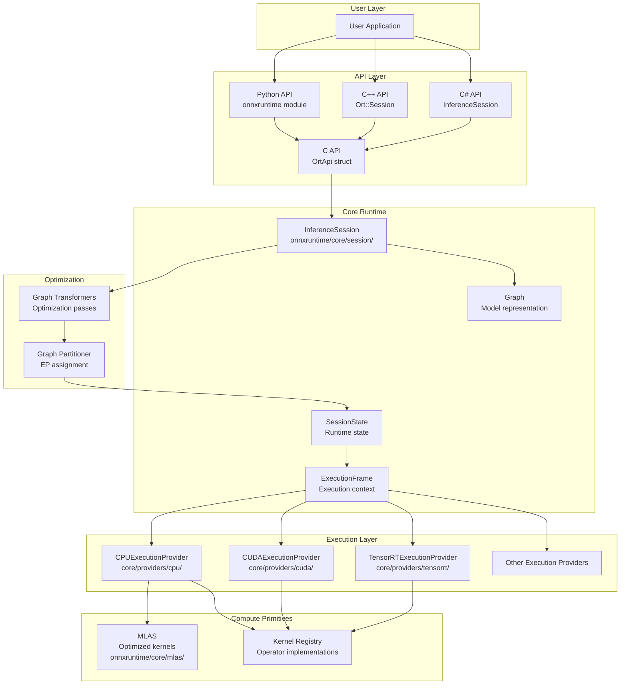
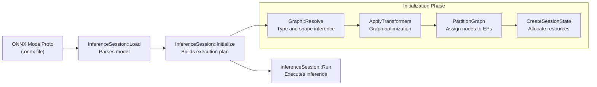
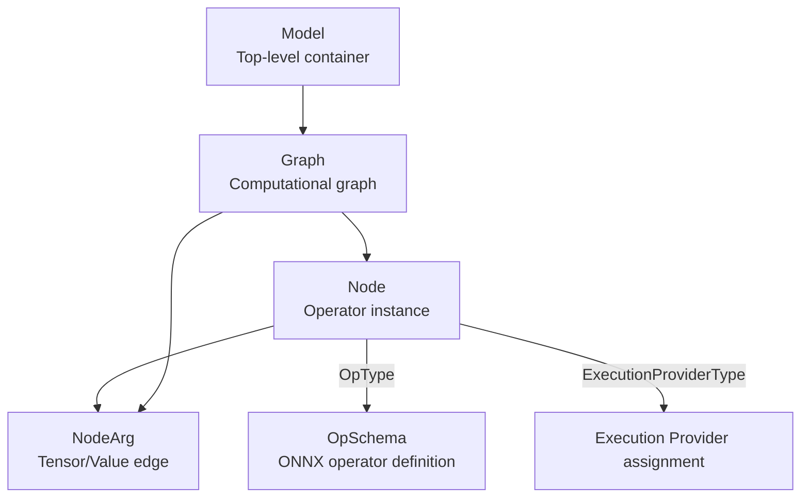
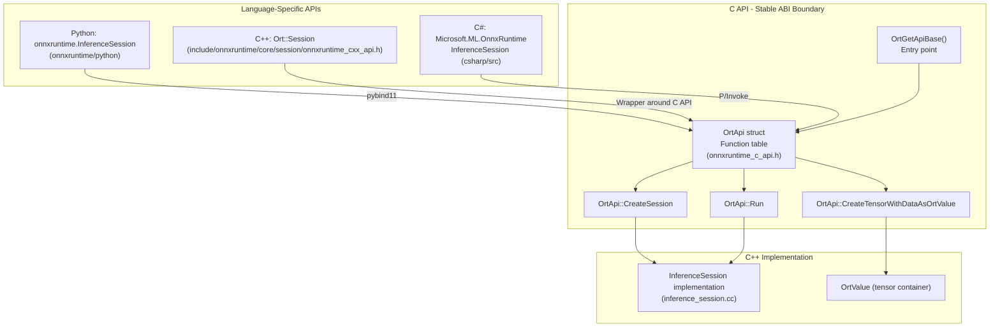
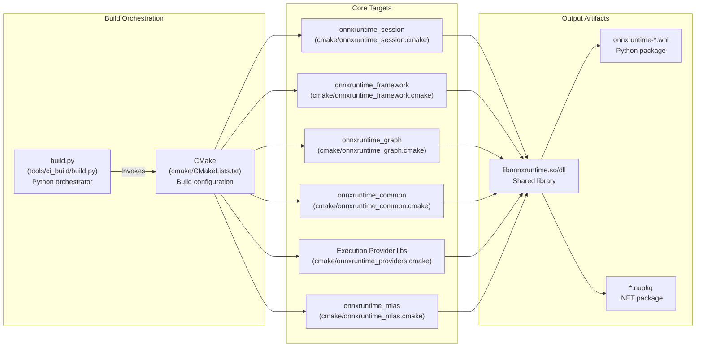
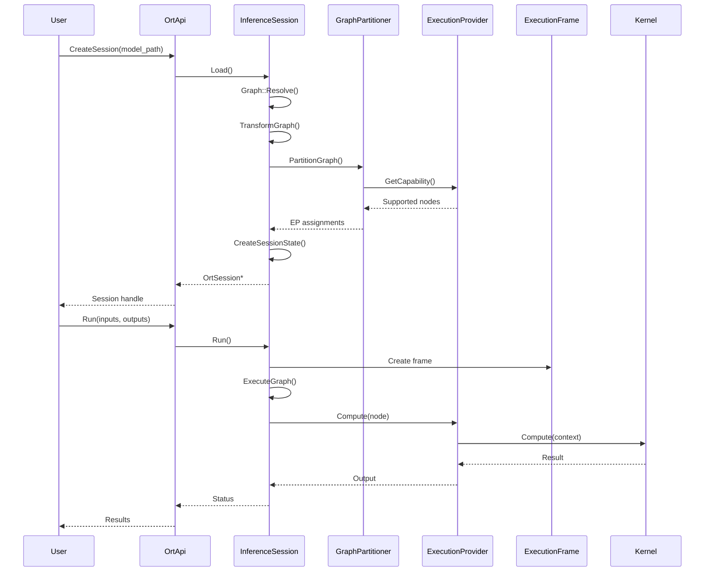
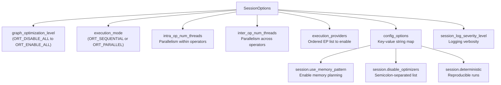

<!-- source: DeepWiki mcp.deepwiki.com · repo microsoft/onnxruntime · page 1 Overview · fetched 2026-10-21 -->

# Overview

Relevant source files

The following files were used as context for generating this wiki page:

- [README.md](README.md)
- [docs/Roadmap.md](docs/Roadmap.md)
- [include/onnxruntime/core/session/onnxruntime_c_api.h](include/onnxruntime/core/session/onnxruntime_c_api.h)
- [include/onnxruntime/core/session/onnxruntime_cxx_api.h](include/onnxruntime/core/session/onnxruntime_cxx_api.h)
- [include/onnxruntime/core/session/onnxruntime_cxx_inline.h](include/onnxruntime/core/session/onnxruntime_cxx_inline.h)
- [include/onnxruntime/core/session/onnxruntime_lite_custom_op.h](include/onnxruntime/core/session/onnxruntime_lite_custom_op.h)
- [java/README.md](java/README.md)
- [java/gradle/wrapper/gradle-wrapper.jar](java/gradle/wrapper/gradle-wrapper.jar)
- [java/gradlew](java/gradlew)
- [java/src/test/java/sample/ScoreMNIST.java](java/src/test/java/sample/ScoreMNIST.java)
- [java/testdata/cnn_mnist_pytorch.onnx](java/testdata/cnn_mnist_pytorch.onnx)
- [java/testdata/lr_mnist_scikit.onnx](java/testdata/lr_mnist_scikit.onnx)
- [onnxruntime/core/framework/session_options.h](onnxruntime/core/framework/session_options.h)
- [onnxruntime/core/session/abi_session_options.cc](onnxruntime/core/session/abi_session_options.cc)
- [onnxruntime/core/session/custom_ops.cc](onnxruntime/core/session/custom_ops.cc)
- [onnxruntime/core/session/inference_session.cc](onnxruntime/core/session/inference_session.cc)
- [onnxruntime/core/session/inference_session.h](onnxruntime/core/session/inference_session.h)
- [onnxruntime/core/session/onnxruntime_c_api.cc](onnxruntime/core/session/onnxruntime_c_api.cc)
- [onnxruntime/core/session/ort_apis.h](onnxruntime/core/session/ort_apis.h)
- [onnxruntime/core/session/standalone_op_invoker.cc](onnxruntime/core/session/standalone_op_invoker.cc)
- [onnxruntime/test/framework/inference_session_test.cc](onnxruntime/test/framework/inference_session_test.cc)
- [onnxruntime/test/shared_lib/custom_op_utils.cc](onnxruntime/test/shared_lib/custom_op_utils.cc)
- [onnxruntime/test/shared_lib/custom_op_utils.h](onnxruntime/test/shared_lib/custom_op_utils.h)
- [onnxruntime/test/shared_lib/test_inference.cc](onnxruntime/test/shared_lib/test_inference.cc)
- [onnxruntime/test/testdata/custom_op_library/cpu/cpu_ops.cc](onnxruntime/test/testdata/custom_op_library/cpu/cpu_ops.cc)
- [onnxruntime/test/testdata/custom_op_library/custom_op_library.cc](onnxruntime/test/testdata/custom_op_library/custom_op_library.cc)
- [onnxruntime/test/testdata/fuse_select_filter.onnx](onnxruntime/test/testdata/fuse_select_filter.onnx)
- [onnxruntime/test/testdata/fuse_select_filter_opset_8.onnx](onnxruntime/test/testdata/fuse_select_filter_opset_8.onnx)
- [onnxruntime/test/testdata/merge.onnx](onnxruntime/test/testdata/merge.onnx)
- [onnxruntime/test/testdata/optional_2.onnx](onnxruntime/test/testdata/optional_2.onnx)
- [onnxruntime/test/testdata/optional_3.onnx](onnxruntime/test/testdata/optional_3.onnx)

ONNX Runtime is a high-performance inference and training engine for executing ONNX (Open Neural Network Exchange) models. It provides cross-platform acceleration through pluggable execution providers that leverage hardware-specific optimizations (CPU, GPU, NPU) while maintaining a consistent API across languages and deployment targets.

This document presents a high-level architectural overview of the ONNX Runtime codebase. For detailed information about specific subsystems, see the respective child pages:

- Build system and packaging: see [Build System](#2)
- Graph representation and model loading: see [Core Architecture](#3)
- CPU-optimized kernels: see [Low-Level Compute Library](#4)
- API bindings: see [Language Bindings](#5)
- Hardware acceleration: see [Execution Providers](#6)
- Model training: see [Training System](#8)

---

## Architecture Overview

ONNX Runtime is architected with modular subsystems designed to facilitate model loading, graph optimization, execution, and hardware acceleration. The key layers span from the user application APIs down to low-level compute kernels:

This high-level layout groups the functionality as:

- User-facing APIs in Python, C++, C#, which all marshal requests through the stable C API (`OrtApi`).
- The core runtime (`InferenceSession`) manages model loading, optimization, and execution orchestration.
- Graph Transformers optimize the computation graph before execution.
- The Graph Partitioner splits the graph to assign subgraphs to execution providers (EPs).
- Execution providers implement hardware-aware kernels and resource management.
- MLAS provides optimized math primitives for CPU kernels.
- The kernel registry contains the actual operator implementations used by providers.

**Sources:** [onnxruntime/core/session/inference_session.h:1-66](), [include/onnxruntime/core/session/onnxruntime_c_api.h:1-46](), [cmake/CMakeLists.txt:1-60]()

---

## Core Components

### Session Management

The `InferenceSession` class is the primary interface for loading and running ONNX models. It encapsulates the entire model lifecycle:

- **LoadModel:** Parses the serialized ONNX model protobuf into an internal `Graph` representation.
- **Initialize:** Performs type inference, applies graph transformers (optimizations), partitions the graph among execution providers, and prepares runtime state (memory allocations, etc.).
- **Run:** Executes the prepared graph according to the configured execution order and providers.

**Key Classes:**
- `InferenceSession` [onnxruntime/core/session/inference_session.h:123-300]() — Session lifecycle management
- `SessionOptions` — Configures optimization levels, execution modes, threading, and EPs
- `SessionState` — Holds runtime information and memory during execution
- `ExecutionFrame` — Execution context used per run

**Sources:** [onnxruntime/core/session/inference_session.cc:1-156](), [onnxruntime/core/session/inference_session.h:123-300]()

---

### Graph Representation

The computational graph is represented in a structured model with nodes and their input/output value metadata:

- The `Model` holds the graph and metadata.
- The `Graph` contains the `Node` elements representing operators.
- `NodeArg` objects represent tensor or non-tensor inputs/outputs.
- Each `Node` references its operator schema definition for validation and execution logic.
- Nodes are assigned to execution providers after partitioning.

**Key Classes:**
- `Model` — [onnxruntime/core/graph/model.h]()
- `Graph` — [onnxruntime/core/graph/graph.h]()
- `Node` — [onnxruntime/core/graph/node.h]()
- `NodeArg` — [onnxruntime/core/graph/node_arg.h]()

**Sources:** [onnxruntime/core/graph/model.h](), [onnxruntime/core/graph/graph.h:1-100]()

---

### Execution Providers

Execution providers implement hardware acceleration and platform-specific support. They provide kernels and runtime support through a defined interface.

| Provider                  | Purpose                          | Location                   |
|---------------------------|---------------------------------|----------------------------|
| **CPUExecutionProvider**  | CPU fallback with MLAS kernels  | [core/providers/cpu/]()    |
| **CUDAExecutionProvider** | NVIDIA GPU via CUDA              | [core/providers/cuda/]()   |
| **TensorRTExecutionProvider** | NVIDIA GPU via TensorRT       | [core/providers/tensorrt/]() |
| **DMLExecutionProvider**  | DirectML for Windows             | [core/providers/dml/]()    |
| **CoreMLExecutionProvider**| Apple Neural Engine             | [core/providers/coreml/]() |
| **QNNExecutionProvider**  | Qualcomm NPU                    | [core/providers/qnn/]()    |

- Each provider declares capabilities for nodes they support.
- The graph partitioner assigns subgraphs to providers that can execute those nodes.
- Providers manage device memory and kernel dispatch.

See the [Execution Providers](#6) page for a comprehensive discussion of their design and integration.

**Sources:** [cmake/onnxruntime_providers.cmake:62-114](), [onnxruntime/core/framework/execution_provider.h]()

---

## API Layers

ONNX Runtime offers multi-language APIs built on a stable C API for interoperability and binary compatibility.

- `OrtGetApiBase()` provides API version negotiation and symbol access.
- The `OrtApi` struct contains function pointers for all runtime APIs, ensuring binary stability.
- C++ APIs wrap the C API, providing RAII patterns, exception handling, and easier usage.
- Python bindings use pybind11 and interact directly with the C API.
- C# API uses P/Invoke for interoperability.

**Sources:** [include/onnxruntime/core/session/onnxruntime_c_api.h:1-46](), [onnxruntime/core/session/onnxruntime_c_api.cc:1-100](), [include/onnxruntime/core/session/onnxruntime_cxx_api.h:1-100]()

---

## Build and Packaging

The build system orchestrates cross-platform compilation, configuration, and packaging:

- `build.py` is a Python script that accepts CLI arguments to configure the build, enable providers, and select platforms.
- CMake scripts define modular targets for the runtime and providers.
- Output artifacts include shared libraries, Python wheels, and NuGet packages for integration.
  
**Sources:** [tools/ci_build/build.py:1-100](), [cmake/CMakeLists.txt:1-60](), [cmake/onnxruntime.cmake:1-50]()

---

## Key Data Types

The runtime uses several core types repeatedly throughout models and execution:

| Type                | Purpose                              | Location                           |
|---------------------|------------------------------------|----------------------------------|
| **OrtValue**        | Type-erased container for tensors and ML data | [core/framework/ort_value.h]()     |
| **Tensor**          | Multi-dimensional typed array      | [core/framework/tensor.h]()       |
| **TensorShape**     | Metadata for tensor dimensions     | [core/framework/tensor_shape.h]() |
| **MLDataType**      | Runtime type information           | [core/framework/data_types.h]()   |
| **OrtMemoryInfo**   | Memory location descriptor (e.g. CPU/GPU) | [core/framework/allocator.h]()    |
| **IAllocator**      | Interface for memory allocation    | [core/framework/allocator.h]()    |

These types play foundational roles in managing model inputs, outputs, and intermediate computation data.

**Sources:** [onnxruntime/core/framework/ort_value.h](), [onnxruntime/core/framework/tensor.h]()

---

## Execution Flow

A typical inference workflow involves:

Execution phases:

1. **Load**: User creates a session; runtime loads and parses the model.
2. **Initialize**: The graph is resolved, optimized, partitioned; runtime state is created.
3. **Run**: Given inputs, the runtime executes the graph by invoking kernels through assigned providers, returning outputs to the user.

**Sources:** [onnxruntime/core/session/inference_session.cc:100-500](), [onnxruntime/core/framework/execution_frame.cc]()

---

## Repository Structure

The codebase is organized into directories mapped roughly as follows:

| Directory             | Contents                           |
|-----------------------|----------------------------------|
| `include/onnxruntime/core/session/` | Public C/C++ API headers              |
| `onnxruntime/core/session/`         | Session and API implementation        |
| `onnxruntime/core/framework/`       | Core runtime components and structures|
| `onnxruntime/core/graph/`           | Graph and model representation         |
| `onnxruntime/core/providers/`       | Execution provider implementations    |
| `onnxruntime/core/mlas/`             | MLAS optimized math kernels           |
| `onnxruntime/core/optimizer/`        | Graph optimization passes             |
| `onnxruntime/python/`                | Python bindings (pybind11)             |
| `csharp/src/`                       | C# bindings                          |
| `cmake/`                           | CMake build scripts                   |
| `tools/ci_build/`                  | Build orchestration and CI scripts     |
| `orttraining/`                     | Training API and tooling              |

For a detailed mapping and description of top-level directories, see the child page [Repository Layout](#1.1).

**Sources:** [cmake/CMakeLists.txt:1-100](), [tools/ci_build/build.py:27-28]()

---

## Configuration and Options

Runtime behavior is driven by the `SessionOptions` structure, which configures key aspects:

Options specify logging, threading, optimization levels, enabled execution providers, and other advanced tuning parameters.

**Sources:** [onnxruntime/core/framework/session_options.h:1-200](), [include/onnxruntime/core/session/onnxruntime_session_options_config_keys.h]()

---

## Version and Compatibility

The ONNX Runtime C API uses explicit versioning to maintain ABI compatibility:

- The `ORT_API_VERSION` macro defines the API version the header targets. The current version is 31.
- `OrtGetApiBase()` returns a pointer to the API function table (`OrtApi`) for a requested version.
- The `OrtApi` struct provides function pointers serving as a stable ABI boundary.
- New API versions extend interfaces, enabling backward compatibility for clients compiled against older headers.

This versioning scheme ensures that applications built with older ONNX Runtime SDKs continue to function correctly with newer runtime binaries.

**Sources:** [include/onnxruntime/core/session/onnxruntime_c_api.h:37-46](), [onnxruntime/core/session/onnxruntime_c_api.cc:1-100]()

---

This overview introduces the primary architectural components and relationships in ONNX Runtime. For detailed, in-depth information on each subsystem, consult the corresponding child pages in this wiki.

---

