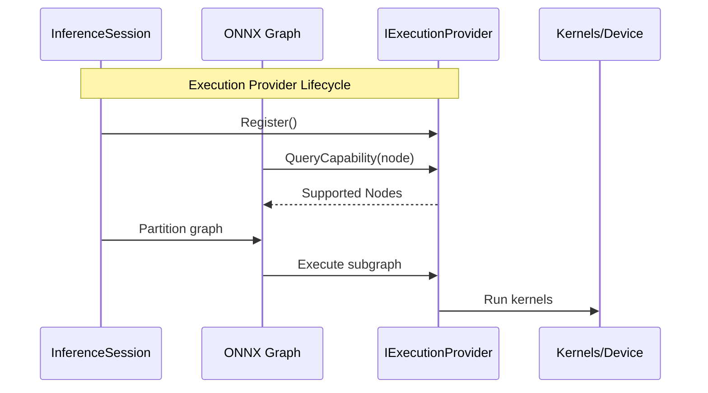
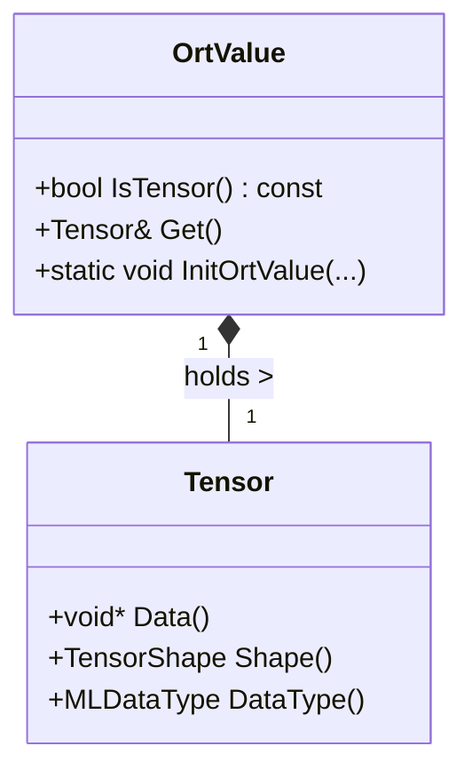
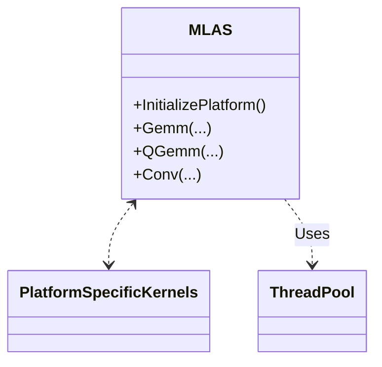
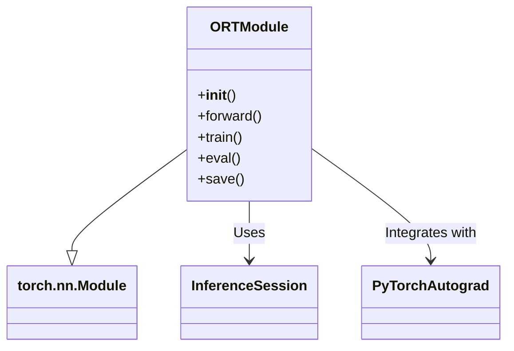

<!-- source: DeepWiki mcp.deepwiki.com · repo microsoft/onnxruntime · page 13 Glossary · fetched 2026-10-21 -->

# Glossary

<details>
<summary>Relevant source files</summary>

The following files were used as context for generating this wiki page:

- [cmake/onnxruntime_mlas.cmake](cmake/onnxruntime_mlas.cmake)
- [docs/Memory_Optimizer.md](docs/Memory_Optimizer.md)
- [docs/ORTModule_Training_Guidelines.md](docs/ORTModule_Training_Guidelines.md)
- [include/onnxruntime/core/optimizer/graph_transformer_utils.h](include/onnxruntime/core/optimizer/graph_transformer_utils.h)
- [include/onnxruntime/core/session/onnxruntime_c_api.h](include/onnxruntime/core/session/onnxruntime_c_api.h)
- [include/onnxruntime/core/session/onnxruntime_cxx_api.h](include/onnxruntime/core/session/onnxruntime_cxx_api.h)
- [include/onnxruntime/core/session/onnxruntime_cxx_inline.h](include/onnxruntime/core/session/onnxruntime_cxx_inline.h)
- [include/onnxruntime/core/session/onnxruntime_lite_custom_op.h](include/onnxruntime/core/session/onnxruntime_lite_custom_op.h)
- [onnxruntime/core/common/cpuid_info.cc](onnxruntime/core/common/cpuid_info.cc)
- [onnxruntime/core/common/cpuid_info.h](onnxruntime/core/common/cpuid_info.h)
- [onnxruntime/core/framework/session_options.h](onnxruntime/core/framework/session_options.h)
- [onnxruntime/core/graph/extended_graph_edge.h](onnxruntime/core/graph/extended_graph_edge.h)
- [onnxruntime/core/mlas/inc/mlas.h](onnxruntime/core/mlas/inc/mlas.h)
- [onnxruntime/core/mlas/lib/amd64/QgemmU8S8KernelAmx.asm](onnxruntime/core/mlas/lib/amd64/QgemmU8S8KernelAmx.asm)
- [onnxruntime/core/mlas/lib/amx_common.h](onnxruntime/core/mlas/lib/amx_common.h)
- [onnxruntime/core/mlas/lib/convolve.cpp](onnxruntime/core/mlas/lib/convolve.cpp)
- [onnxruntime/core/mlas/lib/dgemm.cpp](onnxruntime/core/mlas/lib/dgemm.cpp)
- [onnxruntime/core/mlas/lib/kleidiai/convolve_kleidiai.cpp](onnxruntime/core/mlas/lib/kleidiai/convolve_kleidiai.cpp)
- [onnxruntime/core/mlas/lib/kleidiai/mlasi_kleidiai.h](onnxruntime/core/mlas/lib/kleidiai/mlasi_kleidiai.h)
- [onnxruntime/core/mlas/lib/kleidiai/qgemm_kleidiai.cpp](onnxruntime/core/mlas/lib/kleidiai/qgemm_kleidiai.cpp)
- [onnxruntime/core/mlas/lib/kleidiai/sbgemm_kleidiai.cpp](onnxruntime/core/mlas/lib/kleidiai/sbgemm_kleidiai.cpp)
- [onnxruntime/core/mlas/lib/kleidiai/sgemm_kleidiai.cpp](onnxruntime/core/mlas/lib/kleidiai/sgemm_kleidiai.cpp)
- [onnxruntime/core/mlas/lib/mlasi.h](onnxruntime/core/mlas/lib/mlasi.h)
- [onnxruntime/core/mlas/lib/platform.cpp](onnxruntime/core/mlas/lib/platform.cpp)
- [onnxruntime/core/mlas/lib/qdwconv.cpp](onnxruntime/core/mlas/lib/qdwconv.cpp)
- [onnxruntime/core/mlas/lib/qgemm.cpp](onnxruntime/core/mlas/lib/qgemm.cpp)
- [onnxruntime/core/mlas/lib/qgemm.h](onnxruntime/core/mlas/lib/qgemm.h)
- [onnxruntime/core/mlas/lib/qgemm_kernel_amx.cpp](onnxruntime/core/mlas/lib/qgemm_kernel_amx.cpp)
- [onnxruntime/core/mlas/lib/qgemm_kernel_avx2.cpp](onnxruntime/core/mlas/lib/qgemm_kernel_avx2.cpp)
- [onnxruntime/core/mlas/lib/qgemm_kernel_default.cpp](onnxruntime/core/mlas/lib/qgemm_kernel_default.cpp)
- [onnxruntime/core/mlas/lib/qgemm_kernel_neon.cpp](onnxruntime/core/mlas/lib/qgemm_kernel_neon.cpp)
- [onnxruntime/core/mlas/lib/qgemm_kernel_sdot.cpp](onnxruntime/core/mlas/lib/qgemm_kernel_sdot.cpp)
- [onnxruntime/core/mlas/lib/qgemm_kernel_sse.cpp](onnxruntime/core/mlas/lib/qgemm_kernel_sse.cpp)
- [onnxruntime/core/mlas/lib/qgemm_kernel_sse41.cpp](onnxruntime/core/mlas/lib/qgemm_kernel_sse41.cpp)
- [onnxruntime/core/mlas/lib/qgemm_kernel_udot.cpp](onnxruntime/core/mlas/lib/qgemm_kernel_udot.cpp)
- [onnxruntime/core/mlas/lib/qgemm_kernel_wasmsimd.cpp](onnxruntime/core/mlas/lib/qgemm_kernel_wasmsimd.cpp)
- [onnxruntime/core/mlas/lib/sgemm.cpp](onnxruntime/core/mlas/lib/sgemm.cpp)
- [onnxruntime/core/mlas/lib/x86_64/QgemmU8S8KernelAmx.S](onnxruntime/core/mlas/lib/x86_64/QgemmU8S8KernelAmx.S)
- [onnxruntime/core/mlas/lib/x86_64/QgemmU8S8KernelAmxCommon.S](onnxruntime/core/mlas/lib/x86_64/QgemmU8S8KernelAmxCommon.S)
- [onnxruntime/core/optimizer/graph_transformer_utils.cc](onnxruntime/core/optimizer/graph_transformer_utils.cc)
- [onnxruntime/core/optimizer/qdq_transformer/qdq_final_cleanup.cc](onnxruntime/core/optimizer/qdq_transformer/qdq_final_cleanup.cc)
- [onnxruntime/core/optimizer/qdq_transformer/qdq_final_cleanup.h](onnxruntime/core/optimizer/qdq_transformer/qdq_final_cleanup.h)
- [onnxruntime/core/optimizer/qdq_transformer/qdq_propagation.cc](onnxruntime/core/optimizer/qdq_transformer/qdq_propagation.cc)
- [onnxruntime/core/optimizer/qdq_transformer/qdq_propagation.h](onnxruntime/core/optimizer/qdq_transformer/qdq_propagation.h)
- [onnxruntime/core/optimizer/qdq_transformer/qdq_util.cc](onnxruntime/core/optimizer/qdq_transformer/qdq_util.cc)
- [onnxruntime/core/optimizer/qdq_transformer/qdq_util.h](onnxruntime/core/optimizer/qdq_transformer/qdq_util.h)
- [onnxruntime/core/optimizer/qdq_transformer/selectors_actions/qdq_actions.cc](onnxruntime/core/optimizer/qdq_transformer/selectors_actions/qdq_actions.cc)
- [onnxruntime/core/optimizer/qdq_transformer/selectors_actions/qdq_actions.h](onnxruntime/core/optimizer/qdq_transformer/selectors_actions/qdq_actions.h)
- [onnxruntime/core/optimizer/qdq_transformer/selectors_actions/qdq_selector_action_transformer.cc](onnxruntime/core/optimizer/qdq_transformer/selectors_actions/qdq_selector_action_transformer.cc)
- [onnxruntime/core/optimizer/qdq_transformer/selectors_actions/qdq_selector_action_transformer.h](onnxruntime/core/optimizer/qdq_transformer/selectors_actions/qdq_selector_action_transformer.h)
- [onnxruntime/core/optimizer/qdq_transformer/selectors_actions/qdq_selectors.cc](onnxruntime/core/optimizer/qdq_transformer/selectors_actions/qdq_selectors.cc)
- [onnxruntime/core/optimizer/qdq_transformer/selectors_actions/qdq_selectors.h](onnxruntime/core/optimizer/qdq_transformer/selectors_actions/qdq_selectors.h)
- [onnxruntime/core/session/abi_session_options.cc](onnxruntime/core/session/abi_session_options.cc)
- [onnxruntime/core/session/custom_ops.cc](onnxruntime/core/session/custom_ops.cc)
- [onnxruntime/core/session/inference_session.cc](onnxruntime/core/session/inference_session.cc)
- [onnxruntime/core/session/inference_session.h](onnxruntime/core/session/inference_session.h)
- [onnxruntime/core/session/onnxruntime_c_api.cc](onnxruntime/core/session/onnxruntime_c_api.cc)
- [onnxruntime/core/session/ort_apis.h](onnxruntime/core/session/ort_apis.h)
- [onnxruntime/core/session/standalone_op_invoker.cc](onnxruntime/core/session/standalone_op_invoker.cc)
- [onnxruntime/python/tools/symbolic_shape_infer.py](onnxruntime/python/tools/symbolic_shape_infer.py)
- [onnxruntime/test/contrib_ops/fused_conv_test.cc](onnxruntime/test/contrib_ops/fused_conv_test.cc)
- [onnxruntime/test/framework/inference_session_test.cc](onnxruntime/test/framework/inference_session_test.cc)
- [onnxruntime/test/mlas/bench/bench_qgemm.cpp](onnxruntime/test/mlas/bench/bench_qgemm.cpp)
- [onnxruntime/test/mlas/bench/bench_sconv.cpp](onnxruntime/test/mlas/bench/bench_sconv.cpp)
- [onnxruntime/test/mlas/unittest/test_conv2d.h](onnxruntime/test/mlas/unittest/test_conv2d.h)
- [onnxruntime/test/mlas/unittest/test_fgemm.cpp](onnxruntime/test/mlas/unittest/test_fgemm.cpp)
- [onnxruntime/test/mlas/unittest/test_fgemm.h](onnxruntime/test/mlas/unittest/test_fgemm.h)
- [onnxruntime/test/mlas/unittest/test_fgemm_fixture.h](onnxruntime/test/mlas/unittest/test_fgemm_fixture.h)
- [onnxruntime/test/mlas/unittest/test_qgemm.cpp](onnxruntime/test/mlas/unittest/test_qgemm.cpp)
- [onnxruntime/test/mlas/unittest/test_qgemm_fixture.h](onnxruntime/test/mlas/unittest/test_qgemm_fixture.h)
- [onnxruntime/test/optimizer/graph_transform_test.cc](onnxruntime/test/optimizer/graph_transform_test.cc)
- [onnxruntime/test/optimizer/graph_transform_utils_test.cc](onnxruntime/test/optimizer/graph_transform_utils_test.cc)
- [onnxruntime/test/optimizer/qdq_matmulnbits_transformer_test.cc](onnxruntime/test/optimizer/qdq_matmulnbits_transformer_test.cc)
- [onnxruntime/test/optimizer/qdq_transformer_test.cc](onnxruntime/test/optimizer/qdq_transformer_test.cc)
- [onnxruntime/test/python/onnxruntime_test_python_symbolic_shape_infer.py](onnxruntime/test/python/onnxruntime_test_python_symbolic_shape_infer.py)
- [onnxruntime/test/shared_lib/custom_op_utils.cc](onnxruntime/test/shared_lib/custom_op_utils.cc)
- [onnxruntime/test/shared_lib/custom_op_utils.h](onnxruntime/test/shared_lib/custom_op_utils.h)
- [onnxruntime/test/shared_lib/test_inference.cc](onnxruntime/test/shared_lib/test_inference.cc)
- [onnxruntime/test/testdata/custom_op_library/cpu/cpu_ops.cc](onnxruntime/test/testdata/custom_op_library/cpu/cpu_ops.cc)
- [onnxruntime/test/testdata/custom_op_library/custom_op_library.cc](onnxruntime/test/testdata/custom_op_library/custom_op_library.cc)
- [onnxruntime/test/testdata/fuse_select_filter.onnx](onnxruntime/test/testdata/fuse_select_filter.onnx)
- [onnxruntime/test/testdata/fuse_select_filter_opset_8.onnx](onnxruntime/test/testdata/fuse_select_filter_opset_8.onnx)
- [onnxruntime/test/testdata/merge.onnx](onnxruntime/test/testdata/merge.onnx)
- [onnxruntime/test/testdata/optional_2.onnx](onnxruntime/test/testdata/optional_2.onnx)
- [onnxruntime/test/testdata/optional_3.onnx](onnxruntime/test/testdata/optional_3.onnx)
- [orttraining/orttraining/core/optimizer/compute_optimizer/padding_elimination.cc](orttraining/orttraining/core/optimizer/compute_optimizer/padding_elimination.cc)
- [orttraining/orttraining/core/optimizer/compute_optimizer/padding_elimination.h](orttraining/orttraining/core/optimizer/compute_optimizer/padding_elimination.h)
- [orttraining/orttraining/core/optimizer/conv1d_replacement.cc](orttraining/orttraining/core/optimizer/conv1d_replacement.cc)
- [orttraining/orttraining/core/optimizer/conv1d_replacement.h](orttraining/orttraining/core/optimizer/conv1d_replacement.h)
- [orttraining/orttraining/core/optimizer/graph_transformer_config.h](orttraining/orttraining/core/optimizer/graph_transformer_config.h)
- [orttraining/orttraining/core/optimizer/graph_transformer_utils.cc](orttraining/orttraining/core/optimizer/graph_transformer_utils.cc)
- [orttraining/orttraining/python/training/ortmodule/__init__.py](orttraining/orttraining/python/training/ortmodule/__init__.py)
- [orttraining/orttraining/python/training/ortmodule/_custom_gradient_registry.py](orttraining/orttraining/python/training/ortmodule/_custom_gradient_registry.py)
- [orttraining/orttraining/python/training/ortmodule/_custom_op_symbolic_registry.py](orttraining/orttraining/python/training/ortmodule/_custom_op_symbolic_registry.py)
- [orttraining/orttraining/python/training/ortmodule/_fallback.py](orttraining/orttraining/python/training/ortmodule/_fallback.py)
- [orttraining/orttraining/python/training/ortmodule/_fallback_exceptions.py](orttraining/orttraining/python/training/ortmodule/_fallback_exceptions.py)
- [orttraining/orttraining/python/training/ortmodule/_graph_execution_manager.py](orttraining/orttraining/python/training/ortmodule/_graph_execution_manager.py)
- [orttraining/orttraining/python/training/ortmodule/_graph_execution_manager_factory.py](orttraining/orttraining/python/training/ortmodule/_graph_execution_manager_factory.py)
- [orttraining/orttraining/python/training/ortmodule/_inference_manager.py](orttraining/orttraining/python/training/ortmodule/_inference_manager.py)
- [orttraining/orttraining/python/training/ortmodule/_io.py](orttraining/orttraining/python/training/ortmodule/_io.py)
- [orttraining/orttraining/python/training/ortmodule/_logger.py](orttraining/orttraining/python/training/ortmodule/_logger.py)
- [orttraining/orttraining/python/training/ortmodule/_runtime_inspector.py](orttraining/orttraining/python/training/ortmodule/_runtime_inspector.py)
- [orttraining/orttraining/python/training/ortmodule/_torch_module_factory.py](orttraining/orttraining/python/training/ortmodule/_torch_module_factory.py)
- [orttraining/orttraining/python/training/ortmodule/_torch_module_ort.py](orttraining/orttraining/python/training/ortmodule/_torch_module_ort.py)
- [orttraining/orttraining/python/training/ortmodule/_training_manager.py](orttraining/orttraining/python/training/ortmodule/_training_manager.py)
- [orttraining/orttraining/python/training/ortmodule/_utils.py](orttraining/orttraining/python/training/ortmodule/_utils.py)
- [orttraining/orttraining/python/training/ortmodule/options.py](orttraining/orttraining/python/training/ortmodule/options.py)
- [orttraining/orttraining/python/training/ortmodule/ortmodule.py](orttraining/orttraining/python/training/ortmodule/ortmodule.py)
- [orttraining/orttraining/test/optimizer/graph_transform_test.cc](orttraining/orttraining/test/optimizer/graph_transform_test.cc)
- [orttraining/orttraining/test/optimizer/graph_transformer_utils_test.cc](orttraining/orttraining/test/optimizer/graph_transformer_utils_test.cc)
- [orttraining/orttraining/test/python/orttraining_test_ortmodule_api.py](orttraining/orttraining/test/python/orttraining_test_ortmodule_api.py)
- [orttraining/orttraining/test/python/orttraining_test_ortmodule_fallback.py](orttraining/orttraining/test/python/orttraining_test_ortmodule_fallback.py)

</details>


This glossary defines key codebase-specific terms, jargon, abbreviations, and domain concepts used in the ONNX Runtime (ORT) codebase. Each term is explained with its technical meaning, role in the system, data flow, key functions or classes, and pointers to source files for further reference.

---

## Execution Provider (EP)

An **Execution Provider** in ONNX Runtime abstracts hardware or software backends that execute subsets of an ONNX computation graph. EPs enable acceleration on CPUs, GPUs (such as CUDA, DirectML), and specialized accelerators by implementing kernels and managing devices and memory.

- **Interface:** Defined by the `IExecutionProvider` abstract class.
- **Responsibilities:**
  - Indicate kernel capability for nodes.
  - Partition the graph into subgraphs for execution.
  - Register kernels and handle device-specific memory management.
- **Context Model:** Some EPs implement an *EP Context Model* that manages state or resources per inference session or per data stream.
  
### Relevant Code and Files
- Interface declarations: `core/framework/execution_provider.h`
- CPU EP: `core/providers/cpu/cpu_execution_provider.cc`
- CUDA EP: `core/providers/cuda/cuda_execution_provider.cc`
- DML EP: `core/providers/dml/DmlExecutionProvider/src/ExecutionProvider.*`
- Plugin EP and provider bridge: `core/session/plugin_ep/`

The EP system controls how subgraphs are partitioned and delegated. Session-level APIs (e.g., `InferenceSession`) manage EP registration and graph partitioning based on EP capabilities.



Sources:  
`core/framework/execution_provider.h`: Interface and EP base class definition  
`core/session/inference_session.cc` (partial) - EP registration and graph partitioning  
`core/providers/cpu/cpu_execution_provider.cc`, `core/providers/cuda/cuda_execution_provider.cc`

---

## OrtValue

`OrtValue` is the fundamental value container representing tensors, sequences, maps, or opaque types in ONNX Runtime. It abstracts the underlying memory and data type, enabling efficient passing and management of data throughout the runtime.

- Essentially a variant-like container wrapping actual data, such as `Tensor`, `SparseTensor`, or other types.
- Provides APIs to access data pointers, shapes, types.
- Supports zero-copy when possible (important for GPU/CPU interop).
- Used extensively for inputs, outputs, and intermediate values.
  
### Key Classes and Functions
- `OrtValue` class: Defined in `core/framework/ort_value.h` with implementations in `ort_value.cc`.
- `Tensor` access via `OrtValue::Get<Tensor>()`.
- Management of ownership and memory via custom allocators.

`OrtValue` flows through kernel invocations inside the execution frame.



Sources:  
`core/framework/ort_value.h`, `core/framework/ort_value.cc`  
`core/framework/tensor.h`  
`include/onnxruntime/core/session/onnxruntime_c_api.cc: 125-175` (CreateTensorImpl functions)

---

## QDQ (Quantize-Dequantize) Model Format and Transformers

**QDQ** stands for *Quantize-Dequantize* and represents a graph transformation pattern that surrounds quantizable operators (e.g., MatMul, Conv) with quantize (Q) and dequantize (DQ) nodes. This pattern facilitates quantization-aware optimizations.

- The graph transformer framework supports multiple QDQ transformers that identify, fold, or optimize QDQ patterns.
- QDQ enables precise per-node quantization and calibration.
- Transformers: e.g., `DoubleQDQPairsRemover`, `QDQPropagation`, `EnsureUniqueDQForNodeUnit` optimize the presence of QDQ nodes.

### Transformer Components
- Registered as graph transformers in `GraphTransformerManager`.
- Applied at various optimization levels.
- Work with graph partitioning and model loading.


Sources:  
`core/optimizer/qdq_transformer/` directory  
`test/optimizer/graph_transform_test.cc` (QDQ transformer tests)  
`core/optimizer/graph_transformer_utils.cc` (QDQ utility functions)

---

## MLAS (Microsoft Linear Algebra Subprograms)

**MLAS** is an internal low-level compute library developed by Microsoft used by ONNX Runtime to perform high-performance linear algebra kernels.

- Implements optimized routines for matrix multiplication (GEMM), convolutions, and related operations.
- Supports platform-specific optimizations and CPU instruction sets such as AVX2, AVX-512, NEON (ARM), SVE, and RISCV Vector Extensions.
- Provides quantized GEMM kernels for int8 and other low-bit-width data types.
- Handles threadpool dispatch and blocking strategies.

### Architecture
- Hardware-agnostic core with platform-specific assembly kernels.
- Dynamically selects best kernel at runtime based on CPUID.
- Provides blocking and tiling strategies especially for GEMM.

### Important Files
- `core/mlas/inc/mlas.h` & `core/mlas/lib/mlasi.h` — Core header and internal private declarations.
- `cmake/onnxruntime_mlas.cmake` — Build instructions integrating MLAS.
- Source implementations such as `sgemm.cpp`, `qgemm.cpp`, `convolve.cpp`, and platform-specific kernel files.



Sources:  
`core/mlas/inc/mlas.h`, `core/mlas/lib/mlasi.h`  
`cmake/onnxruntime_mlas.cmake`  
`core/mlas/lib/sgemm.cpp` (and other MLAS source files)  
`core/mlas/lib/platform.cpp`

---

## GEMM (General Matrix Multiply)

**GEMM** refers to the general matrix multiplication operation, foundational in many ML workloads.

- MLAS provides multiple GEMM implementations:
  - `SGEMM` for single-precision floating point.
  - `DGEMM` for double-precision.
  - Quantized GEMM variants, such as `QGEMM` for int8/uint8 with quantization.
- Highly optimized blocking and kernel dispatch.
- Kernels may use assembly or intrinsics and leverage SIMD instructions.
- GEMM is used under the hood by many ONNX operators like MatMul, Attention, etc.

Sources:  
`core/mlas/lib/sgemm.cpp`, `core/mlas/lib/qgemm.cpp`  
`core/mlas/inc/mlas.h`  
`cmake/onnxruntime_mlas.cmake`

---

## JSEP (JavaScript Execution Provider)

The **JSEP** is a lightweight JS Execution Provider infrastructure in the ONNX Runtime JavaScript packages like `onnxruntime-web` and `onnxruntime-node`.

- Supports WebGPU and WebNN backends for hardware-accelerated inference in browsers and node.
- Implements kernels in WGSL shaders or WebNN API calls.
- Includes JS-side kernel resolution, operator registration, and graph partitioning.

Sources:  
`js/web`, `js/node` package directories (not shown in this excerpt)  
`10.3 JSEP WebGPU Kernels` section in the wiki table of contents (conceptual overview)  
`test/optimizer/webgpu_fusion_test_util.h` references related to testing

---

## ORTModule

**ORTModule** is a PyTorch integration module enabling ONNX Runtime as a backend for PyTorch training and inference.

- Implements a `torch.nn.Module` wrapper.
- Provides seamless integration with PyTorch autograd and device management.
- Supports graph export to ONNX, runs with optimized ORT execution sessions.
- Manages inputs/outputs conversion, zero-copy where possible.
- Supports fallback to native PyTorch when unsupported ops are encountered.

### Key Classes and Files
- Python binding module in `orttraining/orttraining/python/training/ortmodule/`
- `ORTModule` class defined in `orttraining/orttraining/python/training/ortmodule/ortmodule.py`
- Training optimizer and gradient builder in submodules.
- Implements custom autograd function exporters.



Sources:  
`orttraining/orttraining/python/training/ortmodule/ortmodule.py`  
`orttraining/orttraining/test/python/orttraining_test_ortmodule_api.py`  

---

## EP Context Model

The **EP Context Model** refers to the mechanism by which execution providers maintain per-session or per-inference state and resources.

- Allows stateful management of execution details on a device.
- Includes device contexts, streams, caching handles, etc.
- For example, CUDA EP maintains CUDA stream context that must be consistent during execution.
- Framework manages EP context lifecycle, associate context with inference sessions and execution.

Sources:  
`core/framework/ep_context_utils.h`  
`core/session/inference_session.cc` (EP context creation and management)

---

## Minimal Build

The **Minimal Build** is a stripped-down build configuration targeting smaller binary sizes and reduced feature sets.

- Excludes optional components such as custom ops, some execution providers, and certain graph optimizations.
- Defined by the macro `ORT_MINIMAL_BUILD`.
- Used in embedded or constrained environments.
- May disable parts of the optimizer and training.
- Some features are conditionally compiled depending on the minimal build flags.

Sources:  
Build system `cmake/onnxruntime_common.cmake` (not shown here)  
Code guarded by `#if !defined(ORT_MINIMAL_BUILD)` like in `onnxruntime/core/session/inference_session.cc` and optimizer files.

---

## Summary Table of Key Terms

| Term                   | Description                                           | Key Location(s)                                    |
|------------------------|-------------------------------------------------------|---------------------------------------------------|
| Execution Provider (EP) | Hardware/software backend interface for kernel execution | `core/framework/execution_provider.h`             |
| OrtValue               | Container for tensors and other runtime values         | `core/framework/ort_value.h`                       |
| QDQ                    | Quantize-Dequantize graph transformation pattern       | `core/optimizer/qdq_transformer/`                  |
| MLAS                   | Microsoft Linear Algebra Subprograms library           | `core/mlas/inc/mlas.h`, `core/mlas/lib/`          |
| GEMM                   | General Matrix Multiply kernels                         | `core/mlas/lib/sgemm.cpp`, `core/mlas/lib/qgemm.cpp` |
| JSEP                   | JavaScript Execution Provider                           | `js/web`, `js/node` packages                       |
| ORTModule              | PyTorch module wrapper for ORT                          | `orttraining/orttraining/python/training/ortmodule/` |
| EP Context Model       | Mechanism to manage execution provider state per session | `core/framework/ep_context_utils.h`                |
| Minimal Build          | Build configuration with reduced features              | Build flags `ORT_MINIMAL_BUILD` in CMake and source|

---

## Diagram: Mapping Terms to Code Entities

```mermaid
graph TD
  subgraph ExecutionProviders
    EP[IExecutionProvider (interface)]
    CPUEP[CpuExecutionProvider]
    CUDAEP[CudaExecutionProvider]
    DML[DirectML ExecutionProvider]
    JSEP[JavaScript EP (WebGPU/WebNN)]
  end

  subgraph RuntimeCore
    OrtValueNode[OrtValue\n(core/framework/ort_value.h)]
    Session[InferenceSession\n(core/session/inference_session.cc)]
    Graph[Graph]
  end

  subgraph Optimizer
    QDQ[QDQ Transformers\n(core/optimizer/qdq_transformer)]
    GraphTransformer[GraphTransformer]
  end

  subgraph MLASLib
    MLAS[MLAS Core\n(core/mlas/inc/mlas.h)]
    GEMM[GEMM Kernels\n(core/mlas/lib/sgemm.cpp)]
  end

  subgraph PyTorchIntegration
    ORTModuleNode[ORTModule python wrapper\n(orttraining/orttraining/python/training/ortmodule)]
  end

  EP -->|registers kernels| CPUEP
  EP --> CUDAEP
  EP --> DML
  EP --> JSEP

  Session -->|handles and delegates| EP
  Session --> OrtValueNode
  Session --> Graph

  Graph --> QDQ
  QDQ --> GraphTransformer

  MLAS --> GEMM

  ORTModuleNode --> Session
  ORTModuleNode --> PyTorchModule[PyTorch nn.Module]

  classDef code fill:#f9f,stroke:#333,stroke-width:1px;
  class EP,CPUEP,CUDAEP,DML,JSEP,OrtValueNode,Session,Graph,QDQ,GraphTransformer,MLAS,GEMM,ORTModuleNode code;
```

---

## Diagram: Data Flow from User Model to EP Kernels

```mermaid
flowchart LR
  UserModel[User Model (ONNX)] --> LoadModel[Load ONNX Proto]
  LoadModel --> OptimizeGraph[Graph Optimizations (incl. QDQ)]
  OptimizeGraph --> PartitionGraph[Graph Partitioning by EP]
  PartitionGraph --> EPSubgraphs[Subgraphs for each EP]
  EPSubgraphs --> ExecutionProviders[Execution Providers]
  ExecutionProviders --> Kernels[Kernels & MLAS]
  Kernels --> ComputeResults[Computation Outputs]
```

---

# Summary

This glossary aims to clarify the most fundamental and commonly referenced concepts and code entities across the ONNX Runtime codebase. Understanding these terms helps to navigate the orchestration of model loading, optimization, execution provider delegation, low-level compute kernels, and training integration using ORTModule.

---

# Sources

- `include/onnxruntime/core/session/onnxruntime_c_api.h:1-198`  
- `core/framework/ort_value.h`  
- `core/framework/ort_value.cc` (implied)  
- `core/session/inference_session.cc:4-156`  
- `core/framework/execution_provider.h` (mentioned)  
- `core/optimizer/qdq_transformer/qdq_util.cc` (implied)  
- `orttraining/orttraining/python/training/ortmodule/ortmodule.py`  
- `core/mlas/inc/mlas.h`, `core/mlas/lib/mlasi.h`  
- `cmake/onnxruntime_mlas.cmake`  
- `core/mlas/lib/sgemm.cpp`, `core/mlas/lib/qgemm.cpp`   
- `core/session/plugin_ep/` (conceptual reference)  
- `test/optimizer/graph_transform_test.cc` (QDQ testing)  
- `orttraining/orttraining/test/python/orttraining_test_ortmodule_api.py`