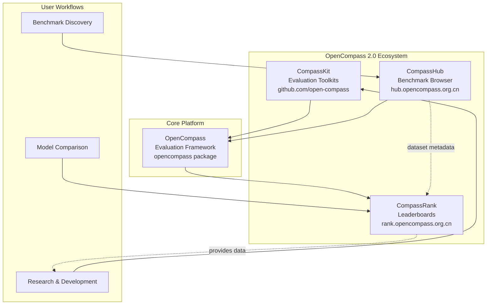
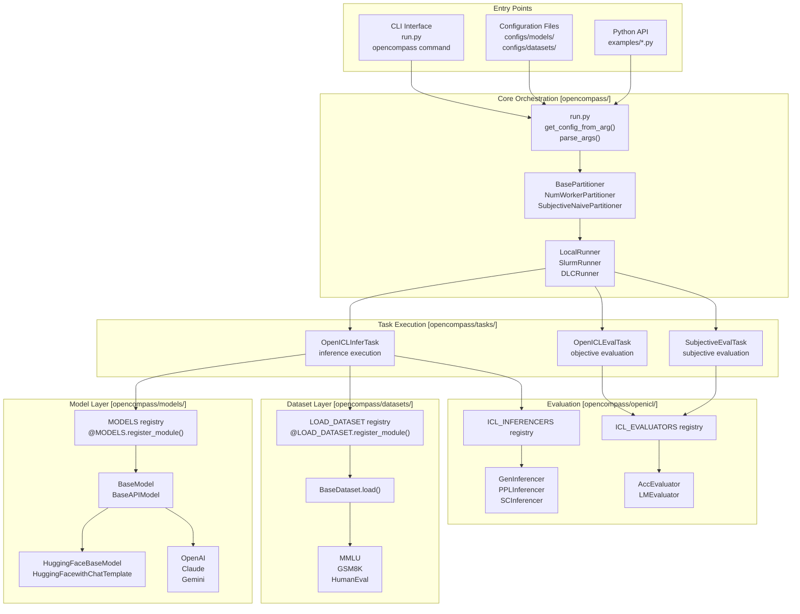
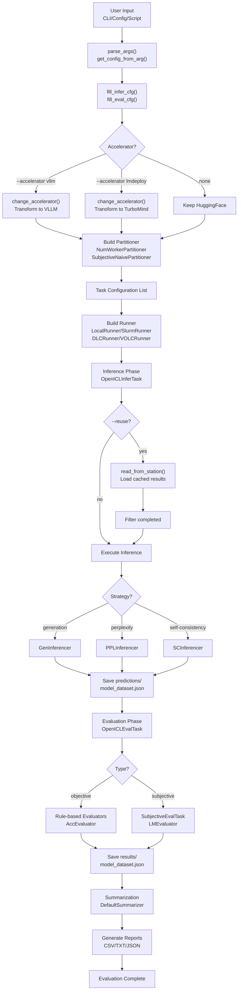

<!-- source: DeepWiki mcp.deepwiki.com · repo open-compass/opencompass · page 1 Introduction to OpenCompass · fetched 2026-10-21 -->

# Introduction to OpenCompass

Relevant source files

The following files were used as context for generating this wiki page:

- [README.md](README.md)
- [README_zh-CN.md](README_zh-CN.md)
- [docs/en/index.rst](docs/en/index.rst)
- [docs/en/notes/news.md](docs/en/notes/news.md)
- [docs/zh_cn/advanced_guides/evaluation_lmdeploy.md](docs/zh_cn/advanced_guides/evaluation_lmdeploy.md)
- [docs/zh_cn/index.rst](docs/zh_cn/index.rst)
- [docs/zh_cn/notes/news.md](docs/zh_cn/notes/news.md)

## Purpose and Scope

This document provides a high-level introduction to OpenCompass, an open-source platform for evaluating large language models (LLMs). It covers the purpose of OpenCompass, the OpenCompass 2.0 ecosystem, key capabilities, and the fundamental architecture that enables comprehensive model evaluation.

For installation and setup instructions, see [Installation and Setup](#2.1). For running your first evaluation, see [Quick Start Guide](#2.2). For detailed information about specific components, refer to the [Core Architecture](#3) section.

## What is OpenCompass?

OpenCompass is a one-stop platform for large language model evaluation, designed to provide fair, open, and reproducible benchmarks for assessing LLM capabilities. The platform enables researchers and practitioners to systematically evaluate models across multiple dimensions including knowledge, reasoning, coding, and long-context understanding.

The name "OpenCompass" reflects the platform's mission: just as a compass guides navigation, OpenCompass guides users through the complex landscape of LLM evaluation, helping assess model quality and effectiveness with powerful algorithms and an intuitive interface.

**Sources:** [README.md:45-50](), [README_zh-CN.md:45-50](), [README.md:287-297]()

## OpenCompass 2.0 Ecosystem

OpenCompass 2.0 consists of three integrated components that work together to provide a comprehensive evaluation ecosystem:

### CompassKit

CompassKit is a collection of evaluation toolkits specifically designed for large language models and large vision-language models. It provides specialized evaluation methods including:

- **Inference strategies**: Generation, perplexity scoring, self-consistency, tree-of-thought reasoning
- **Domain-specific evaluators**: Code execution, mathematical verification, symbolic reasoning
- **Subjective evaluation**: LLM-as-judge frameworks for complex assessment scenarios

### CompassHub

CompassHub ([hub.opencompass.org.cn](https://hub.opencompass.org.cn/home)) serves as a benchmark browser interface that simplifies the exploration and utilization of evaluation benchmarks. It provides:

- Searchable catalog of 70+ evaluation datasets
- Benchmark metadata and documentation
- Dataset submission portal for community contributions
- Integration with OpenCompass for seamless evaluation

### CompassRank

CompassRank ([rank.opencompass.org.cn](https://rank.opencompass.org.cn/home)) presents comprehensive leaderboards for model performance comparison. It incorporates both open-source and proprietary benchmarks, enabling industry-wide model assessment.

**Sources:** [README.md:272-282](), [README_zh-CN.md:266-274]()

## Key Capabilities

OpenCompass provides comprehensive features for LLM evaluation:

| Capability | Description |
|------------|-------------|
| **Model Support** | 20+ HuggingFace models, API models (OpenAI, Claude, Gemini, etc.), and custom models |
| **Dataset Coverage** | 70+ datasets with ~400,000 evaluation questions across multiple domains |
| **Evaluation Dimensions** | Knowledge, reasoning, coding, long-context, language understanding |
| **Evaluation Paradigms** | Zero-shot, few-shot, chain-of-thought, self-consistency, tree-of-thought |
| **Inference Backends** | Native HuggingFace, VLLM, LMDeploy/TurboMind acceleration |
| **Distributed Execution** | Local, Slurm HPC, cloud clusters (Alibaba DLC, Volcano) |
| **Result Management** | Persistent storage, result reuse, automated summarization |
| **Extensibility** | Registry-based plugin architecture for custom components |

**Sources:** [README.md:287-297](), [README.md:313-366]()

## High-Level Architecture

OpenCompass follows a modular architecture organized into distinct layers:

### System Components and Code Entities

### Architecture Layers

**User Interface Layer**: Provides multiple entry points for initiating evaluations:
- `run.py` - Main CLI entry point
- `opencompass` command - Installed command-line tool
- Configuration files in `configs/` directory
- Python scripts in `examples/` directory

**Core Orchestration Layer**: Manages evaluation workflow:
- `opencompass/utils/run.py` - Configuration parsing and task orchestration via `get_config_from_arg()` and `parse_args()`
- Task partitioners - Split work across workers (`BasePartitioner`, `NumWorkerPartitioner`, `SubjectiveNaivePartitioner`)
- Execution runners - Handle different execution environments (`LocalRunner`, `SlurmRunner`, `DLCRunner`, `VOLCRunner`)

**Task Execution Layer**: Executes evaluation tasks:
- `OpenICLInferTask` - Model inference phase
- `OpenICLEvalTask` - Objective evaluation with rule-based metrics
- `SubjectiveEvalTask` - Subjective evaluation with LLM judges

**Model Integration Layer**: Abstracts model interfaces:
- `MODELS` registry - Enables plugin-based model registration
- `BaseModel` and `BaseAPIModel` - Abstract base classes
- Implementations for HuggingFace models, API models, and accelerated backends

**Dataset Management Layer**: Handles dataset loading and processing:
- `LOAD_DATASET` registry - Plugin-based dataset registration
- `BaseDataset` - Abstract dataset interface with `load()` method
- Pre-configured datasets (MMLU, GSM8K, HumanEval, etc.)

**Evaluation Framework Layer**: Provides evaluation strategies:
- `ICL_INFERENCERS` registry - Inference strategy plugins
- `ICL_EVALUATORS` registry - Evaluator plugins
- Multiple inference strategies (generation, perplexity, self-consistency, etc.)
- Diverse evaluators (accuracy, LLM-based, domain-specific)

**Sources:** [opencompass/utils/run.py:1-100]() (inferred), Architecture Diagram 1

## Evaluation Pipeline Overview

The evaluation process follows a well-defined pipeline from configuration to results:

### End-to-End Evaluation Flow

### Pipeline Stages

1. **Configuration Stage**: Parse user input from CLI arguments, configuration files, or Python scripts using `parse_args()` and `get_config_from_arg()`

2. **Setup Stage**: Fill inference and evaluation configurations with `fill_infer_cfg()` and `fill_eval_cfg()`, optionally transform models to accelerated backends via `change_accelerator()`

3. **Partitioning Stage**: Split evaluation tasks across workers using partitioners (`NumWorkerPartitioner` for objective, `SubjectiveNaivePartitioner` for subjective)

4. **Inference Stage**: Execute model inference through `OpenICLInferTask`, applying selected inference strategy (`GenInferencer`, `PPLInferencer`, `SCInferencer`, etc.)

5. **Result Storage**: Save predictions to `predictions/` directory, check for cached results with `read_from_station()` if `--reuse` flag is set

6. **Evaluation Stage**: Score predictions using `OpenICLEvalTask` for objective evaluation or `SubjectiveEvalTask` for LLM-judge evaluation

7. **Summarization Stage**: Aggregate results across datasets and models, generate reports in CSV/TXT/JSON formats

**Sources:** Architecture Diagram 2, [README.md:177-270]()

## Registry System and Plugin Architecture

OpenCompass uses a registry-based plugin architecture that enables easy extension of the platform with new models, datasets, and evaluation strategies.

### Core Registries

| Registry | Purpose | Usage |
|----------|---------|-------|
| `MODELS` | Register model implementations | `@MODELS.register_module()` |
| `LOAD_DATASET` | Register dataset loaders | `@LOAD_DATASET.register_module()` |
| `ICL_INFERENCERS` | Register inference strategies | `@ICL_INFERENCERS.register_module()` |
| `ICL_EVALUATORS` | Register evaluation metrics | `@ICL_EVALUATORS.register_module()` |
| `TEXT_POSTPROCESSORS` | Register output postprocessors | `@TEXT_POSTPROCESSORS.register_module()` |
| `ICL_PROMPT_TEMPLATES` | Register prompt templates | `@ICL_PROMPT_TEMPLATES.register_module()` |

Components self-register by decorating their class definitions with the appropriate registry decorator. Configuration files reference registered components by their string names, which the registry resolves to the actual implementation at runtime.

For detailed information on the registry system, see [Registry System and Plugin Architecture](#3.2). For adding custom components, see [Contributing to OpenCompass](#10.1).

**Sources:** Architecture Diagram 1, Architecture Diagram 3

## Getting Started

To begin using OpenCompass:

1. **Install OpenCompass**: Follow the [Installation and Setup](#2.1) guide to set up the environment and prepare datasets

2. **Run Your First Evaluation**: Use the [Quick Start Guide](#2.2) to execute a simple evaluation with pre-configured models and datasets

3. **Understand Configuration**: Learn about the [Configuration System](#2.3) to customize evaluations for your needs

4. **Explore Models and Datasets**: Browse supported [models](#4) and [datasets](#5) or add your own custom components

5. **Review Results**: Learn about [Result Management and Analysis](#8) to interpret and visualize evaluation outcomes

For troubleshooting common issues, consult the [FAQ and Troubleshooting](#2.4) page.

**Sources:** [README.md:92-270](), [docs/en/index.rst:7-19]()

## Additional Resources

- **Official Website**: [opencompass.org.cn](https://opencompass.org.cn)
- **Documentation**: [opencompass.readthedocs.io](https://opencompass.readthedocs.io/en/latest)
- **GitHub Repository**: [github.com/open-compass/opencompass](https://github.com/open-compass/opencompass)
- **CompassHub**: [hub.opencompass.org.cn](https://hub.opencompass.org.cn/home)
- **CompassRank**: [rank.opencompass.org.cn](https://rank.opencompass.org.cn/home)
- **Discord Community**: Join for discussions and support
- **Issue Tracker**: Report bugs and request features on GitHub

**Sources:** [README.md:16-21](), [README_zh-CN.md:16-21]()

---

