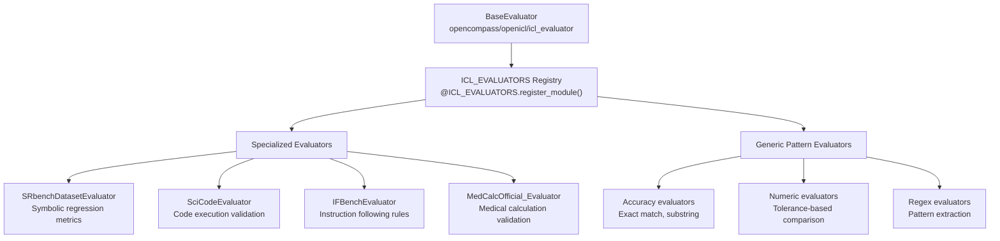
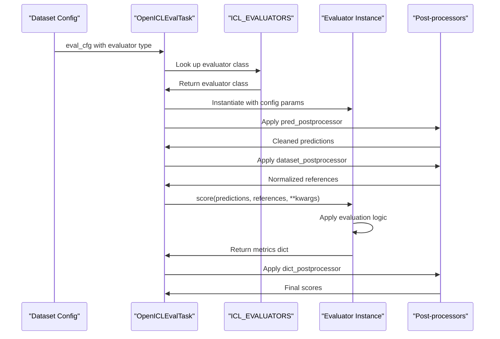
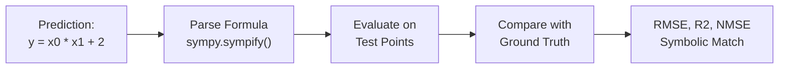
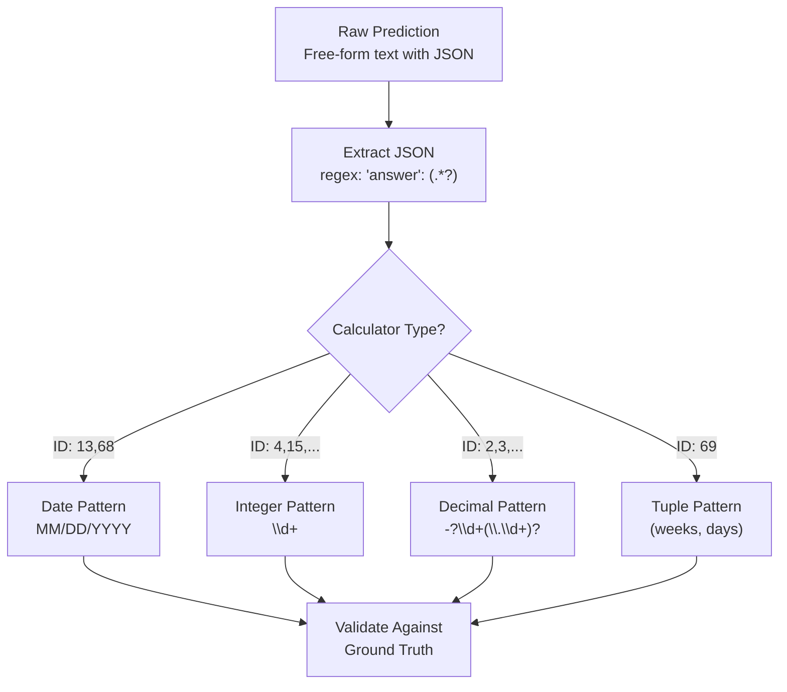
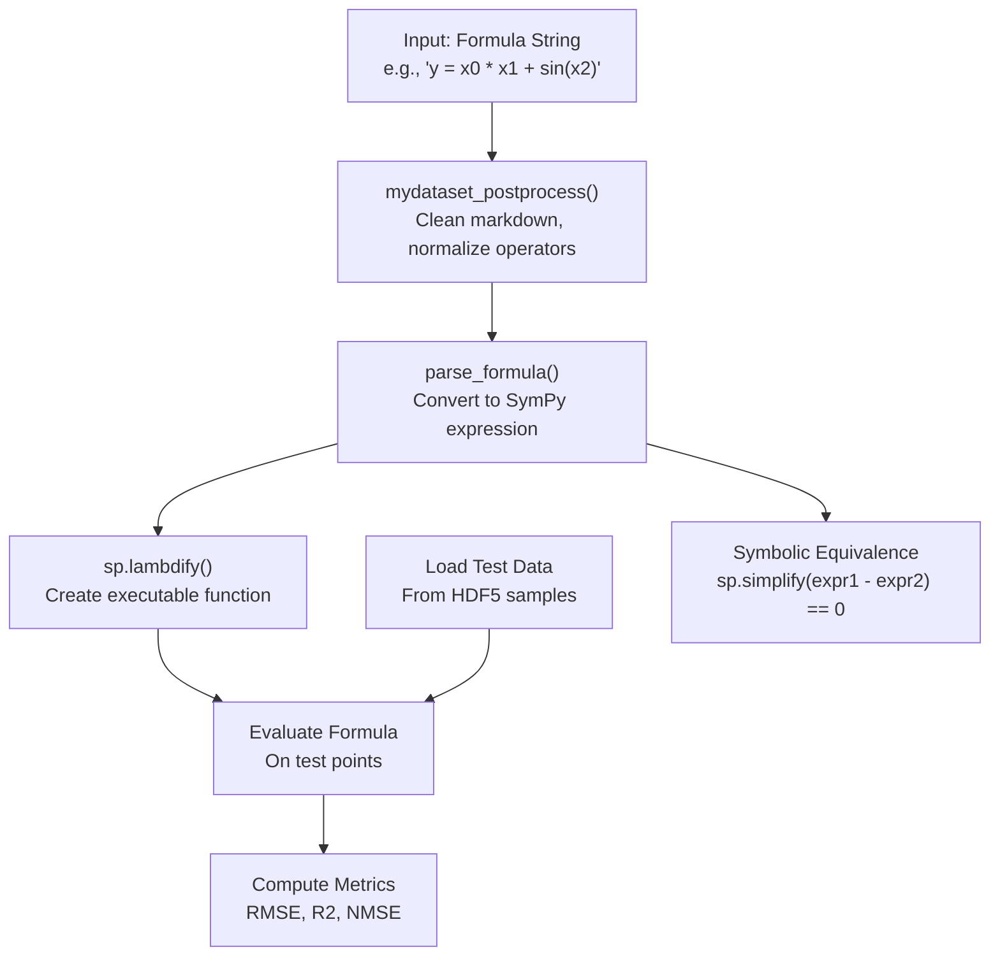
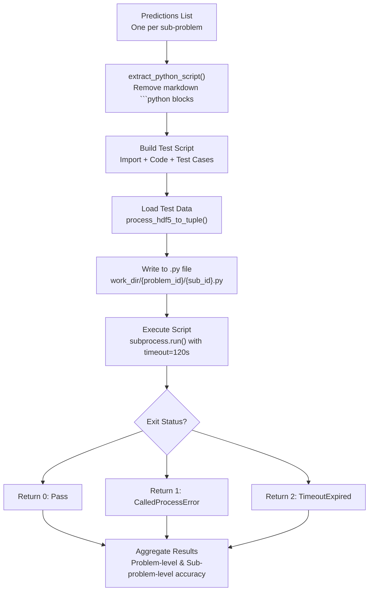
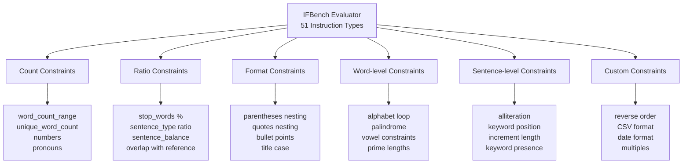
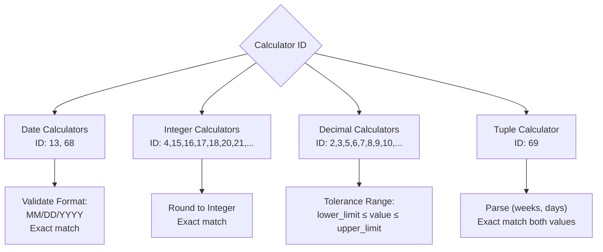
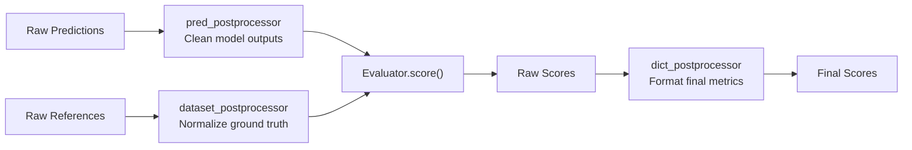
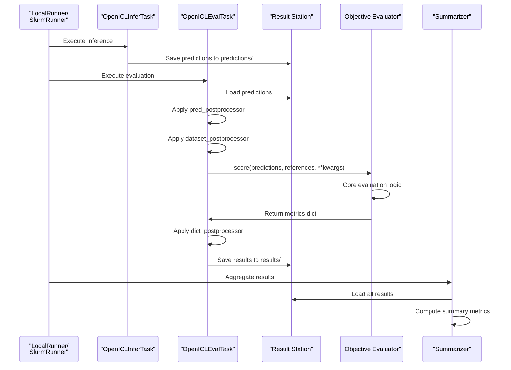

<!-- source: DeepWiki mcp.deepwiki.com · repo open-compass/opencompass · page 6.2 Objective Evaluators · fetched 2026-10-21 -->

# Objective Evaluators

<details>
<summary>Relevant source files</summary>

The following files were used as context for generating this wiki page:

- [dataset-index.yml](dataset-index.yml)
- [opencompass/configs/datasets/IFBench/IFBench_gen.py](opencompass/configs/datasets/IFBench/IFBench_gen.py)
- [opencompass/configs/datasets/MedCalc_Bench/MedCalcBench_official_gen_a5155f.py](opencompass/configs/datasets/MedCalc_Bench/MedCalcBench_official_gen_a5155f.py)
- [opencompass/configs/datasets/srbench/srbench_gen.py](opencompass/configs/datasets/srbench/srbench_gen.py)
- [opencompass/configs/summarizers/groups/biodata.py](opencompass/configs/summarizers/groups/biodata.py)
- [opencompass/datasets/IFBench/evaluation_lib.py](opencompass/datasets/IFBench/evaluation_lib.py)
- [opencompass/datasets/IFBench/ifbench.py](opencompass/datasets/IFBench/ifbench.py)
- [opencompass/datasets/IFBench/instructions.py](opencompass/datasets/IFBench/instructions.py)
- [opencompass/datasets/IFBench/instructions_registry.py](opencompass/datasets/IFBench/instructions_registry.py)
- [opencompass/datasets/IFBench/instructions_util.py](opencompass/datasets/IFBench/instructions_util.py)
- [opencompass/datasets/MedCalc_Bench.py](opencompass/datasets/MedCalc_Bench.py)
- [opencompass/datasets/__init__.py](opencompass/datasets/__init__.py)
- [opencompass/datasets/scicode.py](opencompass/datasets/scicode.py)
- [opencompass/datasets/srbench.py](opencompass/datasets/srbench.py)
- [opencompass/utils/datasets_info.py](opencompass/utils/datasets_info.py)
- [requirements/extra.txt](requirements/extra.txt)

</details>


## Purpose and Scope

Objective evaluators in OpenCompass implement rule-based, deterministic evaluation methods that compare model predictions against ground truth references using predefined metrics and algorithms. These evaluators do not require additional LLM calls for scoring, unlike subjective evaluation methods.

This page covers the architecture, common patterns, and specialized implementations of objective evaluators. For LLM-based evaluation using judge models, see [LLM-as-Judge Evaluation](#6.4). For domain-specific evaluators with complex verification logic, see [Specialized Evaluators](#6.5). For the overall evaluation task execution framework, see [Task Execution Framework](#3.3).

Sources: [opencompass/openicl/icl_evaluator/](opencompass/openicl/icl_evaluator), [opencompass/datasets/](opencompass/datasets)

## Evaluator Architecture

### Base Evaluator Class

All objective evaluators inherit from `BaseEvaluator` and implement a `score` method that takes predictions and references as input and returns a dictionary of metrics.



**Evaluator Registration and Invocation Flow**



Sources: [opencompass/openicl/icl_evaluator/icl_base_evaluator.py](), [opencompass/tasks/openicl_eval.py](), [opencompass/registry.py]()

### Common Evaluator Interface

The standard evaluator interface follows this pattern:

| Method | Purpose | Returns |
|--------|---------|---------|
| `__init__(self, **kwargs)` | Initialize evaluator with configuration parameters | None |
| `score(self, predictions, references, **kwargs)` | Core evaluation logic | `dict` with metric names as keys, scores as values |
| `levenshtein_distance(self, s1, s2)` | Helper for string similarity (optional) | `int` |
| `_post_process(self, text)` | Helper for text normalization (optional) | `str` |

The `score` method must return a dictionary where:
- Keys are metric names (e.g., `'accuracy'`, `'RMSE'`, `'details'`)
- Values are numeric scores or nested structures for detailed results
- A `'details'` key often contains per-sample breakdown

Sources: [opencompass/openicl/icl_evaluator/icl_base_evaluator.py:1-50]()

## Common Evaluation Patterns

### Exact Match Evaluation

The simplest pattern compares predictions to references for exact equality after normalization:

```python
# Pseudo-code pattern
def score(self, predictions, references):
    correct = 0
    for pred, ref in zip(predictions, references):
        if normalize(pred) == normalize(ref):
            correct += 1
    return {'accuracy': 100 * correct / len(predictions)}
```

Common normalizations include:
- Case folding (`lower()`)
- Whitespace stripping
- Punctuation removal
- Answer extraction (removing explanatory text)

### Numeric Tolerance Evaluation

For numeric answers, evaluators often accept values within a tolerance range:

**SRbench Symbolic Regression Example:**



The SRbenchDatasetEvaluator demonstrates this pattern:

- **Parse formula**: Convert string to symbolic expression [opencompass/datasets/srbench.py:98-147]()
- **Generate test data**: Sample points in the domain [opencompass/datasets/srbench.py:149-159]()
- **Compute metrics**: RMSE, R², NMSE with configurable tolerance [opencompass/datasets/srbench.py:228-250]()
- **Symbolic equivalence**: Check mathematical equivalence [opencompass/datasets/srbench.py:161-170]()

Sources: [opencompass/datasets/srbench.py:93-314](), [opencompass/configs/datasets/srbench/srbench_gen.py]()

### Pattern Extraction and Regex Matching

Many evaluators extract specific patterns from free-form text before comparison:

**MedCalc-Bench Answer Extraction:**



Sources: [opencompass/datasets/MedCalc_Bench.py:73-209]()

## Specialized Objective Evaluators

### Symbolic Regression Evaluator (SRbench)

**Purpose**: Evaluate mathematical formula predictions against ground truth using multiple metrics.

**Key Features**:
- Symbolic equivalence checking via SymPy
- Numerical error metrics (RMSE, R², NMSE)
- Robust parsing of formulas with various notations
- Validation on sampled test points

**Metrics Computed**:

| Metric | Description | Range |
|--------|-------------|-------|
| RMSE | Root Mean Squared Error | [0, ∞), lower is better |
| R² | Coefficient of determination | (-∞, 1], 1 is perfect fit |
| NMSE | Normalized Mean Squared Error | [0, ∞), lower is better |
| SymbolicMatch | Exact mathematical equivalence | {True, False} |

**Implementation Details**:



Sources: [opencompass/datasets/srbench.py:93-314](), [opencompass/configs/datasets/srbench/srbench_gen.py:1-57]()

### Code Execution Evaluator (SciCode)

**Purpose**: Verify scientific code generation by executing code and comparing outputs.

**Key Features**:
- Extracts Python code from markdown blocks
- Executes code in isolated environment with timeout
- Compares outputs using specialized comparison functions
- Handles complex data types (sparse matrices, dicts, tuples)

**Evaluation Flow**:



**Data Type Comparison Handlers**:

The evaluator handles multiple scientific data types with specialized comparison logic:

| Type | Comparison Method | Tolerance |
|------|-------------------|-----------|
| `dict` | `are_dicts_close()` - Key and value comparison | atol=1e-8, rtol=1e-5 |
| `scipy.sparse.*` | Convert to dense, `np.allclose()` | Default numpy tolerance |
| `tuple/list` | `cmp_tuple_or_list()` - Element-wise | Recursive with type-specific |
| `numpy.ndarray` | `np.allclose()` | atol=1e-8, rtol=1e-5 |
| `bool` | Exact equality | N/A |
| `sympy.Symbol` | String equality after conversion | N/A |

Sources: [opencompass/datasets/scicode.py:1-364](), [opencompass/datasets/scicode.py:143-216]()

### Instruction Following Evaluator (IFBench)

**Purpose**: Verify that model outputs follow specific structural and stylistic instructions.

**Key Features**:
- 50+ instruction types checking various constraints
- Strict and loose evaluation modes
- Per-instruction and aggregate scoring
- Handles complex formatting requirements

**Instruction Categories**:



**Evaluation Modes**:

1. **Strict Mode**: Response must follow instructions exactly as given
2. **Loose Mode**: Tries removing first/last lines and asterisks before checking

Example instruction check from [opencompass/datasets/IFBench/instructions.py:107-150]():

```python
class WordCountRangeChecker(Instruction):
    def check_following(self, value):
        num_words = instructions_util.count_words(value)
        return self._min_words <= num_words <= self._max_words
```

**Scoring Output**:

The evaluator returns four key metrics:

| Metric | Description |
|--------|-------------|
| Prompt-level-strict-accuracy | % of responses following ALL instructions (strict) |
| Inst-level-strict-accuracy | % of individual instructions followed (strict) |
| Prompt-level-loose-accuracy | % of responses following ALL instructions (loose) |
| Inst-level-loose-accuracy | % of individual instructions followed (loose) |

Sources: [opencompass/datasets/IFBench/ifbench.py:1-80](), [opencompass/datasets/IFBench/instructions.py](), [opencompass/datasets/IFBench/instructions_registry.py:22-81]()

### Medical Calculation Evaluator (MedCalc-Bench)

**Purpose**: Validate medical calculator predictions with calculator-specific extraction and tolerance logic.

**Calculator-Specific Logic**:

Different calculators require different validation approaches:



**Answer Extraction Pipeline**:

The extraction process handles various edge cases and formats [opencompass/datasets/MedCalc_Bench.py:73-209]():

1. **JSON Extraction**: Find last `"answer": <value>` in response
2. **Calculator-specific parsing**:
   - Date: Extract `MM/DD/YYYY` pattern
   - Integer: Handle "X out of Y" and comma-separated lists
   - Decimal: Evaluate `str()` expressions, handle percentages and units
   - Tuple: Parse week/day formats with various delimiters
3. **Validation**: Apply calculator-specific correctness check

Sources: [opencompass/datasets/MedCalc_Bench.py:1-324](), [opencompass/configs/datasets/MedCalc_Bench/MedCalcBench_official_gen_a5155f.py]()

## Post-processing Pipeline

Evaluators work in conjunction with post-processors to clean and normalize data before scoring.

### Post-processor Types



### TEXT_POSTPROCESSORS Registry

Common post-processors are registered in `TEXT_POSTPROCESSORS` registry:

| Postprocessor | Purpose | Example |
|---------------|---------|---------|
| Answer extraction | Extract answer from free-form text | Remove "The answer is: " prefix |
| Normalization | Standardize format | Convert "yes"/"no" to boolean |
| Mathematical | Parse math expressions | LaTeX to plain text |
| Code extraction | Extract code blocks | Remove markdown ``` delimiters |

**SRbench Example**:

The `mydataset_postprocess` function [opencompass/datasets/srbench.py:48-66]() demonstrates a typical post-processor:

```python
def mydataset_postprocess(formula_str):
    # Normalize operators
    formula_str = formula_str.replace('×', '*').replace('·', '*')
    formula_str = formula_str.replace('−', '-').replace('^', '**')
    
    # Remove markdown
    formula_str = formula_str.replace('`', '').replace('$', '').strip()
    
    # Extract first line (remove explanations)
    formula_str = formula_str.split('\n')[0].strip()
    
    # Remove invalid characters
    formula_str = re.sub(r'[^\w\s\+\-\*/\^\=\.\(\)]', '', formula_str)
    
    return formula_str.strip()
```

This is configured in the dataset config [opencompass/configs/datasets/srbench/srbench_gen.py:40-44]():

```python
srbench_eval_cfg = dict(
    evaluator=dict(type=SRbenchDatasetEvaluator, path='opencompass/srbench'),
    pred_postprocessor=dict(type=mydataset_postprocess),
    pred_role='BOT',
)
```

Sources: [opencompass/datasets/srbench.py:48-66](), [opencompass/openicl/icl_evaluator/](), [opencompass/configs/datasets/srbench/srbench_gen.py:40-44]()

## Integration with Evaluation Tasks

Objective evaluators are invoked by `OpenICLEvalTask` after inference completes:

### Evaluation Task Flow



### Configuration Example

A complete evaluation configuration links the dataset, evaluator, and post-processors:

```python
# From opencompass/configs/datasets/srbench/srbench_gen.py
srbench_datasets.append(
    dict(
        abbr='srbench',
        type=SRbenchDataset,
        path='opencompass/srbench',
        reader_cfg=srbench_reader_cfg,
        infer_cfg=srbench_infer_cfg,
        eval_cfg=dict(
            evaluator=dict(
                type=SRbenchDatasetEvaluator,
                path='opencompass/srbench'
            ),
            pred_postprocessor=dict(type=mydataset_postprocess),
            pred_role='BOT',
        ),
    )
)
```

**Key Configuration Parameters**:

| Parameter | Purpose |
|-----------|---------|
| `evaluator.type` | Evaluator class name (must be registered) |
| `evaluator.**kwargs` | Constructor arguments for evaluator |
| `pred_postprocessor` | Function/dict to clean predictions |
| `dataset_postprocessor` | Function/dict to clean references |
| `dict_postprocessor` | Function/dict to format final scores |
| `pred_role` | Role marker for extracting predictions ('BOT'/'ASSISTANT') |

Sources: [opencompass/configs/datasets/srbench/srbench_gen.py:40-56](), [opencompass/tasks/openicl_eval.py]()

## Metric Aggregation and Reporting

Evaluators return detailed results that are aggregated by summarizers for final reporting:

### Result Structure

Evaluators should return a dictionary with this structure:

```python
{
    'accuracy': 95.5,              # Primary metric
    'sub_accuracy': 87.3,          # Secondary metrics
    'mean_RMSE': 0.025,
    'details': [                   # Per-sample breakdown
        {
            'index': 0,
            'prediction': '...',
            'ground_truth': '...',
            'is_correct': True,
            'score': 1.0
        },
        # ... more samples
    ]
}
```

The `details` field enables:
- Error analysis and debugging
- Per-category breakdowns
- Fine-grained metric computation
- Result visualization

### Metric Types

| Category | Examples | Typical Range |
|----------|----------|---------------|
| **Accuracy** | accuracy, exact_match, strict_acc | [0, 100]% |
| **Error Metrics** | RMSE, MAE, MSE | [0, ∞), lower is better |
| **Correlation** | R², Pearson, Spearman | [-1, 1], 1 is perfect |
| **Binary** | precision, recall, F1 | [0, 1] or [0, 100]% |
| **Custom** | SymbolicMatch, valid_parse_rate | Domain-specific |

Sources: [opencompass/datasets/srbench.py:172-313](), [opencompass/datasets/scicode.py:359-363](), [opencompass/datasets/IFBench/ifbench.py:63-79]()

---

