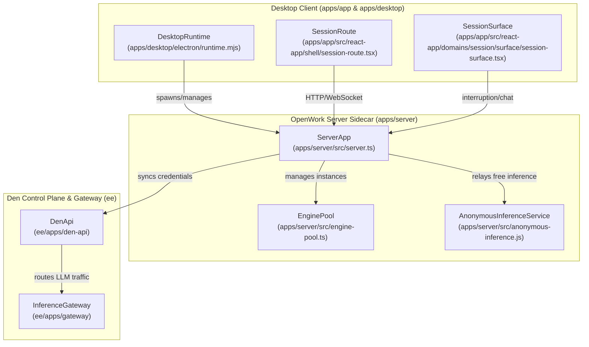

<!-- source: DeepWiki mcp.deepwiki.com · repo different-ai/openwork · page 1.2 System Architecture · fetched 2026-10-26 -->

# System Architecture

Relevant source files

The following files were used as context for generating this wiki page:

- [.github/workflows/ci-tests.yml](.github/workflows/ci-tests.yml)
- [AGENTS.md](AGENTS.md)
- [README.md](README.md)
- [TRANSLATIONS.md](TRANSLATIONS.md)
- [apps/app/src/app/lib/diagnostics-bundle.ts](apps/app/src/app/lib/diagnostics-bundle.ts)
- [apps/app/src/app/lib/openwork-server.ts](apps/app/src/app/lib/openwork-server.ts)
- [apps/app/src/components/chat/message-list-provider.tsx](apps/app/src/components/chat/message-list-provider.tsx)
- [apps/app/src/components/chat/message-list.tsx](apps/app/src/components/chat/message-list.tsx)
- [apps/app/src/i18n/locales/en.ts](apps/app/src/i18n/locales/en.ts)
- [apps/app/src/react-app/domains/connections/openwork-server-store.ts](apps/app/src/react-app/domains/connections/openwork-server-store.ts)
- [apps/app/src/react-app/domains/connections/provider-auth/store.ts](apps/app/src/react-app/domains/connections/provider-auth/store.ts)
- [apps/app/src/react-app/domains/session/chat/session-page.tsx](apps/app/src/react-app/domains/session/chat/session-page.tsx)
- [apps/app/src/react-app/domains/session/sidebar/app-sidebar-provider.tsx](apps/app/src/react-app/domains/session/sidebar/app-sidebar-provider.tsx)
- [apps/app/src/react-app/domains/session/sidebar/app-sidebar.tsx](apps/app/src/react-app/domains/session/sidebar/app-sidebar.tsx)
- [apps/app/src/react-app/domains/session/sidebar/utils.ts](apps/app/src/react-app/domains/session/sidebar/utils.ts)
- [apps/app/src/react-app/domains/session/status/session-activity-store.ts](apps/app/src/react-app/domains/session/status/session-activity-store.ts)
- [apps/app/src/react-app/domains/session/status/session-attention.ts](apps/app/src/react-app/domains/session/status/session-attention.ts)
- [apps/app/src/react-app/domains/session/surface/session-render-state.ts](apps/app/src/react-app/domains/session/surface/session-render-state.ts)
- [apps/app/src/react-app/domains/session/surface/session-surface.tsx](apps/app/src/react-app/domains/session/surface/session-surface.tsx)
- [apps/app/src/react-app/domains/session/sync/message-merge.ts](apps/app/src/react-app/domains/session/sync/message-merge.ts)
- [apps/app/src/react-app/domains/session/sync/session-sync.ts](apps/app/src/react-app/domains/session/sync/session-sync.ts)
- [apps/app/src/react-app/domains/session/sync/transcript-reconcile.ts](apps/app/src/react-app/domains/session/sync/transcript-reconcile.ts)
- [apps/app/src/react-app/domains/session/sync/use-session-interactions.ts](apps/app/src/react-app/domains/session/sync/use-session-interactions.ts)
- [apps/app/src/react-app/domains/session/sync/usechat-adapter.ts](apps/app/src/react-app/domains/session/sync/usechat-adapter.ts)
- [apps/app/src/react-app/shell/desktop-runtime-boot.ts](apps/app/src/react-app/shell/desktop-runtime-boot.ts)
- [apps/app/src/react-app/shell/engine-reload-escalation.ts](apps/app/src/react-app/shell/engine-reload-escalation.ts)
- [apps/app/src/react-app/shell/session-route.tsx](apps/app/src/react-app/shell/session-route.tsx)
- [apps/app/src/react-app/shell/settings-route.tsx](apps/app/src/react-app/shell/settings-route.tsx)
- [apps/desktop/electron/runtime.mjs](apps/desktop/electron/runtime.mjs)
- [apps/desktop/electron/startup-log.mjs](apps/desktop/electron/startup-log.mjs)
- [apps/desktop/electron/windows-shortcut.mjs](apps/desktop/electron/windows-shortcut.mjs)
- [apps/server/src/cli.ts](apps/server/src/cli.ts)
- [apps/server/src/embedded.ts](apps/server/src/embedded.ts)
- [apps/server/src/managed-opencode.ts](apps/server/src/managed-opencode.ts)
- [apps/server/src/openwork-extensions-plugin-path.ts](apps/server/src/openwork-extensions-plugin-path.ts)
- [apps/server/src/openwork-runtime-config.ts](apps/server/src/openwork-runtime-config.ts)
- [apps/server/src/selfhost-web.ts](apps/server/src/selfhost-web.ts)
- [apps/server/src/server.ts](apps/server/src/server.ts)
- [apps/server/src/workspace-init.ts](apps/server/src/workspace-init.ts)
- [apps/server/test/archive-extraction.test.ts](apps/server/test/archive-extraction.test.ts)
- [apps/server/test/opencode-plugin-deps.test.ts](apps/server/test/opencode-plugin-deps.test.ts)
- [ee/apps/den-worker-runtime/Dockerfile.daytona-snapshot](ee/apps/den-worker-runtime/Dockerfile.daytona-snapshot)
- [evals/README.md](evals/README.md)
- [package.json](package.json)
- [packaging/docker/Dockerfile.microsandbox](packaging/docker/Dockerfile.microsandbox)
- [translated_readmes/README.md](translated_readmes/README.md)
- [translated_readmes/README_JA.md](translated_readmes/README_JA.md)
- [translated_readmes/README_ZH.md](translated_readmes/README_ZH.md)
- [translated_readmes/README_ZH_hk.md](translated_readmes/README_ZH_hk.md)

## Purpose and Scope

This document describes the high-level architecture of the OpenWork system, including its core components, communication patterns, and deployment modes. OpenWork is a collaborative AI workspace system built around the OpenCode AI engine, providing desktop, server, and cloud deployment options with support for team collaboration and external integrations.

OpenWork is designed as a practical control surface for agentic work, emphasizing a **local-first, cloud-ready** philosophy [AGENTS.md:17-17](). It follows a **server-consumption-first** approach, where the application acts as a client to the OpenWork server API surface [AGENTS.md:18-18]().

---

## Component Architecture and Interaction Topology

The OpenWork system comprises five major runtime layers: the Desktop shell (`apps/desktop`), the OpenWork server sidecar (`apps/server`), the OpenCode AI engine, the Den control plane (`ee/apps/den-api`), and the Inference Gateway (`ee/apps/gateway`). 

The following diagram bridges natural language descriptions with actual code entities across these layers:

Title: OpenWork Component Interaction Topology

**Sources:** [apps/app/src/react-app/shell/session-route.tsx:1-4370](), [apps/app/src/react-app/domains/session/surface/session-surface.tsx:1-3781](), [apps/server/src/server.ts:1-6729](), [apps/desktop/electron/runtime.mjs:1-202]()

---

## Core Components and Implementation Details

### OpenCode Engine and Engine Pool
The OpenCode Engine serves as the underlying AI execution backend, managing tool calls (filesystem, terminal, browser) and model inference streams. The OpenWork server interacts with instances dynamically through `EnginePool` [apps/server/src/server.ts:18-30]().

- **Instance Management:** The `EnginePool` handles process spawning, standby pools, and event proxy leases [apps/server/src/engine-pool.ts]() embedded within `apps/server`.
- **Migration & Adapters:** Supports transition adapters for OpenCode v1 and v2 session architectures, ensuring transcript continuity across engine upgrades [apps/app/src/app/lib/openwork-server.ts:81-126]().

**Sources:** [apps/server/src/server.ts:18-30](), [apps/app/src/app/lib/openwork-server.ts:81-126]()

### OpenWork Desktop
Built as an Electron shell (`apps/desktop`) wrapping a React Vite frontend (`apps/app`), the desktop client acts as the primary user interface. 

- **Runtime Supervision:** The desktop runtime bootstrap `apps/desktop/electron/runtime.mjs` manages local process lifecycles, assigning dynamic loopback ports for local instances.
- **Routing & Synchronization:** The React application manages workspace state (`SessionRoute` in `apps/app/src/react-app/shell/session-route.tsx`) and real-time chat synchronization (`SessionSurface` in `apps/app/src/react-app/domains/session/surface/session-surface.tsx`).

**Sources:** [apps/app/src/react-app/shell/session-route.tsx:1-135](), [apps/app/src/react-app/domains/session/surface/session-surface.tsx:1-113](), [apps/desktop/electron/runtime.mjs:1-202]()

### OpenWork Server Sidecar
The Node.js HTTP service in `apps/server` fronts the OpenCode engine, exposing core API endpoints for workspaces, files, skills, and plugins [apps/server/src/server.ts:105-113]().

- **Route Registry:** Core routes are registered in `server.ts` via modular handlers (`registerCoreRoutes`, `registerFileRoutes`, `registerWorkspaceRoutes`, etc.) [apps/server/src/server.ts:105-113]().
- **Free Auto Inference Relay:** Implements anonymous inference routing via `AnonymousInferenceService`, managing desktop free access proofs and relay credentials [apps/server/src/server.ts:93-93]().

**Sources:** [apps/server/src/server.ts:93-113]()

### Den Control Plane and Inference Gateway
The enterprise control plane (`ee/apps/den-api`) and Inference Gateway (`ee/apps/gateway`) govern multi-tenant organizations, authentication, billing, and LLM provider credentials [ee/apps/den-api]().

- **Authentication:** Integrates Better Auth for session management, API keys, and bearer tokens [ee/apps/den-api]().
- **Cloud Worker Provisioning:** Manages cloud-hosted Daytona workspaces and provider materialization.

**Sources:** [ee/apps/den-api]()

---

## Runtime Modes

OpenWork supports three primary ways to deploy and consume the stack:

| Mode | Description | Persistence & Execution |
| :--- | :--- | :--- |
| **Host mode (Local)** | Runs the OpenCode host stack locally. OpenWork spawns `opencode` and `openwork-server` on the user's machine [AGENTS.md:17-17](). | Managed by the desktop app or orchestrator CLI. |
| **Client mode (Remote)** | Connects the UI to an existing OpenWork server URL [AGENTS.md:13-13](). | Persistence is handled entirely by the remote host server. |
| **Hosted Cloud (Den)** | Uses OpenWork Cloud workers launched from the web app [AGENTS.md:13-13](). | Managed by the Den cloud infrastructure and workers. |

**Sources:** [AGENTS.md:13-17](), [apps/desktop/electron/runtime.mjs:1-202]()

---

## Filesystem and Configuration Policy

OpenWork maintains strict isolation between user files, workspace configurations, and private credentials.

### Workspace Initialization
When a workspace is created or opened, the server runs initialization routines (`ensureWorkspaceFiles`) which provision the base directory structure and verify `opencode.json` configuration blocks [apps/server/src/workspace-init.ts:81-81]().

### Runtime Injection
Rather than mutating user-managed files on disk directly, OpenWork overlays dynamic runtime settings. The server constructs effective configurations by merging user presets with runtime environment variables and system instructions [apps/server/src/openwork-runtime-config.ts]().

**Sources:** [apps/server/src/workspace-init.ts:81-81](), [apps/server/src/openwork-runtime-config.ts]()

---

## Design Principles

### Memory Management
OpenWork separates agent memory into two distinct classifications:
1. **Behavior Memory:** Shareable assets stored in version-controlled directories (`.opencode/skills`, `.opencode/agents`).
2. **Private Memory:** Local session logs, authorization tokens, and credentials that are never committed or synchronized externally.

### Server-Consumption First
All application surfaces (Desktop UI, CLI tools, and mobile/web clients) act as consumers of the unified `openwork-server` API [AGENTS.md:18-18](). This ensures consistent enforcement of permissions, MCP management, and session handling across all deployment targets.

**Sources:** [AGENTS.md:18-18](), [apps/server/src/openwork-runtime-config.ts]()

---

