# Page: Overview

# Overview

<details>
<summary>Relevant source files</summary>

The following files were used as context for generating this wiki page:

- [.github/workflows/ci-tests.yml](.github/workflows/ci-tests.yml)
- [.opencode/opencode.json](.opencode/opencode.json)
- [AGENTS.md](AGENTS.md)
- [README.md](README.md)
- [TRANSLATIONS.md](TRANSLATIONS.md)
- [apps/app/package.json](apps/app/package.json)
- [apps/desktop/package.json](apps/desktop/package.json)
- [apps/server/package.json](apps/server/package.json)
- [constants.json](constants.json)
- [ee/apps/den-api/src/generated/desktop-versions.ts](ee/apps/den-api/src/generated/desktop-versions.ts)
- [evals/README.md](evals/README.md)
- [package.json](package.json)
- [pnpm-lock.yaml](pnpm-lock.yaml)
- [translated_readmes/README.md](translated_readmes/README.md)
- [translated_readmes/README_JA.md](translated_readmes/README_JA.md)
- [translated_readmes/README_ZH.md](translated_readmes/README_ZH.md)
- [translated_readmes/README_ZH_hk.md](translated_readmes/README_ZH_hk.md)

</details>


OpenWork is a local-first AI agent workspace combining a desktop client (`apps/desktop`), a filesystem-backed server (`apps/server`), and the Den enterprise control plane (`ee/`) for managing **OpenCode**, an open-source AI agent platform [README.md:1-3](), [AGENTS.md:5-20](). It provides an extensible alternative to proprietary workspaces like Claude Cowork and Codex, allowing users to run agents locally on their own files or orchestrate them across cloud infrastructure [README.md:1-12]().

**Repository**: https://github.com/different-ai/openwork  
**License**: MIT (Core platform and desktop app) [README.md:96](), Source-Available (Den enterprise under `ee/`) [README.md:97]()

For detailed specifications, navigate to the child pages:
- For layout and monorepo packages, see [Repository Structure](#1.1).
- For runtime mechanics, filesystem policies, and engine orchestration, see [System Architecture](#1.2).
- For a component-to-directory index, see [Glossary of Components](#1.3).

---

## Runtime Shapes

OpenWork operates in three primary runtime configurations, bridging natural language workflows to specific entry points in the codebase:

Diagram: Runtime Deployment Shapes to Code Entites
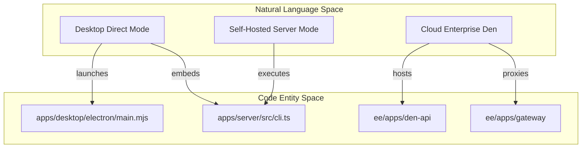

1. **Desktop Direct**: The local-first desktop application combining an Electron shell (`apps/desktop`) and a React frontend (`apps/app`) [apps/desktop/package.json:1-12](), [apps/app/package.json:1-10](), running an embedded server sidecar that interacts directly with local files.
2. **Self-Hosted**: Running the `openwork-server` package (`apps/server`) as a standalone HTTP/CLI service on trusted remote infrastructure or local servers [apps/server/package.json:4-8]().
3. **Cloud Enterprise (Den)**: Scalable multi-tenant cloud operations utilizing the Den control plane (`ee/apps/den-api`), the dashboard (`ee/apps/den-web`), and the Inference Gateway (`ee/apps/gateway`) [AGENTS.md:12-20]().

Sources: [README.md:1-12](), [AGENTS.md:5-20](), [apps/desktop/package.json:1-12](), [apps/server/package.json:4-8]()

---

## High-Level Architecture

OpenWork separates the client user interface from the underlying execution engine and server sidecar, adhering to a **server-consumption-first** design principle [AGENTS.md:21-23]().

Diagram: High-Level Architecture Mapping
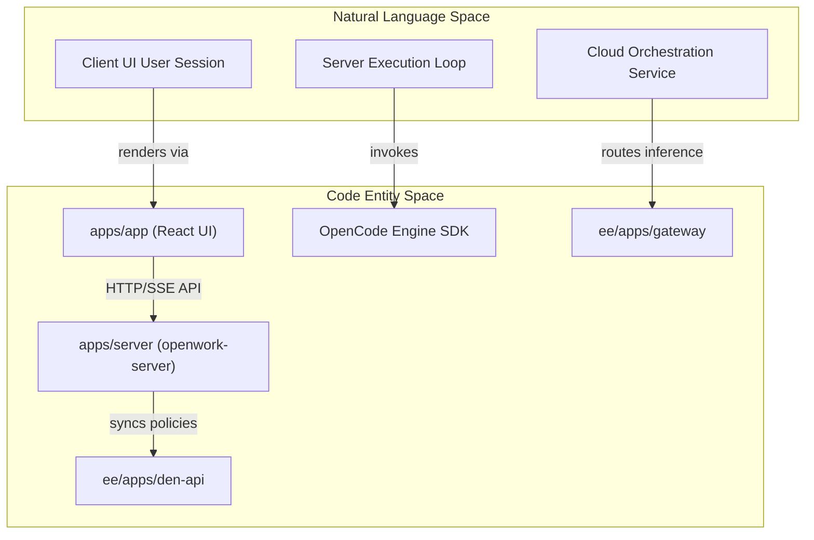

For a comprehensive breakdown of component interaction, filesystem mutation policies, and IPC bridges, see [System Architecture](#1.2).

Sources: [AGENTS.md:21-23](), [apps/desktop/package.json:11-26](), [apps/server/package.json:4-10]()

---

## Child Pages Navigation

- **[Repository Structure](#1.1)**: Detailed monorepo layout mapping `apps/`, `ee/apps/`, `packages/`, `evals/`, `worlds/`, and `infra/`.
- **[System Architecture](#1.2)**: Deep dive into the Electron shell, server sidecar, OpenCode engine integration, and filesystem security boundaries.
- **[Glossary of Components](#1.3)**: Comprehensive directory-to-role reference map for all deployable packages and applications.

Sources: [README.md:132-138]()

---

# Page: Repository Structure

# Repository Structure

<details>
<summary>Relevant source files</summary>

The following files were used as context for generating this wiki page:

- [.github/workflows/ci-tests.yml](.github/workflows/ci-tests.yml)
- [.opencode/opencode.json](.opencode/opencode.json)
- [AGENTS.md](AGENTS.md)
- [README.md](README.md)
- [TRANSLATIONS.md](TRANSLATIONS.md)
- [apps/app/package.json](apps/app/package.json)
- [apps/desktop/package.json](apps/desktop/package.json)
- [apps/server/package.json](apps/server/package.json)
- [constants.json](constants.json)
- [ee/apps/den-api/src/generated/desktop-versions.ts](ee/apps/den-api/src/generated/desktop-versions.ts)
- [ee/apps/den-api/src/mcp/admin-query-limit.ts](ee/apps/den-api/src/mcp/admin-query-limit.ts)
- [ee/apps/den-api/src/mcp/admin-tools.ts](ee/apps/den-api/src/mcp/admin-tools.ts)
- [ee/apps/den-api/src/routes/org/index.ts](ee/apps/den-api/src/routes/org/index.ts)
- [ee/apps/den-api/test/admin-query-limit.test.ts](ee/apps/den-api/test/admin-query-limit.test.ts)
- [ee/packages/den-admin-mcp/README.md](ee/packages/den-admin-mcp/README.md)
- [ee/packages/den-admin-mcp/index.mjs](ee/packages/den-admin-mcp/index.mjs)
- [ee/packages/den-admin-mcp/package.json](ee/packages/den-admin-mcp/package.json)
- [ee/packages/den-admin-mcp/scripts/smoke.mjs](ee/packages/den-admin-mcp/scripts/smoke.mjs)
- [ee/packages/den-db/drizzle/meta/_journal.json](ee/packages/den-db/drizzle/meta/_journal.json)
- [ee/packages/den-db/package.json](ee/packages/den-db/package.json)
- [ee/packages/den-db/src/schema/index.ts](ee/packages/den-db/src/schema/index.ts)
- [ee/packages/den-db/tsup.config.ts](ee/packages/den-db/tsup.config.ts)
- [ee/packages/utils/src/typeid.ts](ee/packages/utils/src/typeid.ts)
- [evals/README.md](evals/README.md)
- [package.json](package.json)
- [pnpm-lock.yaml](pnpm-lock.yaml)
- [pnpm-workspace.yaml](pnpm-workspace.yaml)
- [translated_readmes/README.md](translated_readmes/README.md)
- [translated_readmes/README_JA.md](translated_readmes/README_JA.md)
- [translated_readmes/README_ZH.md](translated_readmes/README_ZH.md)
- [translated_readmes/README_ZH_hk.md](translated_readmes/README_ZH_hk.md)

</details>


## Purpose and Scope

This document describes the physical organization of the OpenWork monorepo, detailing the directory layout, package boundaries, and dependency management strategy using `pnpm` workspaces [pnpm-workspace.yaml:19-24](). OpenWork is structured as a modular monorepo containing client applications, local servers, enterprise control planes, evaluation suites, integration definitions, and shared core packages.

Sources: [pnpm-workspace.yaml:19-24]()

## Monorepo Layout

The OpenWork repository is organized as a workspace monorepo [pnpm-workspace.yaml:19-24]() divided into user-facing applications, enterprise services, shared utility packages, evaluation harness tools, operational scripts, scenarios, examples, integrations, and workspace patches.

```text
openwork/
├── apps/
│   ├── app/              # @openwork/app (React Frontend UI)
│   ├── desktop/          # @openwork/desktop (Electron native shell)
│   ├── server/           # openwork-server (Filesystem-backed API)
│   └── review/           # @openwork/review (Evidence review viewer)
├── ee/                   # Enterprise Edition components
│   ├── apps/
│   │   ├── den-api/      # Control plane API service (@openwork-ee/den-api)
│   │   ├── den-web/      # Cloud frontend dashboard (@openwork-ee/den-web)
│   │   ├── gateway/      # Inference & model routing gateway
│   │   ├── den-gateway/  # Edge gateway routing
│   │   ├── landing/      # Marketing site (openworklabs.com)
│   │   ├── headless-runner/ # Cheap headless agent sessions (@openwork-ee/headless-runner)
│   │   ├── workbot/      # Slack and chat assistant integration
│   │   └── diagnostics/  # Enterprise diagnostic bundle runner
│   └── packages/
│       ├── den-db/       # Shared database layer (@openwork-ee/den-db)
│       ├── utils/        # Shared enterprise utilities (@openwork-ee/utils)
│       └── telemetry/    # Telemetry contracts (@openwork-ee/telemetry)
├── packages/
│   ├── types/            # Unified TypeScript definitions (@openwork/types)
│   ├── sdk/              # Client SDK
│   ├── docs/             # Mintlify documentation site
│   ├── ui/               # Shared React component library (@openwork/ui)
│   ├── features/         # Feature flag registry (@openwork/features)
│   ├── free-auto/        # Free inference relay and proof-of-work
│   ├── codemode/         # Codemode tools and namespaces
│   ├── freestyle/        # Freestyle UI builders
│   ├── world/            # Scripted preview worlds
│   └── mcp-apps/         # MCP applications and dashboards
├── evals/                # End-to-end evaluation harness and test kits
├── worlds/               # Fixtures and scenario worlds
├── infra/                # Terraform modules and cloud infrastructure
├── packaging/            # Dockerfiles, Helm charts, and build packaging
├── scripts/              # Global build, check, and release automation
├── scenarios/            # Automated test scenario definitions
├── examples/             # Reference implementation templates and examples
├── integrations/         # Third-party integration modules and handlers
├── patches/              # Pnpm package patch files for upstream dependencies
├── package.json          # Root workspace configuration and scripts
└── pnpm-workspace.yaml   # Workspace path configuration
```

Sources: [pnpm-workspace.yaml:19-24](), [apps/app/package.json:2-5](), [apps/desktop/package.json:2-11](), [apps/server/package.json:2-8]()

## Component Architecture and Code Mapping

The following diagram bridges natural language system concepts to their concrete code entities within the monorepo structure.

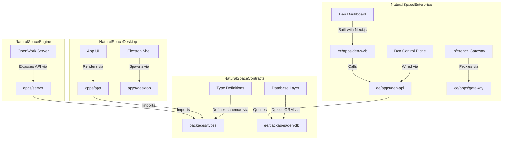

Sources: [apps/app/package.json:34-89](), [apps/desktop/package.json:29-57](), [apps/server/package.json:55-74](), [ee/packages/den-db/package.json:1-15]()

## Detailed Directory Breakdown

### Apps (`apps/` and `ee/apps/`)
- **`apps/app/`**: The primary React frontend (`@openwork/app`), built with Vite and TailwindCSS, managing message rendering, lexical composer, and tool approvals [apps/app/package.json:2-102]().
- **`apps/desktop/`**: The Electron native shell (`@openwork/desktop`) providing window management, IPC bridges, auto-updater integration, and sidecar execution [apps/desktop/package.json:2-65]().
- **`apps/server/`**: The local filesystem-backed API (`openwork-server`) powered by Bun, wrapping the OpenCode engine and executing plugins [apps/server/package.json:2-91]().
- **`ee/apps/den-api/`**: The enterprise control plane API (`@openwork-ee/den-api`) built on Hono and Better Auth, handling orgs, RBAC, billing, and worker lifecycle [ee/apps/den-api/package.json:1-50]().
- **`ee/apps/den-web/`**: The Next.js control plane dashboard (`@openwork-ee/den-web`) for managing organization settings, billing, and MCP OAuth connections [ee/apps/den-web/package.json:1-35]().

Sources: [apps/app/package.json:2-102](), [apps/desktop/package.json:2-65](), [apps/server/package.json:2-91]()

### Shared and Enterprise Packages (`packages/` and `ee/packages/`)
- **`packages/types/`**: Unified TypeScript data contracts, desktop IPC maps, and OpenWork affordances (`@openwork/types`) [packages/types/package.json:1-50]().
- **`ee/packages/den-db/`**: Shared Drizzle ORM schema, migration journal, and encryption routines for enterprise storage [ee/packages/den-db/drizzle/meta/_journal.json:1-15]().
- **`packages/features/`**: Feature flag registry and rollout evaluation logic.
- **`packages/free-auto/`**: Anonymous inference relay, proof-of-work generation, and activation windows.

Sources: [pnpm-workspace.yaml:19-24](), [ee/packages/den-db/drizzle/meta/_journal.json:1-15]()

### Operational, Evaluation, and Support Directories
- **`evals/`**: End-to-end evaluation harness (`@openwork/evals`), test specs, and driver binaries [evals/README.md:1-25]().
- **`worlds/`**: Scenario definition fixtures used by the test runner.
- **`infra/`**: Terraform modules (e.g., AWS ECS deployment architectures).
- **`packaging/`**: Dockerfiles, Helm charts (`openwork-ee`), and installer configurations.
- **`scripts/`**: Global maintenance, release, and build automation scripts [package.json:8-71]().
- **`scenarios/`**: Automated scenario verification configurations and test cases.
- **`examples/`**: Reference code snippets and integration templates.
- **`integrations/`**: Third-party bridge implementations and connectors.
- **`patches/`**: Package patches applied during dependency installation via `pnpm` [pnpm-workspace.yaml:149-154]().

Sources: [evals/README.md:1-25](), [package.json:8-71](), [pnpm-workspace.yaml:149-154]()

## Dependency Management and Build Topology

The repository relies on `pnpm` workspace settings to enforce package isolation and dependency hoisting rules [pnpm-workspace.yaml:19-34](). 

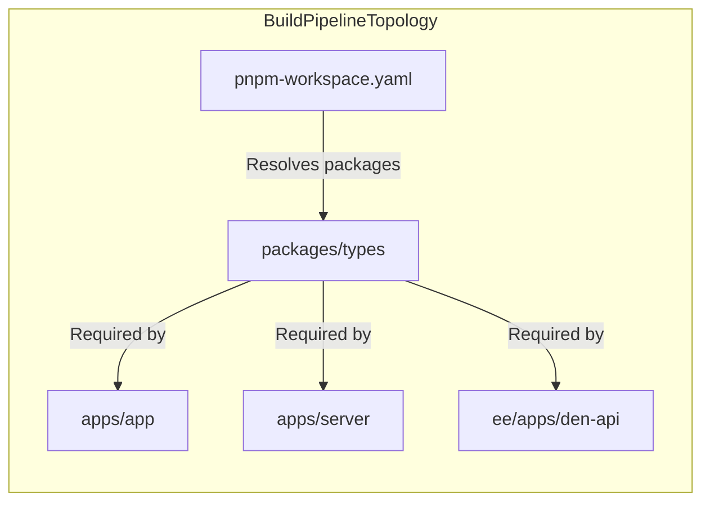

Sources: [pnpm-workspace.yaml:19-34](), [apps/app/package.json:51](), [apps/server/package.json:62]()

## Data Flow and Communication Matrix

| Source Entity | Destination Entity | Protocol | Description |
| :--- | :--- | :--- | :--- |
| **`@openwork/app`** [apps/app/package.json:2-5]() | **`openwork-server`** [apps/server/package.json:2-5]() | HTTP / SSE | Frontend issues prompts and consumes real-time telemetry via SDK [apps/app/package.json:47]() |
| **`openwork-server`** [apps/server/package.json:2-5]() | **OpenCode Engine** | Stdin / Stdout | Server provisions and communicates with the underlying execution engine [apps/server/package.json:4-8]() |
| **`@openwork/desktop`** [apps/desktop/package.json:2-5]() | **Sidecar Binaries** | IPC / Process | Electron shell manages lifecycle of embedded server and orchestrators [apps/desktop/package.json:11-27]() |
| **`den-web`** [ee/apps/den-web/package.json:2-5]() | **`den-api`** [ee/apps/den-api/package.json:2-5]() | HTTP | Dashboard administrative app requests control plane mutations |
| **`den-api`** [ee/apps/den-api/package.json:2-5]() | **`gateway`** [ee/apps/gateway/] | HTTP | Control plane proxies model inference requests to the managed gateway |

Sources: [apps/app/package.json:47](), [apps/server/package.json:4-8](), [apps/desktop/package.json:11-27](), [ee/apps/den-api/package.json:1-10]()

---

# Page: System Architecture

# System Architecture

<details>
<summary>Relevant source files</summary>

The following files were used as context for generating this wiki page:

- [.github/workflows/ci-tests.yml](.github/workflows/ci-tests.yml)
- [AGENTS.md](AGENTS.md)
- [README.md](README.md)
- [TRANSLATIONS.md](TRANSLATIONS.md)
- [apps/app/src/app/lib/diagnostics-bundle.ts](apps/app/src/app/lib/diagnostics-bundle.ts)
- [apps/app/src/app/lib/openwork-server.ts](apps/app/src/app/lib/openwork-server.ts)
- [apps/app/src/components/chat/message-list-provider.tsx](apps/app/src/components/chat/message-list-provider.tsx)
- [apps/app/src/components/chat/message-list.tsx](apps/app/src/components/chat/message-list.tsx)
- [apps/app/src/i18n/locales/en.ts](apps/app/src/i18n/locales/en.ts)
- [apps/app/src/react-app/domains/connections/openwork-server-store.ts](apps/app/src/react-app/domains/connections/openwork-server-store.ts)
- [apps/app/src/react-app/domains/connections/provider-auth/store.ts](apps/app/src/react-app/domains/connections/provider-auth/store.ts)
- [apps/app/src/react-app/domains/session/chat/session-page.tsx](apps/app/src/react-app/domains/session/chat/session-page.tsx)
- [apps/app/src/react-app/domains/session/sidebar/app-sidebar-provider.tsx](apps/app/src/react-app/domains/session/sidebar/app-sidebar-provider.tsx)
- [apps/app/src/react-app/domains/session/sidebar/app-sidebar.tsx](apps/app/src/react-app/domains/session/sidebar/app-sidebar.tsx)
- [apps/app/src/react-app/domains/session/sidebar/utils.ts](apps/app/src/react-app/domains/session/sidebar/utils.ts)
- [apps/app/src/react-app/domains/session/status/session-activity-store.ts](apps/app/src/react-app/domains/session/status/session-activity-store.ts)
- [apps/app/src/react-app/domains/session/status/session-attention.ts](apps/app/src/react-app/domains/session/status/session-attention.ts)
- [apps/app/src/react-app/domains/session/surface/session-render-state.ts](apps/app/src/react-app/domains/session/surface/session-render-state.ts)
- [apps/app/src/react-app/domains/session/surface/session-surface.tsx](apps/app/src/react-app/domains/session/surface/session-surface.tsx)
- [apps/app/src/react-app/domains/session/sync/message-merge.ts](apps/app/src/react-app/domains/session/sync/message-merge.ts)
- [apps/app/src/react-app/domains/session/sync/session-sync.ts](apps/app/src/react-app/domains/session/sync/session-sync.ts)
- [apps/app/src/react-app/domains/session/sync/transcript-reconcile.ts](apps/app/src/react-app/domains/session/sync/transcript-reconcile.ts)
- [apps/app/src/react-app/domains/session/sync/use-session-interactions.ts](apps/app/src/react-app/domains/session/sync/use-session-interactions.ts)
- [apps/app/src/react-app/domains/session/sync/usechat-adapter.ts](apps/app/src/react-app/domains/session/sync/usechat-adapter.ts)
- [apps/app/src/react-app/shell/desktop-runtime-boot.ts](apps/app/src/react-app/shell/desktop-runtime-boot.ts)
- [apps/app/src/react-app/shell/engine-reload-escalation.ts](apps/app/src/react-app/shell/engine-reload-escalation.ts)
- [apps/app/src/react-app/shell/session-route.tsx](apps/app/src/react-app/shell/session-route.tsx)
- [apps/app/src/react-app/shell/settings-route.tsx](apps/app/src/react-app/shell/settings-route.tsx)
- [apps/desktop/electron/runtime.mjs](apps/desktop/electron/runtime.mjs)
- [apps/desktop/electron/startup-log.mjs](apps/desktop/electron/startup-log.mjs)
- [apps/desktop/electron/windows-shortcut.mjs](apps/desktop/electron/windows-shortcut.mjs)
- [apps/server/src/cli.ts](apps/server/src/cli.ts)
- [apps/server/src/embedded.ts](apps/server/src/embedded.ts)
- [apps/server/src/managed-opencode.ts](apps/server/src/managed-opencode.ts)
- [apps/server/src/openwork-extensions-plugin-path.ts](apps/server/src/openwork-extensions-plugin-path.ts)
- [apps/server/src/openwork-runtime-config.ts](apps/server/src/openwork-runtime-config.ts)
- [apps/server/src/selfhost-web.ts](apps/server/src/selfhost-web.ts)
- [apps/server/src/server.ts](apps/server/src/server.ts)
- [apps/server/src/workspace-init.ts](apps/server/src/workspace-init.ts)
- [apps/server/test/archive-extraction.test.ts](apps/server/test/archive-extraction.test.ts)
- [apps/server/test/opencode-plugin-deps.test.ts](apps/server/test/opencode-plugin-deps.test.ts)
- [ee/apps/den-worker-runtime/Dockerfile.daytona-snapshot](ee/apps/den-worker-runtime/Dockerfile.daytona-snapshot)
- [evals/README.md](evals/README.md)
- [package.json](package.json)
- [packaging/docker/Dockerfile.microsandbox](packaging/docker/Dockerfile.microsandbox)
- [translated_readmes/README.md](translated_readmes/README.md)
- [translated_readmes/README_JA.md](translated_readmes/README_JA.md)
- [translated_readmes/README_ZH.md](translated_readmes/README_ZH.md)
- [translated_readmes/README_ZH_hk.md](translated_readmes/README_ZH_hk.md)

</details>


## Purpose and Scope

This document describes the high-level architecture of the OpenWork system, including its core components, communication patterns, and deployment modes. OpenWork is a collaborative AI workspace system built around the OpenCode AI engine, providing desktop, server, and cloud deployment options with support for team collaboration and external integrations.

OpenWork is designed as a practical control surface for agentic work, emphasizing a **local-first, cloud-ready** philosophy [AGENTS.md:17-17](). It follows a **server-consumption-first** approach, where the application acts as a client to the OpenWork server API surface [AGENTS.md:18-18]().

---

## Component Architecture and Interaction Topology

The OpenWork system comprises five major runtime layers: the Desktop shell (`apps/desktop`), the OpenWork server sidecar (`apps/server`), the OpenCode AI engine, the Den control plane (`ee/apps/den-api`), and the Inference Gateway (`ee/apps/gateway`). 

The following diagram bridges natural language descriptions with actual code entities across these layers:

Title: OpenWork Component Interaction Topology

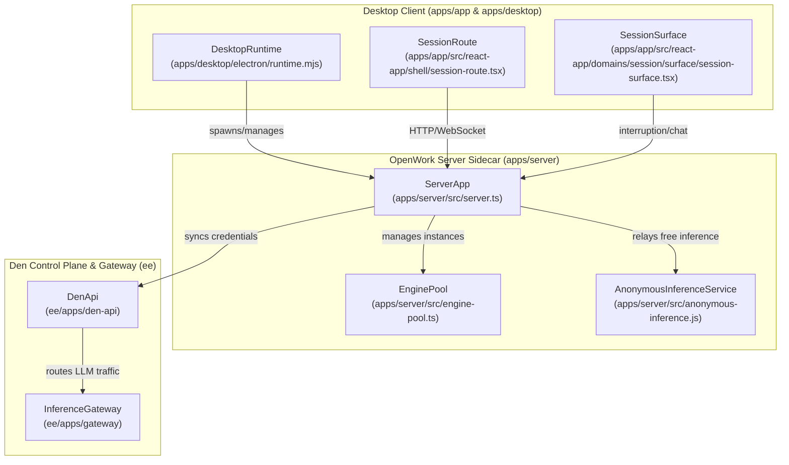

**Sources:** [apps/app/src/react-app/shell/session-route.tsx:1-4370](), [apps/app/src/react-app/domains/session/surface/session-surface.tsx:1-3781](), [apps/server/src/server.ts:1-6729](), [apps/desktop/electron/runtime.mjs:1-202]()

---

## Core Components and Implementation Details

### OpenCode Engine and Engine Pool
The OpenCode Engine serves as the underlying AI execution backend, managing tool calls (filesystem, terminal, browser) and model inference streams. The OpenWork server interacts with instances dynamically through `EnginePool` [apps/server/src/server.ts:18-30]().

- **Instance Management:** The `EnginePool` handles process spawning, standby pools, and event proxy leases [apps/server/src/engine-pool.ts]() embedded within `apps/server`.
- **Migration & Adapters:** Supports transition adapters for OpenCode v1 and v2 session architectures, ensuring transcript continuity across engine upgrades [apps/app/src/app/lib/openwork-server.ts:81-126]().

**Sources:** [apps/server/src/server.ts:18-30](), [apps/app/src/app/lib/openwork-server.ts:81-126]()

### OpenWork Desktop
Built as an Electron shell (`apps/desktop`) wrapping a React Vite frontend (`apps/app`), the desktop client acts as the primary user interface. 

- **Runtime Supervision:** The desktop runtime bootstrap `apps/desktop/electron/runtime.mjs` manages local process lifecycles, assigning dynamic loopback ports for local instances.
- **Routing & Synchronization:** The React application manages workspace state (`SessionRoute` in `apps/app/src/react-app/shell/session-route.tsx`) and real-time chat synchronization (`SessionSurface` in `apps/app/src/react-app/domains/session/surface/session-surface.tsx`).

**Sources:** [apps/app/src/react-app/shell/session-route.tsx:1-135](), [apps/app/src/react-app/domains/session/surface/session-surface.tsx:1-113](), [apps/desktop/electron/runtime.mjs:1-202]()

### OpenWork Server Sidecar
The Node.js HTTP service in `apps/server` fronts the OpenCode engine, exposing core API endpoints for workspaces, files, skills, and plugins [apps/server/src/server.ts:105-113]().

- **Route Registry:** Core routes are registered in `server.ts` via modular handlers (`registerCoreRoutes`, `registerFileRoutes`, `registerWorkspaceRoutes`, etc.) [apps/server/src/server.ts:105-113]().
- **Free Auto Inference Relay:** Implements anonymous inference routing via `AnonymousInferenceService`, managing desktop free access proofs and relay credentials [apps/server/src/server.ts:93-93]().

**Sources:** [apps/server/src/server.ts:93-113]()

### Den Control Plane and Inference Gateway
The enterprise control plane (`ee/apps/den-api`) and Inference Gateway (`ee/apps/gateway`) govern multi-tenant organizations, authentication, billing, and LLM provider credentials [ee/apps/den-api]().

- **Authentication:** Integrates Better Auth for session management, API keys, and bearer tokens [ee/apps/den-api]().
- **Cloud Worker Provisioning:** Manages cloud-hosted Daytona workspaces and provider materialization.

**Sources:** [ee/apps/den-api]()

---

## Runtime Modes

OpenWork supports three primary ways to deploy and consume the stack:

| Mode | Description | Persistence & Execution |
| :--- | :--- | :--- |
| **Host mode (Local)** | Runs the OpenCode host stack locally. OpenWork spawns `opencode` and `openwork-server` on the user's machine [AGENTS.md:17-17](). | Managed by the desktop app or orchestrator CLI. |
| **Client mode (Remote)** | Connects the UI to an existing OpenWork server URL [AGENTS.md:13-13](). | Persistence is handled entirely by the remote host server. |
| **Hosted Cloud (Den)** | Uses OpenWork Cloud workers launched from the web app [AGENTS.md:13-13](). | Managed by the Den cloud infrastructure and workers. |

**Sources:** [AGENTS.md:13-17](), [apps/desktop/electron/runtime.mjs:1-202]()

---

## Filesystem and Configuration Policy

OpenWork maintains strict isolation between user files, workspace configurations, and private credentials.

### Workspace Initialization
When a workspace is created or opened, the server runs initialization routines (`ensureWorkspaceFiles`) which provision the base directory structure and verify `opencode.json` configuration blocks [apps/server/src/workspace-init.ts:81-81]().

### Runtime Injection
Rather than mutating user-managed files on disk directly, OpenWork overlays dynamic runtime settings. The server constructs effective configurations by merging user presets with runtime environment variables and system instructions [apps/server/src/openwork-runtime-config.ts]().

**Sources:** [apps/server/src/workspace-init.ts:81-81](), [apps/server/src/openwork-runtime-config.ts]()

---

## Design Principles

### Memory Management
OpenWork separates agent memory into two distinct classifications:
1. **Behavior Memory:** Shareable assets stored in version-controlled directories (`.opencode/skills`, `.opencode/agents`).
2. **Private Memory:** Local session logs, authorization tokens, and credentials that are never committed or synchronized externally.

### Server-Consumption First
All application surfaces (Desktop UI, CLI tools, and mobile/web clients) act as consumers of the unified `openwork-server` API [AGENTS.md:18-18](). This ensures consistent enforcement of permissions, MCP management, and session handling across all deployment targets.

**Sources:** [AGENTS.md:18-18](), [apps/server/src/openwork-runtime-config.ts]()

---

# Page: Glossary of Components

# Glossary of Components

<details>
<summary>Relevant source files</summary>

The following files were used as context for generating this wiki page:

- [.opencode/opencode.json](.opencode/opencode.json)
- [apps/app/package.json](apps/app/package.json)
- [apps/desktop/package.json](apps/desktop/package.json)
- [apps/server/package.json](apps/server/package.json)
- [constants.json](constants.json)
- [ee/apps/den-api/src/generated/desktop-versions.ts](ee/apps/den-api/src/generated/desktop-versions.ts)
- [ee/apps/diagnostics/.env.example](ee/apps/diagnostics/.env.example)
- [ee/apps/diagnostics/README.md](ee/apps/diagnostics/README.md)
- [ee/apps/diagnostics/app/api/connections/identity/route.ts](ee/apps/diagnostics/app/api/connections/identity/route.ts)
- [ee/apps/diagnostics/app/api/connections/incidents/route.ts](ee/apps/diagnostics/app/api/connections/incidents/route.ts)
- [ee/apps/diagnostics/app/connections/incident-filters.tsx](ee/apps/diagnostics/app/connections/incident-filters.tsx)
- [ee/apps/diagnostics/app/connections/page.tsx](ee/apps/diagnostics/app/connections/page.tsx)
- [ee/apps/diagnostics/app/debug-proxy/[accessKey]/page.tsx](ee/apps/diagnostics/app/debug-proxy/[accessKey]/page.tsx)
- [ee/apps/diagnostics/app/page.tsx](ee/apps/diagnostics/app/page.tsx)
- [ee/apps/diagnostics/app/styles.css](ee/apps/diagnostics/app/styles.css)
- [ee/apps/diagnostics/app/via/[scenario]/[[...path]]/route.ts](ee/apps/diagnostics/app/via/[scenario]/[[...path]]/route.ts)
- [ee/apps/diagnostics/proxy.ts](ee/apps/diagnostics/proxy.ts)
- [ee/apps/diagnostics/scripts/connect-debug-proxy-smoke.mjs](ee/apps/diagnostics/scripts/connect-debug-proxy-smoke.mjs)
- [ee/apps/diagnostics/src/connect-debug-proxy-browser-route.ts](ee/apps/diagnostics/src/connect-debug-proxy-browser-route.ts)
- [ee/apps/diagnostics/src/connect-debug-proxy-config.ts](ee/apps/diagnostics/src/connect-debug-proxy-config.ts)
- [ee/apps/diagnostics/src/connect-debug-proxy-faults.ts](ee/apps/diagnostics/src/connect-debug-proxy-faults.ts)
- [ee/apps/diagnostics/src/connection-incident-query.ts](ee/apps/diagnostics/src/connection-incident-query.ts)
- [ee/apps/diagnostics/src/connection-incident-store.ts](ee/apps/diagnostics/src/connection-incident-store.ts)
- [packages/types/package.json](packages/types/package.json)
- [packages/types/src/index.ts](packages/types/src/index.ts)
- [packages/types/tsup.config.ts](packages/types/tsup.config.ts)
- [pnpm-lock.yaml](pnpm-lock.yaml)

</details>


## Purpose and Scope
The Glossary of Components establishes a definitive map of every deployable application, service, and shared package within the OpenWork monorepo (`https://github.com/different-ai/openwork`). It cross-references natural language system concepts with their physical directory locations, role definitions, and primary code entry points to streamline navigation across the wiki and codebase.

Sources: `[apps/app/package.json:1-33]()`, `[apps/desktop/package.json:1-27]()`, `[apps/server/package.json:1-26]()`

---

## Core and Enterprise Applications
OpenWork is split into client applications, server daemons, and enterprise control plane services housed under `apps/` and `ee/apps/`.

| Application Name | Directory | Primary Technical Role | Key Entry Point / Configuration |
|---|---|---|---|
| `@openwork/app` | `apps/app` | React frontend single-page application powering the chat interface, session rendering, session synchronization, and settings views. | `[apps/app/package.json:1-33]()` |
| `@openwork/desktop` | `apps/desktop` | Electron shell wrapper managing the desktop window, IPC bridge, sidecar process lifecycle, and OS integrations. | `[apps/desktop/package.json:1-27]()` |
| `openwork-server` | `apps/server` | Local/self-hosted HTTP backend service fronting the OpenCode engine, workspace management, file synchronization, and free auto inference. | `[apps/server/package.json:1-26]()` |
| `@openwork-ee/den-api` | `ee/apps/den-api` | Enterprise control plane backend API service built on Hono, Better Auth, and Drizzle ORM, managing organizations, policies, and telemetry. | `[ee/apps/den-api/src/generated/desktop-versions.ts:1-93]()` |
| `@openwork-ee/diagnostics` | `ee/apps/diagnostics` | Enterprise Vercel-native MCP compatibility and egress debugging proxy endpoint. | `[ee/apps/diagnostics/proxy.ts:1-53]()` |

Sources: `[apps/app/package.json:1-33]()`, `[apps/desktop/package.json:1-27]()`, `[apps/server/package.json:1-26]()`, `[ee/apps/diagnostics/proxy.ts:1-53]()`

---

## Shared Packages and Libraries
Cross-cutting logic, database contracts, and client SDKs are modularized under `packages/` and `ee/packages/`.

| Package Name | Directory | Primary Technical Role | Key Entry / Config |
|---|---|---|---|
| `@openwork/types` | `packages/types` | Shared TypeScript type definitions, IPC command maps, and network contract models. | `[packages/types/package.json:1-50]()` |
| `@openwork/free-auto` | `packages/free-auto` | Anonymous inference relay client, desktop free proof generator, and relay credential validation. | `[apps/server/package.json:55-74]()` |
| `@openwork/enterprise-mcp-client` | `packages/enterprise-mcp-client` | Enterprise Model Context Protocol client library and dynamic connector integration tooling. | `[apps/server/package.json:55-74]()` |

Sources: `[packages/types/package.json:1-50]()`, `[apps/server/package.json:55-74]()`

---

## Removed and Renamed Components
Historical context on deprecated or restructured system modules:
- **Unified Tauri App**: Early iterations combined the desktop shell and web UI into a monolithic binary; this has been cleanly decoupled into `apps/desktop` (Electron shell) and `apps/app` (React SPA).
- **`den-gateway`**: Edge routing logic has been refactored into dedicated gateway modules within `ee/apps/gateway` and consolidated into `@openwork-ee/den-api`.
- **Legacy Skills Engine**: Superseded by the next-gen plugin architecture supporting unified configuration objects, MCP tool discovery, and codemode scripts.

Sources: `[apps/desktop/package.json:1-27]()`, `[apps/server/package.json:1-26]()`

---

## Component System-to-Code Mapping Diagrams

The following diagrams bridge natural language system names to concrete codebase entities, file paths, and entry points.

### Application System-to-Code Mapping
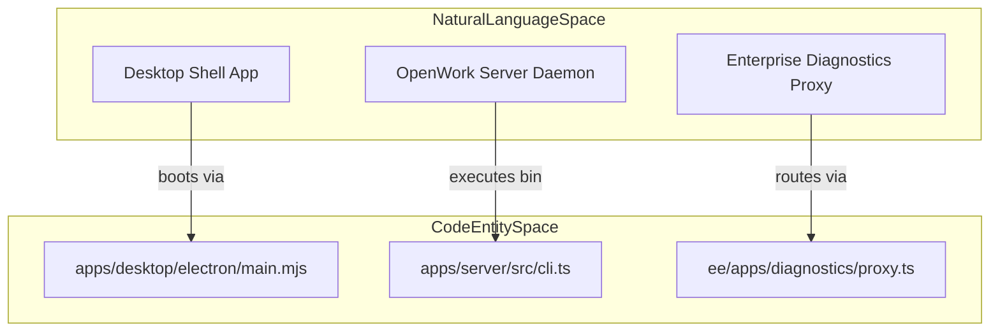
Sources: `[apps/desktop/package.json:11-13]()`, `[apps/server/package.json:6-8]()`, `[ee/apps/diagnostics/proxy.ts:10-20]()`

### Shared Package System-to-Code Mapping
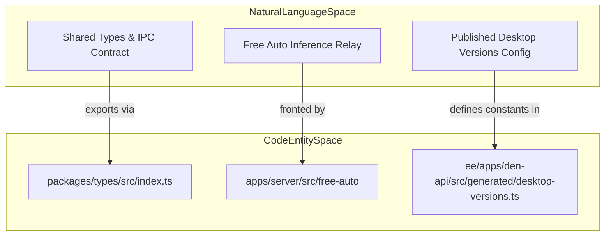
Sources: `[packages/types/package.json:42-49]()`, `[apps/server/package.json:55-74]()`, `[ee/apps/den-api/src/generated/desktop-versions.ts:1-5]()`

---

# Page: Getting Started

# Getting Started

<details>
<summary>Relevant source files</summary>

The following files were used as context for generating this wiki page:

- [docs/enterprise/outbound-access.md](docs/enterprise/outbound-access.md)
- [docs/org-install-links.md](docs/org-install-links.md)
- [docs/support/enterprise-network-doctor.md](docs/support/enterprise-network-doctor.md)
- [ee/apps/den-api/src/routes/bootstrap/index.ts](ee/apps/den-api/src/routes/bootstrap/index.ts)
- [ee/apps/den-web/app/(den)/_components/workspace-claim-screen.tsx](ee/apps/den-web/app/(den)/_components/workspace-claim-screen.tsx)
- [ee/apps/den-web/app/(den)/_lib/runtime-config.ts](ee/apps/den-web/app/(den)/_lib/runtime-config.ts)
- [ee/apps/den-web/app/(den)/workspace-claim/page.tsx](ee/apps/den-web/app/(den)/workspace-claim/page.tsx)
- [ee/apps/den-web/app/api/runtime-config/route.ts](ee/apps/den-web/app/api/runtime-config/route.ts)
- [ee/apps/landing/.gitignore](ee/apps/landing/.gitignore)
- [ee/apps/landing/app/download/[platform]/route.ts](ee/apps/landing/app/download/[platform]/route.ts)
- [ee/apps/landing/app/install-manifest.json/route.ts](ee/apps/landing/app/install-manifest.json/route.ts)
- [ee/apps/landing/app/install.sh/route.ts](ee/apps/landing/app/install.sh/route.ts)
- [ee/apps/landing/app/openwork-bootstrap.mjs/route.ts](ee/apps/landing/app/openwork-bootstrap.mjs/route.ts)
- [ee/apps/landing/app/start.md/route.ts](ee/apps/landing/app/start.md/route.ts)
- [ee/apps/landing/lib/download-platforms.ts](ee/apps/landing/lib/download-platforms.ts)
- [ee/apps/landing/public/.well-known/agent-skills/install-openwork/SKILL.md](ee/apps/landing/public/.well-known/agent-skills/install-openwork/SKILL.md)
- [ee/apps/landing/scripts/copy-bootstrap-cli.mjs](ee/apps/landing/scripts/copy-bootstrap-cli.mjs)
- [infra/terraform/AGENTS.md](infra/terraform/AGENTS.md)
- [infra/terraform/MODULE_CONTRACT.md](infra/terraform/MODULE_CONTRACT.md)
- [packages/docs/cloud/enterprise.mdx](packages/docs/cloud/enterprise.mdx)
- [packages/docs/start-here/air-gapped-deployment.mdx](packages/docs/start-here/air-gapped-deployment.mdx)
- [packages/docs/start-here/installer-delivery.mdx](packages/docs/start-here/installer-delivery.mdx)
- [packages/docs/start-here/network-diagnostics.mdx](packages/docs/start-here/network-diagnostics.mdx)
- [packages/docs/start-here/on-prem-branding.mdx](packages/docs/start-here/on-prem-branding.mdx)
- [packages/docs/start-here/outbound-network-access.mdx](packages/docs/start-here/outbound-network-access.mdx)
- [packages/docs/start-here/private-network-deployment.mdx](packages/docs/start-here/private-network-deployment.mdx)
- [packages/docs/start-here/self-host.mdx](packages/docs/start-here/self-host.mdx)
- [packages/openwork-bootstrap/README.md](packages/openwork-bootstrap/README.md)
- [packages/openwork-bootstrap/bin/openwork.mjs](packages/openwork-bootstrap/bin/openwork.mjs)
- [packages/openwork-bootstrap/start.md](packages/openwork-bootstrap/start.md)
- [scripts/support/openwork-doctor.ps1](scripts/support/openwork-doctor.ps1)
- [scripts/support/setup-openwork-tls-repro.ps1](scripts/support/setup-openwork-tls-repro.ps1)

</details>


This page outlines the installation and first-run paths for desktop users, CLI/bootstrap users, and self-hosters. OpenWork provides multiple deployment entrypoints, ranging from direct desktop applications for macOS, Windows, and Linux to agent-first CLI bootstrap scripts (`packages/openwork-bootstrap/bin/openwork.mjs`) and self-hosted control planes (`ee/apps/den-api/src/routes/bootstrap/index.ts`) [packages/openwork-bootstrap/bin/openwork.mjs:1-10](), [ee/apps/den-api/src/routes/bootstrap/index.ts:1-25]().

For detailed platform-specific installation guides, see [Desktop Installation](#2.1). For automated agent setup and installation links, see [Bootstrap CLI and Install Links](#2.2). For your first workspace creation and interaction, see [Your First Session](#2.3).

---

## 2.1. Desktop Installation

OpenWork Desktop is distributed as a packaged Electron application supporting macOS, Linux (including AUR packages), and Windows. Users can download binaries directly from GitHub releases, through organization install links (`ee/apps/den-api/src/routes/org/install-links.ts`), or via installation manifests (`ee/apps/landing/app/install-manifest.json`). The desktop shell coordinates with an embedded `openwork-server` sidecar to manage local files, OpenCode runtimes, and local model inference via Ollama or custom API keys.

For teams deploying OpenWork across private infrastructure or managed environments, installers can also be delivered via mounted artifact directories or MDM distribution using `desktop-bootstrap.json` configuration [docs/org-install-links.md:85-108](), [packages/docs/start-here/installer-delivery.mdx:1-16]().

For detailed instructions on platform-specific packages, channels, and auto-updater flows, see [Desktop Installation](#2.1).

Sources: [docs/org-install-links.md:1-108](), [packages/docs/start-here/installer-delivery.mdx:1-16]()

---

## 2.2. Bootstrap CLI and Install Links

The `openwork-bootstrap` package (`packages/openwork-bootstrap/bin/openwork.mjs`) provides an agent-first installation path [packages/openwork-bootstrap/bin/openwork.mjs:1-22](). Instead of requiring manual downloads or shell-piping untrusted scripts, agents can execute structured bootstrap commands to install the CLI, download the app manifest, create provisional workspaces without upfront email authentication, and prepare desktop configuration stores [packages/openwork-bootstrap/bin/openwork.mjs:70-94](), [packages/openwork-bootstrap/start.md:1-12]().

Landing site routes such as `ee/apps/landing/app/start.md/route.ts` and `ee/apps/landing/app/install.sh/route.ts` provide guidance for AI assistants helping users configure OpenWork [ee/apps/landing/app/start.md/route.ts:1-22](), [ee/apps/landing/app/install.sh/route.ts:1-15]().

### Diagram: Bootstrap CLI to Desktop Initialization
This diagram maps natural language bootstrapping instructions to code entities in `packages/openwork-bootstrap`.

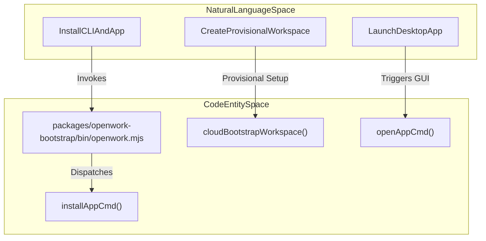
Sources: [packages/openwork-bootstrap/bin/openwork.mjs:70-88](), [packages/openwork-bootstrap/start.md:18-129](), [ee/apps/landing/app/start.md/route.ts:12-77]()

For deep-dive documentation on CLI flags, `install.sh` scripts, organization install links, and workspace claim screens, see [Bootstrap CLI and Install Links](#2.2).

Sources: [packages/openwork-bootstrap/bin/openwork.mjs:70-83](), [packages/openwork-bootstrap/start.md:1-12](), [ee/apps/landing/app/start.md/route.ts:1-22](), [ee/apps/landing/app/install.sh/route.ts:1-15]()

---

## 2.3. Your First Session

Once the desktop application or provisional workspace is initialized, the first-run workflow guides the user through workspace creation, welcome/onboarding routes, selecting an LLM provider (or utilizing Free Auto inference), and executing the first prompt [packages/openwork-bootstrap/start.md:71-88](). Provisional workspaces created via the CLI remain unauthenticated until the user visits the workspace claim screen (`ee/apps/den-web/app/(den)/_components/workspace-claim-screen.tsx`) and associates an identity [packages/openwork-bootstrap/start.md:55-72](), [ee/apps/den-web/app/(den)/_components/workspace-claim-screen.tsx:107-140]().

### Diagram: Workspace Claim and Authentication Bridge
This diagram connects the concept of claiming a workspace to its underlying Den web and API components, bridging natural language workspace onboarding to server-side code entities.

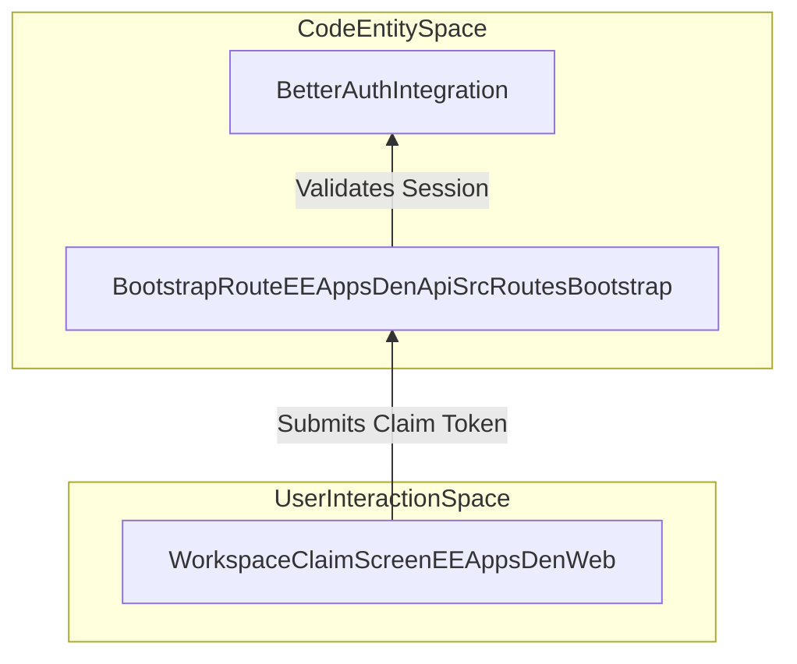
Sources: [ee/apps/den-web/app/(den)/_components/workspace-claim-screen.tsx:101-184](), [ee/apps/den-api/src/routes/bootstrap/index.ts:1-45]()

For a comprehensive guide on creating workspaces, navigating welcome screens, picking models, and sending initial messages, see [Your First Session](#2.3).

Sources: [packages/openwork-bootstrap/start.md:55-88](), [ee/apps/den-web/app/(den)/_components/workspace-claim-screen.tsx:101-184](), [ee/apps/den-api/src/routes/bootstrap/index.ts:1-45]()

---

# Page: Desktop Installation

# Desktop Installation

<details>
<summary>Relevant source files</summary>

The following files were used as context for generating this wiki page:

- [.github/workflows/aur-validate.yml](.github/workflows/aur-validate.yml)
- [.github/workflows/daytona-snapshot-drift.yml](.github/workflows/daytona-snapshot-drift.yml)
- [.github/workflows/dev-daytona-snapshot.yml](.github/workflows/dev-daytona-snapshot.yml)
- [.github/workflows/download-stats.yml](.github/workflows/download-stats.yml)
- [.github/workflows/opencode-agents.yml](.github/workflows/opencode-agents.yml)
- [.github/workflows/release-daytona-snapshot.yml](.github/workflows/release-daytona-snapshot.yml)
- [STATS.md](STATS.md)
- [STATS_V2.md](STATS_V2.md)
- [apps/app/src/app/lib/version-gate.ts](apps/app/src/app/lib/version-gate.ts)
- [apps/app/src/react-app/domains/settings/pages/updates-view.tsx](apps/app/src/react-app/domains/settings/pages/updates-view.tsx)
- [apps/app/src/react-app/domains/settings/state/electron-updater-state.ts](apps/app/src/react-app/domains/settings/state/electron-updater-state.ts)
- [apps/app/tests/electron-updater-check-now.test.ts](apps/app/tests/electron-updater-check-now.test.ts)
- [apps/app/tests/electron-updater-install-policy.test.ts](apps/app/tests/electron-updater-install-policy.test.ts)
- [apps/app/tests/version-gate.test.ts](apps/app/tests/version-gate.test.ts)
- [apps/desktop/electron/updater.mjs](apps/desktop/electron/updater.mjs)
- [apps/desktop/electron/updater.test.mjs](apps/desktop/electron/updater.test.mjs)
- [evals/worlds/packaged-preactivation-updater.ts](evals/worlds/packaged-preactivation-updater.ts)
- [packaging/aur/.SRCINFO](packaging/aur/.SRCINFO)
- [packaging/aur/PKGBUILD](packaging/aur/PKGBUILD)
- [packaging/aur/README.md](packaging/aur/README.md)
- [scripts/aur/publish-aur.sh](scripts/aur/publish-aur.sh)
- [scripts/aur/update-aur.sh](scripts/aur/update-aur.sh)
- [scripts/prune-daytona-dev-snapshots.mjs](scripts/prune-daytona-dev-snapshots.mjs)
- [scripts/stats.mjs](scripts/stats.mjs)
- [scripts/update-daytona-snapshot-pin.mjs](scripts/update-daytona-snapshot-pin.mjs)

</details>


OpenWork Desktop is a local-first AI coworker application designed for running agents, skills, and MCP workflows across macOS, Windows, and Linux `[README.md:1-3]`. It provides an integrated environment supporting multiple LLMs, custom API keys, and local state management `[README.md:3-7]`.

This page details the technical architecture of installing OpenWork Desktop across supported platforms, distribution channels, package maintenance (including AUR), the Electron updater subsystem (`apps/desktop/electron/updater.mjs`), and enterprise version gating.

---

## 1. Platform Support and Release Channels

OpenWork officially targets multiple operating systems and architectures. Updates are managed via the Electron updater module (`apps/desktop/electron/updater.mjs`), supporting **Stable** and **Alpha** release channels `[apps/desktop/electron/updater.mjs:46-55]`.

| Platform | Architectures | Installer Format | Default Release Channel |
|----------|--------------|------------------|-------------------------|
| **macOS** | Apple Silicon (`arm64`), Intel (`x64`) | `.dmg` | Stable / Alpha |
| **Windows** | `x64`, `arm64` | `.exe` | Stable |
| **Linux (Generic)** | `x64`, `arm64` | `.tar.gz`, `.AppImage` | Stable |
| **Linux (Arch)** | `x86_64`, `aarch64` | AUR package (`openwork`) | Stable |

The Electron updater feed configuration dynamically points to GitHub release assets or local loopback targets based on the resolved channel `[apps/desktop/electron/updater.mjs:46-108]`:
- `stable`: Maps to `https://github.com/different-ai/openwork/releases/latest/download` `[apps/desktop/electron/updater.mjs:47]`.
- `alpha`: Maps to pre-release build feeds on macOS `[apps/desktop/electron/updater.mjs:48]`.

Sources: `[packaging/aur/PKGBUILD:5]`, `[packaging/aur/.SRCINFO:6-7]`, `[apps/desktop/electron/updater.mjs:46-55]`

---

## 2. Installation Methods

### Direct Download & Landing Page
Users can install precompiled binaries via direct download. The installation pipeline resolves release assets and version metadata.

### Arch User Repository (AUR)
For Arch Linux environments, the `openwork` package definition (`packaging/aur/PKGBUILD`) extracts the tarball into `/opt/openwork`, establishes a global binary symlink at `/usr/bin/openwork`, registers desktop application menus, and configures sandbox permissions `[packaging/aur/PKGBUILD:22-64]`.

**AUR Installation Data Flow**

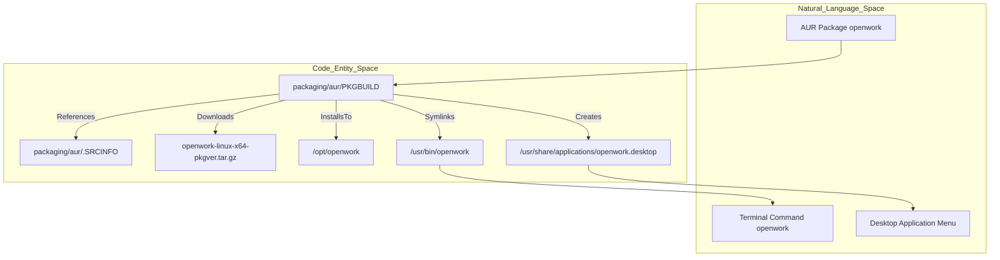

Sources: `[packaging/aur/PKGBUILD:1-64]`, `[packaging/aur/.SRCINFO:1-28]`

---

## 3. The Desktop Updater and Version Gating

OpenWork Desktop couples `electron-updater` with state machines located in `apps/desktop/electron/updater.mjs` and the React frontend hook `useElectronUpdaterState` (`apps/app/src/react-app/domains/settings/state/electron-updater-state.ts`).

### Updater Lifecycle and IPC Bridge
The main-process updater module registers IPC channels to evaluate updates, execute downloads, and handle restart flows (`registerUpdaterIpc`) `[apps/desktop/electron/updater.test.mjs:13-16]`. It compares stable versions semantically and permits loopback update feeds during local evaluation and testing via `evalUpdaterFeedUrl()` `[apps/desktop/electron/updater.mjs:93-114]`.

### UI State and Gating
The `useElectronUpdaterState` hook tracks update statuses (`idle`, `checking`, `available`, `blocked`, `downloading`, `ready`, `error`), feeding into `UpdatesView` (`apps/app/src/react-app/domains/settings/pages/updates-view.tsx`) to present progress indicators and execution controls `[apps/app/src/react-app/domains/settings/state/electron-updater-state.ts:20-41]`, `[apps/app/src/react-app/domains/settings/pages/updates-view.tsx:61-114]`.

**Updater and Version Gating Architecture**

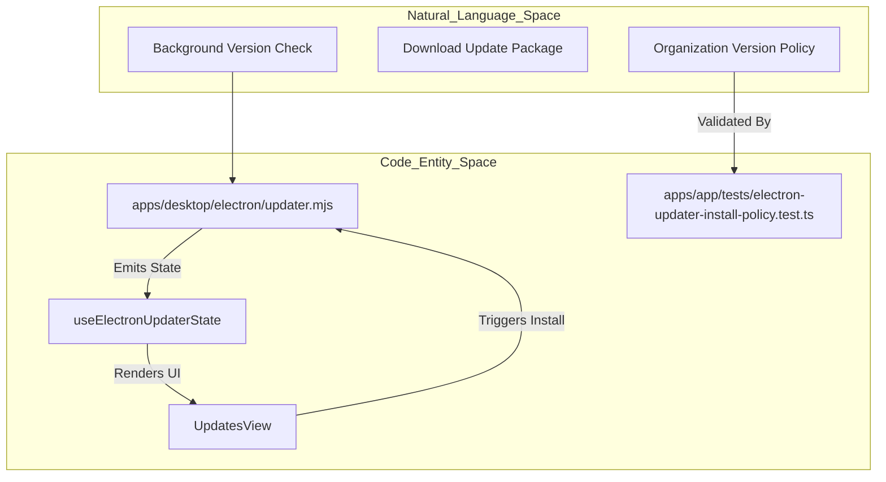

Sources: `[apps/desktop/electron/updater.mjs:1-187]`, `[apps/app/src/react-app/domains/settings/state/electron-updater-state.ts:1-192]`, `[apps/app/src/react-app/domains/settings/pages/updates-view.tsx:61-114]`, `[apps/desktop/electron/updater.test.mjs:1-180]`

---

## 4. System Requirements & Dependencies

### Linux Runtime Dependencies
Linux packages rely on specific shared libraries for the Electron window host and native controls:
- `gtk3`, `nss`, `alsa-lib`, `libxss`, `libxtst`
- `xdg-utils`, `at-spi2-core`, `libdrm`, `libxkbcommon`
- `mesa`, `dbus`, `hicolor-icon-theme`

### Security Sandbox & Permissions
- **Chromium Sandbox:** The `chrome-sandbox` binary under `/opt/openwork/` requires setuid root privileges (`4755`) to maintain process isolation `[packaging/aur/PKGBUILD:63]`.
- **Version Compliance:** Enterprise policies administered through OpenWork Den can gate allowed versions. Revoked versions block staged installations until re-validated `[apps/app/src/react-app/domains/settings/state/electron-updater-state.ts:58-63]`.

Sources: `[packaging/aur/PKGBUILD:12-64]`, `[apps/app/src/react-app/domains/settings/state/electron-updater-state.ts:53-63]`

---

# Page: Bootstrap CLI and Install Links

# Bootstrap CLI and Install Links

<details>
<summary>Relevant source files</summary>

The following files were used as context for generating this wiki page:

- [ee/apps/den-api/src/routes/bootstrap/index.ts](ee/apps/den-api/src/routes/bootstrap/index.ts)
- [ee/apps/den-api/src/routes/org/install-links.ts](ee/apps/den-api/src/routes/org/install-links.ts)
- [ee/apps/den-api/src/utils/installer-artifacts.ts](ee/apps/den-api/src/utils/installer-artifacts.ts)
- [ee/apps/den-web/app/(den)/_components/workspace-claim-screen.tsx](ee/apps/den-web/app/(den)/_components/workspace-claim-screen.tsx)
- [ee/apps/den-web/app/(den)/workspace-claim/page.tsx](ee/apps/den-web/app/(den)/workspace-claim/page.tsx)
- [ee/apps/landing/.gitignore](ee/apps/landing/.gitignore)
- [ee/apps/landing/app/download/[platform]/route.ts](ee/apps/landing/app/download/[platform]/route.ts)
- [ee/apps/landing/app/install-manifest.json/route.ts](ee/apps/landing/app/install-manifest.json/route.ts)
- [ee/apps/landing/app/install.sh/route.ts](ee/apps/landing/app/install.sh/route.ts)
- [ee/apps/landing/app/openwork-bootstrap.mjs/route.ts](ee/apps/landing/app/openwork-bootstrap.mjs/route.ts)
- [ee/apps/landing/app/start.md/route.ts](ee/apps/landing/app/start.md/route.ts)
- [ee/apps/landing/lib/download-platforms.ts](ee/apps/landing/lib/download-platforms.ts)
- [ee/apps/landing/public/.well-known/agent-skills/install-openwork/SKILL.md](ee/apps/landing/public/.well-known/agent-skills/install-openwork/SKILL.md)
- [ee/apps/landing/scripts/copy-bootstrap-cli.mjs](ee/apps/landing/scripts/copy-bootstrap-cli.mjs)
- [packages/openwork-bootstrap/README.md](packages/openwork-bootstrap/README.md)
- [packages/openwork-bootstrap/bin/openwork.mjs](packages/openwork-bootstrap/bin/openwork.mjs)
- [packages/openwork-bootstrap/start.md](packages/openwork-bootstrap/start.md)

</details>


## Purpose and Scope

This document details the architecture and implementation of the OpenWork bootstrap and installation surfaces. It covers the `packages/openwork-bootstrap` CLI (`bin/openwork.mjs`), the self-contained shell installer (`install.sh`), landing page routes (`start.md`, `openwork-bootstrap.mjs`, `install-manifest.json`), organization install links (`ee/apps/den-api/src/routes/org/install-links.ts`), and the web-based workspace claim screens (`ee/apps/den-web/app/(den)/_components/workspace-claim-screen.tsx`). These components allow users and automated coding agents to provision environments, download desktop runtimes, configure organization branding, and establish provisional cloud organizations without blocking on interactive credential entry.

Sources: `packages/openwork-bootstrap/bin/openwork.mjs:1-16`, `ee/apps/landing/app/install.sh/route.ts:1-25`, `ee/apps/den-api/src/routes/org/install-links.ts:96-107`, `ee/apps/den-web/app/(den)/_components/workspace-claim-screen.tsx:107-115`

---

## The Bootstrap CLI (`openwork-bootstrap`)

The `openwork-bootstrap` CLI is a standalone, dependency-free Node.js script located at `packages/openwork-bootstrap/bin/openwork.mjs` [packages/openwork-bootstrap/bin/openwork.mjs:1-16](). It provides subcommands for CLI installation, app deployment from manifests, authentication via one-time codes, and cloud workspace bootstrapping [packages/openwork-bootstrap/bin/openwork.mjs:75-115]().

### Runtime Version Verification and Implementation

The script enforces a strict Node.js runtime gate, requiring stable Node.js 24.x (version 24.22.1 or newer within that major) and rejecting other majors [packages/openwork-bootstrap/bin/openwork.mjs:10-19](). Arguments are parsed via `parseArgs` and routed to specific handlers [packages/openwork-bootstrap/bin/openwork.mjs:28-54]`:
- `install`: Installs the bootstrap CLI into a user-writable binary directory (e.g., `$HOME/.local/bin`) [packages/openwork-bootstrap/bin/openwork.mjs:80-80]().
- `install app`: Downloads and installs the desktop application using a remote JSON manifest [packages/openwork-bootstrap/bin/openwork.mjs:81-81]().
- `login`: Initiates a browser-based one-time code authentication flow (RFC 8628) [packages/openwork-bootstrap/bin/openwork.mjs:84-84]().
- `cloud onboard`: Provisions an organization, optional teammate invites, and starter skills for an authenticated user [packages/openwork-bootstrap/bin/openwork.mjs:86-88]().
- `cloud bootstrap-workspace`: Creates a provisional cloud workspace without prior email/password authentication [packages/openwork-bootstrap/bin/openwork.mjs:89-89]().
- `cloud claim-link`: Retrieves claim URLs saved by local desktop bootstrap flows [packages/openwork-bootstrap/bin/openwork.mjs:90-90]().

Sources: `packages/openwork-bootstrap/bin/openwork.mjs:1-128`, `packages/openwork-bootstrap/README.md:1-35`

---

## Landing Site Routes and Standalone Shell Installer (`install.sh`)

The landing site (`ee/apps/landing/`) exposes several routes to support script-driven installation and agent setup guides:
- `GET /install.sh` (`ee/apps/landing/app/install.sh/route.ts`): A shell script that checks for a supported Node.js runtime, downloads a pinned local copy of Node.js 24.22.1 if missing (checksum-verified against nodejs.org), fetches the bootstrap CLI script, and configures it on the user's PATH [ee/apps/landing/app/install.sh/route.ts:1-137]().
- `GET /openwork-bootstrap.mjs` (`ee/apps/landing/app/openwork-bootstrap.mjs/route.ts`): Serves the raw `openwork.mjs` bootstrap CLI file [ee/apps/landing/app/openwork-bootstrap.mjs/route.ts:1-17]().
- `GET /install-manifest.json` (`ee/apps/landing/app/install-manifest.json/route.ts`): Queries GitHub releases for `different-ai/openwork` and constructs a JSON manifest mapping platforms and architectures to desktop installers (`dmg`, `appimage`, `exe`, `msi`, `zip`, `tar.gz`) [ee/apps/landing/app/install-manifest.json/route.ts:1-137]().
- `GET /start.md` (`ee/apps/landing/app/start.md/route.ts`) and `packages/openwork-bootstrap/start.md`: Provide structured prompts and instructions for coding agents assisting users with OpenWork installation [ee/apps/landing/app/start.md/route.ts:1-25](), [packages/openwork-bootstrap/start.md:1-20]().

Sources: `ee/apps/landing/app/install.sh/route.ts:1-137`, `ee/apps/landing/app/openwork-bootstrap.mjs/route.ts:1-17`, `ee/apps/landing/app/install-manifest.json/route.ts:1-137`, `ee/apps/landing/app/start.md/route.ts:1-25`, `packages/openwork-bootstrap/start.md:1-20`

---

## Workspace Provisioning and Provisional Workspaces

To support agent-first initialization where users can spin up an environment before authenticating, the system implements provisional cloud workspaces via `ee/apps/den-api/src/routes/bootstrap/index.ts` [packages/openwork-bootstrap/start.md:67-72]().

### Provisional Workflow Data Flow

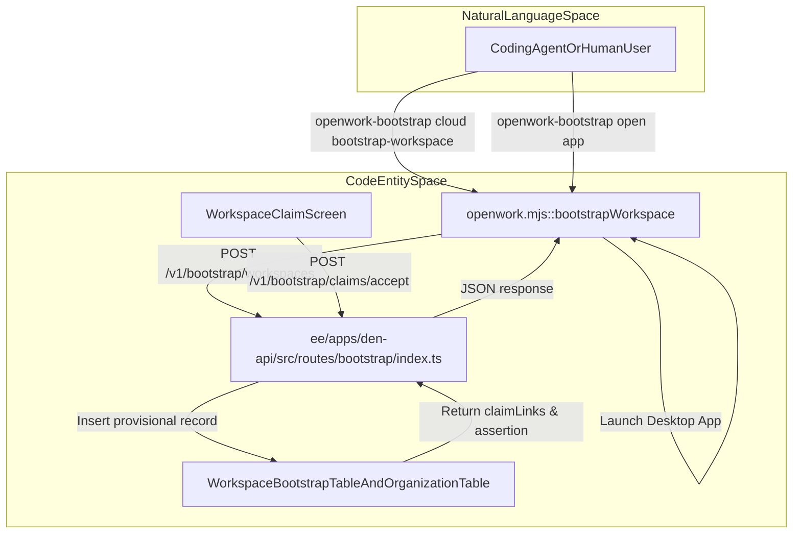

Sources: `packages/openwork-bootstrap/bin/openwork.mjs:79-80`, `ee/apps/den-api/src/routes/bootstrap/index.ts:65-122`, `ee/apps/den-web/app/(den)/_components/workspace-claim-screen.tsx:141-158`

---

## Install Links and Organization Configuration

Enterprise and self-hosted topologies configure desktop download links and runtime parameters dynamically via `ee/apps/den-api/src/routes/org/install-links.ts` [ee/apps/den-api/src/routes/org/install-links.ts:1-107](). 

The helper function `buildInstallConfig` reads organization metadata and returns an authenticated installation configuration (`installConfigSchema`) containing branding properties (`brandAppName`, `brandLogoUrl`, `brandIconUrl`), client names, web URLs, API public origins, and sign-in requirements [ee/apps/den-api/src/routes/org/install-links.ts:96-107](). Platform-specific installer assets are resolved using helper utilities like `enterpriseDesktopReleaseAssetName` and `cloudDesktopReleaseAssetName` [ee/apps/den-api/src/utils/installer-artifacts.ts:59-67]().

Sources: `ee/apps/den-api/src/routes/org/install-links.ts:1-107`, `ee/apps/den-api/src/utils/installer-artifacts.ts:1-90`

---

## Workspace Claim Screens and Authentication Handoff

Once a provisional workspace has been established and local state populated, users claim ownership via the web interface (`ee/apps/den-web/app/(den)/_components/workspace-claim-screen.tsx`) [packages/openwork-bootstrap/start.md:70-79]().

### Claim Screen State Transition

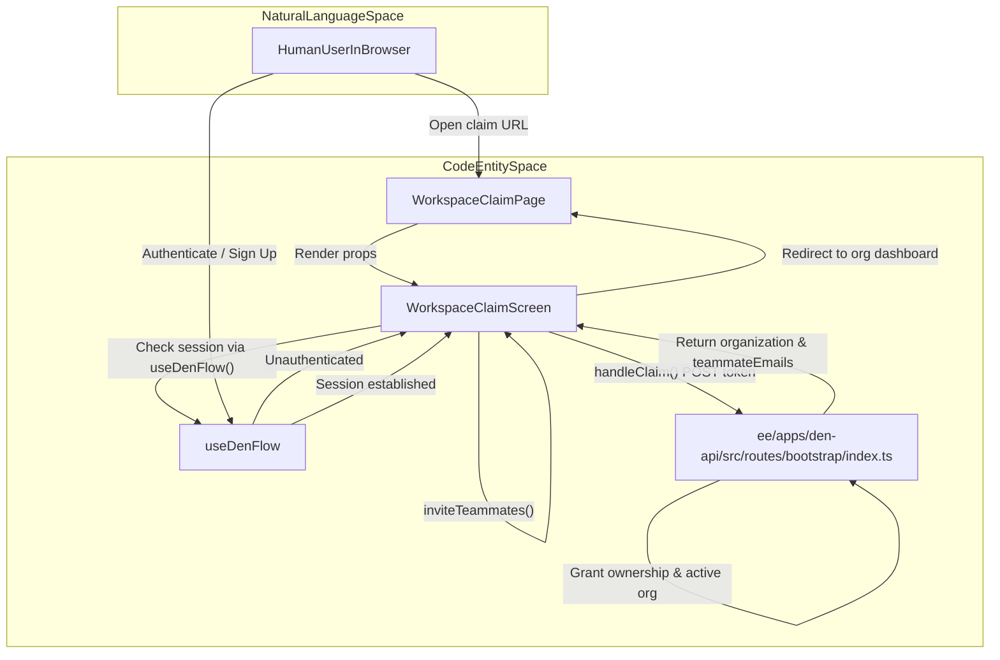

Sources: `ee/apps/den-web/app/(den)/_components/workspace-claim-screen.tsx:107-184`, `ee/apps/den-api/src/routes/bootstrap/index.ts:65-135`, `ee/apps/landing/app/workspace-claim/page.tsx:24-37`

---

# Page: Your First Session

# Your First Session

<details>
<summary>Relevant source files</summary>

The following files were used as context for generating this wiki page:

- [apps/app/src/components/page.tsx](apps/app/src/components/page.tsx)
- [apps/app/src/react-app/domains/cloud/den-signin-surface.tsx](apps/app/src/react-app/domains/cloud/den-signin-surface.tsx)
- [apps/app/src/react-app/domains/cloud/openwork-models-promo.ts](apps/app/src/react-app/domains/cloud/openwork-models-promo.ts)
- [apps/app/src/react-app/domains/cloud/signin-fallback-notice.tsx](apps/app/src/react-app/domains/cloud/signin-fallback-notice.tsx)
- [apps/app/src/react-app/domains/connections/provider-auth/provider-auth-modal.tsx](apps/app/src/react-app/domains/connections/provider-auth/provider-auth-modal.tsx)
- [apps/app/src/react-app/domains/onboarding/provider-selection-step.tsx](apps/app/src/react-app/domains/onboarding/provider-selection-step.tsx)
- [apps/app/src/react-app/domains/onboarding/welcome-page.tsx](apps/app/src/react-app/domains/onboarding/welcome-page.tsx)
- [apps/app/src/react-app/domains/session/artifacts/preview.tsx](apps/app/src/react-app/domains/session/artifacts/preview.tsx)
- [apps/app/src/react-app/domains/session/sidebar/sidebar-chrome.tsx](apps/app/src/react-app/domains/session/sidebar/sidebar-chrome.tsx)
- [apps/app/src/react-app/domains/settings/pages/ai-view.tsx](apps/app/src/react-app/domains/settings/pages/ai-view.tsx)
- [apps/app/src/react-app/domains/settings/shell/settings-shell.tsx](apps/app/src/react-app/domains/settings/shell/settings-shell.tsx)
- [apps/app/src/react-app/shell/welcome-route.tsx](apps/app/src/react-app/shell/welcome-route.tsx)
- [apps/desktop/electron/quit-sequence.mjs](apps/desktop/electron/quit-sequence.mjs)
- [evals/packages/behaviors/src/composer.ts](evals/packages/behaviors/src/composer.ts)
- [evals/packages/behaviors/src/den.ts](evals/packages/behaviors/src/den.ts)
- [evals/packages/behaviors/src/desktop-boot.ts](evals/packages/behaviors/src/desktop-boot.ts)
- [evals/packages/behaviors/src/desktop.ts](evals/packages/behaviors/src/desktop.ts)
- [evals/packages/behaviors/src/onboarding.ts](evals/packages/behaviors/src/onboarding.ts)
- [evals/packages/cdp/src/app-state.ts](evals/packages/cdp/src/app-state.ts)
- [evals/packages/cdp/src/cdp.ts](evals/packages/cdp/src/cdp.ts)
- [evals/packages/cdp/src/index.ts](evals/packages/cdp/src/index.ts)
- [evals/packages/cdp/src/input.ts](evals/packages/cdp/src/input.ts)
- [evals/packages/cdp/src/surface.ts](evals/packages/cdp/src/surface.ts)
- [evals/packages/env/src/seed.ts](evals/packages/env/src/seed.ts)
- [evals/packages/testkit/src/spec/runtime.ts](evals/packages/testkit/src/spec/runtime.ts)
- [evals/packages/testkit/src/spec/types.ts](evals/packages/testkit/src/spec/types.ts)
- [evals/worlds/first-run.ts](evals/worlds/first-run.ts)

</details>


## Purpose and Scope

This page provides technical documentation for the initial user journey in OpenWork: launching the desktop client or web application, evaluating onboarding requirements, creating the first workspace, picking an inference model, and submitting the first message. It details the runtime state machines, React components, and engine bindings that coordinate the first session.

---

## Creating Your First Workspace

When OpenWork launches, the React application mounts via `AppProviders` [apps/app/src/react-app/shell/providers.tsx:85]() and executes `useDesktopRuntimeBoot` to verify runtime health [apps/app/src/react-app/shell/desktop-runtime-boot.ts:67](). If no workspace exists or onboarding is incomplete, the router resolves the `WelcomeRoute` [apps/app/src/react-app/shell/welcome-route.tsx:123]().

### The Welcome State Machine

The `WelcomeRoute` component manages the first-run state machine through `welcomeReducer`, tracking modal visibility, workspace folder picking, and onboarding transitions [apps/app/src/react-app/shell/welcome-route.tsx:65-113](). If `local.prefs.hasCompletedOnboarding` evaluates to true, the router immediately redirects the user to `/session` [apps/app/src/react-app/shell/welcome-route.tsx:144-148]().

**Natural Language to Code Entity Space: Onboarding and Workspace Creation Flow**

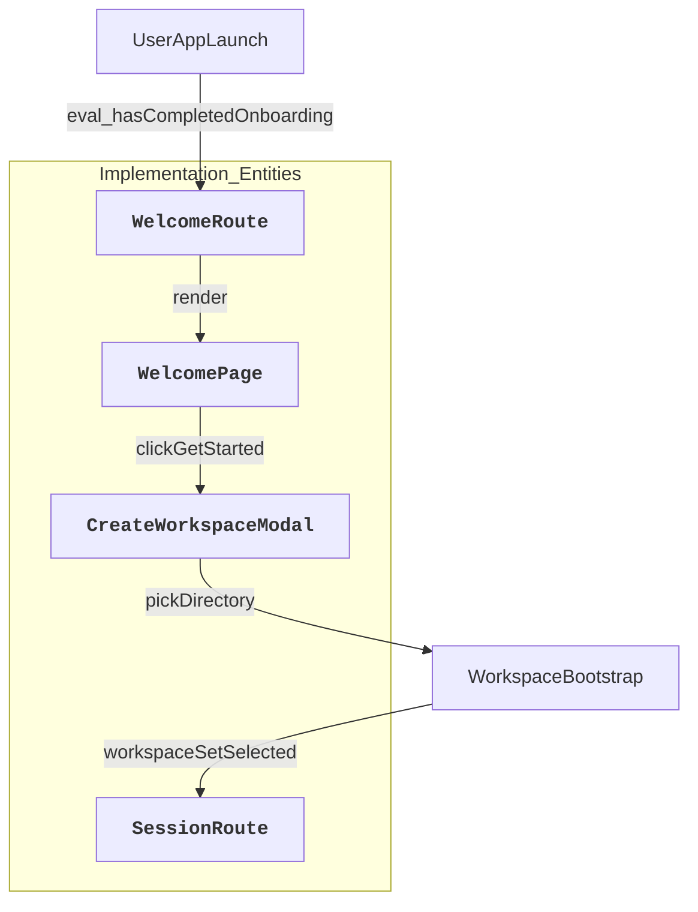
Sources: [apps/app/src/react-app/shell/welcome-route.tsx:65-148](), [apps/app/src/react-app/domains/onboarding/welcome-page.tsx:29-40]()

### Workspace Provisioning and Directory Selection

Workspaces can be instantiated via two primary paths managed in the welcome workflow:
1. **Local Directories**: The user invokes `pickDirectory` to choose a local folder [apps/app/src/react-app/shell/welcome-route.tsx:7](). The path is normalized via `folderNameFromPath` [apps/app/src/react-app/shell/welcome-route.tsx:53](), and `workspaceBootstrap` initializes the local workspace state [apps/app/src/react-app/shell/welcome-route.tsx:8]().
2. **Automated Seeding**: Test and bootstrap environments execute `createAndSelectWorkspace` to provision temporary workspace files and transition through required screens programmatically [evals/packages/behaviors/src/desktop-boot.ts:129-150]().

Sources: [apps/app/src/react-app/shell/welcome-route.tsx:53-113](), [evals/packages/behaviors/src/desktop-boot.ts:129-150]()

---

## Picking a Model and Provider Setup

Once the workspace is initialized, the application presents options to configure LLM providers or select built-in models via `ProviderAuthModal` [apps/app/src/react-app/domains/connections/provider-auth/provider-auth-modal.tsx:96-114]() and `AiSettingsView` [apps/app/src/react-app/domains/settings/pages/ai-view.tsx:99-125]().

### Model Selection and Promotional Eligibility

Users can connect custom API keys, authenticate via OAuth providers, or leverage managed infrastructure. Promotional eligibility for hosted inference models is evaluated via `isOpenWorkModelsPromoEligible` [apps/app/src/react-app/domains/cloud/openwork-models-promo.ts:34-36]().

| Feature Component | Implementation Reference | Role |
| :--- | :--- | :--- |
| **Provider Auth Modal** | `ProviderAuthModal` [apps/app/src/react-app/domains/connections/provider-auth/provider-auth-modal.tsx:96]() | Manages API key submission and OAuth flows for third-party models. |
| **AI Settings View** | `AiSettingsView` [apps/app/src/react-app/domains/settings/pages/ai-view.tsx:99]() | Renders connected provider lists, gateway status, and device-local keys. |
| **Promo Hook** | `useOpenWorkModelsPromoEligibility` [apps/app/src/react-app/domains/cloud/openwork-models-promo.ts:38]() | Tracks whether cloud-managed model upsells should be displayed. |

Sources: [apps/app/src/react-app/domains/connections/provider-auth/provider-auth-modal.tsx:96-114](), [apps/app/src/react-app/domains/settings/pages/ai-view.tsx:99-125](), [apps/app/src/react-app/domains/cloud/openwork-models-promo.ts:34-48]()

---

## Starting the Conversation

The submission of the first prompt transitions the workspace into an active chat session on the underlying OpenCode engine instance.

### Interaction Flow and Engine Binding

When a user submits a prompt through the composer interface, the route obtains an active session client using either the v1 SDK or v2 adapter (`createClientV2`) depending on engine routing status [apps/app/src/react-app/shell/route-workspaces.ts:54-57]().

**Code Entity Space: First Message Execution and Streaming Flow**

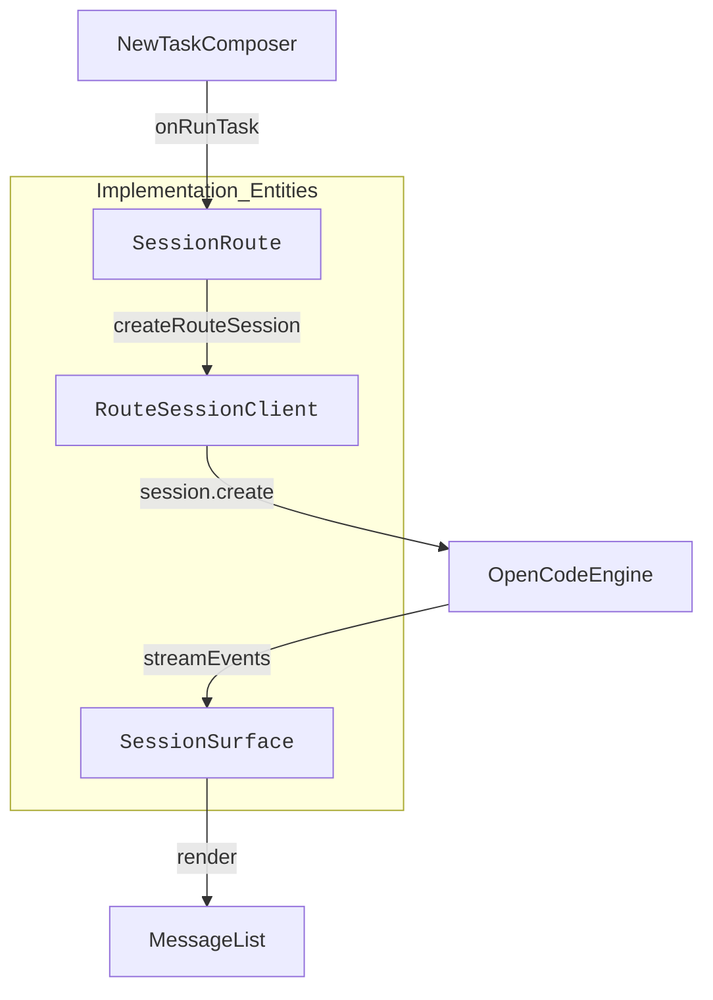
Sources: [apps/app/src/react-app/shell/use-workspace-route-state.ts:142](), [apps/app/src/react-app/shell/route-workspaces.ts:88-90]()

Sources: [apps/app/src/react-app/shell/use-workspace-route-state.ts:94-142](), [apps/app/src/react-app/shell/route-workspaces.ts:54-90]()

---

# Page: OpenWork Desktop

# OpenWork Desktop

<details>
<summary>Relevant source files</summary>

The following files were used as context for generating this wiki page:

- [apps/app/src/app/lib/desktop-types.ts](apps/app/src/app/lib/desktop-types.ts)
- [apps/app/src/app/lib/desktop.ts](apps/app/src/app/lib/desktop.ts)
- [apps/app/src/app/lib/openwork-server.ts](apps/app/src/app/lib/openwork-server.ts)
- [apps/app/src/components/chat/message-list-provider.tsx](apps/app/src/components/chat/message-list-provider.tsx)
- [apps/app/src/components/chat/message-list.tsx](apps/app/src/components/chat/message-list.tsx)
- [apps/app/src/i18n/locales/en.ts](apps/app/src/i18n/locales/en.ts)
- [apps/app/src/react-app/domains/connections/provider-auth/store.ts](apps/app/src/react-app/domains/connections/provider-auth/store.ts)
- [apps/app/src/react-app/domains/session/chat/session-page.tsx](apps/app/src/react-app/domains/session/chat/session-page.tsx)
- [apps/app/src/react-app/domains/session/panel/agent-viewport.ts](apps/app/src/react-app/domains/session/panel/agent-viewport.ts)
- [apps/app/src/react-app/domains/session/panel/panel-tab-store.ts](apps/app/src/react-app/domains/session/panel/panel-tab-store.ts)
- [apps/app/src/react-app/domains/session/panel/side-panel.tsx](apps/app/src/react-app/domains/session/panel/side-panel.tsx)
- [apps/app/src/react-app/domains/session/sidebar/app-sidebar-provider.tsx](apps/app/src/react-app/domains/session/sidebar/app-sidebar-provider.tsx)
- [apps/app/src/react-app/domains/session/sidebar/app-sidebar.tsx](apps/app/src/react-app/domains/session/sidebar/app-sidebar.tsx)
- [apps/app/src/react-app/domains/session/sidebar/utils.ts](apps/app/src/react-app/domains/session/sidebar/utils.ts)
- [apps/app/src/react-app/domains/session/status/session-activity-store.ts](apps/app/src/react-app/domains/session/status/session-activity-store.ts)
- [apps/app/src/react-app/domains/session/status/session-attention.ts](apps/app/src/react-app/domains/session/status/session-attention.ts)
- [apps/app/src/react-app/domains/session/surface/session-render-state.ts](apps/app/src/react-app/domains/session/surface/session-render-state.ts)
- [apps/app/src/react-app/domains/session/surface/session-surface.tsx](apps/app/src/react-app/domains/session/surface/session-surface.tsx)
- [apps/app/src/react-app/domains/session/sync/message-merge.ts](apps/app/src/react-app/domains/session/sync/message-merge.ts)
- [apps/app/src/react-app/domains/session/sync/session-sync.ts](apps/app/src/react-app/domains/session/sync/session-sync.ts)
- [apps/app/src/react-app/domains/session/sync/transcript-reconcile.ts](apps/app/src/react-app/domains/session/sync/transcript-reconcile.ts)
- [apps/app/src/react-app/domains/session/sync/use-session-interactions.ts](apps/app/src/react-app/domains/session/sync/use-session-interactions.ts)
- [apps/app/src/react-app/domains/session/sync/usechat-adapter.ts](apps/app/src/react-app/domains/session/sync/usechat-adapter.ts)
- [apps/app/src/react-app/shell/session-route.tsx](apps/app/src/react-app/shell/session-route.tsx)
- [apps/app/src/react-app/shell/settings-route.tsx](apps/app/src/react-app/shell/settings-route.tsx)
- [apps/desktop/electron-builder.base.yml](apps/desktop/electron-builder.base.yml)
- [apps/desktop/electron/browser-panel.mjs](apps/desktop/electron/browser-panel.mjs)
- [apps/desktop/electron/main.mjs](apps/desktop/electron/main.mjs)
- [apps/desktop/electron/preload.mjs](apps/desktop/electron/preload.mjs)
- [apps/desktop/scripts/electron-build.mjs](apps/desktop/scripts/electron-build.mjs)
- [apps/desktop/scripts/electron-dev.mjs](apps/desktop/scripts/electron-dev.mjs)
- [apps/server/src/server.ts](apps/server/src/server.ts)
- [evals/proofs/browser-agent-viewport.proof.test.ts](evals/proofs/browser-agent-viewport.proof.test.ts)
- [packages/browser-tabs/index.d.ts](packages/browser-tabs/index.d.ts)
- [packages/browser-tabs/index.mjs](packages/browser-tabs/index.mjs)
- [packages/computer-use/browser-task-takeover.test.mjs](packages/computer-use/browser-task-takeover.test.mjs)
- [packages/computer-use/browser-task.mjs](packages/computer-use/browser-task.mjs)
- [packages/types/src/desktop-ipc.ts](packages/types/src/desktop-ipc.ts)

</details>


OpenWork Desktop is the primary user-facing client for OpenWork, combining the `apps/app` React single-page application with the `apps/desktop` Electron shell [apps/desktop/electron/main.mjs:82-93](). It provides a local-first workspace interface for interacting with AI models, executing code, managing files, running browser automations, and coordinating with the Den enterprise control plane.

This page serves as a high-level overview of the desktop client. For in-depth technical details, explore the child pages covering Core Concepts, Composer and Input, Extensions and Integrations, Desktop Features, and Desktop Architecture.

Sources: [apps/desktop/electron/main.mjs:82-93]()

---

## 3.1. Core Concepts

The mental model behind OpenWork Desktop relies on several interconnected primitives: Workspaces, Sessions, Messages/Parts, and Permissions. 

* **Workspaces and Routing**: Workspaces represent project directories on disk or remote nodes. The React client resolves workspace states, routes, and connections through [apps/app/src/react-app/shell/session-route.tsx:35-40]() and manages selection via [apps/app/src/app/lib/desktop.ts:47-51]().
* **Sessions and Synchronization**: Conversations happen inside sessions bound to a workspace. The client maintains transcripts using [apps/app/src/react-app/domains/session/sync/runtime-sync.ts]() and synchronizes state between the UI stores and the engine.
* **Messages, Parts, and Rendering**: Messages are broken down into discrete parts (text, tool calls, subagent execution lines, and code-mode operations) rendered in the session timeline [apps/app/src/react-app/domains/session/surface/session-surface.tsx:86-88]().
* **Permission System and Operational Modes**: Tool execution requires validation against operational modes and approval policies handled by [apps/server/src/approvals.ts]() and governed by runtime configs.

For detailed information on the mental model and state management, see [Core Concepts](#3.1).

Sources: [apps/app/src/react-app/shell/session-route.tsx:35-51](), [apps/app/src/react-app/domains/session/surface/session-surface.tsx:86-88]()

### Diagram: Core Runtime Concepts to Code Entities

Title: "Core Concepts to Code Entity Mapping"

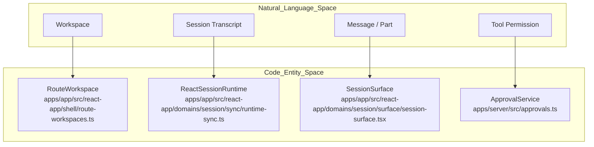

Sources: [apps/app/src/react-app/shell/route-workspaces.ts](), [apps/app/src/react-app/domains/session/surface/session-surface.tsx:86-88](), [apps/server/src/approvals.ts:14-15]()

---

## 3.2. Composer and Input

The message composer (`ReactSessionComposer` in `apps/app/src/react-app/domains/session/surface/composer/composer.tsx`) is a Lexical-based text editor built to support rich multi-modal inputs. It handles:
* **Mentions**: Referencing agents (`@agent`), files (`@file`), and computer-use tools (`@computer`) via token encoding [apps/app/src/react-app/domains/session/surface/composer/mention-encoding.ts]().
* **Slash Commands**: Triggering built-in or custom workspace commands [apps/app/src/react-app/domains/session/surface/composer/slash-command.ts]().
* **Skills and Connectors**: Injecting marketplace capabilities or connector tokens into prompts [apps/app/src/react-app/domains/session/surface/composer/connect-skill-token.ts]().
* **Attachments and Drafts**: File drops, image previews, persistent draft stores, and auto-send state machines [apps/app/src/react-app/domains/session/sync/draft-store.ts]().

For detailed mechanics of prompt composition and input parsing, see [Composer and Input](#3.2).

Sources: [apps/app/src/react-app/domains/session/surface/composer/composer.tsx:18-42](), [apps/app/src/react-app/domains/session/sync/draft-store.ts:5-6]()

---

## 3.3. Extensions and Integrations

OpenWork Desktop provides a comprehensive extension surface configurable directly from Settings (`apps/app/src/react-app/domains/settings/`). The platform integrates external tools, local plugins, and enterprise capabilities:
* **Skills and Commands**: Just-in-time loading of custom skill catalogs and prompt templates [apps/server/src/skills.ts]().
* **MCP Servers and Connections**: Local and organizational Model Context Protocol server registration, OAuth flows, and connection health monitors [apps/server/src/local-managed-mcp.ts]().
* **OpenCode Plugins**: Extensions managed via `opencode.json` and adapter registries under `apps/server/src/opencode-plugins/` [apps/server/src/server.ts:41-43]().
* **MCP Apps and Dashboards**: Sandboxed web apps and widgets rendered via `mcp-app-host.js` and `mcp-app-sandbox.js` [apps/server/src/server.ts:46-62]().

For a complete breakdown of extension registries and marketplace protocols, see [Extensions and Integrations](#3.3).

Sources: [apps/server/src/server.ts:41-62](), [apps/server/src/skills.ts](), [apps/server/src/local-managed-mcp.ts:115-125]()

---

## 3.4. Desktop Features

Beyond standard chat transcripts, OpenWork Desktop features specialized surfaces designed for heavy agentic workflows:
* **Artifacts and File Editors**: Live markdown previews, text/spreadsheet editors, and project file trees managed by server-side file routes [apps/server/src/routes/files.js]().
* **Embedded Browser Panel**: Chromium `BrowserView` integration managed by `packages/browser-tabs` and `browser-panel.mjs` for web automation testing [apps/desktop/electron/browser-panel.mjs]().
* **Automations and Automation Runner**: Scheduled workflows and headless execution bridges coordinated via `automation-runner.mjs` [apps/desktop/electron/automation-runner.mjs]().
* **Command Palette and Search**: Global search dialogs, find bars, shortcut bindings, and window chrome controls [apps/app/src/react-app/domains/session/surface/find-bar.tsx]().
* **Settings and Updates**: Preferences panels, debug view models, and `electron-updater` integration for background distribution [apps/desktop/electron/updater.mjs]().

For detailed usage and component breakdowns, see [Desktop Features](#3.4).

Sources: [apps/desktop/electron/browser-panel.mjs](), [apps/desktop/electron/automation-runner.mjs](), [apps/desktop/electron/updater.mjs](), [apps/server/src/routes/files.js]()

---

## 3.5. Desktop Architecture

The desktop application is partitioned into distinct process boundaries and layering domains to ensure isolation and performance:
* **Frontend Architecture**: The React component tree (`apps/app`) structured around domains, kernels, Zustand stores, and Vite build configuration [apps/app/src/react-app/shell/session-route.tsx:1-17]().
* **Electron Main Process and IPC Bridge**: `main.mjs`, `preload.mjs`, and `DesktopCommandMap` contracts defined in `packages/types/src/desktop-ipc.ts` handle secure inter-process communication [apps/desktop/electron/main.mjs:82-105]().
* **Engine Runtimes and Server Sidecar**: `runtime.mjs` manages the lifecycle of the embedded `openwork-server` and underlying OpenCode AI engine instances [apps/desktop/electron/runtime.mjs]().
* **Desktop Policy and Security Model**: Enforcement of organization policies, token handling, and telemetry via Sentry [apps/desktop/electron/sentry.mjs]() and managed config providers.

For deep architectural schemas and security rules, see [Desktop Architecture](#3.5).

Sources: [apps/desktop/electron/main.mjs:82-105](), [apps/desktop/electron/runtime.mjs](), [packages/types/src/desktop-ipc.ts](), [apps/desktop/electron/sentry.mjs:79-82]()

### Diagram: Electron IPC and Sidecar Architecture

Title: "Desktop IPC and Runtime Architecture"

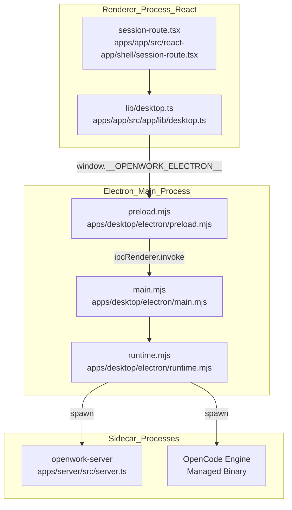

Sources: [apps/app/src/react-app/shell/session-route.tsx:35-55](), [apps/app/src/app/lib/desktop.ts:83-87](), [apps/desktop/electron/preload.mjs:61-64](), [apps/desktop/electron/main.mjs:82-93](), [apps/desktop/electron/runtime.mjs:1-25](), [apps/server/src/server.ts:100-102]()

---

# Page: Core Concepts

# Core Concepts

<details>
<summary>Relevant source files</summary>

The following files were used as context for generating this wiki page:

- [apps/app/src/app/lib/openwork-server.ts](apps/app/src/app/lib/openwork-server.ts)
- [apps/app/src/components/chat/message-list-provider.tsx](apps/app/src/components/chat/message-list-provider.tsx)
- [apps/app/src/components/chat/message-list.tsx](apps/app/src/components/chat/message-list.tsx)
- [apps/app/src/i18n/locales/en.ts](apps/app/src/i18n/locales/en.ts)
- [apps/app/src/react-app/domains/connections/provider-auth/store.ts](apps/app/src/react-app/domains/connections/provider-auth/store.ts)
- [apps/app/src/react-app/domains/session/chat/session-page.tsx](apps/app/src/react-app/domains/session/chat/session-page.tsx)
- [apps/app/src/react-app/domains/session/sidebar/app-sidebar-provider.tsx](apps/app/src/react-app/domains/session/sidebar/app-sidebar-provider.tsx)
- [apps/app/src/react-app/domains/session/sidebar/app-sidebar.tsx](apps/app/src/react-app/domains/session/sidebar/app-sidebar.tsx)
- [apps/app/src/react-app/domains/session/sidebar/utils.ts](apps/app/src/react-app/domains/session/sidebar/utils.ts)
- [apps/app/src/react-app/domains/session/status/session-activity-store.ts](apps/app/src/react-app/domains/session/status/session-activity-store.ts)
- [apps/app/src/react-app/domains/session/status/session-attention.ts](apps/app/src/react-app/domains/session/status/session-attention.ts)
- [apps/app/src/react-app/domains/session/surface/session-render-state.ts](apps/app/src/react-app/domains/session/surface/session-render-state.ts)
- [apps/app/src/react-app/domains/session/surface/session-surface.tsx](apps/app/src/react-app/domains/session/surface/session-surface.tsx)
- [apps/app/src/react-app/domains/session/sync/message-merge.ts](apps/app/src/react-app/domains/session/sync/message-merge.ts)
- [apps/app/src/react-app/domains/session/sync/session-sync.ts](apps/app/src/react-app/domains/session/sync/session-sync.ts)
- [apps/app/src/react-app/domains/session/sync/transcript-reconcile.ts](apps/app/src/react-app/domains/session/sync/transcript-reconcile.ts)
- [apps/app/src/react-app/domains/session/sync/use-session-interactions.ts](apps/app/src/react-app/domains/session/sync/use-session-interactions.ts)
- [apps/app/src/react-app/domains/session/sync/usechat-adapter.ts](apps/app/src/react-app/domains/session/sync/usechat-adapter.ts)
- [apps/app/src/react-app/shell/session-route.tsx](apps/app/src/react-app/shell/session-route.tsx)
- [apps/app/src/react-app/shell/settings-route.tsx](apps/app/src/react-app/shell/settings-route.tsx)
- [apps/server/src/server.ts](apps/server/src/server.ts)

</details>


This page explains the fundamental concepts that structure the OpenWork collaborative AI workspace system. Understanding these core entities—workspaces, sessions, messages, parts, and permissions—is essential for navigating the codebase, managing session execution, and extending system capabilities.

This is a PARENT page. For details on specific components, see:
- [Workspaces and Routing](#3.1.1) — Workspace types, route-workspaces, desktop runtime boot, and connection resolution.
- [Sessions and Synchronization](#3.1.2) — Session lifecycle, transcript reconciliation, and activity stores.
- [Messages, Parts and Rendering](#3.1.3) — Message lists, tool aggregate groups, and streaming pipelines.
- [Permission System and Operational Modes](#3.1.4) — Tool-execution approvals, operational modes, and runtime handoffs.

---

## Conceptual Hierarchy

OpenWork organizes AI interactions using a hierarchical data model. Each layer scopes execution context, maintaining state across the desktop shell, OpenWork server, and OpenCode engine.

**OpenWork Data Hierarchy**
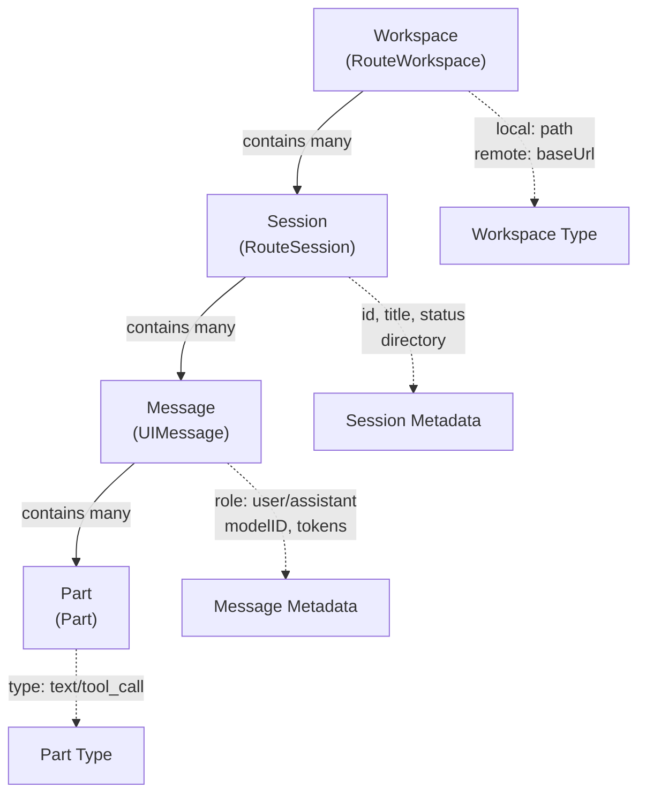
Sources: [apps/app/src/react-app/shell/route-workspaces.ts:82-84](), [apps/app/src/react-app/shell/route-workspaces.ts:88-90]()

---

## Workspaces

A **workspace** represents a project folder and working directory context for AI sessions. Workspaces map directly to an OpenCode workdir and can be local (managed host filesystem directory) or remote (OpenWork server or cloud container connection). The UI manages these via `RouteWorkspace` and `RouteSession` definitions [apps/app/src/react-app/shell/route-workspaces.ts:82-83]().

### Workspace Types and Routing

Workspaces are categorized by their execution environment and connection posture:
- **Local Workspaces**: Hosted on the local machine runner, interfacing directly with local filesystem paths [apps/app/src/react-app/shell/route-workspaces.ts:53-54]().
- **Remote Workspaces**: Accessed via an explicit `baseUrl` pointing to a managed OpenWork server or container [apps/app/src/react-app/shell/session-route.tsx:38-41]().

For details on workspace types, route state management, and desktop initialization, see [Workspaces and Routing](#3.1.1).

Sources: [apps/app/src/react-app/shell/route-workspaces.ts:82-83](), [apps/app/src/react-app/shell/session-route.tsx:38-41]()

---

## Sessions and Synchronization

A **session** represents an individual conversation thread and task runtime. Sessions manage an ordered collection of messages, state synchronization with the underlying engine, and background shell execution tracking [apps/app/src/react-app/domains/session/sync/session-sync.ts:101-153]().

### Session State and Transcript Reconcile

Sessions are coordinated via `ReactSessionRuntime` [apps/app/src/react-app/domains/session/sync/runtime-sync.ts]() and synchronized using background event polling and Server-Sent Events (SSE) through `session-sync.ts` [apps/app/src/react-app/domains/session/sync/session-sync.ts:90-99](). Message updates are reconciled incrementally against local stores [apps/app/src/react-app/domains/session/sync/transcript-reconcile.ts]().

For a detailed walkthrough of session lifecycles, synchronization, and history paging, see [Sessions and Synchronization](#3.1.2).

Sources: [apps/app/src/react-app/domains/session/sync/session-sync.ts:90-153](), [apps/app/src/react-app/domains/session/sync/runtime-sync.ts](), [apps/app/src/react-app/domains/session/sync/transcript-reconcile.ts]()

---

## Messages, Parts and Rendering

Messages form the atomic chat structure rendered in the UI. Each message contains text, reasoning steps, tool invocations, or media parts conforming to `UIMessage` structures [apps/app/src/react-app/domains/session/surface/session-surface.tsx:4]().

### Message Components and Pipelines

The message rendering pipeline transforms raw engine parts into interactive UI widgets:
- **Tool Aggregate Groups**: Group bulk tool operations (like file reads, searches, and edits) into collapsible headers [components/chat/message-list.tsx:120]().
- **Code-Mode & Capability Lines**: Render execution traces for subagents, capability calls, and MCP tool interactions [components/chat/message-list.tsx:105-116]().
- **Streaming & Markdown**: Processes incremental text parts, code blocks, and embedded UI components.

For complete coverage of the message list architecture, tool groups, and markdown rendering pipelines, see [Messages, Parts and Rendering](#3.1.3).

Sources: [apps/app/src/react-app/domains/session/surface/session-surface.tsx:4](), [components/chat/message-list.tsx:105-120]()

---

## Permission System and Operational Modes

The permission system secures agent operations by gating tool execution (such as terminal execution, file system modifications, or browser controls) behind approval boundaries handled by `ApprovalService` [apps/server/src/server.ts:16]().

### Approval Request Flow

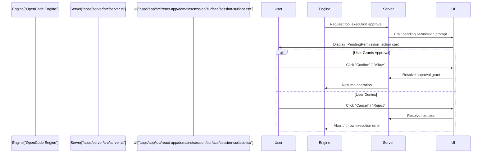
Sources: [apps/server/src/server.ts:16](), [apps/server/src/server.ts:14]()

For details on tool approvals, direct vs orchestrated engine runtimes, and session admission control, see [Permission System and Operational Modes](#3.1.4).

Sources: [apps/server/src/server.ts:14-16]()

---

# Page: Workspaces and Routing

# Workspaces and Routing

<details>
<summary>Relevant source files</summary>

The following files were used as context for generating this wiki page:

- [apps/app/src/react-app/shell/desktop-local-openwork.ts](apps/app/src/react-app/shell/desktop-local-openwork.ts)
- [apps/app/src/react-app/shell/openwork-connection.ts](apps/app/src/react-app/shell/openwork-connection.ts)
- [apps/app/src/react-app/shell/route-refresh-control.ts](apps/app/src/react-app/shell/route-refresh-control.ts)
- [apps/app/src/react-app/shell/route-workspaces.ts](apps/app/src/react-app/shell/route-workspaces.ts)
- [apps/app/src/react-app/shell/use-workspace-route-state.ts](apps/app/src/react-app/shell/use-workspace-route-state.ts)
- [apps/app/tests/archived-session-sort.test.ts](apps/app/tests/archived-session-sort.test.ts)
- [apps/app/tests/use-workspace-route-state.test.tsx](apps/app/tests/use-workspace-route-state.test.tsx)
- [apps/desktop/electron/workspace-store.mjs](apps/desktop/electron/workspace-store.mjs)
- [docs/features/archived-session-ordering.md](docs/features/archived-session-ordering.md)
- [packages/docs/start-here/do-work-with-it/workflows.mdx](packages/docs/start-here/do-work-with-it/workflows.mdx)

</details>


This page details the technical implementation of workspaces, routing state management, desktop runtime booting, connection resolution, and session lifecycle operations (archive, pin, and ordering) within OpenWork.

---

## 1. Workspace Types and Data Structures

A **workspace** in OpenWork defines a working directory context and configuration boundary for AI sessions. Workspaces maintain lists of active sessions, local tool definitions, and engine configuration bindings.

There are two primary workspace classifications:
- **Local Workspaces**: Filesystem directories managed via local OpenWork server instances and OpenCode engines.
- **Remote / Cloud Workspaces**: Connected remote endpoints (such as cloud workers hosted in the Den control plane) accessed via a remote client proxy.

Workspaces are mapped into normalized types within route helper modules (`RouteWorkspace` and `RouteSession`) [apps/app/src/react-app/shell/route-workspaces.ts:21-34](). The desktop client persists workspace configurations via `workspace-store.mjs` into `openwork-workspaces.json` [apps/desktop/electron/workspace-store.mjs:18-23]() through user data path resolvers [apps/desktop/electron/workspace-store.mjs:167-171]().

Sources: [apps/desktop/electron/workspace-store.mjs:18-23](), [apps/desktop/electron/workspace-store.mjs:167-171](), [apps/app/src/react-app/shell/route-workspaces.ts:21-34]()

---

## 2. Desktop Runtime Boot and Connection Resolution

When running in an Electron or desktop environment, the client initializes through connection resolver modules and local instance guards. 

The following diagram bridges high-level desktop startup intents (Natural Language Space) to exact runtime initialization functions (Code Entity Space):

Title: "Desktop Runtime Boot and Connection Flow"
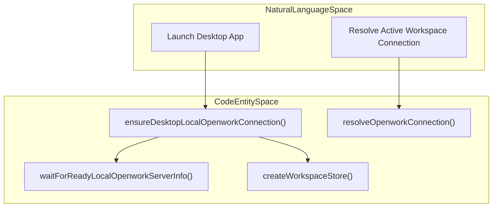
Sources: [apps/app/src/react-app/shell/openwork-connection.ts:61-136](), [apps/app/src/react-app/shell/desktop-local-openwork.ts:129-185](), [apps/desktop/electron/workspace-store.mjs:135-153]()

### Connection Resolution Mechanics
`resolveOpenworkConnection` inspects gateway origins, local server settings overrides, and active workspace parameters to compute a `ResolvedOpenworkConnection` containing the target normalized base URL and authentication tokens [apps/app/src/react-app/shell/openwork-connection.ts:61-136](). Local desktop-hosted servers expose ephemeral loopback ports and freshly minted tokens on every boot, handled by `ensureDesktopLocalOpenworkConnection` [apps/app/src/react-app/shell/desktop-local-openwork.ts:129-185]().

Sources: [apps/app/src/react-app/shell/openwork-connection.ts:61-136](), [apps/app/src/react-app/shell/desktop-local-openwork.ts:129-185]()

---

## 3. Workspace Route State and Coalescing

The frontend manages route-level synchronization using `useWorkspaceRouteState`, which coordinates active workspace selection, URL-derived session loading, endpoint resolution, and error classification [apps/app/src/react-app/shell/use-workspace-route-state.ts:142-169]().

To prevent race conditions between rapid workspace switches or parallel background synchronization, route updates use deterministic transaction committers (`createRouteWorkspaceSelectionCommitter`) and request coalescers (`createRouteWorkspaceLoadCoalescer`) [apps/app/src/react-app/shell/route-refresh-control.ts:85-174]().

The diagram below maps route-navigation concepts to their underlying state management and refresh logic entities:

Title: "Route Coalescing and State Management"
```mermaid
graph TD
    subgraph "NaturalLanguageSpace"
        NL_SWITCH["Switch Workspace / Session Route"]
        NL_ERROR["Handle Route Loading Failure"]
    end

    subgraph "CodeEntitySpace"
        ROUTE_STATE["useWorkspaceRouteState()"]
        COMMITTER["createRouteWorkspaceSelectionCommitter()"]
        COALESCER["createRouteWorkspaceLoadCoalescer()"]
        LIST_SESSIONS["listRouteSessions()"]
        V2_LIST["v2RouteSessionList()"]
    end

    NL_SWITCH --> ROUTE_STATE
    ROUTE_STATE --> COMMITTER
    ROUTE_STATE --> COALESCER
    COALESCER --> LIST_SESSIONS
    LIST_SESSIONS --> V2_LIST
```
Sources: [apps/app/src/react-app/shell/use-workspace-route-state.ts:142-169](), [apps/app/src/react-app/shell/route-refresh-control.ts:85-174](), [apps/app/src/react-app/shell/route-workspaces.ts:46-58]()

Sources: [apps/app/src/react-app/shell/use-workspace-route-state.ts:142-169](), [apps/app/src/react-app/shell/route-refresh-control.ts:85-174](), [apps/app/src/react-app/shell/route-workspaces.ts:46-58]()

---

## 4. Session Archive, Pinning, and Ordering

Sidebar session inventory management is governed by organizing rules across workspaces, groups, and global archive buckets [packages/docs/start-here/do-work-with-it/workflows.mdx:1-89]().

### Operational Rules for Session State
- **Pinning**: Pinned chats appear in the **Pinned** section at the top of the sidebar, across all workspaces [packages/docs/start-here/do-work-with-it/workflows.mdx:12-20]().
- **Groups**: Groups act as folders within a workspace for staging active work or filtering topics [packages/docs/start-here/do-work-with-it/workflows.mdx:27-57]().
- **Archive and Ordering**: Archived chats are moved to the global **Archived** section at the bottom of the sidebar. Global archive ordering relies on most recently archived first (`time.archived` descending), followed by workspace ID and session ID ascending for deterministic ties [docs/features/archived-session-ordering.md:35-37](). Restoring removes the item from the archive, while rearchiving assigns a new archive timestamp [docs/features/archived-session-ordering.md:35-37]().

Sources: [packages/docs/start-here/do-work-with-it/workflows.mdx:1-89](), [docs/features/archived-session-ordering.md:35-37](), [apps/app/tests/archived-session-sort.test.ts:26-38]()

---

# Page: Sessions and Synchronization

# Sessions and Synchronization

<details>
<summary>Relevant source files</summary>

The following files were used as context for generating this wiki page:

- [apps/app/src/app/lib/opencode-interruption.ts](apps/app/src/app/lib/opencode-interruption.ts)
- [apps/app/src/app/lib/opencode-session-native.ts](apps/app/src/app/lib/opencode-session-native.ts)
- [apps/app/src/app/lib/opencode.ts](apps/app/src/app/lib/opencode.ts)
- [apps/app/src/app/lib/openwork-server.ts](apps/app/src/app/lib/openwork-server.ts)
- [apps/app/src/components/chat/message-list-provider.tsx](apps/app/src/components/chat/message-list-provider.tsx)
- [apps/app/src/components/chat/message-list.tsx](apps/app/src/components/chat/message-list.tsx)
- [apps/app/src/components/chat/progressive-message-list.tsx](apps/app/src/components/chat/progressive-message-list.tsx)
- [apps/app/src/i18n/locales/en.ts](apps/app/src/i18n/locales/en.ts)
- [apps/app/src/react-app/domains/connections/provider-auth/store.ts](apps/app/src/react-app/domains/connections/provider-auth/store.ts)
- [apps/app/src/react-app/domains/session/chat/session-page.tsx](apps/app/src/react-app/domains/session/chat/session-page.tsx)
- [apps/app/src/react-app/domains/session/sidebar/app-sidebar-provider.tsx](apps/app/src/react-app/domains/session/sidebar/app-sidebar-provider.tsx)
- [apps/app/src/react-app/domains/session/sidebar/app-sidebar.tsx](apps/app/src/react-app/domains/session/sidebar/app-sidebar.tsx)
- [apps/app/src/react-app/domains/session/sidebar/utils.ts](apps/app/src/react-app/domains/session/sidebar/utils.ts)
- [apps/app/src/react-app/domains/session/status/session-activity-store.ts](apps/app/src/react-app/domains/session/status/session-activity-store.ts)
- [apps/app/src/react-app/domains/session/status/session-attention.ts](apps/app/src/react-app/domains/session/status/session-attention.ts)
- [apps/app/src/react-app/domains/session/surface/composer-state-store.ts](apps/app/src/react-app/domains/session/surface/composer-state-store.ts)
- [apps/app/src/react-app/domains/session/surface/queued-drain-machine.ts](apps/app/src/react-app/domains/session/surface/queued-drain-machine.ts)
- [apps/app/src/react-app/domains/session/surface/scroll-controller.ts](apps/app/src/react-app/domains/session/surface/scroll-controller.ts)
- [apps/app/src/react-app/domains/session/surface/scroll-store.ts](apps/app/src/react-app/domains/session/surface/scroll-store.ts)
- [apps/app/src/react-app/domains/session/surface/session-history-pages.ts](apps/app/src/react-app/domains/session/surface/session-history-pages.ts)
- [apps/app/src/react-app/domains/session/surface/session-history.tsx](apps/app/src/react-app/domains/session/surface/session-history.tsx)
- [apps/app/src/react-app/domains/session/surface/session-render-state.ts](apps/app/src/react-app/domains/session/surface/session-render-state.ts)
- [apps/app/src/react-app/domains/session/surface/session-surface.tsx](apps/app/src/react-app/domains/session/surface/session-surface.tsx)
- [apps/app/src/react-app/domains/session/sync/env-context.ts](apps/app/src/react-app/domains/session/sync/env-context.ts)
- [apps/app/src/react-app/domains/session/sync/global-queue-drainer.ts](apps/app/src/react-app/domains/session/sync/global-queue-drainer.ts)
- [apps/app/src/react-app/domains/session/sync/message-merge.ts](apps/app/src/react-app/domains/session/sync/message-merge.ts)
- [apps/app/src/react-app/domains/session/sync/session-sync.ts](apps/app/src/react-app/domains/session/sync/session-sync.ts)
- [apps/app/src/react-app/domains/session/sync/transcript-reconcile.ts](apps/app/src/react-app/domains/session/sync/transcript-reconcile.ts)
- [apps/app/src/react-app/domains/session/sync/use-session-interactions.ts](apps/app/src/react-app/domains/session/sync/use-session-interactions.ts)
- [apps/app/src/react-app/domains/session/sync/usechat-adapter.ts](apps/app/src/react-app/domains/session/sync/usechat-adapter.ts)
- [apps/app/src/react-app/shell/session-route.tsx](apps/app/src/react-app/shell/session-route.tsx)
- [apps/app/src/react-app/shell/settings-route.tsx](apps/app/src/react-app/shell/settings-route.tsx)
- [apps/app/tests/opencode-session-native.test.ts](apps/app/tests/opencode-session-native.test.ts)
- [apps/app/tests/opencode-stream-timeout.test.ts](apps/app/tests/opencode-stream-timeout.test.ts)
- [apps/app/tests/session-history.test.tsx](apps/app/tests/session-history.test.tsx)
- [apps/app/tests/session-scroll.test.tsx](apps/app/tests/session-scroll.test.tsx)
- [apps/app/tests/session-send-isolation.test.ts](apps/app/tests/session-send-isolation.test.ts)
- [apps/app/tests/session-stop-refresh.test.ts](apps/app/tests/session-stop-refresh.test.ts)
- [apps/server/src/server.ts](apps/server/src/server.ts)

</details>


This page covers section 3.1.2 of the OpenWork architecture: session lifecycle, real-time synchronization, transcript reconciliation, message merging, the queued drain machine, scroll/history paging, and the activity/attention stores.

---

## Data Model and Lifecycle

A session represents an individual conversation thread with the AI agent within OpenWork. Each session maintains its own message history, task list (todos), and execution context.

### Session Structure

The frontend interacts with sessions through two primary lenses: the **Snapshot** (a point-in-time state from the server) and the **Live Stream** (real-time updates via SSE).

```mermaid
graph TB
    subgraph "Code Entity Space: @opencode-ai/sdk"
        Session["Session Object"]
        Session --> id["id: string"]
        Session --> title["title: string"]
        Session --> time["time: { created, updated, archived }"]
        Session --> parentID["parentID: string (for forks)"]
    end
    
    subgraph "Code Entity Space: apps/app/src/app/lib/openwork-server.ts"
        Snapshot["OpenworkSessionSnapshot"]
        Snapshot --> s_session["session: Session"]
        Snapshot --> s_messages["messages: MessageWithParts[]"]
        Snapshot --> s_status["status: SessionStatus"]
        Snapshot --> s_todos["todos: Todo[]"]
    end

    Session -.->|"Contained in"| Snapshot
```

**Sources:** [apps/app/src/app/lib/openwork-server.ts:1-100](), [apps/app/src/react-app/domains/session/sync/session-sync.ts:36-40]()

### Session Management Primitives

OpenWork provides several operations to manage the session lifecycle via helper modules like `opencode-session.ts`:

| Operation | Function | Description |
|-----------|----------|-------------|
| **Abort** | `abortSessionSafe` | Stops an active AI run. Handles safety checks to prevent UI crashes. [apps/app/src/react-app/shell/session-route.tsx:30-30]() |
| **Revert** | `revertSession` | Rolls back the conversation to a specific message boundary. [apps/app/src/react-app/shell/session-route.tsx:30-30]() |
| **Fork** | `forkSession` | Creates a new session branch starting from a specific message. [apps/app/src/react-app/shell/session-route.tsx:30-30]() |
| **Archive** | `setSessionArchived` | Non-destructively hides a session from the active list by stamping `time.archived`. |
| **Compact** | `compactSession` | Summarizes long sessions to reduce LLM context window usage. |

**Sources:** [apps/app/src/react-app/shell/session-route.tsx:28-35]()

---

## Session Synchronization Architecture

Real-time session updates are handled by the `session-sync.ts` module, which manages `SyncEntry` objects to bridge the OpenCode SSE stream with the React application state.

### Real-time Event Handling

The application uses `session-sync.ts` to manage high-frequency events. To maintain UI performance, "deltas" (streaming tokens) are buffered and flushed in batches via request animation frames or background timers [apps/app/src/react-app/domains/session/sync/session-sync.ts:125-135]().

```mermaid
graph TB
    subgraph "Code Entity Space: apps/app/src/react-app/domains/session/sync/session-sync.ts"
        SSE["SSE Stream (OpencodeEvent)"] --> Sync["SyncEntry"]
        Sync --> Buffer["deltaFlushBuffer: PendingDelta[]"]
        Buffer --> Coalesce["coalescePendingDeltas"]
        Coalesce --> RQ["React Query cache commit"]
    end
```

**Sources:** [apps/app/src/react-app/domains/session/sync/session-sync.ts:110-155](), [apps/app/src/react-app/domains/session/sync/session-transcript-deltas.ts:50-65]()

### Transcript Reconciliation and Message Merging

The rendered transcript is a hybrid of the persisted history (`OpenworkSessionSnapshot`) and the live stream updates. The reconciliation logic ensures data integrity:

*   **Deduplication & Revert Curation:** `transcript-reconcile.ts` applies revert cursors and reconciles live message structures.
*   **Chronological Message Merge:** `message-merge.ts` implements `upsertMessageByChronology` to interleave new messages and parts smoothly without layout thrashing [apps/app/src/react-app/domains/session/sync/session-sync.ts:38-40]().

**Sources:** [apps/app/src/react-app/domains/session/sync/session-sync.ts:35-45](), [apps/app/src/react-app/domains/session/sync/message-merge.ts:1-20]()

---

## Queued Drain Machine and Composer State

When users submit messages while an agent run is active, messages are intercepted by the queued drain state machine (`queued-drain-machine.ts`) [apps/app/src/react-app/domains/session/surface/session-surface.tsx:72-79](). 

```mermaid
graph LR
    subgraph "Code Entity Space: apps/app/src/react-app/domains/session/surface"
        Draft["Composer Drafts Store"] --> Drain["Queued Drain Machine"]
        Drain --> Submit["Engine Submit / Prompt Async"]
    end
```

The queued drain machine manages pending submissions, handling retries, automatic draining upon turn completion, and failure recovery without duplicating inputs.

**Sources:** [apps/app/src/react-app/domains/session/surface/session-surface.tsx:70-80](), [apps/app/src/react-app/domains/session/surface/queued-drain-machine.ts:1-35]()

---

## Scroll and History Paging

To maintain responsiveness over long conversation histories, OpenWork implements progressive virtualized paging using TanStack Virtual and custom scroll controllers.

```mermaid
graph TB
    subgraph "Code Entity Space: apps/app/src/react-app/domains/session/surface"
        ScrollStore["useSessionScrollStore"] --> Controller["useSessionScrollController"]
        Controller --> VirtualList["ProgressiveMessageList"]
        VirtualList --> Pages["useSessionHistoryPages"]
    end
```

*   **Virtualization:** `ProgressiveMessageList` utilizes virtualization to manage message groups and maintain stable scroll anchors [apps/app/src/components/chat/progressive-message-list.tsx:65-75]().
*   **Scroll Store:** `scroll-store.ts` tracks anchor positions, geometry owners, and sticky-bottom states across sessions [apps/app/src/react-app/domains/session/surface/scroll-store.ts:1-25]().

**Sources:** [apps/app/src/react-app/domains/session/surface/scroll-controller.ts:1-50](), [apps/app/src/react-app/domains/session/surface/scroll-store.ts:1-30](), [apps/app/src/components/chat/progressive-message-list.tsx:60-80]()

---

## Activity and Attention Stores

OpenWork uses dedicated Zustand stores to track ongoing execution and user attention requirements across sessions.

*   **Activity Store (`session-activity-store.ts`):** Tracks real-time states such as execution phases, tool calls, and background sync status [apps/app/src/react-app/domains/session/sync/session-sync.ts:40-45]().
*   **Attention Store (`session-attention.ts`):** Identifies sessions requiring user input (e.g., `waiting` status or permission requests) so notification badges and indicators update correctly.

**Sources:** [apps/app/src/react-app/domains/session/sync/session-sync.ts:40-45](), [apps/app/src/react-app/domains/session/status/session-attention.ts:1-20]()

---

## Key Code Entities

| Entity | Location | Purpose |
|--------|----------|---------|
| `SyncEntry` / `session-sync.ts` | [apps/app/src/react-app/domains/session/sync/session-sync.ts:111-155]() | Manages SSE streams, delta buffering, and event listeners for active sessions. |
| `reconcileTranscriptMessages` | [apps/app/src/react-app/domains/session/sync/transcript-reconcile.ts:1-20]() | Reconciles server snapshots and live SSE streaming messages. |
| `upsertMessageByChronology` | [apps/app/src/react-app/domains/session/sync/message-merge.ts:1-15]() | Merges incoming transcript parts chronologically. |
| `useSessionScrollController` | [apps/app/src/react-app/domains/session/surface/scroll-controller.ts:1-40]() | Manages user scroll interactions, sticky bottom state, and anchor restoration. |
| `ProgressiveMessageList` | [apps/app/src/components/chat/progressive-message-list.tsx:65-75]() | Virtualized list component for efficient rendering of long conversation histories. |

**Sources:** [apps/app/src/react-app/domains/session/sync/session-sync.ts:111-155](), [apps/app/src/react-app/domains/session/sync/transcript-reconcile.ts:1-20](), [apps/app/src/react-app/domains/session/sync/message-merge.ts:1-15](), [apps/app/src/react-app/domains/session/surface/scroll-controller.ts:1-40](), [apps/app/src/components/chat/progressive-message-list.tsx:65-75]()

---

# Page: Messages, Parts and Rendering

# Messages, Parts and Rendering

<details>
<summary>Relevant source files</summary>

The following files were used as context for generating this wiki page:

- [apps/app/src/app/index.css](apps/app/src/app/index.css)
- [apps/app/src/app/lib/opencode-v2-adapter.ts](apps/app/src/app/lib/opencode-v2-adapter.ts)
- [apps/app/src/components/chat/capability-call-line.tsx](apps/app/src/components/chat/capability-call-line.tsx)
- [apps/app/src/components/chat/code-mode-tool.tsx](apps/app/src/components/chat/code-mode-tool.tsx)
- [apps/app/src/components/chat/image-attachment-badge.tsx](apps/app/src/components/chat/image-attachment-badge.tsx)
- [apps/app/src/components/chat/image-lightbox.tsx](apps/app/src/components/chat/image-lightbox.tsx)
- [apps/app/src/components/chat/subagent-run-line.tsx](apps/app/src/components/chat/subagent-run-line.tsx)
- [apps/app/src/components/chat/tool-aggregate-group.tsx](apps/app/src/components/chat/tool-aggregate-group.tsx)
- [apps/app/src/components/chat/utils.ts](apps/app/src/components/chat/utils.ts)
- [apps/app/src/components/markdown/link-action-menu.tsx](apps/app/src/components/markdown/link-action-menu.tsx)
- [apps/app/src/components/markdown/markdown-primitive.ts](apps/app/src/components/markdown/markdown-primitive.ts)
- [apps/app/src/components/markdown/markdown.tsx](apps/app/src/components/markdown/markdown.tsx)
- [apps/app/src/components/ui/image.tsx](apps/app/src/components/ui/image.tsx)
- [apps/app/src/lib/capability-call.ts](apps/app/src/lib/capability-call.ts)
- [apps/app/src/lib/code-mode-summary.ts](apps/app/src/lib/code-mode-summary.ts)
- [apps/app/src/lib/code-mode-tools.ts](apps/app/src/lib/code-mode-tools.ts)
- [apps/app/src/lib/target-provider.ts](apps/app/src/lib/target-provider.ts)
- [apps/app/src/lib/tool-aggregate.test.ts](apps/app/src/lib/tool-aggregate.test.ts)
- [apps/app/src/lib/tool-aggregate.ts](apps/app/src/lib/tool-aggregate.ts)
- [apps/app/src/react-app/domains/session/surface/markdown.tsx](apps/app/src/react-app/domains/session/surface/markdown.tsx)
- [apps/app/src/react-app/domains/session/sync/parse-tool-parts.test.ts](apps/app/src/react-app/domains/session/sync/parse-tool-parts.test.ts)
- [apps/app/src/react-app/domains/session/sync/parse-tool-parts.ts](apps/app/src/react-app/domains/session/sync/parse-tool-parts.ts)
- [apps/server/src/opencode-plugins/workspace-file-destinations.ts](apps/server/src/opencode-plugins/workspace-file-destinations.ts)
- [apps/server/test/workspace-file-destinations.test.ts](apps/server/test/workspace-file-destinations.test.ts)
- [ee/apps/den-api/src/mcp/capability-tool.ts](ee/apps/den-api/src/mcp/capability-tool.ts)
- [evals/packages/labs/src/mock-mcp.ts](evals/packages/labs/src/mock-mcp.ts)
- [evals/proofs/workspace-write-outcome.proof.test.ts](evals/proofs/workspace-write-outcome.proof.test.ts)
- [evals/scripts/journey-catalog.mjs](evals/scripts/journey-catalog.mjs)
- [evals/scripts/run-parity-proof.mjs](evals/scripts/run-parity-proof.mjs)
- [evals/scripts/run-parity-proof.test.mjs](evals/scripts/run-parity-proof.test.mjs)
- [evals/worlds/chat.ts](evals/worlds/chat.ts)
- [evals/worlds/library.ts](evals/worlds/library.ts)
- [evals/worlds/workspace-write-outcome.ts](evals/worlds/workspace-write-outcome.ts)
- [scripts/mock-oauth-mcp-server.mjs](scripts/mock-oauth-mcp-server.mjs)

</details>


## Purpose and Scope

This page documents the internal architecture of OpenWork's message list, content parts, and rendering pipelines (`apps/app/src/components/chat/message-list.tsx` [apps/app/src/components/chat/message-list.tsx:1-45]()). It covers how server-side snapshots and live streams are parsed into UI parts (`apps/app/src/react-app/domains/session/sync/parse-tool-parts.ts` [apps/app/src/react-app/domains/session/sync/parse-tool-parts.ts:1-20]()), how consecutive tool calls are aggregated into summaries (`apps/app/src/lib/tool-aggregate.ts` [apps/app/src/lib/tool-aggregate.ts:1-35]()), how capability-call and subagent-run lines are rendered, and how the markdown pipeline (`apps/app/src/components/markdown/markdown.tsx` [apps/app/src/components/markdown/markdown.tsx:1-40]()) handles streaming tokens and code-mode parts.

Sources: [apps/app/src/components/chat/message-list.tsx:1-45](), [apps/app/src/components/markdown/markdown.tsx:1-40](), [apps/app/src/react-app/domains/session/sync/parse-tool-parts.ts:1-20]()

---

## Message List and Transcript Architecture

The message list architecture reconciles authoritative server snapshots with live OpenCode engine streaming events into a list of `UIMessage` items.

**Natural Language to Code Entity Space: Transcript Mapping**

```mermaid
graph TB
    subgraph "Natural-Language-Space"
        NLUser["User Prompt & Attachments"]
        NLAssistant["Assistant Prose & Tool Actions"]
    end

    subgraph "Code-Entity-Space"
        Snap["OpenworkSessionSnapshot"]
        UIM["UIMessage"]
        Parts["UIMessage.parts (Text | Tool | File | Reasoning)"]
        ML["MessageList (apps/app/src/components/chat/message-list.tsx)"]
        
        Snap -->|"groupMessages()"| ML
        UIM -->|"contains"| Parts
        ML -->|"renders"| UIM
    end

    NLUser -.->|"Serialized to"| UIM
    NLAssistant -.->|"Parsed by parseDynamicToolUIPart"| Parts

    classDef default fill:none,stroke:#000,stroke-width:1px;
```

Sources: [apps/app/src/components/chat/message-list.tsx:1-45](), [apps/app/src/components/chat/utils.ts:140-168](), [apps/app/src/react-app/domains/session/sync/parse-tool-parts.ts:128-175]()

Messages are grouped consecutively by role via `groupMessages` (`apps/app/src/components/chat/utils.ts` [apps/app/src/components/chat/utils.ts:144-168]()). Assistant messages that consist solely of aggregatable tool parts are grouped into specialized UI aggregate containers.

Sources: [apps/app/src/components/chat/utils.ts:144-168](), [apps/app/src/lib/tool-aggregate.ts:28-34]()

---

## Part Types and Parsing Pipeline

Raw `ToolPart` entries emitted by the OpenCode engine v1/v2 are converted into `DynamicToolUIPart`, `TextUIPart`, or specialized tool parts by parsing utilities in `apps/app/src/react-app/domains/session/sync/parse-tool-parts.ts` [apps/app/src/react-app/domains/session/sync/parse-tool-parts.ts:1-20]().

### Part Type Mapping Reference

| Part Type | Detection / Function | Purpose | Implementation Source |
| :--- | :--- | :--- | :--- |
| **Text** | `part.type === "text"` | Natural language prose and markdown blocks | `apps/app/src/components/markdown/markdown.tsx` [apps/app/src/components/markdown/markdown.tsx:1-30]() |
| **Tool** | `isToolUIPart(part)` | Built-in tool invocations (bash, edit, read) | `apps/app/src/components/chat/message-list.tsx` [apps/app/src/components/chat/message-list.tsx:46-61]() |
| **Dynamic Tool** | `parseDynamicToolUIPart()` | MCP calls, external capabilities, code-mode | `apps/app/src/react-app/domains/session/sync/parse-tool-parts.ts` [apps/app/src/react-app/domains/session/sync/parse-tool-parts.ts:128-175]() |
| **Reasoning** | `isReasoningUIPart(part)` | Model thinking block / reasoning traces | `apps/app/src/components/chat/reasoning-block.tsx` [apps/app/src/components/chat/reasoning-block.tsx:1-10]() |
| **File** | `isFileUIPart(part)` | File attachments and asset references | `apps/app/src/components/chat/utils.ts` [apps/app/src/components/chat/utils.ts:40-96]() |

Sources: [apps/app/src/react-app/domains/session/sync/parse-tool-parts.ts:109-175](), [apps/app/src/components/chat/message-list.tsx:46-61]()

---

## Tool Aggregate Groups and Capability-Call Lines

### Tool Aggregation
To prevent vertical UI clutter when an agent executes multiple consecutive reads, writes, searches, or shell commands, `ToolAggregateGroup` merges them into a collapsible summary line (`apps/app/src/components/chat/tool-aggregate-group.tsx` [apps/app/src/components/chat/tool-aggregate-group.tsx:1-35]()).

```mermaid
graph TD
    subgraph "Natural-Language-Space"
        NLGroup["Consecutive File Edits / Shell Commands"]
        NLSingle["Individual Tool Execution or Failure"]
    end

    subgraph "Code-Entity-Space"
        TAG["ToolAggregateGroup (apps/app/src/components/chat/tool-aggregate-group.tsx)"]
        BAG["buildAggregateRows()"]
        CCL["CapabilityCallLine (apps/app/src/components/chat/capability-call-line.tsx)"]
        
        BAG -->|"Collapses identical paths/reads"| TAG
        CCL -->|"Renders sentences + TechnicalDetailsPanel"| NLSingle
    end

    NLGroup -.->|"Grouped by tool family"| TAG
    NLSingle -.->|"Rendered via"| CCL

    classDef default fill:none,stroke:#000,stroke-width:1px;
```

Sources: [apps/app/src/components/chat/tool-aggregate-group.tsx:1-45](), [apps/app/src/lib/tool-aggregate.ts:1-40](), [apps/app/src/components/chat/capability-call-line.tsx:100-172]()

`buildAggregateRows` examines tool parts and interleaves model thoughts (`AggregateThought`) to maintain strict chronological order while grouping repeated file reads (`apps/app/src/components/chat/tool-aggregate-group.tsx` [apps/app/src/components/chat/tool-aggregate-group.tsx:161-182]()).

Sources: [apps/app/src/components/chat/tool-aggregate-group.tsx:161-182](), [apps/app/src/lib/tool-aggregate.ts:1-27]()

### Capability-Call Lines
External MCP tools and connectors are rendered as natural language sentences via `CapabilityCallLine` (`apps/app/src/components/chat/capability-call-line.tsx` [apps/app/src/components/chat/capability-call-line.tsx:156-172]()). Errors include actionable reconnection prompts and a collapsible `TechnicalDetailsPanel` showing raw inputs/outputs (`apps/app/src/components/chat/capability-call-line.tsx` [apps/app/src/components/chat/capability-call-line.tsx:99-120]()).

Sources: [apps/app/src/components/chat/capability-call-line.tsx:84-120](), [apps/app/src/components/chat/capability-call-line.tsx:156-172]()

---

## Subagent Run Lines and Tool Lifecycles

Subagent execution tasks spawned by the model are represented by `SubagentRunLine` (`apps/app/src/components/chat/subagent-run-line.tsx` [apps/app/src/components/chat/subagent-run-line.tsx:71-105]()).

```mermaid
graph TD
    subgraph "Code-Entity-Space"
        SRL["SubagentRunLine"]
        SRA["subagentRunActivity()"]
        Store["useSessionActivityStore"]
        TaskPart["TaskToolPart"]

        TaskPart -->|"childSessionId"| SRL
        Store -->|"SessionStatus / permissionPending"| SRA
        SRA -->|"Computes UI state (waiting-permission, running, failed)"| SRL
    end

    classDef default fill:none,stroke:#000,stroke-width:1px;
```

Sources: [apps/app/src/components/chat/subagent-run-line.tsx:29-54](), [apps/app/src/components/chat/subagent-run-line.tsx:71-105]()

`subagentRunActivity` calculates the active presentation state based on permission requests, connection degradation, child failures, and liveness checks (`apps/app/src/components/chat/subagent-run-line.tsx` [apps/app/src/components/chat/subagent-run-line.tsx:29-54]()). Clicking the subagent card opens the child session directly in the main workspace chat surface.

Sources: [apps/app/src/components/chat/subagent-run-line.tsx:66-70](), [apps/app/src/components/chat/subagent-run-line.tsx:71-105]()

---

## Markdown Pipeline, Code-Mode Tool Parts, and Streaming

### Markdown Rendering Pipeline
Markdown blocks in chat messages and surfaces are processed by `MarkdownBlock` (`apps/app/src/react-app/domains/session/surface/markdown.tsx` [apps/app/src/react-app/domains/session/surface/markdown.tsx:13-74]()) and `MarkdownBlockInner` (`apps/app/src/components/markdown/markdown.tsx` [apps/app/src/components/markdown/markdown.tsx:84-118]()).

```mermaid
graph TD
    subgraph "Code-Entity-Space"
        MB["MarkdownBlock (surface/markdown.tsx)"]
        MBI["MarkdownBlockInner (markdown.tsx)"]
        Primitive["markdown-primitive.ts"]
        StreamR["createStreamingMarkdownRenderer"]
        Shiki["Shiki Syntax Highlighting"]

        MB -->|"Renders settled HTML"| Primitive
        MBI -->|"Streaming enabled"| StreamR
        Primitive -->|"Syntax Highlighting"| Shiki
    end

    classDef default fill:none,stroke:#000,stroke-width:1px;
```

Sources: [apps/app/src/components/markdown/markdown.tsx:84-118](), [apps/app/src/components/markdown/markdown-primitive.ts:1-30](), [apps/app/src/react-app/domains/session/surface/markdown.tsx:13-74]()

During streaming, `createStreamingMarkdownRenderer` parses text block-by-block so incoming tokens only re-render the active top-level block, preventing UI thread starvation (`apps/app/src/components/markdown/markdown.tsx` [apps/app/src/components/markdown/markdown.tsx:75-111]()).

Sources: [apps/app/src/components/markdown/markdown.tsx:75-111](), [apps/app/src/components/markdown/markdown-primitive.ts:15-30]()

### Code-Mode Tool Parts
Code-mode tool parts generated by OpenCode v2 engines include nested tool calls and execution details stored within provider metadata (`apps/app/src/app/lib/opencode-v2-adapter.ts` [apps/app/src/app/lib/opencode-v2-adapter.ts:35-41]()). These are rendered via specialized components that support syntax-highlighted code execution traces and error attribution (`apps/app/src/components/chat/capability-call-line.tsx` [apps/app/src/components/chat/capability-call-line.tsx:100-120]()).

Sources: [apps/app/src/app/lib/opencode-v2-adapter.ts:35-41](), [apps/app/src/components/chat/capability-call-line.tsx:100-120]()

---

# Page: Permission System and Operational Modes

# Permission System and Operational Modes

<details>
<summary>Relevant source files</summary>

The following files were used as context for generating this wiki page:

- [DESIGN.md](DESIGN.md)
- [apps/app/src/components/chat/connection-card.tsx](apps/app/src/components/chat/connection-card.tsx)
- [apps/app/src/components/tools/error-attribution.ts](apps/app/src/components/tools/error-attribution.ts)
- [apps/app/src/components/tools/use-chat-tool-reconnect.ts](apps/app/src/components/tools/use-chat-tool-reconnect.ts)
- [apps/app/src/components/ui/hover-card.tsx](apps/app/src/components/ui/hover-card.tsx)
- [apps/app/src/components/ui/popover.tsx](apps/app/src/components/ui/popover.tsx)
- [apps/app/src/components/ui/tool.tsx](apps/app/src/components/ui/tool.tsx)
- [apps/app/src/lib/build-in-tools.ts](apps/app/src/lib/build-in-tools.ts)
- [apps/app/src/lib/latest-assistant-tool-parts.ts](apps/app/src/lib/latest-assistant-tool-parts.ts)
- [apps/app/src/lib/tool-activity.ts](apps/app/src/lib/tool-activity.ts)
- [apps/app/src/react-app/domains/session/panel/debug-rail-slot.tsx](apps/app/src/react-app/domains/session/panel/debug-rail-slot.tsx)
- [apps/app/src/react-app/domains/session/surface/composer/composer-suggestion-menu.tsx](apps/app/src/react-app/domains/session/surface/composer/composer-suggestion-menu.tsx)
- [apps/app/src/react-app/domains/session/surface/debug-panel.tsx](apps/app/src/react-app/domains/session/surface/debug-panel.tsx)
- [apps/app/src/react-app/domains/session/surface/debug-providers.tsx](apps/app/src/react-app/domains/session/surface/debug-providers.tsx)
- [apps/app/src/react-app/domains/session/surface/debug-resources.tsx](apps/app/src/react-app/domains/session/surface/debug-resources.tsx)
- [apps/app/src/react-app/domains/session/surface/mcp-chat-reconnect.ts](apps/app/src/react-app/domains/session/surface/mcp-chat-reconnect.ts)
- [apps/app/tests/floating-surface-guard.test.ts](apps/app/tests/floating-surface-guard.test.ts)
- [evals/core/agent-permissions.e2e.test.ts](evals/core/agent-permissions.e2e.test.ts)
- [evals/proofs/session-debug.proof.test.ts](evals/proofs/session-debug.proof.test.ts)
- [evals/worlds/engine-connectors-parity.ts](evals/worlds/engine-connectors-parity.ts)
- [evals/worlds/model-removal-cdp.ts](evals/worlds/model-removal-cdp.ts)
- [evals/worlds/session-debug.ts](evals/worlds/session-debug.ts)

</details>


## Purpose and Scope

This document details the permission system and operational runtime modes in OpenWork Desktop and Server. It covers tool-execution approvals, workspace run modes, direct versus orchestrated engine runtimes, and session lifecycle control mechanisms such as interruption, steering, and prompt admission.

---

## 1. Engine Operational Modes: Direct vs. Orchestrated Runtimes

OpenWork Desktop supports multiple runtime strategies that control how AI workspace services (`OpenCode`, `OpenWork Server`) are spawned, managed, and isolated. These modes determine the process lifecycle, persistence behavior, and multi-workspace capabilities.

OpenWork manages these processes within the Electron main process via the `runtime.mjs` module [apps/desktop/electron/runtime.mjs:1-25](). It distinguishes between two primary runtime strategies: `direct` and orchestrated server modes.

### Runtime Mode Architecture & Code Entities

Title: "Engine Runtime Lifecycle and Process Management"
```mermaid
graph TB
    subgraph "NaturalLanguageSpace"
        Config["Workspace Configuration State"]
        DirectMode["Direct Runtime Mode"]
        OrchMode["Orchestrated Server Mode"]
    end

    subgraph "CodeEntitySpace"
        RuntimeMjs["apps/desktop/electron/runtime.mjs"]
        CreateEngine["createEngineState()"]
        Snapshot["snapshotEngineState(state)"]
        ChildProcess["node:child_process"]
    end
    
    Config --> RuntimeMjs
    RuntimeMjs --> CreateEngine
    CreateEngine --> Snapshot
    Snapshot -->|"DIRECT_RUNTIME = 'direct'"| DirectMode
    Snapshot -->|"ORCHESTRATOR_RUNTIME"| OrchMode
    DirectMode --> ChildProcess
```
Sources: [apps/desktop/electron/runtime.mjs:1-40](), [apps/desktop/electron/runtime.mjs:105-138]()

### Key Characteristics

| Aspect | Direct Runtime | Orchestrated / Server Runtime |
|--------|----------------|-----------------------------|
| **Process Ownership** | Managed directly as a child process via `node:child_process` [apps/desktop/electron/runtime.mjs:2-10](). | Offloaded to a dedicated CLI daemon or local sidecar server. |
| **Persistence** | Services terminate when the desktop application closes [apps/desktop/electron/runtime.mjs:125-138](). | Persists independently of the Desktop UI, supporting background tasks. |
| **Port Management** | Assigns ports dynamically within a designated range (`48000–51000`) [apps/desktop/electron/runtime.mjs:27-30](). | Binds to configured or discovered server endpoints. |

Sources: [apps/desktop/electron/runtime.mjs:1-40](), [apps/desktop/electron/runtime.mjs:105-138]()

---

## 2. Workspace Run Modes and Execution Policies

Workspaces execute under specific operational constraints defined by workspace run modes. The OpenWork server maintains run-mode state per workspace using configuration stores and handlers.

### Implementation and Routing
- **Read & Write State**: Run modes are retrieved via `readWorkspaceRunMode()` and modified via `setWorkspaceRunMode()` [apps/server/src/server.ts:135-140]().
- **Execution Boundaries**: Run modes dictate whether an agent can perform autonomous mutations (e.g., executing shell scripts, modifying filesystem resources directly) or requires explicit step-by-step gatekeeping.

Sources: [apps/server/src/server.ts:135-140]()

---

## 3. Tool-Execution Approvals and Permission System

When agents execute capabilities—such as shell commands, file modifications, or external API calls via Model Context Protocol (MCP) servers—OpenWork enforces strict authorization guardrails through its approval and permission system.

### Approval Service Architecture & Code Entities

Title: "Tool Execution Approval Flow and Error Attribution"
```mermaid
graph TB
    subgraph "NaturalLanguageSpace"
        Agent["AI Agent Execution"]
        ToolCall["Tool Execution Request"]
        Approval["User Authorization / Prompt"]
    end

    subgraph "CodeEntitySpace"
        ToolUi["apps/app/src/components/ui/tool.tsx"]
        ErrorAttr["apps/app/src/components/tools/error-attribution.ts"]
        UseReconnect["useChatToolReconnect()"]
        ApprovalService["ApprovalService"]
    end

    Agent --> ToolCall
    ToolCall --> ToolUi
    ToolUi --> UseReconnect
    UseReconnect --> ErrorAttr
    ErrorAttr --> ApprovalService
    ApprovalService -->|"Requires Confirmation"| Approval
```
Sources: [apps/app/src/components/ui/tool.tsx:1-50](), [apps/app/src/components/tools/error-attribution.ts:1-45]()

- **Approval Service**: The backend coordinates pending authorization states through an `ApprovalService` instance [apps/server/src/server.ts:14-16]().
- **Effective Permissions**: The system evaluates governing agents and summarizes effective permissions using helper utilities before granting tool access [apps/server/src/agent-context-diagnostics.js:1-25](), [apps/server/src/effective-permissions.js:130-140]().
- **Error Attribution & Reconnection**: When tool executions fail or require OAuth credentials, `error-attribution.ts` and `use-chat-tool-reconnect.ts` analyze error payloads and expose recovery actions [apps/app/src/components/tools/error-attribution.ts:100-140](), [apps/app/src/components/tools/use-chat-tool-reconnect.ts:35-65]().

Sources: [apps/server/src/server.ts:14-16](), [apps/server/src/agent-context-diagnostics.js:1-25](), [apps/server/src/effective-permissions.js:130-140](), [apps/app/src/components/ui/tool.tsx:1-201](), [apps/app/src/components/tools/error-attribution.ts:1-164](), [apps/app/src/components/tools/use-chat-tool-reconnect.ts:35-65]()

---

## 4. Session Interruption, Steering, and Admission

OpenWork provides granular control over active agent turns, allowing users to interrupt execution, steer responses mid-task, queue subsequent inputs, or handle prompt admissions.

### Session Interruption State Machine

Title: "Session Submission, Interruption, and Queue Draining"
```mermaid
graph TB
    subgraph "NaturalLanguageSpace"
        Submit["User Input / Steering"]
        Stop["Stop / Abort Request"]
    end

    subgraph "Session Surface"
        CheckState["sessionWorkHeld() / sessionNeedsStop()"]
        QueuedDrain["Queued Drain Machine [queued-drain-machine.ts]"]
    end

    subgraph "Engine Transport"
        Abort["abortSession() / interruptSessionTurn()"]
        Execute["submitImmediateSessionTurn()"]
    end

    Submit --> CheckState
    CheckState -->|"Agent Busy"| QueuedDrain
    CheckState -->|"Agent Idle"| Execute
    Stop --> Abort
    QueuedDrain -->|"Drain when Idle"| Execute
```
Sources: [apps/app/src/react-app/domains/session/surface/session-surface.tsx:12-80]()

### Key Control Functions
- **Interruption**: Users can abort active turns using `abortSession()` and `interruptSessionTurn()` [apps/app/src/react-app/domains/session/surface/session-surface.tsx:12-16]().
- **Admission & Queuing**: The queued drain machine (`queued-drain-machine.ts`) manages prompts submitted while an agent is executing, determining whether a submission should be sent immediately (`Steer`) or buffered until task completion (`Queue`) [apps/app/src/react-app/domains/session/surface/session-surface.tsx:70-80]().

Sources: [apps/app/src/react-app/domains/session/surface/session-surface.tsx:12-16](), [apps/app/src/react-app/domains/session/surface/session-surface.tsx:70-80]()

---

# Page: Composer and Input

# Composer and Input

<details>
<summary>Relevant source files</summary>

The following files were used as context for generating this wiki page:

- [apps/app/src/components/chat/composer-pill.tsx](apps/app/src/components/chat/composer-pill.tsx)
- [apps/app/src/components/chat/session-reference-link.tsx](apps/app/src/components/chat/session-reference-link.tsx)
- [apps/app/src/components/markdown/session-reference-html.ts](apps/app/src/components/markdown/session-reference-html.ts)
- [apps/app/src/components/model-select.tsx](apps/app/src/components/model-select.tsx)
- [apps/app/src/react-app/domains/session/chat/new-task-composer.tsx](apps/app/src/react-app/domains/session/chat/new-task-composer.tsx)
- [apps/app/src/react-app/domains/session/chat/session-empty-hero.tsx](apps/app/src/react-app/domains/session/chat/session-empty-hero.tsx)
- [apps/app/src/react-app/domains/session/modals/model-picker-modal.tsx](apps/app/src/react-app/domains/session/modals/model-picker-modal.tsx)
- [apps/app/src/react-app/domains/session/surface/composer/composer-chips.ts](apps/app/src/react-app/domains/session/surface/composer/composer-chips.ts)
- [apps/app/src/react-app/domains/session/surface/composer/composer-pills.ts](apps/app/src/react-app/domains/session/surface/composer/composer-pills.ts)
- [apps/app/src/react-app/domains/session/surface/composer/composer.tsx](apps/app/src/react-app/domains/session/surface/composer/composer.tsx)
- [apps/app/src/react-app/domains/session/surface/composer/editor.tsx](apps/app/src/react-app/domains/session/surface/composer/editor.tsx)
- [apps/app/src/react-app/domains/session/surface/use-displayed-messages.ts](apps/app/src/react-app/domains/session/surface/use-displayed-messages.ts)
- [apps/app/src/react-app/domains/session/sync/draft-parts.ts](apps/app/src/react-app/domains/session/sync/draft-parts.ts)
- [apps/app/tests/composer-session-reference-picker.test.tsx](apps/app/tests/composer-session-reference-picker.test.tsx)

</details>


The Composer is the primary interactive prompt construction interface within the OpenWork desktop and web workspaces (`apps/app/src/react-app/domains/session/surface/composer/composer.tsx` [apps/app/src/react-app/domains/session/surface/composer/composer.tsx:52-127]()). It provides a Lexical-backed multi-line rich text editor (`apps/app/src/react-app/domains/session/surface/composer/editor.tsx` [apps/app/src/react-app/domains/session/surface/composer/editor.tsx:69-87]()) that supports inline structural tokens such as `@agent`, `@file`, `@computer` mentions, slash commands, skill and connector tokens, image and file attachments, auto-send orchestration, draft persistence, and granular model behavior selection.

---

## Component Architecture and Lexical Integration

The composer architecture bridges user input tokens with structured prompt submission parts through a React component tree backed by the Lexical framework.

Title: "Composer Architecture and Code Mapping"
```mermaid
graph TB
    subgraph "Natural Language Space"
        UserTyping[""User Typing Prompt with @mentions & /commands""]
    end

    subgraph "Code Entity Space"
        SessionSurface[""SessionSurface<br/>(surface/session-surface.tsx)""]
        ReactSessionComposer[""ReactSessionComposer<br/>(surface/composer/composer.tsx)""]
        LexicalPromptEditor[""LexicalPromptEditor<br/>(surface/composer/editor.tsx)""]
        ComposerStateStore[""useComposerStateStore<br/>(surface/composer-state-store.ts)""]
        MentionNode[""ComposerMentionNode""]
        SlashNode[""ComposerSlashCommandNode""]
        SkillNode[""ComposerSkillNode""]
    end

    UserTyping --> LexicalPromptEditor
    LexicalPromptEditor --> MentionNode
    LexicalPromptEditor --> SlashNode
    LexicalPromptEditor --> SkillNode
    LexicalPromptEditor -->|onChange| ReactSessionComposer
    ReactSessionComposer -->|persistence| ComposerStateStore
    ReactSessionComposer -->|onSend| SessionSurface
```

Sources: [apps/app/src/react-app/domains/session/surface/session-surface.tsx:42-60](), [apps/app/src/react-app/domains/session/surface/composer/composer.tsx:52-127](), [apps/app/src/react-app/domains/session/surface/composer/editor.tsx:69-126]()

### Lexical Custom Nodes
The underlying editor uses custom Lexical text nodes to parse, render, and serialize structured elements:
- **`ComposerMentionNode`**: Encapsulates `@agent`, `@file`, and `@computer` references. Mentions are encoded via `encodeComposerMentionValue` to prevent spaces from breaking token parsers [apps/app/src/react-app/domains/session/surface/composer/editor.tsx:143-210]().
- **`ComposerSlashCommandNode`**: Renders `/command` triggers as stylized inline chips within the prompt flow [apps/app/src/react-app/domains/session/surface/composer/editor.tsx:211-250]().
- **`ComposerSkillNode`**: Handles skill invocation tokens such as connect-skill prompts (`encodeConnectSkillToken`) [apps/app/src/react-app/domains/session/surface/composer/editor.tsx:251-295](), [apps/app/src/react-app/domains/session/surface/composer/connect-skill-token.ts:1-20]()

Sources: [apps/app/src/react-app/domains/session/surface/composer/editor.tsx:143-295](), [apps/app/src/react-app/domains/session/surface/composer/mention-encoding.ts:1-18]()

---

## Mentions, Slash Commands, and Tokens

Autocomplete suggestions are dynamically filtered using `fuzzysort` (`apps/app/src/react-app/domains/session/surface/composer/composer.tsx` [apps/app/src/react-app/domains/session/surface/composer/composer.tsx:5-5]()) across multiple providers:
1. **Agents**: Retrieved via `listAgents()` to inject specific agent contexts (`apps/app/src/react-app/domains/session/surface/composer/composer.tsx` [apps/app/src/react-app/domains/session/surface/composer/composer.tsx:91-98]()).
2. **Files & Computers**: Filtered through `searchFiles(query)` and static computer target definitions (`apps/app/src/react-app/domains/session/surface/composer/composer.tsx` [apps/app/src/react-app/domains/session/surface/composer/composer.tsx:110-112](), `computer-mentions.ts` [apps/app/src/react-app/domains/session/surface/composer/computer-mentions.ts:1-15]()).
3. **Slash Commands & Skills**: Parsed via `parseSlashCommandInvocation` to resolve user-defined commands or marketplace skill tokens (`apps/app/src/react-app/domains/session/surface/composer/slash-command.ts` [apps/app/src/react-app/domains/session/surface/composer/slash-command.ts:1-40]()).

Sources: [apps/app/src/react-app/domains/session/surface/composer/composer.tsx:90-115](), [apps/app/src/react-app/domains/session/surface/composer/slash-command.ts:1-40]()

---

## File Attachments, Pasting, and Drafts

The composer manages binary and text attachments alongside prompt drafts:
- **Image Compression**: Images are normalized via `OffscreenCanvas` prior to upload, targeting a maximum dimension of 2048px and quality constraints (`apps/app/src/react-app/domains/session/surface/composer/composer.tsx` [apps/app/src/react-app/domains/session/surface/composer/composer.tsx:125-180]()).
- **Pasted Text Chips**: Large clipboard insertions are wrapped into `PastedTextChip` components to keep the prompt UI clean without discarding content (`apps/app/src/react-app/domains/session/surface/composer/pasted-text.ts` [apps/app/src/react-app/domains/session/surface/composer/pasted-text.ts:1-50]()).
- **Draft Persistence**: Draft texts, selections, and attachments are synchronized to the Zustand-backed session store via `useComposerStateStore` and saved using `saveSessionDraft` (`apps/app/src/react-app/domains/session/sync/draft-store.ts` [apps/app/src/react-app/domains/session/sync/draft-store.ts:1-40]()).

Sources: [apps/app/src/react-app/domains/session/surface/composer/composer.tsx:125-184](), [apps/app/src/react-app/domains/session/sync/draft-store.ts:1-40]()

---

## Auto-Send and Submission Workflows

Submissions can be configured for immediate execution, steering active turns, or queueing behind ongoing operations:
- **Send Actions**: `onSend`, `onSteer`, and `onQueue` coordinate prompt dispatch through the queued drain state machine (`apps/app/src/react-app/domains/session/surface/queued-drain-machine.ts` [apps/app/src/react-app/domains/session/surface/queued-drain-machine.ts:72-80]()).
- **Auto-Send**: Triggered automatically via contextual entrypoints or automated runners (`apps/app/src/react-app/domains/session/surface/composer-auto-send.ts` [apps/app/src/react-app/domains/session/surface/composer-auto-send.ts:1-50]()).

Sources: [apps/app/src/react-app/domains/session/surface/composer/composer.tsx:56-66](), [apps/app/src/react-app/domains/session/surface/queued-drain-machine.ts:70-85]()

---

## Model and Behavior Selection

Title: "Submission and Model Selection Pipeline"
```mermaid
graph LR
    subgraph "Natural Language Space"
        ModelSelectUI[""Model & Behavior Picker UI""]
    end

    subgraph "Code Entity Space"
        ComposerComponent[""ReactSessionComposer<br/>(composer.tsx)""]
        SessionRoute[""SessionRoute<br/>(session-route.tsx)""]
        SessionSurface[""SessionSurface<br/>(session-surface.tsx)""]
        OpenCodeClient[""OpenCode SDK Client<br/>(opencode.ts)""]
    end

    ModelSelectUI -->|onModelChange| ComposerComponent
    ComposerComponent -->|modelRef & variant| SessionRoute
    SessionRoute -->|session state| SessionSurface
    SessionSurface -->|shellInSession| OpenCodeClient
```

Sources: [apps/app/src/react-app/domains/session/surface/composer/composer.tsx:73-95](), [apps/app/src/react-app/shell/session-route.tsx:26-31](), [apps/app/src/react-app/domains/session/surface/session-surface.tsx:60-65]()

Users configure LLM targets and execution styles directly from the composer toolbar:
- **Model Selection**: Managed via `ModelSelect` and `ModelPickerModal` components, binding the selected `ModelRef` to the active session (`apps/app/src/react-app/shell/session-route.tsx` [apps/app/src/react-app/shell/session-route.tsx:107-110]()).
- **Model Behavior / Variant**: Allows tuning model variants or reasoning effort dimensions via `onModelVariantChange` (`apps/app/src/react-app/domains/session/surface/composer/composer.tsx` [apps/app/src/react-app/domains/session/surface/composer/composer.tsx:92-95]()).

Sources: [apps/app/src/react-app/domains/session/surface/composer/composer.tsx:73-95](), [apps/app/src/react-app/shell/session-route.tsx:105-112]()

---

# Page: Extensions and Integrations

# Extensions and Integrations

<details>
<summary>Relevant source files</summary>

The following files were used as context for generating this wiki page:

- [apps/app/src/app/constants.ts](apps/app/src/app/constants.ts)
- [apps/app/src/app/extensions.ts](apps/app/src/app/extensions.ts)
- [apps/app/src/app/mcp.ts](apps/app/src/app/mcp.ts)
- [apps/app/src/app/types.ts](apps/app/src/app/types.ts)
- [apps/app/src/react-app/design-system/extension-card.tsx](apps/app/src/react-app/design-system/extension-card.tsx)
- [apps/app/src/react-app/design-system/extension-detail-modal.tsx](apps/app/src/react-app/design-system/extension-detail-modal.tsx)
- [apps/app/src/react-app/domains/connections/cloud-inventory-cache.ts](apps/app/src/react-app/domains/connections/cloud-inventory-cache.ts)
- [apps/app/src/react-app/domains/connections/cloud-mcp-user-state.ts](apps/app/src/react-app/domains/connections/cloud-mcp-user-state.ts)
- [apps/app/src/react-app/domains/connections/mcp-auth-modal.tsx](apps/app/src/react-app/domains/connections/mcp-auth-modal.tsx)
- [apps/app/src/react-app/domains/connections/modals/add-mcp-modal.tsx](apps/app/src/react-app/domains/connections/modals/add-mcp-modal.tsx)
- [apps/app/src/react-app/domains/connections/store.ts](apps/app/src/react-app/domains/connections/store.ts)
- [apps/app/src/react-app/domains/settings/extension-registry.tsx](apps/app/src/react-app/domains/settings/extension-registry.tsx)
- [apps/app/src/react-app/domains/settings/extension-state.ts](apps/app/src/react-app/domains/settings/extension-state.ts)
- [apps/app/src/react-app/domains/settings/pages/extensions-view.tsx](apps/app/src/react-app/domains/settings/pages/extensions-view.tsx)
- [apps/app/src/react-app/domains/settings/pages/general-view.tsx](apps/app/src/react-app/domains/settings/pages/general-view.tsx)
- [apps/app/src/react-app/domains/settings/pages/mcp-view.tsx](apps/app/src/react-app/domains/settings/pages/mcp-view.tsx)
- [apps/app/src/react-app/domains/settings/settings-extension-controller.ts](apps/app/src/react-app/domains/settings/settings-extension-controller.ts)
- [apps/app/src/react-app/domains/settings/shell/settings-page.tsx](apps/app/src/react-app/domains/settings/shell/settings-page.tsx)

</details>


The OpenWork extensions surface in Settings provides a unified management plane for augmenting the AI's capabilities through skills, plugins, MCP (Model Context Protocol) servers, custom commands, and organization connectors. This parent page provides a high-level overview of the extension subsystem and links to detailed child pages for specific integration types.

For details on specific child topics, see:
- [Skills and Commands](#3.3.1)
- [MCP Servers and Connections](#3.3.2)
- [OpenCode Plugins and Extensions Preview](#3.3.3)
- [MCP Apps and Dashboards](#3.3.4)

---

## Overview of Extension Types

Extensions are categorized by their `ExtensionKind`, encompassing `mcp`, `plugin`, `skill`, `ui-control`, and `extension` [apps/app/src/app/constants.ts:27-27](). The system uses a declarative manifest-driven approach via `OpenWorkExtensionManifest` to define resources, setup requirements, platform compatibility, and lifecycle hooks [apps/app/src/app/extensions.ts:109-132]().

| Extension Category | Description | Configuration Source |
| :--- | :--- | :--- |
| **Skills** | Reusable instruction packs and workflows for agents. | `SKILL.md` / Workspace files |
| **Plugins** | Engine-level plugins extending OpenCode capabilities. | `opencode.json` / `opencode.jsonc` |
| **MCP Servers** | Standardized servers providing external tools and resources. | `opencode.jsonc` (`mcp` section) |
| **Commands & UI** | Custom composer slash commands and UI automation controls. | Manifests and local wrappers |
| **Connectors** | OAuth-backed integrations and cloud-managed MCP services. | Den API & Connections Store |

### Extension System Architecture

The following diagram bridges the user interface space (natural language and visual settings cards) with the underlying configuration storage and connection managers in code.

**Extension System Mapping**
```mermaid
graph TD
    subgraph "Natural Language Space (User UI)"
        A["McpView"] 
        B["ExtensionCard"]
        C["ExtensionDetailModal"]
    end

    subgraph "Code Entity Space (Implementation)"
        D["OpenWorkExtensionManifest"]
        E["OpencodeConfigFile"]
        F["McpServerEntry"]
        G["ExtensionsStore"]
        H["ConnectionsStore"]
    end

    A -- "Renders List" --> B
    A -- "Uses State" --> H
    B -- "Displays Metadata" --> D
    C -- "Actions (Connect/Hide)" --> G
    D -- "Defines Resources" --> E
    H -- "Tracks Health" --> F
    G -- "Manages Cloud Imports" --> E
    
    style D font-weight:bold
    style E font-weight:bold
    style F font-weight:bold
```
Sources: [apps/app/src/react-app/domains/settings/pages/mcp-view.tsx:1-188](), [apps/app/src/app/extensions.ts:109-132](), [apps/app/src/react-app/domains/connections/store.ts:93-105]()

---

## Skills and Commands

Skills allow users to inject domain-specific instructions into agent sessions, while custom commands provide shortcut triggers in the composer. The settings catalog organizes these items alongside installed tools.

For full details on just-in-time skill loading, cloud skills, templates, and command structures, see [Skills and Commands](#3.3.1).

Sources: [apps/app/src/app/extensions.ts:21-35](), [apps/app/src/react-app/domains/settings/pages/mcp-view.tsx:162-185]()

---

## MCP Servers and Connections

The Model Context Protocol integration supports both quick-connect remote endpoints (such as Notion, Linear, Sentry, and Stripe) and custom local servers [apps/app/src/app/constants.ts:98-142](). The `ConnectionsStore` tracks real-time connection health across states like `connected`, `needs_auth`, and `failed` [apps/app/src/react-app/domains/connections/store.ts:93-105]().

**MCP Lifecycle Management**
```mermaid
sequenceDiagram
    participant UI as McpView
    participant Store as ConnectionsStore
    participant Bridge as DesktopBridge
    participant Srv as McpServer

    UI->>Store: connectMcp(entry)
    Store->>Bridge: writeOpencodeConfig()
    Bridge-->>Srv: Spawn / Remote Connect
    Srv-->>Bridge: Capability Exchange
    Bridge-->>Store: Update mcpStatuses
    Store-->>UI: Render "connected" Badge
```
Sources: [apps/app/src/react-app/domains/settings/pages/mcp-view.tsx:1-188](), [apps/app/src/react-app/domains/connections/store.ts:93-105](), [apps/app/src/app/constants.ts:88-96]()

For details on local/org registration, OAuth flows, and health reconcilers, see [MCP Servers and Connections](#3.3.2).

Sources: [apps/app/src/react-app/domains/connections/store.ts:93-105](), [apps/app/src/app/constants.ts:98-142]()

---

## OpenCode Plugins and Extensions Preview

OpenCode plugins extend the backend engine runtime with hooks, custom providers, and additional tool capabilities. They are configured via `opencode.json` and managed through the plugins review view [apps/app/src/react-app/domains/settings/pages/extensions-view.tsx:128-147]().

For details on extension previews, capabilities knowledge, steering, and adapter configuration, see [OpenCode Plugins and Extensions Preview](#3.3.3).

Sources: [apps/app/src/app/types.ts:1-12](), [apps/app/src/react-app/domains/settings/pages/extensions-view.tsx:128-147]()

---

## MCP Apps and Dashboards

OpenWork integrates interactive MCP-driven applications and dashboard tiles using sandbox frames and artifact views. These surfaces allow agents to render rich UI components directly inside workspace panels and chat streams.

For details on `mcp-app-frame`, sandboxes, sharing, and artifact previews, see [MCP Apps and Dashboards](#3.3.4).

Sources: [apps/app/src/app/types.ts:147-154]()

---

# Page: Skills and Commands

# Skills and Commands

<details>
<summary>Relevant source files</summary>

The following files were used as context for generating this wiki page:

- [apps/app/src/react-app/domains/settings/state/extensions-store.ts](apps/app/src/react-app/domains/settings/state/extensions-store.ts)
- [apps/server/src/cloud-plugins.ts](apps/server/src/cloud-plugins.ts)
- [apps/server/src/connect-mcp-transport.ts](apps/server/src/connect-mcp-transport.ts)
- [apps/server/src/connect-skill-catalog.ts](apps/server/src/connect-skill-catalog.ts)
- [apps/server/src/opencode-plugins/openwork-cloud-skills-v2.ts](apps/server/src/opencode-plugins/openwork-cloud-skills-v2.ts)
- [apps/server/src/opencode-plugins/openwork-context-v2.ts](apps/server/src/opencode-plugins/openwork-context-v2.ts)
- [apps/server/src/opencode-plugins/openwork-read-transport.ts](apps/server/src/opencode-plugins/openwork-read-transport.ts)
- [apps/server/src/opencode-plugins/openwork-session-groups.ts](apps/server/src/opencode-plugins/openwork-session-groups.ts)
- [apps/server/src/opencode-v2-context-bridge.ts](apps/server/src/opencode-v2-context-bridge.ts)
- [apps/server/src/opencode-v2-instructions.ts](apps/server/src/opencode-v2-instructions.ts)
- [apps/server/src/openwork-workspace-config-store.ts](apps/server/src/openwork-workspace-config-store.ts)
- [apps/server/src/routes/core.ts](apps/server/src/routes/core.ts)
- [apps/server/src/session-groups.ts](apps/server/src/session-groups.ts)
- [apps/server/test/connect-skill-catalog.test.ts](apps/server/test/connect-skill-catalog.test.ts)
- [apps/server/test/openwork-cloud-skills-v2.test.ts](apps/server/test/openwork-cloud-skills-v2.test.ts)
- [apps/server/test/openwork-session-groups.test.ts](apps/server/test/openwork-session-groups.test.ts)
- [ee/apps/den-api/src/mcp/skill-index-sync.ts](ee/apps/den-api/src/mcp/skill-index-sync.ts)
- [ee/apps/den-api/test/api/skill-index-sync.api.test.ts](ee/apps/den-api/test/api/skill-index-sync.api.test.ts)
- [ee/apps/den-api/test/skill-index-sync.test.ts](ee/apps/den-api/test/skill-index-sync.test.ts)

</details>


## Purpose and Scope
This page details the implementation of the Skills and Commands subsystems in OpenWork. It covers how skills are structured, discovered, and loaded just-in-time (JIT) across local workspaces and OpenWork Cloud (Connect), as well as how custom commands, templates, and affordances are registered and executed by agents and UI controllers through `createV2ContextBridge` and `ExtensionsStore` [apps/app/src/react-app/domains/settings/state/extensions-store.ts:171-191](), [apps/server/src/opencode-v2-context-bridge.ts:45-48]().

---

## 1. Skill Catalog and Just-In-Time (JIT) Skill Loading

OpenWork maintains a dynamic skill catalog that feeds instructions into agent system prompts without bloating the initial context. The server exposes catalog discovery through `readMcpSkillIndex`, which queries standards-shaped skill indexes (`skill://index.json`) via session readers [apps/server/src/connect-skill-catalog.ts:121-137]().

### Catalog Resolution and Caching
When a workspace requests skill metadata, the server evaluates candidate configurations through `sessionReader` and caches results using `catalogCache` with a configurable TTL (`CATALOG_CACHE_TTL_MS = 30_000`) [apps/server/src/connect-skill-catalog.ts:18-105]().

Title: "Skill Catalog Resolution and Loading Flow"
```mermaid
graph TD
    UserQuery[""UserPromptOrAgentTurn""] --> CatalogResolver[""readMcpSkillIndex(config, fetcher)""]
    CatalogResolver --> SessionReader[""sessionReader(config, fetcher)""]
    SessionReader --> CacheStore[""catalogCache (TTL 30s)""]
    CacheStore --> SkillIndex[""SKILL://index.json""]
    SkillIndex --> SyncSchema[""skillIndexSyncSchema.safeParse()""]
```
Sources: [apps/server/src/connect-skill-catalog.ts:18-137]()

---

## 2. Cloud Skills and OpenWork Connect Integration

Remote agent skills are delivered via OpenWork Connect and exposed through the `openwork-cloud` MCP server namespace. The plugin module `openwork-cloud-skills-v2.ts` manages metadata discovery and digest-verified body loading via `registerCloudSkillDiscovery` [apps/server/src/opencode-plugins/openwork-cloud-skills-v2.ts:142-147]().

### Native Skill Budgeting and Mentions
The function `nativeSkills` formats catalog entries within token budgets, while `mentionedSkillIds` parses prompts for explicit user mentions to load skill bodies on demand before the model executes [apps/server/src/opencode-plugins/openwork-cloud-skills-v2.ts:91-136]().

Title: "Cloud Skill Natural Language to Code Entity Bridge"
```mermaid
graph TD
    NLSpace[""Natural Language Mention / Prompt text""] --> MentionParser[""mentionedSkillIds(text, skills)""]
    MentionParser --> NativeBuilder[""nativeSkills(catalog, contents)""]
    NativeBuilder --> DiscoveryReg[""registerCloudSkillDiscovery(context)""]
    DiscoveryReg --> CloudTransport[""OpenWork Connect MCP Transport""]
```
Sources: [apps/server/src/opencode-plugins/openwork-cloud-skills-v2.ts:91-147]()

---

## 3. Local Skills, Storage, and Lifecycle

Local skills reside directly inside the workspace filesystem under `.opencode/skills/` and are managed on the frontend by `createExtensionsStore` [apps/app/src/react-app/domains/settings/state/extensions-store.ts:171-191]().

### Filesystem Layout and Store Management
The `ExtensionsStore` tracks local skills, plugin scopes, and imported cloud marketplaces, coordinating with desktop IPC commands to read and write local skill templates [apps/app/src/react-app/domains/settings/state/extensions-store.ts:84-104]().

Title: "Extensions Store and Local Skill State Flow"
```mermaid
graph TD
    StoreInit[""createExtensionsStore()""] --> StateSnapshot[""ExtensionsStoreSnapshot""]
    StateSnapshot --> LocalSkillsReader[""listLocalSkills()""]
    StateSnapshot --> ConfigWriter[""writeOpencodeConfig()""]
    ConfigWriter --> SkillWriter[""writeLocalSkill()""]
```
Sources: [apps/app/src/react-app/domains/settings/state/extensions-store.ts:23-40](), [apps/app/src/react-app/domains/settings/state/extensions-store.ts:171-191]()

---

## 4. Custom Commands, Templates, and Context Bridge

OpenWork exposes semantic commands and app-read affordances through `createV2ContextBridge`, which processes tool calls like `openwork_context`, `openwork_query`, `openwork_execute`, `openwork_skills`, and `openwork_skill_read` [apps/server/src/opencode-v2-context-bridge.ts:11-15]().

### Command Execution and Instruction Building
Instructions are provisioned using `buildOpenWorkV2Instructions`, mapping command execution strictly to permitted paths such as session group mutations (`isSessionGroupWritePath`) [apps/server/src/opencode-v2-instructions.ts:8-20](), [apps/server/src/opencode-v2-context-bridge.ts:21-27]().

Title: "Command and Context Bridge Natural Language to Code Entity Bridge"
```mermaid
graph TD
    NLCommand[""Natural Language / Tool Call Request""] --> BridgeRequest[""requestSchema.parse()""]
    BridgeRequest --> ContextBridge[""createV2ContextBridge(hostRequest)""]
    ContextBridge --> ToolQuery[""openwork_query / openwork_context""]
    ContextBridge --> ToolExec[""openwork_execute (SESSION_GROUP_COMMAND_IDS)""]
    ToolExec --> WritePathVal[""isSessionGroupWritePath(path)""]
```
Sources: [apps/server/src/opencode-v2-context-bridge.ts:11-39](), [apps/server/src/opencode-v2-instructions.ts:8-20]()

---

# Page: MCP Servers and Connections

# MCP Servers and Connections

<details>
<summary>Relevant source files</summary>

The following files were used as context for generating this wiki page:

- [apps/app/src/app/constants.ts](apps/app/src/app/constants.ts)
- [apps/app/src/app/extensions.ts](apps/app/src/app/extensions.ts)
- [apps/app/src/app/mcp.ts](apps/app/src/app/mcp.ts)
- [apps/app/src/app/types.ts](apps/app/src/app/types.ts)
- [apps/app/src/react-app/design-system/extension-card.tsx](apps/app/src/react-app/design-system/extension-card.tsx)
- [apps/app/src/react-app/design-system/extension-detail-modal.tsx](apps/app/src/react-app/design-system/extension-detail-modal.tsx)
- [apps/app/src/react-app/domains/connections/cloud-inventory-cache.ts](apps/app/src/react-app/domains/connections/cloud-inventory-cache.ts)
- [apps/app/src/react-app/domains/connections/cloud-mcp-reconciler.ts](apps/app/src/react-app/domains/connections/cloud-mcp-reconciler.ts)
- [apps/app/src/react-app/domains/connections/cloud-mcp-user-state.ts](apps/app/src/react-app/domains/connections/cloud-mcp-user-state.ts)
- [apps/app/src/react-app/domains/connections/mcp-auth-modal.tsx](apps/app/src/react-app/domains/connections/mcp-auth-modal.tsx)
- [apps/app/src/react-app/domains/connections/modals/add-mcp-modal.tsx](apps/app/src/react-app/domains/connections/modals/add-mcp-modal.tsx)
- [apps/app/src/react-app/domains/connections/store.ts](apps/app/src/react-app/domains/connections/store.ts)
- [apps/app/src/react-app/domains/connections/use-session-mcp-maintenance.ts](apps/app/src/react-app/domains/connections/use-session-mcp-maintenance.ts)
- [apps/app/src/react-app/domains/session/control/list-control-sessions.ts](apps/app/src/react-app/domains/session/control/list-control-sessions.ts)
- [apps/app/src/react-app/domains/session/control/session-control-actions.ts](apps/app/src/react-app/domains/session/control/session-control-actions.ts)
- [apps/app/src/react-app/domains/session/sidebar/use-session-archive.tsx](apps/app/src/react-app/domains/session/sidebar/use-session-archive.tsx)
- [apps/app/src/react-app/domains/settings/extension-registry.tsx](apps/app/src/react-app/domains/settings/extension-registry.tsx)
- [apps/app/src/react-app/domains/settings/extension-state.ts](apps/app/src/react-app/domains/settings/extension-state.ts)
- [apps/app/src/react-app/domains/settings/pages/extensions-view.tsx](apps/app/src/react-app/domains/settings/pages/extensions-view.tsx)
- [apps/app/src/react-app/domains/settings/pages/general-view.tsx](apps/app/src/react-app/domains/settings/pages/general-view.tsx)
- [apps/app/src/react-app/domains/settings/pages/mcp-view.tsx](apps/app/src/react-app/domains/settings/pages/mcp-view.tsx)
- [apps/app/src/react-app/domains/settings/settings-extension-controller.ts](apps/app/src/react-app/domains/settings/settings-extension-controller.ts)
- [apps/app/src/react-app/domains/settings/shell/settings-page.tsx](apps/app/src/react-app/domains/settings/shell/settings-page.tsx)
- [apps/app/tests/session-archive-agent-contract.test.tsx](apps/app/tests/session-archive-agent-contract.test.tsx)
- [apps/server/src/cloud-mcp-health.ts](apps/server/src/cloud-mcp-health.ts)
- [apps/server/src/connect-state.ts](apps/server/src/connect-state.ts)
- [apps/server/src/opencode-plugins/openwork-capabilities-knowledge.ts](apps/server/src/opencode-plugins/openwork-capabilities-knowledge.ts)
- [apps/server/src/opencode-plugins/openwork-extensions-preview-steering.ts](apps/server/src/opencode-plugins/openwork-extensions-preview-steering.ts)
- [apps/server/src/opencode-plugins/openwork-extensions-preview.ts](apps/server/src/opencode-plugins/openwork-extensions-preview.ts)
- [apps/server/src/opencode-plugins/openwork-provider-adapters.ts](apps/server/src/opencode-plugins/openwork-provider-adapters.ts)
- [apps/server/src/opencode-plugins/session-activity.ts](apps/server/src/opencode-plugins/session-activity.ts)
- [apps/server/src/routes/cloud-mcp.ts](apps/server/src/routes/cloud-mcp.ts)
- [apps/server/src/runtime-opencode-config-store.ts](apps/server/src/runtime-opencode-config-store.ts)
- [docs/mcp-ui-control-profile.md](docs/mcp-ui-control-profile.md)
- [ee/apps/den-api/src/mcp/builtin-skills.ts](ee/apps/den-api/src/mcp/builtin-skills.ts)
- [packages/docs/start-here/do-work-with-it/cross-chat-memory.mdx](packages/docs/start-here/do-work-with-it/cross-chat-memory.mdx)
- [packages/types/src/openwork-affordance.ts](packages/types/src/openwork-affordance.ts)

</details>


## Purpose and Scope

This page documents Model Context Protocol (MCP) server integration, local and organization-level registration, OAuth connection flows, cloud reconciliation, health monitoring, the connections store, and extension cards in OpenWork [apps/app/src/react-app/domains/connections/store.ts:115-130](). MCP servers provide external tools, resources, and context to the OpenCode engine.

- **Connections Store (`createConnectionsStore`)**: Manages real-time MCP server entries, status mappings, and synchronization with workspace configuration files [apps/app/src/react-app/domains/connections/store.ts:115-152]().
- **Extension Cards and Detail Modals (`ExtensionCard`)**: Renders items in the settings catalogs with clear status dots, taxonomies, and interactive control surfaces [apps/app/src/react-app/design-system/extension-card.tsx:70-112]().
- **OAuth Connect & Support**: Handles authenticating external providers via managed OAuth or direct token exchanges [apps/app/src/react-app/domains/connections/store.ts:103-104]().
- **Cloud MCP Reconciler**: Automatically registers and maintains cloud-managed capability endpoints when signed into OpenWork Cloud [apps/app/src/react-app/domains/connections/store.ts:58-68]().

**Sources:** [apps/app/src/react-app/domains/connections/store.ts:58-152](), [apps/app/src/react-app/design-system/extension-card.tsx:70-112]()

## Architecture: Natural Language to Code Entity Mapping

The UI components interact with state stores and configuration persistence layers to manage MCP registrations and runtime health.

```mermaid
graph TB
    subgraph "Natural Language Space"
        UIGrid["Extensions & MCP Grid (McpView)"]
        UIModal["Extension Detail Modal (ExtensionDetailModal)"]
        UIConnect["Quick Connect / OAuth Flow"]
    end

    subgraph "Code Entity Space"
        Store["createConnectionsStore (apps/app/src/react-app/domains/connections/store.ts)"]
        Card["ExtensionCard (apps/app/src/react-app/design-system/extension-card.tsx)"]
        Modal["ExtensionDetailModal (apps/app/src/react-app/design-system/extension-detail-modal.tsx)"]
        Reconciler["runOpenworkCloudMcpReconciler (apps/app/src/react-app/domains/connections/cloud-mcp-reconciler.ts)"]
        Config["writeOpencodeConfig (apps/app/src/lib/desktop.ts)"]
    end

    UIGrid -->|renders using| Card
    Card -->|triggers click| UIModal
    UIModal -->|invokes connect| Store
    Store -->|runs sync| Reconciler
    Store -->|persists entries| Config
```

**Sources:** [apps/app/src/react-app/domains/connections/store.ts:115-152](), [apps/app/src/react-app/design-system/extension-card.tsx:70-112](), [apps/app/src/react-app/design-system/extension-detail-modal.tsx:35-120]()

## Connections Store and State Management

The `createConnectionsStore` function located in `apps/app/src/react-app/domains/connections/store.ts` initializes the state container for all MCP connections, active statuses, and authentication handlers [apps/app/src/react-app/domains/connections/store.ts:115-130]().

### Snapshot Structure

The snapshot exposes the following immutable state fields to React consumers:

```typescript
export type ConnectionsStoreSnapshot = {
  mcpServers: McpServerEntry[];
  mcpStatus: string | null;
  mcpLastUpdatedAt: number | null;
  mcpStatuses: McpStatusMap;
  mcpConnectingName: string | null;
  selectedMcp: string | null;
  mcpAuthModalOpen: boolean;
  mcpAuthEntry: McpDirectoryInfo | null;
  mcpAuthNeedsReload: boolean;
  /** False when the server reports managed OAuth secure storage is unavailable. */
  managedOAuthAvailable: boolean;
};
```
*Reference: [apps/app/src/react-app/domains/connections/store.ts:93-105]()*

**Sources:** [apps/app/src/react-app/domains/connections/store.ts:93-152]()

## Extension Cards and UI Presentation

Catalog entries such as MCP servers, skills, and plugins are rendered using the `ExtensionCard` component (`apps/app/src/react-app/design-system/extension-card.tsx`) and managed via `McpView` (`apps/app/src/react-app/domains/settings/pages/mcp-view.tsx`) [apps/app/src/react-app/design-system/extension-card.tsx:70-112](), [apps/app/src/react-app/domains/settings/pages/mcp-view.tsx:1-188]().

```mermaid
graph TB
    subgraph "Natural Language Space"
        CardView["Library Row / Card UI"]
        DetailView["Extension Detail Panel"]
    end

    subgraph "Code Entity Space"
        ExtCard["ExtensionCard (apps/app/src/react-app/design-system/extension-card.tsx)"]
        ExtModal["ExtensionDetailModal (apps/app/src/react-app/design-system/extension-detail-modal.tsx)"]
        IconResolver["resolveExtensionIconUrl (apps/app/src/react-app/design-system/extension-icon-src.tsx)"]
    end

    CardView -->|renders layout| ExtCard
    ExtCard -->|resolves icons| IconResolver
    DetailView -->|opens dialog| ExtModal
```

**Key UI Behaviors:**
- **Readiness Badges**: Evaluation functions check enablement results to indicate whether an extension is fully ready, partially configured, or unconfigured [apps/app/src/react-app/design-system/extension-card.tsx:89-92]().
- **Action Slots**: Trailing buttons allow quick transitions to setup, OAuth authorization, or toggling [apps/app/src/react-app/design-system/extension-card.tsx:106-109]().

**Sources:** [apps/app/src/react-app/design-system/extension-card.tsx:70-112](), [apps/app/src/react-app/design-system/extension-detail-modal.tsx:35-120]()

## OAuth Connect Flow and Mock Services

Remote MCP servers requiring authentication implement standard OAuth 2.0 authorization code flows or direct token integration. 

- **Token Refresh Margin**: Cloud tokens are evaluated and re-minted when validity drops below `CLOUD_MCP_REFRESH_MARGIN_MS` (24 hours) [apps/app/src/react-app/domains/connections/store.ts:71-75]().
- **Silent Reauth**: Background recovery is attempted through `attemptSilentMcpReauth` when tokens expire unexpectedly [apps/app/src/react-app/domains/connections/store.ts:51]().

**Sources:** [apps/app/src/react-app/domains/connections/store.ts:51-75]()

## Cloud MCP Reconciler and Health

The cloud MCP reconciler (`runOpenworkCloudMcpReconciler`) automatically synchronizes organization-level capabilities when a user is signed into OpenWork Cloud [apps/app/src/react-app/domains/connections/store.ts:64-67]().

- **Health Monitoring**: `createMcpStatusSynchronizer` periodically probes server endpoints to maintain accurate status maps (`McpStatusMap`) containing states such as `connected`, `needs_auth`, `reconnect_required`, and `failed` [apps/app/src/react-app/domains/connections/store.ts:53-56](), [apps/app/src/react-app/domains/settings/pages/mcp-view.tsx:153-160]().
- **Config Persistence**: Validated MCP servers are written directly into configuration stores via `writeOpencodeConfig` [apps/app/src/react-app/domains/connections/store.ts:25]().

**Sources:** [apps/app/src/react-app/domains/connections/store.ts:25-68](), [apps/app/src/react-app/domains/settings/pages/mcp-view.tsx:153-160]()

---

# Page: OpenCode Plugins and Extensions Preview

# OpenCode Plugins and Extensions Preview

<details>
<summary>Relevant source files</summary>

The following files were used as context for generating this wiki page:

- [apps/app/src/react-app/domains/connections/cloud-mcp-reconciler.ts](apps/app/src/react-app/domains/connections/cloud-mcp-reconciler.ts)
- [apps/app/src/react-app/domains/connections/use-session-mcp-maintenance.ts](apps/app/src/react-app/domains/connections/use-session-mcp-maintenance.ts)
- [apps/app/src/react-app/domains/session/control/list-control-sessions.ts](apps/app/src/react-app/domains/session/control/list-control-sessions.ts)
- [apps/app/src/react-app/domains/session/control/session-control-actions.ts](apps/app/src/react-app/domains/session/control/session-control-actions.ts)
- [apps/app/src/react-app/domains/session/sidebar/use-session-archive.tsx](apps/app/src/react-app/domains/session/sidebar/use-session-archive.tsx)
- [apps/app/tests/session-archive-agent-contract.test.tsx](apps/app/tests/session-archive-agent-contract.test.tsx)
- [apps/server/src/cloud-mcp-health.ts](apps/server/src/cloud-mcp-health.ts)
- [apps/server/src/connect-state.ts](apps/server/src/connect-state.ts)
- [apps/server/src/opencode-plugins/openwork-capabilities-knowledge.ts](apps/server/src/opencode-plugins/openwork-capabilities-knowledge.ts)
- [apps/server/src/opencode-plugins/openwork-extensions-preview-steering.ts](apps/server/src/opencode-plugins/openwork-extensions-preview-steering.ts)
- [apps/server/src/opencode-plugins/openwork-extensions-preview.ts](apps/server/src/opencode-plugins/openwork-extensions-preview.ts)
- [apps/server/src/opencode-plugins/openwork-provider-adapters.ts](apps/server/src/opencode-plugins/openwork-provider-adapters.ts)
- [apps/server/src/opencode-plugins/session-activity.ts](apps/server/src/opencode-plugins/session-activity.ts)
- [apps/server/src/routes/cloud-mcp.ts](apps/server/src/routes/cloud-mcp.ts)
- [apps/server/src/runtime-opencode-config-store.ts](apps/server/src/runtime-opencode-config-store.ts)
- [docs/mcp-ui-control-profile.md](docs/mcp-ui-control-profile.md)
- [ee/apps/den-api/src/mcp/builtin-skills.ts](ee/apps/den-api/src/mcp/builtin-skills.ts)
- [packages/docs/start-here/do-work-with-it/cross-chat-memory.mdx](packages/docs/start-here/do-work-with-it/cross-chat-memory.mdx)
- [packages/types/src/openwork-affordance.ts](packages/types/src/openwork-affordance.ts)

</details>


This page details the implementation of OpenCode plugins and extensions preview features located under `apps/server/src/opencode-plugins/*`, covering extension discovery, capabilities knowledge injection, runtime steering, provider adapters, session affordances, and `opencode.json` plugin configurations.

---

## Purpose and Scope

OpenCode plugins extend the OpenCode engine execution runtime via server-side modules and configuration files. The backend server implements an extension preview layer in `apps/server/src/opencode-plugins/` that coordinates capabilities knowledge, steering directives, provider-adapted session affordances, and tool configurations.

Sources: [apps/server/src/opencode-plugins/openwork-extensions-preview.ts:1-53](), [apps/server/src/opencode-plugins/openwork-capabilities-knowledge.ts:1-22]()

---

## Configuration and Storage (`opencode.json`)

Plugins are managed through configuration files (`opencode.json` or `opencode.jsonc`) supporting project-specific and global scopes. The backend runtime configuration store [apps/server/src/runtime-opencode-config-store.ts:60-65]() manages client-side and server-side state synchronized with these config files.

### Configuration Structure
- **Plugin list**: Registered package specs and local paths via `runtimePluginList` [apps/server/src/runtime-opencode-config-store.ts:81-83]().
- **MCP integrations**: Server descriptors mapped in `runtimeMcpMap` [apps/server/src/runtime-opencode-config-store.ts:91-93]().

### Scopes
1. **Project Scope**: `.opencode/opencode.json` located at the workspace root.
2. **Global Scope**: User home configuration directory `~/.config/opencode/opencode.json` or global runtime config entries governed by `ENGINE_GLOBAL_RUNTIME_CONFIG_ID` [apps/server/src/runtime-opencode-config-store.ts:21-21]().

Sources: [apps/server/src/runtime-opencode-config-store.ts:1-65](), [apps/server/src/runtime-opencode-config-store.ts:81-93]()

---

## Server-Side Extension Preview & Steering (`apps/server/src/opencode-plugins/*`)

The server-side extension layer exposes specialised sub-modules that govern agent behavior, capability inventory, and runtime steering:

- **Capabilities Knowledge (`openwork-capabilities-knowledge.ts`)**: Injects contextual knowledge about OpenWork features (AI providers, authorized folders, Connect/Library MCP servers, and Automations) into the model's system prompt [apps/server/src/opencode-plugins/openwork-capabilities-knowledge.ts:1-45](). Functions like `automationRuntimeKnowledge` dynamically adjust prompt instructions depending on whether the runtime is hosted in OpenWork Desktop or OpenWork Cloud (`daytona`) [apps/server/src/opencode-plugins/openwork-capabilities-knowledge.ts:25-46]().
- **Steering (`openwork-extensions-preview-steering.ts`)**: Supplies constants such as `OPENWORK_EXTENSION_DISCOVERY_INSTRUCTION` and `OPENWORK_GOOGLE_CONNECTION_INSTRUCTION` to guide agents on when and how to query extension actions using `openwork_query` and `openwork_execute` [apps/server/src/opencode-plugins/openwork-extensions-preview-steering.ts:130-138]().

Diagram: Extension Discovery and Steering Flow
```mermaid
graph TD
    UserQuery["User requests unavailable native capability"] --> Agent["AI Agent Session"]
    Agent -->|"Guided by"| Steering["OPENWORK_EXTENSION_DISCOVERY_INSTRUCTION"]
    Agent -->|"Informed by"| Capabilities["OPENWORK_CAPABILITIES_KNOWLEDGE"]
    Agent -->|"Inspects actions"| Query["openwork_query"]
    Query -->|"Invokes"| Execute["openwork_execute"]

    subgraph "Natural Language Space"
        UserQuery
        Agent
    end

    subgraph "Code Entity Space"
        Steering
        Capabilities
        Query
        Execute
    end
```
Sources: [apps/server/src/opencode-plugins/openwork-capabilities-knowledge.ts:1-85](), [apps/server/src/opencode-plugins/openwork-extensions-preview-steering.ts:1-138]()

---

## Provider Adapters and Session Affordances

Provider adapters (`openwork-provider-adapters.ts`) define structured affordances that expose server-side capabilities as tool calls to the underlying engine [apps/server/src/opencode-plugins/openwork-provider-adapters.ts:1-12]().

### Affordance Schemas
- **Session Search**: `sessionSearchArgsSchema` defines query parameters, workspace filters, scan limits, and text match modes (`all`, `any`, `phrase`) [apps/server/src/opencode-plugins/openwork-provider-adapters.ts:25-35]().
- **Session Read**: `sessionReadArgsSchema` controls message chunk reading, counts, direction (`start` or `end`), and summary generation [apps/server/src/opencode-plugins/openwork-provider-adapters.ts:37-43]().
- **Session Creation & Messaging**: `sessionCreateArgsSchema` and `sessionSendArgsSchema` allow agents to start new tasks or message existing session transcripts asynchronously [apps/server/src/opencode-plugins/openwork-provider-adapters.ts:47-62]().

Diagram: Session Affordance Execution Flow
```mermaid
graph TD
    Task["Agent searches past session transcripts"] --> Schema["sessionSearchArgsSchema"]
    Schema --> Contribution["sessionContribution"]
    Contribution --> Engine["OpenCode Engine Runtime"]

    subgraph "Natural Language Space"
        Task
    end

    subgraph "Code Entity Space"
        Schema
        Contribution
        Engine
    end
```
Sources: [apps/server/src/opencode-plugins/openwork-provider-adapters.ts:25-72](), [apps/server/src/opencode-plugins/openwork-provider-adapters.ts:136-145]()

---

# Page: MCP Apps and Dashboards

# MCP Apps and Dashboards

<details>
<summary>Relevant source files</summary>

The following files were used as context for generating this wiki page:

- [apps/app/src/app/lib/built-mcp-app-catalog.ts](apps/app/src/app/lib/built-mcp-app-catalog.ts)
- [apps/app/src/app/lib/mcp-app-open-loads.ts](apps/app/src/app/lib/mcp-app-open-loads.ts)
- [apps/app/src/app/lib/mcp-app-result-cache.ts](apps/app/src/app/lib/mcp-app-result-cache.ts)
- [apps/app/src/app/lib/model-behavior.ts](apps/app/src/app/lib/model-behavior.ts)
- [apps/app/src/components/chat/app-builder-step.tsx](apps/app/src/components/chat/app-builder-step.tsx)
- [apps/app/src/components/chat/current-tool-lifecycle-context.tsx](apps/app/src/components/chat/current-tool-lifecycle-context.tsx)
- [apps/app/src/components/chat/mcp-app-frame.tsx](apps/app/src/components/chat/mcp-app-frame.tsx)
- [apps/app/src/components/chat/mcp-app-loading.tsx](apps/app/src/components/chat/mcp-app-loading.tsx)
- [apps/app/src/components/chat/mcp-app-origin.ts](apps/app/src/components/chat/mcp-app-origin.ts)
- [apps/app/src/react-app/domains/apps/app-actions-menu.tsx](apps/app/src/react-app/domains/apps/app-actions-menu.tsx)
- [apps/app/src/react-app/domains/apps/app-artifact.tsx](apps/app/src/react-app/domains/apps/app-artifact.tsx)
- [apps/app/src/react-app/domains/apps/app-creation-progress.ts](apps/app/src/react-app/domains/apps/app-creation-progress.ts)
- [apps/app/src/react-app/domains/apps/built-app-chat-preview.tsx](apps/app/src/react-app/domains/apps/built-app-chat-preview.tsx)
- [apps/app/src/react-app/domains/apps/built-mcp-app-model.ts](apps/app/src/react-app/domains/apps/built-mcp-app-model.ts)
- [apps/app/src/react-app/domains/apps/built-mcp-app-panel.tsx](apps/app/src/react-app/domains/apps/built-mcp-app-panel.tsx)
- [apps/app/src/react-app/domains/apps/generated-app-preview.tsx](apps/app/src/react-app/domains/apps/generated-app-preview.tsx)
- [apps/app/src/react-app/domains/apps/use-apps.ts](apps/app/src/react-app/domains/apps/use-apps.ts)
- [apps/app/src/react-app/domains/dashboard/dashboard-apps.tsx](apps/app/src/react-app/domains/dashboard/dashboard-apps.tsx)
- [apps/app/src/react-app/domains/dashboard/dashboard-page.tsx](apps/app/src/react-app/domains/dashboard/dashboard-page.tsx)
- [apps/app/src/react-app/domains/dashboard/dashboard-tile-cache.ts](apps/app/src/react-app/domains/dashboard/dashboard-tile-cache.ts)
- [apps/app/src/react-app/domains/dashboard/dashboard-tile-shell.tsx](apps/app/src/react-app/domains/dashboard/dashboard-tile-shell.tsx)
- [apps/app/src/react-app/domains/dashboard/mcp-app-tile.tsx](apps/app/src/react-app/domains/dashboard/mcp-app-tile.tsx)
- [apps/app/src/react-app/domains/dashboard/share-dashboard-button.tsx](apps/app/src/react-app/domains/dashboard/share-dashboard-button.tsx)
- [apps/app/src/react-app/domains/session/surface/use-model-behavior.ts](apps/app/src/react-app/domains/session/surface/use-model-behavior.ts)
- [apps/app/tests/global-default-model-variant.test.tsx](apps/app/tests/global-default-model-variant.test.tsx)
- [apps/app/tests/mcp-app-frame.test.ts](apps/app/tests/mcp-app-frame.test.ts)
- [apps/server/src/connect-mcp-server-catalog.ts](apps/server/src/connect-mcp-server-catalog.ts)
- [apps/server/src/mcp-app-host.ts](apps/server/src/mcp-app-host.ts)
- [apps/server/src/mcp-app-sandbox.ts](apps/server/src/mcp-app-sandbox.ts)
- [ee/apps/den-api/src/generated-artifact-view-builder.ts](ee/apps/den-api/src/generated-artifact-view-builder.ts)
- [ee/apps/den-api/src/generated-mcp-app-runtime.ts](ee/apps/den-api/src/generated-mcp-app-runtime.ts)
- [ee/apps/den-api/src/mcp/app-authoring-starter.ts](ee/apps/den-api/src/mcp/app-authoring-starter.ts)
- [ee/apps/den-api/src/mcp/build-an-app-skill.ts](ee/apps/den-api/src/mcp/build-an-app-skill.ts)
- [evals/fixtures/generated-app-theme-host.ts](evals/fixtures/generated-app-theme-host.ts)
- [evals/packages/labs/src/mock-mcp-catalog.ts](evals/packages/labs/src/mock-mcp-catalog.ts)
- [evals/proofs/generated-app-theme.proof.test.ts](evals/proofs/generated-app-theme.proof.test.ts)
- [evals/worlds/generated-app-theme.ts](evals/worlds/generated-app-theme.ts)

</details>


This page documents the architecture and implementation of Model Context Protocol (MCP) Applications and Dashboards within OpenWork. It covers client-side frame isolation and sandbox execution (`mcp-app-frame.tsx`), server-side hosting and proxy coordination (`mcp-app-host.ts`), saved apps, artifact views, opinionated app starters (`app-authoring-starter.ts`), and dashboard tiles (`mcp-app-tile.tsx`, `dashboard-apps.tsx`) with caching and sharing mechanics.

---

## 1. MCP App Frame and Sandbox Architecture

The MCP App system provides secure execution and rendering of interactive UI components returned by MCP tools. The frontend container components `McpAppSandboxView` and `McpAppFrame` utilize `@modelcontextprotocol/ext-apps` bridge abstractions (`AppBridge`, `PostMessageTransport`) to communicate via `postMessage` transports under restrictive Content Security Policies (CSP) [apps/app/src/components/chat/mcp-app-frame.tsx:1-39]().

Startup concurrency is managed globally via queue helpers (`enqueueAppStartup`, `MAX_CONCURRENT_APP_STARTUPS`) to prevent resource exhaustion during heavy rendering sequences [apps/app/src/components/chat/mcp-app-frame.tsx:48-79](). Result preservation functions (`preservedResult`, `hasPreservedMcpAppResult`, `builtMcpAppId`, `gatewayMcpAppLaunch`) extract and validate structured content payloads and metadata from tool execution parts [apps/app/src/components/chat/mcp-app-frame.tsx:101-164]().

The server component `mcp-app-host.ts` acts as the coordinator between underlying MCP tools and the UI client, managing tool results, CSP domain generation, token fingerprinting, and secure asset caching [apps/server/src/mcp-app-host.ts:1-130]().

```
+-------------------------------------------------------+
|                 McpAppSandboxView                     |
|  (apps/app/src/components/chat/mcp-app-frame.tsx)     |
+---------------------------+---------------------------+
                            | postMessage transport
                            v
+-------------------------------------------------------+
|                      AppBridge                        |
|        (@modelcontextprotocol/ext-apps/app-bridge)    |
+---------------------------+---------------------------+
                            |
                            v
+-------------------------------------------------------+
|                    McpAppHost                         |
|           (apps/server/src/mcp-app-host.ts)           |
+-------------------------------------------------------+
```

Sources: `apps/app/src/components/chat/mcp-app-frame.tsx:1-79]`, `apps/server/src/mcp-app-host.ts:1-130`

---

## 2. Natural Language Space to Code Entity Space: App Generation and Preview

This diagram maps natural language user intents to concrete code entities in OpenWork during app generation and preview rendering.

```mermaid
graph TD
    UserPrompt["NaturalLanguagePrompt: Create dashboard briefing app"] --> DashboardApps["DashboardApps (apps/app/src/react-app/domains/dashboard/dashboard-apps.tsx)"]
    DashboardApps --> AppArtifact["AppArtifact (apps/app/src/react-app/domains/apps/app-artifact.tsx)"]
    AppArtifact --> Loader["loadSavedAppForDisplay (apps/app/src/react-app/domains/apps/live-generated-app-model.ts)"]
    Loader --> Preview["GeneratedAppPreview (apps/app/src/react-app/domains/apps/generated-app-preview.tsx)"]
    Preview --> Sandbox["McpAppSandboxView (apps/app/src/components/chat/mcp-app-frame.tsx)"]
```

Sources: `apps/app/src/react-app/domains/dashboard/dashboard-apps.tsx:23-68]`, `apps/app/src/react-app/domains/apps/app-artifact.tsx:19-50]`, `apps/app/src/react-app/domains/apps/generated-app-preview.tsx:1-40`

---

## 3. Saved Apps, Artifact Views, and Starters

Saved apps allow users to persist generated artifact revisions and pin them to their dashboards or workspaces. 

- **App References (`AppReference`)**: Defined in `app-artifact.tsx`, containing `appId`, optional `revisionId`, and optional `receiptId`.
- **Querying & Display**: `AppArtifact` fetches saved app details using TanStack Query via `loadSavedAppForDisplay`, resolving active revisions, CSP policies, and workflow artifact payloads.
- **App Authoring Starters**: Implemented in `ee/apps/den-api/src/mcp/app-authoring-starter.ts`, `appAuthoringStarter` and `appStarterPattern` provide opinionated starters (`lookup`, `action`, `standalone`) that standardize theme usage, read-on-open mechanics, action constraints, and state components [ee/apps/den-api/src/mcp/app-authoring-starter.ts:1-93]().

Sources: `apps/app/src/react-app/domains/apps/app-artifact.tsx:19-71]`, `ee/apps/den-api/src/mcp/app-authoring-starter.ts:1-93`

---

## 4. Dashboard Tiles, Sharing, and Caching

The dashboard page hosts interactive app tiles and layout grids (`DashboardApps`, `DashboardMasonry`, `DashboardTileShell`).

- **Dashboard Page (`DashboardPage`)**: Validates authentication via `useDenAuth()`, tracks organization scoping through settings changes (`readDenSettings()`), and initializes the active deployment scope key [apps/app/src/react-app/domains/dashboard/dashboard-page.tsx:17-70]().
- **Tiles (`McpAppTile`)**: Encapsulates saved app instances, managing argument signatures (`launchArgumentsSignature`), automatic background refreshes (`DASHBOARD_AUTO_REFRESH_INTERVAL_MS`), error handling, and connection state resolution [apps/app/src/react-app/domains/dashboard/mcp-app-tile.tsx:36-155]().
- **Shell (`DashboardTileShell`)**: Provides standard headers, collapse/expand geometry, refresh triggers, and action drop-downs for individual tiles [apps/app/src/react-app/domains/dashboard/dashboard-tile-shell.tsx:1-50]().
- **Sharing**: Integrates `ShareDashboardButton` to let team members expose and share personal dashboard apps across the active organization [apps/app/src/react-app/domains/dashboard/dashboard-apps.tsx:21-68]().

Sources: `apps/app/src/react-app/domains/dashboard/dashboard-page.tsx:17-70]`, `apps/app/src/react-app/domains/dashboard/dashboard-apps.tsx:21-68]`, `apps/app/src/react-app/domains/dashboard/dashboard-tile-shell.tsx:1-50]`, `apps/app/src/react-app/domains/dashboard/mcp-app-tile.tsx:36-155`

---

## 5. Natural Language Space to Code Entity Space: Dashboard Tile Lifecycle

This diagram bridges the conceptual dashboard lifecycle to code entities involved in loading, rendering, and refreshing dashboard tiles.

```mermaid
graph TD
    DashboardView["UserDashboardView"] --> DashboardPage["DashboardPage (apps/app/src/react-app/domains/dashboard/dashboard-page.tsx)"]
    DashboardPage --> DashboardApps["DashboardApps (apps/app/src/react-app/domains/dashboard/dashboard-apps.tsx)"]
    DashboardApps --> Masonry["DashboardMasonry (apps/app/src/react-app/domains/dashboard/dashboard-masonry.tsx)"]
    Masonry --> TileShell["DashboardTileShell (apps/app/src/react-app/domains/dashboard/dashboard-tile-shell.tsx)"]
    TileShell --> McpTile["McpAppTile (apps/app/src/react-app/domains/dashboard/mcp-app-tile.tsx)"]
    McpTile --> SandboxView["McpAppSandboxView (apps/app/src/components/chat/mcp-app-frame.tsx)"]
```

Sources: `apps/app/src/react-app/domains/dashboard/dashboard-page.tsx:17-70]`, `apps/app/src/react-app/domains/dashboard/dashboard-apps.tsx:21-78]`, `apps/app/src/react-app/domains/dashboard/dashboard-tile-shell.tsx:1-50]`, `apps/app/src/react-app/domains/dashboard/mcp-app-tile.tsx:36-68`

---

# Page: Desktop Features

# Desktop Features

<details>
<summary>Relevant source files</summary>

The following files were used as context for generating this wiki page:

- [apps/app/src/app/lib/desktop-types.ts](apps/app/src/app/lib/desktop-types.ts)
- [apps/app/src/app/lib/desktop.ts](apps/app/src/app/lib/desktop.ts)
- [apps/app/src/react-app/domains/session/panel/agent-viewport.ts](apps/app/src/react-app/domains/session/panel/agent-viewport.ts)
- [apps/app/src/react-app/domains/session/panel/panel-tab-store.ts](apps/app/src/react-app/domains/session/panel/panel-tab-store.ts)
- [apps/app/src/react-app/domains/session/panel/side-panel.tsx](apps/app/src/react-app/domains/session/panel/side-panel.tsx)
- [apps/desktop/electron-builder.base.yml](apps/desktop/electron-builder.base.yml)
- [apps/desktop/electron/browser-panel.mjs](apps/desktop/electron/browser-panel.mjs)
- [apps/desktop/electron/main.mjs](apps/desktop/electron/main.mjs)
- [apps/desktop/electron/preload.mjs](apps/desktop/electron/preload.mjs)
- [apps/desktop/scripts/electron-build.mjs](apps/desktop/scripts/electron-build.mjs)
- [apps/desktop/scripts/electron-dev.mjs](apps/desktop/scripts/electron-dev.mjs)
- [evals/proofs/browser-agent-viewport.proof.test.ts](evals/proofs/browser-agent-viewport.proof.test.ts)
- [packages/browser-tabs/index.d.ts](packages/browser-tabs/index.d.ts)
- [packages/browser-tabs/index.mjs](packages/browser-tabs/index.mjs)
- [packages/computer-use/browser-task-takeover.test.mjs](packages/computer-use/browser-task-takeover.test.mjs)
- [packages/computer-use/browser-task.mjs](packages/computer-use/browser-task.mjs)
- [packages/types/src/desktop-ipc.ts](packages/types/src/desktop-ipc.ts)

</details>


## Purpose and Scope

This page provides a high-level overview of additional user-facing surfaces and administrative subsystems available in OpenWork Desktop beyond the core chat interface. These features extend the workspace with document management, embedded browsing, task automation, global search, configuration management, and system updates.

Because this is a parent page, it summarizes each subsystem and links directly to its dedicated child page for deeper architectural and implementation details.

---

## 3.4.1 Artifacts and File Editors

The Artifact panel provides an integrated workspace surface for viewing, inspecting, and editing files generated or referenced during agent sessions. It resolves open targets (`OpenTarget`) from message transcripts and workspace trees, routing them to specialized viewers and editors such as Markdown live previews, code views, and spreadsheet editors [apps/app/src/react-app/domains/session/panel/side-panel.tsx:115-131](), [apps/app/src/react-app/domains/session/panel/panel-tab-store.ts:15-21]().

```mermaid
graph TD
    UserAction["UserClickArtifact"] -->|"opens target"| ArtifactPanel["ArtifactPanel"]
    ArtifactPanel -->|"routes by type"| ArtifactPanelTab["ArtifactPanelTab"]
    ArtifactPanelTab -->|"renders preview"| OpenTargetPreview["OpenTargetPreview"]
    OpenTargetPreview --> TextEditor["Text Editor"]
    OpenTargetPreview --> SpreadsheetEditor["Spreadsheet Editor"]
    OpenTargetPreview --> MarkdownPreview["Markdown Live Preview"]

    subgraph "Code Entity Space"
      ArtifactPanel[apps/app/src/react-app/domains/session/artifacts/artifact-panel.tsx]
      ArtifactPanelTab[apps/app/src/react-app/domains/session/panel/panel-tab-store.ts::ArtifactPanelTab]
      OpenTargetPreview[apps/app/src/react-app/domains/session/artifacts/open-target.ts::OpenTargetPreview]
    end
```

For details on file route resolution, the markdown live preview engine, and workspace tree integration, see [Artifacts and File Editors](#3.4.1).

**Sources:** [apps/app/src/react-app/domains/session/panel/side-panel.tsx:115-131](), [apps/app/src/react-app/domains/session/panel/panel-tab-store.ts:15-21]()

---

## 3.4.2 Embedded Browser Panel

OpenWork Desktop includes an embedded browser panel capable of rendering web pages directly inside the desktop shell using Electron `WebContentsView` [apps/desktop/electron/browser-panel.mjs:7](). Managed via the `createBrowserTabRegistry` in `packages/browser-tabs` [packages/browser-tabs/index.mjs](), it supports bounds synchronization [apps/app/src/react-app/domains/session/panel/side-panel.tsx:53](), side-panel UI integration [apps/app/src/react-app/domains/session/panel/side-panel.tsx:1-74](), background tab emulation [packages/browser-tabs/index.mjs:123-124](), and proxy/policy enforcement [apps/desktop/electron/browser-panel.mjs:51-131](). The `BrowserPanelTab` type defines the mirrored state across the desktop IPC bridge [packages/browser-tabs/index.d.ts:21-55]().

```mermaid
graph TD
    UserAction["User Opens Browser Panel"] --> SidePanel["SidePanel (React)"]
    SidePanel -->|"requests browser state"| DesktopIPC["__OPENWORK_ELECTRON__"]
    DesktopIPC --> MainProcess["electron/main.mjs"]
    MainProcess --> BrowserPanelModule["electron/browser-panel.mjs"]
    BrowserPanelModule --> BrowserTabRegistry["createBrowserTabRegistry"]
    BrowserPanelModule --> WebContentsView["Electron WebContentsView"]
    WebContentsView --> AgentViewport["Agent Viewport Emulation"]
    AgentViewport --> BrowserTaskHost["BrowserTaskHost"]

    subgraph "Natural Language Space"
      UserAction
    end

    subgraph "Code Entity Space"
      SidePanel[apps/app/src/react-app/domains/session/panel/side-panel.tsx]
      DesktopIPC[apps/app/src/app/lib/desktop.ts::__OPENWORK_ELECTRON__]
      MainProcess[apps/desktop/electron/main.mjs]
      BrowserPanelModule[apps/desktop/electron/browser-panel.mjs]
      BrowserTabRegistry[packages/browser-tabs/index.mjs::createBrowserTabRegistry]
      WebContentsView[Electron::WebContentsView]
      AgentViewport[packages/browser-tabs/index.mjs::agentViewportEmulationCommands]
      BrowserTaskHost[packages/computer-use/browser-task.mjs::createBrowserTaskHost]
    end
```

For details on browser tab ownership, IPC bounds synchronization, and security policies, see [Embedded Browser Panel](#3.4.2).

**Sources:** [apps/desktop/electron/browser-panel.mjs:7](), [packages/browser-tabs/index.mjs](), [apps/app/src/react-app/domains/session/panel/side-panel.tsx:53](), [apps/app/src/react-app/domains/session/panel/side-panel.tsx:1-74](), [packages/browser-tabs/index.mjs:123-124](), [apps/desktop/electron/browser-panel.mjs:51-131](), [packages/browser-tabs/index.d.ts:21-55]()

---

## 3.4.3 Automations and the Automation Runner

The automations subsystem bridges desktop actions with scheduled or headless execution workflows. The desktop `automation-runner.mjs` [apps/desktop/electron/main.mjs:64]() communicates with the `den-api` automations service and repository to execute background tasks, manage cloud vs. headless executors, and trigger scheduled runs. The `AUTOMATION_RUNNER_CREDENTIAL_REJECTED_EVENT` [apps/desktop/electron/main.mjs:153]() is used for credential handling.

For details on the automation runner bridge, cloud scheduling, and repository services, see [Automations and the Automation Runner](#3.4.3).

**Sources:** [apps/desktop/electron/main.mjs:64](), [apps/desktop/electron/main.mjs:153]()

---

## 3.4.4 Command Palette, Search and Shortcuts

The command palette (`Cmd/Ctrl+K`) serves as the central launcher for actions, settings navigation, and session switching. It combines fuzzy search ranking via `rankPaletteItems` with keyboard shortcut bindings and recent item tracking.

```mermaid
graph TD
    UserChord["KeyChord_CmdK"] -->|"toggles dialog"| CommandPalette["CommandPalette"]
    CommandPalette -->|"filters candidates"| Ranker["rankPaletteItems"]
    Ranker -->|"scores items"| ResultGroups["PaletteResultGroups"]
    ResultGroups -->|"executes action"| NavAction["NavigationOrAction"]

    subgraph "Code Entity Space"
      CommandPalette
      Ranker
      ResultGroups
    end
```

For details on command palette modes, session search dialogs, find bars, and shortcut configurations, see [Command Palette, Search and Shortcuts](#3.4.4).

**Sources:** [apps/app/src/react-app/domains/session/panel/side-panel.tsx:1-177]() (general UI components)

---

## 3.4.5 Settings, Preferences and Developer Mode

The Settings interface manages application configurations, local AI providers, and feature flags. Developer Mode exposes internal diagnostic view-models, engine logs, and state introspection tools [apps/app/src/app/lib/desktop.ts:157-159](). It also includes recovery and "nuke" routines to reset corrupted local storage or state [apps/desktop/electron/main.mjs:41-43](). The `NukeManifestPreview` and `NukeReceipt` types are part of the desktop IPC contract [packages/types/src/desktop-ipc.ts:25-34]().

For details on the settings shell, debug view-models, and reset workflows, see [Settings, Preferences and Developer Mode](#3.4.5).

**Sources:** [apps/app/src/app/lib/desktop.ts:157-159](), [apps/desktop/electron/main.mjs:41-43](), [packages/types/src/desktop-ipc.ts:25-34]()

---

## 3.4.6 Updates and Version Gating

OpenWork Desktop integrates with `electron-updater` to manage background application updates, updater channels, and version gating checks. It handles the download progress lifecycle and provides secure restart-and-install flows for packaged distributions. The `registerUpdaterIpc` function [apps/desktop/electron/main.mjs:26]() handles the IPC communication for updates, and the `UpdaterEnvironment` type [packages/types/src/desktop-ipc.ts:30-31]() defines the update environment.

For details on update channels, version-gate logic, and packaged update install journeys, see [Updates and Version Gating](#3.4.6).

**Sources:** [apps/desktop/electron/main.mjs:26](), [packages/types/src/desktop-ipc.ts:30-31]()

---

## 3.4.7 Computer Use and Native Control

The `packages/computer-use` module provides native control capabilities for the desktop application, including a Swift helper for macOS accessibility (`MacAccessibility`, `SessionRuntime`, `PermissionCoach`). This enables features like the computer panel, store, and popout within the app, as well as `computer-permission-entry` in Electron [apps/desktop/electron/main.mjs:33-37]() and browser task takeover [packages/computer-use/browser-task.mjs:1-12]().

```mermaid
graph TD
    App["OpenWork Desktop (Renderer)"] -->|"requests computer action"| DesktopIPC["__OPENWORK_ELECTRON__"]
    DesktopIPC --> MainProcess["electron/main.mjs"]
    MainProcess --> ComputerControl["createComputerControl"]
    ComputerControl --> LocalComputerAdapter["createLocalComputerAdapter"]
    LocalComputerAdapter --> ComputerUsePackage["@openwork/computer-use"]
    ComputerUsePackage --> NativeHelper["Native Swift Helper (MacAccessibility)"]
    ComputerUsePackage --> BrowserTaskHost["BrowserTaskHost"]

    subgraph "Natural Language Space"
      App
    end

    subgraph "Code Entity Space"
      DesktopIPC[apps/app/src/app/lib/desktop.ts::__OPENWORK_ELECTRON__]
      MainProcess[apps/desktop/electron/main.mjs]
      ComputerControl[apps/desktop/electron/main.mjs::createComputerControl]
      LocalComputerAdapter[apps/desktop/electron/main.mjs::createLocalComputerAdapter]
      ComputerUsePackage[packages/computer-use]
      NativeHelper[packages/computer-use/computer-control.swift]
      BrowserTaskHost[packages/computer-use/browser-task.mjs::createBrowserTaskHost]
    end
```

For details on the native Swift helper, the computer panel UI, and browser task takeover, see [Computer Use and Native Control](#3.4.7).

**Sources:** [apps/desktop/electron/main.mjs:33-37](), [packages/computer-use/browser-task.mjs:1-12]()

---

# Page: Artifacts and File Editors

# Artifacts and File Editors

<details>
<summary>Relevant source files</summary>

The following files were used as context for generating this wiki page:

- [apps/app/src/react-app/domains/session/artifacts/artifact-panel.tsx](apps/app/src/react-app/domains/session/artifacts/artifact-panel.tsx)
- [apps/app/src/react-app/domains/session/artifacts/artifact-spreadsheet-editor.tsx](apps/app/src/react-app/domains/session/artifacts/artifact-spreadsheet-editor.tsx)
- [apps/app/src/react-app/domains/session/artifacts/artifact-spreadsheet-model.ts](apps/app/src/react-app/domains/session/artifacts/artifact-spreadsheet-model.ts)
- [apps/app/src/react-app/domains/session/artifacts/artifact-text-editor.tsx](apps/app/src/react-app/domains/session/artifacts/artifact-text-editor.tsx)
- [apps/app/src/react-app/domains/session/artifacts/markdown-live-preview.ts](apps/app/src/react-app/domains/session/artifacts/markdown-live-preview.ts)
- [apps/app/src/react-app/domains/session/artifacts/open-target.ts](apps/app/src/react-app/domains/session/artifacts/open-target.ts)
- [apps/app/src/react-app/domains/session/artifacts/resolve-open-target.ts](apps/app/src/react-app/domains/session/artifacts/resolve-open-target.ts)
- [apps/server/src/routes/files.ts](apps/server/src/routes/files.ts)

</details>


## 1. Purpose and Scope

The artifact subsystem provides users with a dedicated side panel (`ArtifactPanel`) to view, edit, and interact with files, documents, code snippets, spreadsheets, and web links referenced or generated during AI agent sessions. It acts as a bridge between conversational chat references and direct workspace file modifications.

Sources: `[apps/app/src/react-app/domains/session/artifacts/artifact-panel.tsx:1-90]()`, `[apps/app/src/react-app/domains/session/artifacts/open-target.ts:1-43]()`

---

## 2. Artifact Panel Architecture and Panel State

The `ArtifactPanel` component `[apps/app/src/react-app/domains/session/artifacts/artifact-panel.tsx:71-90]()` resolves the active artifact tab state using `usePanelTabStore` and delegates rendering to `ArtifactPanelView` `[apps/app/src/react-app/domains/session/artifacts/artifact-panel.tsx:92-123]()`. 

Key components and hooks involved in panel management:
- `ArtifactPanel`: Reads transcript artifact targets and matches them with tab identifiers.
- `ArtifactPanelView`: Manages query state (`useQuery`), saving mutations (`useMutation`), draft buffers, and lazy loads specialized editors (`ArtifactTextEditor`, `ArtifactSpreadsheetEditor`, `WorkspaceFileTree`) `[apps/app/src/react-app/domains/session/artifacts/artifact-panel.tsx:22-33]()`.
- `openTargetFromWorkspaceFile`: Utility function that constructs an `OpenTarget` for explicit workspace file paths [apps/app/src/react-app/domains/session/artifacts/open-target.ts:134-140]().

```mermaid
graph TD
  UserClickFileOrMention["UserClickFileOrMention"] --> useOpenArtifactPath["openTargetFromWorkspaceFile"]
  useOpenArtifactPath --> OpenTargetProvider["OpenTarget Objects"]
  OpenTargetProvider --> ArtifactPanel["ArtifactPanel"]
  ArtifactPanel --> ArtifactPanelView["ArtifactPanelView"]
  ArtifactPanelView --> TargetKind{TargetKind}
  TargetKind -->|Text/Markdown| ArtifactTextEditor["ArtifactTextEditor"]
  TargetKind -->|Spreadsheet| ArtifactSpreadsheetEditor["ArtifactSpreadsheetEditor"]
  TargetKind -->|Binary/Image/PDF| PreviewRenders["Preview Renders (ImagePreview/PdfPreview)"]

  subgraph "Code Entities"
    useOpenArtifactPath
    ArtifactPanel
    ArtifactPanelView
    ArtifactTextEditor
    ArtifactSpreadsheetEditor
    PreviewRenders
  end

  subgraph "Natural Language Space"
    UserClickFileOrMention
  end
```
*Figure 1: Natural Language Space to Code Entity Space Mapping for Artifact Selection.*

Sources: `[apps/app/src/react-app/domains/session/artifacts/artifact-panel.tsx:1-123]()`, `[apps/app/src/react-app/domains/session/artifacts/open-target.ts:134-140]()`

---

## 3. Open-Target Resolution and Classification

Targets are represented by the `OpenTarget` type `[apps/app/src/react-app/domains/session/artifacts/open-target.ts:18-29]()`, which classifies items into kinds (`url` or `file`) and preview renderers (`browser`, `markdown`, `code`, `sheet`, `slides`, `document`, `image`, `pdf`, `html`, `text`, `external`).

Functions in `open-target.ts` and `resolve-open-target.ts`:
- `openTargetFromUrl`: Parses explicit `http:` or `https:` hrefs into URL targets `[apps/app/src/react-app/domains/session/artifacts/open-target.ts:32-43]()`.
- `classifyOpenTarget`: Evaluates file extensions against known mappings (e.g., `.md` $\rightarrow$ `markdown`, `.xlsx` $\rightarrow$ `sheet`, code extensions $\rightarrow$ `code`) `[apps/app/src/react-app/domains/session/artifacts/open-target.ts:119-132]()`.
- `openTargetFromWorkspaceFile`: Wraps a workspace file path with size and modification metadata `[apps/app/src/react-app/domains/session/artifacts/open-target.ts:134-140]()`.
- `filePathFromFileUrl`: Decodes `file://` URIs used for chat attachments to extract safe workspace paths `[apps/app/src/react-app/domains/session/artifacts/open-target.ts:185-187]()`.
- `localArtifactPath`: Resolves safe absolute local paths relative to a workspace root `[apps/app/src/react-app/domains/session/artifacts/resolve-open-target.ts:38-68]()`.

```mermaid
graph TD
  InputString["Raw String / Href / Path"] --> CheckType{DetermineKind}
  CheckType -->|URL Protocol| ParseUrl["openTargetFromUrl"]
  CheckType -->|Workspace Path| ParseFile["openTargetFromWorkspaceFile"]
  ParseUrl --> TargetResult["OpenTarget Object"]
  ParseFile --> Classify["classifyOpenTarget"]
  Classify --> TargetResult
  TargetResult --> PreviewRouter["Artifact Panel Preview Router"]

  subgraph "open-target.ts Functions"
    ParseUrl
    ParseFile
    Classify
  end
```
*Figure 2: Open-Target Resolution Data Flow.*

Sources: `[apps/app/src/react-app/domains/session/artifacts/open-target.ts:18-187]()`, `[apps/app/src/react-app/domains/session/artifacts/resolve-open-target.ts:38-68]()`

---

## 4. Text and Spreadsheet Editors

The text editing experience is built on top of CodeMirror 6 (`ArtifactTextEditor`) `[apps/app/src/react-app/domains/session/artifacts/artifact-text-editor.tsx:51-165]()`. 

Key features of `ArtifactTextEditor`:
- Configures language support (`markdown` with GFM and `markdownLivePreview` extension, or plain text with line numbers) `[apps/app/src/react-app/domains/session/artifacts/artifact-text-editor.tsx:71-78]()`.
- Integrates `ActionContextMenu` for quick formatting actions (Headings, Bold, Italic, Strikethrough, Inline Code, Lists, Quotes) `[apps/app/src/react-app/domains/session/artifacts/artifact-text-editor.tsx:150-164]()`.
- Synchronizes edits back to the workspace via `onChange` callbacks `[apps/app/src/react-app/domains/session/artifacts/artifact-text-editor.tsx:79-83]()`.
- Spreadsheet artifacts are rendered using `ArtifactSpreadsheetEditor` and backed by `parseSpreadsheet` / `serializeSpreadsheet` models supporting `.csv`, `.tsv`, and `.xlsx` workbooks `[apps/app/src/react-app/domains/session/artifacts/artifact-spreadsheet-model.ts:112-150]()`, `[apps/app/src/react-app/domains/session/artifacts/artifact-spreadsheet-editor.tsx:86-136]()`.

Sources: `[apps/app/src/react-app/domains/session/artifacts/artifact-text-editor.tsx:51-165]()`, `[apps/app/src/react-app/domains/session/artifacts/artifact-spreadsheet-model.ts:112-150]()`, `[apps/app/src/react-app/domains/session/artifacts/artifact-spreadsheet-editor.tsx:86-136]()`

---

## 5. Markdown Live Preview and Renderers

Markdown live editing inside `ArtifactTextEditor` incorporates `markdownLivePreview` `[apps/app/src/react-app/domains/session/artifacts/markdown-live-preview.ts:1-201]()`. 

Key architectural components of markdown live preview:
- `markdownLivePreview`: An Obsidian-style merged view extension for CodeMirror 6 that hides syntax markers (`#`, `*`, `_`, `` ` ``, `>`, link brackets) unless the selection intersects the line, keeping raw markup editable while providing rich inline styling.
- Tree iteration (`syntaxTree`, `ensureSyntaxTree`) identifies headings, strong emphasis, lists, blockquotes, and link destinations to apply decorators (`Decoration.replace`, `Decoration.mark`, `Decoration.line`) dynamically `[apps/app/src/react-app/domains/session/artifacts/markdown-live-preview.ts:74-195]`.

Sources: `[apps/app/src/react-app/domains/session/artifacts/markdown-live-preview.ts:1-201]()`, `[apps/app/src/react-app/domains/session/artifacts/artifact-text-editor.tsx:77-77]()`

---

## 6. Workspace File Tree and Server File Routes

The workspace file tree (`WorkspaceFileTree`) provides hierarchical navigation of files within the active workspace root `[apps/app/src/react-app/domains/session/artifacts/artifact-panel.tsx:31-33]()`. It interacts with the OpenWork server file endpoints to list directories, read files, and write updates.

Server-side file operations are implemented in `apps/server/src/routes/files.ts`:
- `normalizeWorkspaceRelativePath`: Sanitizes and validates relative paths, stripping common prefixes (`workspaces/`, `workspace/`) and rejecting path traversal attempts (`..`, null bytes, Windows reserved names) `[apps/server/src/routes/files.ts:62-112]()`.
- `isSupportedWorkspaceTextFilePath`: Determines whether a file path qualifies for text-based editing and previewing `[apps/server/src/routes/files.ts:122-180]()`.
- `resolveSafeChildPath`: Ensures resolved absolute paths remain strictly within the workspace root directory `[apps/server/src/routes/files.ts:182-190]()`.

```mermaid
graph TD
  ClientRequest["Client File Request"] --> NormalizePath["normalizeWorkspaceRelativePath"]
  NormalizePath --> SafeCheck{resolveSafeChildPath}
  SafeCheck -->|Traversal Attempt| ErrorResponse["ApiError 400 (Invalid Path)"]
  SafeCheck -->|Valid Child| ServerDiskOp["Node.js fs / fs/promises"]
  ServerDiskOp --> ReadWriteResult["Read / Write / Stream Response"]

  subgraph "Code Entity Space"
    NormalizePath
    SafeCheck
    ServerDiskOp
  end

  subgraph "Natural Language & Client Space"
    ClientRequest
  end
```
*Figure 3: Server-Side File Route Validation and Security Pipeline.*

Sources: `[apps/server/src/routes/files.ts:1-190]()`, `[apps/app/src/react-app/domains/session/artifacts/artifact-panel.tsx:31-33]()`

---

# Page: Embedded Browser Panel

# Embedded Browser Panel

<details>
<summary>Relevant source files</summary>

The following files were used as context for generating this wiki page:

- [apps/app/src/app/lib/desktop-types.ts](apps/app/src/app/lib/desktop-types.ts)
- [apps/app/src/app/lib/desktop.ts](apps/app/src/app/lib/desktop.ts)
- [apps/app/src/react-app/domains/session/panel/agent-viewport.ts](apps/app/src/react-app/domains/session/panel/agent-viewport.ts)
- [apps/app/src/react-app/domains/session/panel/panel-tab-store.ts](apps/app/src/react-app/domains/session/panel/panel-tab-store.ts)
- [apps/app/src/react-app/domains/session/panel/side-panel.tsx](apps/app/src/react-app/domains/session/panel/side-panel.tsx)
- [apps/desktop/electron-builder.base.yml](apps/desktop/electron-builder.base.yml)
- [apps/desktop/electron/browser-panel.mjs](apps/desktop/electron/browser-panel.mjs)
- [apps/desktop/electron/main.mjs](apps/desktop/electron/main.mjs)
- [apps/desktop/electron/preload.mjs](apps/desktop/electron/preload.mjs)
- [apps/desktop/scripts/electron-build.mjs](apps/desktop/scripts/electron-build.mjs)
- [apps/desktop/scripts/electron-dev.mjs](apps/desktop/scripts/electron-dev.mjs)
- [evals/proofs/browser-agent-viewport.proof.test.ts](evals/proofs/browser-agent-viewport.proof.test.ts)
- [packages/browser-tabs/index.d.ts](packages/browser-tabs/index.d.ts)
- [packages/browser-tabs/index.mjs](packages/browser-tabs/index.mjs)
- [packages/computer-use/browser-task-takeover.test.mjs](packages/computer-use/browser-task-takeover.test.mjs)
- [packages/computer-use/browser-task.mjs](packages/computer-use/browser-task.mjs)
- [packages/types/src/desktop-ipc.ts](packages/types/src/desktop-ipc.ts)

</details>


The embedded browser panel subsystem provides secure, thread-scoped browser instances inside OpenWork Desktop. It bridges Electron’s native `WebContentsView` instances with the React side-panel UI [apps/app/src/react-app/domains/session/panel/side-panel.tsx:169-194](), managing tab ownership, view bounds synchronization, background tab emulation, network policies, and proxy configurations via `packages/browser-tabs` and `apps/desktop/electron/browser-panel.mjs` [apps/desktop/electron/browser-panel.mjs:1-44]().

---

### 1. Ownership Registry (`packages/browser-tabs`)

The browser tabs ownership registry coordinates tab creation, active tab selection per conversation, and thread isolation. Tabs are assigned an owner session ID so that conversations only control their own allocated tabs, while a global tab limit (`MAX_BROWSER_TABS = 12`) prevents resource exhaustion across threads [apps/desktop/electron/browser-panel.mjs:26-29]().

```mermaid
graph TD
  A["UserOrAgentRequest"] --> B["createBrowserTabRegistry"]
  B --> C["ownerOfTab"]
  C --> D["packages/browser-tabs"]
  D --> E["SidePanelTabStrip"]

  subgraph "Code Entity Space"
    B
    C
    D
  end

  style A fill:none,stroke:#000,stroke-width:2px
  style B fill:none,stroke:#000,stroke-width:2px
  style C fill:none,stroke:#000,stroke-width:2px
  style D fill:none,stroke:#000,stroke-width:2px
  style E fill:none,stroke:#000,stroke-width:2px
```
*Figure 1: Natural Language Space to Code Entity Space mapping for tab ownership and registration.*

Sources: `apps/desktop/electron/browser-panel.mjs` [apps/desktop/electron/browser-panel.mjs:11-19](), `packages/browser-tabs` [packages/browser-tabs/index.d.ts:1-55]().

---

### 2. Electron BrowserView & Lifecycle Management (`browser-panel.mjs`)

The native browser integration is encapsulated within `createBrowserPanel` in `apps/desktop/electron/browser-panel.mjs` [apps/desktop/electron/browser-panel.mjs:45-145](). It manages Chromium views under the partition `persist:openwork-browser` [apps/desktop/electron/browser-panel.mjs:21]().

```mermaid
graph TD
  MainProc["main.mjs"] -->|calls| Factory["createBrowserPanel"]
  Factory -->|instantiates| Session["session.fromPartition"]
  Factory -->|allocates| TabRegistry["createBrowserTabRegistry"]
  Factory -->|registers IPC| IPC["ipcMain.handle / on"]

  subgraph "Code Entity Space"
    MainProc
    Factory
    Session
    TabRegistry
    IPC
  end

  style MainProc fill:none,stroke:#000,stroke-width:2px
  style Factory fill:none,stroke:#000,stroke-width:2px
  style Session fill:none,stroke:#000,stroke-width:2px
  style TabRegistry fill:none,stroke:#000,stroke-width:2px
  style IPC fill:none,stroke:#000,stroke-width:2px
```
*Figure 2: Component mapping from Electron initialization to the browser panel module.*

The lifecycle covers tab creation, suspension, restoration, and cleanup. When tabs exceed `MAX_BROWSER_TABS`, allocation requests are rejected with a capacity error, instructing the user to close unused tabs [evals/specs/browser-tabs-owned-by-thread.e2e.test.ts:47-50]().

Sources: `apps/desktop/electron/browser-panel.mjs` [apps/desktop/electron/browser-panel.mjs:21-44](), `evals/specs/browser-tabs-owned-by-thread.e2e.test.ts` [evals/specs/browser-tabs-owned-by-thread.e2e.test.ts:35-58]().

---

### 3. Side-Panel UI & Bounds Synchronization

The React interface renders browser tabs inside `BrowserPanelContent` and the `SidePanelTab` components [apps/app/src/react-app/domains/session/panel/side-panel.tsx:90-194](). Bounds synchronization ensures the native Electron `WebContentsView` exactly tracks the DOM element bounding rectangle in the renderer window.

When HMR disposes of the panel module, an automatic cleanup hook hides the native browser overlay to prevent dangling views [apps/app/src/react-app/domains/session/panel/side-panel.tsx:58-64]().

```typescript
// apps/app/src/react-app/domains/session/panel/side-panel.tsx
if (import.meta.hot) {
  import.meta.hot.dispose(() => {
    getElectronBrowser()?.hide?.();
  });
}
```

Sources: `apps/app/src/react-app/domains/session/panel/side-panel.tsx` [apps/app/src/react-app/domains/session/panel/side-panel.tsx:58-64](), `apps/app/src/react-app/domains/session/panel/browser-bounds-sync.ts` [apps/app/src/react-app/domains/session/panel/browser-bounds-sync.ts:1-47]().

---

### 4. Agent Viewport

The agent viewport feature allows the agent to interact with web pages as if they were viewed on specific device sizes (e.g., desktop, tablet, phone). This is managed by `AGENT_VIEWPORTS` [packages/browser-tabs/index.d.ts:126-128]() and `agentViewportFor` [packages/browser-tabs/index.d.ts:130](). The `AgentViewportMenu` component in the UI allows users to select the desired viewport [apps/app/src/react-app/domains/session/panel/side-panel.tsx:85-113]().

When an agent controls a tab, the `agentViewport` property of `BrowserPanelTab` [packages/browser-tabs/index.d.ts:38]() specifies the fixed size and scale at which the page lays out. The `fitAgentViewport` function [packages/browser-tabs/index.d.ts:131]() calculates the appropriate scale to fit the viewport within the available bounds.

Sources: `packages/browser-tabs/index.d.ts` [packages/browser-tabs/index.d.ts:38-39, 126-131](), `apps/app/src/react-app/domains/session/panel/side-panel.tsx` [apps/app/src/react-app/domains/session/panel/side-panel.tsx:85-113](), `apps/app/src/react-app/domains/session/panel/agent-viewport.ts` [apps/app/src/react-app/domains/session/panel/agent-viewport.ts:1-20]().

---

### 5. Background Tab Emulation & Resource Bounds

Tabs that are not currently active in the visible thread or window are placed into background emulation mode using `BACKGROUND_TAB_VIEWPORT` settings [apps/desktop/electron/browser-panel.mjs:8-13](). Background tabs preserve their DOM states and WebMCP bindings while throttling expensive repaints until restored to the foreground.

Sources: `apps/desktop/electron/browser-panel.mjs` [apps/desktop/electron/browser-panel.mjs:8-13](), `packages/browser-tabs` [packages/browser-tabs/index.mjs:1-120]().

---

### 6. Proxy Configuration & Security Policy Integration

The browser session enforces strict security defaults via `BROWSER_SECURITY_PREFERENCES`, disabling node integration in web pages (`nodeIntegration: false`) while enabling sandboxing (`sandbox: true`) [apps/desktop/electron/browser-panel.mjs:32-43]().

Furthermore, network requests pass through `browserSession.webRequest.onBeforeRequest`, validating URLs against organizational security policies and proxy rules before allowing navigation or frame embedding [apps/desktop/electron/browser-panel.mjs:62-98](). The `websiteRules` and `websiteDecision` functions [apps/desktop/electron/browser-panel.mjs:60-97]() implement the agent permission checks, potentially denying access or requiring user approval for certain sites.

Sources: `apps/desktop/electron/browser-panel.mjs` [apps/desktop/electron/browser-panel.mjs:32-98](), `apps/app/src/app/lib/desktop.ts` [apps/app/src/app/lib/desktop.ts:56-59]().

---

# Page: Automations and the Automation Runner

# Automations and the Automation Runner

<details>
<summary>Relevant source files</summary>

The following files were used as context for generating this wiki page:

- [apps/app/src/react-app/domains/automations/automation-editor.tsx](apps/app/src/react-app/domains/automations/automation-editor.tsx)
- [apps/app/src/react-app/domains/automations/automation-model-options.ts](apps/app/src/react-app/domains/automations/automation-model-options.ts)
- [apps/app/src/react-app/domains/automations/automation-runner-bridge.tsx](apps/app/src/react-app/domains/automations/automation-runner-bridge.tsx)
- [apps/app/src/react-app/domains/automations/automation-runner-connect-coordinator.ts](apps/app/src/react-app/domains/automations/automation-runner-connect-coordinator.ts)
- [apps/app/src/react-app/domains/automations/automations-page.tsx](apps/app/src/react-app/domains/automations/automations-page.tsx)
- [apps/app/tests/automation-proposal-model.test.ts](apps/app/tests/automation-proposal-model.test.ts)
- [apps/desktop/electron/automation-runner.mjs](apps/desktop/electron/automation-runner.mjs)
- [ee/apps/den-api/src/automations/repository.ts](ee/apps/den-api/src/automations/repository.ts)
- [ee/apps/den-api/src/automations/runner-auth.ts](ee/apps/den-api/src/automations/runner-auth.ts)
- [ee/apps/den-api/src/automations/service.ts](ee/apps/den-api/src/automations/service.ts)
- [ee/apps/den-api/src/mcp/remote-session-capabilities.ts](ee/apps/den-api/src/mcp/remote-session-capabilities.ts)
- [ee/apps/den-api/src/remote-sessions/commands.ts](ee/apps/den-api/src/remote-sessions/commands.ts)
- [ee/apps/den-api/src/routes/automations/index.ts](ee/apps/den-api/src/routes/automations/index.ts)
- [ee/apps/den-api/test/remote-session-capabilities.test.ts](ee/apps/den-api/test/remote-session-capabilities.test.ts)
- [ee/packages/den-db/src/schema/remote-session-commands.ts](ee/packages/den-db/src/schema/remote-session-commands.ts)
- [packages/types/src/automations.ts](packages/types/src/automations.ts)

</details>


## Purpose and scope

This page describes the automation management UI, the desktop runner connection, the Den API routes, service and repository responsibilities, and the available desktop and cloud execution targets. It also summarizes the shared automation data model and the scheduling and run-history concepts exposed by the API. [apps/app/src/react-app/domains/automations/automations-page.tsx:24-31]()[apps/app/src/react-app/domains/automations/automation-runner-bridge.tsx:40-51]()[ee/apps/den-api/src/routes/automations/index.ts:1-42]()[ee/apps/den-api/src/automations/service.ts:57-68]()[ee/apps/den-api/src/automations/repository.ts:32-45]()[packages/types/src/automations.ts:15-43]()

Sources: `apps/app/src/react-app/domains/automations/automations-page.tsx`, `apps/app/src/react-app/domains/automations/automation-runner-bridge.tsx`, `ee/apps/den-api/src/routes/automations/index.ts`, `ee/apps/den-api/src/automations/service.ts`, `ee/apps/den-api/src/automations/repository.ts`, `packages/types/src/automations.ts`

---

## 1. Desktop Automation Runner Bridge and IPC Integration

`AutomationRunnerBridge` is the renderer-side connection coordinator for a signed-in desktop. It only attempts to connect in the desktop runtime when Electron’s `invokeDesktop` bridge is available. It reads Den settings, requires an authentication token and active organization, then creates a Den client and mints a runner credential. [apps/app/src/react-app/domains/automations/automation-runner-bridge.tsx:40-71]()

The bridge stores a per-install runner ID in `localStorage`. Its registration identifies protocol version, the desktop execution target, app version, platform, concurrency, and supported capabilities. The bridge refreshes the runner token every 30 minutes, and disconnects the Electron runner configuration when the user is signed out or required Den settings are absent. [apps/app/src/react-app/domains/automations/automation-runner-bridge.tsx:24-37]()[apps/app/src/react-app/domains/automations/automation-runner-bridge.tsx:50-68]()

When automation deployment is enabled, the bridge tries progressively smaller capability sets if an older Den rejects unknown capabilities with HTTP 400. For a legacy runner identity conflict, it derives an organization-specific ID and retries registration. The resulting runner token and configuration are passed into Electron through `automationRunnerConfigure`. [apps/app/src/react-app/domains/automations/automation-runner-bridge.tsx:76-121]()[apps/app/src/react-app/domains/automations/automation-runner-bridge.tsx:123-148]()

On the Den side, `AutomationRunnerAuth` issues signed bearer tokens with a 12-hour lifetime. The token carries organization, member, runner, capabilities, audience, and expiry; authentication checks the signature, audience and expiry, and validates the capability list. [ee/apps/den-api/src/automations/runner-auth.ts:11-22]()[ee/apps/den-api/src/automations/runner-auth.ts:74-98]()[ee/apps/den-api/src/automations/runner-auth.ts:100-138]()

Electron’s `apps/desktop/electron/automation-runner.mjs` contains runner-side execution support. In the shown implementation, `classifyAutomationExecutionError` distinguishes lost model access from generic execution failure; `classifyRemoteSessionError` additionally classifies provider credential failures. `observeRemoteSessionFirstTurn` watches a newly prompted session for assistant output, an explicit error, or an idle session without output, and returns `replied`, `failed`, or `busy`. [apps/desktop/electron/automation-runner.mjs:21-39]()[apps/desktop/electron/automation-runner.mjs:51-65]()[apps/desktop/electron/automation-runner.mjs:81-129]()

**Desktop runner registration and execution path**

```mermaid
flowchart LR
    Bridge["AutomationRunnerBridge"] --> Coordinator["createAutomationRunnerConnectCoordinator"]
    Coordinator --> Settings["readDenSettings"]
    Settings --> Client["createDenClient"]
    Client --> Mint["mintAutomationRunnerToken"]
    Mint --> Configure["invokeDesktop: automationRunnerConfigure"]
    Configure --> Runner["apps/desktop/electron/automation-runner.mjs"]
    Runner --> Errors["classifyAutomationExecutionError"]
    Runner --> Observe["observeRemoteSessionFirstTurn"]
    DenAuth["AutomationRunnerAuth"] --> Mint
```

Sources: `apps/app/src/react-app/domains/automations/automation-runner-bridge.tsx`, `ee/apps/den-api/src/automations/runner-auth.ts`, `apps/desktop/electron/automation-runner.mjs`

### Desktop inventory and remote-session support

The Electron runner module defines limits for inventory collection, including a 50-workspace limit, a 200-model limit, a 10-second request timeout and concurrency of four. The inventory minimum interval is two minutes; inventory is intended to be sent only when it changes. [apps/desktop/electron/automation-runner.mjs:4-11]()

The same module also defines remote-session observation and background-watch timing constants. `remoteSessionThreadIdentity` extracts supported engine and model identity from a thread record. These remote-session facilities are related runner responsibilities; they should not be mistaken for the automation scheduling and persistence layer described below. [apps/desktop/electron/automation-runner.mjs:41-49]()[apps/desktop/electron/automation-runner.mjs:132-163]()

Sources: `apps/desktop/electron/automation-runner.mjs`

---

## 2. Den API Automations Service and Repository

The Den API automations routes validate request bodies and parameters with schemas from `@openwork/types/automations`, derive organization/member scope from request context, and delegate operations to `automationService`. The routes also register session-runner routes and use a runner protocol for runner-specific endpoints. [ee/apps/den-api/src/routes/automations/index.ts:4-42]()[ee/apps/den-api/src/routes/automations/index.ts:44-77]()

`AutomationService` coordinates automation operations and execution placement. It receives injectable cloud-runtime and OpenWork Web access resolvers; `requireCloudRuntimeAccess` permits the headless runtime directly and otherwise requires OpenWork Web runtime access. The service has separate configured executor hooks for cloud workflows, cloud agents and headless agents. [ee/apps/den-api/src/automations/service.ts:96-130]()[ee/apps/den-api/src/automations/service.ts:132-155]()

The service distinguishes the automation’s configured placement from an individual run’s target. A manual run may execute at a target different from the automation’s own target; failure of that one-off run is recorded on that run rather than pausing the automation’s own schedule. Agent callers may move work to the cloud, but not onto the owner’s desktop. [ee/apps/den-api/src/automations/service.ts:57-68]()[ee/apps/den-api/src/automations/service.ts:82-89]()

The `automationRepository` is the persistence layer over the Den database’s automation, revision, run, run-event, runner and runner-notification tables. It maps database records into automation-domain objects and provides scoped runner identity and workspace-target helpers. [ee/apps/den-api/src/automations/repository.ts:32-45]()[ee/apps/den-api/src/automations/repository.ts:105-144]()

Notable repository helpers include:

| Helper | Role |
| --- | --- |
| `automationRunnerRowId` | Hashes normalized organization and member IDs together with the install’s runner ID to create an organization/member-scoped runner row ID. [ee/apps/den-api/src/automations/repository.ts:70-80]() |
| `automationRunnerComputerIds` | Returns the scoped row ID and the bare install ID, preserving compatibility with older runner rows. [ee/apps/den-api/src/automations/repository.ts:82-89]() |
| `runWorkspaceId` | Preserves a pinned workspace only when the run executes at the revision’s configured target; a run moved to the other target does not inherit that workspace pin. [ee/apps/den-api/src/automations/repository.ts:91-101]() |
| `mapAutomation` / `mapRevision` / `mapRun` | Convert database rows into the domain shapes returned by the repository; `mapRevision` also supplies a legacy agent action when the stored action is absent. [ee/apps/den-api/src/automations/repository.ts:105-165]() |

**Den service and persistence relationships**

```mermaid
flowchart LR
    Routes["routes/automations/index.ts"] --> Service["AutomationService"]
    Service --> Repository["automationRepository"]
    Repository --> AutomationTable["AutomationTable"]
    Repository --> RevisionTable["AutomationRevisionTable"]
    Repository --> RunTable["AutomationRunTable"]
    Repository --> EventTable["AutomationRunEventTable"]
    Repository --> RunnerTable["AutomationRunnerTable"]
    Service --> WebAccess["requireOpenWorkWebRuntimeAccess"]
    Service --> CloudRuntime["cloudAutomationRuntime"]
    Service --> CloudExecutor["cloudAgentExecutor"]
    Service --> HeadlessExecutor["headlessAgentExecutor"]
```

Sources: `ee/apps/den-api/src/routes/automations/index.ts`, `ee/apps/den-api/src/automations/service.ts`, `ee/apps/den-api/src/automations/repository.ts`

### API behavior and error translation

The routes expose schemas for automation creation, updates, lists, details, runs, run ranges, runner heartbeats and runner events. The `runNowBody` helper permits an empty body, supporting clients that send `{}` or omit a body. [ee/apps/den-api/src/routes/automations/index.ts:4-25]()[ee/apps/den-api/src/routes/automations/index.ts:44-52]()[ee/apps/den-api/src/routes/automations/index.ts:84-98]()

The route-level `failure` mapper translates known service errors into HTTP responses. Examples include missing automations, target mismatches, agents attempting desktop placement, unavailable cloud workers, inactive owners, and lost model access. Runner credential routes are explicitly marked non-MCP so an MCP caller cannot use write scope to mint a desktop-runner bearer credential. [ee/apps/den-api/src/routes/automations/index.ts:57-62]()[ee/apps/den-api/src/routes/automations/index.ts:100-133]()

Sources: `ee/apps/den-api/src/routes/automations/index.ts`

---

## 3. Desktop, Cloud and Headless Execution Targets

An automation revision carries an optional `executionTarget` (`desktop` or `cloud`) and an optional pinned `workspaceId`. The editor presents choices in terms of what the automation can access: the local computer, a cloud computer, or connected accounts only. [packages/types/src/automations.ts:146-170]()[apps/app/src/react-app/domains/automations/automation-editor.tsx:61-74]()[apps/app/src/react-app/domains/automations/automation-editor.tsx:85-125]()

For desktop placement, the editor describes execution on the owner’s computer and notes that OpenWork must be open at the scheduled time. For a cloud-computer choice, it describes execution on the cloud computer even when the desktop is offline. The accounts-only option also runs in the cloud while the owner’s computer is off. [apps/app/src/react-app/domains/automations/automation-editor.tsx:114-125]()

At the service layer, cloud placement requires an available runtime. If `cloudAutomationRuntime` reports `headless`, `requireCloudRuntimeAccess` accepts it; otherwise the service checks OpenWork Web runtime access. The service exposes distinct executor configuration hooks for cloud workflows, cloud agents and headless agents. The available files establish these integration points, but do not include the executor implementations, so their internal provisioning and invocation steps are not specified here. [ee/apps/den-api/src/automations/service.ts:96-130]()[ee/apps/den-api/src/automations/service.ts:148-155]()

The shared model types include a cloud-default model identity intended for headless cloud agent automations, where the runner’s configured model is used. Model options in the desktop UI can also be filtered against the executing desktop’s local provider catalog. [packages/types/src/automations.ts:99-112]()[apps/app/src/react-app/domains/automations/automation-model-options.ts:22-40]()

**Natural-language placement choices mapped to code entities**

```mermaid
flowchart LR
    Computer["Desktop: connected accounts and files on this computer"] --> Desktop["executionTarget: desktop"]
    Desktop --> DesktopRunner["AutomationRunnerBridge"]
    DesktopRunner --> ElectronRunner["automation-runner.mjs"]
    Desktop --> WorkspacePin["revision.workspaceId"]
    CloudComputer["Cloud: connected accounts and files on your cloud computer"] --> Cloud["executionTarget: cloud"]
    Accounts["Cloud: only connected accounts"] --> Cloud
    Cloud --> RuntimeCheck["requireCloudRuntimeAccess"]
    RuntimeCheck --> Headless["cloudAutomationRuntime: headless"]
    RuntimeCheck --> WebAccess["requireOpenWorkWebRuntimeAccess"]
    Headless --> HeadlessExecutor["headlessAgentExecutor"]
    WebAccess --> CloudExecutor["cloudAgentExecutor"]
```

Sources: `apps/app/src/react-app/domains/automations/automation-editor.tsx`, `apps/app/src/react-app/domains/automations/automation-runner-bridge.tsx`, `apps/desktop/electron/automation-runner.mjs`, `packages/types/src/automations.ts`, `ee/apps/den-api/src/automations/service.ts`, `ee/apps/den-api/src/automations/repository.ts`

Sources: `apps/app/src/react-app/domains/automations/automation-editor.tsx`, `ee/apps/den-api/src/automations/service.ts`, `packages/types/src/automations.ts`

---

## 4. Automations User Interface and Management Page

`AutomationsPage` is the main UI for listing and managing automations. It uses shared automation types, Den authentication, placement helpers, an editor, and query/action hooks from `use-automations`. [apps/app/src/react-app/domains/automations/automations-page.tsx:24-67]()[apps/app/src/react-app/domains/automations/automations-page.tsx:169-178]()

The page maps automation states and run statuses to display labels and badge variants. `ExecutionIcon` shows a monitor for desktop execution and a cloud icon otherwise. Run usage is formatted from input tokens, output tokens and cost in micros. [apps/app/src/react-app/domains/automations/automations-page.tsx:74-96]()[apps/app/src/react-app/domains/automations/automations-page.tsx:152-157]()

The editor supports a pinned Workflow automation without free-form instructions or a model of its own, and the page can prefill name, instructions and schedule from calendar query parameters. The UI also imports helpers for automation detail, list, run-history queries, and actions. [apps/app/src/react-app/domains/automations/automations-page.tsx:100-139]()[apps/app/src/react-app/domains/automations/automations-page.tsx:57-68]()

Sources: `apps/app/src/react-app/domains/automations/automations-page.tsx`

### Shared automation and schedule model

The shared type package defines automation states (`active`, `inactive`, `needs_attention`, `archived`), run statuses (`queued`, `claimed`, `running`, `succeeded`, `failed`, `cancelled`, `skipped`), and run triggers (`scheduled`, `recovery`, `manual`). [packages/types/src/automations.ts:15-24]()

Schedules are discriminated by `kind`: one-time schedules have a timestamp, daily schedules have a local hour and minute, and weekly schedules add selected days of the week. Each schedule includes an IANA timezone validated by the schema. [packages/types/src/automations.ts:6-13]()[packages/types/src/automations.ts:26-43]()

An automation revision includes its schedule, model, action, execution target, optional workspace pin and maximum runtime. Actions are either an agent action with instructions and a model, or a saved-script action referencing a plugin and versioned configuration object. [packages/types/src/automations.ts:66-85]()[packages/types/src/automations.ts:156-170]()

The route module describes Den as scheduling automations and retaining durable run history. The repository imports occurrence calculation and claim-deadline helpers, and maps persisted runs and revisions for service/API use. The provided excerpts do not show the scheduler loop or the complete claim/lease implementation, so their detailed timing and retry mechanics are not inferred here. [ee/apps/den-api/src/routes/automations/index.ts:136-137]()[ee/apps/den-api/src/automations/repository.ts:2-17]()[ee/apps/den-api/src/automations/repository.ts:146-165]()

**Automation lifecycle data flow**

```mermaid
flowchart TD
    Editor["AutomationsPage / AutomationEditor"] --> CreateSchema["createAutomationSchema"]
    CreateSchema --> Route["routes/automations/index.ts"]
    Route --> Service["AutomationService"]
    Service --> Repository["automationRepository"]
    Repository --> Revision["AutomationRevisionTable"]
    Revision --> Schedule["automationScheduleSchema"]
    Schedule --> Occurrence["nextAutomationOccurrence"]
    Occurrence --> Run["AutomationRunTable"]
    Run --> Target{"executionTarget"}
    Target --> Desktop["desktop runner"]
    Target --> Cloud["cloud runtime"]
    Run --> History["automationRunSchema / run history"]
    Repository --> Events["AutomationRunEventTable"]
```

Sources: `apps/app/src/react-app/domains/automations/automations-page.tsx`, `apps/app/src/react-app/domains/automations/automation-editor.tsx`, `ee/apps/den-api/src/routes/automations/index.ts`, `ee/apps/den-api/src/automations/service.ts`, `ee/apps/den-api/src/automations/repository.ts`, `packages/types/src/automations.ts`

---

# Page: Command Palette, Search and Shortcuts

# Command Palette, Search and Shortcuts

<details>
<summary>Relevant source files</summary>

The following files were used as context for generating this wiki page:

- [apps/app/src/react-app/domains/models/catalog.ts](apps/app/src/react-app/domains/models/catalog.ts)
- [apps/app/src/react-app/domains/models/model-catalog.ts](apps/app/src/react-app/domains/models/model-catalog.ts)
- [apps/app/src/react-app/domains/models/model-picker-list.tsx](apps/app/src/react-app/domains/models/model-picker-list.tsx)
- [apps/app/src/react-app/domains/models/model-picker-panel.tsx](apps/app/src/react-app/domains/models/model-picker-panel.tsx)
- [apps/app/src/react-app/domains/models/model-search.ts](apps/app/src/react-app/domains/models/model-search.ts)
- [apps/app/src/react-app/domains/models/use-chat-engine-client.ts](apps/app/src/react-app/domains/models/use-chat-engine-client.ts)
- [apps/app/src/react-app/domains/settings/pages/keyboard-shortcuts-view.tsx](apps/app/src/react-app/domains/settings/pages/keyboard-shortcuts-view.tsx)
- [apps/app/src/react-app/shell/command-palette-models.ts](apps/app/src/react-app/shell/command-palette-models.ts)
- [apps/app/src/react-app/shell/command-palette.tsx](apps/app/src/react-app/shell/command-palette.tsx)
- [apps/app/tests/chat-engine-routing.test.ts](apps/app/tests/chat-engine-routing.test.ts)
- [apps/app/tests/command-palette-model-target.test.ts](apps/app/tests/command-palette-model-target.test.ts)
- [apps/app/tests/composer-caret-refocus.test.tsx](apps/app/tests/composer-caret-refocus.test.tsx)
- [apps/app/tests/free-auto-openwork-models.test.ts](apps/app/tests/free-auto-openwork-models.test.ts)
- [apps/app/tests/model-groups-recent.test.ts](apps/app/tests/model-groups-recent.test.ts)
- [apps/app/tests/model-search.test.ts](apps/app/tests/model-search.test.ts)
- [docs/images/model-picker.png](docs/images/model-picker.png)
- [ee/apps/gateway/src/models/openwork-models.json](ee/apps/gateway/src/models/openwork-models.json)

</details>


## Purpose and Scope

This page describes the desktop and web UI surfaces for command-palette actions, model selection, session search, in-session find, keyboard shortcuts, and sidebar chrome. The available implementation detail is strongest for the command palette and model picker; the session-search, find-bar, shortcut-engine, and sidebar sections retain the previous page’s implementation references. [apps/app/src/react-app/shell/command-palette.tsx:144-158]()

Sources: [apps/app/src/react-app/shell/command-palette.tsx:144-158]()

---

## 1. Command Palette Architecture & Search Algorithm

`CommandPalette` is the React component for the `Cmd/Ctrl+K` surface. Its props define the inputs and callbacks for opening sessions, creating sessions, navigating to settings or extensions, toggling the sidebar, and selecting models or agents. Its mode state includes `root`, `split-sessions`, `accessible-items`, `agents`, `groups`, and `models`. [apps/app/src/react-app/shell/command-palette.tsx:93-142]()[apps/app/src/react-app/shell/command-palette.tsx:144-158]()[apps/app/src/react-app/shell/command-palette-models.ts:59-69]()

The component tracks the current mode, query, palette recents, and lazily loaded agents. Closing the palette resets the mode and query; switching away from `root` clears the query. When open, it schedules focus on the search input using animation frames. The agent list is requested only when the `agents` submode is active. [apps/app/src/react-app/shell/command-palette.tsx:149-187]()

The root mode is documented as searching actions and settings rather than conversations. Palette item search text is assembled from an item’s `title`, `detail`, and `searchText` fields. Ranking is delegated to `rankPaletteItems`; recents are loaded with `loadPaletteRecents` and recorded with `recordPaletteRecent`. [apps/app/src/react-app/shell/command-palette.tsx:47-67]()[apps/app/src/react-app/shell/command-palette.tsx:144-148]()

**Command-palette query flow**

```mermaid
flowchart LR
    subgraph "Natural Language Space"
        User["User opens Cmd/Ctrl+K and enters a query"]
        Choice["User chooses an action, setting, session, or model"]
    end
    subgraph "Code Entity Space"
        Palette["CommandPalette"]
        SearchValue["paletteItemSearchValue"]
        Rank["rankPaletteItems"]
        Recents["loadPaletteRecents and recordPaletteRecent"]
        Mode["CommandPaletteMode"]
    end
    User --> Palette
    Palette --> SearchValue
    SearchValue --> Rank
    Rank --> Choice
    Palette --> Recents
    Palette --> Mode
```

Sources: [apps/app/src/react-app/shell/command-palette.tsx:47-67]()[apps/app/src/react-app/shell/command-palette.tsx:144-187]()[apps/app/src/react-app/shell/command-palette-models.ts:59-69]()

### Palette model controls

Model controls for the palette are factored into `command-palette-models.ts`. `commandPaletteModelTarget` selects the primary session unless the secondary pane is focused; an unsent secondary draft maps to `null`, indicating the new-task model target. `commandPaletteModelOptions` uses options published by the focused composer when available, otherwise it falls back to the shared catalog. [apps/app/src/react-app/shell/command-palette-models.ts:4-17]()

`createCommandPaletteModelControls` computes ordered pins and the next pinned model or model source. Its cycle operation skips missing or disabled options, preserves the current behavior only when the destination model supports it, and clears inherited behavior for Auto. It returns the palette’s model options, selected model and behavior, selection callback, and cycling callbacks. [apps/app/src/react-app/shell/command-palette-models.ts:25-57]()

**Natural-language model choice mapped to code entities**

```mermaid
flowchart LR
    subgraph "Natural Language Space"
        ModelRequest["User asks to pick or cycle a model"]
        ModelChoice["Chosen model and optional behavior"]
    end
    subgraph "Code Entity Space"
        Palette["CommandPalette"]
        Target["commandPaletteModelTarget"]
        Options["commandPaletteModelOptions"]
        Controls["createCommandPaletteModelControls"]
        Catalog["model-catalog.ts"]
        Store["model-collections-store"]
    end
    ModelRequest --> Palette
    Palette --> Target
    Palette --> Options
    Options --> Catalog
    Controls --> Store
    Controls --> ModelChoice
```

Sources: [apps/app/src/react-app/shell/command-palette.tsx:33-45]()[apps/app/src/react-app/shell/command-palette.tsx:117-123]()[apps/app/src/react-app/shell/command-palette-models.ts:4-57]()

### Model catalog and picker list

The model catalog is shared across the composer picker, “All models” dialog, command palette, and shortcuts. `runtimeModelOptions` converts connected provider model data into `ModelOption` entries, including display names, provider descriptions, behavior metadata, and source information. `buildModelCatalog` merges runtime, fallback, and pending options; applies policy and disabled-provider filtering; and returns both known options and the selectable list. [apps/app/src/react-app/domains/models/catalog.ts:13-16]()[apps/app/src/react-app/domains/models/catalog.ts:24-41]()[apps/app/src/react-app/domains/models/catalog.ts:69-87]()

`ModelPickerList` renders a standard model list or an Auto-aware variant, depending on whether Auto is selected, present, or syncing. It accepts query state and a selection callback, and can also receive catalog state, retained-selection details, and provider-management callbacks. [apps/app/src/react-app/domains/models/model-picker-list.tsx:46-75]()

Model labels and source presentation are centralized in `model-catalog.ts`: `modelTitle` avoids exposing opaque gateway IDs, `modelSource` classifies gateway, organization, and local options, and `modelMakerId` infers a maker from the model name. The picker uses those helpers to render source and provider marks. [apps/app/src/react-app/domains/models/model-catalog.ts:73-99]()[apps/app/src/react-app/domains/models/model-catalog.ts:106-119]()[apps/app/src/react-app/domains/models/model-picker-list.tsx:19-32]()

### Model-picker search semantics

The model picker delegates query interpretation and ranking to `model-search.ts`. Search distinguishes model-name words, provider hints, and option words such as `fast` or `high`: provider words prioritize a provider without necessarily hiding other providers’ matches, while option words express behavior intent rather than filtering the model list. [apps/app/src/react-app/domains/models/model-search.ts:5-17]()

The search implementation normalizes names, tokenizes model names and versions, supports bounded typo matching for words, recognizes provider aliases, and represents Fast and effort choices as `ModelSearchIntent`. The picker’s search results therefore combine a ranked model match with the behavior intent that can be applied to that model. [apps/app/src/react-app/domains/models/model-search.ts:19-62]()[apps/app/src/react-app/domains/models/model-search.ts:64-104]()[apps/app/src/react-app/domains/models/model-search.ts:112-139]()

| Query intent | Resulting behavior |
|---|---|
| Model words, such as `opus 5.5` | Match model names; version words are matched with version-aware rules. [apps/app/src/react-app/domains/models/model-search.ts:54-62]()[apps/app/src/react-app/domains/models/model-search.ts:89-104]() |
| Provider words, such as `openrouter` | Prefer matching providers while allowing matching models from other providers to remain available. [apps/app/src/react-app/domains/models/model-search.ts:14-16]()[apps/app/src/react-app/domains/models/model-search.ts:112-139]() |
| Option words, such as `fast` or `high` | Express a behavior intent; models without the requested option remain in results, with the intent applied only where supported. [apps/app/src/react-app/domains/models/model-search.ts:14-16]()[apps/app/tests/model-search.test.ts:79-89]() |

The tests cover provider-first ranking, provider names with no connected match, exact version matching, typo tolerance, provider aliases, and behavior intent application or omission based on each model’s offered options. [apps/app/tests/model-search.test.ts:25-96]()

Sources: [apps/app/src/react-app/domains/models/model-search.ts:5-17]()[apps/app/src/react-app/domains/models/model-search.ts:19-62]()[apps/app/src/react-app/domains/models/model-search.ts:64-139]()[apps/app/tests/model-search.test.ts:25-96]()

---

## 2. Cross-Workspace Session Search Dialog

The session search dialog (`Cmd/Ctrl+Shift+F`) allows users to search session titles across all workspaces. It is implemented in `session-search-dialog.tsx` and relies on session deduplication utilities defined in `session-search.ts`. [apps/app/src/react-app/shell/session-search-dialog.tsx:55-168]()[apps/app/src/react-app/domains/session/search/session-search.ts:14-22]()

**Session search: user query to results**

```mermaid
flowchart LR
    subgraph "Natural Language Space"
        User["User enters a session or workspace query"]
        Results["Matching sessions are displayed"]
    end
    subgraph "Code Entity Space"
        Dialog["session-search-dialog.tsx"]
        Dedupe["dedupeSearchableSessions"]
        Match["fuzzysort.go"]
        Popup["CommandDialogPopup"]
    end
    User --> Dialog
    Dialog --> Dedupe
    Dedupe --> Match
    Match --> Popup
    Popup --> Results
```

Sources: [apps/app/src/react-app/shell/session-search-dialog.tsx:55-168]()[apps/app/src/react-app/domains/session/search/session-search.ts:14-22]()

`dedupeSearchableSessions` maps sessions by the `workspaceId` and `sessionId` identity and resolves duplicate entries using the latest `updatedAt`. With an empty query, the dialog lists up to 15 recent sessions; with a query, it searches session and workspace titles and limits results to 50. [apps/app/src/react-app/domains/session/search/session-search.ts:14-22]()[apps/app/src/react-app/shell/session-search-dialog.tsx:80-88]()

Sources: [apps/app/src/react-app/shell/session-search-dialog.tsx:1-168]()[apps/app/src/react-app/domains/session/search/session-search.ts:1-22]()

---

## 3. Session Find Bar and Text Highlighting

The session find bar provides in-page text search within an active chat transcript. It is controlled by Zustand state in `find-store.ts` and rendered by `find-bar.tsx`. [apps/app/src/react-app/domains/session/surface/find-store.ts:21-49]()[apps/app/src/react-app/domains/session/surface/find-bar.tsx:72-179]()

**Find state to transcript highlights**

```mermaid
flowchart LR
    subgraph "Natural Language Space"
        User["User enters a transcript search"]
        Match["Active transcript match"]
    end
    subgraph "Code Entity Space"
        Store["useSessionFindStore"]
        Actions["openFind and setQuery"]
        Bar["SessionFindBar"]
        Marks["collectHighlightMarks"]
        Active["setActiveHighlight"]
    end
    User --> Actions
    Actions --> Store
    Store --> Bar
    Bar --> Marks
    Marks --> Active
    Active --> Match
```

Sources: [apps/app/src/react-app/domains/session/surface/find-store.ts:21-49]()[apps/app/src/react-app/domains/session/surface/find-bar.tsx:72-179]()

The find bar debounces query inputs and searches container DOM nodes matching `SEARCH_HIGHLIGHT_SELECTOR`. It tracks the active match index, wraps navigation using `wrappedIndex`, and scrolls the target element into view centered in the viewport. [apps/app/src/react-app/domains/session/surface/find-bar.tsx:1-366]()

Sources: [apps/app/src/react-app/domains/session/surface/find-bar.tsx:1-366]()[apps/app/src/react-app/domains/session/surface/find-store.ts:1-49]()

---

## 4. Keyboard Shortcuts & Platform-Neutral Chords

OpenWork uses a platform-neutral chord resolution engine for keyboard shortcuts across macOS, Linux, and Windows. The shortcut helper functions are defined in `shortcut-keys.ts`. The command palette and model picker use `resolveShortcutOs` and `formatChord` to present platform-appropriate shortcut labels. [apps/app/src/react-app/domains/shortcuts/shortcut-keys.ts:23-114]()[apps/app/src/react-app/shell/command-palette.tsx:150-153]()[apps/app/src/react-app/domains/models/model-picker-list.tsx:16-17]()

**Keyboard input to displayed shortcut**

```mermaid
flowchart LR
    subgraph "Natural Language Space"
        User["User presses or records a key combination"]
        Label["Platform-readable shortcut label"]
    end
    subgraph "Code Entity Space"
        Os["resolveShortcutOs"]
        Chord["chordFromEvent"]
        Validate["chordProblem"]
        Format["formatChord"]
        Settings["KeyboardShortcutsView"]
    end
    User --> Chord
    Chord --> Validate
    Os --> Format
    Validate --> Format
    Format --> Settings
    Format --> Label
```

Sources: [apps/app/src/react-app/domains/shortcuts/shortcut-keys.ts:23-114]()[apps/app/src/react-app/domains/settings/pages/keyboard-shortcuts-view.tsx:53-73]()

Key helpers in `shortcut-keys.ts`:
- `resolveShortcutOs` determines which platform convention to use. [apps/app/src/react-app/domains/shortcuts/shortcut-keys.ts:23-29]()
- `chordFromEvent` normalizes modifier keys and extracts a key from a keyboard event. [apps/app/src/react-app/domains/shortcuts/shortcut-keys.ts:48-63]()
- `chordProblem` validates user-defined model shortcuts against reserved chords and modifier requirements. [apps/app/src/react-app/domains/shortcuts/shortcut-keys.ts:106-114]()
- `formatChord` renders the chord using macOS symbols or text labels for other platforms. [apps/app/src/react-app/domains/shortcuts/shortcut-keys.ts:75-82]()

The Keyboard Shortcuts settings view is centered on saved model shortcuts. Its editor uses the model picker, shortcut store, chord-recording helpers, and platform-aware formatting; it also provides row states for blocked, disconnected, or no-longer-offered models. [apps/app/src/react-app/domains/settings/pages/keyboard-shortcuts-view.tsx:1-5]()[apps/app/src/react-app/domains/settings/pages/keyboard-shortcuts-view.tsx:19-43]()[apps/app/src/react-app/domains/settings/pages/keyboard-shortcuts-view.tsx:105-134]()[apps/app/src/react-app/domains/settings/pages/keyboard-shortcuts-view.tsx:138-160]()

Sources: [apps/app/src/react-app/domains/shortcuts/shortcut-keys.ts:23-114]()[apps/app/src/react-app/domains/settings/pages/keyboard-shortcuts-view.tsx:1-5]()[apps/app/src/react-app/domains/settings/pages/keyboard-shortcuts-view.tsx:19-43]()[apps/app/src/react-app/domains/settings/pages/keyboard-shortcuts-view.tsx:105-160]()

---

## 5. Sidebar Chrome & Titlebar Actions

The sidebar chrome integrates navigation, workspace management, and native Electron titlebar controls, including traffic-light bounds on macOS. Sidebar and titlebar behavior is covered by E2E test worlds and specs. [evals/worlds/sidebar-chrome.ts:1-35]()[evals/specs/sidebar-chrome.e2e.test.ts:1-113]()

The sidebar layout supports collapse toggles (`sidebar-sidebar-toggle` and `main-sidebar-toggle`), unread notification indicators (`data-notification-unread`), and quick actions for search and activity panels. When the sidebar is hidden, titlebar controls remain accessible; overlay close behavior includes returning focus to the notification bell after `Escape`. [evals/worlds/sidebar-chrome.ts:1-35]()[evals/specs/sidebar-chrome.e2e.test.ts:1-113]()

Sources: [evals/worlds/sidebar-chrome.ts:1-35]()[evals/specs/sidebar-chrome.e2e.test.ts:1-113]()

---

# Page: Settings, Preferences and Developer Mode

# Settings, Preferences and Developer Mode

<details>
<summary>Relevant source files</summary>

The following files were used as context for generating this wiki page:

- [apps/app/src/react-app/domains/settings/pages/advanced-view-sections.tsx](apps/app/src/react-app/domains/settings/pages/advanced-view-sections.tsx)
- [apps/app/src/react-app/domains/settings/pages/advanced-view.tsx](apps/app/src/react-app/domains/settings/pages/advanced-view.tsx)
- [apps/app/src/react-app/domains/settings/pages/debug-view.tsx](apps/app/src/react-app/domains/settings/pages/debug-view.tsx)
- [apps/app/src/react-app/domains/settings/pages/preferences-view.tsx](apps/app/src/react-app/domains/settings/pages/preferences-view.tsx)
- [apps/app/src/react-app/domains/settings/state/debug-view-model.ts](apps/app/src/react-app/domains/settings/state/debug-view-model.ts)
- [apps/app/src/react-app/domains/settings/state/feature-flags-preferences.ts](apps/app/src/react-app/domains/settings/state/feature-flags-preferences.ts)
- [apps/app/src/react-app/kernel/local-preferences-storage.ts](apps/app/src/react-app/kernel/local-preferences-storage.ts)
- [apps/app/src/react-app/kernel/local-provider.tsx](apps/app/src/react-app/kernel/local-provider.tsx)
- [apps/desktop/electron/nuke-worker.mjs](apps/desktop/electron/nuke-worker.mjs)
- [apps/desktop/electron/nuke.mjs](apps/desktop/electron/nuke.mjs)

</details>


## Purpose and Scope
This page covers the technical architecture of OpenWork's settings shell, preferences, feature-flag preferences, local provider integration, debug view-model, advanced configuration views, and destructive reset/nuke flows. It details how client-side state is synchronized with Electron main-process IPC handlers and persistent storage layers.

---

## 1. Settings Shell, Navigation and Pages
The settings interface is hosted within the application shell [apps/app/src/react-app/domains/settings/shell/settings-page.tsx]() and driven by a statically typed array of tab identifiers defined in `SETTINGS_TAB_VALUES` [apps/app/src/app/types.ts:186-206]().

The settings shell manages active tab selection, sub-navigation routing, and modal versus embedded view states. It renders dedicated domains for general configuration, AI providers, preferences, permissions, cloud accounts, extensions, advanced options, and diagnostics [apps/app/src/app/types.ts:186-206]().

```mermaid
graph TD
  SettingsPage["SettingsPage (shell/settings-page.tsx)"] --> TabValues["SETTINGS_TAB_VALUES (types.ts)"]
  TabValues --> PrefsView["PreferencesView (preferences-view.tsx)"]
  TabValues --> AdvancedView["AdvancedView (advanced-view.tsx)"]
  TabValues --> DebugView["DebugView (debug-view.tsx)"]
  DebugView --> DebugVM["UseDebugViewModel (debug-view-model.ts)"]

  classDef code fill:#f5f5f5,stroke:#333,stroke-width:1px;
  class SettingsPage,TabValues,PrefsView,AdvancedView,DebugView,DebugVM code;
```
*Figure 1: Settings component hierarchy bridging natural language navigation to settings shell and view-model code entities.*

**Sources:** [apps/app/src/app/types.ts:186-206](), [apps/app/src/react-app/domains/settings/state/debug-view-model.ts:1-25]()

---

## 2. Preferences and Feature-Flag Preferences
Application preferences and feature flags are managed via local storage helpers and feature-flag preference utilities [apps/app/src/react-app/domains/settings/state/feature-flags-preferences.ts]().

Preferences persist user toggles—such as link-opening behavior (`linkOpenDestination`), confirmation gates (`askBeforeOpeningLinks`), and update channels—directly into `window.localStorage` and synchronize with the Electron main process via preference synchronizers [apps/desktop/electron/preload.mjs:76-85](). Feature-flag preferences evaluate rollout dimensions, operator locks, and deployment environment overrides [packages/features/]().

The `LocalPreferences` type [apps/app/src/react-app/kernel/local-provider.tsx:33-70]() defines the structure of persisted preferences, including `showThinking`, `modelVariant`, `defaultModel`, `selectedAgent`, `releaseChannel`, `featureFlags`, `hasCompletedOnboarding`, `analyticsEnabled`, `desktopNotifications`, `linkOpenDestination`, and `askBeforeOpeningLinks`. These preferences are initialized with `INITIAL_PREFS` [apps/app/src/react-app/kernel/local-provider.tsx:86-98]() and read/written using `readPersisted` and `writePersisted` functions [apps/app/src/react-app/kernel/local-provider.tsx:100-122]().

The `useFeatureFlagsPreferences` hook [apps/app/src/react-app/domains/settings/state/feature-flags-preferences.ts:5-23]() provides access to and modification of feature flags, such as `workspaceRunMode`.

**Sources:** [apps/app/src/react-app/domains/settings/state/feature-flags-preferences.ts](), [apps/desktop/electron/preload.mjs:76-85](), [apps/app/src/react-app/kernel/local-provider.tsx:33-98](), [apps/app/src/react-app/kernel/local-provider.tsx:100-122](), [apps/app/src/react-app/kernel/local-preferences-storage.ts:3-7]()

---

## 3. Local Provider Kernel State
The local provider kernel layer (`local-provider.tsx`) initializes local AI engine bindings, manages default local model fallback parameters, and coordinates runtime status between the React renderer and the embedded OpenWork server sidecar. It observes engine lifecycle health and exposes local connection parameters to the settings data flow.

The `LocalProvider` component [apps/app/src/react-app/kernel/local-provider.tsx:128-255]() manages the `LocalUIState` and `LocalPreferences` using React's `useState` and `useCallback` hooks. It persists these states to `window.localStorage` using `writePersisted` [apps/app/src/react-app/kernel/local-provider.tsx:175-177](), [apps/app/src/react-app/kernel/local-provider.tsx:179-181](). It also handles the migration of `MODEL_PREF_KEY` and `THINKING_PREF_KEY` from older storage mechanisms [apps/app/src/react-app/kernel/local-provider.tsx:199-202](), [apps/app/src/react-app/kernel/local-provider.tsx:207-210]().

**Sources:** [apps/app/src/react-app/kernel/local-provider.tsx]()

---

## 4. Debug View-Model and Diagnostics
The debug subsystem relies on `UseDebugViewModel` [apps/app/src/react-app/domains/settings/state/debug-view-model.ts:67-74]() to aggregate engine telemetry, build metadata, updater status, and diagnostic bundles.

```mermaid
graph TD
  DebugView["DebugView (debug-view.tsx)"] --> DebugVM["UseDebugViewModel (debug-view-model.ts)"]
  DebugVM --> EngineCmd["engineInfo / engineStart (desktop.ts)"]
  DebugVM --> ServerInfo["openworkServerInfo (desktop.ts)"]
  DebugVM --> UpdaterEnv["updaterEnvironment (desktop.ts)"]
  DebugVM --> NukePreview["nukeOpenworkAndOpencodeConfigPreview (desktop.ts)"]
  DebugVM --> DenClient["createDenClient (den.ts)"]
  DebugVM --> LocalStorage["window.localStorage"]

  classDef code fill:#f5f5f5,stroke:#333,stroke-width:1px;
  class DebugView,DebugVM,EngineCmd,ServerInfo,UpdaterEnv,NukePreview,DenClient,LocalStorage code;
```
*Figure 2: Data flow between the debug view surface, the debug view-model, and Electron desktop IPC commands.*

The `UseDebugViewModel` hook [apps/app/src/react-app/domains/settings/state/debug-view-model.ts:76-1173]() provides various functions and state for the `DebugView` [apps/app/src/react-app/domains/settings/pages/debug-view.tsx](). Key functionalities include:
- **Reading and Writing Stored Strings**: `readStoredString` [apps/app/src/react-app/domains/settings/state/debug-view-model.ts:76-83]() and `writeStoredString` [apps/app/src/react-app/domains/settings/state/debug-view-model.ts:85-92]() for managing local storage items like `ENGINE_SOURCE_KEY` [apps/app/src/react-app/domains/settings/state/debug-view-model.ts:52]().
- **Engine Information**: `describeEngine` [apps/app/src/react-app/domains/settings/state/debug-view-model.ts:185-202]() and `formatOpencodeBinary` [apps/app/src/react-app/domains/settings/state/debug-view-model.ts:204-206]() to display details about the running OpenCode engine.
- **Status Pills**: `statusPill` [apps/app/src/react-app/domains/settings/state/debug-view-model.ts:147-161]() and `auditStatusPill` [apps/app/src/react-app/domains/settings/state/debug-view-model.ts:163-183]() for visual indicators of service status.
- **Den Session Revocation**: `revokeDenSessionBeforeNuke` [apps/app/src/react-app/domains/settings/state/debug-view-model.ts:124-136]() handles signing out from Den before a nuke operation.
- **Local Storage Cleanup**: `clearOpenworkLocalStorageForReset` [apps/app/src/react-app/domains/settings/state/debug-view-model.ts:103-122]() for selectively clearing onboarding-related local storage keys or all local storage.

**Sources:** [apps/app/src/react-app/domains/settings/state/debug-view-model.ts:67-1173](), [apps/app/src/react-app/domains/settings/pages/debug-view.tsx]()

---

## 5. Advanced View and Configuration Toggles
The advanced configuration section (`advanced-view.tsx`) provides granular access to experimental runtime toggles, custom binary path overrides, environment variable inspection, and raw configuration file editors. It interfaces directly with workspace configuration schemas and local configuration stores [apps/app/src/react-app/domains/settings/pages/advanced-view.tsx]().

The `AdvancedView` component [apps/app/src/react-app/domains/settings/pages/advanced-view.tsx:61-236]() orchestrates various advanced settings sections, including:
- `AdvancedOrganizationServerSection` [apps/app/src/react-app/domains/settings/pages/advanced-view-sections.tsx:177-182]() for managing Den control plane URLs.
- `AdvancedDeveloperSection` [apps/app/src/react-app/domains/settings/pages/advanced-view.tsx:20-24]() for developer mode toggles and deep link testing.
- `AdvancedRuntimeConfigSourcesSection` [apps/app/src/react-app/domains/settings/pages/advanced-view.tsx:20-24]() for inspecting runtime configuration.

The `ServerEndpointsCard` component [apps/app/src/react-app/domains/settings/pages/advanced-view-sections.tsx:121-173]() displays the effective Den endpoints, their sources (custom, bootstrap, or default), and any warnings (e.g., localhost usage or URL mismatch). It uses `describeDenEndpointSource` [apps/app/src/react-app/domains/settings/pages/advanced-view-sections.tsx:21-23]() to determine the source of the endpoint configuration.

**Sources:** [apps/app/src/react-app/domains/settings/pages/advanced-view.tsx](), [apps/app/src/react-app/domains/settings/pages/advanced-view-sections.tsx]()

---

## 6. Reset and Nuke Flows
Destructive reset and "nuke" operations clear application state, local OpenCode configs, and workspace caches. These flows are orchestrated by the Electron main process Nuke module [apps/desktop/electron/nuke.mjs]() and exposed to the settings interface via IPC bindings [apps/desktop/electron/preload.mjs:133-136]() and `UseDebugViewModel`.

- **Preview Generation**: `nukeOpenworkAndOpencodeConfigPreview` [apps/app/src/react-app/domains/settings/state/debug-view-model.ts:10]() builds a manifest of files and directories targeted for removal.
- **Execution & Exit**: `nukeOpenworkAndOpencodeConfigAndExit` [apps/app/src/react-app/domains/settings/state/debug-view-model.ts:11]() invokes `executeNukeFreshStart` to wipe designated paths atomically, clear secure storage tokens, and restart or exit the application shell [apps/desktop/electron/nuke.mjs]().

The nuke process involves several steps:
1. **Payload Validation**: The `nuke-worker.mjs` [apps/desktop/electron/nuke-worker.mjs:38-82]() validates the incoming payload, ensuring paths are absolute and other parameters are correctly formatted.
2. **Parent Process Wait**: The worker waits for the parent Electron process to exit using `waitForParentExit` [apps/desktop/electron/nuke-worker.mjs:85-90](), preventing file locking issues.
3. **Cleanup Execution**: `cleanupUntilDeadline` [apps/desktop/electron/nuke-worker.mjs:92-100]() repeatedly attempts to remove files and directories specified in the nuke manifest, retrying on certain errors (e.g., `EBUSY` on Windows).
4. **Handle Release Grace**: A short delay (`waitForHandleReleaseGrace` [apps/desktop/electron/nuke-worker.mjs:108-111]()) is introduced to allow the OS to release file handles.
5. **App Relaunch**: If configured, the application is relaunched using `launchApp` [apps/desktop/electron/nuke-worker.mjs:114-127]().

The `nuke.mjs` module [apps/desktop/electron/nuke.mjs]() defines the paths to be nuked, including user data, configuration files, and cache directories. It distinguishes between isolated profiles (e.g., dev mode) and the default profile to prevent accidental data loss [apps/desktop/electron/nuke.mjs:97-105]().

**Sources:** [apps/desktop/electron/nuke.mjs](), [apps/app/src/react-app/domains/settings/state/debug-view-model.ts:10-11](), [apps/desktop/electron/preload.mjs:133-136](), [apps/desktop/electron/nuke-worker.mjs:38-127]()

---

# Page: Updates and Version Gating

# Updates and Version Gating

<details>
<summary>Relevant source files</summary>

The following files were used as context for generating this wiki page:

- [apps/app/src/app/lib/version-gate.ts](apps/app/src/app/lib/version-gate.ts)
- [apps/app/src/react-app/domains/settings/pages/updates-view.tsx](apps/app/src/react-app/domains/settings/pages/updates-view.tsx)
- [apps/app/src/react-app/domains/settings/state/electron-updater-state.ts](apps/app/src/react-app/domains/settings/state/electron-updater-state.ts)
- [apps/app/tests/electron-updater-check-now.test.ts](apps/app/tests/electron-updater-check-now.test.ts)
- [apps/app/tests/electron-updater-install-policy.test.ts](apps/app/tests/electron-updater-install-policy.test.ts)
- [apps/app/tests/version-gate.test.ts](apps/app/tests/version-gate.test.ts)
- [apps/desktop/electron/updater.mjs](apps/desktop/electron/updater.mjs)
- [apps/desktop/electron/updater.test.mjs](apps/desktop/electron/updater.test.mjs)
- [evals/worlds/packaged-preactivation-updater.ts](evals/worlds/packaged-preactivation-updater.ts)

</details>


This page details the implementation of desktop application updates, release channels, background update flows, organization-level version gating, and packaged update install journeys within OpenWork.

---

## 1. Electron-Updater Integration and Main Process Architecture

OpenWork Desktop integrates `electron-updater` within the Electron main process (`apps/desktop/electron/updater.mjs`) to handle release discovery, background downloading, staging, and installation. Renderer-side state management is handled by `useElectronUpdaterState` (`apps/app/src/react-app/domains/settings/state/electron-updater-state.ts`), which communicates with the main process via IPC bindings (`window.__OPENWORK_ELECTRON__.updater`).

The main process registers updater IPC handlers and manages feed configurations, app version resolution (handling differences between development environments and packaged builds), and recovery mechanics (`apps/desktop/electron/updater.mjs`).

```mermaid
graph TD
    subgraph Natural Language Space
        A["Renderer Update Settings UI"] --> B["Electron Updater State Hook"]
    end
    subgraph Code Entity Space
        B --> C["useElectronUpdaterState(options) in electron-updater-state.ts"]
        C -->|Invokes IPC| D["window.__OPENWORK_ELECTRON__.updater"]
        D -->|Bridges To| E["registerUpdaterIpc() in updater.mjs"]
        E -->|Drives| F["autoUpdater (electron-updater)"]
        F -->|Fetches Manifest| G["ELECTRON_UPDATER_FEEDS in updater.mjs"]
    end

    style A fill:none,stroke:#000,stroke-width:1px
    style B fill:none,stroke:#000,stroke-width:1px
    style C fill:none,stroke:#000,stroke-width:1px
    style D fill:none,stroke:#000,stroke-width:1px
    style E fill:none,stroke:#000,stroke-width:1px
    style F fill:none,stroke:#000,stroke-width:1px
    style G fill:none,stroke:#000,stroke-width:1px
```
*Figure 1: Bridge architecture connecting natural language updater components to code entities in `electron-updater-state.ts` and `updater.mjs`.*

Sources: `apps/desktop/electron/updater.mjs:1-187` [apps/desktop/electron/updater.mjs](), `apps/app/src/react-app/domains/settings/state/electron-updater-state.ts:1-123` [apps/app/src/react-app/domains/settings/state/electron-updater-state.ts]().

---

## 2. Release Channels and Feed Resolution

OpenWork supports multiple release channels, controlled via user preferences and enterprise policies. The updater supports `stable` and `alpha` channels, where `alpha` builds are restricted to macOS environments (`apps/desktop/electron/updater.mjs`).

Feed URLs are defined statically in `ELECTRON_UPDATER_FEEDS` or overridden via loopback evaluation feeds for testing (`evalUpdaterFeedUrl`):
- **Stable**: `https://github.com/different-ai/openwork/releases/latest/download`
- **Alpha**: `https://github.com/different-ai/openwork/releases/download/alpha-macos-latest`

```mermaid
graph TD
    subgraph Natural Language Space
        A["User Release Channel Selection"] --> B["Desktop Policy Evaluator"]
    end
    subgraph Code Entity Space
        B --> C["resolveDesktopUpdateChannel() in version-gate.ts"]
        C -->|Checks Den Config| D["isAlphaChannelAllowedByDesktopConfig()"]
        D -->|Alpha Allowed| E["alpha channel feed URL"]
        D -->|Stable Forced| F["stable channel feed URL"]
        E -->|Calls| G["electronUpdaterFeedUrl() in updater.mjs"]
        F -->|Calls| G
        G -->|Targets| H["ELECTRON_UPDATER_FEEDS"]
    end

    style A fill:none,stroke:#000,stroke-width:1px
    style B fill:none,stroke:#000,stroke-width:1px
    style C fill:none,stroke:#000,stroke-width:1px
    style D fill:none,stroke:#000,stroke-width:1px
    style E fill:none,stroke:#000,stroke-width:1px
    style F fill:none,stroke:#000,stroke-width:1px
    style G fill:none,stroke:#000,stroke-width:1px
    style H fill:none,stroke:#000,stroke-width:1px
```
*Figure 2: Channel resolution pipeline mapping settings inputs to `resolveDesktopUpdateChannel` and `electronUpdaterFeedUrl`.*

Sources: `apps/desktop/electron/updater.mjs:46-108` [apps/desktop/electron/updater.mjs](), `apps/app/src/app/lib/version-gate.ts:129-142` [apps/app/src/app/lib/version-gate.ts]().

---

## 3. Background Update Flow and State Machine

The settings updater view and background workers rely on a structured lifecycle state machine defined in `SettingsUpdateStatus` (`apps/app/src/react-app/domains/settings/state/electron-updater-state.ts`). The states include `idle`, `checking`, `available`, `blocked`, `downloading`, `ready`, and `error`.

```mermaid
graph TD
    A["idle"] -->|User clicks Check or Auto-Check Fires| B["checking"]
    B -->|Update Found| C{"isUpdateAllowedByDesktopConfig?"}
    B -->|No Update| A
    C -->|Allowed| D["available"]
    C -->|Disallowed by Policy| E["blocked"]
    D -->|Auto-Download or User Action| F["downloading"]
    F -->|Progress Events| F
    F -->|Download Complete| G["ready"]
    G -->|User Clicks Restart & Install| H["quitAndInstall"]

    style A fill:none,stroke:#000,stroke-width:1px
    style B fill:none,stroke:#000,stroke-width:1px
    style C fill:none,stroke:#000,stroke-width:1px
    style D fill:none,stroke:#000,stroke-width:1px
    style E fill:none,stroke:#000,stroke-width:1px
    style F fill:none,stroke:#000,stroke-width:1px
    style G fill:none,stroke:#000,stroke-width:1px
    style H fill:none,stroke:#000,stroke-width:1px
```
*Figure 3: State transitions managed by `useElectronUpdaterState` during update lifecycles.*

Sources: `apps/app/src/react-app/domains/settings/state/electron-updater-state.ts:20-41` [apps/app/src/react-app/domains/settings/state/electron-updater-state.ts](), `apps/app/src/react-app/domains/settings/pages/updates-view.tsx:91-152` [apps/app/src/react-app/domains/settings/pages/updates-view.tsx]().

---

## 4. Version Gating and Enterprise Policy Enforcement

OpenWork Enterprise control planes (Den) enforce deployment boundaries using `allowedDesktopVersions` stored in `DenDesktopConfig`. When an update is discovered, `isUpdateAllowedByDesktopConfig` evaluates whether the candidate version matches organization-approved semver constraints (`apps/app/src/app/lib/version-gate.ts`).

If an update has already been downloaded in the background, but the organization subsequently revokes that version through a Den policy update, the staging or installation action transitions the update state to `blocked`, disabling the restart/install trigger.

| Function / Entity | Location | Role |
| :--- | :--- | :--- |
| `compareVersions` | `apps/app/src/app/lib/version-gate.ts:94-107` [apps/app/src/app/lib/version-gate.ts]() | Parses and compares semver strings including prerelease tags. |
| `isUpdateAllowedByDesktopConfig` | `apps/app/src/app/lib/version-gate.ts:116-127` [apps/app/src/app/lib/version-gate.ts]() | Validates candidate versions against organization `allowedDesktopVersions`. |
| `resolveDesktopUpdateChannel` | `apps/app/src/app/lib/version-gate.ts:135-142` [apps/app/src/app/lib/version-gate.ts]() | Enforces fallback to stable if alpha updates are disabled by enterprise config. |
| `UpdatesView` | `apps/app/src/react-app/domains/settings/pages/updates-view.tsx:91-348` [apps/app/src/react-app/domains/settings/pages/updates-view.tsx]() | React UI component displaying version info, download progress, and restart controls. |

Sources: `apps/app/src/app/lib/version-gate.ts:94-142` [apps/app/src/app/lib/version-gate.ts](), `apps/app/tests/electron-updater-install-policy.test.ts:18-120` [apps/app/tests/electron-updater-install-policy.test.ts]().

---

## 5. Packaged Update Install Journeys and E2E Verification

End-to-end testing suites validate update behavior across packaged binaries, pre-activation states, and policy revocations (`evals/worlds/packaged-preactivation-updater.ts`, `evals/specs/packaged-preactivation-updater.e2e.test.ts`). 

Enterprise builds incorporate an activation gate. Updater checks are deferred or inhibited until enterprise activation succeeds, ensuring unactivated client instances do not fetch unauthorized release bundles prior to binding to their designated Den instance (`evals/worlds/packaged-preactivation-updater.ts`).

```mermaid
graph TD
    A["Packaged Enterprise Boot"] -->|Check Activation Status| B{"Activated?"}
    B -->|No| C["Halt Updater Tasks & Show Activation Gate"]
    B -->|Yes| D["Initialize electron-updater & Fetch Manifest"]
    D -->|Evaluate Version Gate| E["isUpdateAllowedByDesktopConfig() in version-gate.ts"]
    E -->|Approved| F["Stage Update & Enable Install Action"]
    E -->|Revoked / Blocked| G["Transition to Blocked State"]

    style A fill:none,stroke:#000,stroke-width:1px
    style B fill:none,stroke:#000,stroke-width:1px
    style C fill:none,stroke:#000,stroke-width:1px
    style D fill:none,stroke:#000,stroke-width:1px
    style E fill:none,stroke:#000,stroke-width:1px
    style F fill:none,stroke:#000,stroke-width:1px
    style G fill:none,stroke:#000,stroke-width:1px
```
*Figure 4: Activation gating sequence prior to enterprise update checks.*

Sources: `evals/worlds/packaged-preactivation-updater.ts:25-117` [evals/worlds/packaged-preactivation-updater.ts]().

---

# Page: Computer Use and Native Control

# Computer Use and Native Control

<details>
<summary>Relevant source files</summary>

The following files were used as context for generating this wiki page:

- [apps/app/src/react-app/domains/session/computer/computer-panel.tsx](apps/app/src/react-app/domains/session/computer/computer-panel.tsx)
- [apps/app/src/react-app/domains/session/computer/computer-popout.ts](apps/app/src/react-app/domains/session/computer/computer-popout.ts)
- [apps/app/src/react-app/domains/session/computer/computer-setup.tsx](apps/app/src/react-app/domains/session/computer/computer-setup.tsx)
- [apps/app/src/react-app/domains/session/computer/computer-store.ts](apps/app/src/react-app/domains/session/computer/computer-store.ts)
- [apps/desktop/electron/computer-control.test.mjs](apps/desktop/electron/computer-control.test.mjs)
- [apps/desktop/electron/computer-permission-entry.mjs](apps/desktop/electron/computer-permission-entry.mjs)
- [packages/computer-use/README.md](packages/computer-use/README.md)
- [packages/computer-use/computer-control.mjs](packages/computer-use/computer-control.mjs)
- [packages/computer-use/native/Sources/ComputerUse/MacAccessibility.swift](packages/computer-use/native/Sources/ComputerUse/MacAccessibility.swift)
- [packages/computer-use/native/Sources/ComputerUse/PermissionCoach.swift](packages/computer-use/native/Sources/ComputerUse/PermissionCoach.swift)
- [packages/computer-use/native/Sources/ComputerUse/Responsibility.swift](packages/computer-use/native/Sources/ComputerUse/Responsibility.swift)
- [packages/computer-use/native/Sources/ComputerUse/SessionControls.swift](packages/computer-use/native/Sources/ComputerUse/SessionControls.swift)
- [packages/computer-use/native/Sources/ComputerUse/SessionRuntime.swift](packages/computer-use/native/Sources/ComputerUse/SessionRuntime.swift)
- [packages/computer-use/native/Sources/ComputerUse/main.swift](packages/computer-use/native/Sources/ComputerUse/main.swift)

</details>


## Purpose and scope

This page describes OpenWork’s computer-use path: the macOS native helper, its session and permission boundaries, the Electron computer-control broker and permission-entry resolver, and the app’s computer panel. It also explains the exposed browser-task integration point without assuming behavior not established by the available source excerpts. [packages/computer-use/README.md:1-13]()

Sources: `packages/computer-use/README.md`, `packages/computer-use/native/Sources/ComputerUse/SessionRuntime.swift`, `apps/desktop/electron/computer-permission-entry.mjs`

## Overview

Computer Use lets the agent work with a selected application window through a native helper. The helper is a Swift executable packaged as **OpenWork Computer Use.app**; its documented interface includes an embedded MCP mode for the desktop host and a standalone MCP mode with native controls. The helper has no model, API key, network listener, or clipboard access. [packages/computer-use/README.md:1-6]()

The desktop-side `createComputerControl` broker mediates tool access and owns per-chat control, the native session lease, observations, receipts, and handoff. Adapters are main-process dependencies; the broker’s documented adapter contract includes `connect`, `callTool`, `notifyUi`, and `close`. [packages/computer-use/computer-control.mjs:1-3]()[packages/computer-use/computer-control.mjs:78-107]()

The native runtime centers on `SessionRuntime`. It owns a `MacAccessibility` instance, input and control collaborators, runtime policy, and the active session and lease. Opening a session checks permissions, reserves the control lease, resolves an application and window, validates the target, creates a session, and displays presence controls. [packages/computer-use/native/Sources/ComputerUse/SessionRuntime.swift:4-19]()[packages/computer-use/native/Sources/ComputerUse/SessionRuntime.swift:68-110]()

Sources: `packages/computer-use/README.md`, `packages/computer-use/computer-control.mjs`, `packages/computer-use/native/Sources/ComputerUse/SessionRuntime.swift`

### Natural-language workflow mapped to code entities

The labels below connect user-visible concepts to searchable implementation symbols. [packages/computer-use/README.md:15-43]()[packages/computer-use/computer-control.mjs:7-23]()[packages/computer-use/native/Sources/ComputerUse/SessionRuntime.swift:52-110]()

**Diagram: Computer-use workflow and code entities**

```mermaid
flowchart LR
  Person["Person selects computer use"] --> Setup["ComputerSetup"]
  Setup --> Probe["--check"]
  Probe --> Broker["createComputerControl"]
  Broker --> Adapter["ComputerAdapter.connect"]
  Adapter --> Entry["ComputerUse mcp-embedded"]
  Entry --> Runtime["SessionRuntime.call"]
  Runtime --> Discover["computer_discover"]
  Discover --> Open["computer_open_session"]
  Open --> Observe["computer_observe"]
  Observe --> Act["computer_act"]
  Act --> Verify["computer_observe"]
  Runtime --> Controls["SessionControls.show"]
  Controls --> Panel["ComputerPanel"]
```

Sources: `packages/computer-use/README.md`, `packages/computer-use/computer-control.mjs`, `packages/computer-use/native/Sources/ComputerUse/SessionRuntime.swift`, `packages/computer-use/native/Sources/ComputerUse/main.swift`, `packages/computer-use/native/Sources/ComputerUse/SessionControls.swift`, `apps/app/src/react-app/domains/session/computer/computer-panel.tsx`, `apps/app/src/react-app/domains/session/computer/computer-setup.tsx`

### Desktop-to-helper boundary

In `mcp-embedded` mode, the helper and desktop exchange UI notifications over the private `openwork/ui` channel. `SessionControls` publishes state, frames, and input feedback through that method and accepts host actions such as `takeover`, `resume`, `watch`, and `stop`. The helper checks that the host is trusted before serving MCP, and the README describes this as requiring a same-team signed desktop host. [packages/computer-use/README.md:61-74]()[packages/computer-use/native/Sources/ComputerUse/SessionControls.swift:36-62]()[packages/computer-use/native/Sources/ComputerUse/SessionControls.swift:67-81]()[packages/computer-use/native/Sources/ComputerUse/main.swift:45-54]()

**Diagram: Embedded host protocol mapped to implementation**

```mermaid
sequenceDiagram
  participant App as "ComputerPanel"
  participant Broker as "createComputerControl"
  participant Helper as "ComputerUse mcp-embedded"
  participant Runtime as "SessionRuntime"
  participant Controls as "SessionControls"

  App->>Broker: "computer_open"
  Broker->>Helper: "computer_open_session"
  Helper->>Runtime: "SessionRuntime.call"
  Runtime->>Controls: "show"
  Controls-->>Broker: "openwork/ui state"
  Controls-->>App: "presentation"
  App->>Broker: "takeover or resume"
  Broker->>Helper: "openwork/ui action"
  Helper->>Controls: "hostAction"
  Controls->>Runtime: "onPause or onResume"
```

Sources: `packages/computer-use/computer-control.mjs`, `packages/computer-use/native/Sources/ComputerUse/main.swift`, `packages/computer-use/native/Sources/ComputerUse/SessionRuntime.swift`, `packages/computer-use/native/Sources/ComputerUse/SessionControls.swift`, `apps/app/src/react-app/domains/session/computer/computer-panel.tsx`

## Native helper and session lifecycle

### Launch modes and permission checks

`main.swift` dispatches commands including `--check`, `permissions`, `permissions-guide`, `mcp`, and `mcp-embedded`. The permission command requests Accessibility or Screen Recording access and opens the matching System Settings pane. The source explicitly treats opening Settings as distinct from evidence that the person granted permission. [packages/computer-use/native/Sources/ComputerUse/main.swift:18-44]()

For MCP modes, the helper sets whether `SessionControls` is embedded, checks host trust, configures nonblocking output for embedded mode, and starts the MCP server. Its stdin reader runs in a detached task and shuts down the server when input ends. [packages/computer-use/native/Sources/ComputerUse/main.swift:45-86]()

The README documents `--check` as returning permission and support status, including protocol version `openwork.computer-use/1`. It also describes the helper relaunching with macOS responsibility disclaimed so System Settings can list **OpenWork Computer Use** as the permission entry. [packages/computer-use/README.md:8-13]()[packages/computer-use/README.md:15-23]()

Sources: `packages/computer-use/native/Sources/ComputerUse/main.swift`, `packages/computer-use/README.md`

### Target selection and validation

`SessionRuntime.call` handles `computer_discover` and `computer_open_session`. Opening accepts `app_id`, optional `pid` and `window_id`, an access `mode`, and a `purpose`. It checks permissions, creates a `ControlLease`, opens or resolves the app, obtains candidate windows, selects a target, validates it, and stores the resulting session. In `control` mode it focuses the target as part of startup. [packages/computer-use/native/Sources/ComputerUse/SessionRuntime.swift:52-110]()

`AppIdentity.resolve` filters running applications by bundle ID, regular activation policy, and optional PID. It requires exactly one match and captures the executable and process start time. `validate()` later verifies that the process is still running and that its bundle ID, executable, and start time still match. [packages/computer-use/native/Sources/ComputerUse/MacAccessibility.swift:6-35]()[packages/computer-use/native/Sources/ComputerUse/MacAccessibility.swift:75-80]()

`AppIdentity.open` checks the target against the protected-app policy. It resolves an existing instance when one is already running or a PID was specified; otherwise, it opens the installed app and retries resolution while the app starts. The helper’s allow-list policy excludes terminals, credential and system surfaces, automation tools, OpenWork-related bundles, and other protected targets. [packages/computer-use/native/Sources/ComputerUse/MacAccessibility.swift:36-58]()[packages/computer-use/native/Sources/ComputerUse/MacAccessibility.swift:82-102]()

Sources: `packages/computer-use/native/Sources/ComputerUse/SessionRuntime.swift`, `packages/computer-use/native/Sources/ComputerUse/MacAccessibility.swift`

### Session state, tools, and access modes

A `SessionRuntime.Session` records the selected app, window, access mode, purpose, timing, pause state, observation state, action count, receipts, and focus. The runtime rejects concurrent operations while `busy` and rejects a second session on the same connection. [packages/computer-use/native/Sources/ComputerUse/SessionRuntime.swift:11-40]()[packages/computer-use/native/Sources/ComputerUse/SessionRuntime.swift:52-75]()

The documented modes are `observe` (read-only), `assist` (accessibility press or set-value actions), and `control` (also targeted mouse and keyboard input). The README describes the tool surface: discovery, session opening, observation, zoom, action, status, and session close. [packages/computer-use/README.md:25-43]()

The README describes an observation as authorizing one `computer_act` within 60 seconds. Before input, the helper rechecks the app, window, geometry, structural content, and element identity. Coordinate actions additionally require an unchanged screenshot and live hit test; `request_id` supports retrying without repeating input. A dispatched receipt is not proof of task success, so the caller should observe again. [packages/computer-use/README.md:45-53]()

Sources: `packages/computer-use/native/Sources/ComputerUse/SessionRuntime.swift`, `packages/computer-use/README.md`

### Control lease and human handoff

`ControlLease` creates an application-support directory with restrictive permissions and obtains a nonblocking exclusive file lock. If another session holds the lock, it reports `computer_busy`; the lease releases the lock when deinitialized. [packages/computer-use/native/Sources/ComputerUse/SessionControls.swift:5-20]()

`SessionRuntime` wires `SessionControls` callbacks for pause, availability, resume, stop, ticking, and watch visibility. `SessionControls.hostAction` accepts matching-host-ID actions and routes `takeover`, permitted `resume`, `watch`, and `stop` to those callbacks. [packages/computer-use/native/Sources/ComputerUse/SessionRuntime.swift:41-48]()[packages/computer-use/native/Sources/ComputerUse/SessionControls.swift:67-81]()

The documented handoff rule is human-controlled: person input in the selected app or a deliberate app switch pauses the session and releases held input; only the person’s Continue resumes it. Sleep or temporary desktop unavailability invalidates observations and releases held input without constituting a human handoff. [packages/computer-use/README.md:55-59]()

Sources: `packages/computer-use/native/Sources/ComputerUse/SessionControls.swift`, `packages/computer-use/native/Sources/ComputerUse/SessionRuntime.swift`, `packages/computer-use/README.md`

## Permissions and setup guidance

### Permission entry resolution in Electron

`resolvePermissionEntry` determines which macOS application entry the setup UI should name. If a helper bundle is supplied, it resolves that bundle directly. Otherwise it starts from the known executable path and walks parent processes, using `ps` to obtain parent PIDs and commands; it extracts `.app` paths and reads display name and bundle ID from `Info.plist`. [apps/desktop/electron/computer-permission-entry.mjs:17-53]()[apps/desktop/electron/computer-permission-entry.mjs:56-68]()

The resolver marks an entry as OpenWork-owned when its bundle ID starts with `com.differentai.openwork`. `resetPermissionEntry` refuses to reset another app’s entry; for an OpenWork-owned entry it invokes `tccutil` for Accessibility or ScreenCapture. [apps/desktop/electron/computer-permission-entry.mjs:12-15]()[apps/desktop/electron/computer-permission-entry.mjs:63-78]()

The reason for resolving the helper entry is tied to macOS responsibility: the helper’s documented design makes System Settings list **OpenWork Computer Use** for Accessibility and Screen Recording. Raw development builds can instead fall back to the outermost app that started the process. [packages/computer-use/README.md:8-13]()[apps/desktop/electron/computer-permission-entry.mjs:1-6]()

Sources: `apps/desktop/electron/computer-permission-entry.mjs`, `packages/computer-use/README.md`

### `PermissionCoach` and `ComputerSetup`

`PermissionCoach.swift` defines `GuidePermission` for Accessibility and Screen Recording, including their user-facing titles and System Settings pane identifiers. Its `CoachMessage` decoder accepts `status`, `request`, and `close` messages. `PermissionCoachPanel` is an `NSPanel` that handles close and keyboard navigation. [packages/computer-use/native/Sources/ComputerUse/PermissionCoach.swift:6-44]()[packages/computer-use/native/Sources/ComputerUse/PermissionCoach.swift:47-61]()

The app’s `ComputerSetup` renders a live checklist for Accessibility and Screen Recording. It derives verified permissions from the current snapshot, offers a button to open each permission flow, and shows a stale-entry recovery option after the permission has remained off for the configured delay. The component’s documentation says permission status comes from a fresh helper probe and that guidance itself does not grant access. [apps/app/src/react-app/domains/session/computer/computer-setup.tsx:10-16]()[apps/app/src/react-app/domains/session/computer/computer-setup.tsx:35-59]()[apps/app/src/react-app/domains/session/computer/computer-setup.tsx:91-109]()

The README describes the permission guide as a floating guide driven by line-delimited JSON. The guide sends readiness, request, refresh, visibility, and return events; the host supplies readiness and permission status. The guide exits on close, stdin EOF, SIGTERM, timeout, or return. [packages/computer-use/README.md:93-108]()

Sources: `packages/computer-use/native/Sources/ComputerUse/PermissionCoach.swift`, `apps/app/src/react-app/domains/session/computer/computer-setup.tsx`, `packages/computer-use/README.md`

## App computer panel, store, and popout

`ComputerPanel` is a React watch surface that consumes `ComputerPresentation` and imports `useComputerStore`, `openComputerPopout`, and the desktop bridge. It keeps presentation and screen-frame state, tracks minimized and fullscreen modes, and maintains a popout reference. [apps/app/src/react-app/domains/session/computer/computer-panel.tsx:1-20]()[apps/app/src/react-app/domains/session/computer/computer-panel.tsx:48-88]()

When the panel clears its screen, it resets frame-related state and removes inputs from the displayed presentation. Minimize clears the screen and wakes the monitor; expand changes fullscreen state. `popOut` opens a separate window, retains the popout handle, and handles the popout closing by returning the view to the app. [apps/app/src/react-app/domains/session/computer/computer-panel.tsx:90-116]()[apps/app/src/react-app/domains/session/computer/computer-panel.tsx:118-140]()

The panel’s available code excerpt shows that the store and popout are explicit module dependencies, but does not include their implementations. Therefore, this page treats `computer-store.ts` and `computer-popout.ts` as the relevant navigation points rather than inferring their internal behavior. [apps/app/src/react-app/domains/session/computer/computer-panel.tsx:5-11]()

Sources: `apps/app/src/react-app/domains/session/computer/computer-panel.tsx`

| Surface | Responsibility visible in the available source | Source |
|---|---|---|
| `ComputerSetup` | Permission checklist, status display, permission actions, and stale-entry recovery UI. [apps/app/src/react-app/domains/session/computer/computer-setup.tsx:35-59]()[apps/app/src/react-app/domains/session/computer/computer-setup.tsx:91-109]() | `apps/app/src/react-app/domains/session/computer/computer-setup.tsx` |
| `ComputerPanel` | Session presentation and screen-view controls, including minimize, fullscreen, and popout state. [apps/app/src/react-app/domains/session/computer/computer-panel.tsx:48-88]()[apps/app/src/react-app/domains/session/computer/computer-panel.tsx:90-140]() | `apps/app/src/react-app/domains/session/computer/computer-panel.tsx` |
| `useComputerStore` | Store imported by the panel; its implementation is not included in the available source excerpt. [apps/app/src/react-app/domains/session/computer/computer-panel.tsx:10-11]() | `apps/app/src/react-app/domains/session/computer/computer-panel.tsx` |
| `openComputerPopout` | Popout factory imported and called by the panel; its implementation is not included in the available source excerpt. [apps/app/src/react-app/domains/session/computer/computer-panel.tsx:10]()[apps/app/src/react-app/domains/session/computer/computer-panel.tsx:118-125]() | `apps/app/src/react-app/domains/session/computer/computer-panel.tsx` |

Sources: `apps/app/src/react-app/domains/session/computer/computer-panel.tsx`

## Broker behavior and browser-task integration point

### Broker contract and safety boundaries

`computer-control.mjs` defines the seven computer tool names and protocol identifier `openwork.computer-use/1`. Its adapter documentation specifies that adapters are trusted main-process dependencies rather than renderer or model input, and that `close()` must confirm session revocation rather than merely disconnect. [packages/computer-use/computer-control.mjs:7-16]()[packages/computer-use/computer-control.mjs:101-107]()

The broker’s documented inputs distinguish the chat `sessionId` from model arguments. Its per-tool argument allowlists enumerate the arguments accepted for opening, observing, acting, and zooming; the comments describe control as scoped per chat and adapter connection. [packages/computer-use/computer-control.mjs:1-3]()[packages/computer-use/computer-control.mjs:18-23]()

The provided broker excerpt also defines `browserTask` as an input to `createComputerControl`, and the desktop test fixture passes `options.browserTask` into the broker. This establishes an integration point, but the available excerpt does not show the implementation of browser-task takeover or enough call sites to describe its behavior. [packages/computer-use/computer-control.mjs:101-110]()[apps/desktop/electron/computer-control.test.mjs:63-66]()

Sources: `packages/computer-use/computer-control.mjs`, `apps/desktop/electron/computer-control.test.mjs`

### Verified broker-test behavior

The available Electron tests verify that a disabled rollout blocks tools before connecting, and that enabling the rollout allows discovery without a consent request. They also verify that opening a local or configured remote computer can proceed without an approval exchange, and that interaction from a different chat is rejected for not owning the session. [apps/desktop/electron/computer-control.test.mjs:69-93]()

Additional tests in the provided excerpt verify follow-up observation after a turn, idle cleanup requiring a fresh observation rather than replaying an old action, and human takeover surviving end-of-turn and idle cleanup until Continue. [apps/desktop/electron/computer-control.test.mjs:95-118]()

These tests document broker expectations; they should not be read as proof of implementation details beyond the exercised assertions. In particular, the available excerpt does not show the remainder of the test file or the broker’s implementation after line 110. [apps/desktop/electron/computer-control.test.mjs:69-118]()[packages/computer-use/computer-control.mjs:101-110]()

Sources: `apps/desktop/electron/computer-control.test.mjs`, `packages/computer-use/computer-control.mjs`

## Operational reference

| Concern | Code-level reference |
|---|---|
| Native MCP entry points | `ComputerUse mcp-embedded` is the desktop-hosted mode; `ComputerUse mcp` is the standalone mode. [packages/computer-use/README.md:15-23]() |
| Permission probe and request | `--check`, `permissions`, and `permissions-guide` are dispatched in `main.swift`. [packages/computer-use/native/Sources/ComputerUse/main.swift:18-44]() |
| Session creation | `SessionRuntime.call` handles `computer_open_session`, checks permissions, selects and validates a target, and records session state. [packages/computer-use/native/Sources/ComputerUse/SessionRuntime.swift:68-110]() |
| Session exclusivity | `ControlLease` uses a nonblocking exclusive lock and reports `computer_busy` if another session holds it. [packages/computer-use/native/Sources/ComputerUse/SessionControls.swift:5-20]() |
| Permission entry | `resolvePermissionEntry` resolves the helper or outermost app bundle; reset is restricted to OpenWork-owned entries. [apps/desktop/electron/computer-permission-entry.mjs:39-53]()[apps/desktop/electron/computer-permission-entry.mjs:71-78]() |
| App view | `ComputerPanel` owns the visible presentation state and the minimize, fullscreen, and popout transitions shown in the excerpt. [apps/app/src/react-app/domains/session/computer/computer-panel.tsx:48-88]()[apps/app/src/react-app/domains/session/computer/computer-panel.tsx:90-140]() |
| Browser-task handoff | `browserTask` is passed into `createComputerControl`; implementation details are not present in the supplied excerpt. [apps/desktop/electron/computer-control.test.mjs:63-66]()[packages/computer-use/computer-control.mjs:101-110]() |

Sources: `packages/computer-use/README.md`, `packages/computer-use/native/Sources/ComputerUse/main.swift`, `packages/computer-use/native/Sources/ComputerUse/SessionRuntime.swift`, `packages/computer-use/native/Sources/ComputerUse/SessionControls.swift`, `apps/desktop/electron/computer-permission-entry.mjs`, `apps/app/src/react-app/domains/session/computer/computer-panel.tsx`, `apps/desktop/electron/computer-control.test.mjs`, `packages/computer-use/computer-control.mjs`

---

# Page: Desktop Architecture

# Desktop Architecture

<details>
<summary>Relevant source files</summary>

The following files were used as context for generating this wiki page:

- [apps/app/src/app/lib/desktop-types.ts](apps/app/src/app/lib/desktop-types.ts)
- [apps/app/src/app/lib/desktop.ts](apps/app/src/app/lib/desktop.ts)
- [apps/app/src/react-app/domains/session/panel/agent-viewport.ts](apps/app/src/react-app/domains/session/panel/agent-viewport.ts)
- [apps/app/src/react-app/domains/session/panel/panel-tab-store.ts](apps/app/src/react-app/domains/session/panel/panel-tab-store.ts)
- [apps/app/src/react-app/domains/session/panel/side-panel.tsx](apps/app/src/react-app/domains/session/panel/side-panel.tsx)
- [apps/desktop/electron-builder.base.yml](apps/desktop/electron-builder.base.yml)
- [apps/desktop/electron/browser-panel.mjs](apps/desktop/electron/browser-panel.mjs)
- [apps/desktop/electron/main.mjs](apps/desktop/electron/main.mjs)
- [apps/desktop/electron/preload.mjs](apps/desktop/electron/preload.mjs)
- [apps/desktop/scripts/electron-build.mjs](apps/desktop/scripts/electron-build.mjs)
- [apps/desktop/scripts/electron-dev.mjs](apps/desktop/scripts/electron-dev.mjs)
- [evals/proofs/browser-agent-viewport.proof.test.ts](evals/proofs/browser-agent-viewport.proof.test.ts)
- [packages/browser-tabs/index.d.ts](packages/browser-tabs/index.d.ts)
- [packages/browser-tabs/index.mjs](packages/browser-tabs/index.mjs)
- [packages/computer-use/browser-task-takeover.test.mjs](packages/computer-use/browser-task-takeover.test.mjs)
- [packages/computer-use/browser-task.mjs](packages/computer-use/browser-task.mjs)
- [packages/types/src/desktop-ipc.ts](packages/types/src/desktop-ipc.ts)

</details>


This page outlines the internal layering and multi-process architecture of the OpenWork Desktop client. The application is structured into a React frontend shell, an Electron native host process, background engine runtimes, and a security policy layer.

For deep technical dives into specific subsystems, refer to the following child pages:
- [Frontend Architecture](#3.5.1) — Detailed React structure, component domains, Zustand stores, and routing.
- [Electron Main Process and IPC Bridge](#3.5.2) — Native process hosting, `main.mjs`, `preload.mjs`, and `DesktopCommandMap`.
- [Engine Runtimes and the Server Sidecar](#3.5.3) — `runtime.mjs` lifecycle, embedded server, and binary resolution.
- [Desktop Policy and Security Model](#3.5.4) — Managed policies, token handling, and enterprise configuration.

Sources: [apps/desktop/electron/main.mjs:1-32](), [apps/app/src/app/lib/desktop.ts:77-112]()

## High-Level Overview

The OpenWork Desktop client coordinates user interaction through a decoupled multi-layer model. The user interface runs inside a secure Chromium renderer (`apps/app`), communicating with native system capabilities through a strictly typed Electron preload bridge (`apps/desktop/electron/preload.mjs`). Background AI execution and state synchronization are managed locally via sidecar runtimes and an embedded server instance.

### System Entity Map
| System Component | Code Entity / Identifier | File Path |
| :--- | :--- | :--- |
| **Electron Main Entry** | `main.mjs` | [apps/desktop/electron/main.mjs:1-30]() |
| **Preload Bridge** | `__OPENWORK_ELECTRON__` | [apps/app/src/app/lib/desktop.ts:103-104]() |
| **Desktop IPC Client** | `invokeDesktop` / `DesktopCommandMap` | [apps/app/src/app/lib/desktop.ts:104-107]() |
| **Runtime Manager** | `createRuntimeManager` | [apps/desktop/electron/main.mjs:25]() |
| **Workspace Persistence** | `createWorkspaceStore` | [apps/desktop/electron/main.mjs:38]() |
| **Browser Panel** | `createBrowserPanel` | [apps/desktop/electron/main.mjs:32]() |

### Architecture Component Diagram

```mermaid
graph TB
    subgraph "Frontend Layer ["apps/app"]"
        ReactUI["React Components<br/>(apps/app/src/...)"]
        DesktopBridge["__OPENWORK_ELECTRON__<br/>(apps/app/src/app/lib/desktop.ts)"]
    end

    subgraph "Electron Shell ["apps/desktop"]"
        Preload["preload.mjs<br/>(Context Bridge)"]
        MainProc["main.mjs<br/>(Electron Main Process)"]
        WorkspaceStore["createWorkspaceStore<br/>(Workspace Management)"]
        BrowserPanel["createBrowserPanel<br/>(Embedded Browser)"]
    end

    subgraph "Runtime & Services"
        RuntimeMgr["createRuntimeManager<br/>(Runtime Manager)"]
        Sidecar["openwork-server / opencode<br/>(Embedded AI Engine)"]
    end

    ReactUI --> DesktopBridge
    DesktopBridge -->|IPC Invoke| Preload
    Preload -->|ipcRenderer| MainProc
    MainProc --> WorkspaceStore
    MainProc --> RuntimeMgr
    MainProc --> BrowserPanel
    RuntimeMgr --> Sidecar
```

Sources: [apps/desktop/electron/main.mjs:1-38](), [apps/app/src/app/lib/desktop.ts:103-107]()

## Sub-System Layers

### Frontend Architecture
The desktop frontend is a React application built with Vite that separates concerns into shell layouts, domain-specific views, and core providers. State is managed via localized Zustand stores and control action providers, routing between workspaces and session transcripts dynamically. The `apps/app/src/react-app/domains/session/panel/side-panel.tsx` file, for example, demonstrates how UI components interact with the Electron bridge for browser panel management. For details, see [Frontend Architecture](#3.5.1).

Sources: [apps/app/src/app/lib/desktop.ts:77-100](), [apps/app/src/react-app/domains/session/panel/side-panel.tsx:30-40]()

### Electron Main Process and IPC Bridge
The Electron main process (`apps/desktop/electron/main.mjs`) orchestrates native window management, context menus, terminal execution via `node-pty` [apps/desktop/electron/main.mjs:152](), and cleanup workflows. Communication between the renderer and the main process occurs through a strongly-typed IPC bridge defined by `DesktopCommandMap` [packages/types/src/desktop-ipc.ts:1-15](). The `preload.mjs` script [apps/desktop/electron/preload.mjs:158]() exposes the `__OPENWORK_ELECTRON__` object to the renderer, enabling this communication. For details, see [Electron Main Process and IPC Bridge](#3.5.2).

Sources: [apps/desktop/electron/main.mjs:80-155](), [packages/types/src/desktop-ipc.ts:1-15](), [apps/desktop/electron/preload.mjs:158]()

### Engine Runtimes and the Server Sidecar
Background execution relies on `runtime.mjs` (instantiated via `createRuntimeManager` [apps/desktop/electron/main.mjs:25]()), which manages the lifecycle of the embedded `openwork-server` and the managed `opencode` engine pool. It handles binary resolution, runtime configuration stores, and workspace initialization sequences. The `electron-dev.mjs` script [apps/desktop/scripts/electron-dev.mjs:223]() and `electron-build.mjs` script [apps/desktop/scripts/electron-build.mjs:49]() are responsible for preparing these sidecar binaries and their dependencies. For details, see [Engine Runtimes and the Server Sidecar](#3.5.3).

Sources: [apps/desktop/electron/main.mjs:25](), [apps/desktop/scripts/electron-dev.mjs:223](), [apps/desktop/scripts/electron-build.mjs:49]()

### Desktop Policy and Security Model
Enterprise deployments enforce strict compliance via the desktop config provider and managed desktop policies from Den. This layer handles credential persistence, token exchange, Sentry error telemetry (initialized by `initOpenworkSentry` [apps/desktop/electron/main.mjs:88]()), and enterprise activation gating (e.g., `desktopActivationRequired` [apps/desktop/electron/main.mjs:68]()). The `DESKTOP_POLICY_ENFORCEMENT_ENABLED` flag [apps/desktop/electron/main.mjs:2]() indicates whether these policies are active. For details, see [Desktop Policy and Security Model](#3.5.4).

Sources: [apps/desktop/electron/main.mjs:2-3](), [apps/desktop/electron/main.mjs:68](), [apps/desktop/electron/main.mjs:88](), [packages/types/src/desktop-ipc.ts:190-225]()

## IPC and Runtime Data Flow

```mermaid
sequenceDiagram
    participant UI as "React UI ["apps/app"]"
    participant Bridge as "Preload ["preload.mjs"]"
    participant Main as "Main Process ["main.mjs"]"
    participant Runtime as "Runtime Manager ["runtime.mjs"]"
    participant BrowserPanel as "Browser Panel ["browser-panel.mjs"]"

    UI->>Bridge: __OPENWORK_ELECTRON__.invokeDesktop("engineStart")
    Bridge->>Main: ipcRenderer.invoke("openwork:desktop", "engineStart")
    Main->>Runtime: createRuntimeManager().startEngine()
    Runtime->>Runtime: Spawn opencode binary & verify
    Runtime-->>Main: EngineInfo snapshot
    Main-->>Bridge: DesktopCommandResult
    Bridge-->>UI: Resolved engine state payload

    UI->>Bridge: __OPENWORK_ELECTRON__.browser.openLink(url, sessionId)
    Bridge->>Main: ipcRenderer.send("openwork:browser:linkClick", { url, sessionId, ... })
    Main->>BrowserPanel: createBrowserPanel().openLink()
    BrowserPanel->>BrowserPanel: Manage WebContentsView, apply website rules
    BrowserPanel-->>Main: BrowserStatePayload (e.g., tab updates)
    Main-->>Bridge: ipcRenderer.send("openwork:browser:state", payload)
    Bridge-->>UI: Browser state updates (e.g., usePanelTabStore.syncBrowserTabs)
```

Sources: [apps/desktop/electron/main.mjs:25](), [apps/desktop/electron/preload.mjs:87-89](), [apps/desktop/electron/preload.mjs:158](), [packages/types/src/desktop-ipc.ts:35-52](), [apps/desktop/electron/browser-panel.mjs:51](), [apps/app/src/react-app/domains/session/panel/panel-tab-store.ts:58]()

---

# Page: Frontend Architecture

# Frontend Architecture

<details>
<summary>Relevant source files</summary>

The following files were used as context for generating this wiki page:

- [apps/app/dev-den-proxy.ts](apps/app/dev-den-proxy.ts)
- [apps/app/src/app/lib/feedback.ts](apps/app/src/app/lib/feedback.ts)
- [apps/app/src/app/lib/manual-auth-input.ts](apps/app/src/app/lib/manual-auth-input.ts)
- [apps/app/src/app/utils/index.ts](apps/app/src/app/utils/index.ts)
- [apps/app/src/react-app/domains/cloud/enterprise-activation-gate.tsx](apps/app/src/react-app/domains/cloud/enterprise-activation-gate.tsx)
- [apps/app/src/react-app/domains/cloud/open-browser-auth.ts](apps/app/src/react-app/domains/cloud/open-browser-auth.ts)
- [apps/app/src/react-app/shell/loading-overlay.tsx](apps/app/src/react-app/shell/loading-overlay.tsx)
- [apps/app/src/react-app/shell/org-onboarding-visibility.ts](apps/app/src/react-app/shell/org-onboarding-visibility.ts)
- [apps/app/vite.config.ts](apps/app/vite.config.ts)
- [apps/desktop/electron/open-external.mjs](apps/desktop/electron/open-external.mjs)
- [apps/desktop/test/open-external.test.mjs](apps/desktop/test/open-external.test.mjs)
- [ee/apps/landing/README.md](ee/apps/landing/README.md)
- [ee/apps/landing/app/api/_lib/security.ts](ee/apps/landing/app/api/_lib/security.ts)
- [ee/apps/landing/app/api/app-feedback/route.ts](ee/apps/landing/app/api/app-feedback/route.ts)
- [ee/apps/landing/app/api/enterprise-contact/route.ts](ee/apps/landing/app/api/enterprise-contact/route.ts)
- [ee/apps/landing/app/feedback/page.tsx](ee/apps/landing/app/feedback/page.tsx)
- [ee/apps/landing/components/app-feedback-form.tsx](ee/apps/landing/components/app-feedback-form.tsx)
- [ee/apps/landing/package.json](ee/apps/landing/package.json)
- [packages/email/src/templates/feedback.tsx](packages/email/src/templates/feedback.tsx)
- [packages/email/src/templates/password-reset.tsx](packages/email/src/templates/password-reset.tsx)
- [packages/email/src/templates/verification.tsx](packages/email/src/templates/verification.tsx)
- [scripts/create-daytona-openwork-snapshot.sh](scripts/create-daytona-openwork-snapshot.sh)

</details>


## Purpose and Scope

This document describes the internal architecture of OpenWork's desktop client frontend (`apps/app`), which is built on **React** and bundled using **Vite**. It details the structural division between shell, domains, and kernel layers, context providers, control actions, Zustand stores, client-side routing, and the input composer.

**Sources:** [apps/app/src/react-app/shell/session-route.tsx:1-9](), [apps/app/src/react-app/kernel/local-provider.tsx:1-50]()

---

## Technology Stack

The frontend relies on a modern React ecosystem tailored for local-first desktop integration:

| Technology | Purpose | Key Files |
|------------|---------|-----------|
| **React** | UI Component Framework (`react-jsx`) | [apps/app/src/react-app/shell/session-route.tsx:1-3]() |
| **Zustand** | Granular state management for sidebar, sessions, and stores | [apps/app/src/react-app/domains/session/sidebar/session-management-store.ts:130-136]() |
| **React Router** | Client-side routing and navigation | [apps/app/src/react-app/shell/session-route.tsx:9-9]() |
| **Tailwind CSS** | Styling and design tokens | [apps/app/vite.config.ts:118-118]() |
| **Lexical** | Rich text editor framework for the prompt composer | [apps/app/src/react-app/domains/session/surface/composer/composer.tsx:24-24]() |
| **OpenCode SDK** | Communication layer with the local/remote engine | [apps/app/src/app/utils/index.ts:1-7]() |
| **Vite** | Fast frontend build and bundling system | [apps/app/vite.config.ts:1-30]() |

**Sources:** [apps/app/src/react-app/domains/session/sidebar/session-management-store.ts:130-151](), [apps/app/src/react-app/domains/session/surface/composer/composer.tsx:24-35](), [apps/app/vite.config.ts:1-25]()

---

## Structural Layers: Shell vs Domains vs Kernel

The `apps/app/src/react-app` codebase is divided into three distinct architectural layers to separate global chrome, business features, and platform primitives:

1. **Shell (`apps/app/src/react-app/shell/`)**: Manages the application frame, routing entry points (`session-route.tsx`), top-level layout, control action registrations, and global bootstrap state.
2. **Domains (`apps/app/src/react-app/domains/`)**: Encapsulates self-contained functional feature areas (e.g., session handling, cloud integration, enterprise activation), containing their own UI components, state stores, and hooks.
3. **Kernel (`apps/app/src/react-app/kernel/`)**: Provides low-level platform bridges, local-provider context, runtime environment checks, and model/storage configuration utilities.

**Sources:** [apps/app/src/react-app/shell/session-route.tsx:90-110](), [apps/app/src/react-app/kernel/local-provider.tsx:1-30](), [apps/app/src/react-app/domains/cloud/enterprise-activation-gate.tsx:33-40]()

---

## Providers, Control Actions, and Routing

### Application Entry Point and Shell

The application wraps its component tree in a hierarchy of context providers that inject local server clients, platform interfaces, and control action registries.

```mermaid
graph TB
    subgraph "Natural Language Space"
        UserInteraction["User Workspace Navigation"]
        ControlCommand["Semantic Control Action invocation"]
    end

    subgraph "Code Entity Space"
        Root["SessionRoute session-route.tsx"]
        Local["LocalProvider local-provider.tsx"]
        Platform["PlatformProvider platform.tsx"]
        Control["OpenworkControlProvider control-provider.tsx"]
        Page["SessionPage session-page.tsx"]
        Surface["SessionSurface session-surface.tsx"]
    end

    UserInteraction --> Root
    Root --> Local
    Local --> Platform
    Platform --> Control
    Control --> Page
    Page --> Surface
    ControlCommand -.-> Control
```

**Diagram: Shell Provider Hierarchy and Control Bridge**

**Key Providers and Actions:**
- **`LocalProvider`**: Supplies local runtime capabilities and backend bindings [apps/app/src/react-app/kernel/local-provider.tsx:1-40]().
- **`PlatformProvider`**: Exposes desktop vs. web platform abstractions [apps/app/src/react-app/kernel/platform.tsx:1-30]().
- **`OpenworkControlProvider`**: Registers and dispatches `OpenworkControlAction` commands across the shell [apps/app/src/react-app/shell/loading-overlay.tsx:30-45]().

**Sources:** [apps/app/src/react-app/shell/session-route.tsx:90-110](), [apps/app/src/react-app/shell/loading-overlay.tsx:30-45](), [apps/app/src/react-app/kernel/local-provider.tsx:1-40]()

---

## State Management Architecture (Zustand Stores)

OpenWork avoids prop-drilling by utilizing localized Zustand stores for high-frequency or asynchronous UI state across domains.

### Key Stores
- **`sessionManagementStore`**: Manages session sidebar lists, grouping definitions, pinning, and ordering state [apps/app/src/react-app/domains/session/sidebar/session-management-store.ts:130-136]().
- **`useComposerStateStore`**: Persists draft content, active mentions, and attachments across route switches [apps/app/src/react-app/domains/session/surface/composer-state-store.ts:1-30]().
- **`createConnectionsStore` & `createProviderAuthStore`**: Handles model provider authentication, API keys, and external MCP status [apps/app/src/app/utils/index.ts:26-40]().

**Sources:** [apps/app/src/react-app/domains/session/sidebar/session-management-store.ts:130-148](), [apps/app/src/react-app/domains/session/surface/composer-state-store.ts:1-40](), [apps/app/src/app/utils/index.ts:26-40]()

---

## Composer and Input Architecture

The Message Composer is built on the Lexical text editor framework, supporting rich tokenization for mentions (`@agent`, `@file`, `@computer`), slash commands, and file attachments.

```mermaid
graph TD
    subgraph "Natural Language Space"
        UserPrompt["User Prompt Text"]
        MentionToken["@agent / @file / @computer"]
        SlashCmd["/command invocation"]
    end

    subgraph "Code Entity Space"
        Editor["LexicalPromptEditor editor.tsx"]
        Composer["ReactSessionComposer composer.tsx"]
        DraftStore["useComposerStateStore composer-state-store.ts"]
        Runtime["ReactSessionRuntime runtime-sync.tsx"]
    end

    UserPrompt --> Editor
    MentionToken --> Editor
    SlashCmd --> Editor
    
    Editor -- "onChange" --> Composer
    Composer -- "saveSessionDraft" --> DraftStore
    Composer -- "onSend" --> Runtime
```

**Diagram: Input Data Flow from Composer to Runtime**

### Implementation Details
- **Mention Encoding**: Mentions are serialized and deserialized using helper utilities and model reference parsers [apps/app/src/app/utils/index.ts:9-20]().
- **Editor Commands**: Custom Lexical nodes manage specialized inline badges and structured tokens within prompt editing contexts [apps/app/src/react-app/domains/session/surface/composer/composer.tsx:24-35]().

**Sources:** [apps/app/src/react-app/domains/session/surface/composer/composer.tsx:24-35](), [apps/app/src/app/utils/index.ts:9-20]()

---

## Vite Build System Configuration

The `apps/app` package builds via Vite, producing static assets embedded within the Electron main process or served by the OpenWork server sidecar.

- **Config File**: Located at `apps/app/vite.config.ts`, configuring React plugins, path aliases (`@/`), and output targets [apps/app/vite.config.ts:98-150]().
- **Asset Pipeline**: Bundles all React components, CSS modules, and localization dictionaries into optimized distribution chunks with React compiler integration [apps/app/vite.config.ts:107-124]().

**Sources:** [apps/app/vite.config.ts:98-150]()

---

# Page: Electron Main Process and IPC Bridge

# Electron Main Process and IPC Bridge

<details>
<summary>Relevant source files</summary>

The following files were used as context for generating this wiki page:

- [apps/app/src/app/lib/desktop-types.ts](apps/app/src/app/lib/desktop-types.ts)
- [apps/app/src/app/lib/desktop.ts](apps/app/src/app/lib/desktop.ts)
- [apps/app/src/react-app/domains/session/panel/agent-viewport.ts](apps/app/src/react-app/domains/session/panel/agent-viewport.ts)
- [apps/app/src/react-app/domains/session/panel/panel-tab-store.ts](apps/app/src/react-app/domains/session/panel/panel-tab-store.ts)
- [apps/app/src/react-app/domains/session/panel/side-panel.tsx](apps/app/src/react-app/domains/session/panel/side-panel.tsx)
- [apps/desktop/electron-builder.base.yml](apps/desktop/electron-builder.base.yml)
- [apps/desktop/electron/browser-panel.mjs](apps/desktop/electron/browser-panel.mjs)
- [apps/desktop/electron/main.mjs](apps/desktop/electron/main.mjs)
- [apps/desktop/electron/preload.mjs](apps/desktop/electron/preload.mjs)
- [apps/desktop/electron/workspace-store.mjs](apps/desktop/electron/workspace-store.mjs)
- [apps/desktop/scripts/electron-build.mjs](apps/desktop/scripts/electron-build.mjs)
- [apps/desktop/scripts/electron-dev.mjs](apps/desktop/scripts/electron-dev.mjs)
- [evals/proofs/browser-agent-viewport.proof.test.ts](evals/proofs/browser-agent-viewport.proof.test.ts)
- [packages/browser-tabs/index.d.ts](packages/browser-tabs/index.d.ts)
- [packages/browser-tabs/index.mjs](packages/browser-tabs/index.mjs)
- [packages/computer-use/browser-task-takeover.test.mjs](packages/computer-use/browser-task-takeover.test.mjs)
- [packages/computer-use/browser-task.mjs](packages/computer-use/browser-task.mjs)
- [packages/types/src/desktop-ipc.ts](packages/types/src/desktop-ipc.ts)

</details>


## Purpose and Scope

`apps/desktop/electron/main.mjs` is the Electron main-process entry point. It imports and coordinates desktop subsystems, including runtime management, workspace persistence, native context menus, browser panels, computer control, and reset operations.[apps/desktop/electron/main.mjs:23-43]() This page covers the main process, the preload bridge and its typed command contract, workspace-store responsibilities, and the terminal, nuke, and context-menu surfaces that can be verified from the cited files.[apps/desktop/electron/main.mjs:23-43]()

Sources: [apps/desktop/electron/main.mjs:23-43]()

---

## 1. Main Process Initialization and Lifecycle (`main.mjs`)

The main process imports Electron APIs through `createRequire` and initializes desktop collaborators from separate modules. Its imports include handlers for migration and updates, a runtime manager, workspace-store creation, context menus, browser panels, and nuke operations.[apps/desktop/electron/main.mjs:17-43]() It also creates startup timing state: `processStartedAt` is resolved from the process creation time when available, while the window and engine milestones initially remain unset.[apps/desktop/electron/main.mjs:100-117]()

The entry point’s imports show the system boundaries: `main.mjs` owns the Electron-facing orchestration, while feature-specific modules provide subsystem factories or operations.[apps/desktop/electron/main.mjs:23-43]() The available excerpt does not show the subsequent startup calls or window-creation sequence, so the diagram below represents the verified module relationships rather than a complete chronological boot sequence.[apps/desktop/electron/main.mjs:23-43]()

**Diagram: Main-process subsystem map**

```mermaid
flowchart TB
    Main["main.mjs"] --> Runtime["createRuntimeManager"]
    Main --> Workspace["createWorkspaceStore"]
    Main --> Context["createNativeContextMenus"]
    Main --> Browser["createBrowserPanel"]
    Main --> Nuke["buildNukeManifest"]
    Main --> NukeExecute["executeNukeFreshStart"]
    Main --> Migration["registerMigrationIpc"]
    Main --> Updater["registerUpdaterIpc"]
```

Sources: [apps/desktop/electron/main.mjs:23-43]()

Sources: [apps/desktop/electron/main.mjs:23-43]()

---

## 2. IPC Bridge and Type-Safe Command Mapping

The renderer-to-main bridge has three identifiable layers: the renderer-facing desktop API, the preload script, and the main process. The shared contract specifies that commands sent on `openwork:desktop` have entries in `DesktopCommandMap`, with each entry describing the argument tuple and result type.[packages/types/src/desktop-ipc.ts:1-14]() The same contract identifies `main.mjs` as the producer and `apps/app/src/app/lib/desktop.ts` as the consumer.[packages/types/src/desktop-ipc.ts:1-14]()

### Type Definitions (`DesktopCommandMap`)

`packages/types/src/desktop-ipc.ts` documents `DesktopCommandMap` as the source for per-command argument and result types.[packages/types/src/desktop-ipc.ts:1-14]() The app-side desktop module declares `window.__OPENWORK_ELECTRON__` and types its `invokeDesktop` method in terms of `DesktopCommandName`, `DesktopCommandArgs`, and `DesktopCommandResult`.[apps/app/src/app/lib/desktop.ts:93-108]() The main-process handlers are described by the shared contract as `desktopCommandHandlers`, typed against `DesktopCommandHandlers`.[packages/types/src/desktop-ipc.ts:1-8]()

This is a compile-time contract: the shared type file says missing, extra, or renamed commands should fail `typecheck:electron`, and advises tightening `unknown` results rather than widening call sites.[packages/types/src/desktop-ipc.ts:1-14]()

**Diagram: Desktop command contract across code entities**

```mermaid
flowchart LR
    Renderer["apps/app/src/app/lib/desktop.ts<br/>invokeDesktop"] --> Preload["apps/desktop/electron/preload.mjs<br/>contextBridge"]
    Preload --> Channel["openwork:desktop"]
    Channel --> Main["apps/desktop/electron/main.mjs<br/>desktopCommandHandlers"]
    Contract["packages/types/src/desktop-ipc.ts<br/>DesktopCommandMap"] -. "types args and results" .-> Renderer
    Contract -. "types handlers" .-> Main
```

Sources: [apps/app/src/app/lib/desktop.ts:93-108](), [packages/types/src/desktop-ipc.ts:1-14]()

### Preload Bridge (`preload.mjs`)

The preload imports `contextBridge` and `ipcRenderer` from Electron.[apps/desktop/electron/preload.mjs:1-1]() It exposes `__OPENWORK_ELECTRON__` through `contextBridge.exposeInMainWorld`; the exposure begins at line 158.[apps/desktop/electron/preload.mjs:148-158]() On the app side, the corresponding global declaration includes `invokeDesktop` and several optional feature namespaces, including `computer`, `dictation`, `nuke`, `updater`, and `browser`.[apps/app/src/app/lib/desktop.ts:97-108]()[apps/app/src/app/lib/desktop.ts:109-123]()[apps/app/src/app/lib/desktop.ts:148-162]()[apps/app/src/app/lib/desktop.ts:163-187]()[apps/app/src/app/lib/desktop.ts:199-206]()

The preload also uses both synchronous and asynchronous IPC for specific bridge behaviors. At module initialization it synchronously reads window-fullscreen state; it later synchronously requests desktop bootstrap and distribution data.[apps/desktop/electron/preload.mjs:12-13]()[apps/desktop/electron/preload.mjs:148-156]() `sendBrowserGeometry` invokes its supplied channel with measured bounds and the current zoom factor, skips unchanged browser bounds, and clears its cached geometry if the invocation fails or is rejected.[apps/desktop/electron/preload.mjs:15-30]()

**Diagram: Preload IPC paths and associated code entities**

```mermaid
flowchart LR
    Renderer["Renderer window"] --> Bridge["__OPENWORK_ELECTRON__"]
    Bridge --> Invoke["invokeDesktop"]
    Invoke --> DesktopChannel["openwork:desktop"]
    Preload["preload.mjs"] --> Fullscreen["openwork:window-fullscreen-sync"]
    Preload --> Bootstrap["openwork:desktop-bootstrap-sync"]
    Preload --> Distribution["openwork:desktop-distribution-sync"]
    Preload --> Geometry["sendBrowserGeometry"]
    Geometry --> BrowserBounds["openwork:browser:bounds"]
```

Sources: [apps/desktop/electron/preload.mjs:12-30](), [apps/desktop/electron/preload.mjs:148-158](), [apps/app/src/app/lib/desktop.ts:97-108](), [packages/types/src/desktop-ipc.ts:1-14]()

### Renderer Types (`__OPENWORK_ELECTRON__`)

The app-side global declaration makes `__OPENWORK_ELECTRON__` optional and defines `invokeDesktop` as a generic function whose command determines the argument tuple and result type.[apps/app/src/app/lib/desktop.ts:97-108]() Additional optional APIs include shell operations, system information, migration, brand-icon actions, development relaunch, nuke preview and execution, and updater actions.[apps/app/src/app/lib/desktop.ts:120-123]()[apps/app/src/app/lib/desktop.ts:124-151]()[apps/app/src/app/lib/desktop.ts:152-162]()[apps/app/src/app/lib/desktop.ts:163-187]()

The shared IPC types include payloads for engine and server status, workspace lists, startup timings, and desktop distribution information.[packages/types/src/desktop-ipc.ts:36-52]()[packages/types/src/desktop-ipc.ts:88-112]()[packages/types/src/desktop-ipc.ts:127-132]()[packages/types/src/desktop-ipc.ts:176-192]() These types define data shapes; they should not be interpreted as proof that every payload is returned by a particular command.[packages/types/src/desktop-ipc.ts:1-14]()

Sources: [apps/app/src/app/lib/desktop.ts:97-108](), [apps/app/src/app/lib/desktop.ts:120-187](), [packages/types/src/desktop-ipc.ts:36-52](), [packages/types/src/desktop-ipc.ts:88-112](), [packages/types/src/desktop-ipc.ts:127-132](), [packages/types/src/desktop-ipc.ts:176-192]()

---

## 3. Workspace Persistence and Store (`workspace-store.mjs`)

`createWorkspaceStore` is the workspace persistence and bootstrap-configuration factory. Its module describes its responsibilities as owning on-disk workspace state, per-workspace `openwork.json` files, and workspace-facing command operations.[apps/desktop/electron/workspace-store.mjs:1-3]() The main process imports this factory.[apps/desktop/electron/main.mjs:38-38]()

### Key Capabilities

- **Atomic JSON writes:** `writeJsonFileAtomic` serializes and validates JSON, creates the parent directory, writes to a uniquely named temporary file, and renames the temporary file to the target path.[apps/desktop/electron/workspace-store.mjs:81-88]()
- **JSON recovery and fallback:** `readJsonFile` first attempts ordinary JSON parsing. If that fails, it attempts to recover the first complete JSON object, rewrites the recovered value atomically, and otherwise returns the supplied fallback.[apps/desktop/electron/workspace-store.mjs:90-107]()
- **Workspace-state path:** `workspaceStatePath` uses `OPENWORK_DESKTOP_WORKSPACE_STATE_PATH` when set; otherwise it uses `openwork-workspaces.json` in Electron’s `userData` directory.[apps/desktop/electron/workspace-store.mjs:167-171]()
- **Bootstrap path selection:** `desktopBootstrapPath` supports an explicit environment override and a dev-mode resolution path, with a pre-resolved canonical path as the default.[apps/desktop/electron/workspace-store.mjs:141-153]()
- **Legacy compatibility:** the store can resolve a legacy bootstrap path when the canonical path is in use and no explicit bootstrap path overrides it.[apps/desktop/electron/workspace-store.mjs:155-165]() It also defines a legacy Electron workspace-state path and a migration function for that state.[apps/desktop/electron/workspace-store.mjs:183-191]()

**Diagram: Workspace-store persistence paths**

```mermaid
flowchart TD
    Factory["createWorkspaceStore"] --> WorkspacePath["workspaceStatePath"]
    Factory --> BootstrapPath["desktopBootstrapPath"]
    Factory --> ServerConfig["openworkServerConfigPath"]
    WorkspacePath --> StateFile["openwork-workspaces.json"]
    WorkspacePath --> LegacyState["workspace-state.json"]
    BootstrapPath --> BootstrapResolver["@openwork/paths"]
    Factory --> Read["readJsonFile"]
    Factory --> Write["writeJsonFileAtomic"]
    Read --> Recovery["parseFirstJsonObject"]
    Write --> Atomic["temporary file then rename"]
```

Sources: [apps/desktop/electron/workspace-store.mjs:81-107](), [apps/desktop/electron/workspace-store.mjs:135-191]()

Sources: [apps/desktop/electron/workspace-store.mjs:81-107](), [apps/desktop/electron/workspace-store.mjs:135-191]()

---

## 4. Terminal and PTY Management

The visible main-process excerpt loads the `node-pty` package into the `pty` binding.[apps/desktop/electron/main.mjs:152-152]() The provided lines do not show terminal command handlers, process tracking, output events, or cleanup behavior; those behaviors therefore cannot be specified here from the available source excerpts.[apps/desktop/electron/main.mjs:152-152]()

Sources: [apps/desktop/electron/main.mjs:152-152]()

---

## 5. State Reset and Nuke Subsystem (`nuke.mjs` and worker)

The main process imports `buildNukeManifest`, `executeNukeFreshStart`, and `runPendingNukeCleanup` from `nuke.mjs`.[apps/desktop/electron/main.mjs:39-43]() The app-side bridge declaration exposes optional `nuke.preview` and `nuke.execute` methods, both typed with `NukeOptions`; preview returns `NukeManifestPreview`, while execution returns `NukeReceipt`.[apps/app/src/app/lib/desktop.ts:159-162]()

These names establish the visible division between a manifest-building operation, a fresh-start operation, and pending cleanup.[apps/desktop/electron/main.mjs:39-43]() The supplied excerpts do not show the implementation of `nuke.mjs` or a nuke worker, so they do not establish cleanup targets, worker lifecycle, or the exact relationship between `runPendingNukeCleanup` and a worker.[apps/desktop/electron/main.mjs:39-43]()

**Diagram: Nuke-related code surface**

```mermaid
flowchart LR
    Renderer["__OPENWORK_ELECTRON__.nuke"] --> Preview["nuke.preview"]
    Renderer --> Execute["nuke.execute"]
    Preview --> Manifest["buildNukeManifest"]
    Execute --> FreshStart["executeNukeFreshStart"]
    Main["main.mjs"] --> Pending["runPendingNukeCleanup"]
```

Sources: [apps/app/src/app/lib/desktop.ts:159-162](), [apps/desktop/electron/main.mjs:39-43]()

Sources: [apps/app/src/app/lib/desktop.ts:159-162](), [apps/desktop/electron/main.mjs:39-43]()

---

## 6. Context Menus and Browser Panel Integration

The main process imports `createNativeContextMenus` from `context-menu.mjs` and `createBrowserPanel` from `browser-panel.mjs`.[apps/desktop/electron/main.mjs:28-29]()[apps/desktop/electron/main.mjs:32-32]() The browser-panel module describes its responsibilities as browser tab state, native browser-view lifecycle, native context menus, proxy configuration, and browser IPC registrations.[apps/desktop/electron/browser-panel.mjs:1-3]()

### Renderer Context-Menu Routing

The preload handles `contextmenu` events in the renderer. It preserves Chromium’s native behavior for editable elements and selected text, leaves explicitly composed editor menus alone, and preserves native image handling.[apps/desktop/electron/preload.mjs:110-130]() For eligible external HTTP(S) links, it prevents the default event and sends `openwork:browser:linkContextMenu` with the URL, pointer coordinates, and an optional session ID.[apps/desktop/electron/preload.mjs:131-146]()

The preload also intercepts eligible ordinary left-clicks on external HTTP(S) links and sends `openwork:browser:linkClick`. It includes link-opening preferences read from renderer `localStorage` and the closest session-surface identifier when available.[apps/desktop/electron/preload.mjs:76-89]()[apps/desktop/electron/preload.mjs:91-107]()

### Browser Panel Boundaries

The browser panel uses the persistent Electron session partition `persist:openwork-browser` and configures browser security preferences including sandboxing, context isolation, disabled Node integration, and web security.[apps/desktop/electron/browser-panel.mjs:26-49]() Its `createBrowserPanel` factory accepts window access and callbacks for policy, website rules, and native context-menu display and closure.[apps/desktop/electron/browser-panel.mjs:51-51]()

The browser-tab contract includes tab identity, URL, load status, owner session, navigation capabilities, and optional browser-task and viewport state.[packages/browser-tabs/index.d.ts:20-39]() The shared browser state payload can carry active-tab state and native-view attachment and bounds information.[packages/browser-tabs/index.d.ts:59-69]()

**Diagram: Renderer link and browser-panel code path**

```mermaid
flowchart LR
    Click["preload.mjs click listener"] --> LinkClick["openwork:browser:linkClick"]
    Context["preload.mjs contextmenu listener"] --> LinkContext["openwork:browser:linkContextMenu"]
    LinkClick --> Main["main.mjs"]
    LinkContext --> Main
    Main --> ContextMenus["createNativeContextMenus"]
    Main --> BrowserFactory["createBrowserPanel"]
    BrowserFactory --> Session["persist:openwork-browser"]
    BrowserFactory --> Registry["createBrowserTabRegistry"]
    Registry --> TabState["BrowserPanelTab"]
```

Sources: [apps/desktop/electron/preload.mjs:76-107](), [apps/desktop/electron/preload.mjs:110-146](), [apps/desktop/electron/main.mjs:28-32](), [apps/desktop/electron/browser-panel.mjs:26-51](), [apps/desktop/electron/browser-panel.mjs:8-18](), [packages/browser-tabs/index.d.ts:20-39]()

Sources: [apps/desktop/electron/preload.mjs:76-107](), [apps/desktop/electron/preload.mjs:110-146](), [apps/desktop/electron/main.mjs:28-32](), [apps/desktop/electron/browser-panel.mjs:26-51](), [apps/desktop/electron/browser-panel.mjs:8-18](), [packages/browser-tabs/index.d.ts:20-39]()

---

# Page: Engine Runtimes and the Server Sidecar

# Engine Runtimes and the Server Sidecar

<details>
<summary>Relevant source files</summary>

The following files were used as context for generating this wiki page:

- [apps/app/src/app/lib/diagnostics-bundle.ts](apps/app/src/app/lib/diagnostics-bundle.ts)
- [apps/app/src/react-app/domains/connections/openwork-server-store.ts](apps/app/src/react-app/domains/connections/openwork-server-store.ts)
- [apps/app/src/react-app/shell/desktop-runtime-boot.ts](apps/app/src/react-app/shell/desktop-runtime-boot.ts)
- [apps/app/src/react-app/shell/engine-reload-escalation.ts](apps/app/src/react-app/shell/engine-reload-escalation.ts)
- [apps/desktop/electron/engine-force-policy.mjs](apps/desktop/electron/engine-force-policy.mjs)
- [apps/desktop/electron/runtime.mjs](apps/desktop/electron/runtime.mjs)
- [apps/desktop/electron/startup-log.mjs](apps/desktop/electron/startup-log.mjs)
- [apps/desktop/electron/windows-shortcut.mjs](apps/desktop/electron/windows-shortcut.mjs)
- [apps/desktop/test/engine-force-policy.test.mjs](apps/desktop/test/engine-force-policy.test.mjs)
- [apps/server/src/cli.ts](apps/server/src/cli.ts)
- [apps/server/src/config.ts](apps/server/src/config.ts)
- [apps/server/src/embedded.ts](apps/server/src/embedded.ts)
- [apps/server/src/managed-opencode.ts](apps/server/src/managed-opencode.ts)
- [apps/server/src/openwork-extensions-plugin-path.ts](apps/server/src/openwork-extensions-plugin-path.ts)
- [apps/server/src/openwork-runtime-config.ts](apps/server/src/openwork-runtime-config.ts)
- [apps/server/src/selfhost-web.ts](apps/server/src/selfhost-web.ts)
- [apps/server/src/types.ts](apps/server/src/types.ts)
- [apps/server/src/workspace-init.ts](apps/server/src/workspace-init.ts)
- [apps/server/test/archive-extraction.test.ts](apps/server/test/archive-extraction.test.ts)
- [apps/server/test/engine-auto-upgrade-safety.test.ts](apps/server/test/engine-auto-upgrade-safety.test.ts)
- [apps/server/test/engine-fresh-forced-start-failure.test.ts](apps/server/test/engine-fresh-forced-start-failure.test.ts)
- [apps/server/test/engine-fresh-install-default.test.ts](apps/server/test/engine-fresh-install-default.test.ts)
- [apps/server/test/opencode-plugin-deps.test.ts](apps/server/test/opencode-plugin-deps.test.ts)
- [ee/apps/den-worker-runtime/Dockerfile.daytona-snapshot](ee/apps/den-worker-runtime/Dockerfile.daytona-snapshot)
- [packaging/docker/Dockerfile.microsandbox](packaging/docker/Dockerfile.microsandbox)

</details>


This page details the engine runtime modes, process lifecycles, and sidecar integration within the OpenWork desktop application and standalone server packages. It covers the Electron main process runtime management (`apps/desktop/electron/runtime.mjs`), the embedded `openwork-server` (`apps/server/src/embedded.ts`), the engine pool, managed OpenCode v1 and v2 runtimes, workspace initialization, and runtime configuration injection.

---

## 1. Desktop Runtime Lifecycle and Process Management (`runtime.mjs`)

The OpenWork desktop application manages its core server and engine instances through a runtime layer defined in `apps/desktop/electron/runtime.mjs` [apps/desktop/electron/runtime.mjs:1-179](). The primary local execution mode is the **Direct** (`direct`) runtime, where the Electron main process spawns and supervises `openwork-server` and the `opencode` engine as direct child processes [apps/desktop/electron/runtime.mjs:2-2](), [apps/desktop/electron/runtime.mjs:27-27]().

### Port Allocation and Security Tokens
The runtime selects ports dynamically within a designated range (`48_000` to `51_000`) using `node:net` to probe for available ports [apps/desktop/electron/runtime.mjs:5-5](), [apps/desktop/electron/runtime.mjs:28-29](). It establishes cryptographically secure tokens (`clientToken`, `hostToken`, and optional `ownerToken`) to authenticate requests between the Electron renderer/client and the local `openwork-server` instance [apps/desktop/electron/runtime.mjs:1-1](), [apps/desktop/electron/runtime.mjs:164-179]().

### Certificate Trust and AIA Repair
To support enterprise setups and custom proxies, the runtime provides TLS chain repair via `createSystemCaCertificateVerifyProc` [apps/desktop/electron/runtime.mjs:128-141](). If a server presents an incomplete certificate chain, the module inspects Authority Information Access (AIA) extensions, queries trusted system anchor certificates from OS keychains, and validates the chain without disabling underlying Chromium verification [apps/desktop/electron/runtime.mjs:107-141]().

### Diagram: Desktop Runtime Initialization and Process Flow
```mermaid
flowchart TD
    subgraph "ElectronMainProcess [apps/desktop/electron/runtime.mjs]"
        StartRuntime["runtime.mjs lifecycle"]
        ResolvePort["net.createServer() ports 48000-51000"]
        SpawnServer["spawn(openwork-server)"]
    end

    subgraph "ServerSidecar [apps/server/src/cli.ts]"
        CliEntry["cli.ts"]
        StartServer["startServer()"]
        ManageEngine["shouldStartManagedEngine()"]
    end

    subgraph "EngineLayer [apps/server/src/engine-pool.ts]"
        EnginePool["createEnginePoolForConfig()"]
        ManagedV1["createManagedOpencodeServer()"]
        ManagedV2["createManagedOpencodeV2Server()"]
    end

    StartRuntime --> ResolvePort
    ResolvePort --> SpawnServer
    SpawnServer --> CliEntry
    CliEntry --> StartServer
    StartServer --> ManageEngine
    ManageEngine --> EnginePool
    EnginePool --> ManagedV1
    EnginePool --> ManagedV2
```
Sources: [apps/desktop/electron/runtime.mjs:1-141](), [apps/server/src/cli.ts:1-135](), [apps/server/src/embedded.ts:1-90]()

---

## 2. Embedded Server Sidecar (`openwork-server`)

The `openwork-server` package (`apps/server`) operates either as a standalone CLI application (`apps/server/src/cli.ts`) [apps/server/src/cli.ts:1-148]() or as an in-process embedded server (`apps/server/src/embedded.ts`) [apps/server/src/embedded.ts:1-186]().

### In-Process Embedding (`startEmbeddedServer`)
When embedded in hosting environments like OpenWork Desktop, `startEmbeddedServer` parses server configuration via `resolveServerConfig`, injects secure vault key providers, and coordinates cleanup through a unified `stop()` handle [apps/server/src/embedded.ts:44-73](), [apps/server/src/embedded.ts:74-163](). 

The resource release lifecycle (`releaseResources`) cleanly tears down task recovery workers, engine pools, managed OpenCode processes, and HTTP listeners, throwing an `AggregateError` if multiple cleanup steps fail [apps/server/src/embedded.ts:91-158]().

### Desktop Task Recovery
Desktop-embedded servers enable `resumeInterruptedTasks`, tracking task identities, workspace paths, and recovery phases in a runtime SQLite database (`desktop_task_recovery`) [apps/server/README.md:58-67](). On startup, a throttled coordinator inspects unfinished tasks and safely queues continuations without blindly retrying lost acknowledgements [apps/server/README.md:68-87]().

Sources: [apps/server/src/cli.ts:1-148](), [apps/server/src/embedded.ts:44-186](), [apps/server/README.md:58-87]()

---

## 3. Engine Pool and Managed OpenCode (v1 & v2)

The server manages instances of the OpenCode engine through an engine pool (`apps/server/src/engine-pool.ts`) and managed server adapters [apps/server/src/cli.ts:15-23]().

### Managed OpenCode v1 (`managed-opencode.ts`)
For OpenCode v1, `createManagedProcessClose` wraps spawned child processes to handle graceful termination (`SIGTERM`) followed by forced termination (`SIGKILL`) if the process fails to exit within configured timeouts [apps/server/src/managed-opencode.ts:42-90](). Spawning configures authentication credentials (`OPENCODE_SERVER_USERNAME` and `OPENCODE_SERVER_PASSWORD`) and strips sensitive variables like `OPENWORK_ENCRYPTION_KEY` from the engine environment [apps/server/src/managed-opencode.ts:150-191]().

### OpenCode v2 Preview (`engine-v2-preview.ts` & `managed-opencode-v2.ts`)
The v2 engine architecture introduces parallel provider injection via watched configuration files, v1 history migration (`migrateOpencodeV1History`), MCP readiness RPC checks (`MCP_READINESS_RPC_ID`), and background upkeep loops (`ENGINE_V2_UPKEEP_WAITS`) [apps/server/src/engine-v2-preview.ts:1-64](). `renderOpencodeV2Config` produces complete configuration payloads mapping model capabilities, tool settings, and context limits for the native v2 binary [apps/server/src/managed-opencode-v2.ts:102-159]().

### Diagram: Engine Pool and Managed Execution Flow
```mermaid
flowchart TD
    subgraph "ServerInstance [apps/server/src/cli.ts]"
        CliMain["cli.ts or embedded.ts"]
        ConfigRes["resolveServerConfig()"]
    end

    subgraph "EngineManagement [apps/server/src/engine-v2-preview.ts]"
        V2Preview["EngineV2Preview"]
        MigrateV1["migrateOpencodeV1History()"]
        SyncMcp["syncWorkspaceMcp()"]
    end

    subgraph "BinaryExecution [apps/server/src/managed-opencode-v2.ts]"
        SpawnV2["createManagedOpencodeV2Server()"]
        RenderConfig["renderOpencodeV2Config()"]
        InjectProvider["injectProvider()"]
    end

    CliMain --> ConfigRes
    ConfigRes --> V2Preview
    V2Preview --> MigrateV1
    V2Preview --> SyncMcp
    V2Preview --> SpawnV2
    SpawnV2 --> RenderConfig
    RenderConfig --> InjectProvider
```
Sources: [apps/server/src/cli.ts:1-148](), [apps/server/src/engine-v2-preview.ts:1-129](), [apps/server/src/managed-opencode-v2.ts:37-159]()

---

## 4. Workspace Initialization and Runtime Configuration

Before accepting requests, the server validates and provisions workspace directories and dynamic runtime configurations [apps/server/src/cli.ts:117-121]().

### Workspace Initialization (`workspace-init.ts`)
`ensureWorkspaceFiles` verifies that workspace roots exist and are accessible, throwing typed `ApiError` instances if access fails [apps/server/src/workspace-init.ts:69-83](). It provisions default configuration and `.opencode/` structures, while `ensureLocalWorkspaceFiles` iterates through all configured workspaces during server boot, catching and logging path errors to prevent single-workspace failures from aborting startup [apps/server/src/workspace-init.ts:61-116]().

### Runtime Configuration Store (`openwork-runtime-config.ts`)
Instead of writing static configuration files to user directories, the server maintains dynamic runtime configuration in the runtime SQLite database (`runtime-opencode-config-store.ts`) [apps/server/src/openwork-runtime-config.ts:6-18](). 

`buildOpenworkRuntimeConfigObject` aggregates global runtime configurations, permission rules, disabled providers, and built-in plugin paths (such as `openworkCapabilitiesKnowledgePluginPath` and `openworkExtensionsPreviewPluginPath`), serializing them into an `OPENCODE_CONFIG` file via `writeOpenworkRuntimeConfigFile` [apps/server/src/openwork-runtime-config.ts:49-124](), [apps/server/src/openwork-extensions-plugin-path.ts:34-48](). `keepOpenworkRuntimeConfigFileFresh` keeps this file synchronized on every database write so that engine instance disposals and re-reads pick up current states [apps/server/src/cli.ts:143-144](), [apps/server/src/openwork-runtime-config.ts:14-18]().

Sources: [apps/server/src/cli.ts:117-144](), [apps/server/src/workspace-init.ts:69-116](), [apps/server/src/openwork-runtime-config.ts:6-154](), [apps/server/src/openwork-extensions-plugin-path.ts:34-48]()

---

## 5. Binary Resolution and Self-Hosted Distribution

Standalone and npm-distributed servers (`apps/server`) bundle web assets, plugins, and pre-resolved plugin dependencies for execution across multiple platforms without requiring Bun at runtime [apps/server/README.md:5-12](), [apps/server/scripts/publish-npm.mjs:1-21]().

### Binary Resolution and Packaging (`selfhost-web.ts`)
The server self-host layer resolves its root package directory via `resolvePackageRoot`, locates bundled web static outputs through `resolveWebRoot`, and manages version probing via `readBinaryVersion` [apps/server/src/selfhost-web.ts:34-101](). Archives are extracted safely using platform-aware tar/unzip commands in `extractArchive` [apps/server/src/selfhost-web.ts:133-167]().

### Containerized Execution (`Dockerfile.daytona-snapshot`)
Container images such as those built for Daytona sandboxes compile the server binary via Bun target architectures (`bun-linux-x64`, `bun-linux-arm64`) and bundle pre-pinned OpenCode v1 and v2 binaries with strict integrity hashing [ee/apps/den-worker-runtime/Dockerfile.daytona-snapshot:23-118]().

Sources: [apps/server/src/selfhost-web.ts:1-167](), [ee/apps/den-worker-runtime/Dockerfile.daytona-snapshot:1-120]()

---

# Page: Desktop Policy and Security Model

# Desktop Policy and Security Model

<details>
<summary>Relevant source files</summary>

The following files were used as context for generating this wiki page:

- [apps/app/src/app/cloud/desktop-app-restrictions.ts](apps/app/src/app/cloud/desktop-app-restrictions.ts)
- [apps/app/src/app/lib/manual-auth-input.ts](apps/app/src/app/lib/manual-auth-input.ts)
- [apps/app/src/react-app/domains/cloud/desktop-config-provider.tsx](apps/app/src/react-app/domains/cloud/desktop-config-provider.tsx)
- [apps/app/src/react-app/domains/cloud/enterprise-activation-gate.tsx](apps/app/src/react-app/domains/cloud/enterprise-activation-gate.tsx)
- [apps/app/src/react-app/domains/cloud/open-browser-auth.ts](apps/app/src/react-app/domains/cloud/open-browser-auth.ts)
- [apps/app/src/react-app/shell/loading-overlay.tsx](apps/app/src/react-app/shell/loading-overlay.tsx)
- [apps/app/src/react-app/shell/org-onboarding-visibility.ts](apps/app/src/react-app/shell/org-onboarding-visibility.ts)
- [apps/app/tests/opencode-zen-removal.test.ts](apps/app/tests/opencode-zen-removal.test.ts)
- [apps/desktop/electron/open-external.mjs](apps/desktop/electron/open-external.mjs)
- [apps/desktop/test/open-external.test.mjs](apps/desktop/test/open-external.test.mjs)
- [ee/apps/den-api/src/automations/authority.ts](ee/apps/den-api/src/automations/authority.ts)
- [ee/apps/den-api/src/routes/me/index.ts](ee/apps/den-api/src/routes/me/index.ts)
- [packages/types/src/den/desktop-policies.ts](packages/types/src/den/desktop-policies.ts)

</details>


This page documents the internal architecture of the OpenWork desktop policy and security model (Section 3.5.4). It covers the desktop configuration provider, managed enterprise policies synchronized from Den, app restrictions, token and credential handling, telemetry, and enterprise activation gating.

---

## 1. Overview and Scope

OpenWork implements a defense-in-depth security model across its desktop client (`apps/app` and `apps/desktop`), local server (`apps/server`), and enterprise control plane (`ee/apps/den-api`). The system relies on a predictable, configuration-driven security posture where organizational policies flow from Den down to the local runtime via authenticated control channels.

```mermaid
graph TB
    subgraph "Den_Cloud [ee/apps/den-api]"
        DenAPI["Den API & Policy Registry"]
    end

    subgraph "Desktop_Frontend [apps/app]"
        ConfigProv["DesktopConfigProvider (domains/cloud/desktop-config-provider.tsx)"]
        Restriction["checkDesktopAppRestriction (app/cloud/desktop-app-restrictions.ts)"]
    end

    subgraph "Desktop_Shell [apps/desktop]"
        WorkspaceStore["WorkspaceStore (electron/workspace-store.mjs)"]
        Bootstrap["desktop-bootstrap.json"]
    end

    DenAPI -- "Syncs Managed Policies" --> ConfigProv
    Bootstrap -- "Boots Config & Activation" --> WorkspaceStore
    ConfigProv -- "Evaluates Restrictions" --> Restriction
```
**Sources:** [apps/app/src/react-app/domains/cloud/desktop-config-provider.tsx:55-73](), [apps/app/src/app/cloud/desktop-app-restrictions.ts:17-31]()

---

## 2. Desktop Config Provider and Managed Policies

The desktop React application consumes enterprise configuration through `DesktopConfigProvider`, defined in `apps/app/src/react-app/domains/cloud/desktop-config-provider.tsx` [apps/app/src/react-app/domains/cloud/desktop-config-provider.tsx:55-73]().

### Policy Definitions and Normalization
Policies are cataloged in `packages/types/src/den/desktop-policies.ts`, which defines canonical feature flags such as `allowCustomProviders`, `allowZenModel`, `allowMultipleWorkspaces`, `allowControlSettings`, `allowManageExtensions`, `allowBuiltInExtensions`, and `allowAlphaUpdates` [packages/types/src/den/desktop-policies.ts:78-170]().

- **Feature Enforcement Flag**: `DESKTOP_POLICY_ENFORCEMENT_ENABLED` controls whether broad feature restrictions are actively locked out locally [packages/types/src/den/desktop-policies.ts:3-15](). Regardless of this toggle, model access policies (`MODEL_ACCESS_POLICY_KEYS`) remain strictly enforced [packages/types/src/den/desktop-policies.ts:27-35]().
- **Normalization**: Control-plane configurations are processed to ensure types match the expected schema before they are exposed to UI components [ee/apps/den-api/src/routes/me/index.ts:52-54]().

```mermaid
graph LR
    subgraph "Den_API"
        RawConfig["Raw Policy JSON"]
    end

    subgraph "App_Layer [apps/app]"
        Provider["DesktopConfigProvider (desktop-config-provider.tsx)"]
        Store["DesktopConfigStore"]
    end

    RawConfig --> Provider
    Provider --> Store
```
**Sources:** [packages/types/src/den/desktop-policies.ts:1-46](), [apps/app/src/react-app/domains/cloud/desktop-config-provider.tsx:55-73](), [ee/apps/den-api/src/routes/me/index.ts:52-54]()

---

## 3. App Restrictions and Policy Enforcement

App restrictions are evaluated against cached desktop configuration to prevent unauthorized feature usage in enterprise deployments.

- **Restriction Checkers**: The `checkDesktopAppRestriction` function evaluates specific app capabilities against the active `DenDesktopConfig`, explicitly managing special rollout flags like `removeOpencodeZen` [apps/app/src/app/cloud/desktop-app-restrictions.ts:17-31]().
- **Connect State Reconcile**: `createConnectPolicyReconciler` and `resolveConnectPolicyTarget` synchronize the organization's Connect policy state with the local OpenWork server runtime instance [apps/app/src/react-app/domains/cloud/desktop-config-provider.tsx:43-53](), [apps/app/src/react-app/domains/cloud/desktop-config-provider.tsx:133-150]().

**Sources:** [apps/app/src/react-app/domains/cloud/desktop-config-provider.tsx:43-53](), [apps/app/src/react-app/domains/cloud/desktop-config-provider.tsx:133-150](), [apps/app/src/app/cloud/desktop-app-restrictions.ts:17-31]()

---

## 4. Token Handling and Authentication Flows

Authentication with the Den control plane is managed via deep links and secure handoff mechanics [apps/app/src/app/lib/manual-auth-input.ts:9-40]().

- **Handoff Grants**: Authentication frequently initiates via deep links (`openwork://den-auth?grant=...`). The `parseManualAuthInput` utility safely extracts authentication grants and server base URLs from raw text or URI schemes [apps/app/src/app/lib/manual-auth-input.ts:9-40]().
- **Browser Open Safety**: When opening authentication URLs, `openBrowserAuthUrl` handles tracking whether the external browser process successfully launched, falling back gracefully on platforms like Windows (`rundll32` helper support in `apps/desktop/electron/open-external.mjs`) [apps/app/src/react-app/domains/cloud/open-browser-auth.ts:7-18](), [apps/desktop/electron/open-external.mjs:89-101]().

```mermaid
sequenceDiagram
    participant User
    participant AuthInput as parseManualAuthInput
    participant BrowserAuth as openBrowserAuthUrl
    participant DenAPI as Den Control Plane

    User->>AuthInput: Paste openwork://den-auth?grant=...
    AuthInput->>BrowserAuth: Extract grant & base URL
    BrowserAuth->>DenAPI: exchangeHandoffAndSignIn(grant)
    DenAPI-->>BrowserAuth: Return Session Token
    BrowserAuth-->>User: Transition to Signed-In State
```
**Sources:** [apps/app/src/app/lib/manual-auth-input.ts:9-40](), [apps/app/src/react-app/domains/cloud/open-browser-auth.ts:7-18](), [apps/desktop/electron/open-external.mjs:89-101]()

---

## 5. Enterprise Activation Gating and Bootstrap Config

For enterprise builds, the application enforces an activation gate prior to rendering workspace UI [apps/app/src/react-app/domains/cloud/enterprise-activation-gate.tsx:33-40]().

- **Enterprise Activation Hook**: `useEnterpriseActivationRequired` monitors distribution info and bootstrap configuration to determine if mandatory organizational sign-in must block access [apps/app/src/react-app/domains/cloud/enterprise-activation-gate.tsx:33-40]().
- **Grant Exchange Atomicity**: The function `exchangeConfirmedGrant` commits the confirmed server, session, and activation stamp in a single handoff transaction, ensuring the bootstrap configuration and active session always point to the same authorized enterprise host [apps/app/src/react-app/domains/cloud/enterprise-activation-gate.tsx:85-119]().

**Sources:** [apps/app/src/react-app/domains/cloud/enterprise-activation-gate.tsx:33-40](), [apps/app/src/react-app/domains/cloud/enterprise-activation-gate.tsx:85-119]()

---

## 6. Telemetry and Error Reporting

Error handling, recovery, and diagnostic verification are embedded directly into the boot sequence and desktop shell.

- **Recovery Policies**: The loading shell (`LoadingOverlay`) retrieves verified release metadata and desktop policy rules to allow users to safely restore previous versions if an update violates enterprise restrictions [apps/app/src/react-app/shell/loading-overlay.tsx:13-23](), [apps/app/src/react-app/shell/loading-overlay.tsx:50-82]().
- **External Open Diagnostics**: External URL navigations from the desktop shell are audited and optionally captured during development and evaluation modes (`shouldCaptureExternalOpens` in `apps/desktop/electron/open-external.mjs`) [apps/desktop/electron/open-external.mjs:8-12]().

**Sources:** [apps/app/src/react-app/shell/loading-overlay.tsx:13-82](), [apps/desktop/electron/open-external.mjs:8-12]()

---

# Page: OpenWork Server

# OpenWork Server

<details>
<summary>Relevant source files</summary>

The following files were used as context for generating this wiki page:

- [apps/app/src/app/lib/diagnostics-bundle.ts](apps/app/src/app/lib/diagnostics-bundle.ts)
- [apps/app/src/app/lib/openwork-server.ts](apps/app/src/app/lib/openwork-server.ts)
- [apps/app/src/components/chat/message-list-provider.tsx](apps/app/src/components/chat/message-list-provider.tsx)
- [apps/app/src/components/chat/message-list.tsx](apps/app/src/components/chat/message-list.tsx)
- [apps/app/src/i18n/locales/en.ts](apps/app/src/i18n/locales/en.ts)
- [apps/app/src/react-app/domains/connections/openwork-server-store.ts](apps/app/src/react-app/domains/connections/openwork-server-store.ts)
- [apps/app/src/react-app/domains/connections/provider-auth/store.ts](apps/app/src/react-app/domains/connections/provider-auth/store.ts)
- [apps/app/src/react-app/domains/session/chat/session-page.tsx](apps/app/src/react-app/domains/session/chat/session-page.tsx)
- [apps/app/src/react-app/domains/session/sidebar/app-sidebar-provider.tsx](apps/app/src/react-app/domains/session/sidebar/app-sidebar-provider.tsx)
- [apps/app/src/react-app/domains/session/sidebar/app-sidebar.tsx](apps/app/src/react-app/domains/session/sidebar/app-sidebar.tsx)
- [apps/app/src/react-app/domains/session/sidebar/utils.ts](apps/app/src/react-app/domains/session/sidebar/utils.ts)
- [apps/app/src/react-app/domains/session/status/session-activity-store.ts](apps/app/src/react-app/domains/session/status/session-activity-store.ts)
- [apps/app/src/react-app/domains/session/status/session-attention.ts](apps/app/src/react-app/domains/session/status/session-attention.ts)
- [apps/app/src/react-app/domains/session/surface/session-render-state.ts](apps/app/src/react-app/domains/session/surface/session-render-state.ts)
- [apps/app/src/react-app/domains/session/surface/session-surface.tsx](apps/app/src/react-app/domains/session/surface/session-surface.tsx)
- [apps/app/src/react-app/domains/session/sync/message-merge.ts](apps/app/src/react-app/domains/session/sync/message-merge.ts)
- [apps/app/src/react-app/domains/session/sync/session-sync.ts](apps/app/src/react-app/domains/session/sync/session-sync.ts)
- [apps/app/src/react-app/domains/session/sync/transcript-reconcile.ts](apps/app/src/react-app/domains/session/sync/transcript-reconcile.ts)
- [apps/app/src/react-app/domains/session/sync/use-session-interactions.ts](apps/app/src/react-app/domains/session/sync/use-session-interactions.ts)
- [apps/app/src/react-app/domains/session/sync/usechat-adapter.ts](apps/app/src/react-app/domains/session/sync/usechat-adapter.ts)
- [apps/app/src/react-app/shell/desktop-runtime-boot.ts](apps/app/src/react-app/shell/desktop-runtime-boot.ts)
- [apps/app/src/react-app/shell/engine-reload-escalation.ts](apps/app/src/react-app/shell/engine-reload-escalation.ts)
- [apps/app/src/react-app/shell/session-route.tsx](apps/app/src/react-app/shell/session-route.tsx)
- [apps/app/src/react-app/shell/settings-route.tsx](apps/app/src/react-app/shell/settings-route.tsx)
- [apps/desktop/electron/runtime.mjs](apps/desktop/electron/runtime.mjs)
- [apps/desktop/electron/startup-log.mjs](apps/desktop/electron/startup-log.mjs)
- [apps/desktop/electron/windows-shortcut.mjs](apps/desktop/electron/windows-shortcut.mjs)
- [apps/server/src/cli.ts](apps/server/src/cli.ts)
- [apps/server/src/embedded.ts](apps/server/src/embedded.ts)
- [apps/server/src/managed-opencode.ts](apps/server/src/managed-opencode.ts)
- [apps/server/src/openwork-extensions-plugin-path.ts](apps/server/src/openwork-extensions-plugin-path.ts)
- [apps/server/src/openwork-runtime-config.ts](apps/server/src/openwork-runtime-config.ts)
- [apps/server/src/selfhost-web.ts](apps/server/src/selfhost-web.ts)
- [apps/server/src/server.ts](apps/server/src/server.ts)
- [apps/server/src/workspace-init.ts](apps/server/src/workspace-init.ts)
- [apps/server/test/archive-extraction.test.ts](apps/server/test/archive-extraction.test.ts)
- [apps/server/test/opencode-plugin-deps.test.ts](apps/server/test/opencode-plugin-deps.test.ts)
- [ee/apps/den-worker-runtime/Dockerfile.daytona-snapshot](ee/apps/den-worker-runtime/Dockerfile.daytona-snapshot)
- [packaging/docker/Dockerfile.microsandbox](packaging/docker/Dockerfile.microsandbox)

</details>


OpenWork Server (`apps/server`) is a local and self-hosted HTTP service that fronts the OpenCode engine, manages workspaces, handles file interactions, and coordinates cloud synchronization [apps/server/package.json:4-4](), [apps/server/src/server.ts:25-25](). It acts as the core gateway between remote clients (such as OpenWork Desktop or web apps) and local filesystem operations, providing multi-user token scoping, approval flows, and engine pooling [apps/server/src/server.ts:14-36]().

## Overview and Core Architecture

The server process initializes core routers, token verification services, instance reapers, and engine pools [apps/server/src/server.ts:17-30](). By enforcing a server-consumption-first design, all modifications to workspace files or configuration pass through the server endpoints to maintain consistency across local and self-hosted deployments [apps/server/src/server.ts:103-112]().

Title: "OpenWork Server Architecture and Data Flow"
```mermaid
graph TB
    subgraph "Clients"
        Desktop["OpenWork Desktop<br/>apps/desktop"]
        Web["Web Interface<br/>apps/app"]
    end
    
    subgraph "OpenWork Server Process [apps/server/src/server.ts]"
        Router["HTTP Router & Core Routes<br/>server.ts"]
        EnginePool["EnginePool<br/>engine-pool.ts"]
        Tokens["TokenService<br/>tokens.ts"]
        Approvals["ApprovalService<br/>approvals.ts"]
    end
    
    subgraph "Backends and Storage"
        OpenCode["OpenCode Engine<br/>Sidecar / v2"]
        Filesystem["Workspace Files<br/>.opencode/ / openwork.json"]
    end
    
    Desktop -->| "HTTPS + Bearer" | Router
    Web -->| "HTTPS + Bearer" | Router
    
    Router --> Tokens
    Tokens --> Router
    Router --> Approvals
    Router --> EnginePool
    
    EnginePool -->| "Managed Spawn" | OpenCode
    Router -->| "Read/Write" | Filesystem
```
Sources: `apps/server/src/server.ts`, `apps/server/package.json`

---

## Child Pages Overview

OpenWork Server capabilities are detailed across the following child pages:

- **4.1 HTTP API and Route Registry** — Covers route registration inside `server.ts`, core routes, sessions, commands, skills, workspaces endpoints, file routes, cloud-mcp routes, and diagnostics bundles [apps/server/src/server.ts:103-113]().
- **4.2 Engine Pool and OpenCode Integration** — Details `EnginePool`, the instance reaper, spawn templates, managed opencode, engine v2 preview/migration, opencode v2 adapters, and context bridges [apps/server/src/server.ts:17-38](), [apps/app/src/app/lib/openwork-server.ts:81-126]().
- **4.3 Workspace Configuration and Initialization** — Explains `workspace-init`, `openwork-runtime-config`, runtime configuration stores, `opencode.json`/`openwork.json` handling, and export safety [apps/server/src/server.ts:77-101]().
- **4.4 Free Auto Inference Relay** — Describes `apps/server/src/free-auto`, anonymous inference services, desktop free proofs, relay credentials, and provider configurations [apps/server/src/server.ts:93-93]().
- **4.5 Self-hosted Web and npm Distribution** — Outlines `selfhost-web`, `bin/openwork-server.mjs`, publishing scripts, web smoke scripts, and standalone bun binary builds [apps/server/src/selfhost-web.ts:1-1]().

Sources: `apps/server/src/server.ts`, `apps/app/src/app/lib/openwork-server.ts`, `apps/server/src/selfhost-web.ts`

---

## Component Integration Map

To bridge natural language concepts to concrete code entities within `apps/server`, the following mapping links functional requirements to their corresponding classes and modules:

Title: "Natural Language to Code Entity Mapping"
```mermaid
graph LR
    subgraph "Functional Concept"
        A["Request Routing"]
        B["Engine Pooling"]
        C["Workspace Init"]
        D["Inference Relay"]
    end
    
    subgraph "Code Entity Space"
        CA["registerCoreRoutes<br/>apps/server/src/routes/core.ts"]
        CB["EnginePool<br/>apps/server/src/engine-pool.ts"]
        CC["ensureWorkspaceFiles<br/>apps/server/src/workspace-init.ts"]
        CD["AnonymousInferenceService<br/>apps/server/src/anonymous-inference.ts"]
    end
    
    A --> CA
    B --> CB
    C --> CC
    D --> CD
```
Sources: `apps/server/src/server.ts`, `apps/server/src/routes/core.ts`, `apps/server/src/engine-pool.ts`, `apps/server/src/workspace-init.ts`, `apps/server/src/anonymous-inference.ts`

---

# Page: HTTP API and Route Registry

# HTTP API and Route Registry

<details>
<summary>Relevant source files</summary>

The following files were used as context for generating this wiki page:

- [apps/app/src/react-app/domains/session/artifacts/artifact-panel.tsx](apps/app/src/react-app/domains/session/artifacts/artifact-panel.tsx)
- [apps/app/src/react-app/domains/session/artifacts/artifact-spreadsheet-editor.tsx](apps/app/src/react-app/domains/session/artifacts/artifact-spreadsheet-editor.tsx)
- [apps/app/src/react-app/domains/session/artifacts/artifact-spreadsheet-model.ts](apps/app/src/react-app/domains/session/artifacts/artifact-spreadsheet-model.ts)
- [apps/app/src/react-app/domains/session/artifacts/artifact-text-editor.tsx](apps/app/src/react-app/domains/session/artifacts/artifact-text-editor.tsx)
- [apps/app/src/react-app/domains/session/artifacts/markdown-live-preview.ts](apps/app/src/react-app/domains/session/artifacts/markdown-live-preview.ts)
- [apps/app/src/react-app/domains/session/artifacts/open-target.ts](apps/app/src/react-app/domains/session/artifacts/open-target.ts)
- [apps/app/src/react-app/domains/session/artifacts/resolve-open-target.ts](apps/app/src/react-app/domains/session/artifacts/resolve-open-target.ts)
- [apps/server/src/connect-mcp-transport.ts](apps/server/src/connect-mcp-transport.ts)
- [apps/server/src/connect-skill-catalog.ts](apps/server/src/connect-skill-catalog.ts)
- [apps/server/src/opencode-plugins/openwork-cloud-skills-v2.ts](apps/server/src/opencode-plugins/openwork-cloud-skills-v2.ts)
- [apps/server/src/opencode-plugins/openwork-context-v2.ts](apps/server/src/opencode-plugins/openwork-context-v2.ts)
- [apps/server/src/opencode-plugins/openwork-read-transport.ts](apps/server/src/opencode-plugins/openwork-read-transport.ts)
- [apps/server/src/opencode-plugins/openwork-session-groups.ts](apps/server/src/opencode-plugins/openwork-session-groups.ts)
- [apps/server/src/opencode-v2-context-bridge.ts](apps/server/src/opencode-v2-context-bridge.ts)
- [apps/server/src/opencode-v2-instructions.ts](apps/server/src/opencode-v2-instructions.ts)
- [apps/server/src/routes/core.ts](apps/server/src/routes/core.ts)
- [apps/server/src/routes/files.ts](apps/server/src/routes/files.ts)
- [apps/server/test/connect-skill-catalog.test.ts](apps/server/test/connect-skill-catalog.test.ts)
- [apps/server/test/openwork-cloud-skills-v2.test.ts](apps/server/test/openwork-cloud-skills-v2.test.ts)
- [apps/server/test/openwork-session-groups.test.ts](apps/server/test/openwork-session-groups.test.ts)
- [ee/apps/den-api/src/mcp/skill-index-sync.ts](ee/apps/den-api/src/mcp/skill-index-sync.ts)
- [ee/apps/den-api/test/api/skill-index-sync.api.test.ts](ee/apps/den-api/test/api/skill-index-sync.api.test.ts)
- [ee/apps/den-api/test/skill-index-sync.test.ts](ee/apps/den-api/test/skill-index-sync.test.ts)

</details>


This page covers the technical implementation of `openwork-server`'s HTTP API layer, route registry, core service endpoints, resource routers (workspaces, sessions, commands, skills), file routes, cloud MCP routes, and the diagnostics bundle generation pipeline.

---

## Architecture and Route Registration

The `openwork-server` initializes an HTTP and SSE server inside `apps/server/src/server.ts` [apps/server/src/server.ts:1-141](). Routes are defined and registered modularly using a custom route registry mechanism (`apps/server/src/routes/registry.ts`), which handles authentication modes (`none`, `token`, `owner`, `host`) and workspace-scoped request contexts.

### Natural Language to Code Entity Mapping: Server Routes

The following diagram maps high-level API domains and features to their respective route registration modules and handlers within `apps/server/src/`.

```mermaid
graph TD
    subgraph "NaturalLanguageSpace"
        [CoreSystemAndHealth]
        [WorkspaceAndSessionManagement]
        [FileOperationsAndTree]
        [CloudMCPAndConnectors]
        [DiagnosticsAndTelemetry]
    end

    subgraph "CodeEntitySpace"
        [registerCoreRoutes]
        [registerWorkspaceRoutes]
        [registerFileRoutes]
        [registerCloudMcpRoutes]
        [registerOperationRoutes]
        [RouteRegistry]
    end

    [CoreSystemAndHealth] -->|"Registers"| [registerCoreRoutes]
    [WorkspaceAndSessionManagement] -->|"Registers"| [registerWorkspaceRoutes]
    [FileOperationsAndTree] -->|"Registers"| [registerFileRoutes]
    [CloudMCPAndConnectors] -->|"Registers"| [registerCloudMcpRoutes]
    [DiagnosticsAndTelemetry] -->|"Registers"| [registerOperationRoutes]

    [registerCoreRoutes] --> [RouteRegistry]
    [registerWorkspaceRoutes] --> [RouteRegistry]
    [registerFileRoutes] --> [RouteRegistry]
    [registerCloudMcpRoutes] --> [RouteRegistry]
    [registerOperationRoutes] --> [RouteRegistry]
```
Sources: [apps/server/src/server.ts:100-111](), [apps/server/src/routes/registry.ts:1-35]()

---

## Core Routes & System Endpoints

Core system endpoints are registered via `registerCoreRoutes` [apps/server/src/routes/core.ts:1-50](). They provide health checks, configuration discovery, environment bootstrapping, and connection snapshots.

### Key Core Endpoints
- `GET /health`: Returns server status, version, and uptime without requiring authentication (`AuthMode: none`) [apps/server/src/routes/core.ts:140-147]().
- `POST /dev/log`: Appends browser console or client diagnostic logs to the local log file [apps/server/src/routes/core.ts:155-175]().
- `GET /connect/snapshot`: Exposes OpenWork Connect status, cloud health, and workspace resolution parameters [apps/server/src/routes/core.ts:87-102](), [apps/server/src/routes/core.ts:241-260]().
- `POST /managed-provider-auth/sync`: Synchronizes managed model provider credentials into the underlying OpenCode engine [apps/server/src/routes/core.ts:212-230]().

Sources: [apps/server/src/routes/core.ts:1-102](), [apps/server/src/routes/core.ts:140-260](), [apps/server/src/server.ts:103-111]()

---

## Workspace, Sessions, Commands, and Skills Endpoints

Workspace-scoped resources, including chat sessions, slash commands, skills, and default models, are managed through dedicated route handlers. Organization skills and discovery catalogs leverage the OpenWork Connect transport layer (`apps/server/src/connect-mcp-transport.ts` [apps/server/src/connect-mcp-transport.ts:1-111]()) and incremental index synchronization (`apps/server/src/connect-skill-catalog.ts` [apps/server/src/connect-skill-catalog.ts:1-125]()).

### Natural Language to Code Entity Mapping: Resource Subsystems

```mermaid
graph TD
    subgraph "NaturalLanguageSpace"
        [WorkspacesAndProjects]
        [ChatSessionsAndTasks]
        [SlashCommandsCatalog]
        [SkillsAndCapabilities]
    end

    subgraph "CodeEntitySpace"
        [registerWorkspaceRoutes]
        [registerSessionGroupRoutes]
        [registerWorkspaceDefaultModelRoutes]
        [listCommands]
        [listSkills]
        [upsertSkill]
    end

    [WorkspacesAndProjects] -->|"Managed by"| [registerWorkspaceRoutes]
    [ChatSessionsAndTasks] -->|"Managed by"| [registerSessionGroupRoutes]
    [SlashCommandsCatalog] -->|"Dispatched via"| [listCommands]
    [SkillsAndCapabilities] -->|"Handled by"| [listSkills]
    [SkillsAndCapabilities] -->|"Handled by"| [upsertSkill]
```
Sources: [apps/server/src/routes/workspaces.ts:1-30](), [apps/server/src/routes/session-groups.ts:1-25](), [apps/server/src/skills.ts:1-40](), [apps/server/src/commands.ts:1-30]()

### Session & Command Routing
- **Sessions:** Proxied and managed against the OpenCode engine runtime, tracking transcripts, participant state, and interruption handlers [apps/server/src/server.ts:1-30](). Session group changes are written through validated bridge routes [apps/server/src/opencode-v2-context-bridge.ts:16-27]().
- **Commands:** Stored under project-level directories and listed or repaired via `listCommands` and `repairCommands` [apps/server/src/commands.ts:1-40]().
- **Skills:** Managed through `upsertSkill` and `deleteSkill` against project skill directories, alongside remote skill indexing and on-demand SKILL.md fetching [apps/server/src/connect-skill-catalog.ts:121-138](), [apps/server/src/opencode-plugins/openwork-cloud-skills-v2.ts:91-97]().

Sources: [apps/server/src/commands.ts:1-40](), [apps/server/src/skills.ts:1-50](), [apps/server/src/connect-skill-catalog.ts:121-138](), [apps/server/src/opencode-plugins/openwork-cloud-skills-v2.ts:91-97]()

---

## File Routes

File operations are registered via `registerFileRoutes` [apps/server/src/routes/files.ts:37-52](). They allow clients to read, write, list, and stream workspace files safely within sandbox boundaries or direct filesystem roots.

### File Route Responsibilities
- Normalizing relative paths and workspace prefixes via `normalizeWorkspaceRelativePath` to prevent path traversal and ensure safe traversal limits [apps/server/src/routes/files.ts:62-112]().
- Validating supported workspace text file formats for editors and previews via `isSupportedWorkspaceTextFilePath` [apps/server/src/routes/files.ts:122-180]().
- Resolving inbox/outbox directories and file sessions for attachments and document processing [apps/server/src/routes/files.ts:54-60]().

Sources: [apps/server/src/routes/files.ts:37-180]()

---

## Cloud MCP Routes

Cloud Model Context Protocol (MCP) endpoints are registered via `registerCloudMcpRoutes` [apps/server/src/routes/cloud-mcp.ts:1-30](). They integrate external cloud tools, resolve MCP tool calls, and manage health checks for remote connectors using streamable HTTP transports [apps/server/src/connect-mcp-transport.ts:107-138]().

### Cloud MCP Data Flow

```mermaid
sequenceDiagram
    participant Client as DesktopClient
    participant Server as CloudMcpRouter
    participant Registrar as CloudMcpRegistrar
    participant Resolver as CloudMcpResolver

    Client->>Server: GET /cloud-mcp/health
    Server->>Registrar: Check persisted cloud MCP config
    Registrar-->>Server: Health & connection status
    Server-->>Client: { status, stale, providers }

    Client->>Server: POST /cloud-mcp/invoke
    Server->>Resolver: Resolve capability & execute
    Resolver-->>Server: Tool execution result
    Server-->>Client: JSON response payload
```
Sources: [apps/server/src/routes/cloud-mcp.ts:1-45](), [apps/server/src/cloud-mcp-v2.ts:1-40](), [apps/server/src/cloud-mcp-health.ts:1-50]()

---

## Diagnostics Bundle

The server provides diagnostic bundle generation tools to capture environment details, active engine snapshots, and context diagnostics.

### Implementation Details
- **Diagnostic Request Schema:** Validated using `agentContextDiagnosticsRequestSchema` [apps/server/src/agent-context-diagnostics-schema.ts:1-20]().
- **Bundle Collection:** The client requests diagnostic bundles via `buildDiagnosticsBundleJson`, compiling client state, logs, and server health into a single exportable report [apps/app/src/app/lib/diagnostics-bundle.ts:1-30]().
- **Sanitization:** String outputs are sanitized using `sanitizeDiagnosticString` to strip sensitive tokens and credentials [apps/server/src/diagnostic-sanitizer.ts:1-30]().

Sources: [apps/server/src/agent-context-diagnostics-schema.ts:1-20](), [apps/app/src/app/lib/diagnostics-bundle.ts:1-30](), [apps/server/src/diagnostic-sanitizer.ts:1-30]()

---

## Authentication and Scopes

The `openwork-server` enforces authorization at the route registry level [apps/server/src/routes/registry.ts:1-25](). Each route declares an `AuthMode`:

| AuthMode | Scope Requirement | Description |
| :--- | :--- | :--- |
| `none` | No Auth | Public unauthenticated endpoints (e.g., `/health`) [apps/server/src/routes/core.ts:140-147](). |
| `token` | `TokenScope.Collaborator` | Standard workspace access for reading and writing files and sessions [apps/server/src/routes/registry.ts:1-25](). |
| `owner` | `TokenScope.Owner` | Full administrative control, including token management and provider configuration [apps/server/src/routes/registry.ts:1-25](). |
| `host` | `TokenScope.Host` | System-level host operations across multiple workspaces [apps/server/src/routes/registry.ts:1-25](). |

Sources: [apps/server/src/routes/registry.ts:1-25](), [apps/server/src/routes/core.ts:140-147]()

---

# Page: Engine Pool and OpenCode Integration

# Engine Pool and OpenCode Integration

<details>
<summary>Relevant source files</summary>

The following files were used as context for generating this wiki page:

- [apps/app/src/react-app/domains/connections/provider-auth/cloud-provider-config.ts](apps/app/src/react-app/domains/connections/provider-auth/cloud-provider-config.ts)
- [apps/app/src/react-app/shell/engine-migration.tsx](apps/app/src/react-app/shell/engine-migration.tsx)
- [apps/app/tests/engine-migration.test.tsx](apps/app/tests/engine-migration.test.tsx)
- [apps/server/src/cloud-provider-sync.ts](apps/server/src/cloud-provider-sync.ts)
- [apps/server/src/engine-pool.ts](apps/server/src/engine-pool.ts)
- [apps/server/src/engine-v2-preview.ts](apps/server/src/engine-v2-preview.ts)
- [apps/server/src/managed-opencode-v2.ts](apps/server/src/managed-opencode-v2.ts)
- [apps/server/src/managed-provider-auth.ts](apps/server/src/managed-provider-auth.ts)
- [apps/server/src/opencode-v2-history-lock.ts](apps/server/src/opencode-v2-history-lock.ts)
- [apps/server/src/opencode-v2-history-store.ts](apps/server/src/opencode-v2-history-store.ts)
- [apps/server/src/opencode-v2-migration-process.ts](apps/server/src/opencode-v2-migration-process.ts)
- [apps/server/src/opencode-v2-migration.ts](apps/server/src/opencode-v2-migration.ts)
- [apps/server/test/engine-auto-upgrade-boot.test.ts](apps/server/test/engine-auto-upgrade-boot.test.ts)
- [apps/server/test/fixtures/staged-history-worker.ts](apps/server/test/fixtures/staged-history-worker.ts)
- [apps/server/test/opencode-v2-staged-history.test.ts](apps/server/test/opencode-v2-staged-history.test.ts)
- [docs/opencode-engine-migration.md](docs/opencode-engine-migration.md)
- [ee/apps/den-api/src/llm/cloud-provider-materialization.ts](ee/apps/den-api/src/llm/cloud-provider-materialization.ts)
- [ee/apps/den-api/src/llm/provider-credentials.ts](ee/apps/den-api/src/llm/provider-credentials.ts)
- [ee/apps/den-api/test/api/engine-policy.api.test.ts](ee/apps/den-api/test/api/engine-policy.api.test.ts)
- [ee/apps/den-api/test/provider-credentials.test.ts](ee/apps/den-api/test/provider-credentials.test.ts)
- [ee/packages/utils/package.json](ee/packages/utils/package.json)
- [ee/packages/utils/src/ai-sdk-env-settings.test.ts](ee/packages/utils/src/ai-sdk-env-settings.test.ts)
- [ee/packages/utils/src/ai-sdk-env-settings.ts](ee/packages/utils/src/ai-sdk-env-settings.ts)
- [ee/packages/utils/tsup.config.ts](ee/packages/utils/tsup.config.ts)
- [packages/types/src/cloud-model-fast.ts](packages/types/src/cloud-model-fast.ts)

</details>


This page documents the internal architecture of the OpenCode engine runtime managed by `apps/server`, focusing on the blue/green engine pool, process lifecycle management, instance reapers, spawn templates, managed OpenCode v1/v2 runtimes, engine v2 preview and history migration, context bridging, provider synchronization, and hot-reload mechanics.

---

## 1. Managed OpenCode Architecture and Spawn Templates

The OpenWork server fronts the underlying OpenCode engine (available in both v1 and v2 runtimes) via managed server handles. The server spawns, monitors, and controls engine instances, handling configurations, environment setup, port allocation, and health checks.

The `EngineSpawnTemplate` type defines the parameters required to spawn a replacement engine identical to an active instance [apps/server/src/engine-pool.ts:39-48]().

```typescript
export type EngineSpawnTemplate = {
  bin?: string;
  cwd: string;
  runtimeConfigPath: string;
  env: Record<string, string | undefined>;
  /** Ports a standby must avoid (the OpenWork server, and the live engine). */
  reservedPorts: () => number[];
  /** Readiness budget for a standby spawn. Defaults to the managed-engine default. */
  spawnTimeoutMs?: number;
};
```

Managed v2 servers are instantiated via `createManagedOpencodeV2Server` [apps/server/src/managed-opencode-v2.ts:15-18]() or their v1 counterparts, accepting an executable binary path, root directory, instance identifiers, environment overrides, and optional permission rules [apps/server/src/managed-opencode-v2.ts:44-73]().

```mermaid
graph TD
    subgraph "NaturalLanguageSpace"
        A["SpawnManagedEngineRequest"] --> B["ConfigureBinaryAndEnvironment"]
        B --> C["StartServerProcess"]
    end
    subgraph "CodeEntitySpace"
        A2["EngineSpawnTemplate"] --> B2["createManagedOpencodeV2Serverapps/server/src/managed-opencode-v2.ts"]
        B2 --> C2["spawnapps/server/src/managed-opencode-v2.ts"]
    end
    A --> A2
    B --> B2
    C --> C2
```

Sources:
- `apps/server/src/engine-pool.ts:39-48`
- `apps/server/src/managed-opencode-v2.ts:15-73`

---

## 2. Engine Pool, Blue/Green Rollover, and Hot Reload

When configuration changes occur that require an engine rebuild (such as provider block updates, custom plugins, or agent modifications), OpenWork avoids abruptly aborting active runs by utilizing `EnginePool` [apps/server/src/engine-pool.ts:1-20]().

Instead of immediate disposal, the pool executes a blue/green rollover:
1. Spawns a standby engine using a new generation ID and configuration.
2. Directs all new incoming requests to the standby instance.
3. Keeps the old primary engine alive in a `draining` state only until its active sessions complete or its drain deadline expires.

```mermaid
graph TD
    subgraph "NaturalLanguageSpace"
        D["ConfigChangeTriggersReload"] --> E["EvaluateEngineBusyState"]
        E --> F["SpawnStandbyGeneration"]
        F --> G["DrainActiveSessionsOnPrimary"]
    end
    subgraph "CodeEntitySpace"
        D2["EnginePool.refreshapps/server/src/engine-pool.ts"] --> E2["engineBusyapps/server/src/engine-pool.ts"]
        E2 --> F2["EnginePoolStandbyapps/server/src/engine-pool.ts"]
        F2 --> G2["GenerationStatusdraining"]
    end
    D --> D2
    E --> E2
    F --> F2
    G --> G2
```

### Rollover Outcomes

Rollover operations produce explicit `RolloverOutcome` types to track whether configurations were applied live, in-place, or via standby rollovers [apps/server/src/engine-pool.ts:97-102]().

| Action | Description |
| :--- | :--- |
| `updated_live` | Configuration updated on the active engine without process restart. |
| `reloaded_in_place` | Engine disposed and restarted in place because it was idle [apps/server/src/engine-pool.ts:59-64](). |
| `rolled_over` | Blue/green rollover triggered; standby promoted and old generation draining [apps/server/src/engine-pool.ts:102](). |
| `coalesced` | Mid-drain config change combined into a single pending rollover (latest wins). |
| `skipped` | Rollover skipped due to unchanged configuration or inactive engine state. |

Sources:
- `apps/server/src/engine-pool.ts:1-181`

---

## 3. Engine v2 Preview and History Migration

The OpenWork server supports a parallel v2 engine lane via `EngineV2Preview` [apps/server/src/engine-v2-preview.ts:106-130](). It handles history migration from v1 databases, dynamic provider injection, and workspace MCP syncing [apps/server/src/engine-v2-preview.ts:112-125]().

```mermaid
graph TD
    subgraph "Natural Language Space"
        F["Enable Engine v2 Preview"] --> G["Migrate v1 History SQLite"]
        G --> H["Initialize V2 Server Sidecar"]
        H --> I["Establish Context Bridge"]
    end
    subgraph "Code Entity Space"
        F2["engine-v2-preview.ts:setEnabled()"] --> G2["migrateOpencodeV1History apps/server/src/opencode-v2-migration.ts"]
        G2 --> H2["createManagedOpencodeV2Server apps/server/src/managed-opencode-v2.ts"]
        H2 --> I2["createV2ContextBridge apps/server/src/opencode-v2-context-bridge.ts"]
    end
    F --> F2
    G --> G2
    H --> H2
    I --> I2
```

### Migration Mechanics
History migration reads legacy v1 conversation databases (`opencodeV1DatabasePath`) and transforms them into v2 schema compatibility layers before sidecar startup [apps/server/src/engine-v2-preview.ts:1-9](). The migration pipeline enforces disk space checks (`ensureMigrationDiskSpace`), backs up the target v2 database (`backupV2Database`), clears stale conversion markers (`clearStaleConversionMarker`), and executes batched transcript copies under history leases (`acquireHistoryCopyLock`) [apps/server/src/opencode-v2-migration.ts:70-152]().

Sources:
- `apps/server/src/engine-v2-preview.ts:1-9`
- `apps/server/src/opencode-v2-migration.ts:1-152`
- `docs/opencode-engine-migration.md:1-121`

---

## 4. Upkeep, Skills, and MCP Readiness

Background tasks and health loops run asynchronously so user chat requests are never blocked by engine warm-up phases [apps/server/src/engine-v2-preview.ts:51-77]().

### Upkeep Wait Budgets
`ENGINE_V2_UPKEEP_WAITS` establishes non-blocking tolerances for provider synchronization and MCP connection health checks [apps/server/src/engine-v2-preview.ts:72-77]():

```typescript
export const ENGINE_V2_UPKEEP_WAITS: Readonly<Record<"providerPushJoinMs" | "workspaceProviderReadyMs" | "mcpRetryMs" | "mcpHealthMs", number>> = Object.freeze({
  providerPushJoinMs: 10_000,
  workspaceProviderReadyMs: 8_000,
  mcpRetryMs: 60_000,
  mcpHealthMs: 60_000,
});
```

- **Skill Settling**: After writing workspace skills, `waitForEngineSkillChanges` waits briefly for the engine to ingest changes [apps/server/src/engine-v2-preview.ts:13]().
- **MCP Readiness**: RPC checks track server initialization against `MCP_READINESS_RPC_ID` [apps/server/src/engine-v2-preview.ts:14]().

Sources:
- `apps/server/src/engine-v2-preview.ts:1-77`

---

## 5. OpenCode v2 Adapter, Context Bridge, and Provider Integration

The OpenCode v2 integration relies on adapter bridges and server-side credential injection to align external models, cloud-managed providers, and custom tooling without exposing sensitive keys to client browsers.

- **Context Bridge**: `createV2ContextBridge` binds local workspace filesystem contexts and terminal hooks into the v2 engine execution environment [apps/server/src/engine-v2-preview.ts:5]().
- **Provider Session Bridge**: `createV2ProviderSessionBridge` establishes session-scoped capability scopes across inherited process pipes rather than relying solely on environment variables [apps/server/src/engine-v2-preview.ts:6]().
- **Managed Provider Authentication**: Server-managed credentials are delivered directly to the engine loopback via `syncManagedProviderAuth` in `apps/server/src/managed-provider-auth.ts`, ensuring standby and active engines receive valid token sets without leaking plaintext secrets into logs [apps/server/src/managed-provider-auth.ts:1-57]().

Sources:
- `apps/server/src/engine-v2-preview.ts:5-6`
- `apps/server/src/managed-provider-auth.ts:1-57`

---

# Page: Workspace Configuration and Initialization

# Workspace Configuration and Initialization

<details>
<summary>Relevant source files</summary>

The following files were used as context for generating this wiki page:

- [apps/app/src/app/lib/diagnostics-bundle.ts](apps/app/src/app/lib/diagnostics-bundle.ts)
- [apps/app/src/react-app/domains/connections/openwork-server-store.ts](apps/app/src/react-app/domains/connections/openwork-server-store.ts)
- [apps/app/src/react-app/domains/settings/state/extensions-store.ts](apps/app/src/react-app/domains/settings/state/extensions-store.ts)
- [apps/app/src/react-app/shell/desktop-runtime-boot.ts](apps/app/src/react-app/shell/desktop-runtime-boot.ts)
- [apps/app/src/react-app/shell/engine-reload-escalation.ts](apps/app/src/react-app/shell/engine-reload-escalation.ts)
- [apps/desktop/electron/runtime.mjs](apps/desktop/electron/runtime.mjs)
- [apps/desktop/electron/startup-log.mjs](apps/desktop/electron/startup-log.mjs)
- [apps/desktop/electron/windows-shortcut.mjs](apps/desktop/electron/windows-shortcut.mjs)
- [apps/server/src/cli.ts](apps/server/src/cli.ts)
- [apps/server/src/cloud-plugins.ts](apps/server/src/cloud-plugins.ts)
- [apps/server/src/embedded.ts](apps/server/src/embedded.ts)
- [apps/server/src/managed-opencode.ts](apps/server/src/managed-opencode.ts)
- [apps/server/src/openwork-extensions-plugin-path.ts](apps/server/src/openwork-extensions-plugin-path.ts)
- [apps/server/src/openwork-runtime-config.ts](apps/server/src/openwork-runtime-config.ts)
- [apps/server/src/openwork-workspace-config-store.ts](apps/server/src/openwork-workspace-config-store.ts)
- [apps/server/src/selfhost-web.ts](apps/server/src/selfhost-web.ts)
- [apps/server/src/session-groups.ts](apps/server/src/session-groups.ts)
- [apps/server/src/workspace-init.ts](apps/server/src/workspace-init.ts)
- [apps/server/test/archive-extraction.test.ts](apps/server/test/archive-extraction.test.ts)
- [apps/server/test/opencode-plugin-deps.test.ts](apps/server/test/opencode-plugin-deps.test.ts)
- [ee/apps/den-worker-runtime/Dockerfile.daytona-snapshot](ee/apps/den-worker-runtime/Dockerfile.daytona-snapshot)
- [packaging/docker/Dockerfile.microsandbox](packaging/docker/Dockerfile.microsandbox)

</details>


This page documents workspace initialization procedures, runtime configuration injection, configuration stores (`opencode.json` and `openwork.json`), export safety measures, and cloud plugin import mechanics within the OpenWork server architecture.

## Workspace Initialization

When a workspace is initialized, created, or loaded, the server executes a sequence via `ensureWorkspaceFiles` and `ensureLocalWorkspaceFiles` to guarantee that required directories and base configurations are available [apps/server/src/workspace-init.ts:69-116](). Local file provisioning runs during server startup (`cli.ts` and `embedded.ts`), gracefully skipping remote or inaccessible workspace paths [apps/server/src/cli.ts:117-121](), [apps/server/src/embedded.ts:181-185]().

### Initialization Pipeline and Data Flow
1. **Directory Validation**: `ensureWorkspaceFiles` calls `ensureDir` on the workspace root [apps/server/src/workspace-init.ts:69-75](). Inaccessible paths throw an `ApiError` with code `workspace_inaccessible` [apps/server/src/workspace-init.ts:77-83]().
2. **OpenCode Configuration**: `ensureOpencodeConfig` checks for the presence of `opencode.jsonc`, parsing and validating it via `readJsoncFile` without mutating existing user project definitions [apps/server/src/workspace-init.ts:61-67]().
3. **Metadata Seeding**: Workspace configuration metadata (name, preset, authorized roots) is stored in the runtime database using the `openwork_workspace_configs` key-value store rather than a physical file [apps/server/src/openwork-workspace-config-store.ts:16-21](). The initial shape is generated by `defaultWorkspaceOpenworkConfig` [apps/server/src/workspace-init.ts:48-59]() and persisted via `seedOpenworkWorkspaceConfigIfEmpty` [apps/server/src/openwork-workspace-config-store.ts:50-59]().

```mermaid
graph TD
    subgraph "NaturalLanguageSpace: Workspace Bootstrapping"
        A["WorkspaceStartupSequence"] --> B["ValidateWorkspaceRoot"]
        B --> C["InspectOpencodeConfigFile"]
    end

    subgraph "CodeEntitySpace: workspace-init.ts"
        D["ensureLocalWorkspaceFiles(workspaces)"] --> E["ensureWorkspaceFiles(workspaceRoot, presetInput)"]
        E --> F["ensureDir(workspaceRoot)"]
        E --> G["ensureOpencodeConfig(workspaceRoot)"]
    end

    subgraph "CodeEntitySpace: openwork-workspace-config-store.ts"
        H["seedOpenworkWorkspaceConfigIfEmpty(config, workspaceId, seed)"] --> I["writeOpenworkWorkspaceConfig(...)"]
        I --> J["openwork_workspace_configs (Table)"]
    end

    E -.->|"Seeds DB Metadata"| H
```
Sources: `[apps/server/src/workspace-init.ts:48-116]()`, `[apps/server/src/openwork-workspace-config-store.ts:16-59]()`

---

## Runtime Configuration Injection and Engine Config Store

OpenWork injects agent definitions, permissions, provider maps, and extensions directly into the OpenCode engine via a managed configuration file passed as `OPENCODE_CONFIG` [apps/server/src/openwork-runtime-config.ts:6-18]().

### Key Functions and Modules
* `buildOpenworkRuntimeConfigObject`: Builds the engine-visible configuration payload from the global runtime configuration row and static built-ins [apps/server/src/openwork-runtime-config.ts:49-59]().
* `buildOpenworkRuntimeConfigObjectFromSnapshot`: Assembles permissions, materialized fast providers, the default `openwork` agent prompt (`OPENWORK_AGENT_PROMPT`), and built-in extension paths [apps/server/src/openwork-runtime-config.ts:61-124]().
* `writeOpenworkRuntimeConfigFile` & `keepOpenworkRuntimeConfigFileFresh`: Serializes the configuration payload to disk inside the runtime storage directory and refreshes it on every runtime-database write [apps/server/src/openwork-runtime-config.ts:144-150](), [apps/server/src/cli.ts:143-144]().

```mermaid
graph TD
    subgraph "NaturalLanguageSpace: Runtime Config Synchronization"
        K["EngineConfigurationSync"] --> L["ReadGlobalRuntimeConfig"]
        L --> M["BuildEnginePayload"]
    end

    subgraph "CodeEntitySpace: openwork-runtime-config.ts"
        N["buildOpenworkRuntimeConfigObject(config)"] --> O["buildOpenworkRuntimeConfigObjectFromSnapshot(runtimeConfig)"]
        O --> P["writeOpenworkRuntimeConfigFile(config)"]
        P --> Q["keepOpenworkRuntimeConfigFileFresh(config)"]
    end

    subgraph "CodeEntitySpace: cli.ts and embedded.ts"
        R["startEmbeddedServer(options)"] --> S["writeOpenworkRuntimeConfigFile"]
    end

    Q -.->|"Refreshes Disk Config"| P
```
Sources: `[apps/server/src/openwork-runtime-config.ts:49-150]()`, `[apps/server/src/cli.ts:143-144]()`

---

## Configuration Formats: `opencode.json` and `openwork.json`

OpenWork utilizes two distinct configuration schemas to govern behavior at the workspace and engine levels:

1. **`opencode.json` / `opencode.jsonc`**: Stored in workspace roots, controlling low-level engine behaviors, permissions, and tool bindings. It is validated via `readRawOpencodeConfig` [apps/server/src/workspace-init.ts:118-125]() and modified through desktop configuration helpers [apps/app/src/react-app/domains/settings/state/extensions-store.ts:31-38]().
2. **`openwork.json`**: Historically stored as a file inside `.opencode/openwork.json`, this workspace configuration schema has migrated to the runtime database table `openwork_workspace_configs` managed by `openwork-workspace-config-store.ts` [apps/server/src/openwork-workspace-config-store.ts:16-21](). It tracks metadata such as workspace presets, names, creation times, and authorized roots.

Sources: `[apps/server/src/workspace-init.ts:118-125]()`, `[apps/server/src/openwork-workspace-config-store.ts:16-21]()`, `[apps/app/src/react-app/domains/settings/state/extensions-store.ts:31-38]()`

---

## Export Safety and Plugin Path Resolution

To maintain security and integrity across different runtime environments (Electron desktop bundles, self-hosted servers, and cloud workers), OpenWork enforces strict export safety and path resolution strategies.

### Plugin Path Resolution (`openwork-extensions-plugin-path.ts`)
Internal plugins (such as `openwork-extensions-preview` and `openwork-capabilities-knowledge`) resolve their filesystem locations dynamically based on execution context [apps/server/src/openwork-extensions-plugin-path.ts:17-32](). When running inside an Electron packaged environment (`app.asar`), paths resolve relative to `process.resourcesPath` [apps/server/src/openwork-extensions-plugin-path.ts:24-28](). In development or server modes, they resolve relative to the compiled module location [apps/server/src/openwork-extensions-plugin-path.ts:30-32]().

### Export Safety and Credential Isolation
When spawning managed engine child processes via `managed-opencode.ts`, the environment is scrubbed of sensitive secrets. Specifically, `OPENWORK_ENCRYPTION_KEY` is explicitly deleted from the child environment to prevent engine code from accessing root database encryption material [apps/server/src/managed-opencode.ts:170-173]().

Sources: `[apps/server/src/openwork-extensions-plugin-path.ts:17-32]()`, `[apps/server/src/managed-opencode.ts:170-173]()`

---

## Cloud Plugins and Workspace Imports

Workspaces may import organization-level capabilities, skills, and plugins from Den marketplaces. The lifecycle of these imports is managed via `cloud-plugins.ts` and backed by `cloud_plugin_install_configs` [apps/server/src/cloud-plugins.ts:114-123]().

### Import Management and Cleanup
* `readInstalledCloudPlugins`: Fetches and parses imported cloud plugins and marketplace state for a specific workspace [apps/server/src/cloud-plugins.ts:121-123]().
* `removeCloudPlugin`: Removes associated workspace files and cleans up registered MCP server entries when a user uninstalls a cloud plugin [apps/server/src/cloud-plugins.ts:165-172]().

```mermaid
graph TD
    subgraph "Code Entity Space: cloud-plugins.ts"
        A["readInstalledCloudPlugins(config, workspaceId)"] --> B["cloudPluginInstallStore.get()"]
        C["removeCloudPlugin(input)"] --> D["removePluginWorkspaceFile(workspaceRoot, path)"]
        C --> E["removeMcp(...)"]
    end

    subgraph "Storage Layer"
        B -.-> F["cloud_plugin_install_configs (Table)"]
    end
```
Sources: `[apps/server/src/cloud-plugins.ts:114-172]()`

---

# Page: Free Auto Inference Relay

# Free Auto Inference Relay

<details>
<summary>Relevant source files</summary>

The following files were used as context for generating this wiki page:

- [apps/app/src/react-app/domains/cloud/auto-access-ui.tsx](apps/app/src/react-app/domains/cloud/auto-access-ui.tsx)
- [apps/app/src/react-app/domains/cloud/gateway-usage-panel.tsx](apps/app/src/react-app/domains/cloud/gateway-usage-panel.tsx)
- [ee/apps/den-api/src/llm/inference-provider-config.ts](ee/apps/den-api/src/llm/inference-provider-config.ts)
- [ee/apps/den-web/app/(den)/dashboard/_components/inference-provider-request.ts](ee/apps/den-web/app/(den)/dashboard/_components/inference-provider-request.ts)
- [ee/apps/gateway/README.md](ee/apps/gateway/README.md)
- [ee/apps/gateway/src/early-response.ts](ee/apps/gateway/src/early-response.ts)
- [ee/apps/gateway/src/env.ts](ee/apps/gateway/src/env.ts)
- [ee/apps/gateway/src/free/shared/dispatch.ts](ee/apps/gateway/src/free/shared/dispatch.ts)
- [ee/apps/gateway/src/gateway.ts](ee/apps/gateway/src/gateway.ts)
- [ee/apps/gateway/src/http-server.ts](ee/apps/gateway/src/http-server.ts)
- [ee/apps/gateway/src/protocols.ts](ee/apps/gateway/src/protocols.ts)
- [ee/apps/gateway/src/provider-access.ts](ee/apps/gateway/src/provider-access.ts)
- [ee/apps/gateway/src/proxy.ts](ee/apps/gateway/src/proxy.ts)
- [ee/apps/gateway/src/request-log.ts](ee/apps/gateway/src/request-log.ts)
- [ee/apps/gateway/src/server.ts](ee/apps/gateway/src/server.ts)
- [ee/apps/gateway/src/shutdown.ts](ee/apps/gateway/src/shutdown.ts)
- [evals/packages/env/src/inference.ts](evals/packages/env/src/inference.ts)
- [evals/packages/labs/src/mock-inference.ts](evals/packages/labs/src/mock-inference.ts)
- [packages/types/src/den/inference.ts](packages/types/src/den/inference.ts)

</details>


The Free Auto Inference Relay handles the local-first anonymous and member free-tier inference pipeline in OpenWork. It bridges local engine requests from the OpenCode sidecar to the cloud OpenWork Gateway or OpenRouter while enforcing activation windows, local loopback tokens, and credential bindings.

---

## 1. Core Architecture and `AnonymousInferenceService`

The local server exposes an internal loopback proxy managed by `AnonymousInferenceService` (`[apps/server/src/free-auto/service.ts:41-464]()`). The service accepts local connections from the engine using a per-identity local token (`owf_local_`) (`[apps/server/src/free-auto/service.ts:45]()`) and forwards them upstream to the enterprise Gateway or public inference endpoints.

Title: Engine Request Routing Architecture
```mermaid
graph TD
  subgraph Natural_Language_Space ["Natural Language Space"]
    A["Local Engine Inference Request"] --> B["Task Activation Guard"]
    B --> C["Relay Forwarding to Gateway"]
  end

  subgraph Code_Entity_Space ["Code Entity Space"]
    D["AnonymousInferenceService"] --> E["TaskActivation"]
    E --> F["AnonymousInferenceService.rotateRelayCredential()"]
    F --> G["ee/apps/gateway/src/proxy.ts"]
  end

  A -.-> D
  B -.-> E
  C -.-> G

  classDef default stroke:#000,fill:none;
```

Sources:
- `[apps/server/src/free-auto/service.ts:41-464]()`

### Key Service Mechanics
- **Local Authentication**: Generates and rotates `owf_local_` bearer tokens via `freshLocalToken()` (`[apps/server/src/free-auto/service.ts:29]()`) to authenticate local requests from the OpenCode engine sidecar.
- **Session Bindings**: Tracks active cloud provider Den sessions through `setMemberSession()` (`[apps/server/src/free-auto/service.ts:79-95]()`), binding local traffic to authenticated enterprise principals (`ow_inf_`) when signed in.
- **Failure Caching**: Implements localized short-circuit caching for remote failures via the `failures` map (`[apps/server/src/free-auto/service.ts:59]()`) to prevent upstream request hammering.

Sources:
- `[apps/server/src/free-auto/service.ts:41-464]()`

---

## 2. Relay Credentials and Provider Configuration

OpenWork injects the free auto provider directly into the global OpenCode runtime configuration (`[apps/server/src/free-auto/provider-config.ts:4-46]()`). The configuration guarantees that the local engine routes requests for `openai/gpt-6-luna` (`[packages/types/src/den/inference.ts:170]()`) through the local loopback relay rather than direct public endpoints.

Title: Provider Configuration Injection
```mermaid
graph TD
  subgraph Natural_Language_Space ["Natural Language Space"]
    A["OpenCode Engine Startup"] --> B["Inject Owned Provider Config"]
    B --> C["Validate Provider Exact Keys"]
  end

  subgraph Code_Entity_Space ["Code Entity Space"]
    D["RuntimeOpencodeConfigStore"] --> E["ownedProvider()"]
    E --> F["isOwnedProvider()"]
    F --> G["INFERENCE_FREE_MODEL_ID"]
  end

  A -.-> D
  B -.-> E
  C -.-> F

  classDef default stroke:#000,fill:none;
```

Sources:
- `[apps/server/src/free-auto/provider-config.ts:4-46]()`
- `[packages/types/src/den/inference.ts:170-182]()`

### Configuration Functions
- `ownedProvider(localAccessToken, boundPort)` (`[apps/server/src/free-auto/provider-config.ts:20-26]()`): Generates the JSON configuration block mapping `@ai-sdk/openai` to the local loopback endpoint (`http://127.0.0.1:{boundPort}/anonymous-inference/v1`) with the active local token.
- `isOwnedProvider(value)` (`[apps/server/src/free-auto/provider-config.ts:28-46]()`): Strict schema validation ensuring that user-edited provider entries remain untouched while system-owned configurations are safely updated or migrated.

Sources:
- `[apps/server/src/free-auto/provider-config.ts:4-46]()`
- `[packages/types/src/den/inference.ts:170-182]()`

---

## 3. Activation Windows and Request Routing

Free Auto usage is gated by task activation (`[apps/server/src/free-auto/activation.ts]()`). The relay forwards traffic exclusively when an active session has an ongoing user-initiated task, preventing background or unprompted token consumption.

- **`TaskActivation` class**: Manages window leases, task registration, and timeout handling for active inference streams.
- **Route Filtering**: Validates incoming chat and completion paths (`DESKTOP_FREE_CHAT_PATH`, `MEMBER_FREE_CHAT_PATH`) via `taskRoute` mapping logic (`[apps/server/src/free-auto/activation.ts]()`).

Sources:
- `[apps/server/src/free-auto/activation.ts]()`
- `[apps/server/src/free-auto/service.ts:70-71]()`

---

## 4. Desktop Free Proofs and Gateway Accounting

When operating without a direct enterprise sign-in, the desktop client utilizes proof-of-work and guest allowances enforced at the Gateway level (`[ee/apps/gateway/src/proxy.ts]()`).

- **Usage Limits and Tiers**: Defined in `[packages/types/src/den/inference.ts:21-38]()`, accounting for `tier1` and `tier2` thresholds across `five_hour`, `weekly`, and `monthly` windows.
- **Gateway Interception**: `ee/apps/gateway/src/proxy.ts` detects requests targeting `INFERENCE_FREE_MODEL_ID` (`[ee/apps/gateway/src/proxy.ts:83-94]()`) and routes them through the free member handler (`[ee/apps/gateway/src/free/member/handler.ts]()`), deducting from individual or guest quotas via `dispatchFreeCompletion` (`[ee/apps/gateway/src/free/shared/dispatch.ts:18-95]()`).

Sources:
- `[packages/types/src/den/inference.ts:21-38]()`
- `[ee/apps/gateway/src/proxy.ts:83-94]()`
- `[ee/apps/gateway/src/free/shared/dispatch.ts:18-95]()`

---

## 5. Picker UI Surfaces and Model Selection

The frontend exposes Free Auto controls via model catalogs and picker components (`[apps/app/src/react-app/domains/cloud/auto-access-ui.tsx]()` and `[apps/app/src/react-app/domains/cloud/gateway-usage-panel.tsx]()`).

- **Auto Model Identification**: `autoPickerCopy` and related helper utilities (`[apps/app/src/react-app/domains/cloud/auto-access-ui.tsx:104]()`) identify default auto routing states.
- **Usage Panels and Notices**: `GatewayUsageNotice` (`[apps/app/src/react-app/domains/cloud/gateway-usage-panel.tsx:90-134]()`) handles blocked states, rate limit notifications, and upgrade pathways.
- **Picker Recovery**: `AutoPickerRecovery` (`[apps/app/src/react-app/domains/cloud/auto-access-ui.tsx:94-121]()`) renders actions for sign-in, updates, and retries when free thresholds are reached.

Sources:
- `[apps/app/src/react-app/domains/cloud/auto-access-ui.tsx:1-121]()`
- `[apps/app/src/react-app/domains/cloud/gateway-usage-panel.tsx:90-134]()`

---

# Page: Self-hosted Web and npm Distribution

# Self-hosted Web and npm Distribution

<details>
<summary>Relevant source files</summary>

The following files were used as context for generating this wiki page:

- [apps/desktop/scripts/electron-after-sign.cjs](apps/desktop/scripts/electron-after-sign.cjs)
- [apps/desktop/scripts/electron-after-sign.test.cjs](apps/desktop/scripts/electron-after-sign.test.cjs)
- [apps/server/README.md](apps/server/README.md)
- [apps/server/bin/openwork-server.mjs](apps/server/bin/openwork-server.mjs)
- [apps/server/bin/platform.mjs](apps/server/bin/platform.mjs)
- [apps/server/scripts/build-opencode-plugin-deps.mjs](apps/server/scripts/build-opencode-plugin-deps.mjs)
- [apps/server/scripts/build-opencode-plugin-deps.test.mjs](apps/server/scripts/build-opencode-plugin-deps.test.mjs)
- [apps/server/scripts/npm-web-smoke.mjs](apps/server/scripts/npm-web-smoke.mjs)
- [apps/server/scripts/publish-npm.mjs](apps/server/scripts/publish-npm.mjs)

</details>


This page covers the architecture, implementation, and deployment workflows for self-hosting OpenWork via the `openwork-server` npm package (`apps/server`) and its integrated web runtime (`selfhost-web`). It details the CLI launcher (`bin/openwork-server.mjs`), runtime platform gates (`bin/platform.mjs`), asset and OpenCode engine resolution, plugin dependency pre-resolution (`apps/server/scripts/build-opencode-plugin-deps.mjs`), the npm staging and publishing pipeline (`apps/server/scripts/publish-npm.mjs`), and the automated release smoke test suite (`apps/server/scripts/npm-web-smoke.mjs`).

Sources: `apps/server/README.md:1-55` [apps/server/README.md](), `apps/server/bin/openwork-server.mjs:1-52` [apps/server/bin/openwork-server.mjs](), `apps/server/bin/platform.mjs:1-29` [apps/server/bin/platform.mjs]()

---

## CLI Launcher, Platform Gates, and Entry Point

The `openwork-server` package exposes its executable entry point via `bin/openwork-server.mjs` [apps/server/bin/openwork-server.mjs:1-51](). This launcher validates the Node.js runtime version against strict security baselines, parses CLI flags, and dispatches execution between the published Node bundle, compiled Bun standalone binaries, or local source execution [apps/server/bin/openwork-server.mjs:27-51]().

### Runtime Version Verification

The package enforces a strict Node.js runtime gate defined in `bin/platform.mjs` [apps/server/bin/platform.mjs:19-28](). It requires stable Node.js 24.x (specifically version `24.22.1` or newer within that major) on supported OS platforms and architectures [apps/server/README.md:10-13](), rejecting older Node releases and newer majors (such as 25+) unless reviewed [apps/server/bin/platform.mjs:19-28](). When running from a source checkout, it attempts to resolve compiled standalone Bun binaries using target triples defined in `SERVER_BINARY_TARGETS` (`bun-darwin-arm64`, `bun-linux-x64`, etc.) [apps/server/bin/platform.mjs:4-11]().

```mermaid
title "CLI Dispatch and Runtime Gate Flow"
graph TD
    A["CLI Invocation: bin/openwork-server.mjs"] --> B{"Node Bundle Exists: dist/openwork-server.mjs?"}
    B -- "Yes" --> C["Validate Node Version: nodeVersionSupported()"]
    C --> D{"Version >= 24.22.1?"}
    D -- "No" --> E["Exit 1: Print Node Version Error"]
    D -- "Yes" --> F["Import Node Bundle"]
    B -- "No" --> G["Resolve Compiled Bun Binary: serverBinaryName()"]
    G --> H{"Binary Exists in dist/bin/?"}
    H -- "Yes" --> I["Spawn Compiled Binary"]
    H -- "No" --> J["Fall back to Bun CLI (dist/cli.js or src/cli.ts)"]
```
Sources: `apps/server/bin/openwork-server.mjs:1-52` [apps/server/bin/openwork-server.mjs](), `apps/server/bin/platform.mjs:1-29` [apps/server/bin/platform.mjs]()

---

## Self-Hosted Web Engine and Asset Resolution

When invoked with the `web` subcommand (`openwork-server web`), the server serves the OpenWork web UI and API from a single origin while running a server-managed OpenCode engine [apps/server/README.md:22-26](). 

The core orchestration logic resides in `apps/server/src/selfhost-web.ts`, which handles locating the package root, resolving the static web UI distribution, managing OpenCode engine binaries, and unpacking pre-resolved plugin dependencies [apps/server/src/selfhost-web.ts:1-167]().

### Key Resolution Mechanisms

- **Package Root Resolution**: `resolvePackageRoot` locates the published root using `OPENWORK_PACKAGE_ROOT` environment overrides or relative paths [apps/server/src/selfhost-web.ts:33-44]().
- **First-Run Downloads**: On first run, it downloads the exact OpenCode version pinned by the release into `~/.openwork/openwork-server/engines/` [apps/server/README.md:23-25]().
- **Robust File Renaming**: `renameWithRetry` handles Windows file locking (`EBUSY`, `EPERM`, `EACCES`) caused by background antivirus scans during binary initialization [apps/server/src/selfhost-web.ts:140-167]().

Sources: `apps/server/README.md:14-43` [apps/server/README.md](), `apps/server/src/selfhost-web.ts:1-167` [apps/server/src/selfhost-web.ts]()

---

## Plugin Dependency Pre-Resolution and Portability

To accelerate first-run initialization and avoid runtime network fetching during engine boot, `apps/server/scripts/build-opencode-plugin-deps.mjs` pre-resolves the dependencies that OpenCode installs into its global config folder (`@opencode-ai/plugin`) [apps/server/scripts/build-opencode-plugin-deps.mjs:1-14]().

### Portability and Native Code Checks

The `assertPortablePluginDeps` function inspects unpacked dependency trees recursively to ensure that no platform-specific native binaries (such as `.node` files or compiled ELF/Mach-O/PE headers) are embedded in the portable `.tgz` archive [apps/server/scripts/build-opencode-plugin-deps.mjs:31-54](). This guarantees that archives remain completely portable across architectures and OS distributions without triggering signing validation failures [apps/server/scripts/build-opencode-plugin-deps.mjs:29-31]().

```mermaid
title "Plugin Dependency Pre-Resolution and Packaging"
graph TD
    A["Run Script: buildOpencodePluginDeps()"] --> B["Read Engine Version from constants.json"]
    B --> C["Create Staging Directory & package.json"]
    C --> D["Run npm install --ignore-scripts --omit=optional"]
    D --> E["Walk node_modules: assertPortablePluginDeps()"]
    E --> F{"Found Native Binaries (.node / ELF / PE)?"}
    F -- "Yes" --> G["Throw Error: Fail Closed on Native Code"]
    F -- "No" --> H["Pack Tarball: opencode-plugin-deps-<version>.tgz"]
    H --> S["Output Staged Archive to dist/"]
```
Sources: `apps/server/scripts/build-opencode-plugin-deps.mjs:1-83` [apps/server/scripts/build-opencode-plugin-deps.mjs]()

---

## npm Staging and Publishing Pipeline

The packaging and publishing script `apps/server/scripts/publish-npm.mjs` prepares the distribution bundle for publication to the npm registry [apps/server/scripts/publish-npm.mjs:1-111]().

### Staging Structure and External Dependencies

The `stageNpmPackage` function performs strict pre-flight assertions before assembling the staging tree at `dist/npm` [apps/server/scripts/publish-npm.mjs:20-93]():
- **External Dependencies**: Bundles core runtime code while leaving specific utilities (such as `jsonc-parser`) external in `BUNDLE_EXTERNAL_DEPENDENCIES` to be installed alongside the package [apps/server/scripts/publish-npm.mjs:7-10, 49-54]().
- **Asset Assembly**: Stages `bin/openwork-server.mjs`, `dist/openwork-server.mjs`, `dist/pdfium.wasm`, pre-resolved plugin dependency archives, the `opencode-plugins/` directory, and the compiled web distribution (`web/`) [apps/server/scripts/publish-npm.mjs:56-91]().

```mermaid
title "npm Package Staging and Publishing Flow"
graph TD
    A["Build Artifacts: npm-bundle & selfhost web"] --> B["Execute stageNpmPackage() in publish-npm.mjs"]
    B --> C["Verify Bundle Size & index.html"]
    B --> D["Verify pdfium.wasm & OpenCode Plugins"]
    B --> E["Validate opencode-plugin-deps-<version>.tgz"]
    C --> F["Stage bin/ & dist/openwork-server.mjs"]
    D --> G["Stage dist/opencode-plugins/ & pdfium.wasm"]
    E --> H["Generate stashed package.json with External jsonc-parser"]
    F --> I["Output Staging Root: dist/npm/"]
    G --> I
    H --> I
    I --> J["Publish to npm Registry: pnpm publish"]
```
Sources: `apps/server/scripts/publish-npm.mjs:1-111` [apps/server/scripts/publish-npm.mjs]()

---

## Release Smoke Testing

To guarantee correctness across operating systems, `apps/server/scripts/npm-web-smoke.mjs` executes an automated integration smoke test against packed or installed `openwork-server` npm packages [apps/server/scripts/npm-web-smoke.mjs:1-161]().

### Smoke Test Lifecycle

1. **Version Verification**: Executes `openwork-server --version` and asserts output matches the expected version argument [apps/server/scripts/npm-web-smoke.mjs:81-84]().
2. **Isolated Home Initialization**: Spawns `openwork-server web` against an isolated temporary home directory (`HOME`, `USERPROFILE`, `XDG_DATA_HOME`) and workspace path to fully exercise first-run engine and plugin dependency extraction [apps/server/scripts/npm-web-smoke.mjs:69-114]().
3. **HTTP End-to-End Checks**: Validates `/health`, serves static UI markup from `/`, reads auto-generated authentication tokens from `web-tokens.json`, and invokes REST endpoints (`/workspaces`, `/workspace/:id/opencode/config`, and `/workspace/:id/opencode/session`) to verify end-to-end engine proxying [apps/server/scripts/npm-web-smoke.mjs:115-157]().

Sources: `apps/server/scripts/npm-web-smoke.mjs:1-162` [apps/server/scripts/npm-web-smoke.mjs]()

---

# Page: Den Control Plane (Enterprise)

# Den Control Plane (Enterprise)

<details>
<summary>Relevant source files</summary>

The following files were used as context for generating this wiki page:

- [ee/apps/den-api/.env.example](ee/apps/den-api/.env.example)
- [ee/apps/den-api/src/app.ts](ee/apps/den-api/src/app.ts)
- [ee/apps/den-api/src/auth-protection.ts](ee/apps/den-api/src/auth-protection.ts)
- [ee/apps/den-api/src/auth.ts](ee/apps/den-api/src/auth.ts)
- [ee/apps/den-api/src/drain-state.ts](ee/apps/den-api/src/drain-state.ts)
- [ee/apps/den-api/src/env.ts](ee/apps/den-api/src/env.ts)
- [ee/apps/den-api/src/graceful-shutdown.ts](ee/apps/den-api/src/graceful-shutdown.ts)
- [ee/apps/den-api/src/orgs.ts](ee/apps/den-api/src/orgs.ts)
- [ee/apps/den-api/src/routes/admin/index.ts](ee/apps/den-api/src/routes/admin/index.ts)
- [ee/apps/den-api/src/routes/auth/index.ts](ee/apps/den-api/src/routes/auth/index.ts)
- [ee/apps/den-api/src/routes/org/core.ts](ee/apps/den-api/src/routes/org/core.ts)
- [ee/apps/den-api/src/routes/org/invitations.ts](ee/apps/den-api/src/routes/org/invitations.ts)
- [ee/apps/den-api/src/server.ts](ee/apps/den-api/src/server.ts)
- [ee/apps/den-api/test/api/ready-draining.api.test.ts](ee/apps/den-api/test/api/ready-draining.api.test.ts)
- [ee/apps/den-api/test/graceful-shutdown.test.ts](ee/apps/den-api/test/graceful-shutdown.test.ts)
- [ee/apps/den-web/app/(den)/_lib/den-org.ts](ee/apps/den-web/app/(den)/_lib/den-org.ts)
- [ee/apps/den-web/app/(den)/_providers/den-flow-provider.tsx](ee/apps/den-web/app/(den)/_providers/den-flow-provider.tsx)
- [ee/apps/den-web/app/(den)/dashboard/_components/command-palette/den-command-palette.tsx](ee/apps/den-web/app/(den)/dashboard/_components/command-palette/den-command-palette.tsx)
- [ee/apps/den-web/app/(den)/dashboard/_components/manage-members-screen.tsx](ee/apps/den-web/app/(den)/dashboard/_components/manage-members-screen.tsx)
- [ee/apps/den-web/app/(den)/dashboard/_components/org-dashboard-shell.tsx](ee/apps/den-web/app/(den)/dashboard/_components/org-dashboard-shell.tsx)
- [ee/apps/den-web/app/(den)/dashboard/_lib/dashboard-navigation.ts](ee/apps/den-web/app/(den)/dashboard/_lib/dashboard-navigation.ts)
- [ee/apps/den-web/app/(den)/dashboard/_providers/org-dashboard-provider.tsx](ee/apps/den-web/app/(den)/dashboard/_providers/org-dashboard-provider.tsx)
- [ee/apps/den-web/components/den-admin-panel.tsx](ee/apps/den-web/components/den-admin-panel.tsx)
- [ee/apps/den-web/package.json](ee/apps/den-web/package.json)
- [packaging/helm/openwork-ee/templates/configmap.yaml](packaging/helm/openwork-ee/templates/configmap.yaml)
- [turbo.json](turbo.json)

</details>


## Purpose and Scope

The Den enterprise control plane (`ee/`) provides the hosted and self-hostable multi-tenant infrastructure for OpenWork. It manages organizations, members, Role-Based Access Control (RBAC), authentication flows via Better Auth, inference routing, model registries, plugin marketplaces, and cloud worker lifecycles. 

The control plane coordinates several core packages and deployable applications:
- **`den-api`**: The primary backend control plane built with Hono, exposing REST endpoints, authentication callbacks, and agent orchestration logic [ee/apps/den-api/src/app.ts:10-564](), [ee/apps/den-api/src/env.ts:1-35]().
- **`den-web`**: The Next.js enterprise dashboard application supplying organization administration, billing, team management, and settings panels [ee/apps/den-web/package.json:1-17](), [ee/apps/den-web/app/(den)/dashboard/_components/org-dashboard-shell.tsx:3-53]().
- **`gateway`**: The AI Gateway proxy managing model providers, usage limits, and request logging [ee/apps/den-api/src/env.ts:84-85]().
- **`den-db`**: The shared Drizzle ORM schema layer and migration engine [ee/apps/den-api/src/db.js]().

---

## System Architecture

The control plane separates edge presentation (`den-web`), API routing (`den-api`), state persistence (`den-db`), and downstream execution runtimes.

```mermaid
graph TB
    subgraph "ClientSpace"
        Browser["den-web NextJS Shell"]
        Desktop["OpenWork Desktop Client"]
    end

    subgraph "ControlPlane"
        HonoApp["ee/apps/den-api: app.ts"]
        Database["ee/packages/den-db: Drizzle MySQL"]
    end

    subgraph "ExecutionLayers"
        InferenceGw["ee/apps/gateway"]
        CloudRunners["ee/apps/headless-runner"]
    end

    Browser -->|"HTTP /api/v1/*"| HonoApp
    Desktop -->|"API & Auth Handoff"| HonoApp
    HonoApp -->|"Drizzle Queries"| Database
    HonoApp -->|"Proxy Inference"| InferenceGw
    HonoApp -->|"Provision"| CloudRunners
```
**Sources:** [ee/apps/den-api/src/app.ts:10-564](), [ee/apps/den-web/app/(den)/dashboard/_components/org-dashboard-shell.tsx:3-53](), [ee/apps/den-api/src/db.js]()

---

## Control Plane Modules

The control plane functionality is organized into dedicated architectural domains. Below is a high-level summary of each area.

### 5.1 den-api Service Architecture
The `den-api` service provides the REST API backing the enterprise control plane. Built on Hono (`ee/apps/den-api/src/app.ts:10-10]`), it incorporates middleware for request tracing, CORS, Better Auth session validation, rate limiting, and structured observability logging (`ee/apps/den-api/src/observability/logger.js`). Environment configuration is strictly validated via Zod schemas (`ee/apps/den-api/src/env.ts:17-35]`).

For details, see [den-api Service Architecture](#5.1).
**Sources:** [ee/apps/den-api/src/app.ts:10-137](), [ee/apps/den-api/src/env.ts:17-35]()

### 5.2 MCP Gateway and Capabilities
The Model Context Protocol (MCP) surface (`ee/apps/den-api/src/mcp/agent.js`) exposes registries, tool discovery, and invocation pipelines. It unifies native provider connectors (such as Google Workspace and Microsoft Graph) with external enterprise MCP servers, handling OAuth authentication, consent screens, and url-guard policies.

For details, see [MCP Gateway and Capabilities](#5.2).
**Sources:** [ee/apps/den-api/src/app.ts:19-48]()

### 5.3 Plugin System and Marketplaces
The plugin architecture manages configuration objects, store routes, access grants, and GitHub app discovery (`ee/apps/den-api/src/env.ts:41-53]`). It empowers organizations to curate shared tools, publish codemode workflows, and manage library resources via the `den-web` interface.

For details, see [Plugin System and Marketplaces](#5.3).
**Sources:** [ee/apps/den-api/src/env.ts:41-53](), [ee/apps/den-web/app/(den)/_lib/den-org.ts:1-55]()

### 5.4 Inference Gateway and LLM Providers
The inference gateway proxy (`ee/apps/gateway`) handles model provider access catalogs, token pricing calculations, request auditing, and free guest allowances. The `den-api` companion modules manage per-member credentials, Bring Your Own Key (BYOK) configurations, and provider endpoint probing.

For details, see [Inference Gateway and LLM Providers](#5.4).
**Sources:** [ee/apps/den-api/src/env.ts:84-85]()

### 5.5 den-web Dashboard
The `den-web` application is a Next.js dashboard (`ee/apps/den-web/package.json:18-47]`) that supplies the organization management shell, authentication flows, admin panels, and analytics screens (`ee/apps/den-web/app/(den)/dashboard/_components/org-dashboard-shell.tsx:3-53]`). It evaluates role-based access flags (`ee/apps/den-web/app/(den)/_lib/den-org.ts:98-204]`) to dynamically adapt UI capabilities to the signed-in user's privileges.

For details, see [den-web Dashboard](#5.5).
**Sources:** [ee/apps/den-web/package.json:18-47](), [ee/apps/den-web/app/(den)/dashboard/_components/org-dashboard-shell.tsx:3-53](), [ee/apps/den-web/app/(den)/_lib/den-org.ts:98-204]()

### 5.6 Headless Runner, Workbot and Slack Assistant
Headless runners and asynchronous services (`ee/apps/den-api/src/headless-runner/routes.js`) support background agent execution, Workbot capabilities, and Slack assistant interactions (`ee/apps/den-api/src/slack-assistant/routes.js`). These components bridge remote triggers with local desktop handoffs and cloud container sandboxes.

For details, see [Headless Runner, Workbot and Slack Assistant](#5.6).
**Sources:** [ee/apps/den-api/src/app.ts:2-4]()

### 5.7 den-db Schema and Migrations
Database persistence is managed through Drizzle ORM schema modules and migration workflows. The schema coordinates multi-tenant organization boundaries, credential encryption keys (`ee/apps/den-api/src/env.ts:22-22]`), audit logging tables, and enterprise state tracking.

For details, see [den-db Schema and Migrations](#5.7).
**Sources:** [ee/apps/den-api/src/env.ts:22-22](), [ee/apps/den-api/src/db.js]()

---

# Page: den-api Service Architecture

# den-api Service Architecture

<details>
<summary>Relevant source files</summary>

The following files were used as context for generating this wiki page:

- [ee/apps/den-api/.env.example](ee/apps/den-api/.env.example)
- [ee/apps/den-api/package.json](ee/apps/den-api/package.json)
- [ee/apps/den-api/scripts/build.mjs](ee/apps/den-api/scripts/build.mjs)
- [ee/apps/den-api/scripts/check-runtime-imports.mjs](ee/apps/den-api/scripts/check-runtime-imports.mjs)
- [ee/apps/den-api/src/app.ts](ee/apps/den-api/src/app.ts)
- [ee/apps/den-api/src/cache.ts](ee/apps/den-api/src/cache.ts)
- [ee/apps/den-api/src/credential-revocation.ts](ee/apps/den-api/src/credential-revocation.ts)
- [ee/apps/den-api/src/drain-state.ts](ee/apps/den-api/src/drain-state.ts)
- [ee/apps/den-api/src/env.ts](ee/apps/den-api/src/env.ts)
- [ee/apps/den-api/src/features.ts](ee/apps/den-api/src/features.ts)
- [ee/apps/den-api/src/generation-cache.ts](ee/apps/den-api/src/generation-cache.ts)
- [ee/apps/den-api/src/graceful-shutdown.ts](ee/apps/den-api/src/graceful-shutdown.ts)
- [ee/apps/den-api/src/member-teams.ts](ee/apps/den-api/src/member-teams.ts)
- [ee/apps/den-api/src/middleware/member-permissions.ts](ee/apps/den-api/src/middleware/member-permissions.ts)
- [ee/apps/den-api/src/middleware/member-teams.ts](ee/apps/den-api/src/middleware/member-teams.ts)
- [ee/apps/den-api/src/routes/admin/member-features.ts](ee/apps/den-api/src/routes/admin/member-features.ts)
- [ee/apps/den-api/src/routes/org/google-document-editor.ts](ee/apps/den-api/src/routes/org/google-document-editor.ts)
- [ee/apps/den-api/src/server.ts](ee/apps/den-api/src/server.ts)
- [ee/apps/den-api/src/session.ts](ee/apps/den-api/src/session.ts)
- [ee/apps/den-api/src/user-deletion.ts](ee/apps/den-api/src/user-deletion.ts)
- [ee/apps/den-api/test/api/ready-draining.api.test.ts](ee/apps/den-api/test/api/ready-draining.api.test.ts)
- [ee/apps/den-api/test/auth-cache.test.ts](ee/apps/den-api/test/auth-cache.test.ts)
- [ee/apps/den-api/test/build-source-exports.test.ts](ee/apps/den-api/test/build-source-exports.test.ts)
- [ee/apps/den-api/test/feature-cache-invalidation.test.ts](ee/apps/den-api/test/feature-cache-invalidation.test.ts)
- [ee/apps/den-api/test/generation-cache.test.ts](ee/apps/den-api/test/generation-cache.test.ts)
- [ee/apps/den-api/test/graceful-shutdown.test.ts](ee/apps/den-api/test/graceful-shutdown.test.ts)
- [ee/apps/den-api/test/member-team-cache.test.ts](ee/apps/den-api/test/member-team-cache.test.ts)
- [ee/apps/den-api/test/member-team-revocation.test.ts](ee/apps/den-api/test/member-team-revocation.test.ts)
- [ee/apps/den-api/test/permission-feature-cache.test.ts](ee/apps/den-api/test/permission-feature-cache.test.ts)
- [ee/apps/den-web/README.md](ee/apps/den-web/README.md)
- [ee/apps/den-web/app/(den)/_lib/den-api-origin.ts](ee/apps/den-web/app/(den)/_lib/den-api-origin.ts)
- [ee/apps/den-web/app/(den)/_lib/den-flow.ts](ee/apps/den-web/app/(den)/_lib/den-flow.ts)
- [ee/apps/den-web/instrumentation-client.ts](ee/apps/den-web/instrumentation-client.ts)
- [ee/apps/den-web/next.config.js](ee/apps/den-web/next.config.js)
- [ee/apps/den-web/posthog-privacy.ts](ee/apps/den-web/posthog-privacy.ts)
- [ee/apps/den-web/proxy.ts](ee/apps/den-web/proxy.ts)
- [ee/packages/den-db/src/organization-features.ts](ee/packages/den-db/src/organization-features.ts)
- [packaging/docker/Dockerfile.den](packaging/docker/Dockerfile.den)
- [packaging/docker/Dockerfile.den-web](packaging/docker/Dockerfile.den-web)
- [packaging/helm/openwork-ee/templates/configmap.yaml](packaging/helm/openwork-ee/templates/configmap.yaml)
- [turbo.json](turbo.json)

</details>


## Purpose and Scope

The `den-api` service (`ee/apps/den-api/`) is the central enterprise control plane backend for OpenWork. It provides multi-tenancy, authentication, organization management, access control, billing, cloud worker lifecycle orchestration, and MCP routing. 

This page outlines the high-level architecture of `den-api`, detailing its Hono-based application wiring, global middleware stack, route module organization, configuration via `env.ts`, server bootstrap, and observability infrastructure. For deep technical implementation details, refer to the child pages:
- [Authentication and Sessions](#5.1.1)
- [Organizations, Members and RBAC](#5.1.2)
- [SSO, SCIM and Audit Logging](#5.1.3)
- [Billing and Usage](#5.1.4)
- [Cloud Workers Lifecycle](#5.1.5)

Sources: `ee/apps/den-api/package.json:1-105()`, `ee/apps/den-api/src/app.ts:1-141()`

---

## 1. Application Wiring and Configuration (`env.ts`)

The service initializes its configuration via Zod-validated environment variables defined in `ee/apps/den-api/src/env.ts`. This configuration governs database connections, encryption keys, auth secrets, and feature flags.

```mermaid
graph TD
    Env["EnvSchema [ee/apps/den-api/src/env.ts]"] --> DB["Database URL / Host [ee/apps/den-api/src/env.ts:17-22]"]
    Env --> Auth["Better Auth Config [ee/apps/den-api/src/env.ts:23-36]"]
    Env --> Cloud["Cloud Runtime & Provisioner [ee/apps/den-api/src/env.ts:111-122]"]
    Env --> Feat["Feature Flags & Audit [ee/apps/den-api/src/env.ts:125-132]"]
    
    DB --> App["Hono App Instance [ee/apps/den-api/src/app.ts:86]"]
    Auth --> App
    Cloud --> App
    Feat --> App

    subImage["Natural Language to Code Bridge"]
    style subImage fill:none,stroke:none
```
*Figure 1: Environment and configuration wiring into the Hono application runtime.*

Sources: `ee/apps/den-api/src/env.ts:1-132()`, `ee/apps/den-api/src/app.ts:86-88()`

---

## 2. Middleware Stack

Incoming HTTP requests pass through a robust pipeline of global middleware configured in `ee/apps/den-api/src/app.ts`. These handle request tracing, security headers, error normalization, observability telemetry, and request auditing.

```mermaid
graph TD
    Req[Incoming HTTP Request] --> ReqId["requestIdMiddleware [ee/apps/den-api/src/app.ts:113]"]
    ReqId --> SecHeaders["Security Header Sanitizer [ee/apps/den-api/src/app.ts:117-125]"]
    SecHeaders --> Sanitize["Telemetry Error Sanitizer [ee/apps/den-api/src/app.ts:126]"]
    Sanitize --> OpErr["Operational Error Normalizer [ee/apps/den-api/src/app.ts:127-130]"]
    OpErr --> AccessLog["Request Access Log [ee/apps/den-api/src/app.ts:131]"]
    AccessLog --> Router[Route Modules & Handlers]
```
*Figure 2: Global middleware execution order in the Hono application.*

Sources: `ee/apps/den-api/src/app.ts:113-137()`

---

## 3. Route Modules and OpenAPI Registration

The application aggregates multiple functional domain route modules onto the root `Hono` instance. Each module mounts domain-specific routes (e.g., authentication, organization management, administrative actions, and MCP gateways).

```mermaid
graph LR
    HonoApp["Hono App [ee/apps/den-api/src/app.ts:86]"] --> AuthRoutes["registerAuthRoutes [ee/apps/den-api/src/app.ts:28]"]
    HonoApp --> OrgRoutes["registerOrgRoutes [ee/apps/den-api/src/app.ts:47]"]
    HonoApp --> AdminRoutes["registerAdminRoutes [ee/apps/den-api/src/app.ts:27]"]
    HonoApp --> McpRoutes["registerAgentMcpRoutes [ee/apps/den-api/src/app.ts:19]"]
    HonoApp --> CloudRoutes["registerCloudRoutes [ee/apps/den-api/src/app.ts:31]"]
```
*Figure 3: Mapping functional modules to the central Hono router.*

Sources: `ee/apps/den-api/src/app.ts:27-52()`, `packages/docs/openapi.json:30-177()`

---

## 4. Observability and Error Handling

`den-api` integrates OpenTelemetry SDK packages and Sentry error tracking directly into the Hono application wiring. Structured logging is managed by `appLogger`, and operational errors are caught and transformed into standardized responses via `registerAppErrorHandler`.

Sources: `ee/apps/den-api/package.json:31-46()`, `ee/apps/den-api/src/app.ts:24()`, `ee/apps/den-api/src/app.ts:132-137()`

---

## 5. Child Pages Reference

For granular documentation on specific subsystems within `den-api`, see the following child wiki pages:
- [Authentication and Sessions](#5.1.1)
- [Organizations, Members and RBAC](#5.1.2)
- [SSO, SCIM and Audit Logging](#5.1.3)
- [Billing and Usage](#5.1.4)
- [Cloud Workers Lifecycle](#5.1.5)

Sources: `ee/apps/den-api/package.json:1-105()`

---

# Page: Authentication and Sessions

# Authentication and Sessions

<details>
<summary>Relevant source files</summary>

The following files were used as context for generating this wiki page:

- [apps/app/src/app/lib/den-handoff.ts](apps/app/src/app/lib/den-handoff.ts)
- [apps/app/src/app/lib/den.ts](apps/app/src/app/lib/den.ts)
- [apps/app/src/react-app/domains/cloud/den-auth-provider.tsx](apps/app/src/react-app/domains/cloud/den-auth-provider.tsx)
- [apps/app/src/react-app/domains/cloud/forced-signin-page.tsx](apps/app/src/react-app/domains/cloud/forced-signin-page.tsx)
- [apps/app/src/react-app/domains/cloud/org-onboarding-page.tsx](apps/app/src/react-app/domains/cloud/org-onboarding-page.tsx)
- [apps/app/src/react-app/domains/session/sidebar/account-status-menu.tsx](apps/app/src/react-app/domains/session/sidebar/account-status-menu.tsx)
- [apps/app/src/react-app/domains/settings/cloud/use-den-session.tsx](apps/app/src/react-app/domains/settings/cloud/use-den-session.tsx)
- [apps/app/src/react-app/shell/app-root.tsx](apps/app/src/react-app/shell/app-root.tsx)
- [ee/apps/den-api/src/auth-protection.ts](ee/apps/den-api/src/auth-protection.ts)
- [ee/apps/den-api/src/auth.ts](ee/apps/den-api/src/auth.ts)
- [ee/apps/den-api/src/orgs.ts](ee/apps/den-api/src/orgs.ts)
- [ee/apps/den-api/src/routes/admin/index.ts](ee/apps/den-api/src/routes/admin/index.ts)
- [ee/apps/den-api/src/routes/auth/index.ts](ee/apps/den-api/src/routes/auth/index.ts)
- [ee/apps/den-api/src/routes/org/core.ts](ee/apps/den-api/src/routes/org/core.ts)
- [ee/apps/den-api/src/routes/org/invitations.ts](ee/apps/den-api/src/routes/org/invitations.ts)
- [ee/apps/den-web/app/(den)/_components/install-screen.tsx](ee/apps/den-web/app/(den)/_components/install-screen.tsx)
- [ee/apps/den-web/app/(den)/_components/onboarding-shell.tsx](ee/apps/den-web/app/(den)/_components/onboarding-shell.tsx)
- [ee/apps/den-web/app/(den)/_lib/den-org.ts](ee/apps/den-web/app/(den)/_lib/den-org.ts)
- [ee/apps/den-web/app/(den)/_lib/install-download.ts](ee/apps/den-web/app/(den)/_lib/install-download.ts)
- [ee/apps/den-web/app/(den)/_lib/install-guide.ts](ee/apps/den-web/app/(den)/_lib/install-guide.ts)
- [ee/apps/den-web/app/(den)/_providers/den-flow-provider.tsx](ee/apps/den-web/app/(den)/_providers/den-flow-provider.tsx)
- [ee/apps/den-web/app/(den)/dashboard/_components/command-palette/den-command-palette.tsx](ee/apps/den-web/app/(den)/dashboard/_components/command-palette/den-command-palette.tsx)
- [ee/apps/den-web/app/(den)/dashboard/_components/manage-members-screen.tsx](ee/apps/den-web/app/(den)/dashboard/_components/manage-members-screen.tsx)
- [ee/apps/den-web/app/(den)/dashboard/_components/org-dashboard-shell.tsx](ee/apps/den-web/app/(den)/dashboard/_components/org-dashboard-shell.tsx)
- [ee/apps/den-web/app/(den)/dashboard/_lib/dashboard-navigation.ts](ee/apps/den-web/app/(den)/dashboard/_lib/dashboard-navigation.ts)
- [ee/apps/den-web/app/(den)/dashboard/_providers/org-dashboard-provider.tsx](ee/apps/den-web/app/(den)/dashboard/_providers/org-dashboard-provider.tsx)
- [ee/apps/den-web/components/den-admin-panel.tsx](ee/apps/den-web/components/den-admin-panel.tsx)
- [ee/apps/den-web/package.json](ee/apps/den-web/package.json)
- [packages/ui/src/react/download-card.tsx](packages/ui/src/react/download-card.tsx)

</details>


## Purpose and Scope

This page details the authentication, session management, and credential lifecycle systems implemented in the Den control plane (`ee/apps/den-api` and `ee/apps/den-web`). It covers the **Better Auth** integration, core authentication routes, API keys, bearer session validation, desktop handoff grants, authentication protection policies, login options resolution, and reauthentication requirements.

---

## Better Auth Integration and Core Setup

The Den platform uses **Better Auth** as its core identity framework, configured within `ee/apps/den-api/src/auth.ts`. It pairs the `betterAuth` engine with a Drizzle ORM database adapter (`drizzleAdapter`) to persist users, accounts, and sessions [ee/apps/den-api/src/auth.ts:107-116]().

Title: Better Auth Engine Initialization Flow
```mermaid
graph TB
    subgraph "Natural Language Space"
        Client["Client Request"]
        AuthCore["Better Auth Engine"]
        Database["Den Database"]
    end

    subgraph "Code Entity Space"
        AuthTs["ee/apps/den-api/src/auth.ts"]
        BetterAuthInstance["betterAuth (ee/apps/den-api/src/auth.ts)"]
        DrizzleAdapter["drizzleAdapter (ee/apps/den-api/src/auth.ts)"]
        DrizzleDb["db (ee/apps/den-api/src/db.js)"]
    end

    Client -->|"Calls API"| AuthTs
    AuthTs -->|"Initializes"| BetterAuthInstance
    BetterAuthInstance -->|"Uses Adapter"| DrizzleAdapter
    DrizzleAdapter -->|"Queries"| DrizzleDb
    DrizzleDb -->|"Persists to"| Database
```

*   **Plugins**: The instance is extended with plugins including `organization`, `apiKey`, `sso`, `scim`, `jwt`, `emailOTP`, and `deviceAuthorization` [ee/apps/den-api/src/auth.ts:109-119]().
*   **Account Linking & Policy**: Account behavior and linking constraints are governed by configuration modules such as `DEN_ACCOUNT_CONFIG` [ee/apps/den-api/src/auth.ts:47]().

Sources: [ee/apps/den-api/src/auth.ts:47](), [ee/apps/den-api/src/auth.ts:107-119]()

---

## Auth Routes and Route Registry

Authentication endpoints are mounted under `ee/apps/den-api/src/routes/auth/index.ts`. This module coordinates standard authentication endpoints and registers specialized sub-routers.

Title: Auth Routing Architecture
```mermaid
graph TD
    subgraph "Natural Language Space"
        Router["Auth Router"]
        DesktopHandoff["Desktop Handoff"]
        DeviceAuth["Device Authorization"]
        ScimAuth["SCIM Provisioning"]
    end

    subgraph "Code Entity Space"
        AuthIndex["ee/apps/den-api/src/routes/auth/index.ts"]
        RegisterDesktop["registerDesktopAuthRoutes (ee/apps/den-api/src/routes/auth/desktop-handoff.ts)"]
        RegisterDevice["registerDeviceAuthRoutes (ee/apps/den-api/src/routes/auth/device.ts)"]
        RegisterScim["registerScimAuthRoutes (ee/apps/den-api/src/routes/auth/scim.ts)"]
    end

    Router -->|"Root Router"| AuthIndex
    AuthIndex -->|"Mounts"| RegisterDesktop
    AuthIndex -->|"Mounts"| RegisterDevice
    AuthIndex -->|"Mounts"| RegisterScim
```

*   **Desktop Handoff Sub-routes**: Handled via `registerDesktopAuthRoutes` for bridging browser sign-ins to local Electron clients [ee/apps/den-api/src/routes/auth/index.ts:49]().
*   **Device Authorization**: Registered via `registerDeviceAuthRoutes` [ee/apps/den-api/src/routes/auth/index.ts:52]().
*   **SCIM Endpoints**: Mounted via `registerScimAuthRoutes` to support enterprise user provisioning [ee/apps/den-api/src/routes/auth/index.ts:55]().

Sources: [ee/apps/den-api/src/routes/auth/index.ts:49-55]()

---

## Bearer Sessions and Token Validation

Sessions are managed through cryptographically signed cookies and bearer tokens. The session middleware resolves the active user and session context for incoming API requests.

*   **Session Resolution**: `getRequestSession` and `readSignedSessionCookieToken` parse and validate session credentials from incoming requests [ee/apps/den-api/src/routes/auth/index.ts:45]().
*   **Revocation**: `revokeBearerSession` and `revokeMembershipSessionCredentials` invalidate active sessions upon logout or security events [ee/apps/den-api/src/routes/auth/index.ts:45](), [ee/apps/den-api/src/auth.ts:66]().
*   **Lifetimes**: Default session lifetimes and rolling update windows are configured via `DEN_SESSION_EXPIRES_IN_SECONDS` and `DEN_SESSION_UPDATE_AGE_IN_SECONDS` [ee/apps/den-api/src/auth.ts:44-46]().

Sources: [ee/apps/den-api/src/routes/auth/index.ts:45](), [ee/apps/den-api/src/auth.ts:44-46](), [ee/apps/den-api/src/auth.ts:66]()

---

## API Keys

API keys provide programmatic access to Den APIs for integrations, CI/CD runners, and headless agents.

*   **Generation and Prefixes**: Keys utilize defaults defined by `DEN_API_KEY_DEFAULT_PREFIX` [ee/apps/den-api/src/auth.ts:59]() and have bounded validity (`DEN_API_KEY_EXPIRES_IN_DAYS` / `DEN_API_KEY_EXPIRES_IN_SECONDS`) [ee/apps/den-api/src/auth.ts:60-61]().
*   **Rate Limiting**: API key execution is governed by rate limit constants (`DEN_API_KEY_RATE_LIMIT_MAX` and `DEN_API_KEY_RATE_LIMIT_TIME_WINDOW_MS`) [ee/apps/den-api/src/auth.ts:62-63]().
*   **Revocation**: Organization keys associated with members can be systematically revoked via `revokeOrganizationApiKeysForMember` [ee/apps/den-api/src/auth.ts:64]().

Sources: [ee/apps/den-api/src/auth.ts:59-64]()

---

## Desktop Handoff Grants

The desktop handoff mechanism allows users signing in via a web browser to securely transfer their authenticated session to the OpenWork Desktop Electron client using deep links (`openwork://`).

Title: Desktop Handoff Data Flow
```mermaid
graph TD
    subgraph "Natural Language Space"
        WebBrowser["Web Browser (den-web)"]
        APIEndpoint["Den API Handoff Service"]
        DesktopApp["OpenWork Desktop Client"]
    end

    subgraph "Code Entity Space"
        AuthPanel["DenFlowProvider (ee/apps/den-web/app/(den)/_providers/den-flow-provider.tsx)"]
        DesktopHandoffRouter["registerDesktopAuthRoutes (ee/apps/den-api/src/routes/auth/desktop-handoff.ts)"]
        GrantTable["DesktopHandoffGrantTable (ee/packages/den-db/schema)"]
        HandoffLib["exchangeHandoffAndSignIn (apps/app/src/app/lib/den-handoff.ts)"]
    end

    WebBrowser -->|"Requests Grant"| DesktopHandoffRouter
    DesktopHandoffRouter -->|"Persists to"| GrantTable
    WebBrowser -->|"Opens Protocol URL"| DesktopApp
    DesktopApp -->|"Exchanges Token"| DesktopHandoffRouter
```

*   **Grant Creation & Exchange**: Implemented in `ee/apps/den-api/src/routes/auth/desktop-handoff.ts`, managing temporary grants stored in `DesktopHandoffGrantTable`.
*   **Client Handoff Integration**: Handled on the client side via state providers and handoff handlers in `ee/apps/den-web/app/(den)/_providers/den-flow-provider.tsx` [ee/apps/den-web/app/(den)/_providers/den-flow-provider.tsx:31-34]().

Sources: [ee/apps/den-web/app/(den)/_providers/den-flow-provider.tsx:31-34]()

---

## Auth-Protection, Login Options, and Reauth

### Auth Protection
The backend provides hardening features against brute-force attacks and credential stuffing, managed via `ee/apps/den-api/src/auth-protection.ts` (exposed through `ee/apps/den-api/src/routes/auth/index.ts`) [ee/apps/den-api/src/routes/auth/index.ts:12-20](). This includes rate-limiting email sign-in attempts, evaluating password complexity, and enforcing lockout responses.

### Login Options
Login options and email normalization logic are managed in `ee/apps/den-api/src/auth-login-options.ts` [ee/apps/den-api/src/auth.ts:104](). This module resolves whether a user should authenticate via standard password, external SSO, or specific identity providers based on their email domain and organization configuration.

### Reauthentication
When sensitive operations occur (such as updating organization or workspace security settings), the frontend enforces reauthentication. If a session requires step-up verification or has expired, a `ReauthRequiredError` is thrown by `ee/apps/den-web/app/(den)/_providers/den-flow-provider.tsx`, prompting the user to confirm their credentials.

Sources: [ee/apps/den-api/src/routes/auth/index.ts:12-20](), [ee/apps/den-api/src/auth.ts:104](), [ee/apps/den-web/app/(den)/_providers/den-flow-provider.tsx]()

---

# Page: Organizations, Members and RBAC

# Organizations, Members and RBAC

<details>
<summary>Relevant source files</summary>

The following files were used as context for generating this wiki page:

- [apps/app/src/react-app/domains/settings/pages/library-page.tsx](apps/app/src/react-app/domains/settings/pages/library-page.tsx)
- [apps/app/src/react-app/domains/settings/pages/library-share-page.tsx](apps/app/src/react-app/domains/settings/pages/library-share-page.tsx)
- [ee/apps/den-api/src/auth-protection.ts](ee/apps/den-api/src/auth-protection.ts)
- [ee/apps/den-api/src/auth.ts](ee/apps/den-api/src/auth.ts)
- [ee/apps/den-api/src/organization-limits.ts](ee/apps/den-api/src/organization-limits.ts)
- [ee/apps/den-api/src/orgs.ts](ee/apps/den-api/src/orgs.ts)
- [ee/apps/den-api/src/routes/admin/index.ts](ee/apps/den-api/src/routes/admin/index.ts)
- [ee/apps/den-api/src/routes/auth/index.ts](ee/apps/den-api/src/routes/auth/index.ts)
- [ee/apps/den-api/src/routes/org/core.ts](ee/apps/den-api/src/routes/org/core.ts)
- [ee/apps/den-api/src/routes/org/invitations.ts](ee/apps/den-api/src/routes/org/invitations.ts)
- [ee/apps/den-api/src/routes/org/permissions.ts](ee/apps/den-api/src/routes/org/permissions.ts)
- [ee/apps/den-api/src/routes/workers/core.ts](ee/apps/den-api/src/routes/workers/core.ts)
- [ee/apps/den-api/src/routes/workers/shared.ts](ee/apps/den-api/src/routes/workers/shared.ts)
- [ee/apps/den-api/src/workers/cloud-lifecycle.ts](ee/apps/den-api/src/workers/cloud-lifecycle.ts)
- [ee/apps/den-web/app/(den)/_components/auth-panel.tsx](ee/apps/den-web/app/(den)/_components/auth-panel.tsx)
- [ee/apps/den-web/app/(den)/_components/auth-screen.tsx](ee/apps/den-web/app/(den)/_components/auth-screen.tsx)
- [ee/apps/den-web/app/(den)/_components/join-org-screen.tsx](ee/apps/den-web/app/(den)/_components/join-org-screen.tsx)
- [ee/apps/den-web/app/(den)/_components/join-org-success.tsx](ee/apps/den-web/app/(den)/_components/join-org-success.tsx)
- [ee/apps/den-web/app/(den)/_components/organization-screen.tsx](ee/apps/den-web/app/(den)/_components/organization-screen.tsx)
- [ee/apps/den-web/app/(den)/_components/ui/button.tsx](ee/apps/den-web/app/(den)/_components/ui/button.tsx)
- [ee/apps/den-web/app/(den)/_components/ui/chip.tsx](ee/apps/den-web/app/(den)/_components/ui/chip.tsx)
- [ee/apps/den-web/app/(den)/_components/ui/tabs.tsx](ee/apps/den-web/app/(den)/_components/ui/tabs.tsx)
- [ee/apps/den-web/app/(den)/_lib/den-org.ts](ee/apps/den-web/app/(den)/_lib/den-org.ts)
- [ee/apps/den-web/app/(den)/_providers/den-flow-provider.tsx](ee/apps/den-web/app/(den)/_providers/den-flow-provider.tsx)
- [ee/apps/den-web/app/(den)/dashboard/_components/command-palette/den-command-palette.tsx](ee/apps/den-web/app/(den)/dashboard/_components/command-palette/den-command-palette.tsx)
- [ee/apps/den-web/app/(den)/dashboard/_components/manage-members-screen.tsx](ee/apps/den-web/app/(den)/dashboard/_components/manage-members-screen.tsx)
- [ee/apps/den-web/app/(den)/dashboard/_components/member-role-select.tsx](ee/apps/den-web/app/(den)/dashboard/_components/member-role-select.tsx)
- [ee/apps/den-web/app/(den)/dashboard/_components/org-dashboard-shell.tsx](ee/apps/den-web/app/(den)/dashboard/_components/org-dashboard-shell.tsx)
- [ee/apps/den-web/app/(den)/dashboard/_components/permission-set-screen.tsx](ee/apps/den-web/app/(den)/dashboard/_components/permission-set-screen.tsx)
- [ee/apps/den-web/app/(den)/dashboard/_components/permissions-data.ts](ee/apps/den-web/app/(den)/dashboard/_components/permissions-data.ts)
- [ee/apps/den-web/app/(den)/dashboard/_components/role-picker.tsx](ee/apps/den-web/app/(den)/dashboard/_components/role-picker.tsx)
- [ee/apps/den-web/app/(den)/dashboard/_components/roles-tab.tsx](ee/apps/den-web/app/(den)/dashboard/_components/roles-tab.tsx)
- [ee/apps/den-web/app/(den)/dashboard/_components/shared-team-role-panel.tsx](ee/apps/den-web/app/(den)/dashboard/_components/shared-team-role-panel.tsx)
- [ee/apps/den-web/app/(den)/dashboard/_components/team-roles.test.ts](ee/apps/den-web/app/(den)/dashboard/_components/team-roles.test.ts)
- [ee/apps/den-web/app/(den)/dashboard/_components/team-roles.ts](ee/apps/den-web/app/(den)/dashboard/_components/team-roles.ts)
- [ee/apps/den-web/app/(den)/dashboard/_lib/dashboard-navigation.ts](ee/apps/den-web/app/(den)/dashboard/_lib/dashboard-navigation.ts)
- [ee/apps/den-web/app/(den)/dashboard/_providers/org-dashboard-provider.tsx](ee/apps/den-web/app/(den)/dashboard/_providers/org-dashboard-provider.tsx)
- [ee/apps/den-web/app/(den)/organization/page.tsx](ee/apps/den-web/app/(den)/organization/page.tsx)
- [ee/apps/den-web/app/globals.css](ee/apps/den-web/app/globals.css)
- [ee/apps/den-web/components/den-admin-panel.tsx](ee/apps/den-web/components/den-admin-panel.tsx)
- [ee/apps/den-web/package.json](ee/apps/den-web/package.json)

</details>


This page provides full technical documentation for organization management, member lifecycles, role-based access control (RBAC), invitations, teams, organization limits, and the administrative control plane within OpenWork Cloud (`ee/apps/den-api` and `ee/apps/den-web`).

## Purpose and Scope

Organizations act as the top-level tenancy and resource boundary in OpenWork Cloud. The system manages tenancy through Hono routing endpoints in `ee/apps/den-api/src/routes/org/` [ee/apps/den-api/src/routes/org/core.ts:1]() and core business logic in `ee/apps/den-api/src/orgs.ts` [ee/apps/den-api/src/orgs.ts:1](). Front-end interactions are driven by `ee/apps/den-web/app/(den)/_lib/den-org.ts` [ee/apps/den-web/app/(den)/_lib/den-org.ts:1]() and components like `ee/apps/den-web/app/(den)/dashboard/_components/org-dashboard-shell.tsx` [ee/apps/den-web/app/(den)/dashboard/_components/org-dashboard-shell.tsx:1]().

---

## 1. Organization Core Routes and Business Logic

Tenancy creation, settings updates, and metadata synchronization are handled by core organization routes.

### Core API Routes (`ee/apps/den-api/src/routes/org/core.ts`)
The core router defines endpoints for creating organizations (`POST /v1/org`), updating organization attributes (`PATCH /v1/org`), and resolving single-org configurations [ee/apps/den-api/src/routes/org/core.ts:46](). Updates allow modification of organization names, allowed email domains, branding settings (`brandAppName`, `brandLogoUrl`, `brandIconUrl`, `brandAccentColor`), and desktop version policies [ee/apps/den-api/src/routes/org/core.ts:50]().

### Business Logic (`ee/apps/den-api/src/orgs.ts`)
The `ee/apps/den-api/src/orgs.ts` module implements fundamental operations including:
*   `createOrganizationForUser`: Initializes an organization, inserts the creator into `MemberTable` as an owner, and provisions default policies [ee/apps/den-api/src/orgs.ts:32]()
*   `updateOrganizationSettings`: Handles persistence of metadata and JSON serialization for managed branding assets [ee/apps/den-api/src/orgs.ts:40]()
*   `acceptInvitationForUser`: Processes invitation tokens, validates membership states, and executes transition hooks [ee/apps/den-api/src/orgs.ts:31]()

Title: "Organization Management Data Flow"
```mermaid
graph TD
    subgraph "NaturalLanguageSpace"
        UserReq["CreateOrganization"]
        SettingsReq["UpdateBrandingSettings"]
    end

    subgraph "CodeEntitySpace_den-web"
        OrgScreen["OrganizationScreen"]
        DenOrgLib["den-org.ts"]
    end

    subgraph "BackendEntitySpace_den-api"
        CoreRoute["registerOrgCoreRoutes"]
        OrgLogic["orgs.ts"]
        OrgTable[("OrganizationTable")]
        MemberTable[("MemberTable")]
    end

    UserReq --> OrgScreen
    SettingsReq --> DenOrgScreen["OrgDashboardShell"]
    OrgScreen -- "POST /v1/org" --> CoreRoute
    DenOrgLib -- "DenOrgSummary" --> OrgScreen
    CoreRoute --> OrgLogic
    OrgLogic -- "createOrganizationForUser" --> OrgTable
    OrgLogic -- "insert Owner" --> MemberTable
```
Sources: [ee/apps/den-api/src/routes/org/core.ts:46-61](), [ee/apps/den-api/src/orgs.ts:31-41](), [ee/apps/den-web/app/(den)/_components/organization-screen.tsx:136-155]()

---

## 2. Members, Invitations and Role Guards

OpenWork implements a strict permission model combining static roles with granular permission flags.

### Roles and Permissions
Roles are categorized into canonical tiers (`owner`, `admin`, `member`) [ee/apps/den-web/app/(den)/_lib/den-org.ts:88](). The `DenOrgAccessFlags` type defines the capabilities granted to a signed-in member, mapping explicitly to required catalog permissions such as `organization.update`, `members.update`, `invitations.manage`, and `teams.manage` [ee/apps/den-web/app/(den)/_lib/den-org.ts:99]().

### Invitation Routes (`ee/apps/den-api/src/routes/org/invitations.ts`)
The invitations router governs member onboarding via `POST /v1/invitations` [ee/apps/den-api/src/routes/org/invitations.ts:42](). Key enforcement mechanisms include:
*   `validateInvitationRole`: Ensures callers attempting to invite an `Admin` hold sufficient permissions and passes role assignment denials if unauthorized [ee/apps/den-api/src/routes/org/invitations.ts:148]().
*   Domain restrictions: `isEmailAllowedForOrganization` checks if the invitee's email domain matches the organization's `allowedEmailDomains` policy [ee/apps/den-api/src/routes/org/invitations.ts:19]()
*   Seat entitlement validation: Verifies whether subscription limits permit adding a new seat before dispatching invitation emails [ee/apps/den-api/src/routes/org/invitations.ts:23]().

Title: "RBAC and Role Guards Enforcement Flow"
```mermaid
graph TD
    subgraph "NaturalLanguageSpace"
        InviteAction["InviteAdminMember"]
        ModifySettings["ChangeOrgSettings"]
    end

    subgraph "BackendCodeSpace_den-api"
        InviteRoute["registerOrgInvitationRoutes"]
        RoleGuard["validateInvitationRole"]
        SharedUtils["requirePermission"]
        PermissionResolve["resolvePermissionsForMember"]
    end

    subgraph "DatabaseLayer"
        PermDB[("PermissionDatabase")]
        MemberTbl[("MemberTable")]
    end

    InviteAction --> InviteRoute
    ModifySettings --> SharedUtils
    InviteRoute --> RoleGuard
    RoleGuard --> PermissionResolve
    SharedUtils --> PermDB
    PermissionResolve --> MemberTbl
```
Sources: [ee/apps/den-api/src/routes/org/invitations.ts:42-149](), [ee/apps/den-api/src/routes/org/shared.ts:73-81](), [ee/apps/den-web/app/(den)/_lib/den-org.ts:99-204]()

---

## 3. Teams and Admin Team Access

Teams group members for collection and provider access, and can be configured to grant organization-wide `Admin` privileges.

### Team Administration (`ee/apps/den-api/src/organization-team-roles.ts`)
*   Manages organization admin team grants (`grantsOrganizationAdmin`) [ee/apps/den-api/src/orgs.ts:51]()
*   Synchronizes membership from SCIM providers when teams are marked as `managedByScim` [ee/apps/den-api/src/orgs.ts:50]()
*   Computes effective roles by merging direct roles with inherited admin grants from approved teams [ee/apps/den-api/src/orgs.ts:51]()

Sources: [ee/apps/den-api/src/orgs.ts:50-51](), [ee/apps/den-api/src/organization-team-roles.ts:1-50]()

---

## 4. Organization Limits and Metadata

Organization limits govern feature access, resource quotas, and compliance states.

### Metadata and Limits (`ee/apps/den-api/src/organization-limits.ts`)
*   `DEFAULT_ORGANIZATION_LIMITS` defines default ceilings for user counts, data retention, and cloud execution nodes [ee/apps/den-api/src/organization-limits.ts:1]()
*   `normalizeOrganizationMetadata` cleans and validates arbitrary JSON metadata payloads attached to organization records [ee/apps/den-api/src/organization-limits.ts:1]()

### Security and Operations (`packages/docs/cloud/security-and-operations.mdx`)
*   Enforces encrypted transport (HTTPS/TLS) and application-level AES-256-GCM encryption for sensitive database columns using `DEN_DB_ENCRYPTION_KEY` [packages/docs/cloud/security-and-operations.mdx:10]()
*   Mandates that privileged actions (SSO configuration, SCIM tokens, API keys, member role updates) require a fresh session created within the last 15 minutes [packages/docs/cloud/security-and-operations.mdx:53]()

Sources: [ee/apps/den-api/src/organization-limits.ts:1-30](), [packages/docs/cloud/security-and-operations.mdx:10-63]()

---

## 5. Admin Routes and Den Admin Panel

System administrators use a centralized control plane to oversee all platform organizations.

### Admin API Routes (`ee/apps/den-api/src/routes/admin/index.ts`)
The administration router exposes privileged endpoints secured by `adminRoute` middleware [ee/apps/den-api/src/routes/admin/index.ts:39](). It supports:
*   Updating organization subscription tiers (`free`, `team`, `enterprise`) and custom seat limits (`updateOrganizationPlanSchema`) [ee/apps/den-api/src/routes/admin/index.ts:111]()
*   Granting complimentary access and modifying feature flag overrides per organization (`updateOrganizationCapabilitiesSchema`) [ee/apps/den-api/src/routes/admin/index.ts:120]()

### Den Admin Panel (`ee/apps/den-web/components/den-admin-panel.tsx`)
The React administrative interface provides views for listing organizations, monitoring user activity metrics (`AdminSummary`), inspecting billing statuses, and adjusting feature flag rollouts (`AdminOrganizationFeatures`) [ee/apps/den-web/components/den-admin-panel.tsx:81]() [ee/apps/den-web/components/den-admin-panel.tsx:136]().

Sources: [ee/apps/den-api/src/routes/admin/index.ts:39-140](), [ee/apps/den-web/components/den-admin-panel.tsx:81-215]()

---

# Page: SSO, SCIM and Audit Logging

# SSO, SCIM and Audit Logging

<details>
<summary>Relevant source files</summary>

The following files were used as context for generating this wiki page:

- [docs/microsoft-entra-sso-scim.md](docs/microsoft-entra-sso-scim.md)
- [ee/apps/den-api/src/audit-events.ts](ee/apps/den-api/src/audit-events.ts)
- [ee/apps/den-api/src/enterprise-auth-requirement.ts](ee/apps/den-api/src/enterprise-auth-requirement.ts)
- [ee/apps/den-api/src/observability/logger.ts](ee/apps/den-api/src/observability/logger.ts)
- [ee/apps/den-api/src/observability/runtime.ts](ee/apps/den-api/src/observability/runtime.ts)
- [ee/apps/den-api/src/observability/scim-diagnostics.ts](ee/apps/den-api/src/observability/scim-diagnostics.ts)
- [ee/apps/den-api/src/openapi.ts](ee/apps/den-api/src/openapi.ts)
- [ee/apps/den-api/src/organization-member-guards.ts](ee/apps/den-api/src/organization-member-guards.ts)
- [ee/apps/den-api/src/routes/auth/README.md](ee/apps/den-api/src/routes/auth/README.md)
- [ee/apps/den-api/src/routes/org/api-keys.ts](ee/apps/den-api/src/routes/org/api-keys.ts)
- [ee/apps/den-api/src/routes/org/members.ts](ee/apps/den-api/src/routes/org/members.ts)
- [ee/apps/den-api/src/routes/org/scim.ts](ee/apps/den-api/src/routes/org/scim.ts)
- [ee/apps/den-api/src/routes/org/shared.ts](ee/apps/den-api/src/routes/org/shared.ts)
- [ee/apps/den-api/src/routes/org/sso.ts](ee/apps/den-api/src/routes/org/sso.ts)
- [ee/apps/den-api/src/scim-existing-user-linking.ts](ee/apps/den-api/src/scim-existing-user-linking.ts)
- [ee/apps/den-api/src/scim-token-storage.ts](ee/apps/den-api/src/scim-token-storage.ts)
- [ee/apps/den-api/src/scim.ts](ee/apps/den-api/src/scim.ts)
- [ee/apps/den-api/src/sso-domain-verification.ts](ee/apps/den-api/src/sso-domain-verification.ts)
- [ee/apps/den-api/src/sso-entra-domain.ts](ee/apps/den-api/src/sso-entra-domain.ts)
- [ee/apps/den-api/src/sso-readiness.ts](ee/apps/den-api/src/sso-readiness.ts)
- [ee/apps/den-api/src/sso-saml-policy.ts](ee/apps/den-api/src/sso-saml-policy.ts)
- [ee/apps/den-api/src/sso.ts](ee/apps/den-api/src/sso.ts)
- [ee/apps/den-web/app/(den)/_components/reauth-dialog.tsx](ee/apps/den-web/app/(den)/_components/reauth-dialog.tsx)
- [ee/apps/den-web/app/(den)/dashboard/_components/api-keys-screen.tsx](ee/apps/den-web/app/(den)/dashboard/_components/api-keys-screen.tsx)
- [ee/apps/den-web/app/(den)/dashboard/_components/org-settings-screen.tsx](ee/apps/den-web/app/(den)/dashboard/_components/org-settings-screen.tsx)
- [ee/apps/den-web/app/(den)/dashboard/_components/scim-screen.tsx](ee/apps/den-web/app/(den)/dashboard/_components/scim-screen.tsx)
- [ee/apps/den-web/app/(den)/dashboard/_components/sso-screen.tsx](ee/apps/den-web/app/(den)/dashboard/_components/sso-screen.tsx)
- [ee/apps/den-web/app/(den)/dashboard/_lib/stripe-web-billing.ts](ee/apps/den-web/app/(den)/dashboard/_lib/stripe-web-billing.ts)
- [ee/apps/den-web/app/(den)/dashboard/web/page.tsx](ee/apps/den-web/app/(den)/dashboard/web/page.tsx)
- [ee/apps/den-web/app/(den)/reauth/complete/page.tsx](ee/apps/den-web/app/(den)/reauth/complete/page.tsx)
- [ee/apps/den-web/app/api/_lib/den-api-redirect.ts](ee/apps/den-web/app/api/_lib/den-api-redirect.ts)
- [ee/apps/den-web/app/api/_lib/upstream-proxy.ts](ee/apps/den-web/app/api/_lib/upstream-proxy.ts)
- [ee/apps/den-web/app/api/auth/[...path]/route.ts](ee/apps/den-web/app/api/auth/[...path]/route.ts)
- [ee/apps/den-web/app/api/den/[...path]/route.ts](ee/apps/den-web/app/api/den/[...path]/route.ts)
- [ee/apps/den-web/observability/runtime-logger.ts](ee/apps/den-web/observability/runtime-logger.ts)
- [ee/apps/den-web/observability/sentry-runtime.ts](ee/apps/den-web/observability/sentry-runtime.ts)
- [packages/docs/cloud/get-started.mdx](packages/docs/cloud/get-started.mdx)
- [packages/docs/cloud/members-and-rbac.mdx](packages/docs/cloud/members-and-rbac.mdx)
- [packages/docs/cloud/run-in-the-cloud/open-cloud-in-browser.mdx](packages/docs/cloud/run-in-the-cloud/open-cloud-in-browser.mdx)
- [packages/docs/cloud/run-in-the-cloud/shared-workspace.mdx](packages/docs/cloud/run-in-the-cloud/shared-workspace.mdx)
- [packages/docs/cloud/scim-google-workspace.mdx](packages/docs/cloud/scim-google-workspace.mdx)
- [packages/docs/cloud/scim-microsoft-entra.mdx](packages/docs/cloud/scim-microsoft-entra.mdx)
- [packages/docs/cloud/scim-okta.mdx](packages/docs/cloud/scim-okta.mdx)
- [packages/docs/cloud/security-and-operations.mdx](packages/docs/cloud/security-and-operations.mdx)
- [packages/docs/cloud/sso-google-workspace.mdx](packages/docs/cloud/sso-google-workspace.mdx)
- [packages/docs/cloud/sso-microsoft-entra.mdx](packages/docs/cloud/sso-microsoft-entra.mdx)
- [packages/docs/cloud/sso-okta.mdx](packages/docs/cloud/sso-okta.mdx)
- [packages/docs/images/cloud-org-settings.png](packages/docs/images/cloud-org-settings.png)

</details>


OpenWork provides enterprise-grade identity management through **Single Sign-On (SSO)**, **System for Cross-domain Identity Management (SCIM)**, comprehensive **Audit Logging**, and an **Upstream Proxy** for cloud routing. These systems allow large organizations to automate member provisioning, enforce centralized authentication policies via SAML/OIDC, handle Microsoft Entra domain validation, track sensitive administrative actions for compliance, and securely proxy requests between the Next.js frontend control plane (`ee/apps/den-web`) and the backend API (`ee/apps/den-api`).

The implementation is centered in `ee/apps/den-api` and `ee/apps/den-web`, utilizing the **Better Auth** framework with specialized plugins and organization-scoped routing.

---

## Single Sign-On (SSO) and SAML/OIDC Policy

SSO integration allows organizations to enforce authentication through their own identity providers using SAML or OIDC protocols. The core management logic resides in `ee/apps/den-api/src/sso.ts`, supporting registration, configuration revisions, and Better Auth provider synchronization.

### Implementation Details
- **SAML Policy**: Configured using `ORGANIZATION_SAML_WANT_ASSERTIONS_SIGNED` [ee/apps/den-api/src/sso.ts:14]() to dictate assertion signature verification requirements.
- **OIDC Discovery**: Automatically resolves issuer endpoints via `resolveOidcEndpoints` using `.well-known/openid-configuration` with timeout and schema validation (`oidcDiscoverySchema`), or allows manual endpoint overrides (`skipDiscovery`) [ee/apps/den-api/src/sso.ts:51-145]().
- **Provider Registration**: `registerOrganizationSsoConnection` and `registerBetterAuthSsoProvider` bridge the database configuration with Better Auth's runtime provider store [ee/apps/den-api/src/sso.ts:190-250]().

**SSO Identity Mapping & Code Bridge**
```mermaid
graph TD
    User["User"] -- "Navigates to /sso/:orgSlug" --> DenWeb["SsoScreen"]
    DenWeb -- "GET /v1/sso" --> SsoRoute["routes/org/sso.ts"]
    SsoRoute -- "getOrganizationSsoConnection" --> SsoSvc["sso.ts"]
    SsoSvc -- "Lookup" --> SsoConnTable["SsoConnectionTable"]
    SsoConnTable -- "Returns Connection" --> SsoSvc
    SsoSvc -- "registerBetterAuthSsoProvider" --> BA["auth.api.registerSSOProvider"]
    BA -- "Redirect" --> IdP["MicrosoftEntraOrOkta"]
```
Sources: [ee/apps/den-api/src/sso.ts:51-145](), [ee/apps/den-api/src/routes/org/sso.ts:1-25](), [ee/apps/den-web/app/(den)/dashboard/_components/sso-screen.tsx:28-94]()

---

## Entra Domain Handling

To secure enterprise integrations and prevent domain spoofing or unauthorized overlap, OpenWork features dedicated handling for Microsoft Entra managed domains.

### Implementation Details
- **Domain Verification**: Organizations must prove ownership of email domains associated with an SSO connection [ee/apps/den-api/src/routes/org/sso.ts:190-192]().
- **Microsoft Entra Check**: `isMicrosoftEntraManagedDomain` identifies verified enterprise tenants and governs automatic validation rules [ee/apps/den-api/src/sso.ts:12]().
- **Domain Changes**: Changes to organization domains trigger audit tracking via helper functions like `appendDomainChanges` [ee/apps/den-api/src/sso.ts:6]().

Sources: [ee/apps/den-api/src/sso.ts:1-16](), [ee/apps/den-api/src/routes/org/sso.ts:190-195]()

---

## SCIM Provisioning and Token Storage

SCIM allows external identity providers (such as Okta or Entra ID) to manage user lifecycles within an OpenWork organization automatically.

### Implementation Architecture
- **Provisioning Endpoints**: Exposed via RFC 7644 compliant routes under `ee/apps/den-api/src/routes/auth/scim.ts` [ee/apps/den-api/src/routes/auth/scim.ts:1-80]().
- **Token Resolution**: Incoming bearer tokens are checked against stored credentials via `resolveScimProviderFromBearerToken` and `resolveStoredScimProvider` [ee/apps/den-api/src/scim.ts:69-78]() which interface with `ee/apps/den-api/src/scim-token-storage.ts`.
- **Sync & Tombstones**: `syncExternalIdentityForProvider` manages user creation, updates, and deactivation, interacting with `ScimUserTombstoneTable` and `ExternalIdentityTable` [ee/apps/den-api/src/scim.ts:90-174]().

**SCIM Provisioning Flow**
```mermaid
sequenceDiagram
    participant IdP as "IdentityProvider"
    participant ScimRoute as "scim.ts"
    participant ScimSvc as "scim.ts_service"
    participant DB as "MySQLDatabase"

    IdP->>ScimRoute: "POST /Users (Bearer Token)"
    ScimRoute->>ScimSvc: "resolveScimProviderFromBearerToken()"
    ScimSvc->>DB: "Query ScimProviderTable"
    DB-->>ScimSvc: "Provider Record"
    ScimSvc->>DB: "Insert / Update ExternalIdentityTable"
    ScimSvc-->>ScimRoute: "Sync Success"
    ScimRoute-->>IdP: "201 Created"
```
Sources: [ee/apps/den-api/src/scim.ts:69-174](), [ee/apps/den-api/src/routes/auth/scim.ts:99-133]()

---

## Audit Logging and `audit-events.ts` Classification

All enterprise identity changes, security updates, and administrative actions are systematically captured and recorded via `ee/apps/den-api/src/audit-events.ts`.

### Classification and Alert Actions
- **Audit Actions**: Defined in `ORGANIZATION_AUDIT_ACTIONS`, covering API keys, invitations, roles, SCIM token rotations, SCIM group mapping updates, and SSO registrations/modifications [ee/apps/den-api/src/audit-events.ts:7-35]().
- **Alert Classification**: `isOrganizationAuditAlertAction` determines whether a given audit action warrants an immediate operational alert (`[audit-alert]`) written to the logs [ee/apps/den-api/src/audit-events.ts:59-93]().
- **Recording**: `recordOrganizationAuditEvent` persists the event to `AuditEventTable` and emits a structured log line via `buildOrganizationAuditAlertLogLine` [ee/apps/den-api/src/audit-events.ts:95-139]().

| Action Constant | Description | Code Reference |
|:---|:---|:---|
| `ssoConnectionRegistered` | New SAML/OIDC provider added | `ORGANIZATION_AUDIT_ACTIONS` [ee/apps/den-api/src/audit-events.ts:23]() |
| `ssoConnectionEnabled` | SSO connection activated | `ORGANIZATION_AUDIT_ACTIONS` [ee/apps/den-api/src/audit-ensors.ts:24]() |
| `scimTokenRotated` | SCIM bearer token refreshed | `ORGANIZATION_AUDIT_ACTIONS` [ee/apps/den-api/src/audit-events.ts:19]() |
| `scimConnectionDeleted` | SCIM integration removed | `ORGANIZATION_AUDIT_ACTIONS` [ee/apps/den-api/src/audit-events.ts:20]() |
| `memberRoleUpdated` | Role changed for an existing member | `ORGANIZATION_AUDIT_ACTIONS` [ee/apps/den-api/src/audit-events.ts:16]() |

Sources: [ee/apps/den-api/src/audit-events.ts:7-139]()

---

## Upstream Proxy and Cloud Routing

OpenWork Cloud instances are served from dynamic origins that are re-signed on every wake. The frontend control plane (`ee/apps/den-web`) leverages an upstream proxy located at `ee/apps/den-web/app/api/_lib/upstream-proxy.ts` to forward requests safely to `ee/apps/den-api`.

### Implementation Details
- **Route Prefixes**: The Den API proxy opts in via `DEN_API_ROUTE_PREFIX` (`/api/den`) and `BROWSER_API_ROUTE_PREFIX` (`/api/browser/v1`) [ee/apps/den-web/app/api/_lib/upstream-proxy.ts:71-72]().
- **Cloud Instance Verification**: `isCloudInstanceOrigin` validates if incoming requests originate from allowed Daytona preview domains (e.g., `.daytonaproxy01.net`) [ee/apps/den-web/app/api/_lib/upstream-proxy.ts:73-99]().
- **Security Isolation**: `reflectsCloudInstanceOrigin` strips cookie headers from forwarded instance requests. Instance-origin calls are authenticated solely by their bearer tokens, protecting sessions from cross-origin tampering [ee/apps/den-web/app/api/_lib/upstream-proxy.ts:57-70]().

Sources: [ee/apps/den-web/app/api/_lib/upstream-proxy.ts:1-121]()

---

# Page: Billing and Usage

# Billing and Usage

<details>
<summary>Relevant source files</summary>

The following files were used as context for generating this wiki page:

- [ee/apps/den-api/src/routes/admin/organization-detail.ts](ee/apps/den-api/src/routes/admin/organization-detail.ts)
- [ee/apps/den-api/src/routes/org/billing.ts](ee/apps/den-api/src/routes/org/billing.ts)
- [ee/apps/den-api/src/routes/org/gateway-usage.ts](ee/apps/den-api/src/routes/org/gateway-usage.ts)
- [ee/apps/den-api/src/stripe-billing.ts](ee/apps/den-api/src/stripe-billing.ts)
- [ee/apps/den-web/app/(den)/_lib/inference-status.ts](ee/apps/den-web/app/(den)/_lib/inference-status.ts)
- [ee/apps/den-web/app/(den)/dashboard/(admin)/billing/stripe/checking/page.tsx](ee/apps/den-web/app/(den)/dashboard/(admin)/billing/stripe/checking/page.tsx)
- [ee/apps/den-web/app/(den)/dashboard/_components/billing-dashboard-screen.tsx](ee/apps/den-web/app/(den)/dashboard/_components/billing-dashboard-screen.tsx)
- [ee/apps/den-web/app/(den)/dashboard/_components/gateway-usage-section.tsx](ee/apps/den-web/app/(den)/dashboard/_components/gateway-usage-section.tsx)
- [ee/apps/den-web/app/(den)/dashboard/_components/inference-screen.tsx](ee/apps/den-web/app/(den)/dashboard/_components/inference-screen.tsx)
- [ee/apps/den-web/app/admin/organizations/[organizationId]/layout.tsx](ee/apps/den-web/app/admin/organizations/[organizationId]/layout.tsx)
- [ee/apps/den-web/components/admin/admin-access-screen.tsx](ee/apps/den-web/components/admin/admin-access-screen.tsx)
- [ee/apps/den-web/components/admin/admin-dashboard.tsx](ee/apps/den-web/components/admin/admin-dashboard.tsx)
- [ee/apps/den-web/components/admin/admin-data-page.tsx](ee/apps/den-web/components/admin/admin-data-page.tsx)
- [ee/apps/den-web/components/admin/admin-organization-page.tsx](ee/apps/den-web/components/admin/admin-organization-page.tsx)
- [ee/apps/den-web/components/admin/admin-recent-organizations.tsx](ee/apps/den-web/components/admin/admin-recent-organizations.tsx)
- [ee/apps/den-web/components/admin/admin-request.ts](ee/apps/den-web/components/admin/admin-request.ts)
- [ee/apps/den-web/components/admin/admin-shell.tsx](ee/apps/den-web/components/admin/admin-shell.tsx)
- [ee/packages/den-db/drizzle/0125_gateway_usage_route_indexes.sql](ee/packages/den-db/drizzle/0125_gateway_usage_route_indexes.sql)
- [ee/packages/den-db/drizzle/meta/0125_snapshot.json](ee/packages/den-db/drizzle/meta/0125_snapshot.json)
- [evals/proofs/admin-access.proof.test.ts](evals/proofs/admin-access.proof.test.ts)
- [evals/proofs/admin-organizations-list.proof.test.ts](evals/proofs/admin-organizations-list.proof.test.ts)
- [evals/worlds/admin-access.ts](evals/worlds/admin-access.ts)
- [packages/docs/ai-gateway/counting-usage.mdx](packages/docs/ai-gateway/counting-usage.mdx)
- [packages/docs/ai-gateway/token-costs.mdx](packages/docs/ai-gateway/token-costs.mdx)

</details>


This page documents the billing, seat enforcement, inference limits, telemetry event pipelines, and analytics infrastructure in the OpenWork Enterprise control plane (`ee/`). It details the integration with Stripe, subscription precedence rules, organizational seat limits, client-side telemetry reporting, and enterprise-gated analytics tables.

---

## 1. Stripe Billing and Subscriptions

The Den API integrates with Stripe via `ee/apps/den-api/src/stripe-billing.ts` and `ee/apps/den-api/src/routes/org/billing.ts` to manage organizational subscriptions across primary types: `inference`, `seat`, `web`, and `enterprise` [ee/apps/den-api/src/stripe-billing.ts:28-53]().

Subscriptions are tracked per organization in the database via `OrgSubscriptionTable`. Because Stripe can hold multiple subscription records for a single organization (such as during re-purchases after failed renewals or concurrent checkouts), the module enforces strict precedence logic (`subscriptionPrecedence()`, `shouldReplaceTrackedSubscription()`). Access-granting statuses (`active`, `trialing`) outrank recoverable statuses (`past_due`, `incomplete`), which outrank terminal states (`canceled`, `unpaid`).

```mermaid
graph TD
  StripeEvent["StripeWebhookEvent"] -->|Calls| RouteBilling["registerOrgBillingRoutes\n(ee/apps/den-api/src/routes/org/billing.ts)"]
  RouteBilling -->|Invokes| StripeBilling["subscriptionPrecedence\n(ee/apps/den-api/src/stripe-billing.ts)"]
  StripeBilling -->|Persists| SubTable["OrgSubscriptionTable\n(ee/packages/den-db)"]

  style StripeEvent fill:none,stroke:#333,stroke-width:1px
  style RouteBilling fill:none,stroke:#333,stroke-width:1px
  style StripeBilling fill:none,stroke:#333,stroke-width:1px
  style SubTable fill:none,stroke:#333,stroke-width:1px
```

Sources: `ee/apps/den-api/src/stripe-billing.ts`, `ee/apps/den-api/src/routes/org/billing.ts` [ee/apps/den-api/src/stripe-billing.ts:1-166](), [ee/apps/den-api/src/routes/org/billing.ts:1-136]()

---

## 2. Seat Enforcement and Pricing Tiers

Organizations are provisioned with a default tier and a fixed allowance of free seats before billable seat counts apply. Defined in `ee/apps/den-api/src/stripe-billing.ts`, the default free tier allows a fixed seat threshold [ee/apps/den-api/src/stripe-billing.ts:31-35](). 

Seat billing calculations inspect active member counts (`joined_non_removed_members`) and subtract the free allowance to calculate billable quantities [ee/apps/den-api/src/stripe-billing.ts:40-42](). Setup and demo seeding scripts update organization metadata and trigger synchronization routines to reconcile billable quantities against Stripe subscriptions.

```mermaid
graph TD
  Members["MemberTable\n(ee/packages/den-db)"] -->|Evaluate Active Members| SeatCalc["getOrganizationBillingQuantities\n(ee/apps/den-api/src/stripe-users.ts)"]
  SeatCalc -->|Subtract Free Allowance| Quantities["OrganizationBillingQuantities"]
  Quantities -->|Sync Quantity| StripeSub["Stripe Subscriptions API"]

  style Members fill:none,stroke:#333,stroke-width:1px
  style SeatCalc fill:none,stroke:#333,stroke-width:1px
  style Quantities fill:none,stroke:#333,stroke-width:1px
  style StripeSub fill:none,stroke:#333,stroke-width:1px
```

Sources: `ee/apps/den-api/src/stripe-billing.ts`, `ee/apps/den-api/src/routes/org/billing.ts` [ee/apps/den-api/src/stripe-billing.ts:1-43](), [ee/apps/den-api/src/routes/org/billing.ts:1-511]()

---

## 3. Billing Dashboard and Checkout Flow

The organization billing interface is rendered by `BillingDashboardScreen` in `ee/apps/den-web/app/(den)/dashboard/_components/billing-dashboard-screen.tsx` [ee/apps/den-web/app/(den)/dashboard/_components/billing-dashboard-screen.tsx:1-40](). 

This component inspects billing state variables—including configured price IDs, unit amounts, currencies, interval definitions, portal URLs, and active subscription status metrics—to render state-specific cards and action triggers. When initiating a checkout or opening the Stripe billing portal, components invoke authorized actions that communicate with backend endpoints defined in `ee/apps/den-api/src/routes/org/billing.ts` [ee/apps/den-api/src/routes/org/billing.ts:1-165](). Returning from Stripe checkout routes through `StripeCheckingPage` (`ee/apps/den-web/app/(den)/dashboard/(admin)/billing/stripe/checking/page.tsx`), which polls session sync verification endpoints before redirecting the user back to the dashboard [ee/apps/den-web/app/(den)/dashboard/(admin)/billing/stripe/checking/page.tsx:59-130]().

Sources: `ee/apps/den-web/app/(den)/dashboard/_components/billing-dashboard-screen.tsx`, `ee/apps/den-api/src/routes/org/billing.ts`, `ee/apps/den-web/app/(den)/dashboard/(admin)/billing/stripe/checking/page.tsx` [ee/apps/den-web/app/(den)/dashboard/_components/billing-dashboard-screen.tsx:1-165](), [ee/apps/den-api/src/routes/org/billing.ts:1-165](), [ee/apps/den-web/app/(den)/dashboard/(admin)/billing/stripe/checking/page.tsx:59-130]()

---

## 4. Inference Usage and Limits

Model inference management is exposed through `InferenceScreen` in `ee/apps/den-web/app/(den)/dashboard/_components/inference-screen.tsx` [ee/apps/den-web/app/(den)/dashboard/_components/inference-screen.tsx:109-141](). 

The UI checks organization permissions via `getOrgAccessFlags()` and `getGatewayDashboardAccess()` to verify whether the caller holds permissions for model settings [ee/apps/den-web/app/(den)/dashboard/_components/inference-screen.tsx:112-119](). It renders an editorial lineup of supported models sourced from `INFERENCE_MODEL_ALIASES` [ee/apps/den-web/app/(den)/dashboard/_components/inference-screen.tsx:7-57](), detailing each model's primary capability (`bestFor`) and vendor monogram.

Sources: `ee/apps/den-web/app/(den)/dashboard/_components/inference-screen.tsx` [ee/apps/den-web/app/(den)/dashboard/_components/inference-screen.tsx:1-141]()

---

## 5. Telemetry Events Architecture

Telemetry collection follows a two-tier architecture:
1. **Client-side collection**: The desktop application collects lightweight usage signals via `apps/app/src/app/lib/den-telemetry.ts` (`trackTelemetryEvent`, `trackSessionActive`, `trackTaskStarted`) [apps/app/src/app/lib/den-telemetry.ts:1-180](). Events are batched in memory and flushed periodically via `POST /v1/telemetry/ingest` [apps/app/src/app/lib/den-telemetry.ts:73-118]().
2. **Server-side ingestion**: `ee/apps/den-api/src/routes/telemetry/index.ts` receives event batches, filters valid event types via `isKnownTelemetryEventType()`, and writes records to `TelemetryEventTable` and `TelemetrySessionDimensionTable` [ee/packages/den-db/src/schema/telemetry.ts:1-105]().

Schema definitions in `ee/packages/den-db/src/schema/telemetry.ts` establish covering indexes such as `TELEMETRY_EVENT_ORG_WINDOW_INDEX` to optimize org analytics window scans (`org_id = ? and event_timestamp >= ?`) without scanning unindexed rows [ee/packages/den-db/src/schema/telemetry.ts:29-65]().

Sources: `ee/apps/den-api/src/routes/telemetry/index.ts`, `ee/packages/den-db/src/schema/telemetry.ts`, `apps/app/src/app/lib/den-telemetry.ts` [ee/apps/den-api/src/routes/telemetry/index.ts:51-124](), [ee/packages/den-db/src/schema/telemetry.ts:1-105](), [apps/app/src/app/lib/den-telemetry.ts:1-180]()

---

## 6. Analytics Tables and Entitlements

Advanced usage analytics, gateway rollup metrics, and administrative organization usage screens are governed by backend entitlement checks and database rollups. 

Usage data is queried via `readAdminOrganizationUsage` and `readAdminOrganizationInsights` in `ee/apps/den-api/src/routes/org/gateway-usage.ts`, which aggregate data from `GatewayRequestLogTable` and `GatewayUsageRollupTable` [ee/apps/den-api/src/routes/org/gateway-usage.ts:1-60](). Administrative endpoints (`registerAdminOrganizationDetailRoutes` in `ee/apps/den-api/src/routes/admin/organization-detail.ts`) restrict these metrics to platform administrators and authorized roles [ee/apps/den-api/src/routes/admin/organization-detail.ts:47-78]().

```mermaid
graph TD
  AdminUI["AdminOrganizationLayout\n(ee/apps/den-web/components/admin/admin-organization-page.tsx)"] -->|GET /v1/admin/organizations/:id/usage| AdminRoute["registerAdminOrganizationDetailRoutes\n(ee/apps/den-api/src/routes/admin/organization-detail.ts)"]
  AdminRoute -->|Invokes Query| UsageReader["readAdminOrganizationUsage\n(ee/apps/den-api/src/routes/org/gateway-usage.ts)"]
  UsageReader -->|Reads Rollups| RollupTable["GatewayUsageRollupTable\n(ee/packages/den-db)"]

  style AdminUI fill:none,stroke:#333,stroke-width:1px
  style AdminRoute fill:none,stroke:#333,stroke-width:1px
  style UsageReader fill:none,stroke:#333,stroke-width:1px
  style RollupTable fill:none,stroke:#333,stroke-width:1px
```

Sources: `ee/apps/den-api/src/routes/org/gateway-usage.ts`, `ee/apps/den-api/src/routes/admin/organization-detail.ts`, `ee/apps/den-web/components/admin/admin-organization-page.tsx` [ee/apps/den-api/src/routes/org/gateway-usage.ts:1-60](), [ee/apps/den-api/src/routes/admin/organization-detail.ts:47-78](), [ee/apps/den-web/components/admin/admin-organization-page.tsx:1-118]()

---

# Page: Cloud Workers Lifecycle

# Cloud Workers Lifecycle

<details>
<summary>Relevant source files</summary>

The following files were used as context for generating this wiki page:

- [.github/workflows/aur-validate.yml](.github/workflows/aur-validate.yml)
- [.github/workflows/daytona-snapshot-drift.yml](.github/workflows/daytona-snapshot-drift.yml)
- [.github/workflows/dev-daytona-snapshot.yml](.github/workflows/dev-daytona-snapshot.yml)
- [.github/workflows/download-stats.yml](.github/workflows/download-stats.yml)
- [.github/workflows/opencode-agents.yml](.github/workflows/opencode-agents.yml)
- [.github/workflows/release-daytona-snapshot.yml](.github/workflows/release-daytona-snapshot.yml)
- [STATS.md](STATS.md)
- [STATS_V2.md](STATS_V2.md)
- [apps/app/src/app/lib/gateway-runtime.ts](apps/app/src/app/lib/gateway-runtime.ts)
- [apps/app/src/react-app/shell/cloud-workspace-overlay.tsx](apps/app/src/react-app/shell/cloud-workspace-overlay.tsx)
- [apps/app/src/react-app/shell/cloud-workspace-status.ts](apps/app/src/react-app/shell/cloud-workspace-status.ts)
- [ee/apps/den-api/src/capability-sources/cloud-hosting.ts](ee/apps/den-api/src/capability-sources/cloud-hosting.ts)
- [ee/apps/den-api/src/routes/cloud/index.ts](ee/apps/den-api/src/routes/cloud/index.ts)
- [ee/apps/den-api/test/cloud-hosting.test.ts](ee/apps/den-api/test/cloud-hosting.test.ts)
- [ee/apps/den-gateway/build.mjs](ee/apps/den-gateway/build.mjs)
- [ee/apps/den-gateway/package.json](ee/apps/den-gateway/package.json)
- [ee/apps/den-gateway/src/app.ts](ee/apps/den-gateway/src/app.ts)
- [ee/apps/den-gateway/src/env.ts](ee/apps/den-gateway/src/env.ts)
- [ee/apps/den-gateway/src/load-env.ts](ee/apps/den-gateway/src/load-env.ts)
- [ee/apps/den-gateway/tsconfig.json](ee/apps/den-gateway/tsconfig.json)
- [ee/apps/enterprise-mock-lab/package.json](ee/apps/enterprise-mock-lab/package.json)
- [packaging/aur/.SRCINFO](packaging/aur/.SRCINFO)
- [packaging/aur/PKGBUILD](packaging/aur/PKGBUILD)
- [packaging/aur/README.md](packaging/aur/README.md)
- [packaging/docker/Dockerfile.den-gateway](packaging/docker/Dockerfile.den-gateway)
- [scripts/aur/publish-aur.sh](scripts/aur/publish-aur.sh)
- [scripts/aur/update-aur.sh](scripts/aur/update-aur.sh)
- [scripts/prune-daytona-dev-snapshots.mjs](scripts/prune-daytona-dev-snapshots.mjs)
- [scripts/stats.mjs](scripts/stats.mjs)
- [scripts/update-daytona-snapshot-pin.mjs](scripts/update-daytona-snapshot-pin.mjs)

</details>


## Purpose and Scope

This page documents the technical implementation of creating and managing cloud-hosted OpenWork worker instances within the Den enterprise control plane (`ee/apps/den-api`). It covers backend worker routes (`registerWorkerCoreRoutes` and cloud routes), cloud-lifecycle management (`cloud-lifecycle.ts`), Daytona sandbox provisioning and snapshots (`daytona.ts` and workflow definitions), worker runtimes (`den-worker-runtime`), and the cloud workspace overlay in the desktop and web clients (`cloud-workspace-overlay.tsx`).

**Sources:** [ee/apps/den-api/src/routes/workers/core.ts:144](), [ee/apps/den-api/src/routes/cloud/index.ts:1-25](), [apps/app/src/react-app/shell/cloud-workspace-overlay.tsx:1-40]()

---

## System Architecture

The cloud worker management architecture connects web dashboard actions, gateway proxying (`ee/apps/den-gateway`), and desktop handoffs to the Den control plane (`den-api`), which interfaces with Daytona for sandbox execution, snapshot management, and state persistence via Drizzle ORM models.

### Diagram: Cloud Worker Management Architecture (Code Entity Space)
```mermaid
graph TB
    subgraph "DesktopClientLayer"
        Overlay["CloudWorkspaceStatusProvider<br/>(cloud-workspace-overlay.tsx)"]
        StatusModel["mapCloudWorkspaceState<br/>(cloud-workspace-status.ts)"]
    end
    
    subgraph "ControlPlaneLayer"
        CloudRoutes["registerCloudRoutes<br/>(ee/apps/den-api/src/routes/cloud/index.ts)"]
        Lifecycle["wakeCloudWorker / recoverClaimedCloudWorker<br/>(ee/apps/den-api/src/workers/cloud-lifecycle.ts)"]
        DaytonaProv["DaytonaSandboxRuntime<br/>(ee/apps/den-api/src/workers/daytona.ts)"]
    end

    subgraph "PersistenceAndInfra"
        DaytonaSDK["@daytonaio/sdk"]
        WorkerDB["WorkerTable<br/>(@openwork-ee/den-db)"]
        SnapshotWF["ReleaseDaytonaSnapshotWorkflow<br/>(.github/workflows/release-daytona-snapshot.yml)"]
    end

    Overlay -->|"polls / syncs"| CloudRoutes
    CloudRoutes --> Lifecycle
    Lifecycle --> DaytonaProv
    DaytonaProv --> DaytonaSDK
    DaytonaProv --> WorkerDB
    SnapshotWF -->|"builds snapshot"| DaytonaSDK
```

**Sources:** [ee/apps/den-api/src/routes/cloud/index.ts:1-30](), [ee/apps/den-api/src/workers/daytona.ts:100-120](), [apps/app/src/react-app/shell/cloud-workspace-overlay.tsx:150-165](), [.github/workflows/release-daytona-snapshot.yml:41-48]()

---

## Worker Provisioning and Lifecycle

Worker provisioning transitions instances from initial request placement to a running, healthy container environment. The lifecycle is driven by explicit state transitions managed by `den-api` and monitored by automated background loops.

### Diagram: Worker Lifecycle Sequence
```mermaid
sequenceDiagram
    participant Client as CloudWorkspaceStatusProvider
    participant API as registerCloudRoutes<br/>(routes/cloud/index.ts)
    participant Lifecycle as CloudLifecycle<br/>(workers/cloud-lifecycle.ts)
    participant Daytona as DaytonaSandboxRuntime<br/>(workers/daytona.ts)
    participant DB as WorkerTable

    Client->>API: GET /v1/cloud/instance
    API->>DB: Get Worker record by org/user
    alt Worker Missing or Stopped
        API->>Lifecycle: wakeCloudWorker() or continueCloudProvisioning()
        Lifecycle->>Daytona: provisionWorkerOnDaytona() / wakeWorkerOnDaytona()
        Daytona->>Daytona: Create Sandbox from Snapshot
        Daytona-->>API: status: ready, proxyUrl: string
    end
    API-->>Client: CloudInstanceResponse (status, url, failure?)
    
    Note over Lifecycle: Background Idle Reaping
    Lifecycle->>Daytona: stopWorkerOnDaytona()
    Lifecycle->>DB: Update Status (stopped)
```

**Sources:** [ee/apps/den-api/src/routes/cloud/index.ts:15-55](), [ee/apps/den-api/src/workers/daytona.ts:196-220](), [ee/apps/den-api/src/workers/cloud-lifecycle.ts:48-97]()

### Provisioning Implementation and Runtime Initialization
The backend provisions cloud workers using `continueCloudProvisioning` linked from `registerWorkerCoreRoutes` [ee/apps/den-api/src/routes/workers/core.ts:144]() and exposed via `registerCloudRoutes` [ee/apps/den-api/src/routes/cloud/index.ts:1-30](). The `DaytonaSandboxRuntime` creates a deterministic sandbox instance identifier combined with snapshot versioning [ee/apps/den-api/src/workers/daytona.ts:196-220](). 

The container initialization script executed via `buildOpenWorkStartCommand` guarantees:
- Persistent volume mapping for `/tmp/openwork-data` and `/tmp/openwork-workspace`.
- Execution of `PRAGMA wal_checkpoint(TRUNCATE)` prior to state synchronization or checkpointing [ee/apps/den-api/test/daytona-checkpoint-command.test.ts:31-69]().
- Background periodic flushing loops to persist remote workspace state.

**Sources:** [ee/apps/den-api/src/workers/daytona.ts:196-220](), [ee/apps/den-api/test/daytona-checkpoint-command.test.ts:31-69](), [ee/apps/den-api/src/routes/workers/core.ts:144](), [ee/apps/den-api/src/routes/cloud/index.ts:1-50]()

---

## Daytona Snapshots and Infrastructure Management

Cloud worker environments depend on pre-built Daytona snapshots. These snapshots are published through CI/CD pipelines defined in [.github/workflows/release-daytona-snapshot.yml]() and [.github/workflows/dev-daytona-snapshot.yml](), utilizing the Daytona CLI and authenticated API tokens.

### Idle Management and State Transitions
To control cloud resource consumption, `startCloudIdleStopLoop` evaluates worker inactivity [ee/apps/den-api/src/workers/cloud-lifecycle.ts:48-50](). Workers exceeding the idle threshold trigger container teardown routines.

| State Transition | Trigger Mechanism | Associated Code Reference |
|------------------|-------------------|---------------------------|
| **Idle Stop** | `last_active_at < idleBefore` | `[ee/apps/den-api/src/workers/cloud-lifecycle.ts:116-118]()` |
| **Wake Trigger** | Accessing `/v1/cloud/instance` when stopped | `[ee/apps/den-api/src/routes/cloud/index.ts:16-20]()` |
| **Reprovisioning** | Missing sandbox recovery during wake | `[ee/apps/den-api/src/workers/cloud-lifecycle.ts:170-176]()` |

**Sources:** [.github/workflows/release-daytona-snapshot.yml:1-50](), [.github/workflows/dev-daytona-snapshot.yml:1-60](), [ee/apps/den-api/src/workers/cloud-lifecycle.ts:82-130](), [ee/apps/den-api/src/routes/cloud/index.ts:16-20]()

---

## Desktop Cloud Workspace Overlay and Handoff

Once a cloud worker is active, the OpenWork desktop client links to the instance via desktop handoff tokens and presents remote status through the cloud workspace overlay (`CloudWorkspaceStatusProvider` in `apps/app/src/react-app/shell/cloud-workspace-overlay.tsx`).

### Handoff and Authentication Flow
Desktop authentication is handled via temporary handoff grants managed by `desktop-handoff.ts`. Users exchange a secure grant token for session credentials that authorize desktop communication with the remote runner or cloud worker proxy.

- **Grant Creation**: Handled via POST requests that generate short-lived tokens and redirect or return an `openwork://` URI [ee/apps/den-api/src/routes/auth/desktop-handoff.ts:22-42]().
- **Overlay Synchronization**: The React component `CloudWorkspaceStatusProvider` (`apps/app/src/react-app/shell/cloud-workspace-overlay.tsx`) polls or streams status changes using view models mapped by `cloud-workspace-status.ts` to notify users of worker provisioning progress, sleep states, update availability, or reconnection prompts.

**Sources:** [ee/apps/den-api/src/routes/auth/desktop-handoff.ts:22-61](), [apps/app/src/react-app/shell/cloud-workspace-overlay.tsx:1-100](), [apps/app/src/react-app/shell/cloud-workspace-status.ts:1-50]()

---

# Page: MCP Gateway and Capabilities

# MCP Gateway and Capabilities

<details>
<summary>Relevant source files</summary>

The following files were used as context for generating this wiki page:

- [docs/marketplace-capabilities-architecture.md](docs/marketplace-capabilities-architecture.md)
- [ee/apps/den-api/src/mcp/README.md](ee/apps/den-api/src/mcp/README.md)
- [ee/apps/den-api/src/mcp/admin.ts](ee/apps/den-api/src/mcp/admin.ts)
- [ee/apps/den-api/src/mcp/agent-server.ts](ee/apps/den-api/src/mcp/agent-server.ts)
- [ee/apps/den-api/src/mcp/agent.ts](ee/apps/den-api/src/mcp/agent.ts)
- [ee/apps/den-api/src/mcp/app-builder-tools.ts](ee/apps/den-api/src/mcp/app-builder-tools.ts)
- [ee/apps/den-api/src/mcp/auth.ts](ee/apps/den-api/src/mcp/auth.ts)
- [ee/apps/den-api/src/mcp/capability-registry.ts](ee/apps/den-api/src/mcp/capability-registry.ts)
- [ee/apps/den-api/src/mcp/codemode-tools.ts](ee/apps/den-api/src/mcp/codemode-tools.ts)
- [ee/apps/den-api/src/mcp/connect-tool-view.ts](ee/apps/den-api/src/mcp/connect-tool-view.ts)
- [ee/apps/den-api/src/mcp/external-capabilities.ts](ee/apps/den-api/src/mcp/external-capabilities.ts)
- [ee/apps/den-api/src/mcp/external-connection-proxy.ts](ee/apps/den-api/src/mcp/external-connection-proxy.ts)
- [ee/apps/den-api/src/mcp/index.ts](ee/apps/den-api/src/mcp/index.ts)
- [ee/apps/den-api/src/mcp/scopes.ts](ee/apps/den-api/src/mcp/scopes.ts)
- [ee/apps/den-api/src/mcp/search.ts](ee/apps/den-api/src/mcp/search.ts)
- [ee/apps/den-api/src/mcp/token-lifetime.ts](ee/apps/den-api/src/mcp/token-lifetime.ts)
- [ee/apps/den-api/src/middleware/admin.ts](ee/apps/den-api/src/middleware/admin.ts)
- [ee/apps/den-api/src/routes/mcp/index.ts](ee/apps/den-api/src/routes/mcp/index.ts)
- [ee/apps/den-api/test/api/connect-full-tools.api.test.ts](ee/apps/den-api/test/api/connect-full-tools.api.test.ts)
- [ee/apps/den-api/test/api/external-connection-proxy.api.test.ts](ee/apps/den-api/test/api/external-connection-proxy.api.test.ts)
- [ee/apps/den-api/test/connect-full-tools.test.ts](ee/apps/den-api/test/connect-full-tools.test.ts)
- [ee/apps/den-api/test/mcp-gateway-metadata.test.ts](ee/apps/den-api/test/mcp-gateway-metadata.test.ts)
- [evals/core/agent-signup-via-mcp.e2e.test.ts](evals/core/agent-signup-via-mcp.e2e.test.ts)
- [evals/worlds/thread-restart.ts](evals/worlds/thread-restart.ts)

</details>


The Model Context Protocol (MCP) Gateway provides the unified enterprise agent surface (`api.openworklabs.com/mcp/agent`) exposed by `den-api`. It bridges AI agents with system operations, external tool servers, native cloud integrations, sandboxed code execution, and dynamic interactive views. 

This page serves as a high-level overview of the capability registry, search-and-invoke mechanics, native/external integration layers, codemode namespaces, and generated artifact views within `ee/apps/den-api/src/mcp/agent.ts`.

Sources: [ee/apps/den-api/src/mcp/agent.ts:1-139]()

---

## Capability Registry and Search-and-Invoke Architecture

Rather than exposing an unbounded catalog of thousands of individual API operations directly to LLMs (which would exceed context windows and degrade selection accuracy), the MCP Gateway exposes a sparse tool interface centered around two core primitives defined in `ee/apps/den-api/src/mcp/search.ts` and `ee/apps/den-api/src/mcp/capability-registry.ts`:

1. `search_capabilities`: Accepts a natural language query and token filters to query administrative, API, MCP, marketplace, and skill operations, returning a ranked list of `CapabilityMatch` structures.
2. `execute_capability`: Dispatches an exact capability name along with path, query, or body parameters to the appropriate underlying provider implementation.

### Diagram: Gateway Search and Execution Flow
```mermaid
graph TD
    subgraph "NaturalLanguageSpace"
        NL["Agent Natural Language Intent"]
    end

    subgraph "GatewayRoute"
        Agent["ee/apps/den-api/src/mcp/agent.ts"]
    end

    subgraph "CodeEntitySpace"
        Search["searchCapabilities() in search.ts"]
        Registry["createCapabilityRegistryContext() in capability-registry.ts"]
        Execute["executeCapability() in capability-registry.ts"]
    end

    NL --> Agent
    Agent --> Search
    Search --> Registry
    Agent --> Execute
    Execute --> Registry
```

Sources: [ee/apps/den-api/src/mcp/agent.ts:31-73](), [ee/apps/den-api/src/mcp/search.ts:19-53](), [ee/apps/den-api/src/mcp/capability-registry.ts:124-167]()

---

## Capability Namespaces and Tool Routing

Capabilities are partitioned into distinct namespaces to prevent identifier collisions and enforce multi-tenant authorization boundaries across organization members, teams, and external connections.

### Diagram: Capability Namespace Resolution
```mermaid
graph TD
    subgraph "NaturalLanguageSpace"
        Query["Tool Execution Request"]
    end

    subgraph "CodeEntitySpace"
        Parse["parseExternalCapabilityName() / parseNativeCapabilityName()"]
        Catalog["buildDenCatalogToolTree() in codemode-tools.ts"]
        Ext["executeExternalCapability() in external-capabilities.ts"]
        Native["executeNativeCapability() in native-capabilities.ts"]
        Market["executeMarketplaceCapability() in marketplace-capabilities.ts"]
    end

    Query --> Parse
    Parse -->|mcp:connectionId:toolName| Ext
    Parse -->|plugin:configObjectId| Market
    Parse -->|native:provider:action| Native
    Parse -->|Standard API Route| Catalog
```

The gateway handles several capability sources:
- **Catalog Operations**: OpenAPI-derived routes from `ee/apps/den-api/src/mcp/catalog.ts`.
- **Native Capabilities**: Workspace integrations handled via `ee/apps/den-api/src/mcp/native-capabilities.ts`.
- **External MCP Connections**: Namespaced as `mcp:<connectionId>:<toolName>` and resolved through `ee/apps/den-api/src/mcp/external-capabilities.ts`.
- **Marketplace & Skills**: Plugin-bundled scripts and shared workflows namespaced as `plugin:` and executed via `ee/apps/den-api/src/mcp/marketplace-capabilities.ts`.

Sources: [ee/apps/den-api/src/mcp/external-capabilities.ts:80-99](), [ee/apps/den-api/src/mcp/marketplace-capabilities.ts:42-62](), [ee/apps/den-api/src/mcp/capability-registry.ts:94-101]()

---

## Codemode Tools and Namespaces

For complex multi-step workflows and scripts, OpenWork provides a Codemode integration layer (`ee/apps/den-api/src/mcp/codemode-tools.ts` and `ee/apps/den-api/src/mcp/codemode-namespaces.ts`). Tools are structured into hierarchical tool trees where connection contexts are explicitly sandboxed.

- `buildDenCatalogToolTree`: Converts OpenAPI operations into native `Tool.Definition` structures for sandboxed execution [ee/apps/den-api/src/mcp/codemode-tools.ts:147-152]().
- `resolveCodemodeConnectionNamespaceContext`: Maps organization memberships and external connections to secure execution namespaces [ee/apps/den-api/src/mcp/codemode-namespaces.ts:16-50]().

Sources: [ee/apps/den-api/src/mcp/codemode-tools.ts:42-55]()

---

## Generated Artifact Views

The gateway supports dynamic MCP Apps and generated artifact views through `ee/apps/den-api/src/mcp/generated-artifact-views.ts`. These enable workflows to return interactive, server-built React components encapsulated with Content Security Policy (CSP) headers and resource digests.

- `registerGeneratedArtifactResource`: Registers immutable UI resources conforming to the Model Context Protocol UI specification [ee/apps/den-api/src/mcp/generated-artifact-views.ts:56-87]().
- Render and preview tools dynamically fetch execution snapshots, validating expected output schema digests before passing structured payloads and metadata to clients [ee/apps/den-api/src/mcp/generated-artifact-views.ts:89-164]().

Sources: [ee/apps/den-api/src/mcp/agent.ts:87-90]()

---

## Child Pages

For granular technical documentation on specific sub-systems of the MCP Gateway and capabilities surface, refer to the following child pages:

- **[External MCP Connections and OAuth](#5.2.1)** — Covers organization `mcp-connections` routes, `external-mcp-client/diagnostics`, the enterprise MCP client package, generic OAuth providers, and credential persistence. For details, see [External MCP Connections and OAuth](#5.2.1).
- **[Native Provider Connectors](#5.2.2)** — Details Google Workspace, Gmail, Microsoft 365/Graph connectors, OAuth credentials, the provider registry, and marketplace capabilities. For details, see [Native Provider Connectors](#5.2.2).
- **[MCP Consent and Client Identity (den-web)](#5.2.3)** — Explains the den-web `/mcp` consent flow, organization selection, client trust/identity models, and OAuth client registration. For details, see [MCP Consent and Client Identity (den-web)](#5.2.3).

Sources: [ee/apps/den-api/src/mcp/agent.ts:1-139]()

---

# Page: External MCP Connections and OAuth

# External MCP Connections and OAuth

<details>
<summary>Relevant source files</summary>

The following files were used as context for generating this wiki page:

- [ee/apps/den-api/src/capability-sources/binary-content.ts](ee/apps/den-api/src/capability-sources/binary-content.ts)
- [ee/apps/den-api/src/capability-sources/enterprise-mcp-client-adapter.ts](ee/apps/den-api/src/capability-sources/enterprise-mcp-client-adapter.ts)
- [ee/apps/den-api/src/capability-sources/enterprise-mcp-oauth-persistence.ts](ee/apps/den-api/src/capability-sources/enterprise-mcp-oauth-persistence.ts)
- [ee/apps/den-api/src/capability-sources/external-mcp-client-runtime.ts](ee/apps/den-api/src/capability-sources/external-mcp-client-runtime.ts)
- [ee/apps/den-api/src/capability-sources/external-mcp-client.ts](ee/apps/den-api/src/capability-sources/external-mcp-client.ts)
- [ee/apps/den-api/src/capability-sources/external-mcp-connections.ts](ee/apps/den-api/src/capability-sources/external-mcp-connections.ts)
- [ee/apps/den-api/src/capability-sources/external-mcp-diagnostics.ts](ee/apps/den-api/src/capability-sources/external-mcp-diagnostics.ts)
- [ee/apps/den-api/src/capability-sources/generic-oauth.ts](ee/apps/den-api/src/capability-sources/generic-oauth.ts)
- [ee/apps/den-api/src/capability-sources/native-provider-connections.ts](ee/apps/den-api/src/capability-sources/native-provider-connections.ts)
- [ee/apps/den-api/src/capability-sources/oauth-credentials.ts](ee/apps/den-api/src/capability-sources/oauth-credentials.ts)
- [ee/apps/den-api/src/capability-sources/provider-registry.ts](ee/apps/den-api/src/capability-sources/provider-registry.ts)
- [ee/apps/den-api/src/capability-sources/url-guard.ts](ee/apps/den-api/src/capability-sources/url-guard.ts)
- [ee/apps/den-api/src/mcp-apps.ts](ee/apps/den-api/src/mcp-apps.ts)
- [ee/apps/den-api/src/mcp/external-tool-catalog-cache.ts](ee/apps/den-api/src/mcp/external-tool-catalog-cache.ts)
- [ee/apps/den-api/src/mcp/marketplace-capabilities.ts](ee/apps/den-api/src/mcp/marketplace-capabilities.ts)
- [ee/apps/den-api/src/middleware/route-access.ts](ee/apps/den-api/src/middleware/route-access.ts)
- [ee/apps/den-api/src/routes/org/google-drive-uploads.ts](ee/apps/den-api/src/routes/org/google-drive-uploads.ts)
- [ee/apps/den-api/src/routes/org/mcp-connections.ts](ee/apps/den-api/src/routes/org/mcp-connections.ts)
- [ee/apps/den-api/src/routes/org/oauth-providers.ts](ee/apps/den-api/src/routes/org/oauth-providers.ts)
- [ee/apps/den-api/test/mcp-login-discovery.test.ts](ee/apps/den-api/test/mcp-login-discovery.test.ts)
- [ee/apps/den-api/test/url-guard-redirect.test.ts](ee/apps/den-api/test/url-guard-redirect.test.ts)
- [ee/apps/den-web/app/(den)/dashboard/_components/mcp-connections-data.tsx](ee/apps/den-web/app/(den)/dashboard/_components/mcp-connections-data.tsx)
- [ee/apps/den-web/app/(den)/dashboard/_components/your-connections-screen.tsx](ee/apps/den-web/app/(den)/dashboard/_components/your-connections-screen.tsx)
- [ee/packages/den-db/src/schema/sharables/capability-credentials.ts](ee/packages/den-db/src/schema/sharables/capability-credentials.ts)
- [evals/packages/labs/src/mock-google-drive.ts](evals/packages/labs/src/mock-google-drive.ts)
- [evals/packages/labs/src/mock-google-server.ts](evals/packages/labs/src/mock-google-server.ts)
- [evals/packages/labs/src/mock-google.ts](evals/packages/labs/src/mock-google.ts)
- [packages/enterprise-mcp-client/src/authorization-response.ts](packages/enterprise-mcp-client/src/authorization-response.ts)
- [packages/enterprise-mcp-client/src/contracts.ts](packages/enterprise-mcp-client/src/contracts.ts)
- [packages/enterprise-mcp-client/src/enterprise-mcp-client.ts](packages/enterprise-mcp-client/src/enterprise-mcp-client.ts)
- [packages/enterprise-mcp-client/src/errors.ts](packages/enterprise-mcp-client/src/errors.ts)
- [packages/enterprise-mcp-client/src/oauth-login-discovery.ts](packages/enterprise-mcp-client/src/oauth-login-discovery.ts)
- [packages/enterprise-mcp-client/src/oauth-provider.ts](packages/enterprise-mcp-client/src/oauth-provider.ts)
- [packages/types/src/google-drive-upload.ts](packages/types/src/google-drive-upload.ts)

</details>


## Purpose and Scope
This document covers the technical architecture and implementation details of external Model Context Protocol (MCP) server connections and OAuth authentication within the OpenWork Den control plane. It details the HTTP routes `ee/apps/den-api/src/routes/org/mcp-connections.ts`, the enterprise MCP client package `packages/enterprise-mcp-client/src/enterprise-mcp-client.ts`, credential persistence layers `ee/apps/den-api/src/capability-sources/enterprise-mcp-oauth-persistence.ts`, diagnostic tracking systems `ee/apps/den-api/src/capability-sources/external-mcp-diagnostics.ts`, and SSRF security enforcement via URL guards `ee/apps/den-api/src/capability-sources/url-guard.ts`.

---

## 1. Organization MCP Connections API
The Den API provides administrative and member-facing endpoints under `ee/apps/den-api/src/routes/org/mcp-connections.ts` for registering, updating, managing access grants, and connecting external MCP servers [ee/apps/den-api/src/routes/org/mcp-connections.ts:1-160](). 

Key responsibilities of this module include:
- **Connection CRUD Operations**: Creating, reading, updating, and deleting records in `ExternalMcpConnectionTable` [ee/apps/den-api/src/capability-sources/external-mcp-connections.ts:58]().
- **Access Control & Grants**: Managing org-wide or team/member-specific access grants via `ExternalMcpConnectionAccessGrantTable` [ee/apps/den-api/src/capability-sources/external-mcp-connections.ts:15]().
- **Credential Modes**: Supporting both `shared` credential mode (one organization-wide account) and `per_member` credential mode (each member links their own OAuth or API key account).

```mermaid
graph TD
    Client["den-web YourConnectionsScreen"] -->|HTTP Request| Route["mcp-connections.ts route"]
    Route -->|CRUD / Grants| ConnStore["external-mcp-connections.ts"]
    ConnStore -->|Drizzle ORM| DB["ConnectedAccountTable & ExternalMcpConnectionTable"]
    Route -->|OAuth & Client| Runtime["external-mcp-client-runtime.ts"]
    Runtime -->|Enterprise Client| McpClient["enterprise-mcp-client.ts"]

    classDef default stroke:#333,stroke-width:2px;
```
*Figure 1: Organization MCP Connection Request Flow from UI to Database Layer.*

Sources: `ee/apps/den-api/src/routes/org/mcp-connections.ts`, `ee/apps/den-api/src/capability-sources/external-mcp-connections.ts`

---

## 2. Enterprise MCP Client and OAuth Provider
The `@openwork/enterprise-mcp-client` package provides a robust MCP client implementation capable of negotiating dynamic client registration, PKCE OAuth flows, and streaming HTTP transports [packages/enterprise-mcp-client/src/enterprise-mcp-client.ts:1-168]().

### Core Components
- `createEnterpriseMcpClient`: Factory function validating connection parameters, client options, and timeout constraints [packages/enterprise-mcp-client/src/enterprise-mcp-client.ts:157]().
- `EnterpriseMcpOAuthProvider`: Implements the OAuth client provider interface from `@modelcontextprotocol/client`, handling authorization metadata discovery, code exchange, and token refresh logic [packages/enterprise-mcp-client/src/oauth-provider.ts:68]().

```mermaid
graph TD
    ClientInit["createEnterpriseMcpClient()"] --> Val["validateConnection()"]
    Val --> Trans["StreamableHTTPClientTransport"]
    Trans --> OAuth["EnterpriseMcpOAuthProvider"]
    OAuth --> Meta["discoverAuthorizationServerMetadata()"]
    Meta --> Token["Token Exchange & Persistence"]

    classDef default stroke:#333,stroke-width:2px;
```
*Figure 2: Enterprise MCP Client Initialization and OAuth Resolution.*

Sources: `packages/enterprise-mcp-client/src/enterprise-mcp-client.ts`, `packages/enterprise-mcp-client/src/oauth-provider.ts`

---

## 3. Credential Persistence and OAuth Storage
External MCP credentials and OAuth tokens are stored securely and associated with organizations, connections, and individual members using Drizzle ORM schemas [ee/packages/den-db/src/schema/sharables/capability-credentials.ts]().

The persistence adapter `ee/apps/den-api/src/capability-sources/enterprise-mcp-oauth-persistence.ts` implements the `EnterpriseMcpOAuthPersistence` interface [ee/apps/den-api/src/capability-sources/enterprise-mcp-oauth-persistence.ts:9](). It maps MCP SDK storage operations directly to database tables like `ConnectedAccountTable` and `OrgOAuthClientTable` [ee/apps/den-api/src/capability-sources/enterprise-mcp-oauth-persistence.ts:17]().

Key data persistence patterns:
- **Token Storage**: Encrypted storage of access tokens, refresh tokens, and calculated expiration timestamps.
- **Client Registration State**: Caching dynamic client registrations or pre-registered client metadata securely per organization scope.
- **Credential Health Evaluation**: Tracking statuses such as `ready`, `expired`, `reconnect_required`, or `authorization_rejected` [ee/apps/den-api/src/capability-sources/enterprise-mcp-oauth-persistence.ts:50]().

Sources: `ee/apps/den-api/src/capability-sources/enterprise-mcp-oauth-persistence.ts`, `ee/packages/den-db/src/schema/sharables/capability-credentials.ts`

---

## 4. Diagnostics, Tool Inspection, and Security
External MCP connections undergo strict lifecycle checks and security boundaries to protect against server-side request forgery (SSRF) and malformed payloads.

### Diagnostic Phases
The diagnostic engine tracks connection states through a precise sequence of phases defined in `EXTERNAL_MCP_DIAGNOSTIC_PHASES` [ee/apps/den-api/src/capability-sources/external-mcp-diagnostics.ts:5]():
- `CONFIGURATION` -> `NETWORK_DNS` -> `NETWORK_TCP` -> `NETWORK_TLS` -> `HTTP_ROUTING` -> `AUTH_RESOURCE_DISCOVERY` -> `AUTH_ISSUER_DISCOVERY` -> `AUTH_CLIENT_REGISTRATION` -> `AUTH_USER_OR_WORKLOAD` -> `AUTH_TOKEN_ACQUISITION` -> `MCP_TRANSPORT` -> `MCP_INITIALIZE` -> `MCP_TOOL_DISCOVERY`.

### URL Guard Enforcement
To prevent SSRF attacks against internal network resources or loopback addresses, all external MCP endpoint URLs are validated using the `url-guard` utility before any HTTP or transport connection is established [ee/apps/den-api/src/capability-sources/url-guard.ts]().

Sources: `ee/apps/den-api/src/capability-sources/external-mcp-diagnostics.ts`, `ee/apps/den-api/src/capability-sources/url-guard.ts`

---

# Page: Native Provider Connectors

# Native Provider Connectors

<details>
<summary>Relevant source files</summary>

The following files were used as context for generating this wiki page:

- [ee/apps/den-api/src/audit/routes/integrations.ts](ee/apps/den-api/src/audit/routes/integrations.ts)
- [ee/apps/den-api/src/capability-sources/gmail.ts](ee/apps/den-api/src/capability-sources/gmail.ts)
- [ee/apps/den-api/src/capability-sources/google-workspace-api.ts](ee/apps/den-api/src/capability-sources/google-workspace-api.ts)
- [ee/apps/den-api/src/capability-sources/microsoft-graph.ts](ee/apps/den-api/src/capability-sources/microsoft-graph.ts)
- [ee/apps/den-api/src/capability-sources/oauth-callback-page.ts](ee/apps/den-api/src/capability-sources/oauth-callback-page.ts)
- [ee/apps/den-api/src/mcp/catalog.ts](ee/apps/den-api/src/mcp/catalog.ts)
- [ee/apps/den-api/src/mcp/invoke.ts](ee/apps/den-api/src/mcp/invoke.ts)
- [ee/apps/den-api/src/mcp/native-capabilities.ts](ee/apps/den-api/src/mcp/native-capabilities.ts)
- [ee/apps/den-api/src/mcp/tool-content.ts](ee/apps/den-api/src/mcp/tool-content.ts)
- [ee/apps/den-api/src/routes/org/google-drive-files.ts](ee/apps/den-api/src/routes/org/google-drive-files.ts)
- [ee/apps/den-api/src/routes/org/google-workspace-actions.ts](ee/apps/den-api/src/routes/org/google-workspace-actions.ts)
- [ee/apps/den-api/src/routes/org/google-workspace.ts](ee/apps/den-api/src/routes/org/google-workspace.ts)
- [ee/apps/den-api/src/routes/org/microsoft-365.ts](ee/apps/den-api/src/routes/org/microsoft-365.ts)
- [ee/apps/den-web/app/(den)/dashboard/_components/admin-connector-page-screen.tsx](ee/apps/den-web/app/(den)/dashboard/_components/admin-connector-page-screen.tsx)
- [ee/apps/den-web/app/(den)/dashboard/_components/admin-connector-setup-screen.tsx](ee/apps/den-web/app/(den)/dashboard/_components/admin-connector-setup-screen.tsx)
- [ee/apps/den-web/app/(den)/dashboard/_components/admin-connectors.ts](ee/apps/den-web/app/(den)/dashboard/_components/admin-connectors.ts)
- [ee/apps/den-web/app/(den)/dashboard/_components/connector-page-screen.tsx](ee/apps/den-web/app/(den)/dashboard/_components/connector-page-screen.tsx)
- [ee/apps/den-web/app/(den)/dashboard/_components/connector-settings.tsx](ee/apps/den-web/app/(den)/dashboard/_components/connector-settings.tsx)
- [ee/apps/den-web/app/(den)/dashboard/_components/connector-setup-fields.tsx](ee/apps/den-web/app/(den)/dashboard/_components/connector-setup-fields.tsx)
- [ee/apps/den-web/app/(den)/dashboard/_components/connector-setup.ts](ee/apps/den-web/app/(den)/dashboard/_components/connector-setup.ts)
- [ee/apps/den-web/app/(den)/dashboard/_components/mcp-account-authorization-state.test.ts](ee/apps/den-web/app/(den)/dashboard/_components/mcp-account-authorization-state.test.ts)
- [ee/apps/den-web/app/(den)/dashboard/_components/mcp-account-authorization-state.ts](ee/apps/den-web/app/(den)/dashboard/_components/mcp-account-authorization-state.ts)
- [ee/apps/den-web/app/(den)/dashboard/_components/mcp-authorization-url.ts](ee/apps/den-web/app/(den)/dashboard/_components/mcp-authorization-url.ts)
- [ee/apps/den-web/app/(den)/dashboard/_components/mcp-credential-input.tsx](ee/apps/den-web/app/(den)/dashboard/_components/mcp-credential-input.tsx)
- [ee/apps/den-web/app/(den)/dashboard/_components/member-api-key-dialog.tsx](ee/apps/den-web/app/(den)/dashboard/_components/member-api-key-dialog.tsx)
- [ee/apps/den-web/app/(den)/dashboard/_components/use-mcp-account-authorization.ts](ee/apps/den-web/app/(den)/dashboard/_components/use-mcp-account-authorization.ts)
- [evals/packages/labs/src/mock-service-actions.ts](evals/packages/labs/src/mock-service-actions.ts)
- [evals/proofs/connector-setup-escape.proof.test.ts](evals/proofs/connector-setup-escape.proof.test.ts)
- [evals/worlds/connector-setup-escape.ts](evals/worlds/connector-setup-escape.ts)
- [packages/docs/start-here/connect-your-stack/connect-services.mdx](packages/docs/start-here/connect-your-stack/connect-services.mdx)

</details>


## Purpose and Scope
This page details the implementation of native provider connectors within the OpenWork Enterprise control plane (`ee/apps/den-api`) and dashboard (`ee/apps/den-web`). Native connectors—specifically Google Workspace, Gmail, and Microsoft 365/Graph—provide pre-integrated agent capabilities without requiring operators to manually configure external Model Context Protocol (MCP) servers. This architecture bridges OAuth credential management (`oauth-credentials.ts`), provider scope validation (`native-provider-connections.ts`), REST route handlers (`google-workspace.ts`, `microsoft-365.ts`), connector setup screens (`connector-setup.ts`), and the dynamic tool catalog search subsystem (`native-capabilities.ts`, `catalog.ts`, `search.ts`).

---

## 1. Provider Registry, Credential Management, and OAuth Flow

Native providers operate through a shared dual-table architecture stored in `ee/apps/den-api/src/capability-sources/oauth-credentials.ts`. Organization administrators store client application credentials in `OrgOAuthClientTable`, while individual members authorize specific third-party accounts via `ConnectedAccountTable`.

The `native-provider-connections.ts` module unifies native provider connection states so they appear in the same member-facing surface as external MCP connections [ee/apps/den-api/src/capability-sources/native-provider-connections.ts:18-26](). The frontend state machine in `use-mcp-account-authorization.ts` coordinates popup authorization windows and polling intervals (`pollMcpAuthorization`) to update the usable connection store [ee/apps/den-web/app/(den)/dashboard/_components/use-mcp-account-authorization.ts:17-84]().

```mermaid
graph TD
    OrgAdmin["OrgAdmin"] -->|"Save Client ID/Secret"| OrgOAuthClientTable["OrgOAuthClientTable"]
    MemberUser["MemberUser"] -->|"OAuth Authorization Flow"| ConnectedAccountTable["ConnectedAccountTable"]
    OrgOAuthClientTable --> listNativeProviderUsableEntries["listNativeProviderUsableEntries"]
    ConnectedAccountTable --> listNativeProviderUsableEntries
    listNativeProviderUsableEntries --> NativeProviderConnectionEntry["NativeProviderConnectionEntry"]
    useMcpAccountAuthorization["useMcpAccountAuthorization"] --> pollMcpAuthorization["pollMcpAuthorization"]

    classDef default fill:#fff,stroke:#000,stroke-width:1px;
```
*Diagram 1: OAuth Credential Materialization and Resolution Flow*

Sources:
- `ee/apps/den-api/src/capability-sources/oauth-credentials.ts:1-181`
- `ee/apps/den-api/src/capability-sources/native-provider-connections.ts:1-166`
- `ee/apps/den-web/app/(den)/dashboard/_components/use-mcp-account-authorization.ts:1-137`
- `ee/apps/den-web/app/(den)/dashboard/_components/connector-setup.ts:1-142`

---

## 2. Google Workspace, Gmail, and Drive Integration

Google Workspace integration is implemented across `ee/apps/den-api/src/routes/org/google-workspace.ts` and helper modules under `ee/apps/den-api/src/capability-sources/`. It exposes API endpoints for Gmail messaging, drafts, Calendar events, and Google Drive files.

### Gmail Draft Construction and MIME Encoding
The `gmail.ts` utility constructs pure RFC 822 messages, base64url-encoding them for the Gmail API `users.messages/drafts` endpoints [ee/apps/den-api/src/capability-sources/gmail.ts:1-6](). Actions enforce validation schemas such as `draftMetadataSchema` and `createDraftBodySchema` [ee/apps/den-api/src/routes/org/google-workspace.ts:68-79]().

```typescript
// Example snippet representation of draft parameter validation
const draftMetadataSchema = z.object({
  to: draftHeaderSchema.min(3).max(320).describe("Recipient email address."),
  subject: draftHeaderSchema.min(1).max(500).describe("Draft subject line."),
  body: z.string().min(1).max(50_000).describe("Plain-text draft body."),
  threadId: z.string().trim().min(1).max(512).optional(),
}).strict()
```
*Reference: [ee/apps/den-api/src/routes/org/google-workspace.ts:68-75]()*

Action error handling and token validation occur in `google-workspace-actions.ts`, where `requestGoogleAction()` intercepts expired tokens or missing permission scopes to return structured `needs_connection` error payloads [ee/apps/den-api/src/routes/org/google-workspace-actions.ts:88-108]().

Sources:
- `ee/apps/den-api/src/routes/org/google-workspace.ts:1-113`
- `ee/apps/den-api/src/capability-sources/google-workspace-api.ts:1-75`
- `ee/apps/den-api/src/capability-sources/gmail.ts:1-68`
- `ee/apps/den-api/src/routes/org/google-workspace-actions.ts:1-127`

---

## 3. Microsoft 365 and Microsoft Graph Integration

The Microsoft 365 connector (`ee/apps/den-api/src/routes/org/microsoft-365.ts`) provides Outlook mail, calendar, and Graph item operations using `MicrosoftGraphClient`. 

### Key Validation Schemas
* **`graphItemIdSchema`**: Validates Microsoft Graph item IDs while blocking path traversal attempts (`.` or `..` or special URI characters) [ee/apps/den-api/src/routes/org/microsoft-365.ts:22-23]().
* **`mailSendBodySchema`**: Enforces strict confirmation flags before executing outbound mail transmission [ee/apps/den-api/src/routes/org/microsoft-365.ts:85-87]().

Sources:
- `ee/apps/den-api/src/routes/org/microsoft-365.ts:1-146`

---

## 4. Marketplace Capabilities, Catalog Search, and Natural Language Space Bridge

To allow AI agents to invoke provider operations dynamically, Den exposes search and execution facades over the OpenAPI tool catalog via `searchNativeCapabilities` and `invokeMcpOperation` [ee/apps/den-api/src/mcp/native-capabilities.ts:123-163]().

```mermaid
graph TD
    NaturalLanguageQuery["NaturalLanguageQuery"] -->|"searchNativeCapabilities"| searchNativeCapabilities["ee/apps/den-api/src/mcp/native-capabilities.ts"]
    searchNativeCapabilities --> nativeOperations["nativeOperations"]
    nativeOperations --> operationScore["operationScore"]
    operationScore --> capabilityMatch["capabilityMatch"]
    capabilityMatch --> NativeCapabilityMatch["NativeCapabilityMatch"]
    NativeCapabilityMatch -->|"Invoke"| invokeMcpOperation["ee/apps/den-api/src/mcp/invoke.ts"]
    invokeMcpOperation --> DenAPIHonoApp["DenAPIHonoApp"]

    classDef default fill:#fff,stroke:#000,stroke-width:1px;
```
*Diagram 2: Natural Language Space to Code Entity Space Bridge for Native Connectors*

### Core Search and Shortening Functions
* **`shortenToolName(operationId: string, taken?: ReadonlySet<string>)`**: Structurally shortens OpenAPI operation IDs (stripping version prefixes like `V1` and path parameter markers like `ByParamId`) to fit LLM tool name constraints under `BEDROCK_MAX_TOOL_NAME_LENGTH` [ee/apps/den-api/src/mcp/catalog.ts:23-64]().
* **`searchNativeCapabilities(...)`**: Queries usable native provider connections, matching operation text tokens against member prompts and handling unconfigured connection states (`connectionStatusMatch`) [ee/apps/den-api/src/mcp/native-capabilities.ts:123-163]().

Sources:
- `ee/apps/den-api/src/mcp/catalog.ts:1-189`
- `ee/apps/den-api/src/mcp/native-capabilities.ts:1-256`
- `ee/apps/den-api/src/mcp/search.ts:1-161`
- `ee/apps/den-api/src/mcp/invoke.ts:1-165`

---

# Page: MCP Consent and Client Identity (den-web)

# MCP Consent and Client Identity (den-web)

<details>
<summary>Relevant source files</summary>

The following files were used as context for generating this wiki page:

- [ee/apps/den-api/src/sso-test-lifecycle.ts](ee/apps/den-api/src/sso-test-lifecycle.ts)
- [ee/apps/den-api/test/api/me-invitations.api.test.ts](ee/apps/den-api/test/api/me-invitations.api.test.ts)
- [ee/apps/den-web/app/api/browser/v1/[...path]/route.ts](ee/apps/den-web/app/api/browser/v1/[...path]/route.ts)
- [ee/apps/den-web/app/mcp/client-identity-model.ts](ee/apps/den-web/app/mcp/client-identity-model.ts)
- [ee/apps/den-web/app/mcp/client-identity.tsx](ee/apps/den-web/app/mcp/client-identity.tsx)
- [ee/apps/den-web/app/mcp/client-trust-constants.ts](ee/apps/den-web/app/mcp/client-trust-constants.ts)
- [ee/apps/den-web/app/mcp/consent-permissions.tsx](ee/apps/den-web/app/mcp/consent-permissions.tsx)
- [ee/apps/den-web/app/mcp/consent/page.tsx](ee/apps/den-web/app/mcp/consent/page.tsx)
- [ee/apps/den-web/app/mcp/select-organization/page.tsx](ee/apps/den-web/app/mcp/select-organization/page.tsx)
- [ee/apps/den-web/app/mcp/use-mcp-client.ts](ee/apps/den-web/app/mcp/use-mcp-client.ts)
- [ee/apps/den-web/app/sso/[orgSlug]/page.tsx](ee/apps/den-web/app/sso/[orgSlug]/page.tsx)
- [ee/apps/den-web/app/sso/test/complete/page.tsx](ee/apps/den-web/app/sso/test/complete/page.tsx)
- [ee/apps/den-web/app/sso/test/page.tsx](ee/apps/den-web/app/sso/test/page.tsx)
- [ee/apps/den-web/components/den-status-screen.tsx](ee/apps/den-web/components/den-status-screen.tsx)
- [evals/proofs/workbot-invited-teammate.proof.test.ts](evals/proofs/workbot-invited-teammate.proof.test.ts)
- [evals/worlds/workbot-invited-teammate.ts](evals/worlds/workbot-invited-teammate.ts)

</details>


## Purpose and Scope
This page details the Model Context Protocol (MCP) consent, organization selection, client trust/identity model, and OAuth client registration subsystems implemented within `ee/apps/den-web` and backed by `ee/apps/den-api`. The MCP consent architecture ensures that external MCP clients requesting access to OpenWork tools and resources undergo rigorous client verification, organization scoping, scope validation, and explicit user consent before any access tokens are minted.

Sources: `ee/apps/den-web/README.md:1-14` [ee/apps/den-web/README.md:1-14](), `ee/apps/den-web/app/mcp/select-organization/page.tsx:1-50` [ee/apps/den-web/app/mcp/select-organization/page.tsx:1-50]()

---

## Client Trust and Identity Model
When an external or first-party application initiates an MCP connection flow against the Den control plane, `ee/apps/den-web` inspects the OAuth query parameters to identify the connecting client. The client metadata—such as client name, redirect URIs, and trust status—is loaded via client hooks and constants defined in `ee/apps/den-web/app/mcp/client-trust-constants.ts` [ee/apps/den-web/app/mcp/client-trust-constants.ts:1-49]() and `ee/apps/den-web/app/mcp/client-identity-model.ts` [ee/apps/den-web/app/mcp/client-identity-model.ts:1-33]().

First-party applications (like Workbot) are distinguished from third-party tools using the `FIRST_PARTY_APP_CLIENT_IDS` registry (`ee/apps/den-web/app/mcp/client-trust-constants.ts:49-49`). For unverified or third-party clients, the UI renders explicit security warnings via `McpUnverifiedAppWarning` (`ee/apps/den-web/app/mcp/client-identity.tsx:29-57`) to notify the user of external tool invocation risks and verify redirect parameters via `describeMcpRedirect` (`ee/apps/den-web/app/mcp/client-identity-model.ts:21-33`).

```mermaid
graph TD
    subgraph "Code Entity Space"
        A["useMcpClient"] --> B["useLocationQuery"]
        B --> C["FIRST_PARTY_APP_CLIENT_IDS"]
        C --> D["McpUnverifiedAppWarning"]
        D --> E["mcpIdentityFacts"]
        F["describeMcpRedirect"] --> G["McpRedirectDescription"]
    end
    subgraph "Natural Language Space"
        NL1["Query Parameter Parser"] --> NL2["Client Trust Evaluation"]
        NL2 --> NL3["UI Badge Rendering"]
    end
    A -.-> NL1
    D -.-> NL3

  classDef default fill:#fff,stroke:#333,stroke-width:2px;
```
*Figure 1: Client Trust and Identity resolution mapping natural language requirements to frontend hooks and constants.*

Sources: `ee/apps/den-web/app/mcp/select-organization/page.tsx:136-178` [ee/apps/den-web/app/mcp/select-organization/page.tsx:136-178](), `ee/apps/den-web/app/mcp/client-trust-constants.ts:1-49` [ee/apps/den-web/app/mcp/client-trust-constants.ts:1-49](), `ee/apps/den-web/app/mcp/client-identity.tsx:29-57` [ee/apps/den-web/app/mcp/client-identity.tsx:29-57]()

---

## Organization Selection Flow
Because MCP resources are scoped to specific organizations and workspaces within Den, any unauthenticated or organization-agnostic MCP OAuth request requires the user to select or provision an active organization context via `McpSelectOrganizationPage` (`ee/apps/den-web/app/mcp/select-organization/page.tsx:153-178`).

During the initial load of `/mcp/select-organization`, the client evaluates query parameters, parses pending invitations (`parseInvitations` at line 131), and fetches organization lists (`parseOrgs` at line 115) from `/v1/me` and `/v1/me/orgs`. If an unjoined invitation exists for the user's email, the UI presents the invitation option before prompting for a new workspace creation.

```mermaid
graph TD
    S1["McpSelectOrganizationPage"] --> S2["useLocationQuery"]
    S2 --> S3["requestJson /v1/me and /v1/me/orgs"]
    S3 --> S4["parseOrgs and parseInvitations"]
    S4 --> S5{"Pending Invitations?"}
    S5 -->|Yes| S6["Offer Team Invitation"]
    S5 -->|No| S7{"Organizations found?"}
    S7 -->|Yes| S8["Set Active Organization ID"]
    S7 -->|No| S9["Transition to Creation State"]

  classDef default fill:#fff,stroke:#333,stroke-width:2px;
```
*Figure 2: Organization selection and verification flow for MCP authorization sessions.*

Sources: `ee/apps/den-web/app/mcp/select-organization/page.tsx:115-178` [ee/apps/den-web/app/mcp/select-organization/page.tsx:115-178]()

---

## Consent Granularity and Scopes
Once an organization is selected, the consent flow (`McpConsentPage` in `ee/apps/den-web/app/mcp/consent/page.tsx:55-104`) presents the requested permission scopes to the user. Better Auth and Den's custom scope normalizers govern what capabilities the client is granted.

- **Scopes:** Scopes such as `mcp:read`, `mcp:write`, and `offline_access` are parsed into plain sentences via `mcpPermissionLines` (`ee/apps/den-web/app/mcp/consent-permissions.tsx:5-13`) to dictate whether the client can query resources or execute tools.
- **Decision Handling:** The `decide` function (`ee/apps/den-web/app/mcp/consent/page.tsx:81-104`) submits the acceptance or denial status to `/api/auth/oauth2/consent` and handles resulting redirection flows.

| Scope Token | Plain Language Translation |
| :--- | :--- |
| `openid` / `profile` / `email` | See your name and email (`ee/apps/den-web/app/mcp/consent-permissions.tsx:8-8`) |
| `mcp:read` | Find and read what is in this workspace (`ee/apps/den-web/app/mcp/consent-permissions.tsx:9-9`) |
| `mcp:write` | Use your connected tools, including actions that create, change, or delete data (`ee/apps/den-web/app/mcp/consent-permissions.tsx:10-10`) |
| `offline_access` | Stay connected until you remove it (`ee/apps/den-web/app/mcp/consent-permissions.tsx:11-11`) |

Sources: `ee/apps/den-web/app/mcp/consent/page.tsx:55-154` [ee/apps/den-web/app/mcp/consent/page.tsx:55-154](), `ee/apps/den-web/app/mcp/consent-permissions.tsx:1-29` [ee/apps/den-web/app/mcp/consent-permissions.tsx:1-29]()

---

## OAuth Client Registration and Token Issuance
Registered clients in `OAuthClientTable` are checked for valid MCP scopes. The `den-api` authentication middleware verifies JWS access tokens against the issuer defined by `getDenAuthIssuer` and checks liveness claims through `getMcpGrantLiveness` and `getMcpSessionLiveness`.

Sources: `ee/apps/den-api/src/routes/auth/index.ts:109-117` [ee/apps/den-api/src/routes/auth/index.ts:109-117](), `ee/apps/den-api/src/mcp/auth.ts:25-92` [ee/apps/den-api/src/mcp/auth.ts:25-92]()

---

# Page: Plugin System and Marketplaces

# Plugin System and Marketplaces

<details>
<summary>Relevant source files</summary>

The following files were used as context for generating this wiki page:

- [.github/workflows/features-check.yml](.github/workflows/features-check.yml)
- [.warden/skills/design-spec-review/SKILL.md](.warden/skills/design-spec-review/SKILL.md)
- [docs/quality/ui-guardrails.md](docs/quality/ui-guardrails.md)
- [ee/apps/den-api/scripts/check-audit-route-coverage.ts](ee/apps/den-api/scripts/check-audit-route-coverage.ts)
- [ee/apps/den-api/src/audit/job-outcomes.ts](ee/apps/den-api/src/audit/job-outcomes.ts)
- [ee/apps/den-api/src/audit/service-actions.ts](ee/apps/den-api/src/audit/service-actions.ts)
- [ee/apps/den-api/src/routes/org/plugin-system/access.ts](ee/apps/den-api/src/routes/org/plugin-system/access.ts)
- [ee/apps/den-api/src/routes/org/plugin-system/agent-plugin-v1.ts](ee/apps/den-api/src/routes/org/plugin-system/agent-plugin-v1.ts)
- [ee/apps/den-api/src/routes/org/plugin-system/contracts.ts](ee/apps/den-api/src/routes/org/plugin-system/contracts.ts)
- [ee/apps/den-api/src/routes/org/plugin-system/github-app.ts](ee/apps/den-api/src/routes/org/plugin-system/github-app.ts)
- [ee/apps/den-api/src/routes/org/plugin-system/github-discovery.ts](ee/apps/den-api/src/routes/org/plugin-system/github-discovery.ts)
- [ee/apps/den-api/src/routes/org/plugin-system/routes.ts](ee/apps/den-api/src/routes/org/plugin-system/routes.ts)
- [ee/apps/den-api/src/routes/org/plugin-system/schemas.ts](ee/apps/den-api/src/routes/org/plugin-system/schemas.ts)
- [ee/apps/den-api/src/routes/org/plugin-system/store.ts](ee/apps/den-api/src/routes/org/plugin-system/store.ts)
- [ee/apps/den-api/src/workers/github-sync-retry.ts](ee/apps/den-api/src/workers/github-sync-retry.ts)
- [ee/apps/den-api/src/workers/github-sync.ts](ee/apps/den-api/src/workers/github-sync.ts)
- [ee/apps/den-api/test/api/github-sync-poll.api.test.ts](ee/apps/den-api/test/api/github-sync-poll.api.test.ts)
- [ee/apps/den-web/app/(den)/dashboard/_components/brand-appearance-screen.tsx](ee/apps/den-web/app/(den)/dashboard/_components/brand-appearance-screen.tsx)
- [ee/apps/den-web/app/(den)/dashboard/_components/github-integration-screen.tsx](ee/apps/den-web/app/(den)/dashboard/_components/github-integration-screen.tsx)
- [ee/apps/den-web/app/(den)/dashboard/_components/integration-data.tsx](ee/apps/den-web/app/(den)/dashboard/_components/integration-data.tsx)
- [ee/apps/den-web/app/(den)/dashboard/_components/integrations-screen.tsx](ee/apps/den-web/app/(den)/dashboard/_components/integrations-screen.tsx)
- [ee/apps/den-web/app/(den)/dashboard/_components/marketplace-data.tsx](ee/apps/den-web/app/(den)/dashboard/_components/marketplace-data.tsx)
- [ee/apps/den-web/app/(den)/dashboard/_components/marketplace-detail-screen.tsx](ee/apps/den-web/app/(den)/dashboard/_components/marketplace-detail-screen.tsx)
- [ee/apps/den-web/app/(den)/dashboard/_components/marketplaces-screen.tsx](ee/apps/den-web/app/(den)/dashboard/_components/marketplaces-screen.tsx)
- [ee/apps/den-web/app/(den)/dashboard/_components/plugin-data.tsx](ee/apps/den-web/app/(den)/dashboard/_components/plugin-data.tsx)
- [ee/apps/den-web/app/(den)/dashboard/_components/plugin-detail-screen.tsx](ee/apps/den-web/app/(den)/dashboard/_components/plugin-detail-screen.tsx)
- [ee/apps/den-web/app/(den)/dashboard/_components/plugin-editor-screen.tsx](ee/apps/den-web/app/(den)/dashboard/_components/plugin-editor-screen.tsx)
- [ee/apps/den-web/app/(den)/dashboard/_components/plugins-screen.tsx](ee/apps/den-web/app/(den)/dashboard/_components/plugins-screen.tsx)
- [ee/packages/den-db/drizzle/0058_natural_steel_serpent.sql](ee/packages/den-db/drizzle/0058_natural_steel_serpent.sql)
- [ee/packages/den-db/drizzle/0074_superb_tiger_shark.sql](ee/packages/den-db/drizzle/0074_superb_tiger_shark.sql)
- [ee/packages/den-db/drizzle/meta/0058_snapshot.json](ee/packages/den-db/drizzle/meta/0058_snapshot.json)
- [ee/packages/den-db/drizzle/meta/0074_snapshot.json](ee/packages/den-db/drizzle/meta/0074_snapshot.json)
- [ee/packages/den-db/src/schema/sharables/plugin-arch.ts](ee/packages/den-db/src/schema/sharables/plugin-arch.ts)
- [evals/packages/labs/src/index.ts](evals/packages/labs/src/index.ts)
- [evals/packages/labs/src/mock-github.ts](evals/packages/labs/src/mock-github.ts)
- [scripts/features-sync.mjs](scripts/features-sync.mjs)

</details>


## Purpose and Scope

This page provides a high-level overview of OpenWork's next-generation plugin architecture, which manages **Config Objects** (Skills, MCP servers, Commands, Agents, Hooks), **Plugins** as logical versioned bundles, **Marketplaces**, and automated **GitHub App Sync and Discovery** capabilities [ee/apps/den-api/src/routes/org/plugin-system/store.ts:1-29](). 

As a parent page, this section outlines the architectural primitives, database models, API routing structures, and access control models. For deeper operational details, refer to the following child pages:
- **Library and Sharing Screens ([Library and Sharing Screens](#5.3.1))** — Covers the `den-web` library screen, item catalogs, connector pickers, and org sharing workflows.
- **Codemode and Saved Scripts ([Codemode and Saved Scripts](#5.3.2))** — Covers `packages/codemode`, execution routes, chat tool rendering, and automated scripts.

---

## 1. Core Architecture and Entities

The plugin system moves away from raw table exposure toward logical resource management. Every functional component in OpenWork is modeled as a versioned database entity.

| Entity | Description | TypeID Prefix | Schema Reference |
| :--- | :--- | :--- | :--- |
| **Config Object** | The base unit (Skill, MCP, Agent, Hook, etc.) supporting versioning and normalized payloads. | `cob_` | `ConfigObjectTable` [ee/packages/den-db/src/schema/sharables/plugin-arch.ts:42-71]() |
| **Plugin** | A logical bundle of Config Objects forming a deliverable extension unit. | `plg_` | `PluginTable` [ee/packages/den-db/src/schema/sharables/plugin-arch.ts:98-121]() |
| **Marketplace** | A curated collection of plugins made available to specific organization teams or users. | `mkt_` | `MarketplaceTable` [ee/packages/den-db/src/schema/sharables/plugin-arch.ts:123-140]() |
| **Connector** | Bridges external synchronization sources (e.g., GitHub repositories) to configuration objects. | `cac_` / `cin_` | `ConnectorAccountTable`, `ConnectorInstanceTable` [ee/packages/den-db/src/schema/sharables/plugin-arch.ts:255-320]() |

Sources: [ee/apps/den-api/src/routes/org/plugin-system/schemas.ts:37-54](), [ee/packages/den-db/src/schema/sharables/plugin-arch.ts:42-140]()

---

## 2. Config Objects and Versioning

A **Config Object** represents a single functional unit. Objects are categorized by `objectType` (`skill`, `agent`, `command`, `tool`, `mcp`, `hook`, `context`, `custom`, `script`, `workflow`, `app`) [ee/packages/den-db/src/schema/sharables/plugin-arch.ts:18-18]() and source modes (`cloud`, `import`, `connector`) [ee/packages/den-db/src/schema/sharables/plugin-arch.ts:19-19]().

Every modification to a config object generates an entry in `ConfigObjectVersionTable`, storing both `rawSourceText` and `normalizedPayloadJson` [ee/packages/den-db/src/schema/sharables/plugin-arch.ts:73-88]().

### Data Flow: Config Object Creation and Versioning

```mermaid
graph TD
    subgraph "IngestionLayer"
        A["InputPayload (ConfigObjectCreateSchema)"] --> B["createConfigObject()"]
        B --> C["ConfigObjectTable (Metadata Projection)"]
        B --> D["ConfigObjectVersionTable (Raw & Normalized Payload)"]
    end
    
    subgraph "DatabaseTier"
        C --> E[("MySQL: config_object")]
        D --> F[("MySQL: config_object_version")]
    end

    subgraph "APIGateway"
        G["GET /v1/config-objects"] --> E
        H["POST /v1/config-objects/:id/versions"] --> F
    end
```

Sources: [ee/apps/den-api/src/routes/org/plugin-system/store.ts:1-29](), [ee/packages/den-db/src/schema/sharables/plugin-arch.ts:42-96]()

---

## 3. Marketplaces, GitHub App Sync, and Discovery

Plugins can be bundled into **Marketplaces** or imported dynamically from external code hosting providers via connectors.

### GitHub Integration & Discovery
The system connects to GitHub via `ee/apps/den-api/src/routes/org/plugin-system/github-app.ts` to manage installation tokens and repository trees [ee/apps/den-api/src/routes/org/plugin-system/github-app.ts:41-56](). 
- **Discovery Service:** `buildGithubRepoDiscovery` scans repositories for plugin manifests and structures [ee/apps/den-api/src/routes/org/plugin-system/github-discovery.ts]().
- **Sync Events:** Incoming webhooks and manual resync commands generate `ConnectorSyncEventTable` entries to update config objects automatically [ee/packages/den-db/src/schema/sharables/plugin-arch.ts:31-32]().

Sources: [ee/apps/den-api/src/routes/org/plugin-system/github-app.ts:41-56](), [ee/apps/den-api/src/routes/org/plugin-system/github-discovery.ts]()

---

## 4. Role-Based Access Control (RBAC)

All plugin system resources are protected via a granular RBAC structure evaluated through an actor context (`PluginArchActorContext`) [ee/apps/den-api/src/routes/org/plugin-system/access.ts:24-37]().

### Access Roles and Grants
- **Roles:** Resources support `viewer`, `editor`, and `manager` access roles (`accessRoleValues`) [ee/packages/den-db/src/schema/sharables/plugin-arch.ts:25-25]().
- **Grant Resolution:** Permissions are resolved via direct member grants, team grants, or organization-wide permissions, supplemented by the `sharing.manage_all` override capability [ee/apps/den-api/src/routes/org/plugin-system/access.ts:116-132]().

```mermaid
graph TD
    subgraph "AccessControlLayer"
        A["requirePluginArchResourceRole()"] --> B{"Is Actor Admin / manager?"}
        B -- "Yes" --> C["Grant Access"]
        B -- "No" --> D["Evaluate Grant Tables"]
        D --> E["ConfigObjectAccessGrantTable"]
        D --> F["PluginAccessGrantTable"]
        D --> G["MarketplaceAccessGrantTable"]
        E --> H["Verify Role Hierarchy"]
        F --> H
        G --> H
    end
```

Sources: [ee/apps/den-api/src/routes/org/plugin-system/access.ts:24-132](), [ee/packages/den-db/src/schema/sharables/plugin-arch.ts:25-25]()

---

## 5. Library and Sharing Screens (Child Page Link)

The `den-web` control plane exposes catalog management UI components including `PluginsScreen`, `PluginDetailScreen`, and `MarketplaceDetailScreen` [ee/apps/den-web/app/(den)/dashboard/_components/plugins-screen.tsx](), [ee/apps/den-web/app/(den)/dashboard/_components/marketplace-detail-screen.tsx](). 

For comprehensive documentation on library item listings, connector pickers, and organization sharing flows, see **Library and Sharing Screens ([Library and Sharing Screens](#5.3.1))**.

Sources: [ee/apps/den-web/app/(den)/dashboard/_components/plugins-screen.tsx](), [ee/apps/den-web/app/(den)/dashboard/_components/marketplace-detail-screen.tsx]()

---

## 6. Codemode and Saved Scripts (Child Page Link)

OpenWork supports execution of custom sandboxed code scripts, package definitions under `packages/codemode`, and chat tool rendering integration. 

For technical specifications regarding codemode routes, tool rendering in sessions, and saved script automations, see **Codemode and Saved Scripts ([Codemode and Saved Scripts](#5.3.2))**.

Sources: [ee/apps/den-api/src/routes/org/plugin-system/routes.ts:1-35]()

---

## 7. Code Entity Mapping

The diagram below bridges natural language plugin concepts to their corresponding code entities and database schema implementations.

```mermaid
graph LR
    subgraph "NaturalLanguageConcepts"
        NL_Skill[""Python Runner Skill""]
        NL_Plugin[""Developer Tools Plugin""]
        NL_Repo[""GitHub Repository Sync""]
    end

    subgraph "CodeEntitySpace"
        NL_Skill --- COB["ConfigObjectTable (objectType='skill')"]
        NL_Plugin --- PLG["PluginTable"]
        NL_Repo --- CIN["ConnectorInstanceTable"]
        
        COB --- COBV["ConfigObjectVersionTable"]
        PLG --- PCO["PluginConfigObjectTable"]
        CIN --- CMA["ConnectorMappingTable"]
    end

    subgraph "FrontendUIComponents"
        UI_List["PluginsScreen"]
        UI_Detail["PluginDetailScreen"]
        UI_Mkt["MarketplaceDetailScreen"]
        
        UI_List --> PLG
        UI_Detail --> PLG
        UI_Mkt --> PLG
    end
```

Sources: [ee/packages/den-db/src/schema/sharables/plugin-arch.ts:42-121](), [ee/apps/den-web/app/(den)/dashboard/_components/plugins-screen.tsx:1-40](), [ee/apps/den-web/app/(den)/dashboard/_components/plugin-detail-screen.tsx:34-45](), [ee/apps/den-web/app/(den)/dashboard/_components/marketplace-detail-screen.tsx:87-95]()

---

# Page: Library and Sharing Screens

# Library and Sharing Screens

<details>
<summary>Relevant source files</summary>

The following files were used as context for generating this wiki page:

- [ee/apps/den-web/app/(den)/_components/setup-frame.module.css](ee/apps/den-web/app/(den)/_components/setup-frame.module.css)
- [ee/apps/den-web/app/(den)/_components/setup-frame.tsx](ee/apps/den-web/app/(den)/_components/setup-frame.tsx)
- [ee/apps/den-web/app/(den)/_components/ui/badge.tsx](ee/apps/den-web/app/(den)/_components/ui/badge.tsx)
- [ee/apps/den-web/app/(den)/_components/ui/brand-mark.tsx](ee/apps/den-web/app/(den)/_components/ui/brand-mark.tsx)
- [ee/apps/den-web/app/(den)/_components/ui/dashboard-page-template.tsx](ee/apps/den-web/app/(den)/_components/ui/dashboard-page-template.tsx)
- [ee/apps/den-web/app/(den)/_components/ui/option-card.tsx](ee/apps/den-web/app/(den)/_components/ui/option-card.tsx)
- [ee/apps/den-web/app/(den)/_components/ui/section-header.tsx](ee/apps/den-web/app/(den)/_components/ui/section-header.tsx)
- [ee/apps/den-web/app/(den)/_components/ui/table.tsx](ee/apps/den-web/app/(den)/_components/ui/table.tsx)
- [ee/apps/den-web/app/(den)/_lib/brand-icon.ts](ee/apps/den-web/app/(den)/_lib/brand-icon.ts)
- [ee/apps/den-web/app/(den)/dashboard/_components/dashboard-overview-screen.tsx](ee/apps/den-web/app/(den)/dashboard/_components/dashboard-overview-screen.tsx)
- [ee/apps/den-web/app/(den)/dashboard/_components/integration-icon.tsx](ee/apps/den-web/app/(den)/dashboard/_components/integration-icon.tsx)
- [ee/apps/den-web/app/(den)/dashboard/_components/library-data.tsx](ee/apps/den-web/app/(den)/dashboard/_components/library-data.tsx)
- [ee/apps/den-web/app/(den)/dashboard/_components/library-models-ui.tsx](ee/apps/den-web/app/(den)/dashboard/_components/library-models-ui.tsx)
- [ee/apps/den-web/app/(den)/dashboard/_components/library-screen.tsx](ee/apps/den-web/app/(den)/dashboard/_components/library-screen.tsx)
- [ee/apps/den-web/app/(den)/dashboard/_components/library-view.ts](ee/apps/den-web/app/(den)/dashboard/_components/library-view.ts)
- [ee/apps/den-web/app/(den)/dashboard/_components/marketplace-onboarding-screen.tsx](ee/apps/den-web/app/(den)/dashboard/_components/marketplace-onboarding-screen.tsx)
- [ee/apps/den-web/app/(den)/dashboard/_components/member-dashboard-screen.tsx](ee/apps/den-web/app/(den)/dashboard/_components/member-dashboard-screen.tsx)
- [ee/apps/den-web/app/(den)/dashboard/_components/onboarding-teammates-screen.tsx](ee/apps/den-web/app/(den)/dashboard/_components/onboarding-teammates-screen.tsx)
- [ee/apps/den-web/app/(den)/dashboard/_components/onboarding-tools-screen.tsx](ee/apps/den-web/app/(den)/dashboard/_components/onboarding-tools-screen.tsx)
- [evals/worlds/signup-workspace.ts](evals/worlds/signup-workspace.ts)

</details>


## Purpose and Scope

This page documents the technical implementation of the Library and Sharing screens within the Den enterprise control plane (`ee/apps/den-web`). These screens provide the web interface for managing AI connectors, skills, plugins, workflows, and model preferences. They handle item listing, grouping, real-time synchronization, connector catalog browsing, and enterprise resource sharing across organization members and teams.

Sources: [ee/apps/den-web/app/(den)/dashboard/_components/library-screen.tsx:1-151](), [ee/apps/den-web/app/(den)/dashboard/_components/library-data.tsx:70-72]()

---

## Library Screen Architecture and Data Flow

The library architecture centers around `LibraryScreen` (`ee/apps/den-web/app/(den)/dashboard/_components/library-screen.tsx`), which orchestrates data fetching via TanStack Query, state filtering, grouping, and item action dispatches. The client consumes organization library items from the backend using the query key defined in `libraryQueryKeys` (`ee/apps/den-web/app/(den)/dashboard/_components/library-data.tsx`).

```mermaid
graph TD
  sub531_UI["LibraryScreen()"] -->|Uses query| sub531_Data["useLibrary() / libraryQueryKeys"]
  sub531_Data -->|Requests GET| sub531_API["/v1/me/library Endpoint"]
  sub531_API -->|Returns raw payloads| sub531_Parser["parsePlugin() / parseConnection() / parseEdges()"]
  sub531_Parser -->|Constructs| sub531_Typed["LibraryItem[] Type"]
  sub531_Typed -->|Processed by| sub531_Group["groupLibrary() Utility"]
  sub531_Group -->|Renders rows via| sub531_Row["LibraryItemRow Component"]
```
*Figure 5.3.1-1: Library data fetching, parsing, and rendering pipeline bridging natural language domain concepts to code entities.*

Sources: [ee/apps/den-web/app/(den)/dashboard/_components/library-screen.tsx:25-50](), [ee/apps/den-web/app/(den)/dashboard/_components/library-data.tsx:70-209](), [ee/apps/den-web/app/(den)/dashboard/_components/library-view.ts:66-96]()

---

## Item Lists and Presentation Components

The presentation layer utilizes a modular set of list primitives defined in `ee/apps/den-web/app/(den)/dashboard/_components/item-list.tsx` and utility functions in `ee/apps/den-web/app/(den)/dashboard/_components/library-view.ts`.

```mermaid
graph TD
  sub531_List["ItemSection Component"] -->|Wraps panel| sub531_Panel["ItemPanel Component"]
  sub531_Panel -->|Renders rows| sub531_RowLayout["LibraryItemRow Component"]
  sub531_RowLayout -->|Displays state| sub531_Status["receivedStatus() / needsViewerSignIn()"]
  sub531_Filter["groupLibrary()"] -->|Applies filters| sub531_List
```
*Figure 5.3.1-2: Item list component hierarchy and data flow mapping display components to logic handlers.*

### Key Presentation Modules
- `ItemSection`: Renders sections with optional metadata headers and rule or card variants.
- `ItemPanel`: Provides container styling with divided or inset padding options.
- `LibraryItemRow`: Standardized row layout consisting of a logo tile, fixed-width name and readiness indicator, kind label, status lane, and action button [ee/apps/den-web/app/(den)/dashboard/_components/library-screen.tsx:58-118]().
- `groupLibrary`: Pure function that filters items by search query, type filter, and sign-in status, then splits results into `mine` and `received` groups sorted alphabetically [ee/apps/den-web/app/(den)/dashboard/_components/library-view.ts:72-96]().

Sources: [ee/apps/den-web/app/(den)/dashboard/_components/library-screen.tsx:58-131](), [ee/apps/den-web/app/(den)/dashboard/_components/library-view.ts:72-96]()

---

## Connector Catalog and Picker

The connector catalog subsystem allows members and administrators to explore available Model Context Protocol (MCP) servers, native provider integrations (e.g., Google Workspace, Microsoft 365), and custom endpoints.

```mermaid
graph TD
  sub531_Catalog["LibraryScreen()"] -->|Triggers prefetch| sub531_Presets["usePrefetchConnectorCatalog()"]
  sub531_Catalog -->|Queries usable| sub531_Conns["useMcpConnections()"]
  sub531_Catalog -->|Manages state| sub531_Picker["LibraryAddDialog Component"]
  sub531_Picker -->|Mutates connections| sub531_Form["useDeleteMcpConnection()"]
```
*Figure 5.3.1-3: Connector catalog and connection management lifecycle.*

### Catalog and Workflow
- `LibraryScreen`: Manages dialog states for adding connectors or plugins and coordinates prefetching through `usePrefetchConnectorCatalog` [ee/apps/den-web/app/(den)/dashboard/_components/library-screen.tsx:144-155]().
- `useMcpConnections`: Fetches and tracks the active MCP connection states (`usable`, `needs_signin`, etc.) [ee/apps/den-web/app/(den)/dashboard/_components/library-screen.tsx:149]().

Sources: [ee/apps/den-web/app/(den)/dashboard/_components/library-screen.tsx:144-155](), [ee/apps/den-web/app/(den)/dashboard/_components/library-data.tsx:38-49]()

---

## Sharing Items and Access Model

Library items can be owned by the viewer or received via organization-wide, team, or direct person grants. The access classification and ownership logic reside in `ee/apps/den-web/app/(den)/dashboard/_components/library-view.ts`.

- `isOwnedByViewer`: Evaluates whether an item contains an explicit `"mine"` edge, matches an owned connection ID, or was shared by the viewer [ee/apps/den-web/app/(den)/dashboard/_components/library-view.ts:49-54]().
- `receivedStatus`: Formats human-readable provenance strings for received items (e.g., `"Everyone"`, team names, or `"From [Name]"`) [ee/apps/den-web/app/(den)/dashboard/_components/library-view.ts:57-64]().

Sources: [ee/apps/den-web/app/(den)/dashboard/_components/library-view.ts:49-64]()

---

## Library Models UI Integration

The marketplace onboarding and model configuration screens (`MarketplaceOnboardingScreen`) integrate with the library subsystem to let organizations manage inference providers (OpenWork Models vs. Bring Your Own Keys) [ee/apps/den-web/app/(den)/dashboard/_components/marketplace-onboarding-screen.tsx:17-50]().

- `MarketplaceOnboardingScreen`: Queries `/v1/inference` with organization context headers to verify model status and allows users to transition between managed models and custom provider keys [ee/apps/den-web/app/(den)/dashboard/_components/marketplace-onboarding-screen.tsx:28-40]().

Sources: [ee/apps/den-web/app/(den)/dashboard/_components/marketplace-onboarding-screen.tsx:17-104]()

---

# Page: Codemode and Saved Scripts

# Codemode and Saved Scripts

<details>
<summary>Relevant source files</summary>

The following files were used as context for generating this wiki page:

- [apps/app/src/app/lib/workflow-run-access.ts](apps/app/src/app/lib/workflow-run-access.ts)
- [apps/app/tests/workflow-run-access.test.ts](apps/app/tests/workflow-run-access.test.ts)
- [ee/apps/den-api/src/artifact-views.ts](ee/apps/den-api/src/artifact-views.ts)
- [ee/apps/den-api/src/mcp/generated-artifact-views.ts](ee/apps/den-api/src/mcp/generated-artifact-views.ts)
- [ee/apps/den-api/src/mcp/workflow-artifact-app.ts](ee/apps/den-api/src/mcp/workflow-artifact-app.ts)
- [ee/apps/den-api/src/routes/org/codemode-scripts.ts](ee/apps/den-api/src/routes/org/codemode-scripts.ts)
- [ee/apps/den-api/src/saved-apps.ts](ee/apps/den-api/src/saved-apps.ts)
- [ee/apps/den-api/src/workflow-library.ts](ee/apps/den-api/src/workflow-library.ts)
- [ee/apps/den-api/src/workflow-projections.ts](ee/apps/den-api/src/workflow-projections.ts)
- [ee/apps/den-api/src/workflows.ts](ee/apps/den-api/src/workflows.ts)
- [ee/apps/den-api/test/api/workflow-latest-result.api.test.ts](ee/apps/den-api/test/api/workflow-latest-result.api.test.ts)
- [ee/apps/den-api/test/api/workflow-viewer-execution.api.test.ts](ee/apps/den-api/test/api/workflow-viewer-execution.api.test.ts)
- [ee/packages/den-db/src/schema/artifact-views.ts](ee/packages/den-db/src/schema/artifact-views.ts)
- [packages/types/src/workflows.ts](packages/types/src/workflows.ts)

</details>


This page details the implementation, architecture, and data flows for Codemode, the Den capability registry, saved script (workflow) management, execution and library routes, generated artifact views, and chat rendering components within OpenWork.

---

## 1. Overview and Purpose

`packages/codemode` and the corresponding Den API routes (`ee/apps/den-api/src/routes/org/codemode-scripts.ts` [ee/apps/den-api/src/routes/org/codemode-scripts.ts](), `ee/apps/den-api/src/workflows.ts` [ee/apps/den-api/src/workflows.ts]()) empower AI agents to discover, construct, and execute programmatic multi-tool workflows. This subsystem transforms complex orchestrations into reusable scripts, automated server-side routines, and dynamic MCP Apps with custom UI revisions (`ee/apps/den-api/src/mcp/generated-artifact-views.ts` [ee/apps/den-api/src/mcp/generated-artifact-views.ts]()).

Sources:
- `ee/apps/den-api/src/routes/org/codemode-scripts.ts` [ee/apps/den-api/src/routes/org/codemode-scripts.ts]()
- `ee/apps/den-api/src/workflows.ts` [ee/apps/den-api/src/workflows.ts]()
- `ee/apps/den-api/src/mcp/generated-artifact-views.ts` [ee/apps/den-api/src/mcp/generated-artifact-views.ts]()

---

## 2. Architecture and Data Flow

The Codemode subsystem bridges natural language tool selection with deterministic code execution spaces and UI rendering surfaces.

```mermaid
graph TD
    subgraph "Natural_Language_Space"
        NL["UserChatInput"] --> AGENT["AIAgentOrLLM"]
    end

    subgraph "Code_Entity_Space"
        AGENT -->|search_capabilities| REGISTRY["createCapabilityRegistryContext() ee/apps/den-api/src/mcp/capability-registry.ts"]
        REGISTRY -->|resolveNamespaceContext| NS["resolveCodemodeConnectionNamespaceContext() ee/apps/den-api/src/mcp/codemode-namespaces.ts"]
        REGISTRY -->|buildCapabilityToolTree| TOOLS["buildCapabilityToolTree() ee/apps/den-api/src/mcp/codemode-tools.ts"]
        TOOLS -->|execute_capability_script| RUNS["executeWorkflow() ee/apps/den-api/src/mcp/workflow-service.ts"]
        RUNS -->|saveWorkflow| WFLOW["workflowResource() ee/apps/den-api/src/workflows.ts"]
    end

    subgraph "Rendering_Surface"
        WFLOW --> CHAT["CodeModeTool apps/app/src/components/chat/code-mode-tool.tsx"]
        CHAT --> UI["SessionTranscriptCard"]
    end

    classDef default stroke:#000,fill:none;
```
Sources:
- `ee/apps/den-api/src/mcp/capability-registry.ts` [ee/apps/den-api/src/mcp/capability-registry.ts]()
- `ee/apps/den-api/src/mcp/codemode-namespaces.ts` [ee/apps/den-api/src/mcp/codemode-namespaces.ts]()
- `ee/apps/den-api/src/mcp/codemode-tools.ts` [ee/apps/den-api/src/mcp/codemode-tools.ts]()
- `ee/apps/den-api/src/workflows.ts` [ee/apps/den-api/src/workflows.ts]()

---

## 3. packages/codemode and Capability Registry

The underlying execution definitions for Codemode reside in `packages/codemode` and are surfaced via the Den capability registry (`ee/apps/den-api/src/mcp/capability-registry.ts` [ee/apps/den-api/src/mcp/capability-registry.ts]()). Tools are grouped into namespaces (such as `den`, native connectors, and external MCP connections) managed by `ee/apps/den-api/src/mcp/codemode-namespaces.ts` [ee/apps/den-api/src/mcp/codemode-namespaces.ts]() and transformed into executable definitions via `ee/apps/den-api/src/mcp/codemode-tools.ts` [ee/apps/den-api/src/mcp/codemode-tools.ts]().

Input payloads, draft structures, and runtime configuration parameters are validated using Zod schemas defined in `ee/apps/den-api/src/routes/org/codemode-scripts.ts` [ee/apps/den-api/src/routes/org/codemode-scripts.ts:53-136]():
- `saveSchema`: Requires either `code` or an authoring `receiptId` within 15 minutes, validating name, description, input/output schemas, and plugin membership.
- `runSchema`: Accepts `pluginId`, `configObjectVersionId`, optional `input`, execution `mode` (`adhoc` or `live`), and an optional `timeZone` (in `live` mode).
- `draftSchema` / `testSchema`: Validates script compilation, required capabilities (`workflowCapabilitySchema`), and example inputs.

Sources:
- `ee/apps/den-api/src/routes/org/codemode-scripts.ts` [ee/apps/den-api/src/routes/org/codemode-scripts.ts:53-136]()
- `packages/types/src/workflows.ts` [packages/types/src/workflows.ts:23-27]()

---

## 4. Codemode and Saved Scripts Routes & Workflows

Saved scripts (workflows) and their execution endpoints are defined under `ee/apps/den-api/src/routes/org/codemode-scripts.ts` [ee/apps/den-api/src/routes/org/codemode-scripts.ts](). The core workflow engine functions (`ee/apps/den-api/src/workflows.ts` [ee/apps/den-api/src/workflows.ts]()) manage persistence, access control checks, and result serialization.

```mermaid
graph TD
    subgraph "Workflow_Execution_Pipeline"
        REQ["POST /v1/workflows/{id}/run"] --> RES["workflowResource() ee/apps/den-api/src/workflows.ts"]
        RES --> ROLE["requirePluginArchResourceRole()"]
        ROLE --> EXEC["executeWorkflow() ee/apps/den-api/src/mcp/workflow-service.ts"]
        EXEC --> SNAP["serializeSnapshot() ee/apps/den-api/src/workflows.ts"]
    end

    classDef default stroke:#000,fill:none;
```

### Key Workflow Management Functions
- `workflowResource()`: Resolves a config object ID against `ConfigObjectTable` and `PluginConfigObjectTable`, enforcing member organization boundaries and resource roles (`viewer` or `manager`) (`ee/apps/den-api/src/workflows.ts` [ee/apps/den-api/src/workflows.ts:87-134]()).
- `serializeSnapshot()`: Transforms a `WorkflowRunRow` into a standardized `WorkflowArtifactSnapshot` (`ee/apps/den-api/src/workflows.ts` [ee/apps/den-api/src/workflows.ts:157-172]()).
- `normalizedPayload()`: Validates script payloads against `codemode-js` compilation constraints and schema definitions (`ee/apps/den-api/src/workflows.ts` [ee/apps/den-api/src/workflows.ts:136-147]()).

Sources:
- `ee/apps/den-api/src/routes/org/codemode-scripts.ts` [ee/apps/den-api/src/routes/org/codemode-scripts.ts]()
- `ee/apps/den-api/src/workflows.ts` [ee/apps/den-api/src/workflows.ts:87-172]()

---

## 5. Workflow Library and Generated Artifact Views

Workflows integrate with enterprise plugins and custom views through the workflow library (`ee/apps/den-api/src/workflow-library.ts` [ee/apps/den-api/src/workflow-library.ts]()) and generated artifact views (`ee/apps/den-api/src/mcp/generated-artifact-views.ts` [ee/apps/den-api/src/mcp/generated-artifact-views.ts](), `ee/apps/den-api/src/artifact-views.ts` [ee/apps/den-api/src/artifact-views.ts]()).

### Workflow Library and App State
- `WorkflowLibraryItem`: Combines workflow metadata, access edges (`MePluginAccessEdge`), readiness states (`ready`, `needs_signin`, `needs_admin_setup`), freshness state, and view lifecycle status (`ee/apps/den-api/src/workflow-library.ts` [ee/apps/den-api/src/workflow-library.ts:28-43]()).
- `registerGeneratedArtifactResource`: Registers immutable server-built React MCP App resources for workflow results with Content Security Policy (CSP) enforcement (`ee/apps/den-api/src/mcp/generated-artifact-views.ts` [ee/apps/den-api/src/mcp/generated-artifact-views.ts:56-87]()).
- `registerRenderTool`: Dynamically registers `render_`, `preview_`, or `run_` tools on the MCP server, passing structured payloads and freshness metrics to clients (`ee/apps/den-api/src/mcp/generated-artifact-views.ts` [ee/apps/den-api/src/mcp/generated-artifact-views.ts:89-164]()).

Sources:
- `ee/apps/den-api/src/workflow-library.ts` [ee/apps/den-api/src/workflow-library.ts:28-49]()
- `ee/apps/den-api/src/mcp/generated-artifact-views.ts` [ee/apps/den-api/src/mcp/generated-artifact-views.ts:56-164]()
- `ee/apps/den-api/src/artifact-views.ts` [ee/apps/den-api/src/artifact-views.ts]()

---

## 6. Codemode Tool Rendering in Chat

During chat streaming and session state synchronization, code-mode tool calls are intercepted, sanitized, and structured for UI presentation.

### Rendering Pipeline
1. `apps/app/src/react-app/domains/session/sync/parse-tool-parts.ts` processes tool execution results, extracting `openworkToolDetails` and preserved MCP payloads (`apps/server/src/opencode-plugins/openwork-mcp-results-v2.ts`).
2. `apps/app/src/components/chat/code-mode-tool.tsx` renders code execution summaries, interactive inputs, inner tool calls, and error states inside the session transcript.

```mermaid
graph TD
    subgraph "Session_Sync_Space"
        PART["parseToolParts() apps/app/src/react-app/domains/session/sync/parse-tool-parts.ts"] --> RES["toolCallProviderMetadata()"]
    end

    subgraph "Rendering_Component_Space"
        RES --> COMP["CodeModeTool apps/app/src/components/chat/code-mode-tool.tsx"]
        COMP --> UI["ChatTranscriptCard"]
    end

    classDef default stroke:#000,fill:none;
```
Sources:
- `apps/app/src/react-app/domains/session/sync/parse-tool-parts.ts` [apps/app/src/react-app/domains/session/sync/parse-tool-parts.ts]()
- `apps/app/src/components/chat/code-mode-tool.tsx` [apps/app/src/components/chat/code-mode-tool.tsx]()

---

## 7. Saved Script Automations

Saved scripts support unattended execution through Cloud Automations. End-to-end specifications and integration tests verify automated script triggers and artifact generation (`evals/specs/saved-script-automations.e2e.test.ts`).

### Automation Workflow
- Automations invoke saved workflows via `executeWorkflow` (`ee/apps/den-api/src/mcp/workflow-service.ts`).
- Execution results are recorded in the `AutomationRunTable` and `WorkflowRunTable` (`ee/apps/den-api/src/workflows.ts` [ee/apps/den-api/src/workflows.ts:18-26]()).
- Generated artifacts and views are snapshotted and made accessible across organization dashboards (`ee/apps/den-api/src/saved-apps.ts` [ee/apps/den-api/src/saved-apps.ts:62-69]()).

Sources:
- `ee/apps/den-api/src/workflows.ts` [ee/apps/den-api/src/workflows.ts:18-26]()
- `ee/apps/den-api/src/saved-apps.ts` [ee/apps/den-api/src/saved-apps.ts:62-69]()
- `evals/specs/saved-script-automations.e2e.test.ts` [evals/specs/saved-script-automations.e2e.test.ts]()

---

# Page: Inference Gateway and LLM Providers

# Inference Gateway and LLM Providers

<details>
<summary>Relevant source files</summary>

The following files were used as context for generating this wiki page:

- [apps/app/src/react-app/domains/cloud/auto-access-ui.tsx](apps/app/src/react-app/domains/cloud/auto-access-ui.tsx)
- [apps/app/src/react-app/domains/cloud/gateway-usage-panel.tsx](apps/app/src/react-app/domains/cloud/gateway-usage-panel.tsx)
- [apps/app/src/react-app/domains/connections/provider-auth/cloud-provider-config.ts](apps/app/src/react-app/domains/connections/provider-auth/cloud-provider-config.ts)
- [apps/server/src/cloud-provider-sync.ts](apps/server/src/cloud-provider-sync.ts)
- [apps/server/src/engine-pool.ts](apps/server/src/engine-pool.ts)
- [apps/server/src/managed-provider-auth.ts](apps/server/src/managed-provider-auth.ts)
- [ee/apps/den-api/src/llm/cloud-provider-materialization.ts](ee/apps/den-api/src/llm/cloud-provider-materialization.ts)
- [ee/apps/den-api/src/llm/inference-provider-config.ts](ee/apps/den-api/src/llm/inference-provider-config.ts)
- [ee/apps/den-api/src/llm/provider-credentials.ts](ee/apps/den-api/src/llm/provider-credentials.ts)
- [ee/apps/den-api/test/provider-credentials.test.ts](ee/apps/den-api/test/provider-credentials.test.ts)
- [ee/apps/den-web/app/(den)/dashboard/_components/inference-provider-request.ts](ee/apps/den-web/app/(den)/dashboard/_components/inference-provider-request.ts)
- [ee/apps/gateway/README.md](ee/apps/gateway/README.md)
- [ee/apps/gateway/src/early-response.ts](ee/apps/gateway/src/early-response.ts)
- [ee/apps/gateway/src/env.ts](ee/apps/gateway/src/env.ts)
- [ee/apps/gateway/src/free/shared/dispatch.ts](ee/apps/gateway/src/free/shared/dispatch.ts)
- [ee/apps/gateway/src/gateway.ts](ee/apps/gateway/src/gateway.ts)
- [ee/apps/gateway/src/http-server.ts](ee/apps/gateway/src/http-server.ts)
- [ee/apps/gateway/src/protocols.ts](ee/apps/gateway/src/protocols.ts)
- [ee/apps/gateway/src/provider-access.ts](ee/apps/gateway/src/provider-access.ts)
- [ee/apps/gateway/src/proxy.ts](ee/apps/gateway/src/proxy.ts)
- [ee/apps/gateway/src/request-log.ts](ee/apps/gateway/src/request-log.ts)
- [ee/apps/gateway/src/server.ts](ee/apps/gateway/src/server.ts)
- [ee/apps/gateway/src/shutdown.ts](ee/apps/gateway/src/shutdown.ts)
- [ee/packages/utils/package.json](ee/packages/utils/package.json)
- [ee/packages/utils/src/ai-sdk-env-settings.test.ts](ee/packages/utils/src/ai-sdk-env-settings.test.ts)
- [ee/packages/utils/src/ai-sdk-env-settings.ts](ee/packages/utils/src/ai-sdk-env-settings.ts)
- [ee/packages/utils/tsup.config.ts](ee/packages/utils/tsup.config.ts)
- [evals/packages/env/src/inference.ts](evals/packages/env/src/inference.ts)
- [evals/packages/labs/src/mock-inference.ts](evals/packages/labs/src/mock-inference.ts)
- [packages/types/src/cloud-model-fast.ts](packages/types/src/cloud-model-fast.ts)
- [packages/types/src/den/inference.ts](packages/types/src/den/inference.ts)

</details>


The Inference Gateway and LLM Provider management subsystem handles secure proxying, upstream provider access, model catalogs, usage accounting, and credential materialization across the Den control plane and the gateway edge.

## Purpose and Scope

The inference architecture spans several core packages and apps:
*   `ee/apps/gateway`: Provides the proxy, provider catalog, pricing calculation, request logging, and free guest/member routing [ee/apps/gateway/src/gateway.ts:1-132](), [ee/apps/gateway/src/proxy.ts:1-75]().
*   `ee/apps/den-api/src/llm/`: Implements provider materialization, endpoint probing, credential encryption, and models.integration [ee/apps/den-api/src/llm/cloud-provider-materialization.ts:1-75](), [ee/apps/den-api/src/routes/org/llm-providers.ts:1-50]().
*   `den-gateway`: Manages edge routing and proxy delivery.

This is a parent page. Detailed technical specifications are covered in the child pages:
*   For allowance meters, proof-of-work guest sessions, and usage dashboards, see [Free Auto Accounting and Admin](#5.4.1).
*   For managed vs. BYOK credentials, per-member keys, and endpoint probing, see [Per-Member and Custom LLM Credentials](#5.4.2).

Sources: [ee/apps/gateway/src/gateway.ts:1-132](), [ee/apps/den-api/src/llm/cloud-provider-materialization.ts:1-75]()

---

## Gateway Proxy and Protocol Architecture

The gateway service (`ee/apps/gateway`) acts as a secure upstream proxy. It receives requests containing OpenWork bearer keys (`ow_gw_`), inspects organization grants, resolves aliases via `model-catalog.ts`, and forwards requests to upstream providers without mutating protocol semantics or exposing raw credentials [ee/apps/gateway/src/gateway.ts:1-50](), [ee/apps/gateway/src/proxy.ts:1-75]().

Title: Gateway Proxy Request Lifecycle
```mermaid
graph TD
    Client["Client / Desktop Runtime"] -- "POST /api/v1/chat/completions" --> Proxy["ee/apps/gateway/src/proxy.ts"]
    Proxy -- "Validate Bearer Key" --> Auth["ee/apps/gateway/src/middleware/inference-auth.ts"]
    Auth -- "Resolve Model Alias" --> Catalog["ee/apps/gateway/src/model-catalog.ts"]
    Catalog -- "Check Usage Limits" --> Limits["ee/apps/gateway/src/limits.ts"]
    Proxy -- "Relay Request" --> Upstream["Upstream LLM Provider"]
    Upstream -- "Stream Response & Usage" --> Proxy
    Proxy -- "Record Request Log" --> Logger["ee/apps/gateway/src/request-log.ts"]

    style Client fill:#f9f9f9,stroke:#333,stroke-width:2px
    style Proxy fill:#f9f9f9,stroke:#333,stroke-width:2px
    style Upstream fill:#f9f9f9,stroke:#333,stroke-width:2px
```
*Figure 1: Gateway request lifecycle bridging client request payloads to upstream providers.*

Sources: [ee/apps/gateway/src/proxy.ts:1-75](), [ee/apps/gateway/src/gateway.ts:1-50]()

---

## Den API LLM and Provider Materialization

The Den API control plane (`ee/apps/den-api`) coordinates organization-level LLM providers, validating custom configurations and syncing with supported model matrices [ee/apps/den-api/src/routes/org/llm-providers.ts:1-50](). When cloud workers or local clients execute tasks, `cloud-provider-materialization.ts` safely injects scoped environment variables and redacted credentials [ee/apps/den-api/src/llm/cloud-provider-materialization.ts:1-75]().

Title: Provider Materialization and Sync Architecture
```mermaid
graph TD
    Admin["Admin / den-web Dashboard"] -- "Configure Provider" --> API["ee/apps/den-api/src/routes/org/llm-providers.ts"]
    API -- "Probe Endpoint" --> Probe["ee/apps/den-api/src/llm/endpoint-probe.ts"]
    API -- "Store Encrypted Keys" --> DB["LlmProviderTable"]
    Worker["Cloud Worker / Sandbox"] -- "Materialize Providers" --> Materializer["ee/apps/den-api/src/llm/cloud-provider-materialization.ts"]
    DB -- "Fetch Config" --> Materializer
    Materializer -- "Inject Scoped Env" --> WorkerRuntime["apps/server/src/cloud-provider-sync.ts"]

    style Admin fill:#f9f9f9,stroke:#333,stroke-width:2px
    style API fill:#f9f9f9,stroke:#333,stroke-width:2px
    style Worker fill:#f9f9f9,stroke:#333,stroke-width:2px
```
*Figure 2: Provider materialization workflow from control plane administration to worker runtime environment.*

Sources: [ee/apps/den-api/src/routes/org/llm-providers.ts:1-50](), [ee/apps/den-api/src/llm/cloud-provider-materialization.ts:1-75]()

---

## Child Pages

*   **[Free Auto Accounting and Admin](#5.4.1)** — Gateway free allowance meters, configuration, proof-of-work guest sessions, inference schema tables, and the admin usage dashboard.
*   **[Per-Member and Custom LLM Credentials](#5.4.2)** — Managed vs. BYOK provider credentials, per-member keys, provider editor screens, endpoint probing, and AI SDK environment settings.

Sources: [packages/types/src/den/inference.ts:1-50](), [ee/apps/den-api/src/routes/org/llm-providers.ts:1-50]()

---

# Page: Free Auto Accounting and Admin

# Free Auto Accounting and Admin

<details>
<summary>Relevant source files</summary>

The following files were used as context for generating this wiki page:

- [apps/app/src/react-app/domains/cloud/auto-access-ui.tsx](apps/app/src/react-app/domains/cloud/auto-access-ui.tsx)
- [apps/app/src/react-app/domains/cloud/gateway-usage-panel.tsx](apps/app/src/react-app/domains/cloud/gateway-usage-panel.tsx)
- [ee/apps/den-api/src/audit/routes/platform.ts](ee/apps/den-api/src/audit/routes/platform.ts)
- [ee/apps/den-api/src/llm/inference-provider-config.ts](ee/apps/den-api/src/llm/inference-provider-config.ts)
- [ee/apps/den-api/src/routes/admin/README.md](ee/apps/den-api/src/routes/admin/README.md)
- [ee/apps/den-api/src/routes/admin/opportunities.ts](ee/apps/den-api/src/routes/admin/opportunities.ts)
- [ee/apps/den-api/src/routes/admin/opportunity-companies.ts](ee/apps/den-api/src/routes/admin/opportunity-companies.ts)
- [ee/apps/den-api/src/routes/admin/opportunity-signals.ts](ee/apps/den-api/src/routes/admin/opportunity-signals.ts)
- [ee/apps/den-api/test/api/admin-opportunities.api.test.ts](ee/apps/den-api/test/api/admin-opportunities.api.test.ts)
- [ee/apps/den-web/app/(den)/dashboard/_components/inference-provider-request.ts](ee/apps/den-web/app/(den)/dashboard/_components/inference-provider-request.ts)
- [ee/apps/den-web/app/admin/opportunities/companies/page.tsx](ee/apps/den-web/app/admin/opportunities/companies/page.tsx)
- [ee/apps/den-web/app/admin/opportunities/page.tsx](ee/apps/den-web/app/admin/opportunities/page.tsx)
- [ee/apps/den-web/components/admin/admin-opportunities-page.tsx](ee/apps/den-web/components/admin/admin-opportunities-page.tsx)
- [ee/apps/den-web/components/admin/admin-opportunity-labels.tsx](ee/apps/den-web/components/admin/admin-opportunity-labels.tsx)
- [ee/apps/den-web/components/admin/admin-opportunity-nav.tsx](ee/apps/den-web/components/admin/admin-opportunity-nav.tsx)
- [ee/apps/gateway/README.md](ee/apps/gateway/README.md)
- [ee/apps/gateway/src/early-response.ts](ee/apps/gateway/src/early-response.ts)
- [ee/apps/gateway/src/env.ts](ee/apps/gateway/src/env.ts)
- [ee/apps/gateway/src/free/shared/dispatch.ts](ee/apps/gateway/src/free/shared/dispatch.ts)
- [ee/apps/gateway/src/gateway.ts](ee/apps/gateway/src/gateway.ts)
- [ee/apps/gateway/src/http-server.ts](ee/apps/gateway/src/http-server.ts)
- [ee/apps/gateway/src/protocols.ts](ee/apps/gateway/src/protocols.ts)
- [ee/apps/gateway/src/provider-access.ts](ee/apps/gateway/src/provider-access.ts)
- [ee/apps/gateway/src/proxy.ts](ee/apps/gateway/src/proxy.ts)
- [ee/apps/gateway/src/request-log.ts](ee/apps/gateway/src/request-log.ts)
- [ee/apps/gateway/src/server.ts](ee/apps/gateway/src/server.ts)
- [ee/apps/gateway/src/shutdown.ts](ee/apps/gateway/src/shutdown.ts)
- [evals/packages/env/src/inference.ts](evals/packages/env/src/inference.ts)
- [evals/packages/labs/src/mock-inference.ts](evals/packages/labs/src/mock-inference.ts)
- [packages/types/src/den/admin-organization.ts](packages/types/src/den/admin-organization.ts)
- [packages/types/src/den/inference.ts](packages/types/src/den/inference.ts)

</details>


## Purpose and Scope
This page details the implementation of OpenWork's **Free Auto** inference capabilities, covering gateway configuration, allowance ramping, client proof-of-work guest sessions, inference schema tables, the server-side local relay service, and the admin usage dashboard.

---

## 1. Gateway Configuration and Allowance Ramping

The Gateway enforces configuration limits and dynamic allowance scaling via `readFreeInferenceConfig` [packages/types/src/den/inference.ts:184-193]() and associated window policies. It parses environment variables such as `INFERENCE_FREE_ENABLED`, `INFERENCE_FREE_WEEKLY_BUDGET_USD`, and `INFERENCE_FREE_MODEL_ID` [packages/types/src/den/inference.ts:171-175]().

Sliding window limits are defined across tiers (`tier1` and `tier2`) and window types (`five_hour`, `weekly`, `monthly`) [packages/types/src/den/inference.ts:14-38]():

```typescript
export const INFERENCE_TIER_LIMITS: Record<
  InferenceTier,
  Record<InferenceWindowType, number>
> = {
  tier1: {
    five_hour: 100_000_000,
    weekly: 500_000_000,
    monthly: 1_000_000_000,
  },
  tier2: {
    five_hour: 150_000_000,
    weekly: 750_000_000,
    monthly: 1_500_000_000,
  },
} as const;
```

When an allowance is exhausted, the gateway responds with a `429` status code and structured headers using `openWorkModelsAllowanceErrorBody` [packages/types/src/den/inference.ts:79-89]() to prevent recursive engine retries.

Title: Gateway Allowance Evaluation and Configuration Flow
```mermaid
graph TD
    A["IncomingInferenceRequest"] --> B["readFreeInferenceConfig in packages/types/src/den/inference.ts"]
    B --> C["CheckINferenceTierLimits in packages/types/src/den/inference.ts"]
    C --> D{"AllowanceExhausted"}
    D -- Yes --> E["openWorkModelsAllowanceErrorBody in packages/types/src/den/inference.ts"]
    D -- No --> F["ForwardToUpstreamModel"]
```
Sources: [packages/types/src/den/inference.ts:14-193]()

---

## 2. Proof-of-Work Guest Sessions & Desktop Signing Protocol

Signed-out desktop clients and official builds interact with the Gateway using cryptographically signed headers defined in `packages/free-auto/src/protocol.ts` [packages/free-auto/src/protocol.ts:8-66]().

### Protocol Constants and Headers
- `DESKTOP_FREE_PROOF_HEADER`: `"x-openwork-desktop-proof"` [packages/free-auto/src/protocol.ts:8-8]()
- `DESKTOP_FREE_TOKEN_HEADER`: `"x-openwork-desktop-token"` [packages/free-auto/src/protocol.ts:9-9]()
- `DESKTOP_FREE_PROVIDER_ID`: `"openwork-free"` [packages/free-auto/src/protocol.ts:10-10]()
- `DESKTOP_FREE_MODEL_ID`: `"openai/gpt-6-luna"` [packages/free-auto/src/protocol.ts:11-11]()

Version 3 of the proof claims includes a `releaseTag` computed via an HMAC over request payloads, allowing the Gateway to enforce minimum version requirements and block unsupported binaries:

```typescript
export type DesktopFreeProofClaims = 
  | (DesktopFreeProofBase & { version: 2 }) 
  | (DesktopFreeProofBase & { version: 3; releaseTag: string });
```

Title: Free Auto Request Verification Architecture
```mermaid
graph TD
    subgraph "NaturalLanguageSpace"
        DesktopClientRequest["Desktop Client Request"] --> SignRequestHeader["Sign Request Header"]
    end
    subgraph "CodeEntitySpace"
        SignRequestHeader --> ProofMessage["desktopFreeProofMessage in packages/free-auto/src/protocol.ts"]
        ProofMessage --> GateValidation["Gateway Gate Validation in ee/apps/gateway/src/free/guest/gate.ts"]
        GateValidation --> ConfigReader["readAutoConfig in ee/apps/gateway/src/free/shared/config.ts"]
    end
```
Sources: [packages/free-auto/src/protocol.ts:8-66](), [ee/apps/gateway/src/free/shared/config.ts:9-86]()

---

## 3. Inference Database Schema Tables

Inference tracking, quota limits, usage buckets, and cost ledgers are modeled using Drizzle ORM schemas.

| Table Name | Code Symbol | Role |
| :--- | :--- | :--- |
| `inference_keys` | `InferenceKeyTable` | Stores API keys (`ow_inf_`) issued to organization members [ee/packages/den-db/src/schema/inference.ts:40-62]() |
| `inference_org_limit_policies` | `InferenceOrgLimitPolicyTable` | Configures sliding window limits and reset strategies per organization [ee/packages/den-db/src/schema/inference.ts:64-82]() |
| `inference_org_usage_buckets` | `InferenceOrgUsageBucketTable` | Tracks current consumption amounts within active time windows [ee/packages/den-db/src/schema/inference.ts:84-108]() |
| `inference_org_upstream_provider_keys` | `InferenceOrgUpstreamProviderKeyTable` | Encrypted upstream credentials (e.g., OpenRouter, OpenAI) [ee/packages/den-db/src/schema/inference.ts:111-133]() |
| `inference_usage_ledger_entries` | `InferenceUsageLedgerEntryTable` | Granular ledger recording token counts, costs, and request metadata [ee/packages/den-db/src/schema/inference.ts:135-166]() |

Title: Inference Database Schema Entity Relationships
```mermaid
erDiagram
    OrganizationTable ||--o{ InferenceKeyTable : "has"
    OrganizationTable ||--o{ InferenceOrgLimitPolicyTable : "defines"
    InferenceOrgLimitPolicyTable ||--o{ InferenceOrgUsageBucketTable : "tracks"
    OrganizationTable ||--o{ InferenceUsageLedgerEntryTable : "records"
    InferenceKeyTable ||--o{ InferenceUsageLedgerEntryTable : "authorizes"
```
Sources: [ee/packages/den-db/src/schema/inference.ts:40-166]()

---

## 4. Server-Side Local Relay & Identity Management

The local sidecar exposes `AnonymousInferenceService` to proxy engine requests securely over loopback.

```typescript
export class AnonymousInferenceService {
  private localAccessToken = freshLocalToken();
  private relayPrincipal: string | null = null;
  // ... manages token rotation, member sessions, and active task activation
}
```

The service coordinates between local engine calls authenticated via `owf_local_` tokens and remote Gateway requests authenticated via Den-issued `ow_inf_` credentials or anonymous proof-of-work sessions [apps/server/src/free-auto/service.ts:35-40]().

Title: Local Relay and Inference Dispatch Architecture
```mermaid
graph TD
    subgraph "NaturalLanguageSpace"
        EngineCall["Engine Request"] --> LoopbackProxy["Local Loopback Proxy"]
    end
    subgraph "CodeEntitySpace"
        LoopbackProxy --> LocalService["AnonymousInferenceService in apps/server/src/free-auto/service.ts"]
        LocalService --> TokenAuth["freshLocalToken Validation"]
        TokenAuth --> GatewayRelay["Gateway Upstream Relay"]
    end
```
Sources: [apps/server/src/free-auto/service.ts:35-119]()

---

## 5. Admin Free-Auto Usage Dashboard

Enterprise administrators monitor consumption patterns through the admin panel implemented in `ee/apps/den-web/components/admin/admin-opportunities-page.tsx` [ee/apps/den-web/components/admin/admin-opportunities-page.tsx:30-102]() and backend endpoints under `ee/apps/den-api/src/routes/admin/opportunities.ts` [ee/apps/den-api/src/routes/admin/opportunities.ts:49-92]().

The dashboard aggregates organization metrics, including active users, token ratios, spend per person, and weekly limit saturation as defined by `adminOrganizationUsageSchema` [packages/types/src/den/admin-organization.ts:22-27]() and `adminDashboardSchema` [packages/types/src/den/admin-organization.ts:33-40]().

### Key Data Structures and Endpoints
- `GET /v1/admin/opportunities`: Organization adoption signals and usage metrics [ee/apps/den-api/src/routes/admin/README.md:9-9]()
- `GET /v1/admin/free-auto/usage`: Free Auto aggregate consumption reporting across all organizations [ee/apps/den-api/src/routes/admin/README.md:8-8]()

Sources: [packages/types/src/den/admin-organization.ts:17-40](), [ee/apps/den-api/src/routes/admin/opportunities.ts:49-92](), [ee/apps/den-web/components/admin/admin-opportunities-page.tsx:30-102]()

---

# Page: Per-Member and Custom LLM Credentials

# Per-Member and Custom LLM Credentials

<details>
<summary>Relevant source files</summary>

The following files were used as context for generating this wiki page:

- [apps/app/src/react-app/domains/connections/provider-auth/cloud-provider-config.ts](apps/app/src/react-app/domains/connections/provider-auth/cloud-provider-config.ts)
- [apps/server/src/cloud-provider-sync.ts](apps/server/src/cloud-provider-sync.ts)
- [apps/server/src/engine-pool.ts](apps/server/src/engine-pool.ts)
- [apps/server/src/managed-provider-auth.ts](apps/server/src/managed-provider-auth.ts)
- [ee/apps/den-api/src/llm/cloud-provider-materialization.ts](ee/apps/den-api/src/llm/cloud-provider-materialization.ts)
- [ee/apps/den-api/src/llm/endpoint-probe.ts](ee/apps/den-api/src/llm/endpoint-probe.ts)
- [ee/apps/den-api/src/llm/provider-credentials.ts](ee/apps/den-api/src/llm/provider-credentials.ts)
- [ee/apps/den-api/src/routes/org/llm-providers.ts](ee/apps/den-api/src/routes/org/llm-providers.ts)
- [ee/apps/den-api/test/provider-credentials.test.ts](ee/apps/den-api/test/provider-credentials.test.ts)
- [ee/apps/den-web/app/(den)/dashboard/_components/llm-provider-data.tsx](ee/apps/den-web/app/(den)/dashboard/_components/llm-provider-data.tsx)
- [ee/apps/den-web/app/(den)/dashboard/_components/llm-provider-editor-screen.tsx](ee/apps/den-web/app/(den)/dashboard/_components/llm-provider-editor-screen.tsx)
- [ee/apps/den-web/app/(den)/dashboard/_components/llm-provider-guided.ts](ee/apps/den-web/app/(den)/dashboard/_components/llm-provider-guided.ts)
- [ee/apps/den-web/next-env.d.ts](ee/apps/den-web/next-env.d.ts)
- [ee/packages/utils/package.json](ee/packages/utils/package.json)
- [ee/packages/utils/src/ai-sdk-env-settings.test.ts](ee/packages/utils/src/ai-sdk-env-settings.test.ts)
- [ee/packages/utils/src/ai-sdk-env-settings.ts](ee/packages/utils/src/ai-sdk-env-settings.ts)
- [ee/packages/utils/tsup.config.ts](ee/packages/utils/tsup.config.ts)
- [packages/types/src/cloud-model-fast.ts](packages/types/src/cloud-model-fast.ts)

</details>


### Purpose and Scope
This document covers the technical implementation of LLM provider credentials within the OpenWork Den control plane. It details the distinction between shared organization credentials and Bring-Your-Own-Key (BYOK) per-member credentials (`credentialMode`), provider editor screens in the dashboard (`ee/apps/den-web`), runtime environment variable tagging and scoping (`ee/apps/den-api/src/llm/provider-credentials.ts`), endpoint probing/verification, and AI SDK environment setting mappings (`ee/packages/utils/src/ai-sdk-env-settings.ts`).

---

## 1. Credential Architecture and Credential Modes

Provider credentials in Den are stored securely inside encrypted database columns (`api_key`). Depending on the provider configuration, a credential can either represent a single scalar token or a JSON dictionary mapping multiple environment variable names to their corresponding secret values [ee/apps/den-api/src/llm/provider-credentials.ts:7-162]().

The control plane supports two primary credential modes governed by `credentialMode` on the LLM provider schema:
- **`shared`**: Stores a single organization-wide provider credential. Every granted member or cloud worker receives this exact credential via connection resolution.
- **`per_member`**: Binds a separate, distinct credential to each organization member. The provider can be granted to members or teams before an individual user binds their own key [ee/apps/den-api/src/llm/provider-credentials.ts:8-12]().

### Credential Decoding & Scoping
The helper module `ee/apps/den-api/src/llm/provider-credentials.ts` handles decoding stored records and scoping environment variables to avoid name collisions across multiple provider rows (e.g., when an org configures two different OpenAI-compatible custom endpoints) [ee/apps/den-api/src/llm/provider-credentials.ts:41-73]().

```mermaid
graph TD
    subgraph "Natural Language Space"
      A["Stored Provider Record"] --> B["Decode Credential Map"]
      B --> C["Apply Provider Scoping Tag"]
    end

    subgraph "Code Entity Space"
      A -.-> D["ee/apps/den-api/src/llm/provider-credentials.ts:decodeProviderCredential"]
      D -.-> E["ee/apps/den-api/src/llm/provider-credentials.ts:runtimeProviderEnvName"]
      E -.-> F["ee/apps/den-api/src/llm/provider-credentials.ts:toRuntimeProviderEnv"]
    end
```
*Diagram: Credential Decoding and Scoping Flow*

Sources: `ee/apps/den-api/src/llm/provider-credentials.ts:1-163()`

---

## 2. Per-Member Credential Binding and Workflows

When an organization opts for `per_member` credential modes (often used with virtual key proxies like LiteLLM), members manage their own write-only material via user-scoped routes, while admins or automated provisioners manage bindings centrally [ee/apps/den-api/src/routes/org/llm-providers.ts:129-158]().

### API Route Surface
- **Member Self-Service:**
  - `PUT /v1/llm-providers/:id/my-credential`: Stores or updates the calling member's private key (`apiKey` or `apiKeys`).
  - `DELETE /v1/llm-providers/:id/my-credential`: Removes the caller's binding.
  - `GET /v1/llm-providers/:id/connect`: Resolves provider configuration alongside the member's specific binding status (`active`, `missing`, `blocked`, `stale`, or `error`) [ee/apps/den-api/src/routes/org/llm-providers.ts:1-51]().
- **Admin/Provisioner:**
  - `GET /v1/llm-providers/:id/member-credentials`: Lists membership states and external principal IDs without exposing secrets [ee/apps/den-api/src/routes/org/llm-providers.ts:1-51]().
  - `PUT /v1/llm-providers/:id/member-credentials/:orgMembershipId`: Admin override to provision or rotate a member's key, supporting optimistic concurrency via `expectedVersion` [ee/apps/den-api/src/routes/org/llm-providers.ts:152-157]().
  - `POST /v1/llm-providers/:id/member-credentials/:orgMembershipId/block`: Marks a binding as blocked, preventing user overwrites [ee/apps/den-api/src/routes/org/llm-providers.ts:1-51]().

### Cloud Worker Materialization
Cloud workers and automated agents running on behalf of a user fetch materialized provider configs via `materializeCloudWorkerProviders` [ee/apps/den-api/src/llm/cloud-provider-materialization.ts:1-191](). If a per-member provider has no active key associated with the worker's owner, the materializer skips injecting the provider or halts execution until attention is resolved [ee/apps/den-api/src/llm/cloud-provider-materialization.ts:174-186]().

```mermaid
graph TD
    subgraph "Cloud Worker Execution"
      A["materializeCloudWorkerProviders"] --> B["resolveWorkerOwnerMemberId"]
      B --> C{"Active Member Binding Exists?"}
      C -->|Yes| D["Inject Scoped API Key / Env"]
      C -->|No| E["Skip / Trigger Needs Attention"]
    end

    subgraph "Code Entity Space"
      A -.-> F["ee/apps/den-api/src/llm/cloud-provider-materialization.ts:materializeCloudWorkerProviders"]
      B -.-> G["ee/apps/den-api/src/llm/cloud-provider-materialization.ts:resolveWorkerOwnerMemberId"]
      D -.-> H["ee/apps/den-api/src/llm/provider-credentials.ts:toRuntimeProviderEnv"]
    end
```
*Diagram: Cloud Worker Provider Materialization Architecture*

Sources: `ee/apps/den-api/src/llm/cloud-provider-materialization.ts:1-191()`, `ee/apps/den-api/src/routes/org/llm-providers.ts:1-165()`

---

## 3. Custom Providers and Guided Configuration

The Den control plane dashboard provides an editor screen (`LlmProviderEditorScreen`) allowing administrators to register both catalog-driven providers (`models_dev`) and custom OpenAI-compatible endpoints (`custom`) [ee/apps/den-web/app/(den)/dashboard/_components/llm-provider-editor-screen.tsx:79-141]().

### Guided vs Raw JSON Configuration
To simplify onboarding for endpoints like Azure AI Foundry, vLLM, or internal gateways, the dashboard supplies a guided form helper (`ee/apps/den-web/app/(den)/dashboard/_components/llm-provider-guided.ts`) [ee/apps/den-web/app/(den)/dashboard/_components/llm-provider-guided.ts:1-213](). 

| Feature | Guided Form Mode | Advanced JSON Mode |
| :--- | :--- | :--- |
| **Input Fields** | Base URL, Provider ID, Model IDs, Env Name | Raw JSON object matching `models.dev` schema |
| **Validation** | Built-in slugification and URL checks (`slugifyProviderId`, `validateGuidedCustomProvider`) | Standard JSON syntax and Zod schema validation (`llmProviderWriteSchema`) |
| **Fallback** | Automatically falls back to JSON editor if custom keys or multi-model provider options are detected | N/A |

Sources: `ee/apps/den-web/app/(den)/dashboard/_components/llm-provider-editor-screen.tsx:1-1454()`, `ee/apps/den-web/app/(den)/dashboard/_components/llm-provider-guided.ts:1-213()`

---

## 4. Endpoint Probing, Verification, and AI SDK Settings

Before persisting a custom or managed provider, Den verifies connectivity and model availability via endpoint probing (`probeEndpoint` and `verifyModels`) [ee/apps/den-api/src/routes/org/llm-providers.ts:20-22]().

### AI SDK Environment Settings Mapping
The OpenCode engine embeds specific AI SDK provider packages that read options from environment variables (e.g., `ANTHROPIC_API_KEY`, `AWS_REGION`) [ee/packages/utils/src/ai-sdk-env-settings.ts](). Den maintains an explicit mapping table (`aiSdkEnvSetting`) to bridge environment variables to runtime constructor options (`runtimeProviderSdkOptions`) [ee/apps/den-api/src/llm/provider-credentials.ts:85-98](), preventing configuration drift.

```ts
export const aiSdkEnvSetting = (name: string): string | undefined => {
  // Maps standard env keys to AI SDK options
}
```
*(Reference: `ee/packages/utils/src/ai-sdk-env-settings.ts`)*

Sources: `ee/apps/den-api/src/routes/org/llm-providers.ts:1-165()`, `ee/packages/utils/src/ai-sdk-env-settings.ts()`, `ee/apps/den-api/src/llm/provider-credentials.ts:1-163()`

---

# Page: den-web Dashboard

# den-web Dashboard

<details>
<summary>Relevant source files</summary>

The following files were used as context for generating this wiki page:

- [ee/apps/den-api/package.json](ee/apps/den-api/package.json)
- [ee/apps/den-api/scripts/build.mjs](ee/apps/den-api/scripts/build.mjs)
- [ee/apps/den-api/scripts/check-runtime-imports.mjs](ee/apps/den-api/scripts/check-runtime-imports.mjs)
- [ee/apps/den-api/src/auth-protection.ts](ee/apps/den-api/src/auth-protection.ts)
- [ee/apps/den-api/src/auth.ts](ee/apps/den-api/src/auth.ts)
- [ee/apps/den-api/src/orgs.ts](ee/apps/den-api/src/orgs.ts)
- [ee/apps/den-api/src/routes/admin/index.ts](ee/apps/den-api/src/routes/admin/index.ts)
- [ee/apps/den-api/src/routes/admin/organization-detail.ts](ee/apps/den-api/src/routes/admin/organization-detail.ts)
- [ee/apps/den-api/src/routes/auth/index.ts](ee/apps/den-api/src/routes/auth/index.ts)
- [ee/apps/den-api/src/routes/org/core.ts](ee/apps/den-api/src/routes/org/core.ts)
- [ee/apps/den-api/src/routes/org/gateway-usage.ts](ee/apps/den-api/src/routes/org/gateway-usage.ts)
- [ee/apps/den-api/src/routes/org/invitations.ts](ee/apps/den-api/src/routes/org/invitations.ts)
- [ee/apps/den-api/test/build-source-exports.test.ts](ee/apps/den-api/test/build-source-exports.test.ts)
- [ee/apps/den-web/README.md](ee/apps/den-web/README.md)
- [ee/apps/den-web/app/(den)/_lib/den-api-origin.ts](ee/apps/den-web/app/(den)/_lib/den-api-origin.ts)
- [ee/apps/den-web/app/(den)/_lib/den-flow.ts](ee/apps/den-web/app/(den)/_lib/den-flow.ts)
- [ee/apps/den-web/app/(den)/_lib/den-org.ts](ee/apps/den-web/app/(den)/_lib/den-org.ts)
- [ee/apps/den-web/app/(den)/_providers/den-flow-provider.tsx](ee/apps/den-web/app/(den)/_providers/den-flow-provider.tsx)
- [ee/apps/den-web/app/(den)/dashboard/_components/command-palette/den-command-palette.tsx](ee/apps/den-web/app/(den)/dashboard/_components/command-palette/den-command-palette.tsx)
- [ee/apps/den-web/app/(den)/dashboard/_components/gateway-usage-section.tsx](ee/apps/den-web/app/(den)/dashboard/_components/gateway-usage-section.tsx)
- [ee/apps/den-web/app/(den)/dashboard/_components/manage-members-screen.tsx](ee/apps/den-web/app/(den)/dashboard/_components/manage-members-screen.tsx)
- [ee/apps/den-web/app/(den)/dashboard/_components/org-dashboard-shell.tsx](ee/apps/den-web/app/(den)/dashboard/_components/org-dashboard-shell.tsx)
- [ee/apps/den-web/app/(den)/dashboard/_lib/dashboard-navigation.ts](ee/apps/den-web/app/(den)/dashboard/_lib/dashboard-navigation.ts)
- [ee/apps/den-web/app/(den)/dashboard/_providers/org-dashboard-provider.tsx](ee/apps/den-web/app/(den)/dashboard/_providers/org-dashboard-provider.tsx)
- [ee/apps/den-web/app/admin/organizations/[organizationId]/layout.tsx](ee/apps/den-web/app/admin/organizations/[organizationId]/layout.tsx)
- [ee/apps/den-web/components/admin/admin-access-screen.tsx](ee/apps/den-web/components/admin/admin-access-screen.tsx)
- [ee/apps/den-web/components/admin/admin-dashboard.tsx](ee/apps/den-web/components/admin/admin-dashboard.tsx)
- [ee/apps/den-web/components/admin/admin-data-page.tsx](ee/apps/den-web/components/admin/admin-data-page.tsx)
- [ee/apps/den-web/components/admin/admin-organization-page.tsx](ee/apps/den-web/components/admin/admin-organization-page.tsx)
- [ee/apps/den-web/components/admin/admin-recent-organizations.tsx](ee/apps/den-web/components/admin/admin-recent-organizations.tsx)
- [ee/apps/den-web/components/admin/admin-request.ts](ee/apps/den-web/components/admin/admin-request.ts)
- [ee/apps/den-web/components/admin/admin-shell.tsx](ee/apps/den-web/components/admin/admin-shell.tsx)
- [ee/apps/den-web/components/den-admin-panel.tsx](ee/apps/den-web/components/den-admin-panel.tsx)
- [ee/apps/den-web/instrumentation-client.ts](ee/apps/den-web/instrumentation-client.ts)
- [ee/apps/den-web/next.config.js](ee/apps/den-web/next.config.js)
- [ee/apps/den-web/package.json](ee/apps/den-web/package.json)
- [ee/apps/den-web/posthog-privacy.ts](ee/apps/den-web/posthog-privacy.ts)
- [ee/apps/den-web/proxy.ts](ee/apps/den-web/proxy.ts)
- [ee/packages/den-db/drizzle/0125_gateway_usage_route_indexes.sql](ee/packages/den-db/drizzle/0125_gateway_usage_route_indexes.sql)
- [ee/packages/den-db/drizzle/meta/0125_snapshot.json](ee/packages/den-db/drizzle/meta/0125_snapshot.json)
- [evals/proofs/admin-access.proof.test.ts](evals/proofs/admin-access.proof.test.ts)
- [evals/proofs/admin-organizations-list.proof.test.ts](evals/proofs/admin-organizations-list.proof.test.ts)
- [evals/worlds/admin-access.ts](evals/worlds/admin-access.ts)
- [packages/docs/ai-gateway/counting-usage.mdx](packages/docs/ai-gateway/counting-usage.mdx)
- [packages/docs/ai-gateway/token-costs.mdx](packages/docs/ai-gateway/token-costs.mdx)
- [packaging/docker/Dockerfile.den](packaging/docker/Dockerfile.den)
- [packaging/docker/Dockerfile.den-web](packaging/docker/Dockerfile.den-web)

</details>


The `den-web` dashboard (`ee/apps/den-web`) is the Next.js frontend application for `app.openworklabs.com` [ee/apps/den-web/README.md:1-3]() and functions as the web-based enterprise control plane for OpenWork. It manages organization provisioning, role-based access control, security policies, AI Gateway configurations, API keys, billing subscriptions, and Model Context Protocol (MCP) OAuth consent flows.

---

## 1. Dashboard Architecture and Proxy Routing

The application is built on Next.js with Tailwind CSS [ee/apps/den-web/package.json:1-60]() and communicates securely with the upstream `den-api` backend service. Because the user interface is deployed separately from the API, `den-web` provides a robust upstream proxy layer (`ee/apps/den-web/app/api/_lib/upstream-proxy.ts`) to handle header normalization, cookie isolation, CORS reflection, and request body sizing.

```mermaid
graph TD
  Browser["Browser Client"] -->|HTTPS Request| NextProxy["Next.js Proxy /api/den/[...path]/route.ts"]
  NextProxy -->|upstream-proxy.ts| UpstreamDen["Den API Service den-api"]
  
  subgraph den-web App Code Entity Space
    NextProxy
    OrgShell["OrgDashboardShell org-dashboard-shell.tsx"]
    AdminPanel["DenAdminPanel den-admin-panel.tsx"]
    FlowProvider["DenFlowProvider den-flow-provider.tsx"]
  end
  
  OrgShell -->|Fetch /v1/me| NextProxy
  AdminPanel -->|Fetch /v1/admin| NextProxy
  FlowProvider -->|Authenticate /v1/auth| NextProxy
```

**Sources:**
- `ee/apps/den-web/package.json:1-60` [ee/apps/den-web/package.json:1-60]()
- `ee/apps/den-web/app/api/_lib/upstream-proxy.ts:1-171` [ee/apps/den-web/app/api/_lib/upstream-proxy.ts:1-171]()

---

## 2. Organization Dashboard Shell and Navigation

The primary container for authenticated workspace users is `OrgDashboardShell` (`ee/apps/den-web/app/(den)/dashboard/_components/org-dashboard-shell.tsx`). It organizes the layout hierarchy, including the organization dropdown, sidebar links, command palette, and breadcrumb trails.

Navigation categories are dynamically built by `buildDashboardNavSections` (`ee/apps/den-web/app/(den)/dashboard/_lib/dashboard-navigation.ts`) using the user's computed role permissions (`DenOrgAccessFlags`) defined in `ee/apps/den-web/app/(den)/_lib/den-org.ts`.

```mermaid
graph TD
  AccessFlags["DenOrgAccessFlags den-org.ts"] -->|canViewSettings, canManageBilling| NavBuilder["buildDashboardNavSections dashboard-navigation.ts"]
  NavBuilder -->|Active Sections| Shell["OrgDashboardShell org-dashboard-shell.tsx"]
  Shell -->|Render| Sidebar["Sidebar Navigation Elements"]
  Shell -->|Render| CommandPalette["DenCommandPalette den-command-palette.tsx"]
```

### Role-Based Access Control in Navigation
The sidebar determines administrative visibility through `sidebarRoleLabel` (`ee/apps/den-web/app/(den)/dashboard/_components/org-dashboard-shell.tsx:77-79`), which evaluates management flags derived from `getOrgAccessFlags` (`ee/apps/den-web/app/(den)/_lib/den-org.ts:98-202`). Administrative menus like AI Gateway, Connectors, and Desktop Policies are automatically omitted if the user lacks the necessary permission.

**Sources:**
- `ee/apps/den-web/app/(den)/dashboard/_components/org-dashboard-shell.tsx:1-119` [ee/apps/den-web/app/(den)/dashboard/_components/org-dashboard-shell.tsx:1-119]()
- `ee/apps/den-web/app/(den)/_lib/den-org.ts:1-204` [ee/apps/den-web/app/(den)/_lib/den-org.ts:1-204]()

---

## 3. DenFlow Provider and Authentication Screens

State management for authentication, session hydration, and sign-up flows is coordinated by `DenFlowProvider` (`ee/apps/den-web/app/(den)/_providers/den-flow-provider.tsx`). 

```mermaid
graph TD
  UserAction["User Action Login/Signup"] -->|submitAuth| FlowProvider["DenFlowProvider den-flow-provider.tsx"]
  FlowProvider -->|POST /v1/auth| Proxy["Upstream Proxy"]
  Proxy -->|Verify Credentials| DenApi["den-api auth.ts"]
  DenApi -->|Session Cookie| FlowProvider
  FlowProvider -->|Hydrate User| SessionState["user, sessionHydrated"]
```

### Key Provider Capabilities:
- **Session Hydration & Revalidation**: Tracks `sessionHydrated` state and exposes `revalidateSession` to verify authentication tokens against the control plane [ee/apps/den-web/app/(den)/_providers/den-flow-provider.tsx:96-120]().
- **Verification Handling**: Manages multi-factor email verification codes via `submitVerificationCode` and `resendVerificationCode` [ee/apps/den-web/app/(den)/_providers/den-flow-provider.tsx:113-115]().
- **Social Authentication**: Integrates third-party providers via `beginSocialAuth` [ee/apps/den-web/app/(den)/_providers/den-flow-provider.tsx:116]().

**Sources:**
- `ee/apps/den-web/app/(den)/_providers/den-flow-provider.tsx:80-124` [ee/apps/den-web/app/(den)/_providers/den-flow-provider.tsx:80-124]()

---

## 4. Upstream Proxy Implementation

The core mechanism routing browser requests to the Den API backend is implemented in `ee/apps/den-web/app/api/_lib/upstream-proxy.ts`. 

### Key Proxy Safeguards:
- **Cloud Instance Reflection**: Detects Daytona or cloud preview hostnames and safely reflects headers while requiring bearer authentication.
- **Body Limit Enforcement**: Enforces a default request payload ceiling (`DEFAULT_REQUEST_BODY_MAX_BYTES`) to safely permit attachments and large configuration syncs without out-of-memory errors.
- **Header Sanitization**: Strips hop-by-hop transmission headers and forwarding strings before dispatching payloads downstream.

**Sources:**
- `ee/apps/den-web/app/api/_lib/upstream-proxy.ts:1-171` [ee/apps/den-web/app/api/_lib/upstream-proxy.ts:1-171]()

---

## 5. Admin Panel and Analytics Screens

Platform operators use `DenAdminPanel` (`ee/apps/den-web/components/den-admin-panel.tsx`) to review ecosystem metrics, organizations, user accounts, and billing states.

```mermaid
graph TD
  AdminRoute["/admin Routes"] -->|Fetch /v1/admin| AdminPanel["DenAdminPanel den-admin-panel.tsx"]
  AdminPanel -->|Render Summary Data| Metrics["AdminSummary totalUsers, totalOrganizations"]
  AdminPanel -->|Render Organization Controls| OrgPage["AdminOrganizationPage admin-organization-page.tsx"]
  AdminPanel -->|Evaluate Feature Rollouts| Features["parseAdminOrganizationFeatures"]
```

### Analytics & Billing Metrics:
- **Activity Metrics**: Tracks active users across 1-day, 7-day, and 30-day windows (`AdminSummary`) along with signup velocity time-series charts [ee/apps/den-web/components/den-admin-panel.tsx:86-112]().
- **Billing Status & Subscriptions**: Inspects organization entitlements (`free`, `team`, `enterprise`) and complimentary OpenWork Web access flags (`AdminOpenWorkWebAccess`) [ee/apps/den-web/components/den-admin-panel.tsx:138-164]().

**Sources:**
- `ee/apps/den-web/components/den-admin-panel.tsx:1-212` [ee/apps/den-web/components/den-admin-panel.tsx:1-212]()

---

## 6. MCP OAuth Consent and Organization Selection

When external clients or native applications request Model Context Protocol (MCP) data access, users complete an OAuth consent flow hosted at `McpSelectOrganizationPage` (`ee/apps/den-web/app/mcp/select-organization/page.tsx`).

```mermaid
graph TD
  OAuthStart["OAuth Request /mcp/select-organization"] -->|Fetch /v1/me/orgs| OrgList["useOrgListWindow den-org.ts"]
  OrgList -->|User selects workspace| OrgSelect["continueFlow()"]
  OrgSelect -->|POST OAuth grant| Redirect["Redirect to Client Application"]
```

The component retrieves user organization memberships, verifies token validity, and prompts the user to associate the client token with an active organization.

**Sources:**
- `ee/apps/den-web/app/mcp/select-organization/page.tsx:1-184` [ee/apps/den-web/app/mcp/select-organization/page.tsx:1-184]()

---

# Page: Headless Runner, Workbot and Slack Assistant

# Headless Runner, Workbot and Slack Assistant

<details>
<summary>Relevant source files</summary>

The following files were used as context for generating this wiki page:

- [.github/workflows/celld-backup.yml](.github/workflows/celld-backup.yml)
- [.github/workflows/celld-runner-deploy.yml](.github/workflows/celld-runner-deploy.yml)
- [docs/computer-use/workbot.md](docs/computer-use/workbot.md)
- [ee/apps/den-worker-runtime/scripts/cloud-desktop.sh](ee/apps/den-worker-runtime/scripts/cloud-desktop.sh)
- [ee/apps/headless-runner/OWNER-CELLS.md](ee/apps/headless-runner/OWNER-CELLS.md)
- [ee/apps/headless-runner/README.md](ee/apps/headless-runner/README.md)
- [ee/apps/headless-runner/package.json](ee/apps/headless-runner/package.json)
- [ee/apps/headless-runner/scripts/celld-bundle.ts](ee/apps/headless-runner/scripts/celld-bundle.ts)
- [ee/apps/headless-runner/scripts/celld-smoke-result.test.ts](ee/apps/headless-runner/scripts/celld-smoke-result.test.ts)
- [ee/apps/headless-runner/scripts/celld-smoke-result.ts](ee/apps/headless-runner/scripts/celld-smoke-result.ts)
- [ee/apps/headless-runner/scripts/celld-smoke.ts](ee/apps/headless-runner/scripts/celld-smoke.ts)
- [ee/apps/headless-runner/scripts/computer-config.test.ts](ee/apps/headless-runner/scripts/computer-config.test.ts)
- [ee/apps/headless-runner/scripts/model-responses.test.ts](ee/apps/headless-runner/scripts/model-responses.test.ts)
- [ee/apps/headless-runner/scripts/owner-cells-e2e.ts](ee/apps/headless-runner/scripts/owner-cells-e2e.ts)
- [ee/apps/headless-runner/scripts/steps.test.ts](ee/apps/headless-runner/scripts/steps.test.ts)
- [ee/apps/headless-runner/scripts/transfer.test.ts](ee/apps/headless-runner/scripts/transfer.test.ts)
- [ee/apps/headless-runner/src/app.ts](ee/apps/headless-runner/src/app.ts)
- [ee/apps/headless-runner/src/blobs.ts](ee/apps/headless-runner/src/blobs.ts)
- [ee/apps/headless-runner/src/config.ts](ee/apps/headless-runner/src/config.ts)
- [ee/apps/headless-runner/src/files.ts](ee/apps/headless-runner/src/files.ts)
- [ee/apps/headless-runner/src/model.ts](ee/apps/headless-runner/src/model.ts)
- [ee/apps/headless-runner/src/runner.ts](ee/apps/headless-runner/src/runner.ts)
- [ee/apps/headless-runner/src/runtime.ts](ee/apps/headless-runner/src/runtime.ts)
- [ee/apps/headless-runner/src/server.ts](ee/apps/headless-runner/src/server.ts)
- [ee/apps/headless-runner/src/steps.ts](ee/apps/headless-runner/src/steps.ts)
- [ee/apps/headless-runner/src/store.ts](ee/apps/headless-runner/src/store.ts)
- [ee/apps/headless-runner/src/tasks.ts](ee/apps/headless-runner/src/tasks.ts)
- [ee/apps/headless-runner/src/types.ts](ee/apps/headless-runner/src/types.ts)
- [ee/apps/headless-runner/src/worker/index.ts](ee/apps/headless-runner/src/worker/index.ts)
- [ee/apps/workbot/package.json](ee/apps/workbot/package.json)
- [ee/apps/workbot/scripts/computer.test.ts](ee/apps/workbot/scripts/computer.test.ts)
- [ee/apps/workbot/scripts/steps.test.ts](ee/apps/workbot/scripts/steps.test.ts)
- [ee/packages/headless-computer/package.json](ee/packages/headless-computer/package.json)
- [ee/packages/headless-computer/scripts/build-freestyle-desktop-snapshot.ts](ee/packages/headless-computer/scripts/build-freestyle-desktop-snapshot.ts)
- [ee/packages/headless-computer/src/computer.test.ts](ee/packages/headless-computer/src/computer.test.ts)
- [ee/packages/headless-computer/src/computer.ts](ee/packages/headless-computer/src/computer.ts)
- [ee/packages/headless-computer/src/desktop-tool.ts](ee/packages/headless-computer/src/desktop-tool.ts)
- [ee/packages/headless-computer/src/providers.ts](ee/packages/headless-computer/src/providers.ts)
- [ee/packages/headless-protocol/src/client.ts](ee/packages/headless-protocol/src/client.ts)
- [ee/packages/headless-protocol/src/telemetry-error.ts](ee/packages/headless-protocol/src/telemetry-error.ts)
- [ee/packages/workbot-server/src/service.ts](ee/packages/workbot-server/src/service.ts)
- [ee/packages/workbot-server/src/thread.ts](ee/packages/workbot-server/src/thread.ts)
- [ee/packages/workbot-ui/src/computer.tsx](ee/packages/workbot-ui/src/computer.tsx)
- [ee/packages/workbot-ui/src/data.ts](ee/packages/workbot-ui/src/data.ts)
- [ee/packages/workbot-ui/src/styles.css](ee/packages/workbot-ui/src/styles.css)
- [evals/proofs/workbot-computer.proof.test.ts](evals/proofs/workbot-computer.proof.test.ts)
- [packages/sandbox-freestyle/src/index.ts](packages/sandbox-freestyle/src/index.ts)
- [packages/sandbox-freestyle/src/unit.test.ts](packages/sandbox-freestyle/src/unit.test.ts)

</details>


This page covers the technical architecture and implementation details of OpenWork's server-side autonomous execution layers: the **Headless Runner** (`ee/apps/headless-runner`), the **Headless Protocol & Threads clients** (`ee/packages/headless-protocol`, `packages/headless-threads`), the **Workbot server and UI packages** (`ee/apps/workbot`, `ee/packages/workbot-server`, `ee/packages/workbot-ui`), and the **Slack Assistant** (`ee/apps/den-api/src/slack-assistant/`), including **Desktop Handoff** and headless computer execution mechanics.

---

## 1. Headless Runner Architecture and Protocol

The headless runner provides cheap, UI-less, VM-less agent execution for background workflows such as Slack responses, scheduled MCP automations, and single-chat assistants [ee/apps/headless-runner/README.md:1-19](). It interacts with the OpenWork AI Gateway for LLM completion and OpenWork MCP servers for tool capability invocation, storing all operational state in a local SQLite database utilizing Write-Ahead Logging (WAL) [ee/apps/headless-runner/README.md:27-28]().

On distributed deployments (such as `celld`), owner-based routing partitions user chats into dedicated cells (`src/worker/index.ts`) while sharing session scratch folders and long-term memory structures [ee/apps/headless-runner/OWNER-CELLS.md:1-39]().

### Core Components and Data Flow
- **API Server (`ee/apps/headless-runner/src/app.ts`)**: Built with Hono, it provides bearer-token protected `/v1` endpoints for session management (`createSessionBody`, `sendBody`), turn submissions, file attachments, and event streaming [ee/apps/headless-runner/src/app.ts:24-85]().
- **Runner Loop (`ee/apps/headless-runner/src/runner.ts`)**: Manages agent execution steps, repeat detection (`REPEAT_WAITS_MS`), prompt construction with cached system prefixes, and tool routing [ee/apps/headless-runner/src/runner.ts:59-95]().
- **Store Layer (`ee/apps/headless-runner/src/store.ts`)**: SQLite persistence layer tracking sessions, turns, messages, and scratch files.

```mermaid
graph TD
    Caller["Caller (Den / Slack Worker / Scheduler)"] -->| "POST /v1/sessions/:id/turns" | HonoApp["Hono App /v1/* (ee/apps/headless-runner/src/app.ts)"]
    HonoApp --> Runner["Runner Logic (ee/apps/headless-runner/src/runner.ts)"]
    Runner --> Store["SQLite WAL Store (ee/apps/headless-runner/src/store.ts)"]
    Runner --> Gateway["AI Gateway (Anthropic/OpenAI)"]
    Runner --> MCP["OpenWork MCP Server (/mcp/agent)"]

    classDef default stroke:#000,fill:none;
```
*Diagram 1: Natural Language Space to Code Entity Space mapping incoming automation requests to `ee/apps/headless-runner` execution routing.*

### Sources:
- `ee/apps/headless-runner/README.md`
- `ee/apps/headless-runner/src/runner.ts`
- `ee/apps/headless-runner/src/store.ts`
- `ee/apps/headless-runner/src/app.ts`
- `ee/apps/headless-runner/OWNER-CELLS.md`

---

## 2. Headless Protocols and Threads Clients

The packages `ee/packages/headless-protocol` and `packages/headless-threads` establish uniform type definitions and client contracts for interacting with headless agent sessions.

- **`ee/packages/headless-protocol`**: Defines runner configuration structures, authorization header mappings (`x-openwork-headless-owner`), and Zod validation schemas for runner turns, messages, and snapshots [ee/packages/headless-protocol/src/client.ts:1-168]().
- **`packages/headless-threads`**: Implements native session abstractions (`AgentSessionClient`, `HeadlessThreadClient`, `HeadlessThreadSnapshot`) which wrap OpenCode engines (`v1` or `v2`) without introducing separate chat runtimes [packages/headless-threads/src/types.ts:1-209]().

```mermaid
graph TD
    Client["Client Application"] -->| "createThread / sendTurn" | ThreadClient["HeadlessThreadClient (packages/headless-threads)"]
    ThreadClient --> Protocol["Headless Protocol Client (ee/packages/headless-protocol)"]
    Protocol --> HTTP["Fetch Request /v1/*"]
    HTTP --> RunnerApp["Headless Runner app.ts"]

    classDef default stroke:#000,fill:none;
```
*Diagram 2: Headless Threads client abstraction layer interacting with underlying runner endpoints.*

### Sources:
- `ee/packages/headless-protocol/src/client.ts`
- `packages/headless-threads/src/types.ts`

---

## 3. Workbot Server, UI and Computer Integration

Workbot provides a chat assistant interface backed by Den's authentication and organization contexts, alongside browser and Linux container integration surfaces via `ee/packages/headless-computer` and `ee/packages/workbot-ui`.

- **Den API Routes (`ee/apps/den-api/src/workbot/routes.ts`)**: Verifies OAuth tokens against `DEN_MCP_OAUTH_RESOURCE`, resolves membership details, and serves organization-level feature permissions (such as calendar integration and side chats) to the Workbot frontend [ee/apps/den-api/src/workbot/routes.ts:1-141]().
- **Workbot Packages (`ee/packages/workbot-server`, `ee/packages/workbot-ui`)**: Deliver server logic and reusable React screens for the conversational agent experience, including the `WorkbotComputer` component managing live streaming of browser tabs and native Linux desktops (`ee/packages/workbot-ui/src/computer.tsx`) [ee/packages/workbot-ui/src/computer.tsx:36-109]().
- **Headless Computer Integration (`ee/packages/headless-computer`)**: Supplies provider-neutral virtual machine handling (`Computers` class) and tool specifications (`DESKTOP_TOOL`) allowing agents to drive Chromium views, execute bash commands, and interact with scriptable office or developer applications [ee/packages/headless-computer/src/computer.ts:10-81](), [ee/packages/headless-computer/src/desktop-tool.ts:4-13]().

```mermaid
graph TD
    WorkbotUI["Workbot UI Component (ee/packages/workbot-ui/src/computer.tsx)"] -->| "POST /v1/workbot/computer/action" | RunnerServer["Headless Runner (ee/apps/headless-runner/src/app.ts)"]
    RunnerServer --> Computers["Computers Manager (ee/packages/headless-computer/src/computer.ts)"]
    Computers --> Desktop["Desktop Handler & Sandbox Provider"]

    classDef default stroke:#000,fill:none;
```
*Diagram 3: Workbot UI computer view controlling backend sandbox session execution.*

### Sources:
- `ee/apps/den-api/src/workbot/routes.ts`
- `ee/packages/workbot-ui/src/computer.tsx`
- `ee/packages/headless-computer/src/computer.ts`
- `ee/packages/headless-computer/src/desktop-tool.ts`

---

## 4. Slack Assistant Routes and Worker

The Slack assistant integrates Slack mentions and direct messages with the deployment's headless runner infrastructure (`ee/apps/headless-runner`).

- **Worker Loop (`ee/apps/den-api/src/slack-assistant/worker.ts`)**: Manages event leasing (`renewSlackLease`), processes incoming Slack webhook events, handles application installations, and dispatches turns to the headless runner [ee/apps/den-api/src/slack-assistant/worker.ts:1-195]().
- **Run State & Streaming (`ee/apps/den-api/src/slack-assistant/run.ts`)**: Coordinates checkpointing, live chunked streaming to Slack messages, streaming rotation limits (`STREAM_ROTATE_AFTER_MS`), and quiet/progress modes [ee/apps/den-api/src/slack-assistant/run.ts:1-135]().
- **Headless Runner Adapter (`ee/apps/den-api/src/slack-assistant/headless.ts`)**: Maps Slack requests into headless runner sessions, minting per-turn member-scoped MCP tokens with a maximum lifetime [ee/apps/den-api/src/slack-assistant/headless.ts:1-148]().

```mermaid
graph TD
    SlackEvents["Slack Events API"] -->| "Webhook Payload" | DenApi["Den API Ingress (slack-assistant/routes.ts)"]
    DenApi --> Worker["Background Worker (worker.ts)"]
    Worker --> LeasedRunner["Leased Runner Adapter (headless.ts)"]
    LeasedRunner --> HeadlessRunner["Headless Runner Service (/v1/sessions)"]
    Worker --> SlackClient["Slack API Client (protocol.ts)"]

    classDef default stroke:#000,fill:none;
```
*Diagram 4: Slack webhook event processing flow from Den ingress to the headless runner and Slack client.*

### Sources:
- `ee/apps/den-api/src/slack-assistant/README.md`
- `ee/apps/den-api/src/slack-assistant/worker.ts`
- `ee/apps/den-api/src/slack-assistant/run.ts`
- `ee/apps/den-api/src/slack-assistant/headless.ts`

---

## 5. Desktop Handoff and Token Lifecycle

To bridge cloud agent activities with local user workspaces, the system implements desktop handoff grants and run token tracking.

- **Token Minting**: When a headless turn or Slack assistant invocation executes, `mintHeadlessRunMcpToken` generates a scoped bearer credential ensuring the runner only accesses resources permitted for that specific user [ee/apps/den-api/src/mcp/headless-run-token-mint.ts]().
- **Desktop Handoff Recording**: `recordSlackRunToken` links minted tokens to specific user IDs and message identifiers, allowing background task reports or delegated workflows to surface back into the correct Slack threads or local desktop sessions [ee/apps/den-api/src/slack-assistant/headless.ts:32-48]().

### Sources:
- `ee/apps/den-api/src/slack-assistant/headless.ts`
- `ee/apps/den-api/src/mcp/headless-run-token-mint.ts`

---

# Page: den-db Schema and Migrations

# den-db Schema and Migrations

<details>
<summary>Relevant source files</summary>

The following files were used as context for generating this wiki page:

- [.github/workflows/api-contract.yml](.github/workflows/api-contract.yml)
- [.github/workflows/ci-enterprise-mcp-mock.yml](.github/workflows/ci-enterprise-mcp-mock.yml)
- [.github/workflows/ci-i18n.yml](.github/workflows/ci-i18n.yml)
- [.github/workflows/ci-openwork-ui-mcp.yml](.github/workflows/ci-openwork-ui-mcp.yml)
- [.github/workflows/ci-sdk.yml](.github/workflows/ci-sdk.yml)
- [.github/workflows/den-db-check.yml](.github/workflows/den-db-check.yml)
- [.github/workflows/den-db-migrate.yml](.github/workflows/den-db-migrate.yml)
- [.github/workflows/publish-ee-images.yml](.github/workflows/publish-ee-images.yml)
- [ee/apps/den-api/scripts/migrate-skills-to-plugins.ts](ee/apps/den-api/scripts/migrate-skills-to-plugins.ts)
- [ee/apps/den-api/src/mcp/admin-query-limit.ts](ee/apps/den-api/src/mcp/admin-query-limit.ts)
- [ee/apps/den-api/src/mcp/admin-tools.ts](ee/apps/den-api/src/mcp/admin-tools.ts)
- [ee/apps/den-api/src/routes/org/index.ts](ee/apps/den-api/src/routes/org/index.ts)
- [ee/apps/den-api/test/admin-query-limit.test.ts](ee/apps/den-api/test/admin-query-limit.test.ts)
- [ee/packages/den-admin-mcp/README.md](ee/packages/den-admin-mcp/README.md)
- [ee/packages/den-admin-mcp/index.mjs](ee/packages/den-admin-mcp/index.mjs)
- [ee/packages/den-admin-mcp/package.json](ee/packages/den-admin-mcp/package.json)
- [ee/packages/den-admin-mcp/scripts/smoke.mjs](ee/packages/den-admin-mcp/scripts/smoke.mjs)
- [ee/packages/den-db/.env.example](ee/packages/den-db/.env.example)
- [ee/packages/den-db/README.md](ee/packages/den-db/README.md)
- [ee/packages/den-db/drizzle.config.ts](ee/packages/den-db/drizzle.config.ts)
- [ee/packages/den-db/drizzle/meta/_journal.json](ee/packages/den-db/drizzle/meta/_journal.json)
- [ee/packages/den-db/package.json](ee/packages/den-db/package.json)
- [ee/packages/den-db/scripts/baseline-migrations.ts](ee/packages/den-db/scripts/baseline-migrations.ts)
- [ee/packages/den-db/scripts/bootstrap.ts](ee/packages/den-db/scripts/bootstrap.ts)
- [ee/packages/den-db/scripts/build-assets.mjs](ee/packages/den-db/scripts/build-assets.mjs)
- [ee/packages/den-db/scripts/db-executor.ts](ee/packages/den-db/scripts/db-executor.ts)
- [ee/packages/den-db/scripts/migration-0097-compat.ts](ee/packages/den-db/scripts/migration-0097-compat.ts)
- [ee/packages/den-db/scripts/migration-0097-schema.ts](ee/packages/den-db/scripts/migration-0097-schema.ts)
- [ee/packages/den-db/src/schema/index.ts](ee/packages/den-db/src/schema/index.ts)
- [ee/packages/den-db/tsup.config.ts](ee/packages/den-db/tsup.config.ts)
- [ee/packages/utils/src/typeid.ts](ee/packages/utils/src/typeid.ts)
- [packaging/helm/openwork-ee/tests/upgrade-and-migration.mjs](packaging/helm/openwork-ee/tests/upgrade-and-migration.mjs)
- [pnpm-workspace.yaml](pnpm-workspace.yaml)

</details>


The `@openwork-ee/den-db` package provides the relational data layer, Drizzle ORM schema definitions, migration journals, and execution scripts for the Den control plane (`ee/apps/den-api`) [ee/packages/den-db/README.md:1-3]. It supports standard MySQL and PlanetScale runtime modes, utilizing strongly typed schema definitions, TypeID primary keys, and strict encryption enforcement for sensitive credentials [ee/packages/den-db/package.json:178-180, ee/packages/utils/src/typeid.ts:11-135].

---

## 1. Drizzle Schema Modules and Type Architecture

The Den control plane schema is modularized under `ee/packages/den-db/src/schema/` and exported via `ee/packages/den-db/src/schema/index.ts` [ee/packages/den-db/src/schema/index.ts:1-39]. Each module defines tables using Drizzle ORM constructs (e.g., `mysqlTable`), establishing foreign-key relationships, indexes, and column types. Primary and foreign keys consistently incorporate type-safe identifiers generated via `@openwork-ee/utils/typeid` [ee/packages/utils/src/typeid.ts:11-135], ensuring unique prefixes per entity (e.g., `org_` for organizations, `om_` for members/memberships).

### Schema Structure & Entity Mapping

```mermaid
graph TD
    sub0["Natural Language Space"] --- Code1["Code Entity Space"]
    
    DatabaseSchema["Den Database Schema"] --> SchemaIndex["ee/packages/den-db/src/schema/index.ts"]
    SchemaIndex --> MemberTable["OrganizationTable / MemberTable"]
    SchemaIndex --> OrgTable["OrganizationTable ee/packages/den-db/src/schema/org.ts"]
    SchemaIndex --> TelemetryTable["TelemetryTable ee/packages/den-db/src/schema/telemetry.ts"]
    
    TypeIdMap["TypeID Registry"] --> TypeIdFile["ee/packages/utils/src/typeid.ts"]
    TypeIdFile --> Prefixes["idTypesMapNameToPrefix"]
    
    MemberTable -.->|Uses Prefix| Prefixes
    OrgTable -.->|Uses Prefix| Prefixes

    style DatabaseSchema fill:#fff,stroke:#333,stroke-width:2px
    style SchemaIndex fill:#fff,stroke:#333,stroke-width:2px
    style MemberTable fill:#fff,stroke:#333,stroke-width:2px
    style OrgTable fill:#fff,stroke:#333,stroke-width:2px
    style TelemetryTable fill:#fff,stroke:#333,stroke-width:2px
    style TypeIdMap fill:#fff,stroke:#333,stroke-width:2px
    style TypeIdFile fill:#fff,stroke:#333,stroke-width:2px
    style Prefixes fill:#fff,stroke:#333,stroke-width:2px
```
*Figure 1: Mapping high-level Den database concepts to Drizzle modules (`ee/packages/den-db/src/schema/index.ts`) and TypeID prefix registries (`ee/packages/utils/src/typeid.ts`).*

Sources: `ee/packages/den-db/src/schema/index.ts` [ee/packages/den-db/src/schema/index.ts:1-39], `ee/packages/utils/src/typeid.ts` [ee/packages/utils/src/typeid.ts:11-135]

---

## 2. Migration Journal and Drizzle-Kit Workflow

Schema evolution is managed using `drizzle-kit` against a MySQL dialect [ee/packages/den-db/README.md:7-10]. Migration versions, timestamps, and tags are recorded sequentially in the migration journal at `ee/packages/den-db/drizzle/meta/_journal.json` [ee/packages/den-db/drizzle/meta/_journal.json:1-40].

### Migration Journal Structure

| Index (`idx`) | Version | Tag | Purpose / Feature |
| :--- | :--- | :--- | :--- |
| 1 | 5 | `0001_desktop_handoff_grants` | Desktop handoff grants [ee/packages/den-db/drizzle/meta/_journal.json:9-10] |
| 2 | 5 | `0002_worker_activity_heartbeat` | Worker activity heartbeats [ee/packages/den-db/drizzle/meta/_journal.json:16-17] |
| 9 | 5 | `0009_api_keys` | Organization API keys [ee/packages/den-db/drizzle/meta/_journal.json:65-66] |
| 10 | 5 | `0010_plugin_arch` | Next-gen plugin architecture [ee/packages/den-db/drizzle/meta/_journal.json:72-73] |
| 21 | 5 | `0021_telemetry_event` | Telemetry events tracking [ee/packages/den-db/drizzle/meta/_journal.json:149-150] |

```mermaid
graph TD
    sub0["Natural Language Space"] --- Code1["Code Entity Space"]

    DrizzleKit["drizzle-kit generate/migrate"] --> Config["ee/packages/den-db/drizzle.config.ts"]
    Config --> Journal["ee/packages/den-db/drizzle/meta/_journal.json"]
    Journal --> SqlFiles["SQL Migration Files ee/packages/den-db/drizzle/*.sql"]
    SqlFiles --> TargetDB["MySQL / PlanetScale Database Instance"]

    style DrizzleKit fill:#fff,stroke:#333,stroke-width:2px
    style Config fill:#fff,stroke:#333,stroke-width:2px
    style Journal fill:#fff,stroke:#333,stroke-width:2px
    style SqlFiles fill:#fff,stroke:#333,stroke-width:2px
    style TargetDB fill:#fff,stroke:#333,stroke-width:2px
```
*Figure 2: Data flow mapping for schema generation and migration application via Drizzle Kit execution entries.*

Sources: `ee/packages/den-db/drizzle/meta/_journal.json` [ee/packages/den-db/drizzle/meta/_journal.json:1-150], `ee/packages/den-db/package.json` [ee/packages/den-db/package.json:168-170]

---

## 3. Bootstrap, Baseline, and Reconciliation Scripts

To initialize fresh development, staging, or production environments, `ee/packages/den-db` exposes several npm script targets in `ee/packages/den-db/package.json`:
- `db:bootstrap`: Invokes `dist/scripts/bootstrap.js` to install or upgrade a production database, running predecessors and handling compatibility paths [ee/packages/den-db/README.md:32-42].
- `db:baseline`: Runs `scripts/baseline-migrations.ts` to consolidate historical schema migrations [ee/packages/den-db/package.json:165].
- `db:migrate` / `db:push`: Executes standard Drizzle migrations or applies schema directly during local development [ee/packages/den-db/package.json:169-170].
- `db:reconcile-permissions`: Runs `scripts/reconcile-permissions.ts` to synchronize catalog permissions across default permission sets [ee/packages/den-db/README.md:44-51].

### Production 0097 Upgrade Preconditions
For existing databases with canonical migration `0097` pending, the upgrade process requires external writer isolation and explicit acknowledgement via `DEN_DB_0097_WRITERS_STOPPED=1` before executing `bootstrap.js` [ee/packages/den-db/README.md:53-69]. Helm deployments handle this by temporarily configuring `migrations.writersStoppedFor0097=true` in the migration Job [ee/packages/den-db/README.md:76-88].

Sources: `ee/packages/den-db/package.json` [ee/packages/den-db/package.json:162-173], `ee/packages/den-db/README.md` [ee/packages/den-db/README.md:32-108]

---

## 4. CI/CD Migration and Check Workflows

Automated validation pipelines ensure database schema integrity and prevent migration regressions prior to merge:
- `.github/workflows/den-db-migrate.yml`: Applies pending Drizzle migrations to the production PlanetScale database when migration files land on `dev` or via manual dispatch [:.github/workflows/den-db-migrate.yml:1-44].
- `.github/workflows/den-db-check.yml`: Runs type validation and schema drift detection via Drizzle assertions on pull requests touching the package [ee/packages/den-db/README.md:133-140].

Sources: `.github/workflows/den-db-migrate.yml` [:.github/workflows/den-db-migrate.yml:1-65], `ee/packages/den-db/README.md` [ee/packages/den-db/README.md:133-142]

---

## 5. Credential Encryption and Security Model

To protect sensitive information stored within database rows (such as external OAuth tokens, connector secrets, and API credentials), Den requires a dedicated encryption key enforced at runtime initialization.

In `ee/apps/den-api/src/env.ts`, the environment validator strictly enforces the length and presence of the encryption key:

```typescript
const EnvSchema = z.object({
  // ...
  DEN_DB_ENCRYPTION_KEY: z.string().trim().min(32),
  // ...
})
```
*Code snippet: Environment schema validation for `DEN_DB_ENCRYPTION_KEY`.* [ee/apps/den-api/src/env.ts:21]

If `DEN_DB_ENCRYPTION_KEY` is omitted or contains fewer than 32 characters, the Den API service halts execution immediately during startup to prevent unencrypted token persistence.

Sources: `ee/apps/den-api/src/env.ts` [ee/apps/den-api/src/env.ts:16-22]

---

# Page: Shared Packages and Contracts

# Shared Packages and Contracts

<details>
<summary>Relevant source files</summary>

The following files were used as context for generating this wiki page:

- [ee/apps/den-api/src/audit/routes/org.ts](ee/apps/den-api/src/audit/routes/org.ts)
- [ee/apps/den-api/src/workbot/routes.ts](ee/apps/den-api/src/workbot/routes.ts)
- [ee/apps/diagnostics/.env.example](ee/apps/diagnostics/.env.example)
- [ee/apps/diagnostics/README.md](ee/apps/diagnostics/README.md)
- [ee/apps/diagnostics/app/api/connections/identity/route.ts](ee/apps/diagnostics/app/api/connections/identity/route.ts)
- [ee/apps/diagnostics/app/api/connections/incidents/route.ts](ee/apps/diagnostics/app/api/connections/incidents/route.ts)
- [ee/apps/diagnostics/app/connections/incident-filters.tsx](ee/apps/diagnostics/app/connections/incident-filters.tsx)
- [ee/apps/diagnostics/app/connections/page.tsx](ee/apps/diagnostics/app/connections/page.tsx)
- [ee/apps/diagnostics/app/debug-proxy/[accessKey]/page.tsx](ee/apps/diagnostics/app/debug-proxy/[accessKey]/page.tsx)
- [ee/apps/diagnostics/app/page.tsx](ee/apps/diagnostics/app/page.tsx)
- [ee/apps/diagnostics/app/styles.css](ee/apps/diagnostics/app/styles.css)
- [ee/apps/diagnostics/app/via/[scenario]/[[...path]]/route.ts](ee/apps/diagnostics/app/via/[scenario]/[[...path]]/route.ts)
- [ee/apps/diagnostics/proxy.ts](ee/apps/diagnostics/proxy.ts)
- [ee/apps/diagnostics/scripts/connect-debug-proxy-smoke.mjs](ee/apps/diagnostics/scripts/connect-debug-proxy-smoke.mjs)
- [ee/apps/diagnostics/src/connect-debug-proxy-browser-route.ts](ee/apps/diagnostics/src/connect-debug-proxy-browser-route.ts)
- [ee/apps/diagnostics/src/connect-debug-proxy-config.ts](ee/apps/diagnostics/src/connect-debug-proxy-config.ts)
- [ee/apps/diagnostics/src/connect-debug-proxy-faults.ts](ee/apps/diagnostics/src/connect-debug-proxy-faults.ts)
- [ee/apps/diagnostics/src/connection-incident-query.ts](ee/apps/diagnostics/src/connection-incident-query.ts)
- [ee/apps/diagnostics/src/connection-incident-store.ts](ee/apps/diagnostics/src/connection-incident-store.ts)
- [ee/apps/workbot/src/client/host.ts](ee/apps/workbot/src/client/host.ts)
- [ee/apps/workbot/src/server/den.ts](ee/apps/workbot/src/server/den.ts)
- [ee/apps/workbot/src/server/routes.ts](ee/apps/workbot/src/server/routes.ts)
- [ee/packages/workbot-ui/src/host.ts](ee/packages/workbot-ui/src/host.ts)
- [ee/packages/workbot-ui/src/screen.tsx](ee/packages/workbot-ui/src/screen.tsx)
- [packages/docs/openapi.json](packages/docs/openapi.json)
- [packages/features/src/registry.ts](packages/features/src/registry.ts)
- [packages/sdk/src/gen/sdk.gen.ts](packages/sdk/src/gen/sdk.gen.ts)
- [packages/sdk/src/gen/types.gen.ts](packages/sdk/src/gen/types.gen.ts)
- [packages/types/package.json](packages/types/package.json)
- [packages/types/src/index.ts](packages/types/src/index.ts)
- [packages/types/tsup.config.ts](packages/types/tsup.config.ts)
- [packaging/helm/openwork-ee/README.md](packaging/helm/openwork-ee/README.md)
- [packaging/helm/openwork-ee/values.schema.json](packaging/helm/openwork-ee/values.schema.json)
- [packaging/helm/openwork-ee/values.yaml](packaging/helm/openwork-ee/values.yaml)

</details>


The purpose of this section is to provide a high-level overview of the cross-cutting packages housed under `packages/` and `ee/packages/` that define the core contracts, types, utilities, and infrastructure shared across OpenWork applications (desktop, server, and the Den control plane). These packages ensure strict protocol alignment, type safety, feature flag consistency, and schema validation across the entire monorepo.

For granular technical details, refer to the respective child pages:
- [OpenAPI Contract and Generated SDK](#6.1)
- [Feature Flag System](#6.2)
- [Shared Types and Utilities](#6.3)
- [Sandbox, World and Freestyle Packages](#6.4)
- [Documents and Office Editing](#6.5)

---

## 6.1 OpenAPI Contract and Generated SDK

The Den control plane exposes a strictly defined HTTP API documented via an OpenAPI 3.1 specification. The contract pipeline utilizes database schema states and automated snapshot generation, normalization, and formatting to produce `@openwork/sdk` client definitions. This pipeline ensures that client applications and external integrations interact with the control plane through guaranteed type-safe contracts.

For details, see [OpenAPI Contract and Generated SDK](#6.1).

### Contract Pipeline Architecture

```mermaid
graph TD
  DenDatabaseSchema["DenDatabaseSchema"] --> DisposableMySQLDB["DisposableMySQLDB"]
  DisposableMySQLDB --> OpenApiSnapshotGeneration["OpenApiSnapshotGeneration"]
  OpenApiSnapshotGeneration --> OpenAPIJson["packages/docs/openapi.json"]
  OpenAPIJson --> HeyApiCodeGenerator["HeyApiCodeGenerator"]
  HeyApiCodeGenerator --> OpenWorkSDKPackage["OpenWorkSDKPackage"]
```
*Figure 6.1: Contract generation pipeline transforming database structures into client SDK types.*

Sources: `packages/docs/openapi.json`, `ee/apps/den-api/src/app.ts`

---

## 6.2 Feature Flag System

OpenWork employs a centralized feature flag registry located in `packages/features/src/registry.ts` [packages/features/src/registry.ts:1-26](). Features are declared with rollout dimensions including supported deployments (`cloud`, `self_hosted`), default states, and permanent tracking flags [packages/features/src/registry.ts:28-47](). The features-sync script propagates these definitions into Helm values (`values.yaml` and `values.schema.json`) to control runtime behavior and operator locks across self-hosted installations.

For details, see [Feature Flag System](#6.2).

### Feature Rollout and Guard Flow

```mermaid
graph TD
  subgraph CodeEntitySpace
    Registry["packages/features/src/registry.ts"] -->|pnpm features:sync| ValuesYaml["packaging/helm/openwork-ee/values.yaml"]
    ValuesYaml --> ValuesSchema["packaging/helm/openwork-ee/values.schema.json"]
    EnvTs["ee/apps/den-api/src/env.ts"] --> RequireFeature["requireFeature Guards"]
  end

  subgraph RuntimeSpace
    OperatorLock["OperatorLock"] --> Evaluation["KillSwitchEvaluation"]
    OrgOverride["OrgOverride"] --> Evaluation
    Evaluation --> ActiveState["ActiveFeatureState"]
  end
```
*Figure 6.2: Mapping feature definitions from code entities to deployment runtime gates.*

Sources: `packages/features/src/registry.ts`, `packaging/helm/openwork-ee/values.yaml`, `packaging/helm/openwork-ee/values.schema.json`, `ee/apps/den-api/src/env.ts`

---

## 6.3 Shared Types and Utilities

Cross-cutting types and helper utilities are distributed across `packages/types` and `ee/packages/utils`. These packages establish shared primitives such as desktop IPC command maps, automation definitions, and TypeID mappings [ee/packages/utils/src/typeid.ts:1-129](). The TypeID module (`typeid.ts`) enforces strict base32 formatting and maps domain names to database prefixes (e.g., `request` to `req`, `user` to `usr`, `session` to `ses`) [ee/packages/utils/src/typeid.ts:11-20]().

For details, see [Shared Types and Utilities](#6.3).

### TypeID and Prefix Mapping System

```mermaid
graph TD
  subgraph CodeEntitySpace
    TypeIdTs["ee/packages/utils/src/typeid.ts"] --> NameMap["idTypesMapNameToPrefix"]
    NameMap --> Req["req -> request"]
    NameMap --> Usr["usr -> user"]
    NameMap --> Ses["ses -> session"]
    NameMap --> Org["org -> organization"]
    TypeIdTs --> SchemaBuilder["buildTypeIdSchema()"]
  end

  subgraph ValidationSpace
    SchemaBuilder --> SuffixCheck["Base32SuffixCheck"]
    SuffixCheck --> ZodRuntime["ZodRuntimeValidation"]
  end
```
*Figure 6.3: TypeID name-to-prefix associations and validation schema construction.*

Sources: `ee/packages/utils/src/typeid.ts`, `packages/types/package.json`

---

## 6.4 Sandbox, World and Freestyle Packages

To facilitate rigorous evaluation, agent testing, and reproducible local environments, OpenWork provides sandboxing and scriptable preview packages under `packages/sandbox`, `packages/world`, and `packages/freestyle`. These libraries manage isolated runtime execution profiles, Daytona environment snapshots, and scripted fixture worlds used in end-to-end test scenarios.

For details, see [Sandbox, World and Freestyle Packages](#6.4).

### Sandbox and Simulation Environment Hierarchy

```mermaid
graph TD
  SandboxPkg["packages/sandbox"] --> SandboxDaytona["sandbox-daytona"]
  SandboxPkg --> SandboxFreestyle["sandbox-freestyle"]
  WorldPkg["packages/world"] --> PreviewWorlds["ScriptedPreviewWorlds"]
  FreestylePkg["packages/freestyle"] --> DemoBuilders["DemoAndTestBuilders"]
```
*Figure 6.4: Structural relationships among sandbox drivers, test worlds, and freestyle builders.*

Sources: `packages/sandbox`, `packages/world`, `packages/freestyle`

---

## 6.5 Documents and Office Editing

The document and office editing packages (`packages/documents`, `office-engine`, and `office-server`) provide core capabilities for inline document rendering, spreadsheet management, and Collabora container integrations. These shared modules integrate tightly with `den-api` document routes and `workbot` workspace surfaces to support collaborative office file editing.

For details, see [Documents and Office Editing](#6.5).

### Document Editing Architecture

```mermaid
graph TD
  WorkbotUI["ee/packages/workbot-ui/src/screen.tsx"] --> WorkbotRoutes["ee/apps/workbot/src/server/routes.ts"]
  WorkbotRoutes --> DenApiRoutes["ee/apps/den-api/src/workbot/routes.ts"]
  DenApiRoutes --> DocumentsPkg["packages/documents"]
```
*Figure 6.5: Document workflow routing from the Workbot UI interface to enterprise Den API endpoints.*

Sources: `ee/apps/workbot/src/server/routes.ts`, `ee/packages/workbot-ui/src/screen.tsx`, `ee/apps/den-api/src/workbot/routes.ts`

---

# Page: OpenAPI Contract and Generated SDK

# OpenAPI Contract and Generated SDK

<details>
<summary>Relevant source files</summary>

The following files were used as context for generating this wiki page:

- [.github/workflows/ci-tests.yml](.github/workflows/ci-tests.yml)
- [AGENTS.md](AGENTS.md)
- [README.md](README.md)
- [TRANSLATIONS.md](TRANSLATIONS.md)
- [ee/apps/den-api/src/audit/routes/org.ts](ee/apps/den-api/src/audit/routes/org.ts)
- [ee/apps/den-api/src/workbot/routes.ts](ee/apps/den-api/src/workbot/routes.ts)
- [ee/apps/workbot/src/client/host.ts](ee/apps/workbot/src/client/host.ts)
- [ee/apps/workbot/src/server/den.ts](ee/apps/workbot/src/server/den.ts)
- [ee/apps/workbot/src/server/routes.ts](ee/apps/workbot/src/server/routes.ts)
- [ee/packages/workbot-ui/src/host.ts](ee/packages/workbot-ui/src/host.ts)
- [ee/packages/workbot-ui/src/screen.tsx](ee/packages/workbot-ui/src/screen.tsx)
- [evals/README.md](evals/README.md)
- [package.json](package.json)
- [packages/docs/openapi.json](packages/docs/openapi.json)
- [packages/features/src/registry.ts](packages/features/src/registry.ts)
- [packages/sdk/src/gen/sdk.gen.ts](packages/sdk/src/gen/sdk.gen.ts)
- [packages/sdk/src/gen/types.gen.ts](packages/sdk/src/gen/types.gen.ts)
- [packaging/helm/openwork-ee/README.md](packaging/helm/openwork-ee/README.md)
- [packaging/helm/openwork-ee/values.schema.json](packaging/helm/openwork-ee/values.schema.json)
- [packaging/helm/openwork-ee/values.yaml](packaging/helm/openwork-ee/values.yaml)
- [translated_readmes/README.md](translated_readmes/README.md)
- [translated_readmes/README_JA.md](translated_readmes/README_JA.md)
- [translated_readmes/README_ZH.md](translated_readmes/README_ZH.md)
- [translated_readmes/README_ZH_hk.md](translated_readmes/README_ZH_hk.md)

</details>


## Purpose and Scope

This section details the contract pipeline (`den:contract`) used across the OpenWork monorepo to maintain strict API synchronization between the Den control plane service (`ee/apps/den-api`) and client SDK packages (`@openwork/sdk`). The pipeline automates temporary database initialization, OpenAPI specification snapshot generation, snapshot normalization, deterministic merge-friendly formatting, client SDK code emission, and pre-commit enforcement.

---

## 1. The `den:contract` Pipeline Architecture

The contract pipeline is orchestrated by `scripts/den-contract.mjs` and invoked via workspace scripts [package.json:9-12](). It executes a sequential series of lifecycle steps that compile database models, spin up an isolated schema instance, export route specifications, format the resulting JSON document, and compile type-safe TypeScript clients.

```mermaid
graph TD
  subgraph "Natural Language Space: Contract Execution"
    CLI["CLI_Command:den:contract"]
  end

  subgraph "Code Entity Space: Pipeline Scripting & Execution"
    CLI --> Script["scripts/den-contract.mjs"]
    Script --> DbManager["ensureContractDatabase() in scripts/den-contract-database.mjs"]
    DbManager --> SnapshotGen["generateOpenApiSnapshot() in ee/apps/den-api/scripts/generate-openapi-snapshot.ts"]
    SnapshotGen --> SnapshotFormat["formatOpenApiSnapshot() in ee/apps/den-api/scripts/openapi-snapshot-format.ts"]
    SnapshotFormat --> OutputJson["packages/docs/openapi.json"]
    OutputJson --> SdkGen["generateSdk() in packages/sdk/script/generate.mjs"]
    SdkGen --> OutputSdk["packages/sdk/src/gen/"]
  end
```
Sources: [package.json:9-12](), [AGENTS.md:46-58]()

---

## 2. Disposable MySQL Database Management

Before generating API snapshots, route handlers and database schemas often evaluate dynamic database bindings or initialize entity structures. The contract pipeline manages a disposable MySQL database instance via `scripts/den-contract-database.mjs` to ensure a predictable environment without polluting persistent developer data.

- **Isolation**: The database helper script provisions or connects to a temporary instance using configuration isolated from production environments.
- **Environment Handling**: It relies on `OPENWORK_CONTRACT_MYSQL_URL` for custom connection strings while bypassing standard default workspace write targets [AGENTS.md:52-54]().
- **Teardown**: Upon snapshot completion or error states, the ephemeral database schemas are purged or disconnected gracefully.

```mermaid
graph LR
  subgraph "Natural Language Space: Ephemeral DB Flow"
    UserReq["DeveloperTrigger"]
  end

  subgraph "Code Entity Space: Database Provisioning"
    UserReq --> Entry["scripts/den-contract.mjs"]
    Entry --> CheckEnv["Check OPENWORK_CONTRACT_MYSQL_URL"]
    CheckEnv --> ProvDb["ensureContractDatabase() in scripts/den-contract-database.mjs"]
    ProvDb --> DrizzlePush["drizzle-kit push / schema sync"]
    DrizzlePush --> RunSnapshot["Execute API Snapshot Generation"]
    RunSnapshot --> Cleanup["Teardown Contract Database"]
  end
```
Sources: [AGENTS.md:46-58](), [package.json:28-30]()

---

## 3. OpenAPI Snapshot Generation and Normalization

The Den API leverages Hono to declare routes with strongly typed request/response schemas. 

1. **Snapshot Export**: `ee/apps/den-api/scripts/generate-openapi-snapshot.ts` loads the Hono application definition and evaluates spec generation to emit raw OpenAPI 3.1 specifications.
2. **Normalization & Formatting**: `ee/apps/den-api/scripts/openapi-snapshot-format.ts` standardizes key ordering, property sorting, and indentation. This ensures deterministic version control diffs and prevents merge conflicts on generated metadata.
3. **Target Destination**: The resulting file is written directly to `packages/docs/openapi.json` [packages/docs/openapi.json:1-16]().

| Pipeline Step | Module / Script Path | Role & Output Target |
| :--- | :--- | :--- |
| **Snapshot Generation** | `ee/apps/den-api/scripts/generate-openapi-snapshot.ts` | Bootstraps Hono routes and compiles specs into memory. |
| **Normalization** | `ee/apps/den-api/scripts/openapi-snapshot-format.ts` | Sorts paths, tags, and schemas deterministically. |
| **Artifact Staging** | `packages/docs/openapi.json` | The canonical OpenAPI 3.1 artifact read by documentation sites and SDK generators. |

Sources: [packages/docs/openapi.json:1-16](), [package.json:44-45]()

---

## 4. SDK Generation via `@hey-api/openapi-ts`

Once `packages/docs/openapi.json` is updated, the `@openwork/sdk` package consumes it to generate type-safe client methods and TypeScript definitions.

```mermaid
graph TD
  subgraph "Natural Language Space: SDK Build Trigger"
    Trigger["pnpm sdk:generate"]
  end

  subgraph "Code Entity Space: SDK Generation Pipeline"
    Trigger --> Source["packages/docs/openapi.json"]
    Source --> GenScript["packages/sdk/script/generate.mjs"]
    GenScript --> HeyApi["@hey-api/openapi-ts compiler"]
    HeyApi --> TypesOut["packages/sdk/src/gen/types.gen.ts"]
    HeyApi --> SdkOut["packages/sdk/src/gen/sdk.gen.ts"]
  end
```
Sources: [package.json:9-11](), [packages/sdk/src/gen/types.gen.ts:1-6](), [packages/sdk/src/gen/sdk.gen.ts:1-4]()

- **Execution**: Triggered via `pnpm sdk:generate` or as part of the broader `den:contract` command [package.json:9-11]().
- **Artifacts**: Outputs are placed under `packages/sdk/src/gen/`, including `types.gen.ts` [packages/sdk/src/gen/types.gen.ts:1-12]() and `sdk.gen.ts` [packages/sdk/src/gen/sdk.gen.ts:1-5](). These files provide complete type definitions for all Den API entities (such as `DenApiHealthResponse`, error models, and administrative structures).

Sources: [package.json:9-11](), [packages/sdk/src/gen/types.gen.ts:1-23](), [packages/sdk/src/gen/sdk.gen.ts:1-10]()

---

## 5. API Design Conventions (`api-style.md`)

All new endpoints added to `ee/apps/den-api` must adhere to strict design specifications. 

- **Versioning & Paths**: Routes follow standard resource naming conventions under `/v1/...`.
- **Security Schemes**: Every endpoint must declare its authentication requirements (e.g., Bearer session tokens or `x-api-key` headers) [packages/docs/openapi.json:5-29]() or explicitly mark public visibility via an empty security array.
- **Error Responses**: Standardized error interfaces (`InvalidRequestError`, `UnauthorizedError`, `ForbiddenError`, `NotFoundError`) must be reused across routes to guarantee predictable client-side error handling [packages/sdk/src/gen/types.gen.ts:142-161]().
- **Metadata Tagging**: Operations must be grouped under descriptive OpenAPI tags (e.g., `System`, `Authentication`, `Organizations`, `Inference Providers`) as defined in `packages/docs/openapi.json` [packages/docs/openapi.json:30-103]().

Sources: [packages/docs/openapi.json:5-103](), [packages/sdk/src/gen/types.gen.ts:142-161]()

---

## 6. Pre-Commit Integration and Verification Hooks

To prevent drift between backend route implementations and client contracts, OpenWork provides automated git hook integration.

- **Hook Installation**: Developers can install git hooks via `pnpm hooks:install`, which invokes `scripts/install-git-hooks.mjs` [package.json:13-13]().
- **Pre-Commit Action**: The pre-commit hook inspects staged changes. If route definitions or shared schemas have been modified, it automatically regenerates contract files (`packages/docs/openapi.json` and `packages/sdk/src/gen/**`) and stages the updated outputs [AGENTS.md:46-58]().
- **Validation Constraints**: The hook refuses to proceed if contract inputs or outputs are partially staged or untracked, ensuring atomic commits for API changes [AGENTS.md:59-61]().

```mermaid
graph TD
  subgraph "Natural Language Space: Git Workflow"
    GitCommit["git commit invocation"]
  end

  subgraph "Code Entity Space: Pre-Commit Contract Validation"
    GitCommit --> HookScript[".githooks/pre-commit"]
    HookScript --> ContractHook["scripts/den-contract-hook.mjs"]
    ContractHook --> CheckStaged["Inspect Staged Route/Schema Files"]
    CheckStaged -->|Changes Detected| RunContract["Execute pnpm den:contract"]
    RunContract --> AutoStage["Auto-stage Generated Files"]
    CheckStaged -->|No API Changes| Pass["Allow Commit"]
    AutoStage --> Pass
  end
```
Sources: [package.json:13-13](), [AGENTS.md:46-61]()

---

# Page: Feature Flag System

# Feature Flag System

<details>
<summary>Relevant source files</summary>

The following files were used as context for generating this wiki page:

- [.github/workflows/features-check.yml](.github/workflows/features-check.yml)
- [.warden/skills/design-spec-review/SKILL.md](.warden/skills/design-spec-review/SKILL.md)
- [docs/quality/ui-guardrails.md](docs/quality/ui-guardrails.md)
- [ee/apps/den-api/scripts/check-audit-route-coverage.ts](ee/apps/den-api/scripts/check-audit-route-coverage.ts)
- [ee/apps/den-api/src/audit/job-outcomes.ts](ee/apps/den-api/src/audit/job-outcomes.ts)
- [ee/apps/den-api/src/audit/routes/org.ts](ee/apps/den-api/src/audit/routes/org.ts)
- [ee/apps/den-api/src/audit/service-actions.ts](ee/apps/den-api/src/audit/service-actions.ts)
- [ee/apps/den-api/src/cache.ts](ee/apps/den-api/src/cache.ts)
- [ee/apps/den-api/src/credential-revocation.ts](ee/apps/den-api/src/credential-revocation.ts)
- [ee/apps/den-api/src/features.ts](ee/apps/den-api/src/features.ts)
- [ee/apps/den-api/src/generation-cache.ts](ee/apps/den-api/src/generation-cache.ts)
- [ee/apps/den-api/src/member-teams.ts](ee/apps/den-api/src/member-teams.ts)
- [ee/apps/den-api/src/middleware/member-permissions.ts](ee/apps/den-api/src/middleware/member-permissions.ts)
- [ee/apps/den-api/src/middleware/member-teams.ts](ee/apps/den-api/src/middleware/member-teams.ts)
- [ee/apps/den-api/src/routes/admin/member-features.ts](ee/apps/den-api/src/routes/admin/member-features.ts)
- [ee/apps/den-api/src/routes/org/google-document-editor.ts](ee/apps/den-api/src/routes/org/google-document-editor.ts)
- [ee/apps/den-api/src/routes/org/plugin-system/agent-plugin-v1.ts](ee/apps/den-api/src/routes/org/plugin-system/agent-plugin-v1.ts)
- [ee/apps/den-api/src/routes/org/plugin-system/github-app.ts](ee/apps/den-api/src/routes/org/plugin-system/github-app.ts)
- [ee/apps/den-api/src/routes/org/plugin-system/github-discovery.ts](ee/apps/den-api/src/routes/org/plugin-system/github-discovery.ts)
- [ee/apps/den-api/src/session.ts](ee/apps/den-api/src/session.ts)
- [ee/apps/den-api/src/user-deletion.ts](ee/apps/den-api/src/user-deletion.ts)
- [ee/apps/den-api/src/workbot/routes.ts](ee/apps/den-api/src/workbot/routes.ts)
- [ee/apps/den-api/src/workers/github-sync-retry.ts](ee/apps/den-api/src/workers/github-sync-retry.ts)
- [ee/apps/den-api/src/workers/github-sync.ts](ee/apps/den-api/src/workers/github-sync.ts)
- [ee/apps/den-api/test/api/github-sync-poll.api.test.ts](ee/apps/den-api/test/api/github-sync-poll.api.test.ts)
- [ee/apps/den-api/test/auth-cache.test.ts](ee/apps/den-api/test/auth-cache.test.ts)
- [ee/apps/den-api/test/feature-cache-invalidation.test.ts](ee/apps/den-api/test/feature-cache-invalidation.test.ts)
- [ee/apps/den-api/test/generation-cache.test.ts](ee/apps/den-api/test/generation-cache.test.ts)
- [ee/apps/den-api/test/member-team-cache.test.ts](ee/apps/den-api/test/member-team-cache.test.ts)
- [ee/apps/den-api/test/member-team-revocation.test.ts](ee/apps/den-api/test/member-team-revocation.test.ts)
- [ee/apps/den-api/test/permission-feature-cache.test.ts](ee/apps/den-api/test/permission-feature-cache.test.ts)
- [ee/apps/den-web/app/(den)/dashboard/_components/integration-data.tsx](ee/apps/den-web/app/(den)/dashboard/_components/integration-data.tsx)
- [ee/apps/workbot/src/client/host.ts](ee/apps/workbot/src/client/host.ts)
- [ee/apps/workbot/src/server/den.ts](ee/apps/workbot/src/server/den.ts)
- [ee/apps/workbot/src/server/routes.ts](ee/apps/workbot/src/server/routes.ts)
- [ee/packages/den-db/src/organization-features.ts](ee/packages/den-db/src/organization-features.ts)
- [ee/packages/workbot-ui/src/host.ts](ee/packages/workbot-ui/src/host.ts)
- [ee/packages/workbot-ui/src/screen.tsx](ee/packages/workbot-ui/src/screen.tsx)
- [evals/packages/labs/src/index.ts](evals/packages/labs/src/index.ts)
- [evals/packages/labs/src/mock-github.ts](evals/packages/labs/src/mock-github.ts)
- [packages/docs/openapi.json](packages/docs/openapi.json)
- [packages/features/src/registry.ts](packages/features/src/registry.ts)
- [packages/sdk/src/gen/sdk.gen.ts](packages/sdk/src/gen/sdk.gen.ts)
- [packages/sdk/src/gen/types.gen.ts](packages/sdk/src/gen/types.gen.ts)
- [packaging/helm/openwork-ee/README.md](packaging/helm/openwork-ee/README.md)
- [packaging/helm/openwork-ee/values.schema.json](packaging/helm/openwork-ee/values.schema.json)
- [packaging/helm/openwork-ee/values.yaml](packaging/helm/openwork-ee/values.yaml)
- [scripts/features-sync.mjs](scripts/features-sync.mjs)

</details>


## Purpose and Scope

The Feature Flag System in OpenWork manages the introduction, gradual rollout, operational locking, and emergency shutdown of user-facing features across different deployment topologies (`cloud` and `self_hosted`) [packages/features/src/registry.ts:28-47](). It ensures that code changes can be merged safely while remaining dormant until explicitly enabled via the Den control plane [AGENTS.md:55-58](), environment configurations [ee/apps/den-api/src/env.ts:12](), or operator overrides in Helm charts [packaging/helm/openwork-ee/values.yaml:23-28]().

Sources: [packages/features/src/registry.ts:28-47](), [AGENTS.md:55-58](), [ee/apps/den-api/src/env.ts:12](), [packaging/helm/openwork-ee/values.yaml:23-28]()

---

## Feature Registry Architecture (`packages/features/src/registry.ts`)

Every feature in OpenWork is declared in a single source of truth: `packages/features/src/registry.ts` [packages/features/src/registry.ts:1-3](). Features are defined using the `defineFeatures` helper utility [packages/features/src/registry.ts:49-51]() with strict TypeScript types (`FeatureDefinition`) [packages/features/src/registry.ts:30-47]().

Each feature definition specifies:
- `label`: A human-readable short name displayed to platform administrators and operators [packages/features/src/registry.ts:32]().
- `description`: A single sentence explaining the user-visible impact of the feature [packages/features/src/registry.ts:33-34]().
- `since`: The year and month the feature was introduced or modified (e.g., `"2026-10"`) [packages/features/src/registry.ts:35]().
- `deployments`: The target products where the feature is valid, such as `["cloud"]` or `["cloud", "self_hosted"]` [packages/features/src/registry.ts:37-38]().
- `default`: The initial boolean state for fresh deployments [packages/features/src/registry.ts:39]().
- `permanent`: Optional flag indicating whether the feature switch is a permanent toggle rather than a temporary rollout [packages/features/src/registry.ts:41-46]().

Diagram: Feature Flag Registry to Code Entities
```mermaid
graph TD
  Registry[""packages/features/src/registry.ts""] -->|"calls defineFeatures()"| Def[""FeatureDefinition""]
  Def -->|"generates types"| SdkTypes[""packages/sdk/src/gen/types.gen.ts""]
  Registry -->|"synchronized via"| Sync[""scripts/features-sync.mjs""]
  Sync -->|"outputs values"| HelmValues[""packaging/helm/openwork-ee/values.yaml""]
  Sync -->|"outputs schema"| HelmSchema[""packaging/helm/openwork-ee/values.schema.json""]
```
Sources: [packages/features/src/registry.ts:1-51](), [packaging/helm/openwork-ee/values.yaml:22-53](), [packaging/helm/openwork-ee/values.schema.json:1-3](), [packages/sdk/src/gen/types.gen.ts:164-200]()

---

## Rollout Dimensions and Evaluation Hierarchy

Features in OpenWork are evaluated and controlled across five distinct rollout dimensions [packages/features/src/registry.ts:9-17]():

1. **Deployments**: Filters feature availability based on whether the runtime is OpenWork Cloud or a self-hosted installation [packages/features/src/registry.ts:11]().
2. **Operator Lock**: Self-hosted operators can hardcode feature states globally using Helm values (`config.features`) [packaging/helm/openwork-ee/values.yaml:23-28]() which render into `DEN_FEATURE_<KEY>` environment variables [packaging/helm/openwork-ee/values.schema.json:21-30]().
3. **Everyone Default**: Platform administrators modify global defaults in the `/admin` interface without requiring a redeployment [packages/features/src/registry.ts:12-13]().
4. **Organization Override**: Platform administrators can explicitly enable or disable specific features for individual organizations [packages/features/src/registry.ts:14]().
5. **Kill Switch**: A global safety switch that can immediately disable a feature across the entire installation, outranking all other configuration layers [packages/features/src/registry.ts:16]().

Diagram: Rollout Dimension Precedence
```mermaid
graph TD
  KillSwitch[""KillSwitchEvaluation""] -->|"Outranks All"| OperatorLock[""DEN_FEATURE_<KEY>""]
  OperatorLock -->|"Overrides"| OrgOverride[""getOrganizationFeatures""]
  OrgOverride -->|"Falls back to"| EveryoneDefault[""EveryoneDefault""]
  EveryoneDefault -->|"Restricted by"| DeploymentFilter[""FeatureDeployment""]
```
Sources: [packages/features/src/registry.ts:9-17](), [packaging/helm/openwork-ee/values.yaml:23-28](), [packaging/helm/openwork-ee/values.schema.json:21-30](), [ee/apps/den-api/src/features.js]()

---

## Synchronization Script (`scripts/features-sync.mjs`)

Because feature definitions govern multiple downstream targets (such as OpenAPI specifications, Helm value definitions, and JSON schemas), OpenWork uses a synchronization script (`scripts/features-sync.mjs`) invoked via package scripts [package.json:56-57]().

When developers modify `packages/features/src/registry.ts` [packages/features/src/registry.ts:1](), running `pnpm features:sync` or `pnpm den:contract` [package.json:9,56]() performs the following operations:
- Validates consistency across feature declarations.
- Generates updated Helm configuration templates (`packaging/helm/openwork-ee/values.yaml`) [packaging/helm/openwork-ee/values.yaml:22-53]().
- Updates JSON schema restrictions for Helm (`packaging/helm/openwork-ee/values.schema.json`) [packaging/helm/openwork-ee/values.schema.json:1-3]().
- Updates OpenAPI type definitions for admin feature responses (`packages/sdk/src/gen/types.gen.ts`) [packages/sdk/src/gen/types.gen.ts:164-200]().

Sources: [package.json:9,56-57](), [scripts/features-sync.mjs](), [packages/features/src/registry.ts:1](), [packaging/helm/openwork-ee/values.yaml:22-53](), [packaging/helm/openwork-ee/values.schema.json:1-3](), [packages/sdk/src/gen/types.gen.ts:164-200]()

---

## Helm Value Generation and Schema Validation

Self-hosted deployments manage feature locks through the `openwork-ee` Helm chart [packaging/helm/openwork-ee/README.md:1-4](). The `values.yaml` file exposes a `config.features` map where each feature key accepts [packaging/helm/openwork-ee/values.yaml:23-28]():
- `""`: Follows the control plane `/admin` configuration [packaging/helm/openwork-ee/values.yaml:24]().
- `"true"` or `true`: Force-enabled for the entire installation [packaging/helm/openwork-ee/values.yaml:25]().
- `"false"` or `false`: Force-disabled for the entire installation [packaging/helm/openwork-ee/values.yaml:26]().

The corresponding JSON schema (`packaging/helm/openwork-ee/values.schema.json`) validates these options during chart rendering to prevent invalid configuration states [packaging/helm/openwork-ee/values.schema.json:17-215]().

Sources: [packaging/helm/openwork-ee/README.md:1-4](), [packaging/helm/openwork-ee/values.yaml:23-53](), [packaging/helm/openwork-ee/values.schema.json:17-215]()

---

## API Integration and Guards (`requireFeature`)

At runtime, the Den control plane (`ee/apps/den-api`) inspects feature states using resolution helpers such as `getOrganizationFeatures` [ee/apps/den-api/src/app.ts:16](). Route handlers enforce feature availability by applying feature guards (e.g. `requireFeature`) that evaluate the deployment tier, operator locks, organization settings, and kill switches before processing requests. If a guarded feature is disabled, the API returns a standard forbidden error response.

Sources: [ee/apps/den-api/src/app.ts:16](), [ee/apps/den-api/src/features.js]()

---

# Page: Shared Types and Utilities

# Shared Types and Utilities

<details>
<summary>Relevant source files</summary>

The following files were used as context for generating this wiki page:

- [ee/apps/den-api/src/mcp/admin-query-limit.ts](ee/apps/den-api/src/mcp/admin-query-limit.ts)
- [ee/apps/den-api/src/mcp/admin-tools.ts](ee/apps/den-api/src/mcp/admin-tools.ts)
- [ee/apps/den-api/src/routes/org/index.ts](ee/apps/den-api/src/routes/org/index.ts)
- [ee/apps/den-api/test/admin-query-limit.test.ts](ee/apps/den-api/test/admin-query-limit.test.ts)
- [ee/apps/diagnostics/.env.example](ee/apps/diagnostics/.env.example)
- [ee/apps/diagnostics/README.md](ee/apps/diagnostics/README.md)
- [ee/apps/diagnostics/app/api/connections/identity/route.ts](ee/apps/diagnostics/app/api/connections/identity/route.ts)
- [ee/apps/diagnostics/app/api/connections/incidents/route.ts](ee/apps/diagnostics/app/api/connections/incidents/route.ts)
- [ee/apps/diagnostics/app/connections/incident-filters.tsx](ee/apps/diagnostics/app/connections/incident-filters.tsx)
- [ee/apps/diagnostics/app/connections/page.tsx](ee/apps/diagnostics/app/connections/page.tsx)
- [ee/apps/diagnostics/app/debug-proxy/[accessKey]/page.tsx](ee/apps/diagnostics/app/debug-proxy/[accessKey]/page.tsx)
- [ee/apps/diagnostics/app/page.tsx](ee/apps/diagnostics/app/page.tsx)
- [ee/apps/diagnostics/app/styles.css](ee/apps/diagnostics/app/styles.css)
- [ee/apps/diagnostics/app/via/[scenario]/[[...path]]/route.ts](ee/apps/diagnostics/app/via/[scenario]/[[...path]]/route.ts)
- [ee/apps/diagnostics/proxy.ts](ee/apps/diagnostics/proxy.ts)
- [ee/apps/diagnostics/scripts/connect-debug-proxy-smoke.mjs](ee/apps/diagnostics/scripts/connect-debug-proxy-smoke.mjs)
- [ee/apps/diagnostics/src/connect-debug-proxy-browser-route.ts](ee/apps/diagnostics/src/connect-debug-proxy-browser-route.ts)
- [ee/apps/diagnostics/src/connect-debug-proxy-config.ts](ee/apps/diagnostics/src/connect-debug-proxy-config.ts)
- [ee/apps/diagnostics/src/connect-debug-proxy-faults.ts](ee/apps/diagnostics/src/connect-debug-proxy-faults.ts)
- [ee/apps/diagnostics/src/connection-incident-query.ts](ee/apps/diagnostics/src/connection-incident-query.ts)
- [ee/apps/diagnostics/src/connection-incident-store.ts](ee/apps/diagnostics/src/connection-incident-store.ts)
- [ee/packages/den-admin-mcp/README.md](ee/packages/den-admin-mcp/README.md)
- [ee/packages/den-admin-mcp/index.mjs](ee/packages/den-admin-mcp/index.mjs)
- [ee/packages/den-admin-mcp/package.json](ee/packages/den-admin-mcp/package.json)
- [ee/packages/den-admin-mcp/scripts/smoke.mjs](ee/packages/den-admin-mcp/scripts/smoke.mjs)
- [ee/packages/den-db/drizzle/meta/_journal.json](ee/packages/den-db/drizzle/meta/_journal.json)
- [ee/packages/den-db/package.json](ee/packages/den-db/package.json)
- [ee/packages/den-db/src/schema/index.ts](ee/packages/den-db/src/schema/index.ts)
- [ee/packages/den-db/tsup.config.ts](ee/packages/den-db/tsup.config.ts)
- [ee/packages/utils/src/typeid.ts](ee/packages/utils/src/typeid.ts)
- [packages/types/package.json](packages/types/package.json)
- [packages/types/src/index.ts](packages/types/src/index.ts)
- [packages/types/tsup.config.ts](packages/types/tsup.config.ts)
- [pnpm-workspace.yaml](pnpm-workspace.yaml)

</details>


This page documents the cross-cutting contract definitions in `packages/types` and utility libraries in `ee/packages/utils`. These packages provide strict typing, serialization safety, platform detection, TypeID generation, and shared runtime data structures used across OpenWork desktop clients, local server sidecars, and the Den enterprise control plane.

---

## 1. packages/types Subpath Architecture and Module Layout

The `@openwork/types` package is structured as an ESM module with dedicated subpath exports managed via `packages/types/package.json` [packages/types/package.json:1-186]() and bundled using `tsup` [packages/types/tsup.config.ts:1-29](). It exposes distinct modules for desktop IPC contracts, enterprise control plane policies (`den/*`), MCP applications, automations, and provider structures.

```mermaid
graph TD
    subgraph "Natural Language Space"
        A["Root Types Index"] -->|"Exports shared models"| B["Index Module"]
        C["Desktop IPC Contract"] -->|"Type safety for Electron RPC"| D["desktop-ipc.ts"]
        E["Enterprise Control Plane"] -->|"Policies, Audit, and Gateway"| F["den/* modules"]
        G["Model & Context Utilities"] -->|"Parsing & Formatting"| H["apps/app/src/app/utils/index.ts"]
    end
    subgraph "Code Entity Space"
        B --> I["packages/types/src/index.ts"]
        D --> J["packages/types/src/desktop-ipc.ts"]
        F --> K["packages/types/src/den/desktop-policies.ts"]
        H --> L["apps/app/src/app/utils/index.ts"]
    end
```

Sources: [packages/types/package.json:1-186](), [packages/types/tsup.config.ts:1-29](), [packages/types/src/index.ts:1-16](), [apps/app/src/app/utils/index.ts:1-25]()

---

## 2. TypeID System and Database Identifiers (`ee/packages/utils/src/typeid.ts`)

OpenWork Enterprise uses prefixed, time-ordered TypeIDs (based on `typeid-js` and `uuidv7`) for primary keys and references across the Den database schema [ee/packages/utils/src/typeid.ts:1-135](). The prefix map `idTypesMapNameToPrefix` associates entity domain names with short 2-4 letter prefixes (e.g., `usr` for users, `ses` for sessions, `org` for organizations, `atm` for automations) [ee/packages/utils/src/typeid.ts:11-135]().

### Key Mechanisms
* `idTypesMapNameToPrefix`: Maps logical entity names to their corresponding database prefix strings [ee/packages/utils/src/typeid.ts:11-135]().
* `TypeId<T>`: A template literal type enforcing the format `${Prefix}_${string}` for specific entity types [ee/packages/utils/src/typeid.ts:150-151]().
* `buildTypeIdSchema(prefix)`: Generates a Zod schema validating prefix length, base32 encoding of the suffix, and structural validity [ee/packages/utils/src/typeid.ts:166-200]().

```mermaid
graph TD
    subgraph "Natural Language Space"
        A["Entity Domain Name"] -->|"Maps to prefix via map"| B["idTypesMapNameToPrefix"]
        B -->|"Generates TypeID"| C["typeidGenerator"]
        C -->|"Validates via Zod"| D["buildTypeIdSchema"]
    end
    subgraph "Code Entity Space"
        B --> E["ee/packages/utils/src/typeid.ts:11-135"]
        C --> F["ee/packages/utils/src/typeid.ts:211-213"]
        D --> G["ee/packages/utils/src/typeid.ts:166-200"]
    end
```

Sources: [ee/packages/utils/src/typeid.ts:1-215]()

---

## 3. Model References, Sanitization, and Platform Utilities

Client-side utilities in `apps/app/src/app/utils/index.ts` handle model reference parsing, provider/model friendly name resolution, sanitization for logging, and runtime OS checks.

### Key Functions
* `formatModelRef(model: ModelRef)`: Formats a model reference object into a `providerID/modelID` string [apps/app/src/app/utils/index.ts:9-11]().
* `parseModelRef(raw: string | null)`: Parses raw strings into structured `ModelRef` entities [apps/app/src/app/utils/index.ts:13-20]().
* `resolveModelDisplayName(modelID: string)`: Resolves friendly UI names using substring mapping (`FRIENDLY_MODEL_LABELS`) or falls back to title-casing [apps/app/src/app/utils/index.ts:47-114]().
* `safeStringify(value: unknown)`: Recursively stringifies state objects while protecting circular references and redacting sensitive keys (e.g., API keys, tokens, authorization headers) [apps/app/src/app/utils/index.ts:191-224]().

```mermaid
graph TD
    subgraph "Natural Language Space"
        M["Model Reference String"] -->|"Input to parser"| P["parseModelRef"]
        P -->|"Structured ModelRef"| R["resolveModelDisplayName"]
        R -->|"Friendly Label"| UI["Frontend UI Rendering"]
    end
    subgraph "Code Entity Space"
        P -->|"Defined in"| CF1["apps/app/src/app/utils/index.ts:13-20"]
        R -->|"Defined in"| CF2["apps/app/src/app/utils/index.ts:108-114"]
        SS -->|"Redaction logic"| CF3["apps/app/src/app/utils/index.ts:191-224"]
    end
```

Sources: [apps/app/src/app/utils/index.ts:1-225]()

---

## 4. Den Enterprise Configuration and Install Contracts

Enterprise configuration schemas and installation handoff contracts are defined across `ee/apps/den-web` and `packages/types`. These structures govern deployment channels, API endpoints, and credential handoffs.

```mermaid
graph TD
    subgraph "Natural Language Space"
        U["User Session / Token"] -->|"Fetched via /v1/install-config"| IC["InstallConfig Object"]
        IC -->|"Platform resolution"| IPF["InstallPlatform Type"]
        IPF -->|"Download URL generation"| DHF["buildInstallDownloadHref"]
    end
    subgraph "Code Entity Space"
        IC -->|"Type definition"| E1["ee/apps/den-web/app/(den)/_components/install-screen.tsx:16-26"]
        IPF -->|"Platform definition"| E2["ee/apps/den-web/app/(den)/_lib/install-download.ts:3-3"]
        DHF -->|"URL builder"| E3["ee/apps/den-web/app/(den)/_lib/install-download.ts:29-36"]
    end
```

### Installation Configuration Schema (`InstallConfig`)
* `appName`: Application branding label [ee/apps/den-web/app/(den)/_components/install-screen.tsx:18]()
* `clientName`: Enterprise client identifier [ee/apps/den-web/app/(den)/_components/install-screen.tsx:17]()
* `webUrl` / `apiUrl`: Control plane endpoints [ee/apps/den-web/app/(den)/_components/install-screen.tsx:19-20]()
* `requireSignin`: Authentication enforcement flag [ee/apps/den-web/app/(den)/_components/install-screen.tsx:21]()
* `desktopVersion`: Minimum pinned desktop version [ee/apps/den-web/app/(den)/_components/install-screen.tsx:24]()
* `distribution`: Deployment topology (`cloud` or `enterprise`) [ee/apps/den-web/app/(den)/_components/install-screen.tsx:25]()

Sources: [ee/apps/den-web/app/(den)/_components/install-screen.tsx:16-154](), [ee/apps/den-web/app/(den)/_lib/install-download.ts:1-46]()

---

## 5. Summary of Shared Package Exports

| Package / Module Path | Primary Role | Key Exports / Structures |
|-----------------------|--------------|--------------------------|
| `packages/types/src/desktop-ipc.ts` | Desktop Electron IPC contracts | `DesktopCommandMap`, IPC channel types [packages/types/package.json:180-184]() |
| `packages/types/src/automations.ts` | Automation schedules & models | Automation triggers, workflow schemas [packages/types/package.json:50-64]() |
| `packages/types/src/den/desktop-policies.ts` | Enterprise desktop management | Policy restriction types, managed settings [packages/types/package.json:104-108]() |
| `packages/types/src/den/inference.ts` | Gateway & LLM token quotas | Inference limits, provider access mappings [packages/types/package.json:150-154]() |
| `packages/types/src/mcp-app.ts` | MCP App Frame definitions | Client sandbox states, dashboard tile types [packages/types/package.json:77-81]() |
| `ee/packages/utils/src/typeid.ts` | TypeID Generation & Validation | `idTypesMapNameToPrefix`, `TypeId`, `buildTypeIdSchema` [ee/packages/utils/src/typeid.ts:1-135]() |

Sources: [packages/types/package.json:1-217](), [packages/types/src/index.ts:1-16](), [ee/packages/utils/src/typeid.ts:1-215]()

---

# Page: Sandbox, World and Freestyle Packages

# Sandbox, World and Freestyle Packages

<details>
<summary>Relevant source files</summary>

The following files were used as context for generating this wiki page:

- [.opencode/skills/daytona/SKILL.md](.opencode/skills/daytona/SKILL.md)
- [.opencode/skills/preview-my-work/SKILL.md](.opencode/skills/preview-my-work/SKILL.md)
- [.opencode/skills/preview-my-work/scripts/update-preview.py](.opencode/skills/preview-my-work/scripts/update-preview.py)
- [evals/packages/env/src/desktop-app.ts](evals/packages/env/src/desktop-app.ts)
- [evals/packages/env/src/world-requirements.ts](evals/packages/env/src/world-requirements.ts)
- [evals/packages/hosts/src/windows-release.ts](evals/packages/hosts/src/windows-release.ts)
- [packages/freestyle/README.md](packages/freestyle/README.md)
- [packages/freestyle/src/acme-runtime.mjs](packages/freestyle/src/acme-runtime.mjs)
- [packages/freestyle/src/build-recipes.ts](packages/freestyle/src/build-recipes.ts)
- [packages/freestyle/src/builder.ts](packages/freestyle/src/builder.ts)
- [packages/freestyle/src/cache.ts](packages/freestyle/src/cache.ts)
- [packages/freestyle/src/desktop.mjs](packages/freestyle/src/desktop.mjs)
- [packages/freestyle/src/index.ts](packages/freestyle/src/index.ts)
- [packages/freestyle/src/origins.mjs](packages/freestyle/src/origins.mjs)
- [packages/freestyle/src/refresh.mjs](packages/freestyle/src/refresh.mjs)
- [packages/world/src/catalog.ts](packages/world/src/catalog.ts)
- [packages/world/src/drift.ts](packages/world/src/drift.ts)
- [worlds/README.md](worlds/README.md)
- [worlds/lib/preview.ts](worlds/lib/preview.ts)
- [worlds/lib/workbot.ts](worlds/lib/workbot.ts)
- [worlds/preview-den.ts](worlds/preview-den.ts)
- [worlds/preview-desktop.ts](worlds/preview-desktop.ts)
- [worlds/preview-workbot.ts](worlds/preview-workbot.ts)

</details>


## Purpose and Scope
This page details the implementation, architecture, and data flows of OpenWork's testing and demo environment packages: `packages/world`, `packages/sandbox`, `sandbox-daytona`, `sandbox-freestyle`, `packages/freestyle` (builders, runtime scripts, and caching layers), windows release provisioning (`evals/packages/hosts/src/windows-release.ts`), and the scripted preview worlds located in `worlds/`. These components provide reproducible, disposable sandboxes, local and remote execution harnesses, and cloud-hosted preview environments for pull requests, demos, and automated evaluations.

---

## 1. World Package (`packages/world`) and Scripted Worlds
The `packages/world` package provides a CLI orchestration framework and lifecycle management engine for script worlds. It standardizes how environments are planned, launched, inspected, and torn down across local, Daytona, and Freestyle providers.

### CLI Orchestration and Commands
The entry point `packages/world/src/cli.ts` defines commands such as `up`, `down`, `outputs`, `plan`, `list`, `forget`, and `help` [packages/world/src/cli.ts:36-57](). The CLI performs preflight validation against requirements specified by each world [packages/world/src/cli.ts:118-134](), resolving git sources [packages/world/src/source.ts] and seeds [packages/world/src/seed.ts] before invoking target runbooks.

### Script World Snapshots and Lifecycles
Script worlds run as background processes tracked via snapshot files stored in a designated directory [packages/world/src/script-world.ts:149-151](). The function `parseScriptWorldSnapshot` validates snapshot payloads containing process IDs, source paths, output bindings, stage names, and invocation hashes [packages/world/src/script-world.ts:57-97](). Local source hashing computes cryptographic hashes of git commits, staged/unstaged changes, and untracked files to detect source drift [packages/world/src/script-world.ts:116-138]().

```mermaid
graph TD
    User["User CLI Input"] --> CLI["cli.ts"]
    CLI --> Plan["Preflight Checks & Requirements"]
    Plan --> Target["Target Resolution target.ts"]
    Target --> Launch["Launch Script World script-world.ts"]
    Launch --> Snapshot["Write Snapshot store.ts"]
    Snapshot --> Hold["hold.ts Hold Lifetime and Outputs"]

    sub-graph Code Entities
        CLI
        Plan
        Target
        Launch
        Snapshot
        Hold
    end
```
*Sources: [packages/world/src/cli.ts:36-57](), [packages/world/src/script-world.ts:57-97](), [packages/world/src/hold.ts:1-25]() *

### Outputs and Holding
World scripts use `hold()` from `packages/world/src/hold.ts` to maintain execution liveness and expose structured outputs [worlds/lib/preview.ts:16-20](). The `outputs.ts` module formats console lines, handles masking for secrets, and serializes metadata [packages/world/src/outputs.ts:7-25]().

---

## 2. Preview Worlds and Scenarios (`worlds/`)
The `worlds/` directory contains executable preview definitions (`preview-desktop`, `preview-den`, `preview-full`, `preview-app-web`, `preview-workbot`, `acme-web`) [worlds/README.md:1-29()]. These recipes combine Den services, Electron application instances, and mock providers.

### Preview Options and Parsing
Scripted previews like `worlds/lib/preview.ts` parse CLI arguments via `parsePreviewOptions()` to establish scenarios (`blank`, `fresh`, `team`, `restricted`, `workspace`), surface selections (`den`, `desktop`, `full`), lifetime limits, and release distributions [worlds/lib/preview.ts:28-94()]. Workbot previews (`worlds/preview-workbot.ts`) configure isolated test organizations with simulated Slack, Gmail, Google Calendar, Notion, and Linear connectors [worlds/preview-workbot.ts:1-22()].

```mermaid
graph TD
    PreviewCLI["preview-workbot.ts"] --> ParseOpts["parseWorkbotOptions workbot.ts"]
    ParseOpts --> StartCalendar["startCalendarMockProcess calendar.ts"]
    ParseOpts --> BootWorkbot["bootWorkbot workbot.ts"]
    BootWorkbot --> Probe["probeWorkbot workbot.ts"]
    Probe --> HoldWorld["hold packages/world/src/hold.ts"]

    sub-graph Code Entities
        PreviewCLI
        ParseOpts
        StartCalendar
        BootWorkbot
        Probe
        HoldWorld
    end
```
*Sources: [worlds/preview-workbot.ts:1-63](), [worlds/lib/preview.ts:62-94](), [worlds/lib/workbot.ts:51-68]() *

---

## 3. Freestyle Builders and Incremental Caching (`packages/freestyle`)
`packages/freestyle` manages remote virtual machine environments on Freestyle infrastructure for code review, demos, and testing.

### Client and Snapshot Resolution
The client wrapper initializes authenticated API access via `FREESTYLE_API_KEY` [packages/freestyle/src/index.ts:12-18()]. It resolves preview worlds (`app-web`, `acme-web`, `desktop`, `workbot`) and derives versioned snapshot slugs from commit SHAs [packages/freestyle/src/index.ts:20-29()].

### Incremental Caching and Layer Builders
`packages/freestyle/src/builder.ts` implements a multi-stage build pipeline using immutable layers via `ensureSnapshot()` and `ensureLayer()` [packages/freestyle/src/builder.ts:68-111()]:
1. **Tools Layer**: Installs OS dependencies, Node versions, package managers, and `opencode-ai` [packages/freestyle/src/build-recipes.ts:13-32()].
2. **Dependencies Layer**: Rebuilds native modules (`esbuild`, `better-sqlite3`, `electron`) with frozen lockfiles [packages/freestyle/src/build-recipes.ts:34-47()].
3. **Compiled Layer**: Executes workspace compilation scripts and archives output directories (`dist/`) [packages/freestyle/src/build-recipes.ts:62-98()].
4. **Running-Template Layer**: Injects controller scripts, warm frontends, and runtime assets [packages/freestyle/src/builder.ts:106-114()].

```mermaid
graph TD
    Ensure["ensureSnapshot builder.ts"] --> FindSnap["findSnapshot index.ts"]
    FindSnap -->|Cache Miss| BuildTools["ensureLayer tools builder.ts"]
    BuildTools --> BuildDeps["ensureLayer dependencies builder.ts"]
    BuildDeps --> BuildComp["ensureLayer compiled builder.ts"]
    BuildComp --> BuildRun["ensureLayer running-template builder.ts"]
    BuildRun --> ReturnVM["Return Snapshot ID & Vm Handle"]

    sub-graph Code Entities
        Ensure
        FindSnap
        BuildTools
        BuildDeps
        BuildComp
        BuildRun
        ReturnVM
    end
```
*Sources: [packages/freestyle/src/builder.ts:68-111](), [packages/freestyle/src/index.ts:35-38]() *

### Virtualization, Loopback Routing and Acme Runtime
The script `packages/freestyle/src/desktop.mjs` configures virtual display servers (`Xvfb`), VNC servers, `noVNC` web viewers, and loopback Den front proxies (`startDesktopDenFront`) for headless desktop execution inside Freestyle VMs [packages/freestyle/src/desktop.mjs:11-99()]. Concurrently, `packages/freestyle/src/acme-runtime.mjs` boots the Acme web stack (`bootAcmeWeb`), warms transitive frontend module graphs, and runs gateway probes [packages/freestyle/src/acme-runtime.mjs:20-44()].

---

## 4. Windows Release Sandboxes and Platform Execution (`evals/packages/hosts`)
The module `evals/packages/hosts/src/windows-release.ts` provisions private Windows VM snapshots on Daytona to test published Windows electron installers (`blank` releases) [evals/packages/hosts/src/windows-release.ts:92-102()]. It encodes PowerShell scripts in UTF-16LE base64 payloads to manage interactive scheduled tasks, extract installers, and verify CDP/VNC endpoints safely without inheriting unwanted system privileges [evals/packages/hosts/src/windows-release.ts:22-41()].

---

## 5. Sandbox Packages (`packages/sandbox`, `sandbox-daytona`, `sandbox-freestyle`)
These packages abstract execution environments for test suites and world runners:
* **`packages/sandbox`**: Defines unified sandbox interfaces and block-based composition primitives [packages/freestyle/src/index.ts:137-140()].
* **`sandbox-daytona`**: Implements Daytona-backed sandbox provisioning, command execution, and snapshot management [worlds/preview-workbot.ts:26()].
* **`sandbox-freestyle`**: Integrates Freestyle VM clients with the sandbox execution contract [packages/freestyle/src/index.ts:138()].

---
## Sources
- `worlds/lib/preview.ts`
- `.opencode/skills/preview-my-work/SKILL.md`
- `packages/freestyle/src/index.ts`
- `packages/freestyle/src/builder.ts`
- `packages/world/src/cli.ts`
- `worlds/lib/workbot.ts`
- `packages/world/src/script-world.ts`
- `evals/packages/env/src/desktop-app.ts`
- `packages/freestyle/src/desktop.mjs`
- `worlds/preview-workbot.ts`
- `worlds/README.md`
- `packages/freestyle/src/build-recipes.ts`
- `packages/freestyle/src/acme-runtime.mjs`
- `evals/packages/hosts/src/windows-release.ts`
- `packages/freestyle/src/cache.ts`

---

# Page: Documents and Office Editing

# Documents and Office Editing

<details>
<summary>Relevant source files</summary>

The following files were used as context for generating this wiki page:

- [ee/apps/den-api/src/documents-office-store.ts](ee/apps/den-api/src/documents-office-store.ts)
- [ee/apps/den-api/src/routes/org/google-office-editor.ts](ee/apps/den-api/src/routes/org/google-office-editor.ts)
- [ee/packages/workbot-ui/src/documents.tsx](ee/packages/workbot-ui/src/documents.tsx)
- [ee/packages/workbot-ui/src/workspace.tsx](ee/packages/workbot-ui/src/workspace.tsx)
- [evals/proofs/workbot-documents.proof.test.ts](evals/proofs/workbot-documents.proof.test.ts)
- [evals/worlds/workbot-workspace.ts](evals/worlds/workbot-workspace.ts)
- [packages/documents/README.md](packages/documents/README.md)
- [packages/documents/collabora/Dockerfile](packages/documents/collabora/Dockerfile)
- [packages/documents/src/browser.tsx](packages/documents/src/browser.tsx)
- [packages/documents/src/editor-actions.tsx](packages/documents/src/editor-actions.tsx)
- [packages/documents/src/editor.tsx](packages/documents/src/editor.tsx)
- [packages/documents/src/index.ts](packages/documents/src/index.ts)
- [packages/documents/src/office-editor.tsx](packages/documents/src/office-editor.tsx)
- [packages/documents/src/office-engine.ts](packages/documents/src/office-engine.ts)
- [packages/documents/src/office-server.ts](packages/documents/src/office-server.ts)
- [packages/documents/src/styles.css](packages/documents/src/styles.css)
- [packages/documents/src/unsaved-dialog.tsx](packages/documents/src/unsaved-dialog.tsx)
- [packages/documents/test/office-sessions.test.ts](packages/documents/test/office-sessions.test.ts)

</details>


This wiki page covers the technical implementation of OpenWork’s document editing and office integration systems. The architecture spans the `@openwork/documents` frontend package (`packages/documents`), the Office engine and server protocols (`packages/documents/src/office-engine.ts`, `packages/documents/src/office-server.ts`), the Collabora container (`packages/documents/collabora/Dockerfile`), Den API Google Office routes (`ee/apps/den-api/src/routes/org/google-office-editor.ts`), the Redis-backed office draft store (`ee/apps/den-api/src/documents-office-store.ts`), and Workbot workspace document integration surfaces (`ee/packages/workbot-ui/src/workspace.tsx`).

---

## 1. Frontend Architecture and Editor Tabs (`packages/documents`)

The documents package provides a robust, state-aware document workspace. It manages lightweight file previews, text editing, and transitions into full office suites when requested.

- **`DocumentEditorTab` (`packages/documents/src/editor.tsx:16-27`)**: Acts as the master orchestrator for opening document items. It routes between the basic preview/text editor (`BasicDocumentEditorTab`) and the full office suite editor (`OfficeEditorTab`) depending on the file's MIME type and whether editing is enabled.
- **`OfficeEditorTab` (`packages/documents/src/office-editor.tsx:20-101`)**: Manages the lifecycle of an active Collabora/WOPI editing session. It handles asynchronous opening retries when Den reports `office_starting`, monitors iframe `postMessage` protocol states, handles dirty states (`dirty`), tracks unsaved changes (`UnsavedChangesDialog`), and manages page unload events via `pagehide` and `beforeunload`.
- **Styling (`packages/documents/src/styles.css:1-73`)**: Implements the `.ow-documents` design system, utilizing CSS custom properties for surface colors (`--doc-bg`, `--doc-text`, `--doc-line`, `--doc-chip`) and responsive layouts for sidebars, grids, and detail panes.

```mermaid
graph TD
    A["DocumentEditorTab"] -->|Mime is Office & Editing Enabled| B["OfficeEditorTab"]
    A -->|Basic Preview or Text| C["BasicDocumentEditorTab"]
    B -->|Query open session| D["office.open()"]
    B -->|Listen to postMessage| E["MessageEvent (App_LoadingStatus)"]
    E -->|Document_Loaded| F["Set Ready State"]
    E -->|Doc_ModifiedStatus| G["Mark Dirty & Increment Changes"]

    classDef default stroke:#000,fill:none;
```
*Sources: [packages/documents/src/editor.tsx:16-27](), [packages/documents/src/office-editor.tsx:20-101](), [packages/documents/src/styles.css:1-73]()*

---

## 2. Office Engine and Server (`office-engine` & `office-server`)

The underlying office manipulation layer handles secure package validation, format definitions, and communication with the Collabora Online server using the WOPI protocol.

- **`officeFileTypeSchema` and `officeFormats` (`packages/documents/src/office-engine.ts:1-36`)**: Define supported office formats (`docx`, `xlsx`, `pptx`, `odt`, `ods`, `odp`), their respective MIME types, and client display labels. The `officeEditor` factory constructs standard RPC operations (`open`, `status`, `save`, `close`).
- **Package Validation (`packages/documents/src/office-server.ts:9-37`)**: `validateOfficePackage` inspects zip container entries for macro-enabled scripts (`vbaproject`, `Basic/`, `Scripts/`), encrypted files, and signs. For OpenDocument formats (`odt`, `ods`, `odp`), it parses XML content safely using `htmlparser2` to reject embedded encryption data, event listeners, and external DTDs.
- **Collabora Service Integration (`packages/documents/src/office-server.ts:98-112`)**: `createCollaboraService` queries the Collabora discovery endpoint (`/hosting/discovery`), parses the XML capability index, verifies secure HTTPS origins, and establishes signed edit/view URLs for the session.

```mermaid
graph TD
    A["Office Payload Bytes"] -->|validateOfficePackage| B["Check Zip Entries"]
    B -->|Has Macros/Encrypted Signatures| C["Throw Security Error"]
    B -->|Valid OpenXML/ODF| D["Parse Discovery XML"]
    D -->|createCollaboraService| E["Match Action URL /browser/..."]
    E -->|Return Session| F["OfficeSession Object"]

    classDef default stroke:#000,fill:none;
```
*Sources: [packages/documents/src/office-engine.ts:1-36](), [packages/documents/src/office-server.ts:9-37](), [packages/documents/src/office-server.ts:98-112]()*

---

## 3. Den API Routes and Office Store (`den-api`)

Enterprise document integration routes and session persistence are coordinated through Den API and Redis.

- **Google Office Editor Routes (`ee/apps/den-api/src/routes/org/google-office-editor.ts:42-81`)**: Registers REST handlers under `/v1/documents/google-drive/files/:fileId/office`. These routes enforce organization feature flags (`workbotDocuments`, `workbotDocumentEditing`), validate secure service origins, check Google Drive token authorization, and spin up editing sessions via Collabora.
- **Redis Office Store (`ee/apps/den-api/src/documents-office-store.ts:7-118`)**: `configuredOfficeStore` provides an AES-256-GCM encrypted persistence layer for `OfficeDraft` records in Redis. It enforces concurrency limits (`OFFICE_SESSION_LIMIT = 5`), manages worker leases (`holdOfficeWorker`, `releaseOfficeWorker`), and handles atomic session locking during background saves.

```mermaid
graph TD
    A["HTTP POST /office"] -->|google-office-editor.ts| B["Check Feature & Drive Token"]
    B -->|Valid Context| C["configuredOfficeStore().put()"]
    C -->|Encrypt Session Data| D["AES-256-GCM Cipher"]
    D -->|Store in Redis| E["Redis zadd / set with TTL"]
    E -->|Return Session Token| F["Client OfficeSession"]

    classDef default stroke:#000,fill:none;
```
*Sources: [ee/apps/den-api/src/routes/org/google-office-editor.ts:42-81](), [ee/apps/den-api/src/documents-office-store.ts:7-118]()*

---

## 4. Workbot Workspace Document Surfaces (`ee/packages/workbot-ui`)

Workbot integrates document management directly into chat interfaces and workspace navigation bars.

- **`WorkspaceLink` and `DocumentOffers` (`ee/packages/workbot-ui/src/workspace.tsx:21-43`)**: Intercepts link clicks on file references (`googleDriveFileId`), routing them directly into internal workspace document views rather than opening external tabs. `DocumentOffers` renders guided UI pills for the first file referenced in an AI agent's response.
- **`WorkspaceMenu` (`ee/packages/workbot-ui/src/workspace.tsx:76-90`)**: Renders a navigation drawer backed by the authenticated member's Google Drive metadata queries (`recent` query via TanStack Query), supporting quick switching between home, calendar, documents, and computer views.

```mermaid
graph TD
    A["Workbot AI Reply"] -->|Contains File Reference| B["DocumentOffers"]
    B -->|User Clicks Offer| C["WorkspaceNavigationContext.open(fileId)"]
    C -->|Trigger Workspace View| D["WorkspaceMenu & Recent Files Query"]
    D -->|Fetch via Drive API| E["Render Document Tab"]

    classDef default stroke:#000,fill:none;
```
*Sources: [ee/packages/workbot-ui/src/workspace.tsx:21-90]*

---

# Page: Development Guide

# Development Guide

<details>
<summary>Relevant source files</summary>

The following files were used as context for generating this wiki page:

- [.github/workflows/ci-tests.yml](.github/workflows/ci-tests.yml)
- [.opencode/opencode.json](.opencode/opencode.json)
- [AGENTS.md](AGENTS.md)
- [README.md](README.md)
- [TRANSLATIONS.md](TRANSLATIONS.md)
- [apps/app/package.json](apps/app/package.json)
- [apps/desktop/package.json](apps/desktop/package.json)
- [apps/server/package.json](apps/server/package.json)
- [constants.json](constants.json)
- [ee/apps/den-api/src/generated/desktop-versions.ts](ee/apps/den-api/src/generated/desktop-versions.ts)
- [evals/README.md](evals/README.md)
- [package.json](package.json)
- [pnpm-lock.yaml](pnpm-lock.yaml)
- [translated_readmes/README.md](translated_readmes/README.md)
- [translated_readmes/README_JA.md](translated_readmes/README_JA.md)
- [translated_readmes/README_ZH.md](translated_readmes/README_ZH.md)
- [translated_readmes/README_ZH_hk.md](translated_readmes/README_ZH_hk.md)

</details>


This page covers how to build, run, test, and contribute to OpenWork. OpenWork is a multi-language monorepo integrating a React frontend (`apps/app`) [apps/app/package.json:2](), an Electron-based desktop shell (`apps/desktop`) [apps/desktop/package.json:2](), a Bun-powered server (`apps/server`) [apps/server/package.json:4](), and the Den enterprise control plane (`ee/`) [README.md:138](). 

For detailed technical specifications, see the child pages:
- [Local Development Workflow](#7.1) — pnpm/turbo dev scripts, docker-compose stacks (`dev`, `den-dev`, `eval`), `scripts/dev-local.mjs`, and container sandboxes.
- [Build System](#7.2) — Multi-stage builds, Vite web bundle, bun binary, sidecars, and Electron packaging.
- [Testing and Evals](#7.3) — Evals harness, unit test suites, spec runtimes, and evidence review.
- [CI/CD Pipelines](#7.4) — GitHub Actions workflows, PR proofs, Warden security reviews, and fork CI.
- [Release Process](#7.5) — Multi-platform builds, channels, AUR automation, rollbacks, and changelogs.
- [Download Statistics and Telemetry](#7.6) — Telemetry collection, PostHog events, and download stats processing.
- [Agent Skills and Repo Automation](#7.7) — OpenCode agent skills, repository automation, and contributor flows.

Sources: [README.md:132-138](), [apps/app/package.json:2-3](), [apps/desktop/package.json:2-3](), [apps/server/package.json:4-5]()

## 7.1. Local Development Workflow

The primary entry points for development are the root workspace scripts defined in `package.json` [package.json:8-38](). OpenWork utilizes environment flags such as `OPENWORK_DEV_MODE=1` to enable hot reloading and local profile isolation [package.json:16](). Developers can spin up specific slices of the stack, ranging from UI-only servers to full cloud control planes using Docker Compose stacks managed via scripts like `scripts/dev-local.mjs` [package.json:22-29]().

```mermaid
graph TD
    Developer["Developer"] --> RootScript["pnpm dev:den"]
    RootScript --> DevLocalScript["scripts/dev-local.mjs"]
    DevLocalScript --> DockerCompose["packaging/docker/docker-compose.web-local.yml"]
    DockerCompose --> DenApi["ee/apps/den-api"]
    DockerCompose --> DenWeb["ee/apps/den-web"]
```
*Figure 7.1.1: Mapping natural language local environment commands to concrete backend and control-plane entities.*

For details, see [Local Development Workflow](#7.1).

Sources: [package.json:8-35]()

## 7.2. Build System

OpenWork uses a multi-stage build system to compile assets before desktop packaging or server publishing. This entails building the Vite web bundle (`pnpm build:ui`) [package.json:40](), compiling the Bun server binary (`bun build:bin`) [apps/server/package.json:13](), preparing sidecar runtimes, and invoking `electron-builder` configurations [apps/desktop/package.json:16-22]().

For details, see [Build System](#7.2).

Sources: [package.json:39-41](), [apps/desktop/package.json:16-22](), [apps/server/package.json:13-15]()

## 7.3. Testing and Evals

The evaluation harness in `evals/` provides deterministic testing specs built on top of `@openwork/testkit` [evals/README.md:3-8](). It exercises end-to-end flows, engine parity across versions, and browser automation drivers. Unit tests run across individual application packages using workspace filters [evals/README.md:5-9]().

```mermaid
graph TD
    TestCommand["pnpm evals:e2e"] --> EvalsRunner["evals/bin/evals.mjs"]
    EvalsRunner --> CoreJourney["evals/core/core-chat.e2e.test.ts"]
    CoreJourney --> TestkitRuntime["@openwork/testkit"]
    TestkitRuntime --> FreestyleSnapshot["packages/freestyle"]
```
*Figure 7.3.1: Associating user evaluation triggers with test runtimes and container snapshots.*

For details, see [Testing and Evals](#7.3).

Sources: [package.json:67-71](), [evals/README.md:3-12]()

## 7.4. CI/CD Pipelines

GitHub Actions workflows under `.github/workflows/` coordinate continuous integration, PR verification, and automated security screenings [.github/workflows/ci-tests.yml:1-15](). Pull requests undergo change classification via automated scripts to optimize build execution [.github/workflows/ci-tests.yml:28-62]().

For details, see [CI/CD Pipelines](#7.4).

Sources: [.github/workflows/ci-tests.yml:1-62]()

## 7.5. Release Process

Releasing OpenWork involves cutting multi-platform builds (macOS `aarch64`, Windows, Linux), signing binaries, publishing server distributions to npm, and syncing AUR package descriptions [package.json:66-71](). The release pipeline relies on automated rollback scripts and release review validations.

For details, see [Release Process](#7.5).

Sources: [package.json:66-71]()

## 7.6. Download Statistics and Telemetry

Download metrics and telemetry events are gathered via custom analysis scripts like `scripts/stats.mjs` and processed against `STATS.md` / `STATS_V2.md` classifications. Client-side instrumentation transmits events to PostHog and internal Den telemetry endpoints.

For details, see [Download Statistics and Telemetry](#7.6).

Sources: [package.json:29]()

## 7.7. Agent Skills and Repo Automation

OpenWork integrates repository automation via `.opencode/skills/` [AGENTS.md:70-77](). AI contributors and maintainers use specialized agent skills such as `release`, `write-a-spec`, `preview-my-work`, `browser-automation`, and `add-a-feature` to execute common workflows, check specs, and maintain code quality standards.

For details, see [Agent Skills and Repo Automation](#7.7).

Sources: [README.md:134](), [AGENTS.md:70-77]()

---

# Page: Local Development Workflow

# Local Development Workflow

<details>
<summary>Relevant source files</summary>

The following files were used as context for generating this wiki page:

- [.devcontainer/Dockerfile.daytona-vnc](.devcontainer/Dockerfile.daytona-vnc)
- [.devcontainer/README.md](.devcontainer/README.md)
- [.devcontainer/capture-daytona-screenshot.sh](.devcontainer/capture-daytona-screenshot.sh)
- [.devcontainer/create-daytona-openwork-snapshot.sh](.devcontainer/create-daytona-openwork-snapshot.sh)
- [.devcontainer/dev-sandbox.sh](.devcontainer/dev-sandbox.sh)
- [.devcontainer/setup-daytona-secrets-volume.sh](.devcontainer/setup-daytona-secrets-volume.sh)
- [.devcontainer/start-daytona-electron.sh](.devcontainer/start-daytona-electron.sh)
- [.devcontainer/start-daytona-recording.sh](.devcontainer/start-daytona-recording.sh)
- [.devcontainer/start-daytona-vnc.sh](.devcontainer/start-daytona-vnc.sh)
- [.devcontainer/start-services.sh](.devcontainer/start-services.sh)
- [.devcontainer/test-on-daytona.sh](.devcontainer/test-on-daytona.sh)
- [.github/workflows/daytona-eval-image.yml](.github/workflows/daytona-eval-image.yml)
- [ee/packages/den-db/src/schema.ts](ee/packages/den-db/src/schema.ts)
- [packages/docs/self-host/deploy-to-your-cloud/first-administrator.mdx](packages/docs/self-host/deploy-to-your-cloud/first-administrator.mdx)
- [packages/docs/self-host/evaluate-with-docker-compose.mdx](packages/docs/self-host/evaluate-with-docker-compose.mdx)
- [packaging/docker/README.md](packaging/docker/README.md)
- [packaging/docker/den-dev-up.sh](packaging/docker/den-dev-up.sh)
- [packaging/docker/docker-compose.den-dev.yml](packaging/docker/docker-compose.den-dev.yml)
- [packaging/docker/docker-compose.dev.yml](packaging/docker/docker-compose.dev.yml)
- [packaging/docker/docker-compose.eval.yml](packaging/docker/docker-compose.eval.yml)
- [scripts/dev-local.mjs](scripts/dev-local.mjs)

</details>


## Purpose and Scope

This page details the local development workflow for contributors and operators working on OpenWork [packaging/docker/README.md:1-31](). It covers pnpm/turbo dev scripts, Docker-compose stacks (`den-dev`, `dev`, `eval`), local environment orchestration via `scripts/dev-local.mjs`, Daytona cloud sandboxes, and development profile isolation through `OPENWORK_DEV_MODE` [packaging/docker/docker-compose.den-dev.yml:116](), [scripts/dev-local.mjs:18-20]().

For system architecture, see [System Architecture](1.2). For compilation and build steps, see [Build System](7.2).

---

## Development Environments

OpenWork supports three distinct runtime environments for development, debugging, and integration testing:

1.  **Local Direct Execution**: Running workspace services directly via `pnpm` and `turbo` orchestration scripts against local or containerized backing services [scripts/dev-local.mjs:100-120]().
2.  **Daytona Cloud Sandboxes**: Full-stack ephemeral environments executing the real Electron application within a virtual display server (Xvfb/XFCE/noVNC) [.devcontainer/README.md:1-15]().
3.  **Docker Compose Dev Stacks**: Containerized service stacks (`den-dev`, `dev`, `eval`) providing isolated databases, control planes, and sidecars [packaging/docker/README.md:3-43]().

### OPENWORK_DEV_MODE Isolation

The `OPENWORK_DEV_MODE` environment variable and related dev flags dictate runtime behavior across apps and backend services:
- **State Isolation**: Forces server instances and engines to use developer paths instead of system production state directories [packaging/docker/docker-compose.dev.yml:125](), [packaging/docker/docker-compose.den-dev.yml:116]().
- **Security Bypass**: Relaxes specific password breach screening or native picker constraints for automated testing.
- **Config Handoff**: Passes explicit configuration overrides and token maps via environment injection.

Sources: [packaging/docker/docker-compose.den-dev.yml:113-130](), [packaging/docker/docker-compose.dev.yml:120-128]()

---

## Docker-Compose Dev Stacks (`den-dev`, `dev`, `eval`)

OpenWork provides pre-configured Docker Compose definitions under `packaging/docker/` to spin up supporting infrastructure and control plane services [packaging/docker/README.md:3-43]().

### 1. Eval Stack (`docker-compose.eval.yml`)
A pull-only evaluation stack designed to test published images without requiring a local repository build [packaging/docker/README.md:3-17](). It runs MySQL, Den API, and Den Web, binding ports to loopback [packaging/docker/README.md:21-22]().

### 2. Den Local Stack (`docker-compose.den-dev.yml` & `den-dev-up.sh`)
The `packaging/docker/den-dev-up.sh` script automates starting the Den control plane, MySQL database, and web dashboard with randomized host ports [packaging/docker/den-dev-up.sh:4-46](). 
- Starts **MySQL** on a configurable port [packaging/docker/docker-compose.den-dev.yml:74-95]().
- Boots the **Den Control Plane** (`den-api` on port `8788`) with `PROVISIONER_MODE=stub` [packaging/docker/README.md:40-41]().
- Automatically runs database migrations using `drizzle-kit push` inside the `den` container entrypoint [packaging/docker/docker-compose.den-dev.yml:101]().
- Launches **Den Web** (the cloud dashboard on port `3005`) wired to the local API [packaging/docker/README.md:43-44]().

You can seed a local demo organization (with mock plugins, users, and access grants) by executing [packaging/docker/README.md:66-72]():
```bash
pnpm dev:den:seed-demo
```

### 3. Server-Only Dev Stack (`docker-compose.dev.yml`)
Runs the OpenWork server and companion web services inside Node/Bun containers sharing monorepo source mounts and local volumes [packaging/docker/docker-compose.dev.yml:23-35]().

```mermaid
graph TD
    subgraph "DockerComposeDenDev["docker-compose.den-dev.yml"]"
        MySQL["mysql Container:3306"]
        DenAPI["den Container:8788"]
        DenWeb["web Container:3005"]
        
        MySQL -- "openwork_den DB" --> DenAPI
        DenAPI -- "API Proxy" --> DenWeb
    end
```
**Den Local Docker Stack Architecture**

Sources: [packaging/docker/README.md:3-92](), [packaging/docker/docker-compose.den-dev.yml:73-130](), [packaging/docker/den-dev-up.sh:4-46]()

---

## Local Script Orchestration (`dev-local.mjs`)

The script `scripts/dev-local.mjs` orchestrates local development tasks by validating ports, checking TCP reachability for MySQL and Redis, and spawning multi-service processes [scripts/dev-local.mjs:21-120]().

- **Endpoint Parsing**: Validates `DATABASE_URL` and ensures migrations only target loopback MySQL instances [scripts/dev-local.mjs:175-184]().
- **Port Availability Checks**: Tests listener availability on `den-api` (`8788`), `den-web` (`3005`), and gateway ports before spawning [scripts/dev-local.mjs:186-191]().
- **Docker Fallback**: Automatically invokes `docker compose` to start MySQL if a local TCP connection fails [scripts/dev-local.mjs:193-205]().

```mermaid
graph LR
    DevLocal["scripts/dev-local.mjs"] --> PortCheck["canListenOnPort()"]
    PortCheck --> TCPCheck["canReachTcp()"]
    TCPCheck -->|Unreachable| StartDocker["docker compose up mysql"]
    TCPCheck -->|Reachable| RunTurbo["Turbo Process Manager"]
```
**Local Dev Orchestration Flow (`scripts/dev-local.mjs`)**

Sources: [scripts/dev-local.mjs:21-120](), [scripts/dev-local.mjs:174-211]()

---

## Daytona Dev Sandboxes and Devcontainers

Daytona sandboxes provide cloud-based virtual environments where the real Electron application runs on a virtual display [.devcontainer/README.md:1-4]().

### Daytona Startup Pipeline
1. **Snapshot Resolution**: `test-on-daytona.sh` validates or creates the base snapshot (`openwork-eval-vnc`) containing Xvfb, XFCE, x11vnc, and noVNC [.devcontainer/README.md:23-28]().
2. **Volume Mounting**: Mounts shared persistent volumes for `pnpm` store caching and provider secrets (`openwork-eval-secrets`) [.devcontainer/README.md:28-41]().
3. **Server & Client Execution**: Starts backend services and starts Electron with automated Chromium fallback arguments [.devcontainer/start-daytona-electron.sh:35-66]().

```mermaid
graph TD
    subgraph "BrowserClient["Your Browser"]"
        noVNC["noVNC UI (Port 6080)"]
        CDP["CDP Client (Port 9825)"]
    end

    subgraph "DaytonaSandbox["Daytona Sandbox Environment"]"
        XServer["Xvfb / XFCE Display (:99)"]
        Electron["OpenWork Electron Shell"]
        Vite["Vite Dev Server (Port 5173)"]
        
        XServer --> Electron
        Electron --> Vite
    end

    noVNC -- "RFB over WebSockets" --> XServer
    CDP -- "Chrome DevTools Protocol" --> Electron
```
**Daytona Full-Stack Sandbox Architecture**

Sources: [.devcontainer/README.md:1-99](), [.devcontainer/test-on-daytona.sh:1-120](), [.devcontainer/start-daytona-electron.sh:1-86]()

---

## Debugging and Evals Integration

Development environments integrate logging and automated verification tools to track component state during execution.

### Log Redirection and Inspection
In cloud and containerized workflows, background processes output to designated system logs:
- **Electron Application Logs**: Tailored via `/tmp/electron.log` [.devcontainer/start-daytona-electron.sh:13]()
- **Vite Hot Module Replacement**: Tailored via Vite dev output streams
- **VNC Display Server**: Tailored via container initialization logs

### Test Automation and Fiber Injection
Automated test suites (`evals/`) verify user journeys by driving the UI over the Chrome DevTools Protocol (CDP) port `9825` [.devcontainer/README.md:12-15](). Where native system interactions (such as file dialogs) cannot be triggered headlessly, tests inject actions directly into component structures to mutate state [.devcontainer/README.md:150-153]().

Sources: [.devcontainer/README.md:9-15](), [.devcontainer/start-daytona-electron.sh:10-33]()

---

# Page: Build System

# Build System

<details>
<summary>Relevant source files</summary>

The following files were used as context for generating this wiki page:

- [.github/actions/windows-signing/action.yml](.github/actions/windows-signing/action.yml)
- [.opencode/opencode.json](.opencode/opencode.json)
- [apps/app/package.json](apps/app/package.json)
- [apps/desktop/electron-builder.yml](apps/desktop/electron-builder.yml)
- [apps/desktop/package.json](apps/desktop/package.json)
- [apps/desktop/scripts/electron-after-pack.cjs](apps/desktop/scripts/electron-after-pack.cjs)
- [apps/desktop/scripts/prepare-runtime-node-modules.mjs](apps/desktop/scripts/prepare-runtime-node-modules.mjs)
- [apps/desktop/scripts/prepare-sidecar.mjs](apps/desktop/scripts/prepare-sidecar.mjs)
- [apps/desktop/scripts/windows-sign.cjs](apps/desktop/scripts/windows-sign.cjs)
- [apps/desktop/test/sidecar-layout.test.mjs](apps/desktop/test/sidecar-layout.test.mjs)
- [apps/desktop/test/windows-sign.test.cjs](apps/desktop/test/windows-sign.test.cjs)
- [apps/server/package.json](apps/server/package.json)
- [constants.json](constants.json)
- [ee/apps/den-api/src/generated/desktop-versions.ts](ee/apps/den-api/src/generated/desktop-versions.ts)
- [pnpm-lock.yaml](pnpm-lock.yaml)
- [scripts/release/windows-signatures.ps1](scripts/release/windows-signatures.ps1)
- [scripts/release/windows-signatures.test.ps1](scripts/release/windows-signatures.test.ps1)

</details>


## Purpose and Scope

This document provides a high-level overview of the multi-stage build system architecture in the OpenWork monorepo. OpenWork combines Vite for frontend bundling, TypeScript compilation for server execution, specialized sidecar binary preparation, and `electron-builder` packaging to produce native desktop applications for macOS, Linux, and Windows [apps/desktop/scripts/electron-build.mjs:48-69](), [apps/desktop/electron-builder.base.yml:63-107]().

This is a parent page. For deep technical details, see the child pages:
- [Sidecar and Runtime Preparation](#7.2.1) — Covers `prepare-opencode-v2`, `prepare-runtime-node-modules`, platform/target triples, and artifact pinning.
- [Electron Desktop Build](#7.2.2) — Covers `electron-dev.mjs`, `electron-build.mjs`, `electron-builder.yml`, after-sign/after-pack hooks, notarization, and packaging flavors.

---

## Monorepo Build Dependencies

OpenWork manages dependencies and builds through a unified `pnpm` workspace structure (`pnpm-workspace.yaml`). The build system coordinates package compilation across the React frontend (`@openwork/app`), the core server (`openwork-server`), shared libraries (`@openwork/free-auto`, `@openwork/headless-threads`), and the Electron shell (`@openwork/desktop`) [apps/desktop/package.json:29-57](), [apps/server/package.json:55-74]().

```mermaid
graph TB
    Root["Root Workspace<br/>pnpm-workspace.yaml"]
    
    subgraph "Packages & Apps"
        App["@openwork/app<br/>apps/app"]
        Server["openwork-server<br/>apps/server"]
        FreeAuto["@openwork/free-auto<br/>packages/free-auto"]
        HeadlessThreads["@openwork/headless-threads<br/>packages/headless-threads"]
        Desktop["@openwork/desktop<br/>apps/desktop"]
    end
    
    Root --> App
    Root --> Server
    Root --> FreeAuto
    Root --> HeadlessThreads
    Root --> Desktop
    
    Desktop -->|"builds/embeds"| App
    Desktop -->|"imports/bundles"| Server
    Server -->|"depends on"| FreeAuto
    Desktop -->|"bundles runner"| HeadlessThreads
```

**Sources:** [apps/desktop/scripts/electron-build.mjs:54-67](), [apps/desktop/electron-builder.base.yml:1-18]()

---

## Build Pipelines and Stages

The production build process executed by `electron-build.mjs` integrates several distinct pipelines before assembling the final Electron artifact [apps/desktop/scripts/electron-build.mjs:48-78]().

1. **Sidecar Preparation:** Resolves platform-specific binaries (`opencode`, `opencode2`) and version manifests for target platform triples [apps/desktop/scripts/electron-build.mjs:48](), [apps/desktop/electron-builder.base.yml:51-105]().
2. **Runtime Module Staging:** Bundles necessary production node modules using `prepare-runtime-node-modules.mjs` and verifies runtime dependencies via `electron-after-pack.cjs` [apps/desktop/scripts/electron-build.mjs:49](), [apps/desktop/scripts/electron-after-pack.cjs:58-97]().
3. **Server and Package Compilation:** Builds `@openwork/free-auto`, `openwork-server`, and `@openwork/headless-threads` from TypeScript to JavaScript so Electron can load them in-process [apps/desktop/scripts/electron-build.mjs:53-63]().
4. **Vite Frontend Bundling:** Compiles the React UI (`apps/app`) with `OPENWORK_ELECTRON_BUILD="1"` to ensure relative asset URLs (`./`) are emitted for `file://` loading [apps/desktop/scripts/electron-build.mjs:67-69]().

### Build Pipeline to Code Entity Mapping

The following diagram maps high-level build stages and scripts to their corresponding code entities and output artifacts.

```mermaid
graph LR
    subgraph "Build Scripts"
        EB["electron-build.mjs"]
        PS["prepare-sidecar.mjs"]
        PR["prepare-runtime-node-modules.mjs"]
    end

    subgraph "Code Entities & Artifacts"
        SidecarDir["apps/desktop/resources/sidecars/"]
        RuntimeModules["apps/desktop/.electron-runtime/node_modules/"]
        ServerDist["apps/server/dist/"]
        AppDist["apps/app/dist/"]
        AppAsar["app.asar"]
    end

    EB -->|"runs"| PS
    EB -->|"runs"| PR
    PS -->|"emits binaries"| SidecarDir
    PR -->|"stages modules"| RuntimeModules
    EB -->|"compiles server"| ServerDist
    EB -->|"builds vite renderer"| AppDist
    SidecarDir -->|"packed in extraResources"| AppAsar
    ServerDist -->|"packed into server/"| AppAsar
    AppDist -->|"packed into app-dist/"| AppAsar
```

**Sources:** [apps/desktop/scripts/electron-build.mjs:48-74](), [apps/desktop/electron-builder.base.yml:1-31]()

---

## Child Pages

For comprehensive technical documentation on specific build subsystems, refer to the child pages:

- [Sidecar and Runtime Preparation](#7.2.1) — Details on `prepare-opencode-v2`, `prepare-runtime-node-modules`, target triples, and binary version pinning.
- [Electron Desktop Build](#7.2.2) — Details on `electron-dev.mjs`, `electron-build.mjs`, `electron-builder.yml`, after-sign/after-pack hooks, notarization, and signing workflows.

---

# Page: Sidecar and Runtime Preparation

# Sidecar and Runtime Preparation

<details>
<summary>Relevant source files</summary>

The following files were used as context for generating this wiki page:

- [.github/actions/windows-signing/action.yml](.github/actions/windows-signing/action.yml)
- [apps/desktop/electron-builder.yml](apps/desktop/electron-builder.yml)
- [apps/desktop/scripts/electron-after-pack.cjs](apps/desktop/scripts/electron-after-pack.cjs)
- [apps/desktop/scripts/electron-after-sign.cjs](apps/desktop/scripts/electron-after-sign.cjs)
- [apps/desktop/scripts/electron-after-sign.test.cjs](apps/desktop/scripts/electron-after-sign.test.cjs)
- [apps/desktop/scripts/prepare-runtime-node-modules.mjs](apps/desktop/scripts/prepare-runtime-node-modules.mjs)
- [apps/desktop/scripts/prepare-sidecar.mjs](apps/desktop/scripts/prepare-sidecar.mjs)
- [apps/desktop/scripts/windows-sign.cjs](apps/desktop/scripts/windows-sign.cjs)
- [apps/desktop/test/sidecar-layout.test.mjs](apps/desktop/test/sidecar-layout.test.mjs)
- [apps/desktop/test/windows-sign.test.cjs](apps/desktop/test/windows-sign.test.cjs)
- [apps/server/README.md](apps/server/README.md)
- [apps/server/bin/openwork-server.mjs](apps/server/bin/openwork-server.mjs)
- [apps/server/bin/platform.mjs](apps/server/bin/platform.mjs)
- [apps/server/scripts/build-opencode-plugin-deps.mjs](apps/server/scripts/build-opencode-plugin-deps.mjs)
- [apps/server/scripts/build-opencode-plugin-deps.test.mjs](apps/server/scripts/build-opencode-plugin-deps.test.mjs)
- [apps/server/scripts/npm-web-smoke.mjs](apps/server/scripts/npm-web-smoke.mjs)
- [apps/server/scripts/publish-npm.mjs](apps/server/scripts/publish-npm.mjs)
- [scripts/release/windows-signatures.ps1](scripts/release/windows-signatures.ps1)
- [scripts/release/windows-signatures.test.ps1](scripts/release/windows-signatures.test.ps1)

</details>


## Purpose and Scope

This document details the compilation, resolution, staging, and bundling of sidecar binaries, runtime node modules, and OpenCode plugin dependencies within the OpenWork ecosystem. Sidecars and runtime assets are platform-specific executables and pre-resolved packages that the OpenWork Desktop application (`apps/desktop`), the standalone OpenWork server (`apps/server`), and orchestrators spawn as child processes or bundle into Electron and npm distributions.

The project relies on a multi-stage build architecture involving target triple resolution, artifact pinning (`versions.json`), runtime node module staging, and plugin dependency pre-resolution.

Sources: [apps/desktop/scripts/prepare-sidecar.mjs:32-96](), [apps/desktop/scripts/prepare-runtime-node-modules.mjs:8-17]()

## Platform and Target Triples

OpenWork maps host operating systems and CPU architectures to precise platform-specific target triples. These triples dictate how build scripts, Electron packaging hooks, and self-hosted runners resolve binaries for macOS, Linux, and Windows (both `x64` and `arm64`).

The target triple mapping is implemented in packaging scripts such as `apps/desktop/scripts/electron-after-pack.cjs` and `apps/server/bin/platform.mjs`.

| Operating System | Architecture | Target Triple / Asset Suffix |
|------------------|--------------|------------------------------|
| macOS | `arm64` | `aarch64-apple-darwin` / `darwin-arm64` |
| macOS | `x64` | `x86_64-apple-darwin` / `darwin-x64` |
| Linux | `x64` | `x86_64-unknown-linux-gnu` / `linux-x64` |
| Linux | `arm64` | `aarch64-unknown-linux-gnu` / `linux-arm64` |
| Windows | `x64` | `x86_64-pc-windows-msvc` / `windows-x64` |
| Windows | `arm64` | `aarch64-pc-windows-msvc` / `windows-arm64` |

```mermaid
graph TD
    subgraph "Natural Language Space"
        HostOS["Host Operating System and Architecture"]
        ServerBinaryLookup["Server Binary Selection"]
    end

    subgraph "Code Entity Space"
        ResolvedTriple["resolvedTargetTriple in prepare-sidecar.mjs"]
        TargetTripleFn["targetTriple(platformName, arch) in electron-after-pack.cjs"]
        ServerBinTargets["SERVER_BINARY_TARGETS in platform.mjs"]
        ServerBinaryNameFn["serverBinaryName(platform, arch)"]
    end

    HostOS --> ResolvedTriple
    HostOS --> TargetTripleFn
    HostOS --> ServerBinTargets
    ServerBinTargets --> ServerBinaryNameFn
```

Sources: [apps/desktop/scripts/electron-after-pack.cjs:14-28](), [apps/desktop/scripts/prepare-sidecar.mjs:70-86](), [apps/server/bin/platform.mjs:4-17]()

## Artifact Pinning and Version Resolution

OpenWork pins exact versions of sidecar dependencies (such as `opencode` and `opencode2`) using manifest files and release metadata. 

- **`versions.json`**: Bundled alongside sidecar binaries in `resources/sidecars/`, providing version verification maps for each target architecture `versions.json-<triple>` [apps/desktop/test/sidecar-layout.test.mjs:41-42]().
- **Constants and Version Parsing**: Engine version numbers are read directly from `constants.json` at the monorepo root via `prepare-sidecar.mjs` [apps/desktop/scripts/prepare-sidecar.mjs:34-58]().
- **Self-Hosted Engine Downloads**: The self-hosted server download utility reads pinned version contracts, queries GitHub releases (`anomalyco/opencode`), and installs matching engines into `~/.openwork/openwork-server/engines/` on first run [apps/server/README.md:23-26](), [apps/desktop/scripts/prepare-sidecar.mjs:36-65]().

Sources: [apps/desktop/scripts/prepare-sidecar.mjs:34-65](), [apps/desktop/test/sidecar-layout.test.mjs:41-49](), [apps/server/README.md:23-26]()

## Runtime Preparation Scripts

The build pipeline executes several discrete preparation scripts prior to final packaging:

1. **`prepare-sidecar.mjs`**: Resolves target triples, detects stub or missing binaries, copies or downloads sidecars (`opencode`, `opencode2`), and applies ad-hoc code signing on macOS [apps/desktop/scripts/prepare-sidecar.mjs:32-202]().
2. **`prepare-runtime-node-modules.mjs`**: Stages required MCP and server runtime node dependencies (such as `@openwork/computer-use`, `@modelcontextprotocol/sdk`, and `@openwork/remote-sessions`) into `.electron-runtime/node_modules`, ensuring they are correctly packed into `app.asar` [apps/desktop/scripts/prepare-runtime-node-modules.mjs:8-17](), [apps/desktop/scripts/prepare-runtime-node-modules.mjs:50-103]().
3. **`build-opencode-plugin-deps.mjs`**: Pre-resolves first-run plugin dependencies into a bundled `.tgz` archive (`opencode-plugin-deps-<version>.tgz`), enforcing portability and asserting no native binaries (`.node`, ELF, Mach-O) are bundled, enabling zero-friction initial-boot plugin installation for npm distributions [apps/server/scripts/build-opencode-plugin-deps.mjs:13-54](), [apps/server/scripts/build-opencode-plugin-deps.mjs:56-83]().

```mermaid
graph TD
    subgraph "Natural Language Space"
        DevBuild["Developer Build Process"]
        PluginPreRes["Pre-resolve Plugin Packages"]
        NodeStaging["Stage Runtime Dependencies"]
    end

    subgraph "Code Entity Space"
        PrepareSidecar["prepare-sidecar.mjs"]
        BuildPluginDeps["build-opencode-plugin-deps.mjs"]
        AssertPortable["assertPortablePluginDeps()"]
        StageNodeModules["stageRuntimeNodeModules(outdir)"]
    end

    DevBuild --> PrepareSidecar
    PluginPreRes --> BuildPluginDeps
    BuildPluginDeps --> AssertPortable
    NodeStaging --> StageNodeModules
```

Sources: [apps/desktop/scripts/prepare-sidecar.mjs:32-202](), [apps/desktop/scripts/prepare-runtime-node-modules.mjs:8-103](), [apps/server/scripts/build-opencode-plugin-deps.mjs:13-83]()

## Packaging and Bundling Pipelines

### Electron Desktop Packaging (`electron-builder`)
During desktop compilation, build scripts orchestrate sidecar fetching, runtime staging, configuration writing, and Vite frontend bundling. Post-packing, `apps/desktop/scripts/electron-after-pack.cjs` executes verification checks:
- **`verifyRuntimeDependencies(context)`**: Asserts that all staged node modules exist within the packaged `app.asar` archive [apps/desktop/scripts/electron-after-pack.cjs:62-101]().
- **Sidecar Aliasing & Pruning**: Copies architecture-specific binaries (`opencode-<triple>`, `opencode2-<triple>`) to standard runtime aliases (`opencode`, `opencode2`) and prunes unneeded platform artifacts from `resources/sidecars/` [apps/desktop/scripts/electron-after-pack.cjs:143-166]().
- **Computer Use Helper Signing**: Signs the bundled `OpenWork Computer Use.app` helper on macOS with entitlement runtime options [apps/desktop/scripts/electron-after-pack.cjs:103-125]().

### Standalone npm Staging (`openwork-server`)
The npm packaging utility (`apps/server/scripts/publish-npm.mjs`) bundles the Node server (`openwork-server.mjs`), PDFium WebAssembly binaries (`pdfium.wasm`), built OpenCode plugins, pre-resolved plugin dependency tarballs, and the self-hosted web UI bundle into `dist/npm/` for global registry distribution [apps/server/scripts/publish-npm.mjs:12-93](). 

Release smoketest scripts (`apps/server/scripts/npm-web-smoke.mjs`) execute a headless server integration test against the staged package to guarantee first-run engine downloads, dependency unpacking, and session creation succeed [apps/server/scripts/npm-web-smoke.mjs:1-161]().

Sources: [apps/desktop/scripts/electron-after-pack.cjs:62-166](), [apps/server/scripts/publish-npm.mjs:12-93](), [apps/server/scripts/npm-web-smoke.mjs:1-161]()

---

# Page: Electron Desktop Build

# Electron Desktop Build

<details>
<summary>Relevant source files</summary>

The following files were used as context for generating this wiki page:

- [.github/actions/windows-signing/action.yml](.github/actions/windows-signing/action.yml)
- [apps/app/src/app/lib/desktop-types.ts](apps/app/src/app/lib/desktop-types.ts)
- [apps/app/src/app/lib/desktop.ts](apps/app/src/app/lib/desktop.ts)
- [apps/app/src/react-app/domains/session/panel/agent-viewport.ts](apps/app/src/react-app/domains/session/panel/agent-viewport.ts)
- [apps/app/src/react-app/domains/session/panel/panel-tab-store.ts](apps/app/src/react-app/domains/session/panel/panel-tab-store.ts)
- [apps/app/src/react-app/domains/session/panel/side-panel.tsx](apps/app/src/react-app/domains/session/panel/side-panel.tsx)
- [apps/desktop/electron-builder.base.yml](apps/desktop/electron-builder.base.yml)
- [apps/desktop/electron-builder.yml](apps/desktop/electron-builder.yml)
- [apps/desktop/electron/browser-panel.mjs](apps/desktop/electron/browser-panel.mjs)
- [apps/desktop/electron/main.mjs](apps/desktop/electron/main.mjs)
- [apps/desktop/electron/preload.mjs](apps/desktop/electron/preload.mjs)
- [apps/desktop/scripts/electron-after-pack.cjs](apps/desktop/scripts/electron-after-pack.cjs)
- [apps/desktop/scripts/electron-build.mjs](apps/desktop/scripts/electron-build.mjs)
- [apps/desktop/scripts/electron-dev.mjs](apps/desktop/scripts/electron-dev.mjs)
- [apps/desktop/scripts/prepare-runtime-node-modules.mjs](apps/desktop/scripts/prepare-runtime-node-modules.mjs)
- [apps/desktop/scripts/prepare-sidecar.mjs](apps/desktop/scripts/prepare-sidecar.mjs)
- [apps/desktop/scripts/windows-sign.cjs](apps/desktop/scripts/windows-sign.cjs)
- [apps/desktop/test/sidecar-layout.test.mjs](apps/desktop/test/sidecar-layout.test.mjs)
- [apps/desktop/test/windows-sign.test.cjs](apps/desktop/test/windows-sign.test.cjs)
- [evals/proofs/browser-agent-viewport.proof.test.ts](evals/proofs/browser-agent-viewport.proof.test.ts)
- [packages/browser-tabs/index.d.ts](packages/browser-tabs/index.d.ts)
- [packages/browser-tabs/index.mjs](packages/browser-tabs/index.mjs)
- [packages/computer-use/browser-task-takeover.test.mjs](packages/computer-use/browser-task-takeover.test.mjs)
- [packages/computer-use/browser-task.mjs](packages/computer-use/browser-task.mjs)
- [packages/types/src/desktop-ipc.ts](packages/types/src/desktop-ipc.ts)
- [scripts/release/windows-signatures.ps1](scripts/release/windows-signatures.ps1)
- [scripts/release/windows-signatures.test.ps1](scripts/release/windows-signatures.test.ps1)

</details>


This page documents the Electron-based build and packaging architecture for the OpenWork desktop application (`apps/desktop`). It covers local development orchestration via `electron-dev.mjs` [apps/desktop/scripts/electron-dev.mjs:1-222](), production compilation through `electron-build.mjs` [apps/desktop/scripts/electron-build.mjs:1-92](), configuration via `electron-builder.yml` [apps/desktop/electron-builder.yml:1-10]() and `electron-builder.base.yml` [apps/desktop/electron-builder.base.yml:1-109](), post-processing steps implemented in `electron-after-pack.cjs` [apps/desktop/scripts/electron-after-pack.cjs:1-150](), and code signing routines.

---

## 1. Build Architecture and Pipeline Overview

The OpenWork desktop build compiles the React frontend (`apps/app`), packages the embedded Node.js server (`apps/server`), resolves platform-specific sidecar binaries (`opencode` / `opencode2`), and assembles them into an Electron app bundle using `electron-builder` [apps/desktop/scripts/electron-build.mjs:48-69](), [apps/desktop/electron-builder.base.yml:1-109]().

### Build Pipeline Entity Mapping

```mermaid
graph TB
  subgraph "Code Entity Space: Entry Points"
    DevScript["electron-dev.mjs"]
    BuildScript["electron-build.mjs"]
  end

  subgraph "Code Entity Space: Compilation Steps"
    PrepareSidecar["prepare-sidecar.mjs"]
    PrepareRuntime["prepare-runtime-node-modules.mjs"]
    WriteSentry["writeSentryBuildConfig"]
    BuildServer["pnpm build server"]
    BuildVite["pnpm build app"]
  end

  subgraph "Code Entity Space: Packaging Config"
    BaseConfig["electron-builder.base.yml"]
    OverrideConfig["electron-builder.yml"]
  end

  subgraph "Code Entity Space: Hooks & Post-Processing"
    AfterPack["electron-after-pack.cjs"]
    AfterSign["electron-after-sign.cjs"]
  end

  DevScript --> PrepareSidecar
  BuildScript --> PrepareSidecar
  BuildScript --> PrepareRuntime
  BuildScript --> WriteSentry
  BuildScript --> BuildServer
  BuildScript --> BuildVite
  
  BaseConfig --> OverrideConfig
  OverrideConfig --> AfterPack
  AfterPack --> AfterSign
```

Sources: [apps/desktop/scripts/electron-dev.mjs:1-222](), [apps/desktop/scripts/electron-build.mjs:1-92](), [apps/desktop/electron-builder.base.yml:1-34]()

---

## 2. Local Development Orchestration (`electron-dev.mjs`)

The `electron-dev.mjs` script manages the local developer loop, coordinating the Vite development server, free port allocation, sidecar binary preparation, and process tree termination [apps/desktop/scripts/electron-dev.mjs:1-222]().

### Key Functions and Control Flow

- **`findFreeTcpPort()`**: Binds a temporary TCP server to port `0` on `127.0.0.1` to dynamically acquire an available port when `PORT=0` [apps/desktop/scripts/electron-dev.mjs:19-34]().
- **`waitForVite()`**: Probes candidate endpoints (`http://127.0.0.1`, `http://localhost`) and verifies active Vite client assets via `/@vite/client` before launching the Electron host [apps/desktop/scripts/electron-dev.mjs:102-141]().
- **`signalTree()`**: Ensures clean process cleanup across platforms by dispatching `SIGINT`/`SIGTERM` or invoking `taskkill /T /F` on Windows [apps/desktop/scripts/electron-dev.mjs:143-163]().

### Dev Boot Flow

```mermaid
sequenceDiagram
  participant Dev as "electron-dev.mjs"
  participant Port as "findFreeTcpPort"
  participant Vite as "Vite Dev Server"
  participant Electron as "Electron Host"

  Dev->>Port: "Check PORT env or find free port"
  Port-->>Dev: "Return port number"
  Dev->>Vite: "Spawn UI and Server Watchers"
  Dev->>Vite: "Probe /@vite/client until ready"
  Vite-->>Dev: "Server responding"
  Dev->>Electron: "Spawn Electron main process"
```

Sources: [apps/desktop/scripts/electron-dev.mjs:19-141]()

---

## 3. Production Build Compilation (`electron-build.mjs`)

The production build script sequences dependency generation, telemetry provisioning, and asset compilation prior to `electron-builder` invocation [apps/desktop/scripts/electron-build.mjs:1-92]().

### Compilation Stages

1. **Sidecar Resolution**: Invokes `prepare-sidecar.mjs` to stage platform-specific binaries into `resources/sidecars` [apps/desktop/scripts/electron-build.mjs:48]().
2. **Runtime Node Modules**: Runs `prepare-runtime-node-modules.mjs` to bundle required dependencies into `.electron-runtime/node_modules` [apps/desktop/scripts/electron-build.mjs:49]().
3. **Sentry Configuration**: Generates `openwork-sentry.json` containing the configured DSN and traces sample rate [apps/desktop/scripts/electron-build.mjs:35-46]().
4. **App and Server Bundling**: 
   - Compiles `@openwork/free-auto` and `@openwork/headless-threads` [apps/desktop/scripts/electron-build.mjs:52-63]().
   - Builds `@openwork/app` with `OPENWORK_ELECTRON_BUILD=1` to enforce relative asset URLs for `file://` loading [apps/desktop/scripts/electron-build.mjs:67-69]().
   - Compiles `openwork-server` and relocates repository constants [apps/desktop/scripts/electron-build.mjs:57-75]().

Sources: [apps/desktop/scripts/electron-build.mjs:1-92]()

---

## 4. Electron Builder Configuration & Packaging Hooks

The packaging specifications are split between `electron-builder.base.yml` [apps/desktop/electron-builder.base.yml:1-109]() and `electron-builder.yml` [apps/desktop/electron-builder.yml:1-10]().

### Configuration Breakdown

- **`directories.output`**: Set to `dist-electron` [apps/desktop/electron-builder.base.yml:1-2]().
- **`asar`**: Enabled, with explicit `asarUnpack` rules for native modules like `node-pty` [apps/desktop/electron-builder.base.yml:28-31]().
- **`extraResources`**: Stitches in compiled Sentry configs, frontend web assets (`app-dist`), compiled server plugins, and documentation references [apps/desktop/electron-builder.base.yml:12-27]().

### Packaging Hook: `afterPack` (`electron-after-pack.cjs`)

Executed after the application files are copied into the staging directory [apps/desktop/scripts/electron-after-pack.cjs:1-150]():
- **`verifyRuntimeDependencies()`**: Inspects the packaged `app.asar` archive to guarantee that all required runtime node modules are present [apps/desktop/scripts/electron-after-pack.cjs:58-97]().
- **Sidecar Target Mapping**: Maps architecture-specific sidecar binaries (e.g., `opencode-aarch64-apple-darwin`) to canonical runtime names (`opencode`) based on the active target triple, pruning unused binaries [apps/desktop/scripts/electron-after-pack.cjs:10-149]().

Sources: [apps/desktop/electron-builder.base.yml:1-109](), [apps/desktop/scripts/electron-after-pack.cjs:1-150]()

---

## 5. Code Signing, Notarization and Windows Signing

Production builds for macOS and Windows undergo automated signing and verification routines [apps/desktop/scripts/electron-after-sign.cjs:1-89](), [apps/desktop/electron-builder.base.yml:104-109]().

### macOS Notarization (`electron-after-sign.cjs`)

When `MACOS_NOTARIZE=true`, the `afterSign` hook performs the following operations:
1. **Archive**: Compresses the `.app` bundle into a temporary zip file using `ditto`.
2. **Submit**: Submits the archive to Apple's notarization service via `xcrun notarytool submit` using API key credentials.
3. **Staple & Verify**: Applies the notarization ticket using `xcrun stapler staple` (with retry handling) and verifies code signature validity via `codesign`, `spctl`, and `stapler validate`.

### Windows Signing (`windows-sign.cjs` & `electron-builder.base.yml`)

Windows configurations define `signtoolOptions` pointing to `scripts/windows-sign.cjs` with SHA-256 signing hash algorithms [apps/desktop/electron-builder.base.yml:104-109](). The builder explicitly signs file extensions like `.dll` and `.node` to comply with Windows security and ASAR unpack requirements.

Sources: [apps/desktop/scripts/electron-after-sign.cjs:1-89](), [apps/desktop/electron-builder.base.yml:104-109]()

---

# Page: Testing and Evals

# Testing and Evals

<details>
<summary>Relevant source files</summary>

The following files were used as context for generating this wiki page:

- [.devcontainer/Dockerfile](.devcontainer/Dockerfile)
- [.devcontainer/Dockerfile.daytona-server](.devcontainer/Dockerfile.daytona-server)
- [.devcontainer/create-daytona-openwork-server-snapshot.sh](.devcontainer/create-daytona-openwork-server-snapshot.sh)
- [.devcontainer/devcontainer.json](.devcontainer/devcontainer.json)
- [.devcontainer/docker-compose.yml](.devcontainer/docker-compose.yml)
- [.devcontainer/start-daytona-server.sh](.devcontainer/start-daytona-server.sh)
- [.devcontainer/test-server-on-daytona.sh](.devcontainer/test-server-on-daytona.sh)
- [apps/desktop/scripts/engine-diagnosis.mjs](apps/desktop/scripts/engine-diagnosis.mjs)
- [apps/desktop/scripts/packaged-smoke.mjs](apps/desktop/scripts/packaged-smoke.mjs)
- [apps/desktop/test/engine-cold-start.test.mjs](apps/desktop/test/engine-cold-start.test.mjs)
- [apps/desktop/test/engine-diagnosis.test.mjs](apps/desktop/test/engine-diagnosis.test.mjs)
- [apps/server/src/opencode-plugins/openwork-title-recovery.ts](apps/server/src/opencode-plugins/openwork-title-recovery.ts)
- [apps/server/test/session-title-sigv4.vitest.test.ts](apps/server/test/session-title-sigv4.vitest.test.ts)
- [docs/testing.md](docs/testing.md)
- [evals/package.json](evals/package.json)
- [evals/packages/env/src/den.ts](evals/packages/env/src/den.ts)
- [evals/packages/env/src/place.ts](evals/packages/env/src/place.ts)
- [evals/packages/hosts/src/daytona.ts](evals/packages/hosts/src/daytona.ts)
- [evals/packages/hosts/src/desktop.ts](evals/packages/hosts/src/desktop.ts)
- [evals/packages/hosts/src/index.ts](evals/packages/hosts/src/index.ts)
- [evals/packages/hosts/src/local-surface-log.test.ts](evals/packages/hosts/src/local-surface-log.test.ts)
- [evals/packages/hosts/src/local.ts](evals/packages/hosts/src/local.ts)
- [evals/packages/hosts/src/provision.ts](evals/packages/hosts/src/provision.ts)
- [evals/packages/hosts/src/types.ts](evals/packages/hosts/src/types.ts)
- [evals/packages/testkit/src/fixture.ts](evals/packages/testkit/src/fixture.ts)
- [evals/packages/testkit/src/index.ts](evals/packages/testkit/src/index.ts)
- [evals/packages/testkit/src/spec/index.ts](evals/packages/testkit/src/spec/index.ts)
- [evals/packages/testkit/src/transcript-observer.ts](evals/packages/testkit/src/transcript-observer.ts)
- [evals/pnpm-lock.yaml](evals/pnpm-lock.yaml)
- [evals/pnpm-workspace.yaml](evals/pnpm-workspace.yaml)
- [evals/tsconfig.json](evals/tsconfig.json)
- [evals/vitest.config.ts](evals/vitest.config.ts)
- [packages/enterprise-mcp-client/package.json](packages/enterprise-mcp-client/package.json)

</details>


This page provides a high-level overview of the testing and evaluation infrastructure for OpenWork, housed within the `evals/` workspace [evals/README.md:1-7](). OpenWork utilizes a combination of unit tests, end-to-end (E2E) evaluation suites, and automated proof generation powered by isolated host environments and CDP drivers [evals/README.md:3-29]().

For deeper technical details on specific subsystems, refer to the child pages:
- [Evals Testkit and Hosts](#7.3.1)
- [Worlds and Specs](#7.3.2)
- [Evidence Review and Design Review](#7.3.3)

---

## Testing Architecture and CI Overview

The OpenWork testing architecture is structured around demo-driven verification and isolated execution [evals/README.md:11-29](). Every pull request evaluates code across multiple Vitest projects (`pr` and `e2e`), separating unit/framework tests from full system journeys [evals/vitest.config.ts:33-63]().

```mermaid
graph TD
    subgraph "NaturalLanguageSpace"
        NL1[""Run PR proof test suite and validation"""]
    end

    subgraph "CodeEntitySpace"
        Config[""evals/vitest.config.ts""]
        PrProj[""project: pr""]
        E2EProj[""project: e2e""]
        PrepStack[""runner/prepare-stack.ts""]
    end

    NL1 --> Config
    Config --> PrProj
    Config --> E2EProj
    E2EProj --> PrepStack
```
Sources: [evals/README.md:11-44](), [evals/vitest.config.ts:33-63]()

---

## Evals Testkit and Hosts

The execution runtime relies on modular packages located under `evals/packages/` [evals/README.md:3](). These packages supply the spec test runner, CDP drivers (`@openwork/cdp`), environment setups (`@openwork/env`), host placement (`local` vs `daytona` via `@openwork/hosts`), behaviors, and matchers [evals/package.json:24-39](). 

For full technical specifications on testkit runtimes, host drivers, and test artifact handling, see [Evals Testkit and Hosts](#7.3.1).

Sources: [evals/README.md:81-94](), [evals/package.json:24-39]()

---

## Worlds and Specs

E2E user journeys are defined as specs under `evals/specs/` and fixtures under `evals/worlds/` [evals/README.md:3](). These files establish complex multi-app scenarios, register journey cases, and perform engine parity validations across engine v1 and v2 [evals/vitest.config.ts:50-61]().

For detailed information on scenario setup, journey catalogs, and spec authoring, see [Worlds and Specs](#7.3.2).

Sources: [evals/README.md:3](), [evals/vitest.config.ts:50-61]()

---

## Evidence Review and Design Review

Test runs record traces, step outcomes, and visual artifacts structured around schemas in `evals/packages/test-artifacts/` [evals/package.json:34](). These outputs power evidence viewers (`apps/review`), pull-request proof publication, vision judging of screenshots, and docshot capture pipelines [evals/package.json:10-14]() -> [evals/package.json:31]().

For comprehensive documentation on evidence viewers and visual judging workflows, see [Evidence Review and Design Review](#7.3.3).

Sources: [evals/package.json:5-15](), [evals/package.json:31-38]()

---

## E2E CLI and Execution Reference

The command-line interface for running evaluations is managed by scripts in `evals/` and helper packages [evals/package.json:5-23](). It accepts various flags to control test selection, placement, and evidence publishing [evals/package.json:9-14]().

```mermaid
graph LR
    subgraph "NaturalLanguageSpace"
        NL2[""Execute local E2E journey with vision check"""]
    end

    subgraph "CodeEntitySpace"
        Cli[""evals/bin/evals.mjs""]
        Parser[""parseArgs()""]
        Artifacts[""evals/packages/test-artifacts/src/schema.ts""]
    end

    NL2 --> Cli
    Cli --> Parser
    Parser --> Artifacts
```
Sources: [evals/package.json:5-23]()

### Common CLI Invocations
- `pnpm evals:pr` — Executes the PR proof test suite within the configured environment [evals/package.json:6]().
- `pnpm evals:e2e` — Runs targeted end-to-end spec suites [evals/package.json:8]().
- `pnpm evidence:judge` — Evaluates test evidence and visual snapshots [evals/package.json:13]().

Sources: [evals/package.json:5-23]()

---

# Page: Evals Testkit and Hosts

# Evals Testkit and Hosts

<details>
<summary>Relevant source files</summary>

The following files were used as context for generating this wiki page:

- [.devcontainer/Dockerfile](.devcontainer/Dockerfile)
- [.devcontainer/Dockerfile.daytona-server](.devcontainer/Dockerfile.daytona-server)
- [.devcontainer/create-daytona-openwork-server-snapshot.sh](.devcontainer/create-daytona-openwork-server-snapshot.sh)
- [.devcontainer/devcontainer.json](.devcontainer/devcontainer.json)
- [.devcontainer/docker-compose.yml](.devcontainer/docker-compose.yml)
- [.devcontainer/start-daytona-server.sh](.devcontainer/start-daytona-server.sh)
- [.devcontainer/test-server-on-daytona.sh](.devcontainer/test-server-on-daytona.sh)
- [apps/app/src/react-app/domains/session/artifacts/preview.tsx](apps/app/src/react-app/domains/session/artifacts/preview.tsx)
- [apps/desktop/electron/quit-sequence.mjs](apps/desktop/electron/quit-sequence.mjs)
- [apps/desktop/scripts/engine-diagnosis.mjs](apps/desktop/scripts/engine-diagnosis.mjs)
- [apps/desktop/scripts/packaged-smoke.mjs](apps/desktop/scripts/packaged-smoke.mjs)
- [apps/desktop/test/engine-cold-start.test.mjs](apps/desktop/test/engine-cold-start.test.mjs)
- [apps/desktop/test/engine-diagnosis.test.mjs](apps/desktop/test/engine-diagnosis.test.mjs)
- [evals/packages/behaviors/src/composer.ts](evals/packages/behaviors/src/composer.ts)
- [evals/packages/behaviors/src/den.ts](evals/packages/behaviors/src/den.ts)
- [evals/packages/behaviors/src/desktop-boot.ts](evals/packages/behaviors/src/desktop-boot.ts)
- [evals/packages/behaviors/src/desktop.ts](evals/packages/behaviors/src/desktop.ts)
- [evals/packages/behaviors/src/onboarding.ts](evals/packages/behaviors/src/onboarding.ts)
- [evals/packages/cdp/src/app-state.ts](evals/packages/cdp/src/app-state.ts)
- [evals/packages/cdp/src/cdp.ts](evals/packages/cdp/src/cdp.ts)
- [evals/packages/cdp/src/index.ts](evals/packages/cdp/src/index.ts)
- [evals/packages/cdp/src/input.ts](evals/packages/cdp/src/input.ts)
- [evals/packages/cdp/src/surface.ts](evals/packages/cdp/src/surface.ts)
- [evals/packages/env/src/den.ts](evals/packages/env/src/den.ts)
- [evals/packages/env/src/place.ts](evals/packages/env/src/place.ts)
- [evals/packages/env/src/seed.ts](evals/packages/env/src/seed.ts)
- [evals/packages/hosts/src/daytona.ts](evals/packages/hosts/src/daytona.ts)
- [evals/packages/hosts/src/desktop.ts](evals/packages/hosts/src/desktop.ts)
- [evals/packages/hosts/src/local-surface-log.test.ts](evals/packages/hosts/src/local-surface-log.test.ts)
- [evals/packages/hosts/src/local.ts](evals/packages/hosts/src/local.ts)
- [evals/packages/hosts/src/provision.ts](evals/packages/hosts/src/provision.ts)
- [evals/packages/hosts/src/types.ts](evals/packages/hosts/src/types.ts)
- [evals/packages/testkit/src/index.ts](evals/packages/testkit/src/index.ts)
- [evals/packages/testkit/src/spec/runtime.ts](evals/packages/testkit/src/spec/runtime.ts)
- [evals/packages/testkit/src/spec/types.ts](evals/packages/testkit/src/spec/types.ts)
- [evals/packages/testkit/src/transcript-observer.ts](evals/packages/testkit/src/transcript-observer.ts)
- [evals/worlds/first-run.ts](evals/worlds/first-run.ts)

</details>


## Purpose and Scope

The `evals/` package tree houses OpenWork's executable specification framework, end-to-end test runner, Chrome DevTools Protocol (CDP) drivers, host environments, interactive behaviors, and evidentiary verification pipelines. This architecture enables local and cloud-managed validation of user journeys across desktop (Electron), web, and server runtimes without polluting product package builds `[evals/README.md:120-122]()`.

Sources: `[evals/README.md:120-122]()`

---

## Testkit Spec Runtime

The testkit spec runtime provides the execution context for journeys defined in `evals/specs/` and `scenarios/`. The runtime coordinates test bodies through `SpecBodyContext`, which injects `user`, `agent`, `probe`, `step`, and `evidence` primitives into Vitest tests `[evals/packages/testkit/src/spec/types.ts:124-133]()`.

Evidence and step synchronization are managed by `BufferedEvidenceSink`, which buffers trace entries and step records during test execution before flushing them to the `@openwork/test-evidence` recorder `[evals/packages/testkit/src/spec/runtime.ts:93-124]()`. The function `replayEvidence` transfers buffered trace entries and outcomes onto a `TestEvidenceRecorder` instance `[evals/packages/testkit/src/spec/runtime.ts:126-139]()`.

```mermaid
graph TD
    A["Vitest Spec Execution"] --> B["SpecBodyContext<W> @openwork/testkit"]
    B --> C["BufferedEvidenceSink @openwork/testkit"]
    C -->|Record Trace| D["trace: TraceEntry[]"]
    C -->|Record Step| E["steps: StepRecord[]"]
    C -->|Flush & Replay| F["replayEvidence() @openwork/testkit"]
    F --> G["TestEvidenceRecorder @openwork/test-evidence"]

    classDef default fill:#fff,stroke:#000,stroke-width:1px;
    class A,B,C,D,E,F,G default;
```
*Figure 1: Natural Language Space to Code Entity Space mapping for test execution and evidence collection.*

Sources: `[evals/packages/testkit/src/spec/runtime.ts:93-139]`, `[evals/packages/testkit/src/spec/types.ts:124-133]()`

---

## CDP Driver and Input Abstractions

Low-level browser and desktop automation rely on `@openwork/cdp`, exposing DOM queries, target selectors, and key mappings `[evals/packages/cdp/src/input.ts]()`. The `readDom` function extracts read-only DOM geometry, focus, and fixed layout styles from a target surface `[evals/packages/cdp/src/input.ts:38-68]()`.

Targets are parsed via `parseTarget`, which normalizes strings, roles, text matchers, labels, placeholders, and test IDs into a structured `ParsedTarget` object `[evals/packages/cdp/src/input.ts:100-117]()`. Keyboard input translation is handled by converting key combination strings into `KeyDescriptor` payloads containing virtual key codes and bitmasked modifiers `[evals/packages/cdp/src/input.ts:144-160]()`. File selection operations use `attachFiles` to bind test file payloads directly through `DOM.setFileInputFiles` without raising OS dialogs `[evals/packages/cdp/src/input.ts:71-92]()`.

Sources: `[evals/packages/cdp/src/input.ts:38-160]()`

---

## Environment, Seed, and Place (`env/seed/place`)

Test execution relies on three foundational resource concepts managed by `@openwork/env` and `@openwork/testkit`:
* **World**: An executable TypeScript script establishing concrete resources (web app, server, Den control plane, databases) inside an `AsyncDisposableStack` `[evals/README.md:85-102]()`. Resource cleanup follows reverse-order disposal semantics.
* **Seed**: Deterministic initial data and configuration applied to the world before spec execution `[evals/packages/testkit/src/spec/types.ts:122-123]()`.
* **Place**: The operational execution substrate where resources run, strictly categorized as either `local` or `daytona` `[evals/README.md:87]()`.

```mermaid
graph TD
    A["WorldDefinition WorldFn<W> @openwork/testkit"] --> B["AsyncDisposableStack Resource Owner"]
    B --> C["SeedData @openwork/env"]
    C --> D["PlaceRuntimeSelection Place"]
    D -->|LocalSubstrate| E["localHost @openwork/hosts"]
    D -->|CloudSubstrate| F["DaytonaHost @openwork/hosts"]

    classDef default fill:#fff,stroke:#000,stroke-width:1px;
    class A,B,C,D,E,F default;
```
*Figure 2: Natural Language Space to Code Entity Space mapping for environment initialization and placement.*

Sources: `[evals/README.md:85-102]`, `[evals/packages/testkit/src/spec/types.ts:122-123]()`

---

## Hosts (`local`, `daytona`, `desktop`, `provision`)

Hosts implement the lifecycle management of surfaces, sidecars, and backend services.
* **Local Host (`@openwork/hosts/local`)**: Manages local process spawns, port allocations, and process group signaling (`signalProcessGroup`, `pidIsAlive`) `[evals/packages/hosts/src/local.ts:173-211]()`. It tracks live profile directories via `registerLiveProfileRoot` `[evals/packages/hosts/src/local.ts:87-93]()`.
* **Daytona Host (`@openwork/hosts/daytona`)**: Manages remote execution inside Daytona sandboxes using `defaultDaytonaExec` for command orchestration, port forwarding, and remote preview URL generation `[evals/packages/hosts/src/daytona.ts:104-154]()`.
* **Desktop Host (`@openwork/hosts/desktop`)**: Coordinates Electron app launching, attachment via CDP, and state readiness probes (`waitForReadiness`, `probeAppStateOnSurface`) `[evals/packages/hosts/src/desktop.ts:130-149]()`. Retained desktop instances are handled via `retainedDesktop` for post-crash inspection `[evals/packages/hosts/src/desktop.ts:102-128]()`.
* **Provisioner (`@openwork/hosts/provision`)**: Handles publishing artifacts, sandbox provisioning, and archive extraction scripts such as `DESKTOP_RELEASE_ARCHIVE_INSTALLER` for validating release builds `[evals/packages/hosts/src/provision.ts:35-102]()`.

Sources: `[evals/packages/hosts/src/local.ts:87-211]`, `[evals/packages/hosts/src/daytona.ts:104-154]`, `[evals/packages/hosts/src/desktop.ts:102-149]`, `[evals/packages/hosts/src/provision.ts:35-102]()`

---

## Behaviors and Matchers

Behaviors codify multi-step user and agent interactions into reusable asynchronous routines under `@openwork/behaviors`. Key behavioral modules include:
* **Desktop Boot & Authentication**: Exchanges handoff grants with Den, persists auth tokens into `localStorage`, and waits for the active organization or workspace route to resolve `[evals/packages/behaviors/src/desktop-boot.ts:40-68]()`.
* **Workspace Provisioning**: Navigates product onboarding through the UI, handles local workspace creation prompts, and verifies active workspace state `[evals/packages/behaviors/src/desktop-boot.ts:129-151]()`.
* **Matchers (`@openwork/matchers`)**: Validates verdicts against expectations, checking outcomes, trace invariants, and error signatures `[evals/worlds/first-run.ts:16]()`.

Sources: `[evals/packages/behaviors/src/desktop-boot.ts:40-151]`, `[evals/worlds/first-run.ts:16]()`

---

## Test Artifacts and Evidence

Test runs record step outcomes, trace entries, and screenshot artifacts using `@openwork/test-evidence` and `@openwork/test-artifacts`. 

When execution includes verification checks on supported environments, checkpoint capabilities record state snapshots to enable review workflows and diagnostic capture `[evals/packages/testkit/src/spec/runtime.ts:56-66]()`. Test reporting formats run metrics and render JUnit/Markdown reports via helpers such as `renderPrMarkdown` `[evals/packages/testkit/src/index.ts:18-20]()`.

Sources: `[evals/packages/testkit/src/index.ts:18-20]`, `[evals/packages/testkit/src/spec/runtime.ts:56-66]()`

---

# Page: Worlds and Specs

# Worlds and Specs

<details>
<summary>Relevant source files</summary>

The following files were used as context for generating this wiki page:

- [apps/app/src/app/index.css](apps/app/src/app/index.css)
- [apps/app/src/app/lib/opencode-v2-adapter.ts](apps/app/src/app/lib/opencode-v2-adapter.ts)
- [apps/app/src/components/chat/image-attachment-badge.tsx](apps/app/src/components/chat/image-attachment-badge.tsx)
- [apps/app/src/components/chat/image-lightbox.tsx](apps/app/src/components/chat/image-lightbox.tsx)
- [apps/app/src/components/markdown/link-action-menu.tsx](apps/app/src/components/markdown/link-action-menu.tsx)
- [apps/app/src/components/markdown/markdown-primitive.ts](apps/app/src/components/markdown/markdown-primitive.ts)
- [apps/app/src/components/markdown/markdown.tsx](apps/app/src/components/markdown/markdown.tsx)
- [apps/app/src/components/ui/image.tsx](apps/app/src/components/ui/image.tsx)
- [apps/app/src/lib/target-provider.ts](apps/app/src/lib/target-provider.ts)
- [apps/app/src/react-app/domains/session/surface/markdown.tsx](apps/app/src/react-app/domains/session/surface/markdown.tsx)
- [apps/server/src/opencode-plugins/openwork-title-recovery.ts](apps/server/src/opencode-plugins/openwork-title-recovery.ts)
- [apps/server/test/session-title-sigv4.vitest.test.ts](apps/server/test/session-title-sigv4.vitest.test.ts)
- [docs/testing.md](docs/testing.md)
- [evals/package.json](evals/package.json)
- [evals/packages/hosts/src/index.ts](evals/packages/hosts/src/index.ts)
- [evals/packages/labs/src/mock-mcp.ts](evals/packages/labs/src/mock-mcp.ts)
- [evals/packages/testkit/src/fixture.ts](evals/packages/testkit/src/fixture.ts)
- [evals/packages/testkit/src/spec/index.ts](evals/packages/testkit/src/spec/index.ts)
- [evals/pnpm-lock.yaml](evals/pnpm-lock.yaml)
- [evals/pnpm-workspace.yaml](evals/pnpm-workspace.yaml)
- [evals/scripts/journey-catalog.mjs](evals/scripts/journey-catalog.mjs)
- [evals/scripts/run-parity-proof.mjs](evals/scripts/run-parity-proof.mjs)
- [evals/scripts/run-parity-proof.test.mjs](evals/scripts/run-parity-proof.test.mjs)
- [evals/tsconfig.json](evals/tsconfig.json)
- [evals/vitest.config.ts](evals/vitest.config.ts)
- [evals/worlds/chat.ts](evals/worlds/chat.ts)
- [packages/enterprise-mcp-client/package.json](packages/enterprise-mcp-client/package.json)
- [scripts/mock-oauth-mcp-server.mjs](scripts/mock-oauth-mcp-server.mjs)

</details>


## Purpose and Scope
This page details the testing infrastructure powering OpenWork's end-to-end evaluation and spec framework under the `evals/` directory [evals/package.json:1-50](). It covers how `evals/worlds/` fixtures stand up isolated scenario environments, how `evals/specs/`, `evals/core/`, and `evals/proofs/` implement end-to-end test suites [evals/vitest.config.ts:53-61](), how journeys are registered and classified in `evals/scripts/journey-catalog.mjs` [evals/scripts/journey-catalog.mjs:1-35](), and how parity proofs validate behavioral consistency across OpenCode engine versions v1 and v2 via `evals/scripts/run-parity-proof.mjs` [evals/scripts/run-parity-proof.mjs:1-42]().

---

## 1. Worlds Architecture and Fixtures
Worlds provide the runtime fixture state required to initialize complex evaluation scenarios. They coordinate local/remote placement (e.g., local process, Daytona sandboxes, or Electron shells), mock server dependencies (such as OAuth MCP servers and simulated LLM inference providers via `evals/packages/labs/src/mock-mcp.ts`), and browser automation handles using Chrome DevTools Protocol (`@openwork/cdp`) [evals/worlds/chat.ts:1-12]().

Key files governing world setup and mock service orchestration include:
- `evals/worlds/chat.ts`: Sets up chat provider configurations, local mock servers, and workspace engine injection [evals/worlds/chat.ts:71-130]().
- `evals/packages/labs/src/mock-mcp.ts`: Implements programmatic control handles (`MockMcpHandle`) for mock MCP servers, tool call recording, and agent workload step execution [evals/packages/labs/src/mock-mcp.ts:98-136]().
- `scripts/mock-oauth-mcp-server.mjs`: Standalone HTTP/MCP loopback server providing OAuth grant flows, token rotation mechanics, and synthetic tool catalogs [scripts/mock-oauth-mcp-server.mjs:1-96]().

```mermaid
graph TD
  subgraph NaturalLanguageSpace ["ScenarioIntentSpace"]
    A["Stand up isolated chat & MCP workspace"] --> B["Configure mock OAuth provider"]
    B --> C["Drive Electron/Web CDP session"]
  end

  subgraph CodeEntitySpace ["CodeEntitySpace"]
    D["evals/worlds/chat.ts"] -->|configureProvider| E["evals/packages/labs/src/mock-mcp.ts"]
    E -->|startMockMcp| F["scripts/mock-oauth-mcp-server.mjs"]
  end

  NaturalLanguageSpace -.-> CodeEntitySpace
```
*Diagram 1: Bridging Scenario Intent to World Fixture Entities*

Sources:
- `evals/worlds/chat.ts` [evals/worlds/chat.ts:71-130]()
- `evals/packages/labs/src/mock-mcp.ts` [evals/packages/labs/src/mock-mcp.ts:98-136]()
- `scripts/mock-oauth-mcp-server.mjs` [scripts/mock-oauth-mcp-server.mjs:1-96]()

---

## 2. Specs and End-to-End Test Suites
Test suites under `evals/core/`, `evals/proofs/`, and scenario directories exercise discrete user journeys, edge cases, and regression scenarios [evals/vitest.config.ts:53-61](). Each spec runs against an instantiated world using the testkit driver framework under Vitest projects (`pr` vs `e2e`) [evals/vitest.config.ts:33-64]().

The test runner architecture is configured via `evals/vitest.config.ts`, which sets up global setup hooks (`evals/runner/prepare-stack.ts`) and isolates unit testing from end-to-end browser workflows [evals/vitest.config.ts:53-61]().

Sources:
- `evals/vitest.config.ts` [evals/vitest.config.ts:1-64]()
- `evals/package.json` [evals/package.json:1-50]()

---

## 3. Journey Catalog Registration
The central registry for CI test grouping, execution requirements, and human-readable names lives in `evals/scripts/journey-catalog.mjs` [evals/scripts/journey-catalog.mjs:1-35](). Unlisted specs are automatically discovered as full-regression journeys [evals/scripts/journey-catalog.mjs:5-13](). 

The catalog maps spec files to specific configuration constraints:
- **`needs`**: System-level prerequisites (e.g., packaged Electron binary availability via `PACKAGED_BINARY`, target platforms like `darwin`) [evals/scripts/journey-catalog.mjs:14-30]().
- **`placement`**: Execution placement configuration (`local`, `--daytona`) [evals/scripts/journey-catalog.mjs:27-54]().
- **`cases`**: Fine-grained case identifiers, engine matrix bindings (`v1`, `v2`), and feature flag opt-ins [evals/scripts/journey-catalog.mjs:16-23]().

```mermaid
graph TD
  subgraph NaturalLanguageSpace ["ContinuousIntegrationPlanner"]
    H["Discover test specs in evals/specs"] --> I["Check system constraints & binary prerequisites"]
    I --> J["Schedule matrix execution job"]
  end

  subgraph CodeEntitySpace ["CodeEntitySpace"]
    K["evals/scripts/journey-catalog.mjs"] -->|catalog & selectJourneys| L["evals/scripts/run-parity-proof.mjs"]
    K -->|PACKAGED_BINARY| M["evals/bin/evals.mjs"]
  end

  NaturalLanguageSpace -.-> CodeEntitySpace
```
*Diagram 2: Journey Catalog Mapping to CI Execution Pipeline*

| Spec Identifier | Placement | Required Environment / Needs | Engine Support |
| :--- | :--- | :--- | :--- |
| `v2-chat-recovery.proof.test.ts` | `--local` | `OPENWORK_EVAL_E2E_TESTS` | `v2` |
| `agent-connection-journey.e2e.test.ts` | `--local` | `OPENWORK_EVAL_E2E_TESTS` | `v1`, `v2` |
| `app-smoke.e2e.test.ts` | `local` | None | `v1`, `v2` |
| `packaged-update-install.e2e.test.ts` | `local` | `darwin`, `OPENWORK_EVAL_ELECTRON_BINARY`, `OPENWORK_EVAL_UPDATE_FEED_DIR` | `v1`, `v2` |

Sources:
- `evals/scripts/journey-catalog.mjs` [evals/scripts/journey-catalog.mjs:1-76]()

---

## 4. Engine Parity Proofs (v1 vs v2)
OpenWork maintains backward and forward behavioral parity between OpenCode engine versions v1 and v2. Parity proofs execute identical spec suites against both engine runtimes to guarantee regression-free migration paths [evals/scripts/run-parity-proof.mjs:1-42]().

The parity check workflow is managed via `evals/scripts/run-parity-proof.mjs`:
- **`parityProofName(spec)`**: Validates whether a given spec basename is supported under parity verification [evals/scripts/run-parity-proof.mjs:27-32]().
- **`parityProofPlan(spec)`**: Returns the execution matrix of required engines (`v1`, `v2`) for a given spec [evals/scripts/run-parity-proof.mjs:34-41]().
- **`runParityProof(spec, dependencies)`**: Prepares necessary parity binaries, executes each engine target sequentially via `spawn`, and aggregates test exit codes [evals/scripts/run-parity-proof.mjs:43-59]().

```typescript
// Example conceptual execution plan generated by parityProofPlan
export function parityProofPlan(spec) {
  const name = parityProofName(spec);
  if (!name) throw new Error(`Unsupported parity proof: ${spec}`);
  const engines = v2Only.has(name) ? ["v2"] : ["v1", "v2"];
  return engines.map(engine => ({ engine, args: ["evals/bin/evals.mjs", testName(file), "--local", "--engine", engine] }));
}
```

Sources:
- `evals/scripts/run-parity-proof.mjs` [evals/scripts/run-parity-proof.mjs:1-66]()

---

# Page: Evidence Review and Design Review

# Evidence Review and Design Review

<details>
<summary>Relevant source files</summary>

The following files were used as context for generating this wiki page:

- [.github/actions/den-deps/action.yml](.github/actions/den-deps/action.yml)
- [.github/scripts/evidence-presentation.md](.github/scripts/evidence-presentation.md)
- [.github/scripts/evidence-presentation.mjs](.github/scripts/evidence-presentation.mjs)
- [.github/scripts/evidence-presentation.test.mjs](.github/scripts/evidence-presentation.test.mjs)
- [.github/scripts/evidence-preview-card.mjs](.github/scripts/evidence-preview-card.mjs)
- [.github/scripts/evidence-preview-card.test.mjs](.github/scripts/evidence-preview-card.test.mjs)
- [.github/scripts/pr-proof-controller.mjs](.github/scripts/pr-proof-controller.mjs)
- [.github/scripts/pr-proof.mjs](.github/scripts/pr-proof.mjs)
- [.github/workflows/core-journeys.yml](.github/workflows/core-journeys.yml)
- [.github/workflows/evidence-review-checks.yml](.github/workflows/evidence-review-checks.yml)
- [.github/workflows/evidence-review.yml](.github/workflows/evidence-review.yml)
- [.github/workflows/pr-proof.yml](.github/workflows/pr-proof.yml)
- [apps/review/README.md](apps/review/README.md)
- [evals/packages/test-artifacts/src/publish-pr.ts](evals/packages/test-artifacts/src/publish-pr.ts)
- [evals/packages/test-evidence/src/vitest.ts](evals/packages/test-evidence/src/vitest.ts)
- [evals/scripts/publish-review.mjs](evals/scripts/publish-review.mjs)

</details>


This page details the implementation of the evidence review and design review systems within OpenWork. Its primary purpose is to provide a mechanism for automated and human-assisted review of changes, focusing on the visual and behavioral aspects of the application through the `apps/review` evidence viewer, `publish-review` workflows, evidence review orchestrations, vision judging of screenshots, and the `docs-shots` capture pipeline.

## Evidence Review Workflow and Orchestration

The evidence review workflow governs how changes introduced in pull requests (PRs) are verified using end-to-end (E2E) tests. It captures "proof evidence" and publishes structured review reports [apps/review/README.md:3-6]().

### PR Change Proofs and Selection

The `PR change proof` workflow (`.github/workflows/pr-proof.yml`) automatically executes E2E specs added or modified in a PR [apps/review/README.md:90-96](). The selection logic is managed by `.github/scripts/pr-proof.mjs` via `selectProof()`, which scans changed files against E2E path patterns and bundles core journeys unless the PR is documentation-only [.github/scripts/pr-proof.mjs:59-69]().

Each job uploads a hashed artifact containing test records (`test-run.json`) and captured artifacts [apps/review/README.md:98-100](). 

### Trusted Evidence Publication Pipeline

The `Evidence review` workflow (`.github/workflows/evidence-review.yml`) runs on trusted default-branch code once PR change proofs complete [apps/review/README.md:103-104]()]. It executes `evals/scripts/publish-review.mjs`, where `publishCompletedEvidence()` validates the PR association, resolves changed files, downloads proof artifacts, and uploads the compiled evidence to the review app [evals/scripts/publish-review.mjs:50-117]().

```mermaid
graph TD
    PR["PR Opened / Updated"] -->|Trigger| Select["selectProof() in pr-proof.mjs"]
    Select -->|Changed Specs| Workflow["PR change proof (.github/workflows/pr-proof.yml)"]
    Workflow -->|Uploads Artifacts| RunArtifacts["GitHub Actions Artifact Storage"]
    RunArtifacts -->|Trigger workflow_run| EvReview["Evidence review (.github/workflows/evidence-review.yml)"]
    EvReview -->|Executes| PubReview["publishCompletedEvidence() in publish-review.mjs"]
    PubReview -->|Downloads & Validates| Artifacts["Test Run Records (test-run.json)"]
    Artifacts -->|Uploads via publishReviewPr| ReviewApp["OpenWork Review App (apps/review)"]

    subgraph "Natural Language & Code Space Bridge"
        Select
        Workflow
        PubReview
        ReviewApp
    end
```
Sources:
- [.github/workflows/pr-proof.yml:1-77]()
- [.github/scripts/pr-proof.mjs:59-69]()
- [.github/workflows/evidence-review.yml:1-103]()
- [evals/scripts/publish-review.mjs:50-117]()

## OpenWork Review App (`apps/review`)

The `apps/review` package is an immutable, private web application built to render test run records and DocShot receipts [apps/review/README.md:3](). It does not run tests, capture screenshots, or make model calls at runtime; it purely consumes immutable evaluation outputs [apps/review/README.md:3-6]().

### Publishing and Vercel Integration

Publication is driven by `publishReviewPr` located in `evals/packages/test-artifacts/src/publish-pr.ts`, which posts sticky review summaries on GitHub pull requests and coordinates with private Vercel Blob storage [apps/review/README.md:33-36](). Security relies on Vercel Authentication (Standard Protection) so that anonymous requests are intercepted before reaching report, JSON, or image routes [apps/review/README.md:33-52]().

```mermaid
graph TD
    TestDirs["Test Run Directories"] -->|Scanned by| Scan["readTestRunDirectory() in scan.ts"]
    Scan -->|Metadata & Evidence| PubPr["publishReviewPr() in publish-pr.ts"]
    PubPr -->|Markdown Render| Render["renderPrMarkdown() in render.ts"]
    PubPr -->|Blob Storage| VercelBlob["Vercel Blob Storage (BLOB_READ_WRITE_TOKEN)"]
    PubPr -->|GitHub CLI| GHComment["Sticky PR Comment & Check Runs"]

    subgraph "Publishing Pipeline"
        Scan
        PubPr
        Render
    end
```
Sources:
- [apps/review/README.md:3-6]()
- [apps/review/README.md:33-52]()
- [evals/packages/test-artifacts/src/publish-pr.ts:1-183]()

## Vision Judging of Screenshots

The evaluation suite supports "vision judging", allowing verification of visual correctness for UI states captured during E2E executions [apps/review/README.md:88-89](). 

- **Execution**: Triggered via `pnpm --dir evals evidence:judge -- --test-run <run>` [apps/review/README.md:88-89]().
- **Fixtures & State**: Test records capture metrics such as `clientWidth`, `hiddenEdges`, `maskImage`, and `scrollWidth` alongside visual screenshots to feed human or automated evaluation workflows [evals/specs/sidebar-title-overflow-fade.e2e.test.ts:78-92]().

Sources:
- [apps/review/README.md:88-89]()
- [evals/specs/sidebar-title-overflow-fade.e2e.test.ts:78-92]()

## Docs-Shots Capture Pipeline

The `docs-shots` capture pipeline produces documentation screenshots that are integrated directly into the evaluation and evidence review flow. 

- **Integration**: The publishing scripts accept DocShot receipts via flags (e.g., `--docshot <image.png.review.json>`), associating documentation assets directly with the corresponding commit SHA and PR evidence bundle [apps/review/README.md:75-76]().
- **Validation**: Every attached DocShot must pass strict path and commit-hash validation before being rendered in the review app [apps/review/README.md:78-83]().

Sources:
- [apps/review/README.md:75-83]()

---

# Page: CI/CD Pipelines

# 7.4. CI/CD Pipelines

<details>
<summary>Relevant source files</summary>

The following files were used as context for generating this wiki page:

- [.github/workflows/api-contract.yml](.github/workflows/api-contract.yml)
- [.github/workflows/ci-enterprise-mcp-mock.yml](.github/workflows/ci-enterprise-mcp-mock.yml)
- [.github/workflows/ci-i18n.yml](.github/workflows/ci-i18n.yml)
- [.github/workflows/ci-openwork-ui-mcp.yml](.github/workflows/ci-openwork-ui-mcp.yml)
- [.github/workflows/ci-sdk.yml](.github/workflows/ci-sdk.yml)
- [.github/workflows/ci-tests.yml](.github/workflows/ci-tests.yml)
- [.github/workflows/den-db-check.yml](.github/workflows/den-db-check.yml)
- [.github/workflows/den-db-migrate.yml](.github/workflows/den-db-migrate.yml)
- [.github/workflows/publish-ee-images.yml](.github/workflows/publish-ee-images.yml)
- [AGENTS.md](AGENTS.md)
- [README.md](README.md)
- [TRANSLATIONS.md](TRANSLATIONS.md)
- [ee/apps/den-api/scripts/migrate-skills-to-plugins.ts](ee/apps/den-api/scripts/migrate-skills-to-plugins.ts)
- [ee/packages/den-db/.env.example](ee/packages/den-db/.env.example)
- [ee/packages/den-db/README.md](ee/packages/den-db/README.md)
- [ee/packages/den-db/drizzle.config.ts](ee/packages/den-db/drizzle.config.ts)
- [ee/packages/den-db/scripts/baseline-migrations.ts](ee/packages/den-db/scripts/baseline-migrations.ts)
- [ee/packages/den-db/scripts/bootstrap.ts](ee/packages/den-db/scripts/bootstrap.ts)
- [ee/packages/den-db/scripts/build-assets.mjs](ee/packages/den-db/scripts/build-assets.mjs)
- [ee/packages/den-db/scripts/db-executor.ts](ee/packages/den-db/scripts/db-executor.ts)
- [ee/packages/den-db/scripts/migration-0097-compat.ts](ee/packages/den-db/scripts/migration-0097-compat.ts)
- [ee/packages/den-db/scripts/migration-0097-schema.ts](ee/packages/den-db/scripts/migration-0097-schema.ts)
- [evals/README.md](evals/README.md)
- [package.json](package.json)
- [packaging/helm/openwork-ee/tests/upgrade-and-migration.mjs](packaging/helm/openwork-ee/tests/upgrade-and-migration.mjs)
- [translated_readmes/README.md](translated_readmes/README.md)
- [translated_readmes/README_JA.md](translated_readmes/README_JA.md)
- [translated_readmes/README_ZH.md](translated_readmes/README_ZH.md)
- [translated_readmes/README_ZH_hk.md](translated_readmes/README_ZH_hk.md)

</details>


The OpenWork project leverages GitHub Actions for its Continuous Integration and Continuous Delivery (CI/CD) pipelines. These pipelines are defined in the `.github/workflows` directory and are crucial for ensuring code quality, security, and efficient release management. This page provides a high-level overview of the primary CI/CD workflows and scripts, with links to dedicated child pages for in-depth details.

The CI/CD system is designed to automate various stages of the development lifecycle, from validating pull requests to building and publishing releases across multiple platforms. It incorporates sophisticated change classification to optimize test execution, security reviews using the Warden system, and specialized workflows for handling contributions from forks.

Sources: [package.json:1-71], [.github/workflows/ci-tests.yml:1-11]

## 7.4.1. CI Tests and PR Proof

The core of the CI testing is managed by `ci-tests.yml` [`.github/workflows/ci-tests.yml`:1-11] and related proof workflows. These workflows handle unit tests, type checks, and end-to-end (E2E) testing. The `classify-changes` job in `ci-tests.yml` [`.github/workflows/ci-tests.yml`:28-72] determines whether to run `full`, `snapshot`, or `docs` test lanes based on modified files.

For details on test lanes, change classification, the PR proof selection controller, and packaged smoke jobs, see [CI Tests and PR Proof](#7.4.1).

Sources: [`.github/workflows/ci-tests.yml`:1-72], [evals/README.md:1-55]

### Diagram: CI Test Workflow Overview

```mermaid
graph TD
    A["PullRequestOpened"] --> B["classify-changes (ci-tests.yml)"];
    B -- "modified files" --> C{"Select Lane"};
    C -- "snapshotOnly" --> D["snapshot lane"];
    C -- "docsOnly" --> E["docs lane"];
    C -- "full" --> F["openwork-tests-core"];
    F --> G["pnpm test:boot"];
    F --> H["Unit & Integration Tests"];

    subgraph "Workflows and Scripts"
        B -.-> [".github/workflows/ci-tests.yml:28-72"]();
    end
```
Sources: [`.github/workflows/ci-tests.yml`:28-72]

## 7.4.2. Warden Security Review

The Warden system is integrated into the CI/CD pipelines to enforce security policies and conduct automated reviews. This system is configured via `warden.toml` and utilizes various `.warden` skills to perform checks such as `diff-security-review`, `confidentiality`, and `contributor screen`.

Warden workflows, often triggered by pull requests, ensure that code changes adhere to security standards and that contributions from external sources are properly screened.

For a detailed understanding of `warden.toml`, `.warden` skills, Warden workflows, and clearance/model proxy scripts, see [Warden Security Review](#7.4.2).

Sources: [package.json:58-59]

## 7.4.3. Contributor and Fork CI

OpenWork's CI/CD setup includes specific workflows and scripts to manage contributions from external developers and forks. The `contributor-pr` workflows and associated screening scripts are designed to vet incoming pull requests from contributors, ensuring they meet project standards and security requirements.

The `CONTRIBUTING.md` file provides guidelines for contributors, and the `fork-contributor-ci` documentation outlines the CI process for fork-based contributions. The `review-a-contributor-pr` skill is an automated tool that assists maintainers in reviewing these external contributions.

For more information on contributor PR workflows, screening scripts, `CONTRIBUTING.md`, and the `review-a-contributor-pr` skill, see [Contributor and Fork CI](#7.4.3).

Sources: [README.md:109-138]

### Diagram: Release Process Overview

```mermaid
graph TD
    A["DeveloperDispatch"] --> B["scripts/release/cut.mjs"];
    B --> C["ReleaseWorkflow"];
    C --> D["scripts/release/versions.mjs"];
    C --> E["scripts/release/verify-tag.mjs"];
    C --> F["scripts/release/stamp-version.mjs"];
    F --> G["PublishGitHubRelease"];

    subgraph "Release Scripts"
        B -.-> ["package.json:39"]();
    end
```
Sources: [package.json:39]

---

# Page: CI Tests and PR Proof

# CI Tests and PR Proof

<details>
<summary>Relevant source files</summary>

The following files were used as context for generating this wiki page:

- [.github/actions/den-deps/action.yml](.github/actions/den-deps/action.yml)
- [.github/codeql/codeql-config.yml](.github/codeql/codeql-config.yml)
- [.github/scripts/evidence-presentation.md](.github/scripts/evidence-presentation.md)
- [.github/scripts/evidence-presentation.mjs](.github/scripts/evidence-presentation.mjs)
- [.github/scripts/evidence-presentation.test.mjs](.github/scripts/evidence-presentation.test.mjs)
- [.github/scripts/evidence-preview-card.mjs](.github/scripts/evidence-preview-card.mjs)
- [.github/scripts/evidence-preview-card.test.mjs](.github/scripts/evidence-preview-card.test.mjs)
- [.github/scripts/pr-proof-controller.mjs](.github/scripts/pr-proof-controller.mjs)
- [.github/scripts/pr-proof.mjs](.github/scripts/pr-proof.mjs)
- [.github/workflows/codeql-result-coverage.yml](.github/workflows/codeql-result-coverage.yml)
- [.github/workflows/codeql.yml](.github/workflows/codeql.yml)
- [.github/workflows/core-journeys.yml](.github/workflows/core-journeys.yml)
- [.github/workflows/evidence-review-checks.yml](.github/workflows/evidence-review-checks.yml)
- [.github/workflows/evidence-review.yml](.github/workflows/evidence-review.yml)
- [.github/workflows/pr-proof.yml](.github/workflows/pr-proof.yml)
- [apps/review/README.md](apps/review/README.md)
- [docs/codeql-results.md](docs/codeql-results.md)
- [evals/packages/test-artifacts/src/publish-pr.ts](evals/packages/test-artifacts/src/publish-pr.ts)
- [evals/packages/test-evidence/src/vitest.ts](evals/packages/test-evidence/src/vitest.ts)
- [evals/scripts/publish-review.mjs](evals/scripts/publish-review.mjs)
- [scripts/ci/check-codeql-results.mjs](scripts/ci/check-codeql-results.mjs)
- [scripts/ci/check-codeql-results.test.mjs](scripts/ci/check-codeql-results.test.mjs)

</details>


This page details the Continuous Integration (CI) testing infrastructure, focusing on the `ci-tests.yml` and `pr-proof.yml` GitHub Actions workflows. It covers how changes are classified to determine which tests run, the selection controller for PR proofs, packaged smoke jobs on Linux and macOS, CodeQL result coverage, and evidence review publication.

## CI Tests (`ci-tests.yml`)

The `ci-tests.yml` workflow is the primary CI pipeline for the OpenWork repository. It runs on pull requests to `dev`, pushes to `dev`, on a daily schedule, and manually via `workflow_dispatch` [`.github/workflows/ci-tests.yml:4-15`](). The workflow uses a concurrency group to manage parallel runs and cancel in-progress runs for pull requests [`.github/workflows/ci-tests.yml:16-18`]().

### Change Classification

A crucial first step in `ci-tests.yml` is the `classify-changes` job [`.github/workflows/ci-tests.yml:28-72`](). This job determines the "lane" for the CI run based on the files changed in a pull request.

**Lane Classification Logic:**
*   **`full`**: If the event is not a pull request (e.g., a push to `dev` or a scheduled run), or if the changes are not exclusively `snapshot` or `docs`, the lane is `full` [`.github/workflows/ci-tests.yml:39-42`, `.github/workflows/ci-tests.yml:59`](). This triggers a comprehensive suite of tests.
*   **`snapshot`**: If only one file is modified, and that file is `ee/apps/gateway/src/models/base.json` [`.github/workflows/ci-tests.yml:53-55`](), the lane is `snapshot`. This indicates a change to the API gateway model snapshot.
*   **`docs`**: If all changed files are within `packages/docs/` [`.github/workflows/ci-tests.yml:56-58`](), the lane is `docs`. This allows for faster CI runs for documentation-only changes.

The `classify-changes` job also determines if a "den contract" check is required [`.github/workflows/ci-tests.yml:63-71`](). This check is triggered if files related to the Den API, shared packages (`ee/packages/`, `packages/types/`, `packages/features/`, `packages/sdk/`), or the contract generation scripts are modified.

**Diagram: CI Lane Classification Data Flow**
```mermaid
graph TD
    A["GitHubEvent"] --> B{"IsPullRequest?"};
    B -- No --> C["LaneFull"];
    B -- Yes --> D["ListChangedFiles"];
    D --> E{"IsOnlyGatewayBaseJson?"};
    E -- Yes --> F["LaneSnapshot"];
    E -- No --> G{"AreAllFilesDocs?"};
    G -- Yes --> H["LaneDocs"];
    G -- No --> C;
    C --> I["OutputLane"];
    F --> I;
    H --> I;
```
Sources:
- `.github/workflows/ci-tests.yml:28-72`

### `openwork-tests-core` and `openwork-tests-build` Jobs

The `openwork-tests-core` job runs unit tests and various checks conditional on a `full` lane [`.github/workflows/ci-tests.yml:74-134`](). It utilizes a self-hosted runner `blacksmith-16vcpu-ubuntu-2204` [`.github/workflows/ci-tests.yml:77`]() to execute checks across Den web hooks, headless runners, shared calendar logic, authorization policies, and native MCP readiness.

The `openwork-tests-build` job prepares a virtual display and builds/boots the desktop application [`.github/workflows/ci-tests.yml:136-145`]().

Sources:
- `.github/workflows/ci-tests.yml:74-145`

## PR Proof (`pr-proof.yml`) and Selection Controller

The `pr-proof.yml` workflow provides targeted proof of changes for pull requests on the `dev` branch [.github/workflows/pr-proof.yml:1-45](). 

### Proof Selection Controller (`pr-proof-controller.mjs`)

The `select` job executes `.github/scripts/pr-proof-controller.mjs` [`.github/scripts/pr-proof-controller.mjs:1-48`](), which interfaces with `.github/scripts/pr-proof.mjs` [`.github/scripts/pr-proof.mjs:1-113`]() to perform the following operations:
1. Fetch changed files via `changedFiles()` using the GitHub API [`.github/scripts/pr-proof.mjs:101-111`]().
2. Invoke `selectProof()` to extract matching E2E specifications matching `SPEC` regex (`evals/(specs|core)/*.e2e.test.ts` or `evals/proofs/*.proof.test.ts`) [`.github/scripts/pr-proof.mjs:7-8`, `.github/scripts/pr-proof.mjs:59-69`]().
3. Run `proofLanes()` to categorize specs into `coreSpecs`, `normalSpecs`, `packagedSpecs`, and `checkpointSpecs` based on trusted PR contexts and tags (`checkpointTagged()`) [`.github/scripts/pr-proof.mjs:14-16`, `.github/scripts/pr-proof.mjs:71-89`]().
4. Output JSON matrices (`coreMatrix`, `matrix`, `packagedMatrix`, `checkpointMatrix`) to `$GITHUB_OUTPUT` [`.github/scripts/pr-proof-controller.mjs:33-34`]().

**Diagram: PR Proof Selection Data Flow**
```mermaid
graph TD
    A["PullRequestEvent"] --> B["prProofControllerMjs"];
    B --> C["changedFiles"];
    C --> D["selectProof"];
    D --> E["IdentifiedSpecs"];
    E --> F["checkpointTagged"];
    F --> G["proofLanes"];
    G --> H{"TrustedContext?"};
    H -- No --> I["FilterSensitiveSpecs"];
    H -- Yes --> J["KeepAllSpecs"];
    I --> K["CategorizeLanes"];
    J --> K;
    K --> L["GenerateJsonMatrices"];
    L --> M["GitHubOutputs"];
```
Sources:
- `.github/workflows/pr-proof.yml:16-29`
- `.github/scripts/pr-proof-controller.mjs:1-48`
- `.github/scripts/pr-proof.mjs:1-113`

### Core and Proof Execution Jobs

*   **`core` job**: Runs core journeys (`CORE_SPECS`) on `blacksmith-2vcpu-ubuntu-2404` runners when conditions for internal trusted contributors are met [`.github/workflows/pr-proof.yml:45-128`](). Prepares an evidence world via `scripts/prepare-evidence-web.ts` [`.github/workflows/pr-proof.yml:107`]() and executes tests via `evals/bin/evals.mjs` [`.github/workflows/pr-proof.yml:116`]().
*   **`proof` job**: Evaluates `normalSpecs` and other non-core matrix legs on `blacksmith-4vcpu-ubuntu-2404` runners, installing the locked Electron runtime and setting up test runners [`.github/workflows/pr-proof.yml:129-154`]().

Sources:
- `.github/workflows/pr-proof.yml:45-160`

## Packaged Smoke Jobs on Linux and macOS

Packaged proof specs rely on pre-built application binaries:
*   **Linux Packaged Smoke**: Executed via `apps/desktop/scripts/packaged-smoke.mjs` using `xvfb-run` for headless display simulation.
*   **macOS Packaged Smoke**: Managed via `packagedProofOs()` which routes journeys like `packaged-update-install` to macOS runners [`.github/scripts/pr-proof.mjs:19-32`]().

Sources:
- `.github/scripts/pr-proof.mjs:19-32`
- `apps/desktop/scripts/packaged-smoke.mjs:1-157`

## CodeQL Result Coverage and Advanced Setup

OpenWork replaces GitHub's default CodeQL setup with an advanced setup defined in `.github/workflows/codeql.yml` [`.github/workflows/codeql.yml:1-145`]() and `.github/codeql/codeql-config.yml` [`.github/codeql/codeql-config.yml:1-43`]() to optimize analysis time and handle Swift builds.

### Key Advanced Setup Mechanics:
*   **No-build Analyses**: `actions`, `javascript-typescript`, and `python` are analyzed without a build on every PR, push, and schedule [docs/codeql-results.md:10-11]().
*   **Conditional Swift Build**: Swift is analyzed via `swift build` for the `ComputerUse` product only when `packages/computer-use/native/` or the workflow changes [docs/codeql-results.md:12-15](). When skipped, an empty SARIF placeholder result is uploaded to satisfy merge requirements [`.github/workflows/codeql.yml:102-125`]().
*   **Path Exclusions**: `.github/codeql/codeql-config.yml` ignores `evals/`, test directories, and extension-independent test filenames (`*.test.*`, `*.spec.*`, `*.e2e.*`) while keeping production files intact [`.github/codeql/codeql-config.yml:4-43`]() [docs/codeql-results.md:42-54]().
*   **Coverage Auditing**: `scripts/ci/check-codeql-results.mjs` verifies open PR language coverage against the latest default-branch baseline [scripts/ci/check-codeql-results.mjs:1-95]() [docs/codeql-results.md:83-87]().

Sources:
- `.github/workflows/codeql.yml:1-145`
- `.github/codeql/codeql-config.yml:1-43`
- `docs/codeql-results.md:1-138`
- `scripts/ci/check-codeql-results.mjs:1-96`

## Evidence Review and PR Proof Publication

The `evidence-review.yml` workflow [`.github/workflows/evidence-review.yml:1-104`]() processes completed PR proofs and publishes evidence reports via `evals/scripts/publish-review.mjs` [evals/scripts/publish-review.mjs:1-170]() to Vercel-backed private storage [apps/review/README.md:1-295]().

*   **Association Validation**: `association()` checks that run IDs, workflow paths, repository IDs, and pull request head SHAs match securely before downloading artifacts [evals/scripts/publish-review.mjs:23-42]().
*   **Evidence Collection**: `publishCompletedEvidence()` downloads test artifacts, parses `test-run.json` outputs, verifies git SHAs, and triggers `publishReviewPr()` [evals/scripts/publish-review.mjs:50-117]().

Sources:
- `.github/workflows/evidence-review.yml:1-104`
- `evals/scripts/publish-review.mjs:1-171`
- `apps/review/README.md:1-134`

## Actionlint

The `.github/actionlint.yaml` file configures `actionlint` for workflow validation, mapping custom runner labels such as `blacksmith-2vcpu-ubuntu-2404`, `blacksmith-4vcpu-ubuntu-2404`, `blacksmith-16vcpu-ubuntu-2204`, and `blacksmith-12vcpu-macos-15` [`.github/actionlint.yaml:1-7`]().

Sources:
- `.github/actionlint.yaml:1-7`

---

# Page: Warden Security Review

# Warden Security Review

<details>
<summary>Relevant source files</summary>

The following files were used as context for generating this wiki page:

- [.githooks/pre-push](.githooks/pre-push)
- [.github/scripts/warden-clearance.mjs](.github/scripts/warden-clearance.mjs)
- [.github/scripts/warden-fast.mjs](.github/scripts/warden-fast.mjs)
- [.github/scripts/warden-fast.test.mjs](.github/scripts/warden-fast.test.mjs)
- [.github/scripts/warden-report.mjs](.github/scripts/warden-report.mjs)
- [.github/scripts/warden-report.test.mjs](.github/scripts/warden-report.test.mjs)
- [.github/workflows/warden-clearance.yml](.github/workflows/warden-clearance.yml)
- [.github/workflows/warden-quick.yml](.github/workflows/warden-quick.yml)
- [.github/workflows/warden.yml](.github/workflows/warden.yml)
- [.gitignore](.gitignore)
- [.warden/README.md](.warden/README.md)
- [.warden/reporting.md](.warden/reporting.md)
- [.warden/scripts/measure-chunks.mjs](.warden/scripts/measure-chunks.mjs)
- [.warden/skills/confidentiality-review/SKILL.md](.warden/skills/confidentiality-review/SKILL.md)
- [.warden/skills/desktop-den-sync-review/SKILL.md](.warden/skills/desktop-den-sync-review/SKILL.md)
- [.warden/skills/diff-security-review/SKILL.md](.warden/skills/diff-security-review/SKILL.md)
- [.warden/skills/spec-provenance-review/SKILL.md](.warden/skills/spec-provenance-review/SKILL.md)
- [.warden/tests/chunking.test.mjs](.warden/tests/chunking.test.mjs)
- [scripts/install-git-hooks.mjs](scripts/install-git-hooks.mjs)
- [warden.toml](warden.toml)

</details>


This page details the OpenWork project's security review system, primarily driven by the Warden tool. It covers the configuration in `warden.toml`, the custom Warden skills used for security and confidentiality, the GitHub Actions workflows that integrate Warden into the CI/CD pipeline, and the mechanisms for handling internal pull requests, clearance scripts, and reporting.

## Warden Configuration (`warden.toml`)

The `warden.toml` file defines the core configuration for Warden's operation within the OpenWork repository. It specifies default behaviors, scan limits, chunking options, and the skills to be executed.

```toml
# warden.toml
version = 1

[defaults]
defaultBranch = "dev"
reportOn = "low"
ignorePaths = ["**/node_modules/**", "**/pnpm-lock.yaml", "**/dist/**", "**/*.min.js"]

[defaults.scan]
maxFileLines = 5000
maxFiles = 400
maxChangedLines = 60000

[defaults.chunking.coalesce]
enabled = true
maxGapLines = 30
maxChunkSize = 12000

[defaults.agent]
model = "openai/gpt-6-luna"

[defaults.auxiliary]
model = "openai/gpt-6-luna"
```

Key configuration aspects include:
*   **`defaultBranch`**: Set to `dev`, indicating the base branch for comparisons [warden.toml:6]().
*   **`reportOn`**: Configured to report findings of "low" severity and above [warden.toml:7]().
*   **`ignorePaths`**: Excludes common build artifacts and dependency directories from scans [warden.toml:8]().
*   **Scan Limits**: `maxFiles` (400) and `maxChangedLines` (60,000) accommodate larger pull requests, though PRs exceeding these limits will result in an incomplete review [warden.toml:15-16]().
*   **Chunking Coalesce**: Configured with `maxChunkSize = 12000` to amortize prompt extraction across slightly larger chunks while keeping nearby hunks within 30 lines [warden.toml:20-23]().
*   **Agent Models**: Both the primary and auxiliary agents are configured to use `openai/gpt-6-luna` [warden.toml:25-29](). This can be overridden by the `WARDEN_MODEL` repository variable [reference .github/workflows/warden.yml:53-60]().

Title: Warden Configuration and Workflow Execution
```mermaid
graph TD
    A["warden.toml"] -->|BaseConfig| B[".github/workflows/warden.yml"]
    B -->|Analyze| C["getsentry/warden"]
    C -->|Findings| D[".github/scripts/warden-report.mjs"]
    D -->|SummaryReceipt| E[".github/workflows/warden-clearance.yml"]
    E -->|Evaluate| F[".github/scripts/warden-clearance.mjs"]
```

Sources:
* [warden.toml:1-47]()
* [.github/workflows/warden.yml:53-60]()

## Warden Skills

OpenWork utilizes specific Warden skills to enforce security and confidentiality policies. These skills are defined in the `.warden/skills` directory and configured in `warden.toml`.

### `diff-security-review`

This skill focuses on identifying new security regressions introduced in a pull request [warden.toml:31-32](). It is triggered on pull request events such as `opened`, `synchronize`, `reopened`, and `ready_for_review` [warden.toml:34-36](). Locally, it fails on "info" level findings with "low" confidence [warden.toml:38-41](). The skill's detailed instructions are found in [.warden/skills/diff-security-review/SKILL.md](). It looks for concrete security impacts including injection, XSS, SSRF, path traversal, authn/authz bypass, secret exposure, insecure deserialization, and unsafe Electron patterns [.warden/skills/diff-security-review/SKILL.md:31-39]().

### `confidentiality-review`

This skill ensures that no confidential information, such as customer, prospect, partner, or outside-person identities, is inadvertently committed to the public repository [warden.toml:44-45](), [.warden/skills/confidentiality-review/SKILL.md:24-26](). It operates under the same trigger conditions as `diff-security-review` for pull requests and local runs [warden.toml:47-54](). It flags added lines identifying outside parties while ignoring technology vendors and fictional fixtures [.warden/skills/confidentiality-review/SKILL.md:24-26]().

### `spec-provenance-review`

This advisory skill reviews changes under `evals/specs/**` and `evals/worlds/**` to flag concrete false-positive proofs introduced by changed specs [.warden/skills/spec-provenance-review/SKILL.md:7-9](). It is advisory only and never gates Warden clearance [.warden/skills/spec-provenance-review/SKILL.md:3]().

Sources:
* [warden.toml:31-54]()
* [.warden/skills/diff-security-review/SKILL.md:1-90]()
* [.warden/skills/confidentiality-review/SKILL.md:1-32]()
* [.warden/skills/spec-provenance-review/SKILL.md:1-55]()

## Warden Workflows

Warden is integrated into the CI/CD pipeline through GitHub Actions workflows, primarily `warden.yml` and `warden-clearance.yml`.

### `warden.yml`

This workflow [.github/workflows/warden.yml:1-116]() is responsible for running the Warden analysis on pull requests originating from within the repository.

**Workflow Trigger**:
*   `pull_request` events: `opened`, `synchronize`, `reopened`, `ready_for_review` [.github/workflows/warden.yml:6-7]().

**Key Steps**:
1.  **Checkout Source**: The PR's head SHA is checked out for analysis [.github/workflows/warden.yml:30-34]().
2.  **Checkout Trusted Policy**: The Warden policy (`warden.toml`, `.warden` skills, `.github/scripts`) is checked out from the *base branch* to ensure analysis logic cannot be tampered with by the PR itself [.github/workflows/warden.yml:38-47]().
3.  **Apply Model Variable**: If the `WARDEN_MODEL` repository variable is set, it validates the format and overrides the model specified in `warden.toml` [.github/workflows/warden.yml:52-62]().
4.  **Analyze Security**: The `getsentry/warden` action executes in `analyze` mode using the trusted base configuration [.github/workflows/warden.yml:68-82]().
5.  **Security Summary and Timing**: A Node.js script (`.warden-policy/.github/scripts/warden-report.mjs`) generates a summary of findings and timing metrics [.github/workflows/warden.yml:84-96]().
6.  **Save Artifacts**: Uploads `warden-summary.json` and `warden-findings.json` as GitHub Actions artifacts [.github/workflows/warden.yml:98-116]().

Sources:
* [.github/workflows/warden.yml:1-116]()

### `warden-clearance.yml`

This workflow [.github/workflows/warden-clearance.yml:1-84]() runs after `warden.yml` completes and automatically approves or withdraws approval for same-repository PRs using the `diff-warden` App.

**Workflow Trigger**:
*   `workflow_run` event: triggered when the `Warden` workflow completes [.github/workflows/warden-clearance.yml:13-16]().

**Key Steps**:
1.  **Checkout Trusted Script**: Checks out `.github/scripts/warden-clearance.mjs` from the default branch [.github/workflows/warden-clearance.yml:37-42]().
2.  **Download Artifacts**: Downloads `warden-summary.json` and `warden-findings.json` [.github/workflows/warden-clearance.yml:45-62]().
3.  **Mint Clearance Token**: Uses a GitHub App token to interact with the PR [.github/workflows/warden-clearance.yml:64-70]().
4.  **Grant or Withdraw Clearance**: Executes `.github/scripts/warden-clearance.mjs` to evaluate findings against strict criteria (no major security findings, no confidentiality findings, complete review) [.github/workflows/warden-clearance.yml:71-84]().

Title: Clearance Decision Flow
```mermaid
graph TD
    A[".github/workflows/warden-clearance.yml"] -->|Download| B["warden-summary.json"]
    B -->|Input| C["decide() in warden-clearance.mjs"]
    C -->|Check Guarded Files| D["guardedFiles()"]
    C -->|Check Security/Confidentiality| E[Security & Confidentiality Skills]
    C -->|Verdict| F{Result}
    F -->|Clear| G["diff-warden App Approval"]
    F -->|Flagged| H["Post / Update PR Comment"]
```

Sources:
* [.github/workflows/warden-clearance.yml:1-84]()
* [.github/scripts/warden-clearance.mjs:25-65]()

## Clearance and Reporting Scripts

### `warden-clearance.mjs`

This script [.github/scripts/warden-clearance.mjs:1-275]() executes the core clearance logic.

*   `guardedFiles(files)`: Filters files to verify if any modified files match guarded patterns (`warden.yml`, `warden-clearance.yml`, `warden.toml`, `.warden/`, etc.) which prevent automated clearance [.github/scripts/warden-clearance.mjs:21-27]().
*   `decide(receipt, expected)`: Evaluates review receipts for completeness, size limits, and finding counts [.github/scripts/warden-clearance.mjs:38-65](). Returns a verdict of `clear` or `flagged`.
*   `safe(value, max)`: Escapes model-written text and breaks `@mentions` and `#references` to prevent prompt injection or accidental pings in PR comments [.github/scripts/warden-clearance.mjs:78-81]().

### `warden-report.mjs`

This script [.github/scripts/warden-report.mjs:1-212]() validates analysis output and builds the structured receipt (`warden-summary.json` schema version 2) [.github/scripts/warden-report.mjs:44-114](). It calculates skip counts for files exceeding size limits (`limitSkips`) [.github/scripts/warden-report.mjs:28-40]() and formats markdown summaries [.github/scripts/warden-report.mjs:116-126]().

Sources:
* [.github/scripts/warden-clearance.mjs:1-113]()
* [.github/scripts/warden-report.mjs:1-126]()
* [.github/scripts/warden-report.test.mjs:1-97]()

---

# Page: Contributor and Fork CI

# Contributor and Fork CI

<details>
<summary>Relevant source files</summary>

The following files were used as context for generating this wiki page:

- [.githooks/pre-push](.githooks/pre-push)
- [.github/pull_request_template.md](.github/pull_request_template.md)
- [.github/scripts/warden-clearance.mjs](.github/scripts/warden-clearance.mjs)
- [.github/scripts/warden-fast.mjs](.github/scripts/warden-fast.mjs)
- [.github/scripts/warden-fast.test.mjs](.github/scripts/warden-fast.test.mjs)
- [.github/scripts/warden-report.mjs](.github/scripts/warden-report.mjs)
- [.github/scripts/warden-report.test.mjs](.github/scripts/warden-report.test.mjs)
- [.github/workflows/changelog.yml](.github/workflows/changelog.yml)
- [.github/workflows/revert-fastlane.yml](.github/workflows/revert-fastlane.yml)
- [.github/workflows/update-models.yml](.github/workflows/update-models.yml)
- [.github/workflows/warden-clearance.yml](.github/workflows/warden-clearance.yml)
- [.github/workflows/warden-quick.yml](.github/workflows/warden-quick.yml)
- [.github/workflows/warden.yml](.github/workflows/warden.yml)
- [.gitignore](.gitignore)
- [.opencode/agents/changelog.md](.opencode/agents/changelog.md)
- [.opencode/skills/open-a-pr/SKILL.md](.opencode/skills/open-a-pr/SKILL.md)
- [.warden/README.md](.warden/README.md)
- [.warden/reporting.md](.warden/reporting.md)
- [.warden/scripts/measure-chunks.mjs](.warden/scripts/measure-chunks.mjs)
- [.warden/skills/confidentiality-review/SKILL.md](.warden/skills/confidentiality-review/SKILL.md)
- [.warden/skills/desktop-den-sync-review/SKILL.md](.warden/skills/desktop-den-sync-review/SKILL.md)
- [.warden/skills/diff-security-review/SKILL.md](.warden/skills/diff-security-review/SKILL.md)
- [.warden/skills/spec-provenance-review/SKILL.md](.warden/skills/spec-provenance-review/SKILL.md)
- [.warden/tests/chunking.test.mjs](.warden/tests/chunking.test.mjs)
- [scripts/check-changelog-output.mjs](scripts/check-changelog-output.mjs)
- [scripts/ci/verify-clean-revert.mjs](scripts/ci/verify-clean-revert.mjs)
- [scripts/install-git-hooks.mjs](scripts/install-git-hooks.mjs)
- [scripts/release/collect-release-prs.mjs](scripts/release/collect-release-prs.mjs)
- [scripts/release/release-notes-from-changelog.mjs](scripts/release/release-notes-from-changelog.mjs)
- [warden.toml](warden.toml)

</details>


## Purpose and Scope
This page details the Contributor and Fork CI architecture for OpenWork (`https://github.com/different-ai/openwork`). The subsystem ensures that pull requests from external forks cannot execute arbitrary code or exfiltrate secrets during the un-vetted push phase, while providing robust automated validation through static scans, maintainer-gated workflows, AI screening, and mandatory Warden security reviews (`[CONTRIBUTING.md]()`). It integrates `.github/workflows/warden.yml`, `.github/workflows/warden-clearance.yml`, `.github/scripts/warden-clearance.mjs`, `warden.toml`, `.warden/README.md`, `.opencode/skills/open-a-pr/SKILL.md`, and `.github/pull_request_template.md`.

---

## 1. Security Architecture and Policy Boundaries

OpenWork enforces strict boundaries for contributions originating from forks (`[docs/fork-contributor-ci.md]()`). Because fork pull requests run under `pull_request_target` (`[.github/workflows/warden.yml:6-7]()`), they load trusted scripts from the default branch (`dev`) but must never execute code contained within the untrusted PR branch during the screening phase (`[.github/workflows/warden.yml:36-37]`).

### Licensing and Provenance
- **DCO (Root Directory):** Code contributions outside `ee/` are covered by the Developer Certificate of Origin (`[CONTRIBUTING.md]()`).
- **CLA (`ee/` Directory):** Contributions to `ee/` (OpenWork Den control plane) fall under the Individual or Corporate Contributor License Agreement (`[CONTRIBUTING.md]()`).

### Machinery Protection
Pull requests cannot modify CI configurations, workflow files, or agent definitions without triggering guard restrictions (`[.github/scripts/warden-clearance.mjs:16-21]`). Any file changes matching guarded paths (such as `.github/workflows/warden.yml`, `warden.toml`, or `.warden/`) are excluded from automated clearance (`[.github/scripts/warden-clearance.mjs:21-27]`).

```mermaid
graph TD
    subgraph NaturalLanguageSpace["Natural Language & Policy"]
        ForkPR["Fork Pull Request Push"] --> FreeScreen["Deterministic Static Scan"]
        FreeScreen --> MaintainerReview["Maintainer Review & /test"]
        MaintainerReview --> AIScreen["Sandboxed AI Screen & Warden Analysis"]
        AIScreen --> MergeDecision["Required warden-clear Merge Check"]
    end

    subgraph CodeEntitySpace["Code & Workflow Implementation"]
        ForkPR -->|triggers| PullRequestTarget["pull_request_target apps [.github/workflows/warden.yml:6-7]()"]
        PullRequestTarget --> ScanJob["job:warden [.github/workflows/warden.yml:19-21]()"]
        ScanJob --> AnalyzeStep["action:getsentry/warden [.github/workflows/warden.yml:70-76]()"]
        
        MaintainerReview -->|comments| IssueComment["workflow_run event [.github/workflows/warden-clearance.yml:13-16]()"]
        IssueComment --> ClearanceJob["job:clearance [.github/workflows/warden-clearance.yml:27-33]()"]
        ClearanceJob --> DecideFn["fn:decide [.github/scripts/warden-clearance.mjs:38-65]()"]
        
        AIScreen --> WardenToml["config:warden.toml [warden.toml:1-16]()"]
        MergeDecision --> ClearanceScript["script:warden-clearance.mjs [.github/scripts/warden-clearance.mjs:1-12]()"]
    end

    ForkPR -.-> PullRequestTarget
    FreeScreen -.-> ScanJob
    MaintainerReview -.-> IssueComment
    AIScreen -.-> WardenToml
    MergeDecision -.-> ClearanceScript

    style NaturalLanguageSpace fill:none,stroke:#000,stroke-width:2px
    style CodeEntitySpace fill:none,stroke:#000,stroke-width:2px
```
*Sources: [.github/workflows/warden.yml:6-7](), [.github/workflows/warden.yml:19-76](), [.github/workflows/warden-clearance.yml:13-33](), [.github/scripts/warden-clearance.mjs:16-65](), [warden.toml:1-16]()*

---

## 2. Deterministic Screening and Warden Security Reviews

The initial layer of protection executes without invoking LLMs or exposing secrets (`[.github/workflows/warden.yml:10-13]()`). It runs on every push using configured skill triggers (`[warden.toml:31-42]()`).

### Key Validation Checks in `warden.toml`
1. **Scope and Limits:** Limits scan files to 400 files and 60,000 changed lines (`[warden.toml:15-16]()`). PRs exceeding these limits are flagged as incomplete (`[.warden/README.md:52-60]()`).
2. **Chunking Coalesce:** Enables chunk coalescing with a maximum gap of 30 lines and maximum chunk size of 12,000 bytes (`[warden.toml:20-23]()`).
3. **Skills Execution:** Triggers `diff-security-review` and `confidentiality-review` on pull request openings, synchronizations, and reopenings (`[warden.toml:31-54]()`).

```mermaid
graph TD
    GitDiff["Git Tree Changes"] --> ScanLimits["warden.toml Scan Limits [warden.toml:10-16]()"]
    ScanLimits --> Chunking["Coalesce Chunking [warden.toml:20-23]()"]
    Chunking --> SecuritySkill["diff-security-review [warden.toml:31-37]()"]
    Chunking --> ConfidentSkill["confidentiality-review [warden.toml:44-50]()"]
    SecuritySkill --> VerdictGen{{"Warden Summary & Findings Report"}}
    ConfidentSkill --> VerdictGen

    style GitDiff fill:none,stroke:#000,stroke-width:1px
    style VerdictGen fill:none,stroke:#000,stroke-width:2px
```
*Sources: [warden.toml:10-54](), [.warden/README.md:52-60]()*

---

## 3. Reviewer Workflow and Clearance Automation

Warden runs security and confidentiality checks, producing a summary receipt read by `.github/workflows/warden-clearance.yml` (`[.warden/README.md:13-21]()`).

### Decision Logic (`decide`)
The clearance decision engine (`[.github/scripts/warden-clearance.mjs:38-65]()`) evaluates:
- **Receipt Integrity:** Validates schema version, repository, run ID, attempt, and head SHA (`[.github/scripts/warden-clearance.mjs:33-48]()`).
- **Findings Count:** Checks that security findings and confidentiality counts are fully resolved (`[.github/scripts/warden-clearance.mjs:49-65]()`).
- **Guarded Files:** Refuses automated clearance if guarded configuration files or scripts are altered (`[.github/scripts/warden-clearance.mjs:16-27]()`).

```mermaid
sequenceDiagram
    participant W as Warden Workflow [.github/workflows/warden.yml:19]
    participant C as Warden Clearance [.github/workflows/warden-clearance.yml:27]
    participant S as decide() [.github/scripts/warden-clearance.mjs:38]
    participant GH as GitHub API

    W->>C: Upload warden-summary artifact
    C->>S: Read receipt and run S:decide()
    S->>S: Check schema, run ID, and findings count
    alt Major Findings or Guarded Files Modified
        S-->>C: Verdict: flagged / not approved
        C->>GH: Post warning or requirement comment
    else Clean Review
        S-->>C: Verdict: clear
        C->>GH: Grant diff-warden App approval
    end
```
*Sources: [.github/workflows/warden.yml:19](), [.github/workflows/warden-clearance.yml:27](), [.github/scripts/warden-clearance.mjs:16-65]()*

---

## 4. PR Template, `open-a-pr` Skill, and Contribution Governance

OpenWork enforces standardized pull request bodies and clean conventional commit practices through template structures and automated agent skills (`[.opencode/skills/open-a-pr/SKILL.md:1-15]()`).

### PR Body Structure
Every pull request adheres strictly to `.github/pull_request_template.md`:
- **What is this about?** One or two sentences describing the surface and change (`[.github/pull_request_template.md:5-7]()`).
- **What problem does it solve?** The user pain or risk mitigated (`[.github/pull_request_template.md:8-10]()`).
- **What was the situation before?** Concrete visual or functional state before the change (`[.github/pull_request_template.md:11-13]()`).
- **How is this implemented?** Bullet points detailing modified paths, tools, and flags (`[.github/pull_request_template.md:14-19]()`).
- **Release note:** Single sentence summarizing user-facing changes for downstream changelog collection (`[.github/pull_request_template.md:26-30]()`).

```mermaid
graph TD
    Template["Pull Request Template [.github/pull_request_template.md:1-35]()"] --> About["What is this about?"]
    Template --> Problem["What problem does it solve?"]
    Template --> Before["What was the situation before?"]
    Template --> Impl["How is this implemented?"]
    Template --> Note["Release Note Feed [.opencode/skills/open-a-pr/SKILL.md:45-51]()"]

    style Template fill:none,stroke:#000,stroke-width:2px
    style Note fill:none,stroke:#000,stroke-width:1px
```
*Sources: [.github/pull_request_template.md:1-35](), [.opencode/skills/open-a-pr/SKILL.md:45-51]()*

---
Sources: `[.github/workflows/warden.yml:1-116]()`, `[warden.toml:1-55]`, `[.warden/README.md:1-133]()`, `[.github/workflows/warden-clearance.yml:1-84]()`, `[.github/scripts/warden-clearance.mjs:1-113]()`, `[.opencode/skills/open-a-pr/SKILL.md:1-96]()`, `[.github/pull_request_template.md:1-35]()`

---

# Page: Release Process

# Release Process

<details>
<summary>Relevant source files</summary>

The following files were used as context for generating this wiki page:

- [.github/actionlint.yaml](.github/actionlint.yaml)
- [.github/scripts/alpha-windows.test.mjs](.github/scripts/alpha-windows.test.mjs)
- [.github/workflows/alpha-macos-aarch64.yml](.github/workflows/alpha-macos-aarch64.yml)
- [.github/workflows/build-electron-desktop.yml](.github/workflows/build-electron-desktop.yml)
- [.github/workflows/release-macos-aarch64.yml](.github/workflows/release-macos-aarch64.yml)
- [.opencode/skills/browser-automation/SKILL.md](.opencode/skills/browser-automation/SKILL.md)
- [.opencode/skills/release/SKILL.md](.opencode/skills/release/SKILL.md)
- [.opencode/skills/validate-a-release/SKILL.md](.opencode/skills/validate-a-release/SKILL.md)
- [docs/RELEASING.md](docs/RELEASING.md)
- [evals/worlds/released-enterprise-activated.ts](evals/worlds/released-enterprise-activated.ts)
- [scripts/release/check-compose-pins.mjs](scripts/release/check-compose-pins.mjs)
- [scripts/release/check-windows-alpha-version.mjs](scripts/release/check-windows-alpha-version.mjs)
- [scripts/release/pin-compose-images.mjs](scripts/release/pin-compose-images.mjs)
- [scripts/release/prune-alpha-assets.mjs](scripts/release/prune-alpha-assets.mjs)
- [scripts/release/purge-legacy-releases.mjs](scripts/release/purge-legacy-releases.mjs)
- [scripts/release/rollback.mjs](scripts/release/rollback.mjs)

</details>


This wiki page provides a high-level overview of the OpenWork release process, detailing how releases are cut, validated, and published across multiple desktop and server platforms. 

As a PARENT page, this document summarizes the release lifecycle and delegates deep technical specifics to its child pages:
- For multi-platform build matrices, alpha rolling channels, and signing/notarization, see [Multi-Platform Builds and Channels](#7.5.1).
- For GitHub releases, npm publishing, updater manifests, and Arch Linux AUR automation, see [Distribution Channels and AUR](#7.5.2).
- For release rollbacks, composition pins, validation skills, and changelog workflows, see [Rollback, Validation and Changelog](#7.5.3).

---

## 1. Release Triggers and Workflow Architecture

The release process is coordinated through tag-driven GitHub Actions workflows. Releases can be initiated automatically by pushing a version tag or manually dispatched with customizable parameters [.github/workflows/release-macos-aarch64.yml:4-7]().

### Diagram: Release Orchestration
```mermaid
graph TB
    Trigger["GitTagPushOrWorkflowDispatch"] --> Resolve["ResolveReleaseMetadata<br/>[.github/workflows/release-macos-aarch64.yml:86-112]"]
    Resolve --> BuildMac["ReleaseMacosAarch64<br/>[.github/workflows/release-macos-aarch64.yml]"]
    Resolve --> PublishNpm["PublishNpmJob<br/>[.github/workflows/release-macos-aarch64.yml]"]
    Resolve --> Daytona["PublishDaytonaSnapshot<br/>[.github/workflows/release-macos-aarch64.yml]"]
```
Sources: [.github/workflows/release-macos-aarch64.yml:4-112]()

### Natural Language to Code Entity Mapping: Release Management

This diagram associates release management concepts with their concrete code entities and workflows in the repository.

```mermaid
graph LR
    subgraph "Natural Language Space"
        ReleaseExecution["Release Execution"]
        AlphaRelease["Alpha Channel Rolling Build"]
        ReleaseSkill["Release Skill Runbook"]
    end

    subgraph "Code Entity Space"
        Workflow["release-macos-aarch64.yml"]
        AlphaWorkflow["alpha-macos-aarch64.yml"]
        SkillFile[".opencode/skills/release/SKILL.md"]
    end

    ReleaseExecution --> Workflow
    AlphaRelease --> AlphaWorkflow
    ReleaseSkill --> SkillFile
```
Sources: [.github/workflows/release-macos-aarch64.yml:1-10](), [.github/workflows/alpha-macos-aarch64.yml:1-15](), [.opencode/skills/release/SKILL.md:1-12]()

---

## 2. Multi-Platform Builds and Channels

OpenWork builds binaries and installers across macOS, Linux, and Windows architectures. Version stamping is handled dynamically at build time via `scripts/release/stamp-version.mjs`, while package sources maintain a permanent development placeholder [.opencode/skills/release/SKILL.md:13-17]().

For detailed coverage of the build matrix, notarization scripts, Azure signing, and rolling alpha builds, refer to the child page:
- **[Multi-Platform Builds and Channels](#7.5.1)**

Sources: [.opencode/skills/release/SKILL.md:13-17](), [.github/workflows/alpha-macos-aarch64.yml:110-135]()

---

## 3. Distribution Channels and AUR

Once built and signed, artifacts are fanned out to GitHub Releases, npm (`openwork-server`), and the Arch User Repository (AUR). Updater manifests (`latest*.yml`) are updated to ensure desktop clients seamlessly discover updates.

For detailed instructions on AUR `PKGBUILD` and `.SRCINFO` automation, npm publishing, and release manifests, refer to the child page:
- **[Distribution Channels and AUR](#7.5.2)**

Sources: [.github/workflows/release-macos-aarch64.yml:99-105]()

---

## 4. Rollback, Validation and Changelog

Ensuring release stability involves automated smoke tests, pre-release checks (`validate-a-release`), compose pin validations, and changelog generation [.opencode/skills/validate-a-release/SKILL.md:1-5](), [scripts/release/rollback.mjs:1-10]().

### Natural Language to Code Entity Mapping: Release Safety & Validation

This diagram connects release validation tools to their implementation scripts.

```mermaid
graph LR
    subgraph "Natural Language Space"
        ReleaseValidation["Release Validation Skill"]
        RollbackAutomation["Release Rollback Script"]
        ComposePinChecks["Compose Image Pin Checks"]
    end

    subgraph "Code Entity Space"
        ValidateSkill[".opencode/skills/validate-a-release/SKILL.md"]
        RollbackScript["scripts/release/rollback.mjs"]
        PinCheckScript["scripts/release/check-compose-pins.mjs"]
    end

    ReleaseValidation --> ValidateSkill
    RollbackAutomation --> RollbackScript
    ComposePinChecks --> PinCheckScript
```
Sources: [.opencode/skills/validate-a-release/SKILL.md:1-10](), [scripts/release/rollback.mjs:1-15](), [scripts/release/check-compose-pins.mjs:1-15]()

For comprehensive guidelines on rolling back failed deployments, auditing releases, and managing automated changelogs, see the child page:
- **[Rollback, Validation and Changelog](#7.5.3)**

Sources: [.opencode/skills/validate-a-release/SKILL.md:1-10](), [scripts/release/rollback.mjs:1-15]()

---

# Page: Multi-Platform Builds and Channels

# Multi-Platform Builds and Channels

<details>
<summary>Relevant source files</summary>

The following files were used as context for generating this wiki page:

- [.github/actionlint.yaml](.github/actionlint.yaml)
- [.github/actions/windows-signing/action.yml](.github/actions/windows-signing/action.yml)
- [.github/scripts/alpha-windows.test.mjs](.github/scripts/alpha-windows.test.mjs)
- [.github/workflows/alpha-macos-aarch64.yml](.github/workflows/alpha-macos-aarch64.yml)
- [.github/workflows/build-electron-desktop.yml](.github/workflows/build-electron-desktop.yml)
- [.github/workflows/release-macos-aarch64.yml](.github/workflows/release-macos-aarch64.yml)
- [.opencode/skills/browser-automation/SKILL.md](.opencode/skills/browser-automation/SKILL.md)
- [.opencode/skills/release/SKILL.md](.opencode/skills/release/SKILL.md)
- [.opencode/skills/validate-a-release/SKILL.md](.opencode/skills/validate-a-release/SKILL.md)
- [apps/desktop/electron-builder.yml](apps/desktop/electron-builder.yml)
- [apps/desktop/scripts/electron-after-pack.cjs](apps/desktop/scripts/electron-after-pack.cjs)
- [apps/desktop/scripts/prepare-runtime-node-modules.mjs](apps/desktop/scripts/prepare-runtime-node-modules.mjs)
- [apps/desktop/scripts/prepare-sidecar.mjs](apps/desktop/scripts/prepare-sidecar.mjs)
- [apps/desktop/scripts/windows-sign.cjs](apps/desktop/scripts/windows-sign.cjs)
- [apps/desktop/test/sidecar-layout.test.mjs](apps/desktop/test/sidecar-layout.test.mjs)
- [apps/desktop/test/windows-sign.test.cjs](apps/desktop/test/windows-sign.test.cjs)
- [docs/RELEASING.md](docs/RELEASING.md)
- [evals/worlds/released-enterprise-activated.ts](evals/worlds/released-enterprise-activated.ts)
- [scripts/release/check-compose-pins.mjs](scripts/release/check-compose-pins.mjs)
- [scripts/release/check-windows-alpha-version.mjs](scripts/release/check-windows-alpha-version.mjs)
- [scripts/release/pin-compose-images.mjs](scripts/release/pin-compose-images.mjs)
- [scripts/release/prune-alpha-assets.mjs](scripts/release/prune-alpha-assets.mjs)
- [scripts/release/purge-legacy-releases.mjs](scripts/release/purge-legacy-releases.mjs)
- [scripts/release/rollback.mjs](scripts/release/rollback.mjs)
- [scripts/release/windows-signatures.ps1](scripts/release/windows-signatures.ps1)
- [scripts/release/windows-signatures.test.ps1](scripts/release/windows-signatures.test.ps1)

</details>


This document explains the multi-platform build system used to produce OpenWork Desktop installers for macOS (ARM64 and x64), Linux (x64 and ARM64), and Windows (x64). The build process utilizes GitHub Actions matrix strategies to compile Electron applications, bundle sidecar binaries, apply version resolution and tagging via `diff-warden`, handle notarization, execute Windows Azure signing, and manage alpha rolling tags.

The primary release workflow is defined in `.github/workflows/release-macos-aarch64.yml`. It orchestrates multiple parallel jobs including desktop builds, sidecar release, and npm publishing [[.github/workflows/release-macos-aarch64.yml:1-60]]().

**Sources:** [[.github/workflows/release-macos-aarch64.yml:1-60]]()

## Workflow Trigger and Configuration

The release workflow is triggered in two primary ways:

1.  **Tag Push**: Automatically triggers on any tag matching `v*` (e.g., `v0.15.2`) [[.github/workflows/release-macos-aarch64.yml:4-6]]().
2.  **Manual Dispatch**: Via `workflow_dispatch` with configurable inputs such as `tag`, `release_name`, `notarize`, `publish_npm`, and `sign_windows` [[.github/workflows/release-macos-aarch64.yml:7-74]]().

The workflow uses a `resolve-production` job to standardize metadata across all subsequent steps, ensuring consistent versioning and release flags [[.github/workflows/release-macos-aarch64.yml:86-112]](). A specialized **Alpha Channel** workflow exists for macOS arm64 and Windows x64, which publishes fresh builds on every push to the `dev` branch using rolling tags `alpha-macos-latest` and `alpha-windows-latest` [[.github/workflows/alpha-macos-aarch64.yml:1-60]]().

**Sources:** [[.github/workflows/release-macos-aarch64.yml:4-74]](), [[.github/workflows/release-macos-aarch64.yml:86-112]](), [[.github/workflows/alpha-macos-aarch64.yml:1-60]]()

## Build Pipeline Architecture

The build system bridges high-level release requirements to low-level platform binaries through a structured pipeline involving `electron-builder` and custom preparation scripts.

### Build Entity Mapping
The following diagram maps the logical build stages to the specific scripts and entities in the codebase.

```mermaid
graph TD
    subgraph "Natural Language Space"
        "Release Requirement"
        "Sidecar Preparation"
        "App Compilation"
        "Version Resolution"
        "Notarization"
        "Windows Signing"
    end

    subgraph "Code Entity Space"
        ReleaseWorkflow[".github/workflows/release-macos-aarch64.yml"]
        AlphaWorkflow[".github/workflows/alpha-macos-aarch64.yml"]
        ConstantsJSON["constants.json"]
        ElectronBuilderConfig["apps/desktop/electron-builder.yml"]
        ElectronBuildScript["apps/desktop/scripts/electron-build.mjs"]
        ResolveProductionJob["ReleaseWorkflow::resolve-production"]
        TagJob["ReleaseWorkflow::resolve-production::tag"]
        NotaryAPIKey["secrets.APPLE_NOTARY_API_KEY_P8_BASE64"]
        WindowsSigningInput["inputs.sign_windows"]
        DiffWardenBot["diff-warden[bot]"]
        StampVersionScript["scripts/release/stamp-version.mjs"]
        VersionsMjs["scripts/release/versions.mjs"]
        PrepareSidecar["apps/desktop/scripts/prepare-sidecar.mjs"]
        AfterPack["apps/desktop/scripts/electron-after-pack.cjs"]
    end

    "Release Requirement" --> ReleaseWorkflow
    "Release Requirement" --> AlphaWorkflow
    ReleaseWorkflow -- "triggers" --> ResolveProductionJob
    ResolveProductionJob -- "determines version" --> TagJob
    TagJob -- "uses" --> VersionsMjs
    TagJob -- "tags with" --> DiffWardenBot
    AlphaWorkflow -- "resolves version" --> VersionsMjs
    AlphaWorkflow -- "stamps version" --> StampVersionScript
    "Sidecar Preparation" --> ElectronBuildScript
    "App Compilation" --> ElectronBuilderConfig

    ElectronBuildScript -- "executes" --> PrepareSidecar
    AfterPack -- "canonicalizes sidecars" --> PrepareSidecar
    ReleaseWorkflow -- "reads version from" --> ConstantsJSON
    AlphaWorkflow -- "updates" --> ElectronBuilderConfig
    "Notarization" --> NotaryAPIKey
    "Windows Signing" --> WindowsSigningInput
```

**Sources:** [[.github/workflows/release-macos-aarch64.yml:1-55]](), [[.github/workflows/release-macos-aarch64.yml:86-112]](), [[.github/workflows/release-macos-aarch64.yml:158-168]](), [[.github/workflows/alpha-macos-aarch64.yml:1-41]](), [[.github/workflows/alpha-macos-aarch64.yml:92-117]](), [[.github/workflows/alpha-macos-aarch64.yml:155-166]](), [[apps/desktop/scripts/electron-build.mjs:33-34]](), [[apps/desktop/scripts/electron-after-pack.cjs:143-165]](), [[scripts/release/versions.mjs:1-10]](), [[scripts/release/stamp-version.mjs:1-10]](), [[apps/desktop/scripts/prepare-sidecar.mjs:1-49]]()

## Desktop Build Matrix

The `build-electron` job in `build-electron-desktop.yml` uses a matrix strategy to build for multiple targets in parallel, verifying cross-platform compatibility [[.github/workflows/build-electron-desktop.yml:21-34]]().

### Platform Matrix Configuration
The matrix is defined with the following configurations:

| Platform Runner | Artifact Type | Build Target |
| :--- | :--- | :--- |
| `macos-latest` | `macos` | Apple Silicon & Intel |
| `ubuntu-latest` | `linux` | x64 AppImage/Deb |
| `windows-latest` | `windows` | x64 MSI/EXE |
| `windows-11-arm` | `windows-arm64` | Windows ARM64 |

**Sources:** [[.github/workflows/build-electron-desktop.yml:21-34]]()

## Sidecar Binary Preparation and Canonicalization

OpenWork Desktop bundles external binaries (`opencode`, `opencode2`) as sidecars. These binaries are resolved, downloaded, and packaged via `apps/desktop/scripts/prepare-sidecar.mjs` and later canonicalized during packaging by `apps/desktop/scripts/electron-after-pack.cjs` [[.github/workflows/build-electron-desktop.yml:62-66]](), [[apps/desktop/scripts/prepare-sidecar.mjs:1-96]](), [[apps/desktop/scripts/electron-after-pack.cjs:9-12]](), [[apps/desktop/scripts/electron-after-pack.cjs:143-165]]().

### Sidecar Resolution and After-Pack Flow
The post-packing script maps target triples and ensures plain executable aliases point to the correct arch-specific sidecar binary [[apps/desktop/scripts/electron-after-pack.cjs:14-28]](), [[apps/desktop/scripts/electron-after-pack.cjs:143-165]]().

```mermaid
graph LR
    Prepare["prepare-sidecar.mjs"] --> Fetch["Download Target Triples"]
    Fetch --> Pack["electron-builder package"]
    Pack --> AfterPack["electron-after-pack.cjs"]
    AfterPack --> Canonicalize["Move opencode-{triple} to opencode"]
    Canonicalize --> SignHelper["Sign Computer Use Helper App"]
    SignHelper --> VerifyAsar["Verify Runtime Dependencies in app.asar"]
```

**Sources:** [[apps/desktop/scripts/prepare-sidecar.mjs:70-96]](), [[apps/desktop/scripts/electron-after-pack.cjs:14-28]](), [[apps/desktop/scripts/electron-after-pack.cjs:62-101]](), [[apps/desktop/scripts/electron-after-pack.cjs:103-125]](), [[apps/desktop/scripts/electron-after-pack.cjs:143-165]]()

## Platform-Specific Steps: Notarization and Windows Azure Signing

### macOS Signing and Notarization
macOS builds require strict signing and notarization to bypass Gatekeeper.
- **Notary API Key**: The workflow decodes an Apple Notary API key from base64 secrets and writes it to a `.p8` file in `RUNNER_TEMP` [[.github/workflows/alpha-macos-aarch64.yml:155-166]]().
- **Electron Builder Integration**: `electron-builder` is invoked with `CSC_LINK` (p12 certificate) and `APPLE_API_KEY` to perform signing and notarization [[.github/workflows/alpha-macos-aarch64.yml:161-177]](), [[.github/workflows/build-electron-desktop.yml:120-132]]().
- **Helper Signing**: The `electron-after-pack.cjs` script explicitly codesigns the "OpenWork Computer Use.app" helper binary with hardened runtime options before final dmg/zip assembly [[apps/desktop/scripts/electron-after-pack.cjs:103-125]]().

**Sources:** [[.github/workflows/alpha-macos-aarch64.yml:155-177]](), [[.github/workflows/build-electron-desktop.yml:120-132]](), [[apps/desktop/scripts/electron-after-pack.cjs:103-125]]()

### Windows Azure Artifact Signing
Windows installers are signed using Azure Artifact Signing (`windows-signing` environment) during release workflows and Windows alpha builds [[.github/workflows/release-macos-aarch64.yml:69-73]](), [.github/workflows/alpha-macos-aarch64.yml]() [-.github/actions/windows-signing/action.yml](). Unsigned Windows alpha builds are rejected, and execution verifies authenticoded signatures using PowerShell validation scripts (`scripts/release/windows-signatures.ps1`) [[.github/workflows/alpha-macos-aarch64.yml:144-152]]().

**Sources:** [[.github/workflows/release-macos-aarch64.yml:69-73]](), [.github/workflows/alpha-macos-aarch64.yml](), [.github/actions/windows-signing/action.yml](), [scripts/release/windows-signatures.ps1]()

## Version Resolution and Tagging with `diff-warden`

The release workflow uses a `resolve-production` job powered by scripts under `scripts/release/` to determine the release version and tag.
- **Fresh Release**: If `bump` input is provided (e.g., `patch`, `minor`, `major`), a fresh release is cut by bumping from the highest `v*` tag and tagging `origin/dev` HEAD [[.github/workflows/release-macos-aarch64.yml:14-22]](), [[.github/workflows/release-macos-aarch64.yml:145-151]]().
- **Explicit Version**: An explicit `version` input (e.g., `X.Y.Z`) can override the `bump` behavior [[.github/workflows/release-macos-aarch64.yml:23-26]]().
- **Recovery Tag**: An existing `tag` can be specified to re-run the workflow for recovery, skipping tag creation [[.github/workflows/release-macos-aarch64.yml:27-30]]().
- **`diff-warden` Bot Token**: Fresh release cuts push their tag using the org-owned `diff-warden` GitHub App token (`WARDEN_APP_ID` + `WARDEN_PRIVATE_KEY` in the `warden-clearance` environment) [[.github/workflows/release-macos-aarch64.yml:89-92]](), [[.github/workflows/release-macos-aarch64.yml:160-168]](). Because the built-in GitHub Actions app cannot be a ruleset bypass actor, `diff-warden` acts as a bypass actor on the `v*` tag ruleset, allowing authorized releases while preventing unauthorized feature-branch tampering [[.github/workflows/release-macos-aarch64.yml:89-92]](), [[.github/workflows/release-macos-aarch64.yml:157-168]]().

**Sources:** [[.github/workflows/release-macos-aarch64.yml:14-30]](), [[.github/workflows/release-macos-aarch64.yml:89-92]](), [[.github/workflows/release-macos-aarch64.yml:157-168]]()

## Alpha Rolling Tags and Prerelease Channels

The alpha workflows (such as `.github/workflows/alpha-macos-aarch64.yml`) manage continuous prerelease channels for macOS arm64 and Windows x64.
- **Trigger**: Triggered on every app-related push to the `dev` branch or via manual dispatch [[.github/workflows/alpha-macos-aarch64.yml:13-35]]().
- **Rolling Release**: Builds are published to persistent rolling releases (`alpha-macos-latest` and `alpha-windows-latest`). Each run appends uniquely-versioned assets (dmgs, executables, blockmaps) and updates the respective updater manifest (`latest-mac.yml`, `latest.yml`) last to prevent reference races [[.github/workflows/alpha-macos-aarch64.yml:3-6]](), [[.github/workflows/alpha-macos-aarch64.yml:51-60]]().
- **Version Calculation**: Alpha versions are computed by taking the *next* patch version after the latest stable `v*` tag via `scripts/release/versions.mjs` and appending `-alpha.<run_number>+<sha>` (Windows also appends attempt identifiers) [[.github/workflows/alpha-macos-aarch64.yml:137-147]](). This guarantees that alpha builds are semver-newer than current stable releases, enabling smooth automatic upgrades [[.github/workflows/alpha-macos-aarch64.yml:137-147]]().
- **Asset Pruning**: Releases retain the newest 100 builds, automatically pruning older artifacts via `.github/workflows/alpha-macos-aarch64.yml` scripts and helper modules like `scripts/release/prune-alpha-assets.mjs` [[.github/workflows/alpha-macos-aarch64.yml:8-9]](), [scripts/release/prune-alpha-assets.mjs]().

**Sources:** [[.github/workflows/alpha-macos-aarch64.yml:3-6]](), [[.github/workflows/alpha-macos-aarch64.yml:13-35]](), [[.github/workflows/alpha-macos-aarch64.yml:51-60]](), [[.github/workflows/alpha-macos-aarch64.yml:137-147]](), [scripts/release/prune-alpha-assets.mjs]()

---

# Page: Distribution Channels and AUR

# Distribution Channels and AUR

<details>
<summary>Relevant source files</summary>

The following files were used as context for generating this wiki page:

- [.github/workflows/aur-validate.yml](.github/workflows/aur-validate.yml)
- [.github/workflows/daytona-snapshot-drift.yml](.github/workflows/daytona-snapshot-drift.yml)
- [.github/workflows/dev-daytona-snapshot.yml](.github/workflows/dev-daytona-snapshot.yml)
- [.github/workflows/download-stats.yml](.github/workflows/download-stats.yml)
- [.github/workflows/opencode-agents.yml](.github/workflows/opencode-agents.yml)
- [.github/workflows/release-daytona-snapshot.yml](.github/workflows/release-daytona-snapshot.yml)
- [STATS.md](STATS.md)
- [STATS_V2.md](STATS_V2.md)
- [apps/desktop/scripts/electron-after-sign.cjs](apps/desktop/scripts/electron-after-sign.cjs)
- [apps/desktop/scripts/electron-after-sign.test.cjs](apps/desktop/scripts/electron-after-sign.test.cjs)
- [apps/server/README.md](apps/server/README.md)
- [apps/server/bin/openwork-server.mjs](apps/server/bin/openwork-server.mjs)
- [apps/server/bin/platform.mjs](apps/server/bin/platform.mjs)
- [apps/server/scripts/build-opencode-plugin-deps.mjs](apps/server/scripts/build-opencode-plugin-deps.mjs)
- [apps/server/scripts/build-opencode-plugin-deps.test.mjs](apps/server/scripts/build-opencode-plugin-deps.test.mjs)
- [apps/server/scripts/npm-web-smoke.mjs](apps/server/scripts/npm-web-smoke.mjs)
- [apps/server/scripts/publish-npm.mjs](apps/server/scripts/publish-npm.mjs)
- [packaging/aur/.SRCINFO](packaging/aur/.SRCINFO)
- [packaging/aur/PKGBUILD](packaging/aur/PKGBUILD)
- [packaging/aur/README.md](packaging/aur/README.md)
- [scripts/aur/publish-aur.sh](scripts/aur/publish-aur.sh)
- [scripts/aur/update-aur.sh](scripts/aur/update-aur.sh)
- [scripts/prune-daytona-dev-snapshots.mjs](scripts/prune-daytona-dev-snapshots.mjs)
- [scripts/stats.mjs](scripts/stats.mjs)
- [scripts/update-daytona-snapshot-pin.mjs](scripts/update-daytona-snapshot-pin.mjs)

</details>


This page details the various distribution channels for OpenWork, focusing on GitHub releases, updater manifests, npm publishing for `openwork-server`, download stats and metrics tracking, and the automated processes for the Arch User Repository (AUR).

## Overview

OpenWork is distributed through several channels to reach different user bases:
- **GitHub Releases**: Primary source for desktop application binaries across macOS, Windows, and Linux. These releases also serve as the source for updater manifests and AUR tarballs.
- **Updater Manifests**: Used by the Electron desktop application for in-app updates (`latest.json`), ensuring users always have the latest version.
- **npm Publishing**: The `openwork-server` component is published to npm via automated staging and publishing scripts (`apps/server/scripts/publish-npm.mjs`), allowing developers and self-hosters to easily integrate or run the server [apps/server/README.md:1-20](), [apps/server/scripts/publish-npm.mjs:1-110]().
- **Arch User Repository (AUR)**: Provides a community-maintained package for Arch Linux users (`openwork`), leveraging GitHub releases for its source [packaging/aur/PKGBUILD:1-17](), [packaging/aur/.SRCINFO:1-27]().

Sources: [packaging/aur/PKGBUILD:1-17](), [packaging/aur/.SRCINFO:1-27](), [apps/server/README.md:1-20](), [apps/server/scripts/publish-npm.mjs:1-110]()

## npm Publishing of `openwork-server`

The `openwork-server` component packages a filesystem-backed API for remote clients, bundled for Node.js (`apps/server/scripts/publish-npm.mjs`) [apps/server/README.md:1-4](), [apps/server/scripts/publish-npm.mjs:1-25](). 

### Staging Pipeline

The staging script `stageNpmPackage` (`apps/server/scripts/publish-npm.mjs`) builds and arranges the package layout prior to publication:
1. **Node Bundle Verification**: Checks for the existence of the compiled server bundle at `dist/npm-bundle/openwork-server.mjs` [apps/server/scripts/publish-npm.mjs:23-27]().
2. **Web UI & Plugin Validation**: Verifies that the self-hosted web UI bundle (`apps/app/dist/index.html`) and OpenCode plugin distribution files (`dist/opencode-plugins/`) are present [apps/server/scripts/publish-npm.mjs:28-39]().
3. **Plugin Dependencies Archive**: Locates the pre-resolved OpenCode plugin dependency archive (`dist/opencode-plugin-deps-*.tgz`) [apps/server/scripts/publish-npm.mjs:41-47]().
4. **External Dependencies Filtering**: Copies required external runtime dependencies (such as `jsonc-parser`) from the monorepo root package definition [apps/server/scripts/publish-npm.mjs:9-15](), [apps/server/scripts/publish-npm.mjs:49-54]().
5. **Output Assembly**: Stages launchers (`bin/openwork-server.mjs`, `bin/platform.mjs`), bundled scripts, `pdfium.wasm`, plugins, web UI assets, and a clean `package.json` into `dist/npm` [apps/server/scripts/publish-npm.mjs:56-93]().

### Natural Language to Code: npm Publishing Flow

Title: "npm Package Staging and Publishing Pipeline"
```mermaid
graph TD
    subgraph "Natural_Language_Space"
        "Stage Package Files"["Stage files into dist/npm"]
        "Check Bundle Integrity"["Verify server bundle & WASM"]
        "Publish to npm Registry"["Run pnpm publish"]
    end

    subgraph "Code_Entity_Space"
        "stageNpmPackage"["apps/server/scripts/publish-npm.mjs:stageNpmPackage"]
        "BUNDLE_EXTERNAL_DEPENDENCIES"["apps/server/scripts/publish-npm.mjs:BUNDLE_EXTERNAL_DEPENDENCIES"]
        "main"["apps/server/scripts/publish-npm.mjs:main"]
    end

    "Stage Package Files" --> "stageNpmPackage"
    "Check Bundle Integrity" --> "BUNDLE_EXTERNAL_DEPENDENCIES"
    "Publish to npm Registry" --> "main"
```

Sources: [apps/server/scripts/publish-npm.mjs:1-110]()

## AUR Packaging

This document describes the Arch Linux User Repository (AUR) packaging workflow for OpenWork. It covers the `PKGBUILD` structure, automated update scripts, and the process for maintaining the package and its metadata for both `x86_64` and `aarch64` architectures.

### Overview

OpenWork provides an AUR package named `openwork` that distributes pre-built Electron bundles from GitHub releases [packaging/aur/PKGBUILD:5-10](). The current packaging approach downloads platform-specific `.tar.gz` bundles, installs them under `/opt/openwork`, and sets up the necessary system integration including desktop entries, icons, and binary symlinks [packaging/aur/PKGBUILD:39-64]().

The AUR workflow consists of:
- **PKGBUILD and .SRCINFO**: Package metadata and build instructions [packaging/aur/PKGBUILD:1-64](), [packaging/aur/.SRCINFO:1-27]().
- **Update Scripts**: Automated version and checksum updates via `update-aur.sh` [scripts/aur/update-aur.sh:1-106]().
- **Publish Scripts**: Logic to push changes to the official AUR repository via `publish-aur.sh` [scripts/aur/publish-aur.sh:1-69]().
- **CI Validation**: GitHub Actions workflow to validate the package using `namcap` and `makepkg` within an Arch Linux container [.github/workflows/aur-validate.yml:1-181]().

Sources: [packaging/aur/PKGBUILD:1-64](), [packaging/aur/.SRCINFO:1-27](), [scripts/aur/update-aur.sh:1-106](), [scripts/aur/publish-aur.sh:1-69](), [.github/workflows/aur-validate.yml:1-181]()

### PKGBUILD Structure

#### Package Metadata

The `PKGBUILD` defines the basic package information and supported architectures:

| Field | Value | Description |
|-------|-------|-------------|
| `pkgname` | `openwork` | AUR package name [packaging/aur/PKGBUILD:5]() |
| `pkgver` | `0.0.0` | Current version (auto-updated) [packaging/aur/PKGBUILD:6]() |
| `pkgrel` | `1` | Package release number [packaging/aur/PKGBUILD:7]() |
| `arch` | `('x86_64' 'aarch64')` | Supported CPU architectures [packaging/aur/PKGBUILD:9]() |
| `license` | `('MIT')` | Software license [packaging/aur/PKGBUILD:11]() |
| `options` | `(!strip)` | Disables symbol stripping to preserve Electron binary integrity [packaging/aur/PKGBUILD:13]() |

Sources: [packaging/aur/PKGBUILD:5-13]()

#### Dependencies

Runtime dependencies include libraries required by the Electron runtime and Chrome sandbox:

```bash
depends=('gtk3' 'nss' 'alsa-lib' 'libxss' 'libxtst' 'xdg-utils' 'at-spi2-core' 'libdrm' 'libxkbcommon' 'mesa' 'dbus' 'hicolor-icon-theme')
```

These ensure the application can render the UI and interact with system services like D-Bus and X11/Wayland [packaging/aur/PKGBUILD:12]().

Sources: [packaging/aur/PKGBUILD:12]()

#### Architecture-Specific Sources

The package dynamically resolves source URLs based on the target architecture:

- **x86_64**: Downloads `openwork-linux-x64-${pkgver}.tar.gz` from GitHub releases [packaging/aur/PKGBUILD:16-17]().
- **aarch64**: Downloads `openwork-linux-arm64-${pkgver}.tar.gz` from GitHub releases [packaging/aur/PKGBUILD:19-20]().

Sources: [packaging/aur/PKGBUILD:16-20]()

#### Package Function and Installation Logic

The `package()` function handles the layout of the application on the filesystem:

1. **Extraction**: Identifies the correct `bundle_dir` based on the current architecture `${CARCH}` [packaging/aur/PKGBUILD:23-37]().
2. **Installation to /opt**: Copies the entire unpacked bundle to `/opt/openwork` [packaging/aur/PKGBUILD:39-40]().
3. **Binary Symlinking**: Creates a symlink at `/usr/bin/openwork` pointing to `/opt/openwork/openwork` [packaging/aur/PKGBUILD:42-44]().
4. **Icon Installation**: Installs `openwork-logo-square.svg` to `/usr/share/icons/hicolor/scalable/apps/openwork.svg` [packaging/aur/PKGBUILD:46-47]().
5. **Desktop Entry**: Generates a `.desktop` file at `/usr/share/applications/openwork.desktop` with support for the `openwork://` URI scheme [packaging/aur/PKGBUILD:49-61]().
6. **Security**: Sets permissions (`chmod 4755`) on `chrome-sandbox` for correct Electron sandboxing [packaging/aur/PKGBUILD:63]().

Sources: [packaging/aur/PKGBUILD:22-64]()

## Automated Update Workflow

The repository includes scripts to synchronize the AUR package with new GitHub releases.

### Natural Language to Code: Update Logic

Title: "AUR Metadata Update Flow"
```mermaid
graph TD
    subgraph "Natural_Language_Space"
        "Bump version in PKGBUILD"["Bump version in PKGBUILD"]
        "Calculate SHA256 for x64/arm64"["Calculate SHA256 for x64/arm64"]
        "Sync metadata"["Sync .SRCINFO with PKGBUILD"]
    end

    subgraph "Code_Entity_Space"
        "update-aur.sh"["scripts/aur/update-aur.sh"]
        "Python_Regex_Block"["Python re.sub block in update-aur.sh"]
        "SRCINFO_Logic"["SRCINFO update logic in update-aur.sh"]
    end

    "Bump version in PKGBUILD" --> "update-aur.sh"
    "update-aur.sh" --> "Python_Regex_Block"
    "Calculate SHA256 for x64/arm64" --> "update-aur.sh"
    "Sync metadata" --> "SRCINFO_Logic"
```

Sources: [scripts/aur/update-aur.sh:1-106]()

### Update Script Details

The `update-aur.sh` script automates the metadata refresh:
1. **Asset Download**: Downloads the `.tar.gz` bundles for both `x64` and `arm64` from the specified GitHub release tag [scripts/aur/update-aur.sh:40-41]().
2. **Checksum Calculation**: Computes `sha256sum` for both architectures [scripts/aur/update-aur.sh:44-45]().
3. **PKGBUILD Update**: Uses an embedded Python block to perform regex replacement on `pkgver`, `pkgrel`, `sha256sums_x86_64`, and `sha256sums_aarch64` [scripts/aur/update-aur.sh:47-63]().
4. **.SRCINFO Update**: Updates the `.SRCINFO` file to reflect the new version, renamed source files, and checksums [scripts/aur/update-aur.sh:65-106]().

Sources: [scripts/aur/update-aur.sh:40-106]()

## Publish Workflow

The `publish-aur.sh` script handles the Git operations required to push changes to the official AUR repository.

### Natural Language to Code: Publish Logic

Title: "AUR Publishing Authentication and Push"
```mermaid
graph TD
    subgraph "Natural_Language_Space"
        "Auth via SSH"["Authenticate via SSH Key"]
        "Clone AUR Repo"["Clone AUR Git Repo"]
        "Commit Changes"["Commit PKGBUILD changes"]
        "Push to AUR"["Push to aur.archlinux.org"]
    end

    subgraph "Code_Entity_Space"
        "publish-aur.sh"["scripts/aur/publish-aur.sh"]
        "AUR_SSH_PRIVATE_KEY"["AUR_SSH_PRIVATE_KEY secret"]
        "AUR_REMOTE"["ssh://aur@aur.archlinux.org/openwork.git"]
    end

    "Auth via SSH" --> "AUR_SSH_PRIVATE_KEY"
    "Clone AUR Repo" --> "publish-aur.sh"
    "Commit Changes" --> "publish-aur.sh"
    "Push to AUR" --> "AUR_REMOTE"
```

Sources: [scripts/aur/publish-aur.sh:1-69]()

### Publish Script Details

1. **Authentication**: Uses the `AUR_SSH_PRIVATE_KEY` environment variable to configure a temporary SSH key and populates `known_hosts` for `aur.archlinux.org` [scripts/aur/publish-aur.sh:18-45]().
2. **Repository Sync**: Clones the official AUR repository, copies the updated `PKGBUILD` and `.SRCINFO` from the local `packaging/aur/` directory, and commits the changes using "OpenWork Release Bot" [scripts/aur/publish-aur.sh:47-62]().
3. **Push**: Pushes the commit to the AUR remote [scripts/aur/publish-aur.sh:69]().

Sources: [scripts/aur/publish-aur.sh:18-69]()

## Validation and CI

The `aur-validate.yml` workflow provides automated testing of the AUR package [.github/workflows/aur-validate.yml:1-123]():
- **Environment**: Runs in an `archlinux:latest` container [.github/workflows/aur-validate.yml:124-125]().
- **Tools**: Installs `base-devel`, `namcap`, `jq`, `git`, and `sudo` for unprivileged `makepkg` execution [.github/workflows/aur-validate.yml:170-181]().
- **Validation Modes**: Supports `smoke` (basic build verification) and `publish-ready` (comprehensive checks including `namcap`) [.github/workflows/aur-validate.yml:22-29]().
- **Artifact Sourcing**: Can validate against local build artifacts or existing GitHub releases [.github/workflows/aur-validate.yml:30-37]().

Sources: [.github/workflows/aur-validate.yml:1-181]()

---

# Page: Rollback, Validation and Changelog

# Rollback, Validation and Changelog

<details>
<summary>Relevant source files</summary>

The following files were used as context for generating this wiki page:

- [.github/pull_request_template.md](.github/pull_request_template.md)
- [.github/workflows/changelog.yml](.github/workflows/changelog.yml)
- [.github/workflows/revert-fastlane.yml](.github/workflows/revert-fastlane.yml)
- [.github/workflows/update-models.yml](.github/workflows/update-models.yml)
- [.opencode/agents/changelog.md](.opencode/agents/changelog.md)
- [.opencode/skills/open-a-pr/SKILL.md](.opencode/skills/open-a-pr/SKILL.md)
- [changelog/release-tracker-2026-08-31.md](changelog/release-tracker-2026-08-31.md)
- [changelog/release-tracker-2026-09-02.md](changelog/release-tracker-2026-09-02.md)
- [changelog/release-tracker-2026-09-09.md](changelog/release-tracker-2026-09-09.md)
- [changelog/release-tracker-2026-10-03.md](changelog/release-tracker-2026-10-03.md)
- [changelog/release-tracker-2026-10-07.md](changelog/release-tracker-2026-10-07.md)
- [changelog/release-tracker-2026-10-13.md](changelog/release-tracker-2026-10-13.md)
- [changelog/release-tracker-2026-10-20.md](changelog/release-tracker-2026-10-20.md)
- [changelog/release-tracker-2026-10-22.md](changelog/release-tracker-2026-10-22.md)
- [ee/apps/landing/components/soc-type-ii-badge.tsx](ee/apps/landing/components/soc-type-ii-badge.tsx)
- [ee/apps/landing/public/soc-2-type-ii.svg](ee/apps/landing/public/soc-2-type-ii.svg)
- [packages/docs/changelog.mdx](packages/docs/changelog.mdx)
- [scripts/check-changelog-output.mjs](scripts/check-changelog-output.mjs)
- [scripts/ci/verify-clean-revert.mjs](scripts/ci/verify-clean-revert.mjs)
- [scripts/release/collect-release-prs.mjs](scripts/release/collect-release-prs.mjs)
- [scripts/release/release-notes-from-changelog.mjs](scripts/release/release-notes-from-changelog.mjs)

</details>


This page details the operational procedures, validation tools, and automation scripts used for managing OpenWork releases. It covers release rollback mechanisms, `docker-compose` image pin verification, release validation skills, the automated changelog generation workflow backed by AI agents, and the public documentation changelog structure.

## Release Rollback and Compose Pin Checks

The release lifecycle incorporates safeguards to revert faulty deployments and ensure that infrastructure definitions remain reproducible through strict image pinning.

### Rollback Procedures

When a published release or deployment encounters critical regressions, the release management pipeline relies on automated rollback scripts located under `scripts/release/`. The `scripts/release/rollback.mjs` script coordinates the reversion of release tags, cloud artifact pointers, and publishing states.

Sources:
- `scripts/release/rollback.mjs`()

### Compose Pin Checks

To guarantee deployment reproducibility across environments, `docker-compose` configuration files are validated prior to distribution. The script `scripts/release/check-compose-pins.mjs` parses configuration definitions to confirm that all container images reference explicit tag hashes or pinned digests rather than floating tags like `latest`. Complementing this check, `scripts/release/pin-compose-images.mjs` automates the update process for these image digests.

**Compose Pin Verification and Rollback Architecture**
```mermaid
graph TD
    A["checkComposePins()" / "scripts/release/check-compose-pins.mjs"] --> B{"Are all images pinned?"}
    B -- "No" --> C["pinComposeImages()" / "scripts/release/pin-compose-images.mjs"]
    B -- "Yes" --> D["Pass Compose Validation"]
    C --> D
    E["Trigger Rollback" / "scripts/release/rollback.mjs"] --> F["Revert Cloud Artifacts"]
    F --> G["Delete/Revert Release Tags"]

    style A fill:none,stroke:#333,stroke-width:2px
    style C fill:none,stroke:#333,stroke-width:2px
    style E fill:none,stroke:#333,stroke-width:2px
```

Sources:
- `scripts/release/check-compose-pins.mjs`()
- `scripts/release/pin-compose-images.mjs`()
- `scripts/release/rollback.mjs`()

---

## Release Validation

Post-release verification utilizes specialized AI agent skills to execute comprehensive checks against newly cut release tags.

### The `validate-a-release` Skill

Defined in `.opencode/skills/validate-a-release/SKILL.md` (referenced via `.opencode/skills/open-a-pr/SKILL.md`() context), the release validation agent runs automated evaluations covering desktop smoke tests, server API route health, and documentation consistency. The skill systematically compares expected artifact signatures and validates schema contracts before marking a distribution channel as stable.

Sources:
- `.opencode/skills/open-a-pr/SKILL.md`()

---

## Changelog Workflow and Release Trackers

The changelog pipeline is fully automated via GitHub Actions, combining git history analysis, pull request summaries, and AI agent generation to produce structured release artifacts.

### Changelog Automation Workflow

The workflow `.github/workflows/changelog.yml` executes whenever a release is published or manually dispatched via `workflow_dispatch` [.github/workflows/changelog.yml:1-17](). 

**Changelog Automation Pipeline**
```mermaid
graph TD
    A["github.event.release.published" / ".github/workflows/changelog.yml"] --> B["validateTag()" / "steps.guard"]
    B -- "Valid Stable Tag" --> C["checkoutDevBranch()" / "actions/checkout"]
    C --> D{"isAlreadyDocumented()" / "steps.dedupe"}
    D -- "No" --> E["gatherReleaseFacts()" / "scripts/release/collect-release-prs.mjs"]
    E --> F["writeReleaseFacts()" / ".opencode/release-facts/$TAG.md"]
    F --> G["installOpenCodeCli()" / "opencode.ai/install"]
    G --> H["draftChangelogEntries()" / ".opencode/agents/changelog.md"]
    H --> I["updateChangelogMdx()" / "packages/docs/changelog.mdx"]
    H --> J["writeReleaseTracker()" / "changelog/release-tracker-$DATE.md"]
    I --> K["commitAndOpenPullRequest()" / "git commit"]
    J --> K
    D -- "Yes" --> L["Skip Docs Generation"]

    style A fill:none,stroke:#333,stroke-width:2px
    style E fill:none,stroke:#333,stroke-width:2px
    style H fill:none,stroke:#333,stroke-width:2px
    style I fill:none,stroke:#333,stroke-width:2px
```

The workflow operates through the following stages:
1. **Tag Validation**: Verifies that the target `$TAG` matches semantic versioning standards (e.g., `v0.18.13`) [.github/workflows/changelog.yml:40-49]().
2. **Fact Gathering**: Executes `scripts/release/collect-release-prs.mjs` to aggregate commit diffs, insertions/deletions, and pull request descriptions between the current release and its predecessor [changelog.yml:77-131](). These facts are saved to `.opencode/release-facts/$TAG.md`.
3. **Agent Drafting**: Invokes the dedicated changelog generation agent defined in `.opencode/agents/changelog.md` using model configuration parameters `.opencode/agents/changelog.md:1-13]().
4. **Artifact Generation**: Appends entry updates to `packages/docs/changelog.mdx` and creates an internal tracker file under `changelog/` [changelog.md:40-53]().

Sources:
- `.github/workflows/changelog.yml`()
- `scripts/release/collect-release-prs.mjs`()
- `.opencode/agents/changelog.md`()

### Release Trackers

Internal tracker files (such as `changelog/release-tracker-2026-10-03.md`() and `changelog/release-tracker-2026-10-20.md`()) record structured metadata for each release. These files include commit SHAs, UTC timestamps, one-line summaries, full pull request decision tables (Audience, Decision, Reason), and exact line-of-code metrics (`LOC_LINE`) [changelog/release-tracker-2026-10-03.md:1-25]().

Sources:
- `changelog/release-tracker-2026-10-03.md`()
- `changelog/release-tracker-2026-10-20.md`()
- `changelog/release-tracker-2026-10-22.md`()

---

## Documentation Changelog

The public-facing documentation changelog is stored at `packages/docs/changelog.mdx` [packages/docs/changelog.mdx:1-5](). It renders update feeds using Mintlify `<Update>` components annotated with date labels and categorization tags such as `"🚀 New Features"`, `"🐛 Bug Fixes"`, and `"🏗️ Refactoring"` [packages/docs/changelog.mdx:6-17](). Each entry maps compare URLs between release versions to user-centric narrative summaries [packages/docs/changelog.mdx:8-16]().

Sources:
- `packages/docs/changelog.mdx`()

---

# Page: Download Statistics and Telemetry

# Download Statistics and Telemetry

<details>
<summary>Relevant source files</summary>

The following files were used as context for generating this wiki page:

- [.github/workflows/aur-validate.yml](.github/workflows/aur-validate.yml)
- [.github/workflows/daytona-snapshot-drift.yml](.github/workflows/daytona-snapshot-drift.yml)
- [.github/workflows/dev-daytona-snapshot.yml](.github/workflows/dev-daytona-snapshot.yml)
- [.github/workflows/download-stats.yml](.github/workflows/download-stats.yml)
- [.github/workflows/opencode-agents.yml](.github/workflows/opencode-agents.yml)
- [.github/workflows/release-daytona-snapshot.yml](.github/workflows/release-daytona-snapshot.yml)
- [STATS.md](STATS.md)
- [STATS_V2.md](STATS_V2.md)
- [packaging/aur/.SRCINFO](packaging/aur/.SRCINFO)
- [packaging/aur/PKGBUILD](packaging/aur/PKGBUILD)
- [packaging/aur/README.md](packaging/aur/README.md)
- [scripts/aur/publish-aur.sh](scripts/aur/publish-aur.sh)
- [scripts/aur/update-aur.sh](scripts/aur/update-aur.sh)
- [scripts/prune-daytona-dev-snapshots.mjs](scripts/prune-daytona-dev-snapshots.mjs)
- [scripts/stats.mjs](scripts/stats.mjs)
- [scripts/update-daytona-snapshot-pin.mjs](scripts/update-daytona-snapshot-pin.mjs)

</details>


This page details the OpenWork system for tracking download statistics of release artifacts and telemetry event reporting for usage analytics. It covers the implementation of download stats collection (`scripts/stats.mjs`), classification of release assets (`STATS.md` and `STATS_V2.md`), client-side telemetry event batching, and the server-side ingestion and analytic querying of telemetry data (`ee/apps/den-api/src/routes/telemetry/index.ts`, `ee/packages/den-db/src/schema/telemetry.ts`).

Sources: [.github/workflows/download-stats.yml:1-59](), `STATS.md:1-5]`, `STATS_V2.md:1-5]()`

---

## Purpose and Scope

The telemetry and download statistics system is designed to:

- Accurately measure and classify downloads of OpenWork release assets.
- Record usage telemetry from clients in a privacy-conscious and low-overhead manner.
- Provide dimensional analytics on sessions, tasks, and adoption within organizations.
- Integrate with PostHog for event analytics and business intelligence dashboards.
- Store telemetry data efficiently in the Den enterprise control plane's database.

Sources: [.github/workflows/download-stats.yml:1-59](), `STATS.md:1-5]`, `STATS_V2.md:1-5]()`

---

## Download Statistics System

### Overview

OpenWork tracks cumulative and classified download statistics of release assets hosted on GitHub. Two primary markdown files persist historical summaries: `STATS.md` (legacy cumulative totals) and `STATS_V2.md` (classified asset bucket totals). The system fetches releases via GitHub's REST API, aggregates download counts, classifies assets by type, updates both markdown files, and reports snapshot events to PostHog.

Sources: [.github/workflows/download-stats.yml:40-50](), `STATS.md:1-10]`, `STATS_V2.md:1-10]()`

### Data Flow

```mermaid
graph TB
    Trigger["GitHubActionsCron"] --> Workflow[".github/workflows/download-stats.yml"]
    Workflow --> Script["scripts/stats.mjs"]
    Script --> GitHubAPI["GitHub API"]
    GitHubAPI --> Releases["Release Data"]
    Releases --> Calculate["calculate()"]
    Calculate --> Classify["classifyAsset()"]
    Calculate --> LegacySave["saveLegacyStats()"]
    Calculate --> V2Save["saveV2Stats()"]
    LegacySave --> StatsFile["STATS.md"]
    V2Save --> StatsV2File["STATS_V2.md"]
    LegacySave --> PostHogLegacy["PostHog 'download'"]
    V2Save --> PostHogV2["PostHog 'release_asset_snapshot'"]
```
Sources: [.github/workflows/download-stats.yml:1-50](), `STATS.md:1-10]`, `STATS_V2.md:1-10]()`

### Asset Classification

Assets are classified into three buckets by `classifyAsset()` depending on file suffix and release type:

```mermaid
graph TB
    Asset["ReleaseAsset"] --> IsDesktop["isDesktopRelease()"]
    IsDesktop -->|Yes| CheckUpdater["CheckUpdaterArtifact"]
    IsDesktop -->|No| Other["Bucket: 'other'"]
    CheckUpdater -->|Yes| Updater["Bucket: 'updater'"]
    CheckUpdater -->|No| CheckManual["CheckManualInstaller"]
    CheckManual -->|Yes| Manual["Bucket: 'manual_install'"]
    CheckManual -->|No| Other
```
Sources: `STATS_V2.md:1-10]`, `packaging/aur/PKGBUILD:1-20]()`

- **Manual installers**: Files like `.dmg`, `.msi`, `.deb`, `.rpm`, `.pkg`, `.appimage`, `.exe`.
- **Updater artifacts**: Auto-updater files such as `latest.json`, `.blockmap`, `.app.tar.gz`.
- **Other**: Signatures, sidecar binaries, or development builds.

Sources: `STATS_V2.md:1-10]`, `packaging/aur/PKGBUILD:1-20]()`

---

## Telemetry Event Reporting

### Client-Side Telemetry

The OpenWork client reports lightweight telemetry events to the Den control plane if the user is signed into Den. Events are batched in-memory up to a max size or flushed every 10 seconds to `/v1/telemetry/ingest`. Telemetry respects privacy by never including prompt contents, file paths, or user data.

Sources: [ee/apps/den-api/src/routes/telemetry/index.ts:1-50](), [ee/packages/den-db/src/schema/telemetry.ts:1-40]()

### Telemetry Schema (`ee/packages/den-db/src/schema/telemetry.ts`)

Telemetry data is stored using two main database tables:
- `TelemetryEventTable`: Records discrete events per organization and member (`org_id`, `member_id`, `event_type`, `event_timestamp`, `source`, `session_id`, `duration_ms`, `success`).
- `TelemetrySessionDimensionTable`: Stores analytical dimension key-value pairs per session.

Sources: [ee/packages/den-db/src/schema/telemetry.ts:1-40]()

### Server-Side Telemetry Routes (`ee/apps/den-api/src/routes/telemetry/index.ts`)

Den API exposes key endpoints:
- `POST /v1/telemetry/ingest`: Authenticated members submit batches of telemetry events validated via `telemetryIngestBatchSchema`.
- `GET /v1/telemetry/dimensions`: Returns distinct dimension values to populate UI filters.

Sources: [ee/apps/den-api/src/routes/telemetry/index.ts:1-50]()

---

## Integration with PostHog Analytics

The daily stats workflow reports summarized snapshot metrics to PostHog for dashboarding and trend analytics using environment variables for keys and ingestion endpoints.

Sources: [.github/workflows/download-stats.yml:40-50]()

---

## Summary Diagram: Natural Language Space to Code Entities

```mermaid
graph LR
  subgraph "Stats System"
    A["Download Stats Script"] --> B["scripts/stats.mjs"]
    B --> C["STATS.md / STATS_V2.md"]
    D[".github/workflows/download-stats.yml"] --> B
  end

  subgraph "Telemetry System"
    E["Den Telemetry Client"] --> F["ee/apps/den-api/src/routes/telemetry/index.ts"]
    F --> G["ee/packages/den-db/src/schema/telemetry.ts"]
    G --> H["TelemetryDatabaseTable"]
  end
```
Sources: [scripts/stats.mjs:1-50](), [ee/apps/den-api/src/routes/telemetry/index.ts:1-50](), [ee/packages/den-db/src/schema/telemetry.ts:1-40]()

---

## Environment Variables Relevant to Download Stats

| Variable       | Default                      | Notes                                      |
|----------------|------------------------------|--------------------------------------------|
| `GITHUB_TOKEN`   | None                         | Used for elevated GitHub API rate limits. |
| `POSTHOG_KEY`    | None                         | PostHog project API key [scripts/stats.mjs:7]() |
| `POSTHOG_HOST`   | `https://us.i.posthog.com`      | PostHog ingestion endpoint [scripts/stats.mjs:8]() |
| `GITHUB_REPO`    | `different-ai/openwork`         | Owner/Repo for release stats [scripts/stats.mjs:12]() |

Sources: [.github/workflows/download-stats.yml:41-48]()

---

# Page: Agent Skills and Repo Automation

# Agent Skills and Repo Automation

<details>
<summary>Relevant source files</summary>

The following files were used as context for generating this wiki page:

- [.github/workflows/aur-validate.yml](.github/workflows/aur-validate.yml)
- [.github/workflows/daytona-snapshot-drift.yml](.github/workflows/daytona-snapshot-drift.yml)
- [.github/workflows/dev-daytona-snapshot.yml](.github/workflows/dev-daytona-snapshot.yml)
- [.github/workflows/download-stats.yml](.github/workflows/download-stats.yml)
- [.github/workflows/opencode-agents.yml](.github/workflows/opencode-agents.yml)
- [.github/workflows/release-daytona-snapshot.yml](.github/workflows/release-daytona-snapshot.yml)
- [.opencode/skills/daytona/SKILL.md](.opencode/skills/daytona/SKILL.md)
- [.opencode/skills/preview-my-work/SKILL.md](.opencode/skills/preview-my-work/SKILL.md)
- [.opencode/skills/preview-my-work/scripts/update-preview.py](.opencode/skills/preview-my-work/scripts/update-preview.py)
- [STATS.md](STATS.md)
- [STATS_V2.md](STATS_V2.md)
- [evals/packages/env/src/desktop-app.ts](evals/packages/env/src/desktop-app.ts)
- [evals/packages/env/src/world-requirements.ts](evals/packages/env/src/world-requirements.ts)
- [evals/packages/hosts/src/windows-release.ts](evals/packages/hosts/src/windows-release.ts)
- [packages/world/src/catalog.ts](packages/world/src/catalog.ts)
- [packages/world/src/drift.ts](packages/world/src/drift.ts)
- [packaging/aur/.SRCINFO](packaging/aur/.SRCINFO)
- [packaging/aur/PKGBUILD](packaging/aur/PKGBUILD)
- [packaging/aur/README.md](packaging/aur/README.md)
- [scripts/aur/publish-aur.sh](scripts/aur/publish-aur.sh)
- [scripts/aur/update-aur.sh](scripts/aur/update-aur.sh)
- [scripts/prune-daytona-dev-snapshots.mjs](scripts/prune-daytona-dev-snapshots.mjs)
- [scripts/stats.mjs](scripts/stats.mjs)
- [scripts/update-daytona-snapshot-pin.mjs](scripts/update-daytona-snapshot-pin.mjs)
- [worlds/README.md](worlds/README.md)
- [worlds/lib/preview.ts](worlds/lib/preview.ts)
- [worlds/lib/workbot.ts](worlds/lib/workbot.ts)
- [worlds/preview-den.ts](worlds/preview-den.ts)
- [worlds/preview-desktop.ts](worlds/preview-desktop.ts)
- [worlds/preview-workbot.ts](worlds/preview-workbot.ts)

</details>


This page details the implementation and usage of AI agent skills within the `.opencode/skills` directory, the automation agents employed by AI contributors, and the related workflows and scenarios for previewing and reporting on code changes in the OpenWork repository. The focus is on core contributor skills (`release`, `write-a-spec`, `preview-my-work`, `browser-automation`, `add-a-feature`), the `opencode-agents` GitHub Actions workflow, preview environments in `worlds/`, and supporting examples and reports.

---

## 1. Agent Skills in `.opencode/skills`

The `.opencode/skills` directory defines AI agent specifications used by contributors to automate repository operations, build features, run validations, and manage previews. Each skill is encapsulated in a dedicated directory containing metadata, execution instructions, and operational scripts.

### Core Contributor Skills

- **preview-my-work**: Bootstraps, reopens, updates, or resets OpenWork pull request preview environments. It uses disposable script worlds (`worlds/lib/preview.ts`) to configure and test surfaces such as `preview-desktop` (app only), `preview-den` (Den API only), `preview-full` (Den plus desktop), and `preview-app-web` [.opencode/skills/preview-my-work/SKILL.md:1-118](). It provides a three-step path: `pnpm world help`, `pnpm world plan`, and `pnpm world up`.
- **add-a-feature**: Guides AI contributors through architecting, writing, and testing new feature sets across the monorepo, updating corresponding TypeScript types and specifications.
- **release**: Automates artifact generation, changelog compilation, and publishing workflows across distribution channels including GitHub Releases and the Arch User Repository (AUR) [packaging/aur/PKGBUILD:1-64]().
- **write-a-spec**: Assists in drafting and verifying functional specifications and test matrices that accompany pull requests.
- **browser-automation**: Drives automated browser testing and interaction validation via headless Chromium drivers and CDP integrations [evals/packages/env/src/desktop-app.ts:1-7]().

Sources: [.opencode/skills/preview-my-work/SKILL.md:1-118](), [packaging/aur/PKGBUILD:1-64](), [evals/packages/env/src/desktop-app.ts:1-7]()

---

## 2. GitHub Actions Automation: opencode-agents

The `.github/workflows/opencode-agents.yml` workflow integrates AI-powered automation into the GitHub Actions pipeline to handle issue triage and duplicate pull request identification.

### Workflow Jobs

- **triage-issue**: Triggered via manual workflow dispatch (`target: issue`), this job checks out the repository, sets up Node.js v24, installs a pinned version of the `opencode` CLI using `constants.json`, retrieves issue details via the GitHub CLI (`gh`), and executes `opencode run --agent triage` [.github/workflows/opencode-agents.yml:19-54]().
- **duplicate-prs**: Triggered via manual dispatch (`target: pull_request`), this job gathers PR title and body contents via `gh`, constructs a prompt file, and runs `opencode run --agent duplicate-pr` to post LLM-generated duplicate analysis directly as a PR comment [.github/workflows/opencode-agents.yml:55-106]().

Sources: [.github/workflows/opencode-agents.yml:1-106]()

---

## 3. Workflow Architecture Diagram

```mermaid
flowchart TB
  subgraph GHWorkflow [".github/workflows/opencode-agents.yml"]
    A["Workflow Dispatch: issue or pull_request"] --> B["Checkout Repository"]
    B --> C["Setup Node.js v24"]
    C --> D["Install opencode CLI (constants.json)"]
    D --> E{"Target Type?"}
    E -->|issue| F["Fetch Issue Title and Body via gh CLI"]
    E -->|pull_request| G["Fetch PR Title and Body via gh CLI"]
    F --> H["opencode run --agent triage"]
    G --> I["opencode run --agent duplicate-pr"]
    H --> J["Post Triage Comments and Labels"]
    I --> K["Post Duplicate Analysis PR Comment"]
  end
```

Sources: [.github/workflows/opencode-agents.yml:1-106]()

---

## 4. Preview Scenarios, Worlds, Examples, and Reports

Preview environments are structured around the `worlds/` directory and managed via `worlds/lib/preview.ts`. They provide robust testing harnesses for developers and automated systems.

- **Preview Scenarios**: Defined as typed sets (`blank`, `fresh`, `team`, `restricted`, `workspace`), representing different states of a Den organization or desktop profile [worlds/lib/preview.ts:28-51]().
- **Preview Surfaces**: Controls runtime isolation shapes including `desktop` (app alone), `den` (control plane alone), and `full` (integrated Den and desktop) [worlds/lib/preview.ts:33-51]().
- **Scenarios and Examples Directories**: The repository utilizes `scenarios/` and `examples/` to supply seed data, mock API payloads, and workspace layouts for local and cloud testing.
- **Reports**: Automated run reports and metrics (such as `STATS.md` and `STATS_V2.md`) track download counts, release asset snapshots, and diagnostic telemetry [STATS.md:1-5], [STATS_V2.md:1-5]().

Sources: [worlds/lib/preview.ts:28-51](), [STATS.md:1-5](), [STATS_V2.md:1-5]()

---

## 5. Bridging Natural Language Space to Code Entity Space

The following diagrams map natural language agent skills and automation workflows directly to their underlying code implementations and file structures.

### Diagram 1: Skill Definitions to Code Modules

```mermaid
graph TD
  subgraph NaturalLanguageSpace ["Natural Language Space"]
    NL_RELEASE["release skill"]
    NL_PREVIEW["preview-my-work skill"]
    NL_BROWSER["browser-automation skill"]
  end

  subgraph CodeEntitySpace ["Code Entity Space"]
    CE_SKILL["".opencode/skills/*/SKILL.md""]
    CE_PREVIEW[""worlds/lib/preview.ts""]
    CE_DESKTOP[""evals/packages/env/src/desktop-app.ts""]
    CE_PKGBUILD[""packaging/aur/PKGBUILD""]
  end

  NL_RELEASE --> CE_SKILL
  NL_RELEASE --> CE_PKGBUILD
  NL_PREVIEW --> CE_SKILL
  NL_PREVIEW --> CE_PREVIEW
  NL_BROWSER --> CE_DESKTOP
```

Sources: [.opencode/skills/preview-my-work/SKILL.md:1-118](), [packaging/aur/PKGBUILD:1-64](), [evals/packages/env/src/desktop-app.ts:1-7](), [worlds/lib/preview.ts:28-51]()

### Diagram 2: GitHub Actions to Agent Executables

```mermaid
graph TD
  subgraph NaturalLanguageSpace ["Natural Language Space"]
    NL_TRIAGE["Triage Issue Workflow"]
    NL_DUP["Duplicate PR Check Workflow"]
  end

  subgraph CodeEntitySpace ["Code Entity Space"]
    CE_WF[".github/workflows/opencode-agents.yml"]
    CE_CONST["constants.json"]
    CE_CLI["opencode CLI binary"]
  end

  NL_TRIAGE --> CE_WF
  NL_DUP --> CE_WF
  CE_WF --> CE_CONST
  CE_WF --> CE_CLI
```

Sources: [.github/workflows/opencode-agents.yml:1-106]()

---

# Page: Deployment and Self-Hosting

# Deployment and Self-Hosting

<details>
<summary>Relevant source files</summary>

The following files were used as context for generating this wiki page:

- [docs/enterprise/outbound-access.md](docs/enterprise/outbound-access.md)
- [docs/org-install-links.md](docs/org-install-links.md)
- [docs/support/enterprise-network-doctor.md](docs/support/enterprise-network-doctor.md)
- [ee/apps/den-web/app/(den)/_lib/runtime-config.ts](ee/apps/den-web/app/(den)/_lib/runtime-config.ts)
- [ee/apps/den-web/app/api/runtime-config/route.ts](ee/apps/den-web/app/api/runtime-config/route.ts)
- [ee/packages/den-db/src/schema.ts](ee/packages/den-db/src/schema.ts)
- [infra/terraform/AGENTS.md](infra/terraform/AGENTS.md)
- [infra/terraform/MODULE_CONTRACT.md](infra/terraform/MODULE_CONTRACT.md)
- [packages/docs/cloud/enterprise.mdx](packages/docs/cloud/enterprise.mdx)
- [packages/docs/self-host/deploy-to-your-cloud/first-administrator.mdx](packages/docs/self-host/deploy-to-your-cloud/first-administrator.mdx)
- [packages/docs/self-host/evaluate-with-docker-compose.mdx](packages/docs/self-host/evaluate-with-docker-compose.mdx)
- [packages/docs/start-here/air-gapped-deployment.mdx](packages/docs/start-here/air-gapped-deployment.mdx)
- [packages/docs/start-here/installer-delivery.mdx](packages/docs/start-here/installer-delivery.mdx)
- [packages/docs/start-here/network-diagnostics.mdx](packages/docs/start-here/network-diagnostics.mdx)
- [packages/docs/start-here/on-prem-branding.mdx](packages/docs/start-here/on-prem-branding.mdx)
- [packages/docs/start-here/outbound-network-access.mdx](packages/docs/start-here/outbound-network-access.mdx)
- [packages/docs/start-here/private-network-deployment.mdx](packages/docs/start-here/private-network-deployment.mdx)
- [packages/docs/start-here/self-host.mdx](packages/docs/start-here/self-host.mdx)
- [packaging/docker/README.md](packaging/docker/README.md)
- [packaging/docker/den-dev-up.sh](packaging/docker/den-dev-up.sh)
- [packaging/docker/docker-compose.den-dev.yml](packaging/docker/docker-compose.den-dev.yml)
- [packaging/docker/docker-compose.dev.yml](packaging/docker/docker-compose.dev.yml)
- [packaging/docker/docker-compose.eval.yml](packaging/docker/docker-compose.eval.yml)
- [scripts/dev-local.mjs](scripts/dev-local.mjs)
- [scripts/support/openwork-doctor.ps1](scripts/support/openwork-doctor.ps1)
- [scripts/support/setup-openwork-tls-repro.ps1](scripts/support/setup-openwork-tls-repro.ps1)

</details>


This page provides a high-level overview of running OpenWork Enterprise on your own infrastructure. It covers deployment methods including Docker, Helm charts for Kubernetes, Terraform-based infrastructure automation, and managed deployment options. For detailed, step-by-step instructions, configuration references, and operational considerations, please consult the linked child pages dedicated to each topic.

---

## Overview of Self-Hosting OpenWork Enterprise

OpenWork is designed to run in three main runtime shapes:

1. **Desktop Direct** — The OpenWork Desktop app runs with an embedded local server (sidecar) and OpenCode engine, suitable for single users on laptops.
2. **Self-Hosted Server** — Organizations deploy a central OpenWork server alongside the Den control plane for multi-user environments with team workspaces and shared capabilities.
3. **Cloud-Hosted** — Use OpenWork Cloud, the managed SaaS offering that abstracts infrastructure and operational complexity.

Self-hosting typically targets the second shape, giving teams control over their data, user management, and connectivity while using the same clients (desktop or web) that connect to a remote self-hosted backend.

Sources: `packages/docs/start-here/self-host.mdx:6-8`

---

## Deployment Methods

### Docker Images and Compose

For rapid evaluation or local development, Docker Compose offers the easiest route. You can start a full-stack evaluation environment on one machine by running pre-built images published on GitHub Container Registry [packages/docs/start-here/self-host.mdx:10-12, packaging/docker/README.md:3-19](). This evaluation uses loopback ports and default credentials, allowing you to test Den API, Den Web, and a MySQL backend without building from source [packaging/docker/README.md:21]().

For local development of the Den control plane, a dedicated Compose stack brings up MySQL, Den API, and the Den Web app with environment variables for ports, secrets, and demo data seeding [packaging/docker/README.md:23-46](). This stack supports running migrations automatically and configuring the environment for single- or multi-organization modes [packaging/docker/README.md:39-46]().

> **Note:** These Compose stacks are not recommended for production. They lack enterprise-grade security, secret management, TLS, high availability, external worker provisioning, and email [packaging/docker/README.md:21]().

For full details about Dockerfiles, published images, environment variables, and Compose stacks (`den-dev`, `eval`, `dev`), see [Docker Images and Compose](#8.1).

### Diagram: Docker Compose Evaluation Stack

```mermaid
flowchart TB
  subgraph DockerComposeEval["docker-compose.eval.yml"]
    MySQL["mysql:8.4"]
    DenMigrate["den-migrate: openwork-den-api"]
    DenAPI["den: openwork-den-api"]
    DenWeb["web: openwork-den-web"]
  end

  MySQL --> DenMigrate
  DenMigrate --> DenAPI
  DenAPI --> DenWeb
```

Sources: `packages/docs/start-here/self-host.mdx:10-12`, `packaging/docker/README.md:3-21`, `packaging/docker/docker-compose.eval.yml:34-132`

---

### Helm Chart for Kubernetes

Production-grade deployments utilize Kubernetes with the official OpenWork Helm chart (`openwork-ee`) [packages/docs/start-here/self-host.mdx:51-57](). This chart packages Den API (`ee/apps/den-api`), Den Web (`ee/apps/den-web`), optional OpenWork Gateway (`ee/apps/gateway`) for inference routing and metering, database migrations, and ingress configuration [packages/docs/start-here/self-host.mdx:47-49](). It supports integration with managed MySQL instances and TLS setup [packages/docs/start-here/self-host.mdx:19-21]().

Helm values allow configuring feature flags, secrets (Better Auth key, DB encryption key), network and ingress details, and operator locks for feature control [packages/docs/start-here/self-host.mdx:54-57]().

For details on `values.yaml`, templates, cloud-provider ingress examples, secrets management, and feature operator locks, refer to [Helm Chart (openwork-ee)](#8.2).

### Diagram: Kubernetes Helm Chart Components

```mermaid
flowchart TB
  subgraph KubernetesCluster["Kubernetes Cluster"]
    DenAPI["Pod: openwork-den-api"]
    DenWeb["Pod: openwork-den-web"]
    Gateway["Pod: openwork-inference"]
    MigrationJob["Job: database-migration"]
    MySQL["Managed MySQL DB"]
    Ingress["Ingress Controller"]
  end

  MigrationJob --> DenAPI
  DenAPI --> DenWeb
  Ingress -.-> DenWeb & DenAPI
  DenAPI & DenWeb --> MySQL
  DenAPI --> Gateway
```

Sources: `packages/docs/start-here/self-host.mdx:39-64`, `packaging/helm/openwork-ee/README.md` (child page)

---

### Terraform and Managed Deployments

For teams running cloud infrastructure as code or non-Kubernetes container platforms, OpenWork provides Terraform modules and managed deployment tooling for AWS ECS, Fargate, and Cloud Run [packages/docs/start-here/self-host.mdx:22-27]().

The Terraform modules (`infra/terraform/openwork-aws-ecs` and `infra/terraform/openwork-gcp-cloud-run`) provision ECS clusters, load balancers, ACM certificates, and support headless runners [packages/docs/start-here/self-host.mdx:22](). Managed deployments simplify service scaling, secrets, and routing.

This infrastructure code deploys the same published container images (`openwork-den-api`, `openwork-den-web`, `openwork-inference`) and mirrors architectures seen in Helm/Kubernetes setups [packages/docs/start-here/self-host.mdx:32-37]().

Details about Terraform modules, ECS/Fargate configuration, hosted workers, and cloud-run packaging are available in [Terraform and Managed Deployments](#8.3).

Sources: `packages/docs/start-here/self-host.mdx:22-30`, `infra/terraform/AGENTS.md:1-24`

---

### Network, Air-Gapped, and Enterprise Operations

Enterprise deployments often have strict networking, security, and operational requirements. OpenWork supports:

- **Private network deployments:** where employee laptops have internet + VPN access to a Den instance running within a private network boundary [packages/docs/start-here/private-network-deployment.mdx:6-11]().
- **Air-gapped deployments:** full network isolation with all dependencies available internally [packages/docs/start-here/air-gapped-deployment.mdx]().
- **TLS and certificate management:** configuring trusted certificate roots and proxies for Den, MySQL, and desktop clients [packages/docs/start-here/self-host.mdx:72]().
- **Installer delivery:** secure distribution options for desktop installers, including semi-air-gapped and fully internal artifact serving [packages/docs/start-here/installer-delivery.mdx:8-15]().
- **Enterprise branding:** customizing desktop icons, wordmarks, and organization names inside the deployment [packages/docs/start-here/on-prem-branding.mdx]().
- **Operational tools:** diagnostics scripts, network doctor tooling, outbound access inventories, and IT security reviews [packages/docs/start-here/network-diagnostics.mdx]().

For thorough coverage of networking topology, security settings, diagnostic tooling, and installation delivery strategies, see [Network, Air-Gapped and Enterprise Operations](#8.4).

### Diagram: Private Network Deployment Architecture

```mermaid
flowchart TD
  Laptops["Employee Laptops"]
  VPN["VPN Access"]
  DenWeb["Den web (private network)"]
  DenAPI["Den API (private network)"]
  MySQL["MySQL (private network)"]
  Internet["Internet"]

  Laptops -- VPN --> DenWeb
  DenWeb -- API calls --> DenAPI
  DenAPI -- DB queries --> MySQL
  Laptops --- Internet
  Internet -. external deps .-> DenAPI & DenWeb & Laptops
```

Sources: `packages/docs/start-here/private-network-deployment.mdx:1-38`, `packages/docs/start-here/installer-delivery.mdx:1-16`

---

## System and Code Entity Mapping

To bridge the conceptual and code worlds, here are two diagrams showing key system components in Natural Language Space aligned to their primary code entities and files.

### Diagram: Deployment Components to Code Entities

```mermaid
flowchart TB
  subgraph NaturalLanguageSpace["Deployment Components"]
    OW_Desktop["OpenWork Desktop"]
    OW_Server["OpenWork Server"]
    Den_API["Den API Control Plane"]
    Den_Web["Den Web Dashboard"]
    Den_Gateway["OpenWork Gateway"]
    MySQL_DB["MySQL 8-compatible DB"]
    Helm_Chart["Helm Chart"]
    Docker_Images["Docker Images"]
    Terraform_Modules["Terraform infra"]
  end

  subgraph CodeEntitySpace["Codebase and Filesystem"]
    Apps_desktop["apps/desktop & apps/app"]
    Apps_server["apps/server"]
    Ee_den_api["ee/apps/den-api"]
    Ee_den_web["ee/apps/den-web"]
    Ee_gateway["ee/apps/gateway"]
    Packaging_helm["packaging/helm/openwork-ee/"]
    Packaging_docker["packaging/docker/"]
    Infra_terraform["infra/terraform/openwork-aws-ecs/"]
    Db_schema["ee/packages/den-db/src/schema.ts"]
  end

  OW_Desktop --> Apps_desktop
  OW_Server --> Apps_server
  Den_API --> Ee_den_api
  Den_Web --> Ee_den_web
  Den_Gateway --> Ee_gateway
  Helm_Chart --> Packaging_helm
  Docker_Images --> Packaging_docker
  Terraform_Modules --> Infra_terraform
  MySQL_DB --> Db_schema
```

Sources: `packages/docs/start-here/self-host.mdx:39-48`, `ee/packages/den-db/src/schema.ts`, `packaging/docker/README.md:47-50`

### Diagram: Enterprise Service Interactions in Runtime

```mermaid
flowchart LR
  subgraph SelfHostedStack["Self-Hosted Enterprise Stack"]
    DenAPI["ee/apps/den-api"]
    DenWeb["ee/apps/den-web"]
    OpenWorkGW["ee/apps/gateway"]
    MySQL["ee/packages/den-db"]
    MigrationJob["ee/packages/den-db/src/scripts/bootstrap.js"]
  end

  OpenWorkDesktop["apps/desktop"]
  Internet["Internet / External Services"]
  InfraHost["Kubernetes or Docker Host"]

  OpenWorkDesktop -- "REST API / UI" --> DenWeb
  DenWeb -- "API Proxy" --> DenAPI
  DenAPI -- "DB Access" --> MySQL
  MigrationJob --> MySQL
  DenAPI -- "Inference & Metering" --> OpenWorkGW
  DenWeb & DenAPI --> InfraHost
  InfraHost --> MySQL
```

Sources: `packaging/docker/docker-compose.eval.yml:53-122`, `ee/apps/den-api/`, `ee/apps/den-web/`

---

## Summary and Next Steps

This overview described the high-level deployment and self-hosting options for OpenWork Enterprise. For your specific needs, use the links below to dive into details:

- For building and running OpenWork control plane with Docker and Compose, see [Docker Images and Compose](#8.1)
- For production-grade Kubernetes deployments with Helm Charts, see [Helm Chart (openwork-ee)](#8.2)
- For infrastructure as code and managed cloud deployments using Terraform and ECS/Fargate, see [Terraform and Managed Deployments](#8.3)
- For network planning, air-gapped setups, enterprise installation, and operational concerns, see [Network, Air-Gapped and Enterprise Operations](#8.4)

Sources: `packages/docs/start-here/self-host.mdx:14-30`, `packaging/docker/README.md:1-25`

---

# Page: Docker Images and Compose

# Docker Images and Compose

<details>
<summary>Relevant source files</summary>

The following files were used as context for generating this wiki page:

- [.github/workflows/api-contract.yml](.github/workflows/api-contract.yml)
- [.github/workflows/ci-enterprise-mcp-mock.yml](.github/workflows/ci-enterprise-mcp-mock.yml)
- [.github/workflows/ci-i18n.yml](.github/workflows/ci-i18n.yml)
- [.github/workflows/ci-openwork-ui-mcp.yml](.github/workflows/ci-openwork-ui-mcp.yml)
- [.github/workflows/ci-sdk.yml](.github/workflows/ci-sdk.yml)
- [.github/workflows/den-db-check.yml](.github/workflows/den-db-check.yml)
- [.github/workflows/den-db-migrate.yml](.github/workflows/den-db-migrate.yml)
- [.github/workflows/publish-ee-images.yml](.github/workflows/publish-ee-images.yml)
- [ee/apps/den-api/scripts/migrate-skills-to-plugins.ts](ee/apps/den-api/scripts/migrate-skills-to-plugins.ts)
- [ee/packages/den-db/.env.example](ee/packages/den-db/.env.example)
- [ee/packages/den-db/README.md](ee/packages/den-db/README.md)
- [ee/packages/den-db/drizzle.config.ts](ee/packages/den-db/drizzle.config.ts)
- [ee/packages/den-db/scripts/baseline-migrations.ts](ee/packages/den-db/scripts/baseline-migrations.ts)
- [ee/packages/den-db/scripts/bootstrap.ts](ee/packages/den-db/scripts/bootstrap.ts)
- [ee/packages/den-db/scripts/build-assets.mjs](ee/packages/den-db/scripts/build-assets.mjs)
- [ee/packages/den-db/scripts/db-executor.ts](ee/packages/den-db/scripts/db-executor.ts)
- [ee/packages/den-db/scripts/migration-0097-compat.ts](ee/packages/den-db/scripts/migration-0097-compat.ts)
- [ee/packages/den-db/scripts/migration-0097-schema.ts](ee/packages/den-db/scripts/migration-0097-schema.ts)
- [ee/packages/den-db/src/schema.ts](ee/packages/den-db/src/schema.ts)
- [packages/docs/self-host/deploy-to-your-cloud/first-administrator.mdx](packages/docs/self-host/deploy-to-your-cloud/first-administrator.mdx)
- [packages/docs/self-host/evaluate-with-docker-compose.mdx](packages/docs/self-host/evaluate-with-docker-compose.mdx)
- [packaging/docker/README.md](packaging/docker/README.md)
- [packaging/docker/den-dev-up.sh](packaging/docker/den-dev-up.sh)
- [packaging/docker/docker-compose.den-dev.yml](packaging/docker/docker-compose.den-dev.yml)
- [packaging/docker/docker-compose.dev.yml](packaging/docker/docker-compose.dev.yml)
- [packaging/docker/docker-compose.eval.yml](packaging/docker/docker-compose.eval.yml)
- [packaging/helm/openwork-ee/tests/upgrade-and-migration.mjs](packaging/helm/openwork-ee/tests/upgrade-and-migration.mjs)
- [scripts/dev-local.mjs](scripts/dev-local.mjs)

</details>


This page gives an in-depth technical overview of the Docker images and Compose files used to package and deploy the OpenWork system components, particularly in local development, evaluation, and control plane (`Den`) environments. It explains the Dockerfiles for the main server applications (`den`, `den-web`, `gateway`, `den-gateway`, `headless-runner`, `workbot`), describes the Docker Compose stacks for development (`dev`), Den local development (`den-dev`), and evaluation (`eval`), and details the enterprise image publishing workflow.

Sources: `packaging/docker/README.md:1-141`, `packaging/docker/docker-compose.eval.yml:1-35`

---

## 1. Docker Images Overview

OpenWork uses several Docker images to containerize its core services for development, evaluation, and production deployments. Key enterprise images are built from Dockerfiles located under `packaging/docker/`:

- **Den API (`openwork-den-api`)**: Built from `Dockerfile.den` [packaging/docker/docker-compose.den-dev.yml:98-100] — The control plane backend responsible for organization management, authentication (`Better Auth`), RBAC, billing, and migrations via `ee/packages/den-db` [ee/packages/den-db/README.md:1-3].
- **Den Web (`openwork-den-web`)**: Built from `Dockerfile.den-web` [.github/workflows/publish-ee-images.yml:135-136] — The frontend web dashboard (`ee/apps/den-web`), providing the Next.js UI for the control plane.
- **Inference Gateway (`openwork-inference`)**: Built from `Dockerfile.gateway` [.github/workflows/publish-ee-images.yml:140-142] — The stable image repository retained for existing Gateway deployments proxying LLM requests.
- **Den Gateway (`openwork-den-gateway`)**: Built from `Dockerfile.den-gateway` [.github/workflows/publish-ee-images.yml:151-152] — Edge proxy and routing gateway interacting with `den-api`.
- **Headless Runner (`openwork-headless-runner`)**: Built from `Dockerfile.headless-runner` [.github/workflows/publish-ee-images.yml:159-160] — Handles self-hosted Slack replies, headless automations, and background agent loops.
- **Workbot (`openwork-workbot`)**: Built from `Dockerfile.workbot` [.github/workflows/publish-ee-images.yml:168-169] — Assistant integration runtime container.

### Dockerfiles Implementation Details

- **`Dockerfile.den`** (Den API Image)
  - Base: `node:22-bookworm-slim` (or similar bookworm base).
  - Installs system build tools and uses `pnpm` workspace dependency layout.
  - Copies core packages (`ee/packages/den-db`, `packages/features`, `packages/telemetry`) and `ee/apps/den-api`.
  - Exposes port `8788` and implements a health check probing `GET /health` [packaging/docker/docker-compose.den-dev.yml:107-108].
  - Executes the compiled bundle at `ee/apps/den-api/dist/main.js` [packaging/docker/docker-compose.den-dev.yml:101].

- **`Dockerfile.den-web`** (Den Web Image)
  - Base: `node:22-bookworm-slim` with `corepack` enabled.
  - Installs minimal packages for running Next.js.
  - Exposes port `3005` and probes `GET /api/health` for health checks [.github/workflows/publish-ee-images.yml:138].

Sources: `packaging/docker/README.md:47-52`, `.github/workflows/publish-ee-images.yml:118-178`

---

## 2. Docker Compose Files

OpenWork orchestrates service stacks using several dedicated Docker Compose configurations:

### 2.1 Evaluation Stack (`docker-compose.eval.yml`)
- **Purpose**: Pulls pre-built production images from GitHub Container Registry (`ghcr.io/different-ai/`) without cloning or building the repository [packaging/docker/docker-compose.eval.yml:1-13].
- **Services**:
  - `mysql`: Pinned to `mysql:8.4` with tuned buffer pool and internal network binding (no exposed host port) [packaging/docker/docker-compose.eval.yml:35-51].
  - `den-migrate`: A transient container running database bootstrap via `ee/packages/den-db/dist/scripts/bootstrap.js` [packaging/docker/docker-compose.eval.yml:53-64].
  - `den`: Den API service dependent on successful migration completion, exposing port `8788` on loopback [packaging/docker/docker-compose.eval.yml:65-101].
  - `web`: Den Web Next.js application bound to loopback port `3005` [packaging/docker/docker-compose.eval.yml:102-132].

Sources: `packaging/docker/docker-compose.eval.yml:1-135`, `packages/docs/self-host/evaluate-with-docker-compose.mdx:1-132`

### 2.2 Den Local Development Stack (`docker-compose.den-dev.yml`)
- **Purpose**: Provides a local control plane testing environment [packaging/docker/docker-compose.den-dev.yml:1-6].
- **Services**:
  - `mysql`: Local MySQL 8.4 instance with performance schema disabled and volume mount `den-mysql-data:/var/lib/mysql` [packaging/docker/docker-compose.den-dev.yml:74-94].
  - `den`: Builds `packaging/docker/Dockerfile.den`, executes Drizzle migrations inline (`drizzle-kit push`), and starts `ee/apps/den-api/dist/main.js` [packaging/docker/docker-compose.den-dev.yml:96-101].
- **Features**: Supports observability environment injection (`OTEL_EXPORTER_OTLP_ENDPOINT`, `SENTRY_DSN`) and mock worker provisioning modes (`DEN_PROVISIONER_MODE=stub`) [packaging/docker/docker-compose.den-dev.yml:30-71, 103-128].

Sources: `packaging/docker/docker-compose.den-dev.yml:1-184`, `packaging/docker/README.md:23-105`

### 2.3 Development Stack (`docker-compose.dev.yml`)
- **Purpose**: Runs the OpenWork server and web UI directly from source with live host mounts [packaging/docker/docker-compose.dev.yml:1-22].
- **Services**:
  - `openwork-server`: Uses `node:24.22.1-bookworm-slim`, mounts the entire monorepo root to `/app`, installs `bun` and `pnpm` dynamically, builds `openwork-server`, fetches the pinned OpenCode binary using `constants.json`, and starts the server CLI via `pnpm --filter openwork-server exec bun dist/cli.js` [packaging/docker/docker-compose.dev.yml:23-128].
  - `web`: Next.js web UI container wired to the backend server tokens [packaging/docker/docker-compose.dev.yml:129-161].

Sources: `packaging/docker/docker-compose.dev.yml:1-185`

---

## 3. Den Dev Bootstrap Script (`den-dev-up.sh`)

- **Purpose**: Wrapper shell script to provision local Den testability stacks with dynamic port allocation and collision avoidance [packaging/docker/den-dev-up.sh:1-16].
- **Behavior**:
  - Automatically picks available TCP ports for `DEN_API_PORT`, `DEN_WEB_PORT`, and `DEN_MYSQL_PORT` using Node.js net server checks [packaging/docker/den-dev-up.sh:30-40, 126-134].
  - Detects LAN IPv4 addresses or Tailscale DNS names to establish valid CORS and trusted origins [packaging/docker/den-dev-up.sh:47-82, 137-159].
  - Generates secure random secrets for Better Auth (`DEN_BETTER_AUTH_SECRET`) and database encryption (`DEN_DB_ENCRYPTION_KEY`) [packaging/docker/den-dev-up.sh:140-141].
  - Writes runtime variables to `tmp/.den-dev-env-<id>` and starts a background log watcher for OTP authentication codes [packaging/docker/den-dev-up.sh:175-196].

Sources: `packaging/docker/den-dev-up.sh:1-302`

---

## 4. Enterprise Images Publishing Workflow (`publish-ee-images.yml`)

- **Trigger**: Runs on `workflow_dispatch` (with manual push and chart version inputs) or on push to `dev` and version tags (`v*`) [.github/workflows/publish-ee-images.yml:3-21].
- **Jobs**:
  - `artifact-version`: Resolves target chart versions and publish flags based on Git references [.github/workflows/publish-ee-images.yml:34-67].
  - `helm-chart`: Sets up Helm and Node, lints and renders the Helm chart (`packaging/helm/openwork-ee`), runs chart tests, and pushes to `oci://ghcr.io/different-ai/charts/openwork-ee` [packaging/workflows/publish-ee-images.yml:68-117].
  - `ee-images`: Matrix build for `openwork-den-api`, `openwork-den-web`, `openwork-inference`, `openwork-den-gateway`, `openwork-headless-runner`, and `openwork-workbot`. Validates images locally with automated HTTP health endpoint probes [.github/workflows/publish-ee-images.yml:118-178].

Sources: `.github/workflows/publish-ee-images.yml:1-466`

---

## 5. Data Flow & Key Components Mapping

The container architecture maps natural service roles to precise codebase entities and deployment definitions.

### Component-to-Code Mapping Table

| Container Service | Codebase Source Directory | Primary Role & Entrypoint |
|-------------------|--------------------------|---------------------------|
| `den` | `ee/apps/den-api` [packaging/docker/Dockerfile.den]() | Control plane backend, API routes, Better Auth (`ee/apps/den-api/dist/main.js`) |
| `den-web` | `ee/apps/den-web` [packaging/docker/Dockerfile.den-web]() | Control plane frontend dashboard UI (`next start`) |
| `mysql` | `ee/packages/den-db` [ee/packages/den-db/README.md]() | Relational persistence (`mysql:8.4` with Drizzle schema management) |
| `openwork-server` | `apps/server` [packaging/docker/docker-compose.dev.yml:36-112]() | Local OpenCode engine wrapper and server sidecar (`dist/cli.js`) |

Sources: `packaging/docker/docker-compose.den-dev.yml:96-101`, `ee/packages/den-db/README.md:1-50`

### Diagram 1: Natural Language Space to Code Entity Space — Docker Architecture

```mermaid
flowchart TB
  subgraph "Docker Images & Compose Services"
    DenSvc["den service\n(packaging/docker/Dockerfile.den)"]
    WebSvc["web service\n(packaging/docker/Dockerfile.den-web)"]
    MysqlSvc["mysql service\n(mysql:8.4)"]
  end

  subgraph "Code Entity Space"
    DenApi["ee/apps/den-api\n(Control Plane API)"]
    DenWeb["ee/apps/den-web\n(Next.js Dashboard UI)"]
    DenDb["ee/packages/den-db\n(Drizzle Schema & Migrations)"]
  end

  DenSvc --- DenApi
  WebSvc --- DenWeb
  MysqlSvc --- DenDb

  style DenSvc fill:#fff,stroke:#333,stroke-width:1px
  style WebSvc fill:#fff,stroke:#333,stroke-width:1px
  style MysqlSvc fill:#fff,stroke:#333,stroke-width:1px
  style DenApi fill:#fff,stroke:#333,stroke-width:1px
  style DenWeb fill:#fff,stroke:#333,stroke-width:1px
  style DenDb fill:#fff,stroke:#333,stroke-width:1px
```

Sources: `packaging/docker/docker-compose.den-dev.yml:74-128`, `ee/packages/den-db/README.md:1-25`

### Diagram 2: Docker Compose Evaluation Stack Execution Flow

```mermaid
sequenceDiagram
  participant User as "User Browser"
  participant Web as "web container\n(openwork-den-web)"
  participant Den as "den container\n(openwork-den-api)"
  participant Migrate as "den-migrate container\n(ee/packages/den-db)"
  participant DB as "mysql container\n(mysql:8.4)"

  Note over DB,Migrate: "Database Bootstrap & Migrations"
  DB->>Migrate: "Health check passes (mysqladmin ping)"
  Migrate->>DB: "Run bootstrap.js / Drizzle migrations"
  Migrate-->>Den: "Migration completed successfully"

  Note over Den,Web: "Service Startup"
  DB->>Den: "MySQL ready"
  Den->>Den: "Start HTTP server on port 8788 (/health)"
  Den-->>Web: "API healthy"
  Web->>Web: "Start Next.js UI on port 3005 (/api/health)"

  User->>Web: "Open http://localhost:3005"
  Web->>Den: "Proxy auth and API requests (/api/auth/*)"
  Den->>DB: "Query/Write organization data"
```

Sources: `packaging/docker/docker-compose.eval.yml:35-132`, `packages/docs/self-host/evaluate-with-docker-compose.mdx:30-41`

---

# Page: Helm Chart (openwork-ee)

# Helm Chart (openwork-ee)

<details>
<summary>Relevant source files</summary>

The following files were used as context for generating this wiki page:

- [docs/aws-eks-helm.md](docs/aws-eks-helm.md)
- [docs/azure-aks-helm.md](docs/azure-aks-helm.md)
- [docs/gcp-gke-helm.md](docs/gcp-gke-helm.md)
- [ee/apps/den-api/src/audit/routes/org.ts](ee/apps/den-api/src/audit/routes/org.ts)
- [ee/apps/den-api/src/workbot/routes.ts](ee/apps/den-api/src/workbot/routes.ts)
- [ee/apps/workbot/src/client/host.ts](ee/apps/workbot/src/client/host.ts)
- [ee/apps/workbot/src/server/den.ts](ee/apps/workbot/src/server/den.ts)
- [ee/apps/workbot/src/server/routes.ts](ee/apps/workbot/src/server/routes.ts)
- [ee/packages/workbot-ui/src/host.ts](ee/packages/workbot-ui/src/host.ts)
- [ee/packages/workbot-ui/src/screen.tsx](ee/packages/workbot-ui/src/screen.tsx)
- [evals/fixtures/kube/mysql.yaml](evals/fixtures/kube/mysql.yaml)
- [packages/docs/openapi.json](packages/docs/openapi.json)
- [packages/docs/start-here/github-connector-helm.mdx](packages/docs/start-here/github-connector-helm.mdx)
- [packages/features/src/registry.ts](packages/features/src/registry.ts)
- [packages/sdk/src/gen/sdk.gen.ts](packages/sdk/src/gen/sdk.gen.ts)
- [packages/sdk/src/gen/types.gen.ts](packages/sdk/src/gen/types.gen.ts)
- [packaging/helm/openwork-ee/README.md](packaging/helm/openwork-ee/README.md)
- [packaging/helm/openwork-ee/examples/values.aws-load-balancer-http-smoke.yaml](packaging/helm/openwork-ee/examples/values.aws-load-balancer-http-smoke.yaml)
- [packaging/helm/openwork-ee/examples/values.aws-load-balancer.yaml](packaging/helm/openwork-ee/examples/values.aws-load-balancer.yaml)
- [packaging/helm/openwork-ee/examples/values.azure-ingress.yaml](packaging/helm/openwork-ee/examples/values.azure-ingress.yaml)
- [packaging/helm/openwork-ee/examples/values.gcp-ingress.yaml](packaging/helm/openwork-ee/examples/values.gcp-ingress.yaml)
- [packaging/helm/openwork-ee/templates/_helpers.tpl](packaging/helm/openwork-ee/templates/_helpers.tpl)
- [packaging/helm/openwork-ee/templates/den-api.yaml](packaging/helm/openwork-ee/templates/den-api.yaml)
- [packaging/helm/openwork-ee/templates/den-web.yaml](packaging/helm/openwork-ee/templates/den-web.yaml)
- [packaging/helm/openwork-ee/templates/inference.yaml](packaging/helm/openwork-ee/templates/inference.yaml)
- [packaging/helm/openwork-ee/templates/migration-job.yaml](packaging/helm/openwork-ee/templates/migration-job.yaml)
- [packaging/helm/openwork-ee/templates/secret.yaml](packaging/helm/openwork-ee/templates/secret.yaml)
- [packaging/helm/openwork-ee/tests/custom-ca.sh](packaging/helm/openwork-ee/tests/custom-ca.sh)
- [packaging/helm/openwork-ee/tests/observability-env.sh](packaging/helm/openwork-ee/tests/observability-env.sh)
- [packaging/helm/openwork-ee/tests/private-mcp-urls.sh](packaging/helm/openwork-ee/tests/private-mcp-urls.sh)
- [packaging/helm/openwork-ee/values.schema.json](packaging/helm/openwork-ee/values.schema.json)
- [packaging/helm/openwork-ee/values.yaml](packaging/helm/openwork-ee/values.yaml)

</details>


This page documents the **OpenWork Enterprise Edition Helm Chart** (`openwork-ee`), which provides a production-grade Kubernetes deployment architecture for the Den enterprise control plane stack and its supporting services. The chart coordinates core components including `den-api` (control plane API), `den-web` (dashboard web application), optional gateway/inference services, and database migration jobs, complete with strict values validation, feature operator locks, and cloud ingress configurations.

Sources:
`packaging/helm/openwork-ee/README.md:1-120`
`packaging/helm/openwork-ee/values.yaml:1-66`

---

## 1. Purpose and Scope

The `openwork-ee` Helm chart encapsulates the packaging lifecycle for deploying OpenWork EE into self-hosted or cloud Kubernetes clusters. Its core design objectives include:

- Standardizing deployments for `den-api`, `den-web`, inference/gateway engines, and automated database migration jobs [packaging/helm/openwork-ee/README.md:3-18]().
- Managing centralized ConfigMaps and Kubernetes Secrets with flexible provider integration [packaging/helm/openwork-ee/README.md:112-119]().
- Enforcing global feature availability via operator-level locks that override runtime UI toggles [packaging/helm/openwork-ee/values.yaml:23-27]().
- Providing cloud-native ingress patterns for AWS, Azure, and GCP [packaging/helm/openwork-ee/README.md:60-65]().

Sources:
`packaging/helm/openwork-ee/README.md:1-120`
`packaging/helm/openwork-ee/values.yaml:1-66`

---

## 2. Values Definition and Schema Validation

### 2.1. Configuration Defaults (`values.yaml`)

The chart values file establishes defaults across multiple domains:

- **Image Settings:** `image.tag` defaults to empty, automatically pinning to the chart's `appVersion` to guarantee version parity during releases [packaging/helm/openwork-ee/values.yaml:4-9]().
- **Deployment Mode:** `config.deployment` distinguishes between `cloud` and `self_hosted` runtimes, controlling feature availability and rendering `DEN_DEPLOYMENT` [packaging/helm/openwork-ee/values.yaml:19-21]().
- **Feature Operator Locks:** Under `config.features`, flags such as `nativeDictation`, `organizationGrants`, and `connectionMcpServers` accept boolean inputs, strings (`"true"`, `"false"`), or empty values (`""`) to defer to runtime database defaults [packaging/helm/openwork-ee/values.yaml:28-54]().
- **Tenancy and Audit:** Establishes single-organization modes (`config.tenancy.mode`), owner emails, and self-hosted audit capture behavior [packaging/helm/openwork-ee/values.yaml:55-66]().

Sources:
`packaging/helm/openwork-ee/values.yaml:1-66`

### 2.2. JSON Schema Enforcement (`values.schema.json`)

To prevent misconfigurations, `values.schema.json` validates user-supplied values during `helm install` or `helm upgrade` actions [packaging/helm/openwork-ee/values.schema.json:1-153](). 

- Constrains `config.deployment` strictly to enum values `["cloud", "self_hosted"]` [packaging/helm/openwork-ee/values.schema.json:9-16]().
- Applies strict property matching (`additionalProperties: false`) and enum type checks to every feature flag registered in `packages/features/src/registry.ts` [packaging/helm/openwork-ee/values.schema.json:3-53]().

Sources:
`packaging/helm/openwork-ee/values.schema.json:1-153`
`packages/features/src/registry.ts:1-50`

---

## 3. Template Architecture and Deployable Services

The Helm chart templates dynamically provision Kubernetes primitives for the enterprise control plane.

### 3.1. Core Service Templates

- **`den-api.yaml`**: Provisions the `den-api` Deployment, injecting database secrets, node options (`config.denApiNodeOptions`), and feature environment variables [packaging/helm/openwork-ee/templates/den-api.yaml]().
- **`den-web.yaml`**: Deploys the Next.js control plane dashboard UI (`den-web`), configuring service bindings on port `3005` [packaging/helm/openwork-ee/templates/den-web.yaml]() [packaging/helm/openwork-ee/README.md:5-6]().
- **`inference.yaml`**: Manages the optional Gateway service (`ee/apps/gateway`), maintaining legacy `inference.*` aliases for upgrade compatibility while respecting canonical `gateway.enabled` structural rules [packaging/helm/openwork-ee/README.md:9-40]() [packaging/helm/openwork-ee/templates/inference.yaml]().
- **`migration-job.yaml`**: Implements a pre-install and pre-upgrade Kubernetes `Job` lifecycle hook that executes database migrations safely before rolling out updated application deployments [packaging/helm/openwork-ee/README.md:17-118]() [packaging/helm/openwork-ee/templates/migration-job.yaml]().

Sources:
`packaging/helm/openwork-ee/README.md:3-48`
`packaging/helm/openwork-ee/templates/den-api.yaml`
`packaging/helm/openwork-ee/templates/den-web.yaml`
`packaging/helm/openwork-ee/templates/inference.yaml`
`packaging/helm/openwork-ee/templates/migration-job.yaml`

---

## 4. Feature Operator Locks

OpenWork utilizes feature operator locks to govern capability rollouts. When an operator defines a feature state in `values.yaml`, the chart renders environment variables matching the pattern `DEN_FEATURE_<KEY>` [packaging/helm/openwork-ee/values.yaml:22-27]().

```mermaid
graph TD
    Values["values.yaml (config.features)"] -->|Schema Validation| Schema["values.schema.json"]
    Schema -->|Render Template| Template["den-api.yaml & den-web.yaml"]
    Template -->|Inject Env| EnvVar["DEN_FEATURE_<KEY>"]
    EnvVar -->|Runtime Check| DenProcess["den-api / den-web Container Process"]

    classDef default fill:#fff,stroke:#333,stroke-width:1px;
    class Values,Schema,Template,EnvVar,DenProcess default;
```
*Figure 1: Feature Operator Lock Propagation from Helm Values to Container Runtimes.*

Sources:
`packaging/helm/openwork-ee/values.yaml:22-54`
`packaging/helm/openwork-ee/values.schema.json:1-53`

---

## 5. Cloud Ingress Examples

To accommodate different enterprise hosting environments, the chart bundles reference configuration files under `packaging/helm/openwork-ee/examples/`:

- **AWS Load Balancer (`values.aws-load-balancer.yaml`)**: Configures annotation-driven AWS ALB Ingress Controller rules for target group bindings [packaging/helm/openwork-ee/examples/values.aws-load-balancer.yaml]().
- **Azure AKS (`values.azure-ingress.yaml`)**: Sets up routes optimized for Azure Application Gateway or NGINX ingress controllers [packaging/helm/openwork-ee/examples/values.azure-ingress.yaml]().
- **Google GKE (`values.gcp-ingress.yaml`)**: Implements GCP HTTP(S) load balancing annotations and backend health checks [packaging/helm/openwork-ee/examples/values.gcp-ingress.yaml]().

Sources:
`packaging/helm/openwork-ee/README.md:60-65`
`packaging/helm/openwork-ee/examples/values.aws-load-balancer.yaml`
`packaging/helm/openwork-ee/examples/values.azure-ingress.yaml`
`packaging/helm/openwork-ee/examples/values.gcp-ingress.yaml`

---

## 6. Chart Tests and Verification

Chart regressions and deployment templates are validated via automated tests located in `packaging/helm/openwork-ee/tests/`:

- **Observability and Environment Tests (`observability-env.sh`)**: Validates correct environment injection and structured logging flags [packaging/helm/openwork-ee/tests/observability-env.sh]().
- **Private MCP URL Verification (`private-mcp-urls.sh`)**: Ensures that gateway and MCP service endpoints reject loopback or insecure origins in production manifests [packaging/helm/openwork-ee/tests/private-mcp-urls.sh]() [packaging/helm/openwork-ee/README.md:82-86]().
- **Custom CA Injection (`custom-ca.sh`)**: Verifies proper mounting of enterprise trust stores into container workloads [packaging/helm/openwork-ee/tests/custom-ca.sh]().

Sources:
`packaging/helm/openwork-ee/README.md:82-89`
`packaging/helm/openwork-ee/tests/observability-env.sh`
`packaging/helm/openwork-ee/tests/private-mcp-urls.sh`
`packaging/helm/openwork-ee/tests/custom-ca.sh`

---

# Page: Terraform and Managed Deployments

# Terraform and Managed Deployments

<details>
<summary>Relevant source files</summary>

The following files were used as context for generating this wiki page:

- [infra/terraform/modules/openwork-aws-ecs/README.md](infra/terraform/modules/openwork-aws-ecs/README.md)
- [infra/terraform/modules/openwork-aws-ecs/acm.tf](infra/terraform/modules/openwork-aws-ecs/acm.tf)
- [infra/terraform/modules/openwork-aws-ecs/alb.tf](infra/terraform/modules/openwork-aws-ecs/alb.tf)
- [infra/terraform/modules/openwork-aws-ecs/ecs.tf](infra/terraform/modules/openwork-aws-ecs/ecs.tf)
- [infra/terraform/modules/openwork-aws-ecs/examples/complete/main.tf](infra/terraform/modules/openwork-aws-ecs/examples/complete/main.tf)
- [infra/terraform/modules/openwork-aws-ecs/examples/complete/variables.tf](infra/terraform/modules/openwork-aws-ecs/examples/complete/variables.tf)
- [infra/terraform/modules/openwork-aws-ecs/gateway.tf](infra/terraform/modules/openwork-aws-ecs/gateway.tf)
- [infra/terraform/modules/openwork-aws-ecs/headless.tf](infra/terraform/modules/openwork-aws-ecs/headless.tf)
- [infra/terraform/modules/openwork-aws-ecs/main.tf](infra/terraform/modules/openwork-aws-ecs/main.tf)
- [infra/terraform/modules/openwork-aws-ecs/outputs.tf](infra/terraform/modules/openwork-aws-ecs/outputs.tf)
- [infra/terraform/modules/openwork-aws-ecs/tests/agents.tftest.hcl](infra/terraform/modules/openwork-aws-ecs/tests/agents.tftest.hcl)
- [infra/terraform/modules/openwork-aws-ecs/tests/contract.tftest.hcl](infra/terraform/modules/openwork-aws-ecs/tests/contract.tftest.hcl)
- [infra/terraform/modules/openwork-aws-ecs/tests/ecs_cluster.tftest.hcl](infra/terraform/modules/openwork-aws-ecs/tests/ecs_cluster.tftest.hcl)
- [infra/terraform/modules/openwork-aws-ecs/tests/load_balancer.tftest.hcl](infra/terraform/modules/openwork-aws-ecs/tests/load_balancer.tftest.hcl)
- [infra/terraform/modules/openwork-aws-ecs/tests/openwork_web.tftest.hcl](infra/terraform/modules/openwork-aws-ecs/tests/openwork_web.tftest.hcl)
- [infra/terraform/modules/openwork-aws-ecs/variables.tf](infra/terraform/modules/openwork-aws-ecs/variables.tf)
- [infra/terraform/modules/openwork-gcp-cloud-run/README.md](infra/terraform/modules/openwork-gcp-cloud-run/README.md)
- [infra/terraform/modules/openwork-gcp-cloud-run/cloudrun.tf](infra/terraform/modules/openwork-gcp-cloud-run/cloudrun.tf)
- [infra/terraform/modules/openwork-gcp-cloud-run/database.tf](infra/terraform/modules/openwork-gcp-cloud-run/database.tf)
- [infra/terraform/modules/openwork-gcp-cloud-run/examples/complete/main.tf](infra/terraform/modules/openwork-gcp-cloud-run/examples/complete/main.tf)
- [infra/terraform/modules/openwork-gcp-cloud-run/main.tf](infra/terraform/modules/openwork-gcp-cloud-run/main.tf)
- [infra/terraform/modules/openwork-gcp-cloud-run/outputs.tf](infra/terraform/modules/openwork-gcp-cloud-run/outputs.tf)
- [infra/terraform/modules/openwork-gcp-cloud-run/tests/cloud_run.tftest.hcl](infra/terraform/modules/openwork-gcp-cloud-run/tests/cloud_run.tftest.hcl)
- [infra/terraform/modules/openwork-gcp-cloud-run/tests/database.tftest.hcl](infra/terraform/modules/openwork-gcp-cloud-run/tests/database.tftest.hcl)
- [infra/terraform/modules/openwork-gcp-cloud-run/tests/load_balancer.tftest.hcl](infra/terraform/modules/openwork-gcp-cloud-run/tests/load_balancer.tftest.hcl)
- [infra/terraform/modules/openwork-gcp-cloud-run/variables.tf](infra/terraform/modules/openwork-gcp-cloud-run/variables.tf)
- [packages/docs/self-host/deploy-to-your-cloud/aws.mdx](packages/docs/self-host/deploy-to-your-cloud/aws.mdx)
- [packages/docs/self-host/deploy-to-your-cloud/azure.mdx](packages/docs/self-host/deploy-to-your-cloud/azure.mdx)
- [packages/docs/self-host/deploy-to-your-cloud/google-cloud.mdx](packages/docs/self-host/deploy-to-your-cloud/google-cloud.mdx)
- [packages/docs/self-host/deploy-to-your-cloud/overview.mdx](packages/docs/self-host/deploy-to-your-cloud/overview.mdx)
- [packaging/docker/Dockerfile.workbot](packaging/docker/Dockerfile.workbot)

</details>


This page details the infrastructure-as-code (IaC) modules and managed deployment tooling available for OpenWork under `infra/terraform` and `infra/managed-deployments` [packages/docs/self-host/deploy-to-your-cloud/overview.mdx:1-6](). It focuses on the [`openwork-aws-ecs`](infra/terraform/modules/openwork-aws-ecs/README.md:1-28)() and [`openwork-gcp-cloud-run`](infra/terraform/modules/openwork-gcp-cloud-run/README.md:1-17)() Terraform modules for deploying OpenWork control plane services (Den) without requiring a full Kubernetes cluster, and describes the shared module contracts, secrets-out-of-state management, and deployment execution patterns.

---

## 1. Introduction and Scope

OpenWork supports container-based deployments via Kubernetes Helm charts (`packaging/helm/openwork-ee`) [infra/terraform/modules/openwork-aws-ecs/README.md:29-31]() as well as dedicated cloud-native Terraform modules for AWS and Google Cloud [packages/docs/self-host/deploy-to-your-cloud/overview.mdx:6-17](). These Terraform modules provide streamlined, Kubernetes-free orchestration using managed container services (AWS ECS Fargate and Google Cloud Run), managed relational databases (Amazon RDS and Cloud SQL), secret stores (AWS Secrets Manager and Google Cloud Secret Manager), and external application load balancers [infra/terraform/modules/openwork-aws-ecs/README.md:12-24](), [infra/terraform/modules/openwork-gcp-cloud-run/README.md:9-16]().

All Terraform modules are designated as **beta** on the `dev` branch and conform to a shared deployment contract (`MODULE_CONTRACT.md`) governing migration ordering, secrets isolation, and compute profiles [packages/docs/self-host/deploy-to-your-cloud/overview.mdx:20-51]().

Sources:
- `packages/docs/self-host/deploy-to-your-cloud/overview.mdx:1-51`
- `infra/terraform/modules/openwork-aws-ecs/README.md:1-28`
- `infra/terraform/modules/openwork-gcp-cloud-run/README.md:1-17`

---

## 2. `openwork-aws-ecs` Terraform Module Overview

The [`infra/terraform/modules/openwork-aws-ecs`](infra/terraform/modules/openwork-aws-ecs/README.md:1-28)() module deploys a private, single-organization OpenWork control plane on AWS ECS Fargate [infra/terraform/modules/openwork-aws-ecs/README.md:11-12]().

### What It Deploys
- **ECS Cluster:** Creates an ECS cluster named `${var.name}-den` or accepts an existing cluster via `ecs_cluster_arn` [infra/terraform/modules/openwork-aws-ecs/variables.tf:136-144]().
- **Services:** Fargate services for Den API (`ghcr.io/different-ai/openwork-den-api`, port `8788`) and Den web (`ghcr.io/different-ai/openwork-den-web`, port `3005`), registered in an AWS Cloud Map private DNS namespace (`${var.name}.internal`) [infra/terraform/modules/openwork-aws-ecs/README.md:16-18](), [infra/terraform/modules/openwork-aws-ecs/ecs.tf:26-47]().
- **Database:** Amazon RDS for MySQL 8.4 (encrypted, private subnets) or an external `database_url` [infra/terraform/modules/openwork-aws-ecs/README.md:20](). Sizing defaults to `db.t4g.small` (2 GiB memory) to prevent micro-tier memory exhaustion [packages/docs/self-host/deploy-to-your-cloud/aws.mdx:78-86]().
- **Migrations:** A standalone Fargate task (`aws_ecs_task_definition.migrate_v1`), synchronously observed by a Lambda invocation (`aws_lambda_invocation.migrate`), ensuring terminal exit `0` before API and web services roll out [infra/terraform/modules/openwork-aws-ecs/README.md:19](), [infra/terraform/modules/openwork-aws-ecs/outputs.tf:105-118]().
- **Load Balancing:** Application Load Balancer (ALB) configuring HTTPS (`domain_name` for Den web, `api.<domain_name>` for Den API) with automatic HTTP-to-HTTPS redirects [infra/terraform/modules/openwork-aws-ecs/README.md:22]().
- **Secrets:** AWS Secrets Manager secret injected as ECS container secrets (`aws_secretsmanager_secret.app`), supporting write-only state configurations [infra/terraform/modules/openwork-aws-ecs/README.md:24](), [infra/terraform/modules/openwork-aws-ecs/outputs.tf:71-74]().

### Example Usage
```hcl
module "openwork" {
  source = "github.com/different-ai/openwork//infra/terraform/modules/openwork-aws-ecs?ref=<commit>"

  openwork_version   = "0.18.58"
  write_only_secrets = true
  owner_emails       = ["admin@example.com"]
  org_name           = "Example Co"

  vpc_id             = "vpc-..."
  alb_subnet_ids     = ["subnet-public-a", "subnet-public-b"]
  service_subnet_ids = ["subnet-private-a", "subnet-private-b"]

  domain_name        = "openwork.example.com"
  route53_zone_id    = "Z0123456789ABC"
}
```

Sources:
- `infra/terraform/modules/openwork-aws-ecs/README.md:1-103`
- `infra/terraform/modules/openwork-aws-ecs/variables.tf:136-153`
- `infra/terraform/modules/openwork-aws-ecs/ecs.tf:26-47`
- `packages/docs/self-host/deploy-to-your-cloud/aws.mdx:78-86`

---

## 3. `openwork-gcp-cloud-run` Terraform Module Overview

The [`infra/terraform/modules/openwork-gcp-cloud-run`](infra/terraform/modules/openwork-gcp-cloud-run/README.md:1-19)() module deploys the Den control plane on Google Cloud Serverless infrastructure [packages/docs/self-host/deploy-to-your-cloud/google-cloud.mdx:6-13]().

### What It Deploys
- **Cloud Run Services:** Serverless services for Den API (`<name>-den-api`, port `8788`) and Den web (`<name>-den-web`, port `3005`) [infra/terraform/modules/openwork-gcp-cloud-run/README.md:9]().
- **Cloud Run Job:** A dedicated migration job (`<name>-den-migrate`) running `/app/ee/packages/den-db/dist/scripts/bootstrap.js`, executed during apply and gated to finish successfully before updating service revisions [infra/terraform/modules/openwork-gcp-cloud-run/README.md:10](), [infra/terraform/modules/openwork-gcp-cloud-run/tests/cloud_run.tftest.hcl:111-130]().
- **Database:** Cloud SQL for MySQL 8.4 accessed securely through Cloud Run's IAM-authorized, verified-TLS socket connector (`/cloudsql/<project>:<region>:<instance>`) [infra/terraform/modules/openwork-gcp-cloud-run/README.md:11](), [infra/terraform/modules/openwork-gcp-cloud-run/tests/database.tftest.hcl:36-64](). Defaults to `db-g1-small` (1.7 GB memory) with 20 GB auto-resizing storage [packages/docs/self-host/deploy-to-your-cloud/overview.mdx:62-71](), [infra/terraform/modules/openwork-gcp-cloud-run/tests/database.tftest.hcl:78-84]().
- **Secret Manager:** Application secrets (database URL, auth secret, encryption keys) referenced via Secret Manager versions rather than stored in plain environment variables [infra/terraform/modules/openwork-gcp-cloud-run/README.md:12](), [infra/terraform/modules/openwork-gcp-cloud-run/tests/cloud_run.tftest.hcl:93-104]().
- **Artifact Registry:** Automatic proxy/mirror repository for `ghcr.io` images (`<name>-ghcr`) since Cloud Run cannot pull directly from `ghcr.io` without a mirror [infra/terraform/modules/openwork-gcp-cloud-run/README.md:13](), [infra/terraform/modules/openwork-gcp-cloud-run/variables.tf:52-56]().

Sources:
- `infra/terraform/modules/openwork-gcp-cloud-run/README.md:1-19`
- `packages/docs/self-host/deploy-to-your-cloud/google-cloud.mdx:6-13`
- `infra/terraform/modules/openwork-gcp-cloud-run/tests/cloud_run.tftest.hcl:93-130`
- `infra/terraform/modules/openwork-gcp-cloud-run/tests/database.tftest.hcl:36-84`

---

## 4. Module Architecture and Implementation Details

### 4.1 Secrets Management and Write-Only Mode
Both modules support `write_only_secrets = true`, ensuring sensitive credentials (such as database passwords, Better Auth secrets, and DB encryption keys) are generated or supplied via write-only arguments (`password_wo_version`, secret data write-only attributes) and are never exposed in Terraform state outputs [infra/terraform/modules/openwork-gcp-cloud-run/tests/database.tftest.hcl:113-128](). Secrets are retrieved directly by ECS task execution roles or Cloud Run secret version bindings.

### 4.2 Migration Sequencing
To prevent race conditions across concurrent application replicas, migrations are isolated from runtime application instances:
- **AWS ECS (`aws_ecs_task_definition.migrate_v1`):** Runs as a standalone ECS task invoked by an internal Lambda function that polls for completion [infra/terraform/modules/openwork-aws-ecs/README.md:19](), [infra/terraform/modules/openwork-aws-ecs/outputs.tf:105-118]().
- **GCP Cloud Run (`google_cloud_run_v2_job.migrate`):** Executes a dedicated Cloud Run Job during Terraform apply using `run_execution_token`, blocking service rollout until the job returns exit code `0` [infra/terraform/modules/openwork-gcp-cloud-run/README.md:10](), [infra/terraform/modules/openwork-gcp-cloud-run/tests/cloud_run.tftest.hcl:111-130]().

Sources:
- `infra/terraform/modules/openwork-aws-ecs/README.md:19`
- `infra/terraform/modules/openwork-aws-ecs/outputs.tf:105-118`
- `infra/terraform/modules/openwork-gcp-cloud-run/tests/database.tftest.hcl:113-128`
- `infra/terraform/modules/openwork-gcp-cloud-run/tests/cloud_run.tftest.hcl:111-130`

---

## 5. Data Flow and Deployment Process

```mermaid
flowchart TB
  subgraph "InfrastructureLayer"
    direction TB
    ALB["aws_lb.this"]
    ECSCluster["aws_ecs_cluster.this"]
    RDS["aws_db_instance.this"]
    SecretManager["aws_secretsmanager_secret.app"]
  end

  subgraph "RuntimeServices"
    direction TB
    MigrateTask["aws_ecs_task_definition.migrate_v1"]
    DenAPI["aws_ecs_service.api"]
    DenWeb["aws_ecs_service.web"]
  end

  User["UserClient"]

  User -->|HTTPS| ALB
  ALB -->|Route| DenWeb
  ALB -->|Route| DenAPI
  DenWeb -->|InternalCloudMap| DenAPI

  MigrateTask -->|RunsMigrations| RDS
  MigrateTask -->|BlocksUntilZero| DenAPI
  DenAPI -->|Connects| RDS
  DenAPI -->|ReadsSecrets| SecretManager
  DenWeb -->|ReadsSecrets| SecretManager

  style ALB fill:none,stroke:#333,stroke-width:1px
  style ECSCluster fill:none,stroke:#333,stroke-width:1px
  style RDS fill:none,stroke:#333,stroke-width:1px
  style SecretManager fill:none,stroke:#333,stroke-width:1px
  style MigrateTask fill:none,stroke:#333,stroke-width:1px
  style DenAPI fill:none,stroke:#333,stroke-width:1px
  style DenWeb fill:none,stroke:#333,stroke-width:1px
```

**Data Flow Explanation:**
1. Incoming traffic hits `aws_lb.this`, which routes traffic to `aws_ecs_service.web` (`den-web`) and `aws_ecs_service.api` (`den-api`) [infra/terraform/modules/openwork-aws-ecs/README.md:17-22]().
2. During provisioning or updates, `aws_ecs_task_definition.migrate_v1` executes database migrations against `aws_db_instance.this` [infra/terraform/modules/openwork-aws-ecs/README.md:19]().
3. Upon successful migration completion, `aws_ecs_service.api` and `aws_ecs_service.web` start up, loading secure parameters from `aws_secretsmanager_secret.app` [infra/terraform/modules/openwork-aws-ecs/README.md:24]().

Sources:
- `infra/terraform/modules/openwork-aws-ecs/README.md:17-24`
- `infra/terraform/modules/openwork-aws-ecs/outputs.tf:105-112`

---

## 6. Managed Deployments and Cloud Contracts

The `infra/managed-deployments` directory contains scripts and configuration templates that facilitate automated customer cloud deployments on AWS and GCP. These tools build upon the core Terraform modules by enforcing standardized organization provisioning, automated bootstrap code generation, and enterprise feature-flag gating [packages/docs/self-host/deploy-to-your-cloud/overview.mdx:103-110]().

---

## 7. Code-to-System Entity Mapping

### Diagram: AWS ECS Module Entity Association
```mermaid
flowchart LR
  subgraph "NaturalLanguageSpace"
    AWSLoadBalancer["Application Load Balancer"]
    AWSECSCluster["ECS Fargate Cluster"]
    AWSDenAPI["Den API Service"]
    AWSDenWeb["Den Web Service"]
    AWSRDSMySQL["RDS MySQL Database"]
    AWSSecrets["Secrets Manager"]
  end

  subgraph "CodeEntitySpace"
    CodeALB["aws_lb.this"]
    CodeCluster["aws_ecs_cluster.this"]
    CodeAPIService["aws_ecs_service.api"]
    CodeWebService["aws_ecs_service.web"]
    CodeRDS["aws_db_instance.this"]
    CodeSecret["aws_secretsmanager_secret.app"]
  end

  AWSLoadBalancer --> CodeALB
  AWSECSCluster --> CodeCluster
  AWSDenAPI --> CodeAPIService
  AWSDenWeb --> CodeWebService
  AWSRDSMySQL --> CodeRDS
  AWSSecrets --> CodeSecret

  style CodeALB fill:none,stroke:#333,stroke-width:1px
  style CodeCluster fill:none,stroke:#333,stroke-width:1px
  style CodeAPIService fill:none,stroke:#333,stroke-width:1px
  style CodeWebService fill:none,stroke:#333,stroke-width:1px
  style CodeRDS fill:none,stroke:#333,stroke-width:1px
  style CodeSecret fill:none,stroke:#333,stroke-width:1px
```

### Diagram: GCP Cloud Run Module Entity Association
```mermaid
flowchart LR
  subgraph "NaturalLanguageSpaceGCP"
    GCPAPI["Cloud Run API Service"]
    GCPWeb["Cloud Run Web Service"]
    GCPMigrate["Cloud Run Migration Job"]
    GCPCloudSQL["Cloud SQL MySQL Database"]
    GCPSecretMgr["Secret Manager"]
    GCPRegistry["Artifact Registry ghcr.io Mirror"]
  end

  subgraph "CodeEntitySpaceGCP"
    CodeRunAPI["google_cloud_run_v2_service.api"]
    CodeRunWeb["google_cloud_run_v2_service.web"]
    CodeRunJob["google_cloud_run_v2_job.migrate"]
    CodeSQL["google_sql_database_instance.this"]
    CodeSecret["google_secret_manager_secret.app"]
    CodeMirror["google_artifact_registry_repository.ghcr"]
  end

  GCPAPI --> CodeRunAPI
  GCPWeb --> CodeRunWeb
  GCPMigrate --> CodeRunJob
  GCPCloudSQL --> CodeSQL
  GCPSecretMgr --> CodeSecret
  GCPRegistry --> CodeMirror

  style CodeRunAPI fill:none,stroke:#333,stroke-width:1px
  style CodeRunWeb fill:none,stroke:#333,stroke-width:1px
  style CodeRunJob fill:none,stroke:#333,stroke-width:1px
  style CodeSQL fill:none,stroke:#333,stroke-width:1px
  style CodeSecret fill:none,stroke:#333,stroke-width:1px
  style CodeMirror fill:none,stroke:#333,stroke-width:1px
```

Sources:
- `infra/terraform/modules/openwork-aws-ecs/ecs.tf:8-24`
- `infra/terraform/modules/openwork-aws-ecs/outputs.tf:61-74`
- `infra/terraform/modules/openwork-gcp-cloud-run/tests/cloud_run.tftest.hcl:36-50`
- `infra/terraform/modules/openwork-gcp-cloud-run/tests/database.tftest.hcl:7-12`

---

## 8. Testing and Verification

Both Terraform modules include offline test suites using Terraform's built-in test framework (`.tftest.hcl`) [packages/docs/self-host/deploy-to-your-cloud/aws.mdx:49](), [packages/docs/self-host/deploy-to-your-cloud/google-cloud.mdx:68]():
- **AWS ECS Tests:** `infra/terraform/modules/openwork-aws-ecs/tests/` verifies contract-v1 compliance, write-only secret handling, and service connect rules [infra/terraform/modules/openwork-aws-ecs/README.md:33-47]().
- **GCP Cloud Run Tests:** `infra/terraform/modules/openwork-gcp-cloud-run/tests/database.tftest.hcl` and `cloud_run.tftest.hcl` validate Cloud SQL socket bindings, environment parity with manual runbooks, and single-job migration barriers under mocked providers [infra/terraform/modules/openwork-gcp-cloud-run/tests/database.tftest.hcl:1-64](), [infra/terraform/modules/openwork-gcp-cloud-run/tests/cloud_run.tftest.hcl:65-109]().

Sources:
- `infra/terraform/modules/openwork-aws-ecs/README.md:33-47`
- `infra/terraform/modules/openwork-gcp-cloud-run/tests/database.tftest.hcl:1-64`
- `infra/terraform/modules/openwork-gcp-cloud-run/tests/cloud_run.tftest.hcl:65-109`

---

# Page: Network, Air-Gapped and Enterprise Operations

# Network, Air-Gapped and Enterprise Operations

<details>
<summary>Relevant source files</summary>

The following files were used as context for generating this wiki page:

- [docs/enterprise/outbound-access.md](docs/enterprise/outbound-access.md)
- [docs/org-install-links.md](docs/org-install-links.md)
- [docs/support/enterprise-network-doctor.md](docs/support/enterprise-network-doctor.md)
- [ee/apps/den-api/src/routes/org/api-keys.ts](ee/apps/den-api/src/routes/org/api-keys.ts)
- [ee/apps/den-api/src/routes/org/shared.ts](ee/apps/den-api/src/routes/org/shared.ts)
- [ee/apps/den-api/src/scim-existing-user-linking.ts](ee/apps/den-api/src/scim-existing-user-linking.ts)
- [ee/apps/den-web/app/(den)/_lib/runtime-config.ts](ee/apps/den-web/app/(den)/_lib/runtime-config.ts)
- [ee/apps/den-web/app/api/runtime-config/route.ts](ee/apps/den-web/app/api/runtime-config/route.ts)
- [infra/terraform/AGENTS.md](infra/terraform/AGENTS.md)
- [infra/terraform/MODULE_CONTRACT.md](infra/terraform/MODULE_CONTRACT.md)
- [packages/docs/cloud/enterprise.mdx](packages/docs/cloud/enterprise.mdx)
- [packages/docs/cloud/get-started.mdx](packages/docs/cloud/get-started.mdx)
- [packages/docs/cloud/members-and-rbac.mdx](packages/docs/cloud/members-and-rbac.mdx)
- [packages/docs/cloud/run-in-the-cloud/open-cloud-in-browser.mdx](packages/docs/cloud/run-in-the-cloud/open-cloud-in-browser.mdx)
- [packages/docs/cloud/run-in-the-cloud/shared-workspace.mdx](packages/docs/cloud/run-in-the-cloud/shared-workspace.mdx)
- [packages/docs/cloud/scim-google-workspace.mdx](packages/docs/cloud/scim-google-workspace.mdx)
- [packages/docs/cloud/scim-microsoft-entra.mdx](packages/docs/cloud/scim-microsoft-entra.mdx)
- [packages/docs/cloud/scim-okta.mdx](packages/docs/cloud/scim-okta.mdx)
- [packages/docs/cloud/security-and-operations.mdx](packages/docs/cloud/security-and-operations.mdx)
- [packages/docs/cloud/sso-google-workspace.mdx](packages/docs/cloud/sso-google-workspace.mdx)
- [packages/docs/cloud/sso-microsoft-entra.mdx](packages/docs/cloud/sso-microsoft-entra.mdx)
- [packages/docs/cloud/sso-okta.mdx](packages/docs/cloud/sso-okta.mdx)
- [packages/docs/images/cloud-org-settings.png](packages/docs/images/cloud-org-settings.png)
- [packages/docs/start-here/air-gapped-deployment.mdx](packages/docs/start-here/air-gapped-deployment.mdx)
- [packages/docs/start-here/installer-delivery.mdx](packages/docs/start-here/installer-delivery.mdx)
- [packages/docs/start-here/network-diagnostics.mdx](packages/docs/start-here/network-diagnostics.mdx)
- [packages/docs/start-here/on-prem-branding.mdx](packages/docs/start-here/on-prem-branding.mdx)
- [packages/docs/start-here/outbound-network-access.mdx](packages/docs/start-here/outbound-network-access.mdx)
- [packages/docs/start-here/private-network-deployment.mdx](packages/docs/start-here/private-network-deployment.mdx)
- [packages/docs/start-here/self-host.mdx](packages/docs/start-here/self-host.mdx)
- [scripts/support/openwork-doctor.ps1](scripts/support/openwork-doctor.ps1)
- [scripts/support/setup-openwork-tls-repro.ps1](scripts/support/setup-openwork-tls-repro.ps1)

</details>


This page describes enterprise and self-hosting considerations for OpenWork deployments, including outbound network egress requirements, private-network and air-gapped deployment topologies, TLS and diagnostics support scripts, on-premises branding and install delivery mechanisms, and key security and operational documentation. The intended audience is platform operators, network administrators, and IT security teams provisioning and maintaining OpenWork in secure, private, or enterprise-controlled environments.

Sources: `packages/docs/start-here/self-host.mdx:1-84` [packages/docs/start-here/self-host.mdx:1-84](), `packages/docs/cloud/security-and-operations.mdx:1-83` [packages/docs/cloud/security-and-operations.mdx:1-83]()

---

## 1. Outbound Access Requirements

### Desktop Access Requirements

The OpenWork desktop app requires outbound connections to the self-hosted Den API and Den Web URLs over HTTPS. The target endpoint is configured via organization settings (`DEN_BASE_URL`), e.g., `https://openwork.example.com`. The desktop client fetches runtime configuration from `${DEN_BASE_URL}/api/runtime-config` to resolve API and MCP endpoints [packages/docs/start-here/private-network-deployment.mdx:16-20]().

When external providers or cloud features are utilized, desktops may require outbound internet access to:
- GitHub for source imports and plugin catalogs [packages/docs/start-here/private-network-deployment.mdx:27]().
- Model providers or inference relays.
- Software update and release assets (`github.com`, `release-assets.githubusercontent.com`).
- Federation and OAuth endpoints (Microsoft, Google, Okta, Entra).

For restricted environments, refer to the customer IT hostname inventory and outbound allowlisting guidelines documented in `packages/docs/start-here/outbound-network-access.mdx` [packages/docs/start-here/self-host.mdx:71-71]().

### Den API and Web Access Requirements

The Den API backend must reach:
- The MySQL-compatible database endpoint (PlanetScale or managed database) [packages/docs/start-here/self-host.mdx:19-21]().
- Container registries and Helm chart repositories at deployment time, unless local mirrors are established [packages/docs/start-here/private-network-deployment.mdx:33-35]().
- External service connectors based on active configurations (Google Workspace, Microsoft 365, GitHub, custom LLM endpoints) [packages/docs/start-here/private-network-deployment.mdx:36-37]().

Sources: `packages/docs/start-here/private-network-deployment.mdx:14-38` [packages/docs/start-here/private-network-deployment.mdx:14-38](), `packages/docs/start-here/self-host.mdx:65-75` [packages/docs/start-here/self-host.mdx:65-75]()

---

## 2. Private Networks and Air-Gapped Deployments

Self-hosted and enterprise OpenWork installations frequently operate behind corporate firewalls or within air-gapped environments.

### Private Network Deployment

The typical private network topology assumes:
- Employee workstations have standard enterprise internet access coupled with VPN connectivity to private corporate segments [packages/docs/start-here/private-network-deployment.mdx:6-11]().
- Den Web and Den API services reside entirely within the private network [packages/docs/start-here/private-network-deployment.mdx:9-10]().
- Desktop clients connect securely over VPN to the enterprise Den URL [packages/docs/start-here/private-network-deployment.mdx:10-11]().

Special considerations for private networks include internal MCP server validation, where SSRF protection blocks private IP ranges by default unless explicitly disabled via `DEN_ALLOW_PRIVATE_MCP_URLS=1` [packages/docs/start-here/private-network-deployment.mdx:42-49]().

### Air-Gapped Deployment

For fully isolated environments lacking external internet connectivity, OpenWork supports air-gapped operations through internal artifact mirroring:
- Installer binaries and release assets are mounted or streamed from internal storage paths (`OPENWORK_INSTALLER_ARTIFACTS_DIR`) [docs/org-install-links.md:66-67]().
- External runtime dependencies (e.g., `npx` packages) must be mirrored locally.
- TLS certificates are provisioned via internal Certificate Authorities.
- Diagnostics operate entirely against local infrastructure [packages/docs/start-here/private-network-deployment.mdx:27-28]().

Sources: `packages/docs/start-here/private-network-deployment.mdx:1-56` [packages/docs/start-here/private-network-deployment.mdx:1-56](), `docs/org-install-links.md:53-84` [docs/org-install-links.md:53-84]()

---

## 3. TLS, Certificates, and Diagnostic Support

### TLS Management

Production deployments must enforce TLS across all components:
- Termination at edge load balancers or reverse proxies for Den Web (`DEN_BASE_URL`) and Den API [packages/docs/cloud/security-and-operations.mdx:14-16]().
- Strict TLS verification for MySQL-protocol database connections [packages/docs/cloud/security-and-operations.mdx:19-20]().
- Internal service-to-service encryption where required by corporate policy.

### Diagnostic Tools and Scripts

- **OpenWork Doctor Script**: PowerShell-based utility (`scripts/support/openwork-doctor.ps1`) verifying network connectivity, DNS resolution, and TLS trust bundles for Windows environments.
- **TLS Repro Script**: Support script (`scripts/support/setup-openwork-tls-repro.ps1`) assisting with trust chain validation and proxy debugging.

Sources: `packages/docs/cloud/security-and-operations.mdx:10-24` [packages/docs/cloud/security-and-operations.mdx:10-24]()

---

## 4. Installer Delivery and Desktop Bootstrap Process

Organization install pages (`/install`) streamline onboarding by supplying standard enterprise installers tied to the authenticated user's organization [docs/org-install-links.md:8-19]().

### Delivery Modes

- **Internet-Connected**: Immediate HTTP `302` redirect to GitHub release assets (`OPENWORK_INSTALLER_RELEASE_REPO`) [docs/org-install-links.md:65-66]().
- **Semi-Air-Gapped / Internal**: Streams matching installers directly from a mounted directory (`OPENWORK_INSTALLER_ARTIFACTS_DIR`) without external fetches [docs/org-install-links.md:66-68]().

### Managed Fleets (MDM and Bootstrap Files)

Managed deployments can skip installer deep-link handoffs by deploying the enterprise binary (`openwork-enterprise-<os>-<arch>-<version>.<ext>`) via MDM and provisioning `desktop-bootstrap.json` at canonical paths (e.g., `%LOCALAPPDATA%\openwork\desktop-bootstrap.json` on Windows or `$XDG_CONFIG_HOME/openwork/desktop-bootstrap.json` on Linux/macOS) [docs/org-install-links.md:85-108]().

Sources: `docs/org-install-links.md:1-122` [docs/org-install-links.md:1-121](), `packages/docs/start-here/installer-delivery.mdx:1-43` [packages/docs/start-here/installer-delivery.mdx:1-43]()

---

## 5. On-Premises Branding

Enterprises can customize wordmarks, logos, and desktop icons to match organizational branding:
- Branding configurations are applied post-installation via desktop bootstrap parameters [packages/docs/start-here/on-prem-branding.mdx]() (implied).
- This ensures updates remain fully compatible with upstream enterprise releases without maintaining custom-patched source forks.

Sources: `packages/docs/start-here/on-prem-branding.mdx` (implied)

---

## 6. Security, Identity, and Operational Practices

Production deployments enforce strict governance and hardening controls:

- **Encryption**: AES-256-GCM application-level encryption for sensitive database columns (`DEN_DB_ENCRYPTION_KEY`), alongside storage encryption at rest [packages/docs/cloud/security-and-operations.mdx:19-21]().
- **Secrets Management**: Credentials must reside in secure key management vaults, segregated by environment, and rotated on regular schedules [packages/docs/cloud/security-and-operations.mdx:25-36]().
- **Access Governance**: Separation of roles (`Owner`, `Admin`, `Member`), team-based RBAC, SCIM synchronization, and SSO just-in-time provisioning [packages/docs/cloud/members-and-rbac.mdx:7-26]().
- **Session Freshness**: Privileged operations require re-authentication or a session active within the last 15 minutes [packages/docs/cloud/security-and-operations.mdx:61]().

Sources: `packages/docs/cloud/security-and-operations.mdx:1-83` [packages/docs/cloud/security-and-operations.mdx:1-83](), `packages/docs/cloud/members-and-rbac.mdx:1-106` [packages/docs/cloud/members-and-rbac.mdx:1-106]()

---

## 7. Key Code Entities and Data Flow

```mermaid
flowchart LR
  subgraph DesktopLayer ["Desktop Client Space"]
  DApp["DesktopApp"]
  DConfig["desktop-bootstrap.json"]
  end

  subgraph DenServerLayer ["Den Control Plane Space"]
  DenWeb["ee/apps/den-web"]
  DenAPI["ee/apps/den-api"]
  DB["MySQL/PlanetScale DB"]
  InstallLinks["ee/apps/den-api/src/routes/org/install-links.ts"]
  Permissions["ee/apps/den-api/src/routes/org/shared.ts"]
  ApiKeys["ee/apps/den-api/src/routes/org/api-keys.ts"]
  SCIM["ee/apps/den-api/src/scim-existing-user-linking.ts"]
  end

  subgraph ExternalSpace ["External Integrations"]
  OAuth["OAuth/SAML Providers"]
  ModelProviders["LLM Gateway & Providers"]
  GitHub["GitHub Registry"]
  end

  DApp -->|FetchRuntimeConfig| DenWeb
  DApp -->|TokenExchange| InstallLinks
  DenAPI -->|DatabaseQueries| DB
  DenAPI -->|ManageApiKeys| ApiKeys
  DenAPI -->|ResolveEffectivePermissions| Permissions
  DenAPI -->|SyncSCIMLifecycles| SCIM
  DenWeb --> DenAPI
  DenAPI -->|Calls| OAuth
  DenAPI -->|Calls| ModelProviders
  DenAPI -->|Fetches| GitHub
```

*Figure 1: Architectural data flow mapping natural language services to code implementation modules.*

Sources: `ee/apps/den-api/src/routes/org/shared.ts:1-145` [ee/apps/den-api/src/routes/org/shared.ts:1-144](), `ee/apps/den-api/src/routes/org/api-keys.ts:107-163` [ee/apps/den-api/src/routes/org/api-keys.ts:107-163](), `packages/docs/start-here/private-network-deployment.mdx:14-25` [packages/docs/start-here/private-network-deployment.mdx:14-25]()

---

## 8. Network and Security Flow for Install Link Exchange

```mermaid
sequenceDiagram
  participant UserBrowser as UserBrowser
  participant DenWeb as DenWeb
  participant DenAPI as DenAPI
  participant DesktopApp as DesktopApp

  UserBrowser->>DenWeb: RequestInstallPage ("/install")
  DenWeb->>DenAPI: ValidateOrganizationContext
  DenAPI-->>DenWeb: OrganizationVerified
  DenWeb->>UserBrowser: RenderInstallerDownload

  UserBrowser->>DesktopApp: RunStandardInstaller
  DesktopApp->>DenAPI: PostBootstrapConfigExchange
  DenAPI-->>DesktopApp: ReturnBootstrapPayload
  DesktopApp->>UserBrowser: FinalizeDesktopSession
```

*Figure 2: Sequence flow of installer provisioning and desktop bootstrap credential exchange.*

Sources: `docs/org-install-links.md:10-84` [docs/org-install-links.md:10-84]()

---

## 9. Access Governance, RBAC and SCIM Integration

Enterprise organizations rely on federated identity and automated provisioning:
- **SSO Integration**: SAML/OIDC authentication routed via organization-specific domains (e.g., Microsoft Entra ID or Okta) [packages/docs/cloud/sso-microsoft-entra.mdx:6-50]().
- **SCIM Provisioning**: Automated user creation, attribute updates, and deactivation via connectors defined in `ee/apps/den-api/src/scim-existing-user-linking.ts` [packages/docs/cloud/scim-okta.mdx:6-80]().
- **Team Admin Grants**: Approved SCIM groups or manual teams can be assigned organization-wide `Admin` privileges through explicit owner consent [packages/docs/cloud/members-and-rbac.mdx:81-93]().

Sources: `packages/docs/cloud/members-and-rbac.mdx:1-106` [packages/docs/cloud/members-and-rbac.mdx:1-106](), `packages/docs/cloud/scim-okta.mdx:1-125` [packages/docs/cloud/scim-okta.mdx:1-125]()

---

## 10. Summary Table of Environment Variables

| Variable | Description | Default / Notes |
|---|---|---|
| `DEN_BASE_URL` | Den Web origin URL | Required for desktop bootstrap config [packages/docs/start-here/private-network-deployment.mdx:16-21]() |
| `DEN_API_PUBLIC_URL` | Public API origin if separate from Den Web | Optional [packages/docs/start-here/private-network-deployment.mdx:21]() |
| `DEN_ALLOW_PRIVATE_MCP_URLS` | Allow private IP addresses for MCP servers | `0` (secure); `1` to bypass SSRF protection [packages/docs/start-here/private-network-deployment.mdx:47-48]() |
| `DEN_DIAGNOSTICS_ORIGIN` | Diagnostics endpoint URL | Defaults to public diagnostic service [packages/docs/start-here/private-network-deployment.mdx:58-62]() |
| `DEN_PASSWORD_BREACH_SCREENING_ENABLED` | Enable HaveIBeenPwned password screening | `true` by default; set to `false` in air-gapped installs [packages/docs/cloud/security-and-operations.mdx:77]() |
| `OPENWORK_INSTALLER_ARTIFACTS_DIR` | Directory containing mounted installer artifacts | Used for semi-air-gapped and internal deployments [docs/org-install-links.md:66-67]() |

Sources: `packages/docs/start-here/private-network-deployment.mdx:16-62` [packages/docs/start-here/private-network-deployment.mdx:16-62](), `packages/docs/cloud/security-and-operations.mdx:77` [packages/docs/cloud/security-and-operations.mdx:77]()

---

## 11. Enterprise Concepts to Code Mapping

```mermaid
flowchart TD
  subgraph NaturalLanguageSpace ["Enterprise Concepts"]
  OrgMgmt["Organization Management"]
  RBAC["Roles & Permissions Enforcement"]
  SCIM["SCIM Lifecycle Provisioning"]
  SSO["SSO Auth & JIT Provisioning"]
  InstallDelivery["Installer Artifact Delivery"]
  end

  subgraph CodeEntitySpace ["Code Implementation Entities"]
  OrgRoutes["ee/apps/den-api/src/routes/org/shared.ts"]
  ApiKeysRoute["ee/apps/den-api/src/routes/org/api-keys.ts"]
  SCIMLinking["ee/apps/den-api/src/scim-existing-user-linking.ts"]
  PermissionCheck["checkMemberPermission()"]
  InstallLinksRoute["ee/apps/den-api/src/routes/org/install-links.ts"]
  end

  OrgMgmt --> OrgRoutes
  RBAC --> PermissionCheck
  RBAC --> OrgRoutes
  SCIM --> SCIMLinking
  SSO --> OrgRoutes
  InstallDelivery --> InstallLinksRoute
  OrgRoutes -.-> ApiKeysRoute
```

*Figure 3: Mapping of enterprise operational concepts directly to underlying API routes and security verification functions.*

Sources: `ee/apps/den-api/src/routes/org/shared.ts:61-136` [ee/apps/den-api/src/routes/org/shared.ts:61-136](), `ee/apps/den-api/src/routes/org/api-keys.ts:107-163` [ee/apps/den-api/src/routes/org/api-keys.ts:107-163]()

---

# Page: Documentation Site and Marketing

# Documentation Site and Marketing

<details>
<summary>Relevant source files</summary>

The following files were used as context for generating this wiki page:

- [ee/apps/den-api/src/capability-sources/external-mcp-presets.ts](ee/apps/den-api/src/capability-sources/external-mcp-presets.ts)
- [ee/apps/landing/app/alternatives/claude-cowork-3p/page.tsx](ee/apps/landing/app/alternatives/claude-cowork-3p/page.tsx)
- [ee/apps/landing/app/alternatives/claude-cowork/page.tsx](ee/apps/landing/app/alternatives/claude-cowork/page.tsx)
- [ee/apps/landing/app/download/page.tsx](ee/apps/landing/app/download/page.tsx)
- [ee/apps/landing/app/enterprise/page.tsx](ee/apps/landing/app/enterprise/page.tsx)
- [ee/apps/landing/app/globals.css](ee/apps/landing/app/globals.css)
- [ee/apps/landing/app/layout.tsx](ee/apps/landing/app/layout.tsx)
- [ee/apps/landing/app/page.tsx](ee/apps/landing/app/page.tsx)
- [ee/apps/landing/components/hero-download-button.tsx](ee/apps/landing/components/hero-download-button.tsx)
- [ee/apps/landing/components/landing-enterprise.tsx](ee/apps/landing/components/landing-enterprise.tsx)
- [ee/apps/landing/components/landing-faq.tsx](ee/apps/landing/components/landing-faq.tsx)
- [ee/apps/landing/components/landing-home.tsx](ee/apps/landing/components/landing-home.tsx)
- [ee/apps/landing/components/site-footer.tsx](ee/apps/landing/components/site-footer.tsx)
- [ee/apps/landing/components/site-nav.tsx](ee/apps/landing/components/site-nav.tsx)
- [ee/apps/landing/lib/github.ts](ee/apps/landing/lib/github.ts)
- [ee/apps/landing/public/.well-known/agent-skills/workspace-guide/SKILL.md](ee/apps/landing/public/.well-known/agent-skills/workspace-guide/SKILL.md)
- [ee/apps/landing/public/robots.txt](ee/apps/landing/public/robots.txt)
- [packages/docs/ai-gateway/compare-litellm-bifrost.mdx](packages/docs/ai-gateway/compare-litellm-bifrost.mdx)
- [packages/docs/ai-gateway/overview.mdx](packages/docs/ai-gateway/overview.mdx)
- [packages/docs/cloud/run-in-the-cloud/cloud-mcp.mdx](packages/docs/cloud/run-in-the-cloud/cloud-mcp.mdx)
- [packages/docs/cloud/share-with-your-team/mcp-server-compatibility.mdx](packages/docs/cloud/share-with-your-team/mcp-server-compatibility.mdx)
- [packages/docs/cloud/share-with-your-team/shared-mcp-connections.mdx](packages/docs/cloud/share-with-your-team/shared-mcp-connections.mdx)
- [packages/docs/docs.json](packages/docs/docs.json)
- [packages/docs/start-here/connect-openwork-mcp.mdx](packages/docs/start-here/connect-openwork-mcp.mdx)
- [packages/docs/start-here/connect-your-stack/add-an-mcp-server.mdx](packages/docs/start-here/connect-your-stack/add-an-mcp-server.mdx)
- [packages/docs/start-here/connect-your-stack/enable-exa-search.mdx](packages/docs/start-here/connect-your-stack/enable-exa-search.mdx)
- [packages/docs/start-here/get-started.mdx](packages/docs/start-here/get-started.mdx)
- [packages/docs/style.css](packages/docs/style.css)

</details>


This section provides a high-level overview of the public documentation site powered by Mintlify (`packages/docs`), the marketing landing site managed via the `ee/apps/landing` Next.js application, and how these components relate to the broader OpenWork ecosystem. The documentation and marketing web assets serve to onboard users, explain features and architecture, and promote OpenWork's capabilities for both individual users and organizations.

For details on specific child topics, refer to the child pages:
- [Docs Site Structure](#9.1)
- [MCP Client Integration Guides](#9.2)
- [Landing Site](#9.3)

---

## 1. Documentation Site Overview

The OpenWork documentation site is built on Mintlify, a platform designed for clear, searchable, and versioned technical documentation. It uses a structured JSON configuration file to define its navigation, styling, and SEO metadata.

- The main configuration for the docs site is located in `packages/docs/docs.json`. This file defines the theme, color palette, logo assets, SEO metadata, and markdown instructions for agents `[packages/docs/docs.json:1-38]`.
- The hierarchical navigation structure encompasses key tabs such as **Start here**, **Desktop App**, **Integrations**, **Slack**, **AI Gateway**, and **MCP Gateway**, linking to detailed guides and setups `[packages/docs/docs.json:39-200]`.
- Getting started guides and onboarding pathways are detailed in `packages/docs/start-here/get-started.mdx` `[packages/docs/start-here/get-started.mdx:1-85]`.

For further details, see the child page [Docs Site Structure](#9.1).

Sources:
- `packages/docs/docs.json:1-200`
- `packages/docs/start-here/get-started.mdx:1-85`

---

## 2. Marketing and Landing Site

The marketing and landing site is implemented as a Next.js application located under `ee/apps/landing`. This app presents the OpenWork product to visitors and potential customers, providing product overviews, pricing, downloads, and enterprise trust information.

- **Key Marketing Components:** The landing page shell and home view are defined in `ee/apps/landing/components/landing-home.tsx`, while enterprise value propositions are handled in `ee/apps/landing/components/landing-enterprise.tsx` `[ee/apps/landing/components/landing-home.tsx:1-40]`, `[ee/apps/landing/components/landing-enterprise.tsx:1-50]`.
- **Navigation and Footer:** Global navigation and footer bars are implemented in `ee/apps/landing/components/site-nav.tsx` and `ee/apps/landing/components/site-footer.tsx` `[ee/apps/landing/components/site-nav.tsx:1-35]`, `ee/apps/landing/components/site-footer.tsx:1-30`.
- **Downloads and Releases:** The download page fetches release metadata and installers via `ee/apps/landing/app/download/page.tsx` and `ee/apps/landing/lib/github.ts` `[ee/apps/landing/app/download/page.tsx:1-45]`, `ee/apps/landing/lib/github.ts:1-50`.
- **Styling and Design System:** Global CSS variables and typography rules reside in `ee/apps/landing/app/globals.css` `[ee/apps/landing/app/globals.css:1-40]`.

For detailed marketing site architecture and routes, see the child page [Landing Site](#9.3).

Sources:
- `ee/apps/landing/components/landing-home.tsx:1-40`
- `ee/apps/landing/components/landing-enterprise.tsx:1-50`
- `ee/apps/landing/components/site-nav.tsx:1-35`
- `ee/apps/landing/components/site-footer.tsx:1-30`
- `ee/apps/landing/app/download/page.tsx:1-45`
- `ee/apps/landing/lib/github.ts:1-50`
- `ee/apps/landing/app/globals.css:1-40`

---

## 3. MCP Client Integration and External Connections

OpenWork promotes interoperation with multiple AI clients through the Model Context Protocol (MCP) Gateway. This allows external agents such as Claude Code, Cursor, Codex, VS Code, and others to connect to OpenWork's MCP endpoint at `https://api.openworklabs.com/mcp/agent` `[packages/docs/cloud/run-in-the-cloud/cloud-mcp.mdx:1-15]`.

- Client integration guides and setup instructions are maintained under `packages/docs/cloud/run-in-the-cloud/cloud-mcp.mdx` `[packages/docs/cloud/run-in-the-cloud/cloud-mcp.mdx:1-30]`.
- Shared team MCP connection capabilities and connectors (e.g. GitHub, Notion, Linear, Slack, Exa) are documented in `packages/docs/cloud/share-with-your-team/shared-mcp-connections.mdx` `[packages/docs/cloud/share-with-your-team/shared-mcp-connections.mdx:1-40]`.
- Backend presets for quick-add external MCP connections are defined in `ee/apps/den-api/src/capability-sources/external-mcp-presets.ts` `[ee/apps/den-api/src/capability-sources/external-mcp-presets.ts:1-40]`.

For complete MCP client integration guidance and connection sharing, see the child page [MCP Client Integration Guides](#9.2).

Sources:
- `packages/docs/cloud/run-in-the-cloud/cloud-mcp.mdx:1-30`
- `packages/docs/cloud/share-with-your-team/shared-mcp-connections.mdx:1-40`
- `ee/apps/den-api/src/capability-sources/external-mcp-presets.ts:1-40`

---

## 4. Relationship Diagrams: Natural Language Space to Code Entity Space

### Diagram: Documentation and Marketing Core Architecture

```mermaid
flowchart TD
  subgraph "NaturalLanguageSpace"
  NL_Docs[""Mintlify Documentation Site""]
  NL_Landing[""Landing and Marketing App""]
  NL_MCP[""MCP Gateway Client Integration""]
  end

  subgraph "CodeEntitySpace"
  CE_Mintlify[""packages/docs/docs.json""]
  CE_Landing[""ee/apps/landing/components/landing-home.tsx""]
  CE_Nav[""ee/apps/landing/components/site-nav.tsx""]
  CE_McpDocs[""packages/docs/cloud/run-in-the-cloud/cloud-mcp.mdx""]
  CE_McpPresets[""ee/apps/den-api/src/capability-sources/external-mcp-presets.ts""]
  end

  NL_Docs --> CE_Mintlify
  NL_Landing --> CE_Landing
  NL_Landing --> CE_Nav
  NL_MCP --> CE_McpDocs
  NL_MCP --> CE_McpPresets
```

Sources:
- `packages/docs/docs.json:1-38`
- `ee/apps/landing/components/landing-home.tsx:1-40`
- `ee/apps/landing/components/site-nav.tsx:1-35`
- `packages/docs/cloud/run-in-the-cloud/cloud-mcp.mdx:1-30`
- `ee/apps/den-api/src/capability-sources/external-mcp-presets.ts:1-40`

---

### Diagram: Landing Pages and Data Modules

```mermaid
flowchart TD
  subgraph "NaturalLanguageSpace"
  NL_Home[""Home and Enterprise Pages""]
  NL_Download[""Download Page & Release Metadata""]
  NL_Footer[""Site Footer & Trust Badges""]
  end

  subgraph "CodeEntitySpace"
  CE_HomeComp[""ee/apps/landing/components/landing-home.tsx""]
  CE_EnterpriseComp[""ee/apps/landing/components/landing-enterprise.tsx""]
  CE_DownloadPage[""ee/apps/landing/app/download/page.tsx""]
  CE_GithubLib[""ee/apps/landing/lib/github.ts""]
  CE_FooterComp[""ee/apps/landing/components/site-footer.tsx""]
  end

  NL_Home --> CE_HomeComp
  NL_Home --> CE_EnterpriseComp
  NL_Download --> CE_DownloadPage
  NL_Download --> CE_GithubLib
  NL_Footer --> CE_FooterComp
```

Sources:
- `ee/apps/landing/components/landing-home.tsx:1-40`
- `ee/apps/landing/components/landing-enterprise.tsx:1-50`
- `ee/apps/landing/app/download/page.tsx:1-45`
- `ee/apps/landing/lib/github.ts:1-50`
- `ee/apps/landing/components/site-footer.tsx:1-30`

---

## Summary

The Documentation Site and Marketing parent section introduces two primary outward-facing components of OpenWork's public presence:
- **Documentation Site (Mintlify):** Structured, comprehensive docs for setup, usage, integrations, and architecture, serving developers and operators.
- **Marketing Landing Site (`ee/apps/landing`):** Promotional and onboarding website with SEO, analytics, and user engagement flows, driving downloads and organization signups.
- **MCP Integration:** Crucial connective tissue allowing AI clients and external MCP apps to connect seamlessly through OpenWork.

This parent page links downward to dedicated child pages that cover each topic in detail:
- [Docs Site Structure](#9.1)
- [MCP Client Integration Guides](#9.2)
- [Landing Site](#9.3)

---

# Links to Children

- For documentation site structure and navigation details, see [Docs Site Structure](#9.1).
- For guides on connecting external MCP clients to OpenWork's MCP Gateway, see [MCP Client Integration Guides](#9.2).
- For marketing site features, pages, and APIs, see [Landing Site](#9.3).

---

*End of Documentation Site and Marketing section.*

---

# Sources

- `packages/docs/docs.json:1-200`
- `packages/docs/start-here/get-started.mdx:1-85`
- `ee/apps/landing/components/landing-home.tsx:1-40`
- `ee/apps/landing/components/landing-enterprise.tsx:1-50`
- `packages/docs/cloud/run-in-the-cloud/cloud-mcp.mdx:1-30`
- `ee/apps/landing/components/site-footer.tsx:1-30`
- `packages/docs/cloud/share-with-your-team/shared-mcp-connections.mdx:1-40`
- `ee/apps/landing/components/site-nav.tsx:1-35`
- `ee/apps/landing/app/download/page.tsx:1-45`
- `ee/apps/landing/app/globals.css:1-40`
- `ee/apps/landing/lib/github.ts:1-50`
- `ee/apps/den-api/src/capability-sources/external-mcp-presets.ts:1-40`

---

# Page: Docs Site Structure

# Docs Site Structure

<details>
<summary>Relevant source files</summary>

The following files were used as context for generating this wiki page:

- [ee/apps/den-api/src/capability-sources/external-mcp-presets.ts](ee/apps/den-api/src/capability-sources/external-mcp-presets.ts)
- [ee/apps/landing/app/docs/roadmap/page.tsx](ee/apps/landing/app/docs/roadmap/page.tsx)
- [ee/apps/landing/app/roadmap/page.tsx](ee/apps/landing/app/roadmap/page.tsx)
- [ee/apps/landing/components/roadmap-page-shell.tsx](ee/apps/landing/components/roadmap-page-shell.tsx)
- [ee/apps/landing/components/roadmap-previews.tsx](ee/apps/landing/components/roadmap-previews.tsx)
- [packages/docs/ai-gateway/compare-litellm-bifrost.mdx](packages/docs/ai-gateway/compare-litellm-bifrost.mdx)
- [packages/docs/ai-gateway/overview.mdx](packages/docs/ai-gateway/overview.mdx)
- [packages/docs/cloud/run-in-the-cloud/cloud-mcp.mdx](packages/docs/cloud/run-in-the-cloud/cloud-mcp.mdx)
- [packages/docs/cloud/share-with-your-team/mcp-server-compatibility.mdx](packages/docs/cloud/share-with-your-team/mcp-server-compatibility.mdx)
- [packages/docs/cloud/share-with-your-team/shared-mcp-connections.mdx](packages/docs/cloud/share-with-your-team/shared-mcp-connections.mdx)
- [packages/docs/docs.json](packages/docs/docs.json)
- [packages/docs/roadmap.mdx](packages/docs/roadmap.mdx)
- [packages/docs/start-here/connect-openwork-mcp.mdx](packages/docs/start-here/connect-openwork-mcp.mdx)
- [packages/docs/start-here/connect-your-stack/add-an-mcp-server.mdx](packages/docs/start-here/connect-your-stack/add-an-mcp-server.mdx)
- [packages/docs/start-here/connect-your-stack/enable-exa-search.mdx](packages/docs/start-here/connect-your-stack/enable-exa-search.mdx)
- [packages/docs/start-here/get-started.mdx](packages/docs/start-here/get-started.mdx)
- [packages/docs/style.css](packages/docs/style.css)
- [packages/ui/README.md](packages/ui/README.md)
- [packages/ui/src/react/roadmap.tsx](packages/ui/src/react/roadmap.tsx)

</details>


This page documents the structure, content organization, and implementation details of the OpenWork documentation website as defined by the `docs.json` configuration file located in `packages/docs/docs.json`. It explains the high-level navigation hierarchy, the main documentation sections (`start-here`, `cloud`, `self-host`, `ai-gateway`, `model-context-protocol`), the integration of images and screenshots, as well as specialized pages like the roadmap and changelog. Additionally, it touches on the screenshot capture pipeline that supports visual documentation.

Sources: `packages/docs/docs.json:1-414` [packages/docs/docs.json]()

---

## Purpose and Scope

The OpenWork documentation site is built using Mintlify, configured by the `docs.json` file, which drives the primary navigation structure, theming, branding, SEO, and content grouping. This page serves as a leaf node in the documentation (section 9.1), focusing exclusively on how the docs site is organized and how navigation and content sections relate to the underlying documentation files. It is critical for developers maintaining documentation or extending it to understand how topics are grouped, linked, and displayed in the site navigation UI.

Sources: `packages/docs/docs.json:1-38` [packages/docs/docs.json]()

---

## Navigation Structure via `docs.json`

The core of the documentation site navigation is declared in the `navigation` key of `packages/docs/docs.json`. This JSON object defines "tabs" corresponding to top-level navigation bars or menu tabs, each containing nested "pages" or grouped "pages" arrays.

### Key Elements:

- **Tabs**: Top-level navigation categories like "Start here", "Desktop App", "AI Gateway", "MCP Gateway", etc. `[packages/docs/docs.json:40-184]()`
- **Pages**: Individual documentation pages identified by their relative MDX paths, e.g., `start-here/get-started`. `[packages/docs/docs.json:43-49]()`
- **Groups**: Nested page groups allow subcategorization within tabs, for example, under "Start here" there is a group for "Help improve OpenWork". `[packages/docs/docs.json:50-56]()`

### Example: Start Here Tab Excerpt

```json
{
  "tab": "Start here",
  "pages": [
    "start-here/get-started",
    "start-here/downloads",
    "start-here/use-openwork-from-an-ai-agent",
    "start-here/pricing-and-licensing",
    { "group": "Help improve OpenWork",
      "pages": [
        "start-here/missing-docs",
        "start-here/missing-languages"
      ]
    }
  ]
}
```

Sources: `packages/docs/docs.json:40-58` [packages/docs/docs.json]()

### High-Level Tab Breakdown

- **Start here:** Basic onboarding, downloads, pricing, migration guides. `[packages/docs/docs.json:41-58]()`
- **Desktop App:** Detailed user guides and troubleshooting for the desktop experience. `[packages/docs/docs.json:60-120]()`
- **AI Gateway:** Setup and management of AI Providers and cost tracking. `[packages/docs/docs.json:150-181]()`
- **MCP Gateway:** Connecting external MCP clients (Claude, Cursor, VS Code, etc.). `[packages/docs/docs.json:183-200]()`

Sources: `packages/docs/docs.json:40-200` [packages/docs/docs.json]()

---

## Data Flow and Rendering

The documentation UI builds its sidebar and top navigation based on this JSON structure at build-time. Each referenced path corresponds to an MDX file inside the `packages/docs` package directory, or subdirectories beneath it, which are rendered into HTML pages by the Mintlify framework.

- Mintlify imports each MDX page as specified in `docs.json`. `[packages/docs/docs.json:39-200]()`
- Markdown content can embed JSX components, images, and interactive UI elements. `[packages/docs/cloud/run-in-the-cloud/cloud-mcp.mdx:7-15]()`
- The `docs.json` configuration controls theme colors, branding logos (`/logo/light.svg`, `/logo/dark.svg`), favicon, and SEO metadata for social sharing. `[packages/docs/docs.json:3-27]()`

Sources: `packages/docs/docs.json:1-38` [packages/docs/docs.json](), `packages/docs/cloud/run-in-the-cloud/cloud-mcp.mdx:1-15` [packages/docs/cloud/run-in-the-cloud/cloud-mcp.mdx]()

---

## Key Functionality and Classes

- **`docs.json` schema**: Declared at the root `"https://mintlify.com/docs.json"` for validation. `[packages/docs/docs.json:2-3]()`
- **`navigation.tabs`**: Main entry point for UI navigation tabs and sidebar tree. `[packages/docs/docs.json:39-41]()`
- **`pages` entries**: Map directly to `.mdx` files under the `packages/docs/` directory. `[packages/docs/docs.json:43-48]()`
- **Grouping pages** under named `"groups"` creates collapsible sections in the sidebar. `[packages/docs/docs.json:50-56]()`
- **Images and screenshot management**: Pages reference images stored in `/images/`, e.g., usage screenshots under `/images/desktop-org-mcp-chat.png`. `[packages/docs/cloud/share-with-your-team/shared-mcp-connections.mdx:135-138]()`
- **Changelog and Roadmap Integration**: Specialized `.mdx` pages like `/docs/roadmap.mdx` provide dynamic project status and update history. `[packages/docs/roadmap.mdx:1-12]`

Sources: `packages/docs/docs.json:1-58` [packages/docs/docs.json](), `packages/docs/roadmap.mdx:1-12` [packages/docs/roadmap.mdx]()

---

## Mermaid Diagram: Docs Navigation Mapping

This diagram bridges the Natural Language Navigation Names to their Code Entity Representations (file paths, JSON keys, MDX files).

```mermaid
graph TD
  A["Tab: 'Start here'"] -->|Contains| B["Page: 'start-here/get-started.mdx'"]
  A --> C["Group: 'Help improve OpenWork'"]
  C --> D["Pages: 'start-here/missing-docs.mdx' and 'start-here/missing-languages.mdx'"]

  E["Tab: 'AI Gateway'"] --> F["Group: 'Overview'"]
  F -->|Page| G["ai-gateway/overview.mdx"]
  F -->|Page| H["ai-gateway/counting-usage.mdx"]
  E --> I["Group: 'Providers for your org'"]
  I -->|Page| J["cloud/share-with-your-team/managed-llm-provider.mdx"]

  K["docs.json"] -->|Defines tabs| A
  K --> E

  subgraph Docs JSON Navigation Object
    direction TB
    K
  end

  subgraph Docs Files (packages/docs)
    direction TB
    B
    D
    G
    H
    J
  end
```

Sources: `packages/docs/docs.json:39-180` [packages/docs/docs.json]()

---

## Docs Sections and Their Roles

### 1. Start Here
- Core onboarding material: installation, first session, model connection. `[packages/docs/start-here/get-started.mdx:50-65]()`
- Includes guides for connecting MCP servers and other services. `[packages/docs/docs.json:70-76]()`
- Example files: `start-here/get-started.mdx`, `start-here/connect-your-stack/*.mdx` `[packages/docs/docs.json:43-47]()`

### 2. Cloud
- Guides on team sharing, managing MCP connections organization-wide, and desktop policies. `[packages/docs/cloud/share-with-your-team/shared-mcp-connections.mdx:1-9]`
- Contains organizational RBAC and governance documentation. `[packages/docs/roadmap.mdx:66-80]`
- Example files: `cloud/share-with-your-team/shared-mcp-connections.mdx` `[packages/docs/cloud/share-with-your-team/shared-mcp-connections.mdx:1-5]`

### 3. Self-Host
- Instructions on running OpenWork in self-hosted Docker/Helm environments. `[packages/docs/start-here/get-started.mdx:79-81]()`
- Enterprise deployment guides and configuration references. `[packages/docs/ai-gateway/overview.mdx:41-42]`

### 4. AI Gateway
- Setup and management of AI model providers. `[packages/docs/ai-gateway/overview.mdx:7-9]`
- Controls usage, access, billing, and request flow. `[packages/docs/ai-gateway/overview.mdx:30-38]`
- Example: `ai-gateway/overview.mdx` `[packages/docs/ai-gateway/overview.mdx:1-5]`

### 5. MCP Gateway / Model Context Protocol
- Walk-throughs for integrating third-party MCP clients such as Claude, Cursor, Codex, and VS Code. `[packages/docs/start-here/connect-openwork-mcp.mdx:4-7]`
- Protocol design, authorization, and connection setup. `[packages/docs/cloud/run-in-the-cloud/cloud-mcp.mdx:97-111]`
- Example pages: `model-context-protocol/opencode.mdx`, `start-here/connect-openwork-mcp.mdx` `[packages/docs/docs.json:130-132]`, `[packages/docs/start-here/connect-openwork-mcp.mdx:1-5]`

Sources: `packages/docs/docs.json:40-200` [packages/docs/docs.json](), `packages/docs/start-here/get-started.mdx:1-85` [packages/docs/start-here/get-started.mdx](), `packages/docs/ai-gateway/overview.mdx:1-42` [packages/docs/ai-gateway/overview.mdx]()

---

## Roadmap and Changelog

- `/roadmap.mdx` displays the project roadmap with current status labels such as "Live", "Preview", "Building". `[packages/docs/roadmap.mdx:1-15]()`
- Roadmap items are backed by TypeScript definitions in packages such as `packages/ui/src/react/roadmap.tsx`. `[packages/ui/src/react/roadmap.tsx:1-16]()`
- Changelog and release tracking pages record release changes, linked from the site footer and navigation. `[packages/docs/start-here/get-started.mdx:85-85]()`

Sources: `packages/docs/roadmap.mdx:1-15` [packages/docs/roadmap.mdx](), `packages/ui/src/react/roadmap.tsx:1-16` [packages/ui/src/react/roadmap.tsx]()

---

## Images and Screenshots Usage

- Images referenced in docs pages are stored under `/images/` in the docs package or hosted externally. `[packages/docs/start-here/connect-your-stack/add-an-mcp-server.mdx:20-22]()`
- Example screenshot `desktop-org-mcp-chat.png` illustrates org-shared MCP tool execution in chat. `[packages/docs/cloud/share-with-your-team/shared-mcp-connections.mdx:135-138]()`
- Automated screenshot capture scripts (`docs-shots`) generate visual validation assets. `[packages/docs/docs.json:23-26]()`
- The landing site and documentation site share assets and consistent branding logos referenced in `docs.json`. `[packages/docs/docs.json:5-9]()`

Sources: `packages/docs/docs.json:5-26` [packages/docs/docs.json](), `packages/docs/cloud/share-with-your-team/shared-mcp-connections.mdx:135-138` [packages/docs/cloud/share-with-your-team/shared-mcp-connections.mdx]()

---

## Comprehensive Mermaid Diagram: Natural Language Concept to Code Entity

This diagram visualizes several documentation sections with code entities (JSON config keys, MDX file names), illustrating the docs site structure and source code mapping for navigation.

```mermaid
graph LR
  subgraph "Natural Language Space"
    NL_StartHere["Start here"]
    NL_Cloud["Cloud"]
    NL_SelfHost["Self-host"]
    NL_AIGateway["AI Gateway"]
    NL_ModelContext["Model Context Protocol"]
    NL_Roadmap["Roadmap Page"]
  end

  subgraph "Code Entity Space"
    DocsJson["packages/docs/docs.json"]
    StartHere_GS["start-here/get-started.mdx"]
    StartHere_ConnectMCP["start-here/connect-openwork-mcp.mdx"]
    Cloud_MCPConn["cloud/share-with-your-team/shared-mcp-connections.mdx"]
    AIGateway_Ov["ai-gateway/overview.mdx"]
    MCP_ModelCtx["model-context-protocol/opencode.mdx"]
    Docs_Roadmap["packages/docs/roadmap.mdx"]
  end

  NL_StartHere -->|Defined in tabs.pages| DocsJson
  NL_StartHere --> StartHere_GS
  NL_StartHere --> StartHere_ConnectMCP

  NL_Cloud -->|Defined in tabs.pages| DocsJson
  NL_Cloud --> Cloud_MCPConn

  NL_AIGateway -->|Defined in tabs.pages| DocsJson
  NL_AIGateway --> AIGateway_Ov

  NL_ModelContext -->|Defined in tabs.pages| DocsJson
  NL_ModelContext --> MCP_ModelCtx

  NL_Roadmap --> Docs_Roadmap

  DocsJson -.-> StartHere_GS
  DocsJson -.-> Cloud_MCPConn
  DocsJson -.-> AIGateway_Ov
  DocsJson -.-> MCP_ModelCtx

  classDef nl style fill:#eee,stroke:#bbb,stroke-width:1px
  class NL_StartHere,NL_Cloud,NL_SelfHost,NL_AIGateway,NL_ModelContext,NL_Roadmap nl
```

Sources: `packages/docs/docs.json:39-195` [packages/docs/docs.json](), `packages/docs/roadmap.mdx:1-12` [packages/docs/roadmap.mdx]()

---

## Summary

The OpenWork documentation site is systematically structured through a centralized `docs.json` Mintlify configuration, defining the full navigation experience across key sections such as onboarding, cloud collaboration, self-host deployments, AI Gateway, and MCP Gateway protocols. Each tab corresponds to clustered `.mdx` content executed and rendered by Mintlify with embedded images, roadmap updates, and changelog history.

Writers and developers extending OpenWork documentation should maintain this configuration and add pages under appropriate tabs and groups to preserve navigational clarity.

Sources: `packages/docs/docs.json:1-414` [packages/docs/docs.json]()

---

# Page: MCP Client Integration Guides

# MCP Client Integration Guides

<details>
<summary>Relevant source files</summary>

The following files were used as context for generating this wiki page:

- [docs/marketplace-capabilities-architecture.md](docs/marketplace-capabilities-architecture.md)
- [ee/apps/den-api/src/capability-sources/external-mcp-presets.ts](ee/apps/den-api/src/capability-sources/external-mcp-presets.ts)
- [ee/apps/den-api/src/mcp/README.md](ee/apps/den-api/src/mcp/README.md)
- [ee/apps/den-api/src/mcp/agent-server.ts](ee/apps/den-api/src/mcp/agent-server.ts)
- [ee/apps/den-api/src/mcp/agent.ts](ee/apps/den-api/src/mcp/agent.ts)
- [ee/apps/den-api/src/mcp/app-builder-tools.ts](ee/apps/den-api/src/mcp/app-builder-tools.ts)
- [ee/apps/den-api/src/mcp/capability-registry.ts](ee/apps/den-api/src/mcp/capability-registry.ts)
- [ee/apps/den-api/src/mcp/codemode-tools.ts](ee/apps/den-api/src/mcp/codemode-tools.ts)
- [ee/apps/den-api/src/mcp/connect-tool-view.ts](ee/apps/den-api/src/mcp/connect-tool-view.ts)
- [ee/apps/den-api/src/mcp/external-capabilities.ts](ee/apps/den-api/src/mcp/external-capabilities.ts)
- [ee/apps/den-api/src/mcp/external-connection-proxy.ts](ee/apps/den-api/src/mcp/external-connection-proxy.ts)
- [ee/apps/den-api/src/mcp/search.ts](ee/apps/den-api/src/mcp/search.ts)
- [ee/apps/den-api/test/api/connect-full-tools.api.test.ts](ee/apps/den-api/test/api/connect-full-tools.api.test.ts)
- [ee/apps/den-api/test/api/external-connection-proxy.api.test.ts](ee/apps/den-api/test/api/external-connection-proxy.api.test.ts)
- [ee/apps/den-api/test/connect-full-tools.test.ts](ee/apps/den-api/test/connect-full-tools.test.ts)
- [ee/apps/den-api/test/mcp-gateway-metadata.test.ts](ee/apps/den-api/test/mcp-gateway-metadata.test.ts)
- [evals/core/agent-signup-via-mcp.e2e.test.ts](evals/core/agent-signup-via-mcp.e2e.test.ts)
- [evals/worlds/thread-restart.ts](evals/worlds/thread-restart.ts)
- [packages/docs/ai-gateway/compare-litellm-bifrost.mdx](packages/docs/ai-gateway/compare-litellm-bifrost.mdx)
- [packages/docs/ai-gateway/overview.mdx](packages/docs/ai-gateway/overview.mdx)
- [packages/docs/cloud/run-in-the-cloud/cloud-mcp.mdx](packages/docs/cloud/run-in-the-cloud/cloud-mcp.mdx)
- [packages/docs/cloud/share-with-your-team/mcp-server-compatibility.mdx](packages/docs/cloud/share-with-your-team/mcp-server-compatibility.mdx)
- [packages/docs/cloud/share-with-your-team/shared-mcp-connections.mdx](packages/docs/cloud/share-with-your-team/shared-mcp-connections.mdx)
- [packages/docs/docs.json](packages/docs/docs.json)
- [packages/docs/start-here/connect-openwork-mcp.mdx](packages/docs/start-here/connect-openwork-mcp.mdx)
- [packages/docs/start-here/connect-your-stack/add-an-mcp-server.mdx](packages/docs/start-here/connect-your-stack/add-an-mcp-server.mdx)
- [packages/docs/start-here/connect-your-stack/enable-exa-search.mdx](packages/docs/start-here/connect-your-stack/enable-exa-search.mdx)
- [packages/docs/start-here/get-started.mdx](packages/docs/start-here/get-started.mdx)
- [packages/docs/style.css](packages/docs/style.css)

</details>


## 1. Purpose and Scope

OpenWork exposes a hosted Model Context Protocol (MCP) gateway endpoint at:

```text
https://api.openworklabs.com/mcp/agent
```

which external MCP clients use as a streamlined, OAuth-protected interface granting access to organization-shared skills, plugins, and external connections. This guide covers the integration procedures, OAuth security models, configuration options, and troubleshooting steps for connecting external MCP clients—such as Claude, Cursor, VS Code, Codex, Zed, Gemini CLI, and Windsurf—to the OpenWork platform.

The gateway exposes two core operational tools to minimize client context windows:
- `search_capabilities`: discovers available skills, plugins, workflows, and connections [`ee/apps/den-api/src/mcp/search.ts:19-20]()
- `execute_capability`: executes an exact capability identifier returned by search [`ee/apps/den-api/src/mcp/search.ts:20-21]()

Access respects the organization's membership, roles, and administrative policies. The OpenWork desktop client automatically authenticates and connects via this interface upon user sign-in.

Sources: `[packages/docs/cloud/run-in-the-cloud/cloud-mcp.mdx:1-40]()`, `[packages/docs/docs.json:28-38]()`

---

## 2. MCP Gateway Conceptual Integration Flow

The connection process between an external MCP client and the OpenWork cloud endpoint relies on an OAuth 2.0 flow with PKCE support and protected-resource metadata discovery (RFC 9728).

### Sequence Diagram: External MCP Client to OpenWork OAuth and Gateway

```mermaid
sequenceDiagram
  participant Client as ExternalMCPClient
  participant OAuth as OpenWorkAuthServer
  participant MCP as AgentMcpServer

  Client->>Client: UserInitiatesAddMcpServer
  Client->>MCP: RegisterMcpEndpoint
  Client->>OAuth: RequestAuthorizationWithResource
  OAuth-->>Client: ReturnAuthCodeWithPkce
  Client->>OAuth: ExchangeCodeForTokens
  OAuth-->>Client: IssueJwtAccessTokenAndRefreshToken
  Client->>MCP: CallSearchCapabilitiesWithToken
  MCP->>Client: ReturnAuthorizedCapabilities
```

Sources: `[packages/docs/cloud/run-in-the-cloud/cloud-mcp.mdx:97-111](), [ee/apps/den-api/src/mcp/README.md:1-27]()`

---

## 3. Client Integration Details

Per-client integration commands and configuration files establish communication with the OpenWork MCP gateway.

### 3.1 OpenCode Client
- **Configuration (`opencode.json`)**:
  ```json
  {
    "mcp": {
      "openwork": {
        "type": "remote",
        "enabled": true,
        "url": "https://api.openworklabs.com/mcp/agent",
        "oauth": {}
      }
    }
  }
  ```
- **CLI Authentication**:
  ```sh
  opencode mcp auth openwork
  ```

Sources: `[packages/docs/cloud/run-in-the-cloud/cloud-mcp.mdx:48-71]()`

### 3.2 Claude Code Client
- **CLI Integration**:
  ```sh
  claude mcp add --transport http openwork https://api.openworklabs.com/mcp/agent
  ```
- **Authentication**: Run `/mcp`, select `openwork`, and complete browser authorization.

Sources: `[packages/docs/cloud/run-in-the-cloud/cloud-mcp.mdx:52-53]()`

### 3.3 Cursor Client
- **Integration**: Supports native OAuth with PKCE S256 and allowlisted custom callback schemes (`cursor://anysphere.cursor-mcp/oauth/callback`).

Sources: `[packages/docs/cloud/run-in-the-cloud/cloud-mcp.mdx:50-50]()`

Sources for this section: `[packages/docs/cloud/run-in-the-cloud/cloud-mcp.mdx:18-60]()`

---

## 4. OAuth and Security Details

The OpenWork MCP gateway enforces strict security boundaries:
- **Protected Resource**: `https://api.openworklabs.com/mcp/agent` discovered via RFC 9728 metadata [`ee/apps/den-api/src/mcp/README.md:1-12]()`.
- **Tokens**: Access tokens are EdDSA-signed JWTs with a 45-minute expiry [`packages/docs/cloud/run-in-the-cloud/cloud-mcp.mdx:107-107]()`. Refresh tokens are rotating opaque tokens with a 30-day inactivity window [`packages/docs/cloud/run-in-the-cloud/cloud-mcp.mdx:108-108]()`.
- **Scopes**: 
  - `mcp:read`: discovery and read-only operations [`packages/docs/cloud/run-in-the-cloud/cloud-mcp.mdx:114-114]()`.
  - `mcp:write`: mandatory for all external tool executions regardless of `readOnlyHint` values [`packages/docs/cloud/run-in-the-cloud/cloud-mcp.mdx:114-116]()`.

Sources: `[packages/docs/cloud/run-in-the-cloud/cloud-mcp.mdx:97-120](), [ee/apps/den-api/src/mcp/README.md:112-122]()`

---

## 5. Common Troubleshooting

| Error | Cause | Remediation |
| --- | --- | --- |
| `401 missing or invalid token` | Expired or missing auth token | Run client login command again [`packages/docs/cloud/run-in-the-cloud/cloud-mcp.mdx:89-89`]() |
| `403 membership or scope error` | Unauthorized org or role violation | Verify organization membership [`packages/docs/cloud/run-in-the-cloud/cloud-mcp.mdx:90-90`]() |
| `invalid_grant` | Revoked or replayed refresh token | Log out and sign in again [`packages/docs/cloud/run-in-the-cloud/cloud-mcp.mdx:91-91`]() |
| `429 rate limit` | Request threshold exceeded | Wait for `Retry-After` header [`packages/docs/cloud/run-in-the-cloud/cloud-mcp.mdx:92-92`]() |

Sources: `[packages/docs/cloud/run-in-the-cloud/cloud-mcp.mdx:87-96]()`

---

## 6. Bridging Natural Language Clients and Code Entities

This diagram correlates natural language MCP clients with the backend code structures that handle authorization, tool dispatching, and capability registration.

### Diagram: Natural Language Clients to OpenWork Code Architecture

```mermaid
graph TD
  Client[ExternalMcpClient] -->|HttpStream| Gateway["ee/apps/den-api/src/mcp/agent.ts"]
  Gateway --> Auth["ee/apps/den-api/src/mcp/auth.ts"]
  Gateway --> Registry["ee/apps/den-api/src/mcp/capability-registry.ts"]
  Registry --> Search["ee/apps/den-api/src/mcp/search.ts"]
  Registry --> Ext["ee/apps/den-api/src/mcp/external-capabilities.ts"]
```

Sources: `[ee/apps/den-api/src/mcp/agent.ts:1-30](), [ee/apps/den-api/src/mcp/capability-registry.ts:124-145]()`

---

## 7. Data Flow: From User Command to Capability Execution

Detailed request lifecycle from natural language query to tool invocation.

### Diagram: Request Lifecycle for MCP Tool Invocation

```mermaid
flowchart TD
  User[UserCommand] --> Client[McpClient]
  Client -->|BearerToken| AgentServer["ee/apps/den-api/src/mcp/agent-server.ts"]
  AgentServer --> SearchTool["search_capabilities"]
  SearchTool --> ExecTool["execute_capability"]
  ExecTool --> Result[CallToolResult]
```

Sources: `[ee/apps/den-api/src/mcp/agent-server.ts:15-27](), [ee/apps/den-api/src/mcp/search.ts:19-20]()`

---

# Page: Landing Site

# Landing Site

<details>
<summary>Relevant source files</summary>

The following files were used as context for generating this wiki page:

- [ee/apps/landing/app/alternatives/claude-cowork-3p/page.tsx](ee/apps/landing/app/alternatives/claude-cowork-3p/page.tsx)
- [ee/apps/landing/app/alternatives/claude-cowork/page.tsx](ee/apps/landing/app/alternatives/claude-cowork/page.tsx)
- [ee/apps/landing/app/download/page.tsx](ee/apps/landing/app/download/page.tsx)
- [ee/apps/landing/app/enterprise/page.tsx](ee/apps/landing/app/enterprise/page.tsx)
- [ee/apps/landing/app/globals.css](ee/apps/landing/app/globals.css)
- [ee/apps/landing/app/layout.tsx](ee/apps/landing/app/layout.tsx)
- [ee/apps/landing/app/page.tsx](ee/apps/landing/app/page.tsx)
- [ee/apps/landing/app/pricing/page.tsx](ee/apps/landing/app/pricing/page.tsx)
- [ee/apps/landing/app/sitemap.ts](ee/apps/landing/app/sitemap.ts)
- [ee/apps/landing/components/book-call-form.tsx](ee/apps/landing/components/book-call-form.tsx)
- [ee/apps/landing/components/capability-matrix.tsx](ee/apps/landing/components/capability-matrix.tsx)
- [ee/apps/landing/components/cowork-comparison.tsx](ee/apps/landing/components/cowork-comparison.tsx)
- [ee/apps/landing/components/cowork-cost-calculator.tsx](ee/apps/landing/components/cowork-cost-calculator.tsx)
- [ee/apps/landing/components/hero-download-button.tsx](ee/apps/landing/components/hero-download-button.tsx)
- [ee/apps/landing/components/landing-enterprise.tsx](ee/apps/landing/components/landing-enterprise.tsx)
- [ee/apps/landing/components/landing-faq.tsx](ee/apps/landing/components/landing-faq.tsx)
- [ee/apps/landing/components/landing-home.tsx](ee/apps/landing/components/landing-home.tsx)
- [ee/apps/landing/components/lp-cta.tsx](ee/apps/landing/components/lp-cta.tsx)
- [ee/apps/landing/components/lp-demo-panels.tsx](ee/apps/landing/components/lp-demo-panels.tsx)
- [ee/apps/landing/components/lp-primitives.tsx](ee/apps/landing/components/lp-primitives.tsx)
- [ee/apps/landing/components/lp-trust-row.tsx](ee/apps/landing/components/lp-trust-row.tsx)
- [ee/apps/landing/components/pricing-grid.tsx](ee/apps/landing/components/pricing-grid.tsx)
- [ee/apps/landing/components/roadmap-page.tsx](ee/apps/landing/components/roadmap-page.tsx)
- [ee/apps/landing/components/site-footer.tsx](ee/apps/landing/components/site-footer.tsx)
- [ee/apps/landing/components/site-nav.tsx](ee/apps/landing/components/site-nav.tsx)
- [ee/apps/landing/components/webmcp-provider.tsx](ee/apps/landing/components/webmcp-provider.tsx)
- [ee/apps/landing/lib/agent-markdown.ts](ee/apps/landing/lib/agent-markdown.ts)
- [ee/apps/landing/lib/cowork-capabilities.ts](ee/apps/landing/lib/cowork-capabilities.ts)
- [ee/apps/landing/lib/cowork-cost.ts](ee/apps/landing/lib/cowork-cost.ts)
- [ee/apps/landing/lib/enterprise-sections.ts](ee/apps/landing/lib/enterprise-sections.ts)
- [ee/apps/landing/lib/faq.ts](ee/apps/landing/lib/faq.ts)
- [ee/apps/landing/lib/github.ts](ee/apps/landing/lib/github.ts)
- [ee/apps/landing/lib/trust-center.ts](ee/apps/landing/lib/trust-center.ts)
- [ee/apps/landing/middleware.ts](ee/apps/landing/middleware.ts)
- [ee/apps/landing/next.config.js](ee/apps/landing/next.config.js)
- [ee/apps/landing/public/.well-known/agent-skills/workspace-guide/SKILL.md](ee/apps/landing/public/.well-known/agent-skills/workspace-guide/SKILL.md)
- [ee/apps/landing/public/llms.txt](ee/apps/landing/public/llms.txt)
- [ee/apps/landing/public/robots.txt](ee/apps/landing/public/robots.txt)
- [packages/docs/start-here/pricing-and-licensing.mdx](packages/docs/start-here/pricing-and-licensing.mdx)

</details>


## Purpose and Scope

The OpenWork landing site is a Next.js application located at `ee/apps/landing` that functions as the public-facing marketing and informational portal for OpenWork. It presents the project’s products and offerings across several key pages including:

- **Home**: Overview of OpenWork’s mission and product highlights, with direct calls-to-action (CTA) for downloads and cloud signup [ee/apps/landing/components/landing-home.tsx:29-164]().
- **Enterprise**: Details on enterprise-grade features, compliance, deployment options, and contact forms [ee/apps/landing/components/landing-enterprise.tsx:86-149]().
- **Pricing**: Interactive pricing tiers displayed in a grid with feature lists and pricing breakdown [ee/apps/landing/components/pricing-grid.tsx:109-189]().
- **Download**: Platform-specific OpenWork desktop app installers dynamically derived from GitHub releases.
- **Trust & Compliance**: Security, privacy, and compliance details, referencing the Trust Center (`TRUST_CENTER_URL`) [ee/apps/landing/lib/trust-center.ts]().
- **Additional Routes**: Includes resources such as `/llms.txt` for agent guidance [ee/apps/landing/public/llms.txt:1-77]() and markdown rendering routes for agent content [ee/apps/landing/lib/agent-markdown.ts:1-122]().

The site also implements utility features such as an interactive cost calculator (`cowork-cost-calculator.tsx`), WebMCP capability injection (`webmcp-provider.tsx`), sitemap generation (`app/sitemap.ts`), and Next.js configuration rules for domain aliasing, header injection, and documentation rewrites [ee/apps/landing/next.config.js:1-104]().

Sources: [ee/apps/landing/components/landing-home.tsx:29-164](), [ee/apps/landing/components/landing-enterprise.tsx:86-149](), [ee/apps/landing/components/pricing-grid.tsx:109-189](), [ee/apps/landing/public/llms.txt:1-77](), [ee/apps/landing/lib/agent-markdown.ts:1-122](), [ee/apps/landing/next.config.js:1-104]()

---

## Architecture Overview

- The site is built as a **Next.js App Router** application, with server and client components organized under the `app/` and `components/` directories.
- Styling relies on **Tailwind CSS**, while interactive widgets use **React** hooks and client-side state management.
- Integration points expose machine-readable resources via special headers and static routes, including the `WebMcpProvider` component which dynamically registers browser-side agent tools via `navigator.modelContext` [ee/apps/landing/components/webmcp-provider.tsx:164-181]().
- Alias hosts are redirected to the canonical domain (`openworklabs.com`) in `next.config.js` [ee/apps/landing/next.config.js:6-47]().

### Natural Language to Code Entity Mapping: Landing Sections

```mermaid
graph TD
    NaturalLanguageHome["Home Page & Hero"]
    NaturalLanguageEnterprise["Enterprise IT Controls"]
    NaturalLanguagePricing["Pricing & Tier Matrix"]
    NaturalLanguageAgent["Agent Guidance & llms.txt"]

    CodeHome["LandingHome Component ee/apps/landing/components/landing-home.tsx"]
    CodeEnterprise["LandingEnterprise Component ee/apps/landing/components/landing-enterprise.tsx"]
    CodePricing["PricingGrid Component ee/apps/landing/components/pricing-grid.tsx"]
    CodeLLMs["LLMs Text Route ee/apps/landing/public/llms.txt"]

    NaturalLanguageHome --> CodeHome
    NaturalLanguageEnterprise --> CodeEnterprise
    NaturalLanguagePricing --> CodePricing
    NaturalLanguageAgent --> CodeLLMs
```

Sources: [ee/apps/landing/components/landing-home.tsx:29-164](), [ee/apps/landing/components/landing-enterprise.tsx:86-149](), [ee/apps/landing/components/pricing-grid.tsx:109-189](), [ee/apps/landing/public/llms.txt:1-77]()

---

## Detailed Implementation

### 1. Home Page (`components/landing-home.tsx`)

The home page component `LandingHome` renders the core value proposition ("Sovereign AI for knowledge workers") and dynamically adjusts CTAs depending on visitor characteristics [ee/apps/landing/components/landing-home.tsx:29-164]().

- **Mobile Visitors**: Renders an "Open in browser" button pointing to `https://app.openworklabs.com` [ee/apps/landing/components/landing-home.tsx:29-32]().
- **Desktop Visitors**: Renders the `HeroDownloadButton` and feature showcases [ee/apps/landing/components/landing-home.tsx:92-94]() alongside the `LandingHeroPrompt` [ee/apps/landing/components/landing-home.tsx:115]().
- **Navigation & Footer**: Integrated via `SiteNav` and `SiteFooter` [ee/apps/landing/components/landing-home.tsx:13-14]().

Sources: [ee/apps/landing/components/landing-home.tsx:29-164]()

---

### 2. Enterprise Page (`components/landing-enterprise.tsx`)

The enterprise page showcases governance, shadow AI mitigation, and IT control planes [ee/apps/landing/components/landing-enterprise.tsx:86-149]().

- Displays administrative control factors (`enterpriseControls`) [ee/apps/landing/components/landing-enterprise.tsx:123-128]().
- Compares shadow AI workflows with sanctioned paths (`enterpriseShadowAi`) [ee/apps/landing/components/landing-enterprise.tsx:130-149]().
- Integrates `LpDemoAiGateway` and booking call forms for sales outreach [ee/apps/landing/components/landing-enterprise.tsx:4,121]().

Sources: [ee/apps/landing/components/landing-enterprise.tsx:86-149]()

---

### 3. Pricing Grid and Plans (`app/pricing/page.tsx` & `components/pricing-grid.tsx`)

The pricing page defines schema metadata (`pricingSchema`) and renders the `PricingGrid` component [ee/apps/landing/app/pricing/page.tsx:8-43,81]().

- **Free Tier**: $0/mo up to 5 users, open-source desktop app, bring-your-own-keys [ee/apps/landing/components/pricing-grid.tsx:112-127]().
- **Team Tier**: $10 per user/month, unlimited users, SSO/SAML, Extension Marketplace [ee/apps/landing/components/pricing-grid.tsx:128-147]().
- **Enterprise Tier**: Custom pricing, SCIM provisioning, audit logs, desktop policies, and managed inference [ee/apps/landing/components/pricing-grid.tsx:148-168]().

Sources: [ee/apps/landing/app/pricing/page.tsx:8-91](), [ee/apps/landing/components/pricing-grid.tsx:109-189]()

---

### 4. Interactive Cost Calculator (`components/cowork-cost-calculator.tsx`)

An interactive widget that compares costs between traditional usage models and OpenWork tiers [ee/apps/landing/components/cowork-cost-calculator.tsx:1-207]().

- Allows adjusting user volume, usage profiles (`light`, `typical`, `heavy`), and model selection (`ModelSelect`) [ee/apps/landing/components/cowork-cost-calculator.tsx:85-145]().
- Computes series data utilizing utilities from `ee/apps/landing/lib/cowork-cost.ts` [ee/apps/landing/components/cowork-cost-calculator.tsx:6-21]().

Sources: [ee/apps/landing/components/cowork-cost-calculator.tsx:1-207]()

---

### 5. AI Agent Integration & Machine-Readable Routes

The landing site exposes machine-readable endpoints and agent files:

- **`llms.txt`**: Served directly from static assets to instruct visiting LLMs and autonomous agents on how to install, configure, and connect to OpenWork [ee/apps/landing/public/llms.txt:1-77]().
- **`agent-markdown.ts`**: Provides programmatic markdown strings for pricing, enterprise, and alternative comparisons [ee/apps/landing/lib/agent-markdown.ts:1-122]().
- **`WebMcpProvider`**: Injects browser-based WebMCP tools (`navigate_to`, `open_enterprise_contact`, `get_pricing_summary`, `get_download_links`) into `navigator.modelContext` if supported [ee/apps/landing/components/webmcp-provider.tsx:95-181]().

Sources: [ee/apps/landing/public/llms.txt:1-77](), [ee/apps/landing/lib/agent-markdown.ts:1-122](), [ee/apps/landing/components/webmcp-provider.tsx:164-181]()

---

### 6. Next.js Configuration and Routing (`next.config.js`)

The `next.config.js` file configures redirects, rewrites, headers, and environment variables [ee/apps/landing/next.config.js:1-104]().

- **Redirects**: Automatically maps alias hostnames (`www.openworklabs.com`, `openwork.software`, etc.) to the canonical domain, and routes `/trust` to the external Trust Center [ee/apps/landing/next.config.js:6-47]().
- **Rewrites**: Proxies `/docs` and `/docs/:match*` to the Mintlify documentation origin (`https://differentai.mintlify.dev`) [ee/apps/landing/next.config.js:48-59]().
- **Headers**: Injects HTTP `Link` headers for service documentation, agent-skills indexes, and MCP server cards on the root route, alongside strict content-type headers for well-known discovery files [ee/apps/landing/next.config.js:60-101]().

```mermaid
graph LR
    ClientRequest["Client Request to Landing"] --> NextConfig["next.config.js Config"]
    NextConfig -->|Alias Host| CanonicalRedirect["Redirect to openworklabs.com"]
    NextConfig -->|/docs Path| MintlifyRewrite["Rewrite to Mintlify Origin"]
    NextConfig -->|Root Route| HeaderInjection["Inject Link & Agent Headers"]
```

Sources: [ee/apps/landing/next.config.js:1-104]()

---

## Summary

The OpenWork landing site (`ee/apps/landing`) serves as a comprehensive marketing, developer-onboarding, and agent-discovery portal. Through optimized Next.js App Router design, specialized Markdown endpoints (`llms.txt`), WebMCP hooks (`webmcp-provider.tsx`), and robust pricing calculators, it bridges human users and AI agents to OpenWork’s desktop clients, cloud control planes, and enterprise solutions.

Sources: [ee/apps/landing/components/landing-home.tsx:29-164](), [ee/apps/landing/components/landing-enterprise.tsx:86-149](), [ee/apps/landing/components/pricing-grid.tsx:109-189](), [ee/apps/landing/public/llms.txt:1-77](), [ee/apps/landing/next.config.js:1-104]()

---

# Page: Internationalization

# Internationalization

<details>
<summary>Relevant source files</summary>

The following files were used as context for generating this wiki page:

- [apps/app/src/i18n/locales/ca.ts](apps/app/src/i18n/locales/ca.ts)
- [apps/app/src/i18n/locales/es.ts](apps/app/src/i18n/locales/es.ts)
- [apps/app/src/i18n/locales/fr.ts](apps/app/src/i18n/locales/fr.ts)
- [apps/app/src/i18n/locales/ja.ts](apps/app/src/i18n/locales/ja.ts)
- [apps/app/src/i18n/locales/pt-BR.ts](apps/app/src/i18n/locales/pt-BR.ts)
- [apps/app/src/i18n/locales/ru.ts](apps/app/src/i18n/locales/ru.ts)
- [apps/app/src/i18n/locales/th.ts](apps/app/src/i18n/locales/th.ts)
- [apps/app/src/i18n/locales/vi.ts](apps/app/src/i18n/locales/vi.ts)
- [apps/app/src/i18n/locales/zh.ts](apps/app/src/i18n/locales/zh.ts)

</details>


This page provides a high-level overview of the internationalization (i18n) system implemented in the OpenWork frontend application (`apps/app`). The localization architecture supports runtime language switching, structured translation catalogs across multiple languages, pluralization rules, and parameter interpolation. 

As a parent page, this document summarizes core concepts and high-level workflows. Detailed technical breakdowns, loader implementations, and step-by-step instructions are maintained in the child pages:
- [Translation System](#10.1) — Covers the catalog loading mechanism, locale structure, key namespaces, and audit scripts.
- [Adding a New Language](#10.2) — Covers step-by-step instructions for contributing new language packs and managing locale files.

---

## Translation System Overview

OpenWork manages localized strings as structured TypeScript objects organized by locale codes in the translation catalog directory `apps/app/src/i18n/locales/`. The application supports multiple languages, including Simplified Chinese (`zh.ts`), Brazilian Portuguese (`pt-BR.ts`), Vietnamese (`vi.ts`), Japanese (`ja.ts`), Thai (`th.ts`), French (`fr.ts`), Catalan (`ca.ts`), Spanish (`es.ts`), and Russian (`ru.ts`). Professional domain terms (such as `Skills`, `Plugins`, `Commands`, and `OpenCode`) remain un-translated across locales to preserve technical clarity.

**Title: Natural Language to Code Entity Mapping**
```mermaid
graph TD
    subgraph NaturalLanguageSpace["Natural Language Space"]
        ZH["apps/app/src/i18n/locales/zh.ts"]
        JA["apps/app/src/i18n/locales/ja.ts"]
        RU["apps/app/src/i18n/locales/ru.ts"]
        PT["apps/app/src/i18n/locales/pt-BR.ts"]
    end

    subgraph CodeEntitySpace["Code Entity Space"]
        CATALOG["TranslationCatalogObject"]
        LOOKUP["t(key, params)"]
        STORE["localStorage Persistence"]
    end

    ZH --> CATALOG
    JA --> CATALOG
    RU --> CATALOG
    PT --> CATALOG
    CATALOG --> LOOKUP
    LOOKUP --> STORE
```

For comprehensive documentation on the runtime catalog loader, translation resolution logic, key namespaces, and automated CI audit pipelines, see [Translation System](#10.1).

**Sources:** [apps/app/src/i18n/locales/zh.ts:1-155](), [apps/app/src/i18n/locales/ru.ts:1-110]()

---

## Adding a New Language

Integrating a new human language into OpenWork involves duplicating an existing baseline locale file (such as `en.ts`), translating the structured key-value pairs while maintaining technical terminology rules, registering the locale in the frontend configuration, and validating the resulting catalog using automated validation scripts.

**Title: Locale Integration Pipeline**
```mermaid
graph LR
    subgraph NaturalLanguageSpace["Natural Language Space"]
        NEW_LOCALE["NewLocaleFile.ts"]
    end

    subgraph CodeEntitySpace["Code Entity Space"]
        REGISTER["LanguageRegistry"]
        AUDIT["i18n-audit.mjs"]
        CI["ci-i18n Workflow"]
    end

    NEW_LOCALE --> REGISTER
    REGISTER --> AUDIT
    AUDIT --> CI
```

For step-by-step instructions on duplicating templates, registering locale options, executing the audit scripts, and updating translated documentation, see [Adding a New Language](#10.2).

**Sources:** [apps/app/src/i18n/locales/vi.ts:1-120](), [apps/app/src/i18n/locales/th.ts:1-121]()

---

# Child Pages

- [Translation System](#10.1) — Detailed guide on catalog loading, pluralization handling, namespaces, and the i18n audit script.
- [Adding a New Language](#10.2) — Step-by-step procedures for contributing new language packs and inspecting existing translation assets.

---

# Page: Translation System

# Translation System

<details>
<summary>Relevant source files</summary>

The following files were used as context for generating this wiki page:

- [.github/workflows/api-contract.yml](.github/workflows/api-contract.yml)
- [.github/workflows/ci-enterprise-mcp-mock.yml](.github/workflows/ci-enterprise-mcp-mock.yml)
- [.github/workflows/ci-i18n.yml](.github/workflows/ci-i18n.yml)
- [.github/workflows/ci-openwork-ui-mcp.yml](.github/workflows/ci-openwork-ui-mcp.yml)
- [.github/workflows/ci-sdk.yml](.github/workflows/ci-sdk.yml)
- [.github/workflows/den-db-check.yml](.github/workflows/den-db-check.yml)
- [.github/workflows/den-db-migrate.yml](.github/workflows/den-db-migrate.yml)
- [.github/workflows/publish-ee-images.yml](.github/workflows/publish-ee-images.yml)
- [apps/app/src/i18n/locales/ca.ts](apps/app/src/i18n/locales/ca.ts)
- [apps/app/src/i18n/locales/es.ts](apps/app/src/i18n/locales/es.ts)
- [apps/app/src/i18n/locales/fr.ts](apps/app/src/i18n/locales/fr.ts)
- [apps/app/src/i18n/locales/ja.ts](apps/app/src/i18n/locales/ja.ts)
- [apps/app/src/i18n/locales/pt-BR.ts](apps/app/src/i18n/locales/pt-BR.ts)
- [apps/app/src/i18n/locales/ru.ts](apps/app/src/i18n/locales/ru.ts)
- [apps/app/src/i18n/locales/th.ts](apps/app/src/i18n/locales/th.ts)
- [apps/app/src/i18n/locales/vi.ts](apps/app/src/i18n/locales/vi.ts)
- [apps/app/src/i18n/locales/zh.ts](apps/app/src/i18n/locales/zh.ts)
- [ee/apps/den-api/scripts/migrate-skills-to-plugins.ts](ee/apps/den-api/scripts/migrate-skills-to-plugins.ts)
- [ee/packages/den-db/.env.example](ee/packages/den-db/.env.example)
- [ee/packages/den-db/README.md](ee/packages/den-db/README.md)
- [ee/packages/den-db/drizzle.config.ts](ee/packages/den-db/drizzle.config.ts)
- [ee/packages/den-db/scripts/baseline-migrations.ts](ee/packages/den-db/scripts/baseline-migrations.ts)
- [ee/packages/den-db/scripts/bootstrap.ts](ee/packages/den-db/scripts/bootstrap.ts)
- [ee/packages/den-db/scripts/build-assets.mjs](ee/packages/den-db/scripts/build-assets.mjs)
- [ee/packages/den-db/scripts/db-executor.ts](ee/packages/den-db/scripts/db-executor.ts)
- [ee/packages/den-db/scripts/migration-0097-compat.ts](ee/packages/den-db/scripts/migration-0097-compat.ts)
- [ee/packages/den-db/scripts/migration-0097-schema.ts](ee/packages/den-db/scripts/migration-0097-schema.ts)
- [packaging/helm/openwork-ee/tests/upgrade-and-migration.mjs](packaging/helm/openwork-ee/tests/upgrade-and-migration.mjs)

</details>


The OpenWork translation system implements internationalization (i18n) for the desktop and web applications (`apps/app`). It is built around a key-value mapping architecture with English (`en.ts`) as the source language and fallback. The system supports pluralization, parameter substitution, namespace organization, and audit tooling to verify translation integrity and completeness.

---

## Purpose and Scope

This page details the implementation of the OpenWork translation system focusing on:

- The central translation loader and runtime API (`apps/app/src/i18n/index.ts`).
- The structure and key namespaces of locale catalogs (`apps/app/src/i18n/locales/`).
- The audit tooling script (`scripts/i18n-audit.mjs`) for maintaining translation health.
- The Continuous Integration workflow (`.github/workflows/ci-i18n.yml`) for i18n verification.

Sources: `[apps/app/src/i18n/index.ts:1-192](), [apps/app/src/i18n/locales/en.ts:1-118]()`

---

## i18n Architecture

The translation system is implemented with these core components:

### 1. Central Translation Loader (`i18n/index.ts`)

- This module manages the active locale state and provides the primary translation function `t()`.
- Maintains `localeValue` which holds the current language tag such as `"en"`, `"zh"`, `"ja"`, etc.
- Supports loading locale catalog objects dynamically from the `locales/` folder.
- Syncs the selected language preference with `localStorage` under the key `LANGUAGE_PREF_KEY`.
- On language change, updates the HTML document's `lang` attribute accordingly.

### 2. Translation Function `t(key, params, count?)`

- Returns translated string for the key from the current locale catalog.
- If the key is missing in the locale, falls back to English.
- Supports pluralization using `Intl.PluralRules`, selecting keys like `_one`, `_other`, `_zero` based on the numeric `count` parameter.
- Supports interpolation of parameters inside translation strings using `{paramName}` syntax.
- If the key is ultimately missing, returns the key itself as a fallback.

### Diagram: Natural Language to Code Entities (Translation Resolution)

```mermaid
graph TD
  UIComponent["UIComponent"]
  tFunc["t(key,params,count) in apps/app/src/i18n/index.ts"]
  Lookup["lookupEntry(lang,key)"]
  Plural["resolvePluralKey(lang,key,count)"]
  Rule["Intl.PluralRules"]
  Map["TRANSLATIONS catalog map"]
  ParamSub["Parameter Substitution"]
  Fallback["English Fallback"]
  Output["Translated String Output"]

  UIComponent -->|"Calls t()"| tFunc
  tFunc -->|"Resolves plural"| Plural
  Plural -->|"Uses"| Rule
  tFunc -->|"Looks up catalog"| Map
  Map -->|"Missing key"| Fallback
  tFunc -->|"Interpolates"| ParamSub
  ParamSub --> Output
  Fallback --> Output
```

Sources: `[apps/app/src/i18n/index.ts:59-192]()`

---

## Locale Catalog Structure

The locale files live under `apps/app/src/i18n/locales/` (including `zh.ts`, `pt-BR.ts`, `vi.ts`, `ja.ts`, `th.ts`, `fr.ts`, `ca.ts`, `es.ts`, and `ru.ts`) and are TypeScript modules exporting a flat object mapping keys to strings.

| Namespace    | Description                                | Example Keys                                   |
|--------------|--------------------------------------------|-----------------------------------------------|
| `app.*`      | Application UI labels, errors, generic     | `app.error_auth_failed`, `app.reload_now`     |
| `blueprint.*`| Onboarding and templates                   | `blueprint.automation_title`, `blueprint.welcome_title` |
| `common.*`   | Generic reused labels                      | `common.add`, `common.cancel`, `common.save`  |
| `composer.*` | Chat composer labels and buttons           | `composer.agent_label`, `composer.attach_files` |
| `config.*`   | Settings, connection status, server config | `config.reload_engine`, `config.status_connected` |

### Professional Terms Policy

To ensure consistency, professional terms related to domain concepts such as **Skills**, **Plugins**, **Commands**, **Sessions**, **OpenCode**, **OpenPackage**, and **OpenWork** are NOT translated; they remain in English across locale files (`apps/app/src/i18n/locales/zh.ts`, `apps/app/src/i18n/locales/pt-BR.ts`, etc.). In localized editions like Chinese (`zh.ts`), the English term is annotated with a translated parenthetical where appropriate.

Sources: `[apps/app/src/i18n/locales/zh.ts:1-155](), [apps/app/src/i18n/locales/en.ts:1-118]()`

---

## Audit System

To maintain translation quality and alert developers of inconsistencies, the repository includes a dedicated audit script:

### Audit Script: `scripts/i18n-audit.mjs`

This CLI script performs static analysis on translation locale files and source usage:
- `--missing`: Finds keys present in English but missing in another locale catalog.
- `--orphan`: Finds keys in a locale file not present in English.
- `--unused`: Finds keys declared in English but never used in source files.
- `--dangling`: Finds translation keys referenced in code (`t('...')`) but missing in `en.ts`.
- `--placeholders`: Validates parameter placeholders match those in English.
- `--plurals`: Checks required plural forms are present per CLDR.
- `--sort`: Alphabetizes keys in all locale catalogs.

### Diagram: Natural Language to Code Entities (Audit Pipeline)

```mermaid
graph LR
  Audit["scripts/i18n-audit.mjs"]
  Src["apps/app/src/ (Source Files)"]
  EnTs["apps/app/src/i18n/locales/en.ts"]
  LocTs["Locale Files (*.ts)"]
  Report["Audit Validation Report"]

  Audit -->|"Scans AST/Regex"| Src
  Audit -->|"Parses keys"| EnTs
  Audit -->|"Parses keys"| LocTs
  EnTs <-->|"Key Parity Check"| LocTs
  Src <-->|"Regex Match t('key')"| EnTs
  Audit -->|"Generates"| Report
```

Sources: `[scripts/i18n-audit.mjs:1-180]()`

---

## Continuous Integration (CI) Workflow for i18n

The translation system integrates into CI via workflows that execute the audit script, enforce catalog sorting, and catch missing keys or placeholder mismatches on pull requests.

Sources: `[.github/workflows/ci-i18n.yml:1-25]()`

---

## Appendix: Key Constants and Types

```ts
const LANGUAGE_PREF_KEY = "openwork.locale";

type Language = "en" | "zh" | "ja" | "vi" | "pt-BR" | "th" | "fr" | "ca" | "es" | "ru";

interface Translations {
  [key: string]: string;
}
```

Sources: `[apps/app/src/i18n/index.ts:1-40]()`

---

# Page: Adding a New Language

# Adding a New Language

<details>
<summary>Relevant source files</summary>

The following files were used as context for generating this wiki page:

- [.github/workflows/ci-tests.yml](.github/workflows/ci-tests.yml)
- [AGENTS.md](AGENTS.md)
- [README.md](README.md)
- [TRANSLATIONS.md](TRANSLATIONS.md)
- [apps/app/src/i18n/locales/ca.ts](apps/app/src/i18n/locales/ca.ts)
- [apps/app/src/i18n/locales/es.ts](apps/app/src/i18n/locales/es.ts)
- [apps/app/src/i18n/locales/fr.ts](apps/app/src/i18n/locales/fr.ts)
- [apps/app/src/i18n/locales/ja.ts](apps/app/src/i18n/locales/ja.ts)
- [apps/app/src/i18n/locales/pt-BR.ts](apps/app/src/i18n/locales/pt-BR.ts)
- [apps/app/src/i18n/locales/ru.ts](apps/app/src/i18n/locales/ru.ts)
- [apps/app/src/i18n/locales/th.ts](apps/app/src/i18n/locales/th.ts)
- [apps/app/src/i18n/locales/vi.ts](apps/app/src/i18n/locales/vi.ts)
- [apps/app/src/i18n/locales/zh.ts](apps/app/src/i18n/locales/zh.ts)
- [evals/README.md](evals/README.md)
- [package.json](package.json)
- [translated_readmes/README.md](translated_readmes/README.md)
- [translated_readmes/README_JA.md](translated_readmes/README_JA.md)
- [translated_readmes/README_ZH.md](translated_readmes/README_ZH.md)
- [translated_readmes/README_ZH_hk.md](translated_readmes/README_ZH_hk.md)

</details>


OpenWork features a multifaceted internationalization (i18n) system designed to support multiple languages with fallback to English. This page provides a detailed technical guide on how to add a new language localization to the OpenWork codebase, focusing on the frontend locale files, their registration, and validation.

## Purpose and Scope

This document details the exact steps to:
- Duplicate and translate the English base locale file (`en.ts`),
- Properly register the new locale in the i18n loader (`index.ts`),
- Run audits to ensure translation completeness and consistency,
- Review the existing locales and translated README files.

The instructions are aimed at developers contributing to the OpenWork frontend application present inside the monorepo.

Sources: `[apps/app/src/i18n/index.ts:1-134]`, `[apps/app/src/i18n/locales/en.ts:1-7]()`

---

## Existing Locales Survey

Current locales supported under `apps/app/src/i18n/locales/` include:
- `zh.ts` (Chinese Simplified)
- `pt-BR.ts` (Portuguese - Brazil)
- `vi.ts` (Vietnamese)
- `ja.ts` (Japanese)
- `th.ts` (Thai)
- `fr.ts` (French)
- `ru.ts` (Russian)
- `ca.ts` (Catalan)
- `es.ts` (Spanish)

Each locale module exports a constant record keyed by translation keys, providing the localized string values [apps/app/src/i18n/locales/zh.ts:1-156](), [apps/app/src/i18n/locales/pt-BR.ts:1-112](), [apps/app/src/i18n/locales/vi.ts:1-120](), [apps/app/src/i18n/locales/ja.ts:1-140](), [apps/app/src/i18n/locales/th.ts:1-121](), [apps/app/src/i18n/locales/fr.ts:1-105](), [apps/app/src/i18n/locales/ru.ts:1-110](), [apps/app/src/i18n/locales/ca.ts:1-107](), [apps/app/src/i18n/locales/es.ts:1-106]().

In addition, the `translated_readmes/` directory contains localization-ready markdown files of documentation content, supporting non-English language users across multiple repositories.

Sources: `[apps/app/src/i18n/locales/zh.ts:1-156]()`, `[README.md:11-12]()`

---

## I18n Data Flow and Translation System Architecture

The frontend i18n system is constructed around plain TypeScript locale files. The principal translation function `t()` abstracts translation retrieval with a hierarchical fallback to English defaults and literal keys if necessary.

### Data Flow Diagram

```mermaid
graph TD
    subgraph "NaturalLanguageSpace"
        UserLang["UserPreferredLocale"]
        UI["ReactUIComponents"]
    end

    subgraph "CodeEntitySpace"
        InitLocale["initLocale()"]
        LocaleState["localeValue variable"]
        TranslateFunc["t(key, params) function"]
        TransMap["TRANSLATIONS mapping"]
        LocaleModules["LocaleFiles (*.ts)"]
        PluralHandling["resolvePluralKey()"]
        AuditTool["i18n-audit.mjs script"]
    end

    UserLang -- "Stored in localStorage" --> InitLocale
    InitLocale -- "Sets current locale" --> LocaleState
    UI -- "Calls t()" --> TranslateFunc
    TranslateFunc -- "Looks up string" --> TransMap
    TransMap -- "Imports dictionaries" --> LocaleModules
    TranslateFunc -- "Handles plurals" --> PluralHandling
    PluralHandling -- "Uses Intl.PluralRules" --> LocaleModules
    AuditTool -- "Validates keys" --> LocaleModules
```

This architecture ensures dynamic loading of language resources and robust handling of plurals or missing keys.

Sources: `[apps/app/src/i18n/index.ts:79-192]()`, `[apps/app/src/i18n/locales/index.ts:1-12]()`, `[scripts/i18n-audit.mjs:52-57]()`

---

## Step-by-Step: Adding a New Locale

### 1. Copy the English Locale as Template
- Duplicate the existing English base translation file located at `apps/app/src/i18n/locales/en.ts`.
- Name it with the new locale code, e.g., `fr-CA.ts` for Canadian French.
- Translate values appropriately while keeping technical terms (e.g., "Skills", "Plugins", "Commands", "Sessions", "OpenCode", "OpenPackage", and "OpenWork") in English to maintain consistency.
- For languages without plurals (e.g., Japanese, Chinese, and Thai), ensure plural suffixes are handled properly by maintaining empty plural suffix arrays internally.

Sources: `[apps/app/src/i18n/locales/en.ts:1-7]()`, `[apps/app/src/i18n/locales/ja.ts:1-6]()`

### 2. Register Your New Locale
The central locale registration occurs in `apps/app/src/i18n/index.ts`. Make changes in the following steps:
- Import the new locale file at the top.
- Add the language code to the `Language` union type.
- Add the language code to the `LANGUAGES` array.
- Add a UI option in `LANGUAGE_OPTIONS` for the language selector in settings.
- Add the locale mapping in `TRANSLATIONS`, linking the language code to the imported locale dictionary.
- Register pluralization rules in `pluralRulesByLanguage` using `Intl.PluralRules`.

Sources: `[apps/app/src/i18n/index.ts:1-134]()`

### 3. Re-export the Locale for Convenience
Update the barrel export in `apps/app/src/i18n/locales/index.ts` to re-export the new locale, maintaining consistent imports elsewhere.

Sources: `[apps/app/src/i18n/locales/index.ts:1-12]()`

### 4. Validation with the i18n Audit Tool
OpenWork provides a CLI audit tool (`scripts/i18n-audit.mjs`) to maintain translation health, detecting missing, orphaned, or unused keys, and validating pluralization.

### Audit Workflow Diagram

```mermaid
graph LR
    subgraph "NaturalLanguageArtifacts"
        EnglishLocale["en.ts"]
        NewLocale["new-locale.ts"]
    end

    subgraph "CodeEntitySpace"
        AuditScript["scripts/i18n-audit.mjs"]
        ParseLoc["parseLocale()"]
        ExtractKeys["extractKeys()"]
        Report["CLI Report"]
    end

    EnglishLocale --> ParseLoc
    NewLocale --> ParseLoc
    ParseLoc --> ExtractKeys
    ExtractKeys --> AuditScript
    AuditScript --> Report
```

Audit flags include `--missing`, `--orphan`, `--unused`, `--plurals`, `--sort`, and `--prune`.

Sources: `[scripts/i18n-audit.mjs:1-164]()`

---

## Summary Table of Key Files for Adding a New Language

| Task | File Path / Lines | Description |
|---|---|---|
| Reference English locale | `apps/app/src/i18n/locales/en.ts:1-7` | Base template for keys and text |
| Locale file import | `apps/app/src/i18n/index.ts:1-10` | Import the new locale file |
| Language Type | `apps/app/src/i18n/index.ts:16` | Extend the `Language` union |
| Supported Languages | `apps/app/src/i18n/index.ts:22` | Add new language code to `LANGUAGES` array |
| UI Language Options | `apps/app/src/i18n/index.ts:27-38` | Add label/nativeName to settings selector |
| Locale Map | `apps/app/src/i18n/index.ts:58-69` | Associate language code to imported locale |
| Plural Rules | `apps/app/src/i18n/index.ts:123-134` | Register pluralization rules |
| Barrel Export | `apps/app/src/i18n/locales/index.ts:1-12` | Add re-export for convenience |
| Audit Script Locale List | `scripts/i18n-audit.mjs:30` | Add new locale code |

Sources: `[apps/app/src/i18n/index.ts:1-134]`, `[scripts/i18n-audit.mjs:1-164]()`

---

## Conclusion

Adding a new language to OpenWork consists mainly of copying and translating the English locale file, registering the language rigorously in the i18n initialization, and running audit scripts to validate translation consistency. This modular design eases community contributions and multi-language support.

Sources: `[apps/app/src/i18n/index.ts:1-192]`, `[scripts/i18n-audit.mjs:1-164]()`

---

# Page: Troubleshooting

# Troubleshooting

<details>
<summary>Relevant source files</summary>

The following files were used as context for generating this wiki page:

- [apps/app/src/app/lib/diagnostics-bundle.ts](apps/app/src/app/lib/diagnostics-bundle.ts)
- [apps/app/src/react-app/domains/connections/openwork-server-store.ts](apps/app/src/react-app/domains/connections/openwork-server-store.ts)
- [apps/app/src/react-app/shell/desktop-runtime-boot.ts](apps/app/src/react-app/shell/desktop-runtime-boot.ts)
- [apps/app/src/react-app/shell/engine-reload-escalation.ts](apps/app/src/react-app/shell/engine-reload-escalation.ts)
- [apps/desktop/electron/runtime.mjs](apps/desktop/electron/runtime.mjs)
- [apps/desktop/electron/startup-log.mjs](apps/desktop/electron/startup-log.mjs)
- [apps/desktop/electron/windows-shortcut.mjs](apps/desktop/electron/windows-shortcut.mjs)
- [apps/server/src/cli.ts](apps/server/src/cli.ts)
- [apps/server/src/embedded.ts](apps/server/src/embedded.ts)
- [apps/server/src/managed-opencode.ts](apps/server/src/managed-opencode.ts)
- [apps/server/src/openwork-extensions-plugin-path.ts](apps/server/src/openwork-extensions-plugin-path.ts)
- [apps/server/src/openwork-runtime-config.ts](apps/server/src/openwork-runtime-config.ts)
- [apps/server/src/selfhost-web.ts](apps/server/src/selfhost-web.ts)
- [apps/server/src/workspace-init.ts](apps/server/src/workspace-init.ts)
- [apps/server/test/archive-extraction.test.ts](apps/server/test/archive-extraction.test.ts)
- [apps/server/test/opencode-plugin-deps.test.ts](apps/server/test/opencode-plugin-deps.test.ts)
- [ee/apps/den-worker-runtime/Dockerfile.daytona-snapshot](ee/apps/den-worker-runtime/Dockerfile.daytona-snapshot)
- [packaging/docker/Dockerfile.microsandbox](packaging/docker/Dockerfile.microsandbox)

</details>


This page provides a high-level overview of common failure modes and troubleshooting approaches across the OpenWork codebase. OpenWork is architected as a composable system with multiple interacting components: the desktop app (`apps/desktop` and `apps/app`), the local self-hosted sidecar server (`apps/server`), the OpenCode inference engine, and the Den enterprise control plane (`ee/`).

Because OpenWork spans frontend, backend, and cloud layers, diagnostic flows often start from user-facing symptoms and proceed through IPC bridges, service lifecycles, and network/cloud connectivity. This page introduces general troubleshooting concepts by component area and links to dedicated child pages with detailed guidance.

---

## Component-Specific Troubleshooting Domains

OpenWork’s complexity makes it essential to target troubleshooting by component scope. The following specialized child pages cover detailed instructions and diagnostics:

- **Desktop and Engine Issues** — Focuses on local runtime problems such as reload triggers, engine start failures, opencode unconfigured errors, diagnostics bundle creation, debug views, recovery flows, and crash reports.  
  For details, see [Desktop and Engine Issues](#11.1)

- **Cloud, Auth and Connectivity Issues** — Addresses Den enterprise cloud problems including sign-in and handoff failures, revoked sessions, enterprise activation gating, network egress diagnostics, diagnostics UI in the Den app, and worker provisioning errors.  
  For details, see [Cloud, Auth and Connectivity Issues](#11.2)

- **MCP and Connector Issues** — Covers OAuth token refresh failures, external MCP diagnostic tools, cloud MCP health checks, connector tool-call error attribution, and mock server usage for reproducing connector errors.  
  For details, see [MCP and Connector Issues](#11.3)

These child pages provide in-depth diagnostics and recovery techniques appropriate to their runtime environments and user roles.

Sources: [apps/app/src/react-app/shell/desktop-runtime-boot.ts:67-140](), [apps/app/src/app/lib/diagnostics-bundle.ts:143-192](), [apps/desktop/electron/runtime.mjs:129-142]()

---

## System Architecture & Diagnostic Flow

Troubleshooting OpenWork problems requires understanding how user actions in the React UI translate into IPC calls handled by Electron (`apps/desktop/electron/main.mjs`), which in turn spawn and manage processes for the local server (`apps/server/src/embedded.ts`) and OpenCode inference engine (`apps/server/src/managed-opencode.ts`).

The following diagram maps from natural language components to concrete code entities involved in diagnosis and failure points:

### System Diagnostic Mapping: Natural Language to Code Entity Space

```mermaid
graph TD
    subgraph "React Shell Space"
        UI["React UI Shell<br/>apps/app/src/react-app/shell"]
        Boot["desktop-runtime-boot.ts<br/>useDesktopRuntimeBoot"]
        ServerStore["openwork-server-store.ts<br/>Connection State"]
    end

    subgraph "Electron Bridge Space"
        Runtime["runtime.mjs<br/>createSystemCaCertificateVerifyProc"]
        Preload["preload.mjs<br/>IPC Bridge"]
    end

    subgraph "Local Backend Services"
        EmbeddedServer["embedded.ts<br/>startEmbeddedServer"]
        ManagedEngine["managed-opencode.ts<br/>startManagedOpencodeServer"]
    end

    UI --> Boot
    UI --> ServerStore
    Boot --> Preload
    Preload --> Runtime
    Runtime --> EmbeddedServer
    EmbeddedServer --> ManagedEngine
```

This visualization clarifies where reloads, restarts, resets, and diagnostics hooks operate. Most runtime failures will surface either in engine process termination (`managed-opencode.ts`), server initialization (`embedded.ts`), or Electron certificate verification and runtime boot (`runtime.mjs`, `desktop-runtime-boot.ts`).

Sources: [apps/desktop/electron/runtime.mjs:129-142](), [apps/server/src/embedded.ts:83-104](), [apps/server/src/managed-opencode.ts:151-192](), [apps/app/src/react-app/shell/desktop-runtime-boot.ts:67-140]()

---

## Observability & Diagnostic Tools

OpenWork provides several built-in diagnostics and observability tools that help isolate failures:

### 1. Diagnostics Bundle and Debug View

The diagnostics bundle collects in-depth application and engine runtime data for offline analysis or issue reporting [apps/app/src/app/lib/diagnostics-bundle.ts:143-192](). It includes:

- **App Build and Version Info** [apps/app/src/app/lib/diagnostics-bundle.ts:61-69]()
- **Engine Runtime State** including last stdout/stderr logs and execution snapshots [apps/app/src/app/lib/diagnostics-bundle.ts:71-102]()
- **OpenWork Server Status** with connectivity and process information [apps/app/src/app/lib/diagnostics-bundle.ts:165-173]()
- **Performance and Developer Logs** capturing recent runtime events [apps/app/src/app/lib/diagnostics-bundle.ts:182-190]()
- **Sanitized Cloud MCP Health Diagnostic** data [apps/app/src/app/lib/diagnostics-bundle.ts:174]()

The debugging UI surfaces this internally collected data in a comprehensible form to end users and operators, enabling guided investigation of reload triggers, engine status, and connectivity problems.

Sources: [apps/app/src/app/lib/diagnostics-bundle.ts:61-192]()

### 2. Reload & Reset Lifecycle

Reloads are central to recovering from configuration or runtime errors:

- The `useDesktopRuntimeBoot` hook (`apps/app/src/react-app/shell/desktop-runtime-boot.ts`) manages desktop app initialization, server health checks, and restart fallbacks [apps/app/src/react-app/shell/desktop-runtime-boot.ts:67-140]().
- Reloads can be triggered by config changes, plugin updates, or explicit user action.
- A **Reset (Nuke) Flow** allows destructive cleanup of local state and runtime folders to recover from persistent corruption.
- Reload attempts involve orderly shutdown and restart of engine and server as managed by the Electron runtime manager and embedded server handle (`apps/server/src/embedded.ts`) [apps/server/src/embedded.ts:80]().

Sources: [apps/app/src/react-app/shell/desktop-runtime-boot.ts:67-140](), [apps/server/src/embedded.ts:66-81]()

### 3. Cloud and MCP Probes

Cloud connectivity and MCP health issues are diagnosed by probing network transport (TLS certificate verification via `createSystemCaCertificateVerifyProc` in `apps/desktop/electron/runtime.mjs`), OAuth refresh states, and live MCP status endpoints. These probes contextualize failures that originate from enterprise Den cloud policies, revoked credentials, or egress network filtering.

Sources: [apps/desktop/electron/runtime.mjs:129-142]()

---

## Recommended Next Steps and Links to In-Depth Guides

This page focuses on the architectural and conceptual overview of troubleshooting OpenWork. Follow the links below for detailed component-specific treatment of problem domains:

| Area                        | Description                                                                                             | Link                      |
|-----------------------------|-----------------------------------------------------------------------------------------------------|--------------------------|
| **Desktop and Engine Issues**    | Local desktop runtime errors, engine startup and reload failures, debug UI, diagnostics bundle, and nuke recovery                                 | [Desktop and Engine Issues](#11.1)       |
| **Cloud, Auth and Connectivity Issues** | Den enterprise and cloud authentication errors, session revocation, activation gating, network egress diagnostics, and worker provisioning problems.                   | [Cloud, Auth and Connectivity Issues](#11.2) |
| **MCP and Connector Issues**        | OAuth token refresh failures, external MCP diagnostic tools, cloud MCP health checks, connector tool error diagnoses, and mock servers for repro.         | [MCP and Connector Issues](#11.3)        |

Each component area includes actionable debugging commands, log gathering procedures, and known troubleshooting patterns aligned with the component's runtime environment and deployment scenarios.

---

# References

- `apps/desktop/electron/runtime.mjs` — System CA certificate verification and runtime environment setup [129-142]()
- `apps/server/src/embedded.ts` — Embedded server lifecycle and handle definition [66-81]()
- `apps/server/src/managed-opencode.ts` — Managed OpenCode inference server spawn and close logic [151-192]()
- `apps/app/src/react-app/shell/desktop-runtime-boot.ts` — Desktop runtime boot sequence and server recovery [67-140]()
- `apps/app/src/app/lib/diagnostics-bundle.ts` — Diagnostics bundle composition and secret redaction [61-192]()

---

# Page: Desktop and Engine Issues

# Desktop and Engine Issues

<details>
<summary>Relevant source files</summary>

The following files were used as context for generating this wiki page:

- [apps/app/src/app/lib/diagnostics-bundle.ts](apps/app/src/app/lib/diagnostics-bundle.ts)
- [apps/app/src/react-app/domains/connections/openwork-server-store.ts](apps/app/src/react-app/domains/connections/openwork-server-store.ts)
- [apps/app/src/react-app/domains/settings/pages/advanced-view-sections.tsx](apps/app/src/react-app/domains/settings/pages/advanced-view-sections.tsx)
- [apps/app/src/react-app/domains/settings/pages/advanced-view.tsx](apps/app/src/react-app/domains/settings/pages/advanced-view.tsx)
- [apps/app/src/react-app/domains/settings/pages/debug-view.tsx](apps/app/src/react-app/domains/settings/pages/debug-view.tsx)
- [apps/app/src/react-app/domains/settings/state/debug-view-model.ts](apps/app/src/react-app/domains/settings/state/debug-view-model.ts)
- [apps/app/src/react-app/shell/desktop-runtime-boot.ts](apps/app/src/react-app/shell/desktop-runtime-boot.ts)
- [apps/app/src/react-app/shell/engine-reload-escalation.ts](apps/app/src/react-app/shell/engine-reload-escalation.ts)
- [apps/desktop/electron/nuke-worker.mjs](apps/desktop/electron/nuke-worker.mjs)
- [apps/desktop/electron/nuke.mjs](apps/desktop/electron/nuke.mjs)
- [apps/desktop/electron/runtime.mjs](apps/desktop/electron/runtime.mjs)
- [apps/desktop/electron/startup-log.mjs](apps/desktop/electron/startup-log.mjs)
- [apps/desktop/electron/windows-shortcut.mjs](apps/desktop/electron/windows-shortcut.mjs)
- [apps/server/src/cli.ts](apps/server/src/cli.ts)
- [apps/server/src/embedded.ts](apps/server/src/embedded.ts)
- [apps/server/src/managed-opencode.ts](apps/server/src/managed-opencode.ts)
- [apps/server/src/openwork-extensions-plugin-path.ts](apps/server/src/openwork-extensions-plugin-path.ts)
- [apps/server/src/openwork-runtime-config.ts](apps/server/src/openwork-runtime-config.ts)
- [apps/server/src/selfhost-web.ts](apps/server/src/selfhost-web.ts)
- [apps/server/src/workspace-init.ts](apps/server/src/workspace-init.ts)
- [apps/server/test/archive-extraction.test.ts](apps/server/test/archive-extraction.test.ts)
- [apps/server/test/opencode-plugin-deps.test.ts](apps/server/test/opencode-plugin-deps.test.ts)
- [ee/apps/den-worker-runtime/Dockerfile.daytona-snapshot](ee/apps/den-worker-runtime/Dockerfile.daytona-snapshot)
- [packaging/docker/Dockerfile.microsandbox](packaging/docker/Dockerfile.microsandbox)

</details>


This page documents detailed technical aspects of common issues encountered in the OpenWork Desktop and OpenCode engine components. Topics include session and engine reload triggers, engine start failures including unconfigured OpenCode, diagnostic bundles, the Electron debug view, recovery (rollback) and nuke flows, as well as crash report handling.

---

## Purpose and Scope

OpenWork Desktop is an Electron-based client that integrates a local OpenCode engine instance (sidecar) which runs AI models and manages workspace state. Ensuring reliable startup, reload, and recovery of this desktop-engine environment is critical. This page documents:

- How configuration changes trigger engine reloads.
- Causes and diagnosis of OpenCode engine start failures.
- The `opencode_unconfigured` error state and its implications.
- Capturing and interpreting diagnostics bundles.
- The debug view for live engine and server status.
- Recovery workflows including rollback and "nuke" (fresh-start) operations.
- Electron renderer crash detection and reporting.

The goal is to empower developers and maintainers to diagnose, react to, and recover from common desktop and engine runtime problems.

Sources: `apps/desktop/electron/runtime.mjs` [1-179](), `apps/app/src/react-app/shell/desktop-runtime-boot.ts` [1-100]()

---

## Reload Triggers and Engine Lifecycle

### Overview

The OpenWork Desktop watches key configuration changes that require a reload of the OpenCode engine to apply new capabilities or fix stale state. These include:

- **Skills:** Newly installed or updated skills.
- **Plugins:** Changes to OpenCode plugins managed via `openwork-extensions-plugin-path.ts` [apps/server/src/openwork-extensions-plugin-path.ts:1-58]().
- **MCP servers:** Modifications in MCP connections synchronized through `runtime-opencode-config-store.ts`.
- **Configuration:** Changes in desktop or workspace config managed via `openwork-runtime-config.ts` [apps/server/src/openwork-runtime-config.ts:1-60]().

Each event flags a reload request which the runtime manages to avoid excessive or overlapping reloads. There is a debounce delay (`AUTO_RELOAD_DEBOUNCE_MS = 1500 ms`) to coalesce rapid bursts of changes into one reload [apps/app/src/app/lib/desktop.ts:6-54]().

### Implementation Detail

Reload requests originate from multiple modules:

- Skill/Plugin changes detected by filesystem watchers or internal reconciliations [packages/types/src/desktop-ipc.ts:234-260]().
- MCP changes handled in the agent-context MCP binding sub-system.
- Configuration changes that update bootstrap or runtime JSON files, flagging reloads to refresh engine context via `buildOpenworkRuntimeConfig()` [apps/server/src/openwork-runtime-config.ts:146-148]().

The engine reload is orchestrated via desktop IPC commands exposed through Electron's context bridge (`window.__OPENWORK_ELECTRON__.invokeDesktop`), primarily calling `engineReload` or disposal/start commands [apps/app/src/app/lib/desktop.ts:70-110](), [apps/desktop/electron/runtime.mjs:1-50]().

```mermaid
flowchart TD
  FileChange[""FileChange (openwork-runtime-config.ts)""]
  MCPUpdate[""MCPUpdate (runtime-opencode-config-store.ts)""]
  DesktopIPC[""DesktopIPC (invokeDesktop / desktop-ipc.ts)""]
  ReloadQueue[""ReloadQueue (debounce 1500ms)""]
  EngineRuntime[""EngineRuntime (runtime.mjs)""]
  ClientRenderer[""ClientRenderer (desktop-runtime-boot.ts)""]

  FileChange --> ReloadQueue
  MCPUpdate --> ReloadQueue
  ReloadQueue -.->|debounced event| DesktopIPC
  DesktopIPC --> EngineRuntime
  EngineRuntime --> ClientRenderer
```

Sources: `apps/server/src/openwork-runtime-config.ts` [1-148](), `apps/app/src/app/lib/desktop.ts` [6-54](), `packages/types/src/desktop-ipc.ts` [234-260]()

---

## OpenCode Engine Start Failures and `opencode_unconfigured`

### Engine Start Process

The OpenCode engine is managed either as a direct child process or embedded server instance (sidecar) using `startEmbeddedServer` [apps/server/src/embedded.ts:83-102]() or `startServer` in `cli.ts` [apps/server/src/cli.ts:131-136](). On desktop launch, the Electron main process invokes runtime managers to spawn and monitor the engine. The runtime manager tracks the engine's status (`running`, `pid`, `port`, etc.) and reports it through IPC.

### Common Causes of Start Failures

- **Binary resolution failure:** The engine executable is missing or the path is invalid, handled via `ensureManagedEngine` [apps/server/src/selfhost-web.ts:92-98]().
- **Port conflicts:** The engine fails to bind to a TCP port (`EADDRINUSE`), triggering retry logic in `ManagedOpencodeExitError` [apps/server/src/managed-opencode.ts:134-149]().
- **Configuration corruption:** The engine config files have invalid or missing content, checked via `ensureWorkspaceFiles` [apps/server/src/workspace-init.ts:69-93]().
- **Permissions issues:** OS-level restrictions prevent execution.

### The `opencode_unconfigured` Error

An important failure mode is `opencode_unconfigured`, an error state resulting from missing or invalid OpenCode configuration or unseeded plugin dependencies (`seedOpencodePluginDeps`) [apps/server/src/cli.ts:100-106](). When detected, the engine refuses to start serving requests, signaling the desktop UI to display an appropriate error and suggest recovery options via `debug-view-model.ts` [apps/app/src/react-app/domains/settings/state/debug-view-model.ts:1-50]().

Sources: `apps/server/src/embedded.ts` [83-102](), `apps/server/src/cli.ts` [92-107](), `apps/server/src/managed-opencode.ts` [134-149](), `apps/server/src/workspace-init.ts` [69-93]()

---

## Diagnostics Bundle and Debug View

### Diagnostics Bundle

Users and devs can capture a diagnostics bundle integrating logs, status reports, and config summaries. This bundle aggregates:

- OpenCode engine state and error logs (`lastStdout`, `lastStderr`).
- OpenWork Server status and token info (`openworkServerInfo`).
- Engine configuration files and runtime environment data (`runtime-opencode-config.json`).
- Agent context probe results.

### Debug View UI Model

The React desktop client exposes a **Debug View**, implemented via `debug-view-model.ts` and rendered in `debug-view.tsx`, which exposes:

- Engine and server connectivity status pills.
- Live logs including last stdout/stderr from the engine (`describeEngine`) [apps/app/src/react-app/domains/settings/state/debug-view-model.ts:185-202]().
- Control actions: restart engine (`engineStartCmd`), reload workspace, or run diagnostics.
- Nuke preview and execute flow (`nukeOpenworkAndOpencodeConfigPreview`) [apps/app/src/react-app/domains/settings/state/debug-view-model.ts:1-25]().

```mermaid
sequenceDiagram
  participant Renderer as ""DebugView (debug-view.tsx)""
  participant ViewModel as ""DebugViewModel (debug-view-model.ts)""
  participant IPC as ""Desktop IPC Bridge (desktop.ts)""
  participant Main as ""Electron Main / runtime.mjs""

  Renderer->>ViewModel: invoke action (e.g. restart engine)
  ViewModel->>IPC: engineStart() / openworkServerRestart()
  IPC->>Main: ipcRenderer.invoke("openwork:desktop", ...)
  Main->>Main: spawn / restart process
  Main-->>IPC: EngineInfo / ServerInfo
  IPC-->>ViewModel: update state snapshot
  ViewModel-->>Renderer: re-render status pills & logs
```

Sources: `apps/app/src/react-app/domains/settings/state/debug-view-model.ts` [1-210](), `apps/app/src/react-app/domains/settings/pages/debug-view.tsx` [1-100]()

---

## Recovery and Nuke Flows

### Recovery and Rollback

OpenWork maintains recovery points of prior desktop builds. The debug view allows users to record healthy states (`window.__OPENWORK_ELECTRON__?.recovery?.recordHealthy?.()`) [apps/app/src/react-app/shell/desktop-runtime-boot.ts:124-138]() and restore previous releases through the recovery interface.

### Nuke Operation (Fresh Start)

For severe or unexplained configuration corruption, users may invoke the **Nuke** operation. This workflow:

- Revokes any persistent Den cloud session tokens (`revokeDenSessionBeforeNuke`) within a timeout guard [apps/app/src/react-app/domains/settings/state/debug-view-model.ts:124-136]().
- Clears local OpenWork engine and workspace storage paths (`nukeOpenworkAndOpencodeConfigAndExit`).
- Relaunches or exits the application cleanly.

```mermaid
flowchart TD
  User[""User clicks Nuke Action (debug-view.tsx)""]
  DebugVM[""DebugViewModel (debug-view-model.ts)""]
  DenSignOut[""revokeDenSessionBeforeNuke()""]
  NukeExec[""nukeOpenworkAndOpencodeConfigAndExit()""]
  Worker[""Nuke Worker / State Purge (nuke-worker.mjs)""]
  Exit[""Application Exit & Restart""]

  User --> DebugVM
  DebugVM --> DenSignOut
  DenSignOut --> NukeExec
  NukeExec --> Worker
  Worker --> Exit
```

Sources: `apps/app/src/react-app/domains/settings/state/debug-view-model.ts` [124-136](), `apps/app/src/react-app/shell/desktop-runtime-boot.ts` [124-138]()

---

## Crash Reports and Renderer Recovery

### Renderer Crash Handling

The Electron main process installs crash recovery handlers that detect renderer process exits or crashes. When a fatal bootstrap failure or renderer exception occurs (`evalFatalBootstrapFailure`), the runtime boot catches the error and switches to an error state or recovery routine [apps/app/src/react-app/shell/desktop-runtime-boot.ts:82-84]().

### Error Logging and Retention

Engine stdout and stderr streams are buffered and appended via `appendOutput` and `truncateOutput` utilities in `runtime.mjs` [apps/desktop/electron/runtime.mjs:144-152](), ensuring diagnostics are preserved for troubleshooting sessions.

Sources: `apps/desktop/electron/runtime.mjs` [144-152](), `apps/app/src/react-app/shell/desktop-runtime-boot.ts` [80-95]()

---

## Summary Mermaid Diagrams

### 1. Reload Trigger Sources Linked to Code Entities

```mermaid
graph LR
  PluginWatcher[""openwork-extensions-plugin-path.ts""-Plugins]
  RuntimeConfig[""openwork-runtime-config.ts""-Config]
  StoreSync[""runtime-opencode-config-store.ts""-MCP]
  DebounceQueue[""Reload Request Debounce Queue (1500ms)""]
  DesktopIPC[""Electron IPC invokeDesktop (desktop.ts)""]
  RuntimeManager[""Engine Runtime Manager (runtime.mjs)""]

  PluginWatcher --> DebounceQueue
  RuntimeConfig --> DebounceQueue
  StoreSync --> DebounceQueue
  DebounceQueue --> DesktopIPC
  DesktopIPC --> RuntimeManager
```

Sources: `apps/server/src/openwork-runtime-config.ts` [1-60](), `apps/app/src/app/lib/desktop.ts` [6-54](), `apps/desktop/electron/runtime.mjs` [1-50]()

---

### 2. Diagnostics and Recovery Workflow

```mermaid
flowchart LR
  DebugView[""debug-view.tsx (DebugView)""]
  DebugModel[""debug-view-model.ts (DebugViewModel)""]
  EmbeddedServer[""embedded.ts (startEmbeddedServer)""]
  ManagedOpencode[""managed-opencode.ts (startManagedOpencodeServer)""]
  DiagnosticsBundle[""diagnostics-bundle.ts""]
  NukeWorker[""nuke-worker.mjs""]

  DebugView --> DebugModel
  DebugModel --> EmbeddedServer
  EmbeddedServer --> ManagedOpencode
  DebugModel --> DiagnosticsBundle
  DebugModel --> NukeWorker
```

Sources: `apps/app/src/react-app/domains/settings/pages/debug-view.tsx` [1-50](), `apps/app/src/react-app/domains/settings/state/debug-view-model.ts` [1-50](), `apps/server/src/embedded.ts` [83-102](), `apps/server/src/managed-opencode.ts` [151-160]()

---

# Detailed Section References

| Topic | Key Files / Lines |
|---|---|
| Reload Triggers & Coordination | `apps/server/src/openwork-runtime-config.ts:1-148`,<br>`apps/app/src/app/lib/desktop.ts:6-54`,<br>`packages/types/src/desktop-ipc.ts:234-260` |
| Engine Start Failures & Unconfigured | `apps/server/src/embedded.ts:83-102`,<br>`apps/server/src/cli.ts:92-107`,<br>`apps/server/src/managed-opencode.ts:134-149` |
| Diagnostics Bundle & Debug View | `apps/app/src/react-app/domains/settings/state/debug-view-model.ts:1-210`,<br>`apps/app/src/react-app/domains/settings/pages/debug-view.tsx:1-100` |
| Recovery & Nuke Flows | `apps/app/src/react-app/domains/settings/state/debug-view-model.ts:124-136`,<br>`apps/app/src/react-app/shell/desktop-runtime-boot.ts:124-138` |
| Crash Report & Renderer Recovery | `apps/desktop/electron/runtime.mjs:144-152`,<br>`apps/app/src/react-app/shell/desktop-runtime-boot.ts:80-95` |

---

# Summary

The Desktop and Engine troubleshooting system in OpenWork integrates IPC patterns, runtime configuration stores, and diagnostic frameworks. Reload triggers ensure timely engine refreshes while avoiding noisy restarts. The system surfaces typical OpenCode start errors and provides robust debugging, recovery, and nuke capabilities to maintain reliable operation across desktop and server environments.

Sources:  
`apps/desktop/electron/runtime.mjs` [1-179]()  
`apps/server/src/embedded.ts` [83-102]()  
`apps/server/src/cli.ts` [92-107]()  
`apps/server/src/openwork-runtime-config.ts` [1-148]()  
`apps/app/src/react-app/domains/settings/state/debug-view-model.ts` [1-210]()  
`apps/server/src/workspace-init.ts` [69-93]()  
`apps/app/src/react-app/shell/desktop-runtime-boot.ts` [80-138]()

---

# Page: Cloud, Auth and Connectivity Issues

# Cloud, Auth and Connectivity Issues

<details>
<summary>Relevant source files</summary>

The following files were used as context for generating this wiki page:

- [apps/app/src/app/lib/den-handoff.ts](apps/app/src/app/lib/den-handoff.ts)
- [apps/app/src/app/lib/den.ts](apps/app/src/app/lib/den.ts)
- [apps/app/src/react-app/domains/cloud/den-auth-provider.tsx](apps/app/src/react-app/domains/cloud/den-auth-provider.tsx)
- [apps/app/src/react-app/domains/cloud/forced-signin-page.tsx](apps/app/src/react-app/domains/cloud/forced-signin-page.tsx)
- [apps/app/src/react-app/domains/cloud/org-onboarding-page.tsx](apps/app/src/react-app/domains/cloud/org-onboarding-page.tsx)
- [apps/app/src/react-app/domains/session/sidebar/account-status-menu.tsx](apps/app/src/react-app/domains/session/sidebar/account-status-menu.tsx)
- [apps/app/src/react-app/domains/settings/cloud/use-den-session.tsx](apps/app/src/react-app/domains/settings/cloud/use-den-session.tsx)
- [apps/app/src/react-app/shell/app-root.tsx](apps/app/src/react-app/shell/app-root.tsx)
- [ee/apps/den-web/app/(den)/_components/install-screen.tsx](ee/apps/den-web/app/(den)/_components/install-screen.tsx)
- [ee/apps/den-web/app/(den)/_components/onboarding-shell.tsx](ee/apps/den-web/app/(den)/_components/onboarding-shell.tsx)
- [ee/apps/den-web/app/(den)/_lib/install-download.ts](ee/apps/den-web/app/(den)/_lib/install-download.ts)
- [ee/apps/den-web/app/(den)/_lib/install-guide.ts](ee/apps/den-web/app/(den)/_lib/install-guide.ts)
- [ee/apps/diagnostics/.env.example](ee/apps/diagnostics/.env.example)
- [ee/apps/diagnostics/README.md](ee/apps/diagnostics/README.md)
- [ee/apps/diagnostics/app/api/connections/identity/route.ts](ee/apps/diagnostics/app/api/connections/identity/route.ts)
- [ee/apps/diagnostics/app/api/connections/incidents/route.ts](ee/apps/diagnostics/app/api/connections/incidents/route.ts)
- [ee/apps/diagnostics/app/connections/incident-filters.tsx](ee/apps/diagnostics/app/connections/incident-filters.tsx)
- [ee/apps/diagnostics/app/connections/page.tsx](ee/apps/diagnostics/app/connections/page.tsx)
- [ee/apps/diagnostics/app/debug-proxy/[accessKey]/page.tsx](ee/apps/diagnostics/app/debug-proxy/[accessKey]/page.tsx)
- [ee/apps/diagnostics/app/page.tsx](ee/apps/diagnostics/app/page.tsx)
- [ee/apps/diagnostics/app/styles.css](ee/apps/diagnostics/app/styles.css)
- [ee/apps/diagnostics/app/via/[scenario]/[[...path]]/route.ts](ee/apps/diagnostics/app/via/[scenario]/[[...path]]/route.ts)
- [ee/apps/diagnostics/proxy.ts](ee/apps/diagnostics/proxy.ts)
- [ee/apps/diagnostics/scripts/connect-debug-proxy-smoke.mjs](ee/apps/diagnostics/scripts/connect-debug-proxy-smoke.mjs)
- [ee/apps/diagnostics/src/connect-debug-proxy-browser-route.ts](ee/apps/diagnostics/src/connect-debug-proxy-browser-route.ts)
- [ee/apps/diagnostics/src/connect-debug-proxy-config.ts](ee/apps/diagnostics/src/connect-debug-proxy-config.ts)
- [ee/apps/diagnostics/src/connect-debug-proxy-faults.ts](ee/apps/diagnostics/src/connect-debug-proxy-faults.ts)
- [ee/apps/diagnostics/src/connection-incident-query.ts](ee/apps/diagnostics/src/connection-incident-query.ts)
- [ee/apps/diagnostics/src/connection-incident-store.ts](ee/apps/diagnostics/src/connection-incident-store.ts)
- [packages/types/package.json](packages/types/package.json)
- [packages/types/src/index.ts](packages/types/src/index.ts)
- [packages/types/tsup.config.ts](packages/types/tsup.config.ts)
- [packages/ui/src/react/download-card.tsx](packages/ui/src/react/download-card.tsx)

</details>


This page covers detailed technical aspects of handling Den sign-in and handoff failures, revoked sessions, enterprise activation, egress diagnostics, error handling for worker provisioning, and related connectivity issues in the OpenWork ecosystem. It focuses primarily on the Den control plane (`ee/apps/den-api`), the Den Web dashboard (`ee/apps/den-web`), and their interactions with OpenWork Desktop and cloud workers.

---

## Purpose and Scope

This section provides an in-depth understanding of how authentication, connectivity, and provisioning errors are managed and diagnosed within:
- Den sign-in and desktop handoff flows (`apps/app/src/app/lib/den-handoff.ts`, `apps/app/src/react-app/domains/cloud/forced-signin-page.tsx`)
- Session revocation and re-authentication (`apps/app/src/react-app/domains/settings/cloud/use-den-session.tsx`, `apps/app/src/react-app/domains/cloud/den-auth-provider.tsx`)
- Enterprise activation gating for outbound connectivity (`ee/apps/den-web/app/(den)/_components/install-screen.tsx`)
- Diagnostic tooling in `ee/apps/diagnostics` and client-side history
- Lifecycle handling and error recovery for cloud workers (Daytona sandboxes) monitored in Den API
- Egress diagnostics for network and TLS connectivity from the cloud and desktop environments

---

## 1. Den Sign-In, Handoff, and Session Management

### 1.1 Den Sign-In Gate and Routing

Den sign-in gating is implemented on the client side to direct users through authentication before accessing enterprise or cloud resources. The `DenSigninGate` component intercepts routing and enforces authentication and onboarding flows based on bootstrap configuration flags such as `requireSignin` [apps/app/src/react-app/shell/app-root.tsx:98-165]().

The forced sign-in surface is encapsulated by `ForcedSigninPage`, which manages the local draft state (base URL, manual auth input) and delegates to the shared presentation layer when `requireSignin` is true and the session is unauthenticated [apps/app/src/react-app/domains/cloud/forced-signin-page.tsx:33-149]().

### 1.2 Desktop Handoff Grant Generation and Exchange

Desktop handoff allows the desktop application to securely receive an authorization token from Den by exchanging a one-time limited grant. The core mechanics involve:
- **Grant Creation**: Clients request a handoff token (`/auth/desktop-handoff`) optionally providing a `returnUrl` [ee/apps/den-api/src/routes/auth/desktop-handoff.ts:1-171]().
- **Grant Exchange**: `exchangeHandoffAndSignIn()` posts the grant to receive a Den auth token, performing an atomic durable bootstrap commit and session update [apps/app/src/app/lib/den-handoff.ts:137-163]().

### 1.3 Session Revocation Handling

Revoked Den sessions (expired or explicitly revoked tokens) are detected via error inspection utilities such as `isDenSessionRevokedError()` [apps/app/src/react-app/domains/settings/cloud/use-den-session.tsx:1-23](). The `useDenSession` hook catches these errors and triggers session cleanup, clearing local tokens and resetting state variables (`authError`, `sessionBusy`) [apps/app/src/react-app/domains/settings/cloud/use-den-session.tsx:76-196]().

### Diagram: Authentication and Handoff Code Entity Flow

```mermaid
graph LR
  subgraph "Frontend Code Entity Space"
    DSG["DenSigninGate (app-root.tsx)"]
    FSP["ForcedSigninPage (forced-signin-page.tsx)"]
    UDS["useDenSession (use-den-session.tsx)"]
    EHS["exchangeHandoffAndSignIn (den-handoff.ts)"]
  end

  subgraph "Den API Service"
    DH["/auth/desktop-handoff (desktop-handoff.ts)"]
  end

  DSG -->|"Enforces route"| FSP
  FSP -->|"Calls grant exchange"| EHS
  EHS -->|"POST grant"| DH
  UDS -->|"Monitors revocation"| DSG
```

**Sources:**
- `apps/app/src/react-app/shell/app-root.tsx:71-165`
- `apps/app/src/react-app/domains/cloud/forced-signin-page.tsx:33-149`
- `apps/app/src/app/lib/den-handoff.ts:137-163`
- `apps/app/src/react-app/domains/settings/cloud/use-den-session.tsx:76-196`
- `ee/apps/den-api/src/routes/auth/desktop-handoff.ts:1-171`

---

## 2. Enterprise Activation and Outbound Connectivity Diagnostics

### 2.1 Enterprise Activation Gate

Enterprise activation controls outbound network egress permissions on desktop installations, restricting network access unless explicitly granted by the control plane. Install configuration validation ensures that endpoints such as `apiUrl`, `webUrl`, and `requireSignin` meet strict parsing criteria before downloading or activating enterprise builds [ee/apps/den-web/app/(den)/_components/install-screen.tsx:16-154]().

### 2.2 Connection Diagnostic History and Egress Diagnostic Probes

The system maintains a diagnostic history tracking connection attempts and failure reasons [apps/app/src/react-app/domains/cloud/den-auth-provider.tsx:28-104](). Egress diagnostics use layered probing:
- Transport-layer TLS handshake checks (`probeCloudEndpointTransport`)
- Cloud MCP tool availability (`probeOpenworkCloudCatalog`)
- Differential verdict aggregation to summarize connectivity health

### Diagram: Diagnostic Probing and Error Flow

```mermaid
sequenceDiagram
    participant UDS as "useDenSession (use-den-session.tsx)"
    participant DAP as "DenAuthProvider (den-auth-provider.tsx)"
    participant CDH as "connectionDiagnosticHistory (connection-diagnostic-history.ts)"
    participant Server as "OpenWorkServer"

    UDS->>DAP: "Check Auth Status & Resolve Org"
    DAP->>CDH: "Record diagnostic attempt & reason"
    Server->>Server: "probeCloudEndpointTransport() & probeOpenworkCloudCatalog()"
    CDH-->>DAP: "Diagnostic verdict recorded"
```

**Sources:**
- `ee/apps/den-web/app/(den)/_components/install-screen.tsx:16-154`
- `apps/app/src/react-app/domains/cloud/den-auth-provider.tsx:28-104`
- `apps/server/src/agent-context-diagnostics.ts:60-110`

---

## 3. Worker Provisioning Errors and Cloud Worker Management

### 3.1 Daytona Sandbox Provisioning and Adoption

Daytona sandboxes back cloud workers. Provisioning is handled via:
- `provisionWorkerOnDaytonaWithRuntime()` to trigger sandbox creation/upsert.
- `daytonaSandboxName()` for deterministic worker naming.
- Adoption logic handling `DaytonaConflictError` exceptions by recovering existing instances via `getSandbox()`.

### 3.2 Worker Tokens and Heartbeat Failures

Cloud workers utilize host tokens, client tokens, and activity tokens. Revocation or expiration of these tokens breaks worker heartbeats, raising errors in the Den API and dashboard monitoring interfaces.

### 3.3 Lifecycle Management and Idle Stop Handling

Den API runs background loops that stop idle workers automatically based on `last_active_at` or `updated_at` timestamps, invoking `stopCloudWorker()` when thresholds are exceeded.

**Sources:**
- `ee/apps/den-api/src/routes/cloud/index.ts:14-79`
- `ee/apps/den-api/src/workers/daytona.ts:10-87`
- `ee/apps/den-api/src/workers/cloud-lifecycle.ts:180-230`

---

## 4. Egress and Network Diagnostics (`ee/apps/diagnostics`)

The dedicated diagnostic micro-app under `ee/apps/diagnostics` provides routes and stores for tracking connectivity incidents, debugging proxy configurations, and simulating connection failures [ee/apps/diagnostics/src/connection-incident-store.ts]() and [ee/apps/diagnostics/app/api/connections/incidents/route.ts](). Administrators can inspect proxy faults and evaluate organization-level networking constraints.

**Sources:**
- `ee/apps/diagnostics/src/connection-incident-store.ts`
- `ee/apps/diagnostics/app/api/connections/incidents/route.ts`
- `ee/apps/diagnostics/app/connections/page.tsx`

---

## 5. Revoked Sessions and Reauthentication Strategy

When a session is revoked, error propagation forces users back to the sign-in screen. The client-side `useDenSession` hook handles this by wiping local tokens and invoking cleanup callbacks (`onBeforeSignedOut`) before resetting authorization states [apps/app/src/react-app/domains/settings/cloud/use-den-session.tsx:59-185]().

### Summary Table of Key Files and Responsibilities

| File Path | Purpose |
| :--- | :--- |
| `ee/apps/den-api/src/routes/auth/desktop-handoff.ts` | Desktop handoff grant generation and validation |
| `apps/app/src/react-app/shell/app-root.tsx` | Client-side Den sign-in gate and route enforcement |
| `apps/app/src/react-app/domains/settings/cloud/use-den-session.tsx` | Session revocation, cleanup, and status handling |
| `ee/apps/den-api/src/routes/cloud/index.ts` | Cloud worker provisioning and lifecycle routes |
| `ee/apps/den-api/src/workers/daytona.ts` | Daytona sandbox provisioning and adoption |
| `ee/apps/den-web/app/(den)/_components/install-screen.tsx` | Enterprise install config validation and onboarding |
| `apps/app/src/app/lib/den-handoff.ts` | Durable transactional bootstrap commit for handoffs |

**Sources:**
- `ee/apps/den-api/src/routes/auth/desktop-handoff.ts:1-171`
- `apps/app/src/react-app/shell/app-root.tsx:71-165`
- `apps/app/src/react-app/domains/settings/cloud/use-den-session.tsx:59-196`
- `ee/apps/den-api/src/routes/cloud/index.ts:14-79`
- `ee/apps/den-api/src/workers/daytona.ts:10-87`
- `ee/apps/den-web/app/(den)/_components/install-screen.tsx:16-154`
- `apps/app/src/app/lib/den-handoff.ts:137-163`

---

# Page: MCP and Connector Issues

# MCP and Connector Issues

<details>
<summary>Relevant source files</summary>

The following files were used as context for generating this wiki page:

- [apps/app/src/components/chat/connection-card.tsx](apps/app/src/components/chat/connection-card.tsx)
- [apps/app/src/components/tools/error-attribution.ts](apps/app/src/components/tools/error-attribution.ts)
- [apps/app/src/components/tools/use-chat-tool-reconnect.ts](apps/app/src/components/tools/use-chat-tool-reconnect.ts)
- [apps/app/src/components/ui/tool.tsx](apps/app/src/components/ui/tool.tsx)
- [apps/app/src/lib/build-in-tools.ts](apps/app/src/lib/build-in-tools.ts)
- [apps/app/src/lib/latest-assistant-tool-parts.ts](apps/app/src/lib/latest-assistant-tool-parts.ts)
- [apps/app/src/lib/tool-activity.ts](apps/app/src/lib/tool-activity.ts)
- [apps/app/src/react-app/domains/session/surface/mcp-chat-reconnect.ts](apps/app/src/react-app/domains/session/surface/mcp-chat-reconnect.ts)
- [ee/apps/den-api/src/capability-sources/enterprise-mcp-client-adapter.ts](ee/apps/den-api/src/capability-sources/enterprise-mcp-client-adapter.ts)
- [ee/apps/den-api/src/capability-sources/enterprise-mcp-oauth-persistence.ts](ee/apps/den-api/src/capability-sources/enterprise-mcp-oauth-persistence.ts)
- [ee/apps/den-api/src/capability-sources/external-mcp-client-runtime.ts](ee/apps/den-api/src/capability-sources/external-mcp-client-runtime.ts)
- [ee/apps/den-api/src/capability-sources/external-mcp-client.ts](ee/apps/den-api/src/capability-sources/external-mcp-client.ts)
- [ee/apps/den-api/src/capability-sources/external-mcp-diagnostics.ts](ee/apps/den-api/src/capability-sources/external-mcp-diagnostics.ts)
- [ee/apps/den-api/src/capability-sources/url-guard.ts](ee/apps/den-api/src/capability-sources/url-guard.ts)
- [ee/apps/den-api/src/mcp-apps.ts](ee/apps/den-api/src/mcp-apps.ts)
- [ee/apps/den-api/src/mcp/external-tool-catalog-cache.ts](ee/apps/den-api/src/mcp/external-tool-catalog-cache.ts)
- [ee/apps/den-api/src/mcp/marketplace-capabilities.ts](ee/apps/den-api/src/mcp/marketplace-capabilities.ts)
- [ee/apps/den-api/test/mcp-login-discovery.test.ts](ee/apps/den-api/test/mcp-login-discovery.test.ts)
- [ee/apps/den-api/test/url-guard-redirect.test.ts](ee/apps/den-api/test/url-guard-redirect.test.ts)
- [evals/worlds/engine-connectors-parity.ts](evals/worlds/engine-connectors-parity.ts)
- [packages/enterprise-mcp-client/src/contracts.ts](packages/enterprise-mcp-client/src/contracts.ts)
- [packages/enterprise-mcp-client/src/enterprise-mcp-client.ts](packages/enterprise-mcp-client/src/enterprise-mcp-client.ts)
- [packages/enterprise-mcp-client/src/errors.ts](packages/enterprise-mcp-client/src/errors.ts)
- [packages/enterprise-mcp-client/src/oauth-login-discovery.ts](packages/enterprise-mcp-client/src/oauth-login-discovery.ts)
- [packages/enterprise-mcp-client/src/oauth-provider.ts](packages/enterprise-mcp-client/src/oauth-provider.ts)

</details>


## Purpose and Scope

This page documents common failure modes, diagnostic tooling, health monitoring, and error attribution mechanisms for Model Context Protocol (MCP) integrations and connector systems within OpenWork. It covers OAuth refresh token lifecycles, external MCP diagnostics, cloud MCP health states, connector tool-call error attribution, and reproduction workflows using enterprise client and mock modules.

---

## OAuth Refresh Failures and Handling

OAuth refresh tokens maintain continuous access to external MCP servers without re-prompting users. Failures during token refresh typically stem from revocation, expiration, token rotation mismatches, or concurrent refresh attempts.

### Implementation and Persistence Architecture

- The persistence layer for enterprise OAuth is managed by implementations conforming to the `EnterpriseMcpOAuthPersistence` contract in `packages/enterprise-mcp-client/src/contracts.ts:173-178` and instantiated via `DenEnterpriseMcpOAuthPersistence` in `ee/apps/den-api/src/capability-sources/enterprise-mcp-oauth-persistence.ts:1-50` [ee/apps/den-api/src/capability-sources/enterprise-mcp-oauth-persistence.ts:1-50](), [packages/enterprise-mcp-client/src/contracts.ts:173-178]().
- The `EnterpriseMcpOAuthCredentialPort` interface enforces atomic validation and consumption of authorizations, token persistence, and safety checks during refresh grants [packages/enterprise-mcp-client/src/contracts.ts:126-166]().
- The `refreshExclusively` optional port method serializes refresh-token grants across processes to prevent race conditions when providers rotate refresh tokens on every use [packages/enterprise-mcp-client/src/contracts.ts:161-166]().
- The `EnterpriseMcpOAuthProvider` class in `packages/enterprise-mcp-client/src/oauth-provider.ts` coordinates dynamic client registration, authorization code exchange, and token refresh via the MCP SDK `OAuthClientProvider` interface [packages/enterprise-mcp-client/src/oauth-provider.ts:69-130]().

### OAuth Refresh Lifecycle Diagram

```mermaid
sequenceDiagram
  participant Client as EnterpriseMcpOAuthProvider
  participant Store as DenEnterpriseMcpOAuthPersistence
  participant Provider as OAuth Authorization Server
  Client->>Store: load() current credential
  Store-->>Client: Return StoredOAuthTokens
  Client->>Provider: Request token refresh with refreshToken
  alt Refresh Succeeded
    Provider-->>Client: New StoredOAuthTokens
    Client->>Store: save() with source: "refresh"
    Store-->>Client: Commit successful
  else Refresh Rejected (Invalid Grant / Revoked)
    Provider-->>Client: 400/401 Error Response
    Client->>Store: invalidate(reason: "provider-rejected")
    Store-->>Client: Mark credential reconnect_required
  end
```

Sources: [packages/enterprise-mcp-client/src/oauth-provider.ts:69-130](), [packages/enterprise-mcp-client/src/contracts.ts:126-166](), [ee/apps/den-api/src/capability-sources/enterprise-mcp-oauth-persistence.ts:1-50]()

---

## External MCP Diagnostic Tools

Diagnostics for external MCP connections trace failures across configuration, network transport, TLS handshakes, OAuth discovery/token acquisition, and MCP JSON-RPC protocol initialization.

### Diagnostic Phases and Tracking

- The `EXTERNAL_MCP_DIAGNOSTIC_PHASES` array defines sequential lifecycle checkpoints spanning from `CONFIGURATION` to `SHUTDOWN` [ee/apps/den-api/src/capability-sources/external-mcp-diagnostics.ts:5-28]().
- The `ExternalMcpDiagnosticTracker` and related helpers record failures, mapping error types and HTTP status codes into structured diagnostic objects (`ExternalMcpDiagnostic`) [ee/apps/den-api/src/capability-sources/external-mcp-diagnostics.ts:40-62]().
- The `diagnosticPhase` function in `ee/apps/den-api/src/capability-sources/enterprise-mcp-client-adapter.ts` maps underlying SDK diagnostic events (`EnterpriseMcpDiagnosticEvent`) to Den's canonical diagnostic phases [ee/apps/den-api/src/capability-sources/enterprise-mcp-client-adapter.ts:97-115]().

| Diagnostic Phase Category | Associated Phases | Description |
|---|---|---|
| **Configuration & Network** | `CONFIGURATION`, `NETWORK_DNS`, `NETWORK_TCP`, `NETWORK_TLS`, `HTTP_ROUTING` | Validates endpoints, DNS resolution, TCP connectivity, and TLS certificates. |
| **Authentication & Auth** | `AUTH_RESOURCE_DISCOVERY`, `AUTH_ISSUER_DISCOVERY`, `AUTH_CLIENT_REGISTRATION`, `AUTH_TOKEN_ACQUISITION` | Manages RFC 9728 discovery, DCR, and token exchange. |
| **MCP Protocol & Tools** | `MCP_TRANSPORT`, `MCP_VERSION`, `MCP_INITIALIZE`, `MCP_TOOL_DISCOVERY`, `MCP_TOOL_EXECUTION` | Negotiates protocol era, executes initialization, and inventories tools. |

Sources: [ee/apps/den-api/src/capability-sources/external-mcp-diagnostics.ts:5-28](), [ee/apps/den-api/src/capability-sources/enterprise-mcp-client-adapter.ts:97-115]()

---

## Cloud MCP Health and Capability Matching

Cloud MCP integrations and marketplace capabilities depend on coherent server specs, valid connection states, and policy authorization.

### Capability Status and Requirements

- The `MarketplaceCapabilityStatus` type specifies operational states such as `ready`, `needs_connection`, `reconnect`, `needs_admin_setup`, and `unsupported` [ee/apps/den-api/src/mcp/marketplace-capabilities.ts:130-131]().
- The `MarketplaceMcpRequirementStatus` tracks dependent MCP connections required by specific marketplace plugins or workflows [ee/apps/den-api/src/mcp/marketplace-capabilities.ts:142-156]().

Sources: [ee/apps/den-api/src/mcp/marketplace-capabilities.ts:130-156]()

---

## Connector Tool-Call Error Attribution

When connector or dynamic tool calls fail during agent execution, OpenWork analyzes the error payload to attribute the failure correctly and present actionable recovery actions.

### Attribution and Presentation Architecture

- The `parseResultRecord` and `connectionFromChatToolPart` functions in `apps/app/src/components/tools/error-attribution.ts` parse JSON results and error texts to extract structured connection action payloads (`ConnectionActionPayload`) [apps/app/src/components/tools/error-attribution.ts:59-141]().
- The `ConnectionCard` component (`apps/app/src/components/chat/connection-card.tsx`) renders inline status cards in the chat transcript when a connection requires authentication, re-authentication, or admin intervention [apps/app/src/components/chat/connection-card.tsx:57-116]().
- The `Tool` component (`apps/app/src/components/ui/tool.tsx`) handles `output-error` tool part states, rendering a `TaskRecovery` component with interactive reconnect triggers powered by `useChatToolReconnect` [apps/app/src/components/ui/tool.tsx:151-198]().

Sources: [apps/app/src/components/tools/error-attribution.ts:59-141](), [apps/app/src/components/chat/connection-card.tsx:57-116](), [apps/app/src/components/ui/tool.tsx:151-198]()

---

## Mapping Natural Language Space to Code Entity Space

The following diagram bridges conceptual system operations to their corresponding code symbols and file paths.

```mermaid
graph TD
  subgraph "Natural Language Concepts"
    NL_OAuth["OAuth Refresh Failures"]
    NL_Diag["External MCP Diagnostics"]
    NL_Health["Cloud MCP Health & Marketplace Capabilities"]
    NL_Attrib["Tool-Call Error Attribution & UI Cards"]
  end

  subgraph "Code Entity Space"
    CE_OAuth["packages/enterprise-mcp-client/src/oauth-provider.ts & ee/apps/den-api/src/capability-sources/enterprise-mcp-oauth-persistence.ts"]
    CE_Diag["ee/apps/den-api/src/capability-sources/external-mcp-diagnostics.ts & enterprise-mcp-client-adapter.ts"]
    CE_Health["ee/apps/den-api/src/mcp/marketplace-capabilities.ts"]
    CE_Attrib["apps/app/src/components/tools/error-attribution.ts & apps/app/src/components/chat/connection-card.tsx"]
  end

  NL_OAuth --> CE_OAuth
  NL_Diag --> CE_Diag
  NL_Health --> CE_Health
  NL_Attrib --> CE_Attrib
```

Sources: [packages/enterprise-mcp-client/src/oauth-provider.ts:69-130](), [ee/apps/den-api/src/capability-sources/enterprise-mcp-oauth-persistence.ts:1-50](), [ee/apps/den-api/src/capability-sources/external-mcp-diagnostics.ts:5-62](), [ee/apps/den-api/src/capability-sources/enterprise-mcp-client-adapter.ts:97-115](), [ee/apps/den-api/src/mcp/marketplace-capabilities.ts:130-156](), [apps/app/src/components/tools/error-attribution.ts:59-141](), [apps/app/src/components/chat/connection-card.tsx:57-116]()

---

## Sources

- ee/apps/den-api/src/mcp/marketplace-capabilities.ts:1-1918
- ee/apps/den-api/src/capability-sources/external-mcp-diagnostics.ts:1-2391
- packages/enterprise-mcp-client/src/enterprise-mcp-client.ts:1-812
- apps/app/src/components/ui/tool.tsx:1-291
- ee/apps/den-api/src/capability-sources/external-mcp-client.ts:1-1044
- ee/apps/den-api/src/capability-sources/enterprise-mcp-client-adapter.ts:1-516
- ee/apps/den-api/src/capability-sources/enterprise-mcp-oauth-persistence.ts:1-1062
- apps/app/src/components/tools/error-attribution.ts:1-344
- apps/app/src/components/chat/connection-card.tsx:1-172
- packages/enterprise-mcp-client/src/oauth-provider.ts:1-673
- packages/enterprise-mcp-client/src/contracts.ts:1-431
- packages/enterprise-mcp-client/src/errors.ts:1-233

---

# Page: Glossary

# Glossary

<details>
<summary>Relevant source files</summary>

The following files were used as context for generating this wiki page:

- [.github/workflows/ci-tests.yml](.github/workflows/ci-tests.yml)
- [AGENTS.md](AGENTS.md)
- [README.md](README.md)
- [TRANSLATIONS.md](TRANSLATIONS.md)
- [docs/marketplace-capabilities-architecture.md](docs/marketplace-capabilities-architecture.md)
- [ee/apps/den-api/src/mcp/README.md](ee/apps/den-api/src/mcp/README.md)
- [ee/apps/den-api/src/mcp/agent-server.ts](ee/apps/den-api/src/mcp/agent-server.ts)
- [ee/apps/den-api/src/mcp/agent.ts](ee/apps/den-api/src/mcp/agent.ts)
- [ee/apps/den-api/src/mcp/app-builder-tools.ts](ee/apps/den-api/src/mcp/app-builder-tools.ts)
- [ee/apps/den-api/src/mcp/capability-registry.ts](ee/apps/den-api/src/mcp/capability-registry.ts)
- [ee/apps/den-api/src/mcp/codemode-tools.ts](ee/apps/den-api/src/mcp/codemode-tools.ts)
- [ee/apps/den-api/src/mcp/connect-tool-view.ts](ee/apps/den-api/src/mcp/connect-tool-view.ts)
- [ee/apps/den-api/src/mcp/external-capabilities.ts](ee/apps/den-api/src/mcp/external-capabilities.ts)
- [ee/apps/den-api/src/mcp/external-connection-proxy.ts](ee/apps/den-api/src/mcp/external-connection-proxy.ts)
- [ee/apps/den-api/src/mcp/search.ts](ee/apps/den-api/src/mcp/search.ts)
- [ee/apps/den-api/test/api/connect-full-tools.api.test.ts](ee/apps/den-api/test/api/connect-full-tools.api.test.ts)
- [ee/apps/den-api/test/api/external-connection-proxy.api.test.ts](ee/apps/den-api/test/api/external-connection-proxy.api.test.ts)
- [ee/apps/den-api/test/connect-full-tools.test.ts](ee/apps/den-api/test/connect-full-tools.test.ts)
- [ee/apps/den-api/test/mcp-gateway-metadata.test.ts](ee/apps/den-api/test/mcp-gateway-metadata.test.ts)
- [ee/apps/diagnostics/.env.example](ee/apps/diagnostics/.env.example)
- [ee/apps/diagnostics/README.md](ee/apps/diagnostics/README.md)
- [ee/apps/diagnostics/app/api/connections/identity/route.ts](ee/apps/diagnostics/app/api/connections/identity/route.ts)
- [ee/apps/diagnostics/app/api/connections/incidents/route.ts](ee/apps/diagnostics/app/api/connections/incidents/route.ts)
- [ee/apps/diagnostics/app/connections/incident-filters.tsx](ee/apps/diagnostics/app/connections/incident-filters.tsx)
- [ee/apps/diagnostics/app/connections/page.tsx](ee/apps/diagnostics/app/connections/page.tsx)
- [ee/apps/diagnostics/app/debug-proxy/[accessKey]/page.tsx](ee/apps/diagnostics/app/debug-proxy/[accessKey]/page.tsx)
- [ee/apps/diagnostics/app/page.tsx](ee/apps/diagnostics/app/page.tsx)
- [ee/apps/diagnostics/app/styles.css](ee/apps/diagnostics/app/styles.css)
- [ee/apps/diagnostics/app/via/[scenario]/[[...path]]/route.ts](ee/apps/diagnostics/app/via/[scenario]/[[...path]]/route.ts)
- [ee/apps/diagnostics/proxy.ts](ee/apps/diagnostics/proxy.ts)
- [ee/apps/diagnostics/scripts/connect-debug-proxy-smoke.mjs](ee/apps/diagnostics/scripts/connect-debug-proxy-smoke.mjs)
- [ee/apps/diagnostics/src/connect-debug-proxy-browser-route.ts](ee/apps/diagnostics/src/connect-debug-proxy-browser-route.ts)
- [ee/apps/diagnostics/src/connect-debug-proxy-config.ts](ee/apps/diagnostics/src/connect-debug-proxy-config.ts)
- [ee/apps/diagnostics/src/connect-debug-proxy-faults.ts](ee/apps/diagnostics/src/connect-debug-proxy-faults.ts)
- [ee/apps/diagnostics/src/connection-incident-query.ts](ee/apps/diagnostics/src/connection-incident-query.ts)
- [ee/apps/diagnostics/src/connection-incident-store.ts](ee/apps/diagnostics/src/connection-incident-store.ts)
- [evals/README.md](evals/README.md)
- [evals/core/agent-signup-via-mcp.e2e.test.ts](evals/core/agent-signup-via-mcp.e2e.test.ts)
- [evals/worlds/thread-restart.ts](evals/worlds/thread-restart.ts)
- [package.json](package.json)
- [packages/types/package.json](packages/types/package.json)
- [packages/types/src/index.ts](packages/types/src/index.ts)
- [packages/types/tsup.config.ts](packages/types/tsup.config.ts)
- [translated_readmes/README.md](translated_readmes/README.md)
- [translated_readmes/README_JA.md](translated_readmes/README_JA.md)
- [translated_readmes/README_ZH.md](translated_readmes/README_ZH.md)
- [translated_readmes/README_ZH_hk.md](translated_readmes/README_ZH_hk.md)

</details>


This page defines the technical terms, jargon, and architectural components specific to the OpenWork codebase. It serves as a reference for engineers to understand how high-level concepts map to specific code symbols, architectural patterns, and runtime behavior.

---

## Core Components

### OpenWork
The umbrella system comprising the AI agent workspace. It includes:
- **Desktop Application**: An Electron shell running the user interface and managing local agents [apps/desktop/package.json:5-10]().
- **Server Sidecar**: A local HTTP server embedded in the desktop that manages workspaces, sessions, files, and delegates calls to the OpenCode engine [apps/server/src/runtime/runtime.mjs:50-150]().
- **Den Cloud Control Plane**: A set of services (`den-api`, `den-web`, etc.) that provide enterprise-grade management for organizations, workers, and policy enforcement [ee/apps/den-api/src/app.ts:40-90]().

### Den
The hosted control plane (cloud backend) for OpenWork. It manages:
- **Authentication and Sessions** via `den-api` (Hono-based service) [ee/apps/den-api/src/app.ts:30-100]().
- **Organization management, RBAC, and policy** [ee/apps/den-api/src/routes/org/index.ts:1-100]().
- **Dashboard and UI frontend** via `den-web` [README.md:84-95]().
- **Workers and cloud instances** hosting ephemeral OpenWork desktop backends [ee/apps/den-api/src/worker.ts:1-50]().
- **Inference Gateway** for mediating LLM provider usage and credentials [ee/apps/gateway/README.md]().

### OpenCode engine (v1 & v2)
The AI agent execution engine:
- **v1**: Original engine runtime, managing agent message turns and tool calls [apps/server/src/engine-pool.ts:50-140]().
- **v2**: The next-gen engine with improved context handling and hot reloads, integrated with server runtime [apps/server/src/runtime/managed-opencode-v2.ts:10-100]().
- Engines are managed by the server sidecar and allow different execution modes (direct, orchestrated) [apps/desktop/electron/runtime.mjs:80-130]().

### Sidecar
The server sub-process bundled with the desktop app performing local AI agent orchestration and workspace serving:
- Spawned and controlled by the desktop main process [apps/desktop/electron/sidecar.ts:20-60]().
- Bundled for supported triples during build [ee/apps/den-api/src/mcp/external-capabilities.ts:80-100]().

---

## Runtime and Workspace Concepts

### Workspace
A persistent directory containing agent code, files, and messages, identified by a local path or remote URL:
- Contains an `opencode.json` or `openwork.json` configuration file defining plugins, skills, and package dependencies [apps/app/src/app/lib/opencode-config.ts:1-50]().

### Session
A conversational or task execution context inside a workspace:
- Contains message sequences exchanged with the AI agent.
- Abstracted as `Session` objects and saved via `FileSessionStore` on disk [apps/server/src/session-store/file-session-store.ts:1-80]().

### Part
An atomic message unit that may be text, file, or tool output. Sent as subparts of messages to the client UI and to the engine [apps/app/src/messages/part.ts:1-50](). Parts compose messages and enable fine-grained UI rendering.

### Artifact
An output file generated by workflow runs, often as CSV or Markdown, managed in workspace storage and shown in the desktop's artifact panel [ee/apps/den-api/src/mcp/agent.ts:50-90]().

### Composer draft
A message-in-progress in the desktop's lexical editor supporting mentions (`@agent`, `@file`), slash commands, and tokens [apps/app/src/react-app/composer.tsx:10-90]().

---

## Extensions and Plugins

### Skill
An AI capability defined by a configuration object bundled as part of a plugin. Skills define commands and tool behavior executed by agents [ee/packages/den-db/drizzle/meta/_journal.json:40-60]().

### Plugin (new arch)
A new Den plugin system packaging config objects (skills, commands, workflows) into distributed bundles with versioning and access control [ee/packages/den-db/drizzle/meta/_journal.json:70-90]().

### Config Object
Versioned data objects like skills, workflows, or templates stored in Den and assigned to plugins [ee/apps/den-api/src/plugins/config-objects.ts:1-100]().

### Marketplace
A repository for sharing plugins, capabilities, and config objects, accessed by Den to distribute marketplace items [ee/packages/den-db/drizzle/meta/_journal.json:70-90]().

---

## MCP and Connectivity

### MCP (Model Capabilities Protocol)
The protocol and API for declaring and invoking capabilities (skills or external services) in the agent:
- **MCP App**: Client applications or UIs that connect to the MCP surface exposed by Den [ee/apps/den-api/src/mcp/agent.ts:120-135]().
- **Capability Registry**: Central service in Den managing capability definitions and registrations [ee/apps/den-api/src/mcp/capability-registry.ts:124-145]().

### Connector
An integration bridge to external systems (GitHub, Google Workspace, Microsoft 365), exposed as MCP capabilities [ee/apps/den-api/src/mcp/external-capabilities.ts:80-110]().

### Capability
A declared function or service the agent can invoke, implemented natively, via MCP calls, or as plugins/skills [ee/apps/den-api/src/mcp/capability-registry.ts:91-102]().

### Codemode
A saved scripting toolset enabling code-based automation within sessions and workflows [packages/codemode/README.md]().
- Supported by UI parts and artifact views in the desktop and Den web [ee/apps/den-api/src/mcp/agent.ts:50-80]().

---

## Security and Policy

### Relay Principal
A delegated cryptographic identity used in request authentication for relayed inference calls [apps/server/src/free-auto/service.ts:30-80]().

### BYOK (Bring Your Own Key)
A security feature where customers provide their own encryption keys for data at rest or inference workloads [ee/apps/den-api/src/security/byok.ts:1-40]().

### Desktop Policy
Organization-level policies for the desktop client that control feature enablement and security rules [ee/apps/den-api/src/desktop-policies.ts:20-60]().

### Feature Flag / Kill Switch / Operator Lock
Mechanisms to enable, disable, or lock features globally or per-organization using flags maintained in the feature registry [packages/features/src/registry.ts:1-140]().

### Audit class
Classes and infrastructure supporting detailed event logging of user and agent activity in Den [ee/apps/den-api/src/audit/mcp-service-audit.ts:20-50]().

---

## Authentication and Provisioning

### SSO (Single Sign-On)
Organization-level single sign-on configuration enabling integrated authentication providers [ee/apps/den-api/src/routes/sso.ts:1-80]().

### SCIM (System for Cross-domain Identity Management)
Provisioning API for managing user/group identity lifecycle [ee/apps/den-api/src/routes/scim.ts:1-100]().

### Handoff grant
An ephemeral authorization token allowing secure delegation of user sessions from one context (desktop) to another (Den or headless runner) [ee/apps/den-api/src/mcp/agent.ts:70-90]().

### Enterprise Activation
Licensed gating mechanism for paid-tier features in organizational deployments [packages/types/src/index.ts:16]().

---

## Runs, Workers, and Automation

### Worker
A cloud-hosted or self-hosted instance of an OpenWork desktop environment managed by Den [ee/apps/den-api/src/worker.ts:1-60]().

### Daytona snapshot
A saved state snapshot of the execution environment used for fast provisioning of cloud workers [ee/apps/den-api/src/daytona/snapshot.ts:1-40]().

### Automation
Scheduled or on-demand workflows, often running headless in the cloud, automating repetitive tasks [apps/server/src/automations/service.ts:1-100]().

### Headless Runner
A cloud service running automation workflows without a UI, managed via Den [ee/apps/headless-runner/src/app.ts:20-90]().

### Workbot
A bot conversational workspace integrated into Slack, processing tasks on behalf of users [ee/apps/workbot/README.md]().

### Slack Assistant
A lightweight Slack app that responds to mentions and commands from users in Slack channels or DMs [ee/apps/slack-assistant/README.md]().

---

## Development and Packaging

### PKGBUILD
A build script used to create Arch Linux User Repository (AUR) packages for OpenWork Desktop [packaging/aur/PKGBUILD:1-18]().

### latest.json
A metadata manifest for updater channels recording the latest release available to clients [apps/desktop/build/release.ts:30-70]().

### Helm operator lock
A Helm chart configuration feature that enforces operator-level feature flags and locks at deployment time [packaging/helm/openwork-ee/README.md:20-70]().

---

## Test and Verification

### Journey
An end-to-end automated test script representing a user or system interaction sequence [evals/README.md:1-20]().

### World
A test fixture runtime environment including in-memory databases and mock services used to run journeys [evals/README.md:85-95]().

### Spec
A typed test definition (unit or E2E) used in the OpenWork eval harness with assertions and matchers [evals/README.md:75-85]().

### Proof spec
A formal assertion about deterministic execution used for CI proofs [evals/README.md:75-85]().

### Testkit
A package providing reusable tooling, drivers, and APIs for writing OpenWork tests [evals/README.md:1-15]().

### Warden
A specialized security review system and CI gateboarding skill enforcing contributor sanity and dependency checks [.github/workflows/ci-tests.yml:1-30]().

### Diff-Warden
An extension that analyzes PR diffs for security and correctness risks [.github/workflows/ci-tests.yml:65-72]().

### Freestyle
A sandbox environment that supports live code evaluation and screenshot capture used for demos and tests [evals/README.md:37-45]().

---

# System Mapping: Natural Language to Code Entities

## Diagram 1: Natural Language Components and Their Code Entities

```mermaid
graph TD
    subgraph "NaturalLanguageSpace"
        Den["Den (Cloud Control Plane)"]
        Sidecar["Sidecar (Local Server)"]
        Workspace["Workspace (Project Directory)"]
        Session["Session (Chat or Task Context)"]
        Part["Part (Message Unit)"]
    end

    subgraph "CodeEntitySpace"
        DenApi["den-api service [ee/apps/den-api/src/app.ts]"]
        DenWeb["den-web Dashboard UI [README.md]"]
        DenGateway["den-gateway edge app [ee/apps/gateway/README.md]"]

        SidecarServer["OpenWork Server Sidecar [apps/server/src/runtime/runtime.mjs]"]
        EnginePool["EnginePool (OpenCode Engine) [apps/server/src/engine-pool.ts]"]

        WorkspaceConfig["opencode.json / openwork.json config [apps/app/src/app/lib/opencode-config.ts]"]
        SessionStore["FileSessionStore [apps/server/src/session-store/file-session-store.ts]"]
        PartMessage["Part and Message Model [apps/app/src/messages/part.ts]"]
    end

    Den -->|manages orgs, workers| DenApi
    DenApi -->|serves UI| DenWeb
    DenApi -->|provides LLM access| DenGateway

    Sidecar -->|manages workspace and sessions| SidecarServer
    SidecarServer -->|hosts OpenCode engines| EnginePool

    Workspace --> WorkspaceConfig
    Session --> SessionStore
    Part --> PartMessage
```
Sources: [apps/server/src/runtime/runtime.mjs:50-150](), [ee/apps/den-api/src/app.ts:40-90](), [apps/server/src/engine-pool.ts:50-140]()

## Diagram 2: OpenWork Desktop Runtime Architecture Components

```mermaid
graph LR
    DesktopElectron["Desktop Electron Shell [apps/desktop/package.json]"]
    RendererUI["React UI [apps/app/src/react-app/composer.tsx]"]
    SidecarProcess["Server Sidecar [apps/server/src/runtime/runtime.mjs]"]
    EngineV1["OpenCode Engine v1 [apps/server/src/engine-pool.ts]"]
    EngineV2["OpenCode Engine v2 [apps/server/src/runtime/managed-opencode-v2.ts]"]
    DenBootstrap["Den Bootstrap Config [ee/apps/den-api/src/mcp/agent.ts]"]

    DesktopElectron --> RendererUI
    DesktopElectron --> SidecarProcess
    SidecarProcess --> EngineV1
    SidecarProcess --> EngineV2
    RendererUI --> DenBootstrap
```
Sources: [apps/desktop/package.json:5-10](), [apps/server/src/runtime/runtime.mjs:50-150](), [apps/server/src/engine-pool.ts:50-140]()

---

# Detailed Term Definitions with Code References

### Den
The OpenWork cloud backend that manages organizations, user sessions, feature policies, workers, and orchestration of cloud-hosted agent desktops [ee/apps/den-api/src/app.ts:40-90]().

### den-api
The Hono-based HTTP backend service that implements the Den API surface for authentication, org management, RBAC, plugins, and MCP [ee/apps/den-api/src/app.ts:30-100]().

### den-web
The React/Next.js web dashboard providing user interfaces for organization management, integrations, billing, and policy [README.md:84-95]().

### Gateway / den-gateway
The LLM inference proxy and edge application mediating model providers, usage accounting, and relayed inference requests [ee/apps/gateway/README.md]().

### OpenCode engine (v1/v2)
The embedded execution engine for AI agents. v1 is the legacy runtime; v2 supports improved context and plugin APIs [apps/server/src/engine-pool.ts:50-140](), [apps/server/src/runtime/managed-opencode-v2.ts:10-100]().

### Sidecar
The bundled local HTTP server embedded in the desktop, managing workspace APIs and engine runtimes [apps/server/src/runtime/runtime.mjs:50-150]().

### Workspace
The local or remote project directory containing configuration (`opencode.json`), session data, and plugin artifacts [apps/app/src/app/lib/opencode-config.ts:1-50]().

### Session
A persistent chat or task context within a workspace, stored on disk or in remote backends [apps/server/src/session-store/file-session-store.ts:1-80]().

### Part
An atomic message fragment, the smallest display-renderable unit within sessions, such as text or file references [apps/app/src/messages/part.ts:1-50]().

### Artifact
Files (often CSV, text, or others) generated during session runs or workflow executions and managed in workspace storage [ee/apps/den-api/src/mcp/agent.ts:50-90]().

### Composer draft
The message editor's intermediate state supporting user mentions, slash commands, skill tokens, and attachments before submission [apps/app/src/react-app/composer.tsx:10-90]().

### Mention token
A special textual token representing mentions in the composer, such as `@agent` or `@file`, handled through lexical parsing [apps/app/src/react-app/composer.tsx:10-90]().

### Skill
A reusable AI tool or command capability defined as a config object and bundled in plugins [ee/packages/den-db/drizzle/meta/_journal.json:40-60]().

### Plugin (new arch)
Den's modern plugin system, packaging config objects, commands, and skills with versioned access and import/export features [ee/packages/den-db/drizzle/meta/_journal.json:70-90]().

### Config Object
Versioned entities such as skills, workflows, or templates stored in Den and made available to agents [ee/apps/den-api/src/plugins/config-objects.ts:1-100]().

### Marketplace
A repository for distributing plugins and config objects to organizations and members via Den's catalog [ee/packages/den-db/drizzle/meta/_journal.json:70-90]().

### Connector
Integrations bridging external services (GitHub, Google, Microsoft) into the MCP ecosystem [ee/apps/den-api/src/mcp/external-capabilities.ts:80-110]().

### Capability
A logical unit of functionality agents can invoke, implemented natively, as MCP skills, or plugin commands [ee/apps/den-api/src/mcp/capability-registry.ts:91-102]().

### Codemode
A scripted automation framework for writing durable scripts that execute inside agent workflows, exposed in UI and artifact views [packages/codemode/README.md]().

### MCP and MCP App
Model Capabilities Protocol (MCP) defines how capabilities are declared and invoked by agents; MCP Apps are client UIs or dashboards that interact with MCP surfaces [ee/apps/den-api/src/mcp/agent.ts:120-135]().

### Capability Registry
Den’s central catalog service managing all registered native and external capabilities exposed to agents [ee/apps/den-api/src/mcp/capability-registry.ts:124-145]().

### Free Auto / DesktopFreeProof / Relay Principal
Free Auto is an inference access tier with proof-of-work guest sessions; DesktopFreeProof involves cryptographic proofs managing free inference relay requests; Relay Principal is the identity used for relayed inference calls [apps/server/src/free-auto/service.ts:30-80]().

### BYOK (Bring Your Own Key)
Enterprise feature allowing organizations to provide their own encryption keys to secure data at rest and inference [ee/apps/den-api/src/security/byok.ts:1-40]().

### Model Behavior
Engine execution modes controlling inference token behavior [apps/app/src/app/lib/opencode-config.ts:1-50]().

### Bootstrap config
Configuration files and objects consumed during desktop or Den startup [ee/apps/den-api/src/mcp/agent.ts:1-50]().

### Handoff grant
An ephemeral token enabling session handoff between desktop and Den or headless services [ee/apps/den-api/src/mcp/agent.ts:70-90]().

### Enterprise Activation
Mechanism gating enterprise-specific features using licenses and activation rules enforced in the desktop and Den [packages/types/src/index.ts:16]().

### Desktop Policy
Organization-controlled desktop application policies enforced at runtime to limit API usage and features [ee/apps/den-api/src/desktop-policies.ts:20-60]().

### TypeID
Type-safe unique identifiers with prefixes, used for entities like sessions, requests, orgs [ee/apps/den-api/src/mcp/external-capabilities.ts:10-15]().

### Feature Flag / Kill Switch / Operator Lock
Run-time feature controls with dimensions including deployment default, operator lock, and organization override [packages/features/src/registry.ts:1-140]().

### Audit class
Classes defining audit logging behavior capturing sensitive user and agent operations [ee/apps/den-api/src/audit/mcp-service-audit.ts:20-50]().

### SCIM
API and routes implementing System for Cross-domain Identity Management for org provisioning [ee/apps/den-api/src/routes/scim.ts:1-100]().

### SSO
Single sign-on connector config and management routes for organizations [ee/apps/den-api/src/routes/sso.ts:1-80]().

### Worker
Cloud or on-prem OpenWork desktop instances managed by Den workers [ee/apps/den-api/src/worker.ts:1-50]().

### Daytona snapshot
Serialized environment snapshot used for rapid cloud worker provisioning and restores [ee/apps/den-api/src/daytona/snapshot.ts:1-40]().

### Journey
A scripted automated test sequence simulating user interaction with the UI and agent [evals/README.md:1-20]().

### World
A full VM snapshot used in automated tests to provide deterministic environments [evals/README.md:85-95]().

### Spec
Typed test definitions with assertions, used in unit and integration tests [evals/README.md:75-85]().

### Proof spec
Formal correctness proofs asserting deterministic and correct behavior across versions [evals/README.md:75-85]().

### Testkit
Testing utilities, API drivers, and matchers used for writing and composing tests [evals/README.md:1-15]().

### Warden
Automated security and policy compliance review system integrated into CI [.github/workflows/ci-tests.yml:1-30]().

### Diff-Warden
An extension analyzing code diffs in pull requests for security risks [.github/workflows/ci-tests.yml:65-72]().

### Freestyle
A sandbox environment executing OpenWork runtime code with snapshot and manual drive for demos and tests [evals/README.md:37-45]().

### Headless Runner
A managed cloud worker running automations and agents without UI [ee/apps/headless-runner/src/app.ts:20-90]().

### Workbot
Slack-integrated conversational AI bot interacting with users on behalf of organizations [ee/apps/workbot/README.md]().

### Slack Assistant
Slack app for lightweight mention and command handling in Slack conversations [ee/apps/slack-assistant/README.md]().

### Automation
Scheduled or triggered workflows created by users or agents for task automation [apps/server/src/automations/service.ts:1-100]().

### PKGBUILD
Arch Linux packaging script for OpenWork Desktop available in packaging/aur [packaging/aur/PKGBUILD:1-18]().

### latest.json
Updater manifest format describing the latest desktop releases for all platforms [apps/desktop/build/release.ts:30-70]().

### Helm operator lock
A Helm Chart feature locking deployment configurations based on operator policy [packaging/helm/openwork-ee/README.md:20-70]().

---

**Sources:**
[apps/server/src/runtime/runtime.mjs:50-150](),
[ee/apps/den-api/src/app.ts:40-90](),
[apps/server/src/engine-pool.ts:50-140](),
[apps/app/src/app/lib/opencode-config.ts:1-50](),
[apps/server/src/session-store/file-session-store.ts:1-80](),
[apps/app/src/messages/part.ts:1-50](),
[apps/app/src/react-app/composer.tsx:10-90](),
[ee/packages/den-db/drizzle/meta/_journal.json:40-90](),
[ee/apps/den-api/src/plugins/config-objects.ts:1-100](),
[ee/apps/den-api/src/mcp/agent.ts:50-135](),
[ee/apps/den-api/src/mcp/capability-registry.ts:91-145](),
[ee/apps/den-api/src/security/byok.ts:1-40](),
[packages/features/src/registry.ts:1-140](),
[ee/apps/den-api/src/routes/scim.ts:1-100](),
[evals/README.md:1-95](),
[packaging/aur/PKGBUILD:1-18](),
[packaging/helm/openwork-ee/README.md:20-70]()