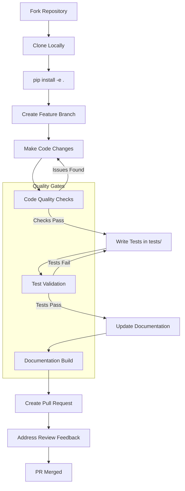
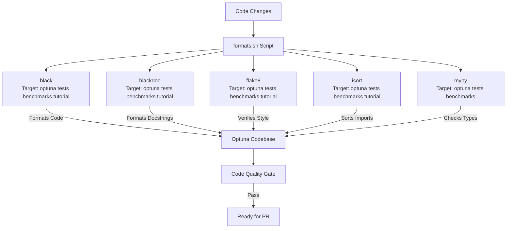
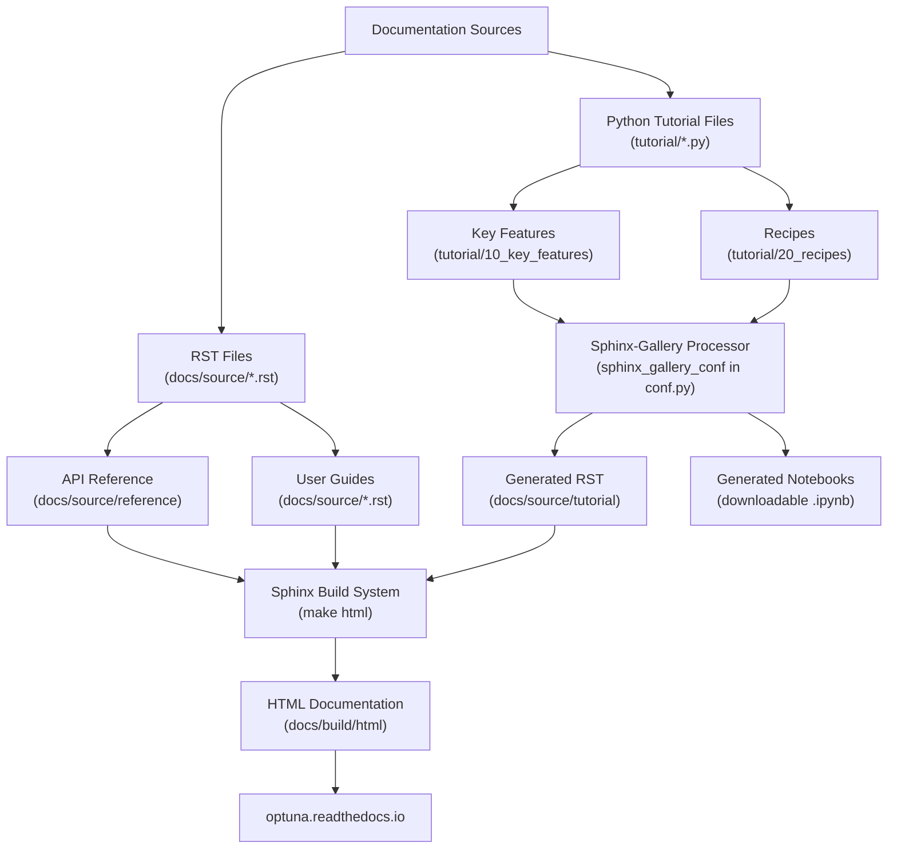
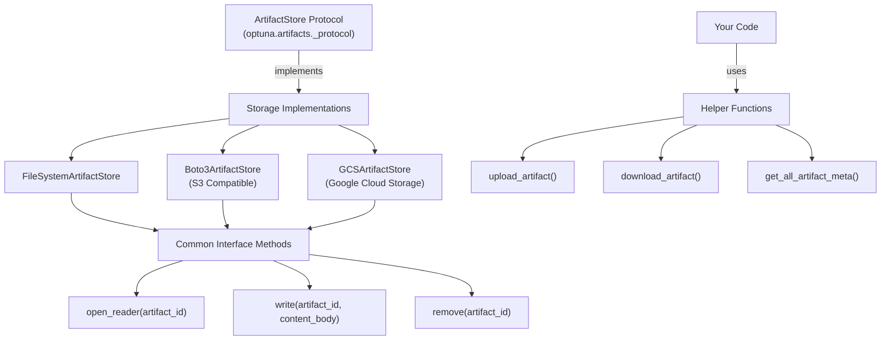

<!-- source: DeepWiki mcp.deepwiki.com · repo optuna/optuna · page 6.3 Development Workflow and Contribution Guide · fetched 2026-10-21 -->

# Contribution Guide

<details>
<summary>Relevant source files</summary>

The following files were used as context for generating this wiki page:

- [.pre-commit-config.yaml](.pre-commit-config.yaml)
- [CONTRIBUTING.md](CONTRIBUTING.md)
- [pyproject.toml](pyproject.toml)

</details>


This guide outlines how to contribute to the Optuna project, covering everything from setting up your development environment to submitting a pull request. It's designed to help both new and experienced contributors understand the contribution process and requirements.

## Introduction

Optuna is an open-source project that welcomes contributions from everyone. There are many ways you can contribute:

- Implementing new features
- Fixing bugs labeled with `contribution-welcome` 
- Improving documentation
- Sharing ideas and thoughts in GitHub Discussions
- Writing tutorials and examples

For information about the testing system and CI/CD pipeline, see [Testing Framework](#6.1).

Sources: [CONTRIBUTING.md:1-29](), [README.md:250-258]()

## Getting Started

### Setting Up Your Development Environment

To get started contributing to Optuna, you'll need to set up your development environment:

1. Fork Optuna on GitHub
2. Clone your fork locally
3. Install Optuna in development mode

```bash
git clone git@github.com:YOUR_NAME/optuna.git
cd optuna
pip install -e .
```

### Finding Issues to Work On

If you're new to Optuna, look for issues labeled as [good first issues](https://github.com/optuna/optuna/labels/good%20first%20issue). These are relatively simple, well-defined issues that are good starting points.

For experienced contributors, check other [contribution-welcome issues](https://github.com/optuna/optuna/labels/contribution-welcome).

Sources: [CONTRIBUTING.md:48-52](), [README.md:254-256]()

## Development Workflow

### Contribution Process Overview



Sources: [CONTRIBUTING.md:32-41]()

## Code Style and Quality

### Code Formatting and Style Checking

Optuna maintains strict code quality standards using several tools:

- **Code formatting**: `black` for Python code and `blackdoc` for docstrings
- **Coding style**: `flake8` and `isort` for import sorting
- **Type checking**: `mypy` for PEP 484 type hints

All of these checks can be run using the `formats.sh` script:

```bash
# Install necessary dependencies
pip install ".[checking]"

# Run all code quality checks
./formats.sh
```

Alternatively, you can use pre-commit to automatically check your code before committing:

```bash
pip install pre-commit
pre-commit install
pre-commit run --all-files
```

### Code Quality Tools Architecture



Sources: [CONTRIBUTING.md:61-90](), [formats.sh:1-112](), [setup.cfg:1-9]()

## Documentation

When adding a new feature, you must also document it in the reference. Documentation is written in reStructuredText format in the `docs` directory.

### Building Documentation

```bash
# Install documentation dependencies
pip install -e ".[document]"

# Build HTML documentation
cd docs
make html
```

HTML files are generated in the `build/html` directory. Open `index.html` with your browser to see if it is rendered correctly.

### Optuna Documentation System



Optuna's tutorial system uses Sphinx-Gallery, which executes Python files from the `tutorial` directory and generates both RST documentation and Jupyter notebooks. The tutorial organization is configured in the `sphinx_gallery_conf` in `docs/source/conf.py`.

Sources: [CONTRIBUTING.md:92-143](), [docs/source/conf.py:184-220]()

## Testing

When adding new features or fixing bugs, you must write sufficient test code. Optuna uses pytest as the testing framework, with tests stored in the `tests` directory.

### Running Tests

```bash
# Install test dependencies
pip install ".[test,optional]"

# Run all tests
pytest

# Run tests in a specific file
pytest tests/${TARGET_TEST_FILE_NAME}

# Run a specific test function
pytest tests/${TARGET_TEST_FILE_NAME} -k ${TARGET_TEST_FUNCTION_NAME}
```

See the [Test Policy](https://github.com/optuna/optuna/wiki/Test-Policy) for the principles of writing and maintaining Optuna tests to meet quality requirements.

Sources: [CONTRIBUTING.md:145-171]()

## Pull Request Guidelines

When creating a pull request, follow these guidelines:

### PR Title
- Briefly describe the changes
- Wrap code with backticks
- Do not end with a period

Example: `Introduces Tree-structured Parzen Estimator to optuna.samplers`

### PR Description
- Describe the motivation
- Describe the changes
- If still work-in-progress, describe remaining tasks

The PR title will appear directly in the release notes, so make it descriptive and clear.

Sources: [CONTRIBUTING.md:176-197]()

## Continuous Integration

Optuna uses GitHub Actions for continuous integration. Your pull request will be automatically verified against all quality checks, tests, and documentation builds.

Sources: [CONTRIBUTING.md:172-175]()

## Artifact System for Development

When developing features that involve storing or retrieving files (such as machine learning models), you should use Optuna's artifact system. The `ArtifactStore` protocol defines the interface for backend implementations:



This system allows you to manage files associated with trials in a consistent way, regardless of the underlying storage backend.

Sources: [optuna/artifacts/_protocol.py:1-62](), [docs/source/reference/artifacts.rst:1-46](), [docs/source/faq.rst:142-192]()

## Learning Optuna's Implementation

To better understand how Optuna is implemented, you can check out [Minituna](https://github.com/CyberAgentAILab/minituna), a simplified version of Optuna that demonstrates the core design principles. Reading Minituna first will make it easier to understand the full Optuna codebase.

Sources: [CONTRIBUTING.md:198-206]()

## Community and Communication

- [GitHub Discussions](https://github.com/optuna/optuna/discussions) for questions and general discussions
- [GitHub Issues](https://github.com/optuna/optuna/issues) for bug reports and feature requests

Remember that contributing to Optuna includes not only submitting code but also participating in discussions and providing feedback on issues and pull requests.

Sources: [CONTRIBUTING.md:11-14](), [CONTRIBUTING.md:26-28](), [README.md:241-247]()