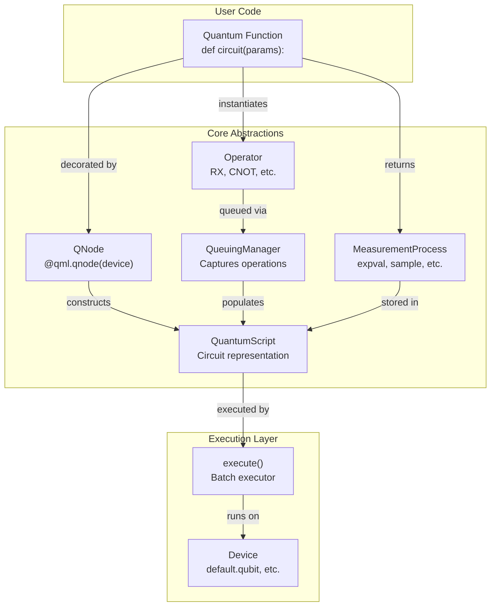
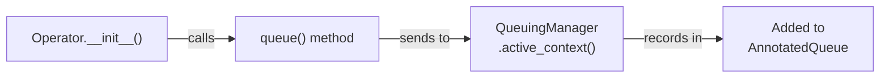
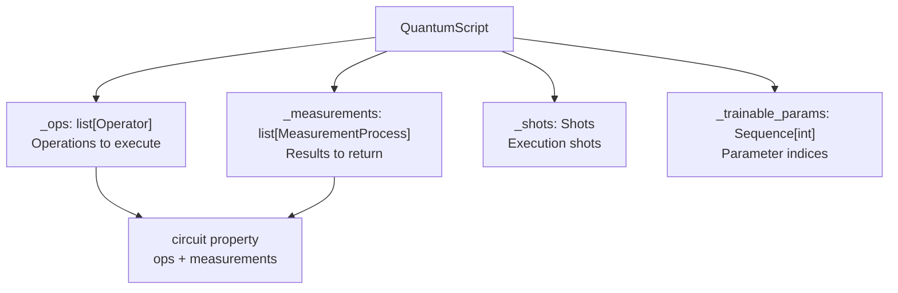
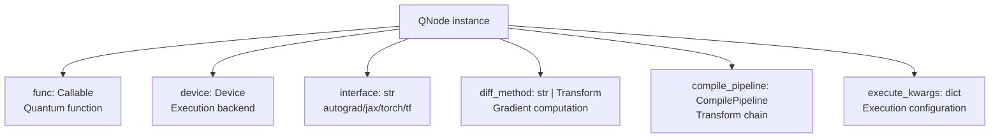
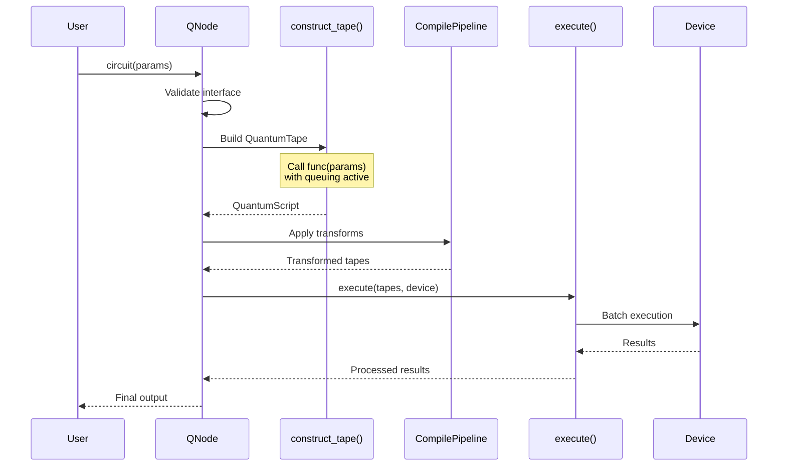
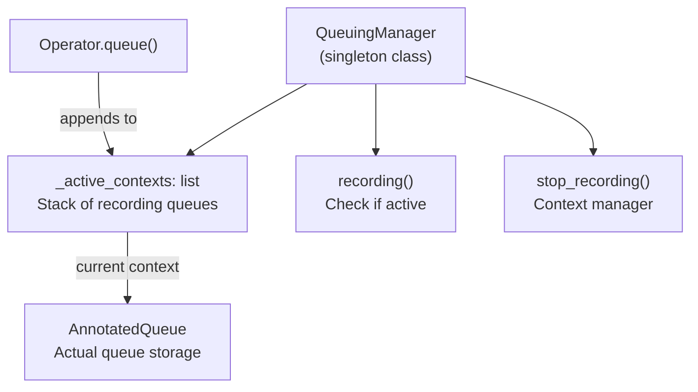
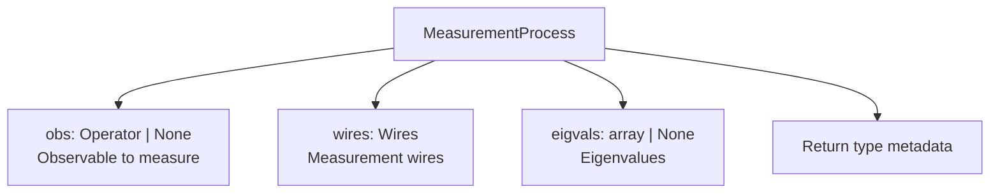
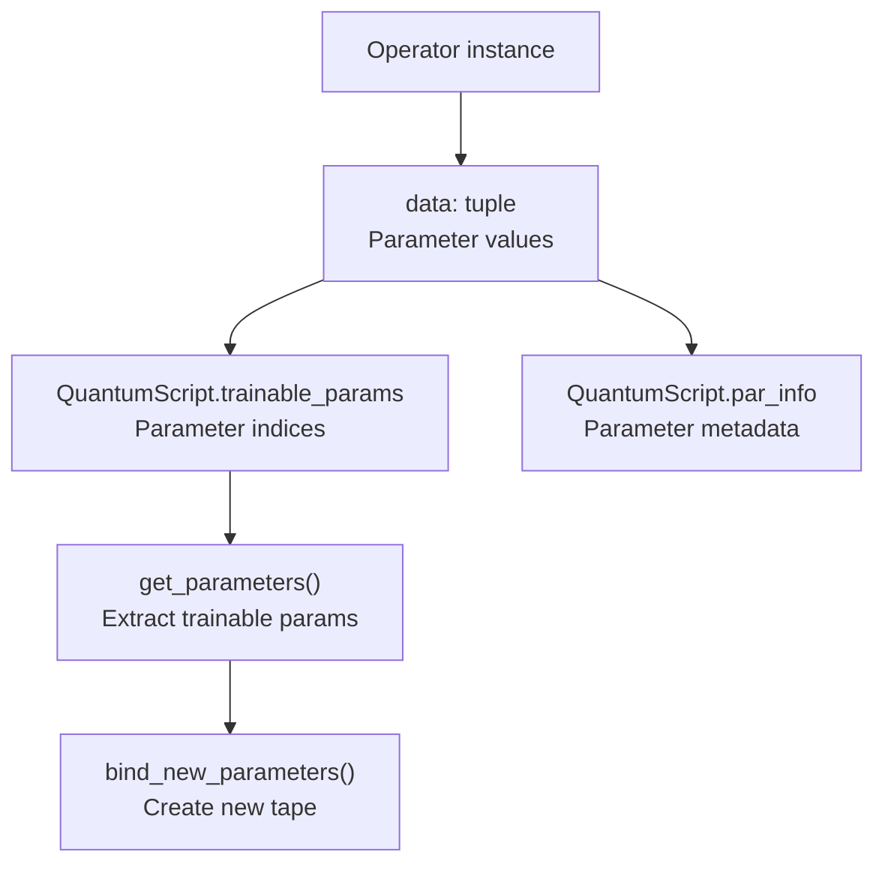
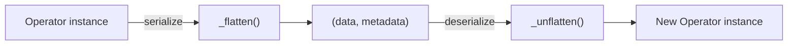

<!-- source: DeepWiki mcp.deepwiki.com · repo PennyLaneAI/pennylane · page 2 Core Quantum Abstractions · fetched 2026-10-21 -->

# Core Quantum Abstractions

<details>
<summary>Relevant source files</summary>

The following files were used as context for generating this wiki page:

- [doc/code/qml_queuing.rst](doc/code/qml_queuing.rst)
- [doc/development/deprecations.rst](doc/development/deprecations.rst)
- [doc/introduction/measurements.rst](doc/introduction/measurements.rst)
- [doc/releases/changelog-dev.md](doc/releases/changelog-dev.md)
- [pennylane/__init__.py](pennylane/__init__.py)
- [pennylane/operation.py](pennylane/operation.py)
- [pennylane/queuing.py](pennylane/queuing.py)
- [pennylane/tape/operation_recorder.py](pennylane/tape/operation_recorder.py)
- [pennylane/tape/qscript.py](pennylane/tape/qscript.py)
- [pennylane/tape/tape.py](pennylane/tape/tape.py)
- [pennylane/workflow/__init__.py](pennylane/workflow/__init__.py)
- [pennylane/workflow/_setup_transform_program.py](pennylane/workflow/_setup_transform_program.py)
- [pennylane/workflow/construct_execution_config.py](pennylane/workflow/construct_execution_config.py)
- [pennylane/workflow/execution.py](pennylane/workflow/execution.py)
- [pennylane/workflow/get_compile_pipeline.py](pennylane/workflow/get_compile_pipeline.py)
- [pennylane/workflow/qnode.py](pennylane/workflow/qnode.py)
- [pennylane/workflow/resolution.py](pennylane/workflow/resolution.py)
- [tests/tape/test_qscript.py](tests/tape/test_qscript.py)
- [tests/tape/test_tape.py](tests/tape/test_tape.py)
- [tests/test_operation.py](tests/test_operation.py)
- [tests/test_qnode.py](tests/test_qnode.py)
- [tests/test_qnode_legacy.py](tests/test_qnode_legacy.py)
- [tests/test_queuing.py](tests/test_queuing.py)
- [tests/workflow/interfaces/execute/test_execute.py](tests/workflow/interfaces/execute/test_execute.py)
- [tests/workflow/test_get_compile_pipeline.py](tests/workflow/test_get_compile_pipeline.py)
- [tests/workflow/test_resolve_execution_config.py](tests/workflow/test_resolve_execution_config.py)

</details>


This document covers the fundamental abstractions that form the foundation of PennyLane's quantum programming model. These abstractions provide the core building blocks for defining quantum circuits, executing them on devices, and extracting measurement results.

For details on specific operator types and symbolic operations, see [Operators and Operation System](#2.1). For circuit construction mechanics and tape properties, see [QuantumScript and Circuit Representation](#2.2). For QNode lifecycle and execution details, see [QNode System and Execution Workflow](#2.3). For measurement types and processing, see [Measurement Processes](#2.4).

## Overview of Core Abstractions

PennyLane's quantum programming model is built on four primary abstractions:

| Abstraction | Primary Class | Purpose |
|-------------|---------------|---------|
| **Operators** | `Operator` | Represent quantum operations, gates, and observables that act on wires |
| **Circuits** | `QuantumScript`, `QuantumTape` | Store sequences of operators and measurements as executable circuits |
| **Execution Interface** | `QNode` | Wrap quantum functions for device execution with autodifferentiation support |
| **Measurements** | `MeasurementProcess` | Define how to extract results from quantum circuits |

Sources: [pennylane/operation.py:393-676](), [pennylane/tape/qscript.py:41-118](), [pennylane/workflow/qnode.py:190-291]()

## Architectural Relationships



**Diagram: Core Abstraction Relationships**

This diagram shows how user code flows through PennyLane's core abstractions to device execution.

Sources: [pennylane/workflow/qnode.py:190-676](), [pennylane/queuing.py:14-51](), [pennylane/workflow/execution.py:52-117]()

## Operator Abstraction

The `Operator` class is the base class for all quantum operations, gates, and observables in PennyLane.

### Key Properties

| Property | Type | Description |
|----------|------|-------------|
| `wires` | `Wires` | Wire labels the operator acts on |
| `data` | `tuple` | Trainable parameters (as tensors) |
| `hyperparameters` | `dict` | Non-trainable parameters |
| `num_params` | `int` | Expected number of parameters |
| `ndim_params` | `tuple` | Expected dimensionality of each parameter |
| `batch_size` | `int \| None` | Batch size for parameter broadcasting |

### Operator Lifecycle



**Diagram: Operator Creation and Queuing**

When an operator is instantiated inside a quantum function, it automatically queues itself to the active recording context.

Sources: [pennylane/operation.py:704-720](), [pennylane/queuing.py:14-51]()

### Example Operator Classes

- **Gates**: `RX`, `RY`, `RZ`, `CNOT`, `Hadamard` - defined in [pennylane/ops/](pennylane/ops)
- **State Preparation**: `BasisState`, `StatePrep` - inherit from `StatePrepBase`
- **Observables**: `PauliX`, `PauliY`, `PauliZ`, `Hermitian` - hermitian operators for measurements
- **Symbolic**: `Controlled`, `Adjoint`, `Prod`, `Sum`, `SProd` - composition operators

Sources: [pennylane/operation.py:393-676](), [pennylane/__init__.py:94-96]()

## Circuit Representation: QuantumScript and QuantumTape

PennyLane uses two closely related classes to represent quantum circuits:

| Class | Queuing Support | Use Case |
|-------|-----------------|----------|
| `QuantumScript` | No | Lightweight circuit representation for performance-critical code |
| `QuantumTape` | Yes | Circuit recording via context manager |

Both classes share the same core structure but `QuantumTape` extends `QuantumScript` with queuing capabilities via the `AnnotatedQueue` mixin.

### QuantumScript Structure



**Diagram: QuantumScript Internal Structure**

The `QuantumScript` stores operations and measurements as separate lists, but exposes them together via the `circuit` property.

Sources: [pennylane/tape/qscript.py:127-173](), [pennylane/tape/qscript.py:178-196]()

### Key QuantumScript Properties

| Property | Description |
|----------|-------------|
| `operations` | List of quantum operations (excluding measurements) |
| `measurements` | List of measurement processes |
| `circuit` | Combined list: `operations + measurements` |
| `wires` | All wires used in the circuit |
| `num_params` | Total number of trainable parameters |
| `batch_size` | Batch size if parameters are broadcasted |
| `trainable_params` | Indices of trainable parameters |

Sources: [pennylane/tape/qscript.py:178-277]()

### QuantumTape: Recording Context

`QuantumTape` extends `QuantumScript` with the `AnnotatedQueue` mixin to enable circuit recording:

```python
# Example from tests/tape/test_tape.py:156-164
with qml.tape.QuantumTape() as tape:
    qml.RX(0.432, wires=0)
    qml.RY(0.543, wires=0)
    qml.CNOT(wires=[0, 'a'])
    qml.RX(0.133, wires='a')
    qml.expval(qml.Z(0))
```

During the context, operators automatically queue themselves into the tape via `QueuingManager`.

Sources: [pennylane/tape/tape.py:123-236](), [tests/tape/test_tape.py:156-164]()

## QNode: Execution Interface

The `QNode` class bridges quantum functions and device execution, providing the primary user-facing interface for defining and running quantum circuits.

### QNode Components



**Diagram: QNode Structure**

A QNode encapsulates a quantum function along with configuration for how it should be executed and differentiated.

Sources: [pennylane/workflow/qnode.py:190-291]()

### QNode Execution Flow



**Diagram: QNode Call Sequence**

When a QNode is called, it constructs a tape, applies transforms, executes on the device, and returns results.

Sources: [pennylane/workflow/qnode.py:596-676](), [pennylane/workflow/execution.py:52-117]()

### Key QNode Methods

| Method | Purpose |
|--------|---------|
| `__call__(*args, **kwargs)` | Execute the QNode with given parameters |
| `construct(args, kwargs)` | Build the QuantumTape without execution |
| `update(**kwargs)` | Create a new QNode with updated configuration |

Sources: [pennylane/workflow/qnode.py:596-676]()

## Queuing System

PennyLane uses a queuing system to convert imperative quantum function code into a declarative circuit representation.

### QueuingManager Architecture



**Diagram: QueuingManager Components**

The `QueuingManager` maintains a stack of active recording contexts, allowing nested recording.

Sources: [pennylane/queuing.py:147-314]()

### Recording Process

1. **Context Entry**: When entering a `QuantumTape` context or calling a quantum function inside a QNode, a new `AnnotatedQueue` is pushed to `QueuingManager._active_contexts`
2. **Operator Creation**: Each operator's `__init__` calls `queue()` method
3. **Queuing**: `queue()` sends the operator to `QueuingManager.active_context()`
4. **Storage**: The operator is added to the active `AnnotatedQueue`
5. **Context Exit**: The queue is popped and its contents are processed

Sources: [pennylane/queuing.py:147-314](), [pennylane/operation.py:1269-1297]()

### Preventing Queuing

Some scenarios require preventing queuing:

```python
# From pennylane/queuing.py - stop_recording() context manager
with QueuingManager.stop_recording():
    # Operations here are not queued
    temp_op = qml.RX(0.5, wires=0)
```

This is used internally when constructing temporary operators for analysis.

Sources: [pennylane/queuing.py:407-445]()

## Measurement Processes

`MeasurementProcess` objects define what results to extract from a quantum circuit.

### Measurement Types

| Class | Function | Returns |
|-------|----------|---------|
| `ExpectationMP` | `qml.expval(obs)` | Expectation value of observable |
| `VarianceMP` | `qml.var(obs)` | Variance of observable |
| `SampleMP` | `qml.sample(obs)` | Raw measurement samples |
| `CountsMP` | `qml.counts(obs)` | Count dictionary of outcomes |
| `ProbabilityMP` | `qml.probs(wires)` | Probability distribution |
| `StateMP` | `qml.state()` | Full quantum state |
| `DensityMatrixMP` | `qml.density_matrix(wires)` | Reduced density matrix |

### Measurement Process Structure



**Diagram: MeasurementProcess Components**

Measurements can have an associated observable (for `expval`, `var`, `sample`) or just wires (for `probs`, `state`).

Sources: [pennylane/measurements/]()

### Measurement Queuing

Measurements are queued similarly to operators but stored separately:

```python
# From tests/tape/test_tape.py:78-81
with QuantumTape() as tape:
    ops += [qml.RX(0.432, wires=0)]
    obs += [qml.PauliX(wires="a")]
    qml.expval(obs[0])  # Creates and queues ExpectationMP
```

The tape stores measurements in `_measurements` list, separate from operations.

Sources: [pennylane/tape/qscript.py:240-253]()

## Parameter Management

PennyLane tracks trainable parameters across the circuit representation.

### Parameter Storage



**Diagram: Parameter Tracking**

Parameters are stored in operators' `data` attribute and tracked by index in `QuantumScript.trainable_params`.

Sources: [pennylane/tape/qscript.py:436-513](), [pennylane/operation.py:1082-1176]()

### Trainable Parameters

By default, all parameters are trainable. The `trainable_params` property returns indices:

```python
# Example from pennylane/tape/qscript.py
>>> ops = [qml.RX(0.432, wires=0), qml.RY(0.543, wires=0)]
>>> tape = QuantumScript(ops)
>>> tape.trainable_params
[0, 1]
>>> tape.get_parameters()
[0.432, 0.543]
```

Sources: [pennylane/tape/qscript.py:352-389]()

## Pytree Integration

All core abstractions are registered as JAX pytrees for compatibility with JAX transformations.

### Flattening and Unflattening



**Diagram: Pytree Transformation**

Operators define `_flatten()` to extract data and metadata, and `_unflatten()` to reconstruct from them.

Sources: [pennylane/operation.py:540-546](), [pennylane/pytrees.py]()

### Default Implementation

The default pytree implementation for operators:

- **Data**: Trainable parameters from `self.data`
- **Metadata**: `(wires, hyperparameters)` tuple

Custom operators can override `_flatten` and `_unflatten` for specialized serialization.

Sources: [pennylane/operation.py:361-388](), [tests/test_operation.py:361-388]()

---

