# Page: Overview

# Overview

<details>
<summary>Relevant source files</summary>

The following files were used as context for generating this wiki page:

- [.github/CONTRIBUTING.md](.github/CONTRIBUTING.md)
- [.pylintrc](.pylintrc)
- [AI_Policy.md](AI_Policy.md)
- [README.md](README.md)
- [doc/code/qml.rst](doc/code/qml.rst)
- [doc/conf.py](doc/conf.py)
- [doc/development/guide/documentation.rst](doc/development/guide/documentation.rst)
- [doc/development/guide/installation.rst](doc/development/guide/installation.rst)
- [doc/index.rst](doc/index.rst)
- [doc/introduction/compiling_workflows.rst](doc/introduction/compiling_workflows.rst)
- [doc/requirements.txt](doc/requirements.txt)
- [pennylane/compiler/__init__.py](pennylane/compiler/__init__.py)
- [pennylane/compiler/compiler.py](pennylane/compiler/compiler.py)
- [pennylane/numpy/random.py](pennylane/numpy/random.py)
- [pyproject.toml](pyproject.toml)
- [setup.py](setup.py)
- [tests/.pylintrc](tests/.pylintrc)

</details>


## Purpose and Scope

This document provides a high-level introduction to PennyLane, its architecture, and core concepts. It is intended for developers who want to understand how PennyLane is structured and how its major systems interact.

For detailed information about specific subsystems:
- Core quantum abstractions (operators, circuits, measurements): see [Core Quantum Abstractions](#2)
- Circuit transformation and compilation: see [Transform and Compilation System](#3)
- Device backends and simulation: see [Devices and Simulation](#4)
- Quantum operations and gates: see [Quantum Operations](#5)
- Mathematical framework: see [Mathematical Framework](#6)
- Development tools and infrastructure: see [Development Infrastructure](#8)

**Sources:** [doc/index.rst:1-55](), [README.md:28-67]()

---

## What is PennyLane?

PennyLane is a cross-platform Python library for **quantum computing**, **quantum machine learning**, and **quantum chemistry**. Its central design principle is to enable users to "train a quantum computer the same way as a neural network" by providing automatic differentiation of quantum circuits and seamless integration with machine learning frameworks.

**Core capabilities:**

| Feature | Description |
|---------|-------------|
| **Quantum Circuit Programming** | Define quantum circuits using a wide range of gates, state preparations, and measurements |
| **Automatic Differentiation** | Built-in gradient computation for quantum circuits via multiple methods (parameter shift, adjoint, finite difference) |
| **Hybrid Workflows** | Combine quantum circuits with classical processing in a single computational graph |
| **Multi-Framework Support** | Interface with NumPy, JAX, PyTorch, TensorFlow, and Autograd |
| **Device Independence** | Run the same circuit on simulators or quantum hardware by changing one line of code |
| **JIT Compilation** | Compile hybrid quantum-classical workflows using Catalyst or CUDA Quantum |
| **Transform System** | Apply circuit optimizations and manipulations via composable transforms |

**Sources:** [doc/index.rst:28-92](), [README.md:47-67](), [pyproject.toml:6-8]()

---

## Installation and Requirements

**Minimum Requirements:**
- Python >= 3.11
- Core dependencies installed automatically: `numpy`, `scipy`, `networkx`, `rustworkx>=0.14.0`, `autograd`, `autoray==0.8.4`, `pennylane-lightning>=0.44`

**Installation:**
```bash
python -m pip install pennylane
```

**Optional Dependency Groups:**

| Group | Purpose | Install Command |
|-------|---------|-----------------|
| `dev` | Development tools (pytest, black, pylint, isort) | `pip install --group dev` |
| `docs` | Documentation building (sphinx, jax, torch) | `pip install --group docs` |
| `qchem` | Quantum chemistry support | `pip install pennylane[qchem]` |
| `qcut` | Circuit cutting functionality | `pip install pennylane[qcut]` |
| `external-libraries` | Third-party integrations (pyzx, stim, quimb) | `pip install --group external-libraries` |

**Sources:** [pyproject.toml:10-27](), [pyproject.toml:46-144](), [doc/development/guide/installation.rst:1-84]()

---

## Core Architecture

PennyLane follows a **layered architecture** that separates user-facing abstractions from device execution. This design enables the same quantum circuit to run on different backends with minimal code changes.

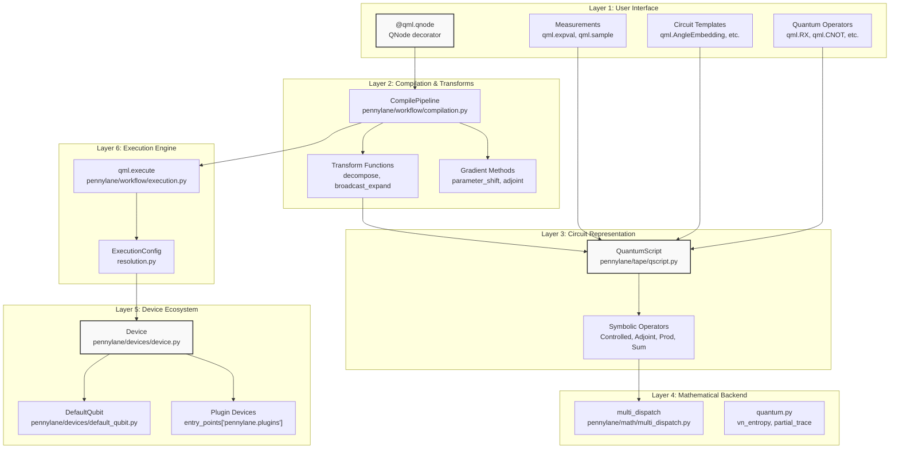

**Architecture Layers:**

1. **User Interface Layer:** High-level abstractions for defining quantum circuits (`@qml.qnode`, operators, templates, measurements)
2. **Compilation & Transforms Layer:** Circuit optimization, decomposition, and gradient computation via `CompilePipeline`
3. **Circuit Representation Layer:** Internal representation as `QuantumScript` with symbolic operator algebra
4. **Mathematical Backend Layer:** Framework-agnostic math operations supporting NumPy, JAX, PyTorch, TensorFlow
5. **Device Ecosystem:** Abstract `Device` interface with built-in simulators and plugin system
6. **Execution Engine:** Batch execution, workflow configuration, and differentiation via `qml.execute`

**Sources:** High-level architecture diagram, [pennylane/workflow/qnode.py](), [pennylane/tape/qscript.py](), [pennylane/devices/device.py](), [pennylane/workflow/execution.py]()

---

## Key Concepts

### QNode: Quantum Functions

A **QNode** is a quantum function decorated with `@qml.qnode` that binds a Python function to a quantum device. When called, the QNode constructs a `QuantumScript`, applies transforms, and executes on the device.

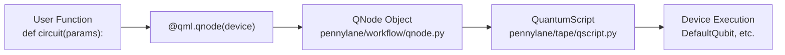

**Key QNode attributes:**
- `device`: The device to execute on
- `interface`: Auto-detected ML framework (`'jax'`, `'torch'`, `'tf'`, `'autograd'`, `'numpy'`)
- `diff_method`: Differentiation method (`'best'`, `'parameter-shift'`, `'adjoint'`, `'backprop'`, etc.)
- `expansion_strategy`: How to decompose operations

**Sources:** [pennylane/workflow/qnode.py](), QNode Execution Pipeline diagram

### Devices: Execution Backends

**Devices** implement the abstract `Device` interface and provide the execution backend for quantum circuits. Devices are registered via Python entry points in the `pennylane.plugins` group.

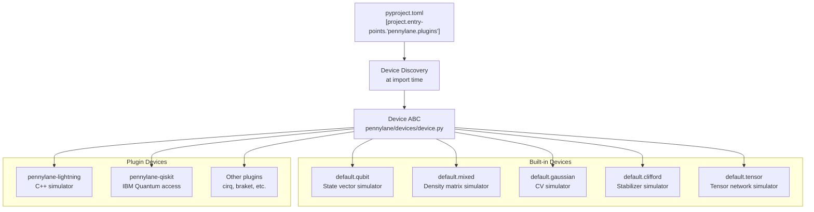

**Entry point registration example:**
```python
[project.entry-points."pennylane.plugins"]
"default.qubit" = "pennylane.devices:DefaultQubit"
"default.gaussian" = "pennylane.devices:DefaultGaussian"
"default.mixed" = "pennylane.devices.default_mixed:DefaultMixed"
```

**Sources:** [pyproject.toml:161-170](), Device Plugin System diagram, [pennylane/devices/device.py]()

### Operators: Quantum Gates and Observables

All quantum operations inherit from the `Operator` base class defined in `pennylane/operation.py`. Operators support:
- **Matrix representation:** `compute_matrix()`, `sparse_matrix()`
- **Decomposition:** `compute_decomposition()` into primitive gates
- **Parameter broadcasting:** `batch_size`, `ndim_params` for batched execution
- **Symbolic composition:** `Controlled`, `Adjoint`, `Prod`, `Sum`, `SProd`, `Pow`

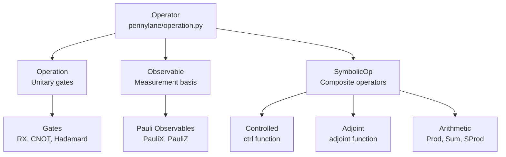

**Sources:** [pennylane/operation.py](), Operator and Symbolic Mathematics System diagram

### Transforms: Circuit Manipulation

**Transforms** are functions decorated with `@transform` that modify quantum circuits. They can be applied to QNodes, tapes, or functions, and are composed into a `CompilePipeline`.

**Transform categories:**

| Category | Examples | Purpose |
|----------|----------|---------|
| **Circuit Optimization** | `cancel_inverses`, `merge_rotations`, `commute_controlled` | Reduce gate count |
| **Decomposition** | `decompose`, `unitary_to_rot` | Convert to device gate set |
| **Batching** | `broadcast_expand`, `batch_params` | Handle batched parameters |
| **Gradient** | `param_shift`, `adjoint_metric_tensor` | Enable differentiation |
| **Measurement** | `defer_measurements`, `dynamic_one_shot` | Mid-circuit measurements |
| **Advanced** | `qcut` (circuit cutting), `mitigate_with_zne` | Specialized techniques |

**Pipeline levels:**
- `top`: Complete pipeline
- `user`: User-applied transforms
- `gradient`: Gradient-related transforms
- `device`: Device-specific transforms

**Sources:** [pennylane/transforms/](), Transform and Compilation System diagram

---

## Execution Flow

The following diagram shows the complete execution path from user code to device results, including the key classes and functions involved:

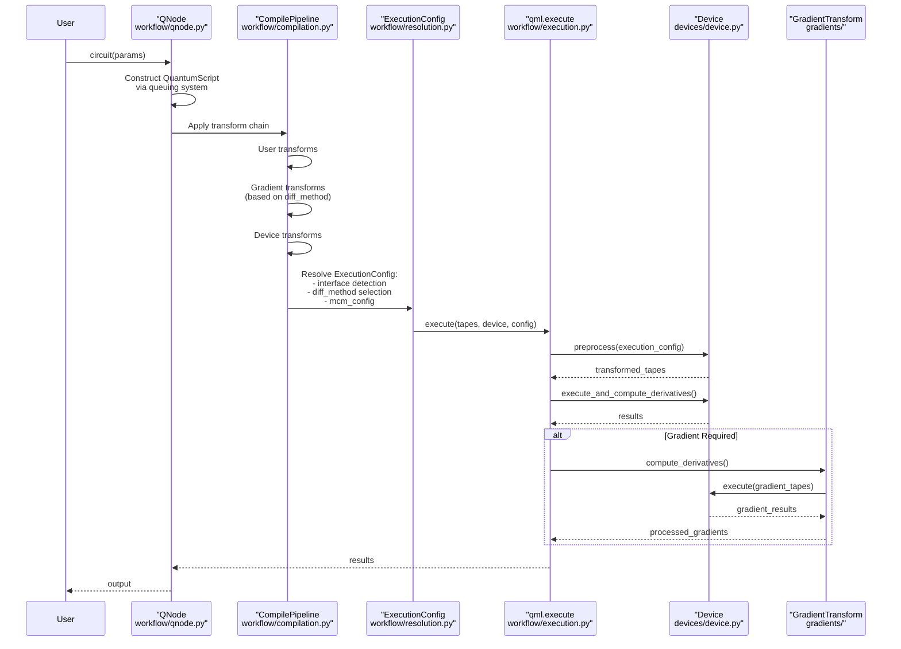

**Key execution stages:**

1. **QNode Call:** User calls the quantum function with parameters
2. **Tape Construction:** QNode uses the queuing system to record operations into a `QuantumScript`
3. **Transform Pipeline:** `CompilePipeline` applies transforms at user/gradient/device levels
4. **Config Resolution:** `ExecutionConfig` determines interface, differentiation method, and device capabilities
5. **Device Preprocessing:** Device applies its own transforms and optimizations
6. **Execution:** `qml.execute` batches tapes and calls device execution methods
7. **Gradient Computation:** If gradients are needed, gradient transforms generate and execute additional tapes
8. **Result Processing:** Results are processed and returned to the user

**Sources:** QNode Execution Pipeline diagram, [pennylane/workflow/qnode.py](), [pennylane/workflow/execution.py](), [pennylane/workflow/resolution.py]()

---

## Multi-Framework Integration

PennyLane supports multiple machine learning frameworks through a **multi-dispatch system** that provides framework-agnostic mathematical operations:

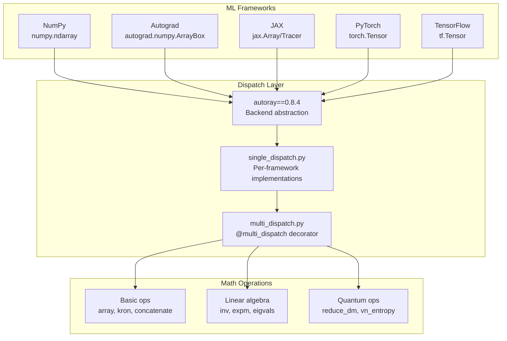

**Interface detection:** PennyLane automatically detects the ML framework from tensor types:
- `numpy` → NumPy arrays
- `autograd` → Autograd ArrayBox
- `jax` → JAX Arrays/Tracers
- `torch` → PyTorch Tensors
- `tensorflow` → TensorFlow Tensors

**Gradient computation methods by interface:**

| Interface | Supported Gradient Methods |
|-----------|----------------------------|
| `autograd` | `parameter-shift`, `finite-diff`, `adjoint` |
| `jax` | `parameter-shift`, `finite-diff`, `adjoint`, `backprop` |
| `torch` | `parameter-shift`, `finite-diff`, `adjoint`, `backprop` |
| `tensorflow` | `parameter-shift`, `finite-diff`, `adjoint`, `backprop` |
| `numpy` | None (forward evaluation only) |

**Sources:** Math and Interface Abstraction Layer diagram, [pennylane/math/multi_dispatch.py](), [pennylane/math/single_dispatch.py](), [pyproject.toml:18]()

---

## Compiler Integration

PennyLane supports hybrid quantum-classical compilation through a **plugin system** for external compilers. Compilers are registered via the `pennylane.compilers` entry point group.

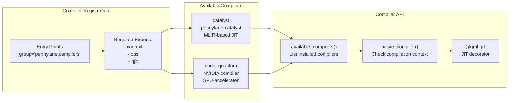

**Compiler entry point structure:**
- `compiler_name.context`: Compilation context manager with `is_tracing()` method
- `compiler_name.ops`: Compiler-specific operations (e.g., `cond`, `for_loop`)
- `compiler_name.qjit`: JIT decorator function with signature `qjit(fn, *args, **kwargs)`

**Usage example:**
```python
@qml.qjit  # Uses default compiler (Catalyst)
@qml.qnode(dev)
def circuit(x):
    qml.RX(x, wires=0)
    return qml.expval(qml.Z(0))

@qml.qjit(compiler="cuda_quantum")  # Specify compiler
@qml.qnode(dev)
def circuit_cuda(x):
    qml.RX(x, wires=0)
    return qml.expval(qml.Z(0))
```

**Sources:** [pennylane/compiler/compiler.py:1-248](), [pennylane/compiler/__init__.py:14-255](), [doc/introduction/compiling_workflows.rst:1-181]()

---

## Development Infrastructure

PennyLane uses modern Python development tools and CI/CD infrastructure:

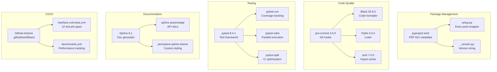

**Dependency groups:**

| Group | Purpose | Key Packages |
|-------|---------|--------------|
| Core dependencies | Required for basic functionality | `numpy>=2.0`, `scipy`, `autograd`, `autoray==0.8.4`, `pennylane-lightning>=0.44` |
| `dev` | Development and testing | `pytest>=8.4.1`, `black==25.9.0`, `pylint~=4.0.0`, `isort~=7.0.0` |
| `docs` | Documentation building | `sphinx==8.1`, `jax==0.7.1`, `torch~=2.9.0` |
| `qchem` | Quantum chemistry | `openfermionpyscf`, `basis-set-exchange`, `geometric` |
| `qcut` | Circuit cutting | `kahypar==1.3.5`, `opt_einsum` |
| `external-libraries` | Third-party integrations | `pyzx`, `stim`, `quimb`, `qualtran` |

**CI/CD workflows:**
- **interface-unit-tests.yml:** 12 test job types covering different ML frameworks (JAX, PyTorch, TensorFlow)
- **benchmarks.yml:** Performance regression tracking
- **upload.yml:** Automated PyPI releases

**Sources:** [pyproject.toml:1-210](), [setup.py:1-3](), [doc/conf.py:1-397](), [.pylintrc:1-48](), Development and Quality Infrastructure diagram

---

## Repository Structure

**Key directories:**

| Directory | Purpose |
|-----------|---------|
| `pennylane/` | Main package source code |
| `pennylane/devices/` | Built-in device implementations |
| `pennylane/ops/` | Quantum operations and gates |
| `pennylane/transforms/` | Circuit transforms |
| `pennylane/workflow/` | QNode and execution engine |
| `pennylane/math/` | Multi-dispatch math system |
| `pennylane/gradients/` | Differentiation methods |
| `pennylane/tape/` | QuantumScript and tape system |
| `pennylane/compiler/` | Compiler plugin infrastructure |
| `doc/` | Documentation source (reStructuredText) |
| `tests/` | Test suite |
| `.github/workflows/` | CI/CD configurations |

**Sources:** Repository structure inspection

---

## Next Steps

For detailed information about specific subsystems, refer to the following pages:

- **[Core Quantum Abstractions](#2):** `Operator`, `QuantumScript`, `QNode`, measurement processes
- **[Transform and Compilation System](#3):** Transform framework, `CompilePipeline`, decomposition, gradient methods
- **[Devices and Simulation](#4):** Device API, `DefaultQubit`, `DefaultMixed`, Gaussian simulators, Catalyst JIT
- **[Quantum Operations](#5):** Gate sets, controlled/adjoint operations, operator arithmetic, resource estimation
- **[Mathematical Framework](#6):** Multi-dispatch system, quantum information functions
- **[Templates and Advanced Features](#7):** Circuit templates, quantum chemistry, operator validation
- **[Development Infrastructure](#8):** Package structure, testing, CI/CD, documentation system

**External Resources:**
- GitHub Repository: https://github.com/PennyLaneAI/pennylane
- Documentation: https://docs.pennylane.ai
- Demos and Tutorials: https://pennylane.ai/qml/demonstrations
- Discussion Forum: https://discuss.pennylane.ai

**Sources:** [doc/index.rst:154-247](), [README.md:84-169](), [.github/CONTRIBUTING.md:1-106]()

---

# Page: Core Quantum Abstractions

# Core Quantum Abstractions

<details>
<summary>Relevant source files</summary>

The following files were used as context for generating this wiki page:

- [doc/code/qml_queuing.rst](doc/code/qml_queuing.rst)
- [doc/development/deprecations.rst](doc/development/deprecations.rst)
- [doc/introduction/measurements.rst](doc/introduction/measurements.rst)
- [doc/releases/changelog-dev.md](doc/releases/changelog-dev.md)
- [pennylane/__init__.py](pennylane/__init__.py)
- [pennylane/operation.py](pennylane/operation.py)
- [pennylane/queuing.py](pennylane/queuing.py)
- [pennylane/tape/operation_recorder.py](pennylane/tape/operation_recorder.py)
- [pennylane/tape/qscript.py](pennylane/tape/qscript.py)
- [pennylane/tape/tape.py](pennylane/tape/tape.py)
- [pennylane/workflow/__init__.py](pennylane/workflow/__init__.py)
- [pennylane/workflow/_setup_transform_program.py](pennylane/workflow/_setup_transform_program.py)
- [pennylane/workflow/construct_execution_config.py](pennylane/workflow/construct_execution_config.py)
- [pennylane/workflow/execution.py](pennylane/workflow/execution.py)
- [pennylane/workflow/get_compile_pipeline.py](pennylane/workflow/get_compile_pipeline.py)
- [pennylane/workflow/qnode.py](pennylane/workflow/qnode.py)
- [pennylane/workflow/resolution.py](pennylane/workflow/resolution.py)
- [tests/tape/test_qscript.py](tests/tape/test_qscript.py)
- [tests/tape/test_tape.py](tests/tape/test_tape.py)
- [tests/test_operation.py](tests/test_operation.py)
- [tests/test_qnode.py](tests/test_qnode.py)
- [tests/test_qnode_legacy.py](tests/test_qnode_legacy.py)
- [tests/test_queuing.py](tests/test_queuing.py)
- [tests/workflow/interfaces/execute/test_execute.py](tests/workflow/interfaces/execute/test_execute.py)
- [tests/workflow/test_get_compile_pipeline.py](tests/workflow/test_get_compile_pipeline.py)
- [tests/workflow/test_resolve_execution_config.py](tests/workflow/test_resolve_execution_config.py)

</details>


This document covers the fundamental abstractions that form the foundation of PennyLane's quantum programming model. These abstractions provide the core building blocks for defining quantum circuits, executing them on devices, and extracting measurement results.

For details on specific operator types and symbolic operations, see [Operators and Operation System](#2.1). For circuit construction mechanics and tape properties, see [QuantumScript and Circuit Representation](#2.2). For QNode lifecycle and execution details, see [QNode System and Execution Workflow](#2.3). For measurement types and processing, see [Measurement Processes](#2.4).

## Overview of Core Abstractions

PennyLane's quantum programming model is built on four primary abstractions:

| Abstraction | Primary Class | Purpose |
|-------------|---------------|---------|
| **Operators** | `Operator` | Represent quantum operations, gates, and observables that act on wires |
| **Circuits** | `QuantumScript`, `QuantumTape` | Store sequences of operators and measurements as executable circuits |
| **Execution Interface** | `QNode` | Wrap quantum functions for device execution with autodifferentiation support |
| **Measurements** | `MeasurementProcess` | Define how to extract results from quantum circuits |

Sources: [pennylane/operation.py:393-676](), [pennylane/tape/qscript.py:41-118](), [pennylane/workflow/qnode.py:190-291]()

## Architectural Relationships

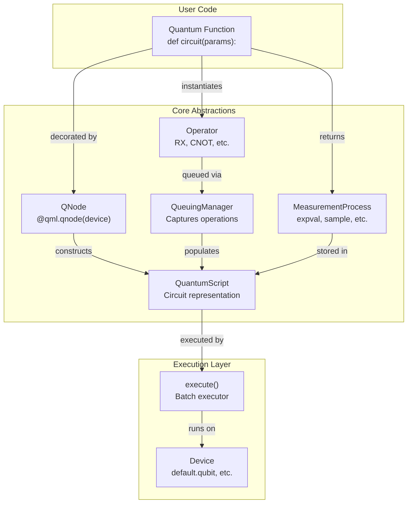

**Diagram: Core Abstraction Relationships**

This diagram shows how user code flows through PennyLane's core abstractions to device execution.

Sources: [pennylane/workflow/qnode.py:190-676](), [pennylane/queuing.py:14-51](), [pennylane/workflow/execution.py:52-117]()

## Operator Abstraction

The `Operator` class is the base class for all quantum operations, gates, and observables in PennyLane.

### Key Properties

| Property | Type | Description |
|----------|------|-------------|
| `wires` | `Wires` | Wire labels the operator acts on |
| `data` | `tuple` | Trainable parameters (as tensors) |
| `hyperparameters` | `dict` | Non-trainable parameters |
| `num_params` | `int` | Expected number of parameters |
| `ndim_params` | `tuple` | Expected dimensionality of each parameter |
| `batch_size` | `int \| None` | Batch size for parameter broadcasting |

### Operator Lifecycle

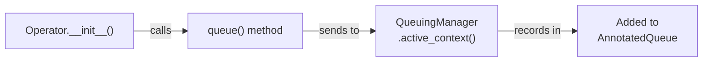

**Diagram: Operator Creation and Queuing**

When an operator is instantiated inside a quantum function, it automatically queues itself to the active recording context.

Sources: [pennylane/operation.py:704-720](), [pennylane/queuing.py:14-51]()

### Example Operator Classes

- **Gates**: `RX`, `RY`, `RZ`, `CNOT`, `Hadamard` - defined in [pennylane/ops/](pennylane/ops)
- **State Preparation**: `BasisState`, `StatePrep` - inherit from `StatePrepBase`
- **Observables**: `PauliX`, `PauliY`, `PauliZ`, `Hermitian` - hermitian operators for measurements
- **Symbolic**: `Controlled`, `Adjoint`, `Prod`, `Sum`, `SProd` - composition operators

Sources: [pennylane/operation.py:393-676](), [pennylane/__init__.py:94-96]()

## Circuit Representation: QuantumScript and QuantumTape

PennyLane uses two closely related classes to represent quantum circuits:

| Class | Queuing Support | Use Case |
|-------|-----------------|----------|
| `QuantumScript` | No | Lightweight circuit representation for performance-critical code |
| `QuantumTape` | Yes | Circuit recording via context manager |

Both classes share the same core structure but `QuantumTape` extends `QuantumScript` with queuing capabilities via the `AnnotatedQueue` mixin.

### QuantumScript Structure

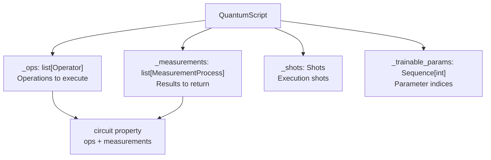

**Diagram: QuantumScript Internal Structure**

The `QuantumScript` stores operations and measurements as separate lists, but exposes them together via the `circuit` property.

Sources: [pennylane/tape/qscript.py:127-173](), [pennylane/tape/qscript.py:178-196]()

### Key QuantumScript Properties

| Property | Description |
|----------|-------------|
| `operations` | List of quantum operations (excluding measurements) |
| `measurements` | List of measurement processes |
| `circuit` | Combined list: `operations + measurements` |
| `wires` | All wires used in the circuit |
| `num_params` | Total number of trainable parameters |
| `batch_size` | Batch size if parameters are broadcasted |
| `trainable_params` | Indices of trainable parameters |

Sources: [pennylane/tape/qscript.py:178-277]()

### QuantumTape: Recording Context

`QuantumTape` extends `QuantumScript` with the `AnnotatedQueue` mixin to enable circuit recording:

```python
# Example from tests/tape/test_tape.py:156-164
with qml.tape.QuantumTape() as tape:
    qml.RX(0.432, wires=0)
    qml.RY(0.543, wires=0)
    qml.CNOT(wires=[0, 'a'])
    qml.RX(0.133, wires='a')
    qml.expval(qml.Z(0))
```

During the context, operators automatically queue themselves into the tape via `QueuingManager`.

Sources: [pennylane/tape/tape.py:123-236](), [tests/tape/test_tape.py:156-164]()

## QNode: Execution Interface

The `QNode` class bridges quantum functions and device execution, providing the primary user-facing interface for defining and running quantum circuits.

### QNode Components

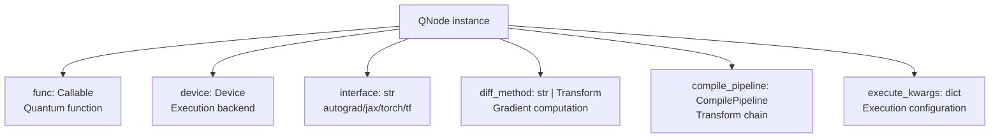

**Diagram: QNode Structure**

A QNode encapsulates a quantum function along with configuration for how it should be executed and differentiated.

Sources: [pennylane/workflow/qnode.py:190-291]()

### QNode Execution Flow

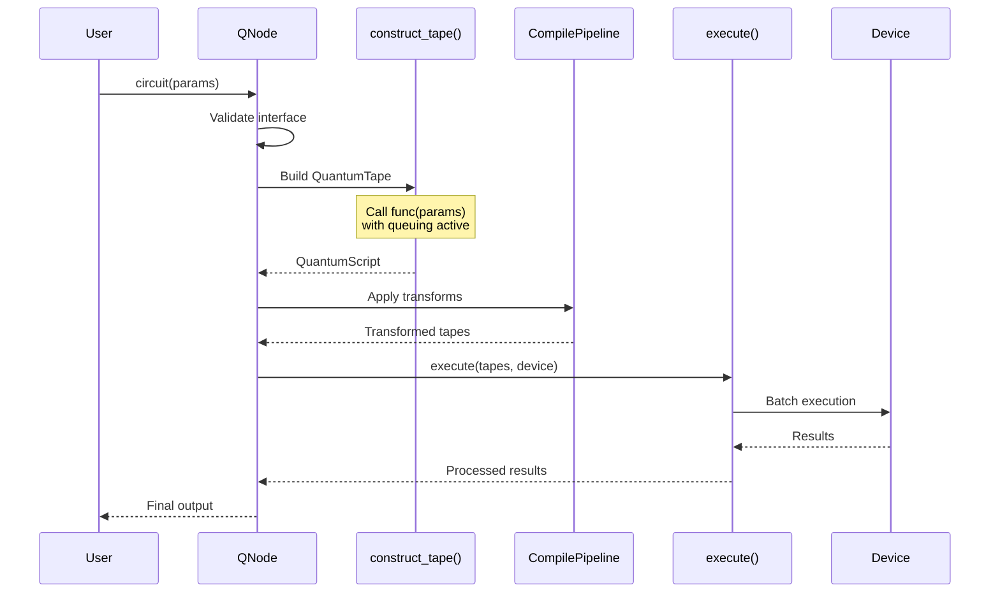

**Diagram: QNode Call Sequence**

When a QNode is called, it constructs a tape, applies transforms, executes on the device, and returns results.

Sources: [pennylane/workflow/qnode.py:596-676](), [pennylane/workflow/execution.py:52-117]()

### Key QNode Methods

| Method | Purpose |
|--------|---------|
| `__call__(*args, **kwargs)` | Execute the QNode with given parameters |
| `construct(args, kwargs)` | Build the QuantumTape without execution |
| `update(**kwargs)` | Create a new QNode with updated configuration |

Sources: [pennylane/workflow/qnode.py:596-676]()

## Queuing System

PennyLane uses a queuing system to convert imperative quantum function code into a declarative circuit representation.

### QueuingManager Architecture

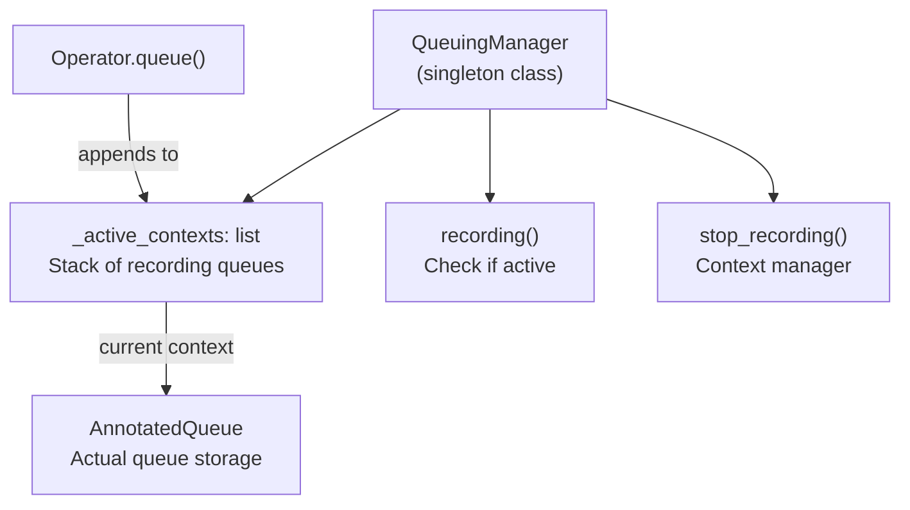

**Diagram: QueuingManager Components**

The `QueuingManager` maintains a stack of active recording contexts, allowing nested recording.

Sources: [pennylane/queuing.py:147-314]()

### Recording Process

1. **Context Entry**: When entering a `QuantumTape` context or calling a quantum function inside a QNode, a new `AnnotatedQueue` is pushed to `QueuingManager._active_contexts`
2. **Operator Creation**: Each operator's `__init__` calls `queue()` method
3. **Queuing**: `queue()` sends the operator to `QueuingManager.active_context()`
4. **Storage**: The operator is added to the active `AnnotatedQueue`
5. **Context Exit**: The queue is popped and its contents are processed

Sources: [pennylane/queuing.py:147-314](), [pennylane/operation.py:1269-1297]()

### Preventing Queuing

Some scenarios require preventing queuing:

```python
# From pennylane/queuing.py - stop_recording() context manager
with QueuingManager.stop_recording():
    # Operations here are not queued
    temp_op = qml.RX(0.5, wires=0)
```

This is used internally when constructing temporary operators for analysis.

Sources: [pennylane/queuing.py:407-445]()

## Measurement Processes

`MeasurementProcess` objects define what results to extract from a quantum circuit.

### Measurement Types

| Class | Function | Returns |
|-------|----------|---------|
| `ExpectationMP` | `qml.expval(obs)` | Expectation value of observable |
| `VarianceMP` | `qml.var(obs)` | Variance of observable |
| `SampleMP` | `qml.sample(obs)` | Raw measurement samples |
| `CountsMP` | `qml.counts(obs)` | Count dictionary of outcomes |
| `ProbabilityMP` | `qml.probs(wires)` | Probability distribution |
| `StateMP` | `qml.state()` | Full quantum state |
| `DensityMatrixMP` | `qml.density_matrix(wires)` | Reduced density matrix |

### Measurement Process Structure

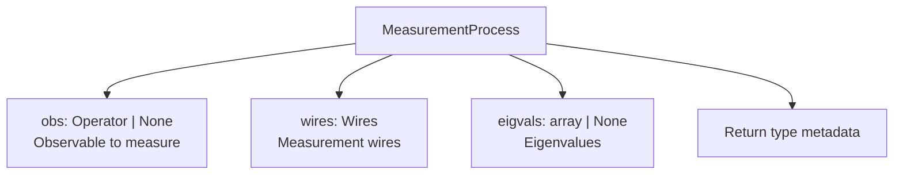

**Diagram: MeasurementProcess Components**

Measurements can have an associated observable (for `expval`, `var`, `sample`) or just wires (for `probs`, `state`).

Sources: [pennylane/measurements/]()

### Measurement Queuing

Measurements are queued similarly to operators but stored separately:

```python
# From tests/tape/test_tape.py:78-81
with QuantumTape() as tape:
    ops += [qml.RX(0.432, wires=0)]
    obs += [qml.PauliX(wires="a")]
    qml.expval(obs[0])  # Creates and queues ExpectationMP
```

The tape stores measurements in `_measurements` list, separate from operations.

Sources: [pennylane/tape/qscript.py:240-253]()

## Parameter Management

PennyLane tracks trainable parameters across the circuit representation.

### Parameter Storage

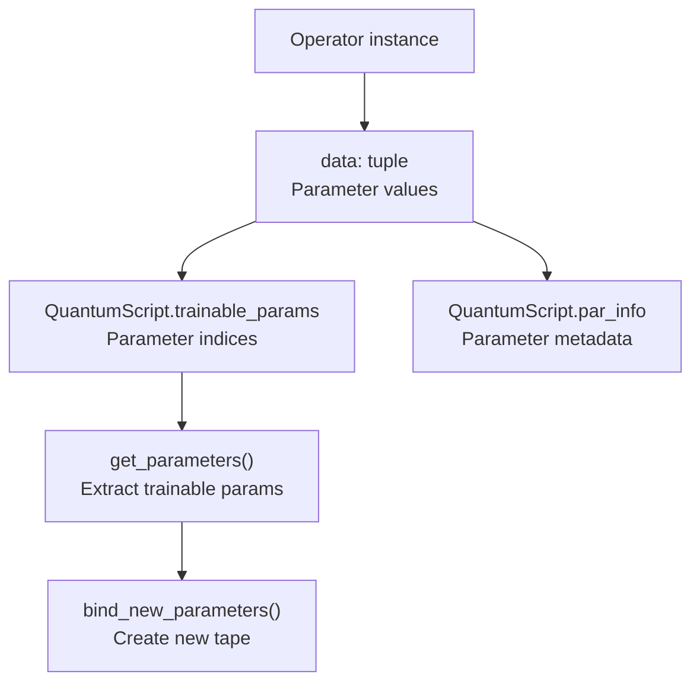

**Diagram: Parameter Tracking**

Parameters are stored in operators' `data` attribute and tracked by index in `QuantumScript.trainable_params`.

Sources: [pennylane/tape/qscript.py:436-513](), [pennylane/operation.py:1082-1176]()

### Trainable Parameters

By default, all parameters are trainable. The `trainable_params` property returns indices:

```python
# Example from pennylane/tape/qscript.py
>>> ops = [qml.RX(0.432, wires=0), qml.RY(0.543, wires=0)]
>>> tape = QuantumScript(ops)
>>> tape.trainable_params
[0, 1]
>>> tape.get_parameters()
[0.432, 0.543]
```

Sources: [pennylane/tape/qscript.py:352-389]()

## Pytree Integration

All core abstractions are registered as JAX pytrees for compatibility with JAX transformations.

### Flattening and Unflattening

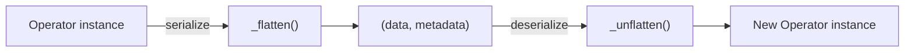

**Diagram: Pytree Transformation**

Operators define `_flatten()` to extract data and metadata, and `_unflatten()` to reconstruct from them.

Sources: [pennylane/operation.py:540-546](), [pennylane/pytrees.py]()

### Default Implementation

The default pytree implementation for operators:

- **Data**: Trainable parameters from `self.data`
- **Metadata**: `(wires, hyperparameters)` tuple

Custom operators can override `_flatten` and `_unflatten` for specialized serialization.

Sources: [pennylane/operation.py:361-388](), [tests/test_operation.py:361-388]()

---

# Page: Operators and Operation System

# Operators and Operation System

<details>
<summary>Relevant source files</summary>

The following files were used as context for generating this wiki page:

- [doc/development/deprecations.rst](doc/development/deprecations.rst)
- [doc/releases/changelog-dev.md](doc/releases/changelog-dev.md)
- [pennylane/__init__.py](pennylane/__init__.py)
- [pennylane/operation.py](pennylane/operation.py)
- [pennylane/workflow/__init__.py](pennylane/workflow/__init__.py)
- [pennylane/workflow/_setup_transform_program.py](pennylane/workflow/_setup_transform_program.py)
- [pennylane/workflow/construct_execution_config.py](pennylane/workflow/construct_execution_config.py)
- [pennylane/workflow/execution.py](pennylane/workflow/execution.py)
- [pennylane/workflow/get_compile_pipeline.py](pennylane/workflow/get_compile_pipeline.py)
- [pennylane/workflow/qnode.py](pennylane/workflow/qnode.py)
- [pennylane/workflow/resolution.py](pennylane/workflow/resolution.py)
- [tests/test_operation.py](tests/test_operation.py)
- [tests/test_qnode.py](tests/test_qnode.py)
- [tests/test_qnode_legacy.py](tests/test_qnode_legacy.py)
- [tests/workflow/interfaces/execute/test_execute.py](tests/workflow/interfaces/execute/test_execute.py)
- [tests/workflow/test_get_compile_pipeline.py](tests/workflow/test_get_compile_pipeline.py)
- [tests/workflow/test_resolve_execution_config.py](tests/workflow/test_resolve_execution_config.py)

</details>


This page documents PennyLane's operator system, which provides the foundation for representing quantum operations, gates, and observables. It covers the `Operator` base class, parameter management, broadcasting, pytree integration, and the queuing system.

For information about specific gate implementations and quantum operations, see [Basic Qubit Operations](#5.1). For symbolic operator composition (controlled, adjoint, products, sums), see [Controlled and Adjoint Operations](#5.2) and [Operator Arithmetic](#5.3). For circuit construction with operators, see [QuantumScript and Circuit Representation](#2.2).

---

## Class Hierarchy

The operator system is built on two primary base classes:

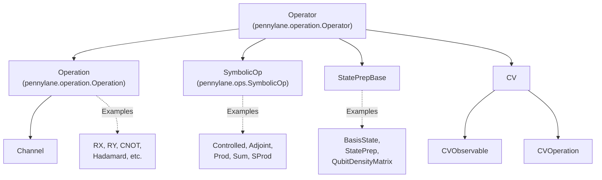

**Sources:** [pennylane/operation.py:393-677](), [pennylane/operation.py:2613-2687]()

### Operator

The `Operator` class is the abstract base for all quantum operators. Every operator instance is uniquely defined by:

- **Name**: Identifier for the operator type (e.g., `"RX"`, `"CNOT"`)
- **Wires**: The quantum wires/qubits the operator acts on
- **Data**: Trainable parameters (as tensors compatible with autodifferentiation frameworks)
- **Hyperparameters**: Non-trainable metadata that affects operator behavior

**Sources:** [pennylane/operation.py:393-433]()

### Operation

The `Operation` class represents unitary quantum gates and state transformations. It inherits from `Operator` and adds gate-specific functionality. Most concrete gates like `RX`, `RY`, `CNOT` inherit from this class.

**Sources:** [pennylane/operation.py:2613-2687]()

### Key Distinctions

| Aspect | Operator | Operation |
|--------|----------|-----------|
| Purpose | Base abstraction for all operators | Represents unitary transformations |
| Examples | Measurements, symbolic ops, gates | `RX`, `RY`, `CNOT`, `Hadamard` |
| Usage | Abstract base class | Concrete quantum gates |

**Sources:** [pennylane/operation.py:14-99]()

---

## Operator Construction and Initialization

### Basic Construction Pattern

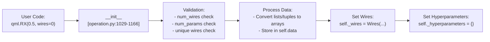

**Sources:** [pennylane/operation.py:1029-1166]()

### Constructor Behavior

The `Operator.__init__` method performs the following steps:

1. **Parameter Processing**: Trainable parameters passed as positional arguments are stored in `self.data` as a tuple. Lists and tuples are automatically converted to NumPy arrays.

2. **Wire Handling**: Wires can be provided via the `wires` keyword argument or as the final positional argument. They are stored as a `Wires` object.

3. **Validation**: 
   - Checks that the correct number of wires is provided (if `num_wires` is specified)
   - Checks that wires are unique
   - Validates the number of parameters (if `num_params` is specified)

4. **Hyperparameters**: Non-trainable metadata is stored in `self._hyperparameters` dictionary.

**Example from tests:**

```python
class DummyOp(qml.operation.Operator):
    num_wires = 1
    num_params = 1

# Wires as keyword argument
op1 = DummyOp(1.234, wires="a")

# Wires as final positional argument
op2 = DummyOp(1.234, "a")
```

**Sources:** [pennylane/operation.py:1029-1166](), [tests/test_operation.py:246-266]()

---

## Parameters and Data Management

### Data Property

The `data` property returns a tuple of trainable parameters. These parameters are compatible with autodifferentiation frameworks (NumPy, JAX, PyTorch, TensorFlow).

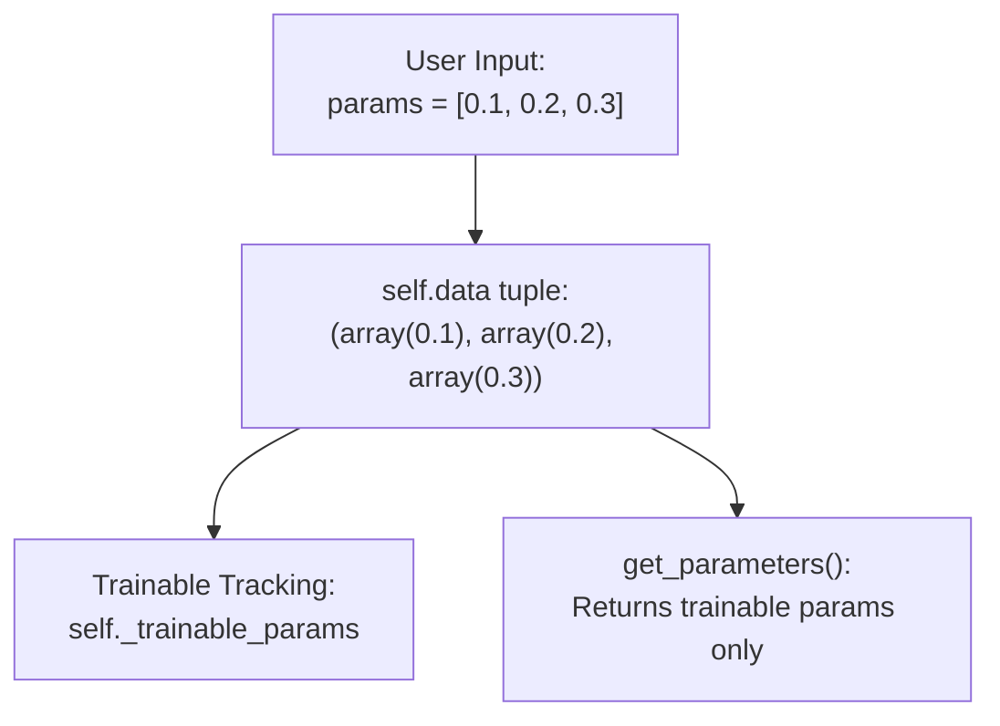

**Sources:** [pennylane/operation.py:1168-1207]()

### Parameters vs Hyperparameters

| Category | Storage | Purpose | Examples |
|----------|---------|---------|----------|
| **Parameters** (trainable) | `self.data` tuple | Values that can be optimized/differentiated | Rotation angles, matrix elements |
| **Hyperparameters** (non-trainable) | `self._hyperparameters` dict | Configuration affecting operator behavior | Basis states, control flags, wire ordering |

**Sources:** [pennylane/operation.py:1168-1262](), [tests/test_operation.py:287-316]()

### Trainable Parameters

By default, all parameters in `self.data` are trainable. Operators can selectively mark parameters as non-trainable:

```python
op = qml.RX(0.5, wires=0)
# Mark parameter as non-trainable
op.trainable_params = [False]
```

The `get_parameters()` method returns only trainable parameters.

**Sources:** [pennylane/operation.py:1264-1313]()

### Number of Parameters

The `num_params` attribute can be defined as:
- **Class property**: Fixed number of parameters for all instances
- **Instance property**: Computed dynamically based on provided parameters
- **Default**: If not defined, defaults to `len(self.data)`

**Sources:** [pennylane/operation.py:1315-1376](), [tests/test_operation.py:122-164]()

---

## Parameter Broadcasting

Parameter broadcasting allows a single operator to represent a batch of operations with different parameter values. This is essential for efficient execution of circuits with batched inputs.

```mermaid
graph TB
    SingleParam["Single Parameter:<br/>theta = 0.5<br/>ndim = 0"]
    BroadcastParam["Broadcasted Parameter:<br/>theta = [0.1, 0.2, 0.3]<br/>ndim = 1"]
    CheckBatching["_check_batching()<br/>[operation.py:1427-1515]"]
    BatchSize["batch_size property:<br/>None or int"]
    NdimParams["ndim_params property:<br/>tuple of ints"]
    
    SingleParam --> CheckBatching
    BroadcastParam --> CheckBatching
    CheckBatching --> BatchSize
    CheckBatching --> NdimParams
    
    BatchSize -->|"None"| SingleExec["Single Execution"]
    BatchSize -->|"int > 0"| BatchExec["Batch Execution"]
```

**Sources:** [pennylane/operation.py:1427-1649]()

### ndim_params

The `ndim_params` attribute specifies the expected number of dimensions for each parameter **without broadcasting**. For example:

| Operator | Parameters | ndim_params |
|----------|------------|-------------|
| `RX(theta, wires=0)` | Single scalar | `(0,)` |
| `QubitUnitary(U, wires=[0,1])` | 2D matrix | `(2,)` |
| Custom layer | Scalar + 2D matrix | `(0, 2)` |

**Sources:** [pennylane/operation.py:1613-1649]()

### batch_size

The `batch_size` property indicates whether the operator is broadcasted:
- `None`: Not broadcasted (single execution)
- `int`: Batch size (number of parameter sets)

**Example:**

```python
# No broadcasting
op1 = qml.RX(0.5, wires=0)
assert op1.batch_size is None

# Broadcasted with batch_size=3
op2 = qml.RX([0.1, 0.2, 0.3], wires=0)
assert op2.batch_size == 3
```

**Sources:** [pennylane/operation.py:1516-1611](), [tests/test_operation.py:390-455]()

### Lazy Evaluation

Both `batch_size` and `ndim_params` are computed lazily on first access via the `_check_batching()` method. This avoids unnecessary computation during operator construction.

**Sources:** [pennylane/operation.py:1427-1515](), [tests/test_operation.py:344-359]()

---

## Pytree Integration and Serialization

PennyLane operators are automatically registered as JAX pytrees, enabling compatibility with JAX transformations and serialization.

```mermaid
graph LR
    Operator["Operator Instance:<br/>qml.RX(1.2, wires=0)"]
    Flatten["_flatten() method:<br/>[operation.py:2087-2113]"]
    Data["Data (leaves):<br/>(1.2,)"]
    Metadata["Metadata (structure):<br/>(Wires([0]), ())"]
    Unflatten["_unflatten() classmethod:<br/>[operation.py:2115-2145]"]
    Reconstructed["Reconstructed Operator"]
    
    Operator --> Flatten
    Flatten --> Data
    Flatten --> Metadata
    Data --> Unflatten
    Metadata --> Unflatten
    Unflatten --> Reconstructed
```

**Sources:** [pennylane/operation.py:2087-2145]()

### Default Behavior

The default `_flatten` implementation returns:
1. **Data** (leaves): `self.data` tuple containing trainable parameters
2. **Metadata** (structure): 
   - `self.wires`: Wire labels
   - `tuple(self.hyperparameters.items())`: Hyperparameters as hashable tuple

The default `_unflatten` reconstructs the operator by calling the constructor with data and metadata.

**Sources:** [pennylane/operation.py:2087-2145](), [tests/test_operation.py:361-388]()

### Custom Pytree Implementation

Operators can override `_flatten` and `_unflatten` when:
- Data and hyperparameters are insufficient to reconstruct the operator
- Hyperparameters contain non-hashable components (lists, dicts)
- Custom initialization logic is required

**Example from tests:**

```python
class CustomOp(qml.operation.Operator):
    def __init__(self, x1, x2, wires, info):
        self._hyperparameters = {"info": info}
        super().__init__(x1, x2, wires=wires)

op = CustomOp(1.2, 2.3, wires=(0, 1), info="value")
data, metadata = op._flatten()
# data == (1.2, 2.3)
# metadata == (Wires([0, 1]), (("info", "value"),))

new_op = CustomOp._unflatten(data, metadata)
# new_op is equivalent to op
```

**Sources:** [tests/test_operation.py:361-388]()

---

## Queuing System

Operators are automatically added to the active recording context when instantiated. This enables circuit construction via Python's context manager protocol.

```mermaid
sequenceDiagram
    participant User
    participant QNode as "@qml.qnode(...)"
    participant AnnotatedQueue
    participant Operator
    participant QuantumScript
    
    User->>QNode: circuit()
    QNode->>AnnotatedQueue: Enter context
    User->>Operator: qml.RX(0.5, wires=0)
    Operator->>Operator: __init__()
    Operator->>Operator: queue()<br/>[operation.py:2025-2052]
    Operator->>AnnotatedQueue: QueuingManager.append(self)
    User->>Operator: qml.CNOT(wires=[0,1])
    Operator->>AnnotatedQueue: QueuingManager.append(self)
    User->>QNode: return qml.expval(...)
    QNode->>AnnotatedQueue: Exit context
    AnnotatedQueue->>QuantumScript: Convert to tape
```

**Sources:** [pennylane/operation.py:2025-2052](), [pennylane/queuing.py]()

### Queue Method

The `queue()` method is called automatically during `__init__` and determines whether the operator should be added to the recording context:

```python
def queue(self, context=QueuingManager):
    """Append the operator to the active recording queue."""
    context.append(self)
    return self
```

**Sources:** [pennylane/operation.py:2025-2052]()

### Queue Category

The `_queue_category` class attribute controls queuing behavior:
- `"_ops"`: Standard operators (default for most operators)
- `None`: **Deprecated** - Previously used to disable queuing
- Custom categories for special operator types

**Note:** Setting `_queue_category=None` is deprecated. Override the `queue()` method instead to customize queuing behavior.

**Sources:** [pennylane/operation.py:678-702](), [doc/releases/changelog-dev.md:404-468]()

---

## Key Properties and Methods

### Core Properties

| Property | Type | Description |
|----------|------|-------------|
| `name` | `str` | Operator identifier (e.g., `"RX"`, `"CNOT"`) |
| `wires` | `Wires` | Wire labels the operator acts on |
| `data` | `tuple` | Trainable parameters |
| `num_params` | `int` | Number of parameters |
| `num_wires` | `int` or `None` | Required number of wires (validation) |
| `hyperparameters` | `dict` | Non-trainable metadata |
| `batch_size` | `int` or `None` | Broadcasting batch size |
| `ndim_params` | `tuple` | Expected parameter dimensions |

**Sources:** [pennylane/operation.py:1168-1649]()

### Representation Methods

| Method | Return Type | Purpose |
|--------|-------------|---------|
| `matrix(*params, **hyperparams)` | `ndarray` | Matrix representation |
| `eigvals(*params, **hyperparams)` | `ndarray` | Eigenvalues |
| `decomposition(*params, wires, **hyperparams)` | `list[Operator]` | Decomposition into simpler ops |
| `generator()` | `Operator` | Generator for parameterized gates |
| `diagonalizing_gates()` | `list[Operator]` | Gates that diagonalize observable |
| `sparse_matrix(*params, **hyperparams)` | `scipy.sparse` | Sparse matrix representation |

These methods have both instance versions (using `self.data`, `self.wires`, `self.hyperparameters`) and static `compute_*` versions that accept parameters directly.

**Sources:** [pennylane/operation.py:393-420]()

### Has Methods

Boolean methods checking operator capabilities:

| Method | Purpose |
|--------|---------|
| `has_matrix` | Can compute matrix representation |
| `has_decomposition` | Has decomposition defined |
| `has_diagonalizing_gates` | Defines diagonalizing gates |
| `has_generator` | Has generator (for parameter-shift) |
| `has_adjoint` | Defines adjoint operation |

**Sources:** [pennylane/operation.py:1775-1944]()

---

## Resource Management

### Resource Keys and Parameters

The `resource_keys` class attribute defines parameters that affect resource requirements:

```python
class MyOp(Operator):
    resource_keys = {"num_layers", "num_qubits"}
    
    def resource_params(self):
        return {"num_layers": 5, "num_qubits": 10}
```

This is used by the resource estimation system to calculate gate counts and circuit depth.

**Sources:** [pennylane/operation.py:689-702]()

---

## Program Capture (PLXPR)

Operators integrate with PennyLane's program capture system for QJIT compilation:

```mermaid
graph TB
    UserCall["User: qml.RX(0.5, wires=0)"]
    PrimitiveCheck["Check if capture enabled:<br/>qml.capture.enabled()"]
    Primitive["Operator._primitive.bind()<br/>[operation.py:721-757]"]
    Implementation["_primitive.def_impl<br/>[operation.py:345-357]"]
    StandardInit["Standard __init__"]
    
    UserCall --> PrimitiveCheck
    PrimitiveCheck -->|"Yes"| Primitive
    PrimitiveCheck -->|"No"| StandardInit
    Primitive --> Implementation
    Implementation --> StandardInit
```

**Sources:** [pennylane/operation.py:323-366](), [pennylane/operation.py:721-757]()

### Primitive Registration

Each `Operator` subclass automatically gets a JAX primitive registered in `__init_subclass__`:

```python
@classmethod
def __init_subclass__(cls, **_):
    # ...
    cls._primitive = create_operator_primitive(cls)
```

The primitive enables operators to be captured into PLXPR (PennyLane's intermediate representation) for compilation with Catalyst.

**Sources:** [pennylane/operation.py:704-719]()

---

## Operator Equality and Hashing

### Equality

Operators support equality comparison via `==`, which delegates to `qml.equal()`:

```python
op1 = qml.RX(0.5, wires=0)
op2 = qml.RX(0.5, wires=0)
assert op1 == op2  # True

op3 = qml.RX(0.6, wires=0)
assert op1 == op3  # False
```

**Sources:** [pennylane/operation.py:1946-2007](), [tests/test_operation.py:317-342]()

### Hashing

Operators are hashable based on their name, wires, data, and hyperparameters:

```python
op1 = qml.RX(0.5, wires=0)
op2 = qml.RX(0.5, wires=0)
assert hash(op1) == hash(op2)

# Can be used in sets
op_set = {op1, op2}
assert len(op_set) == 1  # Duplicate removed
```

The hash is computed lazily and cached in the `hash` property.

**Sources:** [pennylane/operation.py:2009-2023](), [tests/test_operation.py:330-342]()

---

## Deprecations and Changes

### id Argument

The `id` keyword argument to `Operator` is deprecated as of v0.45 and will be removed in v0.46. Two new functions replace its functionality:

1. **Custom labels** for circuit drawing: Use `qml.drawer.label()`
2. **Fourier spectrum marking**: Use `qml.fourier.mark()`

```python
# Deprecated (v0.45)
op = qml.RX(0.5, wires=0, id="my-rx")

# New approach
op = qml.drawer.label(qml.RX(0.5, wires=0), "my-rx")
```

**Sources:** [doc/releases/changelog-dev.md:577-620](), [doc/development/deprecations.rst:34-69]()

### Queue Category

Setting `_queue_category=None` to disable queuing is deprecated. Override the `queue()` method instead:

```python
# Deprecated
class MyOp(Operator):
    _queue_category = None

# New approach
class MyOp(Operator):
    def queue(self, context=QueuingManager):
        return self  # Don't append to queue
```

**Sources:** [doc/releases/changelog-dev.md:621-625](), [doc/development/deprecations.rst:71-78]()

---

## Summary

The operator system provides:

1. **Unified abstraction** via `Operator` base class for all quantum operations
2. **Flexible parameter management** with trainable/non-trainable distinction
3. **Efficient broadcasting** through `batch_size` and `ndim_params`
4. **Seamless serialization** via automatic pytree registration
5. **Automatic queuing** for circuit construction
6. **Multiple representations** (matrix, eigenvalues, decomposition, generator)
7. **Program capture** integration for QJIT compilation

Key files:
- [pennylane/operation.py]() - Core implementation
- [pennylane/ops/]() - Concrete operator implementations
- [pennylane/queuing.py]() - Queuing system

**Sources:** [pennylane/operation.py:1-2687](), [pennylane/__init__.py:32-43]()

---

# Page: QuantumScript and Circuit Representation

# QuantumScript and Circuit Representation

<details>
<summary>Relevant source files</summary>

The following files were used as context for generating this wiki page:

- [doc/code/qml_queuing.rst](doc/code/qml_queuing.rst)
- [doc/introduction/measurements.rst](doc/introduction/measurements.rst)
- [pennylane/queuing.py](pennylane/queuing.py)
- [pennylane/tape/operation_recorder.py](pennylane/tape/operation_recorder.py)
- [pennylane/tape/qscript.py](pennylane/tape/qscript.py)
- [pennylane/tape/tape.py](pennylane/tape/tape.py)
- [tests/tape/test_qscript.py](tests/tape/test_qscript.py)
- [tests/tape/test_tape.py](tests/tape/test_tape.py)
- [tests/test_queuing.py](tests/test_queuing.py)

</details>


## Purpose and Scope

This document covers PennyLane's internal circuit representation system, focusing on the `QuantumScript` and `QuantumTape` classes that store quantum operations and measurements. These classes form the foundation for circuit manipulation, transformation, and execution. For information about how these circuits are executed on devices, see [QNode System and Execution Workflow](#2.3). For details about the operations stored in circuits, see [Operators and Operation System](#2.1).

---

## Overview: QuantumScript vs QuantumTape

PennyLane uses two closely related classes for circuit representation:

| Class | Purpose | Queuing | Use Case |
|-------|---------|---------|----------|
| `QuantumScript` | Lightweight immutable circuit representation | No | Transformations, optimization, post-construction manipulation |
| `QuantumTape` | Recording-enabled circuit builder | Yes | Interactive circuit construction, QNode internals |

**QuantumScript** is the base class that stores operations and measurements as simple lists. It is more performant when queuing is not needed.

**QuantumTape** extends both `QuantumScript` and `AnnotatedQueue`, adding the ability to record operations as they are constructed within a context manager. This is the primary interface used internally by QNodes.

```mermaid
graph TB
    QS["QuantumScript<br/>- Stores ops/measurements<br/>- Parameter management<br/>- Circuit properties"]
    AQ["AnnotatedQueue<br/>- Context manager<br/>- Operation recording<br/>- Metadata tracking"]
    QT["QuantumTape<br/>- Recording + Storage<br/>- Used by QNode<br/>- Interactive construction"]
    
    QS --> QT
    AQ --> QT
    
    style QS fill:#f9f9f9,stroke:#333,stroke-width:2px
    style QT fill:#f9f9f9,stroke:#333,stroke-width:2px
```

**Sources:** [pennylane/tape/qscript.py:41-118](), [pennylane/tape/tape.py:123-253]()

---

## QuantumScript: Core Circuit Data Structure

### Basic Structure

A `QuantumScript` consists of three primary components:

1. **Operations** (`_ops`): The quantum gates and state preparations
2. **Measurements** (`_measurements`): Observable measurements and sampling instructions  
3. **Metadata**: Shots, trainable parameters, cached properties

```mermaid
graph LR
    subgraph QuantumScript
        ops["_ops: list[Operator]<br/>RX, RY, CNOT, etc."]
        meas["_measurements: list[MeasurementProcess]<br/>expval, sample, probs, etc."]
        meta["Metadata<br/>- shots: Shots<br/>- trainable_params<br/>- _batch_size<br/>- _graph<br/>- _specs"]
    end
    
    ops --> circuit["circuit property<br/>= operations + measurements"]
    meas --> circuit
```

**Sources:** [pennylane/tape/qscript.py:127-145](), [pennylane/tape/qscript.py:178-196]()

### Construction Methods

**Direct instantiation:**

```python
ops = [qml.RX(0.432, wires=0), qml.RY(0.543, wires=0), qml.CNOT((0, 1))]
measurements = [qml.expval(qml.Z(0))]
qscript = QuantumScript(ops, measurements, shots=1000)
```

**From an AnnotatedQueue:**

```python
with qml.queuing.AnnotatedQueue() as q:
    qml.RX(0.432, wires=0)
    qml.expval(qml.Z(0))

qscript = QuantumScript.from_queue(q)
```

The constructor accepts iterables for both `ops` and `measurements`, automatically converting them to lists internally.

**Sources:** [pennylane/tape/qscript.py:56-117](), [pennylane/tape/qscript.py:127-145]()

### Key Properties

```mermaid
graph TD
    QS["QuantumScript"]
    
    QS --> ops["operations<br/>State preps + gates"]
    QS --> meas["measurements<br/>MeasurementProcess list"]
    QS --> obs["observables<br/>Extracted from measurements"]
    QS --> circ["circuit<br/>operations + measurements"]
    
    QS --> wires["wires: Wires<br/>All wires used"]
    QS --> nwires["num_wires: int<br/>Count of wires"]
    QS --> nparams["num_params: int<br/>Trainable param count"]
    
    QS --> batch["batch_size: int | None<br/>For parameter broadcasting"]
    QS --> hash["hash: int<br/>Unique fingerprint"]
    QS --> specs["specs: dict<br/>Resource estimation"]
    
    style QS fill:#f9f9f9,stroke:#333,stroke-width:2px
```

**Sources:** [pennylane/tape/qscript.py:178-397]()

---

## QuantumTape: Recording-Enabled Circuits

### Queuing Context Manager

`QuantumTape` is a context manager that records operations as they are constructed:

```python
with QuantumTape() as tape:
    qml.RX(0.432, wires=0)
    qml.RY(0.543, wires=0)
    qml.CNOT(wires=[0, 1])
    qml.expval(qml.Z(0))

# tape.operations = [RX, RY, CNOT]
# tape.measurements = [expval(Z(0))]
```

The recording mechanism works through the global `QueuingManager` singleton, which maintains a stack of active recording contexts.

**Sources:** [pennylane/tape/tape.py:123-253](), [pennylane/tape/tape.py:262-273]()

### Context Manager Lifecycle

```mermaid
sequenceDiagram
    participant User
    participant QT as QuantumTape
    participant QM as QueuingManager
    participant Op as Operation/Measurement
    
    User->>QT: __enter__()
    QT->>QM: add_active_queue(self)
    Note over QM: tape becomes active context
    
    User->>Op: qml.RX(0.5, 0)
    Op->>Op: __init__()
    Op->>QM: append(self)
    QM->>QT: append(op)
    Note over QT: op stored in queue
    
    User->>QT: __exit__()
    QT->>QT: _process_queue()
    Note over QT: Convert queue to<br/>ops + measurements
    QT->>QM: remove_active_queue()
    Note over QM: tape no longer active
```

**Sources:** [pennylane/tape/tape.py:262-298](), [pennylane/queuing.py:209-257]()

---

## The Queuing System

### QueuingManager: Global Recording Coordinator

The `QueuingManager` is a singleton class that manages the stack of active recording contexts. It provides class methods for queueable objects (Operators, MeasurementProcesses) to interact with the active queue.

```mermaid
graph TB
    subgraph "Global State"
        QM["QueuingManager<br/>(Singleton)"]
        stack["_active_contexts: list<br/>Stack of recording queues"]
    end
    
    subgraph "Recording Contexts"
        tape1["QuantumTape 1"]
        tape2["QuantumTape 2<br/>(nested)"]
        tape3["AnnotatedQueue"]
    end
    
    subgraph "Queueable Objects"
        op["Operator.queue()"]
        mp["MeasurementProcess.queue()"]
    end
    
    QM --> stack
    stack -.contains.-> tape1
    stack -.contains.-> tape2
    stack -.contains.-> tape3
    
    op --> QM
    mp --> QM
    
    QM -.active_context().-> tape2
    
    style QM fill:#f9f9f9,stroke:#333,stroke-width:2px
    style tape2 fill:#e6f3ff,stroke:#333,stroke-width:2px
```

**Key methods:**
- `active_context()`: Returns the currently recording queue (top of stack)
- `recording()`: Returns `True` if any context is active
- `append(obj, **kwargs)`: Adds an object to the active queue
- `remove(obj)`: Removes an object from the active queue
- `stop_recording()`: Context manager to temporarily disable recording

**Sources:** [pennylane/queuing.py:209-364]()

### AnnotatedQueue: The Recording Queue

`AnnotatedQueue` is an `OrderedDict` subclass that stores operations along with metadata annotations. It's the base class that `QuantumTape` inherits from to gain queuing capabilities.

```mermaid
graph LR
    subgraph AnnotatedQueue
        dict["OrderedDict[WrappedObj, dict]<br/>Key: Operation<br/>Value: Metadata"]
    end
    
    dict --> op1["WrappedObj(RX) → {owner: None}"]
    dict --> op2["WrappedObj(CNOT) → {owner: None}"]
    dict --> op3["WrappedObj(expval) → {owner: None}"]
    
    queue["queue property<br/>→ [RX, CNOT, expval]"]
    
    dict --> queue
```

**Key methods:**
- `append(obj, **kwargs)`: Add an object with metadata
- `remove(obj)`: Remove an object
- `update_info(obj, **kwargs)`: Update object metadata
- `get_info(obj)`: Retrieve object metadata
- `queue` property: Returns list of objects (without metadata)

**Sources:** [pennylane/queuing.py:366-433]()

### WrappedObj: Identity-Based Hashing

Operations are wrapped in `WrappedObj` before being used as dictionary keys. This ensures that hash and equality are based on object identity (`id()`) rather than value equality, allowing the same operation to be queued multiple times if it's a different instance.

**Sources:** [pennylane/queuing.py:191-207]()

### process_queue: Converting Queue to Circuit

The `process_queue` function transforms an `AnnotatedQueue` into separate lists of operations and measurements:

```mermaid
graph LR
    aq["AnnotatedQueue<br/>[RX, RY, CNOT,<br/>expval, probs]"]
    
    pq["process_queue()"]
    
    ops["operations list<br/>[RX, RY, CNOT]"]
    meas["measurements list<br/>[expval, probs]"]
    
    aq --> pq
    pq --> ops
    pq --> meas
    
    note["Filters by<br/>_queue_category:<br/>'_ops' vs '_measurements'"]
    pq -.uses.-> note
```

The function checks each object's `_queue_category` attribute:
- `_queue_category = "_ops"`: Goes to operations list
- `_queue_category = "_measurements"`: Goes to measurements list

It also enforces ordering: operations must come before measurements, or a `ValueError` is raised.

**Sources:** [pennylane/queuing.py:546-591](), [pennylane/tape/tape.py:287-298]()

---

## Circuit Construction Workflow

### Method 1: Direct Instantiation

```python
# Construct operations outside any context
ops = [qml.Hadamard(0), qml.CNOT([0, 1])]
measurements = [qml.expval(qml.Z(0))]

# Create QuantumScript directly
qscript = QuantumScript(ops, measurements, shots=1000)
```

### Method 2: QuantumTape Context Manager

```python
# Recording context automatically captures operations
with QuantumTape() as tape:
    qml.Hadamard(0)
    qml.CNOT([0, 1])
    qml.expval(qml.Z(0))

# Operations are processed on exit
# tape.operations = [Hadamard(0), CNOT([0, 1])]
```

### Method 3: From AnnotatedQueue

```python
# Build queue manually
with qml.queuing.AnnotatedQueue() as q:
    qml.Hadamard(0)
    qml.CNOT([0, 1])
    qml.expval(qml.Z(0))

# Convert to QuantumScript
qscript = QuantumScript.from_queue(q)
```

**Sources:** [pennylane/tape/qscript.py:56-117](), [pennylane/tape/tape.py:146-253]()

---

## Circuit Properties and Metadata

### Wire Information

```mermaid
graph TB
    QS["QuantumScript"]
    
    QS --> wires["wires: Wires<br/>Cached property"]
    QS --> num_wires["num_wires: int<br/>len(wires)"]
    QS --> op_wires["op_wires: Wires<br/>Wires used by operations only"]
    
    wires --> impl["Wires.all_wires()<br/>Collects from all<br/>ops + measurements"]
    
    note["Uses cached_property<br/>Invalidated by _update()"]
    wires -.decorated by.-> note
```

The `wires` property aggregates all wires used across operations and measurements, maintaining their order of appearance. It's a cached property, meaning it's computed once and reused until the circuit is modified.

**Sources:** [pennylane/tape/qscript.py:360-396]()

### Parameter Information

The `par_info` property provides detailed information about each parameter in the circuit:

```python
ops = [qml.RX(0.1, 0), qml.Rot(0.2, 0.3, 0.4, 0)]
qscript = QuantumScript(ops, [qml.expval(qml.Z(0))])

# qscript.par_info = [
#     {'op': RX(0.1), 'op_idx': 0, 'p_idx': 0},
#     {'op': Rot(...), 'op_idx': 1, 'p_idx': 0},
#     {'op': Rot(...), 'op_idx': 1, 'p_idx': 1},
#     {'op': Rot(...), 'op_idx': 1, 'p_idx': 2}
# ]
```

Each entry contains:
- `op`: The operator/measurement containing the parameter
- `op_idx`: Index in the circuit (operations + measurements)
- `p_idx`: Index within the operator's `data` list

**Sources:** [pennylane/tape/qscript.py:398-426]()

### Batch Size Inference

For parameter broadcasting, the `batch_size` property infers the batch dimension from operations:

```python
# Single parameter has batch dimension 3
ops = [qml.RX([0.1, 0.2, 0.3], wires=0)]
qscript = QuantumScript(ops, [qml.expval(qml.Z(0))])

assert qscript.batch_size == 3
```

The batch size is computed lazily and cached. If operations have inconsistent batch sizes, accessing this property raises a `ValueError`.

**Sources:** [pennylane/tape/qscript.py:266-277](), [pennylane/tape/qscript.py:477-498]()

### Observable Sharing and Diagonalization

The `obs_sharing_wires` and `diagonalizing_gates` properties support measurement processing:

```mermaid
graph TB
    meas["measurements<br/>[expval(X(0)), expval(Y(0))]"]
    
    sharing["obs_sharing_wires<br/>[X(0), Y(0)]<br/>Both use wire 0"]
    
    diag["diagonalizing_gates<br/>[H(0), Z(0), S(0), H(0)]"]
    
    meas --> sharing
    meas --> diag
    
    note["Used by devices to rotate<br/>computational basis<br/>before measurement"]
    diag -.purpose.-> note
```

**Sources:** [pennylane/tape/qscript.py:280-338](), [pennylane/tape/qscript.py:429-476]()

### Hash and Specs

- **`hash`**: Unique integer fingerprint based on operations, measurements, and trainable parameters. Used for caching and comparison.
- **`specs`**: Resource estimation dictionary including gate counts, circuit depth, and wire allocations.

**Sources:** [pennylane/tape/qscript.py:149-157]()

---

## Parameter Management

### Trainable Parameters

The `trainable_params` property controls which parameters are considered differentiable:

```python
ops = [qml.RX(0.1, 0), qml.RY(0.2, 0), qml.RZ(0.3, 0)]
qscript = QuantumScript(ops, [qml.expval(qml.Z(0))])

# By default, all parameters are trainable
assert qscript.trainable_params == [0, 1, 2]

# Mark only the first parameter as trainable
qscript.trainable_params = [0]
assert qscript.get_parameters() == [0.1]
```

Setting `trainable_params` affects:
- `num_params`: Returns length of trainable parameter list
- `get_parameters(trainable_only=True)`: Returns only trainable values
- Gradient computation: Only trainable parameters get derivatives

**Sources:** [pennylane/tape/qscript.py:504-558]()

### Getting Parameters

The `get_parameters()` method extracts parameter values:

```python
# Get only trainable parameters (default)
trainable = qscript.get_parameters(trainable_only=True)

# Get all parameters
all_params = qscript.get_parameters(trainable_only=False)

# Get only operation parameters (exclude measurement observables)
op_params = qscript.get_parameters(operations_only=True)
```

**Sources:** [pennylane/tape/qscript.py:578-638]()

### Binding New Parameters

The `bind_new_parameters()` method creates a new circuit with updated parameter values:

```mermaid
sequenceDiagram
    participant User
    participant Old as Original QuantumScript
    participant New as New QuantumScript
    
    User->>Old: bind_new_parameters([0.5, 0.6], [0, 2])
    Note over Old: Identify affected operations<br/>via par_info
    Old->>Old: Create new operation instances<br/>with updated parameters
    Old->>New: Construct new QuantumScript<br/>with modified ops
    New-->>User: Returns new circuit
    
    Note over Old: Original unchanged
    Note over New: Only specified params updated
```

```python
ops = [qml.RX(0.1, 0), qml.RY(0.2, 0), qml.RZ(0.3, 0)]
qscript = QuantumScript(ops, [qml.expval(qml.Z(0))])

# Update parameters at indices 0 and 2
new_qscript = qscript.bind_new_parameters([0.5, 0.8], [0, 2])

# Original unchanged
assert qscript.get_parameters() == [0.1, 0.2, 0.3]

# New has updated values
assert new_qscript.get_parameters() == [0.5, 0.2, 0.8]
```

**Sources:** [pennylane/tape/qscript.py:640-721]()

---

## Circuit Manipulation

### Copying Circuits

The `copy()` method creates a new circuit with optional modifications:

```python
# Shallow copy: operations are references
new_tape = tape.copy()

# Deep copy: operations are copied
new_tape = tape.copy(copy_operations=True)

# Copy with modifications
new_tape = tape.copy(
    operations=[qml.Hadamard(0)],  # Replace operations
    measurements=[qml.expval(qml.X(0))],  # Replace measurements
    shots=2000,  # Change shots
    trainable_params=[0, 1]  # Change trainable params
)
```

The copy behavior:
- Without `copy_operations=True`: Operations are references (shared data)
- With `copy_operations=True`: Operations are shallow copied (independent parameters)
- When updates are provided: Automatically performs operation copying

**Sources:** [pennylane/tape/qscript.py:727-822]()

### Expanding Circuits

The `expand()` method decomposes operations to a target depth:

```python
ops = [qml.Permute([2, 1, 0], wires=[0, 1, 2])]
tape = QuantumScript(ops, [qml.expval(qml.Z(0))])

# Decompose once
expanded = tape.expand(depth=1)
# Operations decomposed into simpler gates

# Decompose multiple times
expanded = tape.expand(depth=2)
# Operations decomposed recursively

# Stop at specific gates
def stop_at(op):
    return op.name in ["RX", "RY", "CNOT"]
    
expanded = tape.expand(stop_at=stop_at)
```

**Sources:** [pennylane/tape/qscript.py:827-936]()

### Adjoint (Inverse) Circuits

The `adjoint()` method creates the inverse circuit:

```python
with QuantumTape() as tape:
    qml.RX(0.1, 0)
    qml.RY(0.2, 0)
    qml.CNOT([0, 1])

adj_tape = tape.adjoint()
# Operations reversed and inverted:
# [Adjoint(CNOT), Adjoint(RY), Adjoint(RX)]
```

**Sources:** [pennylane/tape/qscript.py:938-1007]()

---

## Integration with Execution Pipeline

```mermaid
graph TB
    subgraph "Circuit Construction"
        qfunc["Quantum Function<br/>def circuit(x):<br/>  qml.RX(x, 0)<br/>  return qml.expval(qml.Z(0))"]
        tape["QuantumTape<br/>Recording Context"]
        qscript["QuantumScript<br/>Immutable Representation"]
    end
    
    subgraph "Compilation & Transformation"
        pipeline["CompilePipeline<br/>Applies transforms"]
        transformed["Transformed QuantumScript(s)"]
    end
    
    subgraph "Execution"
        device["Device.execute()<br/>Returns results"]
    end
    
    qfunc --> tape
    tape --> qscript
    qscript --> pipeline
    pipeline --> transformed
    transformed --> device
    
    style qscript fill:#f9f9f9,stroke:#333,stroke-width:2px
```

The `QuantumScript`/`QuantumTape` serves as the interface between:
1. **User code**: Quantum functions defining circuits
2. **Transform system**: Circuit optimization and compilation
3. **Device layer**: Execution on simulators or hardware

**Sources:** [pennylane/tape/qscript.py:14-17](), [pennylane/tape/tape.py:14-16]()

---

## Common Usage Patterns

### Pattern 1: Transform Development

Transforms operate on `QuantumScript` objects:

```python
def my_transform(tape: QuantumScript) -> tuple[list[QuantumScript], Callable]:
    """Example transform that modifies a circuit."""
    # Access circuit components
    ops = tape.operations
    measurements = tape.measurements
    
    # Create modified circuit
    new_ops = [transform_op(op) for op in ops]
    new_tape = QuantumScript(new_ops, measurements)
    
    # Return modified tape(s) and processing function
    return [new_tape], lambda results: results[0]
```

### Pattern 2: QNode Circuit Construction

QNodes use `QuantumTape` to record circuits:

```python
def construct_tape(qfunc, *args, **kwargs):
    with QuantumTape() as tape:
        qfunc(*args, **kwargs)
    return tape
```

### Pattern 3: Circuit Analysis

Inspect circuit properties without execution:

```python
qscript = QuantumScript(ops, measurements)

print(f"Circuit uses {qscript.num_wires} wires: {qscript.wires}")
print(f"Contains {len(qscript.operations)} operations")
print(f"Has {qscript.num_params} trainable parameters")
print(f"Resource specs: {qscript.specs}")
```

**Sources:** Various examples from [tests/tape/test_tape.py]() and [tests/tape/test_qscript.py]()

---

## Relationship to Other Systems

This circuit representation layer interacts with:

- **[Operators and Operation System](#2.1)**: Provides the operation objects stored in circuits
- **[QNode System](#2.3)**: Uses `QuantumTape` to construct circuits from quantum functions
- **[Transform System](#3.1)**: Operates on `QuantumScript` objects to modify circuits
- **[Device Layer](#4.1)**: Receives `QuantumScript` for execution

**Sources:** High-level architecture diagrams in overall system documentation

---

# Page: QNode System and Execution Workflow

# QNode System and Execution Workflow

<details>
<summary>Relevant source files</summary>

The following files were used as context for generating this wiki page:

- [doc/development/deprecations.rst](doc/development/deprecations.rst)
- [doc/releases/changelog-dev.md](doc/releases/changelog-dev.md)
- [pennylane/__init__.py](pennylane/__init__.py)
- [pennylane/operation.py](pennylane/operation.py)
- [pennylane/workflow/__init__.py](pennylane/workflow/__init__.py)
- [pennylane/workflow/_setup_transform_program.py](pennylane/workflow/_setup_transform_program.py)
- [pennylane/workflow/construct_execution_config.py](pennylane/workflow/construct_execution_config.py)
- [pennylane/workflow/execution.py](pennylane/workflow/execution.py)
- [pennylane/workflow/get_compile_pipeline.py](pennylane/workflow/get_compile_pipeline.py)
- [pennylane/workflow/qnode.py](pennylane/workflow/qnode.py)
- [pennylane/workflow/resolution.py](pennylane/workflow/resolution.py)
- [tests/test_operation.py](tests/test_operation.py)
- [tests/test_qnode.py](tests/test_qnode.py)
- [tests/test_qnode_legacy.py](tests/test_qnode_legacy.py)
- [tests/workflow/interfaces/execute/test_execute.py](tests/workflow/interfaces/execute/test_execute.py)
- [tests/workflow/test_get_compile_pipeline.py](tests/workflow/test_get_compile_pipeline.py)
- [tests/workflow/test_resolve_execution_config.py](tests/workflow/test_resolve_execution_config.py)

</details>


## Purpose and Scope

This document describes the QNode system in PennyLane, which provides the core abstraction for quantum circuits with automatic differentiation support. It covers the complete workflow from QNode creation through circuit execution, including tape construction, transform application, interface resolution, and device execution.

For information about the underlying circuit representation, see [QuantumScript and Circuit Representation](#2.2). For details about specific transform types, see [Transform Framework](#3.1) and [CompilePipeline and Execution Config](#3.2). For device-specific execution details, see [Device Architecture and Plugin System](#4.1).

---

## QNode Class Structure

The `QNode` class [pennylane/workflow/qnode.py:190-891]() serves as the primary interface for defining quantum circuits with classical processing. It combines three essential components: a quantum function, a device, and execution configuration.

### Core Components

| Component | Type | Purpose |
|-----------|------|---------|
| `func` | `Callable` | Python function defining quantum operations and measurements |
| `device` | `Device` or `LegacyDevice` | Hardware or simulator for executing circuits |
| `interface` | `str` or `Interface` | Autodiff framework (`"auto"`, `"autograd"`, `"torch"`, `"jax"`, `"tf"`) |
| `diff_method` | `str` or `Transform` | Differentiation strategy (`"best"`, `"parameter-shift"`, `"adjoint"`, `"backprop"`, etc.) |
| `compile_pipeline` | `CompilePipeline` | Chain of transforms to apply before execution |
| `execute_kwargs` | `dict` | Execution parameters (shots, caching, grad_on_execution, etc.) |
| `gradient_kwargs` | `dict` | Parameters passed to gradient transforms |

**QNode Initialization and Attributes**

```mermaid
graph TB
    subgraph "QNode Class [pennylane/workflow/qnode.py:190]"
        Init["__init__(func, device, interface, diff_method, ...)"]
        Func["func: Callable"]
        Device["device: Device"]
        Interface["interface: str | Interface"]
        DiffMethod["diff_method: str | Transform"]
        CompilePipeline["compile_pipeline: CompilePipeline"]
        ExecuteKwargs["execute_kwargs: dict"]
        GradientKwargs["gradient_kwargs: dict"]
        Shots["_shots_override_device: bool"]
    end
    
    subgraph "Key Methods"
        Call["__call__(*args, **kwargs) -> Result"]
        ConstructTape["construct_tape(*args, **kwargs) -> QuantumScript"]
        GetShots["_get_shots(kwargs) -> Shots"]
        Update["update(**kwargs) -> QNode"]
    end
    
    Init --> Func
    Init --> Device
    Init --> Interface
    Init --> DiffMethod
    Init --> CompilePipeline
    Init --> ExecuteKwargs
    Init --> GradientKwargs
    Init --> Shots
    
    Call --> ConstructTape
    Call --> GetShots
```

Sources: [pennylane/workflow/qnode.py:190-491]()

---

## QNode Execution Lifecycle

The QNode execution follows a multi-stage pipeline from user function call to final results. Each stage performs specific transformations and validations.

**QNode Execution Sequence**

```mermaid
sequenceDiagram
    participant User
    participant QNode as QNode.__call__
    participant ConstructTape as qml.tape.make_qscript
    participant CompilePipeline
    participant Execute as qml.execute
    participant Device
    
    User->>QNode: circuit(params)
    
    Note over QNode: [qnode.py:494-498]<br/>Extract shots from kwargs
    QNode->>QNode: _get_shots(kwargs)
    
    Note over QNode: [qnode.py:500-515]<br/>Construct quantum tape
    QNode->>ConstructTape: make_qscript(func, shots)(args, kwargs)
    ConstructTape->>ConstructTape: Execute func in queuing context
    ConstructTape-->>QNode: QuantumScript (tape)
    
    Note over QNode: [qnode.py:517-522]<br/>Validate measurements
    QNode->>QNode: _validate_qfunc_output(qfunc_output, tape.measurements)
    
    Note over QNode: [qnode.py:524-534]<br/>Apply user transforms
    QNode->>CompilePipeline: compile_pipeline((tape,))
    CompilePipeline-->>QNode: transformed_batch, post_processing_fn
    
    Note over QNode: [qnode.py:545-591]<br/>Execute with autodiff
    QNode->>Execute: execute(batch, device, diff_method, interface, ...)
    
    Execute->>Execute: _resolve_interface(interface, tapes)
    Execute->>Execute: _resolve_execution_config(config, device, tapes)
    Execute->>Execute: _setup_transform_program(device, config)
    Execute->>Device: device.execute(final_tapes, execution_config)
    Device-->>Execute: raw_results
    Execute-->>QNode: results
    
    Note over QNode: [qnode.py:593-598]<br/>Post-process results
    QNode->>QNode: user_post_processing(results)
    QNode->>QNode: _to_qfunc_output_type(results, qfunc_output)
    QNode->>QNode: _convert_to_interface(results, interface)
    
    QNode-->>User: final_result
```

Sources: [pennylane/workflow/qnode.py:494-598](), [pennylane/workflow/execution.py:52-241]()

---

## Tape Construction Process

The tape construction process converts a Python function into a structured `QuantumScript` representation. This occurs through the queuing mechanism.

**Tape Construction Flow**

```mermaid
graph TB
    subgraph "qml.tape.make_qscript [tape/qscript.py]"
        MakeQScript["make_qscript(func, shots=None)"]
        Wrapper["wrapper(*args, **kwargs)"]
        Queue["AnnotatedQueue()"]
        ExecFunc["func(*args, **kwargs)"]
        BuildTape["QuantumScript(ops, measurements, shots)"]
    end
    
    subgraph "Queuing System [queuing.py]"
        QM["QueuingManager.active_context()"]
        Queue_Ops["Queue operations"]
        Queue_Meas["Queue measurements"]
    end
    
    subgraph "Operations [operation.py]"
        Op["Operator.__init__(...)"]
        OpQueue["self.queue()"]
    end
    
    MakeQScript --> Wrapper
    Wrapper --> Queue
    Queue --> QM
    Wrapper --> ExecFunc
    ExecFunc --> Op
    Op --> OpQueue
    OpQueue --> Queue_Ops
    Queue_Ops --> QM
    ExecFunc --> Queue_Meas
    Queue_Meas --> QM
    Wrapper --> BuildTape
    BuildTape --> QM
```

The queuing mechanism works via context managers:

1. `AnnotatedQueue` is created as active context [pennylane/queuing.py]()
2. Operations and measurements call `self.queue()` during initialization [pennylane/operation.py:1142-1148]()
3. `QueuingManager.active_context()` returns current queue [pennylane/queuing.py]()
4. All queued operators are collected into `QuantumScript` [pennylane/tape/qscript.py]()

Sources: [pennylane/workflow/qnode.py:500-515](), [pennylane/tape/qscript.py](), [pennylane/queuing.py](), [pennylane/operation.py:1142-1148]()

---

## Transform Pipeline Levels

The `CompilePipeline` applies transforms in distinct levels, each serving different purposes in the execution workflow.

**Transform Pipeline Architecture**

```mermaid
graph TD
    subgraph "Pipeline Levels"
        Top["Level: 'top'<br/>(empty)"]
        User["Level: 'user'<br/>User-applied transforms"]
        Gradient["Level: 'gradient'<br/>+ Gradient expand transforms"]
        Device["Level: 'device'<br/>+ Device preprocessing"]
    end
    
    subgraph "User Level Transforms"
        Cancel["@qml.transforms.cancel_inverses"]
        Merge["@qml.transforms.merge_rotations"]
        Custom["@custom_transform"]
    end
    
    subgraph "Gradient Level Transforms"
        ExpandGrad["expand_transform<br/>(from diff_method)"]
        ParamShiftExpand["_expand_transform_param_shift"]
        AdjointExpand["(adjoint has no expand)"]
    end
    
    subgraph "Device Level Transforms"
        DeferMCM["defer_measurements"]
        Decompose["decompose"]
        ValidateWires["validate_device_wires"]
        ValidateMeas["validate_measurements"]
        Broadcast["_conditional_broadcast_expand"]
    end
    
    Top --> User
    User --> Cancel
    User --> Merge
    User --> Custom
    User --> Gradient
    
    Gradient --> ExpandGrad
    ExpandGrad --> ParamShiftExpand
    ExpandGrad --> AdjointExpand
    Gradient --> Device
    
    Device --> DeferMCM
    Device --> Decompose
    Device --> ValidateWires
    Device --> ValidateMeas
    Device --> Broadcast
```

| Level | Description | Applied When | Key Transforms |
|-------|-------------|--------------|----------------|
| `"top"` | No transforms | Pipeline initialization | None |
| `"user"` | Manually applied by user via decorators | QNode definition | `cancel_inverses`, `merge_rotations`, custom transforms |
| `"gradient"` | Gradient-related expansions | After user transforms | `expand_transform` from gradient method |
| `"device"` | Device-specific preprocessing | Before device execution | `defer_measurements`, `decompose`, validation |

The pipeline can be retrieved at any level using `get_compile_pipeline(qnode, level="user")` [pennylane/workflow/get_compile_pipeline.py:71-245]().

Sources: [pennylane/workflow/get_compile_pipeline.py:71-245](), [pennylane/transforms/core/compile_pipeline.py](), [pennylane/workflow/qnode.py:524-534]()

---

## Interface Resolution

Interface resolution determines which autodiff framework to use for backpropagation. The process occurs in `_resolve_interface` [pennylane/workflow/resolution.py:102-144]().

**Interface Resolution Logic**

```mermaid
graph TB
    Start["_resolve_interface(interface, tapes)"]
    CheckAuto{"interface == 'auto'?"}
    ExtractParams["Extract all tape parameters<br/>(trainable and non-trainable)"]
    GetInterface["qml.math.get_interface(*params)"]
    
    CheckJAX{"interface in<br/>{'jax', 'jax-jit'}?"}
    ValidateJAX["_validate_jax_version()"]
    GetJAXName["_get_jax_interface_name()"]
    
    CheckTF{"interface == 'tf' and<br/>_use_tensorflow_autograph()?"}
    SetTFAutograph["interface = 'tf-autograph'"]
    
    Return["return Interface(interface)"]
    
    Start --> CheckAuto
    CheckAuto -->|Yes| ExtractParams
    CheckAuto -->|No| CheckJAX
    ExtractParams --> GetInterface
    GetInterface --> CheckJAX
    
    CheckJAX -->|Yes| ValidateJAX
    CheckJAX -->|No| CheckTF
    ValidateJAX --> GetJAXName
    GetJAXName --> CheckTF
    
    CheckTF -->|Yes| SetTFAutograph
    CheckTF -->|No| Return
    SetTFAutograph --> Return
```

**Interface Detection Priority**:

1. If `interface="auto"`: Inspect tape parameters to determine framework [resolution.py:115-123]()
2. If JAX detected: Check if in JIT context via `_get_jax_interface_name()` [resolution.py:55-60]()
3. If TensorFlow: Check for Autograph mode via `_use_tensorflow_autograph()` [resolution.py:88-99]()
4. Return resolved `Interface` enum

Sources: [pennylane/workflow/resolution.py:102-144](), [pennylane/math/interface_utils.py]()

---

## Execution Configuration Resolution

The `ExecutionConfig` object consolidates all execution parameters and is resolved through multiple stages.

**ExecutionConfig Creation and Resolution**

```mermaid
graph TB
    subgraph "Initial Config Creation [qnode.py:75-96]"
        MakeConfig["_make_execution_config(circuit, diff_method, mcm_config)"]
        CreateConfig["ExecutionConfig(interface, gradient_method, ...)"]
    end
    
    subgraph "Resolution [resolution.py:197-351]"
        ResolveExec["_resolve_execution_config(config, device, tapes)"]
        
        ResolveDiff["_resolve_diff_method(config, device, tapes)"]
        ResolveHadamard["_resolve_hadamard(config, device)"]
        ResolveMCM["_resolve_mcm_config(mcm_config, interface, finite_shots)"]
        
        DeviceSetup["device.setup_execution_config(config)"]
    end
    
    subgraph "Resolved Config Properties"
        GradMethod["gradient_method: str"]
        UseDeviceGrad["use_device_gradient: bool"]
        GradOnExec["grad_on_execution: bool"]
        MCMMethod["mcm_config.mcm_method: str"]
        PostselectMode["mcm_config.postselect_mode: str"]
    end
    
    MakeConfig --> CreateConfig
    CreateConfig --> ResolveExec
    
    ResolveExec --> ResolveDiff
    ResolveExec --> ResolveHadamard
    ResolveExec --> ResolveMCM
    ResolveExec --> DeviceSetup
    
    ResolveDiff --> GradMethod
    ResolveDiff --> UseDeviceGrad
    ResolveDiff --> GradOnExec
    ResolveMCM --> MCMMethod
    ResolveMCM --> PostselectMode
```

**ExecutionConfig Fields**

| Field | Type | Purpose | Resolution Location |
|-------|------|---------|---------------------|
| `gradient_method` | `str` or `Transform` | Differentiation method | [resolution.py:218-300]() |
| `use_device_gradient` | `bool` | Whether device computes gradients | [resolution.py:218-300]() |
| `grad_on_execution` | `bool` or `None` | Compute gradients during forward pass | [resolution.py:85-87]() |
| `interface` | `Interface` | Autodiff framework | [resolution.py:102-144]() |
| `mcm_config` | `MCMConfig` | Mid-circuit measurement handling | [resolution.py:147-184]() |
| `use_device_jacobian_product` | `bool` | Use device VJP if available | [qnode.py:94]() |
| `derivative_order` | `int` | Maximum derivative order (`max_diff`) | [qnode.py:227-230]() |

**Gradient Method Resolution** [resolution.py:218-300]():

1. `"best"` → Select optimal method based on device capabilities
2. Device-specific methods (`"backprop"`, `"adjoint"`, `"device"`) → Validate device support
3. Parameter-based methods (`"parameter-shift"`, `"finite-diff"`) → Always allowed
4. Transform objects → Use directly as gradient method

Sources: [pennylane/workflow/resolution.py:197-351](), [pennylane/workflow/qnode.py:75-96](), [pennylane/devices/execution_config.py]()

---

## Transform Program Setup

The execution workflow requires two separate transform programs: outer (outside ML boundary) and inner (inside ML boundary).

**Transform Program Structure**

```mermaid
graph TB
    subgraph "Setup [_setup_transform_program.py:33-96]"
        Setup["_setup_transform_program(device, config, cache, cachesize)"]
        OuterPipeline["outer_transform_program = CompilePipeline()"]
        InnerPipeline["inner_transform_program = CompilePipeline()"]
    end
    
    subgraph "Outer Program (Outside ML Boundary)"
        GradExpand["gradient_method.expand_transform"]
        DeviceOuter["device.preprocess_transforms(config)<br/>if use_device_gradient"]
    end
    
    subgraph "Inner Program (Inside ML Boundary)"
        DeviceInner["device.preprocess_transforms(config)<br/>if not use_device_gradient"]
        ConvertNumpy["convert_to_numpy_parameters<br/>if convert_to_numpy"]
        CacheTransform["_cache_transform(cache)<br/>if cache is not None"]
    end
    
    Setup --> OuterPipeline
    Setup --> InnerPipeline
    
    OuterPipeline --> GradExpand
    GradExpand --> DeviceOuter
    
    InnerPipeline --> DeviceInner
    DeviceInner --> ConvertNumpy
    ConvertNumpy --> CacheTransform
```

**Program Assignment Logic** [_setup_transform_program.py:56-94]():

```
if gradient_method has expand_transform:
    outer_program.add_transform(expand_transform, **gradient_kwargs)

device_transforms = device.preprocess_transforms(config)

if config.use_device_gradient:
    outer_program += device_transforms
else:
    inner_program += device_transforms

if not interface_data_supported:
    inner_program.add_transform(convert_to_numpy_parameters)

if cache is not None:
    inner_program.add_transform(_cache_transform, cache=cache)
```

**Cache Configuration** [_setup_transform_program.py:73-83]():

- `cache="auto"`: Use cache if `derivative_order > 1`, else no cache
- `cache=True`: Create `LRUCache(maxsize=cachesize)`
- `cache=False` or `cache=None`: No caching
- `cache=dict()` or `cache=Cache()`: Use provided cache object

Sources: [pennylane/workflow/_setup_transform_program.py:33-96](), [pennylane/workflow/_cache_transform.py]()

---

## Complete Execution Flow

The `execute` function [pennylane/workflow/execution.py:52-241]() orchestrates the complete execution workflow from tapes to results.

**execute() Function Workflow**

```mermaid
sequenceDiagram
    participant Caller
    participant Execute as qml.execute
    participant UserTransforms as User CompilePipeline
    participant Resolution as Resolution Functions
    participant Setup as _setup_transform_program
    participant OuterTransforms as Outer CompilePipeline
    participant InnerTransforms as Inner CompilePipeline
    participant Run as run()
    participant Device
    
    Caller->>Execute: execute(tapes, device, diff_method, interface, ...)
    
    Note over Execute: [execution.py:205-208]<br/>Apply user transforms
    Execute->>UserTransforms: transform_program(tapes)
    UserTransforms-->>Execute: transformed_tapes, user_post_processing
    
    Note over Execute: [execution.py:215]<br/>Resolve interface
    Execute->>Resolution: _resolve_interface(interface, tapes)
    Resolution-->>Execute: resolved_interface
    
    Note over Execute: [execution.py:220-230]<br/>Create and resolve config
    Execute->>Execute: Create ExecutionConfig(interface, gradient_method, ...)
    Execute->>Resolution: _resolve_execution_config(config, device, tapes)
    Resolution-->>Execute: resolved_config
    
    Note over Execute: [execution.py:232]<br/>Setup transform programs
    Execute->>Setup: _setup_transform_program(device, config, cache, cachesize)
    Setup-->>Execute: outer_transform, inner_transform
    
    Note over Execute: [execution.py:235]<br/>Apply outer transforms
    Execute->>OuterTransforms: outer_transform(tapes)
    OuterTransforms-->>Execute: final_tapes, outer_post_processing
    
    Note over Execute: [execution.py:239]<br/>Execute with inner transforms
    Execute->>Run: run(tapes, device, config, inner_transform)
    Run->>InnerTransforms: inner_transform(tapes)
    InnerTransforms-->>Run: preprocessed_tapes, inner_post_processing
    Run->>Device: device.execute(preprocessed_tapes, config)
    Device-->>Run: raw_results
    Run->>Run: inner_post_processing(raw_results)
    Run-->>Execute: processed_results
    
    Note over Execute: [execution.py:240]<br/>Apply post-processing
    Execute->>Execute: outer_post_processing(results)
    Execute->>Execute: user_post_processing(results)
    Execute-->>Caller: final_results
```

Sources: [pennylane/workflow/execution.py:52-241](), [pennylane/workflow/run.py]()

---

## Gradient Computation Methods

Different differentiation methods are supported, each with distinct characteristics and requirements.

**Supported Differentiation Methods**

| Method | Type | Device Requirement | Execution Mode | Description |
|--------|------|-------------------|----------------|-------------|
| `"best"` | Meta | Any | Auto-selected | Chooses optimal method based on device/circuit |
| `"backprop"` | Device | Simulator with classical backprop | Grad on execution | Classical autodiff through simulation |
| `"adjoint"` | Device | Simulator with adjoint support | Grad on execution | Adjoint method for state vector simulators |
| `"device"` | Device | Device with custom gradient | Depends on device | Device-native gradient computation |
| `"parameter-shift"` | Transform | Any | Backward pass | Quantum parameter shift rule |
| `"finite-diff"` | Transform | Any | Backward pass | Numerical finite differences |
| `"hadamard"` | Transform | Any with auxiliary wire | Backward pass | Hadamard test gradient |
| `"spsa"` | Transform | Any | Backward pass | Simultaneous perturbation stochastic approximation |

**Gradient Method Selection Logic** [resolution.py:218-300]():

```
if diff_method == "best":
    if device supports backprop/adjoint:
        return device method (use_device_gradient=True)
    else:
        return "parameter-shift" (use_device_gradient=False)

elif diff_method in ["backprop", "adjoint", "device"]:
    if device.supports_derivatives(config):
        return diff_method (use_device_gradient=True)
    else:
        raise QuantumFunctionError

elif diff_method in ["parameter-shift", "finite-diff", "hadamard", "spsa"]:
    return diff_method (use_device_gradient=False)

elif isinstance(diff_method, Transform):
    return diff_method (use_device_gradient=False)
```

**Device Gradient vs Transform Gradient** [_setup_transform_program.py:66-70]():

- **Device gradient** (`use_device_gradient=True`): Device transforms added to outer program
- **Transform gradient** (`use_device_gradient=False`): Device transforms added to inner program, gradient transform in outer program

Sources: [pennylane/workflow/resolution.py:218-300](), [pennylane/workflow/_setup_transform_program.py:66-70](), [pennylane/gradients]()

---

## Mid-Circuit Measurement Configuration

Mid-circuit measurements require special handling based on the measurement method and postselection mode.

**MCMConfig Resolution** [resolution.py:147-184]():

```mermaid
graph TB
    Start["_resolve_mcm_config(mcm_config, interface, finite_shots)"]
    
    CheckShots{"finite_shots?"}
    NoShots["postselect_mode = None"]
    
    CheckMethod{"mcm_method"}
    OneShot["'one-shot'"]
    Deferred["'deferred'"]
    SingleBranch["'single-branch-statistics'"]
    
    CheckInterface{"interface == 'jax-jit'<br/>and deferred?"}
    CheckPostselect{"postselect_mode<br/>== 'hw-like'?"}
    
    ErrorSingleBranch["Raise ValueError:<br/>single-branch requires qjit"]
    ErrorHWLike["Raise ValueError:<br/>hw-like not supported with jax-jit"]
    
    SetFillShots["postselect_mode = 'fill-shots'"]
    
    CheckJAXPad{"interface in {jax, jax-jit}<br/>and finite_shots<br/>and postselect in {None, 'hw-like'}?"}
    SetPadInvalid["postselect_mode = 'pad-invalid-samples'"]
    
    Return["return MCMConfig(...)"]
    
    Start --> CheckShots
    CheckShots -->|No| NoShots
    CheckShots -->|Yes| CheckMethod
    NoShots --> Return
    
    CheckMethod --> OneShot
    CheckMethod --> Deferred
    CheckMethod --> SingleBranch
    
    SingleBranch --> ErrorSingleBranch
    
    OneShot --> CheckJAXPad
    Deferred --> CheckInterface
    
    CheckInterface -->|Yes| CheckPostselect
    CheckInterface -->|No| CheckJAXPad
    
    CheckPostselect -->|Yes| ErrorHWLike
    CheckPostselect -->|No| SetFillShots
    
    SetFillShots --> CheckJAXPad
    
    CheckJAXPad -->|Yes| SetPadInvalid
    CheckJAXPad -->|No| Return
    SetPadInvalid --> Return
```

**MCM Methods**:

- `"deferred"`: Measurements deferred until end of circuit (requires `defer_measurements` transform)
- `"one-shot"`: Each shot is a separate execution path (requires `dynamic_one_shot` transform)
- `"tree-traversal"`: Tree-based evaluation of all measurement branches
- `"single-branch-statistics"`: Only available in qJIT context

**Postselect Modes**:

- `"hw-like"`: Invalid shots discarded (matches hardware behavior)
- `"fill-shots"`: Invalid shots replaced to maintain shot count
- `"pad-invalid-samples"`: JAX-specific padding for invalid samples
- `None`: No postselection handling

Sources: [pennylane/workflow/resolution.py:147-184](), [pennylane/devices/execution_config.py](), [pennylane/transforms/dynamic_one_shot.py](), [pennylane/transforms/defer_measurements.py]()

---

## QNode Update Mechanism

QNodes are immutable; the `update` method creates a new instance with modified parameters.

**update() Method** [qnode.py:408-475]():

```python
def update(
    self,
    func=None,
    device=None,
    diff_method=None,
    interface=None,
    **kwargs
) -> QNode:
    """Create a new QNode with updated parameters."""
    # Validate at least one parameter provided
    # Create new QNode instance with updated values
    # Preserve compile_pipeline from original
```

Updatable parameters:
- `func`: Quantum function
- `device`: Execution device
- `diff_method`: Differentiation method
- `interface`: Autodiff framework
- `gradient_kwargs`: Additional gradient parameters
- Any `execute_kwargs` fields (shots, cache, max_diff, etc.)

The original QNode's `compile_pipeline` is preserved in the new instance [qnode.py:473-475]().

Sources: [pennylane/workflow/qnode.py:408-475](), [tests/test_qnode.py:118-224]()

---

## Validation and Error Handling

Multiple validation steps ensure correct QNode configuration and execution.

**Validation Points**

| Validation | Location | Purpose |
|------------|----------|---------|
| `_validate_diff_method` | [qnode.py:165-186]() | Verify device supports requested differentiation method |
| `_validate_qfunc_output` | [qnode.py:131-163]() | Ensure quantum function returns valid measurements |
| `_validate_mcm_config` | [qnode.py:124-128]() | Check MCM configuration is valid |
| `_validate_jax_version` | [resolution.py:63-83]() | Verify JAX version compatibility |
| Device validation | [resolution.py:229-234]() | Check device capabilities match config |

**Common Validation Errors**:

1. **Invalid differentiation method**: Raised when device doesn't support requested `diff_method` [qnode.py:174-177]()
2. **Invalid measurements**: Raised when quantum function doesn't return `MeasurementProcess` objects [qnode.py:154-157]()
3. **Measurement order**: Raised when measurements not returned in order they were measured [qnode.py:159-162]()
4. **MCM configuration**: Raised for invalid mid-circuit measurement settings [resolution.py:162-164]()

Sources: [pennylane/workflow/qnode.py:124-186](), [pennylane/workflow/resolution.py:63-83](), [pennylane/workflow/resolution.py:197-351]()

---

# Page: Measurement Processes

# Measurement Processes

<details>
<summary>Relevant source files</summary>

The following files were used as context for generating this wiki page:

- [doc/code/qml_queuing.rst](doc/code/qml_queuing.rst)
- [doc/introduction/measurements.rst](doc/introduction/measurements.rst)
- [pennylane/queuing.py](pennylane/queuing.py)
- [pennylane/tape/operation_recorder.py](pennylane/tape/operation_recorder.py)
- [pennylane/tape/qscript.py](pennylane/tape/qscript.py)
- [pennylane/tape/tape.py](pennylane/tape/tape.py)
- [tests/tape/test_qscript.py](tests/tape/test_qscript.py)
- [tests/tape/test_tape.py](tests/tape/test_tape.py)
- [tests/test_queuing.py](tests/test_queuing.py)

</details>


## Purpose and Scope

Measurement processes represent the terminal measurements performed at the end of a quantum circuit. They define what classical information to extract from the quantum state after executing the circuit operations. This page documents the measurement system, including the `MeasurementProcess` base class, measurement types, observable handling, and the processing pipeline.

For information about circuit operations and gates, see [Operators and Operation System](#2.1). For the full circuit representation, see [QuantumScript and Circuit Representation](#2.2).

---

## MeasurementProcess Class Hierarchy

The `MeasurementProcess` class is the base class for all measurement types in PennyLane. Each measurement encapsulates:

- **Observable** (optional): The operator being measured (e.g., `qml.PauliZ(0)`)
- **Wires**: The wires involved in the measurement
- **Return type**: What classical data structure is returned (expectation value, samples, probabilities, etc.)
- **Measurement properties**: Metadata about the measurement behavior

```mermaid
graph TB
    MP["MeasurementProcess<br/>pennylane.measurements"]
    
    subgraph "Observable-based Measurements"
        ExpectationMP["ExpectationMP<br/>qml.expval()"]
        VarianceMP["VarianceMP<br/>qml.var()"]
        SampleMP["SampleMP<br/>qml.sample()"]
        CountsMP["CountsMP<br/>qml.counts()"]
    end
    
    subgraph "State-based Measurements"
        StateMP["StateMP<br/>qml.state()"]
        DensityMatrixMP["DensityMatrixMP<br/>qml.density_matrix()"]
        ProbabilityMP["ProbabilityMP<br/>qml.probs()"]
    end
    
    subgraph "Quantum Information Measurements"
        VnEntropyMP["VnEntropyMP<br/>qml.vn_entropy()"]
        MutualInfoMP["MutualInfoMP<br/>qml.mutual_info()"]
        PurityMP["PurityMP<br/>qml.purity()"]
    end
    
    subgraph "Shadow Measurements"
        ClassicalShadowMP["ClassicalShadowMP<br/>qml.classical_shadow()"]
        ShadowExpvalMP["ShadowExpvalMP<br/>qml.shadow_expval()"]
    end
    
    MP --> ExpectationMP
    MP --> VarianceMP
    MP --> SampleMP
    MP --> CountsMP
    MP --> StateMP
    MP --> DensityMatrixMP
    MP --> ProbabilityMP
    MP --> VnEntropyMP
    MP --> MutualInfoMP
    MP --> PurityMP
    MP --> ClassicalShadowMP
    MP --> ShadowExpvalMP
```

**Diagram: MeasurementProcess Type Hierarchy**

Sources: [doc/introduction/measurements.rst:26-45](), [pennylane/tape/qscript.py:30](), [pennylane/tape/tape.py:24]()

---

## Measurement Types

PennyLane provides several categories of measurements:

| Measurement Function | Return Type | Differentiable | Observable Required | Description |
|---------------------|-------------|----------------|---------------------|-------------|
| `qml.expval(obs)` | float/array | Yes | Yes | Expectation value of observable |
| `qml.var(obs)` | float/array | Yes | Yes | Variance of observable |
| `qml.sample(obs)` | array | No (stochastic) | Optional | Raw measurement samples |
| `qml.counts(obs)` | dict | No (stochastic) | Optional | Histogram of measurement outcomes |
| `qml.probs(wires)` | array | Yes | Optional | Computational basis probabilities |
| `qml.state()` | array | Yes | No | Full quantum state vector |
| `qml.density_matrix(wires)` | array | Yes | No | Reduced density matrix |
| `qml.vn_entropy(wires)` | float | Yes | No | Von Neumann entropy |
| `qml.mutual_info(wires0, wires1)` | float | Yes | No | Mutual information |
| `qml.purity(wires)` | float | Yes | No | State purity |
| `qml.classical_shadow(wires)` | array | No | No | Classical shadow representation |
| `qml.shadow_expval(obs)` | float | No | Yes | Expectation from shadows |

Sources: [doc/introduction/measurements.rst:26-45]()

---

## Observable Handling

Measurements can be associated with observables, which define the basis in which measurements occur:

```mermaid
graph LR
    subgraph "Observable Types"
        Pauli["Pauli Observables<br/>qml.PauliX/Y/Z"]
        Tensor["Tensor Products<br/>qml.PauliZ(0) @ qml.PauliX(1)"]
        Hamiltonian["Hamiltonians<br/>qml.Hamiltonian"]
        Hermitian["Hermitian<br/>qml.Hermitian(matrix)"]
    end
    
    subgraph "Measurement Process"
        MP["MeasurementProcess"]
        Obs["mp.obs<br/>Observable"]
        Wires["mp.wires<br/>Wire set"]
    end
    
    subgraph "QuantumScript Properties"
        Measurements["tape.measurements<br/>List[MeasurementProcess]"]
        Observables["tape.observables<br/>List[Observable]"]
        DiagGates["tape.diagonalizing_gates<br/>Basis rotations"]
    end
    
    Pauli --> MP
    Tensor --> MP
    Hamiltonian --> MP
    Hermitian --> MP
    
    MP --> Obs
    MP --> Wires
    
    Measurements --> Observables
    Observables --> DiagGates
```

**Diagram: Observable and Measurement Relationship**

The `QuantumScript.observables` property extracts observables from measurements:

```python
# From pennylane/tape/qscript.py:213-237
@property
def observables(self) -> list[MeasurementProcess | Operator]:
    obs = []
    for m in self.measurements:
        if m.obs is not None:
            obs.append(m.obs)
        else:
            obs.append(m)
    return obs
```

Sources: [pennylane/tape/qscript.py:213-237](), [doc/introduction/measurements.rst:115-137]()

---

## Measurement Queuing and Circuit Construction

Measurements are queued during circuit construction using the same queuing system as operations:

```mermaid
sequenceDiagram
    participant User as User Code
    participant QM as QueuingManager
    participant Q as AnnotatedQueue
    participant MP as MeasurementProcess
    participant QS as QuantumScript
    
    User->>QM: Enter recording context
    QM->>Q: Create AnnotatedQueue
    
    User->>MP: qml.expval(qml.Z(0))
    MP->>MP: __init__()
    MP->>MP: queue()
    MP->>QM: append(self)
    QM->>Q: append(mp)
    Note over Q: mp added with<br/>_queue_category="_measurements"
    
    User->>QM: Exit context
    QM->>Q: process_queue()
    Q->>QS: Create QuantumScript(ops, measurements)
```

**Diagram: Measurement Queuing Flow**

Measurements have `_queue_category = "_measurements"` which ensures they are separated from operations during queue processing:

```python
# From pennylane/queuing.py:546-591
def process_queue(queue: AnnotatedQueue):
    lists = {"_ops": [], "_measurements": []}
    
    for obj, _ in queue.items():
        # Check _queue_category
        lists[obj._queue_category].append(obj)
    
    return lists["_ops"], lists["_measurements"]
```

Sources: [pennylane/queuing.py:546-591](), [pennylane/tape/qscript.py:134-135](), [pennylane/tape/tape.py:287-298]()

---

## QuantumScript Measurement Storage

The `QuantumScript` class stores and manages measurements:

```mermaid
graph TB
    subgraph "QuantumScript Core"
        Ops["_ops: list[Operator]<br/>Circuit operations"]
        Meas["_measurements: list[MeasurementProcess]<br/>Terminal measurements"]
    end
    
    subgraph "Public Properties"
        Operations["operations<br/>Property access to _ops"]
        Measurements["measurements<br/>Property access to _measurements"]
        Observables["observables<br/>Extract obs from measurements"]
        Circuit["circuit<br/>operations + measurements"]
    end
    
    subgraph "Measurement Metadata"
        SamplesCompBasis["samples_computational_basis<br/>bool property"]
        ObsSharing["obs_sharing_wires<br/>Overlapping observables"]
        DiagGates["diagonalizing_gates<br/>Basis rotation gates"]
    end
    
    Ops --> Operations
    Meas --> Measurements
    Measurements --> Observables
    Operations --> Circuit
    Measurements --> Circuit
    
    Measurements --> SamplesCompBasis
    Observables --> ObsSharing
    Observables --> DiagGates
```

**Diagram: QuantumScript Measurement Properties**

Key properties related to measurements:

| Property | Type | Description | Source |
|----------|------|-------------|--------|
| `measurements` | `list[MeasurementProcess]` | All measurement processes | [pennylane/tape/qscript.py:240-253]() |
| `observables` | `list[Operator]` | Extracted observables from measurements | [pennylane/tape/qscript.py:213-237]() |
| `samples_computational_basis` | `bool` | True if any measurement samples comp. basis | [pennylane/tape/qscript.py:256-258]() |
| `obs_sharing_wires` | `list[Operator]` | Observables that share wires | [pennylane/tape/qscript.py:429-439]() |
| `diagonalizing_gates` | `list[Operation]` | Gates to rotate to measurement basis | [pennylane/tape/qscript.py:280-338]() |

Sources: [pennylane/tape/qscript.py:240-253](), [pennylane/tape/qscript.py:213-237](), [pennylane/tape/qscript.py:256-258](), [pennylane/tape/qscript.py:280-338]()

---

## Diagonalizing Gates

Measurement observables often require basis rotations to be measured in the computational basis. The `diagonalizing_gates` property computes these rotations:

```mermaid
graph TB
    subgraph "Measurement Observable"
        Obs["Observable<br/>e.g., qml.PauliX(0)"]
    end
    
    subgraph "Observable Method"
        DiagMethod["observable.diagonalizing_gates()<br/>Returns rotation gates"]
    end
    
    subgraph "Examples"
        PauliX["qml.PauliX(0)<br/>→ [H(0)]"]
        PauliY["qml.PauliY(1)<br/>→ [Z(1), S(1), H(1)]"]
        Tensor["qml.PauliX(0) @ qml.PauliY(1)<br/>→ [H(0), Z(1), S(1), H(1)]"]
    end
    
    Obs --> DiagMethod
    DiagMethod --> PauliX
    DiagMethod --> PauliY
    DiagMethod --> Tensor
```

**Diagram: Diagonalizing Gate Generation**

Example from the code:
```python
# From pennylane/tape/qscript.py:289-299
>>> tape = qml.tape.QuantumScript([], [qml.expval(qml.X(0))])
>>> tape.diagonalizing_gates
[H(0)]

>>> tape = qml.tape.QuantumScript([], [qml.expval(qml.X(0)), qml.var(qml.Y(1))])
>>> tape.diagonalizing_gates
[H(0), Z(1), S(1), H(1)]
```

The implementation iterates over all observables and collects their diagonalizing gates:

```python
# From pennylane/tape/qscript.py:330-338
rotation_gates = []
with qml.queuing.QueuingManager.stop_recording():
    for observable in _get_base_obs(self.observables):
        with contextlib.suppress(qml.operation.DiagGatesUndefinedError):
            rotation_gates.extend(observable.diagonalizing_gates())
return rotation_gates
```

Sources: [pennylane/tape/qscript.py:280-338](), [pennylane/tape/qscript.py:289-299]()

---

## Computational Basis Sampling

Measurements like `sample()`, `counts()`, and `probs()` can operate without an observable, in which case they sample the computational basis:

```mermaid
graph TB
    subgraph "Measurement with Observable"
        SampleObs["qml.sample(qml.PauliZ(0))<br/>Sample Z eigenvalues"]
        CountsObs["qml.counts(qml.PauliX(1))<br/>Count X eigenvalues"]
    end
    
    subgraph "Computational Basis Sampling"
        SampleCB["qml.sample(wires=[0,1])<br/>Sample bitstrings"]
        CountsCB["qml.counts()<br/>Count bitstrings"]
        ProbsCB["qml.probs(wires=[0,1])<br/>Basis state probabilities"]
    end
    
    subgraph "Property Check"
        Property["tape.samples_computational_basis<br/>Returns True"]
    end
    
    SampleCB --> Property
    CountsCB --> Property
    ProbsCB --> Property
```

**Diagram: Computational Basis Sampling**

The `samples_computational_basis` property checks all measurements:

```python
# From pennylane/tape/qscript.py:256-258
@property
def samples_computational_basis(self) -> bool:
    return any(o.samples_computational_basis for o in self.measurements)
```

This property is used for validation and special handling during execution. For example, computational basis sampling must be validated for qubit-wise commutativity:

```python
# From pennylane/tape/tape.py:40-90
def _validate_computational_basis_sampling(tape):
    # Validates that computational basis sampling is compatible
    # with other measurements considering qubit-wise commutativity
    ...
```

Sources: [pennylane/tape/qscript.py:256-258](), [pennylane/tape/tape.py:40-90]()

---

## Observable Sharing Wires

When multiple measurements act on the same wires, PennyLane must determine if they are compatible:

```mermaid
graph TB
    subgraph "Measurements"
        M1["qml.expval(qml.PauliZ(0))"]
        M2["qml.expval(qml.PauliX(0))"]
        M3["qml.expval(qml.PauliZ(0) @ qml.PauliX(1))"]
        M4["qml.expval(qml.PauliY(2))"]
    end
    
    subgraph "Wire Analysis"
        Wire0["Wire 0:<br/>Z, X, Z@X"]
        Wire1["Wire 1:<br/>Z@X"]
        Wire2["Wire 2:<br/>Y"]
    end
    
    subgraph "Shared Wire Detection"
        Shared["obs_sharing_wires<br/>[Z(0), X(0), Z(0)@X(1)]"]
        SharedID["obs_sharing_wires_id<br/>[0, 1, 2]"]
    end
    
    M1 --> Wire0
    M2 --> Wire0
    M3 --> Wire0
    M3 --> Wire1
    M4 --> Wire2
    
    Wire0 --> Shared
    Wire1 --> Shared
    Wire0 --> SharedID
    Wire1 --> SharedID
```

**Diagram: Observable Wire Sharing Detection**

The detection is performed by `_update_observables()`:

```python
# From pennylane/tape/qscript.py:454-476
def _update_observables(self):
    obs_wires = [wire for m in self.measurements for wire in m.wires if m.obs is not None]
    self._obs_sharing_wires = []
    self._obs_sharing_wires_id = []
    
    if len(obs_wires) != len(set(obs_wires)):
        c = Counter(obs_wires)
        repeated_wires = {w for w in obs_wires if c[w] > 1}
        
        for i, m in enumerate(self.measurements):
            if m.obs is not None and len(set(m.wires) & repeated_wires) > 0:
                self._obs_sharing_wires.append(m.obs)
                self._obs_sharing_wires_id.append(i)
```

When observables share wires, they must be qubit-wise commuting (QWC) or the tape must be split. The `rotations_and_diagonal_measurements()` function handles this:

```python
# From pennylane/tape/tape.py:92-120
def rotations_and_diagonal_measurements(tape):
    if not tape.obs_sharing_wires:
        return [], tape.measurements
    
    with QueuingManager.stop_recording():
        rotations, diag_obs = qml.pauli.diagonalize_qwc_pauli_words(tape.obs_sharing_wires)
    
    measurements = copy.copy(tape.measurements)
    for o, i in zip(diag_obs, tape.obs_sharing_wires_id):
        new_m = tape.measurements[i].__class__(obs=o)
        measurements[i] = new_m
    
    return rotations, measurements
```

Sources: [pennylane/tape/qscript.py:454-476](), [pennylane/tape/tape.py:92-120]()

---

## Combined Measurements

A quantum function can return multiple measurements as a tuple, list, or dictionary:

```mermaid
graph LR
    subgraph "Single Measurement"
        Single["return qml.expval(qml.Z(0))"]
        SingleReturn["Returns: float"]
    end
    
    subgraph "Multiple Measurements"
        Tuple["return qml.expval(qml.Z(0)), qml.var(qml.X(1))"]
        TupleReturn["Returns: tuple[float, float]"]
    end
    
    subgraph "List Comprehension"
        List["return [qml.expval(qml.Z(i)) for i in range(3)]"]
        ListReturn["Returns: list[float]"]
    end
    
    Single --> SingleReturn
    Tuple --> TupleReturn
    List --> ListReturn
```

**Diagram: Combined Measurement Return Types**

Examples:
```python
# Single measurement
def circuit():
    qml.Hadamard(0)
    return qml.expval(qml.Z(0))

# Multiple measurements
def circuit():
    qml.Hadamard(0)
    qml.CNOT([0, 1])
    return qml.expval(qml.Z(0)), qml.var(qml.X(1))

# List comprehension
def circuit():
    qml.Hadamard(0)
    return [qml.expval(qml.Z(i)) for i in range(2)]
```

Non-commuting measurements may trigger multiple device executions. Stochastic measurements (sample, counts) cannot be combined with non-commuting observable measurements.

Sources: [doc/introduction/measurements.rst:54-79](), [doc/introduction/measurements.rst:70-79]()

---

## Measurement Parameter Handling

Observables within measurements can have parameters that are tracked for differentiation:

```mermaid
graph TB
    subgraph "QuantumScript Parameters"
        ParInfo["par_info<br/>List of parameter metadata"]
        Trainable["trainable_params<br/>Indices of trainable parameters"]
    end
    
    subgraph "Operations"
        Op["qml.RX(theta, wires=0)<br/>Parameter: theta"]
    end
    
    subgraph "Measurement Observables"
        Hermitian["qml.expval(qml.Hermitian(H, wires=0))<br/>Parameter: matrix H"]
    end
    
    Op --> ParInfo
    Hermitian --> ParInfo
    ParInfo --> Trainable
```

**Diagram: Measurement Parameter Tracking**

The `par_info` property includes parameters from measurement observables:

```python
# From pennylane/tape/qscript.py:415-426
@cached_property
def par_info(self) -> list[dict[str, int | Operator]]:
    par_info = []
    for idx, op in enumerate(self.operations):
        par_info.extend({"op": op, "op_idx": idx, "p_idx": i} for i, d in enumerate(op.data))
    
    n_ops = len(self.operations)
    for idx, m in enumerate(self.measurements):
        if m.obs is not None:
            par_info.extend(
                {"op": m.obs, "op_idx": idx + n_ops, "p_idx": i}
                for i, d in enumerate(m.obs.data)
            )
    return par_info
```

This allows observable parameters to participate in gradient computations.

Sources: [pennylane/tape/qscript.py:398-426](), [tests/tape/test_tape.py:786-806]()

---

## Measurement Processing Summary

The complete measurement processing pipeline:

```mermaid
graph TB
    subgraph "Construction Phase"
        QFunc["Quantum Function"]
        Queue["AnnotatedQueue"]
        QFunc --> Queue
    end
    
    subgraph "Queue Processing"
        ProcessQueue["process_queue()"]
        Ops["Operations List"]
        Meas["Measurements List"]
        Queue --> ProcessQueue
        ProcessQueue --> Ops
        ProcessQueue --> Meas
    end
    
    subgraph "QuantumScript Creation"
        QS["QuantumScript(ops, measurements)"]
        Ops --> QS
        Meas --> QS
    end
    
    subgraph "Measurement Analysis"
        Observables["Extract observables"]
        DiagGates["Compute diagonalizing_gates"]
        Sharing["Detect obs_sharing_wires"]
        QS --> Observables
        Observables --> DiagGates
        Observables --> Sharing
    end
    
    subgraph "Execution Preparation"
        Transform["Apply transforms"]
        Validate["Validate compatibility"]
        Device["Execute on device"]
        DiagGates --> Transform
        Sharing --> Validate
        Transform --> Device
    end
```

**Diagram: Complete Measurement Processing Pipeline**

Sources: [pennylane/queuing.py:546-591](), [pennylane/tape/qscript.py:240-253](), [pennylane/tape/tape.py:40-120]()

---

## Implementation Files

Key files implementing the measurement system:

| File | Purpose |
|------|---------|
| `pennylane/measurements/` | MeasurementProcess classes and implementations |
| [pennylane/tape/qscript.py:240-338]() | Measurement properties in QuantumScript |
| [pennylane/tape/tape.py:40-120]() | Measurement validation and processing |
| [pennylane/queuing.py:546-591]() | Queue processing to separate operations and measurements |
| [tests/tape/test_tape.py]() | Test suite for measurement functionality |

Sources: [pennylane/tape/qscript.py](), [pennylane/tape/tape.py](), [pennylane/queuing.py]()

---

# Page: Transform and Compilation System

# Transform and Compilation System

<details>
<summary>Relevant source files</summary>

The following files were used as context for generating this wiki page:

- [doc/development/deprecations.rst](doc/development/deprecations.rst)
- [doc/releases/changelog-dev.md](doc/releases/changelog-dev.md)
- [pennylane/__init__.py](pennylane/__init__.py)
- [pennylane/operation.py](pennylane/operation.py)
- [pennylane/transforms/__init__.py](pennylane/transforms/__init__.py)
- [pennylane/transforms/batch_input.py](pennylane/transforms/batch_input.py)
- [pennylane/transforms/batch_params.py](pennylane/transforms/batch_params.py)
- [pennylane/transforms/broadcast_expand.py](pennylane/transforms/broadcast_expand.py)
- [pennylane/workflow/__init__.py](pennylane/workflow/__init__.py)
- [pennylane/workflow/_setup_transform_program.py](pennylane/workflow/_setup_transform_program.py)
- [pennylane/workflow/construct_execution_config.py](pennylane/workflow/construct_execution_config.py)
- [pennylane/workflow/execution.py](pennylane/workflow/execution.py)
- [pennylane/workflow/get_compile_pipeline.py](pennylane/workflow/get_compile_pipeline.py)
- [pennylane/workflow/qnode.py](pennylane/workflow/qnode.py)
- [pennylane/workflow/resolution.py](pennylane/workflow/resolution.py)
- [tests/test_operation.py](tests/test_operation.py)
- [tests/test_qnode.py](tests/test_qnode.py)
- [tests/test_qnode_legacy.py](tests/test_qnode_legacy.py)
- [tests/transforms/test_broadcast_expand.py](tests/transforms/test_broadcast_expand.py)
- [tests/workflow/interfaces/execute/test_execute.py](tests/workflow/interfaces/execute/test_execute.py)
- [tests/workflow/test_get_compile_pipeline.py](tests/workflow/test_get_compile_pipeline.py)
- [tests/workflow/test_resolve_execution_config.py](tests/workflow/test_resolve_execution_config.py)

</details>


## Purpose and Scope

This document describes PennyLane's transform and compilation system, which provides a unified framework for manipulating quantum circuits through composable transformations. The system manages how quantum tapes are processed before execution on devices, including circuit optimization, batching, decomposition, and gradient computation.

For information about the QNode execution workflow and how transforms fit into the overall execution pipeline, see [QNode System and Execution Workflow](#2.3). For details on specific gradient computation methods, see [Gradient Computation Methods](#3.4). For circuit decomposition specifics, see [Circuit Decomposition](#3.3).

---

## Transform Framework Architecture

### Core Concepts

A **transform** in PennyLane is a function that maps one or more quantum circuits to one or more new circuits, alongside a classical post-processing function. Transforms enable circuit manipulation without requiring devices to implement every possible operation or optimization.

```mermaid
graph LR
    subgraph "Transform Function"
        Input["QuantumScript(s)"]
        TransformLogic["Transform Logic"]
        Output["(QuantumScriptBatch, PostprocessingFn)"]
    end
    
    Input --> TransformLogic
    TransformLogic --> Output
    
    subgraph "Execution"
        NewTapes["New QuantumScript(s)"]
        DeviceExec["Device Execution"]
        Results["Raw Results"]
        Postprocess["PostprocessingFn"]
        FinalResult["Final Result"]
    end
    
    Output -.->|"tapes"| NewTapes
    Output -.->|"fn"| Postprocess
    NewTapes --> DeviceExec
    DeviceExec --> Results
    Results --> Postprocess
    Postprocess --> FinalResult
```

**Transform Function Signature**: `tape -> (QuantumScriptBatch, PostprocessingFn)`

Sources: [pennylane/transforms/__init__.py:15-396](), [doc/releases/changelog-dev.md:324-396]()

### Transform Decorator and Base Classes

The `@transform` decorator [pennylane/transforms/core/transform.py]() converts a function into a `Transform` object. Transforms can be applied to:
- Individual `QuantumScript` (tape) objects
- `QNode` instances (via decorator syntax)
- Callable quantum functions

```mermaid
classDiagram
    class Transform {
        +__call__(obj)
        +default_qnode_transform()
        +expand_transform
    }
    
    class BoundTransform {
        +tape_transform
        +__call__(obj)
    }
    
    class CompilePipeline {
        +add_transform(transform, **kwargs)
        +add_marker(label)
        +get_marker_level(label)
        +__call__(tapes)
    }
    
    Transform --|> BoundTransform : "binds args"
    CompilePipeline o-- BoundTransform : "contains"
```

**Key Classes**:
- `Transform` [pennylane/transforms/core/transform.py](): Base transform class
- `BoundTransform` [pennylane/transforms/core/transform.py](): Transform with bound arguments
- `CompilePipeline` [pennylane/transforms/core/compile_pipeline.py](): Sequential chain of transforms

Sources: [pennylane/transforms/__init__.py:23-28](), [pennylane/transforms/core/](), [doc/development/deprecations.rst:80-83]()

### Creating Custom Transforms

Custom transforms are created using the `@qml.transform` decorator:

```python
@qml.transform
def my_transform(tape: QuantumScript) -> tuple[QuantumScriptBatch, PostprocessingFn]:
    # Transform logic: create new operations
    new_ops = [process_op(op) for op in tape.operations]
    new_tape = tape.copy(operations=new_ops)
    
    # Postprocessing: handle results from executed tapes
    def postprocessing(results):
        return results[0]
    
    return [new_tape], postprocessing
```

Sources: [pennylane/transforms/__init__.py:323-389](), [doc/releases/changelog-dev.md:342-344]()

---

## CompilePipeline System

### Pipeline Structure and Levels

The `CompilePipeline` class manages a sequential chain of transforms applied at different stages of circuit processing. Transforms are organized into conceptual **levels**:

| Level | Description | When Applied |
|-------|-------------|--------------|
| `"top"` | Before any transforms | Initial circuit state |
| `"user"` | User-specified transforms | Applied via decorators on QNode |
| `"gradient"` | Gradient method transforms | Added based on `diff_method` |
| `"device"` | Device preprocessing | Device-specific decomposition/validation |

```mermaid
graph TB
    subgraph "CompilePipeline Execution Flow"
        Initial["Initial QuantumScript"]
        
        UserTransforms["User Transforms<br/>(cancel_inverses, merge_rotations, etc.)"]
        
        GradientTransforms["Gradient Transforms<br/>(expand_transform from diff_method)"]
        
        DeviceTransforms["Device Transforms<br/>(decompose, validate, etc.)"]
        
        Final["Final QuantumScript(s)"]
    end
    
    Initial -->|"level: top"| UserTransforms
    UserTransforms -->|"level: user"| GradientTransforms
    GradientTransforms -->|"level: gradient"| DeviceTransforms
    DeviceTransforms -->|"level: device"| Final
```

Sources: [pennylane/workflow/get_compile_pipeline.py:54-65](), [pennylane/transforms/__init__.py:30-38](), [doc/releases/changelog-dev.md:215-263]()

### Markers for Inspection

Markers are labels that can be inserted into the pipeline to enable inspection at specific points:

```python
pipeline = qml.CompilePipeline()
pipeline.add_marker("no-transforms")
pipeline += qml.transforms.cancel_inverses
pipeline.add_marker("after-cancel-inverses")
```

Markers enable:
- **Drawing circuits** at intermediate stages: `qml.draw(circuit, level="after-cancel-inverses")()`
- **Inspecting specs**: `qml.specs(circuit, level="after-cancel-inverses")()`
- **Debugging** transform application

Sources: [doc/releases/changelog-dev.md:220-263](), [pennylane/workflow/marker.py]()

### Composing Transforms

Multiple transforms can be chained together using the `+` operator:

```python
pipeline = qml.transforms.cancel_inverses(recursive=True) + qml.transforms.merge_rotations
```

Or applied sequentially as decorators:

```python
@qml.transforms.merge_rotations
@qml.transforms.cancel_inverses(recursive=True)
@qml.qnode(device=dev)
def circuit(x, y):
    qml.X(0)
    qml.Hadamard(0)
    qml.Hadamard(0)
    qml.X(0)
    qml.RX(x, 0)
    qml.RX(y, 0)
    return qml.expval(qml.Z(0))
```

Sources: [pennylane/transforms/__init__.py:268-305](), [doc/releases/changelog-dev.md:278-279]()

---

## Transform Types

### Batching Transforms

Batching transforms expand circuits with broadcasted parameters or inputs into multiple circuit executions:

```mermaid
graph LR
    subgraph "broadcast_expand"
        BroadcastIn["tape with batch_size=3"]
        BroadcastOut["[tape1, tape2, tape3]"]
        BroadcastPost["stack results"]
    end
    
    subgraph "batch_params"
        ParamsIn["tape with batched params"]
        ParamsOut["multiple tapes"]
        ParamsPost["stack results"]
    end
    
    subgraph "batch_input"
        InputIn["tape with batched inputs"]
        InputOut["multiple tapes"]
        InputPost["stack results"]
    end
    
    BroadcastIn --> BroadcastOut
    BroadcastOut -.->|"execute"| BroadcastPost
    
    ParamsIn --> ParamsOut
    ParamsOut -.->|"execute"| ParamsPost
    
    InputIn --> InputOut
    InputOut -.->|"execute"| InputPost
```

**Key Batching Transforms**:
- `broadcast_expand` [pennylane/transforms/broadcast_expand.py:59-182](): Expands broadcasted operations into separate tapes
- `batch_params` [pennylane/transforms/batch_params.py:80-167](): Splits batched parameters across tapes
- `batch_input` [pennylane/transforms/batch_input.py:28-163](): Creates separate executions for batched inputs

**Implementation Details**:
- `_split_operations` [pennylane/transforms/broadcast_expand.py:26-49](): Splits operations based on batch size
- `_nested_stack` [pennylane/transforms/batch_params.py:26-38](): Stacks results from multiple tapes

Sources: [pennylane/transforms/broadcast_expand.py:1-182](), [pennylane/transforms/batch_params.py:1-250](), [pennylane/transforms/batch_input.py:1-163]()

### Circuit Optimization Transforms

These transforms perform compilation and optimization:

| Transform | Purpose | File Reference |
|-----------|---------|----------------|
| `decompose` | Decomposes operations to target gate set | [pennylane/transforms/decompose.py]() |
| `cancel_inverses` | Removes inverse gate pairs | [pennylane/transforms/optimization/]() |
| `merge_rotations` | Combines consecutive rotation gates | [pennylane/transforms/optimization/]() |
| `merge_amplitude_embedding` | Optimizes amplitude embedding | [pennylane/transforms/optimization/]() |
| `single_qubit_fusion` | Fuses single-qubit gates | [pennylane/transforms/optimization/]() |
| `transpile` | Maps to device-specific gates | [pennylane/transforms/transpile.py]() |

Sources: [pennylane/transforms/__init__.py:46-70](), [doc/releases/changelog-dev.md:275-276]()

### Gradient Transforms

Gradient transforms compute derivatives of quantum circuits. These are typically specified via the `diff_method` parameter of a QNode and added at the "gradient" level of the pipeline.

**Available Gradient Methods**:
- `parameter_shift` [pennylane/gradients/parameter_shift.py](): Analytic gradient via parameter-shift rule
- `finite_diff` [pennylane/gradients/finite_difference.py](): Finite-difference approximation
- `adjoint` [pennylane/gradients/adjoint.py](): Adjoint differentiation (device-based)
- `hadamard_grad` [pennylane/gradients/hadamard_grad.py](): Hadamard test gradient
- `spsa` [pennylane/gradients/spsa.py](): Simultaneous perturbation stochastic approximation

Each gradient transform defines an `expand_transform` property that is added to the pipeline if needed.

Sources: [pennylane/workflow/resolution.py:34-47](), [pennylane/gradients/](), [doc/releases/changelog-dev.md:632-637]()

---

## Integration with QNode Execution

### QNode Compilation Pipeline

Every `QNode` has a `compile_pipeline` property that stores its transform chain:

```mermaid
graph TB
    subgraph "QNode Initialization"
        QNodeInit["QNode.__init__()"]
        StorePipeline["self.compile_pipeline = CompilePipeline()"]
        AddUserTransforms["Add user transforms from decorators"]
    end
    
    subgraph "QNode Execution"
        Call["QNode.__call__(*args, **kwargs)"]
        ConstructTape["construct_tape(qnode.func, *args, **kwargs)"]
        SetupTransforms["_setup_transform_program(device, config)"]
        ApplyPipeline["Apply full compile_pipeline"]
        Execute["execute(transformed_tapes, device)"]
    end
    
    QNodeInit --> StorePipeline
    StorePipeline --> AddUserTransforms
    
    Call --> ConstructTape
    ConstructTape --> SetupTransforms
    SetupTransforms --> ApplyPipeline
    ApplyPipeline --> Execute
```

Sources: [pennylane/workflow/qnode.py:190-557](), [doc/development/deprecations.rst:98-102]()

### Setup of Transform Programs

The `_setup_transform_program` function [pennylane/workflow/_setup_transform_program.py:33-96]() creates two transform programs:

**Outer Transform Program** (outside ML boundary):
- Gradient expand transform (if gradient method requires it)
- Device transforms (if using device gradient)

**Inner Transform Program** (inside ML boundary):
- Device transforms (if not using device gradient)
- `convert_to_numpy_parameters` (if needed)
- Cache transform (if caching enabled)

```mermaid
graph TB
    subgraph "Transform Program Setup"
        Config["ExecutionConfig"]
        
        CheckGradient{"Has gradient<br/>expand_transform?"}
        AddGradExpand["Add to outer_program"]
        
        CheckDeviceGrad{"Use device<br/>gradient?"}
        AddDeviceOuter["Device transforms to outer"]
        AddDeviceInner["Device transforms to inner"]
        
        CheckConvert{"Convert to<br/>numpy?"}
        AddConvert["Add convert_to_numpy_parameters"]
        
        CheckCache{"Cache<br/>enabled?"}
        AddCache["Add _cache_transform"]
    end
    
    Config --> CheckGradient
    CheckGradient -->|"Yes"| AddGradExpand
    CheckGradient -->|"No"| CheckDeviceGrad
    AddGradExpand --> CheckDeviceGrad
    
    CheckDeviceGrad -->|"Yes"| AddDeviceOuter
    CheckDeviceGrad -->|"No"| AddDeviceInner
    
    AddDeviceOuter --> CheckConvert
    AddDeviceInner --> CheckConvert
    
    CheckConvert -->|"Yes"| AddConvert
    CheckConvert -->|"No"| CheckCache
    AddConvert --> CheckCache
    
    CheckCache -->|"Yes"| AddCache
```

Sources: [pennylane/workflow/_setup_transform_program.py:33-96](), [pennylane/workflow/execution.py:1-250]()

### Execution Config Resolution

The `_resolve_execution_config` function [pennylane/workflow/resolution.py:175-267]() determines the final execution configuration:

**Resolution Process**:
1. Resolve interface (`auto` → actual interface)
2. Resolve MCM (mid-circuit measurement) config
3. Resolve gradient method (`best` → specific method)
4. Query device for support
5. Set derivative order and execution flags

**Key Functions**:
- `_resolve_interface` [pennylane/workflow/resolution.py:102-144](): Determines interface from tape parameters
- `_resolve_mcm_config` [pennylane/workflow/resolution.py:147-169](): Configures mid-circuit measurement handling
- `_resolve_diff_method` [pennylane/workflow/resolution.py:172-267](): Selects appropriate differentiation method

Sources: [pennylane/workflow/resolution.py:1-267](), [tests/workflow/test_resolve_execution_config.py:1-156]()

---

## Inspecting and Debugging Pipelines

### The get_compile_pipeline Function

The `get_compile_pipeline` function [pennylane/workflow/get_compile_pipeline.py:66-160]() extracts the compilation pipeline at a specified level:

```python
@qml.qnode(qml.device("default.qubit"))
def circuit(x):
    qml.RX(x, 0)
    return qml.expval(qml.Z(0))

# Get pipeline at user level (after user transforms, before gradient transforms)
pipeline = qml.workflow.get_compile_pipeline(circuit, level="user")(0.5)
```

**Supported Level Arguments**:

| Level Type | Examples | Description |
|------------|----------|-------------|
| String | `"top"`, `"user"`, `"gradient"`, `"device"` | Predefined levels |
| String | `"my-marker"` | Custom marker labels |
| Integer | `0`, `1`, `2` | Specific transform index |
| Slice | `slice(0, 2)` | Range of transforms |

```mermaid
graph LR
    QNode["QNode"]
    GetPipeline["get_compile_pipeline(qnode, level)"]
    
    ConstructConfig["construct_execution_config()"]
    SetupPrograms["_setup_transform_program()"]
    
    ResolveLevel["_resolve_level()"]
    ExtractSlice["Extract pipeline[slice]"]
    
    Wrapper["Wrapper function"]
    
    QNode --> GetPipeline
    GetPipeline --> ConstructConfig
    ConstructConfig --> SetupPrograms
    SetupPrograms --> ResolveLevel
    ResolveLevel --> ExtractSlice
    ExtractSlice --> Wrapper
```

Sources: [pennylane/workflow/get_compile_pipeline.py:1-160](), [tests/workflow/test_get_compile_pipeline.py:1-427]()

### Level Resolution

The `_resolve_level` function [pennylane/workflow/get_compile_pipeline.py:46-79]() converts level specifications to slices:

```python
# String levels
level = "top"       # → slice(0, 0)
level = "user"      # → slice(0, num_user)
level = "gradient"  # → slice(0, num_user + gradient_transforms)
level = "device"    # → slice(0, -1)  # Everything except last

# Integer levels (skip markers)
level = 1           # → First transform only

# Custom markers
level = "my-marker" # → _find_level(program, "my-marker")
```

Sources: [pennylane/workflow/get_compile_pipeline.py:34-79]()

### Debugging with Markers

Markers enable inspection at intermediate compilation stages:

```python
@qml.marker("initial")
@qml.transforms.cancel_inverses
@qml.marker("after-cancel")
@qml.transforms.merge_rotations
@qml.marker("after-merge")
@qml.qnode(dev)
def circuit():
    qml.X(0)
    qml.X(0)
    qml.RX(0.5, 0)
    qml.RX(0.3, 0)
    return qml.expval(qml.Z(0))

# Inspect at different stages
print(qml.draw(circuit, level="initial")())
print(qml.draw(circuit, level="after-cancel")())
print(qml.draw(circuit, level="after-merge")())

# Get specs at specific level
specs = qml.specs(circuit, level="after-cancel")()
print(specs)
```

Sources: [doc/releases/changelog-dev.md:215-263](), [pennylane/workflow/marker.py]()

---

## Key Data Flows

### Transform Application Flow

```mermaid
sequenceDiagram
    participant User
    participant QNode
    participant Pipeline as CompilePipeline
    participant Transform
    participant Device
    
    User->>QNode: call circuit(params)
    QNode->>QNode: construct_tape()
    QNode->>Pipeline: __call__(tape)
    
    loop For each transform
        Pipeline->>Transform: apply(tape)
        Transform->>Transform: transform_logic()
        Transform-->>Pipeline: (new_tapes, postprocessing_fn)
    end
    
    Pipeline->>Device: execute(final_tapes)
    Device-->>Pipeline: results
    
    loop For each postprocessing_fn (reverse order)
        Pipeline->>Transform: postprocessing_fn(results)
        Transform-->>Pipeline: processed_results
    end
    
    Pipeline-->>QNode: final_results
    QNode-->>User: return results
```

Sources: [pennylane/transforms/core/compile_pipeline.py](), [pennylane/workflow/qnode.py:402-557]()

### Execution with Transforms

```mermaid
graph TB
    subgraph "execute() Function Flow"
        ExecuteCall["qml.execute(tapes, device, diff_method)"]
        
        ResolveInterface["_resolve_interface(interface, tapes)"]
        ResolveConfig["_resolve_execution_config(config, device)"]
        
        SetupPrograms["_setup_transform_program(device, config)"]
        ApplyTransform["transform_program(tapes)"]
        
        RunBatch["run(device, execution_config, tapes)"]
        
        Results["Return results"]
    end
    
    ExecuteCall --> ResolveInterface
    ResolveInterface --> ResolveConfig
    ResolveConfig --> SetupPrograms
    SetupPrograms --> ApplyTransform
    ApplyTransform --> RunBatch
    RunBatch --> Results
```

Sources: [pennylane/workflow/execution.py:52-250](), [pennylane/workflow/run.py]()

---

## Summary Table: Key Components

| Component | Location | Purpose |
|-----------|----------|---------|
| `@transform` | [pennylane/transforms/core/transform.py]() | Decorator for creating transforms |
| `Transform` | [pennylane/transforms/core/transform.py]() | Base transform class |
| `BoundTransform` | [pennylane/transforms/core/transform.py]() | Transform with bound arguments |
| `CompilePipeline` | [pennylane/transforms/core/compile_pipeline.py]() | Sequential transform chain |
| `broadcast_expand` | [pennylane/transforms/broadcast_expand.py:59-182]() | Expand broadcasted circuits |
| `batch_params` | [pennylane/transforms/batch_params.py:80-167]() | Batch parameter handling |
| `_setup_transform_program` | [pennylane/workflow/_setup_transform_program.py:33-96]() | Create inner/outer programs |
| `_resolve_execution_config` | [pennylane/workflow/resolution.py:175-267]() | Resolve execution configuration |
| `get_compile_pipeline` | [pennylane/workflow/get_compile_pipeline.py:66-160]() | Extract pipeline at level |
| `QNode.compile_pipeline` | [pennylane/workflow/qnode.py:190-557]() | QNode's transform chain |

---

# Page: Transform Framework

# Transform Framework

<details>
<summary>Relevant source files</summary>

The following files were used as context for generating this wiki page:

- [pennylane/transforms/__init__.py](pennylane/transforms/__init__.py)
- [pennylane/transforms/batch_input.py](pennylane/transforms/batch_input.py)
- [pennylane/transforms/batch_params.py](pennylane/transforms/batch_params.py)
- [pennylane/transforms/broadcast_expand.py](pennylane/transforms/broadcast_expand.py)
- [tests/transforms/test_broadcast_expand.py](tests/transforms/test_broadcast_expand.py)

</details>


This document explains PennyLane's transform framework - the decorator system and classes that enable creation of quantum circuit transformations. A transform is a function that maps a quantum circuit (represented as a `QuantumScript`) to one or more circuits, alongside a classical post-processing function. This page covers the `@transform` decorator, the `Transform` and `BoundTransform` classes, and how to create custom transforms.

## Overview

Transforms in PennyLane follow a standardized pattern enabled by the `@transform` decorator. A transform function accepts a `QuantumScript` and returns a tuple containing:
1. A `QuantumScriptBatch` (list of one or more `QuantumScript` objects)
2. A `PostprocessingFn` that processes the execution results

**Transform Execution Flow**
```mermaid
flowchart LR
    INPUT["QuantumScript<br/>(input circuit)"] --> TRANSFORM["@transform decorated<br/>function"]
    TRANSFORM --> BATCH["QuantumScriptBatch<br/>(list of circuits)"]
    TRANSFORM --> POSTFN["PostprocessingFn"]
    BATCH --> EXECUTE["Execute circuits<br/>on device"]
    EXECUTE --> RESULTS["List of results"]
    RESULTS --> POSTFN
    POSTFN --> FINAL["Final result"]
```

Sources: [pennylane/transforms/__init__.py:323-354]()

The `@transform` decorator handles:
- Input validation and conversion to `QuantumScript`
- Output processing and validation
- Integration with QNodes and quantum functions
- Composition with other transforms

## The @transform Decorator

The `@transform` decorator converts a standard Python function into a `Transform` object that can be applied to QNodes, quantum functions, or `QuantumScript` objects.

**Basic Transform Signature**
```mermaid
flowchart TD
    DECORATOR["@qml.transform"] --> FUNCTION["def transform_fn(tape: QuantumScript)<br/>-> tuple[QuantumScriptBatch, PostprocessingFn]"]
    FUNCTION --> TRANSFORM_OBJ["Transform object"]
    TRANSFORM_OBJ --> APPLY_QNODE["Apply to QNode<br/>@transform_fn"]
    TRANSFORM_OBJ --> APPLY_TAPE["Apply to tape<br/>tapes, fn = transform_fn(tape)"]
    TRANSFORM_OBJ --> APPLY_ARGS["Bind arguments<br/>bound_transform = transform_fn(arg1=val1)"]
```

Sources: [pennylane/transforms/__init__.py:323-355]()

**Transform Function Requirements**

A function decorated with `@transform` must:
1. Accept a `QuantumScript` as its first positional argument
2. Return a tuple of `(QuantumScriptBatch, PostprocessingFn)`
3. The `QuantumScriptBatch` is a sequence of `QuantumScript` objects
4. The `PostprocessingFn` accepts a list of results and returns the final processed result

**Decorator Application**

The `@transform` decorator enables three usage patterns:

1. **Direct decoration of QNodes**: Apply transform when defining a QNode
2. **Manual tape transformation**: Call transform on a `QuantumScript` directly
3. **Parameterized transforms**: Bind arguments to create a `BoundTransform`

Sources: [pennylane/transforms/__init__.py:225-267]()

## Transform and BoundTransform Classes

The `@transform` decorator creates a `Transform` object. When arguments are provided to a transform, it returns a `BoundTransform` object.

**Transform Class Hierarchy**
```mermaid
classDiagram
    class Transform {
        +__call__(tape: QuantumScript)
        +__call__(*args, **kwargs): BoundTransform
        +transform_fn: Callable
    }
    class BoundTransform {
        +transform: Transform
        +args: tuple
        +kwargs: dict
        +__call__(tape: QuantumScript)
    }
    Transform --> BoundTransform: "Binding arguments<br/>creates BoundTransform"
```

Sources: [pennylane/transforms/__init__.py:200-206]()

**Transform Objects**

A `Transform` object (created by `@transform`) can be:
1. **Applied directly to a tape**: `tapes, fn = my_transform(quantum_script)`
2. **Used as a QNode decorator**: `@my_transform` before `@qml.qnode`
3. **Bound with arguments**: `bound = my_transform(arg1=value1)` creates a `BoundTransform`

**BoundTransform Objects**

When a transform is called with arguments (but not a tape), it returns a `BoundTransform`:
- Stores the transform along with its bound arguments
- Can be applied to tapes or used as a QNode decorator
- Enables parameterized transforms like `@decompose(gate_set=my_gates)`

**Usage Pattern**
```mermaid
flowchart LR
    TRANSFORM["Transform object<br/>from @transform"] --> DIRECT["Direct application<br/>transform(tape)"]
    TRANSFORM --> BIND["Bind arguments<br/>transform(depth=2)"]
    BIND --> BOUND["BoundTransform object"]
    BOUND --> APPLY["Apply to tape<br/>bound_transform(tape)"]
```

Sources: [pennylane/transforms/__init__.py:243-267]()

## Transform Application Patterns

Transforms can be applied in multiple ways depending on the use case:

**Pattern 1: QNode Decorator**
```mermaid
flowchart TD
    QNODE_DEF["@my_transform<br/>@qml.qnode(device)<br/>def circuit():"] --> DECORATED["Transform applied<br/>during QNode construction"]
    DECORATED --> CALL["circuit() execution"] --> TRANSFORM_APPLIED["Transform modifies circuit<br/>before device execution"]
```

When a transform decorates a QNode, it is applied automatically during circuit execution.

**Pattern 2: Direct Tape Transformation**
```mermaid
flowchart LR
    TAPE["QuantumScript object"] --> TRANSFORM["my_transform(tape)"]
    TRANSFORM --> TAPES["QuantumScriptBatch"]
    TRANSFORM --> FN["PostprocessingFn"]
    TAPES --> EXECUTE["qml.execute(tapes, device)"]
    EXECUTE --> RESULTS["results"]
    RESULTS --> FN
    FN --> FINAL["final result"]
```

Transforms can be manually applied to `QuantumScript` objects for fine-grained control.

Sources: [pennylane/transforms/__init__.py:225-322]()

**Pattern 3: Parameterized Transforms**

Many transforms accept arguments that control their behavior:

```mermaid
flowchart TD
    TRANSFORM["my_transform"] --> NO_ARGS["No arguments<br/>@my_transform"]
    TRANSFORM --> WITH_ARGS["With arguments<br/>@my_transform(arg=value)"]
    WITH_ARGS --> BOUND["Creates BoundTransform"]
    BOUND --> APPLY["Applied to QNode or tape"]
```

When arguments are provided, the transform returns a `BoundTransform` that can be applied.

Sources: [pennylane/transforms/__init__.py:243-267]()

## Creating Custom Transforms

Custom transforms follow a standard structure enabled by the `@transform` decorator.

**Transform Creation Workflow**
```mermaid
flowchart TD
    START["Define function<br/>accepting QuantumScript"] --> DECORATOR["Apply @qml.transform"]
    DECORATOR --> EXTRACT["Extract tape.operations<br/>and tape.measurements"]
    EXTRACT --> LOGIC["Apply transformation logic"]
    LOGIC --> CREATE_TAPES["Create new QuantumScript(s)<br/>using tape.copy()"]
    CREATE_TAPES --> DEFINE_FN["Define post-processing function"]
    DEFINE_FN --> RETURN["Return (tapes, post_fn)"]
```

Sources: [pennylane/transforms/__init__.py:323-388]()

**Basic Transform Template**

The simplest transform modifies a single circuit:

```python
from pennylane.tape import QuantumScript, QuantumScriptBatch
from pennylane.typing import PostprocessingFn

@qml.transform
def my_transform(tape: QuantumScript) -> tuple[QuantumScriptBatch, PostprocessingFn]:
    # Extract components
    operations = tape.operations
    measurements = tape.measurements
    
    # Apply transformation logic
    new_operations = [op for op in operations if condition(op)]
    
    # Create modified tape
    new_tape = tape.copy(operations=new_operations)
    
    # Define post-processing
    def null_postprocessing(results):
        return results[0]
    
    return [new_tape], null_postprocessing
```

Sources: [pennylane/transforms/__init__.py:346-354]()

**Removing Operations Example**

The documentation provides an example transform that removes all `RX` operations:

```python
@qml.transform
def remove_rx(tape: QuantumScript) -> tuple[QuantumScriptBatch, PostprocessingFn]:
    operations = filter(lambda op: op.name != "RX", tape.operations)
    new_tape = tape.copy(operations=operations)
    
    def null_postprocessing(results):
        return results[0]
    
    return [new_tape], null_postprocessing
```

Sources: [pennylane/transforms/__init__.py:346-354]()

**Multiple Tapes Example**

Transforms can return multiple tapes, with post-processing that combines results:

```python
@qml.transform
def sum_circuit_and_adjoint(tape: QuantumScript) -> tuple[QuantumScriptBatch, PostprocessingFn]:
    # Create adjoint operations
    operations = [qml.adjoint(op) for op in tape.operations]
    new_tape = tape.copy(operations=operations)
    
    def sum_postprocessing(results):
        return qml.math.sum(results)
    
    return [tape, new_tape], sum_postprocessing
```

Sources: [pennylane/transforms/__init__.py:374-388]()

## Transform Framework Integration

The transform framework integrates with PennyLane's execution pipeline through several key integration points.

**QNode Integration**
```mermaid
flowchart LR
    DECORATOR["@transform decorators"] --> QNODE["QNode creation"]
    QNODE --> TRANSFORM_PROGRAM["QNode.transform_program<br/>TransformProgram instance"]
    TRANSFORM_PROGRAM --> EXECUTE["QNode execution"]
    EXECUTE --> APPLY_TRANSFORMS["Apply transform pipeline"]
    APPLY_TRANSFORMS --> DEVICE_EXEC["Device execution"]
    DEVICE_EXEC --> POSTPROCESS["Apply composed post-processing"]
```

Sources: [pennylane/transforms/__init__.py:231-253]()

**Direct Transform Application**

Transforms can be applied directly to quantum scripts:

```python
# Direct application
tapes, post_processing_fn = transform_function(quantum_script)
results = qml.execute(tapes, device, diff_method=None)  
final_result = post_processing_fn(results)
```

**Transform Pipeline Management**

The framework provides mechanisms for:

1. **Adding transforms to QNodes**: Using decorators or direct manipulation of `QNode.transform_program`
2. **Transform composition**: Automatic handling of multiple transforms through `TransformProgram`  
3. **Argument handling**: Support for parameterized transforms using `functools.partial`

**Integration with Execution**

The transform framework integrates with:
- `qml.execute()` function for direct script execution
- `qml.workflow` system for advanced execution control
- Device preprocessing pipelines
- Gradient computation systems

Sources: [pennylane/transforms/__init__.py:256-285]()

## Summary

Basic transformations in PennyLane provide essential functionality for manipulating quantum circuits:

| Transformation | Purpose | Return Value |
|----------------|---------|--------------|
| `batch_params` | Add batch dimension to operation parameters | Multiple circuits, one per batch dimension |
| `batch_input` | Support batched non-trainable inputs | Multiple circuits, one per batch item |
| `broadcast_expand` | Expand broadcasted circuits for devices without native broadcasting | Multiple circuits, one per broadcast dimension |
| `convert_to_numpy_parameters` | Convert all parameters to NumPy arrays | Single circuit with NumPy parameters |

These basic transformations form the foundation of PennyLane's transformation system, enabling more complex circuit manipulations for optimization, error mitigation, and specialized quantum algorithms.

Sources: [pennylane/transforms/__init__.py:34-133]()

---

# Page: CompilePipeline and Execution Config

# CompilePipeline and Execution Config

<details>
<summary>Relevant source files</summary>

The following files were used as context for generating this wiki page:

- [doc/development/deprecations.rst](doc/development/deprecations.rst)
- [doc/releases/changelog-dev.md](doc/releases/changelog-dev.md)
- [pennylane/__init__.py](pennylane/__init__.py)
- [pennylane/operation.py](pennylane/operation.py)
- [pennylane/workflow/__init__.py](pennylane/workflow/__init__.py)
- [pennylane/workflow/_setup_transform_program.py](pennylane/workflow/_setup_transform_program.py)
- [pennylane/workflow/construct_execution_config.py](pennylane/workflow/construct_execution_config.py)
- [pennylane/workflow/execution.py](pennylane/workflow/execution.py)
- [pennylane/workflow/get_compile_pipeline.py](pennylane/workflow/get_compile_pipeline.py)
- [pennylane/workflow/qnode.py](pennylane/workflow/qnode.py)
- [pennylane/workflow/resolution.py](pennylane/workflow/resolution.py)
- [tests/test_operation.py](tests/test_operation.py)
- [tests/test_qnode.py](tests/test_qnode.py)
- [tests/test_qnode_legacy.py](tests/test_qnode_legacy.py)
- [tests/workflow/interfaces/execute/test_execute.py](tests/workflow/interfaces/execute/test_execute.py)
- [tests/workflow/test_get_compile_pipeline.py](tests/workflow/test_get_compile_pipeline.py)
- [tests/workflow/test_resolve_execution_config.py](tests/workflow/test_resolve_execution_config.py)

</details>


## Purpose and Scope

This document describes the **compilation pipeline** and **execution configuration** systems in PennyLane, which manage how quantum circuits are transformed and executed. The `CompilePipeline` class orchestrates the sequential application of transforms to quantum circuits, while `ExecutionConfig` specifies runtime parameters for execution and differentiation. Together, these systems form the bridge between user-defined quantum functions and device execution.

For information about the QNode system that uses these components, see [QNode System and Execution Workflow](#2.3). For details about specific transform implementations, see [Transform Framework](#3.1).

---

## CompilePipeline Architecture

### Overview

The `CompilePipeline` class manages a sequential chain of transforms that are applied to quantum circuits before execution. Transforms are organized into distinct **levels** that represent different stages of the compilation process.

**Pipeline Levels:**

| Level | Description | Contains |
|-------|-------------|----------|
| `"top"` | Initial state | No transforms |
| `"user"` | User-specified transforms | Manually applied transforms (e.g., `@qml.transforms.cancel_inverses`) |
| `"gradient"` | Gradient-related transforms | User transforms + gradient expansion transforms |
| `"device"` | Full compilation | User + gradient + device preprocessing transforms |

Sources: [pennylane/workflow/get_compile_pipeline.py:52-68](), [doc/releases/changelog-dev.md:220-264]()

### CompilePipeline Structure

```mermaid
graph TB
    subgraph "CompilePipeline Components"
        CP["CompilePipeline"]
        BT["BoundTransform[]<br/>(ordered list)"]
        Markers["Markers<br/>(named checkpoints)"]
    end
    
    subgraph "Transform Sources"
        User["User Transforms<br/>@qml.transforms.X"]
        Gradient["Gradient Transforms<br/>expand_transform"]
        Device["Device Transforms<br/>device.preprocess_transforms()"]
    end
    
    User --> CP
    Gradient --> CP
    Device --> CP
    
    CP --> BT
    CP --> Markers
    
    subgraph "Operations"
        Add["add_transform()"]
        GetLevel["get_marker_level()"]
        AddMarker["add_marker()"]
        Apply["__call__(tapes)"]
    end
    
    CP --> Add
    CP --> GetLevel
    CP --> AddMarker
    CP --> Apply
```

Sources: [pennylane/workflow/get_compile_pipeline.py:1-220](), [doc/releases/changelog-dev.md:220-264]()

### Level Resolution

The system resolves abstract level specifications to concrete transform slices:

```mermaid
graph LR
    Input["Level Input<br/>str | int | slice"]
    
    Top["'top'<br/>→ slice(0,0)"]
    User["'user'<br/>→ slice(0, num_user)"]
    Gradient["'gradient'<br/>→ slice(0, num_user+gradient)"]
    Device["'device'<br/>→ slice(0, None)"]
    Marker["'marker_name'<br/>→ slice(0, marker_idx)"]
    Int["int<br/>→ slice(0, int)"]
    Slice["slice<br/>→ slice"]
    
    Input --> Top
    Input --> User
    Input --> Gradient
    Input --> Device
    Input --> Marker
    Input --> Int
    Input --> Slice
```

Sources: [pennylane/workflow/get_compile_pipeline.py:45-68]()

### Markers

Markers are named checkpoints that can be inserted into the pipeline to identify specific compilation stages:

```python
# Adding markers to a pipeline
pipeline = qml.CompilePipeline()
pipeline.add_marker("no-transforms")
pipeline += qml.transforms.cancel_inverses

@qml.marker("after-cancel-inverses")
@pipeline
@qml.qnode(qml.device("default.qubit"))
def circuit():
    qml.X(0)
    qml.H(0)
    qml.H(0)
    return qml.probs()
```

Sources: [doc/releases/changelog-dev.md:220-264]()

---

## ExecutionConfig Structure

### Core Properties

`ExecutionConfig` is a dataclass that specifies how quantum circuits should be executed and differentiated. It is created and resolved during QNode execution.

**ExecutionConfig Components:**

```mermaid
graph TB
    EC["ExecutionConfig"]
    
    Interface["interface<br/>Interface | str"]
    GradMethod["gradient_method<br/>str | Transform | None"]
    GradOnExec["grad_on_execution<br/>bool | None"]
    UseDeviceJP["use_device_jacobian_product<br/>bool"]
    MCMConfig["mcm_config<br/>MCMConfig"]
    GradKwargs["gradient_keyword_arguments<br/>dict"]
    DerivOrder["derivative_order<br/>int"]
    ConvertNumpy["convert_to_numpy<br/>bool"]
    DeviceOptions["device_options<br/>dict"]
    
    EC --> Interface
    EC --> GradMethod
    EC --> GradOnExec
    EC --> UseDeviceJP
    EC --> MCMConfig
    EC --> GradKwargs
    EC --> DerivOrder
    EC --> ConvertNumpy
    EC --> DeviceOptions
    
    subgraph "MCMConfig Properties"
        MCMMethod["mcm_method<br/>'deferred' | 'one-shot' | 'tree-traversal'"]
        PostselectMode["postselect_mode<br/>'hw-like' | 'fill-shots' | 'pad-invalid-samples'"]
    end
    
    MCMConfig --> MCMMethod
    MCMConfig --> PostselectMode
```

Sources: [pennylane/workflow/resolution.py:1-280](), [pennylane/workflow/qnode.py:75-96]()

### Gradient Methods

The `gradient_method` property supports multiple differentiation strategies:

| Method | Description | Requirements |
|--------|-------------|--------------|
| `"best"` | Automatically selects best available method | Resolved during execution |
| `"backprop"` | Classical backpropagation | Differentiable simulator device |
| `"adjoint"` | Adjoint method | Supported simulator, no finite shots |
| `"device"` | Device-provided gradient | Device implements `compute_derivatives()` |
| `"parameter-shift"` | Parameter-shift rule | Analytic gradients for supported ops |
| `"finite-diff"` | Finite differences | Fallback method |
| `"hadamard"` | Hadamard gradient test | Specific operation support |
| `"spsa"` | Simultaneous perturbation | Approximate gradients |
| `Transform` | Custom gradient transform | Any `Transform` object |

Sources: [pennylane/workflow/resolution.py:34-47](), [pennylane/workflow/qnode.py:231-269]()

---

## Resolution Process

### Interface Resolution

The `_resolve_interface` function determines the actual computation interface from the `"auto"` setting:

```mermaid
graph TD
    Start["_resolve_interface(interface, tapes)"]
    
    CheckAuto{"interface == 'auto'?"}
    GetParams["Extract all parameters<br/>from tapes"]
    GetInterface["get_interface(*params)"]
    CheckJAX{"Interface == JAX?"}
    GetJAXType["_get_jax_interface_name()<br/>(JAX vs JAX_JIT)"]
    CheckTF{"Interface == TF?"}
    CheckAutograph{"_use_tensorflow_autograph()?"}
    SetTFAuto["Interface = TF_AUTOGRAPH"]
    Return["Return Interface"]
    
    Start --> CheckAuto
    CheckAuto -->|Yes| GetParams
    CheckAuto -->|No| CheckJAX
    GetParams --> GetInterface
    GetInterface --> CheckJAX
    CheckJAX -->|Yes| GetJAXType
    CheckJAX -->|No| CheckTF
    GetJAXType --> Return
    CheckTF -->|Yes| CheckAutograph
    CheckTF -->|No| Return
    CheckAutograph -->|Yes| SetTFAuto
    CheckAutograph -->|No| Return
    SetTFAuto --> Return
```

Sources: [pennylane/workflow/resolution.py:102-144]()

### ExecutionConfig Resolution

The `_resolve_execution_config` function fills in unresolved configuration values:

```mermaid
graph TB
    Start["_resolve_execution_config(config, device, tapes)"]
    
    ResolveGrad["_resolve_diff_method()<br/>Resolve gradient_method"]
    ResolveMCM["_resolve_mcm_config()<br/>Resolve mid-circuit measurements"]
    ResolveHadamard["_resolve_hadamard()<br/>Configure Hadamard gradients"]
    DeviceSetup["device.setup_execution_config(config)<br/>Device-specific resolution"]
    ValidateVJP["Validate device_vjp support"]
    
    Start --> ResolveGrad
    ResolveGrad --> ResolveMCM
    ResolveMCM --> ResolveHadamard
    ResolveHadamard --> DeviceSetup
    DeviceSetup --> ValidateVJP
    ValidateVJP --> Return["Return resolved ExecutionConfig"]
```

Sources: [pennylane/workflow/resolution.py:196-280]()

### Gradient Method Resolution

The `_resolve_diff_method` function implements the `"best"` gradient method selection:

**Resolution Strategy:**

1. If `gradient_method` is not `"best"`, return as-is
2. Query `device.supports_derivatives(config)` for each candidate method
3. Preference order: `"device"` → `"backprop"` → `"adjoint"` → `"parameter-shift"` → `"finite-diff"`
4. Return first supported method

Sources: [pennylane/workflow/resolution.py:196-280]()

### MCM Config Resolution

Mid-circuit measurement configuration is adjusted based on interface and shot settings:

**Resolution Rules:**

```mermaid
graph TD
    Start["_resolve_mcm_config(mcm_config, interface, finite_shots)"]
    
    CheckShots{"finite_shots?"}
    SetPostNone["postselect_mode = None"]
    CheckOneShot{"mcm_method == 'one-shot'?"}
    RaiseError["Raise ValueError:<br/>Cannot use one-shot in analytic mode"]
    
    CheckJAXJIT{"interface == JAX_JIT &&<br/>mcm_method == 'deferred'?"}
    CheckHWLike{"postselect_mode == 'hw-like'?"}
    RaiseJAXError["Raise ValueError:<br/>hw-like not supported with jax-jit"]
    SetFillShots["postselect_mode = 'fill-shots'"]
    
    CheckJAXPad{"interface in (JAX, JAX_JIT) &&<br/>mcm_method in (None, 'one-shot') &&<br/>postselect_mode in (None, 'hw-like')?"}
    SetPadInvalid["postselect_mode = 'pad-invalid-samples'"]
    
    Return["Return updated MCMConfig"]
    
    Start --> CheckShots
    CheckShots -->|No| SetPostNone
    CheckShots -->|Yes| CheckJAXJIT
    SetPostNone --> CheckOneShot
    CheckOneShot -->|Yes| RaiseError
    CheckOneShot -->|No| CheckJAXJIT
    
    CheckJAXJIT -->|Yes| CheckHWLike
    CheckJAXJIT -->|No| CheckJAXPad
    CheckHWLike -->|Yes| RaiseJAXError
    CheckHWLike -->|No| SetFillShots
    SetFillShots --> CheckJAXPad
    
    CheckJAXPad -->|Yes| SetPadInvalid
    CheckJAXPad -->|No| Return
    SetPadInvalid --> Return
```

Sources: [pennylane/workflow/resolution.py:147-184]()

---

## Integration with QNode Execution

### QNode Compilation Flow

When a `QNode` is executed, the compilation pipeline and execution config work together:

```mermaid
sequenceDiagram
    participant User
    participant QNode
    participant MakeConfig as "_make_execution_config()"
    participant SetupTransform as "_setup_transform_program()"
    participant ResolveConfig as "_resolve_execution_config()"
    participant Device
    participant Execute as "execute()"
    
    User->>QNode: circuit(params)
    QNode->>MakeConfig: Create initial ExecutionConfig
    Note over MakeConfig: interface, gradient_method,<br/>grad_on_execution, mcm_config
    
    QNode->>SetupTransform: Build transform programs
    SetupTransform->>Device: device.preprocess_transforms(config)
    Device-->>SetupTransform: Device transform program
    SetupTransform-->>QNode: outer_transform, inner_transform
    
    QNode->>Execute: execute(tapes, device, ...)
    Execute->>ResolveConfig: Resolve ExecutionConfig
    ResolveConfig->>Device: device.setup_execution_config(config)
    Device-->>ResolveConfig: Resolved config
    ResolveConfig-->>Execute: Final ExecutionConfig
    
    Execute->>Device: device.execute(tapes, config)
    Device-->>Execute: Results
    Execute-->>QNode: Results
    QNode-->>User: Final output
```

Sources: [pennylane/workflow/qnode.py:337-485](), [pennylane/workflow/execution.py:52-241]()

### Transform Program Setup

The `_setup_transform_program` function creates outer and inner transform programs:

**Outer vs Inner Transforms:**

```mermaid
graph TB
    subgraph "Outer Transform Program<br/>(Outside ML Boundary)"
        GradExpand["Gradient Expand Transform<br/>(if gradient_method has expand_transform)"]
        DeviceTransforms["Device Transforms<br/>(if use_device_gradient)"]
    end
    
    subgraph "Inner Transform Program<br/>(Inside ML Boundary)"
        DeviceTransformsInner["Device Transforms<br/>(if not use_device_gradient)"]
        ConvertNumpy["convert_to_numpy_parameters<br/>(if needed)"]
        Cache["_cache_transform<br/>(if cache enabled)"]
    end
    
    GradExpand --> DeviceTransforms
    DeviceTransformsInner --> ConvertNumpy
    ConvertNumpy --> Cache
```

**Cache Configuration:**

| Cache Value | Behavior |
|-------------|----------|
| `"auto"` | Cache if `derivative_order > 1`, else no cache |
| `True` | Create `LRUCache` with `maxsize=cachesize` |
| `False` or `None` | No caching |
| `dict` or `Cache` | Use provided cache object |

Sources: [pennylane/workflow/_setup_transform_program.py:33-96]()

### Device Integration

The device participates in execution config resolution:

```mermaid
graph LR
    subgraph "Device Methods"
        Preprocess["preprocess_transforms(config)<br/>→ CompilePipeline"]
        SetupConfig["setup_execution_config(config)<br/>→ ExecutionConfig"]
        SupportsDerivatives["supports_derivatives(config)<br/>→ bool"]
        SupportsVJP["supports_vjp(config)<br/>→ bool"]
    end
    
    Config["ExecutionConfig"] --> SetupConfig
    SetupConfig --> ResolvedConfig["Resolved ExecutionConfig"]
    ResolvedConfig --> Preprocess
    Preprocess --> TransformPipeline["Device Transform Pipeline"]
    
    Config --> SupportsDerivatives
    Config --> SupportsVJP
```

Sources: [pennylane/workflow/resolution.py:196-280](), [pennylane/workflow/_setup_transform_program.py:56-70]()

---

## Accessing the Compilation Pipeline

### get_compile_pipeline Function

The `get_compile_pipeline` function extracts the compilation pipeline at a specified level:

```python
from pennylane.workflow import get_compile_pipeline

@qml.transforms.cancel_inverses
@qml.qnode(dev, diff_method="parameter-shift")
def circuit(x):
    qml.RX(x, 0)
    return qml.expval(qml.Z(0))

# Get full device-level pipeline
pipeline = get_compile_pipeline(circuit, level="device")(1.0)

# Get only user transforms
user_pipeline = get_compile_pipeline(circuit, level="user")(1.0)

# Get up to gradient transforms
gradient_pipeline = get_compile_pipeline(circuit, level="gradient")(1.0)
```

Sources: [pennylane/workflow/get_compile_pipeline.py:71-220]()

### construct_execution_config Function

The `construct_execution_config` function creates an `ExecutionConfig` from a `QNode`:

```python
from pennylane.workflow import construct_execution_config

@qml.qnode(qml.device("default.qubit"), diff_method="adjoint")
def circuit(x):
    qml.RX(x, 0)
    return qml.expval(qml.Z(0))

# Get unresolved config
config = construct_execution_config(circuit, resolve=False)(1.0)
# config.gradient_method == "adjoint"
# config.interface == Interface.AUTO

# Get resolved config
resolved_config = construct_execution_config(circuit, resolve=True)(1.0)
# resolved_config.gradient_method == "adjoint"
# resolved_config.interface == Interface.NUMPY (resolved from auto)
```

Sources: [pennylane/workflow/construct_execution_config.py:34-131]()

### QNode Properties

The `QNode` class exposes compilation-related properties:

| Property | Type | Description |
|----------|------|-------------|
| `compile_pipeline` | `CompilePipeline` | Full compilation pipeline (user + gradient + device) |
| `diff_method` | `str | Transform` | Differentiation method |
| `interface` | `str` | Interface name |
| `execute_kwargs` | `dict` | Execution keyword arguments |
| `gradient_kwargs` | `dict` | Gradient-specific keyword arguments |

**Note:** The `transform_program` property is deprecated in favor of `compile_pipeline`.

Sources: [pennylane/workflow/qnode.py:190-682](), [doc/development/deprecations.rst:98-102]()

---

## Key File References

### Core Implementation Files

- [pennylane/transforms/core/compile_pipeline.py]() - `CompilePipeline` class implementation
- [pennylane/devices/execution_config.py]() - `ExecutionConfig` dataclass
- [pennylane/workflow/resolution.py:1-280]() - Resolution functions
- [pennylane/workflow/_setup_transform_program.py:33-96]() - Transform program setup
- [pennylane/workflow/get_compile_pipeline.py:1-220]() - Pipeline extraction
- [pennylane/workflow/construct_execution_config.py:34-131]() - Config construction

### Integration Points

- [pennylane/workflow/qnode.py:75-96]() - `_make_execution_config`
- [pennylane/workflow/qnode.py:337-485]() - QNode execution flow
- [pennylane/workflow/execution.py:52-241]() - `execute` function
- [pennylane/devices/default_qubit.py]() - Device implementation example

---

# Page: Circuit Decomposition

# Circuit Decomposition

<details>
<summary>Relevant source files</summary>

The following files were used as context for generating this wiki page:

- [pennylane/devices/__init__.py](pennylane/devices/__init__.py)
- [pennylane/devices/preprocess.py](pennylane/devices/preprocess.py)
- [pennylane/devices/tests/conftest.py](pennylane/devices/tests/conftest.py)
- [pennylane/devices/tests/test_measurements.py](pennylane/devices/tests/test_measurements.py)
- [pennylane/devices/tests/test_properties.py](pennylane/devices/tests/test_properties.py)
- [pennylane/devices/tests/test_templates.py](pennylane/devices/tests/test_templates.py)
- [pennylane/transforms/decompose.py](pennylane/transforms/decompose.py)
- [tests/capture/transforms/test_capture_decompose.py](tests/capture/transforms/test_capture_decompose.py)
- [tests/capture/transforms/test_capture_graph_decompose.py](tests/capture/transforms/test_capture_graph_decompose.py)
- [tests/conftest.py](tests/conftest.py)
- [tests/devices/test_preprocess.py](tests/devices/test_preprocess.py)
- [tests/templates/layers/test_strongly_entangling.py](tests/templates/layers/test_strongly_entangling.py)
- [tests/templates/subroutines/test_grover.py](tests/templates/subroutines/test_grover.py)
- [tests/templates/subroutines/test_qft.py](tests/templates/subroutines/test_qft.py)
- [tests/templates/subroutines/time_evolution/test_trotter.py](tests/templates/subroutines/time_evolution/test_trotter.py)
- [tests/transforms/test_decompose_transform.py](tests/transforms/test_decompose_transform.py)
- [tests/transforms/test_decompose_transform_graph.py](tests/transforms/test_decompose_transform_graph.py)

</details>


Circuit decomposition is the process of breaking down quantum operations into simpler, more primitive gates that are supported by a target device or gate set. This is a fundamental component of PennyLane's compilation pipeline, ensuring that quantum circuits can be executed on devices with limited native gate sets.

## Overview

Circuit decomposition addresses the gap between high-level quantum algorithms and device capabilities:

1. **Device Compatibility**: Converting operations to gates supported by specific hardware
2. **Gate Set Targeting**: Decomposing to universal gate sets or custom target sets
3. **Optimization**: Choosing efficient decompositions to minimize circuit depth or gate count
4. **Preprocessing**: Preparing circuits for execution as part of the device workflow

PennyLane provides two main decomposition interfaces:
- **User-facing**: `qml.transforms.decompose` for manual circuit transformation
- **Device-facing**: `qml.devices.preprocess.decompose` for automatic device preprocessing

Sources: [pennylane/transforms/decompose.py:1-790](), [pennylane/devices/preprocess.py:270-439]()

## Decomposition Workflow

The decomposition process transforms operations through recursive expansion until a stopping condition is met:

**Decomposition Process Flow**

```mermaid
flowchart TD
    A["Operation"] --> B{"Stopping Condition\nMet?"}
    B -->|"Yes"| C["Keep Operation"]
    B -->|"No"| D{"Has\nDecomposition?"}
    D -->|"Yes"| E["Get Decomposition"]
    D -->|"No"| F["Error or Keep"]
    E --> G["Recursively Decompose\nEach Sub-operation"]
    G --> B
```

Sources: [pennylane/transforms/decompose.py:793-891](), [pennylane/devices/preprocess.py:414-439]()

### Gate Sets and Stopping Conditions

Decomposition is controlled by two key concepts:

**Gate Set**: The target set of operations, specified as:
- Iterable of operation names or types: `{"RX", "RZ", "CNOT"}`
- Dictionary with weights (graph system only): `{qml.RX: 1.0, qml.CNOT: 2.0}`

**Stopping Condition**: A function determining whether an operation needs decomposition:
```python
stopping_condition = lambda op: op.name in {"RX", "RZ", "CNOT"}
```

By default, the stopping condition checks if the operation is in the gate set.

Sources: [pennylane/transforms/decompose.py:376-407](), [tests/transforms/test_decompose_transform.py:93-170]()

### Core Decomposition Function

The `_operator_decomposition_gen` function performs recursive decomposition:

**Function Signature and Key Parameters**

| Parameter | Type | Description |
|-----------|------|-------------|
| `op` | `Operator` | The operator to decompose |
| `acceptance_function` | `Callable` | Returns `True` if operation doesn't need decomposition |
| `max_expansion` | `int` | Maximum decomposition depth (default: `None` for unlimited) |
| `graph_solution` | `DecompGraphSolution` | Graph-based decomposition solution (optional) |
| `num_work_wires` | `int` | Available work wires for decomposition |

The generator recursively yields primitive operations until all are accepted by the stopping condition.

Sources: [pennylane/transforms/decompose.py:793-891](), [pennylane/devices/preprocess.py:414-439]()

## User-Facing vs Device-Facing Decomposition

PennyLane provides two decompose functions with different purposes:

**Comparison of Decompose Functions**

| Feature | `qml.transforms.decompose` | `qml.devices.preprocess.decompose` |
|---------|---------------------------|-----------------------------------|
| **Purpose** | User-controlled circuit transformation | Device preprocessing |
| **Location** | [pennylane/transforms/decompose.py:349-790]() | [pennylane/devices/preprocess.py:270-439]() |
| **Gate Set** | Optional, defaults to all ops | Required via `stopping_condition` |
| **State Prep** | Configurable skip behavior | `skip_initial_state_prep=True` by default |
| **Custom Decomposer** | Not supported | Supported via `decomposer` parameter |
| **Error Handling** | Warnings for undefined decompositions | Configurable error type |
| **Strict Mode** | Controls error vs warning | Always errors for unsupported ops |

### User-Facing Transform

The user-facing `qml.transforms.decompose` provides flexible circuit transformation:

```python
# Basic usage
@qml.transforms.decompose(gate_set={"RX", "RY", "RZ", "CNOT"})
@qml.qnode(dev)
def circuit():
    qml.Hadamard(0)
    qml.Toffoli([0, 1, 2])
    return qml.expval(qml.Z(0))
```

Sources: [pennylane/transforms/decompose.py:349-790](), [tests/transforms/test_decompose_transform.py:90-280]()

### Device-Facing Transform

The device-facing `qml.devices.preprocess.decompose` is used internally by devices during preprocessing:

```python
from pennylane.devices.preprocess import decompose

# Used by device preprocessing
tape, _ = decompose(
    tape,
    stopping_condition=lambda op: op.name in device_ops,
    skip_initial_state_prep=True
)
```

This version integrates with the device's `preprocess` method and supports custom decomposition functions.

Sources: [pennylane/devices/preprocess.py:270-439](), [tests/devices/test_preprocess.py:414-627]()

## Graph-Based Decomposition System

PennyLane includes an experimental graph-based decomposition system that optimizes decomposition choices based on gate costs and resource constraints.

### Enabling the Graph System

```python
qml.decomposition.enable_graph()
```

With the graph system enabled, decomposition can optimize for:
- **Weighted gate sets**: Minimize total cost based on gate weights
- **Work wire allocation**: Choose decompositions based on available ancilla qubits
- **Custom decomposition rules**: Override or supplement default decompositions

Sources: [pennylane/transforms/decompose.py:362-738](), [tests/transforms/test_decompose_transform_graph.py:34-238]()

### Weighted Gate Sets

When using the graph system, gate sets can specify costs for each operation:

```python
@qml.transforms.decompose(
    gate_set={
        qml.Toffoli: 1.23,
        qml.RX: 4.56,
        qml.CZ: 0.01,
        qml.H: 420
    }
)
@qml.qnode(dev)
def circuit():
    qml.CRX(0.1, [0, 1])
    return qml.expval(qml.Z(0))
```

The system chooses decompositions that minimize total cost. In this example, operations with lower weights (like `CZ`) are preferred over those with higher weights (like `H`).

Sources: [pennylane/transforms/decompose.py:572-611](), [tests/transforms/test_decompose_transform_graph.py:45-69]()

### Custom Decomposition Rules

The graph system supports custom decomposition rules via `fixed_decomps` and `alt_decomps`:

**Custom Decomposition Example**

```python
@qml.register_resources({qml.H: 2, qml.CZ: 1})
def my_cnot(wires, **__):
    qml.H(wires[1])
    qml.CZ(wires=wires)
    qml.H(wires[1])

@qml.transforms.decompose(
    gate_set={"RY", "RZ", "CZ", "H"},
    fixed_decomps={qml.CNOT: my_cnot}  # Always use this decomposition
)
@qml.qnode(dev)
def circuit():
    qml.CNOT([0, 1])
    return qml.state()
```

| Parameter | Purpose | Behavior |
|-----------|---------|----------|
| `fixed_decomps` | Force specific decomposition rules | Always used for specified operators |
| `alt_decomps` | Provide alternative rules | Used if they result in lower cost |

Sources: [pennylane/transforms/decompose.py:669-726](), [tests/transforms/test_decompose_transform_graph.py:239-315]()

### Work Wire Management

Decompositions can utilize work wires (ancilla qubits) for more efficient implementations:

```python
@qml.register_resources({qml.Toffoli: 2}, work_wires={"burnable": 2})
def decomp_with_work_wires(wires, **__):
    with qml.allocation.allocate(2, state="zero", restored=False) as work:
        qml.Toffoli([wires[0], wires[1], work[0]])
        # ... rest of decomposition
```

The graph system tracks work wire availability via the `num_work_wires` parameter and selects decompositions accordingly.

Sources: [pennylane/transforms/decompose.py:390-407](), [tests/devices/test_preprocess.py:540-627]()

## Integration with Device Workflow

Decomposition is a critical part of the device preprocessing pipeline:

**Device Preprocessing Pipeline with Decomposition**

```mermaid
flowchart LR
    A["QuantumScript"] --> B["validate_device_wires"]
    B --> C["decompose"]
    C --> D["validate_observables"]
    D --> E["validate_measurements"]
    E --> F["Device Execution"]
```

Sources: [pennylane/devices/preprocess.py:1-790]()

### Device Integration

Devices use `decompose` in their `preprocess` method to ensure circuit compatibility:

```python
def preprocess(self):
    # Device defines stopping condition based on supported ops
    def stopping_condition(op):
        return op.name in self.operations
    
    return TransformProgram([
        decompose(stopping_condition=stopping_condition),
        validate_observables(stopping_condition=obs_condition),
        # ... other preprocessing steps
    ])
```

The decomposition happens before validation, ensuring that all operations are in a form the device can execute.

Sources: [pennylane/devices/preprocess.py:270-439](), [pennylane/devices/__init__.py:64-84]()

### Stopping Condition with Shots

The `decompose` transform supports different stopping conditions for finite-shot vs analytic execution:

```python
decompose(
    tape,
    stopping_condition=analytic_condition,
    stopping_condition_shots=finite_shot_condition
)
```

If `stopping_condition_shots` is provided and the tape has shots, it replaces the standard stopping condition.

Sources: [pennylane/devices/preprocess.py:274-379](), [tests/devices/test_preprocess.py:417-431]()

## Considerations and Limitations

When using circuit cutting, keep in mind:

1. **Approximation Errors**: The recombined results approximate rather than exactly reproduce the original output
2. **Classical Overhead**: Significant classical post-processing may be required
3. **Scaling**: The number of fragment executions may scale exponentially with the number of cuts
4. **Cut Placement**: Optimal placement of cuts is a complex optimization problem

Despite these limitations, circuit cutting provides a valuable tool for executing quantum circuits that would otherwise be infeasible due to hardware constraints.

## Integration with PennyLane's Transform System

Circuit cutting is part of PennyLane's broader transformation system, which provides tools for modifying quantum circuits. As shown in the imports file, PennyLane offers numerous transforms for circuit manipulation, optimization, and execution strategies.

The `qcut` module integrates with this system by providing specialized operations and functions for circuit cutting, while leveraging the core transformation infrastructure.

Sources: [pennylane/transforms/__init__.py:288-350]()

---

# Page: Gradient Computation Methods

# Gradient Computation Methods

<details>
<summary>Relevant source files</summary>

The following files were used as context for generating this wiki page:

- [pennylane/gradients/__init__.py](pennylane/gradients/__init__.py)
- [pennylane/gradients/finite_difference.py](pennylane/gradients/finite_difference.py)
- [pennylane/gradients/gradient_transform.py](pennylane/gradients/gradient_transform.py)
- [pennylane/gradients/hadamard_gradient.py](pennylane/gradients/hadamard_gradient.py)
- [pennylane/gradients/parameter_shift.py](pennylane/gradients/parameter_shift.py)
- [pennylane/gradients/parameter_shift_cv.py](pennylane/gradients/parameter_shift_cv.py)
- [pennylane/gradients/parameter_shift_hessian.py](pennylane/gradients/parameter_shift_hessian.py)
- [pennylane/gradients/pulse_gradient.py](pennylane/gradients/pulse_gradient.py)
- [pennylane/gradients/pulse_gradient_odegen.py](pennylane/gradients/pulse_gradient_odegen.py)
- [pennylane/gradients/spsa_gradient.py](pennylane/gradients/spsa_gradient.py)
- [tests/gradients/core/test_gradient_transform.py](tests/gradients/core/test_gradient_transform.py)
- [tests/gradients/core/test_hadamard_gradient.py](tests/gradients/core/test_hadamard_gradient.py)
- [tests/gradients/core/test_pulse_gradient.py](tests/gradients/core/test_pulse_gradient.py)
- [tests/gradients/core/test_pulse_odegen.py](tests/gradients/core/test_pulse_odegen.py)
- [tests/gradients/parameter_shift/test_parameter_shift_cv.py](tests/gradients/parameter_shift/test_parameter_shift_cv.py)

</details>


This document covers PennyLane's gradient computation system, which provides multiple transform-based methods for computing derivatives of quantum circuits. These transforms convert quantum circuits into collections of modified circuits whose results can be combined to compute gradients analytically or numerically.

For information about the broader transform framework infrastructure, see [Transform Framework](#3.1). For circuit optimization and compilation transforms, see [Circuit Optimization and Compilation](#3.2).

## Overview of Gradient Methods

PennyLane provides several gradient computation methods, each optimized for different scenarios and operation types. All gradient methods follow the transform pattern, taking a `QuantumScript` and returning a batch of modified scripts plus a postprocessing function.

### Gradient Method Architecture

```mermaid
graph TD
    subgraph "Gradient Transform Interface"
        TRANSFORM["@transform decorator"]
        INPUT["QuantumScript"] 
        OUTPUT_TAPES["QuantumScriptBatch"]
        OUTPUT_FN["PostprocessingFn"]
    end
    
    subgraph "Analytical Methods"
        PARAM_SHIFT["param_shift"]
        PARAM_SHIFT_CV["param_shift_cv"] 
        HADAMARD["hadamard_grad"]
        PULSE_ODEGEN["pulse_odegen"]
    end
    
    subgraph "Numerical Methods"
        FINITE_DIFF["finite_diff"]
        SPSA["spsa_grad"]
        STOCH_PULSE["stoch_pulse_grad"]
    end
    
    subgraph "Second-Order Methods"
        PARAM_SHIFT_HESS["param_shift_hessian"]
    end
    
    INPUT --> PARAM_SHIFT
    INPUT --> PARAM_SHIFT_CV
    INPUT --> HADAMARD
    INPUT --> PULSE_ODEGEN
    INPUT --> FINITE_DIFF
    INPUT --> SPSA
    INPUT --> STOCH_PULSE
    INPUT --> PARAM_SHIFT_HESS
    
    PARAM_SHIFT --> OUTPUT_TAPES
    PARAM_SHIFT_CV --> OUTPUT_TAPES
    HADAMARD --> OUTPUT_TAPES
    PULSE_ODEGEN --> OUTPUT_TAPES
    FINITE_DIFF --> OUTPUT_TAPES
    SPSA --> OUTPUT_TAPES
    STOCH_PULSE --> OUTPUT_TAPES
    PARAM_SHIFT_HESS --> OUTPUT_TAPES
    
    OUTPUT_TAPES --> OUTPUT_FN
    
    TRANSFORM --> PARAM_SHIFT
    TRANSFORM --> FINITE_DIFF
    TRANSFORM --> SPSA
```

**Sources:** [pennylane/gradients/__init__.py:42-82](), [pennylane/gradients/gradient_transform.py:54-84]()

### Method Selection and Validation

```mermaid
graph TD
    subgraph "Parameter Analysis"
        CHOOSE_PARAMS["choose_trainable_param_indices"]
        FIND_METHODS["find_and_validate_gradient_methods"]
        VALIDATE["_validate_gradient_methods"]
    end
    
    subgraph "Method Mapping"
        METHOD_MAP["{'A': analytical, 'F': finite_diff, '0': zero_grad}"]
    end
    
    subgraph "Fallback Strategy"
        ANALYTIC_CHECK["Operation supports analytical?"]
        FINITE_FALLBACK["Use finite_diff fallback"]
        ZERO_GRAD["Return zero gradient"]
    end
    
    CHOOSE_PARAMS --> FIND_METHODS
    FIND_METHODS --> VALIDATE
    VALIDATE --> METHOD_MAP
    
    METHOD_MAP --> ANALYTIC_CHECK
    ANALYTIC_CHECK -->|"Yes"| PARAM_SHIFT
    ANALYTIC_CHECK -->|"No"| FINITE_FALLBACK
    ANALYTIC_CHECK -->|"No dependency"| ZERO_GRAD
```

**Sources:** [pennylane/gradients/gradient_transform.py:122-162](), [pennylane/gradients/gradient_transform.py:221-254]()

## Transform Infrastructure

### Core Transform Pattern

All gradient methods use PennyLane's transform system, following a consistent interface pattern:

```mermaid
graph LR
    subgraph "Transform Function"
        EXPAND["expand_transform"]
        MAIN_TRANSFORM["main_transform"]
        COTRANSFORM["classical_cotransform"]
    end
    
    subgraph "Processing Pipeline"
        TAPE_IN["Input QuantumScript"]
        EXPANDED["Expanded Tapes"]
        GRAD_TAPES["Gradient Tapes"]
        PROCESSING_FN["PostprocessingFn"]
        CLASSICAL_JAC["Classical Jacobian"]
        FINAL_RESULT["Final Gradient"]
    end
    
    TAPE_IN --> EXPAND
    EXPAND --> EXPANDED
    EXPANDED --> MAIN_TRANSFORM
    MAIN_TRANSFORM --> GRAD_TAPES
    MAIN_TRANSFORM --> PROCESSING_FN
    PROCESSING_FN --> COTRANSFORM
    CLASSICAL_JAC --> COTRANSFORM
    COTRANSFORM --> FINAL_RESULT
```

**Sources:** [pennylane/gradients/gradient_transform.py:398-486](), [pennylane/transforms/core.py]()

### Jacobian Contraction

The `contract_qjac_with_cjac` function combines quantum Jacobians with classical preprocessing Jacobians:

```mermaid
graph TD
    subgraph "Jacobian Components"
        QJAC["Quantum Jacobian<br/>(trainable_params, measurement_shape)"]
        CJAC["Classical Jacobian<br/>(trainable_params, qnode_args)"]
    end
    
    subgraph "Contraction Process"
        CONTRACT["contract_qjac_with_cjac"]
        SINGLE_SHOTS["_single_shots_contraction"]
        SINGLE_MEAS["_single_meas_contraction"]
    end
    
    subgraph "Output Handling"
        PARTITIONED_SHOTS["Partitioned shots?"]
        MULTIPLE_MEAS["Multiple measurements?"]
        FINAL_JAC["Final Jacobian<br/>(qnode_args, measurement_shape)"]
    end
    
    QJAC --> CONTRACT
    CJAC --> CONTRACT
    CONTRACT --> PARTITIONED_SHOTS
    PARTITIONED_SHOTS -->|"Yes"| SINGLE_SHOTS
    PARTITIONED_SHOTS -->|"No"| SINGLE_MEAS
    SINGLE_SHOTS --> MULTIPLE_MEAS
    SINGLE_MEAS --> MULTIPLE_MEAS
    MULTIPLE_MEAS --> FINAL_JAC
```

**Sources:** [pennylane/gradients/gradient_transform.py:398-486]()

## Parameter-Shift Methods

### Core Parameter-Shift Rule

The `param_shift` transform implements the fundamental analytical gradient method for quantum circuits:

```mermaid
graph TD
    subgraph "Parameter-Shift Process"
        INPUT_TAPE["QuantumScript"]
        EXTRACT_PARAMS["Extract trainable parameters"]
        GET_RECIPES["Get gradient recipes"]
        GENERATE_SHIFTS["generate_shifted_tapes"]
        SHIFTED_TAPES["Shifted QuantumScripts"]
        COEFFICIENTS["Shift coefficients"]
    end
    
    subgraph "Recipe Sources"
        OP_RECIPE["Operation.grad_recipe"]
        PARAM_FREQS["Operation.parameter_frequencies"]
        GENERATOR["Operation.generator"]
        AUTO_RECIPE["Auto-generated recipe"]
    end
    
    subgraph "Postprocessing"
        RESULTS["Execution results"]
        LINEAR_COMB["Linear combination with coefficients"]
        GRADIENT["Final gradient"]
    end
    
    INPUT_TAPE --> EXTRACT_PARAMS
    EXTRACT_PARAMS --> GET_RECIPES
    GET_RECIPES --> GENERATE_SHIFTS
    GENERATE_SHIFTS --> SHIFTED_TAPES
    GENERATE_SHIFTS --> COEFFICIENTS
    
    OP_RECIPE --> GET_RECIPES
    PARAM_FREQS --> AUTO_RECIPE
    GENERATOR --> AUTO_RECIPE
    AUTO_RECIPE --> GET_RECIPES
    
    SHIFTED_TAPES --> RESULTS
    RESULTS --> LINEAR_COMB
    COEFFICIENTS --> LINEAR_COMB
    LINEAR_COMB --> GRADIENT
```

**Sources:** [pennylane/gradients/parameter_shift.py:815-900](), [pennylane/gradients/parameter_shift.py:241-294]()

### Variance Parameter-Shift

For variance measurements, the parameter-shift rule requires computing derivatives of both `<A>` and `<A²>`:

```mermaid
graph TD
    subgraph "Variance Gradient Formula"
        VARIANCE_RULE["d(Var(A))/dp = d<A²>/dp - 2<A>d<A>/dp"]
    end
    
    subgraph "Expectation Value Processing"
        EXPVAL_TAPE["Convert Var(A) → Expval(A)"]
        PDA_TAPES["Parameter-shift tapes for <A>"]
        PDA_FN["pdA processing function"]
    end
    
    subgraph "Squared Observable Processing"
        SQUARE_OBS["Square non-involutory observables A → A²"]
        PDA2_TAPES["Parameter-shift tapes for <A²>"]
        PDA2_FN["pdA2 processing function"]
    end
    
    subgraph "Final Combination"
        F0["Original tape result <A>"]
        COMBINE["Apply variance formula"]
        VAR_GRADIENT["Variance gradient"]
    end
    
    VARIANCE_RULE --> EXPVAL_TAPE
    VARIANCE_RULE --> SQUARE_OBS
    
    EXPVAL_TAPE --> PDA_TAPES
    PDA_TAPES --> PDA_FN
    
    SQUARE_OBS --> PDA2_TAPES
    PDA2_TAPES --> PDA2_FN
    
    F0 --> COMBINE
    PDA_FN --> COMBINE
    PDA2_FN --> COMBINE
    COMBINE --> VAR_GRADIENT
```

**Sources:** [pennylane/gradients/parameter_shift.py:652-757](), [pennylane/gradients/parameter_shift.py:455-576]()

## Finite Difference Methods

### Finite Difference Transform

The `finite_diff` transform provides numerical gradient approximation when analytical methods aren't available:

```mermaid
graph TD
    subgraph "Coefficient Generation"
        FINITE_DIFF_COEFFS["finite_diff_coeffs(n, approx_order, strategy)"]
        COEFFS["Coefficients array"]
        SHIFTS["Shift values"]
    end
    
    subgraph "Tape Generation"
        PARAM_INDICES["Trainable parameter indices"]
        GENERATE_SHIFTED["generate_shifted_tapes"]
        SHIFTED_TAPES["Parameter-shifted tapes"]
    end
    
    subgraph "Processing Function"
        RESULTS["Execution results"]
        LINEAR_COMBINATION["Linear combination"]
        STEP_SIZE_DIVISION["Divide by h^n"]
        FD_GRADIENT["Finite difference gradient"]
    end
    
    FINITE_DIFF_COEFFS --> COEFFS
    FINITE_DIFF_COEFFS --> SHIFTS
    
    PARAM_INDICES --> GENERATE_SHIFTED
    SHIFTS --> GENERATE_SHIFTED
    GENERATE_SHIFTED --> SHIFTED_TAPES
    
    SHIFTED_TAPES --> RESULTS
    RESULTS --> LINEAR_COMBINATION
    COEFFS --> LINEAR_COMBINATION
    LINEAR_COMBINATION --> STEP_SIZE_DIVISION
    STEP_SIZE_DIVISION --> FD_GRADIENT
```

**Sources:** [pennylane/gradients/finite_difference.py:315-617](), [pennylane/gradients/finite_difference.py:50-171]()

### SPSA Gradient Method

SPSA (Simultaneous Perturbation Stochastic Approximation) provides gradient estimates using simultaneous perturbations:

```mermaid
graph TD
    subgraph "Sampling Process"
        SAMPLER["sampler function"]
        RNG["Random number generator"]
        DIRECTIONS["Perturbation directions"]
        NUM_DIRECTIONS["num_directions parameter"]
    end
    
    subgraph "Perturbation Generation"
        FINITE_DIFF_COEFFS_SPSA["finite_diff_coeffs"]
        MULTISHIFTED_TAPES["generate_multishifted_tapes"]
        SPSA_TAPES["SPSA evaluation tapes"]
    end
    
    subgraph "Averaging Process"
        RESULTS_SPSA["Results from all directions"]
        AVERAGE["Average over directions"]
        SPSA_GRADIENT["SPSA gradient estimate"]
    end
    
    SAMPLER --> DIRECTIONS
    RNG --> SAMPLER
    NUM_DIRECTIONS --> SAMPLER
    
    DIRECTIONS --> MULTISHIFTED_TAPES
    FINITE_DIFF_COEFFS_SPSA --> MULTISHIFTED_TAPES
    MULTISHIFTED_TAPES --> SPSA_TAPES
    
    SPSA_TAPES --> RESULTS_SPSA
    RESULTS_SPSA --> AVERAGE
    AVERAGE --> SPSA_GRADIENT
```

**Sources:** [pennylane/gradients/spsa_gradient.py:97-390](), [pennylane/gradients/spsa_gradient.py:42-61]()

## Advanced Gradient Methods

### Hadamard Test Gradient

The Hadamard test method uses an auxiliary qubit to compute gradients via quantum interference:

```mermaid
graph TD
    subgraph "Hadamard Test Modes"
        STANDARD["Standard mode<br/>Uses auxiliary qubit"]
        REVERSED["Reversed mode<br/>Swap generators/observables"]
        DIRECT["Direct mode<br/>Multiple evaluations"]
        REVERSED_DIRECT["Reversed-direct mode"]
    end
    
    subgraph "Test Circuit Construction"
        AUX_WIRE["Auxiliary wire selection"]
        GENERATOR["Operation generator"]
        HADAMARD_GATES["Hadamard gates on aux"]
        CONTROLLED_OPS["Controlled operations"]
        MEASUREMENT["Y⊗Observable measurement"]
    end
    
    subgraph "Processing"
        HADAMARD_TAPES["Test circuit tapes"]
        COEFFICIENTS_HAD["Processing coefficients"]
        HADAMARD_GRADIENT["Hadamard gradient"]
    end
    
    STANDARD --> AUX_WIRE
    REVERSED --> GENERATOR
    DIRECT --> HADAMARD_GATES
    REVERSED_DIRECT --> CONTROLLED_OPS
    
    AUX_WIRE --> HADAMARD_TAPES
    GENERATOR --> HADAMARD_TAPES
    HADAMARD_GATES --> HADAMARD_TAPES
    CONTROLLED_OPS --> HADAMARD_TAPES
    MEASUREMENT --> HADAMARD_TAPES
    
    HADAMARD_TAPES --> COEFFICIENTS_HAD
    COEFFICIENTS_HAD --> HADAMARD_GRADIENT
```

**Sources:** [pennylane/gradients/hadamard_gradient.py:100-421](), [pennylane/gradients/hadamard_gradient.py:424-800]()

### Pulse Gradient Methods

PennyLane provides specialized methods for differentiating parametrized quantum evolution operations:

```mermaid
graph TD
    subgraph "Pulse Evolution"
        PARAM_EVOLUTION["ParametrizedEvolution"]
        HAMILTONIAN["Time-dependent Hamiltonian"]
        PULSE_PARAMS["Pulse parameters"]
    end
    
    subgraph "Stochastic Method (stoch_pulse_grad)"
        SPLIT_TIME["Random split time τ"]
        SPLIT_OPS["Split evolution at τ"]
        PAULI_INSERTION["Insert Pauli rotations"]
        MONTE_CARLO["Monte Carlo integration"]
    end
    
    subgraph "Generator Method (pulse_odegen)"
        EFFECTIVE_GEN["Compute effective generators Ωₖ"]
        PAULI_DECOMP["Pauli decomposition"]
        PAULIROT_COEFFS["PauliRot coefficients"]
        PARAM_SHIFT_RULE["Apply parameter-shift rule"]
    end
    
    PARAM_EVOLUTION --> SPLIT_TIME
    HAMILTONIAN --> EFFECTIVE_GEN
    PULSE_PARAMS --> SPLIT_OPS
    PULSE_PARAMS --> PAULI_DECOMP
    
    SPLIT_TIME --> SPLIT_OPS
    SPLIT_OPS --> PAULI_INSERTION
    PAULI_INSERTION --> MONTE_CARLO
    
    EFFECTIVE_GEN --> PAULI_DECOMP
    PAULI_DECOMP --> PAULIROT_COEFFS
    PAULIROT_COEFFS --> PARAM_SHIFT_RULE
```

**Sources:** [pennylane/gradients/pulse_gradient.py:79-139](), [pennylane/gradients/pulse_gradient_odegen.py:50-108]()

## Integration with Execution Pipeline

### QNode Integration

Gradient transforms integrate with QNodes through the `diff_method` parameter and autodifferentiation interfaces:

```mermaid
graph TD
    subgraph "QNode Configuration"
        QNODE_DECORATOR["@qml.qnode(dev, diff_method=...)"]
        DIFF_METHOD["diff_method selection"]
        GRADIENT_KWARGS["gradient_kwargs"]
    end
    
    subgraph "Autodiff Integration"
        FRAMEWORK_GRAD["Framework gradient (jax.grad, etc.)"]
        QNODE_CALL["QNode execution"]
        GRADIENT_TRANSFORM["Selected gradient transform"]
    end
    
    subgraph "Execution Path"
        CONSTRUCT_TAPE["construct_tape"]
        APPLY_TRANSFORM["Apply gradient transform"]
        EXECUTE_TAPES["Execute gradient tapes"]
        POSTPROCESS["Apply processing_fn"]
        CONTRACT_JACS["contract_qjac_with_cjac"]
    end
    
    QNODE_DECORATOR --> DIFF_METHOD
    DIFF_METHOD --> GRADIENT_KWARGS
    GRADIENT_KWARGS --> GRADIENT_TRANSFORM
    
    FRAMEWORK_GRAD --> QNODE_CALL
    QNODE_CALL --> CONSTRUCT_TAPE
    CONSTRUCT_TAPE --> APPLY_TRANSFORM
    GRADIENT_TRANSFORM --> APPLY_TRANSFORM
    
    APPLY_TRANSFORM --> EXECUTE_TAPES
    EXECUTE_TAPES --> POSTPROCESS
    POSTPROCESS --> CONTRACT_JACS
```

**Sources:** [pennylane/gradients/__init__.py:94-138](), [pennylane/gradients/gradient_transform.py:398-486]()

### Transform Registration

```mermaid
graph LR
    subgraph "Built-in Methods"
        PARAM_SHIFT_REG["'parameter-shift'"]
        FINITE_DIFF_REG["'finite-diff'"] 
        ADJOINT_REG["'adjoint'"]
        BACKPROP_REG["'backprop'"]
    end
    
    subgraph "Transform Functions"
        PARAM_SHIFT_FUNC["param_shift"]
        FINITE_DIFF_FUNC["finite_diff"]
        ADJOINT_FUNC["adjoint"]
        BACKPROP_FUNC["backprop"]
    end
    
    subgraph "QNode Usage"
        QNODE_DIFF_METHOD["diff_method parameter"]
        GRADIENT_EXECUTION["Gradient computation"]
    end
    
    PARAM_SHIFT_REG --> PARAM_SHIFT_FUNC
    FINITE_DIFF_REG --> FINITE_DIFF_FUNC
    ADJOINT_REG --> ADJOINT_FUNC
    BACKPROP_REG --> BACKPROP_FUNC
    
    PARAM_SHIFT_FUNC --> QNODE_DIFF_METHOD
    FINITE_DIFF_FUNC --> QNODE_DIFF_METHOD
    ADJOINT_FUNC --> QNODE_DIFF_METHOD
    BACKPROP_FUNC --> QNODE_DIFF_METHOD
    
    QNODE_DIFF_METHOD --> GRADIENT_EXECUTION
```

**Sources:** [pennylane/gradients/__init__.py:117-138]()

---

# Page: Batching and Broadcasting Transforms

# Batching and Broadcasting Transforms

<details>
<summary>Relevant source files</summary>

The following files were used as context for generating this wiki page:

- [pennylane/transforms/__init__.py](pennylane/transforms/__init__.py)
- [pennylane/transforms/batch_input.py](pennylane/transforms/batch_input.py)
- [pennylane/transforms/batch_params.py](pennylane/transforms/batch_params.py)
- [pennylane/transforms/broadcast_expand.py](pennylane/transforms/broadcast_expand.py)
- [tests/transforms/test_broadcast_expand.py](tests/transforms/test_broadcast_expand.py)

</details>


## Purpose and Scope

This page documents PennyLane's batching and broadcasting transforms, which enable efficient execution of quantum circuits with multiple parameter sets or input examples. These transforms convert circuits with batched parameters into multiple circuit executions and handle the aggregation of results.

Three core transforms are covered:
- `broadcast_expand` - Expands circuits with broadcasted operator parameters
- `batch_params` - Batches trainable parameters for multiple executions
- `batch_input` - Batches non-trainable input examples

For the general transform framework and infrastructure, see [Transform Framework](#3.1). For information about operator-level broadcasting via the `batch_size` property, see [Operators and Operation System](#2.1).

## Broadcasting vs Batching

PennyLane distinguishes between two related but distinct concepts:

**Broadcasting** refers to operators having parameters with an extra leading dimension, automatically handled by devices that support native broadcasting. When an operator has a `batch_size` property greater than `None`, it contains broadcasted parameters.

**Batching** refers to explicitly creating multiple circuit executions with different parameter sets. The batching transforms convert a single circuit specification into multiple tape executions.

```mermaid
graph LR
    subgraph "Broadcasting (Operator Level)"
        OpBroadcast["Operator with batch_size=3<br/>RX([0.1, 0.2, 0.3], wires=0)"]
        DeviceSupport{"Device supports<br/>broadcasting?"}
        SingleExec["Single execution<br/>with vectorized ops"]
        ExpandTransform["broadcast_expand<br/>transform"]
    end
    
    subgraph "Batching (Circuit Level)"
        BatchedParams["Multiple parameter sets<br/>for same circuit"]
        BatchTransform["batch_params or<br/>batch_input transform"]
        MultiExec["Multiple circuit<br/>executions"]
    end
    
    OpBroadcast --> DeviceSupport
    DeviceSupport -->|"Yes"| SingleExec
    DeviceSupport -->|"No"| ExpandTransform
    ExpandTransform --> MultiExec
    
    BatchedParams --> BatchTransform
    BatchTransform --> MultiExec
```

**Sources:** [pennylane/transforms/broadcast_expand.py:1-185](), [pennylane/transforms/batch_params.py:1-207]()

## The `broadcast_expand` Transform

The `broadcast_expand` transform handles circuits where operators have broadcasted parameters (i.e., `batch_size` is not `None`). When a device does not support native broadcasting, this transform expands a single broadcasted tape into multiple tapes, one for each batch dimension.

### Transform Signature and Usage

```mermaid
graph TB
    Input["QuantumScript with<br/>batch_size = N"]
    Transform["broadcast_expand(tape)"]
    OutputTapes["N QuantumScript objects<br/>each with batch_size = None"]
    PostProcess["processing_fn:<br/>Stack and squeeze results"]
    FinalResult["Batched result array"]
    
    Input --> Transform
    Transform --> OutputTapes
    Transform --> PostProcess
    OutputTapes --> Execute["Execute N tapes"]
    Execute --> Results["N results"]
    Results --> PostProcess
    PostProcess --> FinalResult
```

The transform is defined at [pennylane/transforms/broadcast_expand.py:59-184]() with signature:

```python
@transform
def broadcast_expand(tape: QuantumScript) -> tuple[QuantumScriptBatch, PostprocessingFn]
```

**Sources:** [pennylane/transforms/broadcast_expand.py:59-130]()

### Operation Splitting Logic

The `_split_operations` function at [pennylane/transforms/broadcast_expand.py:26-49]() handles the core logic:

```mermaid
flowchart TD
    Start["For each operation in tape"]
    CheckBatch{"Has batch_size?"}
    CreateBatched["Create N new operations<br/>with unbatched parameters"]
    ReuseSame["Reuse same operation<br/>instance N times"]
    AppendOps["Append to each of<br/>N tape operation lists"]
    
    Start --> CheckBatch
    CheckBatch -->|"Yes"| CreateBatched
    CheckBatch -->|"No"| ReuseSame
    CreateBatched --> AppendOps
    ReuseSame --> AppendOps
```

For each operator:
1. If `op.batch_size` is truthy, extract individual parameter values for each batch index
2. Use `bind_new_parameters` to create new operator instances with unbatched parameters
3. If no batching, reuse the same operator instance across all tapes (optimization)

The unbatching logic at [pennylane/transforms/broadcast_expand.py:38-42]() extracts parameters:

```python
new_params = tuple(
    p if qml.math.ndim(p) == op.ndim_params[j] else p[b]
    for j, p in enumerate(op.data)
)
```

This compares the actual parameter dimension against the expected dimension (`ndim_params`) to determine if the parameter is broadcasted.

**Sources:** [pennylane/transforms/broadcast_expand.py:26-49]()

### Result Post-Processing

The processing function at [pennylane/transforms/broadcast_expand.py:153-183]() handles result aggregation with special logic for:

1. **Shot vectors** - Results have shape `results[batch][shot_vector][measurement]` and must be transposed to `results[shot_vector][measurement][batch]`
2. **Multiple measurements** - Each measurement needs independent stacking
3. **Single measurements** - Direct stacking with `qml.math.stack`

The handling is complex due to the interplay of three dimensions: batch, shot vector, and measurement index.

**Sources:** [pennylane/transforms/broadcast_expand.py:153-183]()

### Device Integration

When a device does not support broadcasting (lacks native vectorization), the execution workflow automatically applies `broadcast_expand`. This happens transparently during device preprocessing. The transform is applied internally but can also be used explicitly as a decorator:

```python
@qml.transforms.broadcast_expand
@qml.qnode(dev)
def circuit(x):
    qml.RX(x, wires=0)
    return qml.expval(qml.Z(0))
```

**Sources:** [pennylane/transforms/broadcast_expand.py:88-130]()

## The `batch_params` Transform

The `batch_params` transform enables batching of trainable parameters, creating separate circuit executions for each parameter set in the batch. Unlike `broadcast_expand`, which works at the operator level, `batch_params` works at the QNode level for trainable parameters.

### Transform Signature

Defined at [pennylane/transforms/batch_params.py:82-206]():

```python
@transform
def batch_params(
    tape: QuantumScript, 
    all_operations=False
) -> tuple[QuantumScriptBatch, PostprocessingFn]
```

The `all_operations` flag determines whether to batch:
- `False` (default): Only trainable parameters
- `True`: All operation parameters, regardless of trainability

**Sources:** [pennylane/transforms/batch_params.py:82-206]()

### Parameter Splitting

The shared utility `_split_operations` at [pennylane/transforms/batch_params.py:41-79]() is used by both `batch_params` and `batch_input`:

```mermaid
flowchart LR
    Input["Operations list +<br/>Parameters list +<br/>Split indices"]
    
    CheckParam{"Parameter index<br/>in split_indices?"}
    
    UnbatchParam["Extract parameter[b]<br/>for batch index b"]
    ReuseParam["Reuse parameter<br/>across all batches"]
    
    CreateOp["Create new operator with<br/>bind_new_parameters"]
    ReuseOp["Reuse operator instance"]
    
    Output["N operation lists<br/>(one per batch)"]
    
    Input --> CheckParam
    CheckParam -->|"Yes"| UnbatchParam
    CheckParam -->|"No"| ReuseParam
    UnbatchParam --> CreateOp
    ReuseParam --> ReuseOp
    CreateOp --> Output
    ReuseOp --> Output
```

Key difference from `broadcast_expand._split_operations`:
- `broadcast_expand` uses operator's `batch_size` and `ndim_params` to detect broadcasting
- `batch_params._split_operations` uses explicit `split_indices` parameter

**Sources:** [pennylane/transforms/batch_params.py:41-79]()

### Batch Dimension Validation

At [pennylane/transforms/batch_params.py:174-194](), the transform validates:

1. At least one parameter to batch exists
2. First batched parameter has a leading dimension (the batch dimension)
3. All batched parameters have the same batch dimension size

```python
batch_dim = qml.math.shape(params[indices[0]])[0]
for i in indices:
    shape = qml.math.shape(params[i])
    if len(shape) == 0 or shape[0] != batch_dim:
        raise ValueError(...)
```

**Sources:** [pennylane/transforms/batch_params.py:174-194]()

## The `batch_input` Transform

The `batch_input` transform is designed for batching non-trainable input examples, analogous to batching inputs in classical machine learning. This enables efficient evaluation of a quantum circuit across multiple input examples with the same trainable parameters.

### Transform Signature

Defined at [pennylane/transforms/batch_input.py:27-114]():

```python
@transform
def batch_input(
    tape: QuantumScript,
    argnum: Sequence[int] | int,
) -> tuple[QuantumScriptBatch, PostprocessingFn]
```

The `argnum` parameter specifies which QNode arguments should be batched, by index position.

**Sources:** [pennylane/transforms/batch_input.py:27-114]()

### Non-Trainability Validation

At [pennylane/transforms/batch_input.py:87-94](), the transform enforces that batched inputs must be non-trainable:

```mermaid
flowchart TD
    Start["Get parameters at argnum indices"]
    CheckTrainable{"Any parameter in<br/>tape.trainable_params?"}
    CheckInterface{"Interface is JAX?"}
    RaiseError["Raise ValueError:<br/>Batched inputs must be non-trainable"]
    Continue["Continue processing"]
    
    Start --> CheckTrainable
    CheckTrainable -->|"Yes"| CheckInterface
    CheckTrainable -->|"No"| Continue
    CheckInterface -->|"No"| RaiseError
    CheckInterface -->|"Yes"| Continue
```

The JAX exception exists because JAX arrays cannot be explicitly marked as non-trainable in the same way as other frameworks.

**Sources:** [pennylane/transforms/batch_input.py:87-94]()

### Batch Dimension Consistency

At [pennylane/transforms/batch_input.py:96-102](), the transform validates that all batched inputs have the same batch dimension:

```python
batch_dims = np.unique([qml.math.shape(x)[0] for x in argnum_params])
if len(batch_dims) != 1:
    raise ValueError(
        "Batch dimension for all gate arguments specified by 'argnum' must be the same."
    )
```

**Sources:** [pennylane/transforms/batch_input.py:96-102]()

## Transform Comparison

| Transform | Purpose | Parameter Type | Batching Level | Validation |
|-----------|---------|----------------|----------------|------------|
| `broadcast_expand` | Expand operator-level broadcasting | Any | Operator level via `batch_size` | Automatic via `batch_size` |
| `batch_params` | Batch trainable parameters | Trainable (or all if flag set) | QNode level | All must have same batch dim |
| `batch_input` | Batch non-trainable inputs | Non-trainable | QNode level via `argnum` | Must not be trainable |

**Sources:** [pennylane/transforms/broadcast_expand.py:1-185](), [pennylane/transforms/batch_params.py:1-207](), [pennylane/transforms/batch_input.py:1-114]()

## Shared Infrastructure

### The `_nested_stack` Utility

Both `batch_params` and `batch_input` use the `_nested_stack` function at [pennylane/transforms/batch_params.py:26-38]() for post-processing:

```mermaid
flowchart TD
    Input["List of results"]
    CheckType{"Result is tuple?"}
    DirectStack["qml.math.stack(results)"]
    RecurseStack["Recursively stack<br/>each tuple position"]
    Return["Return stacked result"]
    
    Input --> CheckType
    CheckType -->|"No"| DirectStack
    CheckType -->|"Yes"| RecurseStack
    DirectStack --> Return
    RecurseStack --> Return
```

This handles nested tuple structures that arise from multiple measurements, recursively stacking arrays at the leaf positions.

**Sources:** [pennylane/transforms/batch_params.py:26-38]()

### Parameter Extraction and Binding

All three transforms use `qml.ops.functions.bind_new_parameters` to create new operator instances with modified parameters:

- `broadcast_expand` at [pennylane/transforms/broadcast_expand.py:42]()
- `batch_params` at [pennylane/transforms/batch_params.py:70]()  

This function creates a new operator instance with the same properties but different parameter values, maintaining the operator's identity and metadata.

**Sources:** [pennylane/transforms/broadcast_expand.py:42](), [pennylane/transforms/batch_params.py:70]()

## Usage Patterns

### Pattern 1: Device-Driven Broadcasting

When a device doesn't support native broadcasting, `broadcast_expand` is automatically applied:

```
User writes circuit with broadcasted parameters
    ↓
QNode constructs QuantumScript with batch_size=N
    ↓
Device preprocessing detects lack of broadcast support
    ↓
broadcast_expand transform applied automatically
    ↓
N separate tapes executed
    ↓
Results stacked and returned
```

**Sources:** [pennylane/transforms/broadcast_expand.py:85-87]()

### Pattern 2: Explicit Batching for Training

For machine learning workflows with batched training data:

```
@qml.batch_params
@qml.qnode(dev)
def circuit(params, x):
    # params has shape (batch_size, num_params)
    ...
```

**Sources:** [pennylane/transforms/batch_params.py:114-171]()

### Pattern 3: Classical Input Batching

For quantum machine learning with classical data batches:

```
@qml.batch_input(argnum=0)  # Batch first argument
@qml.qnode(dev)
def circuit(inputs, weights):
    # inputs has shape (batch_size, num_features)
    # weights are trainable, not batched
    ...
```

**Sources:** [pennylane/transforms/batch_input.py:59-79]()

## Transform Registration

All three transforms are registered in the transforms module at [pennylane/transforms/__init__.py:405-407]():

```python
from .batch_params import batch_params
from .batch_input import batch_input
from .broadcast_expand import broadcast_expand
```

They are also documented in the public API at [pennylane/transforms/__init__.py:145-147]():

```python
~batch_params
~batch_input
~transforms.broadcast_expand
```

**Sources:** [pennylane/transforms/__init__.py:405-407](), [pennylane/transforms/__init__.py:145-147]()

---

# Page: Devices and Simulation

# Devices and Simulation

<details>
<summary>Relevant source files</summary>

The following files were used as context for generating this wiki page:

- [.github/CHANGELOG.md](.github/CHANGELOG.md)
- [.github/workflows/docker.yml](.github/workflows/docker.yml)
- [.pylintrc](.pylintrc)
- [doc/code/qml.rst](doc/code/qml.rst)
- [doc/development/guide/documentation.rst](doc/development/guide/documentation.rst)
- [doc/development/guide/installation.rst](doc/development/guide/installation.rst)
- [doc/development/release_notes.md](doc/development/release_notes.md)
- [doc/introduction/compiling_workflows.rst](doc/introduction/compiling_workflows.rst)
- [doc/introduction/operations.rst](doc/introduction/operations.rst)
- [doc/news/program_capture_sharp_bits.rst](doc/news/program_capture_sharp_bits.rst)
- [doc/releases/changelog-0.42.1.md](doc/releases/changelog-0.42.1.md)
- [doc/releases/changelog-0.42.2.md](doc/releases/changelog-0.42.2.md)
- [doc/releases/changelog-0.42.3.md](doc/releases/changelog-0.42.3.md)
- [doc/releases/changelog-0.43.0.md](doc/releases/changelog-0.43.0.md)
- [doc/requirements.txt](doc/requirements.txt)
- [docker/interfaces/gpu-cuda/cuda-base.dockerfile](docker/interfaces/gpu-cuda/cuda-base.dockerfile)
- [docker/pennylane.dockerfile](docker/pennylane.dockerfile)
- [pennylane/_version.py](pennylane/_version.py)
- [pennylane/compiler/__init__.py](pennylane/compiler/__init__.py)
- [pennylane/compiler/compiler.py](pennylane/compiler/compiler.py)
- [pennylane/devices/default_gaussian.py](pennylane/devices/default_gaussian.py)
- [pennylane/devices/default_mixed.py](pennylane/devices/default_mixed.py)
- [pennylane/devices/default_qubit.py](pennylane/devices/default_qubit.py)
- [pennylane/devices/tests/test_gates.py](pennylane/devices/tests/test_gates.py)
- [pennylane/numpy/random.py](pennylane/numpy/random.py)
- [pennylane/ops/qubit/__init__.py](pennylane/ops/qubit/__init__.py)
- [pyproject.toml](pyproject.toml)
- [setup.py](setup.py)
- [tests/.pylintrc](tests/.pylintrc)
- [tests/devices/test_default_gaussian.py](tests/devices/test_default_gaussian.py)
- [tests/devices/test_default_mixed.py](tests/devices/test_default_mixed.py)
- [tests/gate_data.py](tests/gate_data.py)

</details>


This page covers PennyLane's device ecosystem, which provides the execution layer for quantum circuits. Devices handle the simulation of quantum operations and interface with quantum hardware backends.

For detailed information about specific simulators like `DefaultQubit` and `DefaultMixed`, see [DefaultQubit and DefaultMixed Devices](#4.1). For device interface design patterns, see [Device Interfaces and Architecture](#4.2). For low-level simulation details, see [Simulation Internals](#4.3).

## Overview

PennyLane devices are the execution layer that converts quantum circuits (`QuantumScript` objects) into results. They handle:

- Circuit preprocessing and validation
- Quantum state simulation or hardware execution  
- Measurement processing and result formatting
- Gradient computation support
- Integration with machine learning frameworks

## Device Ecosystem Architecture

The device system consists of built-in simulators, hardware plugins, and a unified interface:

```mermaid
graph TB
    subgraph "Device API"
        Device["Device<br/>Base Class"]
        LegacyDeviceFacade["LegacyDeviceFacade<br/>Backward compatibility"]
        ExecutionConfig["ExecutionConfig<br/>Configuration object"]
    end
    
    subgraph "Built-in Simulators"
        DefaultQubit["default.qubit<br/>State vector simulation<br/>DefaultQubit class"]
        DefaultMixed["default.mixed<br/>Mixed state simulation<br/>DefaultMixed class"]
        Lightning["lightning.qubit<br/>High-performance C++"]
        DefaultGaussian["default.gaussian<br/>CV simulation"]
    end
    
    subgraph "Hardware Plugins"
        Qiskit["pennylane-qiskit<br/>IBM Quantum"]
        Rigetti["pennylane-rigetti<br/>Rigetti Forest"]
        Braket["pennylane-braket<br/>AWS Quantum"]
        Cirq["pennylane-cirq<br/>Google Quantum"]
    end
    
    subgraph "Execution Interface"
        QNode["QNode<br/>@qml.qnode decorator"]
        Execute["execute()<br/>Batch execution"]
        TransformProgram["TransformProgram<br/>Circuit preprocessing"]
    end
    
    Device --> DefaultQubit
    Device --> DefaultMixed
    Device --> Lightning
    Device --> DefaultGaussian
    
    Device --> Qiskit
    Device --> Rigetti  
    Device --> Braket
    Device --> Cirq
    
    QNode --> Execute
    Execute --> TransformProgram
    TransformProgram --> Device
    ExecutionConfig --> Device
```

Sources: [pennylane/devices/default_qubit.py:1-100](), [pennylane/devices/default_mixed.py:1-50](), [pennylane/devices/device_api.py]()

## Device Execution Flow

When a `QNode` is called, the execution flow involves device preprocessing, simulation, and postprocessing:

```mermaid
flowchart TD
    QNodeCall["QNode.__call__()"]
    Preprocessing["device.preprocess_transforms()"]
    TransformProgram["TransformProgram.apply()"]
    DeviceExecute["device.execute()"]
    Simulate["_simulate_wrapper()<br/>simulate()"]
    
    QNodeCall --> Preprocessing
    Preprocessing --> TransformProgram
    TransformProgram --> DeviceExecute
    DeviceExecute --> Simulate
    
    subgraph "Device Preprocessing Transforms"
        ValidateWires["validate_device_wires"]
        Decompose["decompose<br/>stopping_condition()"]  
        ValidateMeasurements["validate_measurements"]
        MCM["mid_circuit_measurements"]
    end
    
    subgraph "Simulation Backends"
        StateVector["State vector<br/>get_final_state()"]
        MixedState["Mixed state<br/>density matrix"]
        Adjoint["Adjoint differentiation<br/>adjoint_jacobian()"]
    end
    
    TransformProgram --> ValidateWires
    ValidateWires --> Decompose
    Decompose --> ValidateMeasurements  
    ValidateMeasurements --> MCM
    
    Simulate --> StateVector
    Simulate --> MixedState
    Simulate --> Adjoint
```

Sources: [pennylane/devices/default_qubit.py:554-614](), [pennylane/devices/default_qubit.py:700-767](), [pennylane/devices/qubit/simulate.py]()

## Built-in Simulators

PennyLane provides several built-in quantum simulators optimized for different use cases:

| Device | Type | Key Features | Gradient Methods | Class Name |
|--------|------|-------------|------------------|------------|
| `default.qubit` | State vector | Backprop, adjoint differentiation, JAX/PyTorch/TF | `backprop`, `adjoint` | `DefaultQubit` |
| `default.mixed` | Mixed state | Noise simulation, density matrices, readout errors | `backprop` | `DefaultMixed` |
| `lightning.qubit` | State vector | High-performance C++, GPU acceleration | `adjoint` | `LightningQubit` |
| `default.gaussian` | Continuous variable | Gaussian states, photonic quantum | N/A | `DefaultGaussian` |

The `DefaultQubit` class implements the core state vector simulator with support for multiple ML frameworks:

```python
# Key methods from DefaultQubit class
class DefaultQubit(Device):
    def execute(self, circuits, execution_config=None):
        # Handles batch processing and parallel execution
        
    def supports_derivatives(self, execution_config=None, circuit=None):
        # Checks gradient method compatibility
        
    def preprocess_transforms(self, execution_config=None):
        # Builds circuit preprocessing pipeline
```

The `stopping_condition` function determines which operations are natively supported:

```python
def stopping_condition(op):
    """Specify whether an Operator is supported by the device."""
    return (isinstance(op, Conditional) and stopping_condition(op.base)) \
           or isinstance(op, MidMeasureMP) \
           or op.has_matrix or op.has_sparse_matrix
```

Sources: [pennylane/devices/default_qubit.py:303-449](), [pennylane/devices/default_mixed.py:176-203](), [pennylane/devices/default_qubit.py:80-98]()

## Device Interface and Configuration  

All devices implement the `Device` base class and use `ExecutionConfig` for configuration:

```mermaid  
classDiagram
    class Device {
        +execute(circuits, execution_config)
        +supports_derivatives(execution_config, circuit)
        +preprocess_transforms(execution_config)
        +setup_execution_config(config)
        +name: str
        +wires: Wires
        +shots: int
    }
    
    class ExecutionConfig {
        +gradient_method: str
        +use_device_gradient: bool
        +interface: Interface  
        +mcm_config: MCMConfig
        +device_options: dict
        +convert_to_numpy: bool
    }
    
    class DefaultQubit {
        +name: "default.qubit"
        +_max_workers: int
        +_rng: Generator
        +_prng_key: PRNGKey
        +stopping_condition()
        +get_prng_keys()
    }
    
    class DefaultMixed {
        +name: "default.mixed"
        +readout_err: float
        +supports_derivatives()
        +observable_stopping_condition()
    }
    
    Device <|-- DefaultQubit
    Device <|-- DefaultMixed
    Device -- ExecutionConfig
```

The `ExecutionConfig` object controls device behavior including gradient methods, interfaces, and device-specific options. Devices modify the config during preprocessing to set optimal defaults:

```python
# Example from DefaultQubit.setup_execution_config()
if config.gradient_method == "best":
    gradient_method = "backprop" if no_max_workers else "adjoint"
    updated_values["gradient_method"] = gradient_method
```

Sources: [pennylane/devices/device_api.py](), [pennylane/devices/execution_config.py](), [pennylane/devices/default_qubit.py:617-697]()

## Transform Integration

Devices integrate with the transform system to preprocess circuits before execution. The transform pipeline is built in `preprocess_transforms()`:

| Transform Category | Transform Functions | Purpose |
|-------------------|-------------------|---------|
| Validation | `validate_device_wires`, `validate_measurements`, `validate_observables` | Check circuit compatibility |
| Decomposition | `decompose` with `stopping_condition` | Break down unsupported operations |
| MCM Processing | `defer_measurements`, `mid_circuit_measurements` | Handle mid-circuit measurements |
| Gradient Prep | `adjoint_state_measurements`, `no_sampling` | Prepare for differentiation |
| Broadcasting | `broadcast_expand`, `_conditional_broastcast_expand` | Handle parameter broadcasting |

Example transform pipeline from `DefaultQubit`:

```python
def preprocess_transforms(self, execution_config=None):
    transform_program = TransformProgram()
    transform_program.add_transform(validate_device_wires, self.wires, name=self.name)
    transform_program.add_transform(decompose, 
                                  stopping_condition=stopping_condition,
                                  name=self.name)
    transform_program.add_transform(validate_measurements, ...)
    if config.gradient_method == "adjoint":
        _add_adjoint_transforms(transform_program)
```

Sources: [pennylane/devices/default_qubit.py:554-613](), [pennylane/devices/preprocess.py](), [pennylane/devices/default_qubit.py:274-299]()

## Hardware Plugin Architecture

Hardware devices extend the base `Device` class and integrate with external quantum computing platforms:

```mermaid
graph LR
    subgraph "PennyLane Core"
        DeviceAPI["Device API"]
        Transforms["TransformProgram"]
        Execute["execute()"]
    end
    
    subgraph "Hardware Plugins"
        QiskitPlugin["pennylane-qiskit<br/>QiskitDevice"]
        BraketPlugin["pennylane-braket<br/>BraketDevice"] 
        RigettiPlugin["pennylane-rigetti<br/>QVMDevice, QPUDevice"]
        CirqPlugin["pennylane-cirq<br/>CirqDevice"]
    end
    
    subgraph "External Platforms"
        IBM["IBM Quantum<br/>qiskit-ibm-runtime"]
        AWS["AWS Braket<br/>braket.aws"]
        Rigetti["Rigetti Forest<br/>pyquil"]
        Google["Google Quantum AI<br/>cirq-google"]
    end
    
    DeviceAPI --> QiskitPlugin
    DeviceAPI --> BraketPlugin
    DeviceAPI --> RigettiPlugin
    DeviceAPI --> CirqPlugin
    
    QiskitPlugin --> IBM
    BraketPlugin --> AWS
    RigettiPlugin --> Rigetti
    CirqPlugin --> Google
    
    Transforms --> QiskitPlugin
    Transforms --> BraketPlugin
```

The plugin architecture provides:
- **Vendor Integration**: Connect to IBM Quantum, AWS Braket, Rigetti Forest, Google Cirq
- **Unified Interface**: All hardware devices use the same `Device` API  
- **Transform Compatibility**: Hardware devices leverage the same transform system
- **Gradient Support**: Some hardware devices support parameter-shift gradients

Sources: Plugin repositories, [pennylane/devices/__init__.py]()

## Mathematical Backend Integration

Devices integrate with PennyLane's mathematical framework for cross-platform compatibility:

```mermaid
graph TD
    subgraph "ML Frameworks"
        NumPy["NumPy"]
        JAX["JAX"] 
        PyTorch["PyTorch"]
        TensorFlow["TensorFlow"]
    end
    
    subgraph "PennyLane Math Layer"
        MathDispatch["qml.math<br/>Multi-dispatch"]
        Autoray["autoray<br/>Automatic dispatching"]
        Interface["Interface conversion"]
    end
    
    subgraph "Devices"
        DeviceExecution["device.execute()"]
        Simulation["simulate()"]
        Results["Result processing"]
    end
    
    NumPy --> MathDispatch
    JAX --> MathDispatch
    PyTorch --> MathDispatch  
    TensorFlow --> MathDispatch
    
    MathDispatch --> Autoray
    Autoray --> Interface
    Interface --> DeviceExecution
    DeviceExecution --> Simulation
    Simulation --> Results
```

Key integration features:
- **Framework Agnostic**: Support NumPy, JAX, PyTorch, TensorFlow tensors via `qml.math`
- **Auto-dispatch**: Automatic selection of appropriate tensor operations through `autoray`
- **Interface Conversion**: Convert between different ML framework formats
- **Gradient Integration**: Native gradient support for backpropagation methods

The `ExecutionConfig.interface` field controls which ML framework interface is used during execution.

Sources: [pennylane/math/](), [pennylane/interfaces/](), [pennylane/devices/default_qubit.py:635-643]()

---

# Page: Device Architecture and Plugin System

# Device Architecture and Plugin System

<details>
<summary>Relevant source files</summary>

The following files were used as context for generating this wiki page:

- [.github/CHANGELOG.md](.github/CHANGELOG.md)
- [.pylintrc](.pylintrc)
- [doc/code/qml.rst](doc/code/qml.rst)
- [doc/development/guide/documentation.rst](doc/development/guide/documentation.rst)
- [doc/development/guide/installation.rst](doc/development/guide/installation.rst)
- [doc/introduction/compiling_workflows.rst](doc/introduction/compiling_workflows.rst)
- [doc/introduction/operations.rst](doc/introduction/operations.rst)
- [doc/requirements.txt](doc/requirements.txt)
- [pennylane/compiler/__init__.py](pennylane/compiler/__init__.py)
- [pennylane/compiler/compiler.py](pennylane/compiler/compiler.py)
- [pennylane/devices/default_mixed.py](pennylane/devices/default_mixed.py)
- [pennylane/devices/default_qubit.py](pennylane/devices/default_qubit.py)
- [pennylane/devices/tests/test_gates.py](pennylane/devices/tests/test_gates.py)
- [pennylane/numpy/random.py](pennylane/numpy/random.py)
- [pennylane/ops/qubit/__init__.py](pennylane/ops/qubit/__init__.py)
- [pyproject.toml](pyproject.toml)
- [setup.py](setup.py)
- [tests/.pylintrc](tests/.pylintrc)
- [tests/devices/test_default_mixed.py](tests/devices/test_default_mixed.py)
- [tests/gate_data.py](tests/gate_data.py)

</details>


## Purpose and Scope

This document describes PennyLane's device architecture, the abstract `Device` API, and the plugin system that enables third-party device integration. It covers how devices are registered via entry points, discovered at runtime, and integrated into the execution workflow. For details on specific built-in devices like `default.qubit` and `default.mixed`, see [DefaultQubit and DefaultMixed Devices](#4.2). For continuous-variable devices, see [Continuous Variable Devices](#4.3). For JIT compilation integration, see [JIT Compilation with Catalyst](#4.4).

---

## Device Base Class

The `Device` class defines the abstract interface that all PennyLane devices must implement. This interface standardizes how quantum circuits are preprocessed, executed, and differentiated across different backends.

### Core Device Interface

```mermaid
classDiagram
    class Device {
        <<abstract>>
        +name: str
        +wires: Wires
        +shots: Shots
        +preprocess() (CompilePipeline, ExecutionConfig)
        +execute(circuits, execution_config) Result
        +supports_derivatives(execution_config, circuit) bool
        +compute_derivatives(circuits, execution_config) Tuple
        +compute_vjp(circuits, dy, execution_config) Tuple
        +compute_jvp(circuits, tangents, execution_config) Tuple
        +setup_execution_config(config, circuit) ExecutionConfig
    }
    
    class DefaultQubit {
        +name = "default.qubit"
        +preprocess_transforms(execution_config) CompilePipeline
        +setup_execution_config(config, circuit) ExecutionConfig
        +execute(circuits, execution_config) Result
        +supports_derivatives(execution_config, circuit) bool
        +compute_derivatives(circuits, execution_config) Tuple
    }
    
    class DefaultMixed {
        +name = "default.mixed"
        +preprocess(execution_config) (CompilePipeline, ExecutionConfig)
        +execute(circuits, execution_config) Result
        +supports_derivatives(execution_config, circuit) bool
    }
    
    class DefaultGaussian {
        +name = "default.gaussian"
        +preprocess() (CompilePipeline, ExecutionConfig)
        +execute(circuits, execution_config) Result
    }
    
    Device <|-- DefaultQubit
    Device <|-- DefaultMixed
    Device <|-- DefaultGaussian
```

**Sources:** [pennylane/devices/default_qubit.py:368-879](), [pennylane/devices/default_mixed.py:177-376]()

### Key Device Methods

| Method | Purpose | Required |
|--------|---------|----------|
| `name` | Device identifier string | Yes |
| `preprocess()` or `preprocess_transforms()` | Returns preprocessing pipeline and execution config | Yes |
| `execute(circuits, execution_config)` | Executes batch of quantum circuits | Yes |
| `setup_execution_config(config, circuit)` | Resolves and fills in execution configuration | No |
| `supports_derivatives(execution_config, circuit)` | Checks if derivatives are available | No |
| `compute_derivatives(circuits, execution_config)` | Computes Jacobian | No |
| `compute_vjp(circuits, dy, execution_config)` | Computes vector-Jacobian product | No |
| `compute_jvp(circuits, tangents, execution_config)` | Computes Jacobian-vector product | No |

**Sources:** [pennylane/devices/default_qubit.py:368-515](), [pennylane/devices/default_mixed.py:177-283]()

---

## Entry Points System

PennyLane uses Python's entry points mechanism to discover and load device plugins at runtime. Devices register themselves under the `pennylane.plugins` group in their package metadata.

### Entry Point Configuration

In `pyproject.toml`, devices are registered as follows:

```toml
[project.entry-points."pennylane.plugins"]
"default.qubit" = "pennylane.devices:DefaultQubit"
"default.gaussian" = "pennylane.devices:DefaultGaussian"
"default.mixed" = "pennylane.devices.default_mixed:DefaultMixed"
"reference.qubit" = "pennylane.devices.reference_qubit:ReferenceQubit"
"null.qubit" = "pennylane.devices.null_qubit:NullQubit"
"default.qutrit" = "pennylane.devices.default_qutrit:DefaultQutrit"
"default.clifford" = "pennylane.devices.default_clifford:DefaultClifford"
"default.qutrit.mixed" = "pennylane.devices.default_qutrit_mixed:DefaultQutritMixed"
"default.tensor" = "pennylane.devices.default_tensor:DefaultTensor"
```

Each entry point maps a device short name (e.g., `"default.qubit"`) to the full import path of the device class.

**Sources:** [pyproject.toml:161-170]()

### Device Discovery Flow

```mermaid
sequenceDiagram
    participant User
    participant qml_device as qml.device()
    participant EntryPoints as Python Entry Points
    participant DeviceClass as Device Class
    
    User->>qml_device: qml.device("default.qubit", wires=2)
    qml_device->>EntryPoints: Query "pennylane.plugins" group
    EntryPoints-->>qml_device: Return entry point for "default.qubit"
    qml_device->>EntryPoints: Load entry point
    EntryPoints-->>qml_device: pennylane.devices.DefaultQubit
    qml_device->>DeviceClass: DefaultQubit(wires=2)
    DeviceClass-->>qml_device: Device instance
    qml_device-->>User: Configured device
```

This pattern is similar to the compiler plugin system, which also uses entry points under the `pennylane.compilers` group.

**Sources:** [pyproject.toml:161-170](), [pennylane/compiler/compiler.py:70-94]()

---

## Device Capabilities and ExecutionConfig

Devices communicate their capabilities through the `ExecutionConfig` dataclass and various capability methods. This allows the QNode execution workflow to adapt based on what the device supports.

### ExecutionConfig Resolution

```mermaid
graph TB
    QNode["QNode.__call__()"]
    DeviceConfig["device.setup_execution_config()"]
    PreprocessPipeline["device.preprocess_transforms()"]
    Execute["device.execute()"]
    
    QNode -->|"ExecutionConfig with<br/>gradient_method, interface"| DeviceConfig
    DeviceConfig -->|"Updated ExecutionConfig<br/>with device capabilities"| PreprocessPipeline
    PreprocessPipeline -->|"Preprocessing transforms<br/>based on config"| Execute
    
    style DeviceConfig fill:#f9f9f9
```

**Sources:** [pennylane/devices/default_qubit.py:707-770](), [pennylane/devices/default_mixed.py:284-315]()

### Device Capability Methods

| Method | Purpose | Example |
|--------|---------|---------|
| `supports_derivatives()` | Check if device can compute derivatives | Checks for backprop/adjoint support |
| `supports_jvp()` | Check if device provides JVP | Used for forward-mode differentiation |
| `supports_vjp()` | Check if device provides VJP | Used for reverse-mode differentiation |

**Example from `DefaultQubit`:**

```python
def supports_derivatives(self, execution_config=None, circuit=None):
    """DefaultQubit supports backpropagation derivatives with analytic results,
    as well as adjoint differentiation."""
    if execution_config is None:
        return True
    
    if execution_config.gradient_method in {"backprop", "best"} and no_max_workers:
        if circuit is None:
            return True
        return not circuit.shots and not any(
            isinstance(m.obs, ops.SparseHamiltonian) for m in circuit.measurements
        )
    
    if execution_config.gradient_method in {"adjoint", "best"}:
        return _supports_adjoint(circuit, device_wires=self.wires, device_name=self.name)
    return False
```

**Sources:** [pennylane/devices/default_qubit.py:581-615](), [pennylane/devices/default_mixed.py:242-262]()

---

## Device Preprocessing Pipeline

Devices define preprocessing pipelines that transform quantum circuits into a form the device can execute. This is done via the `CompilePipeline` class.

### Preprocessing Architecture

```mermaid
graph LR
    QNode["QNode"]
    DevicePreprocess["device.preprocess_transforms()"]
    Pipeline["CompilePipeline"]
    Transforms["Transforms:<br/>- decompose<br/>- validate_device_wires<br/>- validate_measurements<br/>- broadcast_expand"]
    Execute["device.execute()"]
    
    QNode -->|QuantumScript| DevicePreprocess
    DevicePreprocess -->|Returns| Pipeline
    Pipeline -->|Contains| Transforms
    Transforms -->|Transformed circuits| Execute
```

**Example from `DefaultQubit`:**

The `preprocess_transforms()` method builds a device-specific pipeline:

1. **MCM handling**: Applies `defer_measurements` or allows mid-circuit measurements
2. **Decomposition**: Decomposes operations to device-supported gate set
3. **Validation**: Validates wires, measurements, and observables
4. **Gradient-specific**: Adds transforms for adjoint/backprop differentiation

**Sources:** [pennylane/devices/default_qubit.py:632-705]()

### Device-Specific Gate Sets

Devices define stopping conditions for decomposition based on their native gate sets:

```python
# From default_qubit.py
_BASE_DQ_GATE_SET = {
    "CNOT", "CRX", "CRY", "CRZ", "CRot", "CSWAP", "CY", "CZ",
    "ControlledPhaseShift", "GlobalPhase", "Hadamard", "ISWAP",
    "Identity", "IsingXX", "IsingXY", "IsingYY", "IsingZZ",
    "MultiControlledX", "MultiRZ", "PSWAP", "PauliX", "PauliY",
    "PauliZ", "PhaseShift", "RX", "RY", "RZ", "S", "SWAP", "SX",
    "T", "Toffoli"
}

ALL_DQ_GATES = GateSet(_BASE_DQ_GATE_SET | {f"C({gate})" for gate in _BASE_DQ_GATE_SET} | ...)

def stopping_condition(op: Operator, allow_mcms=True) -> bool:
    """Specify whether or not an Operator object is supported by the device."""
    if constraint := _special_operator_support.get(op.name):
        return constraint(op)
    if isinstance(op, MidMeasure):
        return allow_mcms
    return op.has_matrix or op.has_sparse_matrix
```

**Sources:** [pennylane/devices/default_qubit.py:88-162]()

---

## Device Execution Workflow

The execution workflow integrates device preprocessing, execution, and optional differentiation.

### Complete Execution Sequence

```mermaid
sequenceDiagram
    participant QNode
    participant Device
    participant Pipeline as CompilePipeline
    participant Executor as Execution Backend
    
    QNode->>Device: setup_execution_config(config)
    Device-->>QNode: Updated ExecutionConfig
    
    QNode->>Device: preprocess_transforms(config)
    Device-->>QNode: CompilePipeline
    
    QNode->>Pipeline: Apply transforms to circuits
    Pipeline-->>QNode: Transformed circuits
    
    QNode->>Device: execute(circuits, config)
    Device->>Executor: Simulate circuits
    Executor-->>Device: Results
    Device-->>QNode: Results
    
    opt Gradient Requested
        QNode->>Device: compute_derivatives(circuits, config)
        Device->>Executor: Gradient computation
        Executor-->>Device: Gradients
        Device-->>QNode: Gradients
    end
```

**Sources:** [pennylane/devices/default_qubit.py:811-878]()

### Parallel Execution Support

`DefaultQubit` supports parallel execution via the `max_workers` option:

```python
def execute(self, circuits, execution_config=None):
    max_workers = execution_config.device_options.get("max_workers", self._max_workers)
    
    if max_workers is None:
        # Serial execution
        return tuple(_simulate_wrapper(c, {...}) for c in circuits)
    
    # Parallel execution
    vanilla_circuits = convert_to_numpy_parameters(circuits)[0]
    with execution_config.executor_backend(max_workers=max_workers) as executor:
        exec_map = executor.map(_simulate_wrapper, vanilla_circuits, simulate_kwargs)
        results = tuple(exec_map)
    
    return results
```

**Sources:** [pennylane/devices/default_qubit.py:811-878]()

---

## Device Options and Configuration

Devices can define custom options that are passed through `device_options` in `ExecutionConfig`.

### Device Options Pattern

```python
class DefaultQubit(Device):
    _device_options = ("max_workers", "rng", "prng_key")
    
    def __init__(self, wires=None, shots=None, seed="global", max_workers=None):
        super().__init__(wires=wires, shots=shots)
        self._max_workers = max_workers
        self._rng = np.random.default_rng(seed)
        # ...
    
    def setup_execution_config(self, config=None, circuit=None):
        updated_values = {}
        updated_values["device_options"] = dict(config.device_options)
        
        for option in self._device_options:
            if option not in updated_values["device_options"]:
                updated_values["device_options"][option] = getattr(self, f"_{option}")
        
        return replace(config, **updated_values)
```

**Sources:** [pennylane/devices/default_qubit.py:554-770]()

### Common Device Options

| Option | Used By | Purpose |
|--------|---------|---------|
| `max_workers` | DefaultQubit | Enable parallel circuit execution |
| `rng` | DefaultQubit, DefaultMixed | NumPy random number generator |
| `prng_key` | DefaultQubit, DefaultMixed | JAX PRNG key for JAX interface |

**Sources:** [pennylane/devices/default_qubit.py:554-578](), [pennylane/devices/default_mixed.py:199-240]()

---

## Creating a Custom Device

To create a custom device plugin, follow these steps:

### 1. Implement the Device Interface

```python
from pennylane.devices import Device
from pennylane.transforms.core import CompilePipeline

class MyCustomDevice(Device):
    @property
    def name(self):
        return "my.custom.device"
    
    def preprocess(self, execution_config=None):
        """Build preprocessing pipeline."""
        config = self._setup_execution_config(execution_config or ExecutionConfig())
        pipeline = CompilePipeline()
        
        # Add your transforms
        pipeline.add_transform(decompose, stopping_condition=my_stopping_condition)
        pipeline.add_transform(validate_device_wires, self.wires, name=self.name)
        
        return pipeline, config
    
    def execute(self, circuits, execution_config=None):
        """Execute circuits and return results."""
        results = []
        for circuit in circuits:
            result = self._simulate_circuit(circuit)
            results.append(result)
        return tuple(results)
```

### 2. Register via Entry Points

In your package's `pyproject.toml`:

```toml
[project.entry-points."pennylane.plugins"]
"my.custom.device" = "my_package.devices:MyCustomDevice"
```

### 3. Install and Use

```bash
pip install my-pennylane-device
```

```python
import pennylane as qml

dev = qml.device("my.custom.device", wires=2)

@qml.qnode(dev)
def circuit(x):
    qml.RX(x, wires=0)
    return qml.expval(qml.Z(0))
```

**Sources:** [pyproject.toml:161-170](), [doc/development/guide/installation.rst:70-76]()

---

## Built-in vs Plugin Devices

### Built-in Devices

Built-in devices are included in the core PennyLane package:

| Device | Module | Purpose |
|--------|--------|---------|
| `default.qubit` | `pennylane.devices.DefaultQubit` | State vector simulation |
| `default.mixed` | `pennylane.devices.default_mixed.DefaultMixed` | Density matrix simulation |
| `default.gaussian` | `pennylane.devices.DefaultGaussian` | Continuous-variable simulation |
| `default.clifford` | `pennylane.devices.default_clifford.DefaultClifford` | Stabilizer simulation |
| `default.tensor` | `pennylane.devices.default_tensor.DefaultTensor` | Tensor network simulation |
| `default.qutrit` | `pennylane.devices.default_qutrit.DefaultQutrit` | Qutrit simulation |

**Sources:** [pyproject.toml:161-170]()

### Plugin Devices

Plugin devices are distributed as separate packages:

```mermaid
graph TB
    PennyLane["PennyLane Core"]
    
    Lightning["pennylane-lightning<br/>C++ high-performance simulator"]
    Qiskit["pennylane-qiskit<br/>IBM Quantum/Qiskit Aer"]
    Catalyst["pennylane-catalyst<br/>JIT compilation"]
    Cirq["pennylane-cirq<br/>Google Cirq"]
    Braket["pennylane-braket<br/>Amazon Braket"]
    
    PennyLane -.->|"Entry points:<br/>pennylane.plugins"| Lightning
    PennyLane -.->|"Entry points:<br/>pennylane.plugins"| Qiskit
    PennyLane -.->|"Entry points:<br/>pennylane.plugins"| Catalyst
    PennyLane -.->|"Entry points:<br/>pennylane.plugins"| Cirq
    PennyLane -.->|"Entry points:<br/>pennylane.plugins"| Braket
```

Plugin devices register themselves using the same entry points mechanism. When a user installs a plugin package, its devices automatically become available to PennyLane.

**Sources:** [pyproject.toml:161-170](), [doc/development/guide/installation.rst:70-76]()

---

## Device Testing Suite

PennyLane provides a device test suite to validate plugin devices implement the interface correctly.

### Running Device Tests

```python
# In your plugin's test suite
from pennylane.devices.tests import test_gates

class TestMyDevice:
    """Test gate support for my custom device."""
    
    @pytest.fixture
    def device_kwargs(self):
        return {"name": "my.custom.device"}
```

The test suite covers:
- All standard gate operations
- State preparation
- Measurement types
- Probability computations
- Batch execution
- Derivative support

**Sources:** [pennylane/devices/tests/test_gates.py:354-619]()

---

## Summary

The PennyLane device architecture provides:

1. **Abstract Device Interface**: Standardized API via the `Device` base class
2. **Plugin System**: Entry points mechanism for device discovery and registration
3. **Preprocessing Pipeline**: `CompilePipeline` for circuit transformation
4. **Execution Configuration**: `ExecutionConfig` for device capabilities and options
5. **Differentiation Support**: Optional device-provided gradient computation
6. **Parallel Execution**: Multi-worker support for batch circuit execution

This architecture enables PennyLane to support diverse quantum backends—from simulators to real hardware—through a unified interface while maintaining flexibility for device-specific optimizations.

**Sources:** [pennylane/devices/default_qubit.py:1-1463](), [pennylane/devices/default_mixed.py:1-376](), [pyproject.toml:161-170]()

---

# Page: DefaultQubit and DefaultMixed Devices

# DefaultQubit and DefaultMixed Devices

<details>
<summary>Relevant source files</summary>

The following files were used as context for generating this wiki page:

- [.github/CHANGELOG.md](.github/CHANGELOG.md)
- [doc/introduction/operations.rst](doc/introduction/operations.rst)
- [pennylane/devices/default_mixed.py](pennylane/devices/default_mixed.py)
- [pennylane/devices/default_qubit.py](pennylane/devices/default_qubit.py)
- [pennylane/devices/tests/test_gates.py](pennylane/devices/tests/test_gates.py)
- [pennylane/ops/qubit/__init__.py](pennylane/ops/qubit/__init__.py)
- [tests/devices/test_default_mixed.py](tests/devices/test_default_mixed.py)
- [tests/gate_data.py](tests/gate_data.py)

</details>


## Purpose and Scope

This document describes the two primary built-in quantum simulators in PennyLane: `default.qubit` and `default.mixed`. These devices provide pure Python implementations of quantum circuit simulation using state vectors and density matrices respectively. For information about the abstract device interface that these implement, see [Device Architecture and Plugin System](#4.1). For information about other simulators (CV, Clifford, etc.), see [Continuous Variable Devices](#4.3).

---

## Overview

PennyLane provides two main qubit simulators with different simulation approaches:

| Device | Representation | Use Case | Differentiation |
|--------|---------------|----------|-----------------|
| `default.qubit` | State vector (pure states) | General quantum circuits, fast simulation, gradient computation | Backpropagation, Adjoint |
| `default.mixed` | Density matrix (mixed states) | Noisy quantum circuits, decoherence modeling | Backpropagation only |

**DefaultQubit** is the recommended default device for most quantum machine learning workflows. It supports efficient gradient computation through both backpropagation and adjoint differentiation methods, and can execute circuits in parallel.

**DefaultMixed** is used when modeling noise and decoherence is required. It represents quantum states as density matrices, enabling simulation of non-unitary operations like amplitude damping and depolarizing channels.

**Sources:** [pennylane/devices/default_qubit.py:1-60](), [pennylane/devices/default_mixed.py:1-50]()

---

## DefaultQubit Device

### Architecture and Components

```mermaid
graph TB
    subgraph "DefaultQubit Class"
        DQ["DefaultQubit<br/>pennylane/devices/default_qubit.py"]
        Props["Properties<br/>- name: 'default.qubit'<br/>- _max_workers<br/>- _rng / _prng_key<br/>- _state_cache"]
        Methods["Key Methods<br/>- preprocess_transforms()<br/>- setup_execution_config()<br/>- execute()<br/>- compute_derivatives()<br/>- compute_vjp() / compute_jvp()"]
    end
    
    subgraph "Gate Set"
        BaseGates["_BASE_DQ_GATE_SET<br/>Core operations:<br/>CNOT, RX, RY, RZ,<br/>Hadamard, etc."]
        AllGates["ALL_DQ_GATES<br/>Includes controlled<br/>and adjoint variants"]
        MCMGates["ALL_DQ_GATES_PLUS_MCM<br/>Adds MidMeasureMP"]
    end
    
    subgraph "Simulation Backend"
        Simulate["simulate()<br/>pennylane/devices/qubit/simulate.py"]
        GetState["get_final_state()"]
        Measure["measure_final_state()"]
    end
    
    subgraph "Differentiation"
        Adjoint["adjoint_jacobian()<br/>adjoint_vjp()<br/>adjoint_jvp()"]
        Backprop["Backpropagation<br/>via autograd frameworks"]
    end
    
    DQ --> Props
    DQ --> Methods
    Methods --> BaseGates
    BaseGates --> AllGates
    AllGates --> MCMGates
    Methods --> Simulate
    Simulate --> GetState
    Simulate --> Measure
    Methods --> Adjoint
    Methods --> Backprop
    
    style DQ fill:#f9f9f9,stroke:#333,stroke-width:2px
    style Simulate fill:#f9f9f9,stroke:#333,stroke-width:2px
```

**DefaultQubit Device Architecture**

The `DefaultQubit` class at [pennylane/devices/default_qubit.py:368-1473]() implements a state vector quantum simulator. It inherits from the abstract `Device` class and is decorated with `@simulator_tracking` and `@single_tape_support`.

**Sources:** [pennylane/devices/default_qubit.py:88-158](), [pennylane/devices/default_qubit.py:366-515]()

### Supported Operations and Gate Set

DefaultQubit defines its supported operations through gate sets and stopping conditions:

```mermaid
graph LR
    subgraph "Gate Set Definition"
        Base["_BASE_DQ_GATE_SET<br/>{CNOT, CRX, CRY, CRZ,<br/>Hadamard, PauliX/Y/Z,<br/>RX/RY/RZ, SWAP, etc.}"]
        
        All["ALL_DQ_GATES<br/>GateSet with base +<br/>C(gate) variants +<br/>Adjoint(gate) variants +<br/>Projector"]
        
        MCM["ALL_DQ_GATES_PLUS_MCM<br/>ALL_DQ_GATES +<br/>MidMeasureMP"]
    end
    
    subgraph "Stopping Conditions"
        SC1["stopping_condition(op)<br/>- Checks _special_operator_support<br/>- Allows has_matrix or has_sparse_matrix<br/>- Optionally allows MidMeasure"]
        
        Special["_special_operator_support<br/>QFT: len(wires) < 6<br/>GroverOperator: len(wires) < 13<br/>FromBloq: len(wires) < 4<br/>Snapshot: Always"]
    end
    
    Base --> All
    All --> MCM
    SC1 --> Special
    All -.used by.-> SC1
    
    style All fill:#f9f9f9,stroke:#333,stroke-width:2px
```

**Gate Set Structure**

The gate set hierarchy is defined at [pennylane/devices/default_qubit.py:88-135](). The base set contains 22 fundamental operations, which are expanded to include all controlled and adjoint variants through the `GateSet` class.

**Sources:** [pennylane/devices/default_qubit.py:88-162](), [pennylane/devices/default_qubit.py:137-146]()

### Preprocessing Pipeline

DefaultQubit's preprocessing transforms circuits into a form suitable for simulation:

```mermaid
sequenceDiagram
    participant User
    participant DQ as DefaultQubit
    participant PT as preprocess_transforms()
    participant Pipeline as CompilePipeline
    participant Config as ExecutionConfig
    
    User->>DQ: preprocess_transforms(execution_config)
    DQ->>PT: Start pipeline construction
    
    alt JAX-JIT Interface
        PT->>Pipeline: add_transform(no_counts)
    end
    
    alt MCM Method = "deferred"
        PT->>Pipeline: add_transform(defer_measurements)
        PT->>Pipeline: Use no_mcms_stopping_condition
    else MCM Method = "one-shot" or "tree-traversal"
        PT->>Pipeline: Use allow_mcms_stopping_condition
        PT->>Pipeline: Use ALL_DQ_GATES_PLUS_MCM
    end
    
    PT->>Pipeline: add_transform(decompose, stopping_condition, gate_set)
    PT->>Pipeline: add_transform(device_resolve_dynamic_wires)
    PT->>Pipeline: add_transform(validate_device_wires)
    PT->>Pipeline: add_transform(validate_measurements)
    PT->>Pipeline: add_transform(_conditional_broadcast_expand)
    
    alt MCM Method = "tree-traversal"
        PT->>Pipeline: add_transform(broadcast_expand)
    end
    
    alt MCM Method = "one-shot"
        PT->>Pipeline: add_transform(dynamic_one_shot)
    end
    
    alt Gradient Method = "backprop"
        PT->>Pipeline: add_transform(no_sampling)
    end
    
    alt Gradient Method = "adjoint"
        PT->>Pipeline: _add_adjoint_transforms()
    end
    
    PT->>User: Return CompilePipeline
```

**DefaultQubit Preprocessing Pipeline**

The preprocessing pipeline is constructed in `preprocess_transforms()` at [pennylane/devices/default_qubit.py:632-705](). The pipeline varies based on the execution configuration, particularly the interface (JAX-JIT), MCM method, and gradient method.

**Key Transforms:**
- **decompose**: Breaks down operations to the target gate set using the stopping condition
- **defer_measurements**: Converts mid-circuit measurements to conditional operations (when mcm_method="deferred")
- **dynamic_one_shot**: Implements one-shot MCM simulation (when mcm_method="one-shot")
- **validate_measurements**: Ensures measurements are compatible with the device
- **_conditional_broadcast_expand**: Handles parameter broadcasting for shadow operations

**Sources:** [pennylane/devices/default_qubit.py:632-705]()

### Execution Configuration Setup

```mermaid
graph TB
    subgraph "setup_execution_config()"
        Input["ExecutionConfig<br/>(user-provided or default)"]
        
        GM["Gradient Method<br/>Resolution"]
        MCM["MCM Config<br/>Setup"]
        Options["Device Options<br/>Validation"]
        
        Output["Updated ExecutionConfig<br/>- gradient_method<br/>- use_device_gradient<br/>- use_device_jacobian_product<br/>- grad_on_execution<br/>- mcm_config<br/>- device_options"]
    end
    
    subgraph "Gradient Method Selection"
        Best["gradient_method = 'best'"]
        Check["max_workers is None?"]
        BP["→ 'backprop'"]
        Adj["→ 'adjoint'"]
    end
    
    subgraph "MCM Method Selection"
        MCMInput["mcm_method = None?"]
        HasShots["tape.shots exists?"]
        OneShot["→ 'one-shot'"]
        Deferred["→ 'deferred'"]
        Device["mcm_method = 'device'?"]
        Tree["→ 'tree-traversal'"]
    end
    
    Input --> GM
    Input --> MCM
    Input --> Options
    
    GM --> Best
    Best --> Check
    Check -->|Yes| BP
    Check -->|No| Adj
    
    MCM --> MCMInput
    MCMInput -->|Yes| HasShots
    HasShots -->|Yes| OneShot
    HasShots -->|No| Deferred
    MCMInput -->|No| Device
    Device -->|Yes| Tree
    
    GM --> Output
    MCM --> Output
    Options --> Output
    
    style Output fill:#f9f9f9,stroke:#333,stroke-width:2px
```

**ExecutionConfig Resolution**

The `setup_execution_config()` method at [pennylane/devices/default_qubit.py:707-770]() resolves configuration details:

1. **Gradient Method**: If "best", chooses "backprop" when `max_workers=None`, otherwise "adjoint"
2. **MCM Method**: Defaults to "one-shot" with shots, "deferred" without shots
3. **Device Options**: Validates and fills in device-specific options (max_workers, rng, prng_key)
4. **Conversion Flags**: Sets `convert_to_numpy` based on interface and gradient method

**Sources:** [pennylane/devices/default_qubit.py:707-794]()

### Mid-Circuit Measurement (MCM) Handling

DefaultQubit supports three MCM methods:

| Method | Description | Use Case |
|--------|-------------|----------|
| `"deferred"` | Measurements deferred to end via `defer_measurements` transform | Analytic simulation, no shots |
| `"one-shot"` | Dynamic one-shot simulation using `dynamic_one_shot` transform | Finite shots, realistic sampling |
| `"tree-traversal"` | Tree-based exploration of measurement branches | All measurement branches explored |

The MCM configuration is set up in `_setup_mcm_config()` at [pennylane/devices/default_qubit.py:772-794]().

**Sources:** [pennylane/devices/default_qubit.py:772-809]()

### Differentiation Support

DefaultQubit supports two differentiation methods:

#### Backpropagation

```mermaid
graph LR
    subgraph "Backprop Mode"
        Interface["Interface-specific<br/>autodiff:<br/>JAX, PyTorch,<br/>TensorFlow, Autograd"]
        Execute["execute(circuits)<br/>with interface set"]
        Simulate["simulate() creates<br/>differentiable state"]
        Measure["measure_final_state()<br/>differentiable measurements"]
        Grad["Framework computes<br/>gradients automatically"]
    end
    
    Interface --> Execute
    Execute --> Simulate
    Simulate --> Measure
    Measure --> Grad
    
    style Simulate fill:#f9f9f9,stroke:#333,stroke-width:2px
```

**Backpropagation Differentiation**

When `gradient_method="backprop"`, the device:
- Passes the interface to `simulate()` at [pennylane/devices/default_qubit.py:812-878]()
- Requires `max_workers=None` (no parallelization)
- Cannot be used with finite shots (enforced by `no_sampling` transform)
- Allows automatic differentiation through the entire simulation

#### Adjoint Differentiation

```mermaid
graph TB
    subgraph "Adjoint Mode"
        Validate["Preprocessing:<br/>- no_sampling<br/>- decompose(adjoint_ops)<br/>- validate_observables(adjoint_observables)<br/>- adjoint_state_measurements"]
        
        Execute["execute() computes<br/>forward pass"]
        
        Derivatives["compute_derivatives()<br/>or compute_vjp()"]
        
        AdjointJac["adjoint_jacobian(circuit)<br/>- Compute final state<br/>- Apply observables<br/>- Backpropagate through operations"]
    end
    
    Validate --> Execute
    Execute --> Derivatives
    Derivatives --> AdjointJac
    
    style AdjointJac fill:#f9f9f9,stroke:#333,stroke-width:2px
```

**Adjoint Differentiation**

The adjoint method is implemented at [pennylane/devices/qubit/adjoint_jacobian.py](). Key transforms are added by `_add_adjoint_transforms()` at [pennylane/devices/default_qubit.py:329-364]():

- **adjoint_ops**: Stopping condition that allows only non-trainable ops or single-parameter ops with generators
- **adjoint_observables**: Requires observables to have matrix representations
- **adjoint_state_measurements**: Converts measurements to state measurements for differentiation

The adjoint method:
- Works with finite shots
- Can use parallel execution (`max_workers > 0`)
- Computes gradients via backpropagation through the reversed circuit
- Supports VJP (Vector-Jacobian Product) and JVP (Jacobian-Vector Product)

**Sources:** [pennylane/devices/default_qubit.py:296-364](), [pennylane/devices/default_qubit.py:880-1003]()

### Execution Modes

DefaultQubit supports serial and parallel execution:

```mermaid
graph TB
    subgraph "execute(circuits, execution_config)"
        CheckWorkers["max_workers<br/>from config?"]
        
        Serial["Serial Execution<br/>max_workers = None"]
        Parallel["Parallel Execution<br/>max_workers > 0"]
        
        SerialLoop["for circuit in circuits:<br/>    _simulate_wrapper(circuit)"]
        
        ParallelSetup["- Convert to NumPy params<br/>- Generate seeds for each circuit<br/>- Create simulate_kwargs"]
        ParallelExec["executor.map(<br/>    _simulate_wrapper,<br/>    circuits,<br/>    simulate_kwargs)"]
    end
    
    CheckWorkers -->|None| Serial
    CheckWorkers -->|> 0| Parallel
    
    Serial --> SerialLoop
    Parallel --> ParallelSetup
    ParallelSetup --> ParallelExec
    
    style SerialLoop fill:#f9f9f9,stroke:#333,stroke-width:2px
    style ParallelExec fill:#f9f9f9,stroke:#333,stroke-width:2px
```

**Execution Flow**

The `execute()` method at [pennylane/devices/default_qubit.py:811-878]() handles both modes:

**Serial Mode** (`max_workers=None`):
- Calls `_simulate_wrapper()` directly for each circuit
- Supports backpropagation with interface tracking
- Can use state caching for adjoint differentiation

**Parallel Mode** (`max_workers > 0`):
- Converts parameters to NumPy (not differentiable)
- Uses `execution_config.executor_backend()` context manager
- Maps `_simulate_wrapper` across circuits with separate RNG seeds
- Only supports adjoint differentiation

**Sources:** [pennylane/devices/default_qubit.py:811-878]()

### Random Number Generation

DefaultQubit supports both NumPy and JAX RNG:

```python
# NumPy RNG (default)
dev = qml.device("default.qubit", seed=42)

# JAX PRNG (for end-to-end JIT)
import jax
dev = qml.device("default.qubit", seed=jax.random.PRNGKey(0))
```

When a JAX `PRNGKey` is provided:
- The device uses `jax.random.split()` for key management via `get_prng_keys()` at [pennylane/devices/default_qubit.py:521-542]()
- Enables end-to-end JAX JIT compilation (disables `convert_to_numpy`)
- Each circuit execution consumes a new key split

**Sources:** [pennylane/devices/default_qubit.py:559-578](), [pennylane/devices/default_qubit.py:521-546]()

---

## DefaultMixed Device

### Architecture and Components

```mermaid
graph TB
    subgraph "DefaultMixed Class"
        DM["DefaultMixed<br/>pennylane/devices/default_mixed.py"]
        Props["Properties<br/>- name: 'default.mixed'<br/>- readout_err<br/>- _rng / _prng_key"]
        Methods["Key Methods<br/>- preprocess()<br/>- execute()<br/>- supports_derivatives()"]
    end
    
    subgraph "Gate Set"
        Operations["operations = {<br/>Identity, BasisState,<br/>StatePrep, QubitUnitary,<br/>PauliX/Y/Z, RX/RY/RZ,<br/>CNOT, SWAP, etc.}"]
        
        Channels["channels = {<br/>AmplitudeDamping,<br/>DepolarizingChannel,<br/>BitFlip, PhaseFlip,<br/>PauliError, etc.}"]
        
        DMGates["DEFAULT_MIXED_GATES<br/>operations | channels"]
    end
    
    subgraph "Simulation Backend"
        SimulateMixed["simulate()<br/>pennylane/devices/qubit_mixed/simulate.py"]
        DensityMatrix["Density matrix<br/>representation"]
    end
    
    DM --> Props
    DM --> Methods
    Methods --> Operations
    Methods --> Channels
    Operations --> DMGates
    Channels --> DMGates
    Methods --> SimulateMixed
    SimulateMixed --> DensityMatrix
    
    style DM fill:#f9f9f9,stroke:#333,stroke-width:2px
    style SimulateMixed fill:#f9f9f9,stroke:#333,stroke-width:2px
```

**DefaultMixed Device Architecture**

The `DefaultMixed` class at [pennylane/devices/default_mixed.py:177-376]() implements a density matrix quantum simulator. Unlike DefaultQubit, it can represent mixed states and apply noisy quantum channels.

**Sources:** [pennylane/devices/default_mixed.py:51-152](), [pennylane/devices/default_mixed.py:175-241]()

### Supported Operations

DefaultMixed supports all standard qubit operations plus quantum channels:

```mermaid
graph LR
    subgraph "Gate Sets"
        Ops["operations<br/>{Identity, Snapshot,<br/>BasisState, StatePrep,<br/>QubitUnitary,<br/>PauliX/Y/Z, Hadamard,<br/>CNOT, SWAP, RX/RY/RZ,<br/>SingleExcitation, etc.}"]
        
        Obs["observables<br/>{Hadamard, Hermitian,<br/>Identity, PauliX/Y/Z,<br/>Prod, Projector,<br/>SparseHamiltonian,<br/>SProd, Sum}"]
        
        Chan["channels<br/>{AmplitudeDamping,<br/>GeneralizedAmplitudeDamping,<br/>PhaseDamping,<br/>DepolarizingChannel,<br/>BitFlip, PhaseFlip,<br/>PauliError, ResetError,<br/>QubitChannel,<br/>ThermalRelaxationError}"]
    end
    
    subgraph "Stopping Conditions"
        OpStop["stopping_condition(op)<br/>op.name in DEFAULT_MIXED_GATES"]
        
        ObsStop["observable_stopping_condition(obs)<br/>Recursively checks<br/>Prod, Sum, SProd, LinearCombination"]
    end
    
    Ops --> OpStop
    Chan --> OpStop
    Obs --> ObsStop
    
    style Chan fill:#f9f9f9,stroke:#333,stroke-width:2px
```

**Supported Operations**

The supported operations are defined at [pennylane/devices/default_mixed.py:51-152](). The key distinction from DefaultQubit is the inclusion of quantum channels (imported from `pennylane.ops.channel.__qubit_channels__`).

**Sources:** [pennylane/devices/default_mixed.py:51-152]()

### Preprocessing Pipeline

DefaultMixed has a simpler preprocessing pipeline than DefaultQubit:

```mermaid
sequenceDiagram
    participant User
    participant DM as DefaultMixed
    participant Preprocess as preprocess()
    participant Pipeline as CompilePipeline
    
    User->>DM: preprocess(execution_config)
    DM->>Preprocess: Start pipeline
    
    Preprocess->>Pipeline: add_transform(defer_measurements,<br/>allow_postselect=False)
    Note right of Pipeline: Defers MCMs to end
    
    Preprocess->>Pipeline: add_transform(decompose,<br/>target_gates=DEFAULT_MIXED_GATES,<br/>stopping_condition)
    Note right of Pipeline: Breaks down to native gates
    
    alt Gradient Method = "backprop"
        Preprocess->>Pipeline: add_transform(no_sampling)
    end
    
    alt readout_err is not None
        Preprocess->>Pipeline: add_transform(warn_readout_error_state)
    end
    
    Preprocess->>Pipeline: add_transform(validate_device_wires)
    Preprocess->>Pipeline: add_transform(validate_measurements)
    Preprocess->>Pipeline: add_transform(validate_observables)
    
    Preprocess->>User: Return (CompilePipeline, ExecutionConfig)
```

**DefaultMixed Preprocessing**

The preprocessing is defined in `preprocess()` at [pennylane/devices/default_mixed.py:317-375](). Key differences from DefaultQubit:

- Always uses `defer_measurements` (no dynamic MCM methods)
- Does not support parallel execution
- Has readout error validation via `warn_readout_error_state`

**Sources:** [pennylane/devices/default_mixed.py:317-375]()

### Readout Error Simulation

DefaultMixed can simulate readout errors on measurement outcomes:

```python
# Create device with 10% readout error
dev = qml.device("default.mixed", wires=2, readout_prob=0.1)
```

The `readout_prob` parameter (validated at [pennylane/devices/default_mixed.py:220-228]()) specifies the probability of bit-flip errors during measurement. This error is applied in the simulation backend when sampling.

**Note:** Readout error does not affect analytic state measurements, triggering a warning via `warn_readout_error_state` at [pennylane/devices/default_mixed.py:154-172]().

**Sources:** [pennylane/devices/default_mixed.py:206-241](), [pennylane/devices/default_mixed.py:154-172]()

### Differentiation Support

DefaultMixed only supports backpropagation:

```mermaid
graph LR
    subgraph "Differentiation Support"
        Check["supports_derivatives()<br/>execution_config"]
        
        Backprop["gradient_method<br/>in {'backprop', 'best'}?"]
        
        NoShots["circuit.shots<br/>is None?"]
        
        Result["Returns True<br/>if both conditions met"]
    end
    
    Check --> Backprop
    Backprop -->|Yes| NoShots
    Backprop -->|No| Result
    NoShots -->|Yes| Result
    NoShots -->|No| Result
    
    style Result fill:#f9f9f9,stroke:#333,stroke-width:2px
```

**Backpropagation Only**

The `supports_derivatives()` method at [pennylane/devices/default_mixed.py:242-262]() indicates that DefaultMixed:

- Only supports `gradient_method="backprop"` or `gradient_method="best"` (which resolves to backprop)
- Requires analytic mode (no shots)
- Does not support adjoint differentiation (density matrices are more complex)

**Sources:** [pennylane/devices/default_mixed.py:242-262](), [pennylane/devices/default_mixed.py:284-315]()

### Execution

DefaultMixed execution is simpler than DefaultQubit:

```python
def execute(self, circuits, execution_config=None):
    execution_config = execution_config or ExecutionConfig()
    return tuple(
        simulate(
            c,
            rng=self._rng,
            prng_key=self._prng_key,
            debugger=self._debugger,
            interface=execution_config.interface,
            readout_errors=self.readout_err,
        )
        for c in circuits
    )
```

The `execute()` method at [pennylane/devices/default_mixed.py:264-282]():
- Always executes serially (no parallel execution support)
- Calls `simulate()` from `pennylane.devices.qubit_mixed`
- Passes readout error probability to the simulator

**Sources:** [pennylane/devices/default_mixed.py:264-282]()

---

## Device Comparison

### Feature Matrix

| Feature | DefaultQubit | DefaultMixed |
|---------|--------------|--------------|
| **State Representation** | State vector (2^n complex amplitudes) | Density matrix (2^n × 2^n matrix) |
| **Memory Scaling** | O(2^n) | O(2^(2n)) |
| **Qubit Limit** | ~30 qubits (hardware dependent) | ~23 qubits max (hardcoded) |
| **Quantum Channels** | ❌ No | ✅ Yes |
| **Backpropagation** | ✅ Yes | ✅ Yes |
| **Adjoint Differentiation** | ✅ Yes | ❌ No |
| **Parallel Execution** | ✅ Yes (max_workers) | ❌ No |
| **MCM Methods** | deferred, one-shot, tree-traversal | deferred only |
| **Readout Error** | ❌ No | ✅ Yes |
| **JAX PRNGKey** | ✅ Yes | ✅ Yes |
| **Default Device** | ✅ Yes | ❌ No |

**Sources:** [pennylane/devices/default_qubit.py:366-515](), [pennylane/devices/default_mixed.py:177-241]()

### When to Use Each Device

**Use DefaultQubit when:**
- Simulating pure quantum states without noise
- Need gradient computation (especially adjoint method)
- Require parallel execution for large batches
- Working with deep quantum circuits (memory efficient)
- Using any interface (JAX, PyTorch, TensorFlow, Autograd)

**Use DefaultMixed when:**
- Modeling decoherence and noise
- Simulating open quantum systems
- Studying mixed states and entanglement with environment
- Need readout error simulation
- Working with quantum channels (AmplitudeDamping, DepolarizingChannel, etc.)

**Sources:** [pennylane/devices/default_qubit.py:369-514](), [pennylane/devices/default_mixed.py:177-197]()

---

## Key Implementation Details

### State Caching for Adjoint Differentiation

DefaultQubit implements state caching to optimize adjoint differentiation:

```mermaid
graph LR
    subgraph "State Cache Usage"
        Execute["execute() with<br/>use_device_jacobian_product=True"]
        InitCache["_state_cache = {}"]
        Simulate["simulate() stores<br/>pre-rotated state in cache"]
        ComputeVJP["compute_vjp() retrieves<br/>cached state"]
        Optimize["Avoids re-executing<br/>forward pass"]
    end
    
    Execute --> InitCache
    InitCache --> Simulate
    Simulate --> ComputeVJP
    ComputeVJP --> Optimize
    
    style InitCache fill:#f9f9f9,stroke:#333,stroke-width:2px
```

At [pennylane/devices/default_qubit.py:821](), the device initializes `_state_cache = {}` when `use_device_jacobian_product=True`. This cache stores intermediate states during forward execution, which are then reused during VJP computation to avoid redundant circuit execution.

**Sources:** [pennylane/devices/default_qubit.py:548-552](), [pennylane/devices/default_qubit.py:821]()

### Special Operator Support

Both devices implement special handling for certain operators:

```python
_special_operator_support = {
    "QFT": lambda op: len(op.wires) < 6,
    "GroverOperator": lambda op: len(op.wires) < 13,
    "FromBloq": lambda op: len(op.wires) < 4 and op.has_matrix,
    "IQP": lambda op: len(op.wires) < 6,
    "Snapshot": lambda _: True,
    "Allocate": lambda _: True,
    "Deallocate": lambda _: True,
}
```

This dictionary at [pennylane/devices/default_qubit.py:137-146]() maps operation names to functions that determine whether the operation is natively supported. The lambda functions check wire counts to prevent performance degradation or memory issues with large quantum operations.

**Sources:** [pennylane/devices/default_qubit.py:137-158]()

### Device Options

Both devices support device-specific options:

**DefaultQubit Options** (at [pennylane/devices/default_qubit.py:554]()):
- `max_workers`: Number of parallel worker processes
- `rng`: NumPy random number generator
- `prng_key`: JAX PRNGKey for random sampling

**DefaultMixed Options** (at [pennylane/devices/default_mixed.py:199]()):
- `rng`: NumPy random number generator  
- `prng_key`: JAX PRNGKey for random sampling

These options are validated in `setup_execution_config()` (DefaultQubit) or `_setup_execution_config()` (DefaultMixed), raising `DeviceError` if unknown options are provided.

**Sources:** [pennylane/devices/default_qubit.py:554](), [pennylane/devices/default_qubit.py:736-738](), [pennylane/devices/default_mixed.py:199](), [pennylane/devices/default_mixed.py:308-310]()

### Wire Limits

DefaultMixed enforces a hard limit on the number of wires:

```python
if isinstance(wires, int) and wires > 23:
    raise ValueError(
        "This device does not currently support computations on more than 23 wires"
    )
```

At [pennylane/devices/default_mixed.py:215-218](), this check prevents memory issues since density matrices scale as 2^(2n). With 23 qubits, the density matrix requires ~70 billion complex numbers (~1.1 TB of memory).

DefaultQubit has no such hard limit but is practically limited by available memory (state vectors scale as 2^n).

**Sources:** [pennylane/devices/default_mixed.py:215-218]()

### Integration with Simulation Backends

Both devices delegate actual simulation to backend modules:

- **DefaultQubit**: Uses `pennylane.devices.qubit.simulate` at [pennylane/devices/default_qubit.py:75]()
  - `simulate(circuit, ...)` - Main simulation function
  - `get_final_state(circuit, ...)` - Returns final state vector
  - `measure_final_state(circuit, state, ...)` - Performs measurements

- **DefaultMixed**: Uses `pennylane.devices.qubit_mixed.simulate` at [pennylane/devices/default_mixed.py:27]()
  - `simulate(circuit, ...)` - Density matrix simulation

These backend modules handle the actual quantum state evolution and measurement, while the device classes manage preprocessing, configuration, and differentiation.

**Sources:** [pennylane/devices/default_qubit.py:75](), [pennylane/devices/default_mixed.py:27](), [pennylane/devices/default_qubit.py:844-856](), [pennylane/devices/default_mixed.py:272-282]()

---

# Page: Continuous Variable Devices

# Continuous Variable Devices

<details>
<summary>Relevant source files</summary>

The following files were used as context for generating this wiki page:

- [.github/workflows/docker.yml](.github/workflows/docker.yml)
- [doc/development/release_notes.md](doc/development/release_notes.md)
- [doc/news/program_capture_sharp_bits.rst](doc/news/program_capture_sharp_bits.rst)
- [doc/releases/changelog-0.42.1.md](doc/releases/changelog-0.42.1.md)
- [doc/releases/changelog-0.42.2.md](doc/releases/changelog-0.42.2.md)
- [doc/releases/changelog-0.42.3.md](doc/releases/changelog-0.42.3.md)
- [doc/releases/changelog-0.43.0.md](doc/releases/changelog-0.43.0.md)
- [docker/interfaces/gpu-cuda/cuda-base.dockerfile](docker/interfaces/gpu-cuda/cuda-base.dockerfile)
- [docker/pennylane.dockerfile](docker/pennylane.dockerfile)
- [pennylane/_version.py](pennylane/_version.py)
- [pennylane/devices/default_gaussian.py](pennylane/devices/default_gaussian.py)
- [tests/devices/test_default_gaussian.py](tests/devices/test_default_gaussian.py)

</details>


This page documents PennyLane's continuous variable (CV) quantum device infrastructure, with a focus on the `default.gaussian` device. This device simulates Gaussian quantum states using covariance matrices and means vectors, implementing CV operations through symplectic transformations.

For discrete variable (qubit-based) devices, see [DefaultQubit and DefaultMixed Devices](#4.2). For the general device architecture, see [Device Architecture and Plugin System](#4.1).

---

## Overview and Purpose

The `default.gaussian` device provides a simulator for continuous-variable quantum computations that can be described by Gaussian states. Unlike qubit-based devices that operate on discrete quantum systems, CV devices model quantum systems with continuous degrees of freedom, such as the position and momentum quadratures of light modes.

**Key characteristics:**
- Simulates Gaussian states using covariance matrices and means vectors
- Implements CV gates via symplectic transformations
- Supports homodyne measurements and photon number statistics
- Provides exact (analytic) simulation when `shots=None`
- Can estimate expectation values with finite shots

The device is implemented in the `DefaultGaussian` class at [pennylane/devices/default_gaussian.py:635-899]().

**Sources:** [pennylane/devices/default_gaussian.py:15-23]()

---

## Gaussian State Representation

The fundamental state representation in `default.gaussian` uses two components to fully describe a Gaussian quantum state:

| Component | Type | Description | Ordering |
|-----------|------|-------------|----------|
| Covariance matrix | `(2N, 2N)` array | Contains variances and covariances | `(x₁, x₂, ..., xₙ, p₁, p₂, ..., pₙ)` |
| Means vector | `(2N,)` array | Contains expectation values | `(⟨x₁⟩, ⟨x₂⟩, ..., ⟨xₙ⟩, ⟨p₁⟩, ⟨p₂⟩, ..., ⟨pₙ⟩)` |

where `N` is the number of modes (wires).

```mermaid
graph TD
    GaussianState["Gaussian State<br/>[cov, mu]"]
    CovMatrix["Covariance Matrix<br/>2N × 2N array"]
    MeansVector["Means Vector<br/>length 2N"]
    
    QuadX["Position quadratures<br/>x₁, x₂, ..., xₙ"]
    QuadP["Momentum quadratures<br/>p₁, p₂, ..., pₙ"]
    
    GaussianState --> CovMatrix
    GaussianState --> MeansVector
    
    CovMatrix --> QuadX
    CovMatrix --> QuadP
    MeansVector --> QuadX
    MeansVector --> QuadP
    
    VacuumState["vacuum_state()<br/>cov = (ℏ/2)·I<br/>mu = 0"]
    CoherentState["coherent_state(α)<br/>cov = (ℏ/2)·I<br/>mu = √(2ℏ)·Re/Im(α)"]
    SqueezedState["squeezed_state(r, φ)<br/>squeezed cov<br/>mu = 0"]
    
    VacuumState -.example.-> GaussianState
    CoherentState -.example.-> GaussianState
    SqueezedState -.example.-> GaussianState
```

**Diagram: Gaussian State Structure**

The internal state `self._state` is stored as a tuple `[cov, means]` where ordering follows the pattern `(x, p)` for each mode. The commutation relation `[x̂, p̂] = iℏ` is parameterized by `hbar` (default value 2).

**Sources:** [pennylane/devices/default_gaussian.py:351-464](), [pennylane/devices/default_gaussian.py:685-692]()

---

## Device Architecture

The `DefaultGaussian` class inherits from the legacy `Device` base class and implements the CV device interface through several key components:

```mermaid
graph TB
    subgraph "DefaultGaussian Class"
        State["_state: [cov, mu]<br/>Internal Gaussian state"]
        Hbar["hbar: float<br/>Commutation parameter"]
        
        OpMap["_operation_map<br/>Dict[str → function]"]
        ObsMap["_observable_map<br/>Dict[str → function]"]
    end
    
    subgraph "Operation Functions"
        Displacement["displacement(state, wire, α)"]
        Squeezing["squeezing(r, φ)"]
        Beamsplitter["beamsplitter(θ, φ)"]
        Rotation["rotation(φ)"]
        TwoModeSqueezing["two_mode_squeezing(r, φ)"]
        ControlledAddition["controlled_addition(s)"]
        ControlledPhase["controlled_phase(s)"]
        QuadraticPhase["quadratic_phase(s)"]
        InterferometerUnitary["interferometer_unitary(U)"]
    end
    
    subgraph "State Preparation"
        VacuumState["vacuum_state(wires)"]
        CoherentState["coherent_state(a, φ)"]
        SqueezedState["squeezed_state(r, φ)"]
        DisplacedSqueezedState["displaced_squeezed_state(...)"]
        ThermalState["thermal_state(nbar)"]
        GaussianState["gaussian_state(cov, mu)"]
    end
    
    subgraph "Observable Functions"
        PhotonNumber["photon_number(cov, mu)"]
        Homodyne["homodyne(φ)"]
        PolyQuadExpectations["poly_quad_expectations(...)"]
        FockExpectation["fock_expectation(cov, mu)"]
    end
    
    OpMap --> Displacement
    OpMap --> Squeezing
    OpMap --> Beamsplitter
    OpMap --> Rotation
    OpMap --> TwoModeSqueezing
    OpMap --> ControlledAddition
    OpMap --> ControlledPhase
    OpMap --> QuadraticPhase
    OpMap --> InterferometerUnitary
    OpMap --> VacuumState
    OpMap --> CoherentState
    OpMap --> SqueezedState
    OpMap --> DisplacedSqueezedState
    OpMap --> ThermalState
    OpMap --> GaussianState
    
    ObsMap --> PhotonNumber
    ObsMap --> Homodyne
    ObsMap --> PolyQuadExpectations
    ObsMap --> FockExpectation
```

**Diagram: DefaultGaussian Architecture**

### Operation and Observable Maps

The device maintains two dictionaries that map operation/observable names to their implementation functions:

- **`_operation_map`** at [pennylane/devices/default_gaussian.py:654-671](): Maps CV gate names to symplectic transformation functions or state preparation functions
- **`_observable_map`** at [pennylane/devices/default_gaussian.py:673-681](): Maps observable names to expectation value calculation functions

**Sources:** [pennylane/devices/default_gaussian.py:635-704]()

---

## Supported Operations

### Symplectic Gate Operations

All unitary CV gates are represented as symplectic transformations applied to the covariance matrix and means vector:

| Operation | Parameters | Symplectic Matrix Size | Function |
|-----------|-----------|------------------------|----------|
| `Rotation` | `φ` | 2×2 | [rotation(φ)]() |
| `Squeezing` | `r, φ` | 2×2 | [squeezing(r, φ)]() |
| `QuadraticPhase` | `s` | 2×2 | [quadratic_phase(s)]() |
| `Beamsplitter` | `θ, φ` | 4×4 | [beamsplitter(θ, φ)]() |
| `TwoModeSqueezing` | `r, φ` | 4×4 | [two_mode_squeezing(r, φ)]() |
| `ControlledAddition` | `s` | 4×4 | [controlled_addition(s)]() |
| `ControlledPhase` | `s` | 4×4 | [controlled_phase(s)]() |
| `InterferometerUnitary` | `U` | 2N×2N | [interferometer_unitary(U)]() |

### State Preparation Operations

State preparation operations initialize subsystems to specific Gaussian states:

| State | Parameters | Function |
|-------|-----------|----------|
| `CoherentState` | `a, φ` | [coherent_state(a, φ)]() |
| `SqueezedState` | `r, φ` | [squeezed_state(r, φ)]() |
| `DisplacedSqueezedState` | `a, φ_a, r, φ_r` | [displaced_squeezed_state(...)]() |
| `ThermalState` | `nbar` | [thermal_state(nbar)]() |
| `GaussianState` | `cov, mu` | [gaussian_state(cov, mu)]() |

The special `Displacement` operation at [pennylane/devices/default_gaussian.py:182-196]() modifies the means vector directly without requiring a symplectic transformation.

**Sources:** [pennylane/devices/default_gaussian.py:170-326](), [pennylane/devices/default_gaussian.py:333-464]()

---

## Execution Flow

The execution flow for operations in `DefaultGaussian` follows this sequence:

```mermaid
sequenceDiagram
    participant User
    participant QNode
    participant Device as DefaultGaussian
    participant State as _state[cov, mu]
    
    User->>QNode: circuit()
    QNode->>Device: pre_apply()
    Device->>State: reset() to vacuum
    
    loop For each operation
        QNode->>Device: apply(operation, wires, par)
        
        alt Displacement
            Device->>State: Update means vector directly
        else GaussianState
            Device->>State: Replace entire state
        else State preparation
            Device->>Device: Generate state [cov, mu]
            Device->>State: Insert into subsystem via set_state()
        else Symplectic gate
            Device->>Device: Get symplectic matrix S
            Device->>Device: expand(S, wires) → S_full
            Device->>State: means' = S_full @ means
            Device->>State: cov' = S_full @ cov @ S_full^T
        end
    end
    
    loop For each measurement
        QNode->>Device: expval(observable, wires, par)
        Device->>State: reduced_state(wires)
        Device->>Device: _observable_map[observable](cov, mu, par)
        Device-->>QNode: expectation value
    end
    
    QNode-->>User: results
```

**Diagram: DefaultGaussian Execution Flow**

### Key Methods

**`apply(operation, wires, par)`** at [pennylane/devices/default_gaussian.py:708-751]():
- Translates wire labels to device wires
- Handles special cases: `Displacement`, `GaussianState`, `Snapshot`, state preparations
- For symplectic gates: obtains transformation matrix and applies via `expand()`

**`expand(S, wires)`** at [pennylane/devices/default_gaussian.py:753-781]():
- Expands a local symplectic matrix to act on the full system
- Handles wire ordering `(x₁, x₂, ..., p₁, p₂, ...)` correctly

**`reduced_state(wires)`** at [pennylane/devices/default_gaussian.py:857-879]():
- Extracts the covariance matrix and means for a subset of wires
- Required for computing expectations on specific modes

**Sources:** [pennylane/devices/default_gaussian.py:705-782](), [pennylane/devices/default_gaussian.py:857-879]()

---

## Measurement and Observables

### Observable Types

The device supports several types of CV observables:

```mermaid
graph LR
    subgraph "Quadrature Observables"
        QuadX["QuadX<br/>homodyne(0)"]
        QuadP["QuadP<br/>homodyne(π/2)"]
        QuadOperator["QuadOperator<br/>homodyne(φ)"]
    end
    
    subgraph "Photon Number"
        NumberOperator["NumberOperator<br/>photon_number()"]
        FockStateProjector["FockStateProjector<br/>fock_expectation()"]
    end
    
    subgraph "Polynomial Observables"
        PolyXP["PolyXP<br/>poly_quad_expectations()"]
    end
    
    subgraph "Identity"
        Identity["Identity<br/>identity()"]
    end
    
    QuadX --> HomodyneImpl["Homodyne Implementation<br/>rotates state, returns cov[0,0]"]
    QuadP --> HomodyneImpl
    QuadOperator --> HomodyneImpl
    
    NumberOperator --> PhotonImpl["Photon Number Calculation<br/>Tr(cov) + mu^T·mu"]
    FockStateProjector --> FockImpl["Fock Probability<br/>fock_prob(cov, mu, event)"]
    
    PolyXP --> PolyImpl["Polynomial Quadrature<br/>Heisenberg representation"]
```

**Diagram: Observable Types in default.gaussian**

### Homodyne Measurements

The homodyne measurement at angle `φ` is implemented via the `homodyne()` factory function at [pennylane/devices/default_gaussian.py:520-545](). It returns:
- **Expectation:** `μ_φ = (cos φ, sin φ)^T @ μ`
- **Variance:** `σ²_φ = (cos φ, sin φ)^T @ cov @ (cos φ, sin φ)`

### Photon Number Statistics

The photon number observable at [pennylane/devices/default_gaussian.py:501-517]() calculates:
- **Expectation:** `⟨n⟩ = (Tr(cov) + μ^T·μ)/(2ℏ) - 1/2`
- **Variance:** `Var[n] = (Tr(cov·cov) + 2μ^T·cov·μ)/(2ℏ²) - 1/4`

### Fock State Probabilities

The `fock_prob()` function at [pennylane/devices/default_gaussian.py:85-162]() computes the probability of detecting a specific Fock state using the Q-function representation and partition methods, following algorithms from Kruse et al. and Hamilton et al.

### Sampling

The `sample()` method at [pennylane/devices/default_gaussian.py:812-850]() only supports homodyne measurements (`QuadX`, `QuadP`, `QuadOperator`). It:
1. Computes the reduced state for the measured wire
2. Rotates to the measurement basis
3. Samples from `Normal(mean_φ, std_φ)` distribution

**Sources:** [pennylane/devices/default_gaussian.py:500-598](), [pennylane/devices/default_gaussian.py:783-850]()

---

## Mathematical Foundation: Symplectic Transformations

### Symplectic Matrices

A symplectic matrix `S` satisfies: `S @ Ω @ S^T = Ω`, where `Ω` is the symplectic form:

```
Ω = [[ 0,  I],
     [-I,  0]]
```

All Gaussian unitary operations correspond to symplectic transformations on the phase space.

### State Evolution

When a symplectic operation `S` acts on a Gaussian state:
- **Covariance:** `cov' = S @ cov @ S^T`
- **Means:** `μ' = S @ μ`

### Example Transformations

**Rotation** at [pennylane/devices/default_gaussian.py:170-179]():
```python
S = [[cos φ, -sin φ],
     [sin φ,  cos φ]]
```

**Squeezing** at [pennylane/devices/default_gaussian.py:199-213]():
```python
S = [[cosh r - cos φ sinh r,  -sin φ sinh r    ],
     [-sin φ sinh r,           cosh r + cos φ sinh r]]
```

**Beamsplitter** at [pennylane/devices/default_gaussian.py:228-252]():
4×4 matrix acting on two modes with transmissivity `cos θ` and reflectivity `exp(iφ) sin θ`.

**Sources:** [pennylane/devices/default_gaussian.py:170-307]()

---

## Device Capabilities and Limitations

### Capabilities

The device declares its capabilities via the `capabilities()` method at [pennylane/devices/default_gaussian.py:693-703]():

| Capability | Value |
|-----------|-------|
| `model` | `"cv"` |
| `supports_analytic_computation` | `True` |
| `supports_finite_shots` | `True` |
| `returns_probs` | `False` |
| `returns_state` | `False` |

### Limitations

1. **Single measurements only:** The `execute()` method at [pennylane/devices/default_gaussian.py:890-893]() raises `QuantumFunctionError` if more than one observable is measured.

2. **Gaussian operations only:** The device only supports operations in `_operation_map`. Non-Gaussian operations (e.g., `CubicPhase`, `Kerr`) are not supported.

3. **Homodyne sampling only:** The `sample()` method only supports homodyne measurements. Sampling from `NumberOperator` or other observables raises `NotImplementedError`.

4. **Legacy device:** This device inherits from the deprecated `_legacy_device.Device` class at [pennylane/devices/default_gaussian.py:36](), not the modern `Device` API.

**Sources:** [pennylane/devices/default_gaussian.py:693-703](), [pennylane/devices/default_gaussian.py:890-899]()

---

## Usage Examples

### Basic Circuit

```python
import pennylane as qml
import numpy as np

dev = qml.device("default.gaussian", wires=2, hbar=2)

@qml.qnode(dev)
def circuit(alpha, r, theta):
    qml.Displacement(alpha, 0.0, wires=0)
    qml.Squeezing(r, 0.0, wires=1)
    qml.Beamsplitter(theta, 0.0, wires=[0, 1])
    return qml.expval(qml.NumberOperator(0))
```

### State Preparation

```python
@qml.qnode(dev)
def prepare_state(a, phi_a, r, phi_r):
    # Prepare a displaced squeezed state
    qml.DisplacedSqueezedState(a, phi_a, r, phi_r, wires=0)
    # Prepare a thermal state
    qml.ThermalState(nbar=0.5, wires=1)
    return qml.expval(qml.QuadX(0))
```

### Custom Gaussian State

```python
import numpy as np

cov = np.array([[0.5, 0.0, 0.0, 0.0],
                [0.0, 0.5, 0.0, 0.0],
                [0.0, 0.0, 0.5, 0.0],
                [0.0, 0.0, 0.0, 0.5]])
mu = np.array([0.1, 0.2, 0.3, 0.4])

@qml.qnode(dev)
def custom_gaussian():
    qml.GaussianState(cov, mu, wires=[0, 1])
    return qml.expval(qml.NumberOperator(0))
```

**Sources:** [tests/devices/test_default_gaussian.py:758-784]()

---

## Integration with PennyLane

### Device Registration

The `default.gaussian` device is registered as a built-in PennyLane device with:
- **Short name:** `"default.gaussian"` at [pennylane/devices/default_gaussian.py:649]()
- **Version:** Matches PennyLane version via `__version__` at [pennylane/devices/default_gaussian.py:650-651]()

### QNode Integration

The device integrates with the QNode execution workflow by implementing:
- `pre_apply()`: Resets state to vacuum at [pennylane/devices/default_gaussian.py:705-706]()
- `apply()`: Applies operations at [pennylane/devices/default_gaussian.py:708-751]()
- `expval()`: Computes expectation values at [pennylane/devices/default_gaussian.py:783-799]()
- `var()`: Computes variances at [pennylane/devices/default_gaussian.py:801-810]()
- `sample()`: Samples from distributions at [pennylane/devices/default_gaussian.py:812-850]()

### Batch Execution

The `batch_execute()` method at [pennylane/devices/default_gaussian.py:895-898]() squeezes results to ensure consistent output shapes.

**Sources:** [pennylane/devices/default_gaussian.py:635-899](), [tests/devices/test_default_gaussian.py:724-794]()

---

# Page: JIT Compilation with Catalyst

# JIT Compilation with Catalyst

<details>
<summary>Relevant source files</summary>

The following files were used as context for generating this wiki page:

- [.pylintrc](.pylintrc)
- [doc/code/qml.rst](doc/code/qml.rst)
- [doc/development/guide/documentation.rst](doc/development/guide/documentation.rst)
- [doc/development/guide/installation.rst](doc/development/guide/installation.rst)
- [doc/introduction/compiling_workflows.rst](doc/introduction/compiling_workflows.rst)
- [doc/requirements.txt](doc/requirements.txt)
- [pennylane/compiler/__init__.py](pennylane/compiler/__init__.py)
- [pennylane/compiler/compiler.py](pennylane/compiler/compiler.py)
- [pennylane/numpy/random.py](pennylane/numpy/random.py)
- [pyproject.toml](pyproject.toml)
- [setup.py](setup.py)
- [tests/.pylintrc](tests/.pylintrc)

</details>


## Purpose and Scope

This document describes PennyLane's compiler plugin system, which enables just-in-time (JIT) compilation of hybrid quantum-classical workflows. The system provides infrastructure for integrating external compilers through a standardized entry points interface, with Catalyst as the primary supported compiler and CUDA Quantum as an alternative.

For information about quantum circuit transformations (compile-time optimizations without JIT), see section [3](#3). For device-specific compilation features, see section [4.1](#4.1).

**Sources:** [pennylane/compiler/__init__.py:1-259](), [doc/introduction/compiling_workflows.rst:1-181]()

---

## Compiler Plugin Architecture

### Entry Points Registration System

PennyLane discovers compiler packages through Python's `entry_points` metadata system. Compiler packages must register themselves under the `pennylane.compilers` group with three required entry points:

| Entry Point | Purpose | Example Path |
|------------|---------|--------------|
| `compiler_name.context` | Compilation evaluation context manager with `is_tracing()` method | `catalyst.context` |
| `compiler_name.qjit` | JIT decorator function with signature `qjit(fn, *args, **kwargs)` | `catalyst.qjit` |
| `compiler_name.ops` | Compiler-specific operations module (e.g., `cond`, `measure`, `adjoint`) | `catalyst.ops` |

**Sources:** [pennylane/compiler/__init__.py:193-214](), [pennylane/compiler/compiler.py:30-48]()

### Entry Points Discovery Flow

```mermaid
sequenceDiagram
    participant Startup as "PennyLane Import"
    participant Refresh as "_refresh_compilers()"
    participant Metadata as "importlib.metadata"
    participant AC as "AvailableCompilers"
    participant Validate as "Entry Point Validator"

    Startup->>Refresh: Call at module load
    Refresh->>AC: Clear names_entrypoints dict
    Refresh->>Metadata: Query entry_points(group="pennylane.compilers")
    Metadata-->>Refresh: Return entry point objects
    
    loop For each entry point
        Refresh->>Refresh: Parse "compiler_name.ep_name"
        Refresh->>AC: Store in names_entrypoints[compiler_name][ep_name]
    end
    
    Refresh->>Validate: Check all compilers have required entry points
    Validate->>Validate: Verify ("context", "qjit", "ops") present
    
    alt Missing required entry points
        Validate-->>Refresh: Raise KeyError
    else All entry points valid
        Validate-->>Refresh: Validation passed
    end
```

**Sources:** [pennylane/compiler/compiler.py:62-99]()

---

## AvailableCompilers Data Structure

The `AvailableCompilers` dataclass serves as the central registry for installed compiler packages:

```mermaid
classDiagram
    class AvailableCompilers {
        +tuple entrypoints_interface
        +defaultdict names_entrypoints
    }
    
    class EntryPointStructure {
        <<dict>>
        "catalyst": {"context": EntryPoint, "qjit": EntryPoint, "ops": EntryPoint}
        "cuda_quantum": {"context": EntryPoint, "qjit": EntryPoint, "ops": EntryPoint}
    }
    
    AvailableCompilers --> EntryPointStructure : stores
    
    note for AvailableCompilers "entrypoints_interface = ('context', 'qjit', 'ops')"
```

The `names_entrypoints` dictionary maps compiler names to their entry points:
- **Key:** Compiler name (e.g., `"catalyst"`, `"cuda_quantum"`)
- **Value:** Dictionary mapping entry point names to `EntryPoint` objects

**Sources:** [pennylane/compiler/compiler.py:30-48]()

---

## Compiler Detection Functions

### Compiler Discovery and Availability

PennyLane provides four public functions for compiler detection and management:

```mermaid
graph TB
    subgraph "Public API Functions"
        AC["available_compilers()"]
        AV["available(compiler='catalyst')"]
        ACC["active_compiler()"]
        ACT["active()"]
    end
    
    subgraph "Internal Functions"
        RC["_reload_compilers()"]
        RF["_refresh_compilers()"]
        CV["_check_compiler_version(name)"]
    end
    
    subgraph "Data Store"
        ACDB["AvailableCompilers.names_entrypoints"]
    end
    
    AC-->RC
    AV-->RC
    ACC-->ACDB
    ACT-->ACC
    
    RC-->RF
    RF-->ACDB
    AV-->CV
    
    CV-->|"Check catalyst version"|VersionCheck["PL_CATALYST_MIN_VERSION >= 0.14.0"]
```

**Sources:** [pennylane/compiler/compiler.py:114-248]()

### Function Details

#### `available_compilers() -> list[str]`

Returns a list of installed and compatible compiler names. This function triggers a full reload of the metadata system.

```python
# Example usage
>>> qml.compiler.available_compilers()
['catalyst']
```

**Implementation:** Calls `_reload_compilers()` to refresh package discovery, then returns keys from `AvailableCompilers.names_entrypoints`.

**Sources:** [pennylane/compiler/compiler.py:114-133]()

---

#### `available(compiler="catalyst") -> bool`

Checks if a specific compiler is available. Only reloads metadata if the compiler is not already in the registry (lazy loading).

```python
# Example usage
>>> qml.compiler.available("catalyst")
True
>>> qml.compiler.available("nonexistent_compiler")
False
```

**Implementation:** Checks if `compiler` exists in `AvailableCompilers.names_entrypoints`. If not found, calls `_reload_compilers()` before returning result.

**Sources:** [pennylane/compiler/compiler.py:136-167]()

---

#### `active_compiler() -> str | None`

Determines which compiler is currently active in a JIT evaluation context by checking each registered compiler's tracing status.

```python
# Example usage
@qml.qjit
def circuit(x):
    compiler_name = qml.compiler.active_compiler()
    # Returns "catalyst" inside qjit context
    return x
```

**Implementation:** Iterates through registered compilers, loads their `context` entry point, and calls `is_tracing()`. Returns the first compiler name where `is_tracing()` returns `True`, or `None` if no compiler is active.

**Sources:** [pennylane/compiler/compiler.py:169-213]()

---

#### `active() -> bool`

Returns `True` if any compiler is currently active. Convenience wrapper around `active_compiler()`.

```python
# Example usage
@qml.qjit
def circuit(x):
    if qml.compiler.active():
        # Execution path when JIT compiled
        pass
    return x
```

**Sources:** [pennylane/compiler/compiler.py:215-248]()

---

## Version Management

### Catalyst Version Requirements

PennyLane enforces minimum version requirements for installed compilers. For Catalyst, the minimum version is defined as:

```python
PL_CATALYST_MIN_VERSION = Version("0.14.0")
```

**Version Checking Process:**

```mermaid
graph TD
    Check["_check_compiler_version(name)"]
    IsCatalyst{{"name == 'catalyst'?"}}
    GetVersion["Get installed pennylane-catalyst version"]
    StripDev["Strip .devN suffix from version"]
    Compare{{"Version >= 0.14.0?"}}
    Pass["Continue"]
    Error["Raise CompileError"]
    
    Check-->IsCatalyst
    IsCatalyst-->|Yes|GetVersion
    IsCatalyst-->|No|Pass
    GetVersion-->StripDev
    StripDev-->Compare
    Compare-->|Yes|Pass
    Compare-->|No|Error
```

The version check is performed in `_check_compiler_version()` and raises a `CompileError` if the installed version is below the minimum requirement.

**Sources:** [pennylane/compiler/compiler.py:50-60](), [pennylane/compiler/compiler.py:27]()

---

## The qjit Decorator

The `qjit` decorator is the user-facing API for JIT compilation. PennyLane provides a wrapper that routes to the appropriate compiler implementation.

### Decorator Routing Mechanism

```mermaid
graph TD
    User["@qml.qjit(compiler='catalyst')"]
    QjitWrapper["pennylane.qjit()"]
    LoadEP["Load compiler entry point"]
    CatalystQjit["catalyst.qjit decorator"]
    CudaQjit["cuda_quantum.qjit decorator"]
    CompiledFunc["Compiled Function"]
    
    User-->QjitWrapper
    QjitWrapper-->LoadEP
    LoadEP-->|"compiler='catalyst'"|CatalystQjit
    LoadEP-->|"compiler='cuda_quantum'"|CudaQjit
    CatalystQjit-->CompiledFunc
    CudaQjit-->CompiledFunc
```

**Implementation Requirements:** The actual `qjit` decorator is provided by the compiler package (e.g., `pennylane-catalyst`). Each compiler's `qjit` implementation must support being called with or without a function argument to enable both usage patterns:

```python
@qml.qjit
def circuit(x):
    ...

@qml.qjit(autograph=True, compiler="catalyst")
def circuit(x):
    ...
```

**Sources:** [pennylane/compiler/__init__.py:229-254]()

---

## Supported Compilers

### Catalyst

**Primary Compiler:** Catalyst is the main hybrid quantum-classical compiler supported by PennyLane. It provides:

- Full workflow JIT compilation (quantum + classical)
- Support for complex control flow (if statements, loops)
- Measurement feedback support
- End-to-end autodifferentiation
- AutoGraph for capturing imperative Python control flow

**Supported Devices:**
- `lightning.qubit`
- `lightning.kokkos`
- `lightning.gpu`
- `braket.aws.qubit`

**Not supported:** `default.qubit`

**Installation:**
```bash
pip install pennylane-catalyst
```

**Entry Points Registered:**
- `catalyst.context`
- `catalyst.qjit`
- `catalyst.ops`

**Sources:** [pennylane/compiler/__init__.py:25-38](), [doc/introduction/compiling_workflows.rst:20-37]()

---

### CUDA Quantum

**Alternative Compiler:** CUDA Quantum is NVIDIA's hybrid compiler toolchain with GPU acceleration support.

**Supported Devices:**
- `softwareq.qpp` (C++ statevector simulator)
- `nvidia.custatevec` (GPU simulator with multi-GPU support)
- `nvidia.cutensornet` (GPU tensor network simulator with MPS support)

**Limitations:** CUDA Quantum compilation has reduced feature parity compared to Catalyst:
- No AutoGraph support
- No control flow support
- No differentiation support
- Limited measurement statistics (no probabilities or variance)

**Installation:**
```bash
pip install pennylane-catalyst cuda_quantum
```

**Usage:**
```python
dev = qml.device("softwareq.qpp", wires=2)

@qml.qjit(compiler="cuda_quantum")
@qml.qnode(dev)
def circuit(x):
    qml.RX(x[0], wires=0)
    qml.CNOT(wires=[0, 1])
    return qml.expval(qml.Y(0))
```

**Sources:** [doc/introduction/compiling_workflows.rst:128-168](), [pennylane/compiler/__init__.py:84-85]()

---

## Compiler Package Requirements

### Creating a Compatible Compiler

To create a compiler compatible with PennyLane, package maintainers must:

1. **Define entry points** in `pyproject.toml` or `setup.py` under group `pennylane.compilers`:

```toml
[project.entry-points."pennylane.compilers"]
"mycompiler.context" = "mycompiler.context:EvaluationContext"
"mycompiler.qjit" = "mycompiler.api:qjit"
"mycompiler.ops" = "mycompiler.operations"
```

2. **Implement context manager** with `is_tracing()` method:

```python
class EvaluationContext:
    @staticmethod
    def is_tracing() -> bool:
        # Return True if inside compilation context
        ...
```

3. **Implement qjit decorator** with proper signature:

```python
def qjit(fn=None, **kwargs):
    if fn is not None:
        return compile_fn(fn, **kwargs)
    
    def wrapper_fn(fn):
        return compile_fn(fn, **kwargs)
    
    return wrapper_fn
```

4. **Provide operations module** with compiler-specific implementations of operations like `cond`, `measure`, `adjoint`.

**Sources:** [pennylane/compiler/__init__.py:186-254]()

---

## Integration with PennyLane Workflow

### Compiler Context Detection

PennyLane components can detect JIT compilation context to modify behavior:

```mermaid
graph LR
    Op["Operation/Transform"]
    Check["qml.compiler.active()"]
    NormalPath["Standard Execution"]
    JITPath["JIT-Optimized Path"]
    
    Op-->Check
    Check-->|False|NormalPath
    Check-->|True|JITPath
    JITPath-->Dispatch["Dispatch to compiler.ops"]
```

Operations can use `qml.compiler.active()` or `qml.compiler.active_compiler()` to branch between standard and JIT-optimized code paths. This enables compiler-specific optimizations without breaking compatibility with non-JIT execution.

**Example use case:** Conditional branching that needs runtime vs. compile-time evaluation:

```python
def operation():
    if qml.compiler.active_compiler() == "catalyst":
        # Use Catalyst-specific implementation
        return catalyst_optimized_path()
    # Standard PennyLane implementation
    return standard_path()
```

**Sources:** [pennylane/compiler/compiler.py:169-213](), [pennylane/compiler/__init__.py:169-203]()

---

## Dependencies and Configuration

### Core Dependencies

The compiler module requires:
- `packaging>=0.0`: For version comparison (`Version`, `SpecifierSet`)
- `importlib.metadata`: For entry points discovery (standard library Python 3.11+)

**Sources:** [pennylane/compiler/compiler.py:16-23](), [pyproject.toml:10-27]()

### Python Version Compatibility

The entry points discovery system handles Python version differences:
- **Python 3.9:** Uses `defaultdict(dict, metadata.entry_points())["pennylane.compilers"]`
- **Python 3.10+:** Uses `metadata.entry_points(group="pennylane.compilers")`

This compatibility layer is implemented in `_refresh_compilers()`.

**Sources:** [pennylane/compiler/compiler.py:70-75]()

---

## Internal Implementation Details

### Reload vs Refresh Distinction

PennyLane maintains two internal functions for compiler discovery:

**`_refresh_compilers()`:**
- Scans installed packages for entry points
- Updates `AvailableCompilers.names_entrypoints`
- Validates entry point interface
- Called during module import

**`_reload_compilers()`:**
- Reloads `importlib.metadata` module (expensive operation)
- Then calls `_refresh_compilers()`
- Used when checking for newly installed compilers

**Performance Note:** Reloading metadata can be slow on systems with many installed packages, so `available()` uses lazy loading to minimize reload frequency.

**Sources:** [pennylane/compiler/compiler.py:62-112]()

### Initialization Sequence

```mermaid
sequenceDiagram
    participant Import as "import pennylane"
    participant CompilerMod as "compiler module"
    participant Refresh as "_refresh_compilers()"
    participant AC as "AvailableCompilers"
    
    Import->>CompilerMod: Load module
    CompilerMod->>Refresh: Call at module level (line 99)
    Refresh->>AC: Populate names_entrypoints
    AC-->>CompilerMod: Registry initialized
    CompilerMod-->>Import: Module ready
    
    note over CompilerMod: Compilers registered and available
```

The `_refresh_compilers()` function is called at module load time to populate the registry with currently installed compilers.

**Sources:** [pennylane/compiler/compiler.py:97-99]()

---

# Page: Quantum Operations

# Quantum Operations

<details>
<summary>Relevant source files</summary>

The following files were used as context for generating this wiki page:

- [doc/development/deprecations.rst](doc/development/deprecations.rst)
- [doc/releases/changelog-dev.md](doc/releases/changelog-dev.md)
- [pennylane/__init__.py](pennylane/__init__.py)
- [pennylane/operation.py](pennylane/operation.py)
- [pennylane/ops/identity.py](pennylane/ops/identity.py)
- [pennylane/ops/op_math/adjoint.py](pennylane/ops/op_math/adjoint.py)
- [pennylane/ops/op_math/controlled.py](pennylane/ops/op_math/controlled.py)
- [pennylane/ops/op_math/controlled_decompositions.py](pennylane/ops/op_math/controlled_decompositions.py)
- [pennylane/ops/op_math/controlled_ops.py](pennylane/ops/op_math/controlled_ops.py)
- [pennylane/ops/qubit/attributes.py](pennylane/ops/qubit/attributes.py)
- [pennylane/ops/qubit/non_parametric_ops.py](pennylane/ops/qubit/non_parametric_ops.py)
- [pennylane/ops/qubit/parametric_ops_multi_qubit.py](pennylane/ops/qubit/parametric_ops_multi_qubit.py)
- [pennylane/ops/qubit/parametric_ops_single_qubit.py](pennylane/ops/qubit/parametric_ops_single_qubit.py)
- [pennylane/ops/qubit/special_unitary.py](pennylane/ops/qubit/special_unitary.py)
- [pennylane/workflow/__init__.py](pennylane/workflow/__init__.py)
- [pennylane/workflow/_setup_transform_program.py](pennylane/workflow/_setup_transform_program.py)
- [pennylane/workflow/construct_execution_config.py](pennylane/workflow/construct_execution_config.py)
- [pennylane/workflow/execution.py](pennylane/workflow/execution.py)
- [pennylane/workflow/get_compile_pipeline.py](pennylane/workflow/get_compile_pipeline.py)
- [pennylane/workflow/qnode.py](pennylane/workflow/qnode.py)
- [pennylane/workflow/resolution.py](pennylane/workflow/resolution.py)
- [tests/ops/op_math/test_adjoint.py](tests/ops/op_math/test_adjoint.py)
- [tests/ops/op_math/test_controlled.py](tests/ops/op_math/test_controlled.py)
- [tests/ops/op_math/test_controlled_decompositions.py](tests/ops/op_math/test_controlled_decompositions.py)
- [tests/ops/op_math/test_controlled_ops.py](tests/ops/op_math/test_controlled_ops.py)
- [tests/ops/qubit/test_attributes.py](tests/ops/qubit/test_attributes.py)
- [tests/ops/qubit/test_non_parametric_ops.py](tests/ops/qubit/test_non_parametric_ops.py)
- [tests/ops/qubit/test_parametric_ops.py](tests/ops/qubit/test_parametric_ops.py)
- [tests/ops/qubit/test_special_unitary.py](tests/ops/qubit/test_special_unitary.py)
- [tests/ops/test_identity.py](tests/ops/test_identity.py)
- [tests/test_operation.py](tests/test_operation.py)
- [tests/test_qnode.py](tests/test_qnode.py)
- [tests/test_qnode_legacy.py](tests/test_qnode_legacy.py)
- [tests/workflow/interfaces/execute/test_execute.py](tests/workflow/interfaces/execute/test_execute.py)
- [tests/workflow/test_get_compile_pipeline.py](tests/workflow/test_get_compile_pipeline.py)
- [tests/workflow/test_resolve_execution_config.py](tests/workflow/test_resolve_execution_config.py)

</details>


## Purpose and Scope

This document describes PennyLane's quantum operations system, which provides the fundamental building blocks for constructing quantum circuits. It covers the `Operator` and `Operation` base classes, the categories of quantum operations (non-parametric, parametric, and symbolic), and how operations interact with the queuing system and circuit execution pipeline.

For information about:
- How operations are used within QNode execution workflows, see [QNode System and Execution Workflow](#2.3)
- Circuit-level transformations and decomposition strategies, see [Transform and Compilation System](#3)
- Symbolic operator composition and arithmetic, see [Operator Arithmetic](#5.3) and [Symbolic Operations and Composition](#5.4)
- Resource tracking for operations, see [Resource Estimation](#5.5)

---

## Operator Class Hierarchy

PennyLane's operation system is built on a two-level class hierarchy rooted in the `Operator` base class.

```mermaid
graph TB
    Operator["Operator<br/>(pennylane/operation.py)"]
    Operation["Operation<br/>(unitary transformations)"]
    SymbolicOp["SymbolicOp<br/>(wraps other operators)"]
    StatePrepBase["StatePrepBase<br/>(state preparation)"]
    Channel["Channel<br/>(quantum channels)"]
    CVOp["CV/CVObservable<br/>(continuous-variable)"]
    
    subgraph "Concrete Operations"
        NonParam["Non-Parametric Ops<br/>Hadamard, PauliX, CNOT, etc."]
        Param["Parametric Ops<br/>RX, RY, RZ, Rot, etc."]
    end
    
    subgraph "Symbolic Operations"
        Controlled["Controlled/ControlledOp"]
        Adjoint["Adjoint"]
        Prod["Prod"]
        Sum["Sum"]
        SProd["SProd"]
        Pow["Pow"]
    end
    
    Operator --> Operation
    Operator --> SymbolicOp
    Operator --> StatePrepBase
    Operator --> Channel
    Operator --> CVOp
    
    Operation --> NonParam
    Operation --> Param
    
    SymbolicOp --> Controlled
    SymbolicOp --> Adjoint
    SymbolicOp --> Prod
    SymbolicOp --> Sum
    SymbolicOp --> SProd
    SymbolicOp --> Pow
```

**Sources:** [pennylane/operation.py:393-676](), [pennylane/ops/qubit/non_parametric_ops.py:1-50](), [pennylane/ops/op_math/controlled.py:15-174]()

---

## The Operator Base Class

The `Operator` class serves as the foundation for all quantum operations in PennyLane. It defines the interface and common functionality for representing quantum operations, observables, and channels.

### Core Properties

| Property | Type | Description |
|----------|------|-------------|
| `wires` | `Wires` | Wire labels the operator acts on |
| `data` | `tuple` | Trainable parameters as tensors |
| `parameters` | `list` | Alias for `data` |
| `hyperparameters` | `dict` | Non-trainable configuration parameters |
| `num_params` | `int` | Expected number of parameters |
| `num_wires` | `int or None` | Expected number of wires (None = any) |
| `ndim_params` | `tuple` | Expected dimensionality of each parameter |
| `batch_size` | `int or None` | Broadcasting batch size |

### Operator Representations

Operators can be represented in multiple ways, each with a static `compute_*` method and an instance method:

```mermaid
graph LR
    Op["Operator Instance"]
    
    subgraph "Representations"
        Matrix["matrix()<br/>compute_matrix()"]
        Sparse["sparse_matrix()<br/>compute_sparse_matrix()"]
        Eigvals["eigvals()<br/>compute_eigvals()"]
        Decomp["decomposition()<br/>compute_decomposition()"]
        Terms["terms()"]
        Generator["generator()"]
        DiagGates["diagonalizing_gates()<br/>compute_diagonalizing_gates()"]
    end
    
    Op --> Matrix
    Op --> Sparse
    Op --> Eigvals
    Op --> Decomp
    Op --> Terms
    Op --> Generator
    Op --> DiagGates
```

**Sources:** [pennylane/operation.py:393-676](), [pennylane/operation.py:1100-1450]()

### The Operation Subclass

`Operation` inherits from `Operator` and represents unitary quantum operations (gates). It adds functionality specific to quantum gates:

- **Gradient support**: `grad_method` property indicates differentiation capability (`"A"` for analytic, `"F"` for finite-difference, `None` for non-differentiable)
- **Control and adjoint**: Methods to create controlled and adjoint versions
- **Single-qubit rotations**: `single_qubit_rot_angles()` for conversion to rotation basis
- **Power operations**: `pow(z)` for integer/fractional powers

**Sources:** [pennylane/operation.py:1850-2150]()

---

## Categories of Operations

### Non-Parametric Operations

Non-parametric operations have no trainable parameters and include fundamental gates:

| Operation Class | Matrix Size | Wires | Description |
|----------------|-------------|-------|-------------|
| `Hadamard` (alias `H`) | 2×2 | 1 | Hadamard gate |
| `PauliX` (alias `X`) | 2×2 | 1 | Pauli-X gate |
| `PauliY` (alias `Y`) | 2×2 | 1 | Pauli-Y gate |
| `PauliZ` (alias `Z`) | 2×2 | 1 | Pauli-Z gate |
| `S` | 2×2 | 1 | Phase gate |
| `T` | 2×2 | 1 | T gate |
| `CNOT` | 4×4 | 2 | Controlled-NOT |
| `SWAP` | 4×4 | 2 | SWAP gate |
| `Toffoli` | 8×8 | 3 | Toffoli (CCNOT) gate |
| `CSWAP` | 8×8 | 3 | Controlled-SWAP |

These operations are defined in [pennylane/ops/qubit/non_parametric_ops.py:50-800]() and provide static matrix definitions, decompositions, and diagonalizing gates.

**Example structure:**

```mermaid
graph TB
    Hadamard["Hadamard"]
    
    Props["Properties:<br/>num_wires=1<br/>num_params=0<br/>is_hermitian=True"]
    
    Methods["Methods:<br/>compute_matrix()<br/>compute_eigvals()<br/>compute_decomposition()<br/>compute_diagonalizing_gates()"]
    
    Hadamard --> Props
    Hadamard --> Methods
```

**Sources:** [pennylane/ops/qubit/non_parametric_ops.py:50-220]()

### Parametric Operations

Parametric operations depend on one or more trainable parameters:

| Operation Class | Parameters | Wires | Description |
|----------------|-----------|-------|-------------|
| `RX` | `phi` (rotation angle) | 1 | X-rotation |
| `RY` | `phi` | 1 | Y-rotation |
| `RZ` | `phi` | 1 | Z-rotation |
| `Rot` | `phi, theta, omega` | 1 | General single-qubit rotation |
| `PhaseShift` | `phi` | 1 | Phase shift |
| `IsingXX` | `phi` | 2 | XX Ising coupling |
| `IsingYY` | `phi` | 2 | YY Ising coupling |
| `IsingZZ` | `phi` | 2 | ZZ Ising coupling |
| `CRX`, `CRY`, `CRZ` | `phi` | 2 | Controlled rotations |
| `MultiRZ` | `theta` | N | Multi-qubit Z-rotation |

These operations support:
- **Parameter broadcasting**: Batch execution with multiple parameter values
- **Gradient computation**: Analytic or finite-difference gradients
- **Generator representation**: For parameter-shift rules

**Sources:** [pennylane/ops/qubit/parametric_ops_single_qubit.py:1-1500](), [pennylane/ops/qubit/parametric_ops_multi_qubit.py:1-500]()

### Symbolic Operations

Symbolic operations wrap and modify other operators without immediate evaluation. See [Symbolic Operations and Composition](#5.4) for details.

**Sources:** [pennylane/ops/op_math/controlled.py:48-174](), [pennylane/ops/op_math/adjoint.py:32-46]()

---

## Operation Initialization and Queuing

### Initialization Process

When an operation is instantiated, the following steps occur:

```mermaid
sequenceDiagram
    participant User
    participant OpClass as "Operation Class"
    participant Init as "__init__"
    participant Validation as "Validation"
    participant Queue as "QueuingManager"
    
    User->>OpClass: Op(*params, wires=...)
    OpClass->>Init: Process parameters
    Init->>Validation: Check num_params
    Init->>Validation: Check num_wires
    Init->>Validation: Check ndim_params
    Validation->>Init: Validated
    Init->>Queue: queue() if recording
    Queue->>User: Operation instance
```

**Key validation checks:**
1. **Parameter count**: Must match `num_params` if specified
2. **Wire count**: Must match `num_wires` if specified  
3. **Parameter dimensions**: Must match `ndim_params` if specified
4. **Unique wires**: No duplicate wires allowed

**Sources:** [pennylane/operation.py:704-800](), [pennylane/operation.py:850-950]()

### Queuing System Integration

Operations are automatically added to the active `QueuingManager` context when instantiated:

```mermaid
graph LR
    Create["Operation Created"]
    Check["Check QueuingManager.recording()"]
    Queue["Call op.queue()"]
    AddToQueue["Add to AnnotatedQueue"]
    Skip["Skip queuing"]
    
    Create --> Check
    Check -->|"recording=True"| Queue
    Check -->|"recording=False"| Skip
    Queue --> AddToQueue
```

Operations can be explicitly removed from the queue using `QueuingManager.remove(op)`. This is commonly done when operations are composed into symbolic operations.

**Sources:** [pennylane/operation.py:970-1020](), [pennylane/queuing.py:1-200]()

---

## Parameter Broadcasting

Operations support parameter broadcasting for efficient batch execution. When parameters have an extra leading dimension, the operation processes multiple parameter sets simultaneously.

### Broadcasting Properties

| Property | Description |
|----------|-------------|
| `batch_size` | Size of the broadcasting dimension (None if not broadcasted) |
| `ndim_params` | Expected number of dimensions per parameter (without broadcasting) |
| `_ndim_params` | Actual number of dimensions (with broadcasting if applicable) |

### Broadcasting Detection

```mermaid
graph TB
    Init["Operation __init__"]
    Lazy["_batch_size = UNSET"]
    Access["Access batch_size property"]
    Check["_check_batching()"]
    Compare["Compare shape to ndim_params"]
    SetBatch["Set _batch_size and _ndim_params"]
    Return["Return batch_size"]
    
    Init --> Lazy
    Lazy --> Access
    Access --> Check
    Check --> Compare
    Compare --> SetBatch
    SetBatch --> Return
```

### Example Broadcasting Usage

For an operation with `ndim_params = (0,)` (scalar parameter):
- Non-broadcast: `RX(0.5, wires=0)` → `batch_size = None`
- Broadcast: `RX([0.1, 0.2, 0.3], wires=0)` → `batch_size = 3`

Matrix representations automatically handle the broadcasting dimension:
- Non-broadcast matrix shape: `(2, 2)` for single qubit
- Broadcast matrix shape: `(batch_size, 2, 2)`

**Sources:** [pennylane/operation.py:344-420](), [pennylane/operation.py:1700-1850]()

---

## Operator Representations and Methods

### Matrix Computation

Operations provide matrix representations through two methods:

```python
# Static method (no wire information)
matrix = Op.compute_matrix(*parameters, **hyperparameters)

# Instance method (accounts for global wire order)
matrix = op.matrix(wire_order=global_wires)
```

The instance method uses `qml.math.expand_matrix()` to place the operator's matrix in the correct position within the full Hilbert space.

**Sources:** [pennylane/operation.py:1100-1250]()

### Decomposition

Decompositions express an operation as a sequence of simpler operations:

```mermaid
graph LR
    Op["Complex Operation"]
    Decomp["decomposition()"]
    Simple["[SimpleOp1, SimpleOp2, ...]"]
    
    Op --> Decomp
    Decomp --> Simple
```

Decompositions are used by:
- **Devices**: To execute operations they don't natively support
- **Transforms**: For circuit simplification and optimization
- **Resource estimation**: To count primitive gate operations

The graph-based decomposition system (see [Circuit Decomposition](#3.3)) provides advanced decomposition strategies with resource tracking.

**Sources:** [pennylane/operation.py:1350-1450]()

### Adjoint and Controlled Variants

Operations can generate modified versions:

```python
# Create adjoint (inverse) operation
adj_op = op.adjoint()

# Create controlled operation
ctrl_op = op.ctrl(control_wires=[...], control_values=[...])

# Or using functions
adj_op = qml.adjoint(op)
ctrl_op = qml.ctrl(op, control=[...])
```

Some operations provide custom implementations for efficiency, while others use default decomposition-based approaches.

**Sources:** [pennylane/operation.py:1550-1700](), [pennylane/ops/op_math/controlled.py:48-174](), [pennylane/ops/op_math/adjoint.py:32-80]()

---

## Operator Pytree Structure

Operations are registered as JAX pytrees, enabling:
- Automatic differentiation through operation parameters
- Compatibility with JAX transformations (`jit`, `vmap`, `grad`)
- Serialization and deserialization

### Flatten and Unflatten

```mermaid
graph LR
    Op["Operator Instance"]
    Flatten["_flatten()"]
    Data["(data tuple)"]
    Meta["(wires, hyperparameters)"]
    Unflatten["_unflatten()"]
    NewOp["New Operator Instance"]
    
    Op --> Flatten
    Flatten --> Data
    Flatten --> Meta
    Data --> Unflatten
    Meta --> Unflatten
    Unflatten --> NewOp
```

The default implementation:
- **Data (leaves)**: Trainable parameters from `op.data`
- **Metadata (structure)**: Wires and hyperparameters as hashable tuples

Custom operators can override `_flatten` and `_unflatten` for specialized serialization.

**Sources:** [pennylane/operation.py:361-389](), [pennylane/pytrees.py:1-200]()

---

## Operation Lifecycle in QNode Execution

```mermaid
sequenceDiagram
    participant User
    participant QNode
    participant QFunc as "Quantum Function"
    participant Queue as "QueuingManager"
    participant Tape as "QuantumScript"
    participant Transform as "Transforms"
    participant Device
    
    User->>QNode: circuit(params)
    QNode->>Queue: Start recording
    QNode->>QFunc: Execute function
    QFunc->>Op1: Operation(*params, wires=...)
    Op1->>Queue: Add to queue
    QFunc->>Op2: Operation(...)
    Op2->>Queue: Add to queue
    QFunc->>Measurement: qml.expval(...)
    Measurement->>Queue: Add to queue
    QFunc->>QNode: Return measurements
    QNode->>Tape: Construct QuantumScript
    Tape->>Transform: Apply transforms
    Transform->>Device: Execute transformed tapes
    Device->>User: Results
```

Operations flow through the execution pipeline where they may be:
1. **Validated**: Checked for compatibility with device and diff_method
2. **Transformed**: Decomposed or modified by transform passes
3. **Executed**: Applied by the device backend

**Sources:** [pennylane/workflow/qnode.py:400-600](), [pennylane/tape/qscript.py:1-300]()

---

## Key Files and Code Locations

| Component | File Path |
|-----------|-----------|
| Operator base class | [pennylane/operation.py:393-2200]() |
| Non-parametric operations | [pennylane/ops/qubit/non_parametric_ops.py:1-3000]() |
| Single-qubit parametric ops | [pennylane/ops/qubit/parametric_ops_single_qubit.py:1-2000]() |
| Multi-qubit parametric ops | [pennylane/ops/qubit/parametric_ops_multi_qubit.py:1-3000]() |
| Controlled operations | [pennylane/ops/op_math/controlled.py:1-1000]() |
| Adjoint operations | [pennylane/ops/op_math/adjoint.py:1-500]() |
| Identity operation | [pennylane/ops/identity.py:1-200]() |
| Operation attributes | [pennylane/ops/qubit/attributes.py:1-300]() |

**Sources:** [pennylane/__init__.py:94-96](), [pennylane/ops/__init__.py:1-100]()

---

# Page: Basic Qubit Operations

# Basic Qubit Operations

<details>
<summary>Relevant source files</summary>

The following files were used as context for generating this wiki page:

- [.github/CHANGELOG.md](.github/CHANGELOG.md)
- [doc/introduction/operations.rst](doc/introduction/operations.rst)
- [pennylane/devices/default_mixed.py](pennylane/devices/default_mixed.py)
- [pennylane/devices/default_qubit.py](pennylane/devices/default_qubit.py)
- [pennylane/devices/tests/test_gates.py](pennylane/devices/tests/test_gates.py)
- [pennylane/ops/qubit/__init__.py](pennylane/ops/qubit/__init__.py)
- [tests/devices/test_default_mixed.py](tests/devices/test_default_mixed.py)
- [tests/gate_data.py](tests/gate_data.py)

</details>


This page documents the standard gate sets and fundamental qubit operations in PennyLane. These operations are organized into non-parametric gates (fixed operations) and parametric gates (operations that take numerical parameters). Understanding these basic operations is essential for building quantum circuits.

For controlled versions of these operations, see page 5.2. For operator arithmetic and symbolic operations, see page 5.3.

## Standard Gate Sets in PennyLane

PennyLane devices define standard gate sets that specify which operations are natively supported. The `default.qubit` device uses a base gate set that other operations decompose into.

**DefaultQubit Gate Set Hierarchy**
```mermaid
graph TD
    A["_BASE_DQ_GATE_SET"] --> B["Core Gates"]
    A --> C["ALL_DQ_GATES"]
    
    B --> B1["CNOT, CZ, CY, CH"]
    B --> B2["Hadamard, PauliX/Y/Z"]
    B --> B3["RX, RY, RZ, Rot"]
    B --> B4["SWAP, ISWAP"]
    B --> B5["S, T, SX"]
    
    C --> C1["_BASE_DQ_GATE_SET"]
    C --> C2["Controlled variants C(gate)"]
    C --> C3["Adjoint variants Adjoint(gate)"]
    C --> C4["Projector"]
    
    D["ALL_DQ_GATES_PLUS_MCM"] --> C
    D --> E["MidMeasureMP"]
```

Sources: [pennylane/devices/default_qubit.py:89-135]()

The base gate set `_BASE_DQ_GATE_SET` contains 22 fundamental operations that `default.qubit` implements natively. The complete gate set `ALL_DQ_GATES` includes controlled and adjoint variants of all base gates.

**Base Gate Set Definition**

| Category | Gates |
|----------|-------|
| Single-qubit non-parametric | `Hadamard`, `PauliX`, `PauliY`, `PauliZ`, `S`, `T`, `SX`, `Identity` |
| Single-qubit parametric | `RX`, `RY`, `RZ`, `PhaseShift`, `GlobalPhase` |
| Two-qubit non-parametric | `CNOT`, `CZ`, `CY`, `SWAP`, `ISWAP` |
| Two-qubit parametric | `CRX`, `CRY`, `CRZ`, `CRot`, `ControlledPhaseShift`, `IsingXX`, `IsingXY`, `IsingYY`, `IsingZZ`, `PSWAP` |
| Multi-qubit | `CSWAP`, `Toffoli`, `MultiControlledX`, `MultiRZ` |

Sources: [pennylane/devices/default_qubit.py:89-122](), [pennylane/ops/qubit/__init__.py:88-147]()

## Operation Categories

Qubit operations in PennyLane are organized into distinct categories based on their functionality and parameter requirements.

**Operation Organization**
```mermaid
graph TD
    A["Qubit Operations"] --> B["Non-Parametric"]
    A --> C["Parametric"]
    A --> D["Matrix-Based"]
    A --> E["State Preparation"]
    
    B --> B1["non_parametric_ops.py"]
    B --> B2["Pauli gates: X, Y, Z"]
    B --> B3["Clifford gates: H, S, T, SX"]
    B --> B4["Multi-qubit: CNOT, SWAP, ISWAP"]
    
    C --> C1["parametric_ops_single_qubit.py"]
    C --> C2["Rotations: RX, RY, RZ"]
    C --> C3["parametric_ops_multi_qubit.py"]
    C --> C4["Ising gates: IsingXX, IsingYY, IsingZZ"]
    
    D --> D1["matrix_ops.py"]
    D --> D2["QubitUnitary"]
    D --> D3["DiagonalQubitUnitary"]
    
    E --> E1["state_preparation.py"]
    E --> E2["BasisState, StatePrep"]
    E --> E3["QubitDensityMatrix"]
```

Sources: [pennylane/ops/qubit/__init__.py:15-30](), [pennylane/devices/tests/test_gates.py:40-119]()

## Matrix Operations

Matrix operations allow applying arbitrary unitary transformations and are fundamental to quantum computing implementations.

**Matrix Operation Types**
```mermaid
graph TD
    A["Matrix Operations"] --> B["QubitUnitary"]
    A --> C["DiagonalQubitUnitary"] 
    A --> D["BlockEncode"]
    
    B --> B1["compute_matrix(U)"]
    B --> B2["compute_sparse_matrix(U)"]
    B --> B3["compute_decomposition(U, wires)"]
    B --> B4["_unitary_check(U, dim)"]
    
    C --> C1["compute_matrix(D)"]
    C --> C2["compute_eigvals(D)"]
    C --> C3["compute_decomposition(D, wires)"]
    
    D --> D1["_process_blockencode(A, subspace)"]
    D --> D2["compute_matrix(*params, **hyperparams)"]
```

Sources: [pennylane/ops/qubit/matrix_ops.py:89-343](), [pennylane/ops/qubit/matrix_ops.py:412-636](), [pennylane/ops/qubit/matrix_ops.py:684-875]()

### QubitUnitary

The `QubitUnitary` class applies arbitrary unitary matrices to qubits and supports both dense and sparse matrix representations.

| Method | Description |
|--------|-------------|
| `compute_matrix(U)` | Returns the unitary matrix U as canonical matrix |
| `compute_sparse_matrix(U)` | Returns sparse matrix representation for large matrices |
| `compute_decomposition(U, wires)` | Decomposes unitary into elementary gates |
| `_unitary_check(U, dim)` | Validates unitarity of input matrix |

**Key Features:**
- Supports dense and sparse matrices via `scipy.sparse.csr_matrix`
- Automatic decomposition for 1-qubit (uses Euler rotations) and 2-qubit unitaries
- Unitary validation with configurable tolerance
- Matrix power operations via `pow(z)` method

```python
# Apply custom 2x2 unitary matrix
U = np.array([[0.98877108+0.j, 0.-0.14943813j], 
              [0.-0.14943813j, 0.98877108+0.j]])
qml.QubitUnitary(U, wires=0)

# Sparse matrix for large systems
sparse_U = csr_matrix(np.eye(1024))  # 10-qubit identity
qml.QubitUnitary(sparse_U, wires=range(10))
```

Sources: [pennylane/ops/qubit/matrix_ops.py:89-343](), [tests/ops/qubit/test_matrix_ops.py:35-221]()

### DiagonalQubitUnitary

The `DiagonalQubitUnitary` class efficiently represents diagonal unitary matrices using only the diagonal entries.

| Method | Description |
|--------|-------------|
| `compute_matrix(D)` | Constructs full matrix from diagonal entries |
| `compute_eigvals(D)` | Returns eigenvalues (same as diagonal) |
| `compute_decomposition(D, wires)` | Decomposes into `SelectPauliRot` and `RZ` gates |

**Implementation Details:**
- Stores only diagonal elements, reducing memory for large systems
- Automatic decomposition using Shende et al. algorithm
- Recursive decomposition: n-qubit diagonal → (n-1)-qubit diagonal + `SelectPauliRot`

```python
# Create diagonal unitary from phase array
phases = np.exp(1j * np.array([0.4, 2.1, 0.5, 1.8]))
qml.DiagonalQubitUnitary(phases, wires=[0, 1])
```

Sources: [pennylane/ops/qubit/matrix_ops.py:412-636](), [tests/ops/qubit/test_matrix_ops.py:35-95]()

### BlockEncode

The `BlockEncode` operation constructs a unitary that encodes an arbitrary matrix in its top-left block.

**Block Encoding Structure:**
```
U(A) = [[A,              √(I-AA†)    ],
        [√(I-A†A),       -A†         ]]
```

| Method | Description |
|--------|-------------|
| `compute_matrix(*params, **hyperparams)` | Constructs the full block-encoded matrix |
| `compute_sparse_matrix(*params, **hyperparams)` | Sparse version for large matrices |

Sources: [pennylane/ops/qubit/matrix_ops.py:684-875]()

## State Preparation Operations

State preparation operations initialize qubits in specific quantum states and are essential for quantum algorithm implementation.

**State Preparation Hierarchy**
```mermaid
graph TD
    A["State Preparation"] --> B["BasisState"]
    A --> C["StatePrep"]
    A --> D["QubitDensityMatrix"]
    
    B --> B1["Binary basis states |000⟩, |101⟩, etc"]
    B --> B2["compute_decomposition(state, wires)"]
    B --> B3["state_vector(wire_order)"]
    
    C --> C1["Arbitrary pure state amplitudes"]
    C --> C2["MottonenStatePreparation decomposition"]
    C --> C3["Sparse state vector support"]
    
    D --> D1["Mixed state density matrices"]
    D --> D2["Partial trace operations"]
```

Sources: [pennylane/ops/qubit/state_preparation.py:40-187](), [pennylane/ops/qubit/state_preparation.py:216-598](), [pennylane/ops/qubit/state_preparation.py:601-650]()

### BasisState

The `BasisState` operation prepares computational basis states using binary arrays or integers.

| Method | Description |
|--------|-------------|
| `compute_decomposition(state, wires)` | Decomposes into `PauliX` gates for |1⟩ qubits |
| `state_vector(wire_order)` | Returns statevector representation |

**Input Formats:**
- Binary array: `[0, 1, 0]` for |010⟩
- Integer: `5` for |101⟩ (binary representation)

```python
# Prepare |110⟩ state using binary array
qml.BasisState([1, 1, 0], wires=[0, 1, 2])

# Prepare |5⟩ = |101⟩ state using integer
qml.BasisState(5, wires=[0, 1, 2])
```

Sources: [pennylane/ops/qubit/state_preparation.py:40-187](), [tests/ops/qubit/test_state_prep.py:78-160]()

### StatePrep

The `StatePrep` operation prepares arbitrary pure state amplitudes and supports both dense and sparse representations.

| Method | Description |
|--------|-------------|
| `compute_decomposition(state, wires)` | Uses `MottonenStatePreparation` decomposition |
| `_preprocess(state, wires, ...)` | Validates and normalizes state vector |
| `_preprocess_csr(state, wires, ...)` | Preprocessing for sparse states |

**Key Features:**
- Automatic normalization via `normalize=True` parameter
- Padding support via `pad_with` parameter  
- Sparse matrix support using `scipy.sparse.csr_matrix`
- Differentiable in most ML frameworks

```python
# Prepare equal superposition state
state = [0.5, 0.5, 0.5, 0.5]
qml.StatePrep(state, wires=[0, 1])

# Prepare sparse state vector
sparse_state = sp.sparse.csr_matrix([0, 0, 1, 0])
qml.StatePrep(sparse_state, wires=[0, 1])
```

Sources: [pennylane/ops/qubit/state_preparation.py:216-598](), [tests/ops/qubit/test_state_prep.py:162-521]()

## Non-Parametric Gates

Non-parametric gates are fixed operations that do not take numerical parameters. These gates are defined in `pennylane/ops/qubit/non_parametric_ops.py` and form the Clifford gate set and basic two-qubit gates.

**Single-Qubit Non-Parametric Gates**

| Gate Class | Aliases | Matrix | Description |
|------------|---------|--------|-------------|
| `PauliX` | `X` | [[0, 1], [1, 0]] | Bit-flip gate (quantum NOT) |
| `PauliY` | `Y` | [[0, -i], [i, 0]] | Y Pauli operator |  
| `PauliZ` | `Z` | [[1, 0], [0, -1]] | Phase-flip gate |
| `Hadamard` | `H` | (1/√2)[[1, 1], [1, -1]] | Hadamard gate (creates superposition) |
| `S` | - | [[1, 0], [0, i]] | Phase gate (π/2 rotation) |
| `T` | - | [[1, 0], [0, e^(iπ/4)]] | T gate (π/4 rotation) |
| `SX` | - | 0.5[[1+i, 1-i], [1-i, 1+i]] | √X gate |
| `Identity` | `I` | [[1, 0], [0, 1]] | Identity operation |

Sources: [pennylane/ops/qubit/non_parametric_ops.py](), [tests/gate_data.py:11-44]()

**Two-Qubit Non-Parametric Gates**

| Gate Class | Matrix Size | Description |
|------------|-------------|-------------|
| `CNOT` | 4×4 | Controlled-NOT gate |
| `CZ` | 4×4 | Controlled-Z gate |
| `CY` | 4×4 | Controlled-Y gate |
| `CH` | 4×4 | Controlled-Hadamard gate |
| `SWAP` | 4×4 | Swap two qubit states |
| `ISWAP` | 4×4 | i-SWAP gate |
| `ECR` | 4×4 | Echoed cross-resonance gate |
| `SISWAP` | 4×4 | Square root of iSWAP (also `SQISW`) |

**Three-Qubit Non-Parametric Gates**

| Gate Class | Matrix Size | Description |
|------------|-------------|-------------|
| `Toffoli` | 8×8 | Controlled-controlled-NOT (CCNOT) |
| `CSWAP` | 8×8 | Controlled-SWAP (Fredkin gate) |
| `CCZ` | 8×8 | Controlled-controlled-Z |

Sources: [pennylane/devices/tests/test_gates.py:40-119](), [tests/gate_data.py:28-80]()

## Parametric Gates

Parametric gates take one or more numerical parameters and include rotation gates essential for variational quantum algorithms.

**Single-Qubit Parametric Gates**

| Gate Class | Parameters | Matrix Form | Description |
|------------|-----------|-------------|-------------|
| `RX(θ)` | 1 | exp(-iθX/2) | X-axis rotation |
| `RY(θ)` | 1 | exp(-iθY/2) | Y-axis rotation |
| `RZ(θ)` | 1 | exp(-iθZ/2) | Z-axis rotation |
| `PhaseShift(φ)` | 1 | diag(1, e^(iφ)) | Phase shift on \|1⟩ |
| `Rot(φ,θ,ω)` | 3 | RZ(ω)RY(θ)RZ(φ) | General single-qubit rotation |
| `U1(φ)` | 1 | diag(1, e^(iφ)) | IBM U1 gate (equivalent to `PhaseShift`) |
| `U2(φ,δ)` | 2 | IBM-style gate | Hadamard-like rotation |
| `U3(θ,φ,δ)` | 3 | IBM-style gate | Arbitrary single-qubit unitary |

Sources: [pennylane/ops/qubit/parametric_ops_single_qubit.py](), [tests/gate_data.py:152-281]()

**Two-Qubit Parametric Gates**

| Gate Class | Parameters | Description |
|------------|-----------|-------------|
| `CRX(θ)` | 1 | Controlled X-rotation |
| `CRY(θ)` | 1 | Controlled Y-rotation |
| `CRZ(θ)` | 1 | Controlled Z-rotation |
| `CRot(φ,θ,ω)` | 3 | Controlled general rotation |
| `IsingXX(φ)` | 1 | XX Ising coupling gate |
| `IsingYY(φ)` | 1 | YY Ising coupling gate |
| `IsingZZ(φ)` | 1 | ZZ Ising coupling gate |
| `IsingXY(φ)` | 1 | XY Ising coupling gate |
| `PSWAP(φ)` | 1 | Parametric SWAP gate |
| `ControlledPhaseShift(φ)` | 1 | Controlled phase shift |
| `CPhaseShift00(φ)` | 1 | Phase shift on \|00⟩ |
| `CPhaseShift01(φ)` | 1 | Phase shift on \|01⟩ |
| `CPhaseShift10(φ)` | 1 | Phase shift on \|10⟩ |

**Multi-Qubit Parametric Gates**

| Gate Class | Parameters | Description |
|------------|-----------|-------------|
| `MultiRZ(θ)` | 1 | Multi-qubit Z rotation |
| `PauliRot(θ, pauli_word)` | 1 + word | Rotation generated by Pauli string |
| `GlobalPhase(φ)` | 1 | Global phase (acts on all qubits) |

Sources: [pennylane/ops/qubit/parametric_ops_multi_qubit.py](), [pennylane/devices/tests/test_gates.py:40-119]()

## Quantum Chemistry Gates

PennyLane includes specialized gates for quantum chemistry applications, implementing fermionic excitation operators.

**Chemistry Gate Set**

| Gate Class | Parameters | Qubits | Description |
|------------|-----------|--------|-------------|
| `SingleExcitation(θ)` | 1 | 2 | Single excitation rotation |
| `SingleExcitationPlus(θ)` | 1 | 2 | Single excitation with positive phase |
| `SingleExcitationMinus(θ)` | 1 | 2 | Single excitation with negative phase |
| `DoubleExcitation(θ)` | 1 | 4 | Double excitation rotation |
| `DoubleExcitationPlus(θ)` | 1 | 4 | Double excitation with positive phase |
| `DoubleExcitationMinus(θ)` | 1 | 4 | Double excitation with negative phase |
| `OrbitalRotation(θ)` | 1 | 4 | Quantum number preserving rotation |
| `FermionicSWAP(θ)` | 1 | 2 | Fermionic SWAP operation |

Sources: [pennylane/ops/qubit/qchem_ops.py](), [tests/gate_data.py:528-719]()

## Gate Decompositions

PennyLane provides automatic decomposition of complex gates into elementary operations. The decomposition system is crucial for transpiling circuits to device-specific gate sets.

**Decomposition System Architecture**
```mermaid
graph TD
    A["Gate Decomposition"] --> B["compute_decomposition()"]
    A --> C["decompose transform"]
    
    B --> B1["one_qubit_decomposition()"]
    B --> B2["two_qubit_decomposition()"]
    B --> B3["operation-specific decompositions"]
    
    C --> C1["stopping_condition"]
    C --> C2["target_gates (GateSet)"]
    C --> C3["device_wires"]
    
    B1 --> D1["ZYZ: RZ·RY·RZ"]
    B1 --> D2["XYX: RX·RY·RX"]
    B1 --> D3["Rot(φ,θ,ω)"]
    
    B2 --> E1["KAK decomposition"]
    B2 --> E2["≤3 CNOT gates"]
    
    B3 --> F1["Hadamard → RZ·RY·RZ·GlobalPhase"]
    B3 --> F2["SWAP → CNOT·CNOT·CNOT"]
    B3 --> F3["Toffoli → T·H·CNOT sequence"]
```

Sources: [pennylane/ops/op_math/decompositions/unitary_decompositions.py](), [pennylane/transforms/decompose.py]()

### Decomposition Methods

The decomposition system uses several key components:

| Component | Purpose | Location |
|-----------|---------|----------|
| `compute_decomposition()` | Method on operations returning gate sequence | Individual operation classes |
| `one_qubit_decomposition()` | Decomposes arbitrary 1-qubit unitaries | `pennylane/ops/op_math/decompositions/unitary_decompositions.py` |
| `two_qubit_decomposition()` | Decomposes 2-qubit unitaries using KAK | `pennylane/ops/op_math/decompositions/unitary_decompositions.py` |
| `decompose` transform | Recursively decomposes to target gate set | `pennylane/transforms/decompose.py` |
| `stopping_condition()` | Determines when to stop decomposing | Device-specific, e.g., [pennylane/devices/default_qubit.py:149-158]() |

**DefaultQubit Stopping Condition**

The `stopping_condition` function in `default.qubit` determines which operations are natively supported:

```python
def stopping_condition(op: Operator, allow_mcms=True) -> bool:
    """Specify whether or not an Operator object is supported by the device."""
    if constraint := _special_operator_support.get(op.name):
        return constraint(op)
    if op.__class__.__name__[:3] == "Pow" and any(math.requires_grad(d) for d in op.data):
        return False
    if isinstance(op, MidMeasure):
        return allow_mcms
    return op.has_matrix or op.has_sparse_matrix
```

Sources: [pennylane/devices/default_qubit.py:149-158]()

### Single-Qubit Decompositions

Any single-qubit unitary U ∈ SU(2) can be decomposed into three rotations using Euler angles.

**Available Rotational Decompositions:**

| Scheme | Form | Usage |
|--------|------|-------|
| `"ZYZ"` | RZ(α) RY(β) RZ(γ) | Default for many gates |
| `"XYX"` | RX(α) RY(β) RX(γ) | Alternative parametrization |
| `"ZXZ"` | RZ(α) RX(β) RZ(γ) | Alternative parametrization |
| `"Rot"` | Rot(α, β, γ) | Single composite gate |

For gates with native decompositions, `compute_decomposition()` returns the optimal sequence:

**Example Decompositions:**

| Gate | Decomposition |
|------|---------------|
| `Hadamard` | `RZ(π)`, `RY(π/2)`, `RZ(0)`, `GlobalPhase(-π/2)` |
| `S` | `PhaseShift(π/2)` |
| `T` | `PhaseShift(π/4)` |
| `SX` | `RZ(-π/2)`, `RY(π/2)`, `RZ(π/2)`, `GlobalPhase(π/4)` |

Sources: [pennylane/ops/op_math/decompositions/unitary_decompositions.py](), [tests/ops/op_math/test_decompositions.py:142-147]()

### Multi-Qubit Decompositions  

Multi-qubit unitaries decompose using recursive algorithms.

**Two-Qubit Decomposition (KAK)**

The KAK decomposition theorem states any 2-qubit unitary can be written as:
```
U = (A₁ ⊗ A₂) · exp(i(aXX + bYY + cZZ)) · (A₃ ⊗ A₄)
```
where A₁, A₂, A₃, A₄ are single-qubit unitaries and a, b, c are real parameters.

This requires at most **3 CNOT gates** plus single-qubit rotations.

**Multi-Qubit Decomposition**

For n-qubit unitaries (n > 2), PennyLane uses:
- **Cosine-Sine Decomposition (CSD)**: Recursively breaks down into smaller unitaries
- **Quantum Shannon Decomposition**: General algorithm with O(4ⁿ) gate complexity

Sources: [pennylane/ops/op_math/decompositions/unitary_decompositions.py](), [tests/ops/qubit/test_matrix_ops.py:562-614]()

### Using the Decompose Transform

The `decompose` transform applies recursive decomposition to circuits:

```python
# Decompose circuit to specific gate set
from pennylane.transforms import decompose

@decompose(stopping_condition=lambda op: op.name in {"RX", "RY", "RZ", "CNOT"})
@qml.qnode(dev)
def circuit():
    qml.Hadamard(wires=0)
    qml.Toffoli(wires=[0, 1, 2])
    return qml.expval(qml.PauliZ(0))
```

The transform recursively decomposes operations until the `stopping_condition` returns `True` or the operation has no further decomposition.

Sources: [pennylane/transforms/decompose.py](), [pennylane/devices/default_qubit.py:664-670]()

## Sparse Matrix Support

PennyLane supports efficient sparse matrix representations for large quantum systems through integration with `scipy.sparse`.

**Sparse Matrix Operations**
```mermaid
graph TD
    A["Sparse Support"] --> B["QubitUnitary"]
    A --> C["StatePrep"]
    A --> D["BlockEncode"]
    
    B --> B1["csr_matrix input"]
    B --> B2["compute_sparse_matrix()"]
    B --> B3["sparse_matrix() method"]
    B --> B4["Matrix power operations"]
    
    C --> C1["csr_matrix state vectors"]
    C --> C2["_preprocess_csr()"]
    C --> C3["Zero-padding for sparse states"]
    
    D --> D1["Sparse block encoding"] 
    D --> D2["_process_blockencode()"]
```

Sources: [tests/ops/qubit/test_matrix_ops.py:35-221](), [tests/ops/qubit/test_state_prep.py:483-587]()

### Sparse QubitUnitary

Large unitary matrices can be represented efficiently using sparse formats.

**Key Features:**
- Supports `scipy.sparse.csr_matrix`, `csc_matrix`, `coo_matrix` 
- Automatic conversion to CSR format for internal operations
- Memory-efficient for matrices with few non-zero elements
- Limited decomposition support (single-qubit only for sparse)

```python
# Sparse identity for 10-qubit system  
from scipy.sparse import csr_matrix
sparse_I = csr_matrix(np.eye(1024))  # 2^10 x 2^10
qml.QubitUnitary(sparse_I, wires=range(10))

# Sparse matrix with specific pattern
rows, cols = [0, 512], [512, 0]  # Swap |0000000000⟩ ↔ |1000000000⟩
data = [1.0, 1.0]
sparse_swap = csr_matrix((data, (rows, cols)), shape=(1024, 1024))
qml.QubitUnitary(sparse_swap, wires=range(10))
```

### Sparse State Preparation

The `StatePrep` operation supports sparse state vectors for large systems.

**Sparse State Features:**
- CSR matrix input for state vectors
- Automatic zero-padding to full Hilbert space
- Memory savings for states with few non-zero amplitudes
- No batching support for sparse states

```python
# Sparse state preparation
import scipy.sparse as sp
sparse_state = sp.csr_matrix([0, 0, 1, 0])  # |10⟩ state
qml.StatePrep(sparse_state, wires=[0, 1])

# Large sparse state (only one amplitude non-zero)  
large_sparse = sp.csr_matrix(([1.0], ([42], [0])), shape=(1, 1024))
qml.StatePrep(large_sparse, wires=range(10))
```

Sources: [tests/ops/qubit/test_matrix_ops.py:70-194](), [tests/ops/qubit/test_state_prep.py:483-587]()

## Implementation Methods and Properties  

Basic qubit operations provide a consistent interface through standardized methods and properties.

**Core Operation Interface**
```mermaid
graph TD
    A["Operation Interface"] --> B["Matrix Methods"]
    A --> C["Algebraic Operations"]
    A --> D["Properties"]
    A --> E["Validation"]
    
    B --> B1["matrix() - Dense matrix"]
    B --> B2["sparse_matrix() - Sparse CSR"]
    B --> B3["eigvals() - Eigenvalues"]
    
    C --> C1["adjoint() - Hermitian conjugate"]
    C --> C2["pow(z) - Matrix powers"]
    C --> C3["decomposition() - Gate breakdown"]
    
    D --> D1["num_wires - Wire count"]
    D --> D2["num_params - Parameter count"] 
    D --> D3["ndim_params - Parameter dimensions"]
    D --> D4["grad_method - Differentiation"]
    
    E --> E1["_unitary_check() - Unitarity"]
    E --> E2["has_matrix - Matrix availability"]
    E --> E3["has_sparse_matrix - Sparse support"]
```

### Matrix and Representation Methods

| Method | Description | Return Type |
|--------|-------------|-------------|
| `matrix()` | Dense matrix representation | `numpy.ndarray` |
| `sparse_matrix()` | Sparse matrix representation | `scipy.sparse.csr_matrix` |
| `eigvals()` | Eigenvalues of the operation | `numpy.ndarray` |
| `compute_matrix()` | Static method for matrix computation | `numpy.ndarray` |

```python
# Get matrix representations
op = qml.RX(0.5, wires=0)
dense_matrix = op.matrix()          # 2x2 numpy array
sparse_matrix = op.sparse_matrix()  # CSR sparse matrix
eigenvalues = op.eigvals()          # [exp(-0.25i), exp(0.25i)]
```

### Algebraic Operations

| Method | Description | Usage |
|--------|-------------|-------|
| `adjoint()` | Hermitian conjugate | `op.adjoint()` |
| `pow(z)` | Matrix power | `op.pow(2)` for op² |
| `decomposition()` | Gate sequence breakdown | `op.decomposition()` |

```python
# Algebraic operations
RZ_op = qml.RZ(0.3, wires=0)
RZ_adjoint = RZ_op.adjoint()        # Equivalent to RZ(-0.3)
RZ_squared = RZ_op.pow(2)[0]        # RZ(0.6)
H_decomp = qml.Hadamard(0).decomposition()  # [RZ(π), RY(π/2), RZ(0)]
```

### Properties and Metadata

| Property | Type | Description |
|----------|------|-------------|
| `num_wires` | `int` | Number of qubits operated on |
| `num_params` | `int` | Number of parameters required |
| `ndim_params` | `tuple` | Dimensions of each parameter |
| `grad_method` | `str or None` | Gradient computation method |

```python
# Operation properties  
op = qml.Rot(0.1, 0.2, 0.3, wires=0)
print(op.num_wires)      # 1
print(op.num_params)     # 3  
print(op.ndim_params)    # (0, 0, 0) - scalar parameters
print(op.grad_method)    # 'A' for parameter-shift rule
```

Sources: [tests/ops/qubit/test_parametric_ops.py:144-194](), [tests/ops/qubit/test_matrix_ops.py:648-667](), [pennylane/ops/qubit/matrix_ops.py:187-306]()

## Common Usage Patterns

Qubit operations can be used in various ways in PennyLane circuits:

### Basic Circuit Construction

```python
@qml.qnode(dev)
def circuit(params):
    qml.RX(params[0], wires=0)
    qml.RY(params[1], wires=0)
    qml.CNOT(wires=[0, 1])
    return qml.expval(qml.PauliZ(1))
```

### Operation Decomposition

Many operations can be decomposed into more basic operations:

```python
# Get decomposition of Hadamard
decomp = qml.Hadamard(0).decomposition()
print(decomp)
# [PhaseShift(1.5707963267948966, wires=[0]), 
#  RX(1.5707963267948966, wires=[0]), 
#  PhaseShift(1.5707963267948966, wires=[0])]
```

Sources: [tests/ops/qubit/test_non_parametric_ops.py:145-272](), [tests/ops/qubit/test_parametric_ops.py:268-680]()

### Matrix Representation

All operations provide their matrix representation:

```python
# Matrix of Hadamard gate
H_matrix = qml.Hadamard(0).matrix()
print(H_matrix)
# [[0.70710678, 0.70710678], 
#  [0.70710678, -0.70710678]]

# Matrix of RX gate
RX_matrix = qml.RX(np.pi/2, wires=0).matrix()
print(RX_matrix)
# [[0.70710678+0.j, 0.0-0.70710678j],
#  [0.0-0.70710678j, 0.70710678+0.j]]
```

Sources: [tests/ops/qubit/test_non_parametric_ops.py:130-137](), [tests/ops/qubit/test_parametric_ops.py:705-844]()

### Broadcasting Parameters

Many parametric operations support broadcasting, allowing batched execution:

```python
# Apply three different X rotations in a single operation
angles = np.array([0.1, 0.2, 0.3])
qml.RX(angles, wires=0)
```

Sources: [tests/ops/qubit/test_parametric_ops.py:71-106]()

### Operation Adjoint and Powers

Operations can be conjugated or raised to powers:

```python
# Get the adjoint of an RZ gate
RZ_adjoint = qml.RZ(0.5, wires=0).adjoint()
# Equivalent to qml.RZ(-0.5, wires=0)

# Get the square root of X
X_sqrt = qml.PauliX(0).pow(0.5)[0]
# Equivalent to qml.SX(wires=0)
```

Sources: [tests/ops/qubit/test_non_parametric_ops.py:555-582](), [tests/ops/qubit/test_parametric_ops.py:187-193]()

## Integration with PennyLane Framework

Qubit operations integrate with the broader PennyLane framework through these key components:

1. **QNode** - Operations are added to quantum circuits via QNodes
2. **Devices** - Operations are executed on quantum devices
3. **Gradients** - Operations support automatic differentiation for optimization
4. **Transforms** - Operations can be transformed for circuit optimization

```mermaid
flowchart TD
    A["User Code"] --> B["QNode"]
    B --> C["Quantum Tape"]
    C --> D["Operations"]
    D --> D1["Non-Parametric Ops"]
    D --> D2["Parametric Ops"]
    D --> D3["Specialized Ops"]
    C --> E["Device Interface"]
    E --> F["Execution"]
    F --> G["Results"]
    
    H["Transforms"] --> C
    I["Gradients"] --> C
```

Sources: [tests/ops/qubit/test_parametric_ops.py:32-106](), [tests/ops/qubit/test_non_parametric_ops.py:42-67]()

This covers the fundamental qubit operations available in PennyLane, their properties, and how to use them in quantum circuits.

---

# Page: Controlled and Adjoint Operations

# Controlled and Adjoint Operations

<details>
<summary>Relevant source files</summary>

The following files were used as context for generating this wiki page:

- [pennylane/ops/identity.py](pennylane/ops/identity.py)
- [pennylane/ops/op_math/adjoint.py](pennylane/ops/op_math/adjoint.py)
- [pennylane/ops/op_math/controlled.py](pennylane/ops/op_math/controlled.py)
- [pennylane/ops/op_math/controlled_decompositions.py](pennylane/ops/op_math/controlled_decompositions.py)
- [pennylane/ops/op_math/controlled_ops.py](pennylane/ops/op_math/controlled_ops.py)
- [pennylane/ops/qubit/attributes.py](pennylane/ops/qubit/attributes.py)
- [pennylane/ops/qubit/non_parametric_ops.py](pennylane/ops/qubit/non_parametric_ops.py)
- [pennylane/ops/qubit/parametric_ops_multi_qubit.py](pennylane/ops/qubit/parametric_ops_multi_qubit.py)
- [pennylane/ops/qubit/parametric_ops_single_qubit.py](pennylane/ops/qubit/parametric_ops_single_qubit.py)
- [pennylane/ops/qubit/special_unitary.py](pennylane/ops/qubit/special_unitary.py)
- [tests/ops/op_math/test_adjoint.py](tests/ops/op_math/test_adjoint.py)
- [tests/ops/op_math/test_controlled.py](tests/ops/op_math/test_controlled.py)
- [tests/ops/op_math/test_controlled_decompositions.py](tests/ops/op_math/test_controlled_decompositions.py)
- [tests/ops/op_math/test_controlled_ops.py](tests/ops/op_math/test_controlled_ops.py)
- [tests/ops/qubit/test_attributes.py](tests/ops/qubit/test_attributes.py)
- [tests/ops/qubit/test_non_parametric_ops.py](tests/ops/qubit/test_non_parametric_ops.py)
- [tests/ops/qubit/test_parametric_ops.py](tests/ops/qubit/test_parametric_ops.py)
- [tests/ops/qubit/test_special_unitary.py](tests/ops/qubit/test_special_unitary.py)
- [tests/ops/test_identity.py](tests/ops/test_identity.py)

</details>


This document describes PennyLane's system for creating controlled and adjoint versions of quantum operations. These are fundamental quantum computing primitives that enable conditional execution (controlled operations) and unitary inversion (adjoint operations).

**Scope**: This page covers the `ctrl` and `adjoint` functions, the `Controlled`/`ControlledOp` and `Adjoint`/`AdjointOperation` symbolic operator classes, control value semantics, work wire management, and decomposition strategies. For basic quantum operations, see [Basic Qubit Operations](#5.1). For operator arithmetic composition, see [Operator Arithmetic](#5.3).

---

## System Architecture

The controlled and adjoint operations system is built on PennyLane's symbolic operator framework, allowing operations to be wrapped and transformed without immediate evaluation.

```mermaid
graph TB
    subgraph "User Interface"
        ctrl_func["ctrl(op, control, ...)"]
        adjoint_func["adjoint(op, lazy=...)"]
    end
    
    subgraph "Symbolic Operators"
        SymbolicOp["SymbolicOp<br/>Base class"]
        Controlled["Controlled<br/>Wraps any Operator"]
        ControlledOp["ControlledOp<br/>Wraps Operation"]
        Adjoint["Adjoint<br/>Wraps any Operator"]
        AdjointOperation["AdjointOperation<br/>Wraps Operation"]
    end
    
    subgraph "Core Properties"
        control_wires["control_wires"]
        target_wires["target_wires"]
        control_values["control_values<br/>[True, False, ...]"]
        work_wires["work_wires<br/>auxiliary wires"]
        work_wire_type["work_wire_type<br/>'zeroed' or 'borrowed'"]
    end
    
    subgraph "Decomposition System"
        ctrl_decomp_zyz["ctrl_decomp_zyz<br/>Single-qubit SU(2)"]
        ctrl_decomp_bisect["ctrl_decomp_bisect<br/>General unitary"]
        decompose_mcx["decompose_mcx<br/>Multi-controlled X"]
    end
    
    ctrl_func --> Controlled
    ctrl_func --> ControlledOp
    adjoint_func --> Adjoint
    adjoint_func --> AdjointOperation
    
    SymbolicOp --> Controlled
    SymbolicOp --> Adjoint
    Controlled --> ControlledOp
    Adjoint --> AdjointOperation
    
    Controlled --> control_wires
    Controlled --> target_wires
    Controlled --> control_values
    Controlled --> work_wires
    Controlled --> work_wire_type
    
    Controlled --> ctrl_decomp_zyz
    Controlled --> ctrl_decomp_bisect
    Controlled --> decompose_mcx
```

**Sources**: [pennylane/ops/op_math/controlled.py:1-1519](), [pennylane/ops/op_math/adjoint.py:1-433](), [pennylane/ops/op_math/symbolicop.py]()

---

## The `ctrl` Function

The `ctrl` function creates controlled versions of operators or quantum functions. It is the primary user-facing interface for controlled operations.

### Function Signatures

```python
# For operators
ctrl(op: Operator, control, control_values=None, 
     work_wires=None, work_wire_type="borrowed") -> Operator

# For callables (quantum functions)
ctrl(op: Callable, control, control_values=None,
     work_wires=None, work_wire_type="borrowed") -> Callable
```

### Key Implementation Logic

[pennylane/ops/op_math/controlled.py:64-173]() implements the main dispatch logic:

1. **Compiler dispatch**: If a JIT compiler is active (e.g., Catalyst), delegates to compiler-specific implementation
2. **Abstract values**: If `op` is abstract (e.g., during tracing), returns `Controlled` wrapper
3. **Concrete implementation**: Calls `create_controlled_op` for concrete operators/functions

**Sources**: [pennylane/ops/op_math/controlled.py:48-174]()

---

## Controlled Operation Classes

### Class Hierarchy

```mermaid
graph TB
    Operator["Operator<br/>Base class"]
    Operation["Operation<br/>Adds operation-specific methods"]
    SymbolicOp["SymbolicOp<br/>Wraps a base operator"]
    
    Controlled["Controlled<br/>Generic controlled wrapper"]
    ControlledOp["ControlledOp<br/>Controlled + Operation features"]
    
    Operator --> SymbolicOp
    Operator --> Operation
    SymbolicOp --> Controlled
    Controlled --> ControlledOp
    Operation -.mixin.-> ControlledOp
    
    style Controlled fill:#e1f5ff
    style ControlledOp fill:#ffe1f5
```

The `Controlled` class uses dynamic `__new__` to return `ControlledOp` when the base is an `Operation`:

[pennylane/ops/op_math/controlled.py:562-566]()
```python
def __new__(cls, base, *_, **__):
    """If base is an ``Operation``, then a ``ControlledOp`` should be used instead."""
    if isinstance(base, Operation):
        return object.__new__(ControlledOp)
    return object.__new__(Controlled)
```

**Sources**: [pennylane/ops/op_math/controlled.py:433-947](), [tests/ops/op_math/test_controlled.py:81-121]()

---

## Control Values and Wire Management

### Control Wires and Target Wires

Controlled operations distinguish between control wires and target wires:

| Property | Description | Example |
|----------|-------------|---------|
| `control_wires` | Wires that determine if operation executes | `Wires([0, 1])` |
| `target_wires` | Wires the base operation acts on | `Wires([2])` |
| `wires` | Combined: `control_wires + target_wires` | `Wires([0, 1, 2])` |

[pennylane/ops/op_math/controlled.py:693-715]()

### Control Values

Control values specify which state each control wire must be in:

- `control_values=[True, False, True]` - control on `|1⟩`, `|0⟩`, `|1⟩` respectively
- `control_values` defaults to all `True` (control on all `|1⟩` states)
- Integers are converted to booleans: `0 → False`, `1 → True`

```mermaid
graph LR
    subgraph "Control Value Semantics"
        cv_input["control_values input<br/>[0, 1, True, 5, None]"]
        cv_bool["Converted to booleans<br/>[False, True, True, True, False]"]
        cv_apply["Applied via PauliX flips<br/>on False values"]
    end
    
    cv_input --> cv_bool
    cv_bool --> cv_apply
```

Implementation at [pennylane/ops/op_math/controlled.py:604-614]():
```python
control_values = (
    [bool(control_values)]
    if isinstance(control_values, int)
    else [bool(control_value) for control_value in control_values]
)
```

**Sources**: [pennylane/ops/op_math/controlled.py:680-689](), [tests/ops/op_math/test_controlled.py:156-180]()

### Work Wires

Work wires are auxiliary wires used during decomposition but not modified by the operation:

| Parameter | Values | Description |
|-----------|--------|-------------|
| `work_wires` | `Wires` or iterable | Auxiliary wires available for decomposition |
| `work_wire_type` | `"zeroed"` or `"borrowed"` | State assumption for work wires |

- **`"zeroed"`**: Work wires are in `|0⟩` state and returned to `|0⟩`
- **`"borrowed"`**: Work wires can be in any state and are returned unchanged (default)

[pennylane/ops/op_math/controlled.py:704-711]()

**Sources**: [pennylane/ops/op_math/controlled.py:442-448](), [tests/ops/op_math/test_controlled.py:370-384]()

---

## The `adjoint` Function

The `adjoint` function creates the adjoint (conjugate transpose) of operators or quantum functions.

### Function Signatures

```python
# For operators
adjoint(fn: Operator, lazy=True) -> Operator

# For callables (quantum functions)  
adjoint(fn: Callable, lazy=True) -> Callable
```

### Lazy vs Eager Evaluation

The `lazy` parameter controls evaluation strategy:

| Mode | Behavior | Use Case |
|------|----------|----------|
| `lazy=True` | Always wraps in `Adjoint` class | Defers evaluation, enables symbolic manipulation |
| `lazy=False` | Attempts operation-specific adjoint first | Immediate decomposition when available |

```mermaid
graph TD
    adjoint_call["adjoint(op, lazy=...)"]
    
    check_lazy{"lazy == True?"}
    check_method{"op.has_adjoint<br/>method?"}
    
    wrap["Wrap in Adjoint class"]
    call_method["Call op.adjoint()"]
    
    adjoint_call --> check_lazy
    check_lazy -->|Yes| wrap
    check_lazy -->|No| check_method
    check_method -->|Yes| call_method
    check_method -->|No| wrap
```

[pennylane/ops/op_math/adjoint.py:176-198]()

**Sources**: [pennylane/ops/op_math/adjoint.py:32-175](), [tests/ops/op_math/test_adjoint.py:1-700]()

---

## Adjoint Operation Classes

### Class Structure

```mermaid
graph TB
    Operator["Operator"]
    Operation["Operation"]
    SymbolicOp["SymbolicOp"]
    
    Adjoint["Adjoint<br/>Generic adjoint wrapper"]
    AdjointOperation["AdjointOperation<br/>Adjoint + Operation features"]
    
    Operator --> SymbolicOp
    Operator --> Operation
    SymbolicOp --> Adjoint
    Adjoint --> AdjointOperation
    Operation -.mixin.-> AdjointOperation
```

Like `Controlled`, the `Adjoint` class uses dynamic `__new__` [pennylane/ops/op_math/adjoint.py:262-267]():

```python
def __new__(cls, base=None):
    if isinstance(base, Operation):
        return object.__new__(AdjointOperation)
    return object.__new__(Adjoint)
```

**Sources**: [pennylane/ops/op_math/adjoint.py:240-433](), [tests/ops/op_math/test_adjoint.py:38-86]()

---

## Matrix Computation for Controlled Operations

### Control Matrix Construction

Controlled operations construct their matrix by padding the base operation's matrix with identity blocks:

```mermaid
graph LR
    subgraph "Matrix Construction"
        base_mat["Base Matrix U<br/>2^n × 2^n"]
        control_int["_control_int<br/>determines position"]
        identity_blocks["Identity blocks<br/>left and right padding"]
        block_diag["Block diagonal matrix<br/>I_left ⊕ U ⊕ I_right"]
    end
    
    base_mat --> block_diag
    control_int --> identity_blocks
    identity_blocks --> block_diag
```

Implementation at [pennylane/ops/op_math/controlled.py:756-778]():

```python
def _compute_matrix_from_base(self):
    base_matrix = self.base.matrix()
    
    num_target_states = 2 ** len(self.target_wires)
    num_control_states = 2 ** len(self.control_wires)
    total_matrix_size = num_control_states * num_target_states
    
    padding_left = self._control_int * num_target_states
    padding_right = total_matrix_size - padding_left - num_target_states
    
    # Create identity padding
    left_pad = math.eye(padding_left, like=interface)
    right_pad = math.eye(padding_right, like=interface)
    
    return math.block_diag([left_pad, base_matrix, right_pad])
```

The `_control_int` property converts boolean control values to an integer index [pennylane/ops/op_math/controlled.py:687-689]():

```python
@property
def _control_int(self):
    return sum(2**i for i, val in enumerate(reversed(self.control_values)) if val)
```

**Sources**: [pennylane/ops/op_math/controlled.py:756-816](), [tests/ops/op_math/test_controlled.py:833-874]()

---

## Decomposition Strategies for Controlled Operations

### Overview of Decomposition Methods

```mermaid
graph TB
    subgraph "Decomposition Dispatch"
        has_control_values{"Any control_values<br/>== False?"}
        single_control{"len(control_wires)<br/>== 1?"}
        is_su2{"Is single-qubit<br/>SU(2)?"}
        is_pauli_x{"Is PauliX-based?"}
        has_custom{"Has custom<br/>_controlled method?"}
    end
    
    subgraph "Strategies"
        flip_x["PauliX flips on False controls"]
        custom_ctrl["Use _controlled method"]
        zyz_decomp["ctrl_decomp_zyz"]
        mcx_decomp["decompose_mcx"]
        bisect_decomp["ctrl_decomp_bisect"]
        base_decomp["Control decomposition<br/>of base"]
    end
    
    has_control_values -->|Yes| flip_x
    has_control_values -->|No| single_control
    single_control -->|Yes| has_custom
    single_control -->|No| is_su2
    has_custom -->|Yes| custom_ctrl
    has_custom -->|No| is_su2
    is_su2 -->|Yes| zyz_decomp
    is_su2 -->|No| is_pauli_x
    is_pauli_x -->|Yes| mcx_decomp
    is_pauli_x -->|No| base_decomp
```

**Sources**: [pennylane/ops/op_math/controlled.py:836-878](), [pennylane/ops/op_math/controlled.py:977-1018]()

### ZYZ Decomposition for Single-Qubit SU(2)

The `ctrl_decomp_zyz` function decomposes controlled single-qubit special unitary operations using the ZYZ Euler angle representation:

**Key equation**: For any single-qubit SU(2) operation `U`, there exist angles `α, β, γ, δ` such that:
```
U = e^(iα) RZ(β) RY(γ) RZ(δ)
```

For a controlled version:
1. Decompose base into ZYZ form
2. Apply multi-controlled RZ and RY gates

[pennylane/ops/op_math/decompositions/controlled_decompositions.py:1-100]() contains the implementation.

**Sources**: [pennylane/ops/op_math/controlled_decompositions.py:30-32](), [tests/ops/op_math/test_controlled_decompositions.py:104-156]()

### Bisect Decomposition for General Unitaries

The `ctrl_decomp_bisect` function decomposes controlled general unitary operations by finding matrices `A, B` such that `U = e^(iα) AXBXC` where `ABC = I`:

```mermaid
graph LR
    subgraph "Bisect Method"
        unitary_U["Unitary U"]
        compute_ABC["Compute A, B, C<br/>U = e^(iα)AXBXC<br/>ABC = I"]
        controlled_gates["C-A, X, C-B, X, C-C<br/>on control+target"]
    end
    
    unitary_U --> compute_ABC
    compute_ABC --> controlled_gates
```

Implementation at [pennylane/ops/op_math/decompositions/controlled_decompositions.py:100-200]().

**Sources**: [pennylane/ops/op_math/controlled_decompositions.py:1-80](), [tests/ops/op_math/test_controlled_decompositions.py:200-300]()

### Multi-Controlled X Decomposition

The `decompose_mcx` function provides multiple strategies based on available work wires:

| Work Wires | Strategy | Reference |
|------------|----------|-----------|
| 0 | Recursive decomposition | Lemma 7.5 Barenco et al. |
| 1 | Single worker explicit | KG24 or B95 methods |
| 2 | Two workers explicit | Old method |
| ≥ n-2 | Many workers explicit | Lemma 7.2 Barenco et al. |

[pennylane/ops/op_math/controlled_decompositions.py:41-80]()

**Sources**: [pennylane/ops/op_math/controlled_decompositions.py:1-115](), [pennylane/ops/op_math/decompositions/controlled_decompositions.py:400-800](), [tests/ops/op_math/test_controlled_decompositions.py:400-600]()

---

## Special Controlled Operations

### Built-in Controlled Operations

PennyLane provides optimized implementations for common controlled operations:

| Class | Description | Wires |
|-------|-------------|-------|
| `CH` | Controlled Hadamard | 2 |
| `CNOT` | Controlled-X | 2 |
| `CY` | Controlled-Y | 2 |
| `CZ` | Controlled-Z | 2 |
| `CRX`, `CRY`, `CRZ` | Controlled rotations | 2 |
| `CRot` | Controlled general rotation | 2 |
| `Toffoli` | Double-controlled X | 3 |
| `CSWAP` | Controlled-SWAP | 3 |
| `MultiControlledX` | Multi-controlled X | Any |
| `ControlledQubitUnitary` | Controlled arbitrary unitary | Any |

These are implemented in [pennylane/ops/op_math/controlled_ops.py:1-1500]().

### Custom Controlled Operation Mapping

The `base_to_custom_ctrl_op` function maintains a registry of custom controlled operations [pennylane/ops/op_math/controlled.py:1429-1519]():

```python
@lru_cache
def base_to_custom_ctrl_op():
    return {
        (qml.RX, 1): qml.CRX,
        (qml.RY, 1): qml.CRY,
        (qml.RZ, 1): qml.CRZ,
        (qml.Rot, 1): qml.CRot,
        (qml.PhaseShift, 1): qml.ControlledPhaseShift,
        # ... more mappings
    }
```

**Sources**: [pennylane/ops/op_math/controlled_ops.py:1-1500](), [pennylane/ops/op_math/controlled.py:1429-1519]()

---

## Flattening Nested Controlled Operations

When a controlled operation is applied to another controlled operation, they are flattened into a single multi-controlled operation:

```mermaid
graph LR
    nested["ctrl(ctrl(U, [0]), [1])"]
    detect["Detect nested Controlled"]
    flatten["Merge into single Controlled<br/>control_wires = [0, 1]<br/>control_values merged"]
    
    nested --> detect
    detect --> flatten
```

Implementation at [pennylane/ops/op_math/controlled.py:214-226]():

```python
if isinstance(op, Controlled):
    work_wire_type = resolve_work_wire_type(
        op.work_wires, op.work_wire_type, work_wires, work_wire_type
    )
    qml.QueuingManager.remove(op)
    return ctrl(
        op.base,
        control=control + op.control_wires,
        control_values=control_values + op.control_values,
        work_wires=work_wires + op.work_wires,
        work_wire_type=work_wire_type,
    )
```

**Sources**: [pennylane/ops/op_math/controlled.py:212-226](), [tests/ops/op_math/test_controlled.py:600-650]()

---

## Integration with Transforms and Compilation

### Transform Integration

Both `ctrl` and `adjoint` can be applied to quantum functions, not just operators:

```python
def my_circuit(theta):
    qml.RX(theta, wires=0)
    qml.RY(theta, wires=1)

# Apply control to entire function
ctrl_circuit = qml.ctrl(my_circuit, control=2)

# Apply adjoint to entire function
adj_circuit = qml.adjoint(my_circuit)
```

Implementation uses higher-order primitives [pennylane/ops/op_math/controlled.py:285-348]() for capture-compatible transformation.

### Compiler Support

When a compiler (e.g., Catalyst) is active, `ctrl` and `adjoint` dispatch to compiler-specific implementations:

[pennylane/ops/op_math/controlled.py:155-158]()
```python
if active_jit := compiler.active_compiler():
    available_eps = compiler.AvailableCompilers.names_entrypoints
    ops_loader = available_eps[active_jit]["ops"].load()
    return ops_loader.ctrl(op, control, control_values=control_values, work_wires=work_wires)
```

**Sources**: [pennylane/ops/op_math/controlled.py:155-173](), [pennylane/ops/op_math/adjoint.py:170-174]()

---

## Generator and Differentiation

### Generator for Controlled Operations

For controlled parametric operations, the generator is the tensor product of projectors on control qubits and the base generator:

[pennylane/ops/op_math/controlled.py:885-892]()
```python
def generator(self):
    sub_gen = self.base.generator()
    projectors = (
        qml.Projector([val], wires=w) 
        for val, w in zip(self.control_values, self.control_wires)
    )
    return qml.prod(*projectors, sub_gen)
```

This enables parameter-shift differentiation for controlled gates.

### Adjoint for Differentiation

The adjoint operation is central to adjoint differentiation methods. The `Adjoint` class provides:

- Matrix computation via conjugate transpose [pennylane/ops/op_math/adjoint.py:350-360]()
- Generator reversal (negation) [pennylane/ops/op_math/adjoint.py:368-370]()
- Eigenvalue conjugation [pennylane/ops/op_math/adjoint.py:362-366]()

**Sources**: [pennylane/ops/op_math/controlled.py:881-892](), [pennylane/ops/op_math/adjoint.py:350-380]()

---

## Common Patterns and Examples

### Creating Multi-Controlled Operations

```python
# Single control
qml.ctrl(qml.RX(0.5, wires=0), control=1)

# Multiple controls with mixed control values
qml.ctrl(qml.RX(0.5, wires=0), control=[1, 2, 3], 
         control_values=[True, False, True])

# With work wires for decomposition
qml.ctrl(qml.RX(0.5, wires=0), control=[1, 2, 3], 
         work_wires=[4, 5], work_wire_type="zeroed")
```

### Adjoint and Controlled Composition

Operations can be composed with both control and adjoint:

```python
# Adjoint of controlled operation
op = qml.adjoint(qml.ctrl(qml.RX(0.5, wires=0), control=1))

# Control of adjoint operation  
op = qml.ctrl(qml.adjoint(qml.RY(0.3, wires=0)), control=1)

# These commute for unitary operations
```

[pennylane/ops/op_math/controlled.py:898-905]()

**Sources**: [pennylane/ops/op_math/controlled.py:64-252](), [pennylane/ops/op_math/adjoint.py:36-174](), [tests/ops/op_math/test_controlled.py:1-1500]()

---

## Resource Estimation

Both `Controlled` and `Adjoint` support resource estimation through `resource_params`:

### Controlled Operation Resources

[pennylane/ops/op_math/controlled.py:733-741]()
```python
@property
def resource_params(self):
    return {
        "base_class": type(self.base),
        "base_params": self.base.resource_params,
        "num_control_wires": len(self.control_wires),
        "num_zero_control_values": len([val for val in self.control_values if not val]),
        "num_work_wires": len(self.work_wires),
        "work_wire_type": self.work_wire_type,
    }
```

### Adjoint Operation Resources

Adjoint operations typically have the same resource requirements as their base operation.

**Sources**: [pennylane/ops/op_math/controlled.py:520-527](), [pennylane/ops/op_math/controlled.py:733-741](), [pennylane/ops/op_math/adjoint.py:300-310]()

---

# Page: Operator Arithmetic

# Operator Arithmetic

<details>
<summary>Relevant source files</summary>

The following files were used as context for generating this wiki page:

- [pennylane/ops/op_math/composite.py](pennylane/ops/op_math/composite.py)
- [pennylane/ops/op_math/pow.py](pennylane/ops/op_math/pow.py)
- [pennylane/ops/op_math/prod.py](pennylane/ops/op_math/prod.py)
- [pennylane/ops/op_math/sprod.py](pennylane/ops/op_math/sprod.py)
- [pennylane/ops/op_math/sum.py](pennylane/ops/op_math/sum.py)
- [pennylane/ops/op_math/symbolicop.py](pennylane/ops/op_math/symbolicop.py)
- [tests/ops/op_math/test_composite.py](tests/ops/op_math/test_composite.py)
- [tests/ops/op_math/test_pow_op.py](tests/ops/op_math/test_pow_op.py)
- [tests/ops/op_math/test_prod.py](tests/ops/op_math/test_prod.py)
- [tests/ops/op_math/test_sprod.py](tests/ops/op_math/test_sprod.py)
- [tests/ops/op_math/test_sum.py](tests/ops/op_math/test_sum.py)
- [tests/ops/op_math/test_symbolic_op.py](tests/ops/op_math/test_symbolic_op.py)

</details>


## Purpose and Scope

This page documents PennyLane's operator arithmetic system, which provides symbolic operators for algebraic composition of quantum operations. The four main classes—`Prod`, `Sum`, `SProd`, and `Pow`—enable mathematical expressions over operators without immediate evaluation.

For information about the base classes that these operators inherit from (`SymbolicOp`, `CompositeOp`, `ScalarSymbolicOp`), see [Symbolic Operations and Composition](#5.4). For controlled and adjoint operations, see [Controlled and Adjoint Operations](#5.2).

**Sources**: [pennylane/ops/op_math/prod.py:1-695](), [pennylane/ops/op_math/sum.py:1-611](), [pennylane/ops/op_math/sprod.py:1-329](), [pennylane/ops/op_math/pow.py:1-408]()

---

## Operator Arithmetic Classes Overview

PennyLane provides four primary operator arithmetic classes:

| Class | Symbol | Function | Purpose | Base Class |
|-------|--------|----------|---------|------------|
| `Prod` | `@` | `qml.prod()` | Product/composition of operators | `CompositeOp` |
| `Sum` | `+` | `qml.sum()` | Linear combination of operators | `CompositeOp` |
| `SProd` | `*` | `qml.s_prod()` | Scalar multiplication | `ScalarSymbolicOp` |
| `Pow` | `**` | `qml.pow()` | Operator exponentiation | `ScalarSymbolicOp` |

Each class supports both a constructor (e.g., `Prod(...)`) and a convenience function (e.g., `qml.prod(...)`). The convenience functions provide additional features like lazy evaluation control.

**Sources**: [pennylane/ops/op_math/prod.py:45-148](), [pennylane/ops/op_math/sum.py:33-122](), [pennylane/ops/op_math/sprod.py:32-79](), [pennylane/ops/op_math/pow.py:39-109]()

---

## Operator Arithmetic Class Hierarchy

```mermaid
graph TD
    Operator["Operator<br/>(pennylane/operation.py)"]
    CompositeOp["CompositeOp<br/>(pennylane/ops/op_math/composite.py)"]
    SymbolicOp["SymbolicOp<br/>(pennylane/ops/op_math/symbolicop.py)"]
    ScalarSymbolicOp["ScalarSymbolicOp<br/>(pennylane/ops/op_math/symbolicop.py)"]
    
    Prod["Prod<br/>(pennylane/ops/op_math/prod.py)"]
    Sum["Sum<br/>(pennylane/ops/op_math/sum.py)"]
    SProd["SProd<br/>(pennylane/ops/op_math/sprod.py)"]
    Pow["Pow<br/>(pennylane/ops/op_math/pow.py)"]
    
    Operator --> CompositeOp
    Operator --> SymbolicOp
    SymbolicOp --> ScalarSymbolicOp
    
    CompositeOp --> Prod
    CompositeOp --> Sum
    ScalarSymbolicOp --> SProd
    ScalarSymbolicOp --> Pow
    
    Prod -.stores.-> ProdOperands["operands: tuple[Operator]"]
    Sum -.stores.-> SumOperands["operands: tuple[Operator]"]
    SProd -.stores.-> SProdData["scalar: float/complex<br/>base: Operator"]
    Pow -.stores.-> PowData["z: float<br/>base: Operator"]
```

**Sources**: [pennylane/ops/op_math/composite.py:49-75](), [pennylane/ops/op_math/symbolicop.py:32-167](), [pennylane/ops/op_math/prod.py:150-244](), [pennylane/ops/op_math/sum.py:124-213](), [pennylane/ops/op_math/sprod.py:81-157](), [pennylane/ops/op_math/pow.py:111-195]()

---

## Product Operator (Prod)

### Overview

The `Prod` class represents the generalized product of operators, combining both tensor products and matrix composition based on wire relationships.

```python
# Basic usage
prod_op = qml.prod(qml.X(0), qml.Z(1))  # Tensor product (different wires)
prod_op = qml.prod(qml.X(0), qml.Z(0))  # Matrix composition (same wires)

# The prod function provides lazy evaluation control
prod_op = qml.prod(qml.X(0), qml.Y(0), lazy=False)  # Immediately simplifies
```

**Key Properties**:
- **Symbol**: `@`
- **Operands**: Tuple of operators stored in `operands` attribute
- **Application Order**: Operators are applied in reverse order (right to left)
- **Decomposition**: Returns factors in reversed order [pennylane/ops/op_math/prod.py:276-285]()

**Sources**: [pennylane/ops/op_math/prod.py:45-148](), [pennylane/ops/op_math/prod.py:150-244]()

### Product Initialization and Data Flow

```mermaid
graph TB
    UserCall["qml.prod(op1, op2, op3, lazy=True)"]
    CheckCallable["Check if single<br/>callable argument"]
    WrapQfunc["Wrap qfunc and<br/>return wrapper"]
    LazyCheck{"lazy=True?"}
    CreateProd["Prod(op1, op2, op3)"]
    Simplify["Flatten nested Prods"]
    
    ProdInit["Prod.__init__"]
    StoreOperands["self.operands = (op1, op2, op3)"]
    ComputeWires["self._wires = all_wires(operands)"]
    BuildPauliRep["self._pauli_rep = _build_pauli_rep()"]
    
    UserCall --> CheckCallable
    CheckCallable --> WrapQfunc
    CheckCallable --> LazyCheck
    LazyCheck -->|Yes| CreateProd
    LazyCheck -->|No| Simplify
    Simplify --> CreateProd
    CreateProd --> ProdInit
    ProdInit --> StoreOperands
    ProdInit --> ComputeWires
    ProdInit --> BuildPauliRep
```

**Sources**: [pennylane/ops/op_math/prod.py:45-148](), [pennylane/ops/op_math/composite.py:77-93]()

### Matrix Computation for Prod

The `Prod.matrix()` method computes the product matrix by:
1. Grouping operators with overlapping wires
2. Computing matrix products within each group
3. Computing tensor products between groups

```mermaid
graph LR
    Input["Prod(X(0), Z(0), Y(1))"]
    GroupOps["overlapping_ops:<br/>[[X(0), Z(0)], [Y(1)]]"]
    ReduceGroups["Group 1: X(0) @ Z(0)<br/>Group 2: Y(1)"]
    Kron["Kron products<br/>between groups"]
    Expand["expand_matrix to<br/>full wire_order"]
    Output["Final matrix"]
    
    Input --> GroupOps
    GroupOps --> ReduceGroups
    ReduceGroups --> Kron
    Kron --> Expand
    Expand --> Output
```

**Implementation**: The matrix computation uses `math.reduce_matrices()` for overlapping operators and `math.kron()` for tensor products [pennylane/ops/op_math/prod.py:288-316]().

**Sources**: [pennylane/ops/op_math/prod.py:288-316](), [pennylane/ops/op_math/composite.py:220-255]()

### Product Simplification

The `Prod.simplify()` method performs algebraic simplification:

1. **Pauli Simplification**: If all operands have Pauli representations, use `pauli_rep` [pennylane/ops/op_math/prod.py:395-398]()
2. **Factor Grouping**: Group identical factors and Pauli operators [pennylane/ops/op_math/prod.py:373-386]()
3. **Expansion**: Expand nested `Sum` and `SProd` operands [pennylane/ops/op_math/prod.py:400-413]()

The `_ProductFactorsGrouping` class handles factor grouping logic:

| Method | Purpose |
|--------|---------|
| `add(factor)` | Add factor, grouping with existing factors |
| `_add_pauli_factor()` | Group Pauli operators on same wire using multiplication table |
| `_add_non_pauli_factor()` | Group identical non-Pauli operators |
| `remove_factors()` | Extract final grouped factors |

**Sources**: [pennylane/ops/op_math/prod.py:373-414](), [pennylane/ops/op_math/prod.py:532-695]()

---

## Sum Operator (Sum)

### Overview

The `Sum` class represents a linear combination of operators. It supports observable grouping for efficient measurement.

```python
# Basic usage
sum_op = qml.sum(qml.X(0), qml.Z(0))

# With grouping for measurement optimization
sum_op = qml.sum(qml.X(0), qml.X(1), qml.Z(0), grouping_type="qwc")
print(sum_op.grouping_indices)  # ((0, 1), (2,))
```

**Key Properties**:
- **Symbol**: `+`
- **Operands**: Tuple of operators stored in `operands` attribute
- **Hermitianity**: Hermitian if all summands are Hermitian [pennylane/ops/op_math/sum.py:308-318]()
- **Grouping**: Optional grouping for commuting observables [pennylane/ops/op_math/sum.py:483-529]()

**Sources**: [pennylane/ops/op_math/sum.py:33-122](), [pennylane/ops/op_math/sum.py:124-213]()

### Sum Matrix and Sparse Matrix Computation

```mermaid
graph TD
    SumMatrix["Sum.matrix(wire_order)"]
    CheckPauli{"Has pauli_rep?"}
    PauliMat["pauli_rep.to_mat()"]
    GenerateMatrices["Generate (matrix, wires)<br/>for each operand"]
    ReduceAdd["math.reduce_matrices<br/>with add function"]
    ExpandMatrix["math.expand_matrix<br/>to wire_order"]
    Return["Return matrix"]
    
    SumMatrix --> CheckPauli
    CheckPauli -->|Yes| PauliMat --> Return
    CheckPauli -->|No| GenerateMatrices
    GenerateMatrices --> ReduceAdd
    ReduceAdd --> ExpandMatrix
    ExpandMatrix --> Return
```

The matrix computation adds operator matrices after expanding them to a common wire space [pennylane/ops/op_math/sum.py:326-355]().

**Sources**: [pennylane/ops/op_math/sum.py:326-375]()

### Sum Simplification and Terms

The `Sum.simplify()` method:
1. Uses Pauli representation if available [pennylane/ops/op_math/sum.py:426-429]()
2. Flattens nested `Sum` operators [pennylane/ops/op_math/sum.py:395-422]()
3. Groups identical summands with coefficient accumulation [pennylane/ops/op_math/sum.py:569-611]()

The `_SumSummandsGrouping` class tracks summands:

```python
# Internal structure
class _SumSummandsGrouping:
    def __init__(self):
        self.queue = {}  # {hash: [coeff, summand]}
    
    def add(self, summand, coeff=1):
        # Accumulates coefficients for identical operators
        if isinstance(summand, SProd):
            coeff *= summand.scalar
            summand = summand.base
        if summand.hash in self.queue:
            self.queue[summand.hash][0] += coeff
        else:
            self.queue[summand.hash] = [coeff, summand]
```

**Sources**: [pennylane/ops/op_math/sum.py:424-481](), [pennylane/ops/op_math/sum.py:569-611]()

---

## Scalar Product (SProd)

### Overview

The `SProd` class represents scalar multiplication of an operator.

```python
# Basic usage
sprod_op = qml.s_prod(2.5, qml.X(0))
sprod_op = 2.5 * qml.X(0)  # Equivalent using operator overloading

# Supports complex scalars
sprod_op = qml.s_prod(1j, qml.Z(0))
```

**Key Properties**:
- **Symbol**: `*`
- **Scalar**: Stored in `scalar` attribute (can be batched)
- **Base**: Single operator stored in `base` attribute
- **Data**: Tuple `(scalar, *base.data)` [pennylane/ops/op_math/sprod.py:210-218]()
- **Hermitianity**: Hermitian if base is Hermitian and scalar is real [pennylane/ops/op_math/sprod.py:200-205]()

**Sources**: [pennylane/ops/op_math/sprod.py:32-79](), [pennylane/ops/op_math/sprod.py:81-157]()

### SProd Data Management

```mermaid
graph LR
    SProdInit["SProd(scalar, base)"]
    StoreScalar["self.scalar = scalar"]
    StoreBase["self.base = base"]
    BuildPauliRep["Build pauli_rep:<br/>scalar * base.pauli_rep"]
    
    DataProperty["data property"]
    GetData["(scalar, *base.data)"]
    SetData["Set scalar and<br/>base.data separately"]
    
    SProdInit --> StoreScalar
    SProdInit --> StoreBase
    SProdInit --> BuildPauliRep
    
    DataProperty --> GetData
    DataProperty --> SetData
```

**Sources**: [pennylane/ops/op_math/sprod.py:138-151](), [pennylane/ops/op_math/symbolicop.py:209-218]()

### SProd Matrix Computation

The matrix is computed as `scalar * base.matrix()` with batching support:

```python
# Simplified implementation
@staticmethod
def _matrix(scalar, mat):
    return scalar * mat

def matrix(self, wire_order=None):
    base_mat = self.base.matrix(wire_order=wire_order)
    
    if self.batch_size is None:
        return self._matrix(self.scalar, base_mat)
    
    # Handle batching of scalar, base, or both
    # Returns batched matrices
```

**Batching Support**:
- Scalar can be batched: `qml.s_prod([1, 2, 3], qml.X(0))`
- Base can be batched: `qml.s_prod(2, qml.RX([1, 2, 3], 0))`
- Both can be batched: `qml.s_prod([1, 2, 3], qml.RX([1, 2, 3], 0))`

**Sources**: [pennylane/ops/op_math/sprod.py:280-284](), [pennylane/ops/op_math/symbolicop.py:248-291]()

### SProd Decomposition

SProd has limited decomposition support:
- **Unit norm scalars**: Decomposed as `GlobalPhase` + base [pennylane/ops/op_math/sprod.py:314-333]()
- **Non-unit norm**: No decomposition (raises `DecompositionUndefinedError`) [pennylane/ops/op_math/sprod.py:349-355]()

```python
# Example: 1j * X(0)
op = qml.s_prod(1j, qml.X(0))
decomp = op.decomposition()
# [GlobalPhase(-π/2), X(0)]
```

**Sources**: [pennylane/ops/op_math/sprod.py:314-355]()

---

## Power Operator (Pow)

### Overview

The `Pow` class represents an operator raised to a power.

```python
# Basic usage
pow_op = qml.pow(qml.X(0), 0.5)  # Square root of X
pow_op = qml.X(0) ** 0.5  # Equivalent

# Integer powers decompose to repeated application
pow_op = qml.pow(qml.RX(1.2, 0), 3, lazy=False)  # Decomposes to product
```

**Key Properties**:
- **Symbol**: `**`
- **Exponent**: Stored in `z` hyperparameter (can be batched)
- **Base**: Single operator stored in `base` attribute
- **Name**: Constructed as `f"{base.name}**{z}"` [pennylane/ops/op_math/pow.py:172]()

**Sources**: [pennylane/ops/op_math/pow.py:39-109](), [pennylane/ops/op_math/pow.py:111-195]()

### Pow Inheritance Structure

The `Pow` class uses dynamic inheritance to add operation-specific mixins:

```mermaid
graph TD
    PowNew["Pow.__new__(base, z)"]
    CheckBase{"base is Operation?"}
    CreatePowOp["Create PowOperation<br/>instance"]
    CreatePow["Create Pow<br/>instance"]
    
    PowOp["PowOperation mixin"]
    Features["Operation-specific<br/>features added"]
    
    PowNew --> CheckBase
    CheckBase -->|Yes| CreatePowOp
    CheckBase -->|No| CreatePow
    CreatePowOp --> PowOp
    PowOp --> Features
```

This allows `Pow(qml.RX(...))` to have `Operation` methods while `Pow(Observable(...))` does not [pennylane/ops/op_math/pow.py:144-168]().

**Sources**: [pennylane/ops/op_math/pow.py:144-168]()

### Pow Matrix Computation

Matrix computation depends on exponent type:

```python
@staticmethod
def _matrix(scalar, mat):
    if isinstance(scalar, int):
        # For integer powers, use matrix_power
        return qmlmath.linalg.matrix_power(mat, scalar)
    
    # For fractional powers, use scipy
    return fractional_matrix_power(mat, scalar)
```

**Sparse Matrix**: Only supported for integer exponents [pennylane/ops/op_math/pow.py:256-266]()

**Sources**: [pennylane/ops/op_math/pow.py:229-253](), [pennylane/ops/op_math/pow.py:256-266]()

### Pow Decomposition

Decomposition strategies:

1. **Integer powers ≥ 1**: Decompose as repeated application [pennylane/ops/op_math/pow.py:283-294]()
2. **Base defines pow()**: Use `base.pow(z)` method [pennylane/ops/op_math/pow.py:295-304]()
3. **Otherwise**: No decomposition available [pennylane/ops/op_math/pow.py:269-282]()

```python
# Example decompositions
qml.pow(qml.X(0), 2).decomposition()  # [X(0), X(0)]
qml.pow(qml.RX(1.2, 0), 0.5).decomposition()  # Uses RX.pow(0.5)
qml.pow(qml.Hadamard(0), 0.7).decomposition()  # Raises error
```

**Sources**: [pennylane/ops/op_math/pow.py:269-310]()

---

## Pauli Representation Integration

All arithmetic operators integrate with PennyLane's Pauli representation system (`PauliSentence` and `PauliWord`).

### Pauli Representation Construction

```mermaid
graph TD
    OpInit["Arithmetic Operator<br/>Initialization"]
    BuildPauliRep["_build_pauli_rep()"]
    
    ProdBuild["Prod: Multiply all<br/>operand pauli_reps"]
    SumBuild["Sum: Add all<br/>operand pauli_reps"]
    SProdBuild["SProd: Scale<br/>base.pauli_rep"]
    PowBuild["Pow: Repeated<br/>multiplication if z > 0"]
    
    StorePauliRep["self._pauli_rep"]
    UsePauliRep["Use for matrix(),<br/>simplify(), terms()"]
    
    OpInit --> BuildPauliRep
    BuildPauliRep --> ProdBuild
    BuildPauliRep --> SumBuild
    BuildPauliRep --> SProdBuild
    BuildPauliRep --> PowBuild
    
    ProdBuild --> StorePauliRep
    SumBuild --> StorePauliRep
    SProdBuild --> StorePauliRep
    PowBuild --> StorePauliRep
    
    StorePauliRep --> UsePauliRep
```

**Pauli Representation Benefits**:
- Efficient matrix computation via `pauli_rep.to_mat()` [pennylane/ops/op_math/prod.py:290-291]()
- Automatic simplification of Pauli algebra [pennylane/ops/op_math/prod.py:395-398]()
- Efficient sparse matrix support [pennylane/ops/op_math/prod.py:320-321]()

**Sources**: [pennylane/ops/op_math/prod.py:367-371](), [pennylane/ops/op_math/sum.py:384-393](), [pennylane/ops/op_math/sprod.py:138-150](), [pennylane/ops/op_math/pow.py:176-187]()

### Pauli Multiplication Table (Prod)

The `_ProductFactorsGrouping` class uses a Pauli multiplication table for simplification:

```python
_pauli_mult = {
    "Identity": {
        "Identity": (1.0, "Identity"),
        "PauliX": (1.0, "PauliX"),
        "PauliY": (1.0, "PauliY"),
        "PauliZ": (1.0, "PauliZ"),
    },
    "PauliX": {
        "Identity": (1.0, "PauliX"),
        "PauliX": (1.0, "Identity"),
        "PauliY": (1.0j, "PauliZ"),
        "PauliZ": (-1.0j, "PauliY"),
    },
    # ... Y and Z maps
}
```

This enables automatic simplification like `X @ Y → iZ` [pennylane/ops/op_math/prod.py:535-608]().

**Sources**: [pennylane/ops/op_math/prod.py:532-608]()

---

## Terms Representation

The `terms()` method returns a linear combination representation: `O = Σ c_i O_i`

### Terms Implementation by Class

| Class | `terms()` Behavior |
|-------|-------------------|
| `Prod` | Expands products of sums into sum of products [pennylane/ops/op_math/prod.py:444-486]() |
| `Sum` | Flattens nested sums, groups identical terms [pennylane/ops/op_math/sum.py:437-481]() |
| `SProd` | Multiplies base terms by scalar [pennylane/ops/op_math/sprod.py:182-198]() |
| `Pow` | Not defined (raises `TermsUndefinedError`) |

### Terms Example Flow

```python
# Example: X(0) @ (Y(0) + Z(1))
op = qml.prod(qml.X(0), qml.sum(qml.Y(0), qml.Z(1)))

# terms() expansion:
# Step 1: Simplify factors → [[X(0)], [Y(0), Z(1)]]
# Step 2: Cartesian product → [X(0)@Y(0), X(0)@Z(1)]
# Step 3: Simplify products → [1j*Z(0), X(0)@Z(1)]
# Result: ([1j, 1.0], [Z(0), X(0)@Z(1)])

coeffs, ops = op.terms()
# coeffs = [1j, 1.0]
# ops = [Z(0), Prod(X(0), Z(1))]
```

**Sources**: [pennylane/ops/op_math/prod.py:444-486](), [pennylane/ops/op_math/sum.py:437-481](), [pennylane/ops/op_math/sprod.py:182-198]()

---

## Batching Support

All arithmetic operators support batching of parameters and/or coefficients.

### Batch Size Resolution

```mermaid
graph TD
    CheckBatch["Check batch_size"]
    
    ProdCheck["Prod: Check all<br/>operand batch_sizes"]
    SumCheck["Sum: Check all<br/>operand batch_sizes"]
    SProdCheck["SProd: Check scalar<br/>and base batch_size"]
    PowCheck["Pow: Check z and<br/>base batch_size"]
    
    Validate{"All sizes match?"}
    SetBatch["Set batch_size"]
    RaiseError["Raise ValueError"]
    
    CheckBatch --> ProdCheck
    CheckBatch --> SumCheck
    CheckBatch --> SProdCheck
    CheckBatch --> PowCheck
    
    ProdCheck --> Validate
    SumCheck --> Validate
    SProdCheck --> Validate
    PowCheck --> Validate
    
    Validate -->|Yes| SetBatch
    Validate -->|No| RaiseError
```

**Batch Size Rules**:
- All batched components must have the same batch size
- Non-batched components are broadcast to batch size
- Mismatch raises `ValueError` [pennylane/ops/op_math/composite.py:94-102]()

**Examples**:
```python
# SProd batching
qml.s_prod([1, 2, 3], qml.X(0)).batch_size  # 3
qml.s_prod(2, qml.RX([1, 2, 3], 0)).batch_size  # 3

# Prod batching
qml.prod(qml.RX([1, 2, 3], 0), qml.RY([4, 5, 6], 1)).batch_size  # 3

# Invalid batching
qml.prod(qml.RX([1, 2], 0), qml.RY([4, 5, 6], 1))  # ValueError
```

**Sources**: [pennylane/ops/op_math/composite.py:94-102](), [pennylane/ops/op_math/symbolicop.py:190-207]()

---

## Lazy vs Eager Evaluation

Arithmetic functions support both lazy and eager evaluation modes:

### Lazy Mode (Default)

```python
# Lazy mode: wraps in symbolic operator
op = qml.prod(qml.X(0), qml.Y(0), lazy=True)  # Prod(X(0), Y(0))
op = qml.sum(qml.X(0), qml.X(0), lazy=True)   # Sum(X(0), X(0))
```

### Eager Mode

```python
# Eager mode: attempts simplification
op = qml.prod(qml.X(0), qml.Y(0), lazy=False)  # Simplifies to 1j*Z(0)
op = qml.sum(qml.X(0), qml.X(0), lazy=False)   # Simplifies to 2*X(0)
op = qml.pow(qml.X(0), 2, lazy=False)          # Simplifies to Identity(0)
```

### Lazy Parameter Effects

| Function | `lazy=True` | `lazy=False` |
|----------|-------------|--------------|
| `qml.prod()` | Returns `Prod` | Flattens nested `Prod` instances [pennylane/ops/op_math/prod.py:136-147]() |
| `qml.sum()` | Returns `Sum` | Flattens nested `Sum` instances [pennylane/ops/op_math/sum.py:108-121]() |
| `qml.s_prod()` | Returns `SProd` | Combines with nested `SProd` scalar [pennylane/ops/op_math/sprod.py:73-78]() |
| `qml.pow()` | Returns `Pow` | Calls `base.pow(z)` if available [pennylane/ops/op_math/pow.py:92-108]() |

**Sources**: [pennylane/ops/op_math/prod.py:136-147](), [pennylane/ops/op_math/sum.py:108-121](), [pennylane/ops/op_math/sprod.py:73-78](), [pennylane/ops/op_math/pow.py:92-108]()

---

## Recursion Protection

Deep nesting of arithmetic operators can cause `RecursionError`. The codebase includes protection via the `handle_recursion_error` decorator:

```python
def handle_recursion_error(func):
    @wraps(func)
    def wrapper(*args, **kwargs):
        try:
            return func(*args, **kwargs)
        except RecursionError as e:
            raise RuntimeError(
                "Maximum recursion depth reached! This is likely due to nesting too many levels "
                "of composite operators. Try setting lazy=False when calling qml.sum, qml.prod, "
                "and qml.s_prod, or use the +, @, and * operators instead. Alternatively, you "
                "can periodically call qml.simplify on your operators."
            ) from e
    return wrapper
```

**Protected Methods**:
- `matrix()`, `sparse_matrix()`, `eigvals()` [pennylane/ops/op_math/composite.py:31-46]()
- `simplify()`, `terms()` [pennylane/ops/op_math/prod.py:388]()
- Property getters like `hash`, `data`, `num_params` [pennylane/ops/op_math/composite.py:94]()

**Sources**: [pennylane/ops/op_math/composite.py:31-46]()

---

## Usage Examples

### Combining Multiple Arithmetic Operations

```python
import pennylane as qml

# Build complex observable
H = (
    0.5 * qml.prod(qml.X(0), qml.Y(1))  # SProd(Prod)
    + 0.3 * qml.Z(2)                     # Sum(SProd)
    + qml.pow(qml.X(3), 0.5)            # Sum(Pow)
)

# Access structure
print(H.operands)  # (SProd(...), SProd(...), Pow(...))

# Simplify
H_simplified = H.simplify()

# Get terms
coeffs, ops = H.terms()
```

### Qfunc Initialization (Prod)

```python
# Define operator via quantum function
def my_circuit(x):
    qml.RX(x, 0)
    qml.CNOT([0, 1])
    qml.RZ(1.1, 1)

# Create product from qfunc
prod_op = qml.prod(my_circuit)(2.3)
# Equivalent to: prod(RZ(1.1, 1), CNOT([0,1]), RX(2.3, 0))
```

**Sources**: [pennylane/ops/op_math/prod.py:417-489](), [tests/ops/op_math/test_prod.py:417-430]()

### Observable Grouping (Sum)

```python
# Create sum with grouping
obs = [qml.X(0), qml.prod(qml.X(0), qml.X(1)), qml.Z(0)]
coeffs = [1.0, 2.0, 3.0]
H = qml.dot(coeffs, obs)

# Compute qubit-wise commuting groups
H.compute_grouping(grouping_type="qwc")
print(H.grouping_indices)  # ((0, 1), (2,))
# Group 0: X(0) and X(0)@X(1) commute
# Group 1: Z(0) separate
```

**Sources**: [pennylane/ops/op_math/sum.py:483-529](), [tests/ops/op_math/test_sum.py:501-520]()

---

# Page: Symbolic Operations and Composition

# Symbolic Operations and Composition

<details>
<summary>Relevant source files</summary>

The following files were used as context for generating this wiki page:

- [pennylane/ops/identity.py](pennylane/ops/identity.py)
- [pennylane/ops/op_math/adjoint.py](pennylane/ops/op_math/adjoint.py)
- [pennylane/ops/op_math/composite.py](pennylane/ops/op_math/composite.py)
- [pennylane/ops/op_math/controlled.py](pennylane/ops/op_math/controlled.py)
- [pennylane/ops/op_math/controlled_decompositions.py](pennylane/ops/op_math/controlled_decompositions.py)
- [pennylane/ops/op_math/controlled_ops.py](pennylane/ops/op_math/controlled_ops.py)
- [pennylane/ops/op_math/pow.py](pennylane/ops/op_math/pow.py)
- [pennylane/ops/op_math/prod.py](pennylane/ops/op_math/prod.py)
- [pennylane/ops/op_math/sprod.py](pennylane/ops/op_math/sprod.py)
- [pennylane/ops/op_math/sum.py](pennylane/ops/op_math/sum.py)
- [pennylane/ops/op_math/symbolicop.py](pennylane/ops/op_math/symbolicop.py)
- [pennylane/ops/qubit/attributes.py](pennylane/ops/qubit/attributes.py)
- [pennylane/ops/qubit/non_parametric_ops.py](pennylane/ops/qubit/non_parametric_ops.py)
- [pennylane/ops/qubit/parametric_ops_multi_qubit.py](pennylane/ops/qubit/parametric_ops_multi_qubit.py)
- [pennylane/ops/qubit/parametric_ops_single_qubit.py](pennylane/ops/qubit/parametric_ops_single_qubit.py)
- [pennylane/ops/qubit/special_unitary.py](pennylane/ops/qubit/special_unitary.py)
- [tests/ops/op_math/test_adjoint.py](tests/ops/op_math/test_adjoint.py)
- [tests/ops/op_math/test_composite.py](tests/ops/op_math/test_composite.py)
- [tests/ops/op_math/test_controlled.py](tests/ops/op_math/test_controlled.py)
- [tests/ops/op_math/test_controlled_decompositions.py](tests/ops/op_math/test_controlled_decompositions.py)
- [tests/ops/op_math/test_controlled_ops.py](tests/ops/op_math/test_controlled_ops.py)
- [tests/ops/op_math/test_pow_op.py](tests/ops/op_math/test_pow_op.py)
- [tests/ops/op_math/test_prod.py](tests/ops/op_math/test_prod.py)
- [tests/ops/op_math/test_sprod.py](tests/ops/op_math/test_sprod.py)
- [tests/ops/op_math/test_sum.py](tests/ops/op_math/test_sum.py)
- [tests/ops/op_math/test_symbolic_op.py](tests/ops/op_math/test_symbolic_op.py)
- [tests/ops/qubit/test_attributes.py](tests/ops/qubit/test_attributes.py)
- [tests/ops/qubit/test_non_parametric_ops.py](tests/ops/qubit/test_non_parametric_ops.py)
- [tests/ops/qubit/test_parametric_ops.py](tests/ops/qubit/test_parametric_ops.py)
- [tests/ops/qubit/test_special_unitary.py](tests/ops/qubit/test_special_unitary.py)
- [tests/ops/test_identity.py](tests/ops/test_identity.py)

</details>


This page documents the symbolic operator framework that enables lazy evaluation, algebraic manipulation, and composition of quantum operations in PennyLane. These abstractions allow operators to be wrapped and combined without immediate evaluation, supporting features like automatic simplification, Pauli representation optimization, and flexible decomposition strategies.

For concrete operator arithmetic operations (Prod, Sum, SProd, Pow), see [Operator Arithmetic](#5.3). For controlled and adjoint transformations, see [Controlled and Adjoint Operations](#5.2).

## Architecture Overview

The symbolic operations framework consists of two primary base classes that extend `Operator`:

```mermaid
graph TB
    Operator["Operator<br/>(base class)"]
    
    SymbolicOp["SymbolicOp<br/>Single base operand<br/>Wraps one operator"]
    CompositeOp["CompositeOp<br/>Multiple operands<br/>Combines operators"]
    ScalarSymbolicOp["ScalarSymbolicOp<br/>Scalar × Operator"]
    
    Controlled["Controlled<br/>Control logic wrapper"]
    Adjoint["Adjoint<br/>Conjugate transpose"]
    Pow["Pow<br/>Operator exponentiation"]
    
    Prod["Prod<br/>Operator product<br/>A @ B @ C"]
    Sum["Sum<br/>Operator sum<br/>A + B + C"]
    
    SProd["SProd<br/>scalar * operator"]
    
    Operator --> SymbolicOp
    Operator --> CompositeOp
    SymbolicOp --> ScalarSymbolicOp
    
    SymbolicOp --> Controlled
    SymbolicOp --> Adjoint
    SymbolicOp --> Pow
    
    CompositeOp --> Prod
    CompositeOp --> Sum
    
    ScalarSymbolicOp --> SProd
```

**Sources:** [pennylane/ops/op_math/symbolicop.py:1-330](), [pennylane/ops/op_math/composite.py:1-450]()

## SymbolicOp Base Class

`SymbolicOp` is an abstract base class for operators that wrap a single base operator. It provides a common interface for lazy evaluation and operator manipulation.

### Core Structure

```mermaid
graph LR
    SymbolicOp["SymbolicOp"]
    
    base["base<br/>(Operator)<br/>Wrapped operator"]
    hyperparameters["hyperparameters<br/>{'base': operator}"]
    data["data<br/>Forwards to base.data"]
    parameters["parameters<br/>Forwards to base.parameters"]
    wires["wires<br/>From base.wires"]
    
    SymbolicOp --> base
    SymbolicOp --> hyperparameters
    SymbolicOp --> data
    SymbolicOp --> parameters
    SymbolicOp --> wires
```

Key properties automatically forwarded from the base operator:

| Property | Description | Source |
|----------|-------------|--------|
| `data` | Trainable parameters | `base.data` |
| `parameters` | List of parameters | `base.parameters` |
| `num_params` | Parameter count | `base.num_params` |
| `wires` | Wire labels | `base.wires` |
| `batch_size` | Batch dimension | `base.batch_size` |
| `ndim_params` | Parameter dimensions | `base.ndim_params` |

**Sources:** [pennylane/ops/op_math/symbolicop.py:31-165]()

### Data and Parameter Management

The `SymbolicOp` class implements property forwarding to enable seamless parameter updates:

```mermaid
sequenceDiagram
    participant User
    participant SymbolicOp as "SymbolicOp<br/>(Controlled, Adjoint, Pow)"
    participant Base as "base<br/>(wrapped operator)"
    
    User->>SymbolicOp: Read op.data
    SymbolicOp->>Base: Forward to base.data
    Base-->>SymbolicOp: Return data
    SymbolicOp-->>User: Return data
    
    User->>SymbolicOp: Set op.data = new_data
    SymbolicOp->>Base: Set base.data = new_data
    Base-->>SymbolicOp: Data updated
    SymbolicOp-->>User: Update complete
```

This forwarding mechanism allows operations like `Controlled(RX(1.2, 0), 1)` to support gradient computation and parameter updates transparently through the wrapper.

**Sources:** [pennylane/ops/op_math/symbolicop.py:85-119]()

## CompositeOp Base Class

`CompositeOp` extends `SymbolicOp` to handle operators composed of multiple operands (factors, summands, etc.). It provides infrastructure for managing collections of operators with shared properties.

### Operand Management

```mermaid
graph TB
    CompositeOp["CompositeOp"]
    
    operands["operands<br/>(tuple)<br/>Sequence of operators"]
    overlapping["overlapping_ops<br/>Groups by wire overlap"]
    has_overlapping["has_overlapping_wires<br/>Check for conflicts"]
    
    wires["wires<br/>Union of all operand wires"]
    data["data<br/>Concatenated from operands"]
    parameters["parameters<br/>Flattened list"]
    
    CompositeOp --> operands
    CompositeOp --> overlapping
    CompositeOp --> has_overlapping
    CompositeOp --> wires
    CompositeOp --> data
    CompositeOp --> parameters
```

**Key properties:**

| Property | Type | Description |
|----------|------|-------------|
| `operands` | `tuple[Operator]` | Immutable sequence of operators |
| `overlapping_ops` | `tuple[tuple[Operator]]` | Groups operators by wire overlap |
| `has_overlapping_wires` | `bool` | True if any operands share wires |
| `wires` | `Wires` | Union of all operand wires |
| `num_wires` | `int` | Total number of unique wires |

**Sources:** [pennylane/ops/op_math/composite.py:98-280]()

### Iteration and Access

`CompositeOp` implements container protocols for convenient access:

```python
# Indexing
op[0]          # First operand
op[-1]         # Last operand

# Iteration
for operand in op:
    process(operand)

# Length
len(op)        # Number of operands
```

**Sources:** [pennylane/ops/op_math/composite.py:187-219]()

## ScalarSymbolicOp

`ScalarSymbolicOp` extends `SymbolicOp` specifically for scalar multiplication operators. It adds a `scalar` hyperparameter alongside the base operator.

### Structure

```mermaid
graph LR
    ScalarSymbolicOp["ScalarSymbolicOp"]
    
    scalar["scalar<br/>(float/complex)<br/>Multiplication factor"]
    base["base<br/>(Operator)<br/>Base operator"]
    
    hyperparameters["hyperparameters<br/>{'scalar': value,<br/>'base': operator}"]
    
    ScalarSymbolicOp --> scalar
    ScalarSymbolicOp --> base
    ScalarSymbolicOp --> hyperparameters
    
    SProd["SProd<br/>Concrete implementation"]
    ScalarSymbolicOp -.implements.-> SProd
```

The `SProd` class is the concrete implementation that uses `ScalarSymbolicOp` to represent `scalar * operator`.

**Sources:** [pennylane/ops/op_math/symbolicop.py:168-233](), [pennylane/ops/op_math/sprod.py:1-350]()

## Pauli Representation System

The `pauli_rep` property provides an optimized representation for operators expressible as linear combinations of Pauli operators. This enables efficient simplification and matrix computation.

### PauliSentence Hierarchy

```mermaid
graph TB
    pauli_rep["pauli_rep<br/>property on Operator"]
    
    PauliSentence["PauliSentence<br/>dict[PauliWord, coeff]<br/>Linear combination"]
    PauliWord["PauliWord<br/>dict[wire, 'X'|'Y'|'Z']<br/>Single Pauli string"]
    
    simplify["simplify()<br/>Combine like terms"]
    operation["operation(wire_order)<br/>Convert back to Operator"]
    to_mat["to_mat(wire_order)<br/>Matrix representation"]
    
    pauli_rep --> PauliSentence
    PauliSentence --> PauliWord
    PauliSentence --> simplify
    PauliSentence --> operation
    PauliSentence --> to_mat
```

### Example: Pauli Representation Construction

For composite operators, `pauli_rep` is built recursively:

```mermaid
sequenceDiagram
    participant Prod as "Prod(X(0), Y(0))"
    participant X as "X(0)"
    participant Y as "Y(0)"
    participant PS as "PauliSentence"
    
    Prod->>Prod: _build_pauli_rep()
    Prod->>X: Get pauli_rep
    X-->>Prod: {X(0): 1.0}
    Prod->>Y: Get pauli_rep
    Y-->>Prod: {Y(0): 1.0}
    Prod->>PS: Multiply: {X(0): 1.0} @ {Y(0): 1.0}
    PS-->>Prod: {iZ(0): 1.0}
    Note over Prod: X @ Y = iZ
```

**Sources:** [pennylane/ops/op_math/composite.py:350-380](), [pennylane/ops/op_math/prod.py:367-371]()

## The `terms()` Method

The `terms()` method returns a standardized representation of an operator as `(coefficients, operators)` tuples, enabling uniform handling across different operator types.

### Return Format

```mermaid
graph LR
    terms["terms()"]
    
    output["(coeffs, ops)<br/>tuple"]
    coeffs["coeffs: list[complex]<br/>Scalar coefficients"]
    ops["ops: list[Operator]<br/>Operator terms"]
    
    terms --> output
    output --> coeffs
    output --> ops
```

### Implementation Hierarchy

```mermaid
graph TB
    Operator["Operator.terms()<br/>Default: ([1.0], [self])"]
    
    Sum["Sum.terms()<br/>Flatten nested sums"]
    Prod["Prod.terms()<br/>Use pauli_rep if available"]
    SProd["SProd.terms()<br/>([scalar], [base])"]
    
    Identity["Identity.terms()<br/>Handle zero-wire case"]
    Hamiltonian["Hamiltonian.terms()<br/>Return coeffs, ops"]
    
    Operator --> Sum
    Operator --> Prod
    Operator --> SProd
    Operator --> Identity
    Operator --> Hamiltonian
```

### Examples by Operator Type

| Operator | `terms()` Result |
|----------|-----------------|
| `X(0)` | `([1.0], [X(0)])` |
| `s_prod(2.0, X(0))` | `([2.0], [X(0)])` |
| `sum(X(0), Y(0))` | `([1.0, 1.0], [X(0), Y(0)])` |
| `prod(X(0), Y(0))` | `([1j], [Z(0)])` if pauli_rep available |
| `prod(H(0), X(1))` | `([1.0], [prod(H(0), X(1))])` |

**Sources:** [pennylane/operation.py:3200-3220](), [pennylane/ops/op_math/sum.py:280-320](), [pennylane/ops/op_math/prod.py:450-510](), [pennylane/ops/op_math/sprod.py:180-210]()

## The `simplify()` Method

The `simplify()` method attempts to reduce operator expressions to simpler forms by applying algebraic identities, combining like terms, and flattening nested structures.

### Simplification Pipeline

```mermaid
graph TD
    simplify["simplify()"]
    
    check_pauli["Check pauli_rep<br/>available?"]
    use_pauli["Use PauliSentence.simplify()<br/>Combine like terms"]
    
    check_type["Check operator type"]
    
    identity_rules["Apply identity rules<br/>X²=I, adjoint(adjoint)=op"]
    flatten["Flatten nested ops<br/>Prod(Prod(A,B),C) → Prod(A,B,C)"]
    combine["Combine coefficients<br/>s_prod(2, s_prod(3, X)) → s_prod(6, X)"]
    
    result["Return simplified<br/>Operator"]
    
    simplify --> check_pauli
    check_pauli -->|Yes| use_pauli
    check_pauli -->|No| check_type
    
    use_pauli --> result
    check_type --> identity_rules
    check_type --> flatten
    check_type --> combine
    
    identity_rules --> result
    flatten --> result
    combine --> result
```

### Simplification Examples

```mermaid
graph LR
    subgraph "Prod Simplification"
        p1["prod(X(0), X(0))"]
        p2["Identity(0)"]
        p1 -->|"X² = I"| p2
    end
    
    subgraph "SProd Simplification"
        s1["s_prod(2, s_prod(3, X(0)))"]
        s2["s_prod(6, X(0))"]
        s1 -->|"flatten"| s2
    end
    
    subgraph "Adjoint Simplification"
        a1["adjoint(adjoint(RX(θ, 0)))"]
        a2["RX(θ, 0)"]
        a1 -->|"double adjoint"| a2
    end
```

**Sources:** [pennylane/ops/op_math/prod.py:388-413](), [pennylane/ops/op_math/sum.py:340-380](), [pennylane/ops/op_math/sprod.py:240-280](), [pennylane/ops/op_math/adjoint.py:200-240]()

## Matrix Computation

Symbolic operators implement `matrix()` methods that compute the matrix representation by composing or combining the matrices of their operands.

### Matrix Computation Strategies

```mermaid
graph TB
    matrix["matrix(wire_order)"]
    
    check_pauli["Has pauli_rep?"]
    pauli_matrix["pauli_rep.to_mat()<br/>Efficient Pauli arithmetic"]
    
    check_overlap["Operands overlap<br/>wires?"]
    
    kron["Tensor product<br/>kron(mat1, mat2)"]
    matmul["Matrix multiplication<br/>mat1 @ mat2"]
    reduce["reduce_matrices()<br/>Mixed overlapping"]
    
    expand["expand_matrix()<br/>Match wire_order"]
    result["Return matrix"]
    
    matrix --> check_pauli
    check_pauli -->|Yes| pauli_matrix
    check_pauli -->|No| check_overlap
    
    pauli_matrix --> result
    
    check_overlap -->|"No (Prod)"| kron
    check_overlap -->|"Yes (Prod)"| matmul
    check_overlap -->|"Mixed"| reduce
    check_overlap -->|"Sum"| reduce
    
    kron --> expand
    matmul --> expand
    reduce --> expand
    expand --> result
```

### Implementation by Type

| Operator Type | Matrix Strategy |
|--------------|-----------------|
| `Controlled` | Block diagonal with control logic [controlled.py:756-788]() |
| `Adjoint` | Conjugate transpose of base [adjoint.py:180-195]() |
| `SProd` | Scalar multiplication [sprod.py:160-170]() |
| `Prod` | Kronecker or matmul based on overlap [prod.py:288-316]() |
| `Sum` | Element-wise addition [sum.py:300-330]() |
| `Pow` | Fractional matrix power [pow.py:220-250]() |

### Sparse Matrix Support

Many symbolic operators also implement `sparse_matrix()` for efficient sparse representations:

```mermaid
graph LR
    sparse_matrix["sparse_matrix(wire_order, format)"]
    
    check_pauli_s["Has pauli_rep?"]
    pauli_sparse["pauli_rep.to_mat(format='csr')"]
    
    check_base["Base has<br/>sparse_matrix?"]
    compute_sparse["Compute via<br/>scipy.sparse operations"]
    
    densify["Fallback to<br/>dense matrix"]
    
    sparse_matrix --> check_pauli_s
    check_pauli_s -->|Yes| pauli_sparse
    check_pauli_s -->|No| check_base
    check_base -->|Yes| compute_sparse
    check_base -->|No| densify
```

**Sources:** [pennylane/ops/op_math/controlled.py:793-816](), [pennylane/ops/op_math/prod.py:318-335](), [pennylane/ops/op_math/sum.py:330-360]()

## Operator-Specific Implementations

Each concrete symbolic operator extends the base classes with specific semantics:

### Controlled

```mermaid
graph TB
    Controlled["Controlled(base, control_wires)"]
    
    control_wires["control_wires<br/>Control qubits"]
    target_wires["target_wires = base.wires<br/>Target qubits"]
    control_values["control_values<br/>[True, False, ...]"]
    work_wires["work_wires<br/>Auxiliary workspace"]
    
    decompose["decomposition()<br/>Depends on control count,<br/>base type, work wires"]
    
    Controlled --> control_wires
    Controlled --> target_wires
    Controlled --> control_values
    Controlled --> work_wires
    Controlled --> decompose
```

**Key features:**
- Wraps any operator with control logic
- Supports multi-control with mixed control values
- Decomposes using work wires for efficiency
- Flattens nested controlled ops

**Sources:** [pennylane/ops/op_math/controlled.py:433-946]()

### Adjoint

```mermaid
graph TB
    Adjoint["Adjoint(base)"]
    
    lazy["Lazy evaluation<br/>Wrapper only"]
    decompose["decomposition()<br/>Reverses base.decomposition()<br/>and adjoints each op"]
    matrix["matrix()<br/>Conjugate transpose of base"]
    
    Adjoint --> lazy
    Adjoint --> decompose
    Adjoint --> matrix
```

**Key features:**
- Lazy wrapper that defers to `base.adjoint()` when possible
- Falls back to reversing and adjointing decomposition
- Matrix is conjugate transpose

**Sources:** [pennylane/ops/op_math/adjoint.py:140-280]()

### Pow

```mermaid
graph TB
    Pow["Pow(base, z)"]
    
    z["z: int or float<br/>Exponent"]
    
    decompose["decomposition()<br/>Product of z copies (if int)<br/>or base.pow(z)"]
    matrix["matrix()<br/>fractional_matrix_power<br/>or base.pow()"]
    
    simplify["simplify()<br/>Apply exponent rules:<br/>X^2=I, (A^m)^n=A^(mn)"]
    
    Pow --> z
    Pow --> decompose
    Pow --> matrix
    Pow --> simplify
```

**Key features:**
- Integer exponents decompose to products
- Fractional exponents use matrix fractional power
- Simplifies using exponent algebra

**Sources:** [pennylane/ops/op_math/pow.py:60-380]()

### Prod

```mermaid
graph TB
    Prod["Prod(*factors)"]
    
    overlapping["overlapping_ops<br/>Group by wire overlap"]
    sort["_sort()<br/>Sort factors by wires,<br/>respect commutativity"]
    
    decompose["decomposition()<br/>Reversed factor list"]
    simplify["simplify()<br/>Use pauli_rep or<br/>group identical factors"]
    
    Prod --> overlapping
    Prod --> sort
    Prod --> decompose
    Prod --> simplify
```

**Key features:**
- Represents tensor product or matrix product
- Automatically groups overlapping vs non-overlapping factors
- Simplifies using Pauli arithmetic when available

**Sources:** [pennylane/ops/op_math/prod.py:150-640]()

### Sum

```mermaid
graph TB
    Sum["Sum(*summands)"]
    
    grouping["grouping_indices<br/>Optional grouping<br/>for measurement"]
    flatten["Flatten nested sums<br/>Sum(Sum(A,B),C) → Sum(A,B,C)"]
    
    simplify["simplify()<br/>Combine like terms:<br/>2X + 3X → 5X"]
    
    matrix["matrix()<br/>Element-wise addition"]
    
    Sum --> grouping
    Sum --> flatten
    Sum --> simplify
    Sum --> matrix
```

**Key features:**
- Represents linear combination of operators
- Supports grouping for efficient measurement
- Simplifies by combining like terms

**Sources:** [pennylane/ops/op_math/sum.py:124-450]()

### SProd

```mermaid
graph TB
    SProd["SProd(scalar, base)"]
    
    scalar["scalar: complex<br/>Multiplication factor"]
    
    terms["terms()<br/>([scalar], [base])"]
    simplify["simplify()<br/>Flatten nested SProd:<br/>2(3X) → 6X"]
    matrix["matrix()<br/>scalar * base.matrix()"]
    
    SProd --> scalar
    SProd --> terms
    SProd --> simplify
    SProd --> matrix
```

**Key features:**
- Represents scalar multiplication
- Flattens nested scalar products
- Efficiently combines with other SProd operations

**Sources:** [pennylane/ops/op_math/sprod.py:90-350]()

## Recursion Handling

Symbolic operators can nest arbitrarily deep, which can cause issues with Python's recursion limit. The `@handle_recursion_error` decorator provides graceful error messages:

```mermaid
graph TD
    method["@handle_recursion_error<br/>def matrix(self)"]
    
    try["Try to compute"]
    catch["Catch RecursionError"]
    message["Raise OperatorPropertyUndefined<br/>with helpful message"]
    
    method --> try
    try --> catch
    catch --> message
```

This decorator is applied to methods like `matrix()`, `sparse_matrix()`, and `simplify()` that may recurse deeply.

**Sources:** [pennylane/ops/op_math/composite.py:31-52]()

## Integration with Queuing

Symbolic operators integrate with PennyLane's queuing system to control when operands are recorded:

```mermaid
sequenceDiagram
    participant User
    participant Queue as "QueuingManager"
    participant Symbolic as "SymbolicOp"
    participant Base as "base operator"
    
    Note over Queue: Recording active
    User->>Base: Create base = RX(θ, 0)
    Base->>Queue: Append to queue
    
    User->>Symbolic: Create op = Controlled(base, 1)
    Symbolic->>Queue: Remove base from queue
    Note over Symbolic: Base stored in hyperparameters
    Symbolic->>Queue: Append Controlled op
    
    User->>Symbolic: Call op.decomposition()
    Symbolic->>Queue: Re-queue decomposed ops
```

When a symbolic operator is created, it typically removes its base/operands from the queue and stores them internally, then re-adds them during decomposition.

**Sources:** [pennylane/ops/op_math/controlled.py:369-379](), [pennylane/ops/op_math/composite.py:140-160]()

---

# Page: Resource Estimation

# Resource Estimation

<details>
<summary>Relevant source files</summary>

The following files were used as context for generating this wiki page:

- [doc/development/deprecations.rst](doc/development/deprecations.rst)
- [doc/releases/changelog-dev.md](doc/releases/changelog-dev.md)
- [pennylane/__init__.py](pennylane/__init__.py)
- [pennylane/operation.py](pennylane/operation.py)
- [pennylane/ops/identity.py](pennylane/ops/identity.py)
- [pennylane/ops/op_math/adjoint.py](pennylane/ops/op_math/adjoint.py)
- [pennylane/ops/op_math/controlled.py](pennylane/ops/op_math/controlled.py)
- [pennylane/ops/op_math/controlled_decompositions.py](pennylane/ops/op_math/controlled_decompositions.py)
- [pennylane/ops/op_math/controlled_ops.py](pennylane/ops/op_math/controlled_ops.py)
- [pennylane/ops/qubit/attributes.py](pennylane/ops/qubit/attributes.py)
- [pennylane/ops/qubit/non_parametric_ops.py](pennylane/ops/qubit/non_parametric_ops.py)
- [pennylane/ops/qubit/parametric_ops_multi_qubit.py](pennylane/ops/qubit/parametric_ops_multi_qubit.py)
- [pennylane/ops/qubit/parametric_ops_single_qubit.py](pennylane/ops/qubit/parametric_ops_single_qubit.py)
- [pennylane/ops/qubit/special_unitary.py](pennylane/ops/qubit/special_unitary.py)
- [pennylane/workflow/__init__.py](pennylane/workflow/__init__.py)
- [pennylane/workflow/_setup_transform_program.py](pennylane/workflow/_setup_transform_program.py)
- [pennylane/workflow/construct_execution_config.py](pennylane/workflow/construct_execution_config.py)
- [pennylane/workflow/execution.py](pennylane/workflow/execution.py)
- [pennylane/workflow/get_compile_pipeline.py](pennylane/workflow/get_compile_pipeline.py)
- [pennylane/workflow/qnode.py](pennylane/workflow/qnode.py)
- [pennylane/workflow/resolution.py](pennylane/workflow/resolution.py)
- [tests/ops/op_math/test_adjoint.py](tests/ops/op_math/test_adjoint.py)
- [tests/ops/op_math/test_controlled.py](tests/ops/op_math/test_controlled.py)
- [tests/ops/op_math/test_controlled_decompositions.py](tests/ops/op_math/test_controlled_decompositions.py)
- [tests/ops/op_math/test_controlled_ops.py](tests/ops/op_math/test_controlled_ops.py)
- [tests/ops/qubit/test_attributes.py](tests/ops/qubit/test_attributes.py)
- [tests/ops/qubit/test_non_parametric_ops.py](tests/ops/qubit/test_non_parametric_ops.py)
- [tests/ops/qubit/test_parametric_ops.py](tests/ops/qubit/test_parametric_ops.py)
- [tests/ops/qubit/test_special_unitary.py](tests/ops/qubit/test_special_unitary.py)
- [tests/ops/test_identity.py](tests/ops/test_identity.py)
- [tests/test_operation.py](tests/test_operation.py)
- [tests/test_qnode.py](tests/test_qnode.py)
- [tests/test_qnode_legacy.py](tests/test_qnode_legacy.py)
- [tests/workflow/interfaces/execute/test_execute.py](tests/workflow/interfaces/execute/test_execute.py)
- [tests/workflow/test_get_compile_pipeline.py](tests/workflow/test_get_compile_pipeline.py)
- [tests/workflow/test_resolve_execution_config.py](tests/workflow/test_resolve_execution_config.py)

</details>


The resource estimation system enables operators in PennyLane to declare which parameters affect their computational resource requirements and provides mechanisms for computing resource costs during circuit decomposition and compilation. This system is integrated with the graph-based decomposition framework to track gate counts, wire allocations, and other resources.

For information about circuit decomposition, see [Circuit Decomposition](#3.3). For quantum operations and operator properties, see [Operators and Operation System](#2.1).

---

## Overview

Resource estimation in PennyLane consists of two key components:

1. **Operator-level resource specification** - Operators declare resource-relevant parameters via `resource_keys` and `resource_params`
2. **Decomposition-integrated tracking** - The decomposition system uses resource functions to compute costs when breaking down operators into primitive gates

The system supports both exact resource computation and lightweight estimator implementations optimized for large-scale analysis.

**Sources:** [pennylane/operation.py:689-703](), [pennylane/__init__.py:36-42]()

---

## Operator Resource Specification

### Resource Keys and Parameters

Every `Operator` subclass defines which parameters affect its resource requirements through two mechanisms:

```mermaid
classDiagram
    class Operator {
        +ClassVar~Set~ resource_keys
        +resource_params dict
    }
    
    class Hadamard {
        +resource_keys = set()
        +resource_params() dict
    }
    
    class MultiRZ {
        +resource_keys set
        +resource_params() dict
    }
    
    class ControlledOp {
        +resource_keys set
        +resource_params() dict
    }
    
    Operator <|-- Hadamard
    Operator <|-- MultiRZ
    Operator <|-- ControlledOp
    
    note for Operator "Base class defines resource\ninterface for all operators"
```

**`resource_keys`**: A class-level `set` defining parameter names that affect resource requirements. Most simple gates have `resource_keys = set()` since they have no resource-relevant parameters.

**`resource_params`**: An instance property returning a `dict` mapping resource keys to their current values for this operator instance.

**Sources:** [pennylane/operation.py:689-703](), [pennylane/ops/qubit/non_parametric_ops.py:75-101](), [pennylane/ops/identity.py:61-65]()

---

## Integration with Decomposition System

### Resource Functions in Decomposition Rules

The decomposition system tracks resources by associating resource functions with decomposition rules:

```mermaid
graph TB
    Op["Operator Instance"]
    ResParams["resource_params"]
    DecompRule["Decomposition Rule"]
    ResFunc["Resource Function"]
    ResRep["resource_rep()"]
    
    Op -->|"calls"| ResParams
    ResParams -->|"provides parameters"| ResRep
    ResRep -->|"queries"| DecompRule
    DecompRule -->|"has associated"| ResFunc
    ResFunc -->|"computes costs"| GateCounts["Gate Counts<br/>Wire Allocations<br/>Work Wires"]
    
    note1["register_resources decorator<br/>associates resource function<br/>with decomposition"]
    ResFunc -.->|"defined via"| note1
```

The `register_resources` decorator from `pennylane.decomposition` associates resource cost functions with decomposition rules. When `resource_rep` is called on an operator, it uses the operator's `resource_params` as arguments to the resource function.

**Sources:** [pennylane/__init__.py:36-42](), [pennylane/decomposition/__init__.py](), [doc/releases/changelog-dev.md:517-527]()

---

## Resource Estimation Workflow

### Computing Resource Requirements

```mermaid
sequenceDiagram
    participant User
    participant Operator
    participant ResourceRep as resource_rep()
    participant DecompSystem as Decomposition System
    participant ResourceFunc as Resource Function
    
    User->>Operator: Create operator instance
    User->>ResourceRep: resource_rep(op, **params)
    ResourceRep->>Operator: Get resource_params
    Operator-->>ResourceRep: Return param dict
    ResourceRep->>DecompSystem: Query decomposition rule
    DecompSystem->>ResourceFunc: Call with resource_params
    ResourceFunc-->>DecompSystem: Return resource requirements
    DecompSystem-->>ResourceRep: Aggregated costs
    ResourceRep-->>User: Resource estimate
```

The workflow:

1. User creates an operator instance with specific parameters
2. Calls `resource_rep(op, **kwargs)` where kwargs match the operator's `resource_keys`
3. System retrieves operator's `resource_params`
4. Decomposition system looks up associated resource function
5. Resource function computes costs (gate counts, wire allocations, etc.)
6. Results are returned to the user

**Sources:** [pennylane/operation.py:689-703](), [pennylane/__init__.py:36-42]()

---

## Resource Keys by Operator Type

| Operator Class | Resource Keys | Purpose |
|---------------|---------------|---------|
| `Hadamard` | `set()` | No resource-relevant parameters |
| `Identity` | `set()` | No resource-relevant parameters |
| `RX`, `RY`, `RZ` | `set()` | Rotation angle doesn't affect gate count |
| `MultiRZ` | Varies by implementation | Number of qubits may affect decomposition |
| `ControlledOp` | Depends on base + controls | Control count affects decomposition complexity |

Simple gates typically have empty `resource_keys` because their decomposition is independent of parameter values. Complex templates and controlled operations may have keys for:
- Number of wires/qubits
- Number of control qubits
- Work wire configuration
- Specific structural parameters

**Sources:** [pennylane/ops/qubit/non_parametric_ops.py:75-76](), [pennylane/ops/identity.py:61-62](), [pennylane/operation.py:689-703]()

---

## Estimator Module

### Lightweight Resource Estimation

PennyLane provides specialized lightweight operator representations optimized for resource estimation without full simulation overhead:

```python
# Available under qml.estimator module
qml.estimator.HybridQRAM
qml.estimator.SelectOnlyQRAM  
qml.estimator.BasisEmbedding
qml.estimator.BasisState
```

These implementations:
- Provide fast resource computation without matrix construction
- Are suitable for large-scale algorithm analysis
- Implement the same resource interface as their full operator counterparts

The `qml.estimator.Resources` class provides a container for resource information with rich display support in Jupyter notebooks.

**Sources:** [doc/releases/changelog-dev.md:269-273](), [doc/releases/changelog-dev.md:336-337]()

---

## Decomposition-Specific Resource Tracking

### Resource Functions for Controlled and Adjoint Operations

The operator arithmetic module provides helper functions for computing resources of derived operations:

```mermaid
graph LR
    Base["Base Operator"]
    
    Ctrl["Controlled(base)"]
    Adj["Adjoint(base)"]
    Pow["Pow(base, z)"]
    
    CtrlRes["controlled_resource_rep()"]
    AdjRes["adjoint_resource_rep()"]
    
    Base -->|"wrap with"| Ctrl
    Base -->|"wrap with"| Adj
    Base -->|"wrap with"| Pow
    
    Ctrl -->|"compute via"| CtrlRes
    Adj -->|"compute via"| AdjRes
    
    CtrlRes -->|"accounts for<br/>control overhead"| FinalCost["Final Resource Cost"]
    AdjRes -->|"same cost as base"| FinalCost
```

- `controlled_resource_rep`: Computes resource cost for controlled versions of operators, accounting for additional decomposition overhead from control qubits
- `adjoint_resource_rep`: Computes resources for adjoint operations (typically same as base operation)
- Resource functions integrated into decomposition rules via `add_decomps` and `register_resources`

**Sources:** [pennylane/ops/qubit/non_parametric_ops.py:24-36](), [pennylane/ops/identity.py:24](), [pennylane/ops/op_math/controlled.py:29-36]()

---

## Example: Resource Keys Implementation

### Simple Operator (No Resource Keys)

```python
class Hadamard(Operation):
    resource_keys = set()  # No parameters affect resources
    
    @property
    def resource_params(self) -> dict:
        return {}  # Empty dict for operators with no resource keys
```

All non-parametric gates like `Hadamard`, `PauliX`, `PauliY`, `PauliZ`, `S`, `T` follow this pattern because their decomposition is parameter-independent.

### Complex Operator (With Resource Keys)

For operators where parameters affect decomposition complexity (such as multi-controlled gates or templates), `resource_keys` would contain the relevant parameter names:

```python
# Hypothetical example - actual implementation varies
class ComplexTemplate(Operation):
    resource_keys = {"n_qubits", "depth"}
    
    @property  
    def resource_params(self) -> dict:
        return {
            "n_qubits": len(self.wires),
            "depth": self.hyperparameters["depth"]
        }
```

When `resource_rep` is called, it passes these parameters to the associated resource function to compute accurate gate counts.

**Sources:** [pennylane/ops/qubit/non_parametric_ops.py:75-101](), [pennylane/ops/identity.py:61-65]()

---

## Integration with Specs and Circuit Analysis

### Using Resource Estimation with Specs

The `qml.specs` transform uses resource estimation to provide detailed circuit metrics:

```mermaid
graph TB
    QNode["QNode"]
    Specs["qml.specs()"]
    Pipeline["CompilePipeline"]
    Resources["Resource Tracking"]
    
    QNode -->|"apply transform"| Specs
    Specs -->|"extract at level"| Pipeline
    Pipeline -->|"compute for each op"| Resources
    Resources -->|"aggregate"| Output["CircuitSpecs<br/>- Gate counts<br/>- Wire allocations<br/>- Depth<br/>- PPR/PPM weights"]
    
    note["Supports level='device'<br/>or level=N for specific<br/>compilation stages"]
    Specs -.-> note
```

`qml.specs` leverages the resource estimation system to report:
- Total gate counts by type
- Wire allocations
- Circuit depth (when computed)
- Special metrics like PPR (Pauli Preparation Rotation) and PPM (Pauli Preparation Measurement) weights

**Sources:** [doc/releases/changelog-dev.md:281-318](), [pennylane/resource/specs.py]()

---

## Migration from Resources to Estimator Module

### Historical Context

Prior to v0.45, resource estimation functions were located in `qml.resources`. These have been migrated to `qml.estimator`:

| Old Location (Deprecated) | New Location |
|--------------------------|--------------|
| `qml.resources.estimate_shots` | `qml.estimator.estimate_shots` |
| `qml.resources.estimate_error` | `qml.estimator.estimate_error` |
| `qml.resources.FirstQuantization` | `qml.estimator.FirstQuantization` |
| `qml.resources.DoubleFactorization` | `qml.estimator.DoubleFactorization` |

The new `qml.estimator` module provides a unified interface for resource estimation across different quantum algorithm primitives.

**Sources:** [doc/development/deprecations.rst:203-212](), [doc/releases/changelog-dev.md:561-567]()

---

## Summary

The resource estimation system in PennyLane:

1. **Defines a standard interface** via `resource_keys` and `resource_params` on all operators
2. **Integrates with decomposition** through `register_resources` and `resource_rep` functions  
3. **Supports lightweight estimation** via specialized implementations in `qml.estimator`
4. **Powers circuit analysis** through `qml.specs` and related transforms
5. **Handles operator math** via `controlled_resource_rep`, `adjoint_resource_rep`, and similar helpers

This system enables both exact resource computation for small circuits and efficient estimation for large-scale quantum algorithm analysis without requiring full quantum simulation.

**Sources:** [pennylane/operation.py:689-703](), [pennylane/__init__.py:36-42](), [doc/releases/changelog-dev.md:269-273]()

---

# Page: Mathematical Framework

# Mathematical Framework

<details>
<summary>Relevant source files</summary>

The following files were used as context for generating this wiki page:

- [pennylane/math/__init__.py](pennylane/math/__init__.py)
- [pennylane/math/multi_dispatch.py](pennylane/math/multi_dispatch.py)
- [pennylane/math/quantum.py](pennylane/math/quantum.py)
- [pennylane/math/single_dispatch.py](pennylane/math/single_dispatch.py)
- [pennylane/math/utils.py](pennylane/math/utils.py)
- [tests/gpu/test_gpu_torch.py](tests/gpu/test_gpu_torch.py)
- [tests/math/test_density_matrices.py](tests/math/test_density_matrices.py)
- [tests/math/test_entropies_math.py](tests/math/test_entropies_math.py)
- [tests/math/test_fidelity_math.py](tests/math/test_fidelity_math.py)
- [tests/math/test_functions.py](tests/math/test_functions.py)
- [tests/math/test_multi_dispatch.py](tests/math/test_multi_dispatch.py)
- [tests/measurements/test_mutual_info.py](tests/measurements/test_mutual_info.py)
- [tests/measurements/test_vn_entropy.py](tests/measurements/test_vn_entropy.py)

</details>


This document covers PennyLane's mathematical framework that enables framework-agnostic computation across different machine learning libraries. The framework provides unified tensor operations that work seamlessly with NumPy, PyTorch, TensorFlow, JAX, and Autograd while preserving differentiability and device placement. This mathematical foundation underpins all of PennyLane's quantum computing operations.

## Overview of Framework-Agnostic Mathematics

PennyLane's mathematical framework provides a unified interface for tensor operations that automatically dispatch to the appropriate backend based on the input tensor types. This system enables PennyLane to work with tensors from different frameworks while maintaining end-to-end differentiability.

The framework supports:

1. **Multi-framework compatibility**: Seamless operation with NumPy, PyTorch, TensorFlow, JAX, and Autograd
2. **Automatic dispatch**: Determines the appropriate backend based on tensor types
3. **Type preservation**: Maintains tensor types and device placement throughout operations
4. **Differentiability**: Preserves gradient information across framework boundaries
5. **Quantum-specific utilities**: Specialized functions for quantum state manipulation

**High-Level Architecture**

```mermaid
flowchart TD
    UI["User Input Tensors"] --> ID["Interface Detection"]
    ID --> |"numpy"| NP["NumPy Backend"]
    ID --> |"torch"| PT["PyTorch Backend"]
    ID --> |"tensorflow"| TF["TensorFlow Backend"]
    ID --> |"jax"| JX["JAX Backend"]
    ID --> |"autograd"| AG["Autograd Backend"]
    ID --> |"scipy"| SP["SciPy Sparse Backend"]
    
    NP & PT & TF & JX & AG & SP --> OP["Unified Operation"]
    OP --> RES["Result with Preserved Type"]
    
    subgraph "qml.math Module"
        AR["Autoray Integration"]
        MD["Multi-Dispatch System"]
        QU["Quantum Utilities"]
        UT["Utility Functions"]
    end
    
    OP --> AR
    AR --> MD
    MD --> QU
    QU --> UT
```

Sources:
- [pennylane/math/__init__.py:14-35]()
- [pennylane/math/multi_dispatch.py:14-28]()

## Multi-Dispatch System

The multi-dispatch system is the core of PennyLane's framework-agnostic mathematics. It automatically determines which backend implementation to use based on the input tensor types and ensures consistent behavior across different frameworks.

**Multi-Dispatch Architecture**

```mermaid
flowchart TD
    FC["Function Call qml.math.sum(x)"] --> MD["multi_dispatch decorator"]
    MD --> IG["get_interface(*dispatch_args)"]
    IG --> DD["Determine Dispatch"]
    
    DD --> |"numpy/list/tuple"| NP["NumPy autoray.numpy"]
    DD --> |"torch.Tensor"| PT["PyTorch autoray.torch"]
    DD --> |"tf.Tensor"| TF["TensorFlow autoray.tensorflow"]
    DD --> |"jax.Array"| JX["JAX autoray.jax"]
    DD --> |"ArrayBox"| AG["Autograd autoray.autograd"]
    DD --> |"scipy.sparse"| SP["SciPy autoray.scipy"]
    
    NP & PT & TF & JX & AG & SP --> RES["Framework-specific Result"]
    
    subgraph "Key Functions"
        MA["multi_dispatch(argnum, tensor_list)"]
        GI["get_interface(*tensors)"]
        CO["coerce(tensors, like)"]
    end
```

### Core Multi-Dispatch Functions

The multi-dispatch system provides several key functions for tensor manipulation:

| Function | Purpose | Key Features |
|----------|---------|--------------|
| `array(*args, like=None)` | Create arrays | Preserves device placement for PyTorch |
| `concatenate(values, axis=0)` | Concatenate tensors | Handles device migration |
| `stack(values, axis=0)` | Stack tensors | Framework-aware stacking |
| `block_diag(values)` | Block diagonal matrices | Sparse matrix support |
| `kron(tensor1, tensor2)` | Kronecker product | Device-aware for PyTorch |
| `dot(tensor1, tensor2)` | Dot product | Multi-dimensional support |
| `matmul(tensor1, tensor2)` | Matrix multiplication | Type coercion |

Sources:
- [pennylane/math/multi_dispatch.py:61-157]()
- [pennylane/math/multi_dispatch.py:32-44]()
- [pennylane/math/multi_dispatch.py:160-179]()

## Autoray Integration and Single Dispatch

PennyLane leverages Autoray for backend-agnostic array operations and extends it with quantum-specific functionality through single dispatch registrations. The system registers specialized implementations for each supported framework.

**Autoray Registration System**

```mermaid
flowchart TD
    AR["autoray"] --> REG["register_function(backend, name, func)"]
    REG --> NP_REG["NumPy Registrations"]
    REG --> PT_REG["PyTorch Registrations"]
    REG --> TF_REG["TensorFlow Registrations"]
    REG --> JAX_REG["JAX Registrations"]
    REG --> AG_REG["Autograd Registrations"]
    REG --> SP_REG["SciPy Registrations"]
    
    subgraph "Framework Specializations"
        NP_IMPL["numpy.linalg.eigvalsh"]
        PT_IMPL["torch.linalg.eigvalsh"]
        TF_IMPL["tf.linalg.eigvalsh"]
        JAX_IMPL["jax.numpy.linalg.eigvalsh"]
        AG_IMPL["autograd.numpy.linalg.eigh[0]"]
        SP_IMPL["scipy.sparse.linalg.eigsh"]
    end
    
    NP_REG --> NP_IMPL
    PT_REG --> PT_IMPL
    TF_REG --> TF_IMPL
    JAX_REG --> JAX_IMPL
    AG_REG --> AG_IMPL
    SP_REG --> SP_IMPL
```

### Key Framework Adaptations

Different frameworks require specialized handling for optimal performance and compatibility:

#### PyTorch Adaptations
- Device preservation for CUDA tensors
- Custom implementations for functions not directly available
- Handling of non-leaf tensor operations

#### TensorFlow Adaptations  
- Abstract tensor handling for `@tf.function` compatibility
- Custom implementations for missing operations
- Type casting and shape handling

#### JAX Adaptations
- JIT compatibility through concrete/abstract tensor detection
- Handling of tracer objects during transformations
- Support for JAX's functional programming model

#### SciPy Sparse Matrix Support
- Specialized sparse matrix operations
- Custom matrix power implementations
- Efficient handling of large sparse systems

Sources:
- [pennylane/math/single_dispatch.py:42-971]()
- [pennylane/math/single_dispatch.py:148-188]()
- [pennylane/math/single_dispatch.py:631-892]()

## Quantum Mathematical Utilities

The `qml.math.quantum` module provides specialized functions for quantum state manipulation and analysis. These functions work across all supported frameworks while preserving differentiability.

**Quantum State Manipulation Flow**

```mermaid
flowchart TD
    QS["Quantum State Vector/Density Matrix"] --> QM["qml.math.quantum"]
    
    subgraph "State Analysis Functions"
        DM["dm_from_state_vector()"]
        RS["reduce_statevector()"]
        RDM["reduce_dm()"]
        PT["partial_trace()"]
    end
    
    subgraph "Information Measures"
        VE["vn_entropy()"]
        MI["mutual_info()"]
        PU["purity()"]
        RE["relative_entropy()"]
        FI["fidelity()"]
    end
    
    subgraph "Matrix Operations"
        SM["sqrt_matrix()"]
        EV["expectation_value()"]
        CM["cov_matrix()"]
        MP["marginal_prob()"]
    end
    
    QM --> DM & RS & RDM & PT
    QM --> VE & MI & PU & RE & FI
    QM --> SM & EV & CM & MP
```

### Key Quantum Functions

| Function | Purpose | Framework Support |
|----------|---------|-------------------|
| `dm_from_state_vector(state)` | Convert state vector to density matrix | All frameworks |
| `reduce_statevector(state, indices)` | Compute reduced density matrix | All frameworks |
| `partial_trace(matrix, indices)` | Trace out subsystems | All frameworks |
| `vn_entropy(state, indices)` | Von Neumann entropy | All frameworks |
| `mutual_info(state, indices0, indices1)` | Mutual information | All frameworks |
| `purity(state, indices)` | Purity of quantum state | All frameworks |
| `fidelity(state0, state1)` | Quantum fidelity | All frameworks |

### Specialized Implementations

The quantum utilities include framework-specific optimizations:

- **Autograd/TensorFlow**: Uses non-repeating indices for `einsum` operations to support backpropagation
- **JAX**: JIT-compatible implementations with proper abstract shape handling  
- **PyTorch**: Maintains gradient flow through complex quantum operations
- **SciPy**: Efficient sparse matrix operations for large quantum systems

Sources:
- [pennylane/math/quantum.py:14-95]()
- [pennylane/math/quantum.py:176-336]()
- [pennylane/math/quantum.py:395-496]()

## Utility Functions and Type Handling

The mathematical framework includes utility functions for type management, comparison operations, and tensor manipulation that work consistently across all supported frameworks.

**Type Management System**

```mermaid
flowchart TD
    TIN["Tensor Input"] --> UD["Utility Detection"]
    UD --> TC["Type Checking"]
    TC --> |"allclose()"| AC["Approximate Comparison"]
    TC --> |"allequal()"| AE["Exact Comparison"]
    TC --> |"cast()"| CA["Type Casting"]
    TC --> |"cast_like()"| CL["Type Matching"]
    TC --> |"convert_like()"| CO["Framework Conversion"]
    
    subgraph "Specialized Comparisons"
        SP_COMP["Sparse Matrix allclose()"]
        MX_COMP["Mixed Type allclose()"]
        SC_COMP["Scalar Comparison"]
    end
    
    AC --> SP_COMP & MX_COMP & SC_COMP
    
    subgraph "Abstract Detection"
        JAX_ABS["JAX Tracer Detection"]
        TF_ABS["TensorFlow EagerTensor Check"]
        GEN_ABS["is_abstract()"]
    end
    
    UD --> JAX_ABS & TF_ABS & GEN_ABS
```

### Core Utility Functions

| Function | Purpose | Special Handling |
|----------|---------|------------------|
| `allclose(a, b, rtol, atol)` | Approximate equality | SciPy sparse matrices, mixed types |
| `allequal(tensor1, tensor2)` | Exact equality | Framework-agnostic comparison |
| `cast(tensor, dtype)` | Type casting | NumPy dtype translation |
| `cast_like(tensor1, tensor2)` | Match tensor2's type | Handles ArrayBox unwrapping |
| `convert_like(tensor1, tensor2)` | Convert to tensor2's framework | Device preservation |
| `is_abstract(tensor)` | Abstract tensor detection | JAX tracers, TF eager mode |

### Specialized Sparse Matrix Support

The framework includes sophisticated handling for SciPy sparse matrices:

```python
# Sparse-dense comparison with proper tolerance handling
def _allclose_mixed(a, b, rtol, atol, b_is_sparse=True):
    # Efficient comparison avoiding dense conversion for large matrices
    # Maintains asymmetric tolerance reference
```

### Framework Detection

The interface detection system identifies tensor frameworks through a priority-based approach:

```python
def get_interface(*tensors):
    # Priority: torch > tensorflow > jax > autograd > numpy
    # Handles mixed framework scenarios with warnings
```

Sources:
- [pennylane/math/utils.py:28-223]()
- [pennylane/math/utils.py:327-447]()
- [pennylane/math/interface_utils.py:108-115]()

## Matrix Manipulation and Linear Algebra

The framework includes specialized matrix manipulation functions that handle broadcasting, permutations, and expansions while maintaining framework compatibility.

**Matrix Operations Architecture**

```mermaid
flowchart TD
    MI["Matrix Input"] --> MM["qml.math.matrix_manipulation"]
    
    subgraph "Core Matrix Functions"
        EM["expand_matrix()"]
        EV["expand_vector()"]
        RM["reduce_matrices()"]
        PM["_permute_dense_matrix()"]
        PS["_permute_sparse_matrix()"]
    end
    
    subgraph "Special Matrix Functions"
        SM["sqrt_matrix()"]
        SMS["sqrt_matrix_sparse()"]
        SU2["convert_to_su2()"]
        SU4["convert_to_su4()"]
    end
    
    subgraph "Framework Support"
        DS["Dense Matrices (All Frameworks)"]
        SP["Sparse Matrices (SciPy)"]
        BC["Broadcasting Support"]
        AD["Autodiff Compatible"]
    end
    
    MM --> EM & EV & RM & PM & PS
    MM --> SM & SMS & SU2 & SU4
    EM & EV --> DS & SP & BC & AD
```

### Matrix Expansion and Permutation

Key functions for quantum circuit matrix operations:

| Function | Purpose | Framework Support |
|----------|---------|-------------------|
| `expand_matrix(mat, wires, wire_order)` | Expand matrix to larger Hilbert space | Dense + Sparse |
| `expand_vector(vec, original_wires, wire_order)` | Expand state vector | All frameworks |
| `reduce_matrices(mats, reduce_func, openfermion_format)` | Reduce matrix collections | All frameworks |
| `_permute_dense_matrix(mat, wires, wire_order)` | Permute matrix dimensions | All frameworks |
| `_permute_sparse_matrix(mat, wires, wire_order)` | Permute sparse matrix | SciPy sparse |

### Special Matrix Operations

Advanced matrix functions for quantum computations:

- **Matrix Square Root**: `sqrt_matrix()` and `sqrt_matrix_sparse()` with Denman-Beavers iteration
- **SU(N) Conversion**: `convert_to_su2()` and `convert_to_su4()` for special unitary groups
- **Batch Processing**: Broadcasting support for batched matrix operations

Sources:
- [pennylane/math/matrix_manipulation.py:28-183]()
- [pennylane/math/matrix_manipulation.py:216-354]()
- [pennylane/math/quantum.py:1346-1523]()

## Advanced Mathematical Features

The mathematical framework provides advanced features for specialized quantum computations and optimized performance across different scenarios.

### Gradient and Jacobian Support

The framework provides differentiation utilities that work with the multi-dispatch system:

```python
# Framework-agnostic gradient computation
grad_fn = qml.math.grad(objective_function)
jacobian_fn = qml.math.jacobian(objective_function)
```

### Specialized Quantum Measures

Advanced quantum information measures with framework-agnostic implementations:

| Measure | Function | Applications |
|---------|----------|--------------|
| Von Neumann Entropy | `vn_entropy(state, indices)` | Entanglement quantification |
| Mutual Information | `mutual_info(state, indices0, indices1)` | Quantum correlations |
| Relative Entropy | `relative_entropy(state0, state1)` | State distinguishability |
| Trace Distance | `trace_distance(state0, state1)` | State similarity |
| Quantum Fidelity | `fidelity(state0, state1)` | State overlap |

### Performance Optimizations

The framework includes several performance optimizations:

- **Lazy Evaluation**: Deferred computation for complex tensor operations
- **Device Awareness**: CUDA tensor support with automatic device management
- **Memory Efficiency**: Sparse matrix operations for large quantum systems
- **JIT Compatibility**: JAX and TensorFlow compilation support

Sources:
- [pennylane/math/grad.py:14-48]()
- [pennylane/math/quantum.py:976-1345]()
- [pennylane/math/fidelity.py:14-279]()

## Architectural Components

The mathematical framework consists of several interconnected components that work together to provide framework-agnostic tensor operations.

**Core Architecture**

```mermaid
classDiagram
    class MathModule {
        +sum, conj, transpose, sqrt
        +zeros, moveaxis, mean, round
        +shape, flatten, reshape
        +get_dtype_name(x)
        +is_real_obj_or_close(obj)
    }
    
    class MultiDispatch {
        +multi_dispatch(argnum, tensor_list)
        +array(*args, like)
        +concatenate(values, axis)
        +stack(values, axis)
        +dot(tensor1, tensor2)
        +kron(tensor1, tensor2)
    }
    
    class SingleDispatch {
        +register_function(backend, name, func)
        +_builtins_ndim(x)
        +_coerce_types_torch(tensors)
        +_scatter_element_add_numpy(tensor, index, value)
    }
    
    class QuantumMath {
        +dm_from_state_vector(state)
        +reduce_statevector(state, indices)
        +partial_trace(matrix, indices)
        +vn_entropy(state, indices)
        +mutual_info(state, indices0, indices1)
        +fidelity(state0, state1)
    }
    
    class Utils {
        +allclose(a, b, rtol, atol)
        +allequal(tensor1, tensor2)
        +cast(tensor, dtype)
        +cast_like(tensor1, tensor2)
        +convert_like(tensor1, tensor2)
        +is_abstract(tensor)
    }
    
    class MatrixManipulation {
        +expand_matrix(mat, wires, wire_order)
        +expand_vector(vec, original_wires, wire_order)
        +reduce_matrices(mats, reduce_func)
        +sqrt_matrix(A, check_state)
        +convert_to_su2(A)
    }
    
    MathModule --> MultiDispatch: uses
    MultiDispatch --> SingleDispatch: uses
    MathModule --> QuantumMath: includes
    MathModule --> Utils: includes
    MathModule --> MatrixManipulation: includes
    
    SingleDispatch --> "Autoray": registers
    QuantumMath --> Utils: uses
    MatrixManipulation --> Utils: uses
```

### Component Interactions

The mathematical framework components interact through well-defined interfaces:

1. **MathModule**: Central interface that users interact with, providing unified access to all mathematical operations
2. **MultiDispatch**: Handles framework detection and dispatching for tensor operations  
3. **SingleDispatch**: Manages framework-specific implementations via Autoray registrations
4. **QuantumMath**: Specialized quantum state and information processing functions
5. **Utils**: Core utility functions for type handling and comparisons
6. **MatrixManipulation**: Linear algebra operations with broadcasting and sparse matrix support

Sources:
- [pennylane/math/__init__.py:178-272]()
- [pennylane/math/multi_dispatch.py:61-238]()
- [pennylane/math/single_dispatch.py:30-971]()
- [pennylane/math/quantum.py:14-95]()
- [pennylane/math/utils.py:14-295]()
- [pennylane/math/matrix_manipulation.py:28-183]()

## Conclusion

PennyLane's differentiation and optimization system provides a comprehensive framework for training quantum machine learning models. The system supports multiple gradient calculation methods, interfaces with classical ML frameworks, and offers advanced features for quantum-specific optimization. By leveraging these capabilities, users can efficiently train variational quantum algorithms for a wide range of applications.

The system's design priorities include:

1. **Hardware compatibility**: Methods like parameter-shift and SPSA work on real quantum hardware
2. **Framework integration**: Seamless integration with TensorFlow, PyTorch, JAX, and other frameworks
3. **Flexibility**: Multiple gradient methods suited for different types of circuits and measurements
4. **Performance**: Optimized implementations for efficient training of quantum models

This modular architecture allows PennyLane to adapt to different quantum computing platforms and classical ML frameworks while maintaining a consistent API for users.

---

# Page: Multi-Dispatch Math System

# Multi-Dispatch Math System

<details>
<summary>Relevant source files</summary>

The following files were used as context for generating this wiki page:

- [pennylane/math/__init__.py](pennylane/math/__init__.py)
- [pennylane/math/multi_dispatch.py](pennylane/math/multi_dispatch.py)
- [pennylane/math/quantum.py](pennylane/math/quantum.py)
- [pennylane/math/single_dispatch.py](pennylane/math/single_dispatch.py)
- [pennylane/math/utils.py](pennylane/math/utils.py)
- [tests/gpu/test_gpu_torch.py](tests/gpu/test_gpu_torch.py)
- [tests/math/test_density_matrices.py](tests/math/test_density_matrices.py)
- [tests/math/test_entropies_math.py](tests/math/test_entropies_math.py)
- [tests/math/test_fidelity_math.py](tests/math/test_fidelity_math.py)
- [tests/math/test_functions.py](tests/math/test_functions.py)
- [tests/math/test_multi_dispatch.py](tests/math/test_multi_dispatch.py)
- [tests/measurements/test_mutual_info.py](tests/measurements/test_mutual_info.py)
- [tests/measurements/test_vn_entropy.py](tests/measurements/test_vn_entropy.py)

</details>


## Purpose and Scope

The multi-dispatch math system provides a unified, framework-agnostic interface for mathematical operations across NumPy, Autograd, JAX, PyTorch, TensorFlow, and SciPy. This system enables PennyLane to work seamlessly with different automatic differentiation frameworks without requiring users to change their code when switching between frameworks.

For quantum-specific mathematical operations built on top of this system, see [Quantum Information Functions](#6.2). For the operator system that utilizes these math functions, see [Operators and Operation System](#2.1).

**Sources:** [pennylane/math/__init__.py:14-34]()

## Architecture Overview

```mermaid
graph TB
    subgraph "User Code"
        UserFunc["User Function<br/>qml.math.dot(a, b)"]
    end
    
    subgraph "Multi-Dispatch Layer"
        MultiDispatch["@multi_dispatch decorator<br/>pennylane/math/multi_dispatch.py"]
        GetInterface["get_interface()<br/>Detects tensor framework"]
    end
    
    subgraph "Autoray Abstraction"
        Autoray["autoray.numpy<br/>Backend-agnostic API"]
        NumpyMimic["NumpyMimic<br/>Custom namespace"]
    end
    
    subgraph "Single-Dispatch Layer"
        Register["ar.register_function()<br/>Framework-specific registrations"]
    end
    
    subgraph "Framework Implementations"
        NumPy["numpy"]
        Autograd["autograd"]
        PyTorch["torch"]
        JAX["jax"]
        TensorFlow["tensorflow"]
        SciPy["scipy.sparse"]
    end
    
    UserFunc --> MultiDispatch
    MultiDispatch --> GetInterface
    GetInterface --> Autoray
    MultiDispatch --> Autoray
    Autoray --> Register
    Register --> NumPy
    Register --> Autograd
    Register --> PyTorch
    Register --> JAX
    Register --> TensorFlow
    Register --> SciPy
    Autoray --> NumpyMimic
```

**Diagram: Multi-Dispatch Architecture**

The system operates in three layers: (1) Multi-dispatch decorator automatically detects input tensor types, (2) Autoray provides the backend abstraction, and (3) Single-dispatch registrations map to framework-specific implementations.

**Sources:** [pennylane/math/multi_dispatch.py:1-158](), [pennylane/math/single_dispatch.py:1-42](), [pennylane/math/__init__.py:35-36]()

## Core Components

### Autoray Integration

PennyLane uses the `autoray` library as the foundation for framework dispatch. Autoray provides a NumPy-like interface that automatically dispatches to the appropriate backend based on tensor type.

| Component | Location | Purpose |
|-----------|----------|---------|
| `autoray.numpy` | Imported as `np` | Primary dispatch interface |
| `NumpyMimic` | [pennylane/math/__init__.py:188-201]() | Custom namespace with FFT support |
| `numpy_fft` | [pennylane/math/__init__.py:201]() | FFT submodule namespace |

Key autoray configuration:

```python
# Backend aliases
ar.autoray._BACKEND_ALIASES["pennylane"] = "autograd"
ar.autoray._MODULE_ALIASES["autograd"] = "pennylane.numpy"
```

**Sources:** [pennylane/math/__init__.py:35-36](), [pennylane/math/__init__.py:188-201](), [pennylane/math/single_dispatch.py:200-204]()

### Single Dispatch System

The single-dispatch system registers framework-specific implementations for operations that either don't exist in a framework or require custom behavior.

```mermaid
graph LR
    subgraph "Registration Pattern"
        Operation["Mathematical Operation<br/>(e.g., block_diag)"]
        Register["ar.register_function()"]
        NumPyImpl["numpy: scipy.linalg.block_diag"]
        AutogradImpl["autograd: _block_diag_autograd"]
        TorchImpl["torch: _block_diag_torch"]
        JAXImpl["jax: jax.scipy.linalg.block_diag"]
        TFImpl["tensorflow: _block_diag_tf"]
        SciPyImpl["scipy: Native sparse ops"]
    end
    
    Operation --> Register
    Register --> NumPyImpl
    Register --> AutogradImpl
    Register --> TorchImpl
    Register --> JAXImpl
    Register --> TFImpl
    Register --> SciPyImpl
```

**Diagram: Single-Dispatch Registration Pattern**

Common registration categories:

| Category | Examples | Purpose |
|----------|----------|---------|
| Missing operations | `block_diag`, `scatter`, `scatter_element_add` | Operations not native to all frameworks |
| Type conversions | `to_numpy`, `asarray`, `coerce` | Framework-specific conversion logic |
| Shape/dimension | `ndim`, `shape`, `flatten` | Consistent shape handling |
| Linear algebra | `eigvalsh`, `expm`, `matrix_power` | Framework-specific linalg implementations |
| Sparse matrix ops | `linalg.inv`, `linalg.expm`, `linalg.eigs` | SciPy sparse specializations |

**Sources:** [pennylane/math/single_dispatch.py:42-975]()

#### Framework-Specific Registrations

**NumPy/Builtins:**
- Basic operations are identity functions since NumPy is the base
- `block_diag` dispatches to `scipy.linalg.block_diag`
- `scatter` and `scatter_element_add` use custom NumPy implementations

**Sources:** [pennylane/math/single_dispatch.py:148-193]()

**Autograd:**
- `block_diag`: Custom implementation using `qml.numpy` operations
- `to_numpy`: Unwraps `ArrayBox` objects recursively
- `scatter_element_add`: Uses `ravel_multi_index` since indexing assignment isn't supported
- `take`: Custom implementation handling autograd constraints
- `diagonal`: Uses `qml.numpy.diag`

**Sources:** [pennylane/math/single_dispatch.py:194-311]()

**TensorFlow:**
- Submodule aliases for `arcsin`, `arccos`, `arctan`, `kron`, `moveaxis`, etc.
- `diag`: Handles both 1D and 2D cases using `tf.linalg.diag_part`/`tf.linalg.diag`
- `fft.ifft2`: Custom implementation with validation for axes and norm parameters
- `block_diag`: Uses `LinearOperatorBlockDiag`
- `coerce`: Type coercion with complex/float/int priority handling

**Sources:** [pennylane/math/single_dispatch.py:313-634]()

**PyTorch:**
- `to_numpy`: Handles conjugate tensors and detaches from autograd graph
- `asarray`: Maps NumPy dtypes to PyTorch dtypes
- `take`: Custom implementation with negative index handling
- `coerce`: Handles multi-GPU scenarios with device migration
- `block_diag`: Efficient implementation using cumulative indexing
- `scatter_element_add`: Clones leaf tensors to enable in-place operations

**Sources:** [pennylane/math/single_dispatch.py:635-896]()

**JAX:**
- `to_numpy`: Uses `jax.core.concrete_or_error` with proper error handling for JIT
- `scatter`: Uses `.at[indices].set()` syntax
- `scatter_element_add`: Uses `.at[tuple(index)].add()` syntax
- `block_diag`: Dispatches to `jax.scipy.linalg.block_diag`
- `cond`: Uses `jax.lax.cond` for conditional operations

**Sources:** [pennylane/math/single_dispatch.py:898-975]()

**SciPy Sparse:**
- Prevents automatic densification of sparse matrices
- Custom `matrix_power` implementation (with fallback to brute-force for older SciPy)
- Sparse-specific linear algebra: `inv`, `expm`, `eigs`, `eigsh`, `svds`
- Shape operations: `trace`, `reshape`, `real`, `imag`

**Sources:** [pennylane/math/single_dispatch.py:62-147]()

### Multi-Dispatch Decorator

The `@multi_dispatch` decorator automates interface detection and function dispatch.

```mermaid
graph TD
    Decorator["@multi_dispatch(argnum, tensor_list)"]
    Function["Decorated Function"]
    Wrapper["Wrapper Function"]
    ExtractArgs["Extract dispatch_args<br/>from argnum positions"]
    DetectInterface["interface = get_interface(*dispatch_args)"]
    InjectLike["kwargs['like'] = interface"]
    CallOriginal["Call original function<br/>with 'like' parameter"]
    
    Decorator --> Function
    Function --> Wrapper
    Wrapper --> ExtractArgs
    ExtractArgs --> DetectInterface
    DetectInterface --> InjectLike
    InjectLike --> CallOriginal
```

**Diagram: Multi-Dispatch Decorator Flow**

**Decorator Parameters:**

| Parameter | Type | Description |
|-----------|------|-------------|
| `argnum` | `list[int]` or `None` | Indices of arguments to inspect for dispatch (None = all arguments) |
| `tensor_list` | `list[int]` or `None` | Indices within `argnum` that are lists of tensors |

**Usage Pattern:**

```python
@multi_dispatch(argnum=[0, 1])
def dot(tensor1, tensor2, like=None):
    # 'like' is automatically populated by decorator
    x, y = np.coerce([tensor1, tensor2], like=like)
    return np.dot(x, y, like=like)
```

**Sources:** [pennylane/math/multi_dispatch.py:61-158]()

### Interface Detection

```mermaid
graph TD
    GetInterface["get_interface(*args)"]
    InspectTypes["Inspect tensor types"]
    
    CheckTorch{"torch.Tensor?"}
    CheckJAX{"jax array?"}
    CheckTF{"tf.Tensor?"}
    CheckAutograd{"ArrayBox?"}
    CheckSciPy{"scipy.sparse?"}
    CheckNumPy{"numpy.ndarray?"}
    
    ReturnTorch["return 'torch'"]
    ReturnJAX["return 'jax'"]
    ReturnTF["return 'tensorflow'"]
    ReturnAutograd["return 'autograd'"]
    ReturnSciPy["return 'scipy'"]
    ReturnNumPy["return 'numpy'"]
    ReturnBuiltins["return 'builtins'"]
    
    GetInterface --> InspectTypes
    InspectTypes --> CheckTorch
    CheckTorch -->|Yes| ReturnTorch
    CheckTorch -->|No| CheckJAX
    CheckJAX -->|Yes| ReturnJAX
    CheckJAX -->|No| CheckTF
    CheckTF -->|Yes| ReturnTF
    CheckTF -->|No| CheckAutograd
    CheckAutograd -->|Yes| ReturnAutograd
    CheckAutograd -->|No| CheckSciPy
    CheckSciPy -->|Yes| ReturnSciPy
    CheckSciPy -->|No| CheckNumPy
    CheckNumPy -->|Yes| ReturnNumPy
    CheckNumPy -->|No| ReturnBuiltins
```

**Diagram: Interface Detection Logic**

Related functions:

| Function | Purpose | Location |
|----------|---------|----------|
| `get_interface()` | Detect framework from tensor types | [pennylane/math/interface_utils.py]() |
| `get_deep_interface()` | Detect framework from nested structures | [pennylane/math/interface_utils.py]() |
| `is_abstract()` | Check if tensor is abstract (JIT/traced) | [pennylane/math/utils.py:335-419]() |

**Sources:** [pennylane/math/multi_dispatch.py:27](), [pennylane/math/__init__.py:116-121]()

## Common Math Operations

The following table shows commonly used dispatched operations:

| Operation | Function | Description | Source |
|-----------|----------|-------------|--------|
| **Array Creation** | `array()` | Create array preserving device (Torch) | [pennylane/math/multi_dispatch.py:32-44]() |
| | `eye()` | Create identity matrix preserving device | [pennylane/math/multi_dispatch.py:47-58]() |
| **Linear Algebra** | `dot()` | Dot/matrix product with framework-specific behavior | [pennylane/math/multi_dispatch.py:344-407]() |
| | `matmul()` | Matrix multiplication with type coercion | [pennylane/math/multi_dispatch.py:332-342]() |
| | `tensordot()` | Tensor contraction | [pennylane/math/multi_dispatch.py:409-438]() |
| | `kron()` | Kronecker product with device handling | [pennylane/math/multi_dispatch.py:160-180]() |
| | `block_diag()` | Block diagonal matrix construction | [pennylane/math/multi_dispatch.py:182-209]() |
| | `svd()` | Singular value decomposition | [pennylane/math/multi_dispatch.py:74]() |
| | `norm()` | Vector/matrix norm | [pennylane/math/multi_dispatch.py:73]() |
| | `expm()` | Matrix exponential | [pennylane/math/multi_dispatch.py:64]() |
| **Array Manipulation** | `concatenate()` | Concatenate along axis | [pennylane/math/multi_dispatch.py:211-289]() |
| | `stack()` | Stack arrays along new axis | [pennylane/math/multi_dispatch.py:506-538]() |
| | `diag()` | Construct/extract diagonal | [pennylane/math/multi_dispatch.py:291-330]() |
| | `scatter()` | Scatter values to new array | [pennylane/math/multi_dispatch.py:714-739]() |
| | `scatter_element_add()` | In-place addition at indices | [pennylane/math/multi_dispatch.py:742-793]() |
| **Einstein Summation** | `einsum()` | Einstein summation convention | [pennylane/math/multi_dispatch.py:540-600]() |
| **Conditionals** | `where()` | Conditional element selection | [pennylane/math/multi_dispatch.py:602-675]() |
| **Utilities** | `ones_like()` | Array of ones with same shape/dtype | [pennylane/math/multi_dispatch.py:473-504]() |
| | `frobenius_inner_product()` | Frobenius inner product | [pennylane/math/multi_dispatch.py:677-712]() |
| | `get_trainable_indices()` | Find trainable parameter indices | [pennylane/math/multi_dispatch.py:440-471]() |

**Sources:** [pennylane/math/multi_dispatch.py](), [pennylane/math/__init__.py:55-83]()

### Simple Array Operations via Autoray

Many operations directly use autoray without additional dispatch:

```python
# From pennylane/math/__init__.py
sum = ar.numpy.sum
conj = ar.numpy.conj
transpose = ar.numpy.transpose
sqrt = ar.numpy.sqrt
zeros = ar.numpy.zeros
moveaxis = ar.numpy.moveaxis
mean = ar.numpy.mean
round = ar.numpy.round
shape = ar.numpy.shape
flatten = ar.numpy.flatten
reshape = ar.numpy.reshape
multiply = ar.numpy.multiply
toarray = ar.numpy.to_numpy
T = ar.numpy.transpose
```

**Sources:** [pennylane/math/__init__.py:125-138]()

## Special Cases and Framework-Specific Handling

### Device Management (PyTorch)

PyTorch operations preserve CUDA device placement:

```mermaid
graph LR
    Input["Input Tensor<br/>(device='cuda:0')"]
    Operation["qml.math.array()/eye()"]
    PreserveDevice["res.to(device=like.device)"]
    Output["Output Tensor<br/>(device='cuda:0')"]
    
    Input --> Operation
    Operation --> PreserveDevice
    PreserveDevice --> Output
```

**Diagram: PyTorch Device Preservation**

**Multi-GPU Handling:**

The `coerce` and `concatenate` functions handle multi-GPU scenarios:
- Detect all unique devices from input tensors
- If multiple GPUs detected, fail with error
- If CPU + GPU mix, migrate to GPU
- Ensure all tensors on same device before operations

**Sources:** [pennylane/math/multi_dispatch.py:42-44](), [pennylane/math/multi_dispatch.py:242-279](), [pennylane/math/single_dispatch.py:739-793]()

### Sparse Matrix Optimization (SciPy)

Special handling prevents unwanted densification of sparse matrices:

| Operation | Implementation | Benefit |
|-----------|----------------|---------|
| `to_numpy` | Identity function | Preserves sparse format |
| `coerce` | Identity function | No conversion overhead |
| `dot` | Native `.dot()` method | Sparse-optimized multiplication |
| `linalg.*` | Sparse-specific routines | Avoids densification |
| Matrix power | `scipy.sparse.linalg.matrix_power` or brute-force | Efficient sparse exponentiation |

**Sources:** [pennylane/math/single_dispatch.py:62-147]()

### Abstract Tensor Detection (JAX/TensorFlow)

The `is_abstract()` function detects when tensors are traced/JIT-compiled:

```python
# JAX
if isinstance(tensor, jax.core.Tracer):
    return not jax.core.is_concrete(tensor)

# TensorFlow  
return not isinstance(tf.convert_to_tensor(tensor), EagerTensor)
```

This enables conditional behavior during JIT compilation vs. eager execution.

**Sources:** [pennylane/math/utils.py:335-442]()

### Type Coercion Strategies

Different frameworks have different type coercion priorities:

```mermaid
graph TD
    CoerceTypes["coerce(tensors)"]
    DetectDtypes["Detect all dtypes in list"]
    
    CheckComplex{"Complex in dtypes?"}
    CheckFloat{"Float in dtypes?"}
    CheckInt{"Int in dtypes?"}
    
    CastComplex["Cast to highest precision complex"]
    CastFloat["Cast to highest precision float"]
    CastInt["Cast to highest precision int"]
    
    CoerceTypes --> DetectDtypes
    DetectDtypes --> CheckComplex
    CheckComplex -->|Yes| CastComplex
    CheckComplex -->|No| CheckFloat
    CheckFloat -->|Yes| CastFloat
    CheckFloat -->|No| CheckInt
    CheckInt -->|Yes| CastInt
```

**Diagram: Type Coercion Priority**

Priority order: `complex > float > int` with highest precision within each category.

**Sources:** [pennylane/math/single_dispatch.py:489-513](), [pennylane/math/single_dispatch.py:739-793]()

## Utility Functions

### Type Conversion

| Function | Purpose | Special Behavior |
|----------|---------|------------------|
| `cast(tensor, dtype)` | Cast to specific dtype | Accepts NumPy dtype specs, converts to framework equivalent |
| `cast_like(t1, t2)` | Cast t1 to dtype of t2 | Handles `ArrayBox`, abstract tensors |
| `convert_like(t1, t2)` | Convert t1 to type of t2 | Preserves Torch device, handles SciPy sparse |
| `unwrap(values)` | Convert to NumPy | Recursively unwraps, handles GPU tensors |

**Sources:** [pennylane/math/utils.py:228-333](), [pennylane/math/multi_dispatch.py:795-870]()

### Comparison Functions

| Function | Purpose | Special Handling |
|----------|---------|------------------|
| `allequal(t1, t2)` | Element-wise equality | Converts to NumPy for comparison |
| `allclose(a, b, rtol, atol)` | Approximate equality | Special sparse matrix logic, mixed dense/sparse comparison |

**Sparse Matrix Comparison:**
- `_allclose_sparse()`: Compare two sparse matrices without densification
- `_allclose_mixed()`: Compare dense and sparse with correct tolerance reference
- `_allclose_sparse_scalar()`: Compare sparse matrix to scalar value

**Sources:** [pennylane/math/utils.py:28-223]()

### Gradient Utilities

| Function | Purpose |
|----------|---------|
| `requires_grad(tensor, interface)` | Check if tensor tracks gradients |
| `get_trainable_indices(values)` | Find indices of trainable parameters in sequence |
| `detach(tensor)` | Detach from autograd graph |
| `in_backprop(tensor)` | Check if in backpropagation context |

**Sources:** [pennylane/math/multi_dispatch.py:440-471](), [pennylane/math/utils.py:445-537]()

## Usage Patterns

### Basic Usage

```python
import pennylane as qml
from pennylane import math

# Automatic interface detection
x = torch.tensor([1.0, 2.0])
y = torch.tensor([3.0, 4.0])
result = math.dot(x, y)  # Returns torch.Tensor

# Works with any framework
x_jax = jax.numpy.array([1.0, 2.0])
y_jax = jax.numpy.array([3.0, 4.0])
result_jax = math.dot(x_jax, y_jax)  # Returns JAX array
```

### Custom Multi-Dispatch Functions

```python
@math.multi_dispatch(argnum=[0], tensor_list=[0])
def custom_operation(tensors, like, coefficient=1.0):
    # 'like' parameter automatically populated
    # tensors[0] is treated as a list of tensors
    return coefficient * np.sum([math.dot(t, t) for t in tensors])

values = [np.array([1, 2, 3]) for _ in range(5)]
result = custom_operation(values)  # Works with any framework
```

**Sources:** [pennylane/math/multi_dispatch.py:99-125]()

### Handling Mixed Interfaces

```python
# Mixed NumPy and Torch
x = np.array([1, 2, 3])
y = torch.tensor([4, 5, 6])

# Concatenate automatically converts to common interface (torch)
result = math.concatenate([x, y])  # Returns torch.Tensor
```

**Sources:** [pennylane/math/multi_dispatch.py:211-289]()

### Framework Detection

```python
# Detect interface
interface = math.get_interface(tensor1, tensor2, tensor3)

# Check if abstract (during JIT)
if math.is_abstract(x):
    # Use static behavior during JIT
    pass
else:
    # Use dynamic behavior during eager execution
    pass
```

**Sources:** [pennylane/math/__init__.py:116-121](), [pennylane/math/utils.py:335-419]()

---

**Primary Sources:** [pennylane/math/single_dispatch.py](), [pennylane/math/multi_dispatch.py](), [pennylane/math/__init__.py](), [pennylane/math/utils.py](), [pennylane/math/interface_utils.py]()

---

# Page: Quantum Information Functions

# Quantum Information Functions

<details>
<summary>Relevant source files</summary>

The following files were used as context for generating this wiki page:

- [pennylane/math/__init__.py](pennylane/math/__init__.py)
- [pennylane/math/multi_dispatch.py](pennylane/math/multi_dispatch.py)
- [pennylane/math/quantum.py](pennylane/math/quantum.py)
- [pennylane/math/single_dispatch.py](pennylane/math/single_dispatch.py)
- [pennylane/math/utils.py](pennylane/math/utils.py)
- [tests/gpu/test_gpu_torch.py](tests/gpu/test_gpu_torch.py)
- [tests/math/test_density_matrices.py](tests/math/test_density_matrices.py)
- [tests/math/test_entropies_math.py](tests/math/test_entropies_math.py)
- [tests/math/test_fidelity_math.py](tests/math/test_fidelity_math.py)
- [tests/math/test_functions.py](tests/math/test_functions.py)
- [tests/math/test_multi_dispatch.py](tests/math/test_multi_dispatch.py)
- [tests/measurements/test_mutual_info.py](tests/measurements/test_mutual_info.py)
- [tests/measurements/test_vn_entropy.py](tests/measurements/test_vn_entropy.py)

</details>


This document covers PennyLane's framework-agnostic quantum information functions for computing entropies, fidelities, and other quantum information measures. These functions operate on density matrices and state vectors, supporting all major machine learning frameworks (NumPy, JAX, PyTorch, TensorFlow, Autograd) through the multi-dispatch system.

For information about the multi-dispatch system that enables framework-agnostic computation, see [Multi-Dispatch Math System](#6.1). For quantum measurements that compute these quantities within QNodes, see [Measurement Processes](#2.4).

## Overview of Quantum Information Measures

PennyLane provides a comprehensive suite of quantum information functions that compute fundamental measures from quantum states. These functions are designed to work seamlessly across different machine learning frameworks:

**Quantum Information Measures Overview:**

```mermaid
graph TD
    subgraph "Input State Representations"
        DM["Density Matrix<br/>shape: (2^n, 2^n)"]
        SV["State Vector<br/>shape: (2^n,)"]
    end
    
    subgraph "Entropy Measures"
        VN["vn_entropy()<br/>Von Neumann entropy"]
        MUTINF["mutual_info()<br/>Mutual information"]
        RELENT["relative_entropy()<br/>Relative entropy"]
        ENTENT["vn_entanglement_entropy()<br/>Entanglement entropy"]
        MAXENT["max_entropy()<br/>Max Rényi entropy"]
        MINENT["min_entropy()<br/>Min Rényi entropy"]
    end
    
    subgraph "State Comparison Measures"
        FID["fidelity()<br/>Fidelity between states"]
        FIDSV["fidelity_statevector()<br/>State vector fidelity"]
        TRDIST["trace_distance()<br/>Trace distance"]
    end
    
    subgraph "Purity and Correlation"
        PUR["purity()<br/>State purity"]
        COV["cov_matrix()<br/>Covariance matrix"]
    end
    
    DM --> VN
    DM --> MUTINF
    DM --> RELENT
    DM --> ENTENT
    DM --> FID
    DM --> TRDIST
    DM --> PUR
    SV --> FIDSV
    SV --> COV
```

All functions support batched computation and automatic differentiation through their respective frameworks.

Sources: [pennylane/math/quantum.py:1-1000](), [pennylane/math/__init__.py:84-103]()

## State Representation and Manipulation

Before computing quantum information measures, quantum states must be properly represented and potentially reduced to subsystems of interest.

### State Reduction Functions

**State Reduction Pipeline:**

```mermaid
graph TD
    subgraph "Input States"
        FULLSV["Full State Vector<br/>reduce_statevector()"]
        FULLDM["Full Density Matrix<br/>reduce_dm()"]
    end
    
    subgraph "Reduction Operations"
        PTRACE["partial_trace()<br/>Trace out subsystems"]
        PERM["_permute_dense_matrix()<br/>Permute wire ordering"]
        EINSUM["einsum operations<br/>Efficient contraction"]
    end
    
    subgraph "Output States"
        SUBDM["Subsystem Density Matrix"]
        MARPROB["marginal_prob()<br/>Marginal probabilities"]
    end
    
    FULLSV --> EINSUM
    EINSUM --> SUBDM
    FULLDM --> PTRACE
    PTRACE --> PERM
    PERM --> SUBDM
    SUBDM --> MARPROB
```

**Core Functions:**

| Function | Purpose | Input Shape | Output Shape |
|----------|---------|-------------|--------------|
| `reduce_statevector(state, indices)` | Compute density matrix of subsystem from state vector | `(2^N,)` or `(batch, 2^N)` | `(2^k, 2^k)` or `(batch, 2^k, 2^k)` |
| `reduce_dm(density_matrix, indices)` | Extract subsystem density matrix | `(2^N, 2^N)` or `(batch, 2^N, 2^N)` | `(2^k, 2^k)` or `(batch, 2^k, 2^k)` |
| `partial_trace(matrix, indices)` | Trace out specified indices | `(2^N, 2^N)` or `(batch, 2^N, 2^N)` | `(2^(N-k), 2^(N-k))` |
| `dm_from_state_vector(state)` | Convert state vector to density matrix | `(2^N,)` | `(2^N, 2^N)` |
| `marginal_prob(prob, axis)` | Compute marginal probability distribution | `(2^N,)` | `(2^k,)` |

**Implementation Details:**

For Autograd and TensorFlow, `partial_trace` uses projector-based methods to avoid same-index summation issues in backpropagation:
- Constructs Kraus operators (identity projectors)
- Applies einsum with distinct indices
- Handles batched computation efficiently

For JAX and PyTorch, direct einsum with repeated indices is used for better performance.

Sources: [pennylane/math/quantum.py:176-249](), [pennylane/math/quantum.py:252-336](), [pennylane/math/quantum.py:395-495](), [pennylane/math/quantum.py:498-559]()

## Entropy Measures

Entropy functions quantify the uncertainty or mixedness of quantum states and correlations between subsystems.

### Von Neumann Entropy

**Function Signature:**
```python
vn_entropy(state, indices, base=None, c_dtype="complex128", check_state=False)
```

The von Neumann entropy is computed as S(ρ) = -Tr(ρ log ρ) = -Σᵢ λᵢ log(λᵢ), where λᵢ are the eigenvalues of the density matrix.

**Implementation Strategy:**

```mermaid
graph TD
    INPUT["Input State<br/>density matrix or state vector"]
    CHECK{"check_state<br/>enabled?"}
    REDUCE["reduce_dm() or<br/>reduce_statevector()<br/>Get subsystem"]
    EIGVALS["Compute eigenvalues<br/>np.eigvalsh() or<br/>framework equivalent"]
    FILTER["Filter λ > math.eps<br/>Avoid log(0)"]
    ENTROPY["S = -Σ λ log(λ)<br/>Use base parameter"]
    OUTPUT["Entropy value"]
    
    INPUT --> CHECK
    CHECK -->|Yes| VALIDATE["_check_density_matrix()<br/>or _check_state_vector()"]
    CHECK -->|No| REDUCE
    VALIDATE --> REDUCE
    REDUCE --> EIGVALS
    EIGVALS --> FILTER
    FILTER --> ENTROPY
    ENTROPY --> OUTPUT
```

**Key Features:**
- Supports custom logarithm bases via `base` parameter (default: natural log)
- Uses `eigvalsh` for Hermitian matrices (more efficient than general eigenvalue solver)
- Filters near-zero eigenvalues to avoid numerical issues: `eigenvalues = eigenvalues[eigenvalues > math.eps]`
- Returns 0 for pure states (single eigenvalue = 1)

**Framework Dispatch:**
- NumPy: `np.linalg.eigvalsh`
- PyTorch: `torch.linalg.eigvalsh`
- JAX: `jax.numpy.linalg.eigvalsh`
- TensorFlow: `tf.linalg.eigvalsh` with real value extraction
- Autograd: `autograd.numpy.linalg.eigh` (returns eigenvalues and eigenvectors)

Sources: [pennylane/math/quantum.py:562-650](), [pennylane/math/single_dispatch.py:176-177](), [pennylane/math/single_dispatch.py:300-305]()

### Mutual Information

**Function Signature:**
```python
mutual_info(state, indices0, indices1, base=None, c_dtype="complex128", check_state=False)
```

Mutual information I(A:B) = S(ρ_A) + S(ρ_B) - S(ρ_AB) measures correlations between subsystems A and B.

**Implementation:**
1. Validate that subsystems don't overlap
2. Compute S(ρ_A) for subsystem A
3. Compute S(ρ_B) for subsystem B  
4. Compute S(ρ_AB) for combined system
5. Return I(A:B) = S(ρ_A) + S(ρ_B) - S(ρ_AB)

**Validation:**
```python
if len(set(indices0).intersection(indices1)) > 0:
    raise ValueError("Subsystems for computing mutual information must not overlap.")
```

Sources: [pennylane/math/quantum.py:653-744]()

### Relative Entropy and Other Measures

**Relative Entropy (Kullback-Leibler Divergence):**
```python
relative_entropy(state0, state1, base=None, c_dtype="complex128", check_state=False)
```

Computes S(ρ₀||ρ₁) = Tr(ρ₀ log ρ₀) - Tr(ρ₀ log ρ₁). Returns `inf` when support of ρ₀ is not contained in support of ρ₁.

**Entanglement Entropy:**
```python
vn_entanglement_entropy(state, indices0, indices1, base=None, c_dtype="complex128", check_state=False)
```

Measures entanglement as S(ρ_A) where ρ_A is the reduced density matrix. Equivalent to `vn_entropy` but emphasizes entanglement interpretation.

**Min and Max Entropy (Rényi Entropies):**
```python
max_entropy(state, indices, base=None, c_dtype="complex128", check_state=False)  # α→∞ limit
min_entropy(state, indices, base=None, c_dtype="complex128", check_state=False)  # α→0.5 limit
```

Sources: [pennylane/math/quantum.py:1002-1100](), [pennylane/math/quantum.py:829-907](), [pennylane/math/quantum.py:747-826]()

## Purity and Fidelity Measures

These functions quantify the "purity" of quantum states and similarity between states.

### Purity

**Function Signature:**
```python
purity(state, indices, c_dtype="complex128", check_state=False)
```

Purity γ = Tr(ρ²) measures how "mixed" a state is:
- γ = 1: Pure state
- γ = 1/d: Maximally mixed state (d = dimension)

**Implementation:**
```python
rho = reduce_dm(state, indices=indices, c_dtype=c_dtype, check_state=check_state)
purity_value = np.real(np.trace(np.matmul(rho, rho)))
```

Sources: [pennylane/math/quantum.py:910-988]()

### Fidelity

**State Vector Fidelity:**
```python
fidelity_statevector(state0, state1, check_state=False, c_dtype="complex128")
```

For pure states: F(|ψ⟩, |φ⟩) = |⟨ψ|φ⟩|²

**Density Matrix Fidelity:**
```python
fidelity(state0, state1, check_state=False, c_dtype="complex128")
```

For mixed states: F(ρ, σ) = [Tr(√(√ρ σ √ρ))]²

**Implementation Details:**

```mermaid
graph TD
    INPUT0["State 0"]
    INPUT1["State 1"]
    CHECK{"Both pure<br/>states?"}
    OVERLAP["Compute |⟨ψ|φ⟩|²<br/>Inner product"]
    SQRT["Compute sqrt_matrix(ρ)"]
    MATMUL["√ρ σ √ρ"]
    SQRTTRACE["Trace of sqrt"]
    SQUARE["Square the trace"]
    
    INPUT0 --> CHECK
    INPUT1 --> CHECK
    CHECK -->|Yes| OVERLAP
    CHECK -->|No| SQRT
    SQRT --> MATMUL
    MATMUL --> SQRTTRACE
    SQRTTRACE --> SQUARE
```

The function automatically handles both batched and unbatched inputs through broadcasting.

Sources: [pennylane/math/fidelity.py:1-300]()

### Trace Distance

**Function Signature:**
```python
trace_distance(state0, state1, check_state=False, c_dtype="complex128")
```

Trace distance T(ρ, σ) = ½ Tr|ρ - σ| is computed using:
1. Compute difference: Δ = ρ - σ
2. Compute eigenvalues of Δ
3. Return ½ Σᵢ |λᵢ|

Sources: [pennylane/math/quantum.py:991-999]()

## Utility Functions

### Matrix Square Root

**Functions:**
```python
sqrt_matrix(density_matrix, c_dtype="complex128")
sqrt_matrix_sparse(sparse_matrix)
```

Computes the principal square root of a positive semi-definite matrix. Critical for fidelity calculations.

**Implementation for Dense Matrices:**
1. Eigendecomposition: ρ = V D V†
2. Take square root of eigenvalues: D^(1/2)
3. Reconstruct: √ρ = V D^(1/2) V†

**Implementation for Sparse Matrices:**
Uses `scipy.sparse.linalg.expm` with the identity: √A = exp(½ log A)

Sources: [pennylane/math/quantum.py:1103-1179]()

### Covariance Matrix

**Function Signature:**
```python
cov_matrix(prob, obs, wires=None, diag_approx=False)
```

Computes the covariance matrix of commuting observables given the joint probability distribution in the shared eigenbasis.

**Mathematical Formula:**
```
Cov(A, B) = ⟨AB⟩ - ⟨A⟩⟨B⟩
```

**Implementation Strategy:**
1. Compute variances: Var(Oᵢ) = ⟨Oᵢ²⟩ - ⟨Oᵢ⟩² using marginal probabilities
2. If `diag_approx=True`, return diagonal matrix
3. Otherwise, compute off-diagonal covariances using joint probabilities
4. Use `math.scatter_element_add` for efficient matrix assembly

**Key Constraint:** Only works for **commuting observables** in a shared eigenbasis.

Sources: [pennylane/math/quantum.py:32-135]()

### Marginal Probability

**Function Signature:**
```python
marginal_prob(prob, axis)
```

Computes marginal probability distribution by summing over unwanted dimensions.

**Example:**
For a 2-qubit system with `prob.shape = (4,)`:
- `marginal_prob(prob, axis=[0])` returns probability for qubit 0: `(2,)`
- `marginal_prob(prob, axis=[1])` returns probability for qubit 1: `(2,)`

**Implementation:**
```python
prob = np.reshape(prob, [2] * num_wires)
prob = np.sum(prob, axis=inactive_wires)
return np.flatten(prob)
```

Sources: [pennylane/math/quantum.py:138-173]()

## Integration with Quantum Chemistry

The Pauli arithmetic system is extensively used in quantum chemistry applications, particularly for qubit tapering:

```mermaid
graph TD
    subgraph "Molecular Hamiltonians"
        MOL_H["Molecular<br/>Hamiltonian"]
        FERM_OP["Fermionic<br/>Operators"]
    end
    
    subgraph "Symmetry Analysis"
        SYM_GEN["symmetry_generators()"]
        PAULIX_OPS["paulix_ops()"]
        OPT_SECT["optimal_sector()"]
    end
    
    subgraph "Tapering Process"
        CLIFF["clifford()"]
        TAPER["taper()"]
        TAPER_HF["taper_hf()"]
        TAPER_OP["taper_operation()"]
    end
    
    subgraph "Binary Operations"
        BIN_MAT["_binary_matrix_from_pws()"]
        KERNEL["_kernel()"]
        RREF["binary_finite_reduced_row_echelon()"]
    end
    
    MOL_H --> SYM_GEN
    SYM_GEN --> BIN_MAT
    BIN_MAT --> RREF
    RREF --> KERNEL
    KERNEL --> PAULIX_OPS
    
    SYM_GEN --> CLIFF
    PAULIX_OPS --> CLIFF
    CLIFF --> TAPER
    
    SYM_GEN --> OPT_SECT
    OPT_SECT --> TAPER_HF
    TAPER_HF --> TAPER_OP
```

**Key Applications:**
- **Symmetry Detection**: `symmetry_generators()` finds Z₂ symmetries in molecular Hamiltonians
- **Qubit Reduction**: `taper()` reduces qubit requirements using symmetries
- **State Preparation**: `taper_hf()` prepares tapered Hartree-Fock states
- **Operation Tapering**: `taper_operation()` transforms quantum gates for reduced systems

**Performance Optimizations:**
- `_split_pauli_sentence()`: Memory-efficient processing of large Hamiltonians
- Binary matrix operations for symmetry analysis
- Specialized sparse matrix handling for molecular systems

Sources: [pennylane/qchem/tapering.py:73-124](), [pennylane/qchem/tapering.py:282-318](), [pennylane/qchem/tapering.py:209-222](), [pennylane/qchem/tapering.py:380-445]()

---

# Page: Templates and Advanced Features

# Templates and Advanced Features

<details>
<summary>Relevant source files</summary>

The following files were used as context for generating this wiki page:

- [doc/introduction/templates.rst](doc/introduction/templates.rst)
- [pennylane/data/attributes/pytree.py](pennylane/data/attributes/pytree.py)
- [pennylane/ops/functions/assert_valid.py](pennylane/ops/functions/assert_valid.py)
- [pennylane/ops/functions/equal.py](pennylane/ops/functions/equal.py)
- [pennylane/pytrees/pytrees.py](pennylane/pytrees/pytrees.py)
- [pennylane/templates/__init__.py](pennylane/templates/__init__.py)
- [pennylane/templates/core.py](pennylane/templates/core.py)
- [pennylane/templates/subroutines/__init__.py](pennylane/templates/subroutines/__init__.py)
- [pennylane/templates/subroutines/qchem/basis_rotation.py](pennylane/templates/subroutines/qchem/basis_rotation.py)
- [tests/capture/test_templates.py](tests/capture/test_templates.py)
- [tests/ops/functions/conftest.py](tests/ops/functions/conftest.py)
- [tests/ops/functions/test_equal.py](tests/ops/functions/test_equal.py)
- [tests/pytrees/test_pytrees.py](tests/pytrees/test_pytrees.py)
- [tests/templates/subroutines/qchem/test_basis_rotation.py](tests/templates/subroutines/qchem/test_basis_rotation.py)
- [tests/templates/test_subroutine.py](tests/templates/test_subroutine.py)

</details>


PennyLane provides a comprehensive library of quantum circuit templates and advanced quantum computing features. This includes pre-coded templates (ansätze), sophisticated algorithms like Quantum Singular Value Transformation (QSVT), time evolution methods, tensor network structures, and quantum arithmetic operations. This document covers both fundamental templates and advanced quantum computing capabilities.

## Template Architecture and Advanced Features

PennyLane organizes templates into functional categories, with emphasis on advanced quantum computing capabilities. Each template is implemented as a subclass of `Operation` with standardized interfaces for parameter handling and circuit decomposition.

### Advanced Template System Architecture

```mermaid
graph TD
    PL["PennyLane Templates"] --> ADV["Advanced Features"]
    PL --> BASIC["Basic Templates"]
    
    ADV --> QSVT["QSVT (Quantum Singular Value Transformation)"]
    ADV --> TIME["Time Evolution Methods"]
    ADV --> TN["Tensor Networks"]
    ADV --> ARITH["Quantum Arithmetic"]
    
    QSVT --> QSVT1["qml.QSVT"]
    QSVT --> QSVT2["qml.qsvt()"]
    QSVT --> QSVT3["poly_to_angles"]
    QSVT --> QSVT4["Block Encodings (PrepSelPrep, Qubitization, FABLE)"]
    
    TIME --> TIME1["TrotterProduct"]
    TIME --> TIME2["QDrift"]
    TIME --> TIME3["ApproxTimeEvolution"]
    TIME --> TIME4["CommutingEvolution"]
    
    TN --> TN1["MPSPrep (Matrix Product States)"]
    TN --> TN2["MPS/TTN/MERA"]
    TN --> TN3["right_canonicalize_mps()"]
    
    ARITH --> AR1["PhaseAdder/Adder"]
    ARITH --> AR2["Multiplier/OutMultiplier"]
    ARITH --> AR3["ModExp"]
    ARITH --> AR4["IntegerComparator"]
    
    BASIC --> EMB["Embeddings (AmplitudeEmbedding, AngleEmbedding)"]
    BASIC --> LAY["Layers (StronglyEntanglingLayers, BasicEntanglerLayers)"]
    BASIC --> STATE["State Prep (MottonenStatePreparation, ArbitraryStatePreparation)"]
    BASIC --> ALG["Algorithms (QFT, QuantumPhaseEstimation, GroverOperator)"]
```

Sources: [doc/introduction/templates.rst:8-16](), [pennylane/templates/subroutines/__init__.py:14-59](), [pennylane/templates/subroutines/qsvt.py:1-59](), [pennylane/templates/subroutines/trotter.py:1-35]()

### Template Usage in Quantum Circuits

```mermaid
flowchart TD
    subgraph "Circuit Construction"
        U1["Define QNode"] --> U2["Initialize Parameters"]
        U2 --> U3["Apply Template"]
        U3 --> U4["Add Measurements"]
        U4 --> U5["Execute QNode"]
    end
    
    subgraph "Template Operation"
        T1["template.shape()"] --> T2["Initialize Parameters"]
        T2 --> T3["template(*params, wires)"]
        T3 --> T4["template.decomposition()"]
        T4 --> T5["Queue Elementary Operations"]
    end
    
    U1 -. "Parameter Shape" .-> T1
    T3 -. "Used In" .-> U3
```

Sources: [doc/introduction/templates.rst:377-402](https://github.com/PennyLaneAI/pennylane/blob/main/doc/introduction/templates.rst:377-402)

## Matrix Product State (MPS) Templates

PennyLane provides advanced tensor network templates, with particular focus on Matrix Product States for efficient quantum state preparation and manipulation.

### MPS Architecture and Implementation

```mermaid
graph TB
    subgraph "MPS System Components"
        MPS1["MPSPrep(mps, wires, work_wires)"]
        MPS2["right_canonicalize_mps(mps)"]
        MPS3["_validate_mps_shape(mps)"]
        MPS4["_mps_prep_decomposition()"]
    end
    
    subgraph "MPS Tensor Structure"
        T1["First Tensor: shape (2, d₁)"]
        T2["Middle Tensors: shape (dᵢ, 2, dᵢ₊₁)"]
        T3["Last Tensor: shape (dₙ₋₁, 2)"]
        
        T1 --> T2
        T2 --> T3
    end
    
    subgraph "Canonicalization Process"
        C1["SVD Decomposition"]
        C2["Orthonormality Constraint"]
        C3["Right-Canonical Form"]
        
        C1 --> C2
        C2 --> C3
    end
    
    MPS1 --> T1
    MPS2 --> C1
    MPS3 --> T1
```

### MPS Template Features

The `MPSPrep` template supports both native execution on `lightning.tensor` and gate-based decomposition on other devices.

**Key Components:**

| Component | Purpose | Implementation |
|-----------|---------|----------------|
| `MPSPrep` | MPS state preparation | Lines 227-427 |
| `right_canonicalize_mps` | Convert to right-canonical form | Lines 78-224 |
| `_validate_mps_shape` | Validate tensor dimensions | Lines 25-76 |

**MPS Tensor Requirements:**
- First tensor: `(2, bond_dim)` where `bond_dim` is power of 2
- Middle tensors: `(bond_dim_in, 2, bond_dim_out)` with matching dimensions
- Last tensor: `(bond_dim_in, 2)`
- Physical dimension always 2 (qubit systems)

**Right Canonicalization:**

For tensor A^(j), the right-canonical condition is:
```
∑_{d_{j,1}, d_{j,2}} A^{(j)}_{d_{j,0}, d_{j,1}, d_{j,2}} (A^{(j)}_{d'_{j,0}, d_{j,1}, d_{j,2}})* = δ_{d_{j,0}, d'_{j,0}}
```

### Tensor Network Templates

| Template | Description | Use Case |
|----------|-------------|----------|
| `MPS` | Matrix Product State circuit | 1D quantum systems, DMRG |
| `TTN` | Tree Tensor Network | Hierarchical quantum systems |
| `MERA` | Multi-scale Entanglement Renormalization | Critical systems, holography |
| `MPSPrep` | MPS state preparation | Efficient state initialization |

Sources: [pennylane/templates/state_preparations/state_prep_mps.py:227-427](), [pennylane/templates/state_preparations/state_prep_mps.py:78-224](), [pennylane/templates/state_preparations/state_prep_mps.py:25-76](), [tests/templates/test_state_preparations/test_state_prep_mps.py:29-427]()

## Fundamental Templates

PennyLane provides foundational templates for embedding data, creating parameterized layers, and preparing states.

### Embedding Templates

| Template | Purpose | Key Parameters |
|----------|---------|----------------|
| `AmplitudeEmbedding` | Encode features into amplitudes | `features`, `normalize`, `pad_with` |
| `AngleEmbedding` | Encode as rotation angles | `features`, `rotation` ("X"/"Y"/"Z") |
| `BasisEmbedding` | Encode binary data into basis states | `features` (binary array) |
| `IQPEmbedding` | IQP-style feature embedding | `features`, `n_repeats`, `pattern` |
| `QAOAEmbedding` | QAOA-inspired embedding | `features`, `weights`, `local_field` |

### Layer Templates

| Template | Architecture | Parameters |
|----------|--------------|------------|
| `BasicEntanglerLayers` | Rotation + entangling gates | `weights`, `rotation` gate type |
| `StronglyEntanglingLayers` | Three rotation angles per qubit | `weights`, `ranges`, `imprimitive` |
| `RandomLayers` | Randomly structured layers | `weights`, `ratio_imprim`, `rotations` |
| `SimplifiedTwoDesign` | Two-design approximation | `initial_layer_weights`, `weights` |

### State Preparation Templates

| Template | Method | Best For |
|----------|---------|----------|
| `MottonenStatePreparation` | Mottonen decomposition | Arbitrary pure states |
| `ArbitraryStatePreparation` | Parametric decomposition | Variational state prep |
| `QROMStatePreparation` | QROM-based preparation | Sparse amplitude vectors |
| `CosineWindow` | Cosine-weighted superposition | Smooth probability distributions |

Sources: [doc/introduction/templates.rst:20-90](), [doc/introduction/templates.rst:92-129]()

## Quantum Arithmetic and Algorithm Templates

PennyLane provides a comprehensive suite of quantum arithmetic operations and classical quantum algorithms implemented as templates.

### Quantum Arithmetic Operations

```mermaid
graph TD
    subgraph "Arithmetic Template Hierarchy"
        BASE["Arithmetic Base Operations"]
        
        ADD["Addition Operations"]
        MUL["Multiplication Operations"]
        COMP["Comparison Operations"]
        MISC["Specialized Operations"]
        
        BASE --> ADD
        BASE --> MUL  
        BASE --> COMP
        BASE --> MISC
        
        ADD --> ADD1["PhaseAdder (phase-based)"]
        ADD --> ADD2["Adder (in-place)"]
        ADD --> ADD3["OutAdder (out-of-place)"]
        ADD --> ADD4["SemiAdder (half adder)"]
        
        MUL --> MUL1["Multiplier (in-place)"]
        MUL --> MUL2["OutMultiplier (out-of-place)"]
        MUL --> MUL3["ModExp (modular exponentiation)"]
        
        COMP --> COMP1["IntegerComparator"]
        
        MISC --> MISC1["OutPoly (polynomial evaluation)"]
        MISC --> MISC2["TemporaryAND (temporary ancilla)"]
    end
```

### Arithmetic Template Features

| Template | Operation | In-Place | Requires Work Wires |
|----------|-----------|----------|-------------------|
| `PhaseAdder` | a + b (phase encoding) | Yes | No |
| `Adder` | a + b → a + b | Yes | Yes |
| `OutAdder` | a + b → c | No | Yes |
| `Multiplier` | a × b → a × b | Yes | Yes |
| `OutMultiplier` | a × b → c | No | Yes |
| `ModExp` | a^b mod N | No | Yes |
| `IntegerComparator` | Compare integers | No | Yes |

### Quantum Algorithms

```mermaid
graph TD
    subgraph "Algorithm Categories"
        SEARCH["Search Algorithms"]
        TRANSFORM["Transform Algorithms"]  
        ESTIMATION["Estimation Algorithms"]
        MISC_ALG["Utility Algorithms"]
    end
    
    SEARCH --> S1["GroverOperator (amplitude amplification)"]
    SEARCH --> S2["AmplitudeAmplification (generalized Grover)"]
    SEARCH --> S3["Reflection (about arbitrary state)"]
    
    TRANSFORM --> T1["QFT (Quantum Fourier Transform)"]
    TRANSFORM --> T2["AQFT (Approximate QFT)"]
    
    ESTIMATION --> E1["QuantumPhaseEstimation"]
    ESTIMATION --> E2["QuantumMonteCarlo"]
    
    MISC_ALG --> M1["QROM (Quantum Read-Only Memory)"]
    MISC_ALG --> M2["Select (coherent database query)"]
    MISC_ALG --> M3["PrepSelPrep (Hamiltonian simulation)"]
    MISC_ALG --> M4["Qubitization (LCU block encoding)"]
```

### Quantum Chemistry Templates

| Template | Ansatz Type | Purpose |
|----------|-------------|---------|
| `UCCSD` | Unitary Coupled Cluster | Ground state chemistry |
| `AllSinglesDoubles` | Excitation-based | Flexible fermionic ansatz |
| `kUpCCGSD` | Generalized UCCSD | k-particle excitations |
| `FermionicSingleExcitation` | Single excitation | Building block for chemistry |
| `FermionicDoubleExcitation` | Double excitation | Building block for chemistry |
| `BasisRotation` | Orbital rotation | Basis optimization |

### Advanced Algorithm Templates

| Template | Algorithm | Key Features |
|----------|-----------|--------------|
| `QuantumPhaseEstimation` | Eigenvalue estimation | Controlled unitaries, inverse QFT |
| `QuantumMonteCarlo` | Monte Carlo integration | Amplitude estimation, function evaluation |
| `QROM` | Database access | Coherent data loading |
| `Select` | Linear combination of unitaries | Coherent superposition over operators |
| `Qubitization` | Hamiltonian block encoding | LCU method for simulation |

Sources: [doc/introduction/templates.rst:133-378](), [pennylane/templates/subroutines/__init__.py:19-59](), [pennylane/templates/subroutines/reflection.py:35-219]()

## Working with Templates

### Parameter Initialization

Templates that take weight parameters typically provide a `.shape()` method that returns the required tensor shape:

```python
# Get the shape of parameters needed for a template
shape = qml.BasicEntanglerLayers.shape(n_layers=2, n_wires=3)
# Initialize random weights
weights = np.random.random(size=shape)
# Use in a circuit
qml.BasicEntanglerLayers(weights=weights, wires=range(3))
```

Sources: [doc/introduction/templates.rst:377-402](https://github.com/PennyLaneAI/pennylane/blob/main/doc/introduction/templates.rst:377-402)

### Creating Custom Templates

Custom templates can be created as simple functions that apply quantum operations without returning a value:

```python
def MyTemplate(a, b, wires):
    c = np.sin(a) + b
    qml.RX(c, wires=wires[0])

# Use in a circuit
@qml.qnode(dev)
def circuit(a, b):
    MyTemplate(a, b, wires=range(n_wires))
    return qml.expval(qml.PauliZ(0))
```

For more complex templates, you can create a class that inherits from `qml.operation.Operation`.

Sources: [doc/introduction/templates.rst:403-439](https://github.com/PennyLaneAI/pennylane/blob/main/doc/introduction/templates.rst:403-439)

### Layering Function

The `qml.layer()` function creates a new template by repeating a sequence of quantum gates:

```python
@qml.qnode(dev)
def circuit(weights):
    # Repeat the template 3 times
    qml.layer(qml.StronglyEntanglingLayers, 3, weights, wires=range(4))
    return qml.expval(qml.PauliZ(0))
```

Sources: [doc/introduction/templates.rst:440-450](https://github.com/PennyLaneAI/pennylane/blob/main/doc/introduction/templates.rst:440-450)

## Specialized Templates and Utilities

## Quantum Singular Value Transformation (QSVT)

QSVT is a powerful framework for implementing polynomial transformations on quantum-encoded matrices. PennyLane provides both high-level (`qml.qsvt`) and low-level (`qml.QSVT`) interfaces.

### QSVT System Architecture

```mermaid
graph TB
    subgraph "High-Level Interface"
        HL1["qml.qsvt(A, poly, encoding_wires, block_encoding)"]
        HL1 --> HL2["_pauli_rep_process / _tensorlike_process"]
        HL2 --> HL3["poly_to_angles(poly, 'QSVT')"]
        HL3 --> HL4["Create Block Encoding"]
        HL4 --> HL5["Generate PCPhase Projectors"]
    end
    
    subgraph "Low-Level QSVT Class"
        LL1["QSVT(UA, projectors)"]
        LL1 --> LL2["compute_decomposition()"]
        LL2 --> LL3["Alternating UA and projector operations"]
    end
    
    subgraph "Block Encoding Methods"
        BE1["PrepSelPrep (Hamiltonians)"]
        BE2["Qubitization (Hamiltonians)"]
        BE3["BlockEncode (matrices)"]
        BE4["FABLE (hardware-compatible matrices)"]
    end
    
    HL5 --> LL1
    HL4 --> BE1
    HL4 --> BE2
    HL4 --> BE3
    HL4 --> BE4
```

### QSVT Implementation Details

The `QSVT` class implements the core QSVT circuit decomposition. For even number of projectors (odd degree polynomial):

```
U_QSVT = Π_φ₁ U [∏_{k=1}^{(d-1)/2} Π_φ₂ₖ U† Π̃_φ₂ₖ₊₁ U] Π_φ_{d+1}
```

For odd number of projectors (even degree polynomial):

```
U_QSVT = [∏_{k=1}^{d/2} Π_φ₂ₖ₋₁ U† Π̃_φ₂ₖ U] Π_φ_{d+1}
```

Key functions and their roles:

| Function | Purpose | Location |
|----------|---------|----------|
| `qml.qsvt()` | High-level QSVT interface | Line 112-297 |
| `poly_to_angles()` | Convert polynomial to phase angles | Line 55, 80 |
| `QSVT` class | Low-level QSVT operator | Line 300-659 |
| `_pauli_rep_process()` | Handle Hamiltonian inputs | Line 39-67 |
| `_tensorlike_process()` | Handle matrix inputs | Line 70-109 |

### Block Encoding Selection

| Input Type | Recommended Block Encoding | Hardware Compatible |
|------------|---------------------------|-------------------|
| Hamiltonian (pauli_rep) | `"prepselprep"` or `"qubitization"` | Yes |
| Matrix (small, simulator) | `"embedding"` | No |
| Matrix (hardware) | `"fable"` | Yes |

Sources: [pennylane/templates/subroutines/qsvt.py:112-297](), [pennylane/templates/subroutines/qsvt.py:300-659](), [pennylane/templates/subroutines/qsvt.py:39-109](), [tests/templates/test_subroutines/test_qsvt.py:79-436]()

## Time Evolution Methods

PennyLane provides several sophisticated methods for quantum time evolution, ranging from exact methods to various approximation schemes.

### Time Evolution Architecture

```mermaid
graph TB
    subgraph "Time Evolution Templates"
        TE1["TrotterProduct (Suzuki-Trotter decomposition)"]
        TE2["QDrift (Randomized product formula)"]
        TE3["ApproxTimeEvolution (First-order Trotter)"]
        TE4["CommutingEvolution (Commuting terms)"]
    end
    
    subgraph "TrotterProduct Implementation"
        TP1["hamiltonian: Sum or LinearCombination"]
        TP2["_recursive_expression(x, order, ops)"]
        TP3["_scalar(order) computation"]
        TP4["Suzuki-Trotter recursion"]
        
        TP1 --> TP2
        TP2 --> TP3
        TP2 --> TP4
    end
    
    subgraph "QDrift Implementation"
        QD1["hamiltonian: Sum"]
        QD2["_sample_decomposition(coeffs, ops, time, n, seed)"]
        QD3["Probabilistic sampling: p_j = |h_j| / Σ|h_j|"]
        QD4["Random choice with replacement"]
        
        QD1 --> QD2
        QD2 --> QD3
        QD3 --> QD4
    end
    
    TE1 --> TP1
    TE2 --> QD1
```

### Trotter Product Formulas

The `TrotterProduct` class implements Suzuki-Trotter decomposition with different orders:

**Order 1 (Basic Trotter):**
```
S₁(t) = ∏ⱼ e^{it Oⱼ}
```

**Order 2 (Symmetric Trotter):**
```
S₂(t) = ∏ⱼ e^{it/2 Oⱼ} ∏ⱼ e^{it/2 O_{N-j}}
```

**Higher Orders (Recursive):**
```
S_m(t) = S_{m-2}(p_m t)² S_{m-2}((1-4p_m)t) S_{m-2}(p_m t)²
```

where `p_m = 1/(4 - 4^{1/(m-1)})`.

### Time Evolution Template Comparison

| Template | Method | Best For | Error Scaling |
|----------|---------|----------|---------------|
| `TrotterProduct` | Deterministic Suzuki-Trotter | High accuracy, structured Hamiltonians | O(t^{m+1}/n^m) for order m |
| `QDrift` | Randomized product formula | Large sparse Hamiltonians | O(λ²t²/n) where λ=Σ\|hⱼ\| |
| `ApproxTimeEvolution` | First-order Trotter | Simple cases, backwards compatibility | O(t²/n) |
| `CommutingEvolution` | Exact for commuting terms | Hamiltonians with commuting structure | Exact |

### Error Estimation

Both `TrotterProduct` and `QDrift` provide error bound methods:

**TrotterProduct Error Bounds:**
- `method="one-norm-bound"`: Based on operator norms
- `method="commutator-bound"`: Based on commutator analysis

**QDrift Error Bound:**
```
error ≈ 2λ²t²/n
```
where n is the number of samples.

Sources: [pennylane/templates/subroutines/trotter.py:78-412](), [pennylane/templates/subroutines/qdrift.py:76-271](), [pennylane/templates/subroutines/trotter.py:37-75](), [tests/templates/test_subroutines/test_trotter.py:1-36]()

### Utility Functions

PennyLane provides several utility functions for working with templates and quantum operations:

#### Comparison Functions

The `qml.equal()` and `qml.assert_equal()` functions compare operators, measurements, or tapes:

```python
# Check if two operators are equal
are_equal = qml.equal(qml.RX(0.1, wires=0), qml.RX(0.1, wires=0))  # True

# Assert that two operators are equal (raises AssertionError if not)
qml.assert_equal(qml.RX(0.1, wires=0), qml.RX(0.1, wires=0))
```

Sources: [pennylane/ops/functions/equal.py:41-152](https://github.com/PennyLaneAI/pennylane/blob/main/pennylane/ops/functions/equal.py:41-152), [pennylane/ops/functions/equal.py:157-211](https://github.com/PennyLaneAI/pennylane/blob/main/pennylane/ops/functions/equal.py:157-211)

#### Pulse Programming Utilities

For time-dependent Hamiltonians, PennyLane provides utility functions such as:

- `qml.pulse.constant`: Creates a time-independent coefficient
  ```python
  H = qml.pulse.constant * qml.X(0)  # H(params, t) = params * X
  ```

- `qml.pulse.rect`: Creates a coefficient that is non-zero only within specified time windows
  ```python
  # Returns f(p,t) within windows, 0 otherwise
  H = qml.pulse.rect(f, windows=[(1, 7)]) * qml.X(0)
  ```

Sources: [pennylane/pulse/convenience_functions.py:27-80](https://github.com/PennyLaneAI/pennylane/blob/main/pennylane/pulse/convenience_functions.py:27-80), [pennylane/pulse/convenience_functions.py:83-152](https://github.com/PennyLaneAI/pennylane/blob/main/pennylane/pulse/convenience_functions.py:83-152)

## Template Internals

Most templates in PennyLane are implemented as subclasses of `qml.operation.Operation`. The core functionality is provided by:

1. `__init__` method: Parses parameters and initializes the template
2. `decomposition` method: Generates the sequence of elementary gates
3. `shape` method: Returns the required shape of the weight parameters

The templates follow PennyLane's queuing system, with operations being added to the queue when the template is applied in a quantum function.

Sources: [tests/capture/test_templates.py:34-178](https://github.com/PennyLaneAI/pennylane/blob/main/tests/capture/test_templates.py:34-178)

## Conclusion

PennyLane's template system provides a rich set of pre-coded quantum circuit architectures that can significantly simplify the development of quantum algorithms. Combined with utility functions for parameter initialization, comparison, and time evolution, templates enable rapid prototyping and experimentation with quantum circuits.

---

# Page: Circuit Templates and Subroutines

# Circuit Templates and Subroutines

<details>
<summary>Relevant source files</summary>

The following files were used as context for generating this wiki page:

- [doc/introduction/templates.rst](doc/introduction/templates.rst)
- [pennylane/data/attributes/pytree.py](pennylane/data/attributes/pytree.py)
- [pennylane/ops/functions/assert_valid.py](pennylane/ops/functions/assert_valid.py)
- [pennylane/ops/functions/equal.py](pennylane/ops/functions/equal.py)
- [pennylane/pytrees/pytrees.py](pennylane/pytrees/pytrees.py)
- [pennylane/templates/__init__.py](pennylane/templates/__init__.py)
- [pennylane/templates/core.py](pennylane/templates/core.py)
- [pennylane/templates/subroutines/__init__.py](pennylane/templates/subroutines/__init__.py)
- [pennylane/templates/subroutines/qchem/basis_rotation.py](pennylane/templates/subroutines/qchem/basis_rotation.py)
- [tests/capture/test_templates.py](tests/capture/test_templates.py)
- [tests/ops/functions/conftest.py](tests/ops/functions/conftest.py)
- [tests/ops/functions/test_equal.py](tests/ops/functions/test_equal.py)
- [tests/pytrees/test_pytrees.py](tests/pytrees/test_pytrees.py)
- [tests/templates/subroutines/qchem/test_basis_rotation.py](tests/templates/subroutines/qchem/test_basis_rotation.py)
- [tests/templates/test_subroutine.py](tests/templates/test_subroutine.py)

</details>


This page documents PennyLane's template and subroutine system for creating reusable quantum circuit components. Templates are pre-coded quantum circuit architectures (embeddings, layers, state preparations, subroutines) that can be used to build complex models. The `Subroutine` system provides a framework for defining custom circuit components with resource estimation and integration into PennyLane's transform pipeline.

For pre-built templates focused on quantum chemistry applications, see [Quantum Chemistry Support](#7.2). For operator validation and testing, see [Operator Equality and Validation](#7.3). For general operator concepts, see [Operators and Operation System](#2.1).

## Template Categories

PennyLane organizes templates into distinct categories based on their purpose in quantum circuits. Each category serves a specific role in circuit construction.

```mermaid
graph TB
    Templates["pennylane.templates"]
    
    Embeddings["Embedding Templates<br/>pennylane.templates.embeddings"]
    Layers["Layer Templates<br/>pennylane.templates.layers"]
    StatePrep["State Preparations<br/>pennylane.templates.state_preparations"]
    Subroutines["Subroutines<br/>pennylane.templates.subroutines"]
    SwapNets["Swap Networks<br/>pennylane.templates.swapnetworks"]
    TensorNets["Tensor Networks<br/>pennylane.templates.tensornetworks"]
    
    Templates --> Embeddings
    Templates --> Layers
    Templates --> StatePrep
    Templates --> Subroutines
    Templates --> SwapNets
    Templates --> TensorNets
    
    Embeddings --> AmplitudeEmbedding["AmplitudeEmbedding"]
    Embeddings --> AngleEmbedding["AngleEmbedding"]
    Embeddings --> BasisEmbedding["BasisEmbedding"]
    Embeddings --> IQPEmbedding["IQPEmbedding"]
    Embeddings --> QAOAEmbedding["QAOAEmbedding"]
    
    Layers --> BasicEntanglerLayers["BasicEntanglerLayers"]
    Layers --> StronglyEntanglingLayers["StronglyEntanglingLayers"]
    Layers --> RandomLayers["RandomLayers"]
    Layers --> SimplifiedTwoDesign["SimplifiedTwoDesign"]
    
    StatePrep --> MottonenStatePreparation["MottonenStatePreparation"]
    StatePrep --> ArbitraryStatePreparation["ArbitraryStatePreparation"]
    StatePrep --> CosineWindow["CosineWindow"]
    StatePrep --> QROMStatePreparation["QROMStatePreparation"]
    
    Subroutines --> QChem["Quantum Chemistry<br/>BasisRotation, UCCSD,<br/>AllSinglesDoubles"]
    Subroutines --> Arithmetic["Arithmetic<br/>PhaseAdder, Adder,<br/>Multiplier, ModExp"]
    Subroutines --> General["General<br/>QFT, AQFT, GroverOperator,<br/>QuantumPhaseEstimation"]
```

**Sources**: [pennylane/templates/__init__.py:1-26](), [pennylane/templates/subroutines/__init__.py:1-125](), [doc/introduction/templates.rst:1-485]()

## Subroutine System Architecture

The subroutine system is built around three core abstractions: `Subroutine`, `SubroutineOp`, and supporting utilities for resource estimation.

### Core Class Diagram

```mermaid
classDiagram
    class Subroutine {
        +name: str
        +signature: Signature
        +definition: Callable
        +wire_argnames: tuple[str]
        +static_argnames: tuple[str]
        +dynamic_argnames: tuple[str]
        +exact_resources: bool
        +setup_inputs(args, kwargs) tuple, dict
        +compute_resources(**kwargs) dict
        +operator(*args, **kwargs) SubroutineOp
        +__call__(*args, **kwargs) SubroutineOp
        +__instancecheck__(instance) bool
    }
    
    class SubroutineOp {
        +subroutine: Subroutine
        +bound_args: BoundArguments
        +output: Any
        +resource_params: dict
        +decomposition() list[Operator]
        +map_wires(wire_map) SubroutineOp
        +_flatten() tuple
        +_unflatten(data, metadata) SubroutineOp
    }
    
    class Operation {
        <<abstract>>
        +wires: Wires
        +data: tuple
        +hyperparameters: dict
    }
    
    class AbstractArray {
        +shape: tuple[int]
        +dtype: np.dtype
        +__len__() int
    }
    
    Subroutine --> SubroutineOp : creates
    SubroutineOp --|> Operation
    AbstractArray : used for resource estimation
```

**Sources**: [pennylane/templates/core.py:1-347](), [pennylane/templates/core.py:215-335]()

### Key Components

| Component | Purpose | Key Methods |
|-----------|---------|-------------|
| `Subroutine` | Decorator/class for defining reusable circuit components | `operator()`, `compute_resources()`, `setup_inputs()` |
| `SubroutineOp` | Operator created when calling a `Subroutine` | `decomposition()`, `map_wires()`, `_flatten()`, `_unflatten()` |
| `AbstractArray` | Abstract array representation for resource calculations | `__len__()`, shape, dtype attributes |
| `subroutine_resource_rep()` | Create resource representation for graph decomposition | Returns `CompressedResourceOp` |

**Sources**: [pennylane/templates/core.py:54-80](), [pennylane/templates/core.py:82-158](), [pennylane/templates/core.py:215-335]()

## Creating Custom Subroutines

The `@Subroutine` decorator transforms a quantum function into a reusable template with resource estimation and metadata tracking.

### Subroutine Creation Flow

```mermaid
sequenceDiagram
    participant User
    participant Subroutine as "@Subroutine decorator"
    participant Function as "Quantum Function"
    participant SubroutineInstance as "Subroutine instance"
    participant SubroutineOp
    participant Queue as "AnnotatedQueue"
    
    User->>Subroutine: @Subroutine(wire_argnames, static_argnames,<br/>compute_resources, setup_inputs)
    Subroutine->>Function: Wrap quantum function
    Subroutine->>SubroutineInstance: Create Subroutine instance
    
    User->>SubroutineInstance: Call subroutine(params, wires)
    SubroutineInstance->>SubroutineInstance: setup_inputs(params, wires)
    SubroutineInstance->>SubroutineInstance: Bind arguments to signature
    SubroutineInstance->>Queue: Enter queuing context
    SubroutineInstance->>Function: Execute definition(*args, **kwargs)
    Function->>Queue: Queue operations
    Queue-->>SubroutineInstance: Return decomposition
    SubroutineInstance->>SubroutineOp: Create SubroutineOp(subroutine,<br/>bound_args, decomposition, output)
    SubroutineOp->>Queue: Apply to queuing manager
    SubroutineOp-->>User: Return SubroutineOp
```

**Sources**: [pennylane/templates/core.py:348-502](), [tests/templates/test_subroutine.py:27-133]()

### Basic Subroutine Definition

The simplest subroutine requires just a quantum function. PennyLane automatically infers the `wires` argument.

```python
# Basic example - automatic wire detection
@Subroutine
def Simple(x, wires):
    qml.RX(x, wires=wires)
```

This creates a `Subroutine` with:
- `name = "Simple"`
- `wire_argnames = ("wires",)`
- `dynamic_argnames = ("x",)`
- `static_argnames = tuple()`

**Sources**: [tests/templates/test_subroutine.py:29-53]()

### Advanced Configuration

Subroutines support custom configuration for wire management, static arguments, input processing, and resource estimation.

```python
# Advanced example with all features
def my_setup_inputs(x, y, reg1, reg2, metadata):
    # Make metadata hashable
    return (x, y), {"reg1": reg1, "reg2": reg2, "metadata": tuple(metadata)}

def my_resources(x, y, reg1, reg2, metadata):
    return {qml.RX: len(reg1), qml.RZ: len(reg2)}

@Subroutine(
    wire_argnames=("reg1", "reg2"),       # Multiple wire registers
    static_argnames=("metadata",),         # Non-differentiable args
    setup_inputs=my_setup_inputs,          # Input preprocessing
    compute_resources=my_resources,        # Resource estimation
    exact_resources=False                  # Estimates may be approximate
)
def Advanced(x, y, reg1, reg2, metadata):
    for w in reg1:
        qml.RX(x, w)
    for w in reg2:
        qml.RZ(y, w)
```

**Sources**: [tests/templates/test_subroutine.py:60-132](), [pennylane/templates/core.py:348-502]()

### Argument Classification

Arguments are classified into three categories:

| Category | Description | Example |
|----------|-------------|---------|
| **Wire Arguments** | Specify which qubits to act on | `wires`, `reg1`, `reg2` |
| **Static Arguments** | Non-differentiable metadata, must be hashable | `metadata`, `pauli_words`, `rotation` |
| **Dynamic Arguments** | Differentiable parameters | `x`, `y`, `weights` |

The classification affects:
- **Wire arguments**: Automatically converted to `Wires` objects
- **Static arguments**: Included in `resource_params` key, must be hashable
- **Dynamic arguments**: Extracted as operator `data`, included in pytree leaves

**Sources**: [pennylane/templates/core.py:159-177](), [pennylane/templates/core.py:230-238]()

## SubroutineOp: The Operator Type

When a `Subroutine` is called, it creates a `SubroutineOp` - a special `Operation` that encapsulates the subroutine definition, bound arguments, decomposition, and optional output.

### SubroutineOp Structure

```mermaid
graph LR
    subgraph SubroutineOp["SubroutineOp Instance"]
        Subroutine["subroutine: Subroutine<br/>The template definition"]
        BoundArgs["bound_args: BoundArguments<br/>Inputs bound to signature"]
        Decomp["decomposition: tuple[Operator]<br/>Queued operations"]
        Output["output: Any<br/>Optional return value"]
        Wires["wires: Wires<br/>Combined from wire registers"]
        Data["data: tuple<br/>Flattened dynamic args"]
    end
    
    BoundArgs --> Wires
    BoundArgs --> Data
    Subroutine --> Decomp
```

**Sources**: [pennylane/templates/core.py:215-335](), [tests/templates/test_subroutine.py:183-265]()

### Key Properties and Methods

| Member | Type | Description |
|--------|------|-------------|
| `subroutine` | `Subroutine` | Reference to the template definition |
| `bound_args` | `BoundArguments` | Arguments bound to the subroutine's signature |
| `output` | `Any` | Optional return value from subroutine execution |
| `resource_params` | `dict` | Contains `subroutine` and `signature_key` for resource tracking |
| `decomposition()` | `list[Operator]` | Returns the queued operations |
| `map_wires(wire_map)` | `SubroutineOp` | Creates new instance with remapped wires |
| `_flatten()` | `tuple` | Pytree flattening for JAX integration |
| `_unflatten()` | `SubroutineOp` | Reconstructs from pytree leaves and metadata |

**Sources**: [pennylane/templates/core.py:215-335]()

### Wire Register Handling

SubroutineOp supports multiple wire registers and automatically combines them while avoiding duplicates.

```python
# Multiple wire registers
op = Example1Subroutine(
    0.5, 0.6, 
    reg1=Wires([0, "a"]), 
    reg2=Wires(["a", 1]), 
    pauli_words=("XY", "YZ")
)

# Combined wires: [0, "a", 1] - duplicates removed
assert op.wires == Wires([0, "a", 1])

# Map wires across all registers
new_op = op.map_wires({0: 3, "a": 4})
assert new_op.wires == Wires([3, 4, 1])
```

**Sources**: [tests/templates/test_subroutine.py:234-241](), [pennylane/templates/core.py:288-293](), [pennylane/templates/core.py:319-324]()

### Integration with Decompose Transform

`SubroutineOp` integrates with PennyLane's decomposition system for circuit optimization.

```python
tape = qml.tape.QuantumScript([subroutine_op])
[new_tape], _ = qml.transforms.decompose(tape, gate_set={qml.PauliRot})

# Decomposition replaces SubroutineOp with its constituent operations
```

**Sources**: [tests/templates/test_subroutine.py:255-264]()

## Resource Estimation

PennyLane's subroutine system provides tools for estimating quantum resources without executing circuits, critical for graph-based decomposition and resource analysis.

### Resource Estimation Architecture

```mermaid
graph TB
    subgraph "User Code"
        DefineSubroutine["Define Subroutine with<br/>compute_resources function"]
        CreateAbstract["Create AbstractArray<br/>for parameters"]
        CallResourceRep["Call subroutine_resource_rep"]
    end
    
    subgraph "PennyLane Internals"
        SubroutineResourceRep["subroutine_resource_rep()"]
        BindSignature["Bind abstract args<br/>to signature"]
        FlattenArgs["Flatten dynamic args<br/>into (struct, shapes)"]
        ResourceRep["resource_rep()<br/>CompressedResourceOp"]
    end
    
    subgraph "Graph Decomposition"
        ResourceFunction["_calculate_resources()"]
        UnflattenArgs["Unflatten abstract shapes"]
        ComputeResources["Call compute_resources()"]
        ReturnDict["Return gate counts dict"]
    end
    
    DefineSubroutine --> CreateAbstract
    CreateAbstract --> CallResourceRep
    CallResourceRep --> SubroutineResourceRep
    SubroutineResourceRep --> BindSignature
    BindSignature --> FlattenArgs
    FlattenArgs --> ResourceRep
    
    ResourceRep --> ResourceFunction
    ResourceFunction --> UnflattenArgs
    UnflattenArgs --> ComputeResources
    ComputeResources --> ReturnDict
```

**Sources**: [pennylane/templates/core.py:82-158](), [pennylane/templates/core.py:337-343]()

### AbstractArray for Abstract Resource Estimation

`AbstractArray` represents array metadata (shape, dtype) without actual values, enabling resource calculations before execution.

```python
from pennylane.templates import AbstractArray, subroutine_resource_rep

# Define a subroutine with resource function
def S_resources(params, wires, rotation):
    return {qml.resource_rep(rotation): params.shape[0]}

@Subroutine(static_argnames="rotation", compute_resources=S_resources)
def S(params, wires, rotation):
    for x in params:
        rotation(x, wires)

# Create abstract representations
abstract_params = AbstractArray((4,), float)  # Array of 4 floats
abstract_wires = AbstractArray(())            # Single wire

# Generate resource representation
S_rep = subroutine_resource_rep(S, abstract_params, abstract_wires, qml.RX)
# Returns: CompressedResourceOp(SubroutineOp, subroutine=S, signature_key=(...))
```

**Sources**: [pennylane/templates/core.py:54-80](), [pennylane/templates/core.py:82-158]()

### Using Subroutine Resources in Decompositions

Resource representations can be registered for use in graph decomposition.

```python
# Register subroutine in another operator's resources
class MyOp(qml.operation.Operation):
    pass

abstract_params = AbstractArray((4,), float)
abstract_wires = AbstractArray(())
S_rep = subroutine_resource_rep(S, abstract_params, abstract_wires, qml.RX)

@qml.decomposition.register_resources({S_rep: 1})
def my_op_decomposition(wires):
    params = np.array([1.0, 2.0, 3.0, 4.0])
    S(params, wires, qml.RX)

qml.add_decomps(MyOp, my_op_decomposition)

# Graph decomposition now knows MyOp decomposes into 1 instance of S
```

**Sources**: [pennylane/templates/core.py:82-158]()

### Resource Calculation Flow

The `compute_resources` function receives bound arguments with `wires` converted to `Wires` objects:

```python
def compute_resources(x, wires, metadata):
    # wires is always a Wires object
    assert isinstance(wires, qml.wires.Wires)
    # metadata filled with defaults
    return {qml.RX: len(wires)}

@Subroutine(compute_resources=compute_resources)
def HasResources(x, wires, metadata=2):
    for w in wires:
        qml.RX(x, w)

# Called with single wire
resources = HasResources.compute_resources(0.5, 0)
# Returns: {qml.RX: 1}

# Called with multiple wires  
resources = HasResources.compute_resources(0.5, [0, 1, 2])
# Returns: {qml.RX: 3}
```

**Sources**: [tests/templates/test_subroutine.py:105-122](), [pennylane/templates/core.py:337-343]()

## Pytree Integration

`SubroutineOp` is registered as a JAX pytree, enabling automatic differentiation and JIT compilation.

### Pytree Flattening

```mermaid
graph LR
    subgraph Flatten["_flatten()"]
        SubroutineOp1["SubroutineOp"]
        DynamicArgs["dynamic_args dict<br/>{arg: value}"]
        StaticMetadata["(subroutine,<br/>static_args tuples)"]
    end
    
    subgraph Unflatten["_unflatten(data, metadata)"]
        Metadata["metadata:<br/>(subroutine, static_args)"]
        Data["data:<br/>[dynamic_args]"]
        NewOp["Reconstructed<br/>SubroutineOp"]
    end
    
    SubroutineOp1 --> DynamicArgs
    SubroutineOp1 --> StaticMetadata
    
    Metadata --> NewOp
    Data --> NewOp
    
    DynamicArgs -.JAX differentiation.-> Data
    StaticMetadata -.JAX compilation.-> Metadata
```

**Sources**: [pennylane/templates/core.py:253-268]()

### Flattening Implementation

Dynamic arguments (differentiable parameters) become pytree leaves, while subroutine definition and static arguments become metadata.

```python
# _flatten implementation
def _flatten(self):
    dynamic_args = {
        arg: self._bound_args.arguments[arg] 
        for arg in self.subroutine.dynamic_argnames
    }
    static_args = {
        arg: self._bound_args.arguments[arg] 
        for arg in self.subroutine.static_argnames
    }
    for wire_argname in self.subroutine.wire_argnames:
        static_args[wire_argname] = self._bound_args.arguments[wire_argname]
    
    static_args = tuple((key, value) for key, value in static_args.items())
    return (dynamic_args,), (self.subroutine, static_args)

# _unflatten implementation  
@classmethod
def _unflatten(cls, data, metadata):
    subroutine = metadata[0]
    return subroutine.operator(**data[0], **dict(metadata[1]))
```

**Sources**: [pennylane/templates/core.py:253-268]()

### JAX Capture Support

Subroutines work with JAX's program capture for JIT compilation.

```python
import jax

@Subroutine
def f(x, wires):
    qml.RX(x, wires)
    return 2

# Capture into JAX IR
jaxpr = jax.make_jaxpr(lambda x: f.operator(x, 0))(0.5)
# Execution preserves semantics
op = jax.core.eval_jaxpr(jaxpr.jaxpr, jaxpr.consts, 0.5)[0]
assert op.output == 2
```

**Sources**: [tests/templates/test_subroutine.py:169-181](), [tests/capture/test_templates.py:32-295]()

## Built-in Template Examples

PennyLane provides numerous pre-built templates across different categories.

### Embedding Templates

Encode classical data into quantum states.

| Template | Purpose | Key Parameters |
|----------|---------|----------------|
| `AmplitudeEmbedding` | Encode data in state amplitudes | `features`, `wires`, `normalize`, `pad_with` |
| `AngleEmbedding` | Encode data as rotation angles | `features`, `wires`, `rotation` |
| `BasisEmbedding` | Encode bitstrings in computational basis | `features`, `wires` |
| `IQPEmbedding` | Instantaneous Quantum Polynomial encoding | `features`, `wires`, `n_repeats`, `pattern` |

**Sources**: [doc/introduction/templates.rst:20-57]()

### Layer Templates

Repeated parametrized gate sequences.

| Template | Purpose | Key Parameters |
|----------|---------|----------------|
| `BasicEntanglerLayers` | Basic rotation + entangling layers | `weights`, `wires`, `rotation` |
| `StronglyEntanglingLayers` | Strongly entangling ansatz | `weights`, `wires`, `ranges`, `imprimitive` |
| `RandomLayers` | Random parametrized gates | `weights`, `wires`, `ratio_imprim`, `rotations` |
| `SimplifiedTwoDesign` | Simplified two-design circuit | `initial_layer_weights`, `weights`, `wires` |

**Sources**: [doc/introduction/templates.rst:61-90]()

### State Preparation Templates

Initialize specific quantum states.

| Template | Purpose | Key Parameters |
|----------|---------|----------------|
| `MottonenStatePreparation` | Prepare arbitrary states via Möttönen decomposition | `state_vector`, `wires` |
| `ArbitraryStatePreparation` | Prepare states with arbitrary rotations | `weights`, `wires` |
| `CosineWindow` | Prepare cosine window state | `wires` |
| `QROMStatePreparation` | QROM-based state preparation | Multiple parameters |

**Sources**: [doc/introduction/templates.rst:94-136]()

### Quantum Chemistry Templates

Specialized templates for quantum chemistry simulations.

| Template | Purpose | Implementation |
|----------|---------|---------------|
| `BasisRotation` | Single-body basis transformation | Givens decomposition via `SingleExcitation` and `PhaseShift` |
| `UCCSD` | Unitary coupled-cluster ansatz | Singles and doubles excitations |
| `AllSinglesDoubles` | All single and double excitations | Fermionic excitation operators |
| `kUpCCGSD` | k-UpCCGSD ansatz | Generalized coupled-cluster |

The `BasisRotation` template implements efficient basis transformations using Givens rotations.

**Sources**: [doc/introduction/templates.rst:187-223](), [pennylane/templates/subroutines/qchem/basis_rotation.py:1-228]()

### Arithmetic Templates

In-place quantum arithmetic operations.

| Template | Purpose |
|----------|---------|
| `PhaseAdder` | Phase-based addition |
| `Adder` | In-place modular addition |
| `Multiplier` | In-place modular multiplication |
| `OutMultiplier` | Out-of-place multiplication |
| `ModExp` | Modular exponentiation |
| `IntegerComparator` | Integer comparison |
| `OutPoly` | Polynomial evaluation |

**Sources**: [doc/introduction/templates.rst:140-185]()

### General Subroutines

Algorithmic building blocks.

| Template | Purpose |
|----------|---------|
| `QFT` | Quantum Fourier Transform |
| `AQFT` | Approximate QFT with reduced gates |
| `GroverOperator` | Grover's diffusion operator |
| `QuantumPhaseEstimation` | QPE algorithm |
| `QuantumMonteCarlo` | Quantum Monte Carlo |
| `QSVT` | Quantum Singular Value Transformation |
| `ControlledSequence` | Sequentially controlled operations |
| `Select` | Block-encoding selector |

**Sources**: [doc/introduction/templates.rst:265-404](), [pennylane/templates/subroutines/__init__.py:1-125]()

## Validation and Testing

Templates and subroutines must pass standard operator validation checks.

### Standard Validation

All template operators are tested using `qml.ops.functions.assert_valid()`:

```python
# Example from BasisRotation validation
op = qml.BasisRotation.operator(
    wires=range(len(rotation)), 
    unitary_matrix=rotation
)
qml.ops.functions.assert_valid(op, skip_pickle=True)
```

This validates:
- Decomposition consistency
- Matrix representation (if applicable)
- Pytree flattening/unflattening
- Wire mapping
- Resource estimation
- Copy and deepcopy behavior

**Sources**: [tests/templates/subroutines/qchem/test_basis_rotation.py:52-55](), [pennylane/ops/functions/assert_valid.py:1-510]()

### Equality Testing

Templates support equality comparison through `qml.equal()`:

```python
# SubroutineOp equality based on subroutine and bound arguments
op1 = MySubroutine(0.5, wires=0)
op2 = MySubroutine(0.5, wires=0)
assert qml.equal(op1, op2)

# Different parameters
op3 = MySubroutine(0.6, wires=0)
assert not qml.equal(op1, op3)
```

**Sources**: [pennylane/ops/functions/equal.py:1-866](), [tests/ops/functions/test_equal.py:1-2832]()

### Instance Checking

`Subroutine` implements custom instance checking, allowing type-like behavior:

```python
@Subroutine
def MyTemplate(x, wires):
    qml.RX(x, wires)

op = MyTemplate(0.5, 0)

# SubroutineOp instances are instances of their Subroutine
assert isinstance(op, MyTemplate)  # Returns True
```

**Sources**: [tests/templates/test_subroutine.py:195-199](), [pennylane/templates/core.py:431-434]()

---

# Page: Quantum Chemistry Support

# Quantum Chemistry Support

<details>
<summary>Relevant source files</summary>

The following files were used as context for generating this wiki page:

- [.github/workflows/docker.yml](.github/workflows/docker.yml)
- [doc/development/release_notes.md](doc/development/release_notes.md)
- [doc/introduction/templates.rst](doc/introduction/templates.rst)
- [doc/news/program_capture_sharp_bits.rst](doc/news/program_capture_sharp_bits.rst)
- [doc/releases/changelog-0.42.1.md](doc/releases/changelog-0.42.1.md)
- [doc/releases/changelog-0.42.2.md](doc/releases/changelog-0.42.2.md)
- [doc/releases/changelog-0.42.3.md](doc/releases/changelog-0.42.3.md)
- [doc/releases/changelog-0.43.0.md](doc/releases/changelog-0.43.0.md)
- [docker/interfaces/gpu-cuda/cuda-base.dockerfile](docker/interfaces/gpu-cuda/cuda-base.dockerfile)
- [docker/pennylane.dockerfile](docker/pennylane.dockerfile)
- [pennylane/_version.py](pennylane/_version.py)
- [pennylane/data/attributes/pytree.py](pennylane/data/attributes/pytree.py)
- [pennylane/devices/default_gaussian.py](pennylane/devices/default_gaussian.py)
- [pennylane/ops/functions/assert_valid.py](pennylane/ops/functions/assert_valid.py)
- [pennylane/ops/functions/equal.py](pennylane/ops/functions/equal.py)
- [pennylane/pytrees/pytrees.py](pennylane/pytrees/pytrees.py)
- [pennylane/templates/__init__.py](pennylane/templates/__init__.py)
- [pennylane/templates/core.py](pennylane/templates/core.py)
- [pennylane/templates/subroutines/__init__.py](pennylane/templates/subroutines/__init__.py)
- [pennylane/templates/subroutines/qchem/basis_rotation.py](pennylane/templates/subroutines/qchem/basis_rotation.py)
- [tests/capture/test_templates.py](tests/capture/test_templates.py)
- [tests/devices/test_default_gaussian.py](tests/devices/test_default_gaussian.py)
- [tests/ops/functions/conftest.py](tests/ops/functions/conftest.py)
- [tests/ops/functions/test_equal.py](tests/ops/functions/test_equal.py)
- [tests/pytrees/test_pytrees.py](tests/pytrees/test_pytrees.py)
- [tests/templates/subroutines/qchem/test_basis_rotation.py](tests/templates/subroutines/qchem/test_basis_rotation.py)
- [tests/templates/test_subroutine.py](tests/templates/test_subroutine.py)

</details>


## Purpose and Scope

This page documents PennyLane's quantum chemistry support, which provides pre-built templates and operations for simulating molecular systems using variational quantum algorithms. These templates implement standard quantum chemistry ansätze and basis transformations used in algorithms like the Variational Quantum Eigensolver (VQE).

For information about the general template system and `Subroutine` infrastructure, see [Circuit Templates and Subroutines](#7.1). For operator composition and symbolic operations used in chemistry applications, see [Operator Arithmetic](#5.3).

---

## Overview

PennyLane's quantum chemistry support centers on templates that encode fermionic systems onto qubit registers and prepare trial wavefunctions for molecular simulations. The module provides:

- **Basis transformation operations** for rotating between different fermionic bases
- **Fermionic excitation operators** that preserve particle number
- **Variational ansätze** tailored for molecular electronic structure
- **Particle-conserving circuit layers** for chemistry-inspired variational algorithms

All quantum chemistry templates are located in [pennylane/templates/subroutines/qchem/]() and are accessible through the `qml.templates.subroutines` namespace.

**Sources:** [pennylane/templates/subroutines/__init__.py:51-58](), [doc/introduction/templates.rst:187-223]()

---

## Quantum Chemistry Template Architecture

```mermaid
graph TB
    subgraph "Quantum Chemistry Module"
        QChemInit["qchem/__init__.py<br/>Module Exports"]
        BasisRot["basis_rotation.py<br/>BasisRotation"]
        FermExc["Fermionic Excitations<br/>FermionicSingleExcitation<br/>FermionicDoubleExcitation"]
        UCCSD["UCCSD Variants<br/>UCCSD<br/>AllSinglesDoubles<br/>kUpCCGSD"]
        ParticleConserving["Particle Conserving<br/>ParticleConservingU1<br/>ParticleConservingU2"]
        GateFabric["GateFabric"]
    end
    
    subgraph "Core Dependencies"
        Subroutine["Subroutine<br/>Base Class"]
        SubroutineOp["SubroutineOp<br/>Operation Wrapper"]
        GivensDecomp["Givens Decomposition<br/>math.decomposition"]
        ResourceEstimation["Resource Estimation<br/>compute_resources"]
    end
    
    subgraph "Primitive Operations"
        SingleExc["SingleExcitation<br/>Parametric Gate"]
        PhaseShift["PhaseShift<br/>Rotation Gate"]
    end
    
    QChemInit --> BasisRot
    QChemInit --> FermExc
    QChemInit --> UCCSD
    QChemInit --> ParticleConserving
    QChemInit --> GateFabric
    
    BasisRot --> Subroutine
    BasisRot --> GivensDecomp
    BasisRot --> SingleExc
    BasisRot --> PhaseShift
    
    UCCSD --> FermExc
    FermExc --> SingleExc
    
    Subroutine --> SubroutineOp
    Subroutine --> ResourceEstimation
```

**Sources:** [pennylane/templates/subroutines/__init__.py:51-58](), [pennylane/templates/subroutines/qchem/basis_rotation.py:1-26]()

---

## BasisRotation Template

### Purpose

The `BasisRotation` template implements basis transformations for fermionic operators represented as unitary rotations on qubit registers. This is essential for transforming between different orbital bases in quantum chemistry calculations, such as rotating from the atomic orbital basis to molecular orbitals.

### Implementation Details

The `BasisRotation` is defined as a `Subroutine` in [pennylane/templates/subroutines/qchem/basis_rotation.py:133-229](). The template decomposes arbitrary unitary matrices using Givens rotations, handling both real (orthogonal) and complex unitary matrices differently:

```mermaid
graph LR
    Input["Unitary Matrix U"]
    CheckReal{"Is U<br/>real-valued?"}
    RealPath["_real_unitary()<br/>Givens Decomposition<br/>+ Determinant Adjustment"]
    ComplexPath["_complex_unitary()<br/>Phase Corrections<br/>+ Givens Decomposition"]
    Primitives["SingleExcitation Gates<br/>PhaseShift Gates"]
    
    Input --> CheckReal
    CheckReal -->|"Yes"| RealPath
    CheckReal -->|"No"| ComplexPath
    RealPath --> Primitives
    ComplexPath --> Primitives
```

**Key Functions:**

| Function | Purpose | Location |
|----------|---------|----------|
| `_adjust_determinant` | Ensures orthogonal matrix has determinant +1 | [basis_rotation.py:33-55]() |
| `_real_unitary` | Decomposes real orthogonal matrices | [basis_rotation.py:71-94]() |
| `_complex_unitary` | Decomposes complex unitary matrices | [basis_rotation.py:97-131]() |
| `basis_rotation_decomp_resources` | Computes resource requirements | [basis_rotation.py:59-68]() |

### Resource Estimation

For a unitary matrix of dimension `n × n`:

- **Real orthogonal matrix**: Uses 1 `PhaseShift` + `n(n-1)/2` `SingleExcitation` gates
- **Complex unitary matrix**: Uses `n + n(n-1)/2` `PhaseShift` + `n(n-1)/2` `SingleExcitation` gates

**Sources:** [pennylane/templates/subroutines/qchem/basis_rotation.py:1-229](), [tests/templates/subroutines/qchem/test_basis_rotation.py:58-82]()

---

## Fermionic Excitation Operators

### Overview

Fermionic excitation operators implement single and double electron excitations while preserving particle number. These are fundamental building blocks for chemistry-inspired ansätze.

### FermionicSingleExcitation

Implements a single fermionic excitation between two orbitals. The operator acts on two wires and applies the unitary:

```
exp[θ(a†_i a_j - a†_j a_i)]
```

where `a†_i` and `a_i` are fermionic creation and annihilation operators.

### FermionicDoubleExcitation

Implements a double fermionic excitation involving four orbitals. The template is defined with custom parameter binding in [pennylane/templates/subroutines/qchem/__init__.py]() and uses the signature:

```python
FermionicDoubleExcitation(weight, wires1, wires2)
```

where `wires1` and `wires2` specify the orbital pairs involved in the excitation.

**Usage Pattern:**

```mermaid
graph TD
    InitState["Initial State<br/>|1100⟩"]
    FermSingle["FermionicSingleExcitation<br/>wires=[0,2]"]
    FermDouble["FermionicDoubleExcitation<br/>wires1=[0,1]<br/>wires2=[2,3]"]
    FinalState["Entangled State<br/>Linear Combination"]
    
    InitState --> FermSingle
    FermSingle --> FermDouble
    FermDouble --> FinalState
```

**Sources:** [pennylane/templates/subroutines/__init__.py:51-58](), [tests/capture/test_templates.py:472-501]()

---

## UCCSD and Variants

### UCCSD (Unitary Coupled Cluster Singles and Doubles)

The `UCCSD` template implements the unitary coupled cluster with singles and doubles excitations ansatz, a standard variational form for molecular electronic structure calculations.

**Key Parameters:**

| Parameter | Type | Description |
|-----------|------|-------------|
| `weights` | array | Variational parameters for excitations |
| `wires` | Wires | Full qubit register |
| `s_wires` | list | Wire indices for single excitations |
| `d_wires` | list | Wire index pairs for double excitations |
| `init_state` | array | Initial Hartree-Fock state |

The template constructs the ansatz:

```
|ψ(θ)⟩ = exp(T̂ - T̂†)|HF⟩
```

where `T̂` includes all single and double excitation operators.

### AllSinglesDoubles

A variant that automatically generates all possible single and double excitations given the electron configuration. This is useful when you want to include the full UCCSD excitation space without manually specifying individual excitations.

### kUpCCGSD (k-UpCCGSD)

An extension of UCCSD that includes generalized pair excitations up to order `k`. This template is particularly useful for strongly correlated systems where traditional UCCSD may be insufficient.

**Template Integration with Capture:**

```mermaid
sequenceDiagram
    participant User
    participant UCCSD
    participant Subroutine
    participant FermExc as Fermionic Excitations
    participant Device
    
    User->>UCCSD: Call with weights, wires, s_wires, d_wires
    UCCSD->>Subroutine: operator() creates SubroutineOp
    Subroutine->>FermExc: Generate single excitations
    Subroutine->>FermExc: Generate double excitations
    FermExc-->>Subroutine: Decomposition queue
    Subroutine-->>UCCSD: SubroutineOp with decomposition
    UCCSD-->>User: Template operator
    User->>Device: Execute circuit
```

**Sources:** [pennylane/templates/subroutines/__init__.py:51-58](), [tests/capture/test_templates.py:238-241](), [doc/introduction/templates.rst:194-211]()

---

## Particle-Conserving Circuit Layers

### ParticleConservingU1 and ParticleConservingU2

These templates implement hardware-efficient ansätze that preserve the total particle number, making them suitable for simulating fermionic systems with fixed electron count.

**ParticleConservingU1:**
- Uses 2-qubit exchange gates that preserve particle number
- Requires `init_state` parameter to specify initial occupation
- Applies parametrized single-particle rotations

**ParticleConservingU2:**
- Extended version with additional entangling layers
- Provides more expressivity while maintaining particle conservation

**Key Distinction from UCCSD:**

| Feature | UCCSD | ParticleConservingU1/U2 |
|---------|-------|-------------------------|
| Basis | Physical excitations | Hardware-efficient |
| Parameters | Coupled cluster amplitudes | Arbitrary rotations |
| Structure | Chemistry-inspired | Circuit-layer inspired |
| Expressivity | Targeted for molecules | General particle-conserving |

**Template Structure:**

```mermaid
graph LR
    subgraph "Layer Structure"
        Init["Initial State<br/>init_state parameter"]
        Layer1["Exchange Gates<br/>Preserve Particle Number"]
        Layer2["Single Rotations<br/>RX, RY, RZ"]
        Layer3["Entangling Gates<br/>Controlled Operations"]
    end
    
    Init --> Layer1
    Layer1 --> Layer2
    Layer2 --> Layer3
    Layer3 -.->|"Repeat n_layers times"| Layer1
```

**Sources:** [doc/introduction/templates.rst:214-220](), [tests/capture/test_templates.py:105-123]()

---

## GateFabric Template

The `GateFabric` template provides a specialized circuit architecture for quantum chemistry that interleaves parameterized rotations with controlled operations based on an initial state configuration.

**Unique Features:**
- Requires `init_state` parameter defining the occupation pattern
- Uses multi-controlled gates based on occupation numbers
- Option to include π-phase shifts via `include_pi` parameter

**Sources:** [doc/introduction/templates.rst:202-203](), [tests/capture/test_templates.py:92-102]()

---

## Integration with Subroutine System

All quantum chemistry templates are built on top of the `Subroutine` infrastructure documented in [Circuit Templates and Subroutines](#7.1). This provides:

### Automatic Resource Calculation

Templates define `compute_resources` functions that return gate counts without circuit execution:

```python
# Example: BasisRotation resource estimation
abstract_wires = AbstractArray((4,))  # 4 qubits
abstract_unitary = AbstractArray((4, 4), dtype=float)  # Real 4x4 matrix

resources = qml.BasisRotation.compute_resources(
    wires=abstract_wires,
    unitary_matrix=abstract_unitary
)
# Returns: {PhaseShift: 1, SingleExcitation: 6}
```

### Subroutine Resource Representation

For advanced decomposition workflows, use `subroutine_resource_rep` to create compressed representations:

```python
from pennylane.templates import AbstractArray, subroutine_resource_rep

# Create abstract representation
wires_spec = AbstractArray((6,))  # 6-qubit system
weights_spec = AbstractArray((10,), dtype=float)  # 10 parameters

uccsd_rep = subroutine_resource_rep(
    qml.UCCSD,
    weights_spec,
    wires_spec,
    s_wires=[[0], [1]],
    d_wires=[[[0, 1], [2, 3]]],
    init_state=[1, 1, 0, 0, 0, 0]
)
```

### JAX Integration and Program Capture

Quantum chemistry templates are compatible with JAX program capture, allowing them to be traced and compiled:

```mermaid
graph TB
    subgraph "JAX Capture Flow"
        QChemCall["BasisRotation<br/>or UCCSD call"]
        PrimitiveBind["_primitive_bind_call"]
        JAXPR["JAX jaxpr<br/>Intermediate Representation"]
        Eval["Evaluation<br/>or Compilation"]
    end
    
    subgraph "Data Handling"
        DynamicArgs["Dynamic Args<br/>weights, parameters"]
        StaticArgs["Static Args<br/>wires, pauli_words"]
        Metadata["Metadata<br/>Subroutine definition"]
    end
    
    QChemCall --> PrimitiveBind
    DynamicArgs --> PrimitiveBind
    StaticArgs --> Metadata
    PrimitiveBind --> JAXPR
    Metadata --> JAXPR
    JAXPR --> Eval
```

**Capture Example from Tests:**

The `BasisRotation` template is captured as a single JAX primitive when used within a traced function. The unitary matrix flows through as dynamic data while the wire specification is embedded in metadata.

**Sources:** [pennylane/templates/core.py:82-157](), [tests/templates/subroutines/qchem/test_basis_rotation.py:52-56](), [tests/capture/test_templates.py:354-394]()

---

## Resource Estimation for Quantum Chemistry

### Computing Resources without Execution

The quantum chemistry templates implement resource estimation through the `compute_resources` interface:

```python
def basis_rotation_decomp_resources(wires, unitary_matrix, check=False):
    """Calculate the resources for BasisRotation."""
    dim = math.shape(unitary_matrix)[0]
    is_real = math.is_real_obj_or_close(unitary_matrix)
    se_count = dim * (dim - 1) // 2
    if is_real:
        return {PhaseShift: 1, SingleExcitation: se_count}
    
    ps_count = dim + se_count
    return {PhaseShift: ps_count, SingleExcitation: se_count}
```

This function is called internally by the estimator module (see [Resource Estimation](#8)) to provide fast resource estimates.

### Abstract Representations

Use `AbstractArray` for symbolic resource calculations:

| Construct | Description | Example |
|-----------|-------------|---------|
| `AbstractArray((n,), int)` | n-element integer array (wires) | `AbstractArray((4,), int)` |
| `AbstractArray((m, n), float)` | m×n real matrix | `AbstractArray((8, 8), float)` |
| `AbstractArray((k,), complex)` | k complex parameters | `AbstractArray((10,), complex)` |

### Integration with Decomposition System

The resource estimation integrates with PennyLane's graph-based decomposition system for hierarchical resource tracking:

```mermaid
graph TD
    HighLevel["High-Level Algorithm<br/>VQE Circuit"]
    UCCSD_Rep["UCCSD<br/>Subroutine Representation"]
    FermExc_Rep["Fermionic Excitations<br/>Abstract Operations"]
    Primitives["Primitive Gates<br/>Rotation + CNOT counts"]
    
    HighLevel --> UCCSD_Rep
    UCCSD_Rep --> FermExc_Rep
    FermExc_Rep --> Primitives
    
    style HighLevel fill:#f9f9f9
    style Primitives fill:#f9f9f9
```

**Sources:** [pennylane/templates/subroutines/qchem/basis_rotation.py:59-68](), [tests/templates/subroutines/qchem/test_basis_rotation.py:69-96](), [pennylane/templates/core.py:82-157]()

---

## Template Usage Patterns

### Basic VQE Circuit Construction

```python
# Example pattern (conceptual - not executable without molecule data)
import pennylane as qml

def build_chemistry_circuit(weights, n_qubits, n_electrons):
    """Build a quantum chemistry circuit for VQE."""
    # Prepare Hartree-Fock initial state
    init_state = [1] * n_electrons + [0] * (n_qubits - n_electrons)
    
    # Apply UCCSD ansatz
    qml.UCCSD(
        weights,
        wires=range(n_qubits),
        s_wires=[[i] for i in range(n_electrons)],
        d_wires=[[[i, j], [k, l]] for combinations...],
        init_state=init_state
    )
    
    return qml.expval(molecular_hamiltonian)
```

### Basis Transformation Pattern

```python
# Rotate to molecular orbital basis
orbital_rotation_matrix = get_molecular_orbital_coefficients()

qml.BasisRotation(
    wires=range(n_orbitals),
    unitary_matrix=orbital_rotation_matrix
)
```

### Validation

All quantum chemistry templates pass through the standard operator validation system documented in [Operator Equality and Validation](#7.3). Tests ensure:

- Correct decomposition into primitive gates
- Matrix representation matches theoretical expectation
- Resource estimates match actual gate counts
- Compatibility with program capture and JIT compilation

**Sources:** [pennylane/templates/subroutines/__init__.py:51-58](), [tests/templates/subroutines/qchem/test_basis_rotation.py:52-56](), [doc/introduction/templates.rst:187-223]()

---

# Page: Operator Equality and Validation

# Operator Equality and Validation

<details>
<summary>Relevant source files</summary>

The following files were used as context for generating this wiki page:

- [doc/introduction/templates.rst](doc/introduction/templates.rst)
- [pennylane/data/attributes/pytree.py](pennylane/data/attributes/pytree.py)
- [pennylane/ops/functions/assert_valid.py](pennylane/ops/functions/assert_valid.py)
- [pennylane/ops/functions/equal.py](pennylane/ops/functions/equal.py)
- [pennylane/pytrees/pytrees.py](pennylane/pytrees/pytrees.py)
- [pennylane/templates/__init__.py](pennylane/templates/__init__.py)
- [pennylane/templates/core.py](pennylane/templates/core.py)
- [pennylane/templates/subroutines/__init__.py](pennylane/templates/subroutines/__init__.py)
- [pennylane/templates/subroutines/qchem/basis_rotation.py](pennylane/templates/subroutines/qchem/basis_rotation.py)
- [tests/capture/test_templates.py](tests/capture/test_templates.py)
- [tests/ops/functions/conftest.py](tests/ops/functions/conftest.py)
- [tests/ops/functions/test_equal.py](tests/ops/functions/test_equal.py)
- [tests/pytrees/test_pytrees.py](tests/pytrees/test_pytrees.py)
- [tests/templates/subroutines/qchem/test_basis_rotation.py](tests/templates/subroutines/qchem/test_basis_rotation.py)
- [tests/templates/test_subroutine.py](tests/templates/test_subroutine.py)

</details>


This page documents PennyLane's systems for comparing operators and validating their implementations. The equality system provides flexible comparison of quantum operators, measurements, and tapes, while the validation system ensures operators are correctly implemented according to PennyLane conventions.

For information about operator decomposition and resource estimation, see [Circuit Decomposition](#3.3) and [Resource Estimation](#5.5). For details on the Operator base class itself, see [Operators and Operation System](#2.1).

## Purpose and Scope

The equality and validation systems serve two distinct but related purposes:

1. **Equality Checking**: Comparing operators, measurements, quantum tapes, and Pauli representations to determine if they are equivalent
2. **Operator Validation**: Testing that custom operator classes correctly implement required methods and properties

These systems are used throughout PennyLane's test suite and are available for users implementing custom operators.

## Equality Functions

PennyLane provides two primary functions for comparing quantum objects:

```
qml.equal(op1, op2, check_interface=True, check_trainability=True, rtol=1e-5, atol=1e-9)
qml.assert_equal(op1, op2, check_interface=True, check_trainability=True, rtol=1e-5, atol=1e-9)
```

### Function Signatures

| Function | Return Type | Raises on Mismatch |
|----------|-------------|-------------------|
| `qml.equal()` | `bool` | No |
| `qml.assert_equal()` | `None` | Yes (AssertionError) |

Both functions accept the same arguments:

| Parameter | Type | Default | Purpose |
|-----------|------|---------|---------|
| `op1`, `op2` | Operator \| MeasurementProcess \| QuantumScript \| PauliWord \| PauliSentence | - | Objects to compare |
| `check_interface` | bool | True | Compare interface (NumPy/JAX/PyTorch/TensorFlow) |
| `check_trainability` | bool | True | Compare `requires_grad` status |
| `rtol` | float | 1e-5 | Relative tolerance for numerical parameters |
| `atol` | float | 1e-9 | Absolute tolerance for numerical parameters |

Sources: [pennylane/ops/functions/equal.py:54-163]()

### Usage Patterns

#### Basic Operator Comparison

```python
# Same operators are equal
op1 = qml.RX(0.5, wires=0)
op2 = qml.RX(0.5, wires=0)
assert qml.equal(op1, op2) == True

# Different operators are not equal
op3 = qml.RY(0.5, wires=0)
assert qml.equal(op1, op3) == False
```

#### Interface and Trainability

```python
# Different interfaces
op1 = qml.RX(torch.tensor(1.2), wires=0)
op2 = qml.RX(jax.numpy.array(1.2), wires=0)
assert qml.equal(op1, op2) == False  # Different interfaces
assert qml.equal(op1, op2, check_interface=False) == True

# Different trainability
op3 = qml.RX(pnp.array(1.2, requires_grad=True), wires=0)
op4 = qml.RX(pnp.array(1.2, requires_grad=False), wires=0)
assert qml.equal(op3, op4) == False
assert qml.equal(op3, op4, check_trainability=False) == True
```

#### Composite Operators

```python
# Prod order matters
prod1 = qml.X(0) @ qml.Y(1)
prod2 = qml.Y(1) @ qml.X(0)
assert qml.equal(prod1, prod2) == True  # Sorted comparison

# Hamiltonians with identity simplification
H1 = qml.Hamiltonian([0.5, 0.5], [qml.Z(0) @ qml.Y(1), qml.Y(1) @ qml.Z(0) @ qml.Identity("a")])
H2 = qml.Hamiltonian([1], [qml.Z(0) @ qml.Y(1)])
assert qml.equal(H1, H2) == True  # Identity terms simplified
```

Sources: [tests/ops/functions/test_equal.py:292-448](), [pennylane/ops/functions/equal.py:89-149]()

### Assertion Variant

`qml.assert_equal()` raises an `AssertionError` with detailed diagnostic messages when objects don't match:

```python
op1 = qml.RX(0.12, wires=0)
op2 = qml.RX(1.23, wires=0)

# Raises: AssertionError: op1 and op2 have different data. Got (array(0.12),) and (array(1.23),)
qml.assert_equal(op1, op2)
```

Error messages specify the exact reason for inequality, making debugging easier during test development.

Sources: [pennylane/ops/functions/equal.py:165-221](), [tests/ops/functions/test_equal.py:265-290]()

## Dispatch Architecture

### Single Dispatch Pattern

```mermaid
graph TB
    equal["qml.equal()"]
    _equal["_equal()"]
    _equal_dispatch["_equal_dispatch()"]
    
    equal --> _equal
    _equal --> type_check["Type Check<br/>isinstance(op2, type(op1))"]
    type_check --> _equal_dispatch
    
    _equal_dispatch --> dispatch_operator["@register<br/>_equal_operators()"]
    _equal_dispatch --> dispatch_controlled["@register<br/>_equal_controlled()"]
    _equal_dispatch --> dispatch_prod_sum["@register<br/>_equal_prod_and_sum()"]
    _equal_dispatch --> dispatch_pow["@register<br/>_equal_pow()"]
    _equal_dispatch --> dispatch_adjoint["@register<br/>_equal_adjoint()"]
    _equal_dispatch --> dispatch_exp["@register<br/>_equal_exp()"]
    _equal_dispatch --> dispatch_sprod["@register<br/>_equal_sprod()"]
    _equal_dispatch --> dispatch_measurements["@register<br/>_equal_measurements()"]
    _equal_dispatch --> dispatch_circuit["@register<br/>_equal_circuit()"]
    _equal_dispatch --> dispatch_pauli["@register<br/>_equal_pauliword()"]
    
    dispatch_operator --> return_bool["Return bool | str"]
    dispatch_controlled --> return_bool
    dispatch_prod_sum --> return_bool
    dispatch_pow --> return_bool
    dispatch_adjoint --> return_bool
    dispatch_exp --> return_bool
    dispatch_sprod --> return_bool
    dispatch_measurements --> return_bool
    dispatch_circuit --> return_bool
    dispatch_pauli --> return_bool
```

The equality system uses Python's `@singledispatch` decorator to route comparison logic based on the type of the first argument. Each registered function handles comparison for a specific operator category.

Sources: [pennylane/ops/functions/equal.py:247-257]()

### Dispatch Function Table

| Operator Type | Dispatch Function | Lines |
|---------------|-------------------|-------|
| Default Operators | `_equal_operators()` | [equal.py:303-364]() |
| Controlled | `_equal_controlled()` | [equal.py:456-479]() |
| ControlledSequence | `_equal_controlled_sequence()` | [equal.py:482-494]() |
| Prod/Sum (CompositeOp) | `_equal_prod_and_sum()` | [equal.py:435-453]() |
| Pow | `_equal_pow()` | [equal.py:497-526]() |
| Adjoint | `_equal_adjoint()` | [equal.py:529-537]() |
| Exp | `_equal_exp()` | [equal.py:555-596]() |
| SProd | `_equal_sprod()` | [equal.py:599-644]() |
| MeasurementProcess | `_equal_measurements()` | [equal.py:669-714]() |
| QuantumScript | `_equal_circuit()` | [equal.py:260-300]() |
| PauliWord | `_equal_pauliword()` | [equal.py:367-388]() |
| PauliSentence | `_equal_paulisentence()` | [equal.py:391-431]() |

Sources: [pennylane/ops/functions/equal.py:247-744]()

### Return Values

Each dispatch function returns either:
- `True` (bool): Objects are equal
- `False` (bool): Should not be used (deprecated pattern)
- Error message (str): Objects are not equal, with reason

The top-level `_equal()` function converts string results to `False` for `qml.equal()` or raises `AssertionError` for `qml.assert_equal()`.

Sources: [pennylane/ops/functions/equal.py:223-244]()

### Key Comparison Logic

#### Default Operators

```mermaid
graph TB
    start["_equal_operators(op1, op2)"]
    
    start --> identity_check["Is Identity?<br/>Always equal"]
    identity_check -->|Yes| return_true["Return True"]
    identity_check -->|No| depth_check
    
    depth_check["arithmetic_depth equal?"]
    depth_check -->|No| return_depth_error["Return depth error message"]
    depth_check -->|Yes| depth_gt_zero
    
    depth_gt_zero["arithmetic_depth > 0?"]
    depth_gt_zero -->|Yes| return_other_dispatch["Return error<br/>Should use other dispatch"]
    depth_gt_zero -->|No| wires_check
    
    wires_check["wires equal?"]
    wires_check -->|No| return_wires_error["Return wires error"]
    wires_check -->|Yes| hyper_check
    
    hyper_check["hyperparameters equal?"]
    hyper_check -->|No| return_hyper_error["Return hyperparameters error"]
    hyper_check -->|Yes| data_check
    
    data_check["data allclose?"]
    data_check -->|No| return_data_error["Return data error"]
    data_check -->|Yes| trainability_check
    
    trainability_check["check_trainability?"]
    trainability_check -->|Yes| train_check["requires_grad match?"]
    trainability_check -->|No| interface_check
    
    train_check -->|No| return_train_error["Return trainability error"]
    train_check -->|Yes| interface_check
    
    interface_check["check_interface?"]
    interface_check -->|Yes| iface_check["get_interface match?"]
    interface_check -->|No| return_true
    
    iface_check -->|No| return_iface_error["Return interface error"]
    iface_check -->|Yes| return_true
```

The default operator comparison checks, in order:
1. Identity operators (always equal)
2. Arithmetic depth consistency
3. Wire equality
4. Hyperparameter equality
5. Numerical data (with tolerances)
6. Trainability (if enabled)
7. Interface (if enabled)

Sources: [pennylane/ops/functions/equal.py:303-364]()

#### Composite Operators (Prod/Sum)

For `Prod` and `Sum` operators:
1. Check `pauli_rep` if available (shortcut)
2. Verify same number of operands
3. Sort operands using `_sort()` method (respects commutation)
4. Recursively compare sorted operands

Sources: [pennylane/ops/functions/equal.py:435-453]()

#### Controlled Operators

For `Controlled` and `ControlledOp`:
1. Compare arithmetic depth
2. Compare work wires
3. Compare work wire type
4. Create control dictionaries from `(control_wires, control_values)`
5. Recursively compare base operators

Sources: [pennylane/ops/functions/equal.py:456-479]()

## Operator Validation System

The `assert_valid()` function performs comprehensive validation that an operator is correctly implemented. This is primarily used in PennyLane's test suite.

```mermaid
graph TB
    assert_valid["assert_valid(op, **kwargs)"]
    
    assert_valid --> decomp["_check_decomposition()"]
    assert_valid --> decomp_new["_check_decomposition_new()"]
    assert_valid --> matrix["_check_matrix()"]
    assert_valid --> sparse["_check_sparse_matrix()"]
    assert_valid --> matrix_decomp["_check_matrix_matches_decomp()"]
    assert_valid --> eigendecomp["_check_eigendecomposition()"]
    assert_valid --> generator["_check_generator()"]
    assert_valid --> copy_op["_check_copy()"]
    assert_valid --> pytree["_check_pytree()"]
    assert_valid --> capture["_check_capture()"]
    assert_valid --> pickle["_check_pickle()"]
    
    decomp --> checks_pass{"All checks<br/>pass?"}
    decomp_new --> checks_pass
    matrix --> checks_pass
    sparse --> checks_pass
    matrix_decomp --> checks_pass
    eigendecomp --> checks_pass
    generator --> checks_pass
    copy_op --> checks_pass
    pytree --> checks_pass
    capture --> checks_pass
    pickle --> checks_pass
    
    checks_pass -->|Yes| return_success["Validation successful"]
    checks_pass -->|No| raise_error["Raise AssertionError"]
```

Sources: [pennylane/ops/functions/assert_valid.py:405-459]()

### Validation Checks

| Check Function | Purpose | Can Skip |
|----------------|---------|----------|
| `_check_decomposition()` | Validates `decomposition()` and `compute_decomposition()` match | `skip_wire_mapping=True` |
| `_check_decomposition_new()` | Validates resource estimation and decomposition rules | `skip_decomp_matrix_check=True` |
| `_check_matrix()` | Validates `matrix()` returns correct shape | No |
| `_check_sparse_matrix()` | Validates `sparse_matrix()` if available | No |
| `_check_matrix_matches_decomp()` | Ensures matrix matches decomposition matrix | No |
| `_check_eigendecomposition()` | Validates `diagonalizing_gates()` and `eigvals()` | No |
| `_check_generator()` | Validates `generator()` produces correct exponential | No |
| `_check_copy()` | Validates copy and deepcopy work correctly | `skip_deepcopy=True` |
| `_check_pytree()` | Validates pytree flatten/unflatten | No |
| `_check_capture()` | Validates JAX capture integration | `skip_capture=True` |
| `_check_pickle()` | Validates operator can be pickled | `skip_pickle=True` |

Sources: [pennylane/ops/functions/assert_valid.py:47-459]()

### Decomposition Validation

```python
def _check_decomposition(op, skip_wire_mapping):
    if op.has_decomposition:
        decomp = op.decomposition()
        compute_decomp = type(op).compute_decomposition(*op.data, wires=op.wires, **op.hyperparameters)
        
        # Assert decomposition is a list
        assert isinstance(decomp, list)
        
        # Assert operator not in its own decomposition
        assert op not in decomp
        
        # Compare decomposition with compute_decomposition
        for o1, o2 in zip(decomp, compute_decomp):
            assert o1 == o2
        
        # Test wire mapping transitions to decomposition
        if not skip_wire_mapping:
            wire_map = {w: ascii_lowercase[i] for i, w in enumerate(op.wires)}
            mapped_op = op.map_wires(wire_map)
            # Verify decomposition wires are also mapped
```

Sources: [pennylane/ops/functions/assert_valid.py:47-101]()

### Resource Validation

For operators with the new decomposition system (using `register_resources` and `DecompositionRule`):

1. Check `resource_params` keys match `resource_keys`
2. For each registered decomposition rule:
   - Check if rule is applicable
   - Execute decomposition
   - Count gate types
   - Compare actual counts with `compute_resources()` output
   - Verify decomposition matrix matches operator matrix (if `has_matrix`)

Sources: [pennylane/ops/functions/assert_valid.py:103-198]()

### Matrix Validation

```python
def _check_matrix(op):
    if op.has_matrix:
        mat = op.matrix()
        assert isinstance(mat, TensorLike)
        
        l = 2 ** len(op.wires)
        assert qml.math.shape(mat) == (l, l)
    else:
        # Must raise MatrixUndefinedError
        assert_raises(op.matrix, MatrixUndefinedError)
```

The validator ensures:
- If `has_matrix=True`, `matrix()` returns a square matrix of size `2^n × 2^n`
- If `has_matrix=False`, `matrix()` raises `MatrixUndefinedError`

Similar logic applies to `sparse_matrix()`, `diagonalizing_gates()`, `eigvals()`, and `generator()`.

Sources: [pennylane/ops/functions/assert_valid.py:200-245]()

### Pytree Validation

```python
def _check_pytree(op):
    # Flatten operator
    data, metadata = op._flatten()
    
    # Metadata must be hashable
    assert hash(metadata)
    
    # Unflatten must reconstruct operator
    new_op = type(op)._unflatten(data, metadata)
    assert_equal(op, new_op)
    
    # JAX integration (if available)
    import jax
    leaves, struct = jax.tree_util.tree_flatten(op)
    unflattened_op = jax.tree_util.tree_unflatten(struct, leaves)
    assert unflattened_op == op
    
    # Data must be terminal leaves
    for d1, d2 in zip(op.data, leaves):
        assert qml.math.allclose(d1, d2)
```

This ensures operators are valid pytrees for integration with JAX and other frameworks.

Sources: [pennylane/ops/functions/assert_valid.py:337-373]()

## Test Infrastructure

### Automatic Operator Testing

PennyLane's test suite automatically validates all operators using fixtures that generate instances:

```mermaid
graph LR
    conftest["tests/ops/functions/conftest.py"]
    
    conftest --> classes["_CLASSES_TO_TEST<br/>Auto-discovered operator classes"]
    conftest --> instances["_INSTANCES_TO_TEST<br/>Manually specified instances"]
    conftest --> failing["_INSTANCES_TO_FAIL<br/>Expected failures"]
    
    classes --> fixture_class["@pytest.fixture<br/>class_to_validate"]
    instances --> fixture_valid["@pytest.fixture<br/>valid_instance_and_kwargs"]
    failing --> fixture_invalid["@pytest.fixture<br/>invalid_instance_and_error"]
    
    fixture_class --> test_file["test_assert_valid.py"]
    fixture_valid --> test_file
    fixture_invalid --> test_file
```

The test infrastructure:
1. Auto-discovers all `Operator` subclasses via `get_all_classes()`
2. Excludes abstract/meta types and templates
3. Provides fixtures for parameterized testing
4. Maintains lists of special cases requiring manual instantiation

Sources: [tests/ops/functions/conftest.py:1-238]()

### Special Cases

Some operators require special handling in tests:

| Operator | Reason | Skip Flags |
|----------|--------|------------|
| `TrotterizedQfunc` | Cannot pickle callables | `skip_pickle=True` |
| `qml.ops.Conditional` | Flattening issues | Expected failure |
| `qml.GlobalPhase` | Matrix differs from decomposition | Expected failure |
| `qml.SparseHamiltonian` | Data not tensorlike | Expected failure |
| Qutrit operations | Not fully supported | Expected failure |

Sources: [tests/ops/functions/conftest.py:133-172]()

## Common Patterns

### Testing Custom Operators

When implementing a custom operator:

```python
class MyCustomOp(qml.operation.Operation):
    num_wires = 1
    
    def __init__(self, theta, wires):
        super().__init__(theta, wires=wires)
    
    def decomposition(self):
        return [qml.RX(self.data[0], wires=self.wires)]
    
    @staticmethod
    def compute_matrix(theta):
        return qml.RX.compute_matrix(theta)

# Validate implementation
op = MyCustomOp(0.5, wires=0)
qml.ops.functions.assert_valid(op)
```

### Comparing Operators in Tests

```python
# Use qml.equal for boolean checks
def test_my_function():
    result = my_transform(qml.RX(0.5, 0))
    expected = qml.RY(0.5, 0)
    assert qml.equal(result, expected)

# Use qml.assert_equal for clearer error messages
def test_my_function_verbose():
    result = my_transform(qml.RX(0.5, 0))
    expected = qml.RY(0.5, 0)
    qml.assert_equal(result, expected)  # Clear AssertionError if different
```

### Subroutine Equality

For `SubroutineOp` instances, equality compares both the subroutine definition and bound arguments:

```python
from pennylane.templates import Subroutine

@Subroutine
def my_subroutine(theta, wires):
    qml.RX(theta, wires)

op1 = my_subroutine.operator(0.5, wires=0)
op2 = my_subroutine.operator(0.5, wires=0)
assert qml.equal(op1, op2)
```

Sources: [tests/templates/test_subroutine.py:1-24](), [pennylane/templates/core.py:215-335]()

## Error Messages

The `qml.assert_equal()` function provides detailed diagnostic messages:

| Error Condition | Message Format |
|-----------------|----------------|
| Different types | `op1 and op2 are of different types. Got {type1} and {type2}.` |
| Different wires | `op1 and op2 have different wires. Got {wires1} and {wires2}.` |
| Different data | `op1 and op2 have different data.\nGot {data1} and {data2}` |
| Different hyperparameters | `The hyperparameters are not equal...` |
| Different trainability | `Parameters have different trainability.\n {param1} trainability is {train1}...` |
| Different interface | `Parameters have different interfaces.\n {param1} interface is {iface1}...` |
| Different arithmetic depth | `op1 and op2 have different arithmetic depths. Got {depth1} and {depth2}` |
| Different operands | `op1 and op2 have different operands because {reason}` |
| Different base operation | `op1 and op2 have different base operations because {reason}` |

These messages are constructed by the dispatch functions returning error strings rather than `False`.

Sources: [pennylane/ops/functions/equal.py:49-51](), [pennylane/ops/functions/equal.py:219-221]()

---

# Page: Development Infrastructure

# Development Infrastructure

<details>
<summary>Relevant source files</summary>

The following files were used as context for generating this wiki page:

- [.github/workflows/create-release.yml](.github/workflows/create-release.yml)
- [.github/workflows/docs.yml](.github/workflows/docs.yml)
- [.github/workflows/format.yml](.github/workflows/format.yml)
- [.github/workflows/interface-unit-tests.yml](.github/workflows/interface-unit-tests.yml)
- [.github/workflows/rc_sync.yml](.github/workflows/rc_sync.yml)
- [.github/workflows/rtd-check.yml](.github/workflows/rtd-check.yml)
- [.github/workflows/tests-gpu.yml](.github/workflows/tests-gpu.yml)
- [.github/workflows/tests.yml](.github/workflows/tests.yml)
- [.github/workflows/unit-test.yml](.github/workflows/unit-test.yml)
- [.github/workflows/upload-nightly-rc-release.yml](.github/workflows/upload-nightly-rc-release.yml)
- [.github/workflows/upload-nightly-release.yml](.github/workflows/upload-nightly-release.yml)
- [.github/workflows/upload.yml](.github/workflows/upload.yml)
- [.pylintrc](.pylintrc)
- [.readthedocs.yml](.readthedocs.yml)
- [doc/code/qml.rst](doc/code/qml.rst)
- [doc/development/guide/documentation.rst](doc/development/guide/documentation.rst)
- [doc/development/guide/installation.rst](doc/development/guide/installation.rst)
- [doc/introduction/compiling_workflows.rst](doc/introduction/compiling_workflows.rst)
- [doc/requirements.txt](doc/requirements.txt)
- [pennylane/compiler/__init__.py](pennylane/compiler/__init__.py)
- [pennylane/compiler/compiler.py](pennylane/compiler/compiler.py)
- [pennylane/numpy/random.py](pennylane/numpy/random.py)
- [pyproject.toml](pyproject.toml)
- [setup.py](setup.py)
- [tests/.pylintrc](tests/.pylintrc)

</details>


This page documents the development infrastructure that supports PennyLane's development workflow, including package organization, build configuration, testing frameworks, continuous integration, and release processes. This infrastructure enables developers to contribute effectively to PennyLane while maintaining code quality and ensuring compatibility across multiple interfaces and quantum computing backends.

## Package Structure and Build System

PennyLane uses a modern Python packaging approach with setuptools and multiple requirements files to manage dependencies for different use cases.

### Build Configuration

**Setup Configuration**
The build system is configured through `setup.py`, which provides a minimal setup call that delegates to configuration files.

```mermaid
graph TD
    setup_py["setup.py"] --> setup_call["setup()"]
    setup_call --> pyproject_toml["pyproject.toml"]
    setup_call --> setup_cfg["setup.cfg"]
    
    subgraph "Requirements Files"
        req_core["requirements.txt"]
        req_ci["requirements-ci.txt"] 
        req_dev["requirements-dev.txt"]
        req_doc["doc/requirements.txt"]
    end
    
    req_core --> core_deps["Core Dependencies"]
    req_ci --> ci_deps["CI Dependencies"]
    req_dev --> dev_deps["Development Tools"]
    req_doc --> doc_deps["Documentation Tools"]
```

**Requirements Management**
PennyLane maintains separate requirements files for different environments and use cases:

| File | Purpose | Key Dependencies |
|------|---------|------------------|
| `requirements.txt` | Core runtime dependencies | `numpy`, `scipy`, `autograd`, `autoray`, `rustworkx` |
| `requirements-ci.txt` | CI environment | Subset of core dependencies for testing |
| `requirements-dev.txt` | Development tools | `pytest`, `pylint`, `black`, `pre-commit` |
| `doc/requirements.txt` | Documentation building | `sphinx`, `jax`, `torch`, `tensorflow` |

### Core Dependencies

**Runtime Dependencies**
The core dependencies defined in `requirements.txt` include:

- **Mathematical Libraries**: `numpy~=1.23`, `scipy~=1.8`
- **Graph Libraries**: `networkx~=2.8`, `rustworkx~=0.15.1` 
- **Autodifferentiation**: `autograd~=1.4`, `autoray>=0.6.11`
- **Utilities**: `tomlkit~=0.13`, `appdirs~=1.4`, `cachetools~=5.3.0`
- **Visualization**: `matplotlib~=3.5`
- **Optimization**: `cvxpy~=1.2`, `cvxopt~=1.3.0`

**Interface Dependencies**
Optional interface dependencies are documented but not included in core requirements:

- **JAX Interface**: `jax==0.6.0`, `jaxlib==0.6.0`
- **PyTorch Interface**: `torch==2.5.1`
- **TensorFlow Interface**: `tensorflow==2.19`

### Development Installation

**Editable Installation**
For development work, install PennyLane in editable mode:

```bash
git clone https://github.com/PennyLaneAI/pennylane
cd pennylane
pip install -e .
```

**Development Dependencies**
Install development tools:

```bash
pip install -r requirements-dev.txt
```

This includes testing frameworks (`pytest`, `pytest-cov`), code quality tools (`black`, `pylint`, `isort`), and development utilities (`pre-commit`, `build`).

Sources:
[setup.py:1-4]()
[requirements.txt:1-19]()
[requirements-ci.txt:1-18]()
[requirements-dev.txt:1-18]()
[doc/requirements.txt:1-41]()
[doc/development/guide/installation.rst:56-86]()

## Testing and CI/CD

PennyLane maintains comprehensive testing infrastructure using `pytest` with specialized markers, fixtures, and continuous integration workflows to ensure code quality across multiple interfaces and quantum computing backends.

### Testing Framework

**Test Organization and Markers**
The testing system uses `pytest` markers to categorize and filter tests:

```mermaid
graph TD
    pytest["pytest"] --> core_tests["@pytest.mark.core"]
    pytest --> interface_tests["Interface Tests"]
    pytest --> specialty_tests["Specialty Tests"]
    
    interface_tests --> autograd["@pytest.mark.autograd"]
    interface_tests --> torch_tests["@pytest.mark.torch"] 
    interface_tests --> tf_tests["@pytest.mark.tf"]
    interface_tests --> jax_tests["@pytest.mark.jax"]
    interface_tests --> all_interfaces["@pytest.mark.all_interfaces"]
    
    specialty_tests --> qchem["@pytest.mark.qchem"]
    specialty_tests --> qcut["@pytest.mark.qcut"]
    specialty_tests --> slow["@pytest.mark.slow"]
    
    subgraph "Test Execution"
        test_cmd["python -m pytest"]
        marker_filter["python -m pytest -m torch"]
        exclude_slow["python -m pytest -m 'not slow'"]
    end
```

**Test Structure and Requirements**
Tests require specific dependencies based on their markers:

| Marker | Dependencies | Purpose |
|--------|-------------|---------|
| `core` | Core PennyLane only | Basic functionality |
| `autograd` | `autograd` | Autograd interface tests |
| `torch` | `torch` | PyTorch interface tests |
| `tf` | `tensorflow` | TensorFlow interface tests |
| `jax` | `jax`, `jaxlib` | JAX interface tests |
| `all_interfaces` | All interfaces | Cross-interface compatibility |

### Test Configuration

**pytest Configuration**
Tests are automatically marked based on imports through `conftest.py` configuration. Core tests (those not importing interfaces) are automatically marked as `@pytest.mark.core`.

**Specialized Testing Tools**
The testing framework includes several pytest extensions:

- `pytest-cov`: Test coverage measurement
- `pytest-mock`: Mock object support  
- `pytest-xdist`: Parallel test execution
- `pytest-benchmark`: Performance benchmarking
- `flaky`: Non-deterministic test handling
- `pytest-forked`: Process isolation
- `pytest-rng`: Random number generation control

### Linting and Code Quality

**pylint Configuration**
Code quality is enforced through `pylint` with separate configurations:

```mermaid
graph TD
    pylintrc[".pylintrc"] --> main_config["Main Codebase"]
    tests_pylintrc["tests/.pylintrc"] --> test_config["Test Code"]
    
    main_config --> main_rules["Production Code Rules"]
    test_config --> test_rules["Relaxed Test Rules"]
    
    subgraph "Ignored Modules"
        numpy_mods["numpy, scipy, autograd"]
        ml_mods["torch, tensorflow, jax"]  
        other_mods["networkx, rustworkx"]
    end
    
    main_config --> numpy_mods
    main_config --> ml_mods
    main_config --> other_mods
```

**Disabled Checks**
Both configurations disable certain checks:
- `line-too-long`: Handled by Black formatter
- `cyclic-import`: Temporarily disabled due to existing cycles
- `import-error`: Disabled for optional dependencies

### Continuous Integration

**Matrix Testing Strategy**
CI/CD employs matrix testing across Python versions and test categories:

```mermaid
flowchart TD
    pr_trigger["Pull Request"] --> workflow_dispatch["CI Workflow"]
    
    workflow_dispatch --> format_check["Code Formatting"]
    workflow_dispatch --> test_matrix["Test Matrix"]
    workflow_dispatch --> doc_build["Documentation Build"]
    
    format_check --> black_check["black --check"]
    format_check --> isort_check["isort --check"] 
    format_check --> pylint_check["pylint"]
    
    test_matrix --> python_versions["Python 3.10, 3.11, 3.12"]
    test_matrix --> test_types["Core, Interface, Device Tests"]
    
    subgraph "Test Execution"
        core_run["pytest core tests"]
        interface_run["pytest interface tests"]
        specialty_run["pytest qchem, qcut tests"]
    end
    
    test_types --> core_run
    test_types --> interface_run  
    test_types --> specialty_run
```

**Performance Optimizations**
CI pipeline includes several optimizations:
- **Test Splitting**: Uses `pytest-split` for balanced test distribution
- **Parallel Execution**: Leverages `pytest-xdist` for concurrent test runs
- **Dependency Caching**: Caches pip dependencies between runs
- **Selective Testing**: Runs only relevant tests based on changed files

Sources:
[doc/development/guide/tests.rst:1-254]()
[requirements-dev.txt:1-18]()
[.pylintrc:1-48]()
[tests/.pylintrc:1-64]()

## CI/CD Pipeline

PennyLane uses GitHub Actions for continuous integration and deployment, with a comprehensive set of workflows for testing, linting, documentation building, and releases.

### CI/CD Workflow

```mermaid
flowchart TD
    subgraph "Pull Request"
        A["PR Created/Updated"] --> B["Workflow Triggered"]
        B --> C1["Formatting Check"]
        B --> C2["Documentation Check"]
        B --> C3["Unit Tests"]
        B --> C4["GPU Tests (if labeled)"]
        
        C1 --> D1["Black"]
        C1 --> D2["Pylint"]
        C1 --> D3["isort"]
        
        C3 --> E1["Core Tests"]
        C3 --> E2["Interface Tests"]
        C3 --> E3["Device Tests"]
        C3 --> E4["Specialty Tests"]
        
        E1 & E2 & E3 & E4 --> F["Upload Coverage"]
    end
    
    subgraph "Merge to Master"
        G["Merge to Master"] --> H["Release Process"]
        H --> I["Update Version"]
        I --> J["Create Release"]
        J --> K["Upload to PyPI"]
    end
```

### Matrix Testing Strategy

PennyLane's CI pipeline uses a matrix strategy to run tests across different Python versions and interfaces:

```mermaid
graph TD
    A["Matrix Configuration"] --> B["Python Versions"]
    A --> C["Test Types"]
    
    B --> B1["Python 3.10"]
    B --> B2["Python 3.11"]
    B --> B3["Python 3.12"]
    
    C --> C1["Core Tests"]
    C --> C2["Interface Tests"]
    C --> C3["Device Tests"]
    
    C2 --> D1["Autograd"]
    C2 --> D2["PyTorch"]
    C2 --> D3["TensorFlow"]
    C2 --> D4["JAX"]
    C2 --> D5["All Interfaces"]
    
    subgraph "Optimization"
        E["Parallelization"]
        F["Test Splitting"]
        G["Duration-based Balancing"]
    end
    
    C1 & C2 & C3 --> E
    C1 & C3 --> F
    F --> G
```

The CI system uses cached dependencies and optimized test splitting to reduce test execution time.

### Workflow Implementation

The workflows are defined in YAML files in the `.github/workflows` directory:

- `tests.yml`: Main test workflow that calls `interface-unit-tests.yml`
- `interface-unit-tests.yml`: Reusable workflow with matrix testing for different interfaces
- `unit-test.yml`: Reusable workflow for running a specific test configuration
- `format.yml`: Code formatting and linting checks
- `docs.yml`: Documentation building and checks
- `tests-gpu.yml`: GPU-specific tests

The CI system also collects test results and coverage data, which are uploaded as artifacts and to Codecov.

Sources:
[.github/workflows/tests.yml:1-803]()
[.github/workflows/interface-unit-tests.yml:1-803]()
[.github/workflows/unit-test.yml:1-246]()
[.github/workflows/tests-gpu.yml:1-125]()
[.github/workflows/format.yml:1-59]()
[.github/workflows/docs.yml:1-87]()

## Release Management

PennyLane follows a structured release process for both regular releases and release candidates.

### Version Numbering

PennyLane uses semantic versioning (major.minor.patch) with optional development markers:

```
0.42.0-dev12  # Development release
0.42.0        # Stable release
```

Version numbers are maintained in `pennylane/_version.py`.

### Release Process

```mermaid
flowchart TD
    A["Development Phase"] --> B["Feature Freeze"]
    B --> C["Create Release Candidate"]
    C --> D["Testing and Bug Fixes"]
    D --> E["Final Release Preparation"]
    E --> F["Release to PyPI"]
    F --> G["Update Documentation"]
    G --> H["Start Next Development Cycle"]
    
    subgraph "RC Maintenance"
        I["Update RC Branch"]
        J["Sync Changes to Master"]
    end
    
    D --> I
    I --> D
    I --> J
    J --> A
```

### Release Synchronization

The `rc_sync.yml` workflow automatically synchronizes changes from release candidate branches to the master branch during feature freeze periods:

1. Checks for an RC branch matching the current development version
2. Creates a temporary branch based on the RC branch
3. Excludes version-specific files that need to remain different
4. Opens a pull request to merge changes back to master

### Release Notes

Release notes are maintained in Markdown files in the `doc/releases` directory:

- `changelog-dev.md`: Development version changelog
- `changelog-X.Y.Z.md`: Stable release changelogs

The release notes are assembled in `doc/development/release_notes.md`.

### Publishing Releases

When a release is published on GitHub, the `upload.yml` workflow is triggered, which:

1. Runs all tests to ensure the release is stable
2. Builds a distribution wheel
3. Uploads the package to PyPI

Sources:
[pennylane/_version.py:15-19]()
[.github/workflows/rc_sync.yml:1-75]()
[.github/workflows/upload.yml:1-49]()
[doc/development/release_notes.md:1-106]()
[doc/releases/changelog-0.40.0.md:1-82]()

## Code Quality Tools

PennyLane employs several tools to ensure code quality throughout the development process.

### Code Formatting

```mermaid
flowchart LR
    A["Code"] --> B["Code Quality Checks"]
    B --> C["Black"]
    B --> D["isort"]
    B --> E["Pylint"]
    
    C --> F["Python Format"]
    D --> G["Import Sorting"]
    E --> H["Linting"]
    
    F & G & H --> I["Formatted Code"]
```

The code quality tools are run automatically on pull requests:

- **Black**: Formats Python code with line length of 100 characters
- **isort**: Sorts imports with Black-compatible profile
- **Pylint**: Checks for coding standard violations and potential errors

Configuration for Pylint is defined in `.pylintrc` and `tests/.pylintrc`.

### Automated Checks

The `format.yml` workflow runs these tools automatically on pull requests:

```yaml
- name: Run Black
  run: |
    black -t py310 -t py311 -t py312 -l 100 pennylane/ --check
    black -t py310 -t py311 -t py312 -l 100 tests/ --check

- name: Run isort
  run: |
    isort --py 312 --profile black -l 100 -o autoray -p ./pennylane --skip __init__.py --filter-files ./pennylane --check
    isort --py 312 --profile black -l 100 -o autoray -p ./pennylane --skip __init__.py --filter-files ./tests --check

- name: Run Pylint
  run: pylint --rcfile .pylintrc $(find pennylane -name "*.py")
```

Sources:
[.github/workflows/format.yml:1-59]()
[.pylintrc:1-39]()
[tests/.pylintrc:1-18]()

## Documentation Infrastructure

PennyLane maintains comprehensive documentation built using Sphinx.

### Documentation Structure

```mermaid
graph TD
    A["Documentation"] --> B["API Reference"]
    A --> C["Guides"]
    A --> D["Development"]
    A --> E["Release Notes"]
    
    B --> F["Core Modules"]
    B --> G["Operations & Templates"]
    B --> H["Devices & Interfaces"]
    B --> I["Utilities"]
    
    D --> J["Contributing Guidelines"]
    D --> K["Installation Guide"]
    
    E --> L["Changelog Files"]
```

### Documentation Building

The documentation is built using Sphinx with several extensions:
- sphinx-automodapi for automatic API documentation
- sphinx-copybutton for copy buttons on code blocks
- sphinxcontrib-bibtex for bibliography support

The build process is defined in the `docs.yml` workflow:

```yaml
- uses: PennyLaneAI/sphinx-action@master
  with:
    docs-folder: "doc/"
    pre-build-command: >
        apt install -y graphviz
        && pip3 install -r doc/requirements.txt
        && pip3 install .
        && pip3 install openfermionpyscf
        && pip3 install aiohttp fsspec h5py
    build-command: "sphinx-build -b html . _build -W --keep-going"
```

### Release Notes Management

Release notes are organized by version in separate Markdown files and included in the documentation through `mdinclude` directives in `doc/development/release_notes.md`:

```
.. mdinclude:: ../releases/changelog-dev.md
.. mdinclude:: ../releases/changelog-0.41.0.md
...
```

Each changelog file follows a consistent format with sections for new features, improvements, breaking changes, and bug fixes.

Sources:
[.github/workflows/docs.yml:1-87]()
[doc/requirements.txt:1-41]()
[doc/development/release_notes.md:1-106]()
[doc/code/qml_wires.rst:1-14]()

---

# Page: Package Structure and Build System

# Package Structure and Build System

<details>
<summary>Relevant source files</summary>

The following files were used as context for generating this wiki page:

- [.pylintrc](.pylintrc)
- [doc/code/qml.rst](doc/code/qml.rst)
- [doc/development/guide/documentation.rst](doc/development/guide/documentation.rst)
- [doc/development/guide/installation.rst](doc/development/guide/installation.rst)
- [doc/introduction/compiling_workflows.rst](doc/introduction/compiling_workflows.rst)
- [doc/requirements.txt](doc/requirements.txt)
- [pennylane/compiler/__init__.py](pennylane/compiler/__init__.py)
- [pennylane/compiler/compiler.py](pennylane/compiler/compiler.py)
- [pennylane/numpy/random.py](pennylane/numpy/random.py)
- [pyproject.toml](pyproject.toml)
- [setup.py](setup.py)
- [tests/.pylintrc](tests/.pylintrc)

</details>


This document describes PennyLane's package organization, dependency management, build configuration, and development infrastructure. It covers the technical foundations that enable PennyLane's modular architecture and extensible plugin system.

For information about testing infrastructure and CI/CD processes, see [Testing and CI/CD](#8.2). For release processes and versioning, see [Release Management and Versioning](#8.3).

## Package Organization

PennyLane follows a hierarchical package structure that separates core functionality from optional interfaces and plugins. The build system is designed to support minimal installations alongside full-featured deployments with multiple autodifferentiation backends.

```mermaid
graph TD
    subgraph "Core Package"
        SETUP["setup.py"]
        PYPROJECT["pyproject.toml"]
        PENNYLANE["pennylane/"]
    end
    
    subgraph "Dependency Management"
        REQ_CORE["requirements.txt<br/>Core dependencies"]
        REQ_CI["requirements-ci.txt<br/>CI dependencies"] 
        REQ_DEV["requirements-dev.txt<br/>Dev dependencies"]
        REQ_DOC["doc/requirements.txt<br/>Doc dependencies"]
    end
    
    subgraph "Interface Dependencies"
        STABLE_CORE[".github/stable/core.txt<br/>Minimal stable deps"]
        STABLE_TORCH[".github/stable/torch.txt<br/>PyTorch interface"]
        STABLE_JAX[".github/stable/jax.txt<br/>JAX interface"]
        STABLE_ALL[".github/stable/all_interfaces.txt<br/>All interfaces"]
        STABLE_EXT[".github/stable/external.txt<br/>External plugins"]
    end
    
    subgraph "Plugin System"
        ENTRY_POINTS["Entry Points<br/>pennylane.plugins"]
        DEVICE_LOADER["qml.device()"]
        PLUGIN_REGISTRY["Device Registry"]
    end
    
    SETUP --> REQ_CORE
    REQ_CORE --> STABLE_CORE
    STABLE_CORE --> STABLE_TORCH
    STABLE_CORE --> STABLE_JAX
    STABLE_TORCH --> STABLE_ALL
    STABLE_JAX --> STABLE_ALL
    STABLE_ALL --> STABLE_EXT
    
    PENNYLANE --> ENTRY_POINTS
    ENTRY_POINTS --> DEVICE_LOADER
    DEVICE_LOADER --> PLUGIN_REGISTRY
```

Sources: [setup.py:1-4](), [requirements.txt:1-19](), [.github/stable/core.txt:1-93](), [.github/stable/all_interfaces.txt:1-132]()

## Core Dependencies Architecture

PennyLane's dependency system is organized in layers to support different installation profiles and use cases. The core package maintains minimal dependencies while interface-specific packages add framework requirements.

| Dependency Category | Key Packages | Purpose |
|-------------------|--------------|---------|
| **Numerical Computing** | `numpy ~=1.23`, `scipy ~=1.8` | Core mathematical operations |
| **Graph Processing** | `networkx ~=2.8`, `rustworkx ~=0.15.1` | Circuit graph manipulation |  
| **Autodifferentiation** | `autograd ~=1.4`, `autoray>=0.6.11` | Framework-agnostic differentiation |
| **Optimization** | `cvxpy ~=1.2`, `cvxopt ~=1.3.0` | Convex optimization routines |
| **Configuration** | `tomlkit ~=0.13`, `appdirs ~=1.4` | Settings and config management |
| **Utilities** | `packaging`, `requests ~=2.31.0` | Package utilities and HTTP |

```mermaid
graph TB
    subgraph "Dependency Layers"
        CORE_DEPS["Core Dependencies<br/>numpy, scipy, autograd<br/>networkx, rustworkx"]
        INTERFACE_DEPS["Interface Dependencies<br/>jax, jaxlib<br/>torch<br/>tensorflow"]
        PLUGIN_DEPS["Plugin Dependencies<br/>qiskit<br/>pennylane-lightning<br/>pennylane-catalyst"]
        DEV_DEPS["Development Dependencies<br/>pytest, pylint<br/>black, pre-commit"]
    end
    
    subgraph "Installation Profiles"
        MINIMAL["Minimal Install<br/>Core only"]
        INTERFACES["Interface Install<br/>Core + ML frameworks"] 
        FULL["Full Install<br/>All dependencies"]
        DEV_INSTALL["Development Install<br/>All + dev tools"]
    end
    
    CORE_DEPS --> MINIMAL
    CORE_DEPS --> INTERFACES
    INTERFACE_DEPS --> INTERFACES
    CORE_DEPS --> FULL
    INTERFACE_DEPS --> FULL
    PLUGIN_DEPS --> FULL
    CORE_DEPS --> DEV_INSTALL
    INTERFACE_DEPS --> DEV_INSTALL
    PLUGIN_DEPS --> DEV_INSTALL
    DEV_DEPS --> DEV_INSTALL
```

Sources: [requirements.txt:1-19](), [.github/stable/core.txt:1-93](), [.github/stable/all_interfaces.txt:1-132](), [requirements-dev.txt:1-18]()

## Build Configuration System

PennyLane uses a minimal build configuration centered around `setup.py` that delegates to `pyproject.toml` for modern Python packaging standards. The build system supports editable installs for development and entry point registration for plugins.

```mermaid
graph LR
    subgraph "Build Process"
        SETUP["setup.py<br/>setuptools entry point"] 
        PYPROJECT["pyproject.toml<br/>Build configuration"]
        BUILD_BACKEND["setuptools build backend"]
    end
    
    subgraph "Installation Types"
        NORMAL["pip install pennylane"]
        EDITABLE["pip install -e .<br/>Development mode"]
        FROM_SOURCE["pip install .<br/>From source"]
    end
    
    subgraph "Entry Points"
        PLUGIN_ENTRY["[pennylane.plugins]<br/>Device registration"]
        CONSOLE_ENTRY["[console_scripts]<br/>CLI tools"]
    end
    
    SETUP --> BUILD_BACKEND
    PYPROJECT --> BUILD_BACKEND
    BUILD_BACKEND --> NORMAL
    BUILD_BACKEND --> EDITABLE  
    BUILD_BACKEND --> FROM_SOURCE
    BUILD_BACKEND --> PLUGIN_ENTRY
    BUILD_BACKEND --> CONSOLE_ENTRY
```

The setup process is intentionally minimal at [setup.py:1-4](), delegating configuration to declarative files and following modern Python packaging practices.

Sources: [setup.py:1-4](), [doc/development/guide/installation.rst:57-78]()

## Plugin Architecture and Entry Points

PennyLane's extensibility relies on Python entry points under the `pennylane.plugins` namespace. This allows external packages to register devices and operations that integrate seamlessly with the core framework.

```mermaid
graph TD
    subgraph "Plugin Registration"
        ENTRY_POINTS["Entry Points<br/>[pennylane.plugins]<br/>setuptools mechanism"]
        PLUGIN_PKG["Plugin Package<br/>e.g. pennylane-qiskit"]
        SETUP_PY["Plugin setup.py<br/>entry_points definition"]
    end
    
    subgraph "Device Discovery"
        DEVICE_LOADER["qml.device()<br/>Device loader function"]
        DEVICE_REGISTRY["Device Registry<br/>Runtime registration"]
        DEVICE_INSTANCE["Device Instance<br/>Concrete device object"]
    end
    
    subgraph "Plugin Examples"
        LIGHTNING["pennylane-lightning<br/>High-performance simulators"]
        QISKIT["pennylane-qiskit<br/>IBM Quantum integration"]
        CATALYST["pennylane-catalyst<br/>QJIT compilation"]
    end
    
    PLUGIN_PKG --> SETUP_PY
    SETUP_PY --> ENTRY_POINTS
    ENTRY_POINTS --> DEVICE_LOADER
    DEVICE_LOADER --> DEVICE_REGISTRY
    DEVICE_REGISTRY --> DEVICE_INSTANCE
    
    LIGHTNING --> PLUGIN_PKG
    QISKIT --> PLUGIN_PKG  
    CATALYST --> PLUGIN_PKG
```

The entry point system enables runtime discovery of devices without hardcoded dependencies, as described in [doc/development/guide/installation.rst:74-78]().

Sources: [doc/development/guide/architecture.rst:177-184](), [doc/development/guide/installation.rst:74-78](), [.github/stable/external.txt:147-149]()

## Development Toolchain

PennyLane employs a comprehensive development toolchain for code quality, testing, and documentation. The tools are configured consistently across the codebase and integrated into CI/CD workflows.

| Tool | Configuration File | Purpose |
|------|-------------------|---------|
| **pylint** | `.pylintrc`, `tests/.pylintrc` | Static code analysis |
| **black** | `requirements-dev.txt` | Code formatting |
| **pytest** | `requirements-dev.txt` | Testing framework |
| **pre-commit** | `requirements-dev.txt` | Git hooks for quality |
| **sphinx** | `doc/requirements.txt` | Documentation generation |
| **tach** | `requirements.txt` | Architecture validation |

```mermaid
graph LR
    subgraph "Quality Tools"
        PYLINT[".pylintrc<br/>Static analysis config"]
        BLACK["black<br/>Code formatter"]
        PRECOMMIT["pre-commit<br/>Git hooks"]
    end
    
    subgraph "Testing Framework" 
        PYTEST["pytest<br/>Test runner"]
        PYTEST_COV["pytest-cov<br/>Coverage reporting"]
        PYTEST_XDIST["pytest-xdist<br/>Parallel execution"]
        PYTEST_MOCK["pytest-mock<br/>Mocking utilities"]
    end
    
    subgraph "Documentation"
        SPHINX["sphinx<br/>Doc generation"]
        AUTOMODAPI["sphinx-automodapi<br/>API docs"]
        THEME["pennylane-sphinx-theme<br/>Custom theme"]
    end
    
    subgraph "Architecture"
        TACH["tach<br/>Dependency validation"]
        DIASTATIC["diastatic-malt<br/>Code metrics"]
    end
```

The linting configuration at [.pylintrc:1-48]() defines extension packages and disabled checks, while test-specific configuration at [tests/.pylintrc:1-64]() provides different rules for test code.

Sources: [.pylintrc:1-48](), [tests/.pylintrc:1-64](), [requirements-dev.txt:1-18](), [doc/requirements.txt:1-41]()

## Configuration Management

PennyLane uses a TOML-based configuration system for device defaults, user credentials, and environment settings. The configuration system supports hierarchical overrides and plugin-specific settings.

```mermaid
graph TB
    subgraph "Configuration Sources"
        LOCAL_CONFIG["./config.toml<br/>Local directory"]
        ENV_CONFIG["$PENNYLANE_CONF<br/>Environment variable"]  
        USER_CONFIG["~/.config/pennylane/<br/>User directory"]
        DEFAULT_CONFIG["Built-in defaults"]
    end
    
    subgraph "Configuration Structure"
        MAIN["[main]<br/>Global options"]
        PLUGIN_GLOBAL["[plugin.global]<br/>Plugin defaults"]
        PLUGIN_DEVICE["[plugin.device]<br/>Device-specific"]
    end
    
    subgraph "Configuration Usage"
        DEFAULT_CONFIG_OBJ["pennylane.default_config<br/>Runtime configuration"]
        DEVICE_LOADING["qml.device()<br/>Parameter resolution"]
        PLUGIN_CONFIG["Plugin configuration<br/>Backend-specific settings"]
    end
    
    LOCAL_CONFIG --> DEFAULT_CONFIG_OBJ
    ENV_CONFIG --> DEFAULT_CONFIG_OBJ
    USER_CONFIG --> DEFAULT_CONFIG_OBJ
    DEFAULT_CONFIG --> DEFAULT_CONFIG_OBJ
    
    MAIN --> DEFAULT_CONFIG_OBJ
    PLUGIN_GLOBAL --> DEFAULT_CONFIG_OBJ
    PLUGIN_DEVICE --> DEFAULT_CONFIG_OBJ
    
    DEFAULT_CONFIG_OBJ --> DEVICE_LOADING
    DEFAULT_CONFIG_OBJ --> PLUGIN_CONFIG
```

Configuration precedence follows the order: local directory → environment variable → user config directory → defaults, as documented in [doc/introduction/configuration.rst:16-28]().

Sources: [doc/introduction/configuration.rst:1-116](), [requirements.txt:9]()

## Interface-Specific Dependencies

PennyLane supports multiple autodifferentiation frameworks through interface-specific dependency management. Each interface maintains version compatibility requirements for stable integration.

```mermaid
graph LR
    subgraph "Core Interfaces"
        JAX_INTERFACE["JAX Interface<br/>jax==0.6.2<br/>jaxlib==0.6.2"]
        TORCH_INTERFACE["PyTorch Interface<br/>torch==2.5.1<br/>triton==3.1.0"]
        TF_INTERFACE["TensorFlow Interface<br/>tensorflow==2.19.0<br/>tf_keras==2.19.0"]
        AUTOGRAD_INTERFACE["Autograd Interface<br/>autograd==1.8.0<br/>Built-in support"]
    end
    
    subgraph "Interface Features"
        BACKPROP["Backpropagation<br/>Native framework AD"]
        PARAMETER_SHIFT["Parameter Shift<br/>Quantum-aware gradients"]
        FINITE_DIFF["Finite Difference<br/>Numerical gradients"]
        ADJOINT["Adjoint Method<br/>Simulator-specific"]
    end
    
    JAX_INTERFACE --> BACKPROP
    TORCH_INTERFACE --> BACKPROP  
    TF_INTERFACE --> BACKPROP
    AUTOGRAD_INTERFACE --> PARAMETER_SHIFT
    
    JAX_INTERFACE --> PARAMETER_SHIFT
    TORCH_INTERFACE --> PARAMETER_SHIFT
    TF_INTERFACE --> PARAMETER_SHIFT
    
    JAX_INTERFACE --> ADJOINT
    TORCH_INTERFACE --> ADJOINT
```

Interface dependencies are managed through separate requirement files to enable minimal installations, as shown in [.github/stable/jax.txt:34-35](), [.github/stable/torch.txt:103](), and [.github/stable/all_interfaces.txt:40-41,115-116]().

Sources: [.github/stable/jax.txt:34-35](), [.github/stable/torch.txt:103](), [.github/stable/all_interfaces.txt:40-41,115-116](), [doc/development/guide/installation.rst:49-55]()

---

# Page: Testing Infrastructure and CI/CD

# Testing and CI/CD

<details>
<summary>Relevant source files</summary>

The following files were used as context for generating this wiki page:

- [.github/durations/core_tests_durations.json](.github/durations/core_tests_durations.json)
- [.github/durations/jax_tests_durations.json](.github/durations/jax_tests_durations.json)
- [.github/workflows/create-release.yml](.github/workflows/create-release.yml)
- [.github/workflows/docs.yml](.github/workflows/docs.yml)
- [.github/workflows/format.yml](.github/workflows/format.yml)
- [.github/workflows/interface-unit-tests.yml](.github/workflows/interface-unit-tests.yml)
- [.github/workflows/rc_sync.yml](.github/workflows/rc_sync.yml)
- [.github/workflows/rtd-check.yml](.github/workflows/rtd-check.yml)
- [.github/workflows/tests-gpu.yml](.github/workflows/tests-gpu.yml)
- [.github/workflows/tests.yml](.github/workflows/tests.yml)
- [.github/workflows/unit-test.yml](.github/workflows/unit-test.yml)
- [.github/workflows/upload-nightly-rc-release.yml](.github/workflows/upload-nightly-rc-release.yml)
- [.github/workflows/upload-nightly-release.yml](.github/workflows/upload-nightly-release.yml)
- [.github/workflows/upload.yml](.github/workflows/upload.yml)
- [.readthedocs.yml](.readthedocs.yml)

</details>


This document describes PennyLane's comprehensive testing framework and continuous integration/continuous deployment (CI/CD) infrastructure. It covers the test organization, GitHub Actions workflows, automation processes, and quality assurance systems that ensure code reliability and maintainability.

For information about the package structure and build system, see [Package Structure and Build System](#8.1). For details about release management, see [Release Management and Versioning](#8.3).

## Overview

PennyLane employs a sophisticated CI/CD system built on GitHub Actions that provides comprehensive testing coverage across multiple dimensions:

- **Interface Testing**: Tests for PyTorch, JAX, TensorFlow, Autograd, and other ML framework integrations
- **Component Testing**: Core functionality, gradients, devices, quantum chemistry, and specialized features
- **Multi-Platform Support**: Testing across multiple Python versions (3.11, 3.12, 3.13) and hardware configurations
- **Quality Assurance**: Code formatting, documentation validation, and coverage reporting
- **Automated Release**: Streamlined deployment to PyPI with pre-release validation

## Core Testing Architecture

The testing infrastructure is organized around a central orchestration system that coordinates multiple specialized test suites:

### CI/CD Pipeline Flow

```mermaid
flowchart TD
    PR["Pull Request/Push"] --> TRIGGER["Workflow Trigger"]
    TRIGGER --> RUNNER_DETECT["determine_runner"]
    
    RUNNER_DETECT --> MAIN_TESTS["tests.yml"]
    RUNNER_DETECT --> FORMAT_CHECK["format.yml"]  
    RUNNER_DETECT --> DOCS_CHECK["docs.yml"]
    RUNNER_DETECT --> GPU_TESTS["tests-gpu.yml"]
    
    MAIN_TESTS --> INTERFACE_TESTS["interface-unit-tests.yml"]
    
    INTERFACE_TESTS --> SETUP_CI["setup-ci-load"]
    INTERFACE_TESTS --> DEPS_VERSION["default-dependency-versions"]
    INTERFACE_TESTS --> WARNING_SETUP["warnings-as-errors-setup"]
    
    SETUP_CI --> TEST_MATRIX["Test Job Matrix"]
    DEPS_VERSION --> TEST_MATRIX
    WARNING_SETUP --> TEST_MATRIX
    
    TEST_MATRIX --> TORCH_TESTS["torch-tests"]
    TEST_MATRIX --> JAX_TESTS["jax-tests"]
    TEST_MATRIX --> CORE_TESTS["core-tests"]
    TEST_MATRIX --> AUTOGRAD_TESTS["autograd-tests"]
    TEST_MATRIX --> DEVICE_TESTS["device-tests"]
    TEST_MATRIX --> GRADIENT_TESTS["gradients-tests"]
    TEST_MATRIX --> OTHER_TESTS["Other Test Suites"]
    
    TORCH_TESTS --> UNIT_TEST["unit-test.yml"]
    JAX_TESTS --> UNIT_TEST
    CORE_TESTS --> UNIT_TEST
    AUTOGRAD_TESTS --> UNIT_TEST
    DEVICE_TESTS --> UNIT_TEST
    GRADIENT_TESTS --> UNIT_TEST
    OTHER_TESTS --> UNIT_TEST
    
    UNIT_TEST --> ALL_PASSED["all-tests-passed"]
    ALL_PASSED --> CODECOV["upload-to-codecov"]
    ALL_PASSED --> RELEASE_CHECK{"Release Event?"}
    
    RELEASE_CHECK -->|Yes| UPLOAD_WORKFLOW["upload.yml"]
    UPLOAD_WORKFLOW --> PYPI["PyPI Publication"]
```

Sources: [.github/workflows/tests.yml:1-66](), [.github/workflows/interface-unit-tests.yml:1-811](), [.github/workflows/upload.yml:1-48]()

### Test Job Organization

```mermaid
flowchart TB
    subgraph "Test Suite Categories"
        INTERFACE_SUITES["Interface Tests"]
        COMPONENT_SUITES["Component Tests"] 
        SPECIALIZED_SUITES["Specialized Tests"]
        QUALITY_SUITES["Quality Checks"]
    end
    
    INTERFACE_SUITES --> TORCH["torch-tests<br/>PyTorch Integration"]
    INTERFACE_SUITES --> JAX["jax-tests<br/>JAX Integration<br/>4 parallel groups"]
    INTERFACE_SUITES --> CAPTURE_JAX["capture-jax-tests<br/>JAX Capture Features"]
    INTERFACE_SUITES --> AUTOGRAD["autograd-tests<br/>Autograd Integration"]
    INTERFACE_SUITES --> ALL_INTERFACES["all-interfaces-tests<br/>Multi-framework Tests"]
    
    COMPONENT_SUITES --> CORE["core-tests<br/>Core Functionality<br/>6 parallel groups"]
    COMPONENT_SUITES --> GRADIENTS["gradients-tests<br/>finite-diff, param-shift"]
    COMPONENT_SUITES --> DEVICES["device-tests<br/>default.qubit, default.mixed"]
    COMPONENT_SUITES --> DATA["data-tests<br/>Data Loading/Storage"]
    
    SPECIALIZED_SUITES --> QCHEM["qchem-tests<br/>Quantum Chemistry"]
    SPECIALIZED_SUITES --> QCUT["qcut-tests<br/>Circuit Cutting"]
    SPECIALIZED_SUITES --> EXTERNAL["external-libraries-tests<br/>Third-party Integrations"]
    
    QUALITY_SUITES --> FORMAT["black-pylint<br/>Code Formatting"]
    QUALITY_SUITES --> SPHINX["sphinx<br/>Documentation"]
    QUALITY_SUITES --> GPU["gpu-tests<br/>GPU Device Testing"]
```

Sources: [.github/workflows/interface-unit-tests.yml:231-713](), [.github/workflows/format.yml:26-59](), [.github/workflows/docs.yml:43-71](), [.github/workflows/tests-gpu.yml:24-125]()

## Workflow Orchestration

### Main Test Workflow

The primary entry point for testing is `tests.yml`, which orchestrates the complete test suite:

| Feature | Configuration |
|---------|---------------|
| **Triggers** | Push to master, PR events, scheduled runs, merge group |
| **Concurrency** | `unit-tests-${{ github.ref }}` with cancellation |
| **Lightened CI** | Conditional based on PR labels (`ci:run-full-test-suite`) |
| **Runner Selection** | Dynamic based on event type and configuration |

The workflow determines whether to run a full test suite or lightened version based on the event type and PR labels: [.github/workflows/tests.yml:40-46]()

### Interface Unit Tests Workflow

The `interface-unit-tests.yml` workflow is the core testing orchestrator that supports extensive customization:

| Input Parameter | Purpose | Default |
|-----------------|---------|---------|
| `branch` | Target branch for testing | Required |
| `run_lightened_ci` | Enable reduced test matrix | `false` |
| `pytest_coverage_flags` | Coverage configuration | Comprehensive coverage settings |
| `python_warning_level` | Warning handling | `'default'` |
| `use_large_runner` | Force large runner usage | `false` |

Sources: [.github/workflows/interface-unit-tests.yml:21-84]()

### Test Matrix Configuration

The system uses dynamic matrix configuration to optimize resource usage:

**Python Version Matrix** (based on CI mode):
- **Full CI**: Python 3.11, 3.12, 3.13 for most jobs
- **Lightened CI**: Python 3.11 only
- **Warnings-as-Errors**: Python 3.11 only

**Parallelization Strategy**:
- `core-tests`: 6 parallel groups
- `jax-tests`: 4 parallel groups  
- `gradients-tests`: 2 test suites (finite-diff, param-shift)
- `device-tests`: 3 configurations (default.qubit with/without shots, default.mixed)

Sources: [.github/workflows/interface-unit-tests.yml:134-221]()

### Unit Test Execution

The reusable `unit-test.yml` workflow handles individual test job execution:

**Key Features**:
- **Dependency Management**: Uses `uv` for fast package installation
- **Test Splitting**: Supports `pytest-splits` for parallel execution  
- **Duration Tracking**: Records test durations for optimization
- **Coverage Reporting**: Generates coverage reports for Codecov
- **Artifact Management**: Handles test reports and frozen requirements

**Environment Setup**:
```yaml
UV_SYSTEM_PYTHON: 1
TEST_REPORTS_DIR: .github/test-reports
```

**PyTest Configuration**:
- Parallel execution with `-n auto`
- Coverage with configurable flags
- XML reporting for CI analytics
- Duration-based test splitting

Sources: [.github/workflows/unit-test.yml:96-246]()

## Test Categories and Markers

PennyLane uses pytest markers to categorize and select tests:

### Interface Markers
- `torch`: PyTorch integration tests
- `jax`: JAX integration tests  
- `autograd`: Autograd integration tests
- `capture`: JAX capture functionality tests
- `all_interfaces`: Multi-framework compatibility tests

### Component Markers  
- `core`: Core PennyLane functionality
- `finite-diff`: Finite difference gradient tests
- `param-shift`: Parameter-shift gradient tests
- `qcut`: Circuit cutting tests
- `qchem`: Quantum chemistry tests
- `external`: External library integration tests
- `data`: Data handling tests
- `gpu`: GPU-specific tests

### Exclusion Patterns
Common exclusion patterns used across test suites:
```
and not qcut and not finite-diff and not param-shift
```

Sources: [.github/workflows/interface-unit-tests.yml:265-696]()

## Dependency Management

### Interface Dependencies

The system maintains centralized dependency versions through `interface-dependency-versions.yml`:

| Framework | Default Version | Usage |
|-----------|----------------|-------|
| JAX | 0.6.2 | Regular JAX tests |
| JAX (Catalyst) | 0.6.2 | Catalyst compatibility tests |
| PyTorch | 2.5.0 | PyTorch integration tests |

**Specialized Dependencies**:
- **Catalyst**: Nightly builds from TestPyPI
- **Lightning**: Latest pre-release versions
- **QChem**: `openfermionpyscf`, `basis-set-exchange`, `geometric`
- **External**: `pyzx`, `matplotlib`, `stim`, `quimb`, `mitiq`

Sources: [.github/workflows/interface-dependency-versions.yml:15-77]()

### Frozen Requirements

The system captures and manages stable dependency snapshots:
- Generated during scheduled runs
- Stored as artifacts and committed to `.github/stable/`
- Used for reproducible testing environments
- Automatically updated via bot PRs

Sources: [.github/workflows/tests.yml:48-65](), [.github/workflows/unit-test.yml:207-217]()

## Quality Assurance

### Code Formatting

The `format.yml` workflow enforces code style standards:

**Tools and Configuration**:
- **Black**: Line length 100, Python 3.11-3.13 compatibility
- **isort**: Black profile, custom PennyLane ordering
- **Pylint**: Separate configurations for source and test files

**Execution**:
```bash
black -t py311 -t py312 -t py313 -l 100 pennylane/ --check
pylint --rcfile .pylintrc $(find pennylane -name "*.py")
```

Sources: [.github/workflows/format.yml:32-58]()

### Documentation Validation

The `docs.yml` workflow validates documentation integrity:

**Features**:
- Sphinx warnings treated as errors (`-W --keep-going`)
- Dependency freezing for reproducible builds
- GitHub annotations for warning locations
- Stricter than Read the Docs validation

**Build Command**:
```bash
sphinx-build -b html . _build -W --keep-going
```

Sources: [.github/workflows/docs.yml:43-70]()

### GPU Testing  

The `tests-gpu.yml` workflow provides specialized GPU validation:

**Infrastructure**:
- Self-hosted runners with GPU access
- CUDA environment configuration
- Virtual environment isolation
- Matrix testing across Python versions

**Environment Setup**:
```bash
echo "/usr/local/cuda/bin" >> $GITHUB_PATH
echo "LD_LIBRARY_PATH=/usr/local/cuda/lib64" >> $GITHUB_ENV
```

Sources: [.github/workflows/tests-gpu.yml:50-125]()

## Coverage and Reporting

### Coverage Collection

Coverage is collected across all test jobs and aggregated:

**Coverage Configuration**:
- Uses `.coveragerc` configuration file
- Appends coverage across jobs (`--cov-append`)
- Generates XML reports for Codecov
- Adjusts paths for proper attribution

**Codecov Integration**:
- Uploads only after all tests pass
- Fails CI on upload errors
- Provides coverage change analysis

Sources: [.github/workflows/interface-unit-tests.yml:36-40](), [.github/workflows/interface-unit-tests.yml:728-755]()

### Test Analytics

The system includes comprehensive test analytics:

**Duration Tracking**:
- Records test execution times
- Uses durations for optimal test splitting
- Stored in `.github/durations/` directory

**Failure Reporting**:
- Generates JUnit XML reports
- Uploads failure reports to analytics service
- Provides detailed failure analysis

Sources: [.github/workflows/unit-test.yml:194-233](), [.github/workflows/interface-unit-tests.yml:799-810]()

## Release Automation

### Release Workflow

The `upload.yml` workflow handles automated package publication:

**Process**:
1. Full test suite execution on large runners
2. Wheel building with Python build tools
3. PyPI publication using trusted publishing
4. Dependency on successful test completion

**Security**:
- Uses PyPI trusted publishing
- Requires successful test validation
- Triggered only on release events

Sources: [.github/workflows/upload.yml:14-47]()

## Performance Optimization

### Runner Management

The system uses dynamic runner selection for optimal resource utilization:

**Runner Types**:
- Standard GitHub-hosted runners for regular jobs
- Large runners for compute-intensive tasks
- Self-hosted GPU runners for specialized testing

**Selection Logic**:
```yaml
force_large_runner: ${{ github.event_name == 'merge_group' }}
```

### Test Parallelization

**Strategies**:
- Matrix parallelization across Python versions
- Test splitting using `pytest-splits`
- Load balancing based on historical durations
- Configurable max-parallel settings per job type

**Example Configuration**:
```yaml
max-parallel: 8  # for jax-tests
matrix:
  group: [1, 2, 3, 4]  # 4-way splitting
```

Sources: [.github/workflows/interface-unit-tests.yml:174-201](), [.github/workflows/interface-unit-tests.yml:311-340]()

---

# Page: Dependencies and Environment Setup

# Dependencies and Environment Setup

<details>
<summary>Relevant source files</summary>

The following files were used as context for generating this wiki page:

- [.github/stable/all_interfaces.txt](.github/stable/all_interfaces.txt)
- [.github/stable/core.txt](.github/stable/core.txt)
- [.github/stable/doc.txt](.github/stable/doc.txt)
- [.github/stable/external.txt](.github/stable/external.txt)
- [.github/stable/jax.txt](.github/stable/jax.txt)
- [.github/stable/torch.txt](.github/stable/torch.txt)

</details>


This document describes PennyLane's dependency management system, including core requirements, ML framework integration, quantum library plugins, and development environment configuration. The dependency structure supports multiple installation profiles tailored to different use cases, from minimal core functionality to full external plugin support.

For information about the package structure and build configuration, see [Package Structure and Build System](#8.1). For CI/CD workflows that use these dependencies, see [Testing Infrastructure and CI/CD](#8.2).

---

## Dependency Configuration Structure

PennyLane organizes dependencies into multiple requirement files located in `.github/stable/`, each targeting specific installation profiles. These files are used by CI/CD workflows to create reproducible test environments.

### Dependency Groups

```mermaid
graph TB
    subgraph "Requirement Files"
        Core[".github/stable/core.txt<br/>Base dependencies"]
        JAX[".github/stable/jax.txt<br/>JAX interface"]
        Torch[".github/stable/torch.txt<br/>PyTorch interface"]
        AllInt[".github/stable/all_interfaces.txt<br/>All ML frameworks"]
        External[".github/stable/external.txt<br/>Quantum plugins"]
        Doc[".github/stable/doc.txt<br/>Documentation build"]
    end
    
    subgraph "Dependency Categories"
        Scientific["Scientific Stack<br/>numpy, scipy, sympy"]
        Autodiff["Autodiff Frameworks<br/>autograd, jax, torch"]
        Quantum["Quantum Libraries<br/>qiskit, cirq, stim"]
        Testing["Testing Infrastructure<br/>pytest, coverage"]
        DevTools["Development Tools<br/>black, pylint, pre-commit"]
    end
    
    Core --> Scientific
    Core --> Testing
    Core --> DevTools
    
    JAX --> Core
    JAX --> Autodiff
    
    Torch --> Core
    Torch --> Autodiff
    
    AllInt --> JAX
    AllInt --> Torch
    
    External --> AllInt
    External --> Quantum
    
    Doc -.independent.-> Core
```

**Sources:** [.github/stable/core.txt](), [.github/stable/jax.txt](), [.github/stable/torch.txt](), [.github/stable/all_interfaces.txt](), [.github/stable/external.txt](), [.github/stable/doc.txt]()

---

## Core Dependencies

The core dependency set provides the minimal requirements for running PennyLane without ML framework integrations or external plugins.

### Scientific Computing Stack

| Package | Version | Purpose |
|---------|---------|---------|
| `numpy` | 2.3.5 | Array operations and linear algebra |
| `scipy` | 1.16.3 | Scientific computing utilities |
| `scipy-openblas32` | 0.3.30.0.8 | Optimized BLAS backend |
| `autograd` | 1.8.0 | Automatic differentiation for NumPy |
| `autoray` | 0.8.2 | Backend-agnostic array operations |
| `networkx` | 3.6 | Graph algorithms |
| `rustworkx` | 0.17.1 | High-performance graph library (Rust-based) |
| `sympy` | 1.14.0 | Symbolic mathematics |

**Sources:** [.github/stable/core.txt:1-93]()

### Built-in Plugins

The core installation includes `pennylane_lightning==0.44.0.dev15`, which provides high-performance C++ simulators for state vector operations. This is the default backend used by `default.qubit` when available.

**Sources:** [.github/stable/core.txt:50]()

### Optimization Libraries

```mermaid
graph LR
    PL["PennyLane Core"] --> CVXPY["cvxpy==1.7.3<br/>Convex optimization"]
    CVXPY --> Clarabel["clarabel==0.11.1<br/>Interior-point solver"]
    CVXPY --> OSQP["osqp==1.0.5<br/>QP solver"]
    CVXPY --> SCS["scs==3.2.9<br/>Cone solver"]
    CVXPY --> CVXOPT["cvxopt==1.3.2<br/>Convex optimization toolkit"]
```

These optimization libraries support various PennyLane features including variational quantum algorithms and optimization-based transforms.

**Sources:** [.github/stable/core.txt:13-18](), [.github/stable/core.txt:46](), [.github/stable/core.txt:81]()

---

## ML Framework Integration

PennyLane supports multiple automatic differentiation frameworks through a unified interface abstraction layer. Each framework has specific version requirements and optional dependencies.

### Interface Dependency Specifications

```mermaid
graph TB
    subgraph "JAX Interface"
        JAXCore["jax==0.6.2<br/>jaxlib==0.6.2"]
        JAXDeps["ml_dtypes==0.5.4<br/>opt_einsum==3.4.0"]
    end
    
    subgraph "PyTorch Interface"
        TorchCore["torch==2.8.0<br/>triton==3.4.0"]
        CUDA["CUDA Libraries<br/>nvidia-cuda-runtime-cu12<br/>nvidia-cudnn-cu12<br/>nvidia-cublas-cu12<br/>+ 11 more CUDA packages"]
    end
    
    subgraph "TensorFlow Interface"
        TFNote["TensorFlow not in<br/>stable requirements<br/>Dynamically supported"]
    end
    
    subgraph "Autograd Interface"
        AutogradCore["autograd==1.8.0<br/>In core.txt"]
    end
    
    JAXCore --> JAXDeps
    TorchCore --> CUDA
```

**Sources:** [.github/stable/jax.txt:34-35](), [.github/stable/jax.txt:44-49](), [.github/stable/torch.txt:48-61](), [.github/stable/torch.txt:106-107](), [.github/stable/core.txt:4]()

### PyTorch CUDA Dependencies

When using PyTorch, PennyLane's environment includes comprehensive CUDA support for GPU acceleration:

| Category | Packages |
|----------|----------|
| Runtime | `nvidia-cuda-runtime-cu12==12.8.90` |
| Compilation | `nvidia-cuda-nvrtc-cu12==12.8.93`, `nvidia-nvjitlink-cu12==12.8.93` |
| Linear Algebra | `nvidia-cublas-cu12==12.8.4.1`, `nvidia-cusolver-cu12==11.7.3.90`, `nvidia-cusparse-cu12==12.5.8.93` |
| FFT & Random | `nvidia-cufft-cu12==11.3.3.83`, `nvidia-curand-cu12==10.3.9.90` |
| Neural Networks | `nvidia-cudnn-cu12==9.10.2.21`, `nvidia-cusparselt-cu12==0.7.1` |
| Profiling | `nvidia-cuda-cupti-cu12==12.8.90`, `nvidia-nvtx-cu12==12.8.90` |
| Multi-GPU | `nvidia-nccl-cu12==2.27.3` |
| Storage | `nvidia-cufile-cu12==1.13.1.3` |

**Sources:** [.github/stable/torch.txt:48-61]()

### Interface Version Compatibility

The `all_interfaces.txt` configuration combines JAX and PyTorch, ensuring cross-framework compatibility. Key shared dependencies:

- `numpy==2.3.5` (upgraded from NumPy 1.x for broader framework support)
- `scipy==1.16.3` (consistent across all interfaces)
- `autoray==0.8.2` (enables multi-framework dispatch)

**Sources:** [.github/stable/all_interfaces.txt:50](), [.github/stable/all_interfaces.txt:99](), [.github/stable/all_interfaces.txt:5]()

---

## External Quantum Plugins

The `external.txt` configuration includes extensive quantum computing libraries and plugins that extend PennyLane's capabilities.

### Major Quantum Frameworks

```mermaid
graph TB
    subgraph "Quantum Computing Platforms"
        Qiskit["qiskit==2.2.2<br/>qiskit-aer==0.17.2<br/>qiskit-ibm-runtime==0.43.1"]
        Cirq["cirq-core==1.4.0"]
        QSharp["qsharp==1.22.0<br/>qsharp-widgets==1.22.0"]
    end
    
    subgraph "PennyLane Plugins"
        PLQiskit["PennyLane-qiskit<br/>Git: d3b94e3"]
        PLCatalyst["pennylane_catalyst==0.14.0.dev38"]
        PLLightning["pennylane_lightning==0.44.0.dev11"]
        PLLightningK["pennylane_lightning_kokkos==0.44.0.dev11"]
    end
    
    subgraph "Simulation & Optimization"
        Stim["stim==1.15.0<br/>Clifford simulator"]
        PyZX["pyzx==0.9.0<br/>ZX-calculus"]
        Quimb["quimb==1.11.2<br/>Tensor networks"]
        Cotengra["cotengra==0.7.5<br/>Contraction optimization"]
        Mitiq["mitiq==0.47.0<br/>Error mitigation"]
    end
    
    Qiskit --> PLQiskit
```

**Sources:** [.github/stable/external.txt:137-140](), [.github/stable/external.txt:183-185](), [.github/stable/external.txt:187-188](), [.github/stable/external.txt:30](), [.github/stable/external.txt:182](), [.github/stable/external.txt:189-190](), [.github/stable/external.txt:212](), [.github/stable/external.txt:111](), [.github/stable/external.txt:35]()

### Quantum Algorithm Libraries

| Package | Version | Purpose |
|---------|---------|---------|
| `bartiq` | 0.9.0 | Resource estimation and circuit analysis |
| `qualtran` | 0.6.1 | Quantum algorithms from Google |
| `qref` | 0.9.0 | Quantum reference implementations |
| `mitiq` | 0.47.0 | Quantum error mitigation techniques |
| `pyzx` | 0.9.0 | ZX-calculus for circuit optimization |

**Sources:** [.github/stable/external.txt:18](), [.github/stable/external.txt:189](), [.github/stable/external.txt:186](), [.github/stable/external.txt:111](), [.github/stable/external.txt:182]()

### Tensor Network Simulation

```mermaid
graph LR
    Quimb["quimb==1.11.2<br/>Tensor network library"] --> Cotengra["cotengra==0.7.5<br/>Contraction path optimization"]
    Quimb --> Cytoolz["cytoolz==1.1.0<br/>Functional utilities"]
    Cotengra --> OptEinsum["opt_einsum==3.4.0<br/>Einstein summation"]
```

These libraries enable efficient simulation of quantum circuits using tensor network methods, particularly useful for circuits with limited entanglement.

**Sources:** [.github/stable/external.txt:190](), [.github/stable/external.txt:35](), [.github/stable/external.txt:41](), [.github/stable/external.txt:127]()

### Catalyst JIT Compilation

The Catalyst plugin (`pennylane_catalyst==0.14.0.dev38`) provides JIT compilation through MLIR:

- `filecheck==1.0.3` - LLVM file checking utility
- `xdsl==0.55.0` - Python MLIR dialect framework
- `xdsl-jax` - JAX integration (Git: 4412dcd)

**Sources:** [.github/stable/external.txt:138](), [.github/stable/external.txt:53](), [.github/stable/external.txt:238-239]()

---

## Development Dependencies

All dependency files include a comprehensive set of development tools for testing, code quality, and collaboration.

### Testing Infrastructure

```mermaid
graph TB
    Pytest["pytest==8.4.2<br/>Test framework"] --> Extensions
    
    subgraph Extensions["Test Extensions"]
        Cov["pytest-cov==7.0.0<br/>Coverage tracking"]
        Xdist["pytest-xdist==3.8.0<br/>Parallel execution"]
        Mock["pytest-mock==3.15.1<br/>Mocking utilities"]
        Bench["pytest-benchmark==5.2.3<br/>Performance tests"]
        RNG["pytest-rng==1.0.0<br/>Reproducible randomness"]
        Split["pytest-split==0.10.0<br/>Test distribution"]
        Forked["pytest-forked==1.6.0<br/>Process isolation"]
    end
    
    Pytest --> Flaky["flaky==3.8.1<br/>Retry flaky tests"]
    Pytest --> ExecNet["execnet==2.1.2<br/>Remote execution"]
```

**Sources:** [.github/stable/core.txt:64-71](), [.github/stable/core.txt:25](), [.github/stable/core.txt:23]()

### Code Quality Tools

| Tool | Version | Purpose |
|------|---------|---------|
| `black` | 25.9.0 | Code formatting |
| `pylint` | 4.0.3 | Static code analysis |
| `isort` | 7.0.0 | Import statement sorting |
| `pre-commit` | 4.5.0 | Pre-commit hook management |
| `astroid` | 4.0.2 | Abstract syntax tree for Python |

All tools are configured to maintain consistent code style across the codebase.

**Sources:** [.github/stable/core.txt:6](), [.github/stable/core.txt:61](), [.github/stable/core.txt:33](), [.github/stable/core.txt:54](), [.github/stable/core.txt:2]()

### Build and Packaging

```mermaid
graph LR
    Build["build==1.3.0<br/>PEP 517 builder"] --> Hooks["pyproject_hooks==1.2.0<br/>Build hook interface"]
    Build --> Packaging["packaging==25.0<br/>Version parsing"]
    
    Git["GitPython==3.1.45<br/>Git interface"] --> GitDB["gitdb==4.0.12<br/>Git object DB"]
    Git --> Smmap["smmap==5.0.2<br/>Memory-mapped files"]
```

**Sources:** [.github/stable/core.txt:7](), [.github/stable/core.txt:63](), [.github/stable/core.txt:47](), [.github/stable/core.txt:30](), [.github/stable/core.txt:29](), [.github/stable/core.txt:83]()

---

## Environment Setup Workflows

PennyLane's CI/CD system uses different dependency configurations for various test workflows. This section maps workflow files to their dependency requirements.

### CI Dependency Matrix

```mermaid
graph TB
    subgraph "GitHub Actions Workflows"
        Core["Core Tests<br/>interface-unit-tests.yml"]
        JAXTests["JAX Tests<br/>interface-unit-tests.yml"]
        TorchTests["PyTorch Tests<br/>interface-unit-tests.yml"]
        AllTests["All Interfaces<br/>interface-unit-tests.yml"]
        External["External Tests<br/>interface-unit-tests.yml"]
    end
    
    subgraph "Requirements Files"
        CoreReq[".github/stable/core.txt"]
        JAXReq[".github/stable/jax.txt"]
        TorchReq[".github/stable/torch.txt"]
        AllReq[".github/stable/all_interfaces.txt"]
        ExtReq[".github/stable/external.txt"]
    end
    
    Core --> CoreReq
    JAXTests --> JAXReq
    TorchTests --> TorchReq
    AllTests --> AllReq
    External --> ExtReq
```

Each workflow installs its specific requirement file to create an isolated test environment matching the target configuration.

**Sources:** [.github/stable/core.txt](), [.github/stable/jax.txt](), [.github/stable/torch.txt](), [.github/stable/all_interfaces.txt](), [.github/stable/external.txt]()

### Local Development Setup

For local development, the recommended approach is to install dependencies incrementally based on needs:

**Minimal Installation:**
```bash
pip install -r .github/stable/core.txt
```

**With ML Framework (JAX):**
```bash
pip install -r .github/stable/jax.txt
```

**With ML Framework (PyTorch):**
```bash
pip install -r .github/stable/torch.txt
```

**Full Development Environment:**
```bash
pip install -r .github/stable/all_interfaces.txt
pip install -r .github/stable/external.txt
```

### Jupyter and Interactive Development

The `external.txt` configuration includes comprehensive Jupyter support:

| Package | Version | Purpose |
|---------|---------|---------|
| `jupyterlab` | 4.5.0 | JupyterLab environment |
| `notebook` | 7.5.0 | Classic notebook interface |
| `ipykernel` | 7.1.0 | IPython kernel |
| `ipywidgets` | 8.1.8 | Interactive widgets |
| `matplotlib` | 3.10.7 | Plotting library |
| `plotly` | 6.5.0 | Interactive plots |

**Sources:** [.github/stable/external.txt:97](), [.github/stable/external.txt:122](), [.github/stable/external.txt:75](), [.github/stable/external.txt:78](), [.github/stable/external.txt:106](), [.github/stable/external.txt:144]()

---

## Dependency Version Management

PennyLane uses pinned versions in stable requirement files to ensure reproducible builds and test environments. This approach prevents unexpected breakages from upstream dependency updates.

### Version Pinning Strategy

```mermaid
graph TB
    subgraph "Version Management"
        Pin["Pinned Versions<br/>All stable/*.txt files<br/>Use exact versions (==)"]
        Update["Version Updates<br/>Coordinated updates<br/>across all files"]
        Test["CI Validation<br/>Full test suite<br/>against new versions"]
    end
    
    Pin --> Update
    Update --> Test
    Test --> Pin
```

Key considerations:
- All versions use exact equality (`==`) to prevent surprises
- NumPy 2.x series adopted for improved performance
- CUDA libraries synchronized with PyTorch 2.8.0
- JAX 0.6.2 and jaxlib 0.6.2 matched versions

**Sources:** [.github/stable/core.txt:45](), [.github/stable/torch.txt:106](), [.github/stable/jax.txt:34-35]()

### Development vs. Stable Dependencies

The PennyLane Lightning and Catalyst plugins use development versions (`dev`) in the stable requirements:

- `pennylane_lightning==0.44.0.dev15`
- `pennylane_lightning_kokkos==0.44.0.dev11`
- `pennylane_catalyst==0.14.0.dev38`

These packages are actively developed in sync with PennyLane core and use development versions to ensure compatibility with the latest features.

**Sources:** [.github/stable/core.txt:50](), [.github/stable/external.txt:139-140](), [.github/stable/external.txt:138]()

---

## Special Dependencies and Utilities

### Platform-Specific Requirements

The `doc.txt` file contains Ubuntu system-level dependencies used for documentation builds in CI environments:

- `cloud-init==25.1.4` - Cloud instance initialization
- `dbus-python==1.3.2` - D-Bus messaging
- `python-apt==2.7.7+ubuntu5` - APT package management interface
- `ubuntu-pro-client==8001` - Ubuntu Pro integration

These are system-level packages not typically needed for local development.

**Sources:** [.github/stable/doc.txt:13](), [.github/stable/doc.txt:19](), [.github/stable/doc.txt:57](), [.github/stable/doc.txt:74]()

### Performance and Profiling

Development environments include performance monitoring tools:

- `py-cpuinfo==9.0.0` - CPU information extraction
- `psutil==7.1.3` - System and process monitoring
- `tqdm==4.67.1` - Progress bars for long operations

**Sources:** [.github/stable/external.txt:156](), [.github/stable/external.txt:151](), [.github/stable/external.txt:224]()

### Graph Visualization

Both `networkx` (pure Python) and `rustworkx` (Rust-based) are included for graph operations:

- `networkx==3.6` - Pure Python graph library
- `rustworkx==0.17.1` - High-performance alternative
- `graphviz==0.20.3` - Graph rendering
- `pydot==3.0.4` - DOT language interface

**Sources:** [.github/stable/core.txt:43](), [.github/stable/core.txt:78](), [.github/stable/external.txt:64](), [.github/stable/core.txt:59]()

---

# Page: Documentation System

# Documentation System

<details>
<summary>Relevant source files</summary>

The following files were used as context for generating this wiki page:

- [.github/CONTRIBUTING.md](.github/CONTRIBUTING.md)
- [AI_Policy.md](AI_Policy.md)
- [README.md](README.md)
- [doc/conf.py](doc/conf.py)
- [doc/index.rst](doc/index.rst)

</details>


## Purpose and Scope

The Documentation System encompasses PennyLane's comprehensive documentation infrastructure built on Sphinx. This includes the build system configuration, API documentation generation, theme customization, content organization, and deployment workflows. The system generates user-facing documentation hosted at https://docs.pennylane.ai from reStructuredText (RST) source files and Python docstrings.

For information about testing and CI workflows related to documentation builds, see [Testing Infrastructure and CI/CD](#8.2). For general contribution guidelines, see the developer guide referenced in [Package Structure and Build System](#8.1).

---

## Sphinx Build System

PennyLane uses **Sphinx 8.1** as its documentation engine. The build configuration is centralized in [doc/conf.py:1-397]().

### Core Configuration

| Configuration | Value | Purpose |
|---------------|-------|---------|
| `needs_sphinx` | `"8.1"` | Minimum Sphinx version requirement |
| `master_doc` | `"index"` | Root document (`index.rst`) |
| `source_suffix` | `".rst"` | Source file format |
| `project` | `"PennyLane"` | Project name |
| `html_theme` | `"pennylane"` | Custom theme |

The system adds multiple paths to `sys.path` for extension discovery:
- [doc/conf.py:26-28]() adds parent directory, `_ext/`, and `doc/` to path
- This enables autodoc to discover PennyLane modules and custom extensions

### Version Management

Version information is extracted from `pennylane.__version__`:
- [doc/conf.py:127]() imports `pennylane` and reads `__version__`
- [doc/conf.py:130]() extracts major.minor version using regex
- Dynamic versioning ensures documentation always reflects the installed version

**Sources:** [doc/conf.py:1-130]()

---

## Extensions and Plugin System

The documentation system uses 16 Sphinx extensions to provide rich functionality:

```mermaid
graph TB
    subgraph "Core Sphinx Extensions"
        autodoc["sphinx.ext.autodoc<br/>Automatic API docs from docstrings"]
        autosummary["sphinx.ext.autosummary<br/>Generate summary tables"]
        napoleon["sphinx.ext.napoleon<br/>NumPy/Google docstring support"]
        viewcode["sphinx.ext.viewcode<br/>Link to source code"]
        intersphinx["sphinx.ext.intersphinx<br/>Cross-project linking"]
    end
    
    subgraph "Specialized Extensions"
        automodapi["sphinx-automodapi<br/>Automatic module API pages"]
        bibtex["sphinxcontrib.bibtex<br/>Bibliography support"]
        copybutton["sphinx-copybutton<br/>Copy code button"]
        opengraph["sphinxext.opengraph<br/>Social media metadata"]
        sitemap["sphinx-sitemap<br/>XML sitemap generation"]
    end
    
    subgraph "Format Support"
        m2r2["m2r2<br/>Markdown to RST conversion"]
        mathjax["sphinx.ext.mathjax<br/>Math rendering"]
        graphviz["sphinx.ext.graphviz<br/>Diagram generation"]
    end
    
    subgraph "Custom Extensions"
        setup_func["setup function<br/>Custom processing hooks"]
    end
    
    autodoc --> automodapi
    autosummary --> automodapi
    napoleon --> autodoc
    
    setup_func --> autodoc
    
    style automodapi fill:#f9f9f9
    style setup_func fill:#f9f9f9
```

### Key Extension Configurations

**sphinx-automodapi** ([doc/conf.py:50]())
- `autosummary_generate = True` ([doc/conf.py:77]()): Auto-generate stub files
- `automodapi_toctreedirnm = "code/api"` ([doc/conf.py:79]()): API docs directory
- `automodapi_inheritance_diagram = False` ([doc/conf.py:80]()): Disable inheritance diagrams
- `automodsumm_inherited_members = True` ([doc/conf.py:81]()): Include inherited members

**sphinx-copybutton** ([doc/conf.py:51]())
- [doc/conf.py:86-87](): Regex patterns to hide prompts (`>>>`, `...`, `$`, `In [*]:`)

**intersphinx** ([doc/conf.py:49]())
- [doc/conf.py:89-92](): Maps to external documentation (PennyLane demos, Catalyst)

**sphinxcontrib.bibtex** ([doc/conf.py:47]())
- [doc/conf.py:84](): Uses `bibfile.bib` for citations

**Sources:** [doc/conf.py:38-98]()

---

## Documentation Structure

The documentation is organized into logical sections using nested `toctree` directives:

```mermaid
graph TD
    index["index.rst<br/>Main entry point"]
    
    subgraph "User Documentation"
        using["Using PennyLane<br/>Guides and tutorials"]
        circuits["introduction/circuits"]
        interfaces["introduction/interfaces"]
        operations["introduction/operations"]
        measurements["introduction/measurements"]
        chemistry["introduction/chemistry"]
    end
    
    subgraph "Development"
        dev_guide["development/guide"]
        plugins["development/plugins"]
        adding_ops["development/adding_operators"]
        release_notes["development/release_notes.md"]
        deprecations["development/deprecations"]
    end
    
    subgraph "API Reference"
        qml["code/qml"]
        qml_ops["code/qml_ops_op_math"]
        qml_transforms["code/qml_transforms"]
        qml_gradients["code/qml_gradients"]
        qml_devices["code/qml_devices"]
        qml_math["code/qml_math"]
    end
    
    subgraph "Internals"
        qml_capture["code/qml_capture"]
        qml_operation["code/qml_operation"]
        qml_tape["code/qml_tape"]
        qml_workflow["code/qml_workflow"]
    end
    
    index --> using
    index --> dev_guide
    index --> qml
    index --> qml_capture
    
    using --> circuits
    using --> interfaces
    using --> operations
    using --> measurements
    using --> chemistry
    
    dev_guide --> plugins
    dev_guide --> adding_ops
    dev_guide --> release_notes
    dev_guide --> deprecations
    
    qml --> qml_ops
    qml --> qml_transforms
    qml --> qml_gradients
    qml --> qml_devices
    qml --> qml_math
    
    qml_capture -.internal.-> qml_operation
    qml_operation -.internal.-> qml_tape
    qml_tape -.internal.-> qml_workflow
    
    style index fill:#f9f9f9
    style qml fill:#f9f9f9
```

### Directory Structure

| Path | Purpose |
|------|---------|
| `doc/index.rst` | Root documentation file with landing page |
| `doc/introduction/` | User guides and tutorials |
| `doc/development/` | Developer documentation and contribution guides |
| `doc/code/` | Auto-generated API reference pages |
| `doc/code/api/` | Individual API stub files (generated) |
| `doc/_static/` | Static assets (images, CSS, JS) |
| `doc/_templates/` | Custom Jinja2 templates |
| `doc/_ext/` | Custom Sphinx extensions |

### Table of Contents Organization

The [doc/index.rst:154-246]() file defines four main sections using `toctree` directives:

1. **Using PennyLane** (`:caption: Using PennyLane`, [doc/index.rst:154-172]())
2. **Release news** (`:caption: Release news`, [doc/index.rst:174-182]())
3. **Development** (`:caption: Development`, [doc/index.rst:184-191]())
4. **API** (`:caption: API`, [doc/index.rst:193-227]())
5. **Internals** (`:caption: Internals`, [doc/index.rst:229-246]())

Each `toctree` uses `:maxdepth: 1` and `:hidden:` to create navigation without cluttering the landing page.

**Sources:** [doc/index.rst:154-246](), [doc/conf.py:100-108]()

---

## API Documentation Generation

PennyLane uses **sphinx-automodapi** to automatically generate API documentation from Python docstrings.

### API Page Structure

```mermaid
graph LR
    subgraph "Source Code"
        module_py["pennylane/module.py<br/>Python module with docstrings"]
        class_def["class MyOperator:<br/>    '''Docstring'''"]
        func_def["def my_function:<br/>    '''Docstring'''"]
    end
    
    subgraph "API RST Files"
        api_rst["code/qml_module.rst<br/>.. automodapi:: pennylane.module"]
        stub_files["code/api/pennylane.module.MyOperator.rst<br/>Auto-generated stubs"]
    end
    
    subgraph "Build Process"
        autodoc_ext["autodoc extension<br/>Extract docstrings"]
        automodapi_ext["automodapi extension<br/>Generate module pages"]
        autosummary_ext["autosummary extension<br/>Create summary tables"]
    end
    
    subgraph "Output"
        html["HTML API documentation<br/>Rendered pages"]
    end
    
    module_py --> autodoc_ext
    class_def --> autodoc_ext
    func_def --> autodoc_ext
    
    api_rst --> automodapi_ext
    autodoc_ext --> automodapi_ext
    automodapi_ext --> autosummary_ext
    autosummary_ext --> stub_files
    stub_files --> html
    api_rst --> html
    
    style autodoc_ext fill:#f9f9f9
    style automodapi_ext fill:#f9f9f9
```

### Custom Processing: Estimator Stubs

The documentation system includes custom processing for `pennylane.estimator` modules to avoid index conflicts:

**add_noindex_to_estimator_stubs** ([doc/conf.py:344-371]())
- Triggered during `source-read` event ([doc/conf.py:395]())
- Detects estimator API stubs matching `pennylane.estimator.(ops|templates)`
- Dynamically inserts `:noindex:` directive to prevent duplicate index entries
- Uses regex to modify content: [doc/conf.py:362-367]()

**add_links_to_estimator_table** ([doc/conf.py:374-391]())
- Triggered during `doctree-resolved` event ([doc/conf.py:396]())
- Converts literal text in automodsumm tables to clickable links
- Processes table indices 3 (ops) and 4 (templates): [doc/conf.py:379]()
- Generates relative URIs: [doc/conf.py:385]()

### Autodoc Configuration

| Setting | Value | Purpose |
|---------|-------|---------|
| `autodoc_member_order` | `"bysource"` | Order members by source code position |
| `autodoc_typehints` | `"none"` | Remove type hints from signatures |
| `autodoc_mock_imports` | `["torch"]` | Mock torch to avoid import errors |
| `add_module_names` | `False` | Omit module names in signatures |

**Sources:** [doc/conf.py:77-81](), [doc/conf.py:334-397]()

---

## Theme and Styling

PennyLane uses a custom theme (`pennylane`) based on `pennylane-sphinx-theme`:

### Theme Configuration

```python
# doc/conf.py:261-270
html_theme = "pennylane"

html_theme_options = {
    "extra_copyrights": [
        "TensorFlow, the TensorFlow logo, and any related marks are trademarks of Google Inc."
    ],
    "google_analytics_tracking_id": "G-C480Z9JL0D",
    "search_on_pennylane_ai": True,
}
```

### Static Assets

- `html_static_path = ["_static"]` ([doc/conf.py:191]()): Custom CSS, images, logos
- `html_extra_path = ["robots.txt"]` ([doc/conf.py:196]()): SEO configuration
- Custom CSS styling in [doc/index.rst:12-26]() for landing page

### Open Graph Metadata

Social media integration via `sphinxext.opengraph`:

```python
# doc/conf.py:59-64
ogp_social_cards = {
    "image": "_static/logo.png",
    "enable": True,
    "site_url": "https://docs.pennylane.ai/",
    "line_color": "#03b2ff",
}
ogp_image = "_static/opengraph.png"
```

### GitHub Integration

- `edit_on_github_project = "PennyLaneAI/pennylane"` ([doc/conf.py:272]())
- `edit_on_github_branch = "master/doc"` ([doc/conf.py:273]())
- Enables "Edit on GitHub" links in documentation

**Sources:** [doc/conf.py:158-277](), [doc/index.rst:10-26]()

---

## Build Pipeline and Deployment

### Build Process Flow

```mermaid
sequenceDiagram
    participant Dev as Developer
    participant RST as RST Files
    participant Sphinx as Sphinx Build
    participant Extensions as Extensions
    participant Output as HTML Output
    participant Deploy as Deployment
    
    Dev->>RST: Write/edit documentation
    Dev->>Sphinx: sphinx-build -b html
    
    Sphinx->>Extensions: Load extensions
    Extensions->>Extensions: autodoc: Extract docstrings
    Extensions->>Extensions: automodapi: Generate API pages
    Extensions->>Extensions: autosummary: Create stubs
    Extensions->>Extensions: Custom setup: Process estimator
    
    Sphinx->>RST: Parse RST files
    Sphinx->>Sphinx: Process directives
    Sphinx->>Sphinx: Build doctree
    
    Sphinx->>Output: Generate HTML
    Sphinx->>Output: Copy static files
    Sphinx->>Output: Generate sitemap
    
    alt ReadTheDocs
        Output->>Deploy: Automatic on push
        Deploy->>Deploy: Build on RTD servers
    else Manual Build
        Output->>Deploy: Manual deployment
    end
```

### Environment Configuration

The build system detects Read the Docs environment:

```python
# doc/conf.py:69-73
html_baseurl = os.environ.get("READTHEDOCS_CANONICAL_URL", "https://docs.pennylane.ai/")

if os.environ.get("READTHEDOCS", "") == "True":
    html_context = {"READTHEDOCS": True}
```

The `SPHINX_BUILD` environment variable is set to enable special behaviors during builds:
- [doc/conf.py:75](): `os.environ["SPHINX_BUILD"] = "1"`

### Output Configuration

| Setting | Value | Purpose |
|---------|-------|---------|
| `htmlhelp_basename` | `"PennyLanedoc"` | Base name for HTML help |
| `html_use_smartypants` | Default | Typographically correct quotes |
| `html_show_sourcelink` | Default | Links to RST source |
| `html_show_copyright` | Default | Copyright notice in footer |

### LaTeX Output

LaTeX configuration for PDF generation:
- [doc/conf.py:281-303](): LaTeX document settings
- [doc/conf.py:296](): `latex_additional_files = ["macros.tex"]` for custom LaTeX macros

**Sources:** [doc/conf.py:69-75](), [doc/conf.py:158-196](), [doc/conf.py:258-303]()

---

## Content Types and Organization

### Landing Page Structure

The [doc/index.rst:1-153]() file serves as the documentation landing page:

| Section | Lines | Purpose |
|---------|-------|---------|
| Title & Lead | [doc/index.rst:3-33]() | Project introduction and description |
| Index Cards | [doc/index.rst:36-54]() | Navigation cards (Using, Developing, API) |
| Features | [doc/index.rst:56-92]() | Key PennyLane features with image |
| Getting Started | [doc/index.rst:94-119]() | Links to tutorials and resources |
| How to Cite | [doc/index.rst:121-130]() | Citation information |
| Support & Contribution | [doc/index.rst:132-147]() | Community links |
| License | [doc/index.rst:149-152]() | Apache 2.0 license notice |

### Custom RST Directives

The landing page uses custom directives:
- `.. index-card::` ([doc/index.rst:36-49]()): Creates clickable navigation cards
- `.. raw:: html` ([doc/index.rst:10-26]()): Injects custom CSS
- `.. rst-class::` ([doc/index.rst:6]()): Applies custom styling classes

### Markdown Integration

The system supports Markdown via `m2r2` extension:
- [doc/conf.py:54](): `m2r2` enables `.md` to `.rst` conversion
- [doc/index.rst:179](): `development/release_notes.md` is a Markdown file

**Sources:** [doc/index.rst:1-153](), [doc/conf.py:54]()

---

## Contributing to Documentation

### Documentation Guidelines

The contribution guidelines emphasize documentation quality:

**From [.github/CONTRIBUTING.md:71-75]()**:
> Documentation - If you would like to add to our documentation or suggest improvements/changes, let us know or submit a pull request directly. Changes that fix rendering issues, grammar, or a broken code example help us a lot too.

The development guide provides detailed documentation instructions:
- Referenced at [.github/CONTRIBUTING.md:74](): Documentation guide at `pennylane.readthedocs.io/en/stable/development/guide/documentation.html`

### AI Tool Usage Policy

Documentation contributions must follow the AI policy:

**From [AI_Policy.md:7-9]()**:
> Contributors must read and review all LLM-generated code or text before they ask other project members to review it.

**Transparency requirements** ([AI_Policy.md:11-17]()):
- Label tool-generated content in PR descriptions
- Use `Assisted-by: <name>` commit trailer

**Human-in-the-loop requirement** ([AI_Policy.md:26-27]()):
> It is strongly recommended that contributors write PR descriptions themselves (if needed, using tools for translation or copy-editing).

### Documentation Build Requirements

To build documentation locally, developers need:
1. Install dev dependencies: `pip install --group dev` ([.github/CONTRIBUTING.md:68]())
2. Navigate to `doc/` directory
3. Run: `sphinx-build -b html . _build/html`

### Quality Standards

The documentation system enforces several quality measures:
- `show_authors = True` ([doc/conf.py:149]()): Show section authors
- `todo_include_todos = False` ([doc/conf.py:155]()): Hide TODO items in production
- `pygments_style = "sphinx"` ([doc/conf.py:152]()): Syntax highlighting style

**Sources:** [.github/CONTRIBUTING.md:71-75](), [AI_Policy.md:1-74](), [doc/conf.py:149-155]()

---

## Cross-Project Documentation Linking

### Intersphinx Configuration

PennyLane documentation links to related project documentation using intersphinx:

```python
# doc/conf.py:89-92
intersphinx_mapping = {
    "demo": ("https://pennylane.ai/qml", None),
    "catalyst": ("https://docs.pennylane.ai/projects/catalyst/en/stable", None),
}
```

This enables references like `:doc:\`catalyst:guide\`` to link to Catalyst documentation.

### Sitemap Generation

The `sphinx-sitemap` extension generates XML sitemaps for SEO:
- [doc/conf.py:53](): Extension enabled
- [doc/conf.py:276](): `sitemap_url_scheme = "{link}"`
- [doc/conf.py:277](): `sitemap_excludes = []` (no pages excluded)

### Version-Aware URLs

Documentation URLs include version information:
- [doc/conf.py:69](): Base URL from `READTHEDOCS_CANONICAL_URL` environment variable
- Defaults to `https://docs.pennylane.ai/`
- Supports versioned documentation (e.g., `/en/stable/`, `/en/latest/`)

**Sources:** [doc/conf.py:53](), [doc/conf.py:69](), [doc/conf.py:89-92](), [doc/conf.py:275-277]()

---

## MathJax Configuration

Mathematical notation is rendered using MathJax:

```python
# doc/conf.py:94-96
mathjax_path = (
    "https://cdnjs.cloudflare.com/ajax/libs/mathjax/2.7.5/MathJax.js?config=TeX-MML-AM_CHTML"
)
```

Additional LaTeX macros are defined in `macros.tex` for consistent mathematical notation across the documentation.

**Sources:** [doc/conf.py:94-96](), [doc/conf.py:296]()

---

## Summary

The PennyLane documentation system is a comprehensive Sphinx-based infrastructure that:

1. **Auto-generates API documentation** from Python docstrings using `sphinx-automodapi`
2. **Organizes content** into logical sections (User Guides, Development, API, Internals)
3. **Customizes appearance** with a branded theme and Open Graph metadata
4. **Supports multiple formats** (HTML, LaTeX/PDF, XML sitemap)
5. **Integrates with deployment** via Read the Docs environment detection
6. **Enables cross-linking** to related projects (Catalyst, demos)
7. **Enforces quality** through contribution guidelines and AI policy

The modular extension system allows for custom processing (e.g., estimator stubs), while the structured `toctree` organization ensures documentation remains navigable as the codebase grows.

**Sources:** [doc/conf.py:1-397](), [doc/index.rst:1-246](), [.github/CONTRIBUTING.md:1-106](), [README.md:1-170]()