# Page: PhysicsNeMo Overview

# PhysicsNeMo Overview

<details>
<summary>Relevant source files</summary>

The following files were used as context for generating this wiki page:

- [.github/PULL_REQUEST_TEMPLATE.md](.github/PULL_REQUEST_TEMPLATE.md)
- [.gitlab/issue_templates/bug.md](.gitlab/issue_templates/bug.md)
- [.gitlab/issue_templates/documentation.md](.gitlab/issue_templates/documentation.md)
- [.gitlab/issue_templates/feature_request.md](.gitlab/issue_templates/feature_request.md)
- [.gitlab/issue_templates/security.md](.gitlab/issue_templates/security.md)
- [.gitlab/merge_request_templates/Default.md](.gitlab/merge_request_templates/Default.md)
- [.importlinter](.importlinter)
- [CHANGELOG.md](CHANGELOG.md)
- [CONTRIBUTING.md](CONTRIBUTING.md)
- [Dockerfile](Dockerfile)
- [Makefile](Makefile)
- [README.md](README.md)
- [codecov.yml](codecov.yml)
- [docs/Makefile](docs/Makefile)
- [docs/api/diffusion/noise_schedulers.rst](docs/api/diffusion/noise_schedulers.rst)
- [docs/conf.py](docs/conf.py)
- [docs/img/Modulus-850x720.svg](docs/img/Modulus-850x720.svg)
- [docs/index.rst](docs/index.rst)
- [docs/research.md](docs/research.md)
- [examples/cfd/gray_scott_rnn/README.md](examples/cfd/gray_scott_rnn/README.md)
- [examples/cfd/gray_scott_rnn/requirements.txt](examples/cfd/gray_scott_rnn/requirements.txt)
- [examples/cfd/navier_stokes_rnn/README.md](examples/cfd/navier_stokes_rnn/README.md)
- [examples/cfd/navier_stokes_rnn/requirements.txt](examples/cfd/navier_stokes_rnn/requirements.txt)
- [examples/cfd/stokes_mgn/requirements.txt](examples/cfd/stokes_mgn/requirements.txt)
- [examples/cfd/swe_nonlinear_pino/requirements.txt](examples/cfd/swe_nonlinear_pino/requirements.txt)
- [examples/molecular_dynamics/lennard_jones/README.md](examples/molecular_dynamics/lennard_jones/README.md)
- [examples/molecular_dynamics/lennard_jones/conf/config.yaml](examples/molecular_dynamics/lennard_jones/conf/config.yaml)
- [examples/molecular_dynamics/lennard_jones/lennard_jones_system.py](examples/molecular_dynamics/lennard_jones/lennard_jones_system.py)
- [examples/molecular_dynamics/lennard_jones/requirements.txt](examples/molecular_dynamics/lennard_jones/requirements.txt)
- [examples/molecular_dynamics/lennard_jones/utils.py](examples/molecular_dynamics/lennard_jones/utils.py)
- [greptile.json](greptile.json)
- [physicsnemo/__init__.py](physicsnemo/__init__.py)
- [physicsnemo/core/version_check.py](physicsnemo/core/version_check.py)
- [physicsnemo/diffusion/__init__.py](physicsnemo/diffusion/__init__.py)
- [physicsnemo/diffusion/base.py](physicsnemo/diffusion/base.py)
- [physicsnemo/diffusion/metrics/__init__.py](physicsnemo/diffusion/metrics/__init__.py)
- [physicsnemo/diffusion/metrics/losses.py](physicsnemo/diffusion/metrics/losses.py)
- [physicsnemo/diffusion/noise_schedulers/__init__.py](physicsnemo/diffusion/noise_schedulers/__init__.py)
- [physicsnemo/diffusion/noise_schedulers/domain_parallel.py](physicsnemo/diffusion/noise_schedulers/domain_parallel.py)
- [physicsnemo/diffusion/noise_schedulers/noise_schedulers.py](physicsnemo/diffusion/noise_schedulers/noise_schedulers.py)
- [physicsnemo/diffusion/preconditioners/preconditioners.py](physicsnemo/diffusion/preconditioners/preconditioners.py)
- [physicsnemo/diffusion/samplers/__init__.py](physicsnemo/diffusion/samplers/__init__.py)
- [physicsnemo/diffusion/samplers/samplers.py](physicsnemo/diffusion/samplers/samplers.py)
- [physicsnemo/diffusion/samplers/solvers.py](physicsnemo/diffusion/samplers/solvers.py)
- [physicsnemo/diffusion/utils/__init__.py](physicsnemo/diffusion/utils/__init__.py)
- [physicsnemo/diffusion/utils/model_wrappers.py](physicsnemo/diffusion/utils/model_wrappers.py)
- [physicsnemo/nn/module/mlp_layers.py](physicsnemo/nn/module/mlp_layers.py)
- [pyproject.toml](pyproject.toml)
- [test/ci_tests/prevent_untracked_imports.py](test/ci_tests/prevent_untracked_imports.py)
- [test/core/test_version_check.py](test/core/test_version_check.py)
- [test/diffusion/test_wrappers.py](test/diffusion/test_wrappers.py)
- [test/nn/functional/test_natten.py](test/nn/functional/test_natten.py)
- [test/nn/module/test_mlp_layers.py](test/nn/module/test_mlp_layers.py)
- [uv.lock](uv.lock)

</details>


**Purpose**: This page provides a high-level introduction to the PhysicsNeMo framework, covering its purpose as an AI platform for physics-informed modeling, its high-level architecture, the layered import contract (`.importlinter`), and the major v2.0 refactor. It serves as the entry point for understanding how PhysicsNeMo components compose to enable scalable scientific machine learning [README.md:27-30](), [CONTRIBUTING.md:30-89]().

**Scope**: This overview focuses on the framework's overall design, import contracts, and major subsystems. For detailed information on specific child topics, see:
- Installation methods, dependencies, optional groups, and migration guide: [Installation and Setup](#1.1)
- Foundational core abstractions (`Module`, `Datapipe`, `DistributedManager`, import contract): [Core Architecture](#1.2)
- Neural network primitives and functional/layer APIs: [Neural Network Primitives (physicsnemo.nn)](#1.3)

---

## What is PhysicsNeMo?

NVIDIA PhysicsNeMo is an open-source deep-learning framework built on PyTorch for building, training, fine-tuning, and inferring physics-informed machine learning (SciML) models [README.md:27-29](). It supplies researchers and engineers with GPU-accelerated library components and end-to-end training recipes spanning multi-physics systems, CFD, weather forecasting, structural mechanics, and generative modeling [README.md:27-29]().

The framework extends standard PyTorch with:
- Standardized module initialization, argument serialization, and checkpointing via `physicsnemo.core.Module` [physicsnemo/__init__.py:22-23]().
- GPU-accelerated scientific datapipes and mesh processing via `physicsnemo.datapipes` and `physicsnemo.mesh` [CHANGELOG.md:92-98]().
- Distributed training infrastructure and sharded tensors via `physicsnemo.distributed` and `physicsnemo.domain_parallel` [CONTRIBUTING.md:35-37,60-65]().
- Optional lazy imports and dependency management via `physicsnemo.core.version_check.OptionalImport` [physicsnemo/core/version_check.py:25-36]().

Sources: [README.md:27-29](), [physicsnemo/__init__.py:22-23](), [physicsnemo/core/version_check.py:25-36]()

---

## High-Level Architecture and Import Contract

PhysicsNeMo enforces strict modularity and dependency direction through its `.importlinter` configuration [.importlinter:1-28](). Upward imports from foundational layers to higher-level application packages are prohibited, ensuring that core numerical and tensor utilities remain lightweight and decoupled.

### System Mapping: Natural Language to Code Entities

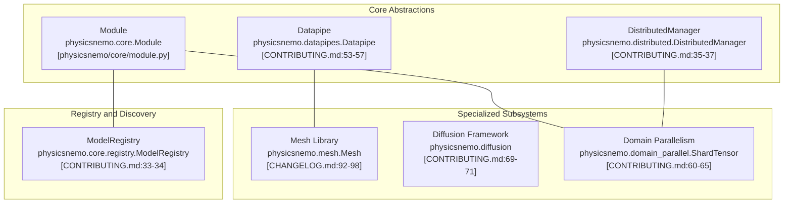

Sources: [.importlinter:8-28](), [CONTRIBUTING.md:30-89]()

### Layered Import Contract (`.importlinter`)

The package architecture is structured into strict hierarchical layers defined in `.importlinter` under the `physicsnemo-modules` contract [.importlinter:8-28](). The layers flow downward from compatibility and experimental wrappers to core primitives:

1. `compat` [.importlinter:19]()
2. `experimental` [.importlinter:20]()
3. `deploy` | `active_learning` | `diffusion` | `sym` [.importlinter:21]()
4. `models` : `datapipes` : `metrics` : `domain_parallel` : `optim` [.importlinter:22]()
5. `mesh` [.importlinter:23]()
6. `nn` [.importlinter:24]()
7. `utils` [.importlinter:25]()
8. `distributed` [.importlinter:26]()
9. `core` [.importlinter:27]()

Sources: [.importlinter:8-28]()

---

## The v2.0 Refactor

PhysicsNeMo v2.0 establishes a modernized framework layout designed to prevent circular dependencies, trim core requirements, and isolate optional packages like `pyvista`, `vtk`, or `torch_geometric` [CONTRIBUTING.md:30-89]().

### Reorganization Summary

| Component / Subsystem | v1.x Location | v2.0 Location |
| :--- | :--- | :--- |
| Base Module | `physicsnemo.models.Module` | `physicsnemo.core.Module` [physicsnemo/__init__.py:22-23]() |
| Checkpointing & Logging | `physicsnemo.launch` | `physicsnemo.utils.checkpoint` / `physicsnemo.utils.logging` [CONTRIBUTING.md:38-41]() |
| Standalone Layers | `physicsnemo.models` / `utils` | `physicsnemo.nn` [CONTRIBUTING.md:42-48]() |
| Domain Parallel Sharding | `physicsnemo.distributed` | `physicsnemo.domain_parallel` [CONTRIBUTING.md:60-65]() |

Sources: [CONTRIBUTING.md:30-89](), [physicsnemo/__init__.py:22-23]()

---

## System Architecture Overview

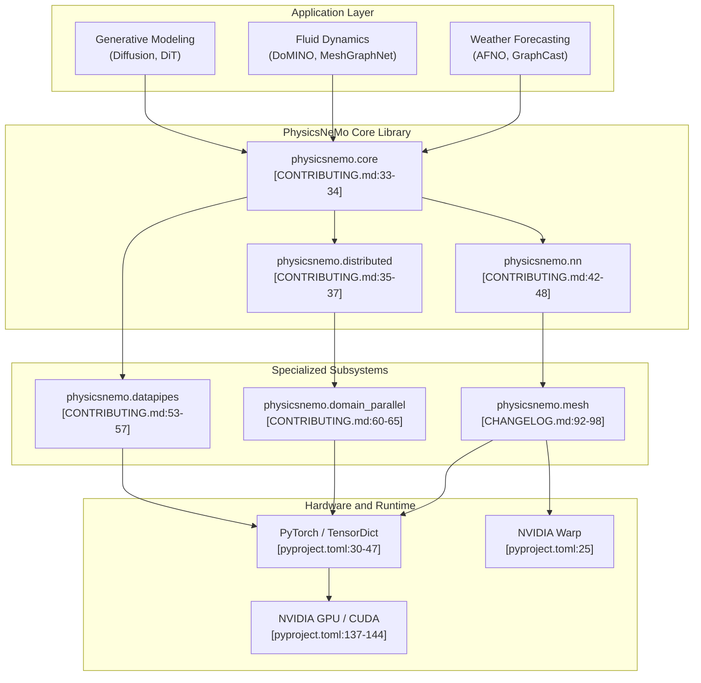

Sources: [pyproject.toml:25-47](), [CONTRIBUTING.md:30-89](), [CHANGELOG.md:92-98]()

---

## Child Sections

- **[Installation and Setup](#1.1)**: Covers installation workflows via pip, uv, or Docker, package index requirements, dependency/extras groups in `pyproject.toml`, lazy loading via `OptionalImport`, and the v2.0 migration guide.
- **[Core Architecture](#1.2)**: Explains the foundational abstractions (`Module`, `Datapipe`, `DistributedManager`), the compat layer, function spec systems, and import-layer contract enforcement.
- **[Neural Network Primitives (physicsnemo.nn)](#1.3)**: Documents the `physicsnemo.nn` package, including stateless GPU-accelerated functionals (`physicsnemo.nn.functional`) and reusable layer modules (`physicsnemo.nn.module`).

Sources: [pyproject.toml:4-52](), [physicsnemo/core/version_check.py:21-39](), [.importlinter:1-28]()

---

# Page: Installation and Setup

# Installation and Setup

<details>
<summary>Relevant source files</summary>

The following files were used as context for generating this wiki page:

- [.gitignore](.gitignore)
- [CHANGELOG.md](CHANGELOG.md)
- [Dockerfile](Dockerfile)
- [Makefile](Makefile)
- [deps/README.md](deps/README.md)
- [docker/install-container-dependencies.sh](docker/install-container-dependencies.sh)
- [docs/img/inverse_pinn_sample_points.png](docs/img/inverse_pinn_sample_points.png)
- [examples/cfd/darcy_physics_informed/README.md](examples/cfd/darcy_physics_informed/README.md)
- [examples/cfd/external_aerodynamics/domino_nim_finetuning/README.md](examples/cfd/external_aerodynamics/domino_nim_finetuning/README.md)
- [examples/cfd/inverse_pinns/README.md](examples/cfd/inverse_pinns/README.md)
- [examples/cfd/inverse_pinns/config.yaml](examples/cfd/inverse_pinns/config.yaml)
- [examples/cfd/inverse_pinns/train_inverse_pinn.py](examples/cfd/inverse_pinns/train_inverse_pinn.py)
- [examples/cfd/ldc_pinns/README.md](examples/cfd/ldc_pinns/README.md)
- [examples/cfd/mhd_pino/README.md](examples/cfd/mhd_pino/README.md)
- [examples/cfd/mhd_pino/losses/loss_mhd_physicsnemo.py](examples/cfd/mhd_pino/losses/loss_mhd_physicsnemo.py)
- [examples/cfd/mhd_pino/losses/loss_mhd_vec_pot_physicsnemo.py](examples/cfd/mhd_pino/losses/loss_mhd_vec_pot_physicsnemo.py)
- [examples/cfd/mhd_pino/utils/plot_utils.py](examples/cfd/mhd_pino/utils/plot_utils.py)
- [examples/cfd/swe_nonlinear_pino/README.md](examples/cfd/swe_nonlinear_pino/README.md)
- [examples/cfd/swe_nonlinear_pino/train_swe_nl_pino.py](examples/cfd/swe_nonlinear_pino/train_swe_nl_pino.py)
- [examples/cfd/swe_nonlinear_pino/train_utils/plot.py](examples/cfd/swe_nonlinear_pino/train_utils/plot.py)
- [examples/cfd/swe_nonlinear_pino/train_utils/utils.py](examples/cfd/swe_nonlinear_pino/train_utils/utils.py)
- [physicsnemo/__init__.py](physicsnemo/__init__.py)
- [physicsnemo/core/version_check.py](physicsnemo/core/version_check.py)
- [pyproject.toml](pyproject.toml)
- [test/ci_tests/prevent_untracked_imports.py](test/ci_tests/prevent_untracked_imports.py)
- [test/core/test_version_check.py](test/core/test_version_check.py)
- [test/nn/functional/test_natten.py](test/nn/functional/test_natten.py)
- [uv.lock](uv.lock)
- [v2.0-MIGRATION-GUIDE.md](v2.0-MIGRATION-GUIDE.md)

</details>


## Purpose and Scope

This page covers the installation and setup procedures for PhysicsNeMo v2.0+, including installation via PyPI (`pip`/`uv`), Docker containers, and source builds [v2.0-MIGRATION-GUIDE.md:4-8](). It details `pyproject.toml` dependency and extras groups [pyproject.toml:68-81](), lockfile handling via `uv.lock` [uv.lock:1-4](), the lazy-loading implementation using `OptionalImport` in `physicsnemo/core/version_check.py` [physicsnemo/core/version_check.py:25-39](), cross-platform support [v2.0-MIGRATION-GUIDE.md:12-16](), and the v2.0 migration path and compatibility layer [v2.0-MIGRATION-GUIDE.md:47-73]().

Sources: [v2.0-MIGRATION-GUIDE.md:4-8](), [pyproject.toml:68-81](), [uv.lock:1-4](), [physicsnemo/core/version_check.py:25-39]()

---

## Installation Methods Overview

PhysicsNeMo supports three primary installation workflows. The framework recommends `uv` for local development and dependency resolution [v2.0-MIGRATION-GUIDE.md:12-24]().

Title: Installation Workflows and Code Entity Mapping
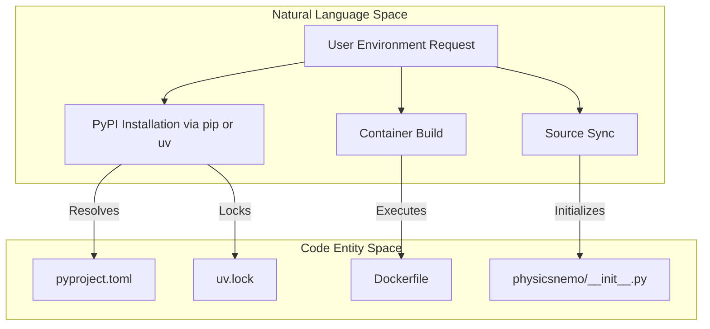

Sources: [v2.0-MIGRATION-GUIDE.md:12-27](), [pyproject.toml:1-53](), [Dockerfile:1-30]()

---

## PyPI and UV Installation & Extras Groups

PhysicsNeMo is published on PyPI as `nvidia-physicsnemo` and specifies Python compatibility via `requires-python = ">=3.11,<3.15"` [pyproject.toml:5-13](). 

### Dependency Groups and Extras

The project uses `pyproject.toml` to declare core dependencies (such as `torch>=2.10.0`, `warp-lang>=1.14.0`, and `tensordict[zarr]>=0.14.0`) [pyproject.toml:23-52]() alongside conflicting and optional extras managed by `uv` [pyproject.toml:66-81]().

| Extra Name | Purpose | Associated Code / Packages |
|------------|---------|----------------------------|
| `cu12` | CUDA 12.8 Backend Support | `torch` (cu128), `cuml-cu12`, `cupy-cuda12x` [pyproject.toml:108-111,138,146]() |
| `cu13` | CUDA 13.0 Backend Support | `torch` (cu130), `cuml-cu13`, `cupy-cuda13x` [pyproject.toml:99-102,139,145]() |
| `natten-cu12` / `natten-cu13` | Neighborhood Attention extension wheels | `natten` pre-built wheels via flat indexes [pyproject.toml:120-130,153-156]() |
| `transformer-engine-cu12` | Transformer Engine integration | `transformer-engine-torch` [pyproject.toml:78-80,168-178]() |

```bash
# Basic installation via uv
uv pip install nvidia-physicsnemo

# Installation with specific CUDA backend and extras
uv pip install "nvidia-physicsnemo[cu13,gnns]"
```

Sources: [pyproject.toml:13-81](), [uv.lock:1-16]()

---

## Docker Container and Platform Support

The official container images are structured using a multi-stage `Dockerfile` (`dependencies` -> `builder` -> `deploy` / `ci`) [Dockerfile:19-29]().

### Multi-Stage Build Architecture

Title: Docker Build Stages and Package Flow
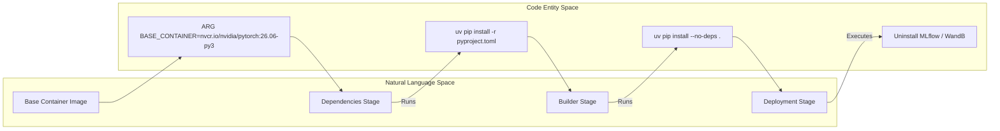

### Platform Compatibility
- **Linux:** Native support for x86_64 and ARM64 (aarch64) with platform-specific wheel overrides for packages like `torch_scatter` and `onnxruntime` [Dockerfile:75-92]().
- **Windows:** Supported for x86_64 via `uv` or `pip` [v2.0-MIGRATION-GUIDE.md:12-16]().
- **macOS:** Supported for CPU-only execution; CUDA extras must be omitted [pyproject.toml:136]().

Sources: [Dockerfile:1-150](), [v2.0-MIGRATION-GUIDE.md:12-16]()

---

## Optional Dependencies and Lazy Loading

To avoid heavy upfront imports and hard requirements on optional packages (such as `torch_geometric` or `pyvista`), PhysicsNeMo implements a lazy-loading and version-checking mechanism in `physicsnemo.core.version_check` [physicsnemo/core/version_check.py:19-39]().

### `OptionalImport` Implementation

The `OptionalImport` class delays package resolution until attribute access occurs [physicsnemo/core/version_check.py:25-39](). If the requested module is absent, it formats an install hint referencing `pyproject.toml` extras using `_format_install_hint` [physicsnemo/core/version_check.py:100-157]().

Title: Optional Import Lazy Resolution Flow
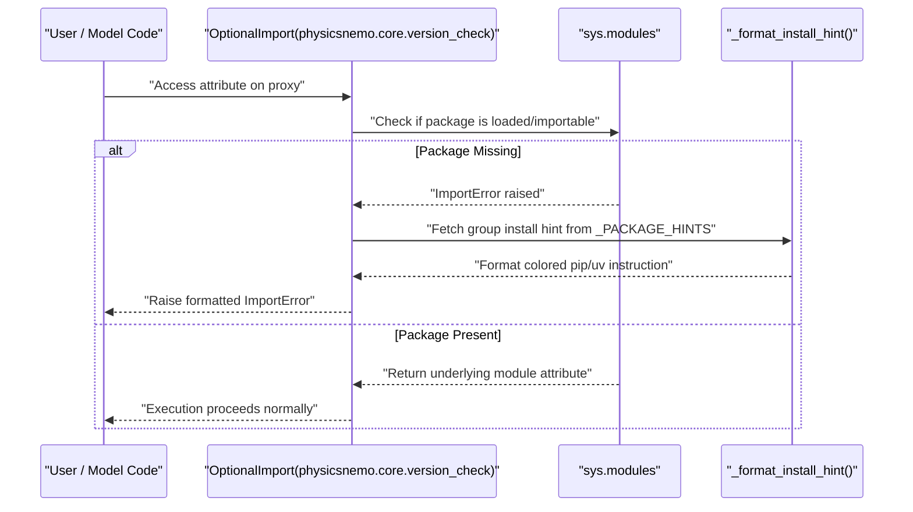

Sources: [physicsnemo/core/version_check.py:25-186](), [test/core/test_version_check.py:25-69]()

---

## v2.0 Migration Guide and Compatibility Layer

The v2.0 refactor restructured core modules to prevent circular dependencies and isolate subsystems [v2.0-MIGRATION-GUIDE.md:28-31]().

### Key Structural Changes
1. **Core Abstractions:** `Module` and `Meta` are relocated to `physicsnemo.core` [v2.0-MIGRATION-GUIDE.md:33-34]().
2. **Utilities Reorganization:** `physicsnemo.launch` is removed; logging moves to `physicsnemo.utils.logging` and checkpointing moves to `physicsnemo.utils.checkpoint` [v2.0-MIGRATION-GUIDE.md:35-37]().
3. **Domain Parallelism:** `ShardTensor` is isolated under `physicsnemo.domain_parallel` [v2.0-MIGRATION-GUIDE.md:44-45]().

### Compatibility Layer (`physicsnemo.compat`)

To maintain backwards compatibility for legacy import paths, PhysicsNeMo provides `physicsnemo.compat` which maps deprecated module paths inside `sys.modules` [v2.0-MIGRATION-GUIDE.md:47-56]().

```python
# Enable compatibility mode via environment variable:
# export PHYSICSNEMO_ENABLE_COMPAT=1

# Or programmatically:
from physicsnemo.compat import install
install()
```

Sources: [physicsnemo/__init__.py:30-42](), [v2.0-MIGRATION-GUIDE.md:28-73]()

---

# Page: Core Architecture

# Core Architecture

<details>
<summary>Relevant source files</summary>

The following files were used as context for generating this wiki page:

- [.importlinter](.importlinter)
- [docs/api/diffusion/noise_schedulers.rst](docs/api/diffusion/noise_schedulers.rst)
- [docs/img/nn/functional/geometry/mesh_poisson_disk_sample/mesh_poisson_modes.gif](docs/img/nn/functional/geometry/mesh_poisson_disk_sample/mesh_poisson_modes.gif)
- [docs/img/nn/functional/geometry/mesh_to_voxel_fraction/mesh_to_voxel_rotation.gif](docs/img/nn/functional/geometry/mesh_to_voxel_fraction/mesh_to_voxel_rotation.gif)
- [docs/img/nn/functional/geometry/sdf/sdf_slice_overview.png](docs/img/nn/functional/geometry/sdf/sdf_slice_overview.png)
- [docs/img/nn/functional/geometry/sdf/sdf_slice_sweep.gif](docs/img/nn/functional/geometry/sdf/sdf_slice_sweep.gif)
- [physicsnemo/core/function_spec.py](physicsnemo/core/function_spec.py)
- [physicsnemo/core/module.py](physicsnemo/core/module.py)
- [physicsnemo/core/registry.py](physicsnemo/core/registry.py)
- [physicsnemo/diffusion/__init__.py](physicsnemo/diffusion/__init__.py)
- [physicsnemo/diffusion/base.py](physicsnemo/diffusion/base.py)
- [physicsnemo/diffusion/metrics/__init__.py](physicsnemo/diffusion/metrics/__init__.py)
- [physicsnemo/diffusion/metrics/losses.py](physicsnemo/diffusion/metrics/losses.py)
- [physicsnemo/diffusion/noise_schedulers/__init__.py](physicsnemo/diffusion/noise_schedulers/__init__.py)
- [physicsnemo/diffusion/noise_schedulers/domain_parallel.py](physicsnemo/diffusion/noise_schedulers/domain_parallel.py)
- [physicsnemo/diffusion/noise_schedulers/noise_schedulers.py](physicsnemo/diffusion/noise_schedulers/noise_schedulers.py)
- [physicsnemo/diffusion/preconditioners/preconditioners.py](physicsnemo/diffusion/preconditioners/preconditioners.py)
- [physicsnemo/diffusion/samplers/__init__.py](physicsnemo/diffusion/samplers/__init__.py)
- [physicsnemo/diffusion/samplers/samplers.py](physicsnemo/diffusion/samplers/samplers.py)
- [physicsnemo/diffusion/samplers/solvers.py](physicsnemo/diffusion/samplers/solvers.py)
- [physicsnemo/diffusion/utils/__init__.py](physicsnemo/diffusion/utils/__init__.py)
- [physicsnemo/diffusion/utils/model_wrappers.py](physicsnemo/diffusion/utils/model_wrappers.py)
- [physicsnemo/models/mlp/fully_connected.py](physicsnemo/models/mlp/fully_connected.py)
- [physicsnemo/models/unet/unet.py](physicsnemo/models/unet/unet.py)
- [physicsnemo/nn/functional/derivatives/mesh_green_gauss_gradient/_warp_impl.py](physicsnemo/nn/functional/derivatives/mesh_green_gauss_gradient/_warp_impl.py)
- [physicsnemo/nn/functional/derivatives/mesh_lsq_gradient/_warp_impl.py](physicsnemo/nn/functional/derivatives/mesh_lsq_gradient/_warp_impl.py)
- [physicsnemo/nn/functional/derivatives/uniform_grid_gradient/_warp_impl/utils.py](physicsnemo/nn/functional/derivatives/uniform_grid_gradient/_warp_impl/utils.py)
- [physicsnemo/nn/functional/geometry/farthest_point_sampling/_warp_impl.py](physicsnemo/nn/functional/geometry/farthest_point_sampling/_warp_impl.py)
- [physicsnemo/nn/functional/geometry/mesh_poisson_disk_sample/__init__.py](physicsnemo/nn/functional/geometry/mesh_poisson_disk_sample/__init__.py)
- [physicsnemo/nn/functional/geometry/mesh_poisson_disk_sample/_warp_impl/__init__.py](physicsnemo/nn/functional/geometry/mesh_poisson_disk_sample/_warp_impl/__init__.py)
- [physicsnemo/nn/functional/geometry/mesh_poisson_disk_sample/_warp_impl/_kernels.py](physicsnemo/nn/functional/geometry/mesh_poisson_disk_sample/_warp_impl/_kernels.py)
- [physicsnemo/nn/functional/geometry/mesh_poisson_disk_sample/_warp_impl/op.py](physicsnemo/nn/functional/geometry/mesh_poisson_disk_sample/_warp_impl/op.py)
- [physicsnemo/nn/functional/geometry/mesh_to_voxel_fraction/_warp_impl/op.py](physicsnemo/nn/functional/geometry/mesh_to_voxel_fraction/_warp_impl/op.py)
- [physicsnemo/nn/functional/neighbors/radius_search/_warp_impl.py](physicsnemo/nn/functional/neighbors/radius_search/_warp_impl.py)
- [physicsnemo/nn/module/mlp_layers.py](physicsnemo/nn/module/mlp_layers.py)
- [test/ci_tests/header_check.py](test/ci_tests/header_check.py)
- [test/core/test_function_spec.py](test/core/test_function_spec.py)
- [test/core/test_module_nested.py](test/core/test_module_nested.py)
- [test/diffusion/test_wrappers.py](test/diffusion/test_wrappers.py)
- [test/models/mlp/test_fully_connected.py](test/models/mlp/test_fully_connected.py)
- [test/models/unet/test_unet.py](test/models/unet/test_unet.py)
- [test/nn/module/test_mlp_layers.py](test/nn/module/test_mlp_layers.py)

</details>


## Purpose and Scope
This page details the core architecture of PhysicsNeMo, focusing on the foundational abstractions that govern model lifecycles, execution, data pipelines, distributed coordination, and code organization. It outlines the implementation of `physicsnemo.core.Module`, the `FunctionSpec` multi-backend dispatch system, utility modules in `physicsnemo.core`, the compatibility layer, and the strict import-layer contracts enforced by `.importlinter`.

---

## Architectural Overview

PhysicsNeMo's architecture is structured around three foundational abstractions that manage the execution lifecycle, data ingestion, and multi-GPU coordination:

1. **`Module` (`physicsnemo.core.Module`)**: Extends `torch.nn.Module` to provide argument serialization, nested module composition, atomic checkpointing, and model metadata management `[physicsnemo/core/module.py:123-145]()`.
2. **`Datapipe` (`physicsnemo.Datapipe`)**: Manages domain-specific data loading, transforms, and parallel batch generation.
3. **`DistributedManager` (`physicsnemo.distributed.DistributedManager`)**: Coordinates process groups, device meshes, and multi-node training topologies across PyTorch, Slurm, and OpenMPI.

**Diagram: Three Core Abstractions**
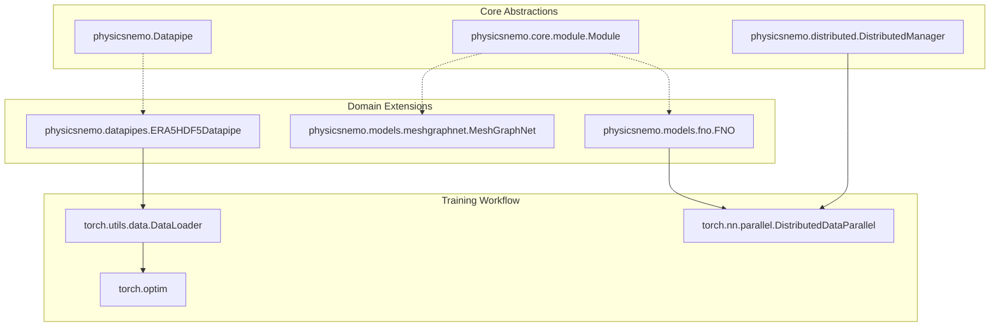
Sources: [.importlinter:1-28](), [physicsnemo/core/module.py:123-145]()

---

## The Import-Layer Contract (`.importlinter`)

To prevent circular dependencies and enforce strict architectural layering, PhysicsNeMo uses `import-linter` configured via `.importlinter`. The contract specifies that core abstractions remain independent of models, datasets, and high-level applications, flowing strictly from bottom-level utilities up to application recipes.

**Diagram: Layer Dependency Hierarchy**
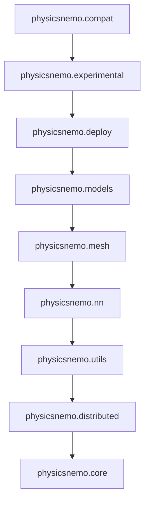
Sources: [.importlinter:8-40]()

The internal layers of `physicsnemo.core` are strictly ordered as follows:
- `module` (top layer)
- `registry`, `meta`, `function_spec`
- `warnings`, `version_check`, `filesystem` (bottom layer)

Sources: [.importlinter:29-39]()

---

## Module: Model Lifecycle Management

All neural network models in PhysicsNeMo inherit from `physicsnemo.core.Module`, which replaces `torch.nn.Module` and adds capabilities for serialization, metadata tracking via `ModelMetaData`, and automatic factory registration `[physicsnemo/core/module.py:123-145]`.

### Core Implementation Details
- **JSON-Serializable Arguments**: Models must accept JSON-serializable arguments in their `__init__` constructor (with the exception of nested `physicsnemo.Module` or `torch.nn.Module` converted via `Module.from_torch`) `[physicsnemo/core/module.py:130-144]()`.
- **Atomic Serialization**: Checkpoints are written safely via the `_atomic_write` context manager, which writes to a temporary sibling file (`<file_name>.tmp-*`) before replacing the destination atomically using `os.replace` (local) or `fs.mv` (remote fsspec) `[physicsnemo/core/module.py:75-106]()`.
- **State Dictionary Logging**: Loading state dictionaries logs missing and unexpected keys automatically via `_load_state_dict_with_logging` `[physicsnemo/core/module.py:49-72]()`.

**Diagram: Natural Language Space to Module Lifecycle**
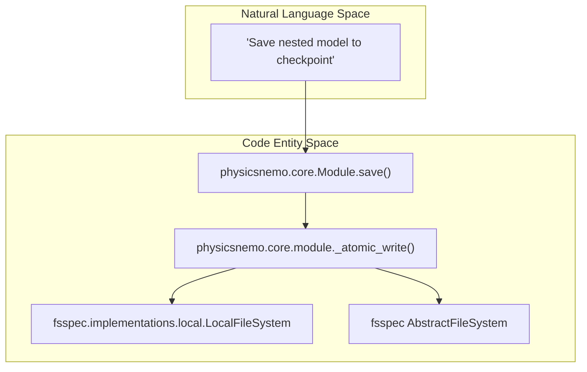
Sources: [physicsnemo/core/module.py:75-106](), [physicsnemo/core/module.py:123-171]()

Sources: [physicsnemo/core/module.py:46-171]()

---

## FunctionSpec System and Backend Dispatch

The `FunctionSpec` class (`physicsnemo.core.function_spec.FunctionSpec`) manages operations with multiple backend implementations (such as Warp, PyTorch, cuML, and SciPy), providing a unified interface for dispatch, parity testing, and benchmarking `[physicsnemo/core/function_spec.py:66-114]()`.

### Implementation and Selection
- **`Implementation` Dataclass**: Stores metadata for each backend variant, including `name`, `func`, `required_imports`, `rank` (lower rank indicates higher preference), and `baseline` flags `[physicsnemo/core/function_spec.py:36-64]()`.
- **Dynamic Dispatch**: At runtime, `FunctionSpec` evaluates `required_imports` (e.g., `"warp>=0.6.0"`) and selects the lowest-rank available implementation `[physicsnemo/core/function_spec.py:106-113]()`.

**Diagram: Natural Language Space to FunctionSpec Dispatch**
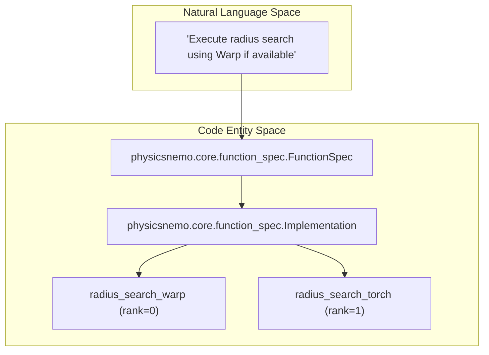
Sources: [physicsnemo/core/function_spec.py:36-114](), [physicsnemo/nn/functional/neighbors/radius_search/_warp_impl.py:187-190]()

Sources: [physicsnemo/core/function_spec.py:34-114]()

---

## Core Utilities (`physicsnemo.core`)

The `physicsnemo.core` package contains foundational helper subsystems that support the module and functional layers:
- **`ModelRegistry` (`physicsnemo.core.registry.ModelRegistry`)**: A singleton handling model discovery, entry points, auto-registration from `pyproject.toml`, and factory instantiation `[physicsnemo/core/module.py:42-43]()`.
- **`ModelMetaData` (`physicsnemo.core.meta.ModelMetaData`)**: A dataclass tracking optimization flags (`jit`, `cuda_graphs`, `amp_gpu`, `onnx`, etc.) associated with a `Module` `[physicsnemo/core/module.py:41-149]()`.
- **`version_check` (`physicsnemo.core.version_check`)**: Provides `OptionalImport` and `check_version_spec` for safe, lazy loading of optional external dependencies like `transformer_engine` or `warp` `[physicsnemo/models/unet/unet.py:29-37]()`.
- **`filesystem` (`physicsnemo.core.filesystem`)**: Manages remote and local file system interactions (`_download_cached`, `_get_fs`) for weights and configuration files `[physicsnemo/core/module.py:40-41]()`.

Sources: [physicsnemo/core/module.py:40-43](), [physicsnemo/models/unet/unet.py:29-37]()

---

## The Compatibility Layer (`physicsnemo.compat`)

The `physicsnemo.compat` namespace preserves backward compatibility for legacy checkpoints, configuration structures, and refactored module paths. For instance, when former monolithic modules (such as noise schedulers) are split into individual files, compatibility shims emit deprecation warnings and forward imports to their new locations `[physicsnemo/diffusion/noise_schedulers/noise_schedulers.py:17-41]()`.

Sources: [.importlinter:13-19](), [physicsnemo/diffusion/noise_schedulers/noise_schedulers.py:17-41]()

---

# Page: Neural Network Primitives (physicsnemo.nn)

# Neural Network Primitives (physicsnemo.nn)

<details>
<summary>Relevant source files</summary>

The following files were used as context for generating this wiki page:

- [benchmarks/physicsnemo/nn/functional/registry.py](benchmarks/physicsnemo/nn/functional/registry.py)
- [docs/api/mesh/transformations.rst](docs/api/mesh/transformations.rst)
- [docs/api/nn/functionals/geometry.rst](docs/api/nn/functionals/geometry.rst)
- [docs/api/nn/functionals/normalization.rst](docs/api/nn/functionals/normalization.rst)
- [docs/api/nn/layers/rope.rst](docs/api/nn/layers/rope.rst)
- [docs/api/physicsnemo.nn.functionals.rst](docs/api/physicsnemo.nn.functionals.rst)
- [docs/api/physicsnemo.nn.layers.rst](docs/api/physicsnemo.nn.layers.rst)
- [physicsnemo/mesh/README.md](physicsnemo/mesh/README.md)
- [physicsnemo/mesh/geometry/_cell_normals.py](physicsnemo/mesh/geometry/_cell_normals.py)
- [physicsnemo/mesh/remeshing/_partition.py](physicsnemo/mesh/remeshing/_partition.py)
- [physicsnemo/mesh/transformations/deform/__init__.py](physicsnemo/mesh/transformations/deform/__init__.py)
- [physicsnemo/models/dit/dit.py](physicsnemo/models/dit/dit.py)
- [physicsnemo/nn/__init__.py](physicsnemo/nn/__init__.py)
- [physicsnemo/nn/functional/__init__.py](physicsnemo/nn/functional/__init__.py)
- [physicsnemo/nn/functional/geometry/__init__.py](physicsnemo/nn/functional/geometry/__init__.py)
- [physicsnemo/nn/functional/geometry/deform/__init__.py](physicsnemo/nn/functional/geometry/deform/__init__.py)
- [physicsnemo/nn/functional/geometry/deform/_warp_impl/__init__.py](physicsnemo/nn/functional/geometry/deform/_warp_impl/__init__.py)
- [physicsnemo/nn/functional/normalization.py](physicsnemo/nn/functional/normalization.py)
- [physicsnemo/nn/module/__init__.py](physicsnemo/nn/module/__init__.py)
- [physicsnemo/nn/module/dit_layers.py](physicsnemo/nn/module/dit_layers.py)
- [physicsnemo/nn/module/rope.py](physicsnemo/nn/module/rope.py)
- [test/mesh/geometry/test_cell_normals.py](test/mesh/geometry/test_cell_normals.py)
- [test/mesh/remeshing/test_partition.py](test/mesh/remeshing/test_partition.py)
- [test/models/dit/test_dit.py](test/models/dit/test_dit.py)
- [test/nn/module/test_dit_layers.py](test/nn/module/test_dit_layers.py)
- [test/nn/module/test_rope.py](test/nn/module/test_rope.py)

</details>


The `physicsnemo.nn` package provides foundational, high-performance neural network primitives designed for physics-informed modeling, scientific machine learning, and spatial computing. It bridges raw tensor computations with domain-specific architectures by splitting functionality into two core sub-packages: stateless, GPU-accelerated functionals (`physicsnemo.nn.functional`) and reusable, stateful layer modules (`physicsnemo.nn.module`) [physicsnemo/nn/__init__.py:1-172, physicsnemo/nn/functional/__init__.py:1-144]().

---

## Package Architecture and Overview

The `physicsnemo.nn` package abstracts lower-level hardware execution details, enabling seamless execution across PyTorch and Warp backends. Functionals expose stateless operations (such as differential operators, spatial queries, and geometric transforms) that can be embedded directly into custom loss functions, data preprocessing pipelines, or training loops. Conversely, layer modules encapsulate learnable parameters and follow standard PyTorch container semantics (`nn.Module`), integrating directly into PhysicsNeMo's model zoo.

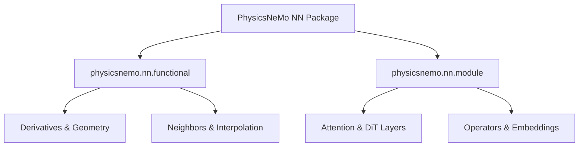
*Figure 1: High-level organization of `physicsnemo.nn` primitives linking functional specifications to modular neural network layers.*

Sources: `physicsnemo/nn/__init__.py:1-172`, `physicsnemo/nn/functional/__init__.py:1-144`

---

## Functional API (`physicsnemo.nn.functional`)

The functional subsystem supplies stateless routines for spatial geometry, numerical differentiation, spectral transforms, and spatial indexing. These primitives are registered within a unified `FunctionSpec` framework that standardizes input generation, forward execution, and benchmarking via Automated Speed Variations (ASV) [benchmarks/physicsnemo/nn/functional/registry.py:17-117]().

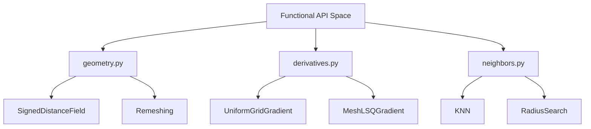
*Mapping functional domains to their underlying python modules and classes.*

For comprehensive details on differential operators, geometric transformations (SDF, deformation, sampling, remeshing), neighbor search routines (`knn`, `radius_search`), spectral methods, and backend execution patterns, see the child page:
- **[Functional API (physicsnemo.nn.functional)](#1.3.1)**

Sources: `physicsnemo/nn/functional/__init__.py:1-144`, `benchmarks/physicsnemo/nn/functional/registry.py:17-117`

---

## Layer Modules (`physicsnemo.nn.module`)

The layer module subsystem delivers stateful building blocks optimized for physical simulations, weather forecasting, and generative modeling. This includes advanced attention backends (such as physics-attention, GALE, point transformers, and FLARE attention), Diffusion Transformer (`DiT`) components, rotary position embeddings (`RoPE`), Fourier neural operators (`FNO`, `AFNO`), HEALPix grid layers, and specialized normalization and activation functions [physicsnemo/nn/__init__.py:20-172, physicsnemo/nn/module/dit_layers.py:48-152]().

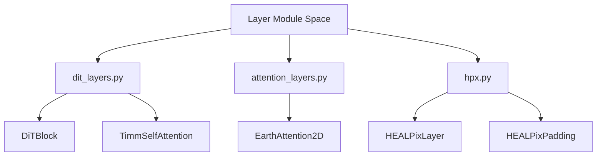
*Mapping architectural layers and attention backends to their respective module implementations.*

For full technical specifications on neural operator layers, diffusion transformers, attention routing mechanisms, activation functions, and weight initialization strategies, see the child page:
- **[Layer Modules (physicsnemo.nn.module)](#1.3.2)**

Sources: `physicsnemo/nn/__init__.py:20-172`, `physicsnemo/nn/module/dit_layers.py:48-152`

---

# Page: Functional API (physicsnemo.nn.functional)

# Functional API (physicsnemo.nn.functional)

<details>
<summary>Relevant source files</summary>

The following files were used as context for generating this wiki page:

- [benchmarks/physicsnemo/nn/functional/registry.py](benchmarks/physicsnemo/nn/functional/registry.py)
- [docs/api/mesh/spatial.rst](docs/api/mesh/spatial.rst)
- [docs/api/mesh/transformations.rst](docs/api/mesh/transformations.rst)
- [docs/api/nn/functionals/geometry.rst](docs/api/nn/functionals/geometry.rst)
- [docs/api/nn/functionals/normalization.rst](docs/api/nn/functionals/normalization.rst)
- [docs/api/physicsnemo.nn.functionals.rst](docs/api/physicsnemo.nn.functionals.rst)
- [docs/img/nn/functional/geometry/mesh_poisson_disk_sample/mesh_poisson_modes.gif](docs/img/nn/functional/geometry/mesh_poisson_disk_sample/mesh_poisson_modes.gif)
- [docs/img/nn/functional/geometry/mesh_to_voxel_fraction/mesh_to_voxel_rotation.gif](docs/img/nn/functional/geometry/mesh_to_voxel_fraction/mesh_to_voxel_rotation.gif)
- [docs/img/nn/functional/geometry/sdf/sdf_slice_overview.png](docs/img/nn/functional/geometry/sdf/sdf_slice_overview.png)
- [docs/img/nn/functional/geometry/sdf/sdf_slice_sweep.gif](docs/img/nn/functional/geometry/sdf/sdf_slice_sweep.gif)
- [examples/cfd/external_aerodynamics/unified_external_aero_recipe/src/sdf.py](examples/cfd/external_aerodynamics/unified_external_aero_recipe/src/sdf.py)
- [examples/cfd/external_aerodynamics/unified_external_aero_recipe/tests/test_sdf_transform.py](examples/cfd/external_aerodynamics/unified_external_aero_recipe/tests/test_sdf_transform.py)
- [physicsnemo/core/function_spec.py](physicsnemo/core/function_spec.py)
- [physicsnemo/datapipes/cae/transolver_datapipe.py](physicsnemo/datapipes/cae/transolver_datapipe.py)
- [physicsnemo/datapipes/transforms/geometric.py](physicsnemo/datapipes/transforms/geometric.py)
- [physicsnemo/domain_parallel/shard_utils/mesh_ops.py](physicsnemo/domain_parallel/shard_utils/mesh_ops.py)
- [physicsnemo/mesh/README.md](physicsnemo/mesh/README.md)
- [physicsnemo/mesh/geometry/_cell_normals.py](physicsnemo/mesh/geometry/_cell_normals.py)
- [physicsnemo/mesh/remeshing/_partition.py](physicsnemo/mesh/remeshing/_partition.py)
- [physicsnemo/mesh/spatial/__init__.py](physicsnemo/mesh/spatial/__init__.py)
- [physicsnemo/mesh/spatial/sdf.py](physicsnemo/mesh/spatial/sdf.py)
- [physicsnemo/mesh/transformations/deform/__init__.py](physicsnemo/mesh/transformations/deform/__init__.py)
- [physicsnemo/nn/functional/__init__.py](physicsnemo/nn/functional/__init__.py)
- [physicsnemo/nn/functional/derivatives/mesh_green_gauss_gradient/_warp_impl.py](physicsnemo/nn/functional/derivatives/mesh_green_gauss_gradient/_warp_impl.py)
- [physicsnemo/nn/functional/derivatives/mesh_lsq_gradient/_warp_impl.py](physicsnemo/nn/functional/derivatives/mesh_lsq_gradient/_warp_impl.py)
- [physicsnemo/nn/functional/derivatives/uniform_grid_gradient/_warp_impl/utils.py](physicsnemo/nn/functional/derivatives/uniform_grid_gradient/_warp_impl/utils.py)
- [physicsnemo/nn/functional/geometry/__init__.py](physicsnemo/nn/functional/geometry/__init__.py)
- [physicsnemo/nn/functional/geometry/deform/__init__.py](physicsnemo/nn/functional/geometry/deform/__init__.py)
- [physicsnemo/nn/functional/geometry/deform/_warp_impl/__init__.py](physicsnemo/nn/functional/geometry/deform/_warp_impl/__init__.py)
- [physicsnemo/nn/functional/geometry/farthest_point_sampling/_warp_impl.py](physicsnemo/nn/functional/geometry/farthest_point_sampling/_warp_impl.py)
- [physicsnemo/nn/functional/geometry/mesh_poisson_disk_sample/__init__.py](physicsnemo/nn/functional/geometry/mesh_poisson_disk_sample/__init__.py)
- [physicsnemo/nn/functional/geometry/mesh_poisson_disk_sample/_warp_impl/__init__.py](physicsnemo/nn/functional/geometry/mesh_poisson_disk_sample/_warp_impl/__init__.py)
- [physicsnemo/nn/functional/geometry/mesh_poisson_disk_sample/_warp_impl/_kernels.py](physicsnemo/nn/functional/geometry/mesh_poisson_disk_sample/_warp_impl/_kernels.py)
- [physicsnemo/nn/functional/geometry/mesh_poisson_disk_sample/_warp_impl/op.py](physicsnemo/nn/functional/geometry/mesh_poisson_disk_sample/_warp_impl/op.py)
- [physicsnemo/nn/functional/geometry/mesh_to_voxel_fraction/_warp_impl/op.py](physicsnemo/nn/functional/geometry/mesh_to_voxel_fraction/_warp_impl/op.py)
- [physicsnemo/nn/functional/geometry/sdf.py](physicsnemo/nn/functional/geometry/sdf.py)
- [physicsnemo/nn/functional/neighbors/radius_search/_warp_impl.py](physicsnemo/nn/functional/neighbors/radius_search/_warp_impl.py)
- [physicsnemo/nn/functional/normalization.py](physicsnemo/nn/functional/normalization.py)
- [test/core/test_function_spec.py](test/core/test_function_spec.py)
- [test/mesh/geometry/test_cell_normals.py](test/mesh/geometry/test_cell_normals.py)
- [test/mesh/remeshing/test_partition.py](test/mesh/remeshing/test_partition.py)
- [test/mesh/spatial/test_mesh_sdf.py](test/mesh/spatial/test_mesh_sdf.py)
- [test/nn/functional/geometry/test_sdf.py](test/nn/functional/geometry/test_sdf.py)

</details>


## Purpose and Scope

The `physicsnemo.nn.functional` package provides a collection of stateless, high-performance, GPU-accelerated functionals designed following the `torch.nn.functional` convention [docs/api/physicsnemo.nn.functionals.rst:4-7](). These primitives serve as building blocks for physics-informed neural networks, neural operators, simulation data pipelines, and mesh processing routines. 

The scope encompasses differential calculus operators on grids and meshes, spatial geometry operations (signed distance fields, point cloud sampling, mesh deformations, remeshing), neighborhood queries (KNN and radius search), multidimensional interpolation, Fourier spectral transforms, normalization utilities, and scientific rendering wrappers. Execution is dual-backed by native PyTorch operations and NVIDIA Warp kernels, managed via a unified `FunctionSpec` and benchmarking registry pattern.

Sources: `physicsnemo/nn/functional/__init__.py:1-144](), [docs/api/physicsnemo.nn.functionals.rst:1-29]()

---

## Backend Integration and `FunctionSpec` Architecture

Functionals in `physicsnemo.nn.functional` abstract hardware-accelerated kernels (such as NVIDIA Warp CUDA code and optimized PyTorch routines) behind uniform Python interfaces. The execution framework relies on `FunctionSpec` to wrap forward and backward execution passes, enabling stream-safe CUDA kernel launches, auto-differentiation compatibility, and benchmarking integration.

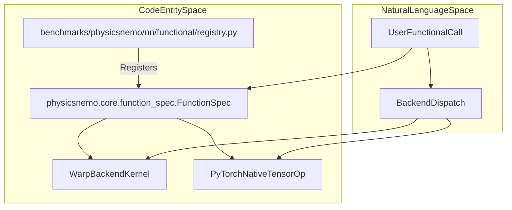
*Figure 1: Architecture bridging functional calls to `FunctionSpec` and registered backends.*

Sources: `benchmarks/physicsnemo/nn/functional/registry.py:1-123](), [physicsnemo/mesh/spatial/sdf.py:19-30]()

---

## Derivatives and Differential Operators

The package provides discrete differential operators operating across structured grids, rectilinear grids, spectral domains, and unstructured simplicial meshes [physicsnemo/nn/functional/__init__.py:17-30]().

### Grid and Spectral Derivatives
- **Uniform Grid Operations**: `uniform_grid_gradient`, `uniform_grid_divergence`, `uniform_grid_curl`, and `uniform_grid_laplacian` compute finite-difference operators on regular structured grids.
- **Rectilinear Grid Operations**: `rectilinear_grid_gradient`, `rectilinear_grid_divergence`, `rectilinear_grid_curl`, and `rectilinear_grid_laplacian` support variable spacing along orthogonal axes.
- **Spectral Derivatives**: `spectral_grid_gradient` computes gradients directly in the frequency domain via Fourier multipliers.

### Unstructured Mesh Derivatives
- **Least-Squares Gradient**: `mesh_lsq_gradient` computes vertex or cell gradients using local least-squares linear fits over neighbor rings.
- **Green-Gauss Gradient**: `mesh_green_gauss_gradient` applies the divergence theorem over control volumes around mesh cells or vertices.
- **Meshless Finite Differences**: `meshless_fd_derivatives` computes derivative stencils for scattered point clouds using localized weighted least squares.
- **Cell Normals**: `compute_cell_normals` computes unit normal vectors for codimension-1 simplicial meshes using specialized branches for 2D rotations, 3D cross products, and general $d \ge 4$ signed minor determinants (Hodge star), disabling autocast for matrix determinants [physicsnemo/mesh/geometry/_cell_normals.py:17-32]().

Sources: `physicsnemo/nn/functional/__init__.py:17-30](), [physicsnemo/mesh/geometry/_cell_normals.py:1-144]()

---

## Geometry Operations: SDF, Deformation, Sampling, and Remeshing

The `physicsnemo.nn.functional.geometry` submodule provides GPU-accelerated geometric processing routines backed by NVIDIA Warp and PyTorch [physicsnemo/nn/functional/__init__.py:39-58]().

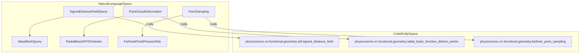
*Figure 2: Mapping of geometric operations to concrete backend functions.*

### Signed Distance Field (SDF)
- `signed_distance_field`: Computes signed distances, closest surface points, and nearest face indices from query points to a triangle surface mesh [docs/api/mesh/spatial.rst:33-40]().
- **Sign Resolution**: Supports angle-weighted pseudo-normals (`wp.mesh_query_point_sign_normal`) for watertight meshes and generalized winding numbers (`wp.mesh_query_point_sign_winding_number`) for non-watertight/self-intersecting geometries [docs/api/mesh/spatial.rst:42-50]().
- **Degenerate Face Repair**: Automatically repairs near-degenerate or zero-area triangles during call time via `_repair_degenerate_faces` to prevent silent query misses in Warp queries [physicsnemo/mesh/spatial/sdf.py:49-74]().

### Point Cloud and Mesh Deformation
- **Dense Displacement**: `displace_points` applies direct coordinate offsets [docs/api/mesh/transformations.rst:46-47]().
- **Sobolev Deformations**: `sobolev_deform_points` filters raw displacements using a discrete Helmholtz operator $(M + \ell^2 K)u = M d$ [docs/api/mesh/transformations.rst:48-49]().
- **Morphing and RBF**: `morph_points` and `radial_basis_function_deform_points` execute sparse control-point and global radial-basis deformations [docs/api/mesh/transformations.rst:50-54]().
- **Free-Form Deformation**: `free_form_deform_points` drives lattice-based deformations [docs/api/mesh/transformations.rst:55-56]().
- **Shrinkwrap**: `shrinkwrap_points` projects point clouds onto target surfaces [docs/api/mesh/transformations.rst:57-58]().

### Sampling and Remeshing
- **Sampling**: `farthest_point_sampling` and `mesh_poisson_disk_sample` generate uniform point distributions on meshes and point clouds.
- **Voxelization**: `mesh_to_voxel_fraction` computes intersection volume fractions for voxel grids.
- **Remeshing**: `remeshing` performs isotropic uniform and field-adaptive remeshing with barycentric data transfer [physicsnemo/mesh/README.md:92-93]().

Sources: `physicsnemo/nn/functional/__init__.py:39-58](), [docs/api/mesh/spatial.rst:33-51](), [physicsnemo/mesh/spatial/sdf.py:32-146](), [docs/api/mesh/transformations.rst:39-58]()

---

## Neighbors and Spatial Queries

Neighborhood searches are essential for graph neural networks and mesh kernel evaluations [physicsnemo/nn/functional/__init__.py:65]().
- `knn`: Computes the $k$-nearest neighbors for query points against reference points using accelerated spatial hashing or brute-force distance matrices on GPU.
- `radius_search`: Identifies all neighbors within a specified metric radius $r$, returning sparse connection indices and distance arrays.

Sources: `physicsnemo/nn/functional/__init__.py:65]()

---

## Interpolation and Fourier Spectral Primitives

### Interpolation
- `interpolation`: General scattered-data interpolation.
- `grid_to_point_interpolation` and `point_to_grid_interpolation`: Transfer fields between structured Eulerian grids and Lagrangian points or point clouds [physicsnemo/nn/functional/__init__.py:59-63]().

### Fourier Spectral Operations
- `rfft`, `rfft2`, `irfft`, `irfft2`: Real-to-complex and complex-to-real fast Fourier transforms optimized for spectral neural operators (like FNO and AFNO) [physicsnemo/nn/functional/__init__.py:38]().
- `real`, `imag`, `view_as_complex`: Tensor manipulation utilities for spectral representations [physicsnemo/nn/functional/__init__.py:38]().

Sources: `physicsnemo/nn/functional/__init__.py:38-63]()

---

## Normalization, Regularization, and Rendering

- **Normalization**: `safe_normalize` computes vector normalization with numerical epsilon guards to prevent division-by-zero on zero-magnitude vectors [physicsnemo/nn/functional/__init__.py:66]().
- **Regularization & Parameterization**: 
  - `drop_path` implements stochastic depth regularization [physicsnemo/nn/functional/__init__.py:67]().
  - `weight_fact` applies weight factorization parameterizations [physicsnemo/nn/functional/__init__.py:67]().
- **Rendering**: 
  - Primitives such as `isosurface_render`, `volume_render`, `point_cloud_render`, `scalar_field_to_rgba`, and `vector_field_to_rgba` provide visualization and image-space projection tools for scalar and vector fields [physicsnemo/nn/functional/__init__.py:68-77]().

Sources: `physicsnemo/nn/functional/__init__.py:66-77]()

---

# Page: Layer Modules (physicsnemo.nn.module)

# Layer Modules (physicsnemo.nn.module)

<details>
<summary>Relevant source files</summary>

The following files were used as context for generating this wiki page:

- [docs/api/nn/layers/rope.rst](docs/api/nn/layers/rope.rst)
- [docs/api/physicsnemo.nn.layers.rst](docs/api/physicsnemo.nn.layers.rst)
- [physicsnemo/domain_parallel/shard_utils/halo.py](physicsnemo/domain_parallel/shard_utils/halo.py)
- [physicsnemo/models/afno/distributed/afno.py](physicsnemo/models/afno/distributed/afno.py)
- [physicsnemo/models/afno/distributed/layers.py](physicsnemo/models/afno/distributed/layers.py)
- [physicsnemo/models/dit/dit.py](physicsnemo/models/dit/dit.py)
- [physicsnemo/nn/__init__.py](physicsnemo/nn/__init__.py)
- [physicsnemo/nn/module/__init__.py](physicsnemo/nn/module/__init__.py)
- [physicsnemo/nn/module/attention_layers.py](physicsnemo/nn/module/attention_layers.py)
- [physicsnemo/nn/module/dit_layers.py](physicsnemo/nn/module/dit_layers.py)
- [physicsnemo/nn/module/point_transformer_attention.py](physicsnemo/nn/module/point_transformer_attention.py)
- [physicsnemo/nn/module/rope.py](physicsnemo/nn/module/rope.py)
- [physicsnemo/nn/module/utils/__init__.py](physicsnemo/nn/module/utils/__init__.py)
- [physicsnemo/nn/module/utils/weight_init.py](physicsnemo/nn/module/utils/weight_init.py)
- [test/common/fwdaccuracy.py](test/common/fwdaccuracy.py)
- [test/experimental/models/aerojepa/encoders/test_point.py](test/experimental/models/aerojepa/encoders/test_point.py)
- [test/models/afno/data/afno_output.pth](test/models/afno/data/afno_output.pth)
- [test/models/afno/data/modafno_output.pth](test/models/afno/data/modafno_output.pth)
- [test/models/dit/test_dit.py](test/models/dit/test_dit.py)
- [test/nn/module/data/local_point_transformer_block_output.pth](test/nn/module/data/local_point_transformer_block_output.pth)
- [test/nn/module/data/local_token_cross_attention_block_output.pth](test/nn/module/data/local_token_cross_attention_block_output.pth)
- [test/nn/module/test_dit_layers.py](test/nn/module/test_dit_layers.py)
- [test/nn/module/test_point_transformer_attention.py](test/nn/module/test_point_transformer_attention.py)
- [test/nn/module/test_rope.py](test/nn/module/test_rope.py)
- [test/nn/module/test_weight_init.py](test/nn/module/test_weight_init.py)

</details>


## Purpose and Scope

The `physicsnemo.nn.module` package provides a GPU-accelerated collection of reusable neural network layers, blocks, and utility functions tailored for physics-informed machine learning, climate modeling, and computational fluid dynamics (CFD). This subsystem supplies foundational modules ranging from standard multi-layer perceptrons (MLPs) and spectral convolutions to advanced physics-informed attention mechanisms (GALE, Point Transformer, FLARE), Rotary Position Embeddings (RoPE), and Diffusion Transformer (DiT) building blocks.

Sources: `physicsnemo/nn/__init__.py:20-171` [physicsnemo/nn/__init__.py:20-171]()

---

## Attention Subsystem & Physics Attention

PhysicsNeMo implements specialized attention variants optimized for irregular grids, point clouds, physical manifolds, and spatiotemporal scientific data.

### Point Transformer and Vector Attention
The point transformer subsystem implements local $k$-NN vector attention in the style of Point Transformer (Zhao et al.) and Point Transformer v2, augmented with optional AdaLN/AdaLN-Zero conditioning. 
- `LocalPointTransformerBlock`: Computes self-attention over a per-point dynamic or precomputed $k$-NN graph.
- `LocalTokenCrossAttentionBlock`: Computes cross-attention from query tokens to a neighborhood of context tokens.
- `AdaLNResidualMLP`: Pre-norm residual feed-forward block with adaptive layer normalization conditioning.

Sources: `physicsnemo/nn/module/point_transformer_attention.py:17-42` [physicsnemo/nn/module/point_transformer_attention.py:17-42]()

### Physics Attention and Specialized Transformers
- `UNetAttention`: Combines GroupNorm, 1x1 QKV convolutions, and scaled dot-product attention for U-Net backbones [physicsnemo/nn/module/attention_layers.py:69-110]().
- `EarthAttention2D` / `EarthAttention3D`: Windowed attention modules incorporating Earth position biases for spherical/cubed-sphere climate geometries [physicsnemo/nn/module/attention_layers.py:181-190]().
- `FLARE` and `GALE`: Specialized geometry-aware attention modules designed for aerodynamic and unstructured mesh regression tasks [physicsnemo/nn/__init__.py:95-118]().

```mermaid
graph TD
    Input["Input Tensor (B, L, D)"] --> LN["LayerNorm / AdaLN"]
    LN --> QKV["Q, K, V Projections"]
    QKV --> KNN["_dilated_knn (k-NN Graph)"]
    KNN --> AttnOp["Local Vector Attention / Softmax"]
    AttnOp --> Proj["Output Projection"]
    Proj --> Res["Residual Addition"]
    
    sub: "Code Entity Mapping"
    LN -->|Implemented by| A1["AdaLNResidualMLP"]
    KNN -->|Implemented by| A2["_dilated_knn"]
    AttnOp -->|Implemented by| A3["LocalPointTransformerBlock"]

    Sources: physicsnemo/nn/module/point_transformer_attention.py:17-128
```
*Figure 1: Execution flow mapping natural language attention steps to code entities in `physicsnemo.nn.module.point_transformer_attention`.*

Sources: `physicsnemo/nn/module/point_transformer_attention.py:57-128` [physicsnemo/nn/module/point_transformer_attention.py:57-128](), `physicsnemo/nn/module/attention_layers.py:69-190` [physicsnemo/nn/module/attention_layers.py:69-190]()

---

## Diffusion Transformer (DiT) Layers & Conditioning

The DiT module family supplies transformer building blocks tuned for generative diffusion models in scientific applications.

### Core DiT Modules
- `DiTBlock`: Transformer block integrating adaptive layer norm zero (`adaLN-Zero`), self-attention, and an MLP expansion block [physicsnemo/nn/module/dit_layers.py:68-86]().
- `get_attention(...)`: Factory supporting `"timm"`, `"transformer_engine"`, `"natten2d"`, and `"natten2d_rope"` attention backends [physicsnemo/nn/module/dit_layers.py:86-153]().
- `get_layer_norm(...)`: Instantiates either PyTorch standard `nn.LayerNorm` or Apex `FusedLayerNorm` [physicsnemo/nn/module/dit_layers.py:48-84]().
- `ConvDetokenizer` and `ProjReshape2DDetokenizer`: Convert token sequences back into spatial feature maps [physicsnemo/nn/module/dit_layers.py:70-78]().

### Conditioning Embedders
- `DiTConditionEmbedder` and `EDMConditionEmbedder`: Map diffusion timesteps and external condition vectors into scale/shift modulation parameters for `DiTBlock` adaptive normalization layers [physicsnemo/nn/__init__.py:50-57]().

```mermaid
graph TD
    Model["DiT Model"] --> Cond["ConditioningEmbedder"]
    Model --> Tok["TokenizerModuleBase"]
    Tok --> Block["DiTBlock"]
    Cond -->|Modulation Vectors| Block
    Block --> Attn["get_attention (backend)"]
    Block --> Norm["get_layer_norm (apex/torch)"]
    Block --> Detok["DetokenizerModuleBase"]
    
    sub: "Code Entity Space"
    Cond --> E1["DiTConditionEmbedder"]
    Block --> E2["DiTBlock"]
    Attn --> E3["Natten2DSelfAttention / TimmSelfAttention"]
    Detok --> E4["ConvDetokenizer"]

    Sources: physicsnemo/models/dit/dit.py:58-114, physicsnemo/nn/module/dit_layers.py:48-153
```
*Figure 2: Architectural bridge linking Diffusion Transformer systems to their concrete implementation classes.*

Sources: `physicsnemo/nn/module/dit_layers.py:48-153` [physicsnemo/nn/module/dit_layers.py:48-153](), `physicsnemo/models/dit/dit.py:58-114` [physicsnemo/models/dit/dit.py:58-114]()

---

## Rotary Position Embedding (RoPE) Primitives

Rotary Position Embedding encodes token positions by rotating query and key vectors in complex planes, providing relative position awareness without learned embedding parameters.

- `RotaryEmbedding2DTables`: Precomputes and owns axial 2D RoPE cosine and sine tables for an $h \times w$ token grid in layout `(h, w, head_dim)` [physicsnemo/nn/module/rope.py:30-44](). Tables use `persistent=False` so they do not pollute state dict checkpoints.
- `RotaryEmbedding1DTables`: Owns standard 1D sequence RoPE tables of shape `(max_seq_len, head_dim)` [physicsnemo/nn/module/rope.py:33-35]().
- `build_axial_rope_cos_sin_2d` & `build_rope_cos_sin_1d`: Functional builders returning frequency schedules [physicsnemo/nn/module/rope.py:83-162]().
- `apply_rotary_pos_emb`: Applies rotary transformations to query or key tensors while preserving data types and channel norms [physicsnemo/nn/module/rope.py:46-51]().

Sources: `physicsnemo/nn/module/rope.py:17-80` [physicsnemo/nn/module/rope.py:17-80]()

---

## MLP, Spectral, AFNO, and HEALPix Layers

PhysicsNeMo includes specialized layer implementations for operator learning and spherical grids:

- **MLP Layers**: `Mlp` implements standard multi-layer perceptrons with configurable activation functions and dropout [physicsnemo/nn/__init__.py:133]().
- **Spectral Convolutions**: `SpectralConv1d`, `SpectralConv2d`, `SpectralConv3d`, and `SpectralConv4d` execute Fourier-space convolutions for Neural Operators (FNO) [physicsnemo/nn/__init__.py:156-161]().
- **AFNO Layers**: `AFNO2DLayer`, `ModAFNO2DLayer`, and `AFNOMlp` provide Adaptive Fourier Neural Operator blocks used in global weather forecasting models [physicsnemo/nn/__init__.py:29-37]().
- **HEALPix Layers**: `HEALPixLayer`, `HEALPixAvgPool`, `HEALPixMaxPool`, and `HEALPixPadding` handle tensor operations tailored to equal-area spherical Hierarchical Equal Area isoLatitude Pixelation grids [physicsnemo/nn/__init__.py:121-131]().

Sources: `physicsnemo/nn/__init__.py:29-161` [physicsnemo/nn/__init__.py:29-161]()

---

## Normalization, Activations, and Weight Initialization Utilities

### Weight Initialization
- `shrink_and_perturb_`: Implements shrink-and-perturb warm-start re-initialization ($\theta \leftarrow \lambda\theta + p\varepsilon$) for pretrained modules. This restores plasticity while preserving pretrained feature directions [physicsnemo/nn/module/utils/weight_init.py:113-138](). Supports presets like `scaled_normal` and custom callables [physicsnemo/nn/module/utils/weight_init.py:118-121]().

### Normalization and Activations
- **Normalization**: `GroupNorm`, `RunningNorm`, and dynamic selection via `get_group_norm` [physicsnemo/nn/__init__.py:119,154]().
- **Activations**: Custom activation functionals and modules including `CappedGELU`, `CappedLeakyReLU`, `Sin`, `SquarePlus`, `Stan`, and `get_activation(...)` [physicsnemo/nn/__init__.py:20-28]().

Sources: `physicsnemo/nn/module/utils/weight_init.py:113-160` [physicsnemo/nn/module/utils/weight_init.py:113-160](), `physicsnemo/nn/__init__.py:20-28` [physicsnemo/nn/__init__.py:20-28]()

---

# Page: Model System

# Model System

<details>
<summary>Relevant source files</summary>

The following files were used as context for generating this wiki page:

- [docs/api/models/convolutional.rst](docs/api/models/convolutional.rst)
- [docs/api/models/fnos.rst](docs/api/models/fnos.rst)
- [docs/api/models/fully_connected.rst](docs/api/models/fully_connected.rst)
- [docs/api/models/gnns.rst](docs/api/models/gnns.rst)
- [docs/api/models/modules.rst](docs/api/models/modules.rst)
- [docs/api/models/operators.rst](docs/api/models/operators.rst)
- [docs/api/models/recurrent.rst](docs/api/models/recurrent.rst)
- [docs/api/models/transolver.rst](docs/api/models/transolver.rst)
- [docs/api/models/weather.rst](docs/api/models/weather.rst)
- [docs/api/physicsnemo.sym.rst](docs/api/physicsnemo.sym.rst)
- [docs/api/physicsnemo.utils.rst](docs/api/physicsnemo.utils.rst)
- [docs/api_index.rst](docs/api_index.rst)
- [docs/api_models.rst](docs/api_models.rst)
- [physicsnemo/core/module.py](physicsnemo/core/module.py)
- [physicsnemo/core/registry.py](physicsnemo/core/registry.py)
- [physicsnemo/models/mlp/fully_connected.py](physicsnemo/models/mlp/fully_connected.py)
- [physicsnemo/models/unet/unet.py](physicsnemo/models/unet/unet.py)
- [physicsnemo/sym/__init__.py](physicsnemo/sym/__init__.py)
- [physicsnemo/sym/computation.py](physicsnemo/sym/computation.py)
- [physicsnemo/sym/constants.py](physicsnemo/sym/constants.py)
- [physicsnemo/sym/eq/__init__.py](physicsnemo/sym/eq/__init__.py)
- [physicsnemo/sym/eq/gradients.py](physicsnemo/sym/eq/gradients.py)
- [physicsnemo/utils/checkpoint.py](physicsnemo/utils/checkpoint.py)
- [test/ci_tests/header_check.py](test/ci_tests/header_check.py)
- [test/core/test_module_nested.py](test/core/test_module_nested.py)
- [test/diffusion/test_domain_parallel_sampling.py](test/diffusion/test_domain_parallel_sampling.py)
- [test/models/mlp/test_fully_connected.py](test/models/mlp/test_fully_connected.py)
- [test/models/unet/test_unet.py](test/models/unet/test_unet.py)
- [test/utils/test_checkpoint_distributed.py](test/utils/test_checkpoint_distributed.py)

</details>


The Model System provides PhysicsNeMo's core model management infrastructure, enabling model creation, registration, serialization, and checkpoint handling. This system consists of three primary components: the `Module` base class for model definitions, the `ModelRegistry` for model discovery and instantiation, and the checkpointing system for saving and loading models with their complete state.

For information about specific model architectures (FNO, AFNO, MeshGraphNet, etc.), see [Model Architectures](#3). For distributed training infrastructure, see [Distributed Computing](#5).

## System Architecture

The Model System establishes a foundation for all neural network models in PhysicsNeMo by extending PyTorch's `torch.nn.Module` with additional capabilities for argument serialization, model registration, and checkpoint management.

**Model System Component Hierarchy**

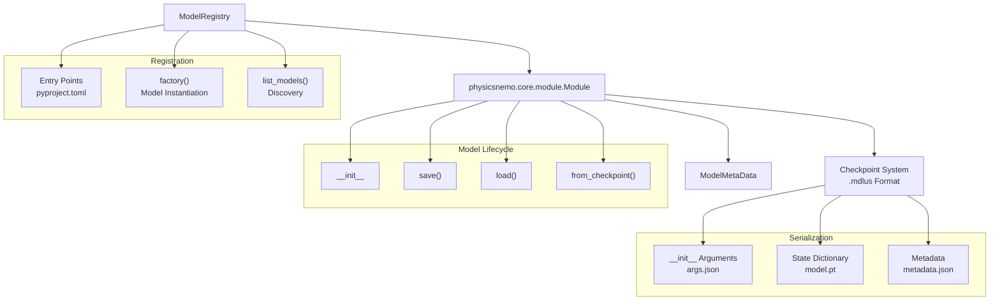

Sources: [physicsnemo/core/module.py:123-172](), [physicsnemo/utils/checkpoint.py:17-30]()

## Core Components

### 2.1 Module Base Class

The `physicsnemo.core.module.Module` class serves as the foundational base for all models in the framework. It extends `torch.nn.Module` to provide automatic argument capture via a custom `__new__` method, enabling seamless serialization of model configurations. It also integrates `ModelMetaData` to track optimization capabilities like CUDA graphs and AMP support.

For details, see [Module Base Class](#2.1).

Sources: [physicsnemo/core/module.py:123-172](), [test/core/test_module_nested.py:44-60]()

### 2.2 Model Registry

The `ModelRegistry` is a singleton system that manages model discovery and instantiation. It uses Python's entry points to automatically discover models registered under the `physicsnemo.models` group. This allows the framework to instantiate models by string names using a factory pattern, supporting both native PhysicsNeMo models and converted torch modules.

For details, see [Model Registry](#2.2).

Sources: [physicsnemo/core/registry.py:1-80]()

### 2.3 Checkpointing and Serialization

PhysicsNeMo introduces the `.mdlus` checkpoint format, which is an archive containing model weights, initialization arguments, and versioning metadata. This format ensures that models can be reconstructed exactly as they were trained, including support for complex nested module hierarchies, distributed checkpointing via PyTorch DCP, and backward compatibility mappings.

For details, see [Checkpointing and Serialization](#2.3).

Sources: [physicsnemo/utils/checkpoint.py:17-54](), [physicsnemo/core/module.py:75-106]()

## Model Lifecycle Workflows

### Argument Capture Mechanism

The system ensures that any class inheriting from `Module` automatically tracks its constructor arguments. This is critical for the `from_checkpoint` functionality which reconstructs the model object before loading weights.

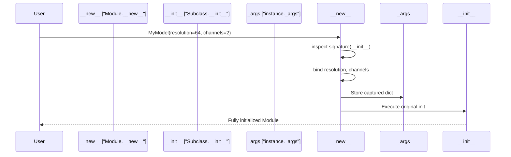

Sources: [physicsnemo/core/module.py:123-172]()

### Loading from Checkpoints

The `from_checkpoint()` method provides a high-level API to instantiate a model directly from a file path. It handles downloading from remote sources, extracting the `.mdlus` archive, and applying any necessary argument overrides or backward compatibility transformations.

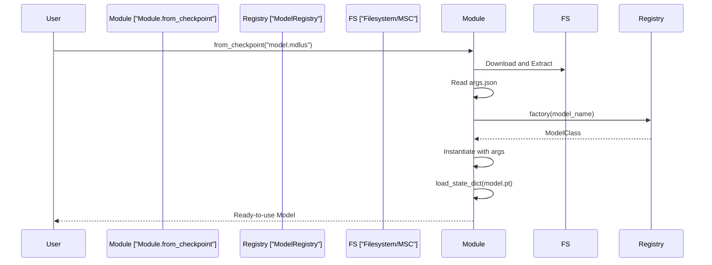

Sources: [physicsnemo/core/module.py:123-172](), [test/core/test_module_nested.py:161-204]()

---

# Page: Module Base Class

# Module Base Class

<details>
<summary>Relevant source files</summary>

The following files were used as context for generating this wiki page:

- [physicsnemo/core/module.py](physicsnemo/core/module.py)
- [physicsnemo/core/registry.py](physicsnemo/core/registry.py)
- [physicsnemo/models/mlp/fully_connected.py](physicsnemo/models/mlp/fully_connected.py)
- [physicsnemo/models/unet/unet.py](physicsnemo/models/unet/unet.py)
- [test/ci_tests/header_check.py](test/ci_tests/header_check.py)
- [test/core/test_module_nested.py](test/core/test_module_nested.py)
- [test/models/mlp/test_fully_connected.py](test/models/mlp/test_fully_connected.py)
- [test/models/unet/test_unet.py](test/models/unet/test_unet.py)

</details>


## Purpose and Scope

This document describes the `physicsnemo.Module` base class, which serves as the foundation for all neural network models in PhysicsNeMo. The `Module` class extends PyTorch's `torch.nn.Module` with additional functionality for automatic argument serialization, nested module support, and seamless conversion from PyTorch models.

This page focuses on the core functionality of `Module` itself—initialization, argument capture, nested module support, and PyTorch interoperability. For information about model registration and discovery, see **2.2 Model Registry**. For details on checkpoint serialization formats and storage backends, see **2.3 Checkpointing and Serialization**.

Sources: [physicsnemo/core/module.py:123-172]()

---

## Class Overview

The `Module` class provides a drop-in replacement for `torch.nn.Module` with enhanced serialization capabilities. The key requirement is that all `__init__` arguments must be JSON-serializable, with one important exception: arguments that are themselves `physicsnemo.Module` instances are automatically handled for nested composition.

### Module Architecture and Code Mapping

This diagram bridges natural language concepts of model creation and serialization to the exact code entities in `physicsnemo.core.module`.

```mermaid
classDiagram
    title "PhysicsNeMo Module Class Hierarchy and Code Mapping"
    
    class torch_nn_Module {
        <<PyTorch Base>>
        +forward()
        +parameters()
        +state_dict()
    }
    
    class Module {
        <<Code Entity: physicsnemo.core.module.Module>>
        +meta: ModelMetaData
        +device_buffer: Tensor
        -_args: Dict
        +__new__(cls, *args, **kwargs)
        +__init__(meta)
        +save(file_name)
        +load(file_name)
        +from_checkpoint()$ 
        +from_torch()$
        +instantiate()$
    }
    
    class ModelMetaData {
        <<Code Entity: physicsnemo.core.meta.ModelMetaData>>
        +name: str
        +jit: bool
        +cuda_graphs: bool
        +amp: bool
    }
    
    class ConcreteModel {
        <<Example: physicsnemo.models.mlp.FullyConnected>>
        +__init__(in_features, out_features, num_layers)
        +forward(x)
    }
    
    torch_nn_Module <|-- Module
    Module <|-- ConcreteModel
    Module --o ModelMetaData: "contains meta"
    Module --o Module: "nested modules"
```

**Key Design Principles:**
- **Transparent Argument Capture**: `__new__` intercepts all constructor arguments before instantiation [physicsnemo/core/module.py:182-225]().
- **Nested Composition**: Supports arbitrary nesting of `physicsnemo.Module` instances [physicsnemo/core/module.py:130-144]().
- **PyTorch Compatibility**: Any `torch.nn.Module` can be wrapped via `from_torch()` [physicsnemo/core/module.py:915-973]().
- **Automatic Registration**: Classes can be registered to the `ModelRegistry` using entry points or registry decorators [physicsnemo/core/registry.py:83-141]().

Sources: [physicsnemo/core/module.py:123-225](), [physicsnemo/core/meta.py:22-63](), [physicsnemo/core/registry.py:83-141]()

---

## Initialization and Argument Capture

### The `__new__` Method: Automatic Argument Storage

The `Module` class uses a custom `__new__` method to intercept and store all initialization arguments before the object is created. This enables automatic serialization without requiring developers to manually track their arguments.

### Argument Binding Data Flow

```mermaid
sequenceDiagram
    title "Constructor Interception Flow (physicsnemo.core.module.Module.__new__)"
    
    participant User as User Code
    participant NewMethod as Module.__new__
    participant Inspect as inspect.signature
    participant InitMethod as Module.__init__
    
    User->>NewMethod: FullyConnected(in_features=32, out_features=8)
    NewMethod->>Inspect: get signature of __init__
    Inspect-->>NewMethod: Signature(in_features, out_features, ...)
    NewMethod->>NewMethod: bind args & apply defaults
    NewMethod->>NewMethod: store arguments in _args dictionary
    Note over NewMethod: _args = {<br/>"__name__": "FullyConnected",<br/>"__module__": "physicsnemo.models.mlp",<br/>"__args__": {in_features: 32, out_features: 8}<br/>0
    NewMethod->>InitMethod: call base and concrete __init__
    InitMethod-->>User: return initialized model instance
```

### Implementation Details

The argument capture mechanism works as follows:

1. **Signature Inspection**: Uses `inspect.signature()` to get the `__init__` method's parameter names and defaults.
2. **Argument Binding**: Binds positional and keyword arguments to the signature, applying defaults.
3. **VAR_KEYWORD Unpacking**: Extracts `**kwargs` if present and merges into flat argument dictionary.
4. **Storage Format**: Stores as `_args` dictionary containing class name, module path, and bound arguments.

### Initialization Method

The `__init__` method itself is minimal and initializes base state [physicsnemo/core/module.py:238-253]():

```python
def __init__(self, meta: Union[ModelMetaData, None] = None):
    super().__init__()
    self.meta = meta
    self.register_buffer("device_buffer", torch.empty(0), persistent=False)
```

- **`meta`**: Optional `ModelMetaData` instance containing optimization flags (JIT, CUDA graphs, AMP, etc.).
- **`device_buffer`**: Zero-size non-persistent buffer used to track the model's device placement [physicsnemo/core/module.py:252]().

Sources: [physicsnemo/core/module.py:182-253](), [physicsnemo/core/meta.py:22-63]()

---

## Nested Module Support

### Nested Module Architecture

PhysicsNeMo supports arbitrary nesting of `Module` instances, enabling compositional model architectures. When saving, nested modules are recursively serialized; when loading, they are recursively reconstructed.

```mermaid
graph TB
    title "Nested Module Composition and Serialization Layout"
    
    subgraph "Object Hierarchy Space"
        OuterModel["OuterModel<br/>(physicsnemo.core.module.Module)"]
        InnerModel1["InnerModel1<br/>(physicsnemo.core.module.Module)"]
        InnerModel2["InnerModel2<br/>(physicsnemo.core.module.Module)"]
        TorchWrapper["TorchWrapper<br/>(from_torch conversion)"]
        
        OuterModel -->|"arg: inner1"| InnerModel1
        OuterModel -->|"arg: inner2"| InnerModel2
        InnerModel2 -->|"arg: torch_model"| TorchWrapper
    end
    
    subgraph "Serialization Dictionary Structure"
        RootArgs["_args dictionary"]
        ArgsOuter["'__args__': {<br/>'inner1': '__physicsnemo.Module__.inner1',<br/>'inner2': '__physicsnemo.Module__.inner2'<br/>}"]
        ArgsInner1["'__physicsnemo.Module__.inner1': {<br/>'__name__': 'InnerModel1',<br/>'__args__': {...}<br/>}"]
        ArgsInner2["'__physicsnemo.Module__.inner2': {<br/>'__name__': 'InnerModel2',<br/>'__args__': {...}<br/>}"]
        
        RootArgs --> ArgsOuter
        RootArgs --> ArgsInner1
        RootArgs --> ArgsInner2
    end
```

### Serialization of Nested Modules

When saving, nested `Module` arguments are replaced with placeholder strings using `_BASE_CKPT_PREFIX = "__physicsnemo.Module__"` [physicsnemo/core/module.py:46-47](), and their configuration dictionaries are stored recursively at the checkpoint root level [physicsnemo/core/module.py:450-515]().

### Deserialization of Nested Modules

The reconstruction helper `_from_checkpoint_process()` parses these placeholders, recursively instantiates sub-modules depth-first, and injects them into parent constructors [physicsnemo/core/module.py:728-866]().

Sources: [physicsnemo/core/module.py:43-47](), [physicsnemo/core/module.py:450-515](), [physicsnemo/core/module.py:728-866]()

---

## Converting from PyTorch Modules

### The `from_torch()` Static Method

The `from_torch()` method allows seamless integration of existing PyTorch models into PhysicsNeMo's serialization infrastructure [physicsnemo/core/module.py:915-973]().

```mermaid
graph LR
    title "PyTorch to PhysicsNeMo Conversion Pipeline"
    
    subgraph "Source Space"
        TorchClass["torch.nn.Module Subclass<br/>class TorchModel(torch.nn.Module)"]
    end
    
    subgraph "Conversion Code (Module.from_torch)"
        InspectSig["inspect.getfullargspec()"]
        CreateWrapper["Dynamic Class Generator"]
        SignatureReconstruct["inspect.Signature rebuilding"]
    end
    
    subgraph "Destination Space"
        PNMClass["physicsnemo.Module Subclass<br/>TorchModelPhysicsNeMoModel"]
        ForwardDelegate["Forward pass delegates to self.inner_model"]
    end
    
    TorchClass --> InspectSig
    InspectSig --> CreateWrapper
    CreateWrapper --> SignatureReconstruct
    SignatureReconstruct --> PNMClass
    PNMClass --> ForwardDelegate
```

### Conversion Process

The conversion creates a wrapper class dynamically [physicsnemo/core/module.py:934-973]():
1. **Define Inner Wrapper Class**: Creates a subclassing `physicsnemo.Module`.
2. **Extract Original Signature**: Uses inspection tools to retrieve argument names and defaults from the original PyTorch model.
3. **Reconstruct Signature**: Creates a new `inspect.Signature` and assigns it to the wrapper's `__init__`.
4. **Generate Unique Name**: Names the generated class `{OriginalClassName}PhysicsNeMoModel`.

Sources: [physicsnemo/core/module.py:915-973]()

---

## Model Instantiation and Class Resolution

### Class Resolution and Factory Pattern

The `instantiate()` class method creates model instances from argument dictionaries [physicsnemo/core/module.py:374-416]().

### Instantiation Resolution Code Mapping

```mermaid
graph TD
    title "Class Resolution Fallback Chain (Module._get_class_from_args)"
    
    ArgDict["Argument Dictionary<br/>__name__, __module__, __args__"] --> Resolve["physicsnemo.core.module.Module._get_class_from_args()"]
    
    Resolve --> CheckCurrent{"Matches current class name?"}
    CheckCurrent -->|Yes| UseCurrent["Return calling class"]
    CheckCurrent -->|No| CheckRegistry["physicsnemo.core.registry.ModelRegistry"]
    
    CheckRegistry --> FoundInRegistry{"Found in registry?"}
    FoundInRegistry -->|Yes| ReturnRegistered["Return registered class"]
    FoundInRegistry -->|No| TryImport["importlib.import_module(__module__)"]
    
    TryImport --> LoadEntryPoint{"Is importlib.metadata.EntryPoint?"}
    LoadEntryPoint -->|Yes| CallLoad["EntryPoint.load()"]
    LoadEntryPoint -->|No| ReturnImported["Return imported class"]
    CallLoad --> ReturnImported
```

### Class Resolution Algorithm

The `_get_class_from_args()` method resolves classes using a fallback chain [physicsnemo/core/module.py:322-371]():
1. **Current Class Match**: If the calling class name matches `"__name__"`, use the calling class.
2. **Registry Lookup**: Check `ModelRegistry()` for registered models [physicsnemo/core/registry.py:142-162]().
3. **Dynamic Import**: Use `importlib.import_module()` with the `"__module__"` path.
4. **Backward Compatibility**: Automatically translates legacy `"modulus.*"` paths to `"physicsnemo.*"`.
5. **EntryPoint Loading**: If an `EntryPoint` is encountered, `.load()` is invoked.

Sources: [physicsnemo/core/module.py:322-416](), [physicsnemo/core/registry.py:142-162]()

---

## Argument Overriding

### The `_overridable_args` Mechanism

Subclasses can declare which `__init__` arguments can be overridden when loading from checkpoints by defining `_overridable_args` [physicsnemo/core/module.py:157]().

### Override Process

The `from_checkpoint()` method accepts an `override_args` dictionary [physicsnemo/core/module.py:646-663]():
1. **Validation**: The `_override_args()` method ensures keys are declared in `_overridable_args` [physicsnemo/core/module.py:292-319]().
2. **Dot-Separated Paths**: Override keys support dot-separated syntax for nested modules (e.g., `m2.a`) [physicsnemo/core/module.py:691-708]().
3. **Keyword Safety**: Validates that override keys are valid Python identifiers and not reserved keywords [physicsnemo/core/module.py:713-725]().

Sources: [physicsnemo/core/module.py:292-319](), [physicsnemo/core/module.py:646-725]()

---

## Model Implementation Standards (MOD Rules)

Models in PhysicsNeMo must adhere to specific coding standards:
- **MOD-001**: Use `physicsnemo.Module` as the base class for all neural network modules [physicsnemo/core/module.py:123-124]().
- **MOD-002**: Constructor arguments must be JSON serializable, except for nested `physicsnemo.Module` instances [physicsnemo/core/module.py:130-144]().
- **MOD-003**: Call `super().__init__(meta=meta)` at the start of `__init__` [physicsnemo/core/module.py:160]().
- **MOD-004**: Use `ModelMetaData` to explicitly define model capabilities (JIT, AMP, CUDA graphs, ONNX, etc.) [physicsnemo/core/meta.py:22-63]().
- **MOD-005**: Support automatic registration via the `ModelRegistry` and entry point specifications [physicsnemo/core/registry.py:60-81]().
- **MOD-008a**: Verify constructor attributes and default values in test suites [test/models/mlp/test_fully_connected.py:49-83]().

Sources: [physicsnemo/core/module.py:123-160](), [physicsnemo/core/meta.py:22-63](), [physicsnemo/core/registry.py:60-81](), [test/models/mlp/test_fully_connected.py:49-83]()

---

# Page: Model Registry

# Model Registry

<details>
<summary>Relevant source files</summary>

The following files were used as context for generating this wiki page:

- [CHANGELOG.md](CHANGELOG.md)
- [Dockerfile](Dockerfile)
- [Makefile](Makefile)
- [physicsnemo/__init__.py](physicsnemo/__init__.py)
- [physicsnemo/core/module.py](physicsnemo/core/module.py)
- [physicsnemo/core/registry.py](physicsnemo/core/registry.py)
- [physicsnemo/core/version_check.py](physicsnemo/core/version_check.py)
- [physicsnemo/models/mlp/fully_connected.py](physicsnemo/models/mlp/fully_connected.py)
- [physicsnemo/models/unet/unet.py](physicsnemo/models/unet/unet.py)
- [pyproject.toml](pyproject.toml)
- [test/ci_tests/header_check.py](test/ci_tests/header_check.py)
- [test/ci_tests/prevent_untracked_imports.py](test/ci_tests/prevent_untracked_imports.py)
- [test/core/test_module_nested.py](test/core/test_module_nested.py)
- [test/core/test_version_check.py](test/core/test_version_check.py)
- [test/models/mlp/test_fully_connected.py](test/models/mlp/test_fully_connected.py)
- [test/models/unet/test_unet.py](test/models/unet/test_unet.py)
- [test/nn/functional/test_natten.py](test/nn/functional/test_natten.py)
- [uv.lock](uv.lock)

</details>


## Purpose and Scope

The Model Registry provides a centralized discovery and instantiation system for PhysicsNeMo models. It maintains a catalog of available model classes and enables dynamic model instantiation by name, supporting both entry point-based discovery and programmatic registration. This system is fundamental to checkpoint loading and model serialization workflows, particularly in the v2.0 refactor which emphasizes modularity and easy integration. 

For information about the base `Module` class that models inherit from, see **2.1 Module Base Class**. For details on checkpoint serialization, see **2.3 Checkpointing and Serialization**.

Sources: [physicsnemo/core/module.py:42](), [physicsnemo/core/version_check.py:41-52]()

---

## Architecture Overview

The `ModelRegistry` implements a singleton pattern using the **Borg idiom**, ensuring a single shared registry state across the application (`_shared_state`). It maintains a mapping from model names to model classes or entry points (`_model_registry`), providing a factory interface for model instantiation.

### Registry Singleton Pattern

```mermaid
graph TB
    subgraph "ModelRegistry Singleton (Borg Pattern)"
        Registry["ModelRegistry"]
        SharedState["_shared_state<br/>{'_model_registry': dict}"]
        
        Registry -->|"shares"| SharedState
    end
    
    subgraph "Registry Dictionary"
        RegDict["_model_registry: Dict[str, Union[type, EntryPoint]]"]
        
        ModelName1["'AFNO' → AFNO class"]
        ModelName2["'FNO' → FNO class"]
        ModelName3["'SongUNet' → EntryPoint"]
        ModelName4["'GLOBE' → GLOBE class"]
        
        RegDict --> ModelName1
        RegDict --> RegDict2["..."]
    end
    
    subgraph "Entry Points Discovery"
        EPGroup["entry_points(group='physicsnemo.models')"]
        EPModulus["entry_points(group='modulus.models')"]
        
        EPGroup -->|"discovered at init"| RegDict
        EPModulus -->|"backward compat"| RegDict
    end
    
    SharedState --> RegDict
    
    Client1["Client Instance 1"]
    Client2["Client Instance 2"]
    
    Client1 -.->|"new ModelRegistry()"| Registry
    Client2 -.->|"new ModelRegistry()"| Registry
```

Sources: [physicsnemo/core/module.py:42]()

---

## Entry Points Discovery and Auto-Registration

The registry discovers models automatically through Python's entry points system, scanning groups such as `physicsnemo.models` and legacy fallback groups (`modulus.models`). Entry points are defined in package metadata and package configuration specifications.

### Entry Point Resolution Flow

```mermaid
graph LR
    subgraph "Discovery Phase"
        Init["ModelRegistry.__new__()"]
        Construct["_construct_registry()"]
        
        Init --> Construct
    end
    
    subgraph "Entry Point Groups"
        PhysicsNeMo["entry_points<br/>(group='physicsnemo.models')"]
        Modulus["entry_points<br/>(group='modulus.models')"]
    end
    
    subgraph "Registry Population"
        RegDict["_model_registry: dict"]
        
        AddPhysicsNeMo["registry[ep.name] = ep"]
        CheckModulus["if ep.name not in registry"]
        AddModulus["registry[ep.name] = ep<br/>+ DeprecationWarning"]
        
        PhysicsNeMo --> AddPhysicsNeMo
        AddPhysicsNeMo --> RegDict
        
        Modulus --> CheckModulus
        CheckModulus -->|"name available"| AddModulus
        AddModulus --> RegDict
    end
    
    Construct --> PhysicsNeMo
    Construct --> Modulus
    
    subgraph "Entry Point Structure"
        EP["EntryPoint"]
        EPName["name: str"]
        EPValue["value: str<br/>(module:class)"]
        EPLoad["load() → class"]
        
        EP --> EPName
        EP --> EPValue
        EP --> EPLoad
    end
```

Sources: [pyproject.toml:4-21]()

---

## Registry Operations

The registry provides core operations for programmatic registration, model factory instantiation, and model catalog listing via `ModelRegistry` methods.

### Core API Methods

| Method | Signature | Purpose |
|--------|-----------|---------|
| `register()` | `register(model: type[physicsnemo.Module], name: Union[str, None])` | Programmatically add a model to the registry. Validates subclassing of `physicsnemo.Module`. |
| `factory()` | `factory(name: str) → physicsnemo.Module` | Retrieve a registered model class by name, resolving entry points if necessary. |
| `list_models()` | `list_models() → List[str]` | Return all registered model names (primary and legacy). |

Sources: [physicsnemo/core/module.py:42]()

### Registration Process

```mermaid
graph TD
    subgraph "Programmatic Registration"
        Register["registry.register(model, name)"]
        
        CheckSubclass["issubclass(model,<br/>physicsnemo.Module)?"]
        DetermineName["name = name or<br/>model.__name__"]
        CheckExists["name in<br/>_model_registry?"]
        AddToReg["_model_registry[name]<br/>= model"]
        
        Register --> CheckSubclass
        CheckSubclass -->|"No"| RaiseValueError["raise ValueError"]
        CheckSubclass -->|"Yes"| DetermineName
        DetermineName --> CheckExists
        CheckExists -->|"Yes"| RaiseConflict["raise ValueError<br/>(name in use)"]
        CheckExists -->|"No"| AddToReg
    end
```

Sources: [physicsnemo/core/module.py:123-144]()

---

## Integration with Module System

The registry integrates directly with `Module` instantiation and serialization routines, particularly when deserializing checkpoints or restoring nested module structures via `Module.from_checkpoint()` [physicsnemo/core/module.py:169-172]().

### Module Resolution Logic

```mermaid
graph TB
    subgraph "Module Class Logic"
        GetClass["Module._get_class_from_args()"]
        Instantiate["Module.instantiate()"]
        FromCheckpoint["Module.from_checkpoint()"]
    end
    
    subgraph "Registry Access"
        Registry["ModelRegistry()"]
        Factory["registry.factory(name)"]
    end
    
    subgraph "Model Resolution Logic"
        CheckSelf["cls.__name__ ==<br/>arg_dict['__name__']?"]
        CheckRegistry["name in<br/>registry.list_models()?"]
        TryImport["importlib.import_module<br/>(arg_dict['__module__'])"]
        
        CheckSelf -->|"Yes"| ReturnCls["return cls"]
        CheckSelf -->|"No"| CheckRegistry
        CheckRegistry -->|"Yes"| UseFactory["return registry.factory(name)"]
        CheckRegistry -->|"No"| TryImport
        TryImport --> ReturnImported["return imported class"]
    end
    
    FromCheckpoint --> GetClass
    GetClass --> Registry
    GetClass --> CheckSelf
    Registry --> Factory
    Factory --> UseFactory
    
    UseFactory --> Instantiate
    ReturnCls --> Instantiate
    ReturnImported --> Instantiate
```

Sources: [physicsnemo/core/module.py:42](), [physicsnemo/core/version_check.py:41-52]()

---

## Usage Examples

### Retrieving and Instantiating a Model via Factory

```python
from physicsnemo.core.registry import ModelRegistry

# Get registry instance (singleton)
registry = ModelRegistry()

# List all available models
model_names = registry.list_models()

# Get model class by name (resolves EntryPoint if needed)
AFNOClass = registry.factory('AFNO')

# Instantiate model
model = AFNOClass(...)
```

Sources: [physicsnemo/core/module.py:42]()

### Programmatic Registration

```python
from physicsnemo.core.module import Module
from physicsnemo.core.registry import ModelRegistry

class CustomModel(Module):
    def __init__(self, **kwargs):
        super().__init__()

# Register the model
registry = ModelRegistry()
registry.register(CustomModel, name="MyCustomModel")

# Now available via factory
model_class = registry.factory("MyCustomModel")
```

Sources: [physicsnemo/core/module.py:123-144]()

---

# Page: Checkpointing and Serialization

# Checkpointing and Serialization

<details>
<summary>Relevant source files</summary>

The following files were used as context for generating this wiki page:

- [docs/api/models/convolutional.rst](docs/api/models/convolutional.rst)
- [docs/api/models/fnos.rst](docs/api/models/fnos.rst)
- [docs/api/models/fully_connected.rst](docs/api/models/fully_connected.rst)
- [docs/api/models/gnns.rst](docs/api/models/gnns.rst)
- [docs/api/models/modules.rst](docs/api/models/modules.rst)
- [docs/api/models/operators.rst](docs/api/models/operators.rst)
- [docs/api/models/recurrent.rst](docs/api/models/recurrent.rst)
- [docs/api/models/transolver.rst](docs/api/models/transolver.rst)
- [docs/api/models/weather.rst](docs/api/models/weather.rst)
- [docs/api/physicsnemo.sym.rst](docs/api/physicsnemo.sym.rst)
- [docs/api/physicsnemo.utils.rst](docs/api/physicsnemo.utils.rst)
- [docs/api_index.rst](docs/api_index.rst)
- [docs/api_models.rst](docs/api_models.rst)
- [physicsnemo/experimental/datapipes/healda/transforms/obs_features.py](physicsnemo/experimental/datapipes/healda/transforms/obs_features.py)
- [physicsnemo/experimental/datapipes/healda/transforms/obs_features_ext.py](physicsnemo/experimental/datapipes/healda/transforms/obs_features_ext.py)
- [physicsnemo/metrics/general/calibration.py](physicsnemo/metrics/general/calibration.py)
- [physicsnemo/metrics/general/crps.py](physicsnemo/metrics/general/crps.py)
- [physicsnemo/sym/__init__.py](physicsnemo/sym/__init__.py)
- [physicsnemo/sym/computation.py](physicsnemo/sym/computation.py)
- [physicsnemo/sym/constants.py](physicsnemo/sym/constants.py)
- [physicsnemo/sym/eq/__init__.py](physicsnemo/sym/eq/__init__.py)
- [physicsnemo/sym/eq/gradients.py](physicsnemo/sym/eq/gradients.py)
- [physicsnemo/utils/checkpoint.py](physicsnemo/utils/checkpoint.py)
- [physicsnemo/utils/logging/launch.py](physicsnemo/utils/logging/launch.py)
- [test/core/test_registry.py](test/core/test_registry.py)
- [test/datapipes/healda/test_features.py](test/datapipes/healda/test_features.py)
- [test/diffusion/test_domain_parallel_sampling.py](test/diffusion/test_domain_parallel_sampling.py)
- [test/nn/module/test_interpolation.py](test/nn/module/test_interpolation.py)
- [test/optim/test_combined_optimizer.py](test/optim/test_combined_optimizer.py)
- [test/utils/msc_config_checkpoint.yaml](test/utils/msc_config_checkpoint.yaml)
- [test/utils/msc_config_public_read.yaml](test/utils/msc_config_public_read.yaml)
- [test/utils/test_checkpoint.py](test/utils/test_checkpoint.py)
- [test/utils/test_checkpoint_distributed.py](test/utils/test_checkpoint_distributed.py)
- [test/utils/test_msc_public_read.py](test/utils/test_msc_public_read.py)

</details>


## Purpose and Scope

This page provides full technical documentation for the serialization and checkpointing architecture in PhysicsNeMo. The subsystem is responsible for persisting and restoring training states, optimizer configurations, learning rate schedulers, gradient scalers, and arbitrary metadata across both local filesystems and remote object stores. It supports standard PyTorch serialization (`.pt`) as well as PhysicsNeMo's specialized module format (`.mdlus`), and natively integrates PyTorch's Distributed Checkpoint (DCP) APIs for Fully Sharded Data Parallel (FSDP) and DTensor / ShardTensor parameters.

Sources: [physicsnemo/utils/checkpoint.py:17-29](), [docs/api/models/modules.rst:12-23]()

---

## 1. Serialization Formats (`.mdlus` vs `.pt`)

PhysicsNeMo relies on two primary file containers depending on whether you are persisting a standalone simulation module or a full multi-component training loop:

*   **`.mdlus` Format**: Specialized container format for `physicsnemo.Module` instances. Beyond the model weights (`state_dict`), a `.mdlus` archive embeds the `ModelMetaData` dictionary containing the exact constructor arguments (hyperparameters) used to initialize the module. This enables zero-configuration model hydration (`from_checkpoint`).
*   **`.pt` Format**: Standard PyTorch serialization files used for saving generic training states, vanilla `torch.nn.Module` weights, optimizer states (`torch.optim.Optimizer`), learning rate schedulers, and `GradScaler` states.

Sources: [physicsnemo/utils/checkpoint.py:304-315](), [docs/api/models/modules.rst:12-28]()

---

## 2. Core API and Data Flow

The core checkpointing logic is implemented in `physicsnemo.utils.checkpoint`, exposing functions like `save_checkpoint` and `load_checkpoint` that manage multi-model synchronization and device placement.

### Diagram: Checkpointing System Architecture (Code Entity Mapping)

```mermaid
flowchart TD
    SaveCP["save_checkpoint()"] --> DistDetect["_is_distributed_model()"]
    SaveCP --> Unwrap["_unwrap_ddp_compile()"]
    SaveCP --> GetSD["torch.distributed.checkpoint.state_dict:get_model_state_dict()"]
    LoadCP["load_checkpoint()"] --> Mat["_materialize_dtensors_to_full()"]
    LoadCP --> SetSD["torch.distributed.checkpoint.state_dict:set_model_state_dict()"]
    SaveCP --> MSC["physicsnemo.core.filesystem:_download_cached()"]
    LoadCP --> MSC
```

Sources: [physicsnemo/utils/checkpoint.py:70-82](), [physicsnemo/utils/checkpoint.py:148-172](), [physicsnemo/utils/checkpoint.py:56-58]()

---

## 3. Distributed Serialization and DCP Integration

For large-scale distributed training using PyTorch FSDP (`FullyShardedDataParallel`, `FSDPModule`) or `DTensor` sharded parameters, `physicsnemo.utils.checkpoint` transparently leverages PyTorch's Distributed Checkpoint (DCP) infrastructure.

### Detection and Unwrapping Helpers

*   `_is_distributed_model(model)`: Returns `True` if the model instance is an instance of `FSDP`, `FSDPModule`, or contains parameters of type `DTensor` [physicsnemo/utils/checkpoint.py:70-82]().
*   `_unwrap_ddp_compile(model)`: Strips `DistributedDataParallel`, `DataParallel`, and `torch.compile` (`OptimizedModule`) wrappers while preserving FSDP layers [physicsnemo/utils/checkpoint.py:84-102]().
*   `_unwrapped_class_name(model)`: Peels synthetic FSDP2 dynamic subclasses (e.g., `FSDPFullyConnected`) back to the original user-defined class name (`FullyConnected`) so that `.mdlus` filenames reflect the underlying architecture [physicsnemo/utils/checkpoint.py:115-133]().

### Diagram: Distributed State Dispatch Flow (Code Entity Mapping)

```mermaid
flowchart TD
    InputModel["torch.nn.Module"] --> CheckDist["physicsnemo.utils.checkpoint:_is_distributed_model()"]
    CheckDist -->|True| FSDPBranch["FSDP / DTensor Execution Path"]
    CheckDist -->|False| StandardBranch["Standard PyTorch torch.save() Path"]
    FSDPBranch --> GetModelSD["torch.distributed.checkpoint.state_dict:get_model_state_dict()"]
    FSDPBranch --> Materialize["physicsnemo.utils.checkpoint:_materialize_dtensors_to_full()"]
    Materialize --> SaveDCP["torch.distributed.checkpoint:save()"]
    StandardBranch --> SaveTorch["torch.save()"]
```

Sources: [physicsnemo/utils/checkpoint.py:70-102](), [physicsnemo/utils/checkpoint.py:148-172]()

---

## 4. Multi-Storage Client (MSC) and Filesystem Abstraction

PhysicsNeMo integrates with `fsspec` and the Multi-Storage Client (MSC) to support cloud object stores (such as S3, GCS, or Azure Blob) transparently via the `msc://` protocol prefix.

*   **Caching**: Remote assets are downloaded and cached locally under `~/.cache/physicsnemo` using `_download_cached` to avoid redundant network fetching during multi-node checkpoint loading [physicsnemo/core/filesystem.py:56-57]().
*   **Environment Configuration**: Object storage profiles and credentials are configured via YAML files pointed to by the `MSC_CONFIG` environment variable [test/utils/test_checkpoint.py:92-94]().

Sources: [physicsnemo/utils/checkpoint.py:39-40](), [physicsnemo/core/filesystem.py:56-57](), [test/utils/test_checkpoint.py:92-94]()

---

## 5. Module-Level Serialization and Nested Modules

`physicsnemo.Module` extends `torch.nn.Module` to support recursive serialization of nested modules and metadata persistence.

*   **`Module.save(path)`**: Serializes the module's state dictionary alongside its `ModelMetaData` (constructor arguments) into a single `.mdlus` tar/zip or compressed archive [docs/api/models/modules.rst:12-28]().
*   **`Module.load(path)`**: Restores weights into an existing module instance.
*   **`Module.from_checkpoint(path)`**: Class method that reads the embedded `ModelMetaData` from the `.mdlus` file, dynamically reinstantiates the module with the correct architecture hyperparameters, and loads the saved weights in one step [docs/api/models/modules.rst:12-28]().
*   **Nested Modules**: When a `physicsnemo.Module` contains child `physicsnemo.Module` instances, serialization traverses the module hierarchy recursively, preserving sub-component metadata and parameters [docs/api/models/modules.rst:12-28]().

Sources: [docs/api/models/modules.rst:12-28](), [physicsnemo/utils/checkpoint.py:144-185]()

---

# Page: Model Architectures

# Model Architectures

<details>
<summary>Relevant source files</summary>

The following files were used as context for generating this wiki page:

- [.github/PULL_REQUEST_TEMPLATE.md](.github/PULL_REQUEST_TEMPLATE.md)
- [.gitlab/issue_templates/bug.md](.gitlab/issue_templates/bug.md)
- [.gitlab/issue_templates/documentation.md](.gitlab/issue_templates/documentation.md)
- [.gitlab/issue_templates/feature_request.md](.gitlab/issue_templates/feature_request.md)
- [.gitlab/issue_templates/security.md](.gitlab/issue_templates/security.md)
- [.gitlab/merge_request_templates/Default.md](.gitlab/merge_request_templates/Default.md)
- [CONTRIBUTING.md](CONTRIBUTING.md)
- [README.md](README.md)
- [codecov.yml](codecov.yml)
- [docs/api/models/convolutional.rst](docs/api/models/convolutional.rst)
- [docs/api/models/fnos.rst](docs/api/models/fnos.rst)
- [docs/api/models/fully_connected.rst](docs/api/models/fully_connected.rst)
- [docs/api/models/gnns.rst](docs/api/models/gnns.rst)
- [docs/api/models/modules.rst](docs/api/models/modules.rst)
- [docs/api/models/operators.rst](docs/api/models/operators.rst)
- [docs/api/models/recurrent.rst](docs/api/models/recurrent.rst)
- [docs/api/models/transolver.rst](docs/api/models/transolver.rst)
- [docs/api/models/weather.rst](docs/api/models/weather.rst)
- [docs/api/physicsnemo.sym.rst](docs/api/physicsnemo.sym.rst)
- [docs/api/physicsnemo.utils.rst](docs/api/physicsnemo.utils.rst)
- [docs/api_index.rst](docs/api_index.rst)
- [docs/api_models.rst](docs/api_models.rst)
- [docs/conf.py](docs/conf.py)
- [docs/img/Modulus-850x720.svg](docs/img/Modulus-850x720.svg)
- [docs/research.md](docs/research.md)
- [greptile.json](greptile.json)
- [physicsnemo/sym/__init__.py](physicsnemo/sym/__init__.py)
- [physicsnemo/sym/computation.py](physicsnemo/sym/computation.py)
- [physicsnemo/sym/constants.py](physicsnemo/sym/constants.py)
- [physicsnemo/sym/eq/__init__.py](physicsnemo/sym/eq/__init__.py)
- [physicsnemo/sym/eq/gradients.py](physicsnemo/sym/eq/gradients.py)
- [physicsnemo/utils/checkpoint.py](physicsnemo/utils/checkpoint.py)
- [test/diffusion/test_domain_parallel_sampling.py](test/diffusion/test_domain_parallel_sampling.py)
- [test/utils/test_checkpoint_distributed.py](test/utils/test_checkpoint_distributed.py)

</details>


## Purpose and Scope

This page provides a high-level overview of PhysicsNeMo's model zoo, encompassing neural operators, graph neural networks (GNNs), diffusion models, recurrent/hybrid architectures, and specialized or experimental models. These models are designed for high-performance physics-informed modeling, scientific machine learning, and AI-driven simulation across domains such as computational fluid dynamics (CFD), meteorology, and structural mechanics. 

As a PARENT page, this document outlines the major model families and their architectural roles. Detailed technical specifications, parameterizations, and layer implementations are covered in the respective child pages:
- [Neural Operators](#3.1)
- [Graph Neural Networks](#3.2)
- [Diffusion Models](#3.3)
- [Recurrent and Hybrid Models](#3.4)
- [Specialized and Experimental Models](#3.5)

Sources: [CONTRIBUTING.md:49-52](), [README.md:27-29]()

---

## Model Zoo Overview

PhysicsNeMo organizes its neural architectures into specialized families reflecting their mathematical foundations and application domains. All models inherit from the foundational `Module` class, ensuring consistent argument serialization, metadata tracking, and checkpoint integration.

### Neural Operators

Neural operators learn continuous mappings between infinite-dimensional function spaces, providing resolution-invariant solutions to partial differential equations (PDEs). The framework includes Fourier Neural Operators (`FNO`), Adaptive Fourier Neural Operators (`AFNO`), Decomposable Multi-scale Iterative Operators (`DoMINO`), and physics-attention based transformers like `Transolver`, `GeoTransolver`, and `FLARE`.

For complete details, see [Neural Operators](#3.1).

Sources: [CHANGELOG.md:94-96](), [docs/api_models.rst:13-22]()

### Graph Neural Networks

Graph Neural Networks operate on unstructured meshes, point clouds, and specialized spherical grids. This family includes `MeshGraphNet` for mesh-based physical simulations, `GraphCastNet` for global icosahedral weather forecasting, as well as multiscale and hybrid variants like `BiStride MGN` and `MeshGraphKAN`.

For complete details, see [Graph Neural Networks](#3.2).

Sources: [CHANGELOG.md:109-115](), [docs/api_models.rst:14]()

### Diffusion Models

Generative diffusion frameworks provide high-fidelity physics synthesis, super-resolution, and ensemble generation. The `physicsnemo.diffusion` package supports score-based score networks (`SongUNet`, `SongUNetPosEmbd`, `DhariwalUNet`), Diffusion Transformers (`DiT`), flexible EDM/VP/VE preconditioning schemes, and guidance operators for domain-parallel sampling.

For complete details, see [Diffusion Models](#3.3).

Sources: [CHANGELOG.md:80-84](), [docs/api_models.rst:18-19]()

### Recurrent and Hybrid Models

Architectures designed for time-dependent sequential forecasting and ensemble weather prediction. This category features cubed-sphere models (`DLWP`), HEALPix-based recurrent UNets (`HEALPixRecUNet`), `SwinRNN`, and Mixture of Weather Experts (`MoWE`) models trained with continuous ranked probability score (CRPS) objectives.

For complete details, see [Recurrent and Hybrid Models](#3.4).

Sources: [CHANGELOG.md:113-118](), [docs/api_models.rst:16]()

### Specialized and Experimental Models

Cutting-edge models and symmetry-preserving neural primitives. This includes topology optimization (`TopoDiff`), convolutional neural networks for scientific grids (`FigConvNet`), global external aerodynamics models (`GLOBE`), and experimental symmetry-equivariant layers (`physicsnemo.experimental.nn.symmetry`).

For complete details, see [Specialized and Experimental Models](#3.5).

Sources: [CHANGELOG.md:13-14](), [docs/api_models.rst:15]()

---

## Architecture Integration and Code Mapping

The following diagrams illustrate how natural language concepts bridge to concrete code entities within the `physicsnemo` codebase.

### Diagram: Model Architecture Foundations

```mermaid
graph TD
    subgraph "NaturalLanguageSpace"
        NL_Module["Model Base Class"]
        NL_Checkpoint["Checkpointing System"]
        NL_Registry["Model Discovery"]
    end

    subgraph "CodeEntitySpace"
        Code_Module["physicsnemo.core.module.Module"]
        Code_Meta["physicsnemo.core.module.ModelMetaData"]
        Code_Checkpoint["physicsnemo.utils.checkpoint.save_checkpoint"]
        Code_Registry["physicsnemo.core.model_registry.ModelRegistry"]
    end

    NL_Module --> Code_Module
    Code_Module --> Code_Meta
    NL_Checkpoint --> Code_Checkpoint
    NL_Registry --> Code_Registry
```

Sources: [physicsnemo/core/module.py:25-25](), [physicsnemo/utils/checkpoint.py:19-21]()

### Diagram: Model Family Implementations

```mermaid
graph LR
    subgraph "NaturalLanguageSpace"
        NL_FNO["Fourier Neural Operator"]
        NL_MGN["MeshGraphNet"]
        NL_DiT["Diffusion Transformer"]
    end

    subgraph "CodeEntitySpace"
        Code_FNO["physicsnemo.models.fno.FNO"]
        Code_MGN["physicsnemo.models.mesh_graph_net.MeshGraphNet"]
        Code_DiT["physicsnemo.models.dit.DiT"]
    end

    NL_FNO --> Code_FNO
    NL_MGN --> Code_MGN
    NL_DiT --> Code_DiT
```

Sources: [docs/api_models.rst:13-19](), [CHANGELOG.md:80-96]()

---

# Page: Neural Operators

# Neural Operators

<details>
<summary>Relevant source files</summary>

The following files were used as context for generating this wiki page:

- [examples/cfd/darcy_fno/README.md](examples/cfd/darcy_fno/README.md)
- [examples/cfd/darcy_fno/config.yaml](examples/cfd/darcy_fno/config.yaml)
- [examples/cfd/darcy_fno/requirements.txt](examples/cfd/darcy_fno/requirements.txt)
- [examples/cfd/darcy_fno/train_fno_darcy.py](examples/cfd/darcy_fno/train_fno_darcy.py)
- [examples/cfd/darcy_fno/validator.py](examples/cfd/darcy_fno/validator.py)
- [examples/cfd/darcy_nested_fnos/README.md](examples/cfd/darcy_nested_fnos/README.md)
- [examples/cfd/darcy_nested_fnos/config.yaml](examples/cfd/darcy_nested_fnos/config.yaml)
- [examples/cfd/darcy_nested_fnos/evaluate_nested_darcy.py](examples/cfd/darcy_nested_fnos/evaluate_nested_darcy.py)
- [examples/cfd/darcy_nested_fnos/generate_nested_darcy.py](examples/cfd/darcy_nested_fnos/generate_nested_darcy.py)
- [examples/cfd/darcy_nested_fnos/train_nested_darcy.py](examples/cfd/darcy_nested_fnos/train_nested_darcy.py)
- [examples/cfd/darcy_nested_fnos/utils.py](examples/cfd/darcy_nested_fnos/utils.py)
- [examples/cfd/darcy_transolver/config.yaml](examples/cfd/darcy_transolver/config.yaml)
- [examples/cfd/darcy_transolver/convert_mat_to_npz.py](examples/cfd/darcy_transolver/convert_mat_to_npz.py)
- [examples/cfd/darcy_transolver/darcy_datapipe_fix.py](examples/cfd/darcy_transolver/darcy_datapipe_fix.py)
- [examples/cfd/darcy_transolver/train_transolver_darcy.py](examples/cfd/darcy_transolver/train_transolver_darcy.py)
- [examples/cfd/darcy_transolver/validator_fix.py](examples/cfd/darcy_transolver/validator_fix.py)
- [examples/cfd/external_aerodynamics/transformer_models/deprecated/conf/train_surface.yaml](examples/cfd/external_aerodynamics/transformer_models/deprecated/conf/train_surface.yaml)
- [examples/cfd/external_aerodynamics/transformer_models/src/conf/model/transolver.yaml](examples/cfd/external_aerodynamics/transformer_models/src/conf/model/transolver.yaml)
- [examples/cfd/gray_scott_rnn/conf/config_3d.yaml](examples/cfd/gray_scott_rnn/conf/config_3d.yaml)
- [examples/cfd/gray_scott_rnn/gray_scott_rnn.py](examples/cfd/gray_scott_rnn/gray_scott_rnn.py)
- [examples/cfd/navier_stokes_rnn/navier_stokes_rnn.py](examples/cfd/navier_stokes_rnn/navier_stokes_rnn.py)
- [physicsnemo/models/transolver/__init__.py](physicsnemo/models/transolver/__init__.py)
- [physicsnemo/models/transolver/transolver.py](physicsnemo/models/transolver/transolver.py)
- [test/models/transolver/test_transolver.py](test/models/transolver/test_transolver.py)

</details>


## Purpose and Scope

This page introduces the Neural Operator model family in PhysicsNeMo, which provides implementations for learning mappings between infinite-dimensional function spaces using spectral, kernel, and physics-attention approaches. Neural operators are particularly effective for solving parametric partial differential equations (PDEs) and approximating continuous operators in physics simulations with resolution invariance.

PhysicsNeMo supports a diverse set of operator architectures. For comprehensive technical details and implementation specifics, refer to the child pages:
- **AFNO**: Documented in [AFNO](#3.1.1) (`physicsnemo.models.afno.AFNO`).
- **FNO**: Documented in [FNO](#3.1.2) (`physicsnemo.models.fno.FNO`).
- **DoMINO**: Documented in [DoMINO](#3.1.3) (`physicsnemo.models.domino.domino.DoMINO`).
- **Transformer Operators (Transolver, GeoTransolver, FLARE)**: Documented in [Transformer Operators: Transolver, GeoTransolver, FLARE](#3.1.4) (`physicsnemo.models.transolver.transolver.Transolver`).

Sources: [physicsnemo/models/transolver/transolver.py:4-9]()

## Neural Operator Family Overview

PhysicsNeMo organizes its neural operator implementations around the core `Module` infrastructure, mapping high-level mathematical operator concepts directly to concrete Python classes in the codebase.

```mermaid
graph TB
    subgraph "NaturalLanguageSpace"
        NL_FNO["FourierNeuralOperator"]
        NL_AFNO["AdaptiveFourierNeuralOperator"]
        NL_DoMINO["DecomposableMultiscaleOperator"]
        NL_Transolver["PhysicsAttentionTransformer"]
    end

    subgraph "CodeEntitySpace"
        Code_FNO["physicsnemo.models.fno.FNO"]
        Code_AFNO["physicsnemo.models.afno.AFNO"]
        Code_DoMINO["physicsnemo.models.domino.domino.DoMINO"]
        Code_Transolver["physicsnemo.models.transolver.transolver.Transolver"]
    end

    NL_FNO --> Code_FNO
    NL_AFNO --> Code_AFNO
    NL_DoMINO --> Code_DoMINO
    NL_Transolver --> Code_Transolver
```
**Diagram: Neural Operator Architecture Hierarchy and Code Mapping**

Sources: [physicsnemo/models/transolver/transolver.py:284-300](), [examples/cfd/darcy_fno/train_fno_darcy.py:55-65]()

## Core Operator Architectures

### FNO (Fourier Neural Operator)
FNO uses spectral convolutions in Fourier space to learn integral kernel operators. It serves as the foundational operator for resolution-invariant PDE solving on structured regular grids. 
- For full details on spectral convolution blocks, 1D/2D/3D/4D architecture variants, and Darcy flow use cases, see [FNO](#3.1.2).

Sources: [examples/cfd/darcy_fno/train_fno_darcy.py:55-65]()

### AFNO (Adaptive Fourier Neural Operator)
AFNO adapts the vision transformer architecture by replacing standard self-attention with Fourier-based token mixing. It is highly optimized for large-scale weather prediction (such as FourCastNet) and global climate modeling.
- For details on vision transformer adaptation, ModAFNO, and distributed AFNO variants, see [AFNO](#3.1.1).

### DoMINO (Decomposable Multi-scale Iterative Neural Operator)
DoMINO is designed for unstructured point clouds and large-scale computational fluid dynamics (CFD). It supports geometry representation encodings and domain parallelism via `ShardTensor` for handling massive geometries.
- For details on point cloud processing and CFD applications, see [DoMINO](#3.1.3).

### Transformer Operators: Transolver, GeoTransolver, FLARE
Transformer-based operators introduce physics-aware attention mechanisms to handle complex geometries and unstructured domains. 
- For details on `Transolver`, `GeoTransolver` (GALE, context projector), `FLARE` attention, and unified aerodynamics configuration, see [Transformer Operators: Transolver, GeoTransolver, FLARE](#3.1.4).

Sources: [physicsnemo/models/transolver/transolver.py:142-180]()

## Architecture Comparison and Code Mapping

All neural operators inherit from `physicsnemo.core.module.Module` and follow a "Lift-Process-Project" design pattern. The internal mixing mechanisms and target data domains differ across families:

| Model Family | Primary Mixing Mechanism | Input Support | Code Module Path | Child Page Reference |
| :--- | :--- | :--- | :--- | :--- |
| **FNO** | Spectral Convolution (FFT) | Structured Grids | `physicsnemo.models.fno.FNO` | [FNO](#3.1.2) |
| **AFNO** | Fourier Token Mixing | Structured Patches / Weather | `physicsnemo.models.afno.AFNO` | [AFNO](#3.1.1) |
| **Transolver** | Physics-Aware Attention | Structured & Irregular Meshes | `physicsnemo.models.transolver.transolver.Transolver` | [Transformer Operators: Transolver, GeoTransolver, FLARE](#3.1.4) |
| **DoMINO** | Multi-scale Point Mixing | Unstructured Point Clouds | `physicsnemo.models.domino.domino.DoMINO` | [DoMINO](#3.1.3) |

### Transolver Internal Component Structure
The `Transolver` model instantiates internal building blocks that map directly to specific PyTorch modules and helper classes within the physicsnemo package:

```mermaid
graph LR
    Input["InputTensor(B,N,C)"] --> Pre["physicsnemo.models.transolver.transolver._TransolverMlp"]
    Pre --> Blocks["physicsnemo.models.transolver.transolver.TransolverBlock"]
    
    subgraph "TransolverBlock"
        Attn["physicsnemo.nn.module.physics_attention.PhysicsAttentionIrregularMesh"]
        Mlp["physicsnemo.models.transolver.transolver._TransolverMlp"]
    end
    
    Blocks --> Attn
    Attn --> Mlp
    Mlp --> Post["physicsnemo.models.transolver.transolver._TransolverMlp"]
    Post --> Output["OutputTensor"]
```
**Diagram: Transolver Component Hierarchy and Code Mapping**

Sources: [physicsnemo/models/transolver/transolver.py:81-140](), [physicsnemo/models/transolver/transolver.py:142-180]()

---

# Page: AFNO

# AFNO

<details>
<summary>Relevant source files</summary>

The following files were used as context for generating this wiki page:

- [examples/cfd/mhd_pino/train_mhd.py](examples/cfd/mhd_pino/train_mhd.py)
- [examples/cfd/mhd_pino/train_mhd_vec_pot.py](examples/cfd/mhd_pino/train_mhd_vec_pot.py)
- [examples/cfd/mhd_pino/train_mhd_vec_pot_tfno.py](examples/cfd/mhd_pino/train_mhd_vec_pot_tfno.py)
- [examples/weather/diagnostic/train_diagnostic_precip.py](examples/weather/diagnostic/train_diagnostic_precip.py)
- [examples/weather/dlwp/conf/config.yaml](examples/weather/dlwp/conf/config.yaml)
- [examples/weather/dlwp/cube_sphere_plotter_no_subplots.py](examples/weather/dlwp/cube_sphere_plotter_no_subplots.py)
- [examples/weather/dlwp/era5_hdf5.py](examples/weather/dlwp/era5_hdf5.py)
- [examples/weather/dlwp/train_dlwp.py](examples/weather/dlwp/train_dlwp.py)
- [examples/weather/fcn_afno/conf/config.yaml](examples/weather/fcn_afno/conf/config.yaml)
- [examples/weather/fcn_afno/train_era5.py](examples/weather/fcn_afno/train_era5.py)
- [examples/weather/pangu_weather/train_pangu_era5.py](examples/weather/pangu_weather/train_pangu_era5.py)
- [examples/weather/pangu_weather/train_pangu_lite_era5.py](examples/weather/pangu_weather/train_pangu_lite_era5.py)
- [physicsnemo/domain_parallel/shard_utils/halo.py](physicsnemo/domain_parallel/shard_utils/halo.py)
- [physicsnemo/models/afno/distributed/afno.py](physicsnemo/models/afno/distributed/afno.py)
- [physicsnemo/models/afno/distributed/layers.py](physicsnemo/models/afno/distributed/layers.py)
- [physicsnemo/nn/module/attention_layers.py](physicsnemo/nn/module/attention_layers.py)
- [physicsnemo/nn/module/utils/__init__.py](physicsnemo/nn/module/utils/__init__.py)
- [physicsnemo/nn/module/utils/weight_init.py](physicsnemo/nn/module/utils/weight_init.py)
- [test/common/fwdaccuracy.py](test/common/fwdaccuracy.py)
- [test/models/afno/data/afno_output.pth](test/models/afno/data/afno_output.pth)
- [test/models/afno/data/modafno_output.pth](test/models/afno/data/modafno_output.pth)
- [test/nn/module/test_weight_init.py](test/nn/module/test_weight_init.py)

</details>


## Purpose and Scope

This document covers the AFNO (Adaptive Fourier Neural Operator) model architecture in PhysicsNeMo, its implementation details, Vision Transformer adaptation, ModAFNO variant, distributed execution, and its primary application in weather forecasting through FourCastNet. AFNO is a neural operator that adapts vision transformer concepts with Fourier-based token mixing for processing global gridded atmospheric data.

For other neural operators, see [Neural Operators](#3.1). For FNO (Fourier Neural Operator), see [3.1.2 FNO](). For DoMINO and point cloud processing, see [3.1.3 DoMINO]().

## Architecture Overview

AFNO (Adaptive Fourier Neural Operator) is a neural network architecture that combines vision transformer design principles with efficient Fourier-based token mixing. It processes atmospheric state data on regular grids by:

1. Patching input fields into non-overlapping patches (`patch_size=[8, 8]`)
2. Embedding patches into a higher-dimensional space (`embed_dim=768`)
3. Processing through transformer blocks with Fourier-based attention (`depth=12`, `num_blocks=8`)
4. Reconstructing the output fields from patch embeddings

The key innovation is replacing standard attention mechanisms with token mixing in the Fourier domain via `physicsnemo.models.afno`, which provides computational efficiency for large-scale grid data while maintaining global receptive fields.

**AFNO Architecture Components**

```mermaid
graph TD
    Input["Input Fields<br/>(B, C_in, H, W)"] --> Patch["Patch Embedding<br/>patch_size=[8,8]<br/>physicsnemo.models.afno:AFNO"]
    Patch --> PosEmbed["Positional Encoding"]
    
    subgraph "AFNO Blocks (depth=12)"
        Block1["AFNO Block 1<br/>num_blocks=8"] --> Block2["AFNO Block 2"]
        Block2 --> BlockN["AFNO Block N"]
    end
    
    subgraph "AFNO Block Detail"
        LayerNorm1["Layer Norm"] --> FourierMix["Fourier Token Mixing<br/>physicsnemo.models.afno.distributed.afno"]
        FourierMix --> LayerNorm2["Layer Norm"]
        LayerNorm2 --> MLP["MLP (2x expansion)"]
    end
    
    PosEmbed --> Block1
    BlockN --> Head["Prediction Head<br/>(linear projection)"]
    Head --> Output["Output Fields<br/>(B, C_out, H, W)"]
```

Sources: [examples/weather/fcn_afno/train_era5.py:148-156](), [physicsnemo/models/afno/distributed/afno.py]()

## Implementation in PhysicsNeMo

### Model Registration and Core Parameters

AFNO is registered in PhysicsNeMo's model registry and can be instantiated through the entry point system or imported directly from `physicsnemo.models.afno`.

| Parameter | Type | Description | Example |
|-----------|------|-------------|---------|
| `inp_shape` | List[int] | Input spatial dimensions (H, W) | `[720, 1440]` |
| `in_channels` | int | Number of input channels | `20` |
| `out_channels` | int | Number of output channels | `20` |
| `patch_size` | List[int] | Patch dimensions | `[8, 8]` |
| `embed_dim` | int | Embedding dimension | `768` |
| `depth` | int | Number of AFNO blocks | `12` |
| `num_blocks` | int | Fourier blocks per AFNO block | `8` |

Sources: [examples/weather/fcn_afno/train_era5.py:148-156]()

### Model Instantiation and Distributed AFNO

```python
from physicsnemo.models.afno import AFNO

# Create AFNO model for ERA5 data (0.25° resolution)
model = AFNO(
    inp_shape=[720, 1440],      # ERA5 grid: 721×1440 → 720×1440 for patching
    in_channels=20,              # 20 atmospheric variables
    out_channels=20,             # Predict same 20 variables
    patch_size=[8, 8],           # 8×8 patches
    embed_dim=768,               # Embedding dimension
    depth=12,                    # 12 transformer blocks
    num_blocks=8                 # 8 Fourier blocks per transformer
)
```

For large-scale or multi-GPU environments, PhysicsNeMo provides distributed AFNO implementations under `physicsnemo.models.afno.distributed.afno` and `physicsnemo.models.afno.distributed.layers`, which shard spatial dimensions or spectral weights across a `DeviceMesh` to accommodate high-resolution global grids.

Sources: [examples/weather/fcn_afno/train_era5.py:148-156](), [physicsnemo/models/afno/distributed/afno.py]()

## ModAFNO Variant

ModAFNO extends the standard AFNO architecture by modifying the spectral filtering blocks to support modulated or conditioned operator learning, often used in hybrid data-driven physics tasks or multi-physics conditioning. It utilizes structural components defined in `physicsnemo.models.afno` while maintaining compatibility with the standard configuration pipeline and checkpoint structures (such as those tested in `test/models/afno/data/modafno_output.pth`).

Sources: [physicsnemo/models/afno](), [test/models/afno/data/modafno_output.pth]()

## FourCastNet Weather Forecasting Application

FourCastNet (Fourier Forecasting Neural Network) is the primary application of AFNO in PhysicsNeMo (`examples/weather/fcn_afno/train_era5.py`), providing global data-driven weather forecasting at 0.25° resolution.

### System Architecture and Data Pipeline

```mermaid
graph LR
    subgraph "Data Pipeline Layer"
        ERA5["ERA5 Reanalysis<br/>Copernicus CDS"] --> Mirror["ERA5Mirror / HDF5<br/>ERA5HDF5Datapipe"]
    end
    
    subgraph "Distributed Training Engine"
        DistMgr["DistributedManager<br/>.initialize()"] --> DDP["DistributedDataParallel<br/>torch.nn.parallel.DistributedDataParallel"]
        Datapipe["ERA5HDF5Datapipe<br/>examples/weather/fcn_afno/train_era5.py"] --> Model["AFNO<br/>physicsnemo.models.afno:AFNO"]
        DDP --> Model
    end
    
    subgraph "Optimization Stack"
        Model --> StaticCapture["@StaticCaptureTraining<br/>CUDA Graphs + AMP"]
        StaticCapture --> Optimizer["FusedAdam / Adam<br/>CosineAnnealingLR"]
    end
    
    subgraph "Monitoring & Logging"
        Optimizer --> LaunchLogger["LaunchLogger / MLflow<br/>physicsnemo.utils.logging"]
    end
```

Sources: [examples/weather/fcn_afno/train_era5.py:23-34](), [examples/weather/fcn_afno/train_era5.py:115-130]()

### FourCastNet Characteristics

| Aspect | Details |
|--------|---------|
| **Resolution** | 0.25° (approximately 25 km at equator) |
| **Grid Size** | 721 latitude × 1440 longitude points |
| **Variables** | 20-channel subset of ERA5 (surface and pressure-level) |
| **Time Step** | 6 hours ($\Delta t = 6\text{h}$) |
| **Forecast Range** | Multi-step autoregressive rollout (up to 1 week) |
| **Training Data** | ERA5 reanalysis via `ERA5HDF5Datapipe` |
| **Inference Speed** | ~2 seconds for week-long forecast |

Sources: [examples/weather/fcn_afno/train_era5.py:118-130](), [examples/weather/fcn_afno/conf/config.yaml:29-35]()

## Training and Optimization

### Training Loop & Loss Function

FourCastNet training (`examples/weather/fcn_afno/train_era5.py`) optimizes a normalized $L_p$ loss function across multi-step autoregressive rollouts:

```python
def loss_func(x, y, p=2.0):
    yv = y.reshape(x.size()[0], -1)
    xv = x.reshape(x.size()[0], -1)
    diff_norms = torch.linalg.norm(xv - yv, ord=p, dim=1)
    y_norms = torch.linalg.norm(yv, ord=p, dim=1)

    return torch.mean(diff_norms / y_norms)
```

Sources: [examples/weather/fcn_afno/train_era5.py:36-43]()

### Optimization Features

AFNO training leverages PhysicsNeMo optimization utilities:
- **CUDA Graphs & AMP**: Managed via decorators such as `@StaticCaptureTraining` and `@StaticCaptureEvaluateNoGrad` imported from `physicsnemo.utils`.
- **Distributed Execution**: Initialized using `DistributedManager.initialize()` and wrapped via PyTorch's `DistributedDataParallel`.
- **Logging**: Integrated with `LaunchLogger` and MLflow tracking via `initialize_mlflow`.

Sources: [examples/weather/fcn_afno/train_era5.py:28-33](), [examples/weather/fcn_afno/train_era5.py:97-116]()

Sources:
- [examples/weather/fcn_afno/train_era5.py]()
- [examples/weather/fcn_afno/conf/config.yaml]()
- [physicsnemo/models/afno/distributed/afno.py]()
- [physicsnemo/models/afno/distributed/layers.py]()

---

# Page: FNO

# FNO

<details>
<summary>Relevant source files</summary>

The following files were used as context for generating this wiki page:

- [examples/cfd/darcy_fno/README.md](examples/cfd/darcy_fno/README.md)
- [examples/cfd/darcy_fno/config.yaml](examples/cfd/darcy_fno/config.yaml)
- [examples/cfd/darcy_fno/requirements.txt](examples/cfd/darcy_fno/requirements.txt)
- [examples/cfd/darcy_fno/train_fno_darcy.py](examples/cfd/darcy_fno/train_fno_darcy.py)
- [examples/cfd/darcy_fno/validator.py](examples/cfd/darcy_fno/validator.py)
- [examples/cfd/darcy_nested_fnos/README.md](examples/cfd/darcy_nested_fnos/README.md)
- [examples/cfd/darcy_nested_fnos/config.yaml](examples/cfd/darcy_nested_fnos/config.yaml)
- [examples/cfd/darcy_nested_fnos/evaluate_nested_darcy.py](examples/cfd/darcy_nested_fnos/evaluate_nested_darcy.py)
- [examples/cfd/darcy_nested_fnos/generate_nested_darcy.py](examples/cfd/darcy_nested_fnos/generate_nested_darcy.py)
- [examples/cfd/darcy_nested_fnos/train_nested_darcy.py](examples/cfd/darcy_nested_fnos/train_nested_darcy.py)
- [examples/cfd/darcy_nested_fnos/utils.py](examples/cfd/darcy_nested_fnos/utils.py)
- [examples/cfd/gray_scott_rnn/conf/config_3d.yaml](examples/cfd/gray_scott_rnn/conf/config_3d.yaml)
- [examples/cfd/gray_scott_rnn/gray_scott_rnn.py](examples/cfd/gray_scott_rnn/gray_scott_rnn.py)
- [examples/cfd/navier_stokes_rnn/navier_stokes_rnn.py](examples/cfd/navier_stokes_rnn/navier_stokes_rnn.py)
- [physicsnemo/datapipes/benchmarks/darcy.py](physicsnemo/datapipes/benchmarks/darcy.py)
- [physicsnemo/datapipes/benchmarks/kernels/indexing.py](physicsnemo/datapipes/benchmarks/kernels/indexing.py)
- [physicsnemo/datapipes/benchmarks/kernels/utils.py](physicsnemo/datapipes/benchmarks/kernels/utils.py)
- [test/datapipes/test_darcy.py](test/datapipes/test_darcy.py)
- [test/datapipes/test_kelvin_helmholtz.py](test/datapipes/test_kelvin_helmholtz.py)

</details>


## Purpose and Scope

This document describes the **Fourier Neural Operator (FNO)** implementation in PhysicsNeMo, a neural operator architecture that learns mappings between function spaces using spectral convolutions. FNO is designed for solving partial differential equations (PDEs) and is particularly effective for problems with periodic or quasi-periodic behavior, such as Darcy flow and Navier-Stokes equations.

FNO operates on structured grids and leverages the Fourier transform to perform convolutions in spectral space, enabling efficient capture of long-range dependencies and multi-scale features. The implementation in PhysicsNeMo is fully integrated with the framework's serialization, distributed training, and optimization capabilities, supporting 1D, 2D, 3D, and 4D configurations as well as nested FNOs and physics-informed neural operator (PINO) variants.

**Sources:** [examples/cfd/darcy_fno/train_fno_darcy.py:24-29](), [examples/cfd/darcy_fno/README.md:1-7]()

---

## Architecture Overview

FNO consists of three main stages: a lifting layer that projects input fields to a higher-dimensional latent space, a sequence of Fourier layers that perform spectral convolutions, and a decoder that projects back to the output space.

```mermaid
graph TB
    Input["Input Field<br/>(in_channels)"]
    Lift["Lifting Layer<br/>Linear Projection"]
    Latent["Latent Space<br/>(latent_channels)"]
    
    subgraph "Fourier Layers (num_fno_layers)"
        FL1["FNO Layer 1<br/>Spectral Convolution"]
        FL2["FNO Layer 2<br/>Spectral Convolution"]
        FLN["FNO Layer N<br/>Spectral Convolution"]
    end
    
    Decoder["Decoder Network<br/>(decoder_layers)"]
    Output["Output Field<br/>(out_channels)"]
    
    Input --> Lift
    Lift --> Latent
    Latent --> FL1
    FL1 --> FL2
    FL2 -.-> FLN
    FLN --> Decoder
    Decoder --> Output
    
    FFT["FFT/IFFT<br/>Transform"]
    SpectralConv["Spectral Convolution<br/>(num_fno_modes)"]
    
    FL1 -.uses.-> FFT
    FL1 -.uses.-> SpectralConv
```

**Diagram: FNO Architecture Pipeline**

The architecture operates in both spatial and frequency domains, with Fourier transforms enabling efficient computation of convolutions through pointwise multiplication in spectral space.

**Sources:** [examples/cfd/darcy_fno/train_fno_darcy.py:55-65](), [examples/cfd/darcy_nested_fnos/evaluate_nested_darcy.py:63-73]()

---

## Core Components and Code Structure

### Model Implementation

The FNO model is implemented as a standard `physicsnemo.Module` under the `physicsnemo.models.fno` package. It is widely used in CFD benchmarks, such as the 2D Darcy flow problem.

```mermaid
graph LR
    FNOModule["FNO Class<br/>physicsnemo.models.fno.FNO"]
    ModuleBase["physicsnemo.Module<br/>Base Class"]
    
    DarcyTrainer["darcy_trainer<br/>examples/cfd/darcy_fno/train_fno_darcy.py"]
    NestedTrainer["SetUpInfrastructure<br/>examples/cfd/darcy_nested_fnos/train_nested_darcy.py"]
    
    DarcyTrainer -- instantiates --> FNOModule
    NestedTrainer -- instantiates --> FNOModule
    FNOModule -.inherits.-> ModuleBase
```

**Diagram: FNO Class Usage and Hierarchy**

**Sources:** [examples/cfd/darcy_fno/train_fno_darcy.py:24-24](), [examples/cfd/darcy_nested_fnos/train_nested_darcy.py:28-28](), [examples/cfd/darcy_nested_fnos/evaluate_nested_darcy.py:26-26]()

---

## Initialization Parameters

The FNO constructor accepts the following configuration parameters, typically managed via Hydra:

| Parameter | Type | Description |
|-----------|------|-------------|
| `in_channels` | int | Number of input channels/fields |
| `out_channels` | int | Number of output channels/fields |
| `decoder_layers` | int | Number of layers in the decoder network |
| `decoder_layer_size` | int | Width of decoder layers |
| `dimension` | int | Spatial dimension (1D, 2D, 3D, or 4D) |
| `latent_channels` | int | Dimension of latent representation |
| `num_fno_layers` | int | Number of Fourier layer blocks |
| `num_fno_modes` | Union[int, List[int]] | Number of Fourier modes to retain |
| `padding` | int | Spatial padding applied to inputs |

### Example Initialization

From [examples/cfd/darcy_fno/train_fno_darcy.py:55-65]():

```python
model = FNO(
    in_channels=cfg.arch.fno.in_channels,
    out_channels=cfg.arch.decoder.out_features,
    decoder_layers=cfg.arch.decoder.layers,
    decoder_layer_size=cfg.arch.decoder.layer_size,
    dimension=cfg.arch.fno.dimension,
    latent_channels=cfg.arch.fno.latent_channels,
    num_fno_layers=cfg.arch.fno.fno_layers,
    num_fno_modes=cfg.arch.fno.fno_modes,
    padding=cfg.arch.fno.padding,
).to(dist.device)
```

**Sources:** [examples/cfd/darcy_fno/train_fno_darcy.py:55-65](), [examples/cfd/darcy_nested_fnos/train_nested_darcy.py:157-167]()

---

## Architecture Variants (1D/2D/3D/4D) and PINO

The FNO architecture natively scales across dimensions (`dimension` parameter in 1, 2, 3, or 4 spatial dimensions). Depending on the physics domain, the spectral convolution layers apply multi-dimensional Fast Fourier Transforms (FFT) to map spatial fields into corresponding frequency tensors, filtering out higher frequencies beyond `num_fno_modes`.

Physics-Informed Neural Operator (PINO) variants extend standard FNO models by incorporating physical governing equations (e.g., mass conservation, momentum equations, or Darcy's law residuals) directly into the loss function during training via PhysicsNeMo's symbolic PDE residual utilities.

**Sources:** [examples/cfd/darcy_fno/train_fno_darcy.py:55-65](), [examples/cfd/darcy_fno/README.md:1-30]()

---

## Nested FNO (Multi-Scale)

The **Nested FNO** architecture is an extension designed for high-resolution predictions, such as CO2 geological storage or high-res Darcy flow. It uses multiple FNO models at different refinement levels (`ref0`, `ref1`, etc.).

```mermaid
graph TB
    GlobalModel["Global FNO (ref0)<br/>Coarse Resolution"]
    InsetModel["Nested FNO (ref1)<br/>High Resolution Inset"]
    
    GlobalPred["Global Prediction"]
    ParentFeat["Parent Features<br/>(Cropped from Global)"]
    
    GlobalModel --> GlobalPred
    GlobalPred --> ParentFeat
    ParentFeat --> InsetModel
    InsetModel --> LocalPred["High-Res Local Prediction"]
```

**Diagram: Nested FNO Data Flow**

In the nested implementation:
- **ref0**: Operates on the global coarse grid.
- **ref1**: Operates on high-resolution insets, taking both local permeability and cropped global predictions as input.

**Sources:** [examples/cfd/darcy_nested_fnos/train_nested_darcy.py:97-126](), [examples/cfd/darcy_nested_fnos/utils.py:107-123](), [examples/cfd/darcy_nested_fnos/README.md:73-74]()

---

## Usage Patterns

### Darcy Flow Benchmark

FNO is the primary model for the 2D Darcy flow benchmark. Data is generated in-situ via the `Darcy2D` datapipe.

```python
dataloader = Darcy2D(
    resolution=cfg.training.resolution,
    batch_size=cfg.training.batch_size,
    normaliser=normaliser,
)
```

**Sources:** [examples/cfd/darcy_fno/train_fno_darcy.py:76-80](), [examples/cfd/darcy_fno/README.md:1-7]()

### Training with Static Capture

PhysicsNeMo uses `StaticCaptureTraining` and `StaticCaptureEvaluateNoGrad` to optimize FNO execution, supporting CUDA graphs and performance enhancements.

```python
@StaticCaptureTraining(
    model=model, optim=optimizer, logger=log, use_amp=False, use_graphs=False
)
def forward_train(invars, target):
    pred = model(invars)
    loss = loss_fun(pred, target)
    return loss
```

**Sources:** [examples/cfd/darcy_fno/train_fno_darcy.py:113-119](), [examples/cfd/darcy_nested_fnos/evaluate_nested_darcy.py:100-104]()

---

## Distributed Training

FNO supports multi-GPU training via `DistributedDataParallel` (DDP). The `DistributedManager` handles environment initialization.

```python
if dist.world_size > 1:
    self.model = DistributedDataParallel(
        self.model,
        device_ids=[dist.local_rank],
        output_device=dist.device,
        broadcast_buffers=dist.broadcast_buffers,
        find_unused_parameters=dist.find_unused_parameters,
    )
```

**Sources:** [examples/cfd/darcy_nested_fnos/train_nested_darcy.py:170-178](), [examples/cfd/darcy_fno/train_fno_darcy.py:46-47]()

---

## Validation and Evaluation

Evaluation is performed using the `GridValidator`, which compares predictions against ground truth, inverts normalization, and logs visual artifacts to `LaunchLogger`.

| Metric | Component | Description |
|--------|-----------|-------------|
| MSE Loss | `torch.nn.MSELoss` | Standard training objective |
| Relative L2 | `GetRelativeL2` | Error norm for nested assembly |
| Visualization | `GridValidator.compare` | Plots input, truth, prediction, and error |

**Sources:** [examples/cfd/darcy_fno/validator.py:22-103](), [examples/cfd/darcy_nested_fnos/evaluate_nested_darcy.py:183-191](), [examples/cfd/darcy_nested_fnos/utils.py:148-203]()

---

## Summary

The FNO implementation in PhysicsNeMo provides:
1. **Spectral Convolution Architecture**: Efficient learning of function-space mappings via Fourier transforms across 1D, 2D, 3D, and 4D spaces.
2. **Multi-Scale Support**: Nested FNO variants for high-resolution local refinement and CO2 storage workflows.
3. **PINO Integration**: Physics-informed operator training options with PDE residual regularization.
4. **Framework Integration**: Seamless use with `DistributedManager`, `StaticCapture`, and `LaunchLogger`.
5. **CFD Benchmarks**: Ready-to-use examples for Darcy flow and geological storage prediction.

**Sources:** [examples/cfd/darcy_fno/README.md:1-30](), [examples/cfd/darcy_nested_fnos/README.md:1-74]()

---

# Page: DoMINO

# DoMINO

<details>
<summary>Relevant source files</summary>

The following files were used as context for generating this wiki page:

- [docs/img/domino_result_rtwt.jpg](docs/img/domino_result_rtwt.jpg)
- [examples/cfd/external_aerodynamics/domino/README.md](examples/cfd/external_aerodynamics/domino/README.md)
- [examples/cfd/external_aerodynamics/domino/src/conf/config.yaml](examples/cfd/external_aerodynamics/domino/src/conf/config.yaml)
- [examples/cfd/external_aerodynamics/domino/src/inference_on_stl.py](examples/cfd/external_aerodynamics/domino/src/inference_on_stl.py)
- [examples/cfd/external_aerodynamics/domino/src/test.py](examples/cfd/external_aerodynamics/domino/src/test.py)
- [examples/cfd/external_aerodynamics/domino/src/train.py](examples/cfd/external_aerodynamics/domino/src/train.py)
- [examples/cfd/external_aerodynamics/domino/src/utils.py](examples/cfd/external_aerodynamics/domino/src/utils.py)
- [examples/cfd/external_aerodynamics/transformer_models/src/inference_on_zarr.py](examples/cfd/external_aerodynamics/transformer_models/src/inference_on_zarr.py)
- [examples/cfd/external_aerodynamics/transformer_models/src/metrics.py](examples/cfd/external_aerodynamics/transformer_models/src/metrics.py)
- [physicsnemo/datapipes/cae/domino_datapipe.py](physicsnemo/datapipes/cae/domino_datapipe.py)
- [physicsnemo/models/domino/__init__.py](physicsnemo/models/domino/__init__.py)
- [physicsnemo/models/domino/config.py](physicsnemo/models/domino/config.py)
- [physicsnemo/models/domino/encodings.py](physicsnemo/models/domino/encodings.py)
- [physicsnemo/models/domino/geometry_rep.py](physicsnemo/models/domino/geometry_rep.py)
- [physicsnemo/models/domino/mlps.py](physicsnemo/models/domino/mlps.py)
- [physicsnemo/models/domino/model.py](physicsnemo/models/domino/model.py)
- [physicsnemo/models/domino/solutions.py](physicsnemo/models/domino/solutions.py)
- [physicsnemo/models/domino/utils/__init__.py](physicsnemo/models/domino/utils/__init__.py)
- [physicsnemo/models/domino/utils/vtk_file_utils.py](physicsnemo/models/domino/utils/vtk_file_utils.py)
- [physicsnemo/nn/functional/neighbors/radius_search/_torch_impl.py](physicsnemo/nn/functional/neighbors/radius_search/_torch_impl.py)
- [physicsnemo/nn/functional/neighbors/radius_search/kernels.py](physicsnemo/nn/functional/neighbors/radius_search/kernels.py)
- [physicsnemo/nn/functional/neighbors/radius_search/radius_search.py](physicsnemo/nn/functional/neighbors/radius_search/radius_search.py)
- [physicsnemo/nn/functional/neighbors/radius_search/utils.py](physicsnemo/nn/functional/neighbors/radius_search/utils.py)
- [physicsnemo/nn/module/ball_query.py](physicsnemo/nn/module/ball_query.py)
- [physicsnemo/utils/memory.py](physicsnemo/utils/memory.py)
- [test/datapipes/test_domino_datapipe.py](test/datapipes/test_domino_datapipe.py)
- [test/models/domino/test_domino.py](test/models/domino/test_domino.py)
- [test/utils/test_mesh_utils.py](test/utils/test_mesh_utils.py)

</details>


DoMINO (Decomposable Multi-scale Iterative Neural Operator) is a local, multi-scale, point-cloud based model architecture designed to model large-scale physics problems, specifically external aerodynamics [examples/cfd/external_aerodynamics/domino/README.md:1-8](). The model takes STL geometries as input and evaluates flow quantities such as pressure, velocity fields, and wall shear stress on both the surface of objects and in the surrounding volume [examples/cfd/external_aerodynamics/domino/README.md:4-8]().

## Architecture Overview

DoMINO utilizes local geometric information to predict solutions on discrete points [examples/cfd/external_aerodynamics/domino/README.md:10-10](). It first learns a global geometry encoding from point clouds using a multi-scale, iterative approach that accounts for both short- and long-range dependencies [examples/cfd/external_aerodynamics/domino/README.md:10-13](). Discrete points are then sampled, and local geometry encodings are extracted from the global representation using dynamic point convolution kernels [examples/cfd/external_aerodynamics/domino/README.md:15-17]().

### DoMINO Component Mapping

The following diagram maps the conceptual stages of the DoMINO architecture to the specific classes and functions implemented in the codebase.

```mermaid
graph TD
    subgraph "Input Space"
        STL["STLGeometry"]
        SDF["SignedDistanceField"]
        Params["GlobalParameters"]
    end

    subgraph "Geometry Encoding (Global)"
        GR["GeometryRep\n(physicsnemo.models.domino.geometry_rep)"]
        MGE["MultiGeometryEncoding\n(physicsnemo.models.domino.encodings)"]
    end

    subgraph "Feature Extraction (Local)"
        PE["PositionEncoder\n(physicsnemo.models.domino.model)"]
        BF["NNBasisFunctions\n(physicsnemo.nn.FourierMLP)"]
        PM["ParameterModel\n(physicsnemo.models.domino.model)"]
    end

    subgraph "Prediction"
        AM["AggregationModel\n(physicsnemo.models.domino.mlps)"]
        SC_S["SolutionCalculatorSurface\n(physicsnemo.models.domino.solutions)"]
        SC_V["SolutionCalculatorVolume\n(physicsnemo.models.domino.solutions)"]
    end

    STL --> GR
    SDF --> GR
    GR --> MGE
    MGE --> PE
    MGE --> BF
    Params --> PM
    PE --> AM
    BF --> AM
    PM --> AM
    AM --> SC_S
    AM --> SC_V
```

Sources: [physicsnemo/models/domino/model.py:45-112](), [physicsnemo/models/domino/model.py:37-42]()

## Core Implementation

The primary model entry point is the `DoMINO` class, which inherits from `physicsnemo.core.Module` [physicsnemo/models/domino/model.py:45-45](). It supports three operational modes: surface-only, volume-only, or combined [physicsnemo/models/domino/model.py:51-55]().

### Key Classes and Functions

| Component | Class/Function | Description |
|:---|:---|:---|
| **Geometry Representation** | `GeometryRep` | Processes point clouds and SDFs into grid-based latent representations [physicsnemo/models/domino/model.py:59-59](). |
| **Basis Functions** | `NNBasisFunctions` | Implements neural network basis functions using `FourierMLP` [physicsnemo/models/domino/model.py:60-60](). |
| **Aggregation** | `AggregationModel` | Final MLP layers that aggregate local geometry and basis features to predict fields [physicsnemo/models/domino/model.py:63-63](). |
| **Solution Calculation** | `SolutionCalculatorSurface` / `SolutionCalculatorVolume` | Specialized logic for evaluating quantities on surface meshes and volumetric domains [physicsnemo/models/domino/model.py:42-42](). |

Sources: [physicsnemo/models/domino/model.py:45-78]()

## Data Pipeline and Processing

The `DoMINODataPipe` handles the complex task of preparing CFD data for the model [physicsnemo/datapipes/cae/domino_datapipe.py:63-66](). It processes raw simulation files (`vtp`, `vtu`, `stl`) into training-ready formats like Zarr or NumPy [examples/cfd/external_aerodynamics/domino/README.md:89-91]().

### Data Flow Diagram

This diagram illustrates the flow from raw data files through the `DoMINODataPipe` to the `DoMINO` model during training.

```mermaid
graph LR
    subgraph "Storage"
        RAW[".vtp / .vtu / .stl"]
        PROC[".zarr / .npy"]
    end

    subgraph "physicsnemo.datapipes.cae"
        DP["DoMINODataPipe"]
        CD["CachedDoMINODataset"]
        FUNC["create_domino_dataset"]
    end

    subgraph "physicsnemo.models.domino"
        MODEL["DoMINO"]
    end

    RAW -->|Curator| PROC
    PROC --> DP
    DP --> CD
    CD --> FUNC
    FUNC -->|BatchDict| MODEL
```

Sources: [physicsnemo/datapipes/cae/domino_datapipe.py:63-66](), [examples/cfd/external_aerodynamics/domino/README.md:96-102](), [examples/cfd/external_aerodynamics/domino/src/train.py:63-67]()

### Preprocessing Features
* **Signed Distance Field (SDF)**: Calculated on-the-fly or cached for large surface meshes [examples/cfd/external_aerodynamics/domino/README.md:99-102]().
* **Normalization**: Output fields are normalized to zero mean and unit variance [examples/cfd/external_aerodynamics/domino/README.md:114-115]().
* **Coordinate Scaling**: Input locations are scaled and optionally cropped to user-defined bounding boxes [examples/cfd/external_aerodynamics/domino/README.md:118-121]().

Sources: [examples/cfd/external_aerodynamics/domino/README.md:96-123]()

## Distributed Training and Domain Parallelism

DoMINO is designed for high-performance distributed training using `DistributedDataParallel` (DDP) or Fully Sharded Data Parallel (FSDP) [examples/cfd/external_aerodynamics/domino/src/train.py:18-22]().

### Domain Parallelism Support
The architecture supports domain parallelism via `ShardTensor` and 2D device meshes initialized via `coordinate_distributed_environment` [physicsnemo/datapipes/cae/domino_datapipe.py:46-46](), [examples/cfd/external_aerodynamics/domino/src/utils.py:147-183]().
* **Grid Sharding**: The `shard_grid` configuration parameter allows partitioning the latent grid across GPUs [physicsnemo/datapipes/cae/domino_datapipe.py:128-129]().
* **Point Sharding**: The `shard_points` configuration parameter enables sharding volume and surface field tensors [physicsnemo/datapipes/cae/domino_datapipe.py:130-131]().

Sources: [physicsnemo/datapipes/cae/domino_datapipe.py:128-132](), [examples/cfd/external_aerodynamics/domino/src/conf/config.yaml:94-97](), [examples/cfd/external_aerodynamics/domino/src/utils.py:147-183]()

## NIM Fine-tuning and External Aerodynamics Workflow

The DoMINO workflow integrates with the NVIDIA simulation and inference pipelines for fine-tuning on custom geometries [examples/cfd/external_aerodynamics/domino/README.md:139-148]().

1. **Data Curation**: Use `PhysicsNeMo-Curator` to process raw CFD results into the required format [examples/cfd/external_aerodynamics/domino/README.md:80-85]().
2. **Configuration**: Define project details, variables, and model hyperparameters in `config.yaml` [examples/cfd/external_aerodynamics/domino/src/conf/config.yaml:17-101]().
3. **Training**: Execute `train.py` which handles distributed environment coordination, checkpoint loading, and mixed-precision training [examples/cfd/external_aerodynamics/domino/src/train.py:18-28]().
4. **Validation**: Automated validation steps compute L2 metrics and log results to TensorBoard [examples/cfd/external_aerodynamics/domino/src/train.py:88-107]().
5. **Testing**: Run `test.py` to evaluate on raw `vtp`/`vtu` files and save predictions back into visualization-ready formats [examples/cfd/external_aerodynamics/domino/src/test.py:18-27]().

Sources: [examples/cfd/external_aerodynamics/domino/README.md:1-25](), [examples/cfd/external_aerodynamics/domino/src/train.py:17-28](), [examples/cfd/external_aerodynamics/domino/src/test.py:17-27]()

---

# Page: Transformer Operators: Transolver, GeoTransolver, FLARE

# Transformer Operators: Transolver, GeoTransolver, FLARE

<details>
<summary>Relevant source files</summary>

The following files were used as context for generating this wiki page:

- [docs/api/models/flare.rst](docs/api/models/flare.rst)
- [docs/api/models/geotransolver.rst](docs/api/models/geotransolver.rst)
- [examples/cfd/darcy_transolver/README.md](examples/cfd/darcy_transolver/README.md)
- [examples/cfd/darcy_transolver/config.yaml](examples/cfd/darcy_transolver/config.yaml)
- [examples/cfd/darcy_transolver/config_fix.yaml](examples/cfd/darcy_transolver/config_fix.yaml)
- [examples/cfd/darcy_transolver/convert_mat_to_npz.py](examples/cfd/darcy_transolver/convert_mat_to_npz.py)
- [examples/cfd/darcy_transolver/darcy_datapipe_fix.py](examples/cfd/darcy_transolver/darcy_datapipe_fix.py)
- [examples/cfd/darcy_transolver/model/flare.yaml](examples/cfd/darcy_transolver/model/flare.yaml)
- [examples/cfd/darcy_transolver/model/geotransolver.yaml](examples/cfd/darcy_transolver/model/geotransolver.yaml)
- [examples/cfd/darcy_transolver/model/geotransolver_fa.yaml](examples/cfd/darcy_transolver/model/geotransolver_fa.yaml)
- [examples/cfd/darcy_transolver/model/transolver.yaml](examples/cfd/darcy_transolver/model/transolver.yaml)
- [examples/cfd/darcy_transolver/train_transolver_darcy.py](examples/cfd/darcy_transolver/train_transolver_darcy.py)
- [examples/cfd/darcy_transolver/train_transolver_darcy_fix.py](examples/cfd/darcy_transolver/train_transolver_darcy_fix.py)
- [examples/cfd/darcy_transolver/validator_fix.py](examples/cfd/darcy_transolver/validator_fix.py)
- [examples/cfd/external_aerodynamics/active_learning_aero/src/conf/model/geotransolver.yaml](examples/cfd/external_aerodynamics/active_learning_aero/src/conf/model/geotransolver.yaml)
- [examples/cfd/external_aerodynamics/transformer_models/deprecated/conf/train_surface.yaml](examples/cfd/external_aerodynamics/transformer_models/deprecated/conf/train_surface.yaml)
- [examples/cfd/external_aerodynamics/transformer_models/src/conf/model/geotransolver.yaml](examples/cfd/external_aerodynamics/transformer_models/src/conf/model/geotransolver.yaml)
- [examples/cfd/external_aerodynamics/transformer_models/src/conf/model/transolver.yaml](examples/cfd/external_aerodynamics/transformer_models/src/conf/model/transolver.yaml)
- [examples/cfd/external_aerodynamics/unified_external_aero_recipe/conf/model/domino_volume.yaml](examples/cfd/external_aerodynamics/unified_external_aero_recipe/conf/model/domino_volume.yaml)
- [examples/cfd/external_aerodynamics/unified_external_aero_recipe/conf/model/flare_surface.yaml](examples/cfd/external_aerodynamics/unified_external_aero_recipe/conf/model/flare_surface.yaml)
- [examples/cfd/external_aerodynamics/unified_external_aero_recipe/conf/model/flare_volume.yaml](examples/cfd/external_aerodynamics/unified_external_aero_recipe/conf/model/flare_volume.yaml)
- [examples/cfd/external_aerodynamics/unified_external_aero_recipe/conf/model/geotransolver_surface.yaml](examples/cfd/external_aerodynamics/unified_external_aero_recipe/conf/model/geotransolver_surface.yaml)
- [examples/cfd/external_aerodynamics/unified_external_aero_recipe/conf/model/geotransolver_volume.yaml](examples/cfd/external_aerodynamics/unified_external_aero_recipe/conf/model/geotransolver_volume.yaml)
- [examples/cfd/external_aerodynamics/unified_external_aero_recipe/conf/model/geotransolver_volume_highlift.yaml](examples/cfd/external_aerodynamics/unified_external_aero_recipe/conf/model/geotransolver_volume_highlift.yaml)
- [examples/cfd/external_aerodynamics/unified_external_aero_recipe/conf/model/transolver_volume.yaml](examples/cfd/external_aerodynamics/unified_external_aero_recipe/conf/model/transolver_volume.yaml)
- [examples/cfd/external_aerodynamics/unified_external_aero_recipe/tests/test_synthetic_configs.py](examples/cfd/external_aerodynamics/unified_external_aero_recipe/tests/test_synthetic_configs.py)
- [physicsnemo/experimental/models/flare/__init__.py](physicsnemo/experimental/models/flare/__init__.py)
- [physicsnemo/experimental/models/flare/flare.py](physicsnemo/experimental/models/flare/flare.py)
- [physicsnemo/experimental/models/geotransolver/__init__.py](physicsnemo/experimental/models/geotransolver/__init__.py)
- [physicsnemo/experimental/models/geotransolver/context_projector.py](physicsnemo/experimental/models/geotransolver/context_projector.py)
- [physicsnemo/experimental/models/geotransolver/gale.py](physicsnemo/experimental/models/geotransolver/gale.py)
- [physicsnemo/experimental/models/geotransolver/geotransolver.py](physicsnemo/experimental/models/geotransolver/geotransolver.py)
- [physicsnemo/experimental/nn/__init__.py](physicsnemo/experimental/nn/__init__.py)
- [physicsnemo/experimental/nn/flare_attention.py](physicsnemo/experimental/nn/flare_attention.py)
- [physicsnemo/models/transolver/__init__.py](physicsnemo/models/transolver/__init__.py)
- [physicsnemo/models/transolver/transolver.py](physicsnemo/models/transolver/transolver.py)
- [physicsnemo/nn/module/physics_attention.py](physicsnemo/nn/module/physics_attention.py)
- [test/experimental/models/__init__.py](test/experimental/models/__init__.py)
- [test/models/flare/test_flare.py](test/models/flare/test_flare.py)
- [test/models/geotransolver/test_geotransolver.py](test/models/geotransolver/test_geotransolver.py)
- [test/models/transolver/test_transolver.py](test/models/transolver/test_transolver.py)

</details>


## Purpose and Scope

This page documents the physics-attention transformer operator family in PhysicsNeMo, including **Transolver**, **GeoTransolver** (incorporating Geometry-Aware Latent Embeddings, GALE, and context project mechanisms), **FLARE attention** (Fast Low-rank Attention Routing Engine), and their configuration patterns within unified aerodynamics and CFD recipes. 

---

## 1. Transolver Architecture & Physics Attention

Transolver replaces standard quadratic self-attention with a physics-informed attention mechanism that projects inputs onto learned physical slices (or "slices" across spatial domains) before computing attention.

The core implementation defines transformer encoder blocks (`TransolverBlock`) [physicsnemo/models/transolver/transolver.py:142-190]() coupled with a state-dict compatible multi-layer perceptron (`_TransolverMlp`) [physicsnemo/models/transolver/transolver.py:81-140]() and backend attention extractors for irregular meshes (`PhysicsAttentionIrregularMesh`), structured 2D grids (`PhysicsAttentionStructuredMesh2D`), and structured 3D grids (`PhysicsAttentionStructuredMesh3D`) [physicsnemo/models/transolver/transolver.py:56-60]().

### Data Flow and Execution

```mermaid
graph TD
    InputNode["InputTensor(B,N,C)"] --> Block["TransolverBlock"]
    Block --> Proj["PhysicsAttentionModule"]
    Proj --> Slices["SliceAttention(slice_num)"]
    Slices --> Mlp["_TransolverMlp"]
    Mlp --> OutputNode["OutputTensor(B,N,C_out)"]

    subcode1[physicsnemo/models/transolver/transolver.py]
    subcode2[physicsnemo/nn/module/physics_attention.py]
```
*Figure 1: Natural Language to Code Entity Mapping for Transolver Architecture.*

Sources: `physicsnemo/models/transolver/transolver.py`, `physicsnemo/nn/module/physics_attention.py`

---

## 2. GeoTransolver and GALE

**GeoTransolver** extends Transolver by integrating Geometry-Aware Latent Embeddings (GALE) and dedicated context projectors. It supports cross-attention to geometry and global context variables alongside physical slice attention.

### Key Components

*   `GeoTransolver`: Main model class handling initialization, forward pass routing, and optional return of embedding states [test/models/geotransolver/test_geotransolver.py:30-33]().
*   `ContextProjector` & `StructuredContextProjector`: Handle multi-scale feature extraction for point clouds and structured grids [physicsnemo/experimental/models/geotransolver/context_projector.py:19-25]().
*   `GeometricFeatureProcessor` & `GlobalContextBuilder`: Process geometric coordinates and global boundary/physics parameters [physicsnemo/experimental/models/geotransolver/context_projector.py:19-25]().

```mermaid
graph TD
    Geom["geometry(B,N_geom,D)"] --> Gfp["GeometricFeatureProcessor"]
    Global["global_embedding(B,N_glob,D)"] --> Gcb["GlobalContextBuilder"]
    Local["local_embedding(B,N,C)"] --> Cp["ContextProjector"]
    Gfp --> Cp
    Gcb --> Cp
    Cp --> Gale["GALEBlock / GALE"]
    Gale --> Out["GeoTransolver Output Tensor"]

    subcode1[physicsnemo/models/geotransolver/geotransolver.py]
    subcode2[physicsnemo/models/geotransolver/context_projector.py]
    subcode3[physicsnemo/nn/module/gale.py]
```
*Figure 2: Natural Language to Code Entity Mapping for GeoTransolver Pipeline.*

### Activation Checkpointing

GeoTransolver supports configurable activation checkpointing during training (`activation_checkpointing=True`) [docs/api/models/geotransolver.rst:18-28](). The `checkpointing_ratio` parameter controls the fraction of GALE blocks checkpointed evenly across the stack. Component boundaries are selectable via `activation_checkpointing_components` (supporting `"context"`, `"preprocess"`, `"blocks"`, and `"output"`) [docs/api/models/geotransolver.rst:29-35]().

Sources: `physicsnemo/models/geotransolver/geotransolver.py`, `docs/api/models/geotransolver.rst`, `test/models/geotransolver/test_geotransolver.py`

---

## 3. FLARE Attention (Fast Low-rank Attention Routing Engine)

**FLARE** (`FLARE`) provides an alternative high-efficiency attention backend for large-scale meshes [docs/api/models/geotransolver.rst:90-104](). 

By setting `attention_type="GALE_FA"` in GeoTransolver, the architecture swaps the standard physics-attention slice mechanism for FLARE while retaining geometry- and context-aware cross-attention [docs/api/models/geotransolver.rst:90-104](). This reduces memory overhead and quadratic scaling bottlenecks on large meshes.

Sources: `physicsnemo/experimental/nn/flare_attention.py`, `docs/api/models/geotransolver.rst`

---

## 4. Configuration in Unified Aerodynamics Recipes

Unified workflows configure Transolver, GeoTransolver, and FLARE variants via Hydra configurations and runtime factories [examples/cfd/darcy_transolver/config_fix.yaml:23-26]().

### Model Target Dispatching

Training scripts inspect model targets (`_target_`) at startup to construct appropriate keyword arguments for forward execution, differentiating between GeoTransolver inputs (`local_embedding`, `geometry`) and Transolver/FLARE inputs (`fx`, `embedding`) [examples/cfd/darcy_transolver/train_transolver_darcy_fix.py:60-93]().

| Model Variant | Hydra Target String | Primary Inputs | Attention Backend |
| :--- | :--- | :--- | :--- |
| **Transolver** | `physicsnemo.models.transolver.Transolver` | `fx`, `embedding` | `PhysicsAttentionIrregularMesh` / Structured |
| **GeoTransolver** | `physicsnemo.models.geotransolver.GeoTransolver` | `local_embedding`, `geometry` | `GALE` |
| **GeoTransolver (FA)** | `physicsnemo.models.geotransolver.GeoTransolver` (with `attention_type="GALE_FA"`) | `local_embedding`, `geometry` | `GALE_FA` (FLARE) |
| **FLARE** | `physicsnemo.models.flare.FLARE` | `fx`, `embedding` | `FLARE` |

Sources: `examples/cfd/darcy_transolver/config_fix.yaml`, `examples/cfd/darcy_transolver/train_transolver_darcy_fix.py`

---

# Page: Graph Neural Networks

# Graph Neural Networks

<details>
<summary>Relevant source files</summary>

The following files were used as context for generating this wiki page:

- [examples/cfd/external_aerodynamics/aero_graph_net/README.md](examples/cfd/external_aerodynamics/aero_graph_net/README.md)
- [examples/cfd/swe_distributed_gnn/README.md](examples/cfd/swe_distributed_gnn/README.md)
- [examples/cfd/swe_distributed_gnn/config_graphcast_swe.yaml](examples/cfd/swe_distributed_gnn/config_graphcast_swe.yaml)
- [examples/cfd/swe_distributed_gnn/requirements.txt](examples/cfd/swe_distributed_gnn/requirements.txt)
- [examples/cfd/swe_distributed_gnn/shallow_water_pde_dataset.py](examples/cfd/swe_distributed_gnn/shallow_water_pde_dataset.py)
- [examples/cfd/swe_distributed_gnn/shallow_water_solver.py](examples/cfd/swe_distributed_gnn/shallow_water_solver.py)
- [examples/cfd/swe_distributed_gnn/train.py](examples/cfd/swe_distributed_gnn/train.py)
- [physicsnemo/datapipes/gnn/bsms.py](physicsnemo/datapipes/gnn/bsms.py)
- [physicsnemo/deploy/__init__.py](physicsnemo/deploy/__init__.py)
- [physicsnemo/deploy/onnx/utils.py](physicsnemo/deploy/onnx/utils.py)
- [physicsnemo/models/graphcast/graph_cast_net.py](physicsnemo/models/graphcast/graph_cast_net.py)
- [physicsnemo/models/meshgraphnet/bsms_mgn.py](physicsnemo/models/meshgraphnet/bsms_mgn.py)
- [physicsnemo/models/meshgraphnet/hybrid_meshgraphnet.py](physicsnemo/models/meshgraphnet/hybrid_meshgraphnet.py)
- [physicsnemo/models/meshgraphnet/meshgraphkan.py](physicsnemo/models/meshgraphnet/meshgraphkan.py)
- [physicsnemo/models/meshgraphnet/meshgraphnet.py](physicsnemo/models/meshgraphnet/meshgraphnet.py)
- [physicsnemo/nn/module/gumbel_softmax.py](physicsnemo/nn/module/gumbel_softmax.py)
- [physicsnemo/utils/mesh/combine_vtp_files.py](physicsnemo/utils/mesh/combine_vtp_files.py)
- [physicsnemo/utils/mesh/convert_file_formats.py](physicsnemo/utils/mesh/convert_file_formats.py)
- [physicsnemo/utils/mesh/generate_stl.py](physicsnemo/utils/mesh/generate_stl.py)
- [test/datapipes/test_bsms.py](test/datapipes/test_bsms.py)
- [test/datapipes/test_drivaernet.py](test/datapipes/test_drivaernet.py)
- [test/models/meshgraphnet/data/meshgraphkan_output.pth](test/models/meshgraphnet/data/meshgraphkan_output.pth)
- [test/models/meshgraphnet/test_bsms_mgn.py](test/models/meshgraphnet/test_bsms_mgn.py)
- [test/models/meshgraphnet/test_hybrid_meshgraphnet.py](test/models/meshgraphnet/test_hybrid_meshgraphnet.py)
- [test/models/meshgraphnet/test_meshgraphkan.py](test/models/meshgraphnet/test_meshgraphkan.py)
- [test/models/meshgraphnet/test_meshgraphnet.py](test/models/meshgraphnet/test_meshgraphnet.py)

</details>


## Purpose and Scope

This document covers Graph Neural Network (GNN) models in PhysicsNeMo for physics simulation on irregular meshes and specialized grids. GNN models are particularly suited for problems with complex geometries, unstructured meshes, and varying spatial connectivity patterns common in CFD, structural mechanics, and weather forecasting.

PhysicsNeMo provides several GNN architectures:
- **MeshGraphNet**: General-purpose encoder-processor-decoder for mesh-based physics [physicsnemo/models/meshgraphnet/meshgraphnet.py:54-152]().
- **GraphCastNet**: Multi-scale architecture for weather forecasting on icosahedral grids [physicsnemo/models/graphcast/graph_cast_net.py:133-181]().
- **BiStride MGN**: A multi-scale variant of MeshGraphNet using BiStride graph downsampling [physicsnemo/models/meshgraphnet/bsms_mgn.py:37-73]().
- **MeshGraphKAN**: A variant using Kolmogorov–Arnold Networks (KAN) for node encoding [physicsnemo/models/meshgraphnet/meshgraphkan.py:46-145]().
- **Hybrid MeshGraphNet**: Supports separate encoders for mesh and world edges [physicsnemo/models/meshgraphnet/hybrid_meshgraphnet.py:56-106]().

For neural operators on regular grids, see [Neural Operators](#3.1). For point cloud models, see [DoMINO](#3.1.3).

Sources: [physicsnemo/models/meshgraphnet/meshgraphnet.py:54-152](), [physicsnemo/models/graphcast/graph_cast_net.py:133-181](), [physicsnemo/models/meshgraphnet/bsms_mgn.py:37-73](), [physicsnemo/models/meshgraphnet/meshgraphkan.py:46-145](), [physicsnemo/models/meshgraphnet/hybrid_meshgraphnet.py:56-106]()

---

## GNN System Architecture

The GNN system bridges mesh-based data structures with message-passing neural architectures.

### Model Entity Map

```mermaid
graph TB
    subgraph "Model Architectures"
        MGN["MeshGraphNet"]
        GCN["GraphCastNet"]
        BSMS["BiStrideMeshGraphNet"]
        KAN["MeshGraphKAN"]
    end
    
    subgraph "Functional Layers"
        MGM["MeshGraphMLP"]
        MEB["MeshEdgeBlock"]
        MNB["MeshNodeBlock"]
        GCP["GraphCastProcessor"]
    end
    
    subgraph "Data and Backends"
        PyG["PyGData"]
        BSMS_DP["BistrideMultiLayerGraphDataset"]
        AhmedDP["AhmedBodyDataset"]
    end
    
    MGN --> MGM
    MGN --> MEB
    MGN --> MNB
    
    GCN --> GCP
    
    BSMS --> BSMS_DP
    MGN --> PyG
    KAN --> MGN
```
Sources: [physicsnemo/models/meshgraphnet/meshgraphnet.py:32-35](), [physicsnemo/models/graphcast/graph_cast_net.py:28-40](), [physicsnemo/models/meshgraphnet/meshgraphkan.py:25-28](), [physicsnemo/models/meshgraphnet/bsms_mgn.py:36-37]()

---

## MeshGraphNet

MeshGraphNet implements an encoder-processor-decoder architecture for learning physics on meshes [physicsnemo/models/meshgraphnet/meshgraphnet.py:54-152](). It is the most general-purpose GNN model in PhysicsNeMo, suitable for a wide range of mesh-based simulations like vortex shedding and aerodynamics.

For detailed documentation on encoder-processor-decoder layers, message passing mechanics, backends, and hybrid variants, see [MeshGraphNet](#3.2.1).

Sources: [physicsnemo/models/meshgraphnet/meshgraphnet.py:154-201]()

---

## GraphCast

GraphCastNet is a specialized GNN for global weather forecasting on icosahedral meshes [physicsnemo/models/graphcast/graph_cast_net.py:133-181](). It uses a multi-mesh architecture to handle multi-scale atmospheric features.

For detailed documentation on the icosahedral multi-mesh architecture, weather forecasting configurations, gradient checkpointing, the concat trick, and distributed training utilities, see [GraphCast](#3.2.2).

Sources: [physicsnemo/models/graphcast/graph_cast_net.py:133-173]()

---

## Specialized Variants

### BiStride MeshGraphNet
The `BiStrideMeshGraphNet` extends MGN with a multi-scale "BiStride" processor [physicsnemo/models/meshgraphnet/bsms_mgn.py:37-73](). It leverages the `BistrideMultiLayerGraphDataset` to handle hierarchical graph representations, which is particularly effective for large meshes like the Ahmed Body [test/models/meshgraphnet/test_bsms_mgn.py:36-73]().

### MeshGraphKAN
`MeshGraphKAN` replaces the standard MLP node encoder with a Kolmogorov–Arnold Network (KAN) [physicsnemo/models/meshgraphnet/meshgraphkan.py:46-145](). This architecture uses learnable spline-based activation functions on edges instead of fixed activations on nodes, aiming for better interpretability and potential accuracy gains in physics tasks [physicsnemo/models/meshgraphnet/meshgraphkan.py:140-144]().

### Hybrid MeshGraphNet
The `HybridMeshGraphNet` supports separate encoders and processors for different edge types, such as "mesh" edges (physical connectivity) and "world" edges (spatial proximity) [physicsnemo/models/meshgraphnet/hybrid_meshgraphnet.py:56-106](). This is useful for simulations where long-range interactions or contact mechanics are present.

Sources: [physicsnemo/models/meshgraphnet/bsms_mgn.py:37-73](), [physicsnemo/models/meshgraphnet/meshgraphkan.py:46-145](), [physicsnemo/models/meshgraphnet/hybrid_meshgraphnet.py:56-106]()

---

## Distributed GNN Training

PhysicsNeMo supports distributed GNN training, particularly for large-scale weather and CFD models.

### Distributed Execution Flow

```mermaid
graph LR
    subgraph "Distributed Setup"
        DM["DistributedManager"]
        PGC["ProcessGroupConfig"]
    end
    
    subgraph "Model Parallelism"
        MMS["mark_module_as_shared"]
        GCPart["GraphPartitioning"]
    end
    
    subgraph "Training Execution"
        GCN_Train["GraphCastNetTraining"]
        Autoreg["AutoregressiveInference"]
    end
    
    DM --> MMS
    PGC --> MMS
    GCPart --> GCN_Train
    MMS --> GCN_Train
    GCN_Train --> Autoreg
```

The `swe_distributed_gnn` example demonstrates training a distributed `GraphCastNet` for Shallow Water Equations [examples/cfd/swe_distributed_gnn/train.py:61-67](). It uses `mark_module_as_shared` to handle weight synchronization across ranks when the model is distributed in a tensor-parallel fashion [examples/cfd/swe_distributed_gnn/README.md:132-145]().

Sources: [examples/cfd/swe_distributed_gnn/train.py:61-67](), [examples/cfd/swe_distributed_gnn/README.md:132-145](), [physicsnemo/models/graphcast/graph_cast_net.py:45-113]()

---

# Page: MeshGraphNet

# MeshGraphNet

<details>
<summary>Relevant source files</summary>

The following files were used as context for generating this wiki page:

- [examples/cfd/external_aerodynamics/aero_graph_net/README.md](examples/cfd/external_aerodynamics/aero_graph_net/README.md)
- [physicsnemo/datapipes/gnn/bsms.py](physicsnemo/datapipes/gnn/bsms.py)
- [physicsnemo/deploy/__init__.py](physicsnemo/deploy/__init__.py)
- [physicsnemo/deploy/onnx/utils.py](physicsnemo/deploy/onnx/utils.py)
- [physicsnemo/models/meshgraphnet/bsms_mgn.py](physicsnemo/models/meshgraphnet/bsms_mgn.py)
- [physicsnemo/models/meshgraphnet/hybrid_meshgraphnet.py](physicsnemo/models/meshgraphnet/hybrid_meshgraphnet.py)
- [physicsnemo/models/meshgraphnet/meshgraphkan.py](physicsnemo/models/meshgraphnet/meshgraphkan.py)
- [physicsnemo/models/meshgraphnet/meshgraphnet.py](physicsnemo/models/meshgraphnet/meshgraphnet.py)
- [test/datapipes/test_bsms.py](test/datapipes/test_bsms.py)
- [test/datapipes/test_drivaernet.py](test/datapipes/test_drivaernet.py)
- [test/models/meshgraphnet/data/meshgraphkan_output.pth](test/models/meshgraphnet/data/meshgraphkan_output.pth)
- [test/models/meshgraphnet/test_bsms_mgn.py](test/models/meshgraphnet/test_bsms_mgn.py)
- [test/models/meshgraphnet/test_hybrid_meshgraphnet.py](test/models/meshgraphnet/test_hybrid_meshgraphnet.py)
- [test/models/meshgraphnet/test_meshgraphkan.py](test/models/meshgraphnet/test_meshgraphkan.py)
- [test/models/meshgraphnet/test_meshgraphnet.py](test/models/meshgraphnet/test_meshgraphnet.py)

</details>


## Purpose and Scope

This document describes the `MeshGraphNet` architecture in PhysicsNeMo, a graph neural network designed for physics simulation on unstructured meshes. MeshGraphNet implements an encoder-processor-decoder architecture that learns to predict the evolution of physical systems represented as mesh graphs. This model is particularly suited for computational fluid dynamics (CFD) simulations and structural mechanics with irregular geometries.

In addition to the standard architecture, PhysicsNeMo supports several advanced variants:
*   **HybridMeshGraphNet**: Supports multiple edge types (e.g., mesh edges and world edges) via separate edge encoders [physicsnemo/models/meshgraphnet/hybrid_meshgraphnet.py:56-61]().
*   **BiStrideMeshGraphNet**: A multiscale variant using BiStride graph pooling/unpooling for U-like hierarchical message passing [physicsnemo/models/meshgraphnet/bsms_mgn.py:44-50]().
*   **MeshGraphKAN**: A variant utilizing Kolmogorov-Arnold Networks (`KolmogorovArnoldNetwork`) in place of traditional MLPs for node encoding [physicsnemo/models/meshgraphnet/meshgraphkan.py:46-48]().

Sources: [physicsnemo/models/meshgraphnet/meshgraphnet.py:54-152](), [physicsnemo/models/meshgraphnet/hybrid_meshgraphnet.py:56-106](), [physicsnemo/models/meshgraphnet/bsms_mgn.py:44-104]()

## Architecture Overview

MeshGraphNet uses a three-stage pipeline for learning mesh-based physics:

```mermaid
graph TB
    subgraph Input["Input Stage"]
        NodeFeatures["node_features (Tensor)"]
        EdgeFeatures["edge_features (Tensor)"]
        Graph["graph (GraphType/PyG Data)"]
    end
    
    subgraph Encoder["Encoder Stage"]
        NodeEncoder["MeshGraphMLP<br/>(node_encoder)"]
        EdgeEncoder["MeshGraphMLP<br/>(edge_encoder)"]
    end
    
    subgraph Processor["Processor Stage"]
        direction TB
        EdgeBlock["MeshEdgeBlock<br/>(edge message passing)"]
        NodeBlock["MeshNodeBlock<br/>(node message passing)"]
        EdgeBlock --> NodeBlock
    end
    
    subgraph Decoder["Decoder Stage"]
        NodeDecoder["MeshGraphMLP<br/>(node_decoder)"]
        Output["Output (Tensor)"]
    end
    
    NodeFeatures --> NodeEncoder
    EdgeFeatures --> EdgeEncoder
    Graph --> Processor
    
    NodeEncoder --> Processor
    EdgeEncoder --> Processor
    
    Processor --> NodeDecoder
    NodeDecoder --> Output
```

**Diagram: MeshGraphNet Code-Level Pipeline Components**

The encoder transforms raw features into a learned latent space via `MeshGraphMLP` [physicsnemo/nn/module/gnn_layers/mesh_graph_mlp.py](), the processor performs iterative message passing via `MeshEdgeBlock` [physicsnemo/nn/module/gnn_layers/mesh_edge_block.py]() and `MeshNodeBlock` [physicsnemo/nn/module/gnn_layers/mesh_node_block.py]() to propagate information across the mesh, and the decoder produces predictions for each node.

Sources: [physicsnemo/models/meshgraphnet/meshgraphnet.py:54-152](), [physicsnemo/nn/module/gnn_layers/mesh_edge_block.py](), [physicsnemo/nn/module/gnn_layers/mesh_node_block.py]()

## Model Construction and Configuration

### Class Signature and Parameters

The `MeshGraphNet` class is defined in `physicsnemo.models.meshgraphnet.meshgraphnet` and accepts configuration parameters for feature dimensions, hidden layers, and optimization options [physicsnemo/models/meshgraphnet/meshgraphnet.py:54-152]().

| Parameter | Type | Description |
|-----------|------|-------------|
| `input_dim_nodes` | `int` | Number of node features [physicsnemo/models/meshgraphnet/meshgraphnet.py:59-60](). |
| `input_dim_edges` | `int` | Number of edge features [physicsnemo/models/meshgraphnet/meshgraphnet.py:61-62](). |
| `output_dim` | `int` | Number of outputs [physicsnemo/models/meshgraphnet/meshgraphnet.py:63-64](). |
| `processor_size` | `int` | Number of message passing blocks (default: 15) [physicsnemo/models/meshgraphnet/meshgraphnet.py:65-66](). |
| `mlp_activation_fn` | `str` | Activation function name (default: `"relu"`) [physicsnemo/models/meshgraphnet/meshgraphnet.py:67-68](). |
| `aggregation` | `Literal["sum", "mean"]` | Message aggregation type (default: `"sum"`) [physicsnemo/models/meshgraphnet/meshgraphnet.py:87-88](). |
| `do_concat_trick` | `bool` | Whether to replace concat+MLP with MLP+idx+sum (default: `False`) [physicsnemo/models/meshgraphnet/meshgraphnet.py:89-90](). |
| `num_processor_checkpoint_segments` | `int` | Number of segments for gradient checkpointing (default: 0) [physicsnemo/models/meshgraphnet/meshgraphnet.py:91-92](). |

Sources: [physicsnemo/models/meshgraphnet/meshgraphnet.py:54-152](), [test/models/meshgraphnet/test_meshgraphnet.py:72-138]()

## Advanced Variants

### HybridMeshGraphNet
`HybridMeshGraphNet` extends vanilla `MeshGraphNet` to support separate encoders for mesh edges and world edges [physicsnemo/models/meshgraphnet/hybrid_meshgraphnet.py:56-61](). It uses `HybridMeshEdgeBlock` and `HybridMeshNodeBlock` to process multi-graph connectivity [physicsnemo/models/meshgraphnet/hybrid_meshgraphnet.py:29-31]().

```python
from physicsnemo.models.meshgraphnet import HybridMeshGraphNet

model = HybridMeshGraphNet(
    input_dim_nodes=4,
    input_dim_edges=3,
    output_dim=2
)
output = model(node_features, mesh_edge_features, world_edge_features, graph)
```

Sources: [physicsnemo/models/meshgraphnet/hybrid_meshgraphnet.py:56-140](), [test/models/meshgraphnet/test_hybrid_meshgraphnet.py:38-74]()

### BiStrideMeshGraphNet
`BiStrideMeshGraphNet` integrates a U-Net-like multi-scale message passing mechanism (`BistrideGraphMessagePassing`) that alternates between coarsening and refining the mesh graph hierarchy [physicsnemo.models.meshgraphnet.bsms_mgn:44-50, physicsnemo/nn/module/gnn_layers/bsms:25](). It requires multi-scale edge indices (`ms_edges`) and node identifier mappings (`ms_ids`) provided by `BistrideMultiLayerGraphDataset` [physicsnemo/datapipes/gnn/bsms:36, physicsnemo/models/meshgraphnet/bsms_mgn.py:122-125]().

Sources: [physicsnemo/models/meshgraphnet/bsms_mgn.py:44-131](), [physicsnemo/datapipes/gnn/bsms.py]()

### MeshGraphKAN
`MeshGraphKAN` substitutes the standard multi-layer perceptron node encoder with a Kolmogorov–Arnold Network (`KolmogorovArnoldNetwork`) incorporating Fourier harmonics [physicsnemo/models/meshgraphnet/meshgraphkan.py:46-90]().

Sources: [physicsnemo/models/meshgraphnet/meshgraphkan.py:46-145](), [test/models/meshgraphnet/test_meshgraphkan.py:37-68]()

## Forward Pass and Data Flow

The forward method expects node features, edge features, and a graph topology container (PyTorch Geometric `Data` or `Batch`) [physicsnemo/models/meshgraphnet/meshgraphnet.py:100-116]().

```mermaid
graph LR
    subgraph DataInputs["Input Tensors & Graph"]
        NF["node_features<br/>(Tensor N_nodes x D_in)"]
        EF["edge_features<br/>(Tensor N_edges x D_in)"]
        G["graph<br/>(GraphType / pyg Data)"]
    end
    
    subgraph ModelExecution["MeshGraphNet Forward"]
        NE["node_encoder"]
        EE["edge_encoder"]
        Proc["processor (processor_size blocks)"]
        Dec["node_decoder"]
    end
    
    subgraph Result["Output"]
        Pred["Output Tensor<br/>(N_nodes x output_dim)"]
    end
    
    NF --> NE
    EF --> EE
    NE --> Proc
    EE --> Proc
    G --> Proc
    Proc --> Dec
    Dec --> Pred
```

**Diagram: MeshGraphNet Data Flow Mapping to Code Objects**

Sources: [physicsnemo/models/meshgraphnet/meshgraphnet.py:100-121](), [test/models/meshgraphnet/test_meshgraphnet.py:31-68]()

## Optimization and Performance

### Memory and Execution Controls
*   **Gradient Checkpointing**: Configured via `num_processor_checkpoint_segments` to partition message passing layers and reduce peak VRAM usage during backpropagation [physicsnemo/models/meshgraphnet/meshgraphnet.py:91-94]().
*   **Concatenation Optimization**: The `do_concat_trick` flag toggles an index-and-sum aggregation strategy instead of explicit feature concatenation [physicsnemo/models/meshgraphnet/meshgraphnet.py:89-90]().
*   **Mixed Precision & Backend Support**: Compatible with automatic mixed precision (`amp_gpu: True`) and TorchScript / CUDA graph evaluation where supported by underlying modules [physicsnemo/models/meshgraphnet/meshgraphnet.py:39-52]().

Sources: [physicsnemo/models/meshgraphnet/meshgraphnet.py:39-94](), [test/models/meshgraphnet/test_meshgraphnet.py:141-178]()

---

# Page: GraphCast

# GraphCast

<details>
<summary>Relevant source files</summary>

The following files were used as context for generating this wiki page:

- [examples/cfd/external_aerodynamics/domino/requirements.txt](examples/cfd/external_aerodynamics/domino/requirements.txt)
- [examples/cfd/swe_distributed_gnn/README.md](examples/cfd/swe_distributed_gnn/README.md)
- [examples/cfd/swe_distributed_gnn/config_graphcast_swe.yaml](examples/cfd/swe_distributed_gnn/config_graphcast_swe.yaml)
- [examples/cfd/swe_distributed_gnn/requirements.txt](examples/cfd/swe_distributed_gnn/requirements.txt)
- [examples/cfd/swe_distributed_gnn/shallow_water_pde_dataset.py](examples/cfd/swe_distributed_gnn/shallow_water_pde_dataset.py)
- [examples/cfd/swe_distributed_gnn/shallow_water_solver.py](examples/cfd/swe_distributed_gnn/shallow_water_solver.py)
- [examples/cfd/swe_distributed_gnn/train.py](examples/cfd/swe_distributed_gnn/train.py)
- [examples/weather/graphcast/README.md](examples/weather/graphcast/README.md)
- [examples/weather/graphcast/compute_time_diff_std.py](examples/weather/graphcast/compute_time_diff_std.py)
- [examples/weather/graphcast/conf/config.yaml](examples/weather/graphcast/conf/config.yaml)
- [examples/weather/graphcast/data_utils.py](examples/weather/graphcast/data_utils.py)
- [examples/weather/graphcast/requirements.txt](examples/weather/graphcast/requirements.txt)
- [examples/weather/graphcast/train_utils.py](examples/weather/graphcast/train_utils.py)
- [physicsnemo/metrics/climate/graphcast_loss.py](physicsnemo/metrics/climate/graphcast_loss.py)
- [physicsnemo/models/graphcast/graph_cast_net.py](physicsnemo/models/graphcast/graph_cast_net.py)
- [physicsnemo/nn/module/gumbel_softmax.py](physicsnemo/nn/module/gumbel_softmax.py)
- [physicsnemo/utils/mesh/combine_vtp_files.py](physicsnemo/utils/mesh/combine_vtp_files.py)
- [physicsnemo/utils/mesh/convert_file_formats.py](physicsnemo/utils/mesh/convert_file_formats.py)
- [physicsnemo/utils/mesh/generate_stl.py](physicsnemo/utils/mesh/generate_stl.py)
- [test/models/graphcast/test_concat_trick.py](test/models/graphcast/test_concat_trick.py)
- [test/models/graphcast/test_grad_checkpointing.py](test/models/graphcast/test_grad_checkpointing.py)
- [test/models/graphcast/test_graphcast.py](test/models/graphcast/test_graphcast.py)
- [test/models/graphcast/utils.py](test/models/graphcast/utils.py)
- [test/pytest_utils.py](test/pytest_utils.py)

</details>


## Purpose and Scope

This document describes the **GraphCastNet** model architecture in PhysicsNeMo, a graph neural network designed for global weather forecasting on icosahedral grids. GraphCastNet implements a multi-mesh encoder-processor-decoder architecture that operates on hierarchical mesh representations of global atmospheric data, supporting distributed training, memory-efficient message passing, and optimized gradient checkpointing.

For information about:
- General graph neural network models for irregular meshes, see [MeshGraphNet](#3.2.1)
- Neural operator approaches, see [Neural Operators](#3.1)
- Distributed training infrastructure, see [Distributed Computing](#5)

**Sources:** `[physicsnemo/models/graphcast/graph_cast_net.py:133-136]()`, `[examples/cfd/swe_distributed_gnn/README.md:10-12]()`

---

## Architecture Overview

GraphCastNet uses a multi-mesh encoder-processor-decoder architecture. The model transforms latitude-longitude grid data to a hierarchical icosahedral mesh representation, processes it through graph convolutions or transformer layers, and transforms it back to the original grid format.

### Code-Entity Architecture Mapping

```mermaid
graph TB
    subgraph "Input Processing"
        GridInput["Lat-Lon Grid Input<br/>(input_res)"]
        GridNodes["Grid Node Features<br/>(input_dim_grid_nodes)"]
    end
    
    subgraph "Encoder Stage [physicsnemo/nn/module/gnn_layers/embedder.py]"
        direction TB
        EncoderEmbedder["GraphCastEncoderEmbedder"]
        G2MEncoder["MeshGraphEncoder<br/>(Grid-to-Mesh)"]
    end
    
    subgraph "Multi-Mesh Processor [physicsnemo/models/graphcast/graph_cast_processor.py]"
        direction TB
        Processor["GraphCastProcessor<br/>(MessagePassing)"]
        ProcessorGT["GraphCastProcessorGraphTransformer<br/>(GraphTransformer)"]
        Layers["processor_layers (default=16)"]
    end
    
    subgraph "Decoder Stage [physicsnemo/nn/module/gnn_layers/mesh_graph_decoder.py]"
        direction TB
        M2GDecoder["MeshGraphDecoder<br/>(Mesh-to-Grid)"]
        DecoderEmbedder["GraphCastDecoderEmbedder"]
    end
    
    subgraph "Output Processing"
        OutputGrid["Output Grid Nodes<br/>(output_dim_grid_nodes)"]
        LatLonOutput["Lat-Lon Grid Output"]
    end
    
    GridInput --> GridNodes
    GridNodes --> EncoderEmbedder
    EncoderEmbedder --> G2MEncoder
    G2MEncoder --> Processor
    G2MEncoder --> ProcessorGT
    Processor --> M2GDecoder
    ProcessorGT --> M2GDecoder
    M2GDecoder --> DecoderEmbedder
    DecoderEmbedder --> OutputGrid
    OutputGrid --> LatLonOutput
```

**Sources:** `[physicsnemo/models/graphcast/graph_cast_net.py:133-200]()`, `[physicsnemo/models/graphcast/graph_cast_net.py:270-350]()`

---

## GraphCastNet Class and Initialization

The main model class is `GraphCastNet` located in `physicsnemo.models.graphcast.graph_cast_net`. It inherits from `physicsnemo.Module` and utilizes a specialized `MetaData` configuration class for optimization flags (`amp_gpu`, `bf16`, etc.).

### Initialization Parameters

| Parameter | Type | Description |
|-----------|------|-------------|
| `mesh_level` | int | Level of the latent mesh used to build the graph (default: 6) `[physicsnemo/models/graphcast/graph_cast_net.py:139]()`. |
| `multimesh` | bool | If `True`, includes nodes from all mesh levels up to `mesh_level` `[physicsnemo/models/graphcast/graph_cast_net.py:141]()`. |
| `input_res` | tuple | Resolution of the latitude-longitude grid `(H, W)` `[physicsnemo/models/graphcast/graph_cast_net.py:144]()`. |
| `processor_type` | Literal | `"MessagePassing"` or `"GraphTransformer"` `[physicsnemo/models/graphcast/graph_cast_net.py:154]()`. |
| `processor_layers`| int | Number of processor layers (default: 16) `[physicsnemo/models/graphcast/graph_cast_net.py:162]()`. |
| `hidden_dim` | int | Hidden dimension for node and edge embeddings (default: 512) `[physicsnemo/models/graphcast/graph_cast_net.py:166]()`. |
| `do_concat_trick` | bool | Enable memory-efficient concatenation trick in message passing `[physicsnemo/models/graphcast/graph_cast_net.py:180]()`. |
| `graph_backend` | str | Backend for graph operations, e.g., `"pyg"` `[physicsnemo/models/graphcast/graph_cast_net.py:184]()`. |

**Sources:** `[physicsnemo/models/graphcast/graph_cast_net.py:116-187]()`

---

## Multi-Mesh Architecture Components

### Processor Variants
The model supports two types of graph processors:
1. **GraphCastProcessor**: Implements standard multi-scale message passing between nodes and edges `[physicsnemo/models/graphcast/graph_cast_net.py:38]()`.
2. **GraphCastProcessorGraphTransformer**: Uses multi-head attention mechanisms for message aggregation `[physicsnemo/models/graphcast/graph_cast_net.py:39]()`. It accepts parameters such as `khop_neighbors` (default: 32) and `num_attention_heads` (default: 4) `[physicsnemo/models/graphcast/graph_cast_net.py:157-161]()`.

### Graph Structures
The internal geometry is managed using the `Graph` utility class `[physicsnemo/models/graphcast/graph_cast_net.py:26]()`. Key subgraphs include:
- `g2m_graph`: Grid-to-mesh connectivity `[physicsnemo/models/graphcast/graph_cast_net.py:301]()`.
- `m2g_graph`: Mesh-to-grid connectivity `[physicsnemo/models/graphcast/graph_cast_net.py:341]()`.
- `mesh_graph`: Latent icosahedral multi-mesh connectivity `[physicsnemo/models/graphcast/graph_cast_net.py:318]()`.

**Sources:** `[physicsnemo/models/graphcast/graph_cast_net.py:26-40]()`, `[physicsnemo/models/graphcast/graph_cast_net.py:270-350]()`

---

## Distributed Training and Partitioning

GraphCastNet supports distributed training via domain and graph partitioning, allowing scaling across multiple GPUs.

### Distributed Partitioning Mapping

```mermaid
graph TB
    subgraph "Process Management"
        DM["DistributedManager"]
        PGC["ProcessGroupConfig"]
    end
    
    subgraph "Partitioning Logic [physicsnemo/models/graphcast/graph_cast_net.py]"
        LLP["get_lat_lon_partition_separators"]
        GP["Graph Partitioning<br/>(partition_size)"]
    end
    
    subgraph "Distributed Model"
        GCN["GraphCastNet"]
        MMS["mark_module_as_shared"]
    end
    
    DM --> PGC
    PGC --> GP
    LLP --> GP
    GP --> GCN
    GCN --> MMS
```

### Lat-Lon Partitioning
To minimize communication overhead and edge cuts across ranks, the latitude-longitude grid can be partitioned using `get_lat_lon_partition_separators` `[physicsnemo/models/graphcast/graph_cast_net.py:45-113]()`. This function computes coordinate separation intervals (`min_seps`, `max_seps`) for each chunk `[physicsnemo/models/graphcast/graph_cast_net.py:59]`.

### Distributed GNN Integration
When training distributed variants (such as the Shallow Water Equations GNN example), shared weights across ranks are synchronized by registering gradient hooks using `mark_module_as_shared` `[examples/cfd/swe_distributed_gnn/README.md:132-145]()`.

**Sources:** `[physicsnemo/models/graphcast/graph_cast_net.py:45-113]()`, `[examples/cfd/swe_distributed_gnn/README.md:132-145]()`

---

## Forward Pass and Performance Optimizations

### Data Flow
1. **Input**: Latitude-longitude tensor of shape `(B, C, H, W)` `[test/models/graphcast/test_graphcast.py:136-140]()`.
2. **Encoder**: Projects grid data onto mesh nodes via `GraphCastEncoderEmbedder` and `MeshGraphEncoder` `[physicsnemo/models/graphcast/graph_cast_net.py:300]()`.
3. **Processor**: Executes iterative message passing or transformer blocks across the latent multi-mesh graph `[physicsnemo/models/graphcast/graph_cast_net.py:317-338]()`.
4. **Decoder**: Projects processed mesh states back to the regular grid via `MeshGraphDecoder` and `GraphCastDecoderEmbedder` `[physicsnemo/models/graphcast/graph_cast_net.py:340]()`.

### Memory Optimizations
- **Concatenation Trick (`do_concat_trick`)**: Avoids explicit large tensor allocations during message passing by optimizing MLP layers on source, destination, and edge features `[examples/weather/graphcast/conf/config.yaml:58]()`, `[test/models/graphcast/test_concat_trick.py:29-30]`.
- **Gradient Checkpointing**: Configurable checkpointing is supported across the encoder, processor segments, and decoder `[examples/weather/graphcast/conf/config.yaml:43-51]()`, `[test/models/graphcast/test_grad_checkpointing.py:57-60]()`.
- **Activation Recomputation (`recompute_activation`)**: Trades compute for memory by recomputing activations (e.g., SiLU) during the backward pass `[examples/weather/graphcast/conf/config.yaml:63]()`.

**Sources:** `[physicsnemo/models/graphcast/graph_cast_net.py:360-400]()`, `[test/models/graphcast/test_grad_checkpointing.py:53-61]()`, `[test/models/graphcast/test_concat_trick.py:68-79]()`

---

## Configuration and Usage

### Configuration via Hydra
The model and its optimizations are typically controlled via Hydra configuration files (e.g., `examples/weather/graphcast/conf/config.yaml`) `[examples/weather/graphcast/conf/config.yaml:29-64]()`:

```yaml
processor_layers: 16
hidden_dim: 512
mesh_level: 6
multimesh: true
processor_type: MessagePassing
concat_trick: true
checkpoint_processor: false
segments: 1
```

### Instantiation Example
```python
from physicsnemo.models.graphcast.graph_cast_net import GraphCastNet
import torch

model = GraphCastNet(
    mesh_level=1,
    input_res=(721, 1440),
    input_dim_grid_nodes=474,
    processor_layers=16,
    hidden_dim=512,
    do_concat_trick=True
).to("cuda")

# Forward pass with shape (batch, channels, lat, lon)
x = torch.randn(1, 474, 721, 1440, device="cuda")
output = model(x)
```

**Sources:** `[test/models/graphcast/test_graphcast.py:56-74]()`, `[examples/weather/graphcast/conf/config.yaml:29-64]()`

---

# Page: Diffusion Models

# Diffusion Models

<details>
<summary>Relevant source files</summary>

The following files were used as context for generating this wiki page:

- [.importlinter](.importlinter)
- [docs/api/diffusion/noise_schedulers.rst](docs/api/diffusion/noise_schedulers.rst)
- [physicsnemo/diffusion/__init__.py](physicsnemo/diffusion/__init__.py)
- [physicsnemo/diffusion/base.py](physicsnemo/diffusion/base.py)
- [physicsnemo/diffusion/metrics/__init__.py](physicsnemo/diffusion/metrics/__init__.py)
- [physicsnemo/diffusion/metrics/losses.py](physicsnemo/diffusion/metrics/losses.py)
- [physicsnemo/diffusion/noise_schedulers/__init__.py](physicsnemo/diffusion/noise_schedulers/__init__.py)
- [physicsnemo/diffusion/noise_schedulers/domain_parallel.py](physicsnemo/diffusion/noise_schedulers/domain_parallel.py)
- [physicsnemo/diffusion/noise_schedulers/noise_schedulers.py](physicsnemo/diffusion/noise_schedulers/noise_schedulers.py)
- [physicsnemo/diffusion/preconditioners/preconditioners.py](physicsnemo/diffusion/preconditioners/preconditioners.py)
- [physicsnemo/diffusion/samplers/__init__.py](physicsnemo/diffusion/samplers/__init__.py)
- [physicsnemo/diffusion/samplers/samplers.py](physicsnemo/diffusion/samplers/samplers.py)
- [physicsnemo/diffusion/samplers/solvers.py](physicsnemo/diffusion/samplers/solvers.py)
- [physicsnemo/diffusion/utils/__init__.py](physicsnemo/diffusion/utils/__init__.py)
- [physicsnemo/diffusion/utils/model_wrappers.py](physicsnemo/diffusion/utils/model_wrappers.py)
- [physicsnemo/models/diffusion_unets/dhariwal_unet.py](physicsnemo/models/diffusion_unets/dhariwal_unet.py)
- [physicsnemo/models/diffusion_unets/song_unet.py](physicsnemo/models/diffusion_unets/song_unet.py)
- [physicsnemo/models/diffusion_unets/unet.py](physicsnemo/models/diffusion_unets/unet.py)
- [physicsnemo/nn/module/mlp_layers.py](physicsnemo/nn/module/mlp_layers.py)
- [test/diffusion/test_wrappers.py](test/diffusion/test_wrappers.py)
- [test/metrics/diffusion/test_losses.py](test/metrics/diffusion/test_losses.py)
- [test/models/diffusion/test_dhariwal_unet.py](test/models/diffusion/test_dhariwal_unet.py)
- [test/models/diffusion/test_preconditioning.py](test/models/diffusion/test_preconditioning.py)
- [test/models/diffusion/test_song_unet.py](test/models/diffusion/test_song_unet.py)
- [test/models/diffusion/test_song_unet_pos_embd.py](test/models/diffusion/test_song_unet_pos_embd.py)
- [test/models/diffusion/test_song_unet_pos_lt_embd.py](test/models/diffusion/test_song_unet_pos_lt_embd.py)
- [test/models/diffusion/test_unet_wrappers.py](test/models/diffusion/test_unet_wrappers.py)
- [test/nn/module/test_mlp_layers.py](test/nn/module/test_mlp_layers.py)

</details>


## Purpose and Scope

This page provides an overview of the diffusion model infrastructure in PhysicsNeMo, including backbone architectures, preconditioning schemes, and sampling algorithms. Diffusion models in PhysicsNeMo are designed for generative tasks in scientific computing, particularly for super-resolution, ensemble generation, and uncertainty quantification in weather forecasting and fluid dynamics applications.

This is a parent page. For detailed technical documentation, see the following child sections:
- **SongUNet and Variants**: Document `SongUNet`, `SongUNetPosEmbd`, `SongUNetPosLtEmbd`, `DhariwalUNet`, and regression wrappers. See [SongUNet and Variants](#3.3.1).
- **DiT (Diffusion Transformer)**: Document Transformer-based diffusion backbones, adaptive layer norm, and tokenization. See [DiT (Diffusion Transformer)](#3.3.2).
- **Preconditioning and Samplers**: Document the `physicsnemo.diffusion` framework, EDM preconditioning schemes, noise schedulers, and solver protocols. See [Preconditioning and Samplers](#3.3.3).
- **Guidance and Multi-Diffusion**: Document DPS guidance, the guidance API, patch-based generation, and domain-parallel sampling. See [Guidance and Multi-Diffusion](#3.3.4).

For general model infrastructure (checkpointing, serialization): see [Model System](#2).

Sources: [physicsnemo/models/diffusion_unets/song_unet.py:65-75](), [physicsnemo/diffusion/preconditioners/preconditioners.py:62-85](), [physicsnemo/diffusion/utils/model_wrappers.py:33-58]()

## System Overview

PhysicsNeMo's diffusion models implement denoising diffusion probabilistic models (DDPM) following the EDM (Elucidating the Design Space of Diffusion-Based Generative Models) framework. The system supports both unconditional and conditional generation, with specialized support for spatial super-resolution and temporal forecasting. The framework is organized as a modular `physicsnemo.diffusion` package providing clear protocols for noise scheduling, preconditioning, and sampling [physicsnemo/diffusion/noise_schedulers/noise_schedulers.py:25-33]().

```mermaid
graph TB
    subgraph "Backbone Networks (physicsnemo.models.diffusion_unets)"
        SongUNet["SongUNet<br/>song_unet.py:65"]
        SongUNetPosEmbd["SongUNetPosEmbd<br/>song_unet_pos_embd.py"]
        SongUNetPosLtEmbd["SongUNetPosLtEmbd<br/>song_unet_pos_lt_embd.py"]
        DhariwalUNet["DhariwalUNet<br/>dhariwal_unet.py:21"]
    end
    
    subgraph "Preconditioning (physicsnemo.diffusion.preconditioners)"
        BasePrecond["BaseAffinePreconditioner<br/>preconditioners.py:62"]
        EDMPrecond["EDMPrecond<br/>EDM scheme"]
        EDMPrecondSR["EDMPrecondSuperResolution<br/>Super-resolution variant"]
    end
    
    subgraph "Training & Sampling Logic (physicsnemo.diffusion)"
        NoiseScheduler["NoiseScheduler<br/>noise_schedulers/base.py"]
        EDMLoss["EDMLoss<br/>metrics/losses.py:127"]
        Solver["Solver / Sampler<br/>samplers/samplers.py"]
    end
    
    SongUNet --> SongUNetPosEmbd
    SongUNetPosEmbd --> SongUNetPosLtEmbd
    
    EDMPrecond -.wraps.-> SongUNet
    EDMLoss -.uses.-> NoiseScheduler
    EDMLoss -.targets.-> BasePrecond
    Solver -.denoises.-> BasePrecond
```

Sources: [physicsnemo/models/diffusion_unets/song_unet.py:65-75](), [physicsnemo/diffusion/preconditioners/preconditioners.py:62-110](), [physicsnemo/diffusion/metrics/losses.py:127-148]()

## Core Sub-Topics

### 1. SongUNet and Variants
The backbone network library provides several U-Net adaptations tailored for spatial grids and scientific fields. `SongUNet` implements DDPM++/NCSN++ architectures with configurable self-attention and channel multipliers [physicsnemo/models/diffusion_unets/song_unet.py:65-100](). Specialized variants include `SongUNetPosEmbd` for patch-based grid indexing and `SongUNetPosLtEmbd` for temporal lead-time embedding, alongside `DhariwalUNet` and regression wrappers like `CorrDiffRegressionUNet` [test/models/diffusion/test_unet_wrappers.py:24-47]().
- For details, see [SongUNet and Variants](#3.3.1).

Sources: [physicsnemo/models/diffusion_unets/song_unet.py:65-156](), [test/models/diffusion/test_unet_wrappers.py:24-87]()

### 2. DiT (Diffusion Transformer)
PhysicsNeMo incorporates Transformer-based backbones via `physicsnemo.models.dit.DiT`. These architectures replace traditional U-Net multi-scale feature maps with patch tokenization, self-attention transformer blocks, and adaptive layer normalization (`adaLN-Zero`) conditioned on noise levels and side information [physicsnemo/diffusion/utils/model_wrappers.py:130-137]().
- For details, see [DiT (Diffusion Transformer)](#3.3.2).

Sources: [physicsnemo/diffusion/utils/model_wrappers.py:33-58]()

### 3. Preconditioning and Samplers
The `physicsnemo.diffusion` framework standardizes training and inference through affine preconditioners (`BaseAffinePreconditioner`) and pluggable noise schedulers (`NoiseScheduler`, `EDMNoiseScheduler`) [physicsnemo/diffusion/preconditioners/preconditioners.py:62-110](), [physicsnemo/diffusion/noise_schedulers/noise_schedulers.py:25-33](). Samplers implement deterministic and stochastic solvers (such as EDM stochastic samplers) to integrate reverse-time SDEs and ODEs.
- For details, see [Preconditioning and Samplers](#3.3.3).

Sources: [physicsnemo/diffusion/preconditioners/preconditioners.py:62-110](), [physicsnemo/diffusion/noise_schedulers/noise_schedulers.py:25-33]()

### 4. Guidance and Multi-Diffusion
Conditional generation workflows utilize the guidance API and Diffusion Posterior Sampling (DPS) for constraint enforcement during sampling. Multi-diffusion patch-based generation and domain-parallel sampling utilities enable scalable generation across large spatial domains and distributed multi-GPU environments.
- For details, see [Guidance and Multi-Diffusion](#3.3.4).

Sources: [physicsnemo/diffusion/utils/model_wrappers.py:33-137]()

---

# Page: SongUNet and Variants

# SongUNet and Variants

<details>
<summary>Relevant source files</summary>

The following files were used as context for generating this wiki page:

- [physicsnemo/models/diffusion_unets/dhariwal_unet.py](physicsnemo/models/diffusion_unets/dhariwal_unet.py)
- [physicsnemo/models/diffusion_unets/song_unet.py](physicsnemo/models/diffusion_unets/song_unet.py)
- [physicsnemo/models/diffusion_unets/unet.py](physicsnemo/models/diffusion_unets/unet.py)
- [test/metrics/diffusion/test_losses.py](test/metrics/diffusion/test_losses.py)
- [test/models/diffusion/test_dhariwal_unet.py](test/models/diffusion/test_dhariwal_unet.py)
- [test/models/diffusion/test_preconditioning.py](test/models/diffusion/test_preconditioning.py)
- [test/models/diffusion/test_song_unet.py](test/models/diffusion/test_song_unet.py)
- [test/models/diffusion/test_song_unet_pos_embd.py](test/models/diffusion/test_song_unet_pos_embd.py)
- [test/models/diffusion/test_song_unet_pos_lt_embd.py](test/models/diffusion/test_song_unet_pos_lt_embd.py)
- [test/models/diffusion/test_unet_wrappers.py](test/models/diffusion/test_unet_wrappers.py)

</details>


## Purpose and Scope

This page documents the SongUNet family of U-Net architectures for diffusion-based generative modeling and deterministic regression in PhysicsNeMo. These models implement DDPM++ and NCSN++ style networks with specialized extensions for weather forecasting, spatial awareness, and physics-informed applications. The variants and wrappers covered include:

- **SongUNet**: Base U-Net diffusion architecture supporting noise level and class conditioning [physicsnemo/models/diffusion_unets/song_unet.py:64-628]().
- **SongUNetPosEmbd**: Extension adding spatial positional embeddings for patch-based generation and global coordinate awareness [physicsnemo/models/diffusion_unets/song_unet.py:635-799]().
- **SongUNetPosLtEmbd**: Further extension adding temporal lead-time embeddings and probabilistic channel masking [physicsnemo/models/diffusion_unets/song_unet.py:802-1470]().
- **DhariwalUNet**: Reimplementation of the ADM architecture utilizing adaptive group normalization scaling for conditioning [physicsnemo/models/diffusion_unets/dhariwal_unet.py:62-250]().
- **CorrDiffRegressionUNet / StormCastUNet**: U-Net wrappers providing deterministic regression and specialized diffusion backbones for atmospheric downscaling [physicsnemo/models/diffusion_unets/unet.py:50-192]().

**Sources:** [physicsnemo/models/diffusion_unets/song_unet.py:1-1470](), [physicsnemo/models/diffusion_unets/dhariwal_unet.py:1-250](), [physicsnemo/models/diffusion_unets/unet.py:1-192]()

---

## Architecture Hierarchy

The SongUNet variants form a structured module inheritance and composition hierarchy within PhysicsNeMo, sharing common blocks while specializing for weather and diffusion pipelines.

```mermaid
graph TD
    Module["physicsnemo.core.module.Module"]
    SongUNet["SongUNet<br/>Base Diffusion U-Net<br/>(DDPM++/NCSN++)"]
    SongUNetPosEmbd["SongUNetPosEmbd<br/>+ Spatial Positional Embeddings"]
    SongUNetPosLtEmbd["SongUNetPosLtEmbd<br/>+ Lead-Time Embeddings"]
    DhariwalUNet["DhariwalUNet<br/>(ADM Architecture)"]
    CorrDiffRegressionUNet["CorrDiffRegressionUNet<br/>(Wrapper)"]
    StormCastUNet["StormCastUNet<br/>(Wrapper)"]
    
    Module --> SongUNet
    SongUNet --> SongUNetPosEmbd
    SongUNetPosEmbd --> SongUNetPosLtEmbd
    Module --> DhariwalUNet
    Module --> CorrDiffRegressionUNet
    Module --> StormCastUNet
    CorrDiffRegressionUNet -- wraps --> SongUNet
    StormCastUNet -- wraps --> SongUNet
```

**Sources:** [physicsnemo/models/diffusion_unets/song_unet.py:64-802](), [physicsnemo/models/diffusion_unets/dhariwal_unet.py:62-62](), [physicsnemo/models/diffusion_unets/unet.py:50-192]()

---

## SongUNet: Base Architecture

### Overview
`SongUNet` implements the core U-Net architecture for 2D diffusion models, derived from DDPM++ and NCSN++ [physicsnemo/models/diffusion_unets/song_unet.py:64-75](). It supports conditional and unconditional setups, conditioning on noise levels (`noise_labels`), vector-valued class labels (`class_labels`), and augmentation labels [physicsnemo/models/diffusion_unets/song_unet.py:73-82]().

### Core Components and Data Flow

```mermaid
graph LR
    subgraph InputProcessing["Input Processing"]
        X["Input x<br/>(B, C_in, H, W)"]
        Noise["noise_labels<br/>(B,)"]
        Class["class_labels<br/>(B, label_dim)"]
    end
    
    subgraph EmbeddingLogic["Embedding Logic"]
        Fourier["FourierEmbedding<br/>or PositionalEmbedding"]
        MapNoise["map_noise<br/>Linear"]
        MapLabel["map_label<br/>Linear"]
        EmbSum["Embedding Summation"]
    end
    
    subgraph UNetBackbone["U-Net Backbone"]
        Enc["Encoder Levels<br/>(UNetBlock + Downsample)"]
        Dec["Decoder Levels<br/>(UNetBlock + Upsample)"]
        Skip["Skip Connections"]
    end
    
    X --> Enc
    Noise --> Fourier --> MapNoise --> EmbSum
    Class --> MapLabel --> EmbSum
    EmbSum --> Enc
    Enc --> Skip --> Dec
    EmbSum --> Dec
    Dec --> Out["Output<br/>(B, C_out, H, W)"]
```

**Sources:** [physicsnemo/models/diffusion_unets/song_unet.py:519-627]()

### Configuration Parameters
- `img_resolution`: Base resolution for building the network [physicsnemo/models/diffusion_unets/song_unet.py:110-118]().
- `in_channels` / `out_channels`: Number of input and output channels [physicsnemo/models/diffusion_unets/song_unet.py:121-126]().
- `embedding_type`: Diffusion timestep embedding type: `"positional"`, `"fourier"`, or `"zero"` [physicsnemo/models/diffusion_unets/song_unet.py:155-157]().
- `encoder_type` / `decoder_type`: Architectural blocks like `"standard"`, `"skip"`, or `"residual"` [physicsnemo/models/diffusion_unets/song_unet.py:161-168]().
- `num_blocks`: Number of `UNetBlock` instances at each level [physicsnemo/models/diffusion_unets/song_unet.py:142-143]().

**Sources:** [physicsnemo/models/diffusion_unets/song_unet.py:108-252]()

---

## SongUNetPosEmbd: Spatial Positional Embeddings

### Purpose
`SongUNetPosEmbd` extends the base model by incorporating spatial positional embeddings directly into the input tensor [physicsnemo/models/diffusion_unets/song_unet.py:635-645](). This is essential for regional weather and patch-based modeling where absolute coordinates on a global grid must be preserved.

### Grid Types
The `gridtype` parameter configures how coordinates are encoded:
- `"sinusoidal"`: Multi-frequency sine/cosine coordinate encoding.
- `"learnable"`: Learned `torch.nn.Parameter` grid.
- `"linear"`: Normalized linear coordinates in `[-1, 1]`.

### Patch Selection and Indexing
When evaluating sub-patches, the model supports flexible index selection:
- `global_index`: Direct coordinate tensor mapping patch pixels to global grid indices [test/models/diffusion/test_song_unet_pos_embd.py:64-92]().
- `embedding_selector`: A callable function slicing or expanding positional embeddings dynamically [test/models/diffusion/test_song_unet_pos_embd.py:95-142]().

**Sources:** [physicsnemo/models/diffusion_unets/song_unet.py:635-799](), [test/models/diffusion/test_song_unet_pos_embd.py:64-142]()

---

## SongUNetPosLtEmbd: Lead-Time Forecasting

### Purpose
Designed for forecasting systems (e.g., CorrDiff and regional weather diffusion), `SongUNetPosLtEmbd` adds temporal lead-time embeddings (`lead_time_labels`) [physicsnemo/models/diffusion_unets/song_unet.py:802-812](). This enables a single model to condition predictions on forecast lead times.

### Probabilistic Channel Masking
It supports `prob_channels`, controlling which output channels receive lead-time embeddings:
- **Deterministic Channels**: Lead-time embedding is masked out (zeroed).
- **Probabilistic Channels**: Lead-time embedding is concatenated normally to condition the generation.

**Sources:** [physicsnemo/models/diffusion_unets/song_unet.py:802-1470](), [test/models/diffusion/test_song_unet_pos_lt_embd.py:25-54]()

---

## DhariwalUNet and Wrappers

### DhariwalUNet (ADM)
`DhariwalUNet` reimplements the ADM architecture [physicsnemo/models/diffusion_unets/dhariwal_unet.py:62-66](). It differs from `SongUNet` primarily through:
- **Adaptive Normalization Scaling**: Conditioning embeddings modulate group normalization layers via adaptive scale and bias.
- **Initialization**: Uses Kaiming uniform weight initialization [physicsnemo/models/diffusion_unets/dhariwal_unet.py:72-75]().

**Sources:** [physicsnemo/models/diffusion_unets/dhariwal_unet.py:62-155]()

### CorrDiffRegressionUNet and StormCastUNet Wrappers
- **`CorrDiffRegressionUNet`**: Wraps any supported U-Net architecture (`SongUNet`, `SongUNetPosEmbd`, `SongUNetPosLtEmbd`, or `DhariwalUNet`) to perform deterministic image-to-image regression [physicsnemo/models/diffusion_unets/unet.py:50-85](). It concatenates the condition image to a zero-filled latent state and sets noise and class conditioning labels to zero.
- **`StormCastUNet`**: Specialized wrapper tailored for regional weather forecasting workflows, handling EDM preconditioners and pre-processing contracts.

**Sources:** [physicsnemo/models/diffusion_unets/unet.py:50-192](), [test/models/diffusion/test_unet_wrappers.py:24-161]()

---

## Distributed and Optimization Features

The SongUNet family integrates natively with PhysicsNeMo's distributed and optimization primitives:
- **Halo Exchange**: Supports distributed convolutions and spatial overlap via `halo_padding` [physicsnemo/domain_parallel/shard_utils/halo.py:104-131]().
- **Ring Attention**: Integrates with `RingSDPA` within self-attention blocks to overlap communication and compute [physicsnemo/domain_parallel/shard_utils/attention_patches.py:128-188]().
- **Gradient Checkpointing**: Configurable checkpointing levels reduce memory footprints during high-resolution backpropagation.

```mermaid
graph TD
    subgraph OptimizationLayers["Optimization Layers"]
        AMP["AMP (BFloat16)"]
        GC["Gradient Checkpointing"]
        Halo["Halo Exchange<br/>(physicsnemo.domain_parallel)"]
    end
    
    subgraph SongUNetForward["SongUNet Forward"]
        Init["Input Processing"]
        Blocks["UNetBlock Processing"]
        Attn["Self-Attention / RingSDPA"]
    end
    
    Init --> AMP
    Blocks --> GC
    Blocks --> Halo
    Attn --> GC
```

**Sources:** [physicsnemo/models/diffusion_unets/song_unet.py:580-593](), [physicsnemo/domain_parallel/shard_utils/halo.py:104-131](), [physicsnemo/domain_parallel/shard_utils/attention_patches.py:128-143]()

---

# Page: DiT (Diffusion Transformer)

# DiT (Diffusion Transformer)

<details>
<summary>Relevant source files</summary>

The following files were used as context for generating this wiki page:

- [docs/api/nn/layers/rope.rst](docs/api/nn/layers/rope.rst)
- [docs/api/physicsnemo.nn.layers.rst](docs/api/physicsnemo.nn.layers.rst)
- [physicsnemo/models/dit/dit.py](physicsnemo/models/dit/dit.py)
- [physicsnemo/nn/__init__.py](physicsnemo/nn/__init__.py)
- [physicsnemo/nn/module/__init__.py](physicsnemo/nn/module/__init__.py)
- [physicsnemo/nn/module/dit_layers.py](physicsnemo/nn/module/dit_layers.py)
- [physicsnemo/nn/module/rope.py](physicsnemo/nn/module/rope.py)
- [test/models/dit/test_dit.py](test/models/dit/test_dit.py)
- [test/nn/module/test_dit_layers.py](test/nn/module/test_dit_layers.py)
- [test/nn/module/test_rope.py](test/nn/module/test_rope.py)

</details>


## Purpose and Scope

This page documents the Diffusion Transformer (DiT) architecture implementation in PhysicsNeMo, serving as a transformer-based backbone for diffusion models. DiT replaces conventional U-Net architectures with vision transformer blocks, utilizing adaptive layer normalization (adaLN-Zero) for conditioning. The implementation is housed within the core `physicsnemo.nn` package and supports multiple attention backends (timm, Transformer Engine, NATTEN, and NATTEN with axial RoPE), flexible tokenization schemes, and conditional generation.

For general diffusion model concepts and preconditioning schemes, see [Preconditioning and Samplers](#3.3.3). For U-Net-based diffusion architectures, see [SongUNet and Variants](#3.3.1). For an application utilizing DiT, see [MoWE (Mixture of Weather Experts)](#3.4.2).

**Note**: As part of the v2.0 refactor, DiT layers and conditioning embedders have migrated from `physicsnemo.models.dit` to `physicsnemo.nn.module` [physicsnemo/models/dit/dit.py:28-38](), `[physicsnemo/nn/module/dit_layers.py:1-86]()`. Backward-compatibility shims exist but are deprecated.

---

## Architecture Overview

DiT adapts the vision transformer paradigm for spatial diffusion modeling, replacing encoder-decoder structures with a uniform sequence of transformer blocks. The data flow proceeds through three principal stages:

1. **Tokenization**: Converts spatial inputs into a sequence of flat tokens via `TokenizerModuleBase` implementations.
2. **Transformer Processing**: Processes tokens through stacked `DiTBlock` layers modulated by time and conditioning embeddings.
3. **Detokenizer**: Reconstructs spatial grids from token sequences using `DetokenizerModuleBase` implementations.

### Data Flow and Code Entities

The following diagram bridges the conceptual stages of the DiT forward pass to the concrete code entities in the codebase.

```mermaid
graph TB
    Input["Input Tensor<br/>(N, C, *spatial_dims)<br/>physicsnemo.models.dit.DiT"]
    Tokenizer["TokenizerModuleBase<br/>(e.g. PatchEmbed2DTokenizer)<br/>physicsnemo.nn.module.dit_layers"]
    Tokens["Token Sequence<br/>(B, L, D)"]
    
    subgraph "Conditioning Logic"
        Time["Timestep t<br/>(N,)"]
        CondIn["Condition Tensor<br/>(N, d)"]
        CEmbed["ConditioningEmbedder<br/>(e.g. DiTConditionEmbedder)<br/>physicsnemo.nn.module.conditioning_embedders"]
        CVector["Conditioning Vector<br/>(B, D)"]
    end
    
    subgraph "Transformer Blocks"
        Block1["DiTBlock 1<br/>physicsnemo.nn.module.dit_layers.DiTBlock"]
        Block2["DiTBlock 2<br/>physicsnemo.nn.module.dit_layers.DiTBlock"]
        BlockN["DiTBlock N<br/>physicsnemo.nn.module.dit_layers.DiTBlock"]
    end
    
    Detokenizer["DetokenizerModuleBase<br/>(e.g. ProjReshape2DDetokenizer)<br/>physicsnemo.nn.module.dit_layers"]
    Output["Output Tensor<br/>(N, C_out, *spatial_dims)"]
    
    Input --> Tokenizer
    Tokenizer --> Tokens
    Tokens --> Block1
    Block1 --> Block2
    Block2 --> BlockN
    
    Time --> CEmbed
    CondIn --> CEmbed
    CEmbed --> CVector
    
    CVector -.-> Block1
    CVector -.-> Block2
    CVector -.-> BlockN
    
    BlockN --> Detokenizer
    Detokenizer --> Output
```
Sources: `[physicsnemo/models/dit/dit.py:58-150]()`, `[physicsnemo/nn/module/dit_layers.py:39-86]()`, `[physicsnemo/nn/module/conditioning_embedders.py:50-57]()`

---

## Core Components

### DiT Class

The `DiT` class acts as the primary model interface inheriting from `physicsnemo.core.Module` [physicsnemo/models/dit/dit.py:58-58]().

| Parameter | Type | Description |
|-----------|------|-------------|
| `input_size` | `Union[int, Tuple[int]]` | Spatial dimensions of the input grid [physicsnemo/models/dit/dit.py:64-66]() |
| `in_channels` | `int` | Number of input channels [physicsnemo/models/dit/dit.py:67-68]() |
| `patch_size` | `Union[int, Tuple[int]]` | Patch size for tokenization (default: `(8, 8)`) [physicsnemo/models/dit/dit.py:69-71]() |
| `tokenizer` | `Union[str, Module]` | Tokenizer type identifier or custom module [physicsnemo/models/dit/dit.py:72-74]() |
| `detokenizer` | `Union[str, Module]` | Detokenizer type identifier or custom module [physicsnemo/models/dit/dit.py:75-77]() |
| `hidden_size` | `int` | Transformer embedding dimensionality (default: `384`) [physicsnemo/models/dit/dit.py:80-81]() |
| `depth` | `int` | Number of stacked transformer blocks (default: `12`) [physicsnemo/models/dit/dit.py:82-83]() |
| `attention_backend` | `Literal` | Attention implementation backend [physicsnemo/models/dit/dit.py:88-89]() |
| `layernorm_backend` | `Literal` | Normalization backend (`"torch"` or `"apex"`) [physicsnemo/models/dit/dit.py:90-91]() |
| `condition_dim` | `Optional[int]` | Conditioning feature dimensionality [physicsnemo/models/dit/dit.py:92-93]() |

Sources: `[physicsnemo/models/dit/dit.py:58-120]()`

---

### DiTBlock: Transformer with Adaptive Layer Norm

The `DiTBlock` class implements a transformer block utilizing adaptive layer normalization zero (adaLN-Zero) [physicsnemo/nn/module/dit_layers.py:72](). It accepts input tokens and a conditioning vector, generating scale, shift, and gate modulation parameters.

```mermaid
graph TB
    Input["Input x<br/>(B, L, D)<br/>physicsnemo.nn.module.dit_layers.DiTBlock"]
    Cond["Conditioning c<br/>(B, D)"]
    
    subgraph "Modulation Generation"
        AdaMod["nn.Sequential(SiLU, Linear)<br/>physicsnemo.nn.module.dit_layers.DiTBlock"]
        Params["6 Modulation Parameters<br/>(shift, scale, gate for Attn & MLP)"]
    end
    
    subgraph "Attention Path"
        Norm1["LayerNorm (elementwise_affine=False)<br/>physicsnemo.nn.module.dit_layers.get_layer_norm"]
        Mod1["Modulate (Scale & Shift)"]
        Attn["AttentionModuleBase<br/>physicsnemo.nn.module.dit_layers.get_attention"]
        Gate1["Gate Multiplication"]
    end
    
    subgraph "MLP Path"
        Norm2["LayerNorm (elementwise_affine=False)<br/>physicsnemo.nn.module.dit_layers.get_layer_norm"]
        Mod2["Modulate (Scale & Shift)"]
        MLP["Mlp Layer<br/>physicsnemo.nn.module.mlp_layers.Mlp"]
        Gate2["Gate Multiplication"]
    end
    
    Cond --> AdaMod --> Params
    Input --> Norm1 --> Mod1
    Params -.-> Mod1
    Mod1 --> Attn --> Gate1
    Input --> Gate1
    Params -.-> Gate1
    
    Gate1 --> Norm2 --> Mod2
    Params -.-> Mod2
    Mod2 --> MLP --> Gate2
    Gate1 --> Gate2
    Params -.-> Gate2
    
    Gate2 --> Final["Output Tensor<br/>(B, L, D)"]
```
Sources: `[physicsnemo/nn/module/dit_layers.py:68-86]()`, `[physicsnemo/nn/module/mlp_layers.py:133-133]()`

---

### Attention Backend Options

`get_attention` instantiates specific attention modules depending on the configuration parameter `attention_backend`:

1. **`"timm"`**: Instantiates `TimmSelfAttention`, utilizing `timm.layers.Attention` backed by PyTorch's scaled dot-product attention [physicsnemo/nn/module/dit_layers.py:86-125]().
2. **`"transformer_engine"`**: Instantiates `TESelfAttention`, using NVIDIA Transformer Engine multi-head attention kernels [physicsnemo/nn/module/dit_layers.py:126-133]().
3. **`"natten2d"` / `"natten2d_rope"`**: Instantiates `Natten2DSelfAttention` or `RopeNatten2DSelfAttention`, providing windowed neighborhood attention via NATTEN with optional 2D axial rotary position embeddings [physicsnemo/nn/module/dit_layers.py:134-149](), `[physicsnemo/nn/module/rope.py:30-45]()`.

Sources: `[physicsnemo/nn/module/dit_layers.py:86-153]()`, `[physicsnemo/nn/module/rope.py:30-51]()`

---

### Tokenization and Conditioning Embedders

#### Tokenizers and Detokenizers
Spatial tensors are mapped to and from sequences via abstract interfaces:
- **`TokenizerModuleBase`**: Base interface for tokenizers, including `PatchEmbed2DTokenizer` for grid patch extraction `[physicsnemo/nn/module/dit_layers.py:74-81]()`.
- **`DetokenizerModuleBase`**: Base interface for detokenizers, including `ProjReshape2DDetokenizer` and `ConvDetokenizer` for projection and reshaping `[physicsnemo/nn/module/dit_layers.py:70-83]()`.

#### Conditioning Embedders
`get_conditioning_embedder` resolves conditioning inputs through [physicsnemo/nn/module/conditioning_embedders.py:50-57]():
- **`DiTConditionEmbedder`**: Processes timesteps and auxiliary labels [physicsnemo/nn/module/conditioning_embedders.py:53-53]().
- **`EDMConditionEmbedder`**: Adapts embedding specifically for Elucidated Diffusion Models (EDM) [physicsnemo/nn/module/conditioning_embedders.py:54-54]().
- **`ZeroConditioningEmbedder`**: Emits zero-filled conditioning vectors for unconditional models [physicsnemo/nn/module/conditioning_embedders.py:55-55]().

Sources: `[physicsnemo/nn/module/dit_layers.py:68-86]()`, `[physicsnemo/nn/module/conditioning_embedders.py:50-57]()`

---

## Downstream Application: MoWE

The **Mixture of Weather Experts (MoWE)** model exemplifies DiT usage in complex multi-model weather forecasting scenarios by wrapping `DiT` to ingest multi-source expert inputs [examples/weather/mixture_of_experts/mowe_model.py:23-29]().

```mermaid
graph LR
    Experts["Multiple Expert Fields<br/>(B, n_models, C, H, W)"]
    Reshape["Channel Reshaping<br/>(B, n_models*C, H, W)"]
    DiTBase["DiT Backbone<br/>physicsnemo.models.dit.DiT"]
    ProbHead["Probability Head<br/>(B, n_models, C, H, W)"]
    BiasHead["Bias Head<br/>(B, C, H, W)"]
    
    Experts --> Reshape
    Reshape --> DiTBase
    DiTBase --> ProbHead
    DiTBase --> BiasHead
```
Sources: `[examples/weather/mixture_of_experts/mowe_model.py:23-110]()`

---

## Technical Implementation Details

### Module Migration
DiT layers reside in `physicsnemo.nn.module.dit_layers` and conditioning embedders in `physicsnemo.nn.module.conditioning_embedders`. Shims remain for backward compatibility with `physicsnemo.models.dit` [physicsnemo/models/dit/dit.py:28-38]().

### Precision Control
`force_tokenization_fp32` forces spatial tokenization and de-tokenization steps to execute in `float32` precision while transformer blocks run in mixed precision (e.g., `bf16`), mitigating precision degradation at grid boundaries [physicsnemo/models/dit/dit.py:110-111]().

### Metadata and Optimization
The `MetaData` dataclass associated with `DiT` declares support for `bf16` and `amp_gpu` execution modes [physicsnemo/models/dit/dit.py:41-56]().

Sources: `[physicsnemo/models/dit/dit.py:26-114]`, `[physicsnemo/nn/module/dit_layers.py:38-86]()`

---

# Page: Preconditioning and Samplers

# Preconditioning and Samplers

<details>
<summary>Relevant source files</summary>

The following files were used as context for generating this wiki page:

- [.importlinter](.importlinter)
- [docs/api/diffusion/noise_schedulers.rst](docs/api/diffusion/noise_schedulers.rst)
- [physicsnemo/diffusion/__init__.py](physicsnemo/diffusion/__init__.py)
- [physicsnemo/diffusion/base.py](physicsnemo/diffusion/base.py)
- [physicsnemo/diffusion/metrics/__init__.py](physicsnemo/diffusion/metrics/__init__.py)
- [physicsnemo/diffusion/metrics/losses.py](physicsnemo/diffusion/metrics/losses.py)
- [physicsnemo/diffusion/noise_schedulers/__init__.py](physicsnemo/diffusion/noise_schedulers/__init__.py)
- [physicsnemo/diffusion/noise_schedulers/domain_parallel.py](physicsnemo/diffusion/noise_schedulers/domain_parallel.py)
- [physicsnemo/diffusion/noise_schedulers/noise_schedulers.py](physicsnemo/diffusion/noise_schedulers/noise_schedulers.py)
- [physicsnemo/diffusion/preconditioners/preconditioners.py](physicsnemo/diffusion/preconditioners/preconditioners.py)
- [physicsnemo/diffusion/samplers/__init__.py](physicsnemo/diffusion/samplers/__init__.py)
- [physicsnemo/diffusion/samplers/samplers.py](physicsnemo/diffusion/samplers/samplers.py)
- [physicsnemo/diffusion/samplers/solvers.py](physicsnemo/diffusion/samplers/solvers.py)
- [physicsnemo/diffusion/utils/__init__.py](physicsnemo/diffusion/utils/__init__.py)
- [physicsnemo/diffusion/utils/model_wrappers.py](physicsnemo/diffusion/utils/model_wrappers.py)
- [physicsnemo/nn/module/mlp_layers.py](physicsnemo/nn/module/mlp_layers.py)
- [test/diffusion/test_wrappers.py](test/diffusion/test_wrappers.py)
- [test/nn/module/test_mlp_layers.py](test/nn/module/test_mlp_layers.py)

</details>


Preconditioning in diffusion models refers to the scaling and transformation of inputs and outputs to the denoising network to improve training stability, gradient conditioning, and sampling quality across varying noise scales. PhysicsNeMo implements EDM-based and affine preconditioning schemes, flexible noise schedulers, stochastic and deterministic samplers, model wrappers, and denoising score matching losses within the `physicsnemo.diffusion` package [physicsnemo/diffusion/preconditioners/preconditioners.py:62-172](), [physicsnemo/diffusion/metrics/losses.py:96-163]().

---

## 1. Core Framework Abstractions and Protocols

The PhysicsNeMo diffusion framework is built around protocol-based abstractions that decouple neural network architectures from time-dependent stochastic differential equations (SDEs) or ordinary differential equations (ODs):

- **`DiffusionModel`**: A prediction-agnostic protocol satisfied by neural backbones taking a noisy state `x`, time tensor `t`, and optional conditioning information [physicsnemo/diffusion/base.py:27-101]().
- **`NoiseScheduler`**: Protocol defining time discretization, noise injection via `add_noise`, and per-sample weighting `loss_weight` [physicsnemo/diffusion/noise_schedulers/noise_schedulers.py:25-32]().
- **`Predictor`**: Callable converting model outputs into estimates like clean data $\mathbf{x}_0$ or score functions [physicsnemo/diffusion/base.py:104-149]().
- **`Denoiser`**: ODE/SDE right-hand side update interface used during numerical integration [physicsnemo/diffusion/base.py:179-204]().

### Diffusion System Entity Mapping

```mermaid
graph TD
    subgraph "Natural_Language_Space"
        Sch["NoiseSchedule"]
        Pre["Preconditioner"]
        Sol["ODESDESolver"]
        Gui["GuidanceDPS"]
    end

    subgraph "Code_Entity_Space"
        NS["NoiseScheduler_Protocol"]
        BAP["BaseAffinePreconditioner_Class"]
        SLV["Solver_Protocol"]
        DPS["DPSGuidance_Protocol"]
        
        NS -.-> |implements| LGS["LinearGaussianNoiseScheduler"]
        BAP -.-> |wraps| DM["DiffusionModel_Protocol"]
        SLV -.-> |used_by| SMP["sample_function"]
    end

    Sch === NS
    Pre === BAP
    Sol === SLV
    Gui === DPS
```

Sources:
- [physicsnemo/diffusion/base.py:27-204]()
- [physicsnemo/diffusion/noise_schedulers/noise_schedulers.py:25-32]()
- [physicsnemo/diffusion/samplers/samplers.py:31-42]()

---

## 2. Preconditioning Schemes

PhysicsNeMo uses `BaseAffinePreconditioner` to wrap neural network models with a standardized affine transformation [physicsnemo/diffusion/preconditioners/preconditioners.py:62-172](). 

### Mathematical Formulation

The preconditioner wraps a neural network model $F$ to produce the preconditioned output $D(\mathbf{x}, t)$:

$$\begin{aligned}
D(\mathbf{x}, t) = c_{\text{skip}}(t) \mathbf{x} + c_{\text{out}}(t) F(c_{\text{in}}(t) \mathbf{x}, c_{\text{noise}}(t))
\end{aligned}$$

where:
- $c_{\text{in}}(t)$: Input scaling coefficient.
- $c_{\text{noise}}(t)$: Noise conditioning value passed to the backbone.
- $c_{\text{out}}(t)$: Output scaling coefficient.
- $c_{\text{skip}}(t)$: Skip connection scaling coefficient.

| Preconditioner Class | Formulation Reference | Key Characteristics |
| :--- | :--- | :--- |
| `EDMPreconditioner` | Karras et al. (2022) | Uses `sigma_data` to balance skip and output scales. Optimal for physical latents. |
| `VPPreconditioner` | Variance Preserving | Aligned with DDPM / Song et al. continuous VP formulation. |
| `VEPreconditioner` | Variance Exploding | Designed for score-matching on unbounded noise levels. |
| `iDDPMPreconditioner` | Improved DDPM | Uses discrete timestep indices and cosine variance schedules. |

Sources:
- [physicsnemo/diffusion/preconditioners/preconditioners.py:62-182]()

### Preconditioner Data Flow

```mermaid
graph LR
    X["NoisyState_x"] --> BAP["BaseAffinePreconditioner"]
    T["DiffusionTime_t"] --> BAP
    
    subgraph BAP ["BaseAffinePreconditioner.forward"]
        Coeffs["compute_coefficients(t)"]
        ScaleIn["c_in * x"]
        Model["WrappedModel_F"]
        Combine["c_skip * x + c_out * F(...)"]
        
        Coeffs --> ScaleIn
        ScaleIn --> Model
        Model --> Combine
    end
    
    Combine --> Out["PreconditionedOutput_D"]
```

Sources:
- [physicsnemo/diffusion/preconditioners/preconditioners.py:62-172]()

---

## 3. Noise Schedulers

Noise schedulers manage the forward diffusion process, noise variance trajectories, time sampling distributions, and loss weighting functions [physicsnemo/diffusion/noise_schedulers/noise_schedulers.py:25-32]().

- **`EDMNoiseScheduler`**: Implements the continuous noise schedule from Karras et al., parameterizing noise levels $\sigma$ via log-normal distributions [physicsnemo/diffusion/noise_schedulers/noise_schedulers.py:26]().
- **`LinearGaussianNoiseScheduler`**: Standard linear variance schedule for discrete-time diffusion processes [physicsnemo/diffusion/noise_schedulers/noise_schedulers.py:29]().
- **`DomainParallelNoiseScheduler`**: A distributed wrapper ensuring that timesteps and scaling coefficients are synchronized across spatial tensor shards during domain-parallel training [physicsnemo/diffusion/noise_schedulers/__init__.py:27-40]().

Sources:
- [physicsnemo/diffusion/noise_schedulers/noise_schedulers.py:25-32]()
- [physicsnemo/diffusion/noise_schedulers/__init__.py:27-40]()

---

## 4. Samplers and Solvers

Sampling is coordinated via the `physicsnemo.diffusion.samplers.sample` function, which iterates through reverse-time trajectories using discrete numerical solvers [physicsnemo/diffusion/samplers/samplers.py:31-84]().

### Solver Protocols and Implementations

Solvers implement the `Solver` protocol, requiring a `step(x, t_cur, t_next)` method [physicsnemo/diffusion/samplers/samplers.py:31-42](). PhysicsNeMo provides:

- **Deterministic Solvers**:
  - `EulerSolver`: First-order explicit Euler discretization [physicsnemo/diffusion/samplers/samplers.py:34]().
  - `HeunSolver`: Second-order Heun's method (predictor-corrector) [physicsnemo/diffusion/samplers/samplers.py:35]().
- **Stochastic Solvers**:
  - `EDMStochasticEulerSolver`: Stochastic extension incorporating Langevin-style noise inflation (churn) [physicsnemo/diffusion/samplers/samplers.py:32]().
  - `EDMStochasticHeunSolver`: Second-order stochastic Heun solver [physicsnemo/diffusion/samplers/samplers.py:33]().

Sources:
- [physicsnemo/diffusion/samplers/samplers.py:31-42]()

---

## 5. Diffusion Losses

Training is anchored on denoising score matching objectives [physicsnemo/diffusion/metrics/losses.py:17-117]().

- **`MSEDSMLoss`**: Computes mean-squared error denoising score matching losses. Given clean data $\mathbf{x}_0$, noise scheduler, and model prediction:

$$\begin{aligned}
\mathcal{L} = \mathbb{E}_{t, \boldsymbol{\epsilon}} \left[ w(t) \left\| \hat{\mathbf{x}}_0(\mathbf{x}_t, t) - \mathbf{x}_0 \right\|^2 \right]
\end{aligned}$$

- **Domain-Parallel Guards**: The loss function inspects whether `x0` is sharded as a `ShardTensor` using `_check_domain_parallel_scheduler`, raising a `ValueError` if a standard scheduler is used instead of a `DomainParallelNoiseScheduler` [physicsnemo/diffusion/metrics/losses.py:33-51]().

Sources:
- [physicsnemo/diffusion/metrics/losses.py:17-163]()

---

## 6. Model Wrappers and Super-Resolution

### ConcatConditionWrapper

Many physics models (such as `SongUNet` or `DiT`) expect specific conditioning input signatures [physicsnemo/diffusion/utils/model_wrappers.py:33-74](). `ConcatConditionWrapper` adapts backbones to the `DiffusionModel` interface by concatenating image-like conditioning tensors (e.g., low-resolution fields, boundary masks) along the channel dimension of $\mathbf{x}$, while routing vector metadata to label conditioning arguments [physicsnemo/diffusion/utils/model_wrappers.py:33-74]().

```python
from tensordict import TensorDict
from physicsnemo.diffusion.utils import ConcatConditionWrapper
from physicsnemo.models.diffusion_unets import SongUNet

net = SongUNet(in_channels=4, out_channels=3, label_dim=4, img_resolution=8)
wrapper = ConcatConditionWrapper(net)
```

Sources:
- [physicsnemo/diffusion/utils/model_wrappers.py:33-149]()

---

# Page: Guidance and Multi-Diffusion

# Guidance and Multi-Diffusion

<details>
<summary>Relevant source files</summary>

The following files were used as context for generating this wiki page:

- [physicsnemo/diffusion/guidance/__init__.py](physicsnemo/diffusion/guidance/__init__.py)
- [physicsnemo/diffusion/guidance/dps_guidance.py](physicsnemo/diffusion/guidance/dps_guidance.py)
- [physicsnemo/diffusion/multi_diffusion/dps_guidance.py](physicsnemo/diffusion/multi_diffusion/dps_guidance.py)
- [physicsnemo/diffusion/utils/utils.py](physicsnemo/diffusion/utils/utils.py)
- [test/diffusion/data/test_dps_guidance_data_tensor_sda_1d.pth](test/diffusion/data/test_dps_guidance_data_tensor_sda_1d.pth)
- [test/diffusion/data/test_dps_guidance_data_tensor_sda_2d.pth](test/diffusion/data/test_dps_guidance_data_tensor_sda_2d.pth)
- [test/diffusion/data/test_dps_guidance_data_tensor_sda_3d.pth](test/diffusion/data/test_dps_guidance_data_tensor_sda_3d.pth)
- [test/diffusion/data/test_dps_guidance_dps_data_tensor_sda_1d.pth](test/diffusion/data/test_dps_guidance_dps_data_tensor_sda_1d.pth)
- [test/diffusion/data/test_dps_guidance_dps_data_tensor_sda_2d.pth](test/diffusion/data/test_dps_guidance_dps_data_tensor_sda_2d.pth)
- [test/diffusion/data/test_dps_guidance_dps_data_tensor_sda_3d.pth](test/diffusion/data/test_dps_guidance_dps_data_tensor_sda_3d.pth)
- [test/diffusion/data/test_multi_diffusion_dps_guidance_data_tensor_sda.pth](test/diffusion/data/test_multi_diffusion_dps_guidance_data_tensor_sda.pth)
- [test/diffusion/test_dps_guidance.py](test/diffusion/test_dps_guidance.py)

</details>


## Purpose and Scope
This page documents the Diffusion Posterior Sampling (DPS) guidance infrastructure, the guidance API, multi-diffusion patch-based generation, and domain-parallel sampling within PhysicsNeMo (`physicsnemo/diffusion`). These components enable conditioned sampling, data and model consistency steering during reverse diffusion, memory-efficient patch-based generation for large physical domains (such as high-resolution weather grids and fluid flow fields), and distributed parallel execution.

Sources: `physicsnemo/diffusion/guidance/dps_guidance.py`, `physicsnemo/diffusion/multi_diffusion/dps_guidance.py`

---

## 1. Diffusion Posterior Sampling (DPS) Overview
DPS incorporates observational constraints into unconditional or conditional diffusion models during inference without retraining the underlying network. At each reverse diffusion step, a score correction is computed based on the gradient of a data consistency or observation loss evaluated at the predicted clean state $\hat{\mathbf{x}}_0$.

The standard mathematical formulation implemented by the guidance framework is:

$$\nabla_{\mathbf{x}} \sum_i \boldsymbol{\rho}_i(t)\, \ell\big( A(\hat{\mathbf{x}}_0),\, \mathbf{y} \big)_i$$

where:
- $A$ is an observation operator (potentially nonlinear).
- $\mathbf{y}$ is the observed data tensor.
- $\ell$ is an elementwise loss function (e.g., $L_1$ or $L_2$ norm).
- $i$ indexes the observation components.
- $\boldsymbol{\rho}(t)$ is a time-dependent strength parameter (or scaled standard deviation adaptation term).

Sources: `physicsnemo/diffusion/guidance/dps_guidance.py:44-73`

---

## 2. The Guidance API and Protocols

The guidance system is built around protocols that decouple observation constraints from score predictors. 

```mermaid
graph TD
    NaturalGuidance[""NaturalLanguage: DPS Guidance Protocol""] --> CodeDPSGuidance[""physicsnemo.diffusion.guidance.DPSGuidance""]
    NaturalPredictor[""NaturalLanguage: Guided Score Predictor""] --> CodeScorePredictor[""physicsnemo.diffusion.guidance.DPSScorePredictor""]
    NaturalDataGuidance[""NaturalLanguage: Data Consistency Constraint""] --> CodeDataGuidance[""physicsnemo.diffusion.guidance.DataConsistencyDPSGuidance""]
    NaturalModelGuidance[""NaturalLanguage: Nonlinear Model Constraint""] --> CodeModelGuidance[""physicsnemo.diffusion.guidance.ModelConsistencyDPSGuidance""]

    CodeDPSGuidance --> CodeScorePredictor
    CodeDataGuidance --> CodeDPSGuidance
    CodeModelGuidance --> CodeDPSGuidance
```
*Figure 1: Bridging Natural Language Guidance Concepts to Code Entities in `physicsnemo.diffusion.guidance`.*

Sources: `physicsnemo/diffusion/guidance/dps_guidance.py:19-174`, `physicsnemo/diffusion/guidance/__init__.py:17-31`

### Key Protocols and Classes
- **`DPSGuidance` Protocol**: Defines the minimal interface for a guidance callable. Implementations must accept noisy latent state `x`, diffusion time `t`, and clean state estimate `x_0`, returning a score-like adjustment tensor [physicsnemo/diffusion/guidance/dps_guidance.py:44-156]().
- **`DPSScorePredictor`**: Combines an underlying $x_0$-predictor with one or more `DPSGuidance` objects to construct a valid score predictor conforming to the `Predictor` interface [physicsnemo/diffusion/guidance/dps_guidance.py:75-148]().

---

## 3. Concrete Guidance Implementations

PhysicsNeMo provides built-in guidance classes for common observation scenarios:

1. **`DataConsistencyDPSGuidance`**: Handles linear or identity observation operators with support for binary masks (e.g., inpainting, sparse sensor assimilation) and per-channel noise standard deviation scaling (`std_y`).
2. **`ModelConsistencyDPSGuidance`**: Supports arbitrary (possibly nonlinear) observation operators $A(\cdot)$ applied to the clean state estimate before evaluating loss against observations $\mathbf{y}$.

Both classes support flexible Lp loss exponents (via `_lp_loss_fn` where $p=1$ or $p=2$) and Scaled Data Adaptation (SDA) parameters utilizing noise schedulers (`sigma_fn`, `alpha_fn`).

```mermaid
graph TD
    InputState[""InputLatentState[x,t]""] --> X0Predictor[""X0Predictor[x_0]""]
    X0Predictor --> GuidanceEval[""DPSGuidance.__call__[x,t,x0]""]
    GuidanceEval --> LossComp[""PointwiseLpLoss[l(A(x_0), y)]""]
    LossComp --> GradCalc[""BackpropGradient[nabla_x]""]
    GradCalc --> ScoreCombine[""CombineScore[Score + GuidanceTerm]""]
```
*Figure 2: Data Flow for Computing and Combining DPS Guidance Terms during Sampling.*

Sources: `physicsnemo/diffusion/guidance/dps_guidance.py:29-41`, `physicsnemo/diffusion/guidance/__init__.py:17-31`, `test/diffusion/test_dps_guidance.py:95-186`

Sources: `physicsnemo/diffusion/guidance/dps_guidance.py:29-174`, `physicsnemo/diffusion/guidance/__init__.py:17-31`

---

## 4. Multi-Diffusion Patch-Based Generation

For ultra-high-resolution spatial domains (such as regional weather downscaling or large-scale aerodynamics grids), global DPS gradient evaluations exceed GPU memory limits. The multi-diffusion submodule (`physicsnemo.diffusion.multi_diffusion`) provides patch-local guidance structures.

### `MultiDiffusionDPSGuidance` and Chunked Execution
- **`MultiDiffusionDPSGuidance` Protocol**: Extends standard DPS guidance with an optional `slice_start` argument [physicsnemo/diffusion/multi_diffusion/dps_guidance.py:63-150]().
- **Chunked Batch Mode**: When `slice_start=s` is provided, the guidance computes updates on a subset of patches ($K \leq \text{chunk\_size}$), keeping peak GPU memory proportional to the chunk size rather than the full patch grid $P \times B$ [physicsnemo/diffusion/multi_diffusion/dps_guidance.py:63-98]().
- **`_prepatch_param`**: Pre-patches global observation tensors and masks into patch layouts matching the multi-diffusion grid structure [physicsnemo/diffusion/multi_diffusion/dps_guidance.py:45-61]().

Sources: `physicsnemo/diffusion/multi_diffusion/dps_guidance.py:19-169`

---

## 5. Domain-Parallel Sampling Integration

Domain-Parallel Sampling (DPS) combined with multi-diffusion distributes spatial patches across multiple ranks in a distributed environment managed by `DistributedManager`.

```mermaid
graph TD
    NaturalDomain[""NaturalLanguage: Domain-Parallel Sampling""] --> CodeMultiPredictor[""physicsnemo.diffusion.multi_diffusion.MultiDiffusionPredictor""]
    NaturalPatch[""NaturalLanguage: Patch-Local DPS Guidance""] --> CodeMultiGuidance[""physicsnemo.diffusion.multi_diffusion.MultiDiffusionDPSGuidance""]
    NaturalScore[""NaturalLanguage: Multi-Diffusion Score Predictor""] --> CodeMultiScore[""physicsnemo.diffusion.multi_diffusion.MultiDiffusionDPSScorePredictor""]
    NaturalPrepatch[""NaturalLanguage: Observation Pre-Patching Utility""] --> CodePrepatchFn[""physicsnemo.diffusion.multi_diffusion.dps_guidance._prepatch_param""]

    CodeMultiPredictor --> CodeMultiScore
    CodeMultiGuidance --> CodeMultiScore
    CodePrepatchFn --> CodeMultiGuidance
```
*Figure 3: Mapping Domain-Parallel and Multi-Diffusion Concepts to Code Primitives.*

Sources: `physicsnemo/diffusion/multi_diffusion/dps_guidance.py:45-169`, `physicsnemo/diffusion/multi_diffusion/predictor.py:1-50`

### Execution Flow in Domain-Parallel Sampling
1. **Domain Partitioning**: The global spatial domain is decomposed into overlapping or disjoint patches handled across distributed devices.
2. **Patch-Local Score Prediction**: `MultiDiffusionDPSScorePredictor` evaluates the model across local patches.
3. **Chunked Guidance Application**: `MultiDiffusionDPSGuidance` applies observational constraints chunk-by-chunk to prevent out-of-memory errors during gradient backpropagation through $x_0$.
4. **Aggregation**: Overlapping patch predictions are blended using multi-diffusion weighting functions to ensure smooth global reconstruction.

Sources: `physicsnemo/diffusion/multi_diffusion/dps_guidance.py:63-169`, `physicsnemo/diffusion/utils/utils.py:27-63`

---

# Page: Recurrent and Hybrid Models

# Recurrent and Hybrid Models

<details>
<summary>Relevant source files</summary>

The following files were used as context for generating this wiki page:

- [physicsnemo/models/dlwp_healpix/HEALPixRecUNet.py](physicsnemo/models/dlwp_healpix/HEALPixRecUNet.py)
- [physicsnemo/models/dlwp_healpix/HEALPixUNet.py](physicsnemo/models/dlwp_healpix/HEALPixUNet.py)
- [physicsnemo/models/dlwp_healpix/layers/__init__.py](physicsnemo/models/dlwp_healpix/layers/__init__.py)
- [physicsnemo/models/dlwp_healpix/layers/healpix_blocks.py](physicsnemo/models/dlwp_healpix/layers/healpix_blocks.py)
- [physicsnemo/models/dlwp_healpix/layers/healpix_decoder.py](physicsnemo/models/dlwp_healpix/layers/healpix_decoder.py)
- [physicsnemo/models/dlwp_healpix/layers/healpix_encoder.py](physicsnemo/models/dlwp_healpix/layers/healpix_encoder.py)
- [physicsnemo/nn/module/hpx/padding.py](physicsnemo/nn/module/hpx/padding.py)
- [physicsnemo/nn/module/transformer_layers.py](physicsnemo/nn/module/transformer_layers.py)
- [test/metrics/test_healpix_loss.py](test/metrics/test_healpix_loss.py)
- [test/models/dlwp_healpix/test_healpix_blocks.py](test/models/dlwp_healpix/test_healpix_blocks.py)
- [test/models/dlwp_healpix/test_healpix_encoder_decoder.py](test/models/dlwp_healpix/test_healpix_encoder_decoder.py)
- [test/models/dlwp_healpix/test_healpix_layers.py](test/models/dlwp_healpix/test_healpix_layers.py)
- [test/models/dlwp_healpix/test_healpix_recunet_model.py](test/models/dlwp_healpix/test_healpix_recunet_model.py)
- [test/models/dlwp_healpix/test_healpix_unet_model.py](test/models/dlwp_healpix/test_healpix_unet_model.py)
- [test/models/fengwu/data/fengwu_output.pth](test/models/fengwu/data/fengwu_output.pth)
- [test/models/pangu/data/pangu_output.pth](test/models/pangu/data/pangu_output.pth)
- [test/nn/module/test_healpix.py](test/nn/module/test_healpix.py)

</details>


## Purpose and Scope

This document covers recurrent, hybrid, and ensemble model architectures in PhysicsNeMo designed for sequential prediction tasks, particularly in weather forecasting and climate modeling. Recurrent models process temporal sequences through recurrent connections, while hybrid models combine multiple architectures or expert models for improved prediction. These architectures complement the feedforward neural operators (see [Neural Operators](#3.1)) and graph networks (see [Graph Neural Networks](#3.2)) available in PhysicsNeMo.

As a parent page, this section provides a high-level overview. For detailed deep-dives, refer to the child pages:
- [DLWP and SwinRNN](#3.4.1) — Document DLWP cubed-sphere model, `HEALPixUNet`, `HEALPixRecUNet`, HEALPix layers and padding, and SwinRNN.
- [MoWE (Mixture of Weather Experts)](#3.4.2) — Document MoWE: DiT-based mixture of experts, ensemble prediction, expert weighting, and CRPS-based training.

---

## Architecture Overview

PhysicsNeMo provides two primary categories of sequential and hybrid prediction models:

1.  **Recurrent Models**: Process temporal sequences with recurrent connections, specialized for spherical geospatial grids like HEALPix and cubed-sphere. Key implementations include `HEALPixRecUNet` [physicsnemo/models/dlwp_healpix/HEALPixRecUNet.py:67-68]() and `ConvGRUBlock` [physicsnemo/models/dlwp_healpix/layers/healpix_blocks.py:45-48]().
2.  **Hybrid/Ensemble Models**: Combine multiple expert models or leverage diffusion transformer (DiT) backbones for robust probabilistic forecasting (e.g., MoWE).

### Model Registry and Entity Mapping

The following diagram bridges natural language architectural concepts to concrete code entities within the repository.

**Model Entity Relationships**

```mermaid
graph TD
    subgraph "Base Abstractions"
        Module["physicsnemo.core.module.Module"]
        DiT_Base["physicsnemo.models.dit.DiT"]
    end

    subgraph "Recurrent Models Namespace"
        DLWP_HP["physicsnemo.models.dlwp_healpix.HEALPixRecUNet"]
        DLWP_UNet["physicsnemo.models.dlwp_healpix.HEALPixUNet"]
    end

    subgraph "Layers and Blocks"
        ConvGRU["physicsnemo.models.dlwp_healpix.layers.ConvGRUBlock"]
        ConvNeXt["physicsnemo.models.dlwp_healpix.layers.ConvNeXtBlock"]
        HP_Layer["physicsnemo.nn.HEALPixLayer"]
    end

    subgraph "Ensemble Models"
        MoWE["examples.weather.mixture_of_experts.mowe_model.MoWE"]
    end

    Module --> DLWP_HP
    Module --> DLWP_UNet
    Module --> DiT_Base
    DiT_Base --> MoWE
    
    DLWP_HP -.uses.-> ConvGRU
    DLWP_HP -.uses.-> ConvNeXt
    ConvGRU -.uses.-> HP_Layer
```

Sources: `physicsnemo/models/dlwp_healpix/HEALPixRecUNet.py:67-68](), [physicsnemo/models/dlwp_healpix/HEALPixUNet.py:64-65](), [physicsnemo/models/dlwp_healpix/layers/healpix_blocks.py:45-58]()

---

## Recurrent Models (DLWP and SwinRNN)

Recurrent architectures in PhysicsNeMo are tailored for modeling temporal dependencies in Earth system dynamics. 

### HEALPix Recurrent UNet
The Deep Learning Weather Prediction (DLWP) model family implements UNet structures mapped onto HEALPix spherical meshes (`HEALPixUNet` and `HEALPixRecUNet`) [physicsnemo/models/dlwp_healpix/HEALPixUNet.py:64-65](), [physicsnemo/models/dlwp_healpix/HEALPixRecUNet.py:67-68](). By embedding convolutional Gated Recurrent Units (`ConvGRUBlock`) [physicsnemo/models/dlwp_healpix/layers/healpix_blocks.py:45-48]() within encoder and decoder bottleneck layers, these models maintain hidden temporal states across integration steps.

**Recurrent Execution Flow**

```mermaid
graph LR
    subgraph "Sequence Inputs"
        Input_T["Tensor (t)"]
        Input_Prev["Tensor (t-1)"]
    end

    subgraph "Recurrent UNet"
        Enc["physicsnemo.models.dlwp_healpix.layers.UNetEncoder"]
        RecBlock["physicsnemo.models.dlwp_healpix.layers.ConvGRUBlock"]
        Dec["physicsnemo.models.dlwp_healpix.layers.UNetDecoder"]
    end

    Input_T --> Enc
    Input_Prev -.-> RecBlock
    Enc --> RecBlock
    RecBlock --> Dec
    Dec --> Output["Prediction (t+1)"]
```

For detailed coverage of HEALPix grid padding, manifold folding, and Swin Transformer RNN hybrids, see [DLWP and SwinRNN](#3.4.1).

Sources: `physicsnemo/models/dlwp_healpix/HEALPixRecUNet.py:67-125](), [physicsnemo/models/dlwp_healpix/layers/healpix_blocks.py:45-130]()

---

## Hybrid and Ensemble Models (MoWE)

Mixture and ensemble models bridge deterministic physics-informed predictions with uncertainty quantification and multi-model blending.

### Mixture of Weather Experts
The **Mixture of Weather Experts (MoWE)** integrates outputs from diverse forecasting models using a Diffusion Transformer (`DiT`) backbone to learn expert weighting dynamically.

**MoWE Architecture and Gating**

```mermaid
graph TB
    subgraph "Expert Predictions"
        ExpA["ExpertModel A"]
        ExpB["ExpertModel B"]
        ExpC["ExpertModel C"]
    end

    subgraph "Gating Mechanism"
        MoWEModel["examples.weather.mixture_of_experts.mowe_model.MoWE"]
        DiTBackbone["physicsnemo.models.dit.DiT"]
        SoftmaxGate["torch.nn.functional.softmax"]
    end

    ExpA --> MoWEModel
    ExpB --> MoWEModel
    ExpC --> MoWEModel
    
    MoWEModel --> DiTBackbone
    DiTBackbone --> SoftmaxGate
    
    SoftmaxGate --> Weights["Expert Weights & Bias"]
    Weights --> FinalPred["Blended Forecast Output"]
```

For detailed information on expert weighting, continuous ranked probability score (CRPS) training configurations, and ensemble generation, see [MoWE (Mixture of Weather Experts)](#3.4.2).

Sources: `examples/weather/mixture_of_experts/mowe_model.py:23-62]()

---

## Summary of Specialized Models

| Architecture Family | Primary Class Name | Domain / Application | Key Code References |
| :--- | :--- | :--- | :--- |
| **HEALPix Recurrent UNet** | `HEALPixRecUNet` | Sequential Weather (HEALPix Grid) | [physicsnemo/models/dlwp_healpix/HEALPixRecUNet.py:67-68]() |
| **HEALPix Feedforward UNet** | `HEALPixUNet` | Diagnostic/Single-Step Weather | [physicsnemo/models/dlwp_healpix/HEALPixUNet.py:64-65]() |
| **Mixture of Weather Experts** | `MoWE` | Ensemble Blending & CRPS Training | [examples/weather/mixture_of_experts/mowe_model.py:23-29]() |
| **ConvGRU Block** | `ConvGRUBlock` | Recurrent Spatial-Temporal Kernels | [physicsnemo/models/dlwp_healpix/layers/healpix_blocks.py:45-48]() |

Sources: `physicsnemo/models/dlwp_healpix/HEALPixRecUNet.py:67-68](), [physicsnemo/models/dlwp_healpix/HEALPixUNet.py:64-65](), [examples/weather/mixture_of_experts/mowe_model.py:23-29]()

---

# Page: DLWP and SwinRNN

# DLWP and SwinRNN

<details>
<summary>Relevant source files</summary>

The following files were used as context for generating this wiki page:

- [physicsnemo/models/dlwp_healpix/HEALPixRecUNet.py](physicsnemo/models/dlwp_healpix/HEALPixRecUNet.py)
- [physicsnemo/models/dlwp_healpix/HEALPixUNet.py](physicsnemo/models/dlwp_healpix/HEALPixUNet.py)
- [physicsnemo/models/dlwp_healpix/layers/__init__.py](physicsnemo/models/dlwp_healpix/layers/__init__.py)
- [physicsnemo/models/dlwp_healpix/layers/healpix_blocks.py](physicsnemo/models/dlwp_healpix/layers/healpix_blocks.py)
- [physicsnemo/models/dlwp_healpix/layers/healpix_decoder.py](physicsnemo/models/dlwp_healpix/layers/healpix_decoder.py)
- [physicsnemo/models/dlwp_healpix/layers/healpix_encoder.py](physicsnemo/models/dlwp_healpix/layers/healpix_encoder.py)
- [physicsnemo/nn/module/hpx/padding.py](physicsnemo/nn/module/hpx/padding.py)
- [test/metrics/test_healpix_loss.py](test/metrics/test_healpix_loss.py)
- [test/models/dlwp_healpix/test_healpix_blocks.py](test/models/dlwp_healpix/test_healpix_blocks.py)
- [test/models/dlwp_healpix/test_healpix_encoder_decoder.py](test/models/dlwp_healpix/test_healpix_encoder_decoder.py)
- [test/models/dlwp_healpix/test_healpix_layers.py](test/models/dlwp_healpix/test_healpix_layers.py)
- [test/models/dlwp_healpix/test_healpix_recunet_model.py](test/models/dlwp_healpix/test_healpix_recunet_model.py)
- [test/models/dlwp_healpix/test_healpix_unet_model.py](test/models/dlwp_healpix/test_healpix_unet_model.py)
- [test/nn/module/test_healpix.py](test/nn/module/test_healpix.py)

</details>


## Purpose and Scope

This page documents the Deep Learning Weather Prediction (DLWP) cubed-sphere models (`HEALPixUNet` and `HEALPixRecUNet`), the associated HEALPix layers and padded spherical convolutions, and the SwinRNN architecture within PhysicsNeMo. These models are engineered for multi-step spatio-temporal sequence forecasting on the sphere, eliminating polar coordinate singularities using Hierarchical Equal Area isoLatitude Pixelization (HEALPix).

---

## 1. DLWP Cubed-Sphere and HEALPix Models

The DLWP model family relies on HEALPix discretization to map global weather data onto 12 equal-area faces of a cubed sphere. PhysicsNeMo provides two primary top-level `Module` variants for this architecture: `HEALPixUNet` and `HEALPixRecUNet`.

### Core Classes and Metadata

*   **`HEALPixUNet`**: Standard U-Net architecture adapted for HEALPix grid layouts, supporting multi-step prediction, constant fields, and auxiliary couplings [physicsnemo/models/dlwp_healpix/HEALPixUNet.py:64-121]().
*   **`HEALPixRecUNet`**: Recurrent U-Net incorporating convolutional gated recurrent unit (`ConvGRUBlock`) modules for hidden state evolution over time steps [physicsnemo/models/dlwp_healpix/HEALPixRecUNet.py:66-126]().
*   **`MetaData`**: Standard metadata dataclass tracking optimization properties (JIT, CUDA graphs, automatic mixed precision) and inference characteristics [physicsnemo/models/dlwp_healpix/HEALPixUNet.py:48-63](), [physicsnemo/models/dlwp_healpix/HEALPixRecUNet.py:50-65]().

Below is a diagram mapping the high-level DLWP model system components to their concrete code entities:

Title: "DLWP Component Architecture Mapping"
```mermaid
graph TD
    HRec["HEALPixRecUNet"] --> Enc["UNetEncoder"]
    HRec --> Dec["UNetDecoder"]
    HUnet["HEALPixUNet"] --> Enc
    HUnet --> Dec
    
    Enc --> CNext["ConvNeXtBlock"]
    Enc --> CPool["HEALPixAvgPool / HEALPixMaxPool"]
    Enc --> CGRU["ConvGRUBlock"]
    
    Dec --> CNext
    Dec --> TConv["TransposedConvUpsample"]
    Dec --> CGRU
```
Sources: [physicsnemo/models/dlwp_healpix/HEALPixUNet.py:64-121](), [physicsnemo/models/dlwp_healpix/HEALPixRecUNet.py:66-126](), [physicsnemo/models/dlwp_healpix/layers/__init__.py:33-45]()

---

## 2. HEALPix Layers and Padding

Spatial convolutions on HEALPix grids require specialized face handling and boundary padding to maintain continuity across adjacent cubed-sphere faces.

### Key Layer Modules

*   **`HEALPixLayer`**: A wrapper module that wraps standard 2D convolution or functional layers, automatically inserting padding submodules and managing channels/faces [test/models/dlwp_healpix/test_healpix_layers.py:50-95]().
*   **`HEALPixPadding`**: Reference spherical padding layer that unfolds the 12 cubed-sphere faces, stitches neighbor boundaries, and refolds them [physicsnemo/nn/module/hpx/padding.py:46-75]().
*   **`HEALPixFoldFaces` / `HEALPixUnfoldFaces`**: Reshaping utilities that convert between folded batch-face tensors `(B * 12, C, H, W)` and unrolled tensors `(B, 12, C, H, W)` [test/nn/module/test_healpix.py:83-146]().

The following diagram details the data flow through the face unfolding, neighborhood stitching, and refolding stages in the padding layer:

Title: "HEALPix Padding and Face Handling Data Flow"
```mermaid
graph LR
    InputTensor["InputTensor<br/>(B * F, C, H, W)"] --> Unfold["HEALPixUnfoldFaces"]
    Unfold --> ExtractFaces["SplitFaces<br/>(12 Faces)"]
    ExtractFaces --> PadOp["HEALPixPadding<br/>pn() / pe() / ps()"]
    PadOp --> StackFaces["torch.stack()"]
    StackFaces --> Fold["HEALPixFoldFaces"]
    Fold --> OutputTensor["PaddedTensor<br/>(B * F, C, H+2p, W+2p)"]
```
Sources: [physicsnemo/nn/module/hpx/padding.py:77-190]()

---

## 3. Convolutional and Recurrent Blocks

The encoder and decoder are constructed using specialized sub-blocks tailored for spherical grids and deep residual learning.

*   **`ConvGRUBlock`**: Implements a convolutional gated recurrent unit on HEALPix geometry, maintaining internal temporal hidden state tensor `self.h` [physicsnemo/models/dlwp_healpix/layers/healpix_blocks.py:45-130]().
*   **`ConvNeXtBlock` / `Multi_SymmetricConvNeXtBlock`**: Modernized residual blocks utilizing depthwise convolutions and pointwise expansions, optionally integrated with `ConditionalLayerNorm` [physicsnemo/models/dlwp_healpix/layers/__init__.py:33-46]().
*   **`UNetEncoder` / `UNetDecoder`**: Multilevel encoder-decoder backbones that manage feature downsampling and upsampling across spatial resolutions [physicsnemo/models/dlwp_healpix/layers/healpix_encoder.py](), [physicsnemo/models/dlwp_healpix/layers/healpix_decoder.py]().

Sources: [physicsnemo/models/dlwp_healpix/layers/__init__.py:33-68](), [physicsnemo/models/dlwp_healpix/layers/healpix_blocks.py:45-188]()

---

## 4. SwinRNN Architecture

SwinRNN integrates hierarchical Swin Transformer blocks with recurrent hidden units to capture multi-scale spatial dependencies and temporal evolution for sequential atmospheric modeling.

*   **Swin Transformer Integration**: Processes flattened latent representations using shifted window self-attention to maintain efficiency over large global grids.
*   **Recurrent Wrapper**: Combines spatial encoder outputs with internal GRU/LSTM recurrent state transitions for multi-step autoregressive rollouts.

Sources: [physicsnemo/__init__.py:20]()

---

## 5. Data Flow, Coupling, and Loss Functions

### Input Data Layouts
DLWP models ingest tensors formatted as `(B, F, T_in, C, H, W)` where `F = 12` represents the cubed-sphere faces [test/models/dlwp_healpix/test_healpix_unet_model.py:88-93](). Auxiliary inputs include:
*   **Constants**: Static surface properties like land-sea mask and orography [test/models/dlwp_healpix/test_healpix_unet_model.py:99-106]().
*   **Couplings / Insolation**: External time-dependent forcing fields (e.g., top-of-atmosphere solar insolation) [test/models/dlwp_healpix/test_healpix_unet_model.py:110-117]().

### Loss Formulations
Evaluation and training loss functions account for spherical surface areas and masked domains using specialized metrics:
*   **`WeightedMSE` / `BaseMSE`**: Computes channel-weighted mean squared errors across grid points [test/metrics/test_healpix_loss.py:62-145]().
*   **`OceanMSE` / `WeightedOceanMSE`**: Domain-masked MSE variants isolating ocean or land grid points [test/metrics/test_healpix_loss.py:25-30]().

Sources: [test/models/dlwp_healpix/test_healpix_unet_model.py:88-117](), [test/metrics/test_healpix_loss.py:25-145]()

---

## 6. Legacy Checkpoint Compatibility

PhysicsNeMo provides automated remapping utilities to ensure backward compatibility when loading legacy checkpoints from earlier package versions.

*   **`_remap_target(target: str) -> str`**: Translates deprecated import paths (such as `physicsnemo.models.dlwp_healpix_layers`) to current `physicsnemo.models.dlwp_healpix.layers` or `physicsnemo.nn` namespaces [physicsnemo/models/dlwp_healpix/layers/__init__.py:71-140]().
*   **`_remap_obj(obj)`**: Recursively inspects OmegaConf `DictConfig` and standard dictionaries, rewriting `_target_` paths during checkpoint ingestion [physicsnemo/models/dlwp_healpix/layers/__init__.py:143-163]().

Sources: [physicsnemo/models/dlwp_healpix/layers/__init__.py:71-163]()

---

# Page: MoWE (Mixture of Weather Experts)

# MoWE (Mixture of Weather Experts)

<details>
<summary>Relevant source files</summary>

The following files were used as context for generating this wiki page:

- [examples/weather/mixture_of_experts/conf/config_base.yaml](examples/weather/mixture_of_experts/conf/config_base.yaml)
- [examples/weather/mixture_of_experts/conf/config_base_crps.yaml](examples/weather/mixture_of_experts/conf/config_base_crps.yaml)
- [examples/weather/mixture_of_experts/data/config.yaml](examples/weather/mixture_of_experts/data/config.yaml)
- [examples/weather/mixture_of_experts/data/create_moe_dataset.py](examples/weather/mixture_of_experts/data/create_moe_dataset.py)
- [examples/weather/mixture_of_experts/data/restructure_dataset.py](examples/weather/mixture_of_experts/data/restructure_dataset.py)
- [examples/weather/mixture_of_experts/mowe_dataloader.py](examples/weather/mixture_of_experts/mowe_dataloader.py)
- [examples/weather/mixture_of_experts/mowe_model.py](examples/weather/mixture_of_experts/mowe_model.py)
- [examples/weather/mixture_of_experts/readme.md](examples/weather/mixture_of_experts/readme.md)
- [examples/weather/mixture_of_experts/train.py](examples/weather/mixture_of_experts/train.py)
- [examples/weather/mixture_of_experts/train_crps.py](examples/weather/mixture_of_experts/train_crps.py)

</details>


## Purpose and Scope

MoWE (Mixture of Weather Experts) is a mixture-of-experts architecture for weather forecasting that combines predictions from multiple pre-trained weather models (experts) to produce improved, synthesized forecasts. The model learns to weight expert predictions adaptively based on lead time and atmospheric conditions using a gating network built on the **Diffusion Transformer (DiT)** architecture.

This page documents the MoWE implementation, the data pipeline for multi-model forecasts, and the training strategies including deterministic (`weighted_mse_loss`) and probabilistic (`crps`) approaches.

**Sources:** [examples/weather/mixture_of_experts/mowe_model.py:23-30](), [examples/weather/mixture_of_experts/readme.md:1-24]()

---

## Architecture Overview

MoWE operates as a wrapper around the experimental `DiT` model (`physicsnemo.models.dit.DiT`). It treats stacked expert forecasts as a multi-channel image input. The gating network predicts a set of weights ($W_i$) and an optional bias ($b$) for each expert, which are then used to compute the final forecast $\hat{Y} = \sum_{i=1}^{N} (W_i \cdot E_i) + b$.

```mermaid
graph TB
    subgraph InputSpace["Input Space mowe_dataloader.py"]
        ERA5["ERA5GroundTruth B,C,H,W"]
        Experts["ExpertPredictions Aurora,Pangu,FCN3 B,n_models,C,H,W"]
        LeadTime["LeadTimeTensor t B"]
        Noise["NoiseTensor z Optional B,ens_size,d"]
    end
    
    subgraph MoWEEntity["MoWEModel mowe_model.py"]
        View["TensorView x.view B,n_models*C,H,W"]
        DiT["DiTModel physicsnemo.models.dit.DiT"]
        Split["OutputSplitter ProbabilitiesAndBias"]
        Softmax["ExpertSoftmax torch.softmax"]
    end
    
    subgraph Logic["Combination Logic"]
        WeightSum["WeightedSumComputation sum_i W_i * E_i"]
        Final["FinalForecastOutput WeightedSum + bias"]
    end
    
    Experts --> View
    View --> DiT
    LeadTime --> DiT
    Noise --> DiT
    DiT --> Split
    Split --> Softmax
    Softmax --> WeightSum
    Experts --> WeightSum
    WeightSum --> Final
    Split -.->|if bias=True| Final
```

**Diagram: MoWE Architecture - Data flow from multiple expert predictions through DiT to ensemble weights**

**Sources:** [examples/weather/mixture_of_experts/mowe_model.py:23-87](), [examples/weather/mixture_of_experts/readme.md:28-63]()

---

## Core Components

### MoWE Class

The `MoWE` class inherits from `DiT` and reconfigures the input/output channels to accommodate multiple experts.

| Parameter | Type | Description |
|-----------|------|-------------|
| `n_models` | `int` | Number of expert models (e.g., 3 for Aurora, Pangu, FCN3). [examples/weather/mixture_of_experts/mowe_model.py:37-38]() |
| `in_channels` | `int` | Number of input channels per expert. [examples/weather/mixture_of_experts/mowe_model.py:35-36]() |
| `noise_dim` | `int` | Dimensionality of noise for probabilistic ensemble generation. [examples/weather/mixture_of_experts/mowe_model.py:56-57]() |
| `return_probabilities` | `bool` | If `True`, returns expert weights. If `False`, returns output directly. [examples/weather/mixture_of_experts/mowe_model.py:58-60]() |
| `bias` | `bool` | If `True`, learns an additive bias term for the linear combination. [examples/weather/mixture_of_experts/mowe_model.py:61-62]() |

**Initialization Logic:**
The model calculates the total required channels for the underlying DiT:
- `net_in_channels = n_models * in_channels` [examples/weather/mixture_of_experts/mowe_model.py:134-134]()
- `out_channels = (n_models + 1) * out_channels` (if `bias` is True) [examples/weather/mixture_of_experts/mowe_model.py:137-137]()

**Sources:** [examples/weather/mixture_of_experts/mowe_model.py:112-164]()

### Forward Pass Implementation

The `forward` method handles the transformation of multi-expert inputs and optional ensemble generation:

1. **Reshaping**: Merges the expert and channel dimensions: `x.view(b, n_models * ch, h, w)`. [examples/weather/mixture_of_experts/mowe_model.py:173-174]()
2. **Ensemble Handling**: If `noise_dim` is active, it expands the batch to accommodate `n_ens` members. [examples/weather/mixture_of_experts/mowe_model.py:175-179]()
3. **DiT Execution**: Calls the parent `DiT.forward`. [examples/weather/mixture_of_experts/mowe_model.py:182-182]()
4. **Probability Extraction**: If `return_probabilities` is set, it splits the DiT output into `probabilities` and `bias`. [examples/weather/mixture_of_experts/mowe_model.py:192-205]()
5. **Normalization**: Applies `torch.softmax` over the expert dimension to ensure weights sum to 1. [examples/weather/mixture_of_experts/mowe_model.py:207-207]()

**Sources:** [examples/weather/mixture_of_experts/mowe_model.py:165-210]()

---

## Data Pipeline

### MoWEDatapipe

The `MoWEDatapipe` is a specialized DALI-based pipeline designed to load ground truth (ERA5) and multiple expert forecasts simultaneously.

```mermaid
graph LR
    subgraph Storage["HDF5 Storage Architecture"]
        ERA5Dir["ERA5Dir path"]
        Exp1Dir["Expert1Dir path"]
        Exp2Dir["Expert2Dir path"]
    end
    
    subgraph DatapipeEntity["MoWEDatapipeEntity mowe_dataloader.py"]
        Load["LoadHDF5Files dali_pth"]
        Align["ApplyModelTimeOffsets model_time_offsets"]
        LeadTime["SampleRandomLeadTime max_lead_time"]
        Normalize["NormalizeData global_means/stds"]
    end
    
    subgraph TrainingScripts["Training Execution train.py"]
        WeightedMSE["weighted_mse_loss train.py"]
        CRPSLoss["loss_func train_crps.py"]
    end

    Storage --> Load
    Load --> Align
    Align --> LeadTime
    LeadTime --> Normalize
    Normalize --> Batch["BatchTensor invar, outvar, t"]
    Batch --> WeightedMSE
    Batch --> CRPSLoss
```

**Diagram: Data loading pipeline and loss computation mapping to training entities**

**Key Features:**
- **Time Alignment**: Uses `model_time_offsets` to account for delays in model initialization relative to ERA5. [examples/weather/mixture_of_experts/mowe_dataloader.py:76-78]()
- **Lead Time Sampling**: Randomly samples lead times between 1 and `max_lead_time` during training. [examples/weather/mixture_of_experts/mowe_dataloader.py:79-81]()
- **Channel Mapping**: Uses `orig_index` to align disparate channel orderings across different expert models. [examples/weather/mixture_of_experts/mowe_dataloader.py:72-75]()

**Sources:** [examples/weather/mixture_of_experts/mowe_dataloader.py:54-154]()

---

## Training Strategies

PhysicsNeMo provides two primary training scripts for MoWE:

### 1. Deterministic Training (`train.py`)
Uses a lead-time weighted Mean Squared Error (`weighted_mse_loss`) loss. The loss is scaled by `1/t`, where `t` is the lead time, to prioritize accuracy at shorter horizons.

```python
def weighted_mse_loss(x, y, t):
    mse_per_item = torch.mean((x - y) ** 2, dim=(1, 2, 3))
    l2_loss = (mse_per_item / t.detach()).mean()
    return l2_loss
```
**Sources:** [examples/weather/mixture_of_experts/train.py:42-51]()

### 2. Probabilistic Training (`train_crps.py`)
Trains the model to produce ensemble forecasts by minimizing the Continuous Ranked Probability Score (`loss_func` using `crps`). This utilizes the `noise_dim` and `ens_size` parameters.

```python
def loss_func(pred, target, t):
    crps_per_item = torch.mean(crps(pred, target, dim=1), dim=(1, 2, 3))
    crps_loss = (crps_per_item / t.detach()).mean()
    return crps_loss
```
**Sources:** [examples/weather/mixture_of_experts/train_crps.py:44-53]()

---

## Configuration

The model and training are configured via Hydra. Key parameters in `config_base.yaml` and `config_base_crps.yaml` include:

| Category | Key | Description |
|-----------|-----|-------------|
| **Data** | `data_dirs` | List of paths: [ERA5, Expert1, Expert2, ...]. [examples/weather/mixture_of_experts/conf/config_base.yaml:25-29]() |
| **Data** | `model_time_offsets` | Steps to align each expert with ERA5. [examples/weather/mixture_of_experts/conf/config_base.yaml:34-34]() |
| **Model** | `n_models` | Number of expert models. [examples/weather/mixture_of_experts/conf/config_base.yaml:50-50]() |
| **Model** | `noise_dim` | Dimension of noise vector (32 for CRPS). [examples/weather/mixture_of_experts/conf/config_base_crps.yaml:56-56]() |
| **Training**| `ens_size` | Number of ensemble members per sample. [examples/weather/mixture_of_experts/conf/config_base_crps.yaml:74-74]() |

**Sources:** [examples/weather/mixture_of_experts/conf/config_base.yaml:17-75](), [examples/weather/mixture_of_experts/conf/config_base_crps.yaml:17-78]()

---

## Key Code Entities

| Entity | Location | Role |
|--------|----------|------|
| `MoWE` | [examples/weather/mixture_of_experts/mowe_model.py:23-110]() | Main model class implementing the expert gating logic. |
| `MoWEDatapipe` | [examples/weather/mixture_of_experts/mowe_dataloader.py:54-154]() | DALI datapipe for multi-expert HDF5 data. |
| `weighted_mse_loss` | [examples/weather/mixture_of_experts/train.py:42-51]() | Lead-time aware loss function for deterministic training. |
| `crps` | [physicsnemo/metrics/general/crps.py]() | Metric used as a loss function in probabilistic training. |
| `AsyncDataFetcher` | [examples/weather/mixture_of_experts/data/create_moe_dataset.py:139-186]() | Utility for background streaming of batches during dataset creation. |

**Sources:** [examples/weather/mixture_of_experts/mowe_model.py:1-210](), [examples/weather/mixture_of_experts/train.py:1-398](), [examples/weather/mixture_of_experts/train_crps.py:1-150]()

---

# Page: Specialized and Experimental Models

# Specialized and Experimental Models

<details>
<summary>Relevant source files</summary>

The following files were used as context for generating this wiki page:

- [docs/img/topodiff_doc/grid_topology.png](docs/img/topodiff_doc/grid_topology.png)
- [docs/img/topodiff_doc/topodiff.png](docs/img/topodiff_doc/topodiff.png)
- [docs/img/topodiff_doc/topology_generated.png](docs/img/topodiff_doc/topology_generated.png)
- [examples/cfd/external_aerodynamics/aerojepa/README.md](examples/cfd/external_aerodynamics/aerojepa/README.md)
- [examples/cfd/external_aerodynamics/aerojepa/conf/config.yaml](examples/cfd/external_aerodynamics/aerojepa/conf/config.yaml)
- [examples/cfd/external_aerodynamics/aerojepa/conf/config_inference.yaml](examples/cfd/external_aerodynamics/aerojepa/conf/config_inference.yaml)
- [examples/cfd/external_aerodynamics/aerojepa/conf/config_paper.yaml](examples/cfd/external_aerodynamics/aerojepa/conf/config_paper.yaml)
- [examples/cfd/external_aerodynamics/aerojepa/conf/model/aerojepa.yaml](examples/cfd/external_aerodynamics/aerojepa/conf/model/aerojepa.yaml)
- [examples/cfd/external_aerodynamics/aerojepa/conf/model/aerojepa_paper.yaml](examples/cfd/external_aerodynamics/aerojepa/conf/model/aerojepa_paper.yaml)
- [examples/cfd/external_aerodynamics/aerojepa/requirements.txt](examples/cfd/external_aerodynamics/aerojepa/requirements.txt)
- [examples/cfd/external_aerodynamics/globe/airfrans/dataset.py](examples/cfd/external_aerodynamics/globe/airfrans/dataset.py)
- [examples/cfd/external_aerodynamics/globe/airfrans/inference.py](examples/cfd/external_aerodynamics/globe/airfrans/inference.py)
- [examples/cfd/external_aerodynamics/globe/airfrans/mlflow_launch.sh](examples/cfd/external_aerodynamics/globe/airfrans/mlflow_launch.sh)
- [examples/cfd/external_aerodynamics/globe/airfrans/run.sh](examples/cfd/external_aerodynamics/globe/airfrans/run.sh)
- [examples/cfd/external_aerodynamics/globe/airfrans/train.py](examples/cfd/external_aerodynamics/globe/airfrans/train.py)
- [examples/cfd/external_aerodynamics/globe/airfrans/utilities.py](examples/cfd/external_aerodynamics/globe/airfrans/utilities.py)
- [examples/cfd/external_aerodynamics/globe/drivaer/run.sh](examples/cfd/external_aerodynamics/globe/drivaer/run.sh)
- [examples/cfd/external_aerodynamics/globe/drivaer/train.py](examples/cfd/external_aerodynamics/globe/drivaer/train.py)
- [examples/generative/topodiff/README.md](examples/generative/topodiff/README.md)
- [examples/generative/topodiff/conf/config.yaml](examples/generative/topodiff/conf/config.yaml)
- [examples/generative/topodiff/inference.py](examples/generative/topodiff/inference.py)
- [examples/generative/topodiff/train.py](examples/generative/topodiff/train.py)
- [examples/generative/topodiff/train_classifier.py](examples/generative/topodiff/train_classifier.py)
- [examples/generative/topodiff/train_regressor.py](examples/generative/topodiff/train_regressor.py)
- [examples/generative/topodiff/utils.py](examples/generative/topodiff/utils.py)
- [physicsnemo/conftest.py](physicsnemo/conftest.py)
- [physicsnemo/experimental/models/aerojepa/decoder.py](physicsnemo/experimental/models/aerojepa/decoder.py)
- [physicsnemo/experimental/models/aerojepa/encoders/context.py](physicsnemo/experimental/models/aerojepa/encoders/context.py)
- [physicsnemo/experimental/models/aerojepa/encoders/point.py](physicsnemo/experimental/models/aerojepa/encoders/point.py)
- [physicsnemo/experimental/models/aerojepa/encoders/target.py](physicsnemo/experimental/models/aerojepa/encoders/target.py)
- [physicsnemo/experimental/models/aerojepa/predictor.py](physicsnemo/experimental/models/aerojepa/predictor.py)
- [physicsnemo/experimental/models/globe/__init__.py](physicsnemo/experimental/models/globe/__init__.py)
- [physicsnemo/experimental/models/globe/field_kernel.py](physicsnemo/experimental/models/globe/field_kernel.py)
- [physicsnemo/experimental/models/globe/hierarchical_acceleration.md](physicsnemo/experimental/models/globe/hierarchical_acceleration.md)
- [physicsnemo/experimental/models/globe/model.py](physicsnemo/experimental/models/globe/model.py)
- [physicsnemo/experimental/models/healda/__init__.py](physicsnemo/experimental/models/healda/__init__.py)
- [physicsnemo/experimental/models/healda/healda.py](physicsnemo/experimental/models/healda/healda.py)
- [physicsnemo/experimental/models/healda/point_embed.py](physicsnemo/experimental/models/healda/point_embed.py)
- [physicsnemo/experimental/models/healda/scatter_aggregator.py](physicsnemo/experimental/models/healda/scatter_aggregator.py)
- [physicsnemo/models/figconvnet/base_model.py](physicsnemo/models/figconvnet/base_model.py)
- [physicsnemo/models/figconvnet/components/encodings.py](physicsnemo/models/figconvnet/components/encodings.py)
- [physicsnemo/models/figconvnet/components/mlp.py](physicsnemo/models/figconvnet/components/mlp.py)
- [physicsnemo/models/figconvnet/components/reductions.py](physicsnemo/models/figconvnet/components/reductions.py)
- [physicsnemo/models/figconvnet/figconvunet.py](physicsnemo/models/figconvnet/figconvunet.py)
- [physicsnemo/models/figconvnet/geometries.py](physicsnemo/models/figconvnet/geometries.py)
- [physicsnemo/models/figconvnet/grid_feature_group.py](physicsnemo/models/figconvnet/grid_feature_group.py)
- [physicsnemo/models/figconvnet/neighbor_ops.py](physicsnemo/models/figconvnet/neighbor_ops.py)
- [physicsnemo/models/figconvnet/point_feature_conv.py](physicsnemo/models/figconvnet/point_feature_conv.py)
- [physicsnemo/models/figconvnet/point_feature_grid_conv.py](physicsnemo/models/figconvnet/point_feature_grid_conv.py)
- [physicsnemo/models/topodiff/__init__.py](physicsnemo/models/topodiff/__init__.py)
- [physicsnemo/nn/module/hpx/tokenizer.py](physicsnemo/nn/module/hpx/tokenizer.py)
- [physicsnemo/nn/module/pade.py](physicsnemo/nn/module/pade.py)
- [test/models/globe/test_barnes_hut_kernel.py](test/models/globe/test_barnes_hut_kernel.py)
- [test/models/globe/test_field_kernel.py](test/models/globe/test_field_kernel.py)
- [test/models/globe/test_inference.py](test/models/globe/test_inference.py)
- [test/models/healda/__init__.py](test/models/healda/__init__.py)
- [test/models/healda/data/healda_conditional_output.pth](test/models/healda/data/healda_conditional_output.pth)
- [test/models/healda/data/healda_zero_conditioning_output.pth](test/models/healda/data/healda_zero_conditioning_output.pth)
- [test/models/healda/data/point_embed_multisensor_output.pth](test/models/healda/data/point_embed_multisensor_output.pth)
- [test/models/healda/test_point_embed.py](test/models/healda/test_point_embed.py)
- [test/models/healda/test_scatter_aggregator.py](test/models/healda/test_scatter_aggregator.py)
- [test/models/healda/test_scatter_mean.py](test/models/healda/test_scatter_mean.py)

</details>


This section documents specialized architectures and experimental layers within PhysicsNeMo that address specific geometric constraints, multi-sensor data assimilation, symmetry equivariance, boundary-element PDE solvers, and joint-embedding predictive architectures. These models extend foundational neural operator and GNN frameworks to handle complex 3D topologies, irregular observation patterns, or physical symmetries.

Sources: [physicsnemo/experimental/models/globe/model.py:66-83]()

---

## GLOBE: Green's-function-Like Operator for Boundary Element PDEs

**GLOBE** (`physicsnemo.experimental.models.globe.GLOBE`) is a neural surrogate architecture for boundary-driven elliptic PDEs that combines learnable Green's-function-like kernels with equivariant multi-scale representations [physicsnemo/experimental/models/globe/model.py:66-74]().

### Architecture and Implementation
- **GLOBE Class**: Implements the top-level module taking spatial dimensions, output field ranks, boundary source data ranks, and global conditioning [physicsnemo/experimental/models/globe/model.py:66-146]().
- **MultiscaleKernel & BarnesHutKernel**: `MultiscaleKernel` (`physicsnemo.experimental.models.globe.field_kernel.MultiscaleKernel`) combines kernel branches across reference length scales. `BarnesHutKernel` (`physicsnemo.experimental.models.globe.field_kernel.BarnesHutKernel`) accelerates spatial interactions via dual-tree traversal (`ClusterTree` and `DualInteractionPlan`) [physicsnemo/experimental/models/globe/field_kernel.py:122-159]() and `test/models/globe/test_barnes_hut_kernel.py:31-40]().

### GLOBE Data Flow Diagram (Bridge to Code Entity Space)
```mermaid
graph TD
    subgraph "physicsnemo.experimental.models.globe"
        G["GLOBE (model.py)"]
        MK["MultiscaleKernel (field_kernel.py)"]
        BH["BarnesHutKernel (field_kernel.py)"]
        CT["ClusterTree (cluster_tree.py)"]
    end

    INPUT["BoundarySourceData & MeshFaces"] --> G
    G -->|"Reference Lengths & Field Ranks"| MK
    MK --> BH
    BH -->|"Dual-Tree Traversal"| CT
    CT -->|"Spatial Aggregates"| OUTPUT["EvaluatedFieldPredictions"]
```
Sources: [physicsnemo/experimental/models/globe/model.py:66-146](), [physicsnemo/experimental/models/globe/field_kernel.py:122-159](), [test/models/globe/test_barnes_hut_kernel.py:31-40]()

---

## AeroJEPA: Joint-Embedding Predictive Architecture for Aerodynamics

**AeroJEPA** is a Joint-Embedding Predictive Architecture applied to 3D external aerodynamics. Rather than mapping geometry directly to flow fields, it predicts latent flow representations from geometry and operating conditions, reconstructing fields via continuous implicit decoders.

### Key Components
- **PointTransformer / Encoders**: `PointTransformer` (`physicsnemo.experimental.models.aerojepa.encoders.point.PointTransformer`) tokenizes input point clouds and processes local neighborhoods with `LocalPointTransformerBlock` [physicsnemo/experimental/models/aerojepa/encoders/point.py:17-36]() and `build_geometry_features` [physicsnemo/experimental/models/aerojepa/encoders/point.py:90-165]().
- **PrototypeTokenJEPAHead**: `PrototypeTokenJEPAHead` (`physicsnemo.experimental.models.aerojepa.predictor.PrototypeTokenJEPAHead`) maps target positions and conditioning vectors to target-token features via interleaved self- and cross-attention blocks [physicsnemo/experimental/models/aerojepa/predictor.py:54-105]().
- **QueryTokenDecoder & SirenHead**: `QueryTokenDecoder` (`physicsnemo.experimental.models.aerojepa.decoder.QueryTokenDecoder`) decodes predicted tokens at arbitrary query coordinates, optionally utilizing `SirenHead` (`physicsnemo.experimental.models.aerojepa.decoder.SirenHead`) for high-frequency pressure fields or final refinement [physicsnemo/experimental/models/aerojepa/decoder.py:17-56]().

### AeroJEPA System Architecture (Bridge to Code Entity Space)
```mermaid
graph TD
    subgraph "physicsnemo.experimental.models.aerojepa"
        PT["PointTransformer (encoders/point.py)"]
        PTH["PrototypeTokenJEPAHead (predictor.py)"]
        QTD["QueryTokenDecoder (decoder.py)"]
        SH["SirenHead (decoder.py)"]
    end

    GEOM["GeometryPointClouds & SDF"] --> PT
    PT -->|"Context Tokens"| PTH
    COND["OperatingConditions (Mach, AoA)"] --> PTH
    PTH -->|"Predicted Target Tokens"| QTD
    QUERY["QueryCoordinates & SDF"] --> QTD
    QTD --> SH
    SH --> OUTPUT["FlowFieldPredictions (Cp, Cf)"]
```
Sources: [physicsnemo/experimental/models/aerojepa/encoders/point.py:17-36](), [physicsnemo/experimental/models/aerojepa/predictor.py:54-105](), [physicsnemo/experimental/models/aerojepa/decoder.py:17-56]()

---

## Transolver and GeoTransolver

The **Transolver** (Transformer-based Solver) learns mappings between function spaces on irregular meshes using physical state slices. **GeoTransolver** extends this with geometry-aware latent embeddings (GALE).

### GALE (Geometry-Aware Latent Embeddings)
- **GALE**: Extends `PhysicsAttentionIrregularMesh` to perform cross-attention between physical state slices and geometric context [physicsnemo/experimental/models/geotransolver/gale.py:35]().
- **Implementation**: Uses learnable `state_mixing` to blend self-attention and cross-attention [physicsnemo/experimental/models/geotransolver/gale.py:35]().

| Class | Role | Source |
| :--- | :--- | :--- |
| `Transolver` | Main transformer-based solver for irregular meshes. | [physicsnemo/models/transolver/transolver.py:1]() |
| `GALE` | Geometry-aware attention with cross-context. | [physicsnemo/experimental/models/geotransolver/gale.py:35]() |
| `GeoTransolver` | Top-level model integrating GALE blocks. | [physicsnemo/experimental/models/geotransolver/geotransolver.py:1]() |

Sources: [physicsnemo/experimental/models/geotransolver/gale.py:35](), [physicsnemo/models/transolver/transolver.py:1-50]()

---

## HEALDa: Multi-Sensor Data Assimilation

**HEALDa** (HEALPix Data Assimilation) processes heterogeneous observations from multiple sensors onto uniform HEALPix grids [physicsnemo/experimental/models/healda/__init__.py:17-30]().

### Data Flow and Tokenization
1. **Observation Splitting**: Slices observation tensors into per-sensor groups [physicsnemo/experimental/models/healda/point_embed.py:57-65]().
2. **Tokenization**: `ObsTokenizerFiLM` maps measurements, metadata, and embeddings into feature spaces [physicsnemo/experimental/models/healda/__init__.py:25-28]().
3. **Aggregation**: `ScatterAggregator` reduces observations within grid pixels using scatter operations [physicsnemo/experimental/models/healda/scatter_aggregator.py:17-25]().

Sources: [physicsnemo/experimental/models/healda/__init__.py:17-40](), [physicsnemo/experimental/models/healda/scatter_aggregator.py:17-25]()

---

## FIGConvNet: Fine-Grained Implicit 3D Convolution

**FIGConvNet** (Factorized Implicit Global Convolutional Network) represents 3D space using factorized 2D grids (XY, YZ, XZ) for computational efficiency at high resolutions [physicsnemo/models/figconvnet/figconvunet.py:173-189]().

### Key Entities
- **VerticesToPointFeatures**: Converts coordinates into sinusoidal positional encodings [physicsnemo/models/figconvnet/figconvunet.py:60-111]().
- **GridFeatureGroup**: Manages 2D factorized grid collections [physicsnemo/models/figconvnet/grid_feature_group.py:38]().
- **PointFeatureToGrid**: Projects point features onto factorized planes [physicsnemo/models/figconvnet/point_feature_grid_ops.py:49]().

Sources: [physicsnemo/models/figconvnet/figconvunet.py:60-189](), [physicsnemo/models/figconvnet/geometries.py:32-35]()

---

## Other Specialized Models

| Model | Description | Source |
| :--- | :--- | :--- |
| **DPOT** | Deep Potential Operator Transformer for molecular dynamics and potential surfaces. | [physicsnemo/models/dpot/dpot.py:1]() |
| **TopoDiff** | Diffusion-based model for topology optimization with classifier/DPS guidance. | [physicsnemo/models/topodiff/topodiff.py:1]() |
| **MeshReduced** | Temporal models for reduced-order modeling on meshes. | [physicsnemo/models/mesh_reduced/mesh_reduced.py:1]() |

Sources: [physicsnemo/models/dpot/dpot.py:1](), [physicsnemo/models/topodiff/topodiff.py:1](), [physicsnemo/models/mesh_reduced/mesh_reduced.py:1]()

---

## Experimental Symmetry-Equivariant Layers

Located in `physicsnemo.experimental.nn.symmetry`, these layers provide primitives for building $SO(2)$ and $SO(3)$ equivariant neural networks [physicsnemo/experimental/nn/symmetry/__init__.py:22-25]().

### Symmetry Layers and Logic
- **GateActivation**: Preserves equivariance by applying nonlinearities to $l=0$ features while scaling $l>0$ features via invariant gates [physicsnemo/experimental/nn/symmetry/activation.py:54-68]().
- **SO2Convolution**: Equivariant linear transformation producing features and gates [physicsnemo/experimental/nn/symmetry/activation.py:124]().
- **EdgeRotation**: Applies Wigner D-matrix rotations to spherical harmonic embeddings [physicsnemo/experimental/nn/symmetry/wigner.py:70]().
- **Equivariant Normalization**: `EquivariantRMSNorm` and `EquivariantLayerNorm` handle scaling across spherical harmonic degrees [physicsnemo/experimental/nn/symmetry/layer_norm.py:58-64]().

### Symmetry Layer Relationships
```mermaid
graph LR
    subgraph "physicsnemo.experimental.nn.symmetry"
        SO2C["SO2Convolution"]
        GATE["GateActivation"]
        SO3B["SO3ConvolutionBlock"]
        NORM["EquivariantRMSNorm"]
    end

    INPUT["SphericalHarmonics"] --> SO2C
    SO2C -->|"FeaturesAndGates"| GATE
    GATE --> SO3B
    SO3B --> NORM
    NORM --> OUTPUT["EquivariantFeatures"]
```
Sources: [physicsnemo/experimental/nn/symmetry/__init__.py:22-54](), [physicsnemo/experimental/nn/symmetry/activation.py:54-144]()

---

# Page: Data Management

# Data Management

<details>
<summary>Relevant source files</summary>

The following files were used as context for generating this wiki page:

- [docs/api/datapipes/physicsnemo.datapipes.benchmarks.rst](docs/api/datapipes/physicsnemo.datapipes.benchmarks.rst)
- [docs/api/datapipes/physicsnemo.datapipes.cae.rst](docs/api/datapipes/physicsnemo.datapipes.cae.rst)
- [docs/api/datapipes/physicsnemo.datapipes.climate.rst](docs/api/datapipes/physicsnemo.datapipes.climate.rst)
- [docs/api/datapipes/physicsnemo.datapipes.gnn.rst](docs/api/datapipes/physicsnemo.datapipes.gnn.rst)
- [docs/api/datapipes/physicsnemo.datapipes.readers.rst](docs/api/datapipes/physicsnemo.datapipes.readers.rst)
- [docs/api/datapipes/physicsnemo.datapipes.rst](docs/api/datapipes/physicsnemo.datapipes.rst)
- [docs/api/datapipes/physicsnemo.datapipes.transforms.rst](docs/api/datapipes/physicsnemo.datapipes.transforms.rst)
- [docs/api/nn/functionals/sampling.rst](docs/api/nn/functionals/sampling.rst)
- [examples/minimal/mesh/tutorial_7_domain_mesh.ipynb](examples/minimal/mesh/tutorial_7_domain_mesh.ipynb)
- [physicsnemo/datapipes/RNG.md](physicsnemo/datapipes/RNG.md)
- [physicsnemo/datapipes/__init__.py](physicsnemo/datapipes/__init__.py)
- [physicsnemo/datapipes/dataloader.py](physicsnemo/datapipes/dataloader.py)
- [physicsnemo/datapipes/dataset.py](physicsnemo/datapipes/dataset.py)
- [physicsnemo/datapipes/transforms/__init__.py](physicsnemo/datapipes/transforms/__init__.py)
- [physicsnemo/datapipes/transforms/base.py](physicsnemo/datapipes/transforms/base.py)
- [physicsnemo/datapipes/transforms/mesh/base.py](physicsnemo/datapipes/transforms/mesh/base.py)
- [physicsnemo/datapipes/transforms/mesh/transforms.py](physicsnemo/datapipes/transforms/mesh/transforms.py)
- [physicsnemo/datapipes/transforms/subsample.py](physicsnemo/datapipes/transforms/subsample.py)
- [physicsnemo/mesh/sampling/__init__.py](physicsnemo/mesh/sampling/__init__.py)
- [physicsnemo/models/domino/utils/utils.py](physicsnemo/models/domino/utils/utils.py)
- [test/datapipes/core/test_dataset.py](test/datapipes/core/test_dataset.py)
- [test/datapipes/core/test_multi_dataset.py](test/datapipes/core/test_multi_dataset.py)
- [test/datapipes/transforms/test_set_global_field.py](test/datapipes/transforms/test_set_global_field.py)
- [test/datapipes/transforms/test_subsample.py](test/datapipes/transforms/test_subsample.py)

</details>


## Purpose and Scope

PhysicsNeMo v2.0 introduces a redesigned, high-performance, GPU-centric data loading infrastructure. The system is built on a modular philosophy that separates data reading, transformation, and batch orchestration to enable scalable scientific machine learning (SciML) workflows [docs/api/datapipes/physicsnemo.datapipes.rst:15-39](). This page provides a high-level overview of the `Datapipe` architecture, built-in readers, transforms pipelines, RNG reproducibility policies, and domain-specific datasets for Climate and CFD applications.

For deeper technical details, see the child pages:
- [Datapipe Base Class](#4.1)
- [Climate and Weather Data](#4.2)
- [CFD and Mesh Data](#4.3)
- [Data Curation](#4.4)

Sources: [docs/api/datapipes/physicsnemo.datapipes.rst:15-39]()

## Datapipe Architecture

In PhysicsNeMo v2.0, the datapipe API prioritizes GPU-first preprocessing and strict isolation of roles [docs/api/datapipes/physicsnemo.datapipes.rst:23-40](). Data flows along a predictable path from storage to model ingestion, coordinated by four foundational components:

1.  **Reader**: Brings raw data from storage formats (HDF5, Zarr, VTK, NumPy) into CPU memory as a `TensorDict` [docs/api/datapipes/physicsnemo.datapipes.rst:43-48](), [physicsnemo/datapipes/__init__.py:23-27]().
2.  **Transform**: Applies on-the-fly instance manipulations (normalization, subsampling, geometric augmentation) [docs/api/datapipes/physicsnemo.datapipes.rst:43-48](), [physicsnemo/datapipes/__init__.py:24]().
3.  **Dataset**: Coordinates the `Reader` and `Transform` execution pipeline, managing optional automatic device transfer to target hardware [docs/api/datapipes/physicsnemo.datapipes.rst:43-48](), [physicsnemo/datapipes/__init__.py:25]().
4.  **DataLoader**: Orchestrates batched iteration, index sampling, and stream-based asynchronous prefetching [docs/api/datapipes/physicsnemo.datapipes.rst:43-48](), [physicsnemo/datapipes/__init__.py:26]().

Dataset Pipeline Architecture

```mermaid
graph TD
    subgraph "Natural Language Space"
        Storage["Data Storage Layer"]
        TransformLogic["On-The-Fly Preprocessing"]
        Batching["Batch Orchestration"]
    end

    subgraph "Code Entity Space (physicsnemo.datapipes)"
        Reader["Reader Class<br/>(HDF5Reader, ZarrReader, VTKReader)"]
        Transform["Transform Class<br/>(Normalize, SubsamplePoints, ScaleMesh)"]
        Dataset["DatasetBase Class<br/>(Dataset, MeshDataset, MultiDataset)"]
        DataLoader["DataLoader Class<br/>(DataLoader)"]
    end

    Storage -.->|"_load_sample"| Reader
    TransformLogic -.->|"__call__"| Transform
    Reader -->|"TensorDict / CPU"| Dataset
    Transform -->|"Compose"| Dataset
    Dataset -->|"Prefetch / Device Transfer"| DataLoader
    DataLoader -->|"Batched TensorDict"| Model["Model Training Loop"]
```

Sources: [docs/api/datapipes/physicsnemo.datapipes.rst:23-48](), [physicsnemo/datapipes/__init__.py:23-27]()

### GPU-Centric Orchestration and RNG

The `physicsnemo.datapipes.DataLoader` manages asynchronous CUDA streams to overlap data loading, host-to-device transfers, and kernel execution [docs/api/datapipes/physicsnemo.datapipes.rst:133-162](). Deterministic execution is opt-in via the `seed` argument, which forks independent `torch.Generator` streams across samplers, readers, and stochastic transforms using hierarchical seed derivation (`physicsnemo.datapipes._rng`) [physicsnemo/datapipes/RNG.md:1-51]().

For details on the base class API, multi-dataset management, and the RNG policy, see [Datapipe Base Class](#4.1).

Sources: [docs/api/datapipes/physicsnemo.datapipes.rst:133-162](), [physicsnemo/datapipes/RNG.md:1-51]()

## Core Components

### Readers and Storage Formats
Readers provide a unified interface for streaming data into `TensorDict` instances. They handle format-specific parsing and memory layout mapping.

| Reader Class | Target Formats | Primary Use Case |
| :--- | :--- | :--- |
| `HDF5Reader` | `.h5`, `.hdf5` | Large gridded climate and numerical weather data [docs/api/datapipes/physicsnemo.datapipes.rst:68-71]() |
| `ZarrReader` / `TensorStoreZarrReader` | `.zarr` | Chunked, compressed arrays for cloud and distributed storage [docs/api/datapipes/physicsnemo.datapipes.rst:107-119]() |
| `NumpyReader` | `.npy` | Simple arrays and benchmark datasets [physicsnemo/datapipes/__init__.py:50]() |
| `VTKReader` / `MeshReader` | `.vtp`, `.vtu`, `.stl` | Unstructured grids for CFD and structural mechanics [physicsnemo/datapipes/__init__.py:49-53]() |
| `DomainMeshReader` | Structured directories | Coupled volume and boundary surface simulation domains [examples/minimal/mesh/tutorial_7_domain_mesh.ipynb:21-28]() |

Sources: [physicsnemo/datapipes/__init__.py:46-55](), [docs/api/datapipes/physicsnemo.datapipes.rst:68-71]()

### Transforms and Composition
Transforms are composable operations that modify `TensorDict` or `Mesh` samples. They include normalization utilities (`Normalize`, `NormalizeVectors`), spatial samplers (`SubsamplePoints`, `KNearestNeighbors`), geometric modifiers (`ComputeSDF`, `Scale`, `Translate`), and mesh-specific augmentations (`ScaleMesh`, `RotateMesh`, `CenterMesh`) [physicsnemo/datapipes/__init__.py:62-99](), [physicsnemo/datapipes/transforms/mesh/transforms.py:53-204]().

Sources: [physicsnemo/datapipes/__init__.py:62-99](), [physicsnemo/datapipes/transforms/mesh/transforms.py:53-204]()

### MultiDataset Support
The `MultiDataset` class enables mixing distinct datasets under a unified index space [physicsnemo/datapipes/__init__.py:44](). It appends dataset provenance metadata (`dataset_index`) and supports strict output validation (`output_strict=True`) to guarantee consistent schema collation across heterogeneous sources.

Sources: [physicsnemo/datapipes/__init__.py:44](), [test/datapipes/core/test_multi_dataset.py:48-68]()

## Domain-Specific Infrastructure

PhysicsNeMo provides domain-tailored pipelines built on top of the core datapipe components.

### Climate and Weather Data
Climate datapipes handle spherical grids, spatial projections, and global meteorological reanalysis datasets [docs/api/datapipes/physicsnemo.datapipes.climate.rst:4-62](). 
- **ERA5HDF5Datapipe**: Optimized for high-resolution atmospheric tensor extraction.
- **HEALPix Datapipes**: Structured for equal-area isolatitude pixelation on the sphere.
- For details, see [Climate and Weather Data](#4.2).

Sources: [docs/api/datapipes/physicsnemo.datapipes.climate.rst:4-62]()

### CFD and Mesh Data
CFD pipelines manage unstructured domains, point clouds, and boundary condition metadata using `DomainMesh` containers [examples/minimal/mesh/tutorial_7_domain_mesh.ipynb:21-28]().
- **DoMINODataPipe**: Dedicated pipeline for DoMINO external aerodynamics workflows [docs/api/datapipes/physicsnemo.datapipes.cae.rst:4-30]().
- **GNN Datasets**: Loaders for `VortexShedding`, `AhmedBody`, `DrivAerNet`, and `HydroGraphNet` [docs/api/datapipes/physicsnemo.datapipes.gnn.rst:4-35]().
- For details, see [CFD and Mesh Data](#4.3).

Sources: [docs/api/datapipes/physicsnemo.datapipes.cae.rst:4-30](), [docs/api/datapipes/physicsnemo.datapipes.gnn.rst:4-35](), [examples/minimal/mesh/tutorial_7_domain_mesh.ipynb:21-28]()

### Data Curation Tools
Data curation pipelines streamline raw data ingestion, scaling, and format conversion before model training [docs/api/datapipes/physicsnemo.datapipes.cae.rst:16-18]().
- **ERA5Mirror**: Automates Copernicus CDS downloads and local storage mirroring.
- **Unified Weather Curation**: Prepares multi-source meteorological datasets into streaming-ready Zarr/HDF5 archives.
- For details, see [Data Curation](#4.4).

Sources: [docs/api/datapipes/physicsnemo.datapipes.cae.rst:16-18](), [docs/api/datapipes/physicsnemo.datapipes.climate.rst:4-6]()

## Child Pages

- [Datapipe Base Class](#4.1) — Document physicsnemo.Datapipe interface, MultiDataset, dataloader, readers (HDF5/Zarr/VTK/NumPy/mesh), RNG policy, and the transforms pipeline.
- [Climate and Weather Data](#4.2) — Document ERA5HDF5Datapipe, climate datapipe, HEALPix datapipes, zenith angle computation, normalization, and Zarr/HDF5 formats.
- [CFD and Mesh Data](#4.3) — Document DoMINODataPipe, transolver datapipe, mesh datapipe, GNN datasets (VortexShedding, AhmedBody, DrivAerNet, Lagrangian, HydroGraphNet), SDF computation, and geometric transforms.
- [Data Curation](#4.4) — Document ERA5Mirror data acquisition, the unified weather recipe curation pipeline, DLWP data curation, and format conversions.

---

# Page: Datapipe Base Class

# Datapipe Base Class

<details>
<summary>Relevant source files</summary>

The following files were used as context for generating this wiki page:

- [docs/api/datapipes/physicsnemo.datapipes.benchmarks.rst](docs/api/datapipes/physicsnemo.datapipes.benchmarks.rst)
- [docs/api/datapipes/physicsnemo.datapipes.cae.rst](docs/api/datapipes/physicsnemo.datapipes.cae.rst)
- [docs/api/datapipes/physicsnemo.datapipes.climate.rst](docs/api/datapipes/physicsnemo.datapipes.climate.rst)
- [docs/api/datapipes/physicsnemo.datapipes.gnn.rst](docs/api/datapipes/physicsnemo.datapipes.gnn.rst)
- [docs/api/datapipes/physicsnemo.datapipes.readers.rst](docs/api/datapipes/physicsnemo.datapipes.readers.rst)
- [docs/api/datapipes/physicsnemo.datapipes.rst](docs/api/datapipes/physicsnemo.datapipes.rst)
- [docs/api/datapipes/physicsnemo.datapipes.transforms.rst](docs/api/datapipes/physicsnemo.datapipes.transforms.rst)
- [docs/api/nn/functionals/sampling.rst](docs/api/nn/functionals/sampling.rst)
- [examples/minimal/datapipes/.gitignore](examples/minimal/datapipes/.gitignore)
- [examples/minimal/datapipes/conf/config.yaml](examples/minimal/datapipes/conf/config.yaml)
- [examples/minimal/datapipes/conf/reader/npz.yaml](examples/minimal/datapipes/conf/reader/npz.yaml)
- [examples/minimal/datapipes/conf/reader/tensorstore_zarr.yaml](examples/minimal/datapipes/conf/reader/tensorstore_zarr.yaml)
- [examples/minimal/datapipes/conf/reader/zarr.yaml](examples/minimal/datapipes/conf/reader/zarr.yaml)
- [examples/minimal/datapipes/conf/transforms/normalize.yaml](examples/minimal/datapipes/conf/transforms/normalize.yaml)
- [examples/minimal/datapipes/conf/transforms/subsample.yaml](examples/minimal/datapipes/conf/transforms/subsample.yaml)
- [examples/minimal/datapipes/conf/tutorial_04_pointcloud.yaml](examples/minimal/datapipes/conf/tutorial_04_pointcloud.yaml)
- [examples/minimal/datapipes/generate_regular_data.py](examples/minimal/datapipes/generate_regular_data.py)
- [examples/minimal/datapipes/generate_variable_points_data.py](examples/minimal/datapipes/generate_variable_points_data.py)
- [examples/minimal/datapipes/requirements.txt](examples/minimal/datapipes/requirements.txt)
- [examples/minimal/mesh/tutorial_7_domain_mesh.ipynb](examples/minimal/mesh/tutorial_7_domain_mesh.ipynb)
- [physicsnemo/datapipes/RNG.md](physicsnemo/datapipes/RNG.md)
- [physicsnemo/datapipes/__init__.py](physicsnemo/datapipes/__init__.py)
- [physicsnemo/datapipes/dataloader.py](physicsnemo/datapipes/dataloader.py)
- [physicsnemo/datapipes/dataset.py](physicsnemo/datapipes/dataset.py)
- [physicsnemo/datapipes/transforms/__init__.py](physicsnemo/datapipes/transforms/__init__.py)
- [physicsnemo/datapipes/transforms/base.py](physicsnemo/datapipes/transforms/base.py)
- [physicsnemo/datapipes/transforms/mesh/base.py](physicsnemo/datapipes/transforms/mesh/base.py)
- [physicsnemo/datapipes/transforms/mesh/transforms.py](physicsnemo/datapipes/transforms/mesh/transforms.py)
- [physicsnemo/datapipes/transforms/subsample.py](physicsnemo/datapipes/transforms/subsample.py)
- [physicsnemo/mesh/sampling/__init__.py](physicsnemo/mesh/sampling/__init__.py)
- [physicsnemo/models/domino/utils/utils.py](physicsnemo/models/domino/utils/utils.py)
- [test/datapipes/core/test_dataset.py](test/datapipes/core/test_dataset.py)
- [test/datapipes/core/test_multi_dataset.py](test/datapipes/core/test_multi_dataset.py)
- [test/datapipes/transforms/test_set_global_field.py](test/datapipes/transforms/test_set_global_field.py)
- [test/datapipes/transforms/test_subsample.py](test/datapipes/transforms/test_subsample.py)

</details>


## Purpose and Scope

The `physicsnemo.datapipes` module provides a high-performance, GPU-centric data loading and preprocessing framework designed for Scientific Machine Learning (SciML) [docs/api/datapipes/physicsnemo.datapipes.rst:15-18](). The architecture strictly isolates data ingestion (`Reader`), per-sample manipulation (`Transform`), and batch collation/stream management (`DataLoader`) [docs/api/datapipes/physicsnemo.datapipes.rst:29-33](). This page documents the foundational datapipe interfaces, multi-dataset collation, reader implementations, the RNG policy, and the transform pipeline [docs/api/datapipes/physicsnemo.datapipes.rst:6-18]().

Sources: [docs/api/datapipes/physicsnemo.datapipes.rst:6-33]()

---

## Core Architecture and Abstractions

Data flows through the datapipe subsystem in a unidirectional pipeline from disk storage to GPU memory [docs/api/datapipes/physicsnemo.datapipes.rst:41-48](). 

```mermaid
graph TD
    subgraph "NaturalLanguageSpace:StorageToHost"
        Disk[""Disk Storage (HDF5/Zarr/VTK)""] --> |"Raw Byte Loading"| CPUReader[""physicsnemo.datapipes.readers.Reader""]
    end

    subgraph "NaturalLanguageSpace:HostToDevicePipeline"
        CPUReader --> |"TensorDict (CPU)"| DatasetContainer[""physicsnemo.datapipes.dataset.Dataset""]
        DatasetContainer --> |"Device Transfer"| TransformPipeline[""physicsnemo.datapipes.transforms.Compose""]
        TransformPipeline --> |"On-the-fly Transformation"| TransformedData[""TensorDict (GPU)""]
    end

    subgraph "NaturalLanguageSpace:BatchingAndCollation"
        TransformedData --> |"Index Stream"| StreamLoader[""physicsnemo.datapipes.dataloader.DataLoader""]
        StreamLoader --> |"CUDA Stream Prefetching"| BatchedOutput[""Batched TensorDict (Model Ready)""]
    end

    style Disk fill:#f9f9f9,stroke:#333,stroke-width:1px
    style CPUReader fill:#f9f9f9,stroke:#333,stroke-width:1px
    style DatasetContainer fill:#f9f9f9,stroke:#333,stroke-width:1px
    style TransformPipeline fill:#f9f9f9,stroke:#333,stroke-width:1px
    style TransformedData fill:#f9f9f9,stroke:#333,stroke-width:1px
    style StreamLoader fill:#f9f9f9,stroke:#333,stroke-width:1px
    style BatchedOutput fill:#f9f9f9,stroke:#333,stroke-width:1px
```
**Diagram 1: Datapipe Execution Flow bridging Natural Language Space to Code Entity Space**

### `Dataset` and `MultiDataset`
*   **`Dataset`**: The core map-style container that binds a `Reader` instance to a `Transform` pipeline (`Compose`) and specifies the target device [docs/api/datapipes/physicsnemo.datapipes.rst:87-88]().
*   **`MultiDataset`**: Combines multiple underlying `Dataset` instances into a unified index space [physicsnemo/datapipes/multi_dataset.py:83-85](). It injects a `dataset_index` metadata key into every sample to track origin, and supports `output_strict=True` validation to ensure identical `TensorDict` key structures across all constituent datasets [physicsnemo/datapipes/multi_dataset.py:36-103]().

Sources: [docs/api/datapipes/physicsnemo.datapipes.rst:87-88](), [physicsnemo/datapipes/multi_dataset.py:36-103]()

---

## Readers (Data I/O)

Readers implement the interface for fetching raw fields and coordinates from disk into CPU memory [docs/api/datapipes/physicsnemo.datapipes.readers.rst:6-9](). 

*   **Base Contract**: Subclasses implement `_load_sample(index)` to return a CPU-resident dictionary or `TensorDict`, alongside `__len__()` [docs/api/datapipes/physicsnemo.datapipes.readers.rst:15-22]().
*   **Built-in Formats**:
    *   **HDF5**: `HDF5Reader` handles chunked large-scale hierarchical files [physicsnemo/datapipes/readers/__init__.py:44]().
    *   **Zarr / TensorStore**: `ZarrReader` and `TensorStoreZarrReader` provide cloud-native access [physicsnemo/datapipes/readers/__init__.py:44]().
    *   **VTK**: `VTKReader` ingests unstructured grids and mesh fields [physicsnemo/datapipes/readers/__init__.py:44]().
    *   **NumPy**: `NumpyReader` loads `.npy` and `.npz` archives [physicsnemo/datapipes/readers/__init__.py:44]().

Sources: [docs/api/datapipes/physicsnemo.datapipes.readers.rst:6-22](), [physicsnemo/datapipes/readers/__init__.py:44]()

---

## Transforms Pipeline

Transforms perform stateless or stochastic operations on `TensorDict` or `Mesh` samples [physicsnemo/datapipes/transforms/__init__.py:17-22]().

*   **Base Class**: `Transform` provides the execution interface, while `Compose` chains multiple operations sequentially [physicsnemo/datapipes/transforms/__init__.py:24-25]().
*   **Spatial and Point Subsampling**: `SubsamplePoints` supports coordinated multi-key downsampling using exact uniform or low-memory Poisson-gap strategies via `weighted_multinomial` [physicsnemo/datapipes/transforms/subsample.py:78-125]().
*   **Geometric and Mesh Transforms**: Operations such as `ScaleMesh`, `TranslateMesh`, `RotateMesh`, and `CenterMesh` execute operations on `Mesh` and `DomainMesh` representations [physicsnemo/datapipes/transforms/mesh/transforms.py:53-205]().

Sources: [physicsnemo/datapipes/transforms/__init__.py:17-25](), [physicsnemo/datapipes/transforms/subsample.py:78-125](), [physicsnemo/datapipes/transforms/mesh/transforms.py:53-205]()

---

## RNG Policy and Reproducibility

Deterministic data loading is supported via the `seed` parameter in `DataLoader`, initializing an isolated generator tree [physicsnemo/datapipes/RNG.md:1-5]().

```mermaid
graph TD
    DataLoaderEntity[""physicsnemo.datapipes.DataLoader(seed=S)""] --> |"torch.Generator().manual_seed(S)"| MasterGen[""Master Generator""]
    MasterGen --> |"fork_generator(master, 2)"| ChildSampler[""Child 0: Sampler""]
    MasterGen --> |"fork_generator(master, 2)"| ChildDataset[""Child 1: Dataset / MeshDataset""]
    
    ChildDataset --> |"dataset.set_generator()"| ForkTransforms[""fork_generator(child[1], 1 + N)""]
    ForkTransforms --> |"child[0]"| ReaderEntity[""reader.set_generator()""]
    ForkTransforms --> |"child[1..N]"| TransformEntity[""Transform.set_generator()""]

    style DataLoaderEntity fill:#f9f9f9,stroke:#333,stroke-width:1px
    style MasterGen fill:#f9f9f9,stroke:#333,stroke-width:1px
    style ChildSampler fill:#f9f9f9,stroke:#333,stroke-width:1px
    style ChildDataset fill:#f9f9f9,stroke:#333,stroke-width:1px
    style ForkTransforms fill:#f9f9f9,stroke:#333,stroke-width:1px
    style ReaderEntity fill:#f9f9f9,stroke:#333,stroke-width:1px
    style TransformEntity fill:#f9f9f9,stroke:#333,stroke-width:1px
```
**Diagram 2: Generator Forking Tree bridging Natural Language Space to Code Entity Space**

### Mechanics
*   **Generator Forking**: The master seed forks independent child streams using `fork_generator()`, preventing overlapping random states across worker threads and pipeline stages [physicsnemo/datapipes/RNG.md:27-35]().
*   **Coordinate-Based Seeding**: For operations executing out-of-order across worker thread pools (such as reader subsampling), `derive_seed(base_seed, *coords)` mixes epochs and sample indices via `numpy.random.SeedSequence` [physicsnemo/datapipes/RNG.md:37-50]().
*   **Epoch Reseeding**: `DataLoader.set_epoch(epoch)` propagates state updates to stochastic transforms and samplers to guarantee deterministic sequence variance per epoch [physicsnemo/datapipes/RNG.md:89-100]().

Sources: [physicsnemo/datapipes/RNG.md:1-122]()

---

# Page: Climate and Weather Data

# Climate and Weather Data

<details>
<summary>Relevant source files</summary>

The following files were used as context for generating this wiki page:

- [examples/cfd/navier_stokes_dpot/README.md](examples/cfd/navier_stokes_dpot/README.md)
- [examples/cfd/navier_stokes_dpot/conf/config_2d.yaml](examples/cfd/navier_stokes_dpot/conf/config_2d.yaml)
- [examples/cfd/navier_stokes_dpot/requirements.txt](examples/cfd/navier_stokes_dpot/requirements.txt)
- [examples/cfd/navier_stokes_dpot/train_dpot.py](examples/cfd/navier_stokes_dpot/train_dpot.py)
- [examples/weather/flood_modeling/hydrographnet/README.md](examples/weather/flood_modeling/hydrographnet/README.md)
- [examples/weather/flood_modeling/hydrographnet/inference.py](examples/weather/flood_modeling/hydrographnet/inference.py)
- [examples/weather/flood_modeling/hydrographnet/train.py](examples/weather/flood_modeling/hydrographnet/train.py)
- [examples/weather/flood_modeling/hydrographnet/utils.py](examples/weather/flood_modeling/hydrographnet/utils.py)
- [physicsnemo/datapipes/cae/mesh_datapipe.py](physicsnemo/datapipes/cae/mesh_datapipe.py)
- [physicsnemo/datapipes/climate/climate.py](physicsnemo/datapipes/climate/climate.py)
- [physicsnemo/datapipes/climate/era5_hdf5.py](physicsnemo/datapipes/climate/era5_hdf5.py)
- [physicsnemo/datapipes/climate/utils/zenith_angle.py](physicsnemo/datapipes/climate/utils/zenith_angle.py)
- [physicsnemo/datapipes/gnn/hydrographnet_dataset.py](physicsnemo/datapipes/gnn/hydrographnet_dataset.py)
- [physicsnemo/datapipes/gnn/lagrangian_dataset.py](physicsnemo/datapipes/gnn/lagrangian_dataset.py)
- [physicsnemo/utils/zenith_angle.py](physicsnemo/utils/zenith_angle.py)
- [test/datapipes/test_hydrographnet.py](test/datapipes/test_hydrographnet.py)
- [test/models/dpot/test_dpot.py](test/models/dpot/test_dpot.py)
- [test/models/dpot/test_dpot3d.py](test/models/dpot/test_dpot3d.py)
- [test/utils/test_zenith_angle.py](test/utils/test_zenith_angle.py)

</details>


## Purpose and Scope

This document describes the complete climate and weather data management system in PhysicsNeMo, covering the full pipeline from data acquisition to model training. The system handles ERA5 reanalysis datasets, climate variables, and HEALPix spherical grids, providing tools for:

1.  **Data Acquisition**: Downloading ERA5 data from the Copernicus Climate Data Store (CDS) API using the `ERA5Mirror` class [examples/weather/graphcast/README.md:16-57]().
2.  **Data Storage**: Converting and storing data in efficient Zarr and HDF5 formats [test/datapipes/test_healpix.py:124-172]().
3.  **Data Loading**: Loading and preprocessing data for model training with `ERA5HDF5Datapipe` and HEALPix-specific datapipes (`TimeSeriesDataset`) [physicsnemo/datapipes/climate/era5_hdf5.py]().
4.  **Coordinate Systems**: Managing latitude-longitude grids, HEALPix projections, and solar geometry.
5.  **Normalization**: Computing and applying normalization statistics, including specialized time-difference normalization for autoregressive models [examples/weather/graphcast/compute_time_diff_std.py:30-86]().

Sources: [examples/weather/graphcast/README.md:16-57](), [test/datapipes/test_healpix.py:124-172]()

## Complete Data Pipeline Architecture

The climate and weather data system in PhysicsNeMo consists of a multi-stage pipeline from data acquisition to batch loading.

**Diagram: End-to-End Climate Data Pipeline**

```mermaid
graph TD
    subgraph "Data Acquisition"
        CDS["Copernicus CDS API"]
        ERA5Mirror["ERA5Mirror Class"]
        StartMirror["start_mirror.py"]
    end
    
    subgraph "Storage Formats"
        Zarr["Zarr Storage"]
        HDF5["HDF5 Files (.h5)"]
        Stats["Statistics Files (.npy)"]
    end
    
    subgraph "Data Loading Entities"
        ERA5HDF5["ERA5HDF5Datapipe"]
        HEALPixDP["TimeSeriesDataset"]
    end
    
    subgraph "Feature Engineering"
        Prep["prepare_input()"]
        Zenith["Zenith Angle Computation"]
        TimeIdx["Sin/Cos Time Features"]
    end
    
    CDS --> ERA5Mirror
    StartMirror --> ERA5Mirror
    ERA5Mirror --> Zarr
    Zarr --> HDF5
    Zarr --> Stats
    HDF5 --> ERA5HDF5
    HDF5 --> HEALPixDP
    ERA5HDF5 --> Prep
    HEALPixDP --> Prep
    Prep --> Zenith
    Prep --> TimeIdx
    Prep --> Model["Weather Models (GraphCast / AFNO / DLWP)"]
```

Sources: [examples/weather/graphcast/README.md:19-57](), [examples/weather/graphcast/train_graphcast.py:50-52]()

## Code Entity Architecture Mapping

To bridge natural language concepts to the underlying codebase implementation, the following diagram maps major functional domains to their concrete Python classes and functions.

**Diagram: Code Entity Space Mapping for Climate Data**

```mermaid
graph TD
    subgraph "Solar Forcing & Geometry"
        ZenithFunc["physicsnemo.utils.zenith_angle.cos_zenith_angle"]
        AzimuthFunc["physicsnemo.utils.zenith_angle.zenith_azimuth_angles"]
        DaliZenith["physicsnemo.datapipes.climate.utils.zenith_angle.cos_zenith_angle"]
    end

    subgraph "Data Pipes & Datasets"
        ERA5Pipe["physicsnemo.datapipes.climate.era5_hdf5.ERA5HDF5Datapipe"]
        ClimatePipe["physicsnemo.datapipes.climate.climate.ClimateDatapipe"]
        HydroDataset["physicsnemo.datapipes.gnn.hydrographnet_dataset.HydroGraphDataset"]
    end

    subgraph "Readers & Storage"
        HDF5Reader["HDF5 Reader Engine"]
        ZarrReader["Zarr / Xarray Reader Engine"]
    end

    ZenithFunc -->|"Calculates"| SolarOutput["Cosine Zenith Tensor"]
    DaliZenith -->|"Accelerates via DALI"| SolarOutput
    ERA5Pipe -->|"Reads"| HDF5Reader
    ClimatePipe -->|"Reads"| ZarrReader
    HydroDataset -->|"Constructs Graphs"| PyGData["PyTorch Geometric Data Object"]
```

Sources: [physicsnemo/utils/zenith_angle.py:46-78](), [physicsnemo/datapipes/climate/utils/zenith_angle.py:48-70](), [physicsnemo/datapipes/gnn/hydrographnet_dataset.py:106-153]()

## Data Acquisition and Formats (Zarr and HDF5)

PhysicsNeMo supports multi-format climate data backends optimized for throughput and distributed training.

*   **HDF5 Format**: Used extensively for ERA5 reanalysis archives (`.h5` files per year). The typical tensor shape convention is `(time_steps, channels, latitude, longitude)` [physicsnemo/datapipes/climate/era5_hdf5.py]().
*   **Zarr & Xarray**: Utilized for HEALPix and DLWP-style pipelines to handle chunked, compressed n-dimensional arrays on cloud or local filesystems. Functions such as `create_time_series_dataset_classic` and `open_time_series_dataset_classic_prebuilt` facilitate ingestion and time-series metadata management [test/datapipes/test_healpix.py:124-172]().

Sources: [test/datapipes/test_healpix.py:124-172](), [physicsnemo/datapipes/climate/era5_hdf5.py]()

## Climate Datapipes: `ERA5HDF5Datapipe` and `ClimateDatapipe`

The climate datapipe family inherits from the base `Datapipe` class and integrates with NVIDIA DALI (Data Loading and Inference Library) where applicable to accelerate GPU-based preprocessing.

*   **`ERA5HDF5Datapipe`**: Responsible for streaming multi-channel ERA5 fields from HDF5 archives, handling temporal windowing, slicing, and normalizations.
*   **`ClimateDatapipe`**: Provides generalized grid-based streaming for arbitrary atmospheric and ocean variables.
*   **Statistics Integration**: Normalization parameters (`global_means.npy`, `global_std.npy`, and `time_diff_std.npy`) are loaded during datapipe initialization to apply scaling transformations on the fly [examples/weather/graphcast/compute_time_diff_std.py:30-86]().

Sources: [physicsnemo/datapipes/climate/era5_hdf5.py](), [physicsnemo/datapipes/climate/climate.py]()

## HEALPix Datapipes and Couplers

For models operating on spherical equal-area grids (such as DLWP), specialized datapipes handle hierarchical pixelization.

*   **`TimeSeriesDataset`**: Manages temporal windows for HEALPix arrays, ensuring input and output sequence lengths align correctly with autoregressive rollouts [test/datapipes/test_healpix.py:204-214]().
*   **Couplers**: Auxiliary data structures like `ConstantCoupler` inject static or time-invariant boundary conditions (e.g., land-sea masks, orography, or sea surface temperature forcing) into the model stream [test/datapipes/test_healpix_couple.py:108-148]().

Sources: [test/datapipes/test_healpix.py:96-214](), [test/datapipes/test_healpix_couple.py:108-148]()

## Zenith Angle Computation and Feature Engineering

Accurate representation of solar forcing is critical for weather forecasting models. PhysicsNeMo provides rigorous astronomical calculations implemented across PyTorch, NumPy, and DALI backends.

*   **Cosine Zenith Angle**: Computed via `cos_zenith_angle(time, lon, lat)` [physicsnemo/utils/zenith_angle.py:46-78]() and `cos_zenith_angle_from_timestamp(timestamp, lon, lat)` [physicsnemo/utils/zenith_angle.py:139-172]() using Julian centuries and solar declination formulas.
*   **Azimuth Angles**: `zenith_azimuth_angles` and `zenith_azimuth_angles_from_timestamp` return the complete tuple `(sin_zenith, cos_zenith, sin_azimuth, cos_azimuth)` following the north-clockwise convention [physicsnemo/utils/zenith_angle.py:81-137]().
*   **DALI Accelerated Variant**: `physicsnemo.datapipes.climate.utils.zenith_angle.cos_zenith_angle` provides native DALI graph nodes for on-device solar geometry calculations [physicsnemo/datapipes/climate/utils/zenith_angle.py:48-70]().

Sources: [physicsnemo/utils/zenith_angle.py:30-180](), [physicsnemo/datapipes/climate/utils/zenith_angle.py:34-70](), [test/utils/test_zenith_angle.py:45-63]()

## Normalization and Coordinate Systems

### Grid Weighting
Due to the convergence of meridians at the poles in standard latitude-longitude grids, spatial weighting is applied to loss functions and evaluation metrics:
*   `normalized_grid_cell_area`: Evaluates cell areas proportional to the cosine of latitude [examples/weather/graphcast/train_utils.py:22-27]().

### Time-Difference Normalization
For predictive models forecasting increments ($\Delta X = X_{t+1} - X_t$), variance scaling requires specialized statistics:
*   `compute_time_diff_std.py` scans training partitions to calculate per-variable temporal difference standard deviations [examples/weather/graphcast/compute_time_diff_std.py:30-86]().

Sources: [examples/weather/graphcast/train_utils.py:22-27](), [examples/weather/graphcast/compute_time_diff_std.py:30-86]()

---

# Page: CFD and Mesh Data

# CFD and Mesh Data

<details>
<summary>Relevant source files</summary>

The following files were used as context for generating this wiki page:

- [docs/api/mesh/spatial.rst](docs/api/mesh/spatial.rst)
- [docs/img/domino_result_rtwt.jpg](docs/img/domino_result_rtwt.jpg)
- [docs/img/lagrangian_meshgraphnet_compressed.gif](docs/img/lagrangian_meshgraphnet_compressed.gif)
- [docs/img/lagrangian_meshgraphnet_multi.png](docs/img/lagrangian_meshgraphnet_multi.png)
- [examples/cfd/external_aerodynamics/domino/README.md](examples/cfd/external_aerodynamics/domino/README.md)
- [examples/cfd/external_aerodynamics/domino/src/conf/config.yaml](examples/cfd/external_aerodynamics/domino/src/conf/config.yaml)
- [examples/cfd/external_aerodynamics/domino/src/inference_on_stl.py](examples/cfd/external_aerodynamics/domino/src/inference_on_stl.py)
- [examples/cfd/external_aerodynamics/domino/src/test.py](examples/cfd/external_aerodynamics/domino/src/test.py)
- [examples/cfd/external_aerodynamics/domino/src/train.py](examples/cfd/external_aerodynamics/domino/src/train.py)
- [examples/cfd/external_aerodynamics/domino/src/utils.py](examples/cfd/external_aerodynamics/domino/src/utils.py)
- [examples/cfd/external_aerodynamics/transformer_models/src/inference_on_zarr.py](examples/cfd/external_aerodynamics/transformer_models/src/inference_on_zarr.py)
- [examples/cfd/external_aerodynamics/transformer_models/src/metrics.py](examples/cfd/external_aerodynamics/transformer_models/src/metrics.py)
- [examples/cfd/external_aerodynamics/unified_external_aero_recipe/src/sdf.py](examples/cfd/external_aerodynamics/unified_external_aero_recipe/src/sdf.py)
- [examples/cfd/external_aerodynamics/unified_external_aero_recipe/tests/test_sdf_transform.py](examples/cfd/external_aerodynamics/unified_external_aero_recipe/tests/test_sdf_transform.py)
- [examples/cfd/lagrangian_mgn/README.md](examples/cfd/lagrangian_mgn/README.md)
- [examples/cfd/lagrangian_mgn/conf/config.yaml](examples/cfd/lagrangian_mgn/conf/config.yaml)
- [examples/cfd/lagrangian_mgn/conf/config_2d.yaml](examples/cfd/lagrangian_mgn/conf/config_2d.yaml)
- [examples/cfd/lagrangian_mgn/conf/config_3d.yaml](examples/cfd/lagrangian_mgn/conf/config_3d.yaml)
- [examples/cfd/lagrangian_mgn/conf/experiment/multi_material.yaml](examples/cfd/lagrangian_mgn/conf/experiment/multi_material.yaml)
- [examples/cfd/lagrangian_mgn/inference.py](examples/cfd/lagrangian_mgn/inference.py)
- [examples/cfd/lagrangian_mgn/loggers.py](examples/cfd/lagrangian_mgn/loggers.py)
- [examples/cfd/lagrangian_mgn/raw_datasets/download_dataset.sh](examples/cfd/lagrangian_mgn/raw_datasets/download_dataset.sh)
- [examples/cfd/lagrangian_mgn/train.py](examples/cfd/lagrangian_mgn/train.py)
- [physicsnemo/datapipes/cae/domino_datapipe.py](physicsnemo/datapipes/cae/domino_datapipe.py)
- [physicsnemo/datapipes/cae/transolver_datapipe.py](physicsnemo/datapipes/cae/transolver_datapipe.py)
- [physicsnemo/datapipes/gnn/ahmed_body_dataset.py](physicsnemo/datapipes/gnn/ahmed_body_dataset.py)
- [physicsnemo/datapipes/gnn/drivaernet_dataset.py](physicsnemo/datapipes/gnn/drivaernet_dataset.py)
- [physicsnemo/datapipes/transforms/geometric.py](physicsnemo/datapipes/transforms/geometric.py)
- [physicsnemo/domain_parallel/shard_utils/mesh_ops.py](physicsnemo/domain_parallel/shard_utils/mesh_ops.py)
- [physicsnemo/mesh/spatial/__init__.py](physicsnemo/mesh/spatial/__init__.py)
- [physicsnemo/mesh/spatial/sdf.py](physicsnemo/mesh/spatial/sdf.py)
- [physicsnemo/models/domino/model.py](physicsnemo/models/domino/model.py)
- [physicsnemo/nn/functional/geometry/sdf.py](physicsnemo/nn/functional/geometry/sdf.py)
- [physicsnemo/sym/eq/pde.py](physicsnemo/sym/eq/pde.py)
- [physicsnemo/sym/utils/sympy/torch_printer.py](physicsnemo/sym/utils/sympy/torch_printer.py)
- [physicsnemo/utils/memory.py](physicsnemo/utils/memory.py)
- [test/datapipes/test_ahmed_body.py](test/datapipes/test_ahmed_body.py)
- [test/datapipes/test_domino_datapipe.py](test/datapipes/test_domino_datapipe.py)
- [test/datapipes/test_lagrangian.py](test/datapipes/test_lagrangian.py)
- [test/datapipes/test_stokes.py](test/datapipes/test_stokes.py)
- [test/datapipes/test_vortex_shedding.py](test/datapipes/test_vortex_shedding.py)
- [test/mesh/spatial/test_mesh_sdf.py](test/mesh/spatial/test_mesh_sdf.py)
- [test/nn/functional/geometry/test_sdf.py](test/nn/functional/geometry/test_sdf.py)
- [test/utils/test_mesh_utils.py](test/utils/test_mesh_utils.py)

</details>


## Purpose and Scope

This page documents the CFD (Computational Fluid Dynamics) and mesh data management infrastructure in PhysicsNeMo. It covers data formats, specialized datapipes, and preprocessing pipelines for point cloud-based models (`DoMINO`), transformer-based operators (`Transolver`), mesh-native domain models (`DomainMesh`), graph neural network datasets (`MeshGraphNet`, `LagrangianDataset`), Signed Distance Field (SDF) computation using NVIDIA Warp and PyTorch BVH, and geometric transforms.

**Scope:**
- `DoMINODataPipe` and `CachedDoMINODataset` for processing CFD volumetric, surface, and boundary geometry data.
- `TransolverDataPipe` and `TransolverDataConfig` supporting scale/translational invariance and field normalizations.
- Mesh datapipes and domain mesh transforms, including `ComputeSDFFromBoundary` and degenerate face repair.
- GNN datasets (`VortexSheddingDataset`, `AhmedBodyDataset`, `DrivaernetDataset`, `LagrangianDataset`, `HydroGraphNet`).
- SDF computation via `physicsnemo.mesh.spatial.sdf` and Warp-backed custom operators.
- Geometric transformations (normalization, spatial bounding box cropping, center-of-mass translation).

Sources: [examples/cfd/external_aerodynamics/domino/README.md:1-25](), [physicsnemo/datapipes/cae/domino_datapipe.py:17-30](), [physicsnemo/datapipes/cae/transolver_datapipe.py:17-35](), [examples/cfd/external_aerodynamics/unified_external_aero_recipe/src/sdf.py:17-34]()

## Data Format Overview

PhysicsNeMo supports standard CFD and CAE data formats used across industrial and research simulation pipelines:

| Format | Extension | Description | Primary Use Case |
|--------|-----------|-------------|------------------|
| STL | `.stl` | Stereolithography surface mesh | Boundary geometry representation for vehicles, bodies, and airfoils. |
| VTP | `.vtp` | VTK PolyData XML | Surface fields (e.g., pressure, wall shear stress, surface normals). |
| VTU | `.vtu` | VTK Unstructured Grid XML | Volume fields (velocity, pressure, turbulent viscosity). |
| NPY/NPZ | `.npy`, `.npz` | NumPy binary arrays | Preprocessed training data cache for fast I/O. |
| Zarr | `.zarr` | Chunked array storage | Large-scale multi-simulation dataset storage. |

### CFD Data Flow and Code Entities

```mermaid
graph TB
    subgraph "Raw Simulation Space"
        OpenFOAM["OpenFOAM/CFD Solver"]
        STL["STL Geometry<br/>(.stl)"]
        VTP["Surface PolyData<br/>(.vtp)"]
        VTU["Unstructured Grid<br/>(.vtu)"]
    end
    
    subgraph "Conversion Space"
        Curator["PhysicsNeMo-Curator"]
        VTKUtils["vtk_file_utils.py"]
        CAEDataset["CAEDataset"]
    end
    
    subgraph "Storage Space"
        NPY["NumPy Cache<br/>(.npy)"]
        Zarr["Zarr Stores<br/>(.zarr)"]
    end
    
    subgraph "Datapipe & Mesh Space"
        DominoPipe["DoMINODataPipe"]
        TransolverPipe["TransolverDataPipe"]
        SDFTransform["ComputeSDFFromBoundary"]
        WarpSDF["signed_distance_field()"]
    end
    
    OpenFOAM --> STL & VTP & VTU
    STL & VTP & VTU --> Curator
    Curator --> NPY & Zarr
    VTKUtils --> NPY
    
    NPY & Zarr --> CAEDataset
    CAEDataset --> DominoPipe & TransolverPipe
    
    STL --> SDFTransform
    SDFTransform --> WarpSDF
    
    DominoPipe --> DoMINOModel["DoMINO Model"]
    TransolverPipe --> TransolverModel["Transolver Model"]
```

Sources: [examples/cfd/external_aerodynamics/domino/README.md:63-118](), [physicsnemo/datapipes/cae/domino_datapipe.py:41-59](), [examples/cfd/external_aerodynamics/unified_external_aero_recipe/src/sdf.py:20-34]()

## DoMINO Data Pipeline

### DoMINODataPipe Architecture

The `DoMINODataPipe` is the primary datapipe implementation for loading multi-scale point-cloud CFD data, generating latent grids, evaluating signed distance fields, and batching surface and volume tensor structures.

```mermaid
graph TB
    subgraph "Configuration Space"
        Config["DoMINODataConfig"]
        BBox["BoundingBox"]
    end
    
    subgraph "Dataset Storage Space"
        CAEDataset["CAEDataset"]
        CachedDataset["CachedDoMINODataset"]
    end
    
    subgraph "Datapipe Processing"
        GridGen["create_grid()"]
        SDFFunc["signed_distance_field()"]
        COM["calculate_center_of_mass()"]
        Shuffle["area_weighted_shuffle_array()"]
        Norm["normalize() / standardize()"]
    end
    
    subgraph "TensorDict Output"
        GeomCoords["geometry_coordinates"]
        SurfGrid["surf_grid"]
        VolFields["volume_fields"]
        SurfFields["surface_fields"]
    end
    
    Config --> CAEDataset & CachedDataset
    CAEDataset --> GridGen
    GridGen --> SDFFunc
    SDFFunc --> Shuffle
    Shuffle --> Norm
    Norm --> VolFields & SurfFields
    COM --> GeomCoords
```

Sources: [physicsnemo/datapipes/cae/domino_datapipe.py:72-132](), [physicsnemo/datapipes/cae/domino_datapipe.py:525-678](), [physicsnemo/datapipes/cae/domino_datapipe.py:1056-1100]()

### Geometric Preprocessing and Sampling

DoMINO requires both global geometry representations and localized point samples:
1. **Grid Generation**: `create_grid` instantiates 3D latent spatial regular grids within bounding boxes (`bounding_box_dims` and `bounding_box_dims_surf`) [physicsnemo/datapipes/cae/domino_datapipe.py:47-52]()
2. **SDF Calculation**: `signed_distance_field` calculates the closest signed distance from domain nodes to the bounding geometry [physicsnemo/datapipes/cae/domino_datapipe.py:58-59]()
3. **Sampling Strategies**: `area_weighted_shuffle_array` samples points on vehicle surfaces proportional to cell surface areas, preventing bias in high-resolution mesh regions [physicsnemo/datapipes/cae/domino_datapipe.py:52-54]()

Sources: [physicsnemo/datapipes/cae/domino_datapipe.py:47-60](), [physicsnemo/datapipes/cae/domino_datapipe.py:525-580]()

Sources: [examples/cfd/external_aerodynamics/domino/README.md:1-25](), [physicsnemo/datapipes/cae/domino_datapipe.py:17-30]()

## Transolver Data Pipeline

The `TransolverDataPipe` and `TransolverDataConfig` classes support physics transformer operators (such as Transolver and GeoTransolver) that operate on arbitrary point clouds and meshes [physicsnemo/datapipes/cae/transolver_datapipe.py:50-153]().

### Configuration and Invariance Controls

`TransolverDataConfig` manages features, spatial resolutions, and coordinate transformation invariants:
- **`model_type`**: Selects `"surface"`, `"volume"`, or `"combined"` simulation domains [physicsnemo/datapipes/cae/transolver_datapipe.py:72-72]().
- **`translational_invariance`**: Enables centering coordinates relative to the object's center of mass or `reference_origin` [physicsnemo/datapipes/cae/transolver_datapipe.py:92-95]().
- **`scale_invariance`**: Normalizes point coordinates using a predefined `reference_scale` tensor `(1, 3)` [physicsnemo/datapipes/cae/transolver_datapipe.py:97-144]().
- **Feature Additions**: Controls whether surface normals (`include_normals`) and signed distance fields (`include_sdf`) are concatenated into input feature embeddings [physicsnemo/datapipes/cae/transolver_datapipe.py:76-78]().

Sources: [physicsnemo/datapipes/cae/transolver_datapipe.py:50-145]()

Sources: [physicsnemo/datapipes/cae/transolver_datapipe.py:50-145]()

## Mesh Datapipes and Geometric Transforms

PhysicsNeMo provides domain-level mesh structures (`DomainMesh`) and extensible mesh transforms registered in the datapipe registry [examples/cfd/external_aerodynamics/unified_external_aero_recipe/src/sdf.py:28-48]().

### ComputeSDFFromBoundary Transform

The `ComputeSDFFromBoundary` class is a mesh transform designed to inject boundary geometry signed distance fields into domain volume point data [examples/cfd/external_aerodynamics/unified_external_aero_recipe/src/sdf.py:47-76]().

```mermaid
graph LR
    subgraph "DomainMesh Input"
        Interior["domain.interior<br/>(Mesh / Points)"]
        Boundary["domain.boundaries[boundary_name]<br/>(STL Surface Mesh)"]
    end
    
    subgraph "Transform Execution"
        SDFCall["signed_distance_field(surface, query_points)"]
        DegenerateRepair["_repair_degenerate_faces()"]
        NormalSub["Boundary-layer normal substitution"]
    end
    
    subgraph "DomainMesh Output"
        UpdatedInterior["interior.point_data['sdf']<br/>interior.point_data['sdf_normals']"]
    end
    
    Boundary --> SDFCall
    Interior --> SDFCall
    SDFCall --> DegenerateRepair
    DegenerateRepair --> NormalSub
    NormalSub --> UpdatedInterior
```

Sources: [examples/cfd/external_aerodynamics/unified_external_aero_recipe/src/sdf.py:47-162](), [physicsnemo/mesh/spatial/sdf.py:49-146]()

Sources: [examples/cfd/external_aerodynamics/unified_external_aero_recipe/src/sdf.py:47-162](), [physicsnemo/mesh/spatial/sdf.py:49-146]()

## GNN Datasets

PhysicsNeMo includes specialized graph neural network datasets for modeling Lagrangian particle dynamics and external aerodynamics:
- **`LagrangianDataset`**: Loads TFRecord/NumPy-based particle simulations (water, sand, multi-material granular flows) and builds graph connectivity for message-passing networks [test/datapipes/test_lagrangian.py:39-44]().
- **`AhmedBodyDataset`**: Prepares graph structures and boundary surface conditions for flow around Ahmed body vehicle geometries [physicsnemo/datapipes/gnn/ahmed_body_dataset.py:1-25]().
- **`DrivaernetDataset`**: Processes point clouds and surface mesh topologies from the DrivAerNet dataset for aerodynamic coefficient and surface pressure prediction [physicsnemo/datapipes/gnn/drivaernet_dataset.py:1-20]().
- **`VortexSheddingDataset`**: Curates 2D/3D temporal flow fields past cylinders for unsteady vortex shedding benchmarks [test/datapipes/test_vortex_shedding.py:1-15]().

Sources: [physicsnemo/datapipes/gnn/ahmed_body_dataset.py:1-25](), [physicsnemo/datapipes/gnn/drivaernet_dataset.py:1-20](), [test/datapipes/test_lagrangian.py:39-44]()

Sources: [physicsnemo/datapipes/gnn/ahmed_body_dataset.py:1-25](), [physicsnemo/datapipes/gnn/drivaernet_dataset.py:1-20](), [test/datapipes/test_lagrangian.py:39-44]()

## Signed Distance Field (SDF) Computation & Geometry

Signed Distance Field computations in PhysicsNeMo rely on NVIDIA Warp custom operators wrapped via `physicsnemo.mesh.spatial.sdf` [physicsnemo/mesh/spatial/sdf.py:17-30]().

### Degenerate Face Repair and Stream Safety
Real CAD and STL files often contain degenerate or near-zero-area triangles (collinear vertices, duplicate points). The `_repair_degenerate_faces` utility identifies triangles whose height falls below `_DEGENERATE_TRI_REL_HEIGHT` (1e-4) times their longest edge and displaces the off-edge vertex along a robust unit perpendicular vector [physicsnemo/mesh/spatial/sdf.py:46-146](). This prevents Warp proximity queries from silently failing or returning distance metrics to incorrect faces [physicsnemo/mesh/spatial/sdf.py:53-61]().

Furthermore, Warp launches are made stream- and allocator-safe using `FunctionSpec.warp_launch_context`, ensuring seamless execution alongside PyTorch data prefetch streams without host thread synchronization [physicsnemo/mesh/spatial/sdf.py:22-26]().

Sources: [physicsnemo/mesh/spatial/sdf.py:17-146](), [test/mesh/spatial/test_mesh_sdf.py:17-34]()

Sources: [physicsnemo/mesh/spatial/sdf.py:17-146](), [test/mesh/spatial/test_mesh_sdf.py:17-34]()

---

# Page: Data Curation

# Data Curation

<details>
<summary>Relevant source files</summary>

The following files were used as context for generating this wiki page:

- [examples/weather/dataset_download/README.md](examples/weather/dataset_download/README.md)
- [examples/weather/dataset_download/conf/config_34var.yaml](examples/weather/dataset_download/conf/config_34var.yaml)
- [examples/weather/dataset_download/conf/config_tas.yaml](examples/weather/dataset_download/conf/config_tas.yaml)
- [examples/weather/dataset_download/era5_mirror.py](examples/weather/dataset_download/era5_mirror.py)
- [examples/weather/dataset_download/requirements.txt](examples/weather/dataset_download/requirements.txt)
- [examples/weather/dataset_download/start_mirror.py](examples/weather/dataset_download/start_mirror.py)
- [examples/weather/diagnostic/README.md](examples/weather/diagnostic/README.md)
- [examples/weather/diagnostic/requirements.txt](examples/weather/diagnostic/requirements.txt)
- [examples/weather/dlwp/README.md](examples/weather/dlwp/README.md)
- [examples/weather/dlwp/data_curation/README.md](examples/weather/dlwp/data_curation/README.md)
- [examples/weather/dlwp/data_curation/requirements.txt](examples/weather/dlwp/data_curation/requirements.txt)
- [examples/weather/fcn_afno/README.md](examples/weather/fcn_afno/README.md)
- [examples/weather/unified_recipe/conf/config.yaml](examples/weather/unified_recipe/conf/config.yaml)
- [examples/weather/unified_recipe/conf/curated_dataset/34_var.yaml](examples/weather/unified_recipe/conf/curated_dataset/34_var.yaml)
- [examples/weather/unified_recipe/conf/curated_dataset/7_var.yaml](examples/weather/unified_recipe/conf/curated_dataset/7_var.yaml)
- [examples/weather/unified_recipe/conf/curated_dataset/healpix_19_var.yaml](examples/weather/unified_recipe/conf/curated_dataset/healpix_19_var.yaml)
- [examples/weather/unified_recipe/conf/curated_dataset/tiny_2_var.yaml](examples/weather/unified_recipe/conf/curated_dataset/tiny_2_var.yaml)
- [examples/weather/unified_recipe/conf/datapipe/default.yaml](examples/weather/unified_recipe/conf/datapipe/default.yaml)
- [examples/weather/unified_recipe/conf/dataset/6hr_subsample.yaml](examples/weather/unified_recipe/conf/dataset/6hr_subsample.yaml)
- [examples/weather/unified_recipe/conf/dataset/tiny_6hr_subsample.yaml](examples/weather/unified_recipe/conf/dataset/tiny_6hr_subsample.yaml)
- [examples/weather/unified_recipe/conf/filesystem/local.yaml](examples/weather/unified_recipe/conf/filesystem/local.yaml)
- [examples/weather/unified_recipe/conf/filesystem/object_storage.yaml](examples/weather/unified_recipe/conf/filesystem/object_storage.yaml)
- [examples/weather/unified_recipe/curate_era5.py](examples/weather/unified_recipe/curate_era5.py)
- [examples/weather/unified_recipe/download_era5.py](examples/weather/unified_recipe/download_era5.py)
- [examples/weather/unified_recipe/seq_zarr_datapipe.py](examples/weather/unified_recipe/seq_zarr_datapipe.py)
- [examples/weather/unified_recipe/train.py](examples/weather/unified_recipe/train.py)
- [examples/weather/unified_recipe/utils.py](examples/weather/unified_recipe/utils.py)
- [test/models/test_entrypoints.py](test/models/test_entrypoints.py)

</details>


## Purpose and Scope

Data curation in PhysicsNeMo encompasses the processes of acquiring, preprocessing, and converting raw scientific datasets into formats optimized for machine learning training. This page documents the **PhysicsNeMo Curator** infrastructure, specifically the `ERA5Mirror` system for climate data acquisition, the unified recipe for ERA5 preparation, and domain-specific preprocessing pipelines for models like DLWP.

For information about runtime data loading and transformation, see [Datapipe Base Class](). For specific datapipe implementations, see [Climate and Weather Data]() and [CFD and Mesh Data]().

## Overview

PhysicsNeMo provides tools to streamline the data curation workflow from raw data sources to training-ready formats. The primary challenge is handling large-scale scientific datasets (often terabytes in size) from heterogeneous sources while maintaining reproducibility and enabling efficient access patterns during training.

### Data Curation Workflow

```mermaid
graph LR
    subgraph "Data Sources"
        CDS["Copernicus CDS API<br/>(ERA5 Climate Data)"]
        Sim["CFD Simulations<br/>(OpenFOAM, VTP/VTU)"]
        CAD["Geometry Files<br/>(STL, Mesh)"]
    end
    
    subgraph "Acquisition Layer"
        Mirror["ERA5Mirror<br/>download(), metadata tracking"]
        Custom["Custom Scripts<br/>domain-specific"]
    end
    
    subgraph "Intermediate Storage"
        Zarr["Zarr Arrays<br/>chunked, parallel access"]
        TempFiles["NetCDF4 Files<br/>temporary"]
    end
    
    subgraph "Preprocessing"
        Resample["Temporal Resampling"]
        Transform["Coordinate Transform<br/>(e.g., cubed-sphere)"]
        Stats["Statistics Computation<br/>global_means.npy, global_stds.npy"]
    end
    
    subgraph "Training Format"
        HDF5Train["HDF5/train/<br/>yearly files"]
        HDF5Test["HDF5/test/<br/>yearly files"]
        HDF5OOS["HDF5/out_of_sample/<br/>yearly files"]
        StatsDir["HDF5/stats/<br/>normalization stats"]
    end
    
    CDS --> Mirror
    Sim --> Custom
    CAD --> Custom
    
    Mirror --> TempFiles
    TempFiles --> Zarr
    
    Zarr --> Resample
    Zarr --> Transform
    Zarr --> Stats
    
    Resample --> HDF5Train
    Transform --> HDF5Test
    Stats --> StatsDir
    
    HDF5Train --> StatsDir
    HDF5Test --> StatsDir
    HDF5OOS --> StatsDir
```

Sources: [examples/weather/dataset_download/README.md:1-173](), [examples/weather/dataset_download/era5_mirror.py:35-333]()

## ERA5Mirror System

The `ERA5Mirror` class provides the core infrastructure for downloading and managing ERA5 climate reanalysis data from the Copernicus Climate Data Store (CDS).

### Architecture

```mermaid
graph TB
    subgraph "ERA5Mirror Class"
        Init["__init__()<br/>base_path, fs"]
        Metadata["metadata.json<br/>chunk tracking"]
        
        subgraph "Download Methods"
            DownloadChunk["download_chunk()<br/>variable, year, month, hours, pressure_level"]
            DownloadUpload["download_and_upload_chunk()<br/>NetCDF → Zarr conversion"]
            Download["download()<br/>orchestrates full download"]
        end
        
        subgraph "Utility Methods"
            ChunkExists["chunk_exists()<br/>deduplication"]
            VarToZarr["variable_to_zarr_name()<br/>path generation"]
            GetMeta["get_metadata()<br/>load tracking"]
            SaveMeta["save_metadata()<br/>persist tracking"]
        end
    end
    
    subgraph "External Dependencies"
        CDSAPI["cdsapi.Client<br/>Copernicus API"]
        Xarray["xarray<br/>NetCDF/Zarr I/O"]
        Dask["dask<br/>parallel processing"]
        Fsspec["fsspec.filesystem<br/>filesystem abstraction"]
    end
    
    subgraph "Storage"
        ZarrStore["Zarr Arrays<br/>variable_[pressure_level].zarr"]
        MetaFile["metadata.json<br/>download state"]
    end
    
    Init --> Metadata
    Init --> Fsspec
    
    Download --> DownloadChunk
    DownloadChunk --> CDSAPI
    CDSAPI --> DownloadUpload
    DownloadUpload --> Xarray
    Xarray --> Dask
    Dask --> ZarrStore
    
    Download --> ChunkExists
    ChunkExists --> Metadata
    DownloadUpload --> SaveMeta
    SaveMeta --> MetaFile
    
    VarToZarr --> ZarrStore
```

Sources: [examples/weather/dataset_download/era5_mirror.py:35-333]()

### Key Components

#### Initialization and Metadata Tracking

The `ERA5Mirror` class maintains download state through a metadata file, enabling resumable downloads [examples/weather/dataset_download/era5_mirror.py:59-60](). It uses `fsspec` for filesystem abstraction [examples/weather/dataset_download/era5_mirror.py:50-52]().

The metadata structure tracks completed chunks to avoid redundant downloads [examples/weather/dataset_download/era5_mirror.py:79-90]().

#### Download Pipeline

The download process operates in three stages:

1. **Chunk Download**: Retrieve monthly data from CDS API as NetCDF4 [examples/weather/dataset_download/era5_mirror.py:92-160](). It uses `cdsapi.Client` [examples/weather/dataset_download/era5_mirror.py:133-133]() and handles both single-level and pressure-level datasets [examples/weather/dataset_download/era5_mirror.py:145-149]().
2. **Zarr Conversion**: Convert NetCDF to chunked Zarr format [examples/weather/dataset_download/era5_mirror.py:171-237](). Applies specific spatial chunking: `{"time": 1, "latitude": 721, "longitude": 1440}` [examples/weather/dataset_download/era5_mirror.py:206-206]().
3. **Orchestration**: The `download()` method coordinates multi-variable, multi-year downloads using Dask for parallel processing [examples/weather/dataset_download/era5_mirror.py:239-333]().

Sources: [examples/weather/dataset_download/era5_mirror.py:35-333]()

## Unified Training Recipe

PhysicsNeMo introduces a unified training recipe (found in `examples/weather/unified_recipe/`) that standardizes the curation and training flow for global weather models like AFNO and GraphCast.

### Unified Workflow Diagram

```mermaid
graph TD
    subgraph "Curation Pipeline"
        Download["download_era5.py<br/>CDS API -> Zarr"]
        Curate["curate_era5.py<br/>Zarr -> Curated Zarr<br/>(Transforms: Trim/Healpix)"]
    end

    subgraph "Training Pipeline"
        Train["train.py<br/>Main Entry Point"]
        ZarrDP["SeqZarrDatapipe<br/>Lazy loading from Zarr"]
        Model["Module.instantiate()<br/>AFNO/GraphCastNet"]
    end

    Download --> Curate
    Curate --> Train
    Train --> ZarrDP
    Train --> Model
```

Sources: [examples/weather/unified_recipe/train.py:1-106](), [examples/weather/unified_recipe/conf/config.yaml:22-58]()

### Configuration-Driven Curation

The unified recipe leverages Hydra's defaults to compose complex curation tasks:
- **Filesystem**: Local or Object Storage (S3/GCS) [examples/weather/unified_recipe/conf/config.yaml:25-26]().
- **Transforms**: Trimming latitude (Trim720), HEALPix conversion, or downsampling [examples/weather/unified_recipe/conf/config.yaml:38-40]().
- **Curated Dataset**: Predefined variable sets (e.g., 34-var for FCN, 19-var for HEALPix) [examples/weather/unified_recipe/conf/config.yaml:33-35]().

Sources: [examples/weather/unified_recipe/conf/config.yaml:22-58]()

## Domain-Specific Curation

### DLWP Cubed-Sphere Data

The Deep Learning Weather Prediction (DLWP) model requires a specific cubed-sphere grid format.

1. **Acquisition**: Uses `ERA5Mirror` via `start_mirror.py` with `config_dlwp.yaml` [examples/weather/dlwp/README.md:71-72]().
2. **Transformation**: Uses **TempestRemap** to transform lat-lon data to cubed-sphere meshes [examples/weather/dlwp/data_curation/README.md:104-140]().
3. **Post-Processing**: `post_processing.py` converts NetCDF to HDF5 and organizes data into train/test/out-of-sample splits [examples/weather/dlwp/data_curation/README.md:145-153]().

The final DLWP dataset shape is `(time_steps, channels, faces, height, width)` where `faces=6` [examples/weather/dlwp/README.md:130-133]().

Sources: [examples/weather/dlwp/README.md:58-134](), [examples/weather/dlwp/data_curation/README.md:1-161]()

### FCN-AFNO Data Curation

FourCastNet (FCN-AFNO) typically uses a 20-channel subset of the 34 variables provided by the standard ERA5 downloader [examples/weather/fcn_afno/README.md:38-39]().

- **HDF5 Format**: Data is stored in yearly HDF5 files with shape `(time_steps, channels, latitude, longitude)` [examples/weather/fcn_afno/README.md:76-79]().
- **Statistics**: Global means and standard deviations are stored in `stats/global_means.npy` and `stats/global_stds.npy` [examples/weather/fcn_afno/README.md:69-71]().

Sources: [examples/weather/fcn_afno/README.md:36-79](), [examples/weather/fcn_afno/train_era5.py:126-154]()

## Data Formats and Storage

### Comparison of Formats

| Format | Purpose | Key Tools |
| :--- | :--- | :--- |
| **NetCDF (.nc)** | Raw download format from CDS | `cdsapi`, `xarray` |
| **Zarr (.zarr)** | Intermediate chunked storage for parallel access | `zarr`, `dask`, `fsspec` |
| **HDF5 (.h5)** | Legacy training format for FCN/DLWP | `h5netcdf`, `h5py` |
| **Numpy (.npy)** | Global normalization statistics | `numpy` |

Sources: [examples/weather/dataset_download/era5_mirror.py:143-169](), [examples/weather/dataset_download/start_mirror.py:53-112](), [examples/weather/unified_recipe/train.py:25-30]()

### Directory Structure (Standard ERA5)

```bash
hdf5_store_path/
├── train/
│   ├── 1980.h5
│   └── ...
├── test/
│   ├── 2016.h5
│   └── 2017.h5
├── out_of_sample/
│   └── 2018.h5
└── stats/
    ├── global_means.npy  # Shape: (1, channels, 1, 1)
    └── global_stds.npy   # Shape: (1, channels, 1, 1)
```

Sources: [examples/weather/dataset_download/README.md:145-157](), [examples/weather/dataset_download/start_mirror.py:71-82]()

## Performance Considerations

### Memory Management
- **Chunking**: Data is processed in monthly chunks to manage memory usage [examples/weather/dataset_download/README.md:118-118]().
- **Dask Slicing**: Large chunks are split using `array.slicing.split_large_chunks: False` to avoid memory spikes during HDF5 conversion [examples/weather/dataset_download/start_mirror.py:105-105]().

### Storage Requirements
- Each variable requires approximately **15GB per year** at 6-hourly resolution [examples/weather/dataset_download/README.md:114-114]().
- Total storage scales with variables, years, and temporal resolution ($24/dt$) [examples/weather/dataset_download/README.md:115-115]().

Sources: [examples/weather/dataset_download/README.md:100-120](), [examples/weather/dataset_download/start_mirror.py:100-113]()

---

# Page: Distributed Computing

# Distributed Computing

<details>
<summary>Relevant source files</summary>

The following files were used as context for generating this wiki page:

- [physicsnemo/distributed/manager.py](physicsnemo/distributed/manager.py)
- [physicsnemo/domain_parallel/__init__.py](physicsnemo/domain_parallel/__init__.py)
- [physicsnemo/domain_parallel/_shard_redistribute.py](physicsnemo/domain_parallel/_shard_redistribute.py)
- [physicsnemo/domain_parallel/_shard_tensor_spec.py](physicsnemo/domain_parallel/_shard_tensor_spec.py)
- [physicsnemo/domain_parallel/custom_ops/__init__.py](physicsnemo/domain_parallel/custom_ops/__init__.py)
- [physicsnemo/domain_parallel/custom_ops/_tensor_ops.py](physicsnemo/domain_parallel/custom_ops/_tensor_ops.py)
- [physicsnemo/domain_parallel/shard_tensor.py](physicsnemo/domain_parallel/shard_tensor.py)
- [physicsnemo/domain_parallel/shard_utils/attention_patches.py](physicsnemo/domain_parallel/shard_utils/attention_patches.py)
- [physicsnemo/domain_parallel/shard_utils/halo_scatter.py](physicsnemo/domain_parallel/shard_utils/halo_scatter.py)
- [physicsnemo/domain_parallel/shard_utils/natten_patches.py](physicsnemo/domain_parallel/shard_utils/natten_patches.py)
- [test/conftest.py](test/conftest.py)
- [test/datapipes/test_climate.py](test/datapipes/test_climate.py)
- [test/datapipes/test_mesh_datapipe.py](test/datapipes/test_mesh_datapipe.py)
- [test/distributed/test_config.py](test/distributed/test_config.py)
- [test/distributed/test_distributed_fft.py](test/distributed/test_distributed_fft.py)
- [test/distributed/test_manager.py](test/distributed/test_manager.py)
- [test/distributed/test_manager_timeout.py](test/distributed/test_manager_timeout.py)
- [test/domain_parallel/models/test_geotransolver.py](test/domain_parallel/models/test_geotransolver.py)
- [test/domain_parallel/ops/test_cross.py](test/domain_parallel/ops/test_cross.py)
- [test/domain_parallel/test_redistribute.py](test/domain_parallel/test_redistribute.py)
- [test/domain_parallel/test_shard_alignment.py](test/domain_parallel/test_shard_alignment.py)
- [test/models/sfno/test_sfno.py](test/models/sfno/test_sfno.py)

</details>


This page provides a comprehensive overview of PhysicsNeMo's distributed computing infrastructure for scaling physics-informed machine learning across multiple GPUs and nodes. As a parent page, it outlines the high-level architecture and links to detailed child pages covering process management, tensor sharding, communication primitives, parallelism strategies, and distributed algorithms.

Sources: [physicsnemo/distributed/manager.py:68-134](), [physicsnemo/domain_parallel/__init__.py:17-33]()

## Architecture Overview

PhysicsNeMo's distributed computing stack bridges high-level physics models to low-level hardware communication through distinct layers, managing everything from environment initialization to domain-specific distributed algorithms.

**Distributed Computing Framework Architecture**
```mermaid
graph TB
    subgraph "Process Management"
        DM["DistributedManager<br/>physicsnemo.distributed.manager.DistributedManager"]
        Init["initialize()<br/>cleanup()"]
    end

    subgraph "Tensor Sharding"
        ST["ShardTensor<br/>physicsnemo.domain_parallel.shard_tensor.ShardTensor"]
        STS["ShardTensorSpec<br/>physicsnemo.domain_parallel._shard_tensor_spec.ShardTensorSpec"]
    end

    subgraph "Process Groups"
        PGC["ProcessGroupConfig<br/>physicsnemo.distributed.config.ProcessGroupConfig"]
        PGN["ProcessGroupNode<br/>physicsnemo.distributed.config.ProcessGroupNode"]
    end

    subgraph "Communication"
        AGV["funcol_all_to_all_v_rows<br/>physicsnemo.domain_parallel.shard_utils.halo_scatter"]
        Ring["RingSDPA<br/>physicsnemo.domain_parallel.shard_utils.attention_patches"]
    end

    DM --> PGC
    DM --> ST
    ST --> STS
    ST --> AGV
    ST --> Ring
```
Sources: [physicsnemo/distributed/manager.py:68-134](), [physicsnemo/domain_parallel/shard_tensor.py:59-130](), [physicsnemo/domain_parallel/shard_utils/halo_scatter.py:82-103](), [physicsnemo/domain_parallel/shard_utils/attention_patches.py:137-152]()

## DistributedManager

`DistributedManager` is a singleton class responsible for setting up the distributed training environment [physicsnemo/distributed/manager.py:68-134](). It detects environment variables across PyTorch, Slurm, and OpenMPI launchers, tracks rank and world size, and provisions named process groups and `DeviceMesh` topologies [test/distributed/test_manager.py:78-115]().

For details, see [DistributedManager](#5.1).

**DistributedManager Singleton Workflow**
```mermaid
graph LR
    Env["Environment Detection<br/>SLURM/OMPI/PyTorch"] --> Init["DistributedManager.initialize()"]
    Init --> Sing["DistributedManager() Singleton"]
    Sing --> Mesh["global_mesh / mesh_dims"]
    Sing --> Group["group(name)"]
```
Sources: [physicsnemo/distributed/manager.py:92-128](), [test/distributed/test_manager.py:78-170]()

## ShardTensor System

`ShardTensor` extends PyTorch's `DTensor` architecture to support **uneven sharding**, where different ranks maintain shards of differing sizes [physicsnemo/domain_parallel/__init__.py:17-33](). This is essential for irregular physics domains and unstructured meshes. It includes custom autograd integration, shape inference via `ShardTensorSpec`, and redirection handlers for standard ATen operations [physicsnemo/domain_parallel/shard_tensor.py:59-130](), [physicsnemo/domain_parallel/_shard_tensor_spec.py:38-70]().

For details, see [ShardTensor System](#5.2).

Sources: [physicsnemo/domain_parallel/__init__.py:17-33](), [physicsnemo/domain_parallel/shard_tensor.py:59-130](), [physicsnemo/domain_parallel/_shard_tensor_spec.py:38-70]()

## Process Groups and Parallelism

PhysicsNeMo supports hierarchical process group topologies defined via `ProcessGroupConfig` and `ProcessGroupNode`. This enables flexible combination strategies including data parallelism, model parallelism, FSDP integration, and spatial domain partitioning [physicsnemo/distributed/manager.py:121-125]().

For details, see [Process Groups and Parallelism](#5.3).

| Strategy | Description | Code Entity / Reference |
|----------|-------------|-------------------------|
| **Data Parallel** | Replicates model weights, shards batch dimension. | `DistributedManager` |
| **Model / FSDP** | Shards parameters, gradients, and optimizer states. | `ProcessGroupConfig` |
| **Spatial Parallel** | Splits physical simulation domains across devices. | `DeviceMesh` |

Sources: [physicsnemo/distributed/manager.py:121-125](), [physicsnemo/distributed/config.py:25-30]()

## Communication Primitives

To support irregular and uneven workloads, the framework provides variable-sized communication primitives (`scatter_v`, `gather_v`, `all_gather_v`, and `indexed_all_to_all_v`) alongside autograd-aware custom reduction operations and distributed FFT support [physicsnemo/domain_parallel/shard_utils/halo_scatter.py:82-103]().

For details, see [Communication Primitives](#5.4).

Sources: [physicsnemo/domain_parallel/shard_utils/halo_scatter.py:82-103]()

## Distributed Algorithms

PhysicsNemo implements domain-specific distributed patterns optimized for simulation workloads, such as halo exchange for stencil operations and convolutions, ring attention and point-cloud passing, and custom layer patches for NATTEN and normalization [physicsnemo/domain_parallel/shard_utils/natten_patches.py:48-86](), [physicsnemo/domain_parallel/shard_utils/attention_patches.py:137-152]().

For details, see [Distributed Algorithms](#5.5).

Sources: [physicsnemo/domain_parallel/shard_utils/natten_patches.py:48-86](), [physicsnemo/domain_parallel/shard_utils/attention_patches.py:137-152]()

---

# Page: DistributedManager

# DistributedManager

<details>
<summary>Relevant source files</summary>

The following files were used as context for generating this wiki page:

- [physicsnemo/distributed/manager.py](physicsnemo/distributed/manager.py)
- [test/conftest.py](test/conftest.py)
- [test/datapipes/test_climate.py](test/datapipes/test_climate.py)
- [test/datapipes/test_mesh_datapipe.py](test/datapipes/test_mesh_datapipe.py)
- [test/distributed/test_config.py](test/distributed/test_config.py)
- [test/distributed/test_distributed_fft.py](test/distributed/test_distributed_fft.py)
- [test/distributed/test_manager.py](test/distributed/test_manager.py)
- [test/distributed/test_manager_timeout.py](test/distributed/test_manager_timeout.py)
- [test/domain_parallel/ops/test_cross.py](test/domain_parallel/ops/test_cross.py)
- [test/models/sfno/test_sfno.py](test/models/sfno/test_sfno.py)

</details>


## Purpose and Scope

`DistributedManager` is a singleton class that serves as the central interface for all distributed computing operations in PhysicsNeMo. It manages process initialization, process group configuration, timeouts, device assignment, and DeviceMesh integration across PyTorch, SLURM, and OpenMPI environments. The singleton pattern ensures all components in the codebase share a consistent distributed configuration throughout the lifetime of the program.

Sources: [physicsnemo/distributed/manager.py:68-88](), [test/distributed/test_manager.py:171-195]()

---

## Class Architecture

`DistributedManager` uses a shared state dictionary (`_shared_state`) to implement the Borg/Singleton pattern. All instances share the same internal `__dict__`, ensuring consistent parallel environment information across modules.

```mermaid
graph TD
    subgraph "Singleton Pattern"
        SharedState["_shared_state = {}"]
        Instance["DistributedManager()"]
        SharedState --> Instance
    end

    subgraph "Core Properties"
        Rank["rank: int"]
        WorldSize["world_size: int"]
        LocalRank["local_rank: int"]
        Device["device: torch.device"]
        Distributed["distributed: bool"]
        Cuda["cuda: bool"]
        GlobalMesh["global_mesh: DeviceMesh"]
    end

    subgraph "Process Group Management"
        Groups["_groups: Dict[str, ProcessGroup]"]
        CreateSub["create_process_subgroup()"]
        CreateOrth["create_orthogonal_process_group()"]
        CreateFromConfig["create_groups_from_config()"]
        GroupQuery["group(name)"]
        
        CreateSub --> Groups
        CreateOrth --> Groups
        CreateFromConfig --> Groups
        Groups --> GroupQuery
    end

    Instance --> CoreProperties
    Instance --> ProcessGroupManagement
```

Sources: [physicsnemo/distributed/manager.py:90-128](), [physicsnemo/distributed/manager.py:135-191]()

---

## Initialization Mechanics and Launcher Support

The manager must be explicitly initialized via `DistributedManager.initialize()` prior to instantiating any manager object or distributed components. Attempting to instantiate without initialization raises `PhysicsNeMoUninitializedDistributedManagerWarning`.

```mermaid
graph LR
    Start["DistributedManager.initialize()"]
    EnvCheck["Check PHYSICSNEMO_DISTRIBUTED_INITIALIZATION_METHOD"]
    AutoDetect["Auto-detect environment"]
    
    PyTorchEnv["RANK, WORLD_SIZE, LOCAL_RANK"]
    SLURMEnv["SLURM_PROCID, SLURM_NPROCS, SLURM_LOCALID"]
    OpenMPIEnv["OMPI_COMM_WORLD_RANK, OMPI_COMM_WORLD_SIZE, OMPI_COMM_WORLD_LOCAL_RANK"]
    
    InitPyTorch["_initialize_pytorch()"]
    InitSLURM["_initialize_slurm()"]
    InitOpenMPI["_initialize_openmpi()"]
    
    InitBackend["torch.distributed.init_process_group()"]
    SetProps["Set rank, world_size, local_rank, device"]
    
    Start --> EnvCheck
    EnvCheck --> AutoDetect
    AutoDetect --> PyTorchEnv
    AutoDetect --> SLURMEnv
    AutoDetect --> OpenMPIEnv
    
    PyTorchEnv --> InitPyTorch
    SLURMEnv --> InitSLURM
    OpenMPIEnv --> InitOpenMPI
    
    InitPyTorch --> InitBackend
    InitSLURM --> InitBackend
    InitOpenMPI --> InitBackend
    
    InitBackend --> SetProps
```

### Supported Launchers and Environment Variables

| Launcher / Environment | Environment Variables | Initialization Method |
|------------------------|----------------------|-----------------------|
| **Standard PyTorch** | `RANK`, `WORLD_SIZE`, `LOCAL_RANK`, `MASTER_ADDR`, `MASTER_PORT` | `_initialize_pytorch()` |
| **SLURM Cluster** | `SLURM_PROCID`, `SLURM_NPROCS`, `SLURM_LOCALID`, `SLURM_LAUNCH_NODE_IPADDR` | `_initialize_slurm()` |
| **OpenMPI** | `OMPI_COMM_WORLD_RANK`, `OMPI_COMM_WORLD_SIZE`, `OMPI_COMM_WORLD_LOCAL_RANK` | `_initialize_openmpi()` |

You can override automatic detection by setting `PHYSICSNEMO_DISTRIBUTED_INITIALIZATION_METHOD` to `ENV`, `SLURM`, or `OPENMPI`.

Sources: [physicsnemo/distributed/manager.py:128-134](), [test/distributed/test_manager.py:78-169](), [test/distributed/test_manager_timeout.py:30-94]()

### Timeout Configuration

Timeouts for collective operations during process group initialization can be configured via:
1. Passing an explicit `timeout` argument (e.g., `timedelta` or seconds) to `DistributedManager.initialize(timeout=...)` or `DistributedManager.setup(...)`.
2. Setting the environment variable `PHYSICSNEMO_DIST_TIMEOUT_S`.

If neither is provided, PyTorch's default process group timeout is used.

Sources: [test/distributed/test_manager_timeout.py:30-165]()

---

## Process Groups and Parallelism

`DistributedManager` manages named process groups, enabling multi-dimensional parallelism (such as model parallelism, data parallelism, and spatial parallelism).

### Process Group Creation Functions
- **`create_process_subgroup(name, size, group_name=None, verbose=False)`**: Splits an existing group into subgroups of a given size [test/distributed/test_distributed_fft.py:40-42]().
- **`create_orthogonal_process_group(name, orthogonal_to, verbose=False)`**: Creates orthogonal process groups (e.g., data parallel groups spanning across model parallel slices) [test/distributed/test_distributed_fft.py:44-46]().
- **`create_groups_from_config(config, verbose=False)`**: Constructs a complete hierarchy from a `ProcessGroupConfig` tree [test/distributed/test_config.py:115-116]().

```python
# Example: Creating a model-parallel subgroup and orthogonal data-parallel group
DistributedManager.create_process_subgroup("model_parallel", 2)
DistributedManager.create_orthogonal_process_group("data_parallel", "model_parallel")
```

Sources: [test/distributed/test_config.py:36-69](), [test/distributed/test_distributed_fft.py:33-56]()

---

## DeviceMesh Support

`DistributedManager` provides native support for PyTorch `DeviceMesh` (v2.4+), allowing multi-dimensional tensor sharding and communication.

| Property / Method | Description |
|-------------------|-------------|
| `global_mesh` | Returns a 1D "world" `DeviceMesh` by default (lazy-initialized) [physicsnemo/distributed/manager.py:178-191](). |
| `mesh_dims` | Returns a dictionary mapping mesh axis names to their respective sizes [physicsnemo/distributed/manager.py:166-169](). |
| `initialize_mesh(...)` | Explicitly creates a multi-dimensional `DeviceMesh` with custom shapes and axis names [physicsnemo/distributed/manager.py:188](). |

```python
manager = DistributedManager()
manager.initialize_mesh(mesh_shape=(2, 4), mesh_dim_names=("dp", "mp"))
mesh = manager.global_mesh
```

Sources: [physicsnemo/distributed/manager.py:123-127](), [physicsnemo/distributed/manager.py:178-204](), [test/domain_parallel/ops/test_cross.py:45-56]()

---

## Core Properties and Error Handling

### Core Properties Table

| Property | Type | Description |
|----------|------|-------------|
| `rank` | `int` | Global process rank (`0` to `world_size - 1`) [physicsnemo/distributed/manager.py:136-138]() |
| `world_size` | `int` | Total number of processes [physicsnemo/distributed/manager.py:146-148]() |
| `local_rank` | `int` | Local process rank on the current node [physicsnemo/distributed/manager.py:141-143]() |
| `device` | `torch.device` | CUDA device assigned via `local_rank` [physicsnemo/distributed/manager.py:151-153]() |
| `distributed` | `bool` | Whether running in a distributed environment [physicsnemo/distributed/manager.py:156-158]() |
| `cuda` | `bool` | Whether CUDA is available [physicsnemo/distributed/manager.py:161-163]() |

Sources: [physicsnemo/distributed/manager.py:135-164]()

### Exceptions and Warnings

- `PhysicsNeMoUninitializedDistributedManagerWarning`: Raised when attempting to access a manager instance before calling `DistributedManager.initialize()` [physicsnemo/distributed/manager.py:54-66]().
- `PhysicsNeMoUndefinedGroupError`: Raised when querying an unregistered process group name [physicsnemo/distributed/manager.py:36-52]().

Sources: [physicsnemo/distributed/manager.py:36-66]()

---

## Cleanup

`DistributedManager.cleanup()` destroys all active process groups, resets backend states, and clears the shared singleton dictionary (`_shared_state`).

```python
# Terminate distributed process groups and reset singleton
DistributedManager.cleanup()
```

Sources: [test/distributed/test_manager.py:75-75](), [test/distributed/test_config.py:144-144]()

---

# Page: ShardTensor System

# ShardTensor System

<details>
<summary>Relevant source files</summary>

The following files were used as context for generating this wiki page:

- [physicsnemo/domain_parallel/__init__.py](physicsnemo/domain_parallel/__init__.py)
- [physicsnemo/domain_parallel/_shard_redistribute.py](physicsnemo/domain_parallel/_shard_redistribute.py)
- [physicsnemo/domain_parallel/_shard_tensor_spec.py](physicsnemo/domain_parallel/_shard_tensor_spec.py)
- [physicsnemo/domain_parallel/custom_ops/__init__.py](physicsnemo/domain_parallel/custom_ops/__init__.py)
- [physicsnemo/domain_parallel/custom_ops/_tensor_ops.py](physicsnemo/domain_parallel/custom_ops/_tensor_ops.py)
- [physicsnemo/domain_parallel/shard_tensor.py](physicsnemo/domain_parallel/shard_tensor.py)
- [physicsnemo/domain_parallel/shard_utils/attention_patches.py](physicsnemo/domain_parallel/shard_utils/attention_patches.py)
- [physicsnemo/domain_parallel/shard_utils/halo_scatter.py](physicsnemo/domain_parallel/shard_utils/halo_scatter.py)
- [physicsnemo/domain_parallel/shard_utils/natten_patches.py](physicsnemo/domain_parallel/shard_utils/natten_patches.py)
- [physicsnemo/domain_parallel/shard_utils/unary_ops.py](physicsnemo/domain_parallel/shard_utils/unary_ops.py)
- [physicsnemo/domain_parallel/shard_utils/view_ops.py](physicsnemo/domain_parallel/shard_utils/view_ops.py)
- [skills/physicsnemo-shard-tensor/BENCHMARK.md](skills/physicsnemo-shard-tensor/BENCHMARK.md)
- [skills/physicsnemo-shard-tensor/SKILL.md](skills/physicsnemo-shard-tensor/SKILL.md)
- [skills/physicsnemo-shard-tensor/evals/evals.json](skills/physicsnemo-shard-tensor/evals/evals.json)
- [skills/physicsnemo-shard-tensor/references/integration-checklist.md](skills/physicsnemo-shard-tensor/references/integration-checklist.md)
- [skills/physicsnemo-shard-tensor/references/new-op-patterns.md](skills/physicsnemo-shard-tensor/references/new-op-patterns.md)
- [skills/physicsnemo-shard-tensor/references/testing.md](skills/physicsnemo-shard-tensor/references/testing.md)
- [skills/physicsnemo-shard-tensor/skill-card.md](skills/physicsnemo-shard-tensor/skill-card.md)
- [skills/physicsnemo-shard-tensor/skill.oms.sig](skills/physicsnemo-shard-tensor/skill.oms.sig)
- [test/domain_parallel/models/test_geotransolver.py](test/domain_parallel/models/test_geotransolver.py)
- [test/domain_parallel/models/test_sharded_domino.py](test/domain_parallel/models/test_sharded_domino.py)
- [test/domain_parallel/ops/test_unary_ops.py](test/domain_parallel/ops/test_unary_ops.py)
- [test/domain_parallel/ops/test_view_ops.py](test/domain_parallel/ops/test_view_ops.py)
- [test/domain_parallel/test_function_registration.py](test/domain_parallel/test_function_registration.py)
- [test/domain_parallel/test_redistribute.py](test/domain_parallel/test_redistribute.py)
- [test/domain_parallel/test_shard_alignment.py](test/domain_parallel/test_shard_alignment.py)

</details>


The `ShardTensor` system extends PyTorch's native `DTensor` infrastructure to support uneven data sharding across distributed processes [physicsnemo/domain_parallel/__init__.py:17-23](). While standard `DTensor` assumes uniform chunk sizes derived from `torch.chunk` semantics, `ShardTensor` tracks individual shard shapes per rank (`_sharding_shapes`), enabling efficient domain-parallel operations on irregular scientific datasets such as adaptive unstructured meshes, point clouds, and spatially partitioned simulation domains [physicsnemo/domain_parallel/shard_tensor.py:231-1159]().

For details on overall process management and device mesh creation, see [DistributedManager](#5.1). For high-level distributed algorithms like halo exchanges and ring attention, see [Distributed Algorithms](#5.5).

---

## Core Architecture and ShardTensorSpec

The `ShardTensor` system rests on two primary types: `ShardTensor` (a `torch.Tensor` wrapper subclass) and `ShardTensorSpec` (which extends `DTensorSpec` to manage global sharding metadata) [physicsnemo/domain_parallel/shard_tensor.py:231-262](), [physicsnemo/domain_parallel/_shard_tensor_spec.py:37-70]().

### ShardTensorSpec Data Structure

`ShardTensorSpec` overrides parent methods to include per-rank shard tracking [physicsnemo/domain_parallel/_shard_tensor_spec.py:37-76]().

```mermaid
graph TB
    subgraph "DTensorSpec Base"
        A["mesh: DeviceMesh"]
        B["placements: Tuple[Placement]"]
        C["tensor_meta: TensorMeta"]
    end
    
    subgraph "ShardTensorSpec Extension"
        D["_local_shape: Optional[torch.Size]"]
        E["_sharding_shapes: Dict[int, Tuple[Tuple[int, ...], ...]]"]
    end
    
    A --> F["ShardTensorSpec"]
    B --> F
    C --> F
    D --> F
    E --> F
    
    subgraph "Dynamo & Caching Safety"
        G["plain tuple[int, ...]"]
        H["Avoids Unbacked SymInts"]
        I["_stable_hash() BLAKE2b digest"]
    end
    
    E -.uses.-> G
    G --> H
    F -.hashing.-> I
```

As detailed in `ShardTensorSpec`, `_sharding_shapes` stores plain Python `tuple[int, ...]` rather than `torch.Size` objects [physicsnemo/domain_parallel/_shard_tensor_spec.py:55-70](). This deliberate design choice prevents PyTorch's symbolic tracing (TorchDynamo) from turning contained integers into unbacked `SymInt` objects, which would otherwise trigger `PendingUnbackedSymbolNotFound` errors when operations drop or filter sharding metadata [physicsnemo/domain_parallel/_shard_tensor_spec.py:55-70](). Furthermore, `_stable_hash()` computes a cross-process stable hash using `blake2b` to support AOT autograd caching across uneven layouts [physicsnemo/domain_parallel/_shard_tensor_spec.py:119-158]().

Sources: [physicsnemo/domain_parallel/shard_tensor.py:231-262](), [physicsnemo/domain_parallel/_shard_tensor_spec.py:37-158]()

---

## Tensor Construction, Conversion, and Autograd

`ShardTensor` exposes factory methods and multi-layered conversion helpers that bridge plain tensors, `DTensor`, and `ShardTensor` while preserving autograd [physicsnemo/domain_parallel/shard_tensor.py:89-192]().

```mermaid
graph LR
    subgraph "Creation & Conversion"
        A["ShardTensor.from_local"]
        B["_shard_tensor_to_dtensor"]
        C["_dtensor_to_shard_tensor"]
    end
    
    subgraph "Autograd Differentiable Functions"
        D["_DTensorToShardTensor"]
        E["_ShardTensorToDTensor"]
    end
    
    A -->|factory| F["ShardTensor"]
    F -->|semi-private| B
    C -->|semi-private| F
    
    B -->|backward wrapper| D
    C -->|backward wrapper| E
```

### Conversion Layers

1. **Semi-Private Conversions (`Layer 1`)**: Functions like `_shard_tensor_to_dtensor` and `_dtensor_to_shard_tensor` convert between `ShardTensor` and `DTensor` without touching the autograd graph (used inside dispatch routines or backward passes) [physicsnemo/domain_parallel/shard_tensor.py:89-130]().
2. **Autograd Functions (`Layer 2`)**: `_DTensorToShardTensor` and `_ShardTensorToDTensor` inherit from `torch.autograd.Function` to ensure gradient graphs remain connected when crossing tensor wrapper boundaries [physicsnemo/domain_parallel/shard_tensor.py:137-187](). Specifically, `_ShardTensorToDTensor.backward` updates cached uneven sharding shapes while adopting incoming gradient tensor metadata and placements (e.g. handling `Replicate` to `Partial` flips) [physicsnemo/domain_parallel/shard_tensor.py:176-187]().

Sources: [physicsnemo/domain_parallel/shard_tensor.py:89-187](), [physicsnemo/domain_parallel/shard_tensor.py:492-550]()

---

## Operation Dispatch System and Custom Ops

To handle operations on unevenly sharded tensors, `physicsnemo.domain_parallel` intercepts execution via Python and dispatcher hooks [physicsnemo/domain_parallel/custom_ops/_tensor_ops.py:17-23]().

```mermaid
graph TB
    subgraph "Operation Entry"
        A["torch.Tensor op or aten op"]
    end
    
    subgraph "Interception Layer"
        B["__torch_function__"]
        C["__torch_dispatch__"]
    end
    
    A --> B
    B --> C
    
    subgraph "Registries"
        D["_function_registry"]
        E["_named_function_registry"]
        F["_dispatch_registry"]
    end
    
    B -.checks.-> D
    B -.checks.-> E
    C -.checks.-> F
    
    subgraph "Specialized Handlers"
        G["unbind_wrapper"]
        H["view_ops / reshape"]
        I["halo / natten / ring attention"]
    end
    
    D --> G
    F --> H
    F --> I
```

### Registries and Wrappers

- **Registries**: `_function_registry`, `_named_function_registry`, and `_dispatch_registry` map operators to custom handler functions [physicsnemo/domain_parallel/shard_tensor.py:289-313]().
- **Custom Operation Handlers**: Specialized wrappers handle operations that require metadata updates without communication. For instance, `unbind_wrapper` validates that unbind axes do not intersect sharded dimensions (or raises a `RuntimeError`) and recomputes output `ShardTensorSpec` sharding shapes locally [physicsnemo/domain_parallel/custom_ops/_tensor_ops.py:52-190](). Similar view/reshape and neighborhood attention (`natten`) patches manage local tensor shapes and halo exchanges [physicsnemo/domain_parallel/shard_utils/view_ops.py:17-44](), [physicsnemo/domain_parallel/shard_utils/natten_patches.py:142-186]().

Sources: [physicsnemo/domain_parallel/shard_tensor.py:289-313](), [physicsnemo/domain_parallel/custom_ops/_tensor_ops.py:52-190](), [physicsnemo/domain_parallel/shard_utils/view_ops.py:17-44](), [physicsnemo/domain_parallel/shard_utils/natten_patches.py:142-186]()

---

## Redistribution

The `redistribute` method allows a `ShardTensor` to transition between different placements (e.g., `Shard` to `Replicate`, or `Shard(1)` to `Shard(2)`) [physicsnemo/domain_parallel/_shard_redistribute.py:1-50]().

```mermaid
graph TB
    subgraph "Redistribution Request"
        A["st.redistribute(placements=new_placements)"]
    end
    
    subgraph "Collective Selection"
        B["Shard -> Replicate"]
        C["Replicate -> Shard"]
        D["Shard(i) -> Shard(j)"]
    end
    
    A --> B
    A --> C
    A --> D
    
    subgraph "Execution Primitives"
        E["_to_replicate_tensor via all_gather_v / funcol"]
        F["_select_slice_from_replicate via tensor_split"]
        G["_to_new_shard_dim via all_to_all_v"]
    end
    
    B --> E
    C --> F
    D --> G
```

- **Shard to Replicate**: `_to_replicate_tensor` queries individual shard shapes (`current_spec.sharding_shapes()`), pads flattened local shards to account for uneven sizes, and executes `funcol.all_gather_tensor` before concatenating along the sharded tensor dimension [physicsnemo/domain_parallel/_shard_redistribute.py:54-124]().
- **Replicate to Shard**: `_select_slice_from_replicate` splits a replicated tensor across ranks using `torch.tensor_split` based on target specification chunk sizes [physicsnemo/domain_parallel/_shard_redistribute.py:127-184]().

Sources: [physicsnemo/domain_parallel/_shard_redistribute.py:1-187](), [test/domain_parallel/test_redistribute.py:101-196]()

---

## ShardTensor Integration Guide and Skill

When incorporating domain parallelism into models using `ShardTensor`, several architectural rules must be followed [skills/physicsnemo-shard-tensor/SKILL.md:15-132]().

### Core Integration Principles

- **Zero Model Code Changes**: Because `ShardTensor` inherits directly from `torch.Tensor`, standard `nn.Module` definitions require no modifications [skills/physicsnemo-shard-tensor/SKILL.md:39-52]().
- **Tensor Auto-Promotion**: When an unsharded model weight meets a sharded activation in an operator, `ShardTensor` automatically promotes the weight to a `Replicate` DTensor for the duration of the computation (`TensorPromotionMode.SILENT` by default) [physicsnemo/domain_parallel/shard_tensor.py:59-82](), [skills/physicsnemo-shard-tensor/SKILL.md:39-52]().
- **Hard Constraint on Batch Size**: The per-domain-group batch size **must** be 1. Sharded activations with a batch dimension greater than 1 are outside the design scope [skills/physicsnemo-shard-tensor/SKILL.md:75-91](). Scale batch size exclusively through the Data-Parallel (DDP) mesh axis [skills/physicsnemo-shard-tensor/SKILL.md:75-91]().

### Setup Pattern in Scripts

```python
from physicsnemo.distributed import DistributedManager
from physicsnemo.domain_parallel import scatter_tensor
from torch.distributed.tensor.placement_types import Shard, Replicate

DistributedManager.initialize()
dm = DistributedManager()
torch.cuda.set_device(dm.device)

# Build DDP x Domain device mesh
mesh = dm.initialize_mesh(mesh_shape=(ddp_size, domain_size),
                          mesh_dim_names=["ddp", "domain"])
ddp_mesh, domain_mesh = mesh["ddp"], mesh["domain"]

assert x.shape[0] == 1, "per-domain-group batch size must be 1"

# Scatter input over domain mesh
src = dist.get_global_rank(domain_mesh.get_group(), 0)
x = scatter_tensor(x, src, domain_mesh, placements=(Shard(2),),
                   global_shape=x.shape, dtype=x.dtype)
```

Sources: [skills/physicsnemo-shard-tensor/SKILL.md:15-132]()

---

# Page: Process Groups and Parallelism

# Process Groups and Parallelism

<details>
<summary>Relevant source files</summary>

The following files were used as context for generating this wiki page:

- [docs/api/physicsnemo.domain_parallel.rst](docs/api/physicsnemo.domain_parallel.rst)
- [docs/test_scripts/domain_parallelism/new_layers/knn_brute_force_ring_sharded.py](docs/test_scripts/domain_parallelism/new_layers/knn_brute_force_ring_sharded.py)
- [docs/test_scripts/domain_parallelism/new_layers/knn_brute_force_sharded.py](docs/test_scripts/domain_parallelism/new_layers/knn_brute_force_sharded.py)
- [docs/test_scripts/domain_parallelism/new_layers/reshape_subtract.py](docs/test_scripts/domain_parallelism/new_layers/reshape_subtract.py)
- [docs/test_scripts/domain_parallelism/new_layers/vector_add_sharded.py](docs/test_scripts/domain_parallelism/new_layers/vector_add_sharded.py)
- [docs/test_scripts/domain_parallelism/new_layers/vector_dot_sharded.py](docs/test_scripts/domain_parallelism/new_layers/vector_dot_sharded.py)
- [docs/test_scripts/domain_parallelism/sharded_conv_example.py](docs/test_scripts/domain_parallelism/sharded_conv_example.py)
- [examples/minimal/ShardTensorExamples/4_convolution/README.md](examples/minimal/ShardTensorExamples/4_convolution/README.md)
- [examples/minimal/ShardTensorExamples/4_convolution/sharded_conv.py](examples/minimal/ShardTensorExamples/4_convolution/sharded_conv.py)
- [physicsnemo/distributed/manager.py](physicsnemo/distributed/manager.py)
- [test/conftest.py](test/conftest.py)
- [test/datapipes/test_climate.py](test/datapipes/test_climate.py)
- [test/datapipes/test_mesh_datapipe.py](test/datapipes/test_mesh_datapipe.py)
- [test/distributed/test_config.py](test/distributed/test_config.py)
- [test/distributed/test_distributed_fft.py](test/distributed/test_distributed_fft.py)
- [test/distributed/test_manager.py](test/distributed/test_manager.py)
- [test/distributed/test_manager_timeout.py](test/distributed/test_manager_timeout.py)
- [test/domain_parallel/ops/test_cross.py](test/domain_parallel/ops/test_cross.py)
- [test/models/sfno/test_sfno.py](test/models/sfno/test_sfno.py)

</details>


## Purpose and Scope

This document covers PhysicsNeMo's process group system for organizing parallel computations across multiple devices and nodes. Process groups define hierarchical communication topologies that enable different parallelism strategies: model parallelism (sharding model parameters), data parallelism (replicating models with gradient synchronization), spatial parallelism (domain decomposition for large grids/meshes), and Fully Sharded Data Parallel (FSDP) integration. Additionally, this page outlines the architectural split between the `physicsnemo.domain_parallel` subsystem (for tensor sharding and mesh operations) and the `physicsnemo.distributed` subsystem (for process management and topology configuration).

The system is built around the `DistributedManager` singleton, which manages the lifecycle of these groups. For core manager initialization, see [DistributedManager (5.1)](). For distributed tensor operations within these groups, see [ShardTensor System (5.2)](). For communication primitives, see [Communication Primitives (5.4)]().

Sources: [physicsnemo/distributed/manager.py:68-129](), [test/distributed/test_config.py:36-68]()

---

## Process Group Hierarchy

PhysicsNeMo organizes parallel processes into a hierarchical tree structure. Each node in the tree represents a process group containing a subset of all processes. Child groups partition their parent's processes into non-overlapping subsets (subgroups) or orthogonal decompositions.

### ProcessGroupNode

`ProcessGroupNode` represents a single node in the process group hierarchy. It stores the group's name, size (number of processes), and relationships to parent/child nodes.

**Key attributes:**
- `name`: String identifier for the group.
- `size`: Number of processes in this group.
- `parent`: Reference to parent node.
- `children`: List of child nodes.

Sources: [physicsnemo/distributed/config.py:29-30](), [test/distributed/test_config.py:38-40]()

### ProcessGroupConfig

`ProcessGroupConfig` manages the complete hierarchy starting from a root node (usually "world"). It provides methods to add nodes, set sizes, and validate the configuration before instantiation.

**Key methods:**
- `add_node(node, parent)`: Add a child node to the hierarchy [test/distributed/test_config.py:45-50]().
- `set_leaf_group_sizes(sizes_dict)`: Set sizes for leaf groups, automatically computing parent sizes [test/distributed/test_config.py:60-61]().
- `get_node(name)`: Retrieve a node by name [test/distributed/test_config.py:63-67]().
- `leaf_groups()`: Return list of leaf group names [test/distributed/test_config.py:53-57]().

**Hierarchy Example:**
```
world (24 processes)
├── model_parallel (6 processes)
│   ├── spatial_parallel (2 processes)
│   └── channel_parallel (3 processes)
└── data_parallel (4 processes)
```

In this configuration, `spatial_parallel` and `channel_parallel` are leaves with sizes 2 and 3. Their parent `model_parallel` has size 2×3=6. Since there are 4 `data_parallel` groups (one per model), `world` has 6×4=24 processes.

Sources: [test/distributed/test_config.py:36-68](), [physicsnemo/distributed/config.py:29-30]()

---

## Hierarchical Process Group Structure

```mermaid
graph TB
    subgraph "ProcessGroupTopology"
        World["world"]
        ModelPar["model_parallel"]
        DataPar["data_parallel"]
        SpatialPar["spatial_parallel"]
        ChannelPar["channel_parallel"]
        
        World --> ModelPar
        World --> DataPar
        ModelPar --> SpatialPar
        ModelPar --> ChannelPar
    end
    
    subgraph "CodeEntities"
        PGNode["ProcessGroupNode<br/>physicsnemo/distributed/config.py"]
        PGConfig["ProcessGroupConfig<br/>physicsnemo/distributed/config.py"]
        DM["DistributedManager<br/>physicsnemo/distributed/manager.py"]
        
        PGNode -.defines.-> World
        PGNode -.defines.-> ModelPar
        PGConfig -.manages.-> PGNode
        DM -.instantiates.-> PGConfig
    end
    
    subgraph "SizeComputation"
        LeafSizes["leaf_groups()<br/>set_leaf_group_sizes()"]
        ParentSizes["AutomaticParentSizeComputation"]
        
        LeafSizes --> ParentSizes
    end
```

Sources: [physicsnemo/distributed/config.py:29-30](), [test/distributed/test_config.py:36-68]()

---

## Creating Process Groups

PhysicsNeMo provides several methods for creating process groups through `DistributedManager`.

### Method 1: Subgroups

`DistributedManager.create_process_subgroup(name, size, group_name=None, verbose=False)` creates non-overlapping subgroups by partitioning a parent group into chunks of `size` processes.

**Example:** Create model-parallel groups of size 4:
```python
DistributedManager.create_process_subgroup("model_parallel", 4)
```
Sources: [test/distributed/test_distributed_fft.py:40-42]()

### Method 2: Orthogonal Groups

`DistributedManager.create_orthogonal_process_group(name, orthogonal_group_name, verbose=False)` creates groups orthogonal to an existing group. Processes in the same subgroup of `orthogonal_group_name` are placed in different groups of `name`.

**Example:** Create data-parallel groups orthogonal to model-parallel:
```python
DistributedManager.create_orthogonal_process_group("data_parallel", "model_parallel")
```
Sources: [test/distributed/test_distributed_fft.py:44-46]()

### Method 3: Config-Based Creation

`DistributedManager.create_groups_from_config(config, verbose=False)` creates all groups in a `ProcessGroupConfig` hierarchy. This is the robust approach for complex multi-level hierarchies.

Sources: [test/distributed/test_config.py:115](), [physicsnemo/distributed/manager.py:68-129]()

---

## Querying Process Groups

After creation, `DistributedManager` provides methods to query group properties. All methods accept an optional `name` parameter (default: `None`, which refers to the default/world group [physicsnemo/distributed/manager.py:204-213]()).

### Key Query Methods

| Method | Return Type | Description |
|--------|-------------|-------------|
| `group(name=None)` | `dist.ProcessGroup` | PyTorch distributed process group handle [physicsnemo/distributed/manager.py:204-215]() |
| `group_names` | `List[str]` | List of all named process groups created [physicsnemo/distributed/manager.py:169-173]() |
| `rank` | `int` | Global process rank [physicsnemo/distributed/manager.py:134-136]() |
| `world_size` | `int` | Total number of processes [physicsnemo/distributed/manager.py:143-145]() |

**Error Handling:** Querying an undefined group raises `PhysicsNeMoUndefinedGroupError` [physicsnemo/distributed/manager.py:36-51]().

Sources: [physicsnemo/distributed/manager.py:134-215]()

---

## Parallelism Strategies and FSDP Integration

### Model Parallelism
Shards model parameters across devices. This is managed via the `model_parallel` group, used in neural operators like AFNO and FNO to shard large linear layers or spectral transforms [test/distributed/test_distributed_fft.py:39-42]().

### Data Parallelism and FSDP Integration
Replicates or shards model states across devices. PhysicsNeMo integrates standard data parallelism with PyTorch's Fully Sharded Data Parallel (FSDP) over the `data_parallel` or hybrid process groups, enabling memory-efficient scaling of large architectures such as GraphCast and large Diffusion Transformers (DiT).

### Spatial Parallelism
Decomposes spatial domains (grids/meshes) across devices using `spatial_parallel` subgroups to handle extremely large simulation domains [test/distributed/test_distributed_fft.py:48-53]().

Sources: [test/distributed/test_config.py:75-88](), [test/distributed/test_distributed_fft.py:39-53]()

---

## Domain Parallel vs Distributed Module Split

PhysicsNeMo separates distributed infrastructure into two complementary namespaces:

1. **`physicsnemo.distributed`**: Manages low-level process group topologies, rank mapping, initialization launchers (Slurm, OpenMPI, ENV), and communication primitives (`DistributedManager`, `ProcessGroupConfig`, `ProcessGroupNode`) [physicsnemo/distributed/manager.py:68-129]().
2. **`physicsnemo.domain_parallel`**: Implements high-level tensor abstractions and domain decomposition operators (`ShardTensor`, `scatter_tensor`, `sync_module_over_mesh`) that sit on top of PyTorch's `DTensor` and use the process groups defined by `DistributedManager` [docs/test_scripts/domain_parallelism/sharded_conv_example.py:6-11]().

Sources: [physicsnemo/distributed/manager.py:68-129](), [docs/test_scripts/domain_parallelism/sharded_conv_example.py:6-11]()

---

## Integration and Communication

### Shared Module Parameters
`mark_module_as_shared(module, group_name, recurse=True)` flags parameters that are replicated across a group and require gradient reduction.

### Distributed FFT
`DistributedRFFT2` implements a 2D Real FFT that operates across a distributed process group (typically `spatial_parallel`), handling transposes and communication internally [physicsnemo/distributed/fft.py:24](), [test/distributed/test_distributed_fft.py:120]().

### Autograd Communication Primitives
PhysicsNeMo provides custom autograd-aware communication primitives in `physicsnemo.distributed.autograd`:
- `scatter_v`: Variable-sized scatter.
- `gather_v`: Variable-sized gather.
- `all_gather_v`: Variable-sized all-gather.
- `indexed_all_to_all_v`: All-to-all with indexing support.

Sources: [physicsnemo/distributed/fft.py:24](), [test/distributed/test_distributed_fft.py:120]()

---

## Process Group Creation and Usage Flow

```mermaid
graph LR
    subgraph "InitializationFlow"
        Init["DistributedManager.initialize()<br/>physicsnemo/distributed/manager.py"]
    end
    
    subgraph "ConfigurationFlow"
        Node["ProcessGroupNode<br/>physicsnemo/distributed/config.py"]
        Config["ProcessGroupConfig<br/>physicsnemo/distributed/config.py"]
        Node --> Config
    end
    
    subgraph "InstantiationFlow"
        Create["create_groups_from_config()<br/>physicsnemo/distributed/manager.py"]
        Subgroup["create_process_subgroup()<br/>physicsnemo/distributed/manager.py"]
        Orthogonal["create_orthogonal_process_group()<br/>physicsnemo/distributed/manager.py"]
    end
    
    subgraph "UsageFlow"
        Group["manager.group(name)<br/>physicsnemo/distributed/manager.py"]
        Shared["mark_module_as_shared()<br/>physicsnemo/distributed/utils.py"]
        FFT["DistributedRFFT2<br/>physicsnemo/distributed/fft.py"]
    end
    
    Init --> Node
    Config --> Create
    Init --> Subgroup
    Init --> Orthogonal
    Create --> Group
    Subgroup --> Group
    Group --> Shared
    Group --> FFT
```

Sources: [physicsnemo/distributed/manager.py:68-129](), [physicsnemo/distributed/fft.py:24](), [test/distributed/test_config.py:115]()

---

## Summary of Key Entities

| Code Entity | File Path | Role |
|-------------|-----------|------|
| `DistributedManager` | `physicsnemo/distributed/manager.py` | Singleton managing distributed state and groups. |
| `ProcessGroupConfig` | `physicsnemo/distributed/config.py` | Defines the tree structure of parallel groups. |
| `ProcessGroupNode` | `physicsnemo/distributed/config.py` | Individual node in the hierarchy. |
| `ShardTensor` | `physicsnemo/domain_parallel/_tensor.py` | DTensor extension for uneven sharding and domain parallelism. |
| `all_gather_v` | `physicsnemo/distributed/autograd.py` | Communication primitive for unevenly sharded tensors. |

Sources: [physicsnemo/distributed/manager.py:68-129](), [physicsnemo/distributed/config.py:29-30]()

---

# Page: Communication Primitives

# Communication Primitives

<details>
<summary>Relevant source files</summary>

The following files were used as context for generating this wiki page:

- [physicsnemo/distributed/manager.py](physicsnemo/distributed/manager.py)
- [physicsnemo/domain_parallel/custom_ops/_reductions.py](physicsnemo/domain_parallel/custom_ops/_reductions.py)
- [physicsnemo/domain_parallel/shard_utils/normalization_patches.py](physicsnemo/domain_parallel/shard_utils/normalization_patches.py)
- [physicsnemo/domain_parallel/shard_utils/ring.py](physicsnemo/domain_parallel/shard_utils/ring.py)
- [test/conftest.py](test/conftest.py)
- [test/datapipes/test_climate.py](test/datapipes/test_climate.py)
- [test/datapipes/test_mesh_datapipe.py](test/datapipes/test_mesh_datapipe.py)
- [test/distributed/test_config.py](test/distributed/test_config.py)
- [test/distributed/test_distributed_fft.py](test/distributed/test_distributed_fft.py)
- [test/distributed/test_manager.py](test/distributed/test_manager.py)
- [test/distributed/test_manager_timeout.py](test/distributed/test_manager_timeout.py)
- [test/domain_parallel/ops/test_convolution.py](test/domain_parallel/ops/test_convolution.py)
- [test/domain_parallel/ops/test_cross.py](test/domain_parallel/ops/test_cross.py)
- [test/domain_parallel/ops/test_knn.py](test/domain_parallel/ops/test_knn.py)
- [test/domain_parallel/ops/test_normalization.py](test/domain_parallel/ops/test_normalization.py)
- [test/domain_parallel/ops/utils.py](test/domain_parallel/ops/utils.py)
- [test/domain_parallel/test_grad_sharding.py](test/domain_parallel/test_grad_sharding.py)
- [test/domain_parallel/test_reductions.py](test/domain_parallel/test_reductions.py)
- [test/models/sfno/test_sfno.py](test/models/sfno/test_sfno.py)
- [test/models/test_distributed_graph.py](test/models/test_distributed_graph.py)

</details>


## Purpose and Scope

This page documents PhysicsNeMo's communication primitives for distributed tensor operations. These primitives extend PyTorch's standard collective operations to handle **variable-sized data** and **uneven sharding** — critical requirements for scientific computing workloads where data is irregularly distributed, such as adaptive meshes, variable-sized point clouds, or spectral methods.

Standard PyTorch collectives (`all_gather`, `scatter`, `gather`) often assume equal chunk sizes across ranks. PhysicsNeMo provides **variable-sized variants** (`all_gather_v`, `scatter_v`, `gather_v`, `indexed_all_to_all_v`) that accept different-sized tensors per rank, along with specialized communication patterns like **ring passing**, **halo exchange**, and **distributed FFT**.

For overall distributed system architecture, see [Distributed Manager](5.1). For tensor sharding abstractions, see [ShardTensor System](5.2).

---

## Variable-Sized Collective Operations

PhysicsNeMo implements custom autograd-supported collectives in `physicsnemo.distributed.autograd` to handle uneven data distributions. These functions wrap `torch.distributed` calls while providing the necessary `backward` passes for gradient flow.

### Supported Variable Collectives

| Operation | Function Name | Description |
|-----------|---------------|-------------|
| **Scatter** | `scatter_v` | Scatters different-sized chunks from a source rank to all other ranks. [physicsnemo/distributed/autograd.py:25-26]() |
| **Gather** | `gather_v` | Gathers different-sized chunks from all ranks to a single destination rank. [physicsnemo/distributed/autograd.py:23-24]() |
| **All-Gather** | `all_gather_v` | Gathers different-sized chunks from all ranks and broadcasts the result to all ranks. [physicsnemo/distributed/autograd.py:22-22]() |
| **Indexed All-to-All** | `indexed_all_to_all_v` | Performs a sparse, targeted exchange where each rank sends/receives specific indices of data. [physicsnemo/distributed/autograd.py:24-24]() |

### Autograd Support and Data Flow

These primitives are implemented as `torch.autograd.Function` subclasses. This ensures that when a variable-sized tensor is gathered in the forward pass, the gradients are correctly scattered (or reduced) in the backward pass.

```mermaid
graph TD
    subgraph "Forward Pass (e.g., all_gather_v)"
        R0_f["Rank 0: Tensor_0"] --> AG["all_gather_v"]
        R1_f["Rank 1: Tensor_1"] --> AG
        AG --> Result["Full Concatenated Tensor (All Ranks)"]
    end

    subgraph "Backward Pass"
        Grad["Global Gradient"] --> SG["scatter_v (implied)"]
        SG --> R0_b["Rank 0: Grad_0"]
        SG --> R1_b["Rank 1: Grad_1"]
    end

    Result -.-> Grad
```

**Implementation Details**:
- `scatter_v`: The backward pass performs a `gather_v` to return gradients to the source rank. [test/distributed/test_autograd.py:53-65]()
- `all_gather_v`: The backward pass performs a `reduce_scatter` (or equivalent) to aggregate gradients across ranks. [test/distributed/test_autograd.py:119-135]()
- `indexed_all_to_all_v`: Uses index lists to route data; the backward pass uses the same indices to route gradients back to their origins. [test/distributed/test_autograd.py:139-177]()

**Sources**: [physicsnemo/distributed/autograd.py:22-26](), [test/distributed/test_autograd.py:36-177]()

---

## Distributed Fast Fourier Transform (FFT)

For models like AFNO (Adaptive Fourier Neural Operator) and FNO, PhysicsNeMo provides `DistributedRFFT2`. This primitive allows computing 2D Real FFTs across tensors sharded along spatial dimensions.

### DistributedRFFT2 Mechanism

Computing a 2D FFT on a distributed grid requires transposing data so that the dimension being transformed is local to the rank.

```mermaid
sequenceDiagram
    participant R0 as Rank 0 (Local H, Sharded W)
    participant R1 as Rank 1 (Local H, Sharded W)
    
    Note over R0,R1: Input: (B, C, H, W/2)
    
    R0->>R0: FFT on Local Dim (H)
    R1->>R1: FFT on Local Dim (H)
    
    Note over R0,R1: All-to-All Transpose
    R0-->>R1: Exchange shards
    R1-->>R0: Exchange shards
    
    Note over R0,R1: Now: (B, C, H/2, W)
    
    R0->>R0: RFFT on Local Dim (W)
    R1->>R1: RFFT on Local Dim (W)
    
    Note over R0,R1: Output: Distributed Spectral Coefficients
```

**Key Features**:
- **Dimension Agnostic**: Supports splitting along different dimensions (e.g., input split on `-1`, output split on `-2`). [test/distributed/test_distributed_fft.py:81-82]()
- **Normalization**: Supports standard FFT normalizations like `"ortho"`. [test/distributed/test_distributed_fft.py:120-120]()
- **Complex Support**: Handles the transition between real and complex tensors during the transform. [test/distributed/test_distributed_fft.py:154-160]()

**Sources**: [physicsnemo/distributed/fft.py:24-24](), [test/distributed/test_distributed_fft.py:69-143]()

---

## Ring Communication Pattern

Ring-based communication circulates data among ranks in a circular topology. This is used extensively for **Distributed k-Nearest Neighbors (k-NN)** and **Radius Search**, allowing each rank to compare its local queries against the entire global dataset without ever materializing the full dataset on a single GPU.

### Ring Iteration Sequence

```mermaid
graph LR
    subgraph "Ring Topology"
        R0["Rank 0"] --> R1["Rank 1"]
        R1["Rank 2"] --> R2["Rank 2"]
        R2["Rank 3"] --> R3["Rank 0"]
    end
    
    subgraph "Algorithm: Ring k-NN"
        Step1["1. Compute k-NN with local data"]
        Step2["2. Pass data shard to next rank"]
        Step3["3. Compute k-NN with received shard"]
        Step4["4. Update top-k results"]
        Step5["5. Repeat until full circle"]
    end
```

**Implementation Components**:
- `perform_ring_iteration`: The core utility for passing a tensor to the next rank while receiving from the previous.
- `ring_knn`: Orchestrates the circulation of point shards to compute global neighbors.
- `merge_outputs`: A specialized Warp kernel used to merge results from different ring steps.

**Sources**: [physicsnemo/distributed/shard_utils/knn.py:38-169](), [physicsnemo/distributed/shard_utils/point_cloud_ops.py:45-147]()

---

## Halo Exchange for Stencil Operations

Halo exchange (ghost cell exchange) is required for operations like convolutions on spatially sharded data. Ranks exchange boundary regions ("halos") to ensure that the convolution kernel has access to the necessary neighbor pixels.

### HaloConfig and Padding

The `HaloConfig` dataclass defines the exchange requirements:
- `halo_size`: Determined by the convolution kernel size, dilation, and stride. [physicsnemo/distributed/shard_utils/conv_patches.py:64-116]()
- `edge_padding_size`: Handles boundaries for the overall domain (e.g., zero-padding at the physical edges of a simulation). [physicsnemo/distributed/shard_utils/conv_patches.py:318-326]()

### Distributed Convolution Flow

1. **Calculate Halos**: `compute_halo_configs_from_conv_args` determines how many pixels must be fetched from neighbors. [physicsnemo/distributed/shard_utils/conv_patches.py:405-409]()
2. **Exchange**: `halo_padding` performs the actual `P2P` or `All-to-All` communication. [physicsnemo/distributed/shard_utils/conv_patches.py:466-467]()
3. **Local Compute**: Standard `torch.nn.functional.conv2d` is called on the padded local tensor.
4. **Gradient Sync**: `ConvGradReducer` ensures that weight gradients are all-reduced across the process group. [physicsnemo/distributed/shard_utils/conv_patches.py:333-364]()

**Sources**: [physicsnemo/distributed/shard_utils/conv_patches.py:155-240](), [physicsnemo/distributed/shard_utils/conv_patches.py:367-503]()

---

## Summary of Communication Entities

This diagram maps the natural language concepts to the specific code entities in the `physicsnemo.distributed` namespace.

```mermaid
graph TD
    subgraph "Communication Layer"
        Manager["DistributedManager (Singleton)"]
        Autograd["physicsnemo.distributed.autograd"]
        Utils["physicsnemo.distributed.utils"]
    end

    subgraph "Code Entities"
        VG["gather_v / all_gather_v"]
        VS["scatter_v"]
        A2A["indexed_all_to_all_v"]
        DFFT["DistributedRFFT2"]
        RL["reduce_loss"]
        MS["mark_module_as_shared"]
    end

    Manager -->|Provides Groups| Autograd
    Autograd --> VG
    Autograd --> VS
    Autograd --> A2A
    Utils --> RL
    Utils --> MS
    
    subgraph "Specialized Patterns"
        Halo["HaloConfig / halo_padding"]
        Ring["perform_ring_iteration"]
    end
```

**Sources**: [physicsnemo/distributed/autograd.py:22-26](), [physicsnemo/distributed/utils.py:27-31](), [physicsnemo/distributed/fft.py:24-24](), [test/distributed/test_utils.py:24-31]()

---

# Page: Distributed Algorithms

# Distributed Algorithms

<details>
<summary>Relevant source files</summary>

The following files were used as context for generating this wiki page:

- [physicsnemo/domain_parallel/__init__.py](physicsnemo/domain_parallel/__init__.py)
- [physicsnemo/domain_parallel/_shard_redistribute.py](physicsnemo/domain_parallel/_shard_redistribute.py)
- [physicsnemo/domain_parallel/_shard_tensor_spec.py](physicsnemo/domain_parallel/_shard_tensor_spec.py)
- [physicsnemo/domain_parallel/custom_ops/__init__.py](physicsnemo/domain_parallel/custom_ops/__init__.py)
- [physicsnemo/domain_parallel/custom_ops/_reductions.py](physicsnemo/domain_parallel/custom_ops/_reductions.py)
- [physicsnemo/domain_parallel/custom_ops/_tensor_ops.py](physicsnemo/domain_parallel/custom_ops/_tensor_ops.py)
- [physicsnemo/domain_parallel/shard_tensor.py](physicsnemo/domain_parallel/shard_tensor.py)
- [physicsnemo/domain_parallel/shard_utils/__init__.py](physicsnemo/domain_parallel/shard_utils/__init__.py)
- [physicsnemo/domain_parallel/shard_utils/attention_patches.py](physicsnemo/domain_parallel/shard_utils/attention_patches.py)
- [physicsnemo/domain_parallel/shard_utils/conv_patches.py](physicsnemo/domain_parallel/shard_utils/conv_patches.py)
- [physicsnemo/domain_parallel/shard_utils/grad_ops.py](physicsnemo/domain_parallel/shard_utils/grad_ops.py)
- [physicsnemo/domain_parallel/shard_utils/halo_scatter.py](physicsnemo/domain_parallel/shard_utils/halo_scatter.py)
- [physicsnemo/domain_parallel/shard_utils/linear_patches.py](physicsnemo/domain_parallel/shard_utils/linear_patches.py)
- [physicsnemo/domain_parallel/shard_utils/natten_patches.py](physicsnemo/domain_parallel/shard_utils/natten_patches.py)
- [physicsnemo/domain_parallel/shard_utils/normalization_patches.py](physicsnemo/domain_parallel/shard_utils/normalization_patches.py)
- [physicsnemo/domain_parallel/shard_utils/point_cloud_ops.py](physicsnemo/domain_parallel/shard_utils/point_cloud_ops.py)
- [physicsnemo/domain_parallel/shard_utils/ring.py](physicsnemo/domain_parallel/shard_utils/ring.py)
- [physicsnemo/models/geotransolver/context_projector.py](physicsnemo/models/geotransolver/context_projector.py)
- [physicsnemo/nn/module/gale.py](physicsnemo/nn/module/gale.py)
- [test/domain_parallel/models/harness.py](test/domain_parallel/models/harness.py)
- [test/domain_parallel/models/test_geotransolver.py](test/domain_parallel/models/test_geotransolver.py)
- [test/domain_parallel/ops/test_async_collective_gradients.py](test/domain_parallel/ops/test_async_collective_gradients.py)
- [test/domain_parallel/ops/test_compile_ops.py](test/domain_parallel/ops/test_compile_ops.py)
- [test/domain_parallel/ops/test_convolution.py](test/domain_parallel/ops/test_convolution.py)
- [test/domain_parallel/ops/test_knn.py](test/domain_parallel/ops/test_knn.py)
- [test/domain_parallel/ops/test_normalization.py](test/domain_parallel/ops/test_normalization.py)
- [test/domain_parallel/ops/utils.py](test/domain_parallel/ops/utils.py)
- [test/domain_parallel/test_grad_sharding.py](test/domain_parallel/test_grad_sharding.py)
- [test/domain_parallel/test_redistribute.py](test/domain_parallel/test_redistribute.py)
- [test/domain_parallel/test_reductions.py](test/domain_parallel/test_reductions.py)
- [test/domain_parallel/test_shard_alignment.py](test/domain_parallel/test_shard_alignment.py)
- [test/models/test_distributed_graph.py](test/models/test_distributed_graph.py)

</details>


This page documents domain-specific distributed algorithms implemented in PhysicsNeMo for scaling neural operators, graph neural networks, point cloud processing, and attention mechanisms across multiple GPUs. These algorithms handle the coordination patterns required for different physics simulation workloads using the `ShardTensor` distributed subsystem.

For low-level communication primitives (`scatter_v`, `gather_v`, `all_gather_v`, etc.), see **5.4 Communication Primitives**. For the process group setup and parallelism strategies, see **5.3 Process Groups and Parallelism**. For the `ShardTensor` abstraction that enables uneven sharding, see **5.2 ShardTensor System**.

## Overview of Distributed Algorithms

PhysicsNeMo implements high-level distributed algorithms that compose communication primitives into domain-specific patterns, intercepting operations through `ShardTensor` registration mechanisms [physicsnemo/domain_parallel/shard_utils/__init__.py:27-50]().

Title: Distributed Algorithms Mapping
```mermaid
graph TB
    subgraph "Domain Requirements"
        Conv["Convolution / Neighborhood Attention"]
        PC["Point Cloud / KNN"]
        GNN["Graph Message Passing"]
        Norm["Normalization Layers"]
    end
    
    subgraph "Distributed Algorithms"
        Halo["Halo Exchange & Scatter"]
        Ring["Ring Passing & RingSDPA"]
        GraphPart["Graph Partitioning"]
        ShardNorm["Sharded Normalization"]
    end
    
    subgraph "Code Entities"
        H_Func["halo_padding()"]
        R_Func["ring_ball_query()"]
        G_Func["GraphPartition"]
        N_Func["group_norm_wrapper()"]
    end
    
    Conv --> Halo
    PC --> Ring
    GNN --> GraphPart
    Norm --> ShardNorm
    
    Halo --> H_Func
    Ring --> R_Func
    GraphPart --> G_Func
    ShardNorm --> N_Func
```

Each algorithm solves a specific challenge:
- **Halo Exchange**: Convolutions and neighborhood attention need neighbor data from adjacent ranks [physicsnemo/domain_parallel/shard_utils/halo_scatter.py:17-26](), [physicsnemo/domain_parallel/shard_utils/natten_patches.py:141-212]().
- **Ring Passing**: kNN, radius search, and scaled dot-product attention must coordinate across all points or sequence chunks without materializing full global tensors on a single rank [physicsnemo/domain_parallel/shard_utils/attention_patches.py:137-184](), [physicsnemo/domain_parallel/shard_utils/point_cloud_ops.py:48-103]().
- **Graph Partitioning**: GNN message passing requires nodes to know their partition boundaries [physicsnemo/models/gnn_layers/graph_partition.py]().
- **Sharded Normalization**: Operations like GroupNorm must reduce statistics across sharded dimensions [physicsnemo/domain_parallel/shard_utils/normalization_patches.py]().

Sources: [physicsnemo/domain_parallel/shard_utils/__init__.py:27-50](), [physicsnemo/domain_parallel/shard_utils/halo_scatter.py:17-26](), [physicsnemo/domain_parallel/shard_utils/natten_patches.py:141-212]()

## Halo Exchange and Symmetric Memory Backends

Spatially sharded tensors require data from neighboring ranks to compute boundary outputs correctly. PhysicsNeMo implements **halo exchange** and torch.compile-safe scatter-correction primitives (`halo_scatter_correct`) to gather boundary data [physicsnemo/domain_parallel/shard_utils/halo_scatter.py:17-26]().

### Transport Backends and Pluggable Communication
Data movement for halo exchanges is handled by pluggable transport backends (such as `_FuncolHaloBackend`) chosen via `select_halo_backend()` [physicsnemo/domain_parallel/shard_utils/halo_scatter.py:24-26](). These backends utilize variable-sized row collectives (`funcol_all_to_all_v_rows`) to exchange ghost cell regions between adjacent ranks [physicsnemo/domain_parallel/shard_utils/halo_scatter.py:82-103]().

Title: Halo Exchange and Scatter Flow
```mermaid
sequenceDiagram
    participant ST as ShardTensor (Shard 0)
    participant HS as halo_scatter_correct
    participant HB as _FuncolHaloBackend
    participant FC as funcol_all_to_all_v_rows

    ST->>HS: Input tensor with borrowed ghost rows
    HS->>HB: reverse() (Fold ghost rows into owners)
    HB->>FC: Exchange row data via all_to_all_v
    FC-->>HB: Returned contributions
    HB->>HS: Accumulate in higher precision (accumulator_dtype)
    HS->>HB: forward() (Refresh ghost rows from owners)
    HB->>FC: Exchange updated ghost rows
    FC-->>HB: Synchronized ghost cells
    HB-->>HS: Updated ShardTensor
    HS-->>ST: Return corrected ShardTensor
```

Sources: [physicsnemo/domain_parallel/shard_utils/halo_scatter.py:17-103](), [physicsnemo/domain_parallel/shard_utils/halo_scatter.py:134-183]()

## Ring Attention and Ring Point-Cloud Passing

Point cloud operations and sequence modeling require global contextual awareness across ranks without storing monolithic tensors in memory. PhysicsNeMo uses ring-passing patterns for ball queries and scaled dot-product attention (`RingSDPA`) [physicsnemo/domain_parallel/shard_utils/attention_patches.py:137-184](), [physicsnemo/domain_parallel/shard_utils/point_cloud_ops.py:48-103]().

### RingSDPA Implementation
`RingSDPA` performs scaled dot-product attention on sharded queries, keys, and values (`q`, `k`, `v`) by circulating keys and values through a peer-to-peer ring [physicsnemo/domain_parallel/shard_utils/attention_patches.py:137-184](). Communication is overlapped with computation using a dedicated communication stream and double-buffered K/V tensors.

To prevent underflow, overflow, and precision loss during block-wise accumulation across ring iterations, normalizations are tracked in log space using stable log-sum-accumulate routines (`add_log_sumexp` and `stable_signed_accumulate`) [physicsnemo/domain_parallel/shard_utils/attention_patches.py:47-135]().

Title: RingSDPA Iteration Flow
```mermaid
graph LR
    subgraph "Iteration i"
        Q["Local Query q"] --> SDPA["torch.nn.functional.scaled_dot_product_attention"]
        KV_in["Current Key/Value k,v"] --> SDPA
        SDPA --> Out["Accumulated Block Output O"]
        KV_in --> Shift["P2P Ring Shift (Async Stream)"]
        Shift --> KV_next["Next Key/Value"]
    end
    Out --> Norm["stable_signed_accumulate() / add_log_sumexp()"]
```

Sources: [physicsnemo/domain_parallel/shard_utils/attention_patches.py:47-184](), [physicsnemo/domain_parallel/shard_utils/point_cloud_ops.py:48-103]()

## Conv, Linear, Normalization, and NATTEN Patches

PhysicsNeMo registers operation wrappers that intercept standard PyTorch and third-party function calls for `ShardTensor` arguments [physicsnemo/domain_parallel/shard_utils/__init__.py:27-50]().

### Key Operation Patches

| Patch Module | Intercepted Function / Class | Distributed Behavior |
| :--- | :--- | :--- |
| `natten_patches.py` | `na1d`, `na2d`, `na3d` [physicsnemo/domain_parallel/shard_utils/natten_patches.py:36-43]() | Computes spatial halos based on kernel size and dilation, pads tensors, evaluates neighborhood attention, and removes halos [physicsnemo/domain_parallel/shard_utils/natten_patches.py:142-202](). |
| `conv_patches.py` | `generic_conv_nd_wrapper` [physicsnemo/domain_parallel/shard_utils/__init__.py:34]() | Computes receptive field requirements, manages boundary edge padding, and synchronizes gradient reductions via `ConvGradReducer` [physicsnemo/domain_parallel/shard_utils/conv_patches.py:64-116](). |
| `linear_patches.py` | `linear_wrapper` [physicsnemo/domain_parallel/shard_utils/__init__.py:41]() | Handles sharded linear layers and weight auto-promotion [physicsnemo/domain_parallel/shard_tensor.py:59-82](). |
| `normalization_patches.py` | `group_norm_wrapper` [physicsnemo/domain_parallel/shard_utils/__init__.py:44]() | Computes local means and variances, performing cross-rank all-reduces over sharded axes. |

Sources: [physicsnemo/domain_parallel/shard_utils/__init__.py:27-50](), [physicsnemo/domain_parallel/shard_utils/conv_patches.py:64-116](), [physicsnemo/domain_parallel/shard_utils/natten_patches.py:36-202]()

## Mesh Operations and Sharded SDF

For geometric deep learning and CFD applications, mesh operations are distributed across domains [physicsnemo/domain_parallel/shard_utils/mesh_ops.py](). The `sharded_signed_distance_field_wrapper` [physicsnemo/domain_parallel/shard_utils/__init__.py:42]() coordinates domain-parallel signed distance field (SDF) queries, ensuring that query points near partition boundaries correctly evaluate geometry data across neighboring ranks.

Sources: [physicsnemo/domain_parallel/shard_utils/__init__.py:42](), [physicsnemo/domain_parallel/shard_utils/mesh_ops.py]()

## Summary of Distributed Patterns

| Pattern | Implementation Entity | Primary Communication |
| :--- | :--- | :--- |
| **Halo Exchange** | `halo_scatter_correct` / `halo_padding` [physicsnemo/domain_parallel/shard_utils/halo_scatter.py:42](), [physicsnemo/domain_parallel/shard_utils/halo.py]() | `funcol_all_to_all_v_rows` [physicsnemo/domain_parallel/shard_utils/halo_scatter.py:82]() |
| **Ring Attention** | `RingSDPA` [physicsnemo/domain_parallel/shard_utils/attention_patches.py:137]() | Peer-to-peer ring passing [physicsnemo/domain_parallel/shard_utils/ring.py]() |
| **Ring Point Cloud** | `ring_ball_query` [physicsnemo/domain_parallel/shard_utils/point_cloud_ops.py:48]() | Peer-to-peer ring passing |
| **Normalization** | `group_norm_wrapper` [physicsnemo/domain_parallel/shard_utils/normalization_patches.py]() | `all_reduce` |
| **Neighborhood Attention** | `_partial_natten` [physicsnemo/domain_parallel/shard_utils/natten_patches.py:142]() | Halo exchange + local attention |

Sources: [physicsnemo/domain_parallel/shard_utils/halo_scatter.py:42](), [physicsnemo/domain_parallel/shard_utils/attention_patches.py:137](), [physicsnemo/domain_parallel/shard_utils/point_cloud_ops.py:48](), [physicsnemo/domain_parallel/shard_utils/normalization_patches.py](), [physicsnemo/domain_parallel/shard_utils/natten_patches.py:142]()

---

# Page: Training and Inference

# Training and Inference

<details>
<summary>Relevant source files</summary>

The following files were used as context for generating this wiki page:

- [docs/test_scripts/test_basic.py](docs/test_scripts/test_basic.py)
- [docs/test_scripts/test_basic_checkpointing.py](docs/test_scripts/test_basic_checkpointing.py)
- [docs/test_scripts/test_console_logger.py](docs/test_scripts/test_console_logger.py)
- [docs/test_scripts/test_custom_model_demo_1.py](docs/test_scripts/test_custom_model_demo_1.py)
- [docs/test_scripts/test_mlflow_logger.py](docs/test_scripts/test_mlflow_logger.py)
- [docs/test_scripts/test_simple_distributed.py](docs/test_scripts/test_simple_distributed.py)
- [docs/test_scripts/test_wandb_logger.py](docs/test_scripts/test_wandb_logger.py)
- [examples/cfd/external_aerodynamics/domino/src/benchmark_dataloader.py](examples/cfd/external_aerodynamics/domino/src/benchmark_dataloader.py)
- [examples/cfd/external_aerodynamics/domino_nim_finetuning/src/train.py](examples/cfd/external_aerodynamics/domino_nim_finetuning/src/train.py)
- [examples/cfd/external_aerodynamics/figconvnet/configs/base.yaml](examples/cfd/external_aerodynamics/figconvnet/configs/base.yaml)
- [examples/cfd/external_aerodynamics/figconvnet/train.py](examples/cfd/external_aerodynamics/figconvnet/train.py)
- [examples/cfd/external_aerodynamics/moe/train.py](examples/cfd/external_aerodynamics/moe/train.py)
- [examples/cfd/external_aerodynamics/xaeronet/volume/train.py](examples/cfd/external_aerodynamics/xaeronet/volume/train.py)
- [examples/cfd/transient_conjugate_heat_transfer_tank_fill/train.py](examples/cfd/transient_conjugate_heat_transfer_tank_fill/train.py)
- [examples/healthcare/bloodflow_1d_mgn/inference.py](examples/healthcare/bloodflow_1d_mgn/inference.py)
- [examples/healthcare/bloodflow_1d_mgn/train.py](examples/healthcare/bloodflow_1d_mgn/train.py)
- [examples/weather/graphcast/train_base.py](examples/weather/graphcast/train_base.py)
- [examples/weather/graphcast/train_graphcast.py](examples/weather/graphcast/train_graphcast.py)
- [test/common/optimization.py](test/common/optimization.py)

</details>


This page provides a high-level guide to model training, optimization, monitoring, checkpointing, and deployment within PhysicsNeMo. It outlines the foundational infrastructure used to orchestrate end-to-end physics machine learning workloads across single-GPU and distributed systems.

**Scope**: This is a parent page covering core concepts. For detailed implementation guides and deep dives into specific sub-topics, refer to the child sections:
- **Training Pipeline**: End-to-end flows, data loaders, and reference trainers [Training Pipeline](#6.1).
- **Optimization Techniques**: CUDA graphs, mixed precision, torch.compile, and custom optimizers [Optimization Techniques](#6.2).
- **Logging and Monitoring**: Experiment tracking, loggers, and rank-zero wrappers [Logging and Monitoring](#6.3).
- **Inference and Deployment**: Rollout patterns, ONNX export, memory pooling, and profiling [Inference and Deployment](#6.4).

Sources: 
- [examples/weather/graphcast/train_graphcast.py:60-148]()
- [examples/cfd/external_aerodynamics/domino_nim_finetuning/src/train.py:18-28]()

---

## Training Architecture Overview

PhysicsNeMo provides unified abstractions for building and executing training loops across various scientific domains (weather forecasting, computational fluid dynamics, structural mechanics). Training pipelines typically coordinate distributed environment setup via `DistributedManager`, dataset batching, mixed-precision scaling (`GradScaler`), optimizer steps, and periodic checkpoint persistence [examples/weather/graphcast/train_graphcast.py:167-172] [examples/healthcare/bloodflow_1d_mgn/train.py:135-151] [examples/cfd/external_aerodynamics/domino_nim_finetuning/src/train.py:42-55]().

### Training Orchestration Diagram

The following diagram bridges the high-level training lifecycle with the underlying code entities used across reference implementations.

```mermaid
graph TD
    subgraph "Initialization & Setup"
        DistMgr["DistributedManager<br/>(physicsnemo.distributed)"]
        Config["Hydra / OmegaConf<br/>(DictConfig)"]
        Dataset["Datapipe / Dataset<br/>(e.g. ERA5HDF5Datapipe)"]
    end

    subgraph "Model & Optimization"
        Model["physicsnemo.Module<br/>(e.g. GraphCastNet, MeshGraphNet, DoMINO)"]
        Optimizer["torch.optim / physicsnemo.optim"]
        Scaler["torch.amp.GradScaler"]
    end

    subgraph "Execution Loop"
        Trainer["BaseTrainer / Trainer Class<br/>(train_base.py)"]
        Forward["Forward Pass & Loss Computation"]
        Backward["Backward & Gradient Clipping<br/>(clip_grad_norm_)"]
        Step["Optimizer Step & LR Scheduler"]
    end

    subgraph "Persistence & Logging"
        Checkpoint["save_checkpoint / load_checkpoint<br/>(physicsnemo.utils)"]
        Logger["PythonLogger / WandB / TensorBoard"]
    end

    Config --> Trainer
    DistMgr --> Trainer
    Dataset --> Trainer
    Model --> Trainer
    Optimizer --> Trainer
    Scaler --> Trainer

    Trainer --> Forward
    Forward --> Backward
    Backward --> Step
    Step --> Logger
    Trainer -.-> Checkpoint
```

**Sources**:
- [examples/weather/graphcast/train_graphcast.py:60-172]()
- [examples/healthcare/bloodflow_1d_mgn/train.py:60-151]()
- [examples/weather/graphcast/train_base.py:24-84]()

### Core Training Infrastructure Components

| Component | Code Entity / Module | Purpose | Key Responsibilities |
|-----------|----------------------|---------|----------------------|
| **Distributed Manager** | `DistributedManager` [examples/weather/graphcast/train_graphcast.py:51]() | Multi-node/multi-GPU coordination | Initializes process groups, handles device assignment [examples/cfd/external_aerodynamics/xaeronet/volume/train.py:73-76]() |
| **Trainer Base** | `BaseTrainer` [examples/weather/graphcast/train_base.py:24]() | Execution loop boilerplate | Manages forward passes, autocast contexts, gradient clipping, and scheduler steps [examples/weather/graphcast/train_base.py:30-84]() |
| **Checkpoint Management** | `save_checkpoint`, `load_checkpoint` [examples/weather/graphcast/train_graphcast.py:45]() | State persistence | Saves/restores model weights, optimizer states, schedulers, and scaler states [examples/healthcare/bloodflow_1d_mgn/train.py:144-151]() |
| **Precision Scaling** | `GradScaler` [examples/weather/graphcast/train_graphcast.py:20]() | Mixed precision stability | Scales loss values to prevent underflow during `fp16`/`bf16` training [examples/weather/graphcast/train_base.py:66-72]() |

**Sources**:
- [examples/weather/graphcast/train_graphcast.py:45-51]()
- [examples/weather/graphcast/train_base.py:24-84]()
- [examples/healthcare/bloodflow_1d_mgn/train.py:144-151]()

---

## Training Pipeline

The training pipeline integrates data loading, device allocation, forward execution, loss evaluation, backpropagation, and metric recording into a cohesive workflow. Reference trainers (such as `GraphCastTrainer` or `MGNTrainer`) subclass base training classes to implement domain-specific rollout and loss aggregation logic [examples/weather/graphcast/train_graphcast.py:60]() [examples/healthcare/bloodflow_1d_mgn/train.py:60]().

For detailed documentation on epoch management, data loading patterns, distributed data parallel (DDP/FSDP) wrappers, and validation loops, see [Training Pipeline](#6.1).

Sources:
- [examples/weather/graphcast/train_graphcast.py:60-172]()
- [examples/healthcare/bloodflow_1d_mgn/train.py:60-151]()

---

## Optimization Techniques

To maximize hardware utilization on NVIDIA GPUs, PhysicsNeMo supports advanced performance primitives. These include `torch.compile` for operator fusion, Automatic Mixed Precision (AMP) via `torch.amp.autocast`, gradient clipping, and CUDA graph capture decorators [examples/weather/graphcast/train_graphcast.py:128-146] [examples/weather/graphcast/train_base.py:31-77] [test/common/optimization.py:33-134](). Additionally, specialized optimization algorithms are provided under `physicsnemo.optim`.

For detailed information on `StaticCapture` decorators, CUDA graphs, AMP configuration, gradient checkpointing, and optimizer implementations, see [Optimization Techniques](#6.2).

Sources:
- [examples/weather/graphcast/train_graphcast.py:128-146]()
- [examples/weather/graphcast/train_base.py:31-77]()
- [test/common/optimization.py:33-134]()

---

## Logging and Monitoring

Effective monitoring in physics-informed machine learning requires tracking standard optimization metrics alongside domain-specific indicators (such as physical conservation errors, rollout stability, and spatial metrics). PhysicsNeMo provides unified logging infrastructure via `PythonLogger`, `LaunchLogger`, and rank-zero wrapper utilities to prevent redundant console spam in distributed training runs [examples/weather/graphcast/train_graphcast.py:40-43] [examples/cfd/external_aerodynamics/domino/src/benchmark_dataloader.py:130-131]().

For details on integrating Weights & Biases (WandB), TensorBoard, MLflow, and rank-zero logging wrappers, see [Logging and Monitoring](#6.3).

Sources:
- [examples/weather/graphcast/train_graphcast.py:40-43]()
- [examples/cfd/external_aerodynamics/domino/src/benchmark_dataloader.py:130-131]()

---

## Inference and Deployment

Inference pipelines execute autoregressive rollouts, batch predictions, and geometry evaluations. Production workflows frequently leverage ONNX export, package-based model access via `filesystem.Package`, unified GPU memory pools (RMM) for zero-copy inter-operability, and profiling tools [examples/healthcare/bloodflow_1d_mgn/inference.py:47-187] [examples/cfd/external_aerodynamics/domino/src/benchmark_dataloader.py:44]().

### Inference Flow Diagram

```mermaid
graph LR
    subgraph "Inference Input"
        Dataset["Test Dataset / Geometry"]
        LoadCkpt["load_checkpoint()<br/>(physicsnemo.utils)"]
    end

    subgraph "Execution & Rollout"
        EvalModel["model.eval()"]
        Rollout["Autoregressive Rollout Loop<br/>(inference.py)"]
        Denorm["Denormalization"]
    end

    subgraph "Deployment & Export"
        Export["ONNX / Package Export"]
        Metrics["Error Computation & Metrics"]
    end

    LoadCkpt --> EvalModel
    Dataset --> Rollout
    EvalModel --> Rollout
    Rollout --> Denorm
    Denorm --> Metrics
    EvalModel --> Export
```

**Sources**:
- [examples/healthcare/bloodflow_1d_mgn/inference.py:47-125]()
- [examples/healthcare/bloodflow_1d_mgn/inference.py:171-200]()

For comprehensive coverage of inference patterns, ONNX export workflows, memory management utilities, and profiling, see [Inference and Deployment](#6.4).

Sources:
- [examples/healthcare/bloodflow_1d_mgn/inference.py:47-200]()
- [examples/cfd/external_aerodynamics/domino/src/benchmark_dataloader.py:44]()

---

# Page: Training Pipeline

# Training Pipeline

<details>
<summary>Relevant source files</summary>

The following files were used as context for generating this wiki page:

- [examples/cfd/external_aerodynamics/domino/src/benchmark_dataloader.py](examples/cfd/external_aerodynamics/domino/src/benchmark_dataloader.py)
- [examples/cfd/external_aerodynamics/domino_nim_finetuning/src/train.py](examples/cfd/external_aerodynamics/domino_nim_finetuning/src/train.py)
- [examples/cfd/external_aerodynamics/figconvnet/configs/base.yaml](examples/cfd/external_aerodynamics/figconvnet/configs/base.yaml)
- [examples/cfd/external_aerodynamics/figconvnet/train.py](examples/cfd/external_aerodynamics/figconvnet/train.py)
- [examples/cfd/external_aerodynamics/moe/train.py](examples/cfd/external_aerodynamics/moe/train.py)
- [examples/cfd/external_aerodynamics/xaeronet/volume/train.py](examples/cfd/external_aerodynamics/xaeronet/volume/train.py)
- [examples/cfd/transient_conjugate_heat_transfer_tank_fill/train.py](examples/cfd/transient_conjugate_heat_transfer_tank_fill/train.py)
- [examples/healthcare/bloodflow_1d_mgn/inference.py](examples/healthcare/bloodflow_1d_mgn/inference.py)
- [examples/healthcare/bloodflow_1d_mgn/train.py](examples/healthcare/bloodflow_1d_mgn/train.py)
- [examples/weather/graphcast/train_base.py](examples/weather/graphcast/train_base.py)
- [examples/weather/graphcast/train_graphcast.py](examples/weather/graphcast/train_graphcast.py)
- [examples/weather/regional_weather_diffusion/utils/logging.py](examples/weather/regional_weather_diffusion/utils/logging.py)
- [examples/weather/regional_weather_diffusion/utils/nn.py](examples/weather/regional_weather_diffusion/utils/nn.py)
- [examples/weather/regional_weather_diffusion/utils/parallel.py](examples/weather/regional_weather_diffusion/utils/parallel.py)
- [examples/weather/regional_weather_diffusion/utils/trainer.py](examples/weather/regional_weather_diffusion/utils/trainer.py)
- [test/common/optimization.py](test/common/optimization.py)

</details>


This document provides a comprehensive overview of the training pipeline in PhysicsNeMo, detailing the end-to-end training flow from data loading and distributed setup (DDP/FSDP) to the training loop, validation, epoch management, and reference trainers.

## Overview and Purpose

The training pipeline in PhysicsNeMo follows a modular design that supports diverse physics domains (weather, climate, CFD, external aerodynamics) and advanced model architectures (Neural Operators, GNNs, Diffusion Transformers, and UNets). The pipeline is structured to handle high-performance distributed computing while maintaining clean abstractions for forward passes, loss computation, scaling, and validation.

### Natural Language to Code Entity Space: Training Orchestration

| Concept | Code Entity | File Reference |
| :--- | :--- | :--- |
| **Diffusion/Regional Trainer** | `Trainer` | [examples/weather/regional_weather_diffusion/utils/trainer.py:57-100]() |
| **GraphCast Trainer** | `GraphCastTrainer` | [examples/weather/graphcast/train_graphcast.py:60-172]() |
| **MGN Trainer** | `MGNTrainer` | [examples/healthcare/bloodflow_1d_mgn/train.py:60-155]() |
| **Parallel Helper** | `ParallelHelper` | [examples/weather/regional_weather_diffusion/utils/parallel.py:41-61]() |

```mermaid
flowchart TD
    subgraph "TrainingPipeline"
        direction LR
        A["ParallelHelper & DistributedManager"] --> B["Dataset & Sharded DataLoader"]
        B --> C["Model Initialization & FSDP/DDP"]
        C --> D["Optimizer & Scheduler Setup"]
        D --> E["Training Loop (Forward / Loss / Backward)"]
        E --> F["Validation & Rollout"]
        E --> G["Checkpointing & State Saving"]
    end
```

Sources: [examples/weather/graphcast/train_graphcast.py:60-172](), [examples/weather/regional_weather_diffusion/utils/trainer.py:57-187](), [examples/healthcare/bloodflow_1d_mgn/train.py:60-155]()

---

## Data Management and Distributed Sharding

PhysicsNeMo relies on specialized datapipe modules and PyTorch data loaders (`torch.utils.data.DataLoader` or `PyGDataLoader`) to supply training batches. For distributed training, particularly under spatial domain parallelism or large-scale data parallelism, custom sharding helpers partition the workload.

The `ParallelHelper` class sets up a 2D device mesh (e.g., combining data parallelism `ddp` and domain parallelism `domain`) and provides contiguous rank-sharded data loaders [examples/weather/regional_weather_diffusion/utils/parallel.py:41-114](). Contiguous slicing ensures that consecutive time steps required by weather or forecasting models remain coherent within local rank caches.

```mermaid
flowchart TD
    subgraph "Data Management & Sharding"
        A["Dataset Definition"] --> B["ParallelHelper.sharded_dataloader"]
        B --> C["Rank-Contiguous Slice Assignment"]
        C --> D["DistributedSampler / Worker Init"]
        D --> E["Batch Iteration Across Ranks"]
    end
```

Sources: [examples/weather/regional_weather_diffusion/utils/parallel.py:41-171](), [examples/healthcare/bloodflow_1d_mgn/train.py:106-113]()

---

## Model Initialization and Distributed Setup (DDP/FSDP)

Models are constructed from configurations (typically managed via Hydra and OmegaConf) and transferred to target hardware devices with appropriate precision (`torch.float32`, `torch.bfloat16`, or mixed precision).

Distributed wrapping is handled using either standard PyTorch `DistributedDataParallel` (DDP) or Fully Sharded Data Parallel (FSDP2) combined with domain-parallel sharding primitives [examples/weather/graphcast/train_graphcast.py:167-172](), [examples/weather/regional_weather_diffusion/utils/trainer.py:139-164]().

### Natural Language to Code Entity Space: Model Distribution

| Concept | Code Entity | File Reference |
| :--- | :--- | :--- |
| **Model Distribute** | `ParallelHelper.distribute_model` | [examples/weather/regional_weather_diffusion/utils/parallel.py:149-164]() |
| **GraphCast DDP** | `DistributedDataParallel` | [examples/weather/graphcast/train_graphcast.py:168-172]() |
| **Preconditioner Wrap** | `EDMPreconditioner` | [examples/weather/regional_weather_diffusion/utils/nn.py:93-157]() |

```mermaid
flowchart TD
    subgraph "Model Setup and Distribution"
        A["Hydra Config / DictConfig"] --> B["Instantiate Model Class\n(e.g., GraphCastNet, MeshGraphNet, DiT)"]
        B --> C["Cast dtype & Move to Device\n(bf16 / fp32)"]
        C --> D{"World Size > 1?"}
        D -->|Yes| E["Wrap with DistributedDataParallel or FSDP"]
        D -->|No| F["Local Model Instance"]
    end
```

Sources: [examples/weather/graphcast/train_graphcast.py:104-172](), [examples/weather/regional_weather_diffusion/utils/trainer.py:139-164](), [examples/weather/regional_weather_diffusion/utils/nn.py:36-157]()

---

## Optimizer and Loss Setup

Optimizers are configured directly on model parameters after distribution wrapping. Learning rate schedulers (such as `CosineAnnealingLR`, `SequentialLR`, or custom warmup schedulers) govern decay across training epochs or steps.

Loss formulations depend strongly on the physics application domain:
* **Climate/Weather Forecasts**: Cell-area weighted loss functions and spectral/grid loss [examples/weather/graphcast/train_graphcast.py:36-39]().
* **Diffusion Models**: Weighted MSE / Denoising Score Matching losses (`WeightedMSEDSMLoss`) coupled with noise schedulers (`EDMNoiseScheduler`) [examples/weather/regional_weather_diffusion/utils/trainer.py:32-38]().
* **Computational Fluid Dynamics (CFD)**: Masked Mean Squared Error (`masked_mse`) balancing surface and volume physics fields [examples/cfd/transient_conjugate_heat_transfer_tank_fill/train.py:91-101]().

Sources: [examples/weather/graphcast/train_graphcast.py:36-39](), [examples/weather/regional_weather_diffusion/utils/trainer.py:32-38](), [examples/cfd/transient_conjugate_heat_transfer_tank_fill/train.py:91-101]()

---

## Training Loop, Forward & Backward Passes

The core training step executes a forward pass inside an optional automatic mixed precision (AMP) context (`torch.amp.autocast`), computes loss, scales gradients via `GradScaler` if operating in `fp16`/`bf16`, clips gradients to control explosion (`clip_grad_norm_`), and steps the optimizer and scheduler.

```mermaid
flowchart TD
    subgraph "Training Step Execution"
        A["Zero Gradients\noptimizer.zero_grad()"] --> B["Forward Pass under autocast\nmodel(inputs)"]
        B --> C["Compute Loss\n(Weighted MSE / Domain Loss)"]
        C --> D["Backward Pass\nscaler.scale(loss).backward()"]
        D --> E["Unscale & Clip Gradients\nclip_grad_norm_"]
        E --> F["Optimizer Step & Scaler Update\nscaler.step()"]
        F --> G["Scheduler Step\nscheduler.step()"]
    end
```

In base trainers (e.g., `BaseTrainer` in GraphCast or `MGNTrainer`), time-stepping or auto-regressive rollouts accumulate losses across multiple rollout horizons before triggering backpropagation [examples/weather/graphcast/train_base.py:30-40](), [examples/healthcare/bloodflow_1d_mgn/train.py:173-208]().

Sources: [examples/weather/graphcast/train_base.py:24-84](), [examples/healthcare/bloodflow_1d_mgn/train.py:156-208]()

---

## Validation and Rollout

Validation routines run at fixed epoch intervals to evaluate generalization without gradient tracking (`@torch.no_grad()`). 
* For sequential physics models, validation executes multi-step rollouts where predicted states serve as subsequent inputs.
* Evaluation metrics are aggregated across ranks using `AverageMeterDict` or custom distributed collection wrappers to ensure metrics reflect the global validation domain [examples/cfd/external_aerodynamics/figconvnet/train.py:121-173]().

Sources: [examples/cfd/external_aerodynamics/figconvnet/train.py:121-189](), [examples/healthcare/bloodflow_1d_mgn/inference.py:47-188]()

---

## Checkpointing and Epoch Management

PhysicsNeMo provides unified utilities (`load_checkpoint` and `save_checkpoint`) to serialize and restore model weights, optimizer parameters, learning rate schedulers, gradient scalers, and epoch counters [examples/healthcare/bloodflow_1d_mgn/train.py:143-151](), [examples/cfd/external_aerodynamics/figconvnet/train.py:64-118]().

Checkpoints are typically written out by rank 0 or coordinated via distributed file locking, and older checkpoints can be pruned automatically to manage disk storage [examples/cfd/external_aerodynamics/figconvnet/train.py:49-79]().

```mermaid
flowchart TD
    subgraph "Checkpointing Flow"
        A["Epoch Complete"] --> B["Check Save Interval / Conditions"]
        B --> C["Gather State Dicts\n(Model, Optimizer, Scheduler, Scaler)"]
        C --> D["Serialize to Disk\n(torch.save / save_checkpoint)"]
        D --> E["Prune Stale Checkpoints\n(_delete_previous_checkpoints)"]
    end
```

Sources: [examples/cfd/external_aerodynamics/figconvnet/train.py:49-118](), [examples/healthcare/bloodflow_1d_mgn/train.py:143-151]()

---

## Reference Trainers & Training Optimizations

PhysicsNeMo reference implementations provide robust trainer classes equipped with production-ready training optimizations:
1. **Automatic Mixed Precision (AMP)**: Reduces memory overhead and accelerates tensor operations via `torch.amp.autocast` and `GradScaler`.
2. **Gradient Clipping**: Prevents exploding gradients via `clip_grad_norm_` [examples/weather/graphcast/train_base.py:69-75]().
3. **Torch Compile**: Optional model compilation (`torch.compile`) to fuse kernels and speed up graph execution [examples/weather/graphcast/train_graphcast.py:141-146]().
4. **Activation Recomputation / Checkpointing**: Lowers memory peaks in large graph neural networks and transformers by recomputing intermediate activations during the backward pass [examples/weather/graphcast/train_graphcast.py:131-139]().

Sources: [examples/weather/graphcast/train_graphcast.py:60-146](), [examples/weather/graphcast/train_base.py:24-84](), [examples/weather/regional_weather_diffusion/utils/trainer.py:57-187]()

---

# Page: Optimization Techniques

# Optimization Techniques

<details>
<summary>Relevant source files</summary>

The following files were used as context for generating this wiki page:

- [docs/api/physicsnemo.optim.rst](docs/api/physicsnemo.optim.rst)
- [examples/cfd/external_aerodynamics/unified_external_aero_recipe/src/collate.py](examples/cfd/external_aerodynamics/unified_external_aero_recipe/src/collate.py)
- [examples/cfd/external_aerodynamics/unified_external_aero_recipe/src/forces.py](examples/cfd/external_aerodynamics/unified_external_aero_recipe/src/forces.py)
- [examples/cfd/external_aerodynamics/unified_external_aero_recipe/src/forward_kwargs.py](examples/cfd/external_aerodynamics/unified_external_aero_recipe/src/forward_kwargs.py)
- [examples/cfd/external_aerodynamics/unified_external_aero_recipe/src/infer.py](examples/cfd/external_aerodynamics/unified_external_aero_recipe/src/infer.py)
- [examples/cfd/external_aerodynamics/unified_external_aero_recipe/src/loss.py](examples/cfd/external_aerodynamics/unified_external_aero_recipe/src/loss.py)
- [examples/cfd/external_aerodynamics/unified_external_aero_recipe/src/merge_global_data.py](examples/cfd/external_aerodynamics/unified_external_aero_recipe/src/merge_global_data.py)
- [examples/cfd/external_aerodynamics/unified_external_aero_recipe/src/metrics.py](examples/cfd/external_aerodynamics/unified_external_aero_recipe/src/metrics.py)
- [examples/cfd/external_aerodynamics/unified_external_aero_recipe/src/nondim.py](examples/cfd/external_aerodynamics/unified_external_aero_recipe/src/nondim.py)
- [examples/cfd/external_aerodynamics/unified_external_aero_recipe/src/output_normalize.py](examples/cfd/external_aerodynamics/unified_external_aero_recipe/src/output_normalize.py)
- [examples/cfd/external_aerodynamics/unified_external_aero_recipe/src/train.py](examples/cfd/external_aerodynamics/unified_external_aero_recipe/src/train.py)
- [examples/cfd/external_aerodynamics/unified_external_aero_recipe/src/utils.py](examples/cfd/external_aerodynamics/unified_external_aero_recipe/src/utils.py)
- [examples/cfd/external_aerodynamics/unified_external_aero_recipe/tests/test_infer.py](examples/cfd/external_aerodynamics/unified_external_aero_recipe/tests/test_infer.py)
- [examples/cfd/external_aerodynamics/unified_external_aero_recipe/tests/test_loss_equivalence.py](examples/cfd/external_aerodynamics/unified_external_aero_recipe/tests/test_loss_equivalence.py)
- [examples/cfd/external_aerodynamics/unified_external_aero_recipe/tests/test_train_helpers.py](examples/cfd/external_aerodynamics/unified_external_aero_recipe/tests/test_train_helpers.py)
- [examples/cfd/external_aerodynamics/unified_external_aero_recipe/tests/test_utils.py](examples/cfd/external_aerodynamics/unified_external_aero_recipe/tests/test_utils.py)
- [physicsnemo/optim/__init__.py](physicsnemo/optim/__init__.py)
- [physicsnemo/optim/combined_optimizer.py](physicsnemo/optim/combined_optimizer.py)
- [physicsnemo/optim/muon.py](physicsnemo/optim/muon.py)
- [test/datapipes/common/cuda_graphs.py](test/datapipes/common/cuda_graphs.py)
- [test/datapipes/common/iterator_check.py](test/datapipes/common/iterator_check.py)
- [test/optim/__init__.py](test/optim/__init__.py)
- [test/optim/test_muon.py](test/optim/test_muon.py)
- [test/utils/test_capture.py](test/utils/test_capture.py)

</details>


This page documents the performance optimization techniques available in PhysicsNeMo to accelerate training and evaluation of models. These techniques are designed to minimize execution time, reduce memory usage, and maximize hardware utilization through static capture, mixed precision, compiled graphs, advanced optimizers like Muon, and distributed primitives.

## Overview of Optimization Techniques

PhysicsNeMo implements multiple optimization layers that can be used individually or in combination via the `StaticCapture` utility and `physicsnemo.optim` module [test/utils/test_capture.py:26-27](), [physicsnemo/optim/__init__.py:19-20]().

The following diagram maps high-level optimization concepts to their specific implementation entities within the codebase.

**Optimization Entity Mapping**
```mermaid
flowchart LR
    subgraph "Natural Language Space"
        AMP_L["Automatic Mixed Precision"]
        CG_L["CUDA Graphs"]
        GC_L["Gradient Checkpointing"]
        TC_L["Torch Compile"]
        CL_L["Gradient Clipping"]
        MUON_L["Muon Optimizer"]
    end

    subgraph "Code Entity Space"
        SCT["StaticCaptureTraining"]
        SCE["StaticCaptureEvaluateNoGrad"]
        AMPC["torch.autocast"]
        CUG["torch.cuda.CUDAGraph"]
        GCP["checkpoint_level (Param)"]
        TCP["torch.compile"]
        GCL["gradient_clip_norm (Param)"]
        MUON["physicsnemo.optim.Muon"]
        COMB["physicsnemo.optim.CombinedOptimizer"]
    end

    AMP_L -.-> SCT
    AMP_L -.-> AMPC
    CG_L -.-> SCT
    CG_L -.-> CUG
    GC_L -.-> GCP
    TC_L -.-> TCP
    CL_L -.-> GCL
    MUON_L -.-> MUON
    MUON_L -.-> COMB
```
Sources: [test/utils/test_capture.py:26-27](), [test/utils/test_capture.py:103-112](), [physicsnemo/optim/__init__.py:19-20](), [examples/cfd/external_aerodynamics/unified_external_aero_recipe/src/utils.py:114-131]()

## Static Capture Wrappers

PhysicsNeMo provides decorator-based utilities to simplify the complex orchestration of CUDA Graphs and Automatic Mixed Precision (AMP). These are managed via the `_StaticCapture` base class [test/utils/test_capture.py:27]().

### StaticCaptureTraining
The `StaticCaptureTraining` decorator wraps a training step function. It handles:
*   **CUDA Graph Capture**: Records the forward and backward pass into a graph after a specified warmup period [test/utils/test_capture.py:109]().
*   **AMP Integration**: Automatically wraps the execution in `torch.autocast` with support for `float16` and `bfloat16` [test/utils/test_capture.py:110]().
*   **Gradient Clipping**: Integrates clipping directly into the captured graph or replay loop [test/utils/test_capture.py:111]().
*   **Optimizer Support**: Compatible with standard PyTorch optimizers and NVIDIA Apex `FusedAdam` [test/utils/test_capture.py:92-97]().

### StaticCaptureEvaluateNoGrad
Used for inference or validation steps where gradients are not required. It provides similar CUDA Graph and AMP benefits without the backward pass overhead [test/utils/test_capture.py:26]().

**Static Capture Data Flow**
```mermaid
sequenceDiagram
    participant User as "Training Loop"
    participant Wrapper as "StaticCaptureTraining"
    participant Graph as "torch.cuda.CUDAGraph"
    participant Model as "physicsnemo.Module"

    User->>Wrapper: call(invar, outvar)
    alt is Warmup
        Wrapper->>Model: forward + backward (Eager)
    else is Capture Iteration
        Wrapper->>Graph: begin capture
        Wrapper->>Model: forward + backward
        Wrapper->>Graph: end capture
    else is Replay
        Wrapper->>Graph: replay()
    end
    Wrapper-->>User: loss
```
Sources: [test/utils/test_capture.py:103-122](), [test/datapipes/common/cuda_graphs.py:114-128]()

## Automatic Mixed Precision (AMP)

AMP reduces memory requirements and accelerates execution by using lower precision for non-sensitive operations.

### Configuration via Metadata
Models in PhysicsNeMo define their AMP compatibility via the `ModelMetaData` class [physicsnemo/models/diffusion_unets/dhariwal_unet.py:43-57]().
*   `amp_gpu`: Enables AMP for CUDA devices [physicsnemo/models/diffusion_unets/unet.py:39]().
*   `amp_cpu`: Enables AMP for CPU execution [physicsnemo/models/diffusion_unets/unet.py:38]().
*   `bf16`: Indicates support for BFloat16 precision [physicsnemo/models/diffusion_unets/dhariwal_unet.py:51]().

Sources: [physicsnemo/models/diffusion_unets/dhariwal_unet.py:43-57](), [test/models/diffusion/test_song_unet.py:92-93]()

## Gradient Checkpointing and Clipping

Gradient checkpointing trades compute for memory by recomputing activations during the backward pass instead of storing them. In diffusion backbones, this is controlled by the `checkpoint_level` parameter [test/models/diffusion/test_song_unet.py:299-303](). 

Gradient clipping is handled natively within `StaticCaptureTraining` using the `gradient_clip_norm` parameter to prevent exploding gradients during captured graph execution [test/utils/test_capture.py:111]().

Sources: [test/utils/test_capture.py:103-112](), [test/models/diffusion/test_song_unet.py:299-303]()

## JIT and Torch Compile

PhysicsNeMo leverages PyTorch's compilation features to optimize the computation graph. Models are compatible with `torch.compile()` and FX-based transformations [physicsnemo/models/diffusion_unets/dhariwal_unet.py:49](). Furthermore, optimization steps can be individually compiled as demonstrated in Muon optimizer setups [examples/cfd/external_aerodynamics/unified_external_aero_recipe/src/utils.py:140]().

Sources: [physicsnemo/models/diffusion_unets/dhariwal_unet.py:45-49](), [examples/cfd/external_aerodynamics/unified_external_aero_recipe/src/utils.py:139-148]()

## Apex Integrations

PhysicsNeMo integrates with NVIDIA Apex for high-performance building blocks:
*   **Fused Optimizers**: `StaticCaptureTraining` explicitly supports `apex.optimizers.FusedAdam` for faster weight updates [test/utils/test_capture.py:96-97]().
*   **Optimized Layers**: Models support optimized Group Normalization kernels via Apex [test/models/diffusion/test_song_unet.py:90]().

Sources: [test/utils/test_capture.py:29](), [test/utils/test_capture.py:96-100](), [test/models/diffusion/test_song_unet.py:90]()

## Optimizer Integrations (`physicsnemo.optim`)

The `physicsnemo.optim` package provides specialized optimization algorithms tailored for large-scale physics models, including the `Muon` optimizer and `CombinedOptimizer` [physicsnemo/optim/__init__.py:19-20]().

### Muon and Combined Optimizer Architecture
The `Muon` optimizer targets 2-D parameters (such as linear projection weights and attention matrices) using momentum orthogonalized updates, while standard optimizers like `torch.optim.AdamW` handle remaining parameters (biases, embeddings, layer norms) [examples/cfd/external_aerodynamics/unified_external_aero_recipe/src/utils.py:101-131]().

**Optimizer Component Integration**
```mermaid
flowchart TD
    Model["Model Parameters"] --> Filter{Parameter Dim == 2?}
    Filter -->|Yes| Muon["Muon Optimizer (2-D Weights)"]
    Filter -->|No| AdamW["AdamW Optimizer (Biases, Norms, etc.)"]
    Muon --> Combined["CombinedOptimizer"]
    AdamW --> Combined
    Combined --> Step["Optimized Parameter Update"]
```
Sources: [examples/cfd/external_aerodynamics/unified_external_aero_recipe/src/utils.py:101-131](), [physicsnemo/optim/combined_optimizer.py:1](), [physicsnemo/optim/muon.py:1]()

The `build_muon_optimizer` utility automates splitting parameters by dimensionality and binding them under a unified `CombinedOptimizer` instance with optional `torch.compile` support [examples/cfd/external_aerodynamics/unified_external_aero_recipe/src/utils.py:86-131]().

Sources: [physicsnemo/optim/__init__.py:17-22](), [examples/cfd/external_aerodynamics/unified_external_aero_recipe/src/utils.py:86-148]()

## Optimization Summary Table

| Technique | Code Interface | Primary Benefit |
| :--- | :--- | :--- |
| **CUDA Graphs** | `use_graphs=True` in `StaticCaptureTraining` | Reduces CPU launch overhead; kernel fusion. |
| **AMP** | `use_amp=True` or metadata toggles | Faster execution on Tensor Cores; 2x memory reduction. |
| **Gradient Clipping** | `gradient_clip_norm` in `StaticCaptureTraining` | Prevents exploding gradients in captured graphs. |
| **Checkpointing** | `checkpoint_level` in Model Init | Enables training of larger models on smaller GPUs. |
| **Muon / Combined** | `physicsnemo.optim.CombinedOptimizer` | Enhanced convergence for 2-D weight matrices via Muon + AdamW. |
| **Fused Kernels** | `apex.optimizers.FusedAdam` | Reduces memory bandwidth bottleneck during optimization. |

Sources: [test/utils/test_capture.py:103-112](), [test/models/diffusion/test_song_unet.py:90-93](), [physicsnemo/optim/__init__.py:19-20](), [examples/cfd/external_aerodynamics/unified_external_aero_recipe/src/utils.py:114-131]()

---

# Page: Logging and Monitoring

# Logging and Monitoring

<details>
<summary>Relevant source files</summary>

The following files were used as context for generating this wiki page:

- [docs/test_scripts/test_basic.py](docs/test_scripts/test_basic.py)
- [docs/test_scripts/test_basic_checkpointing.py](docs/test_scripts/test_basic_checkpointing.py)
- [docs/test_scripts/test_console_logger.py](docs/test_scripts/test_console_logger.py)
- [docs/test_scripts/test_custom_model_demo_1.py](docs/test_scripts/test_custom_model_demo_1.py)
- [docs/test_scripts/test_mlflow_logger.py](docs/test_scripts/test_mlflow_logger.py)
- [docs/test_scripts/test_simple_distributed.py](docs/test_scripts/test_simple_distributed.py)
- [docs/test_scripts/test_wandb_logger.py](docs/test_scripts/test_wandb_logger.py)
- [physicsnemo/experimental/datapipes/healda/transforms/obs_features.py](physicsnemo/experimental/datapipes/healda/transforms/obs_features.py)
- [physicsnemo/experimental/datapipes/healda/transforms/obs_features_ext.py](physicsnemo/experimental/datapipes/healda/transforms/obs_features_ext.py)
- [physicsnemo/metrics/general/calibration.py](physicsnemo/metrics/general/calibration.py)
- [physicsnemo/metrics/general/crps.py](physicsnemo/metrics/general/crps.py)
- [physicsnemo/utils/logging/launch.py](physicsnemo/utils/logging/launch.py)
- [test/core/test_registry.py](test/core/test_registry.py)
- [test/datapipes/healda/test_features.py](test/datapipes/healda/test_features.py)
- [test/nn/module/test_interpolation.py](test/nn/module/test_interpolation.py)
- [test/optim/test_combined_optimizer.py](test/optim/test_combined_optimizer.py)
- [test/utils/msc_config_checkpoint.yaml](test/utils/msc_config_checkpoint.yaml)
- [test/utils/msc_config_public_read.yaml](test/utils/msc_config_public_read.yaml)
- [test/utils/test_checkpoint.py](test/utils/test_checkpoint.py)
- [test/utils/test_msc_public_read.py](test/utils/test_msc_public_read.py)

</details>


## Purpose and Scope

This document describes PhysicsNeMo's logging and monitoring infrastructure for tracking training metrics, experiment metadata, and diagnostic information. The system provides three main capabilities:

1.  **Console/file logging** via `PythonLogger` for diagnostic messages.
2.  **Structured metrics logging** via `LaunchLogger` for training/validation statistics.
3.  **Experiment tracking integration** with Weights & Biases (WandB) and MLflow.

In PhysicsNeMo v2.0, these utilities are primarily located in the `physicsnemo.utils.logging` module, which replaces the legacy `physicsnemo.launch` structure in many application contexts [examples/cfd/navier_stokes_rnn/navier_stokes_rnn.py:33]().

---

## Logging System Architecture

The logging infrastructure consists of multiple layers that route information to different backends based on configuration:

Title: Logging Data Flow and Entity Mapping
```mermaid
graph TB
    subgraph "Natural Language Space"
        Diag["Diagnostic Messages"]
        TrainMet["Training Metrics"]
        ValMet["Validation Metrics"]
    end

    subgraph "Code Entity Space (physicsnemo.utils.logging)"
        PL["PythonLogger"]
        LL["LaunchLogger"]
        RZLW["RankZeroLoggingWrapper"]
        
        subgraph "Backends"
            MLF["mlflow.initialize_mlflow()"]
            WNB["wandb.initialize_wandb()"]
        end
    end

    subgraph "External Systems"
        Console["stdout / .log file"]
        WandB_Cloud["WandB Dashboard"]
        MLflow_Srv["MLflow Server"]
    end

    Diag --> PL
    TrainMet --> LL
    ValMet --> LL

    PL --> RZLW
    LL --> RZLW

    RZLW --> Console
    LL -.-> MLF
    LL -.-> WNB
    
    MLF --> MLflow_Srv
    WNB --> WandB_Cloud
```

**Sources:** [examples/cfd/darcy_fno/train_fno_darcy.py:49-53](), [examples/cfd/darcy_nested_fnos/train_nested_darcy.py:32-37](), [docs/test_scripts/test_wandb_logger.py:6-9]()

---

## PythonLogger: Diagnostic Logging

`PythonLogger` provides a thin wrapper around Python's standard `logging` module, offering standard log levels (`debug`, `info`, `warning`, `error`, `success`) for diagnostic messages.

### Basic Usage
In practice, `PythonLogger` is used for high-level status updates such as data download progress or training lifecycle events [examples/cfd/navier_stokes_rnn/navier_stokes_rnn.py:145-170]().

```python
from physicsnemo.utils.logging import PythonLogger

log = PythonLogger(name="darcy_fno")
log.file_logging() # Optional: log to a local file
log.info("Data download starting...")
log.success("Training completed")
```

**Key characteristics:**
*   **Standard Levels**: Supports `info()`, `warning()`, `error()`, and a custom `success()` level [examples/cfd/darcy_fno/train_fno_darcy.py:128-166]().
*   **File Logging**: Can be configured to output to `.log` files via `file_logging()` [examples/cfd/darcy_fno/train_fno_darcy.py:51]().

**Sources:** [examples/cfd/navier_stokes_rnn/navier_stokes_rnn.py:145-160](), [examples/cfd/darcy_fno/train_fno_darcy.py:50-51]()

---

## LaunchLogger: Structured Metrics Logging

`LaunchLogger` is a context manager designed for logging training metrics at different frequencies (per-minibatch, per-epoch). It acts as the primary interface for routing numeric data to configured backends like MLflow or WandB.

### Core API and Context Management
`LaunchLogger` must be initialized once globally before use [examples/cfd/darcy_fno/train_fno_darcy.py:52]().

| Method | Purpose |
| :--- | :--- |
| `LaunchLogger.initialize()` | Globally configures logging backends (e.g., `use_mlflow=True`) [examples/cfd/darcy_nested_fnos/train_nested_darcy.py:73](). |
| `log_minibatch(metrics)` | Logs per-iteration metrics (e.g., loss) [examples/cfd/darcy_fno/train_fno_darcy.py:139](). |
| `log_epoch(metrics)` | Logs per-epoch summaries (e.g., validation error, LR) [examples/cfd/darcy_fno/train_fno_darcy.py:140](). |

### Usage Pattern in Training Loops
```python
with LaunchLogger("train", epoch=pseudo_epoch) as logger:
    for _, batch in zip(range(steps_per_pseudo_epoch), dataloader):
        loss = forward_train(batch["permeability"], batch["darcy"])
        logger.log_minibatch({"loss": loss.detach()})
    logger.log_epoch({"Learning Rate": optimizer.param_groups[0]["lr"]})
```

**Sources:** [examples/cfd/darcy_fno/train_fno_darcy.py:136-140](), [docs/test_scripts/test_mlflow_logger.py:57-70]()

---

## Experiment Tracking Integrations

### MLflow Integration
PhysicsNeMo uses MLflow to track experiments, particularly in complex multi-GPU settings like Nested FNOs [examples/cfd/darcy_nested_fnos/README.md:6-8]().

*   **Initialization**: `initialize_mlflow()` sets up the experiment name, run description, and mode (online/offline) [examples/cfd/darcy_nested_fnos/train_nested_darcy.py:65-72]().
*   **Activation**: `LaunchLogger.initialize(use_mlflow=True)` enables the backend [examples/cfd/darcy_nested_fnos/train_nested_darcy.py:73]().

### Weights & Biases (WandB) Integration
Similar to MLflow, WandB is integrated via a dedicated initialization function.
*   **Initialization**: `initialize_wandb()` configures project, entity, and sync mode [docs/test_scripts/test_wandb_logger.py:42-47]().
*   **Activation**: `LaunchLogger.initialize(use_wandb=True)` [docs/test_scripts/test_wandb_logger.py:48]().

**Sources:** [examples/cfd/darcy_nested_fnos/train_nested_darcy.py:65-73](), [docs/test_scripts/test_wandb_logger.py:42-48]()

---

## Distributed Logging: RankZeroLoggingWrapper

In distributed environments, redundant logging from multiple processes can lead to cluttered consoles and corrupted log files. PhysicsNeMo provides `RankZeroLoggingWrapper` to ensure only the master process (Rank 0) performs logging operations.

Title: Distributed Logging Logic
```mermaid
graph LR
    subgraph "Process Group"
        R0["Rank 0 (Master)"]
        R1["Rank 1"]
        RN["Rank N"]
    end

    subgraph "RankZeroLoggingWrapper"
        Logic{"Is Rank == 0?"}
    end

    subgraph "Actual Logging"
        Exec["Execute PythonLogger / LaunchLogger"]
        Skip["No-Op (Silent)"]
    end

    R0 --> Logic
    R1 --> Logic
    RN --> Logic

    Logic -- Yes --> Exec
    Logic -- No --> Skip
```

### Implementation in Distributed Scripts
The wrapper is typically applied during the initialization of the logging infrastructure in a distributed script [examples/cfd/darcy_nested_fnos/train_nested_darcy.py:75]().

```python
dist = DistributedManager()
logger = PythonLogger(name="darcy_nested_fno")
# Wrap the logger so only rank 0 actually logs
logger = RankZeroLoggingWrapper(logger, dist)
```

**Sources:** [examples/cfd/darcy_nested_fnos/train_nested_darcy.py:55-75]()

---

## Complete Logging Workflow

The following table summarizes the typical sequence of logging calls in a PhysicsNeMo application:

| Phase | Action | Code Entity |
| :--- | :--- | :--- |
| **Setup** | Initialize Distributed Environment | `DistributedManager.initialize()` |
| **Setup** | Initialize Diagnostic Logger | `PythonLogger(name)` |
| **Setup** | Initialize Tracker (WandB/MLflow) | `initialize_mlflow(...)` |
| **Setup** | Initialize Global Metrics Logger | `LaunchLogger.initialize(use_mlflow=True)` |
| **Training** | Enter Epoch Context | `with LaunchLogger("train", epoch=i):` |
| **Training** | Log Step Loss | `logger.log_minibatch({"loss": val})` |
| **Validation** | Enter Validation Context | `with LaunchLogger("valid", epoch=i):` |
| **Teardown** | Log Final Success | `log.success("Done")` |

**Sources:** [examples/cfd/darcy_fno/train_fno_darcy.py:46-166](), [examples/cfd/darcy_nested_fnos/train_nested_darcy.py:41-75]()

---

# Page: Inference and Deployment

# Inference and Deployment

<details>
<summary>Relevant source files</summary>

The following files were used as context for generating this wiki page:

- [.github/actions/download-ci-data/action.yml](.github/actions/download-ci-data/action.yml)
- [examples/cfd/external_aerodynamics/aero_graph_net/README.md](examples/cfd/external_aerodynamics/aero_graph_net/README.md)
- [physicsnemo/datapipes/gnn/bsms.py](physicsnemo/datapipes/gnn/bsms.py)
- [physicsnemo/deploy/__init__.py](physicsnemo/deploy/__init__.py)
- [physicsnemo/deploy/onnx/utils.py](physicsnemo/deploy/onnx/utils.py)
- [physicsnemo/models/meshgraphnet/bsms_mgn.py](physicsnemo/models/meshgraphnet/bsms_mgn.py)
- [physicsnemo/models/meshgraphnet/hybrid_meshgraphnet.py](physicsnemo/models/meshgraphnet/hybrid_meshgraphnet.py)
- [physicsnemo/models/meshgraphnet/meshgraphkan.py](physicsnemo/models/meshgraphnet/meshgraphkan.py)
- [physicsnemo/models/meshgraphnet/meshgraphnet.py](physicsnemo/models/meshgraphnet/meshgraphnet.py)
- [physicsnemo/utils/profiling/core.py](physicsnemo/utils/profiling/core.py)
- [physicsnemo/utils/profiling/interface.py](physicsnemo/utils/profiling/interface.py)
- [physicsnemo/utils/profiling/line_profile.py](physicsnemo/utils/profiling/line_profile.py)
- [physicsnemo/utils/profiling/torch.py](physicsnemo/utils/profiling/torch.py)
- [test/datapipes/test_bsms.py](test/datapipes/test_bsms.py)
- [test/datapipes/test_drivaernet.py](test/datapipes/test_drivaernet.py)
- [test/models/meshgraphnet/data/meshgraphkan_output.pth](test/models/meshgraphnet/data/meshgraphkan_output.pth)
- [test/models/meshgraphnet/test_bsms_mgn.py](test/models/meshgraphnet/test_bsms_mgn.py)
- [test/models/meshgraphnet/test_hybrid_meshgraphnet.py](test/models/meshgraphnet/test_hybrid_meshgraphnet.py)
- [test/models/meshgraphnet/test_meshgraphkan.py](test/models/meshgraphnet/test_meshgraphkan.py)
- [test/models/meshgraphnet/test_meshgraphnet.py](test/models/meshgraphnet/test_meshgraphnet.py)
- [test/utils/test_profiler.py](test/utils/test_profiler.py)

</details>


This page documents inference patterns, ONNX export, model access via `filesystem.Package`, memory utilities, and performance profiling tools in PhysicsNeMo. For information on training execution, see section 6.1.

Sources:
[physicsnemo/utils/profiling/torch.py:28-51]()
[physicsnemo/utils/profiling/line_profile.py:29-35]()

---

## Inference Pipeline Architecture

The inference pipeline takes trained models and executes them on validation or production datasets. Models inherit from `Module` [physicsnemo/models/meshgraphnet/meshgraphnet.py:54-54]() and define execution metadata (`ModelMetaData`) indicating support for CUDA graphs, JIT, and ONNX export [physicsnemo/models/meshgraphnet/meshgraphnet.py:39-53]().

```mermaid
flowchart TB
    subgraph CodeEntitySpace["Code Entity Space"]
        Mod["physicsnemo.core.module.Module"]
        Meta["physicsnemo.core.meta.ModelMetaData"]
        TorchProf["physicsnemo.utils.profiling.torch.TorchProfileWrapper"]
        LineProf["physicsnemo.utils.profiling.line_profile.LineProfileWrapper"]
        ProfilerSingleton["physicsnemo.utils.profiling.core._Profiler_Singleton"]
    end

    subgraph NaturalLanguageSpace["Inference Flow"]
        Load["Load Model Checkpoint"]
        Exec["Execute Forward Pass"]
        Profile["Profile Execution"]
    end

    Load --> Mod
    Mod --> Meta
    Exec --> Profile
    Profile --> TorchProf
    Profile --> LineProf
    TorchProf --> ProfilerSingleton
    LineProf --> ProfilerSingleton

    class Mod,Meta,TorchProf,LineProf,ProfilerSingleton codeNode;
```

Sources:
[physicsnemo/models/meshgraphnet/meshgraphnet.py:29-54]()
[physicsnemo/utils/profiling/torch.py:53-70]()
[physicsnemo/utils/profiling/line_profile.py:29-38]()

---

## ONNX Export and Deployment

Models in PhysicsNeMo can be validated and exported to ONNX format to run in non-PyTorch environments (e.g., ONNX Runtime or Triton Inference Server). 

### Metadata Flags for Deployment
Each model specifies its deployment compatibility via its `ModelMetaData` subclass. For example, `MeshGraphNet` and `MeshGraphKAN` configure flags such as `onnx`, `jit`, and `cuda_graphs`:

- `onnx`: Boolean flag indicating ONNX export readiness [physicsnemo/models/meshgraphnet/meshgraphnet.py:39-48]().
- `jit`: Scripting/tracing support [physicsnemo/models/meshgraphnet/meshgraphnet.py:39-42]().

### Validation Testing
Deployment validation tests use common utilities (`validate_onnx_export` and `validate_onnx_runtime`) to verify that exported graphs match PyTorch forward pass outputs within numerical tolerances [test/models/meshgraphnet/test_meshgraphkan.py:171-181]().

Sources:
[physicsnemo/models/meshgraphnet/meshgraphnet.py:39-53]()
[test/models/meshgraphnet/test_meshgraphkan.py:171-181]()

---

## Performance Profiling and Instrumentation

PhysicsNeMo features a flexible profiling framework located in `physicsnemo.utils.profiling` that supports multiple instrumentation backends.

### Profiler Architecture

```mermaid
flowchart TB
    subgraph CodeEntitySpace["Code Entity Space"]
        ProfilerAPI["physicsnemo.utils.profiling.Profiler"]
        BaseWrapper["physicsnemo.utils.profiling.core.PhysicsNeMoProfilerWrapper"]
        TorchWrapper["physicsnemo.utils.profiling.torch.TorchProfileWrapper"]
        LineWrapper["physicsnemo.utils.profiling.line_profile.LineProfileWrapper"]
        Registry["physicsnemo.utils.profiling.core.ProfileRegistry"]
    end

    ProfilerAPI --> Registry
    Registry --> BaseWrapper
    BaseWrapper --> TorchWrapper
    BaseWrapper --> LineWrapper

    class ProfilerAPI,BaseWrapper,TorchWrapper,LineWrapper,Registry codeNode;
```

### Key Profiling Classes

- **`TorchProfilerConfig`**: Dataclass defining PyTorch profiler options including activity monitoring (`ProfilerActivity.CPU`, `ProfilerActivity.CUDA`), shape recording, memory profiling, and FLOP counting [physicsnemo/utils/profiling/torch.py:28-51]().
- **`TorchProfileWrapper`**: Integrates `torch.profiler.profile` as a singleton context manager, exporting chrome traces (`trace.json`) and summary tables (`cpu_time.txt`, `gpu_time.txt`) [physicsnemo/utils/profiling/torch.py:53-180]().
- **`LineProfileWrapper`**: Integrates `line_profiler` to provide line-by-line Python execution timings saved to `profiler_stats.txt` [physicsnemo/utils/profiling/line_profile.py:29-107]().

Sources:
[physicsnemo/utils/profiling/torch.py:28-180]()
[physicsnemo/utils/profiling/line_profile.py:29-107]()

---

## Memory Utilities and Optimization

Inference workflows for large-scale physical simulations (such as weather forecasting and high-resolution CFD) require stringent memory management:

- **Memory Profiling**: Enabled via `TorchProfilerConfig(profile_memory=True)` to track tensor allocations and peak memory usage during inference passes [physicsnemo/utils/profiling/torch.py:28-51]().
- **Unified Memory Pools**: RMM (RAPIDS Memory Manager) unified pools are frequently utilized alongside CUDA graphs to prevent fragmentation during repetitive evaluation loops.

Sources:
[physicsnemo/utils/profiling/torch.py:28-51]()

---

# Page: PhysicsNeMo Mesh

# PhysicsNeMo Mesh

<details>
<summary>Relevant source files</summary>

The following files were used as context for generating this wiki page:

- [docs/api/mesh/generate.rst](docs/api/mesh/generate.rst)
- [docs/api/mesh/index.rst](docs/api/mesh/index.rst)
- [docs/api/mesh/tessellation.rst](docs/api/mesh/tessellation.rst)
- [examples/minimal/mesh/README.md](examples/minimal/mesh/README.md)
- [examples/minimal/mesh/tutorial_8_io_interop.ipynb](examples/minimal/mesh/tutorial_8_io_interop.ipynb)
- [examples/minimal/mesh/tutorial_9_mesh_generation.ipynb](examples/minimal/mesh/tutorial_9_mesh_generation.ipynb)
- [physicsnemo/mesh/domain_mesh.py](physicsnemo/mesh/domain_mesh.py)
- [physicsnemo/mesh/mesh.py](physicsnemo/mesh/mesh.py)
- [physicsnemo/mesh/tessellation/__init__.py](physicsnemo/mesh/tessellation/__init__.py)
- [physicsnemo/mesh/tessellation/delaunay.py](physicsnemo/mesh/tessellation/delaunay.py)
- [physicsnemo/mesh/tessellation/fill_interior.py](physicsnemo/mesh/tessellation/fill_interior.py)
- [physicsnemo/mesh/transformations/geometric.py](physicsnemo/mesh/transformations/geometric.py)
- [test/mesh/deformation/test_deformation_topology.py](test/mesh/deformation/test_deformation_topology.py)
- [test/mesh/io/io_pyvista/test_pyvista_example_datasets.py](test/mesh/io/io_pyvista/test_pyvista_example_datasets.py)
- [test/mesh/io/io_pyvista/test_to_pyvista_dtypes.py](test/mesh/io/io_pyvista/test_to_pyvista_dtypes.py)
- [test/mesh/mesh/test_compile.py](test/mesh/mesh/test_compile.py)
- [test/mesh/mesh/test_init_validation.py](test/mesh/mesh/test_init_validation.py)
- [test/mesh/mesh/test_point_normals_weighting.py](test/mesh/mesh/test_point_normals_weighting.py)
- [test/mesh/tessellation/test_delaunay.py](test/mesh/tessellation/test_delaunay.py)
- [test/mesh/tessellation/test_fill_interior.py](test/mesh/tessellation/test_fill_interior.py)
- [test/mesh/test_domain_mesh_transforms.py](test/mesh/test_domain_mesh_transforms.py)
- [test/mesh/transformations/test_shrinkwrap.py](test/mesh/transformations/test_shrinkwrap.py)
- [test/mesh/transformations/test_transformations.py](test/mesh/transformations/test_transformations.py)
- [test/mesh/utilities/test_cache.py](test/mesh/utilities/test_cache.py)

</details>


The PhysicsNeMo Mesh subsystem is a GPU-accelerated framework for representing and manipulating irregular geometries. It provides a dimensionally-generic approach to simplicial complexes (points, lines, triangles, tetrahedra), allowing seamless integration with PyTorch-based neural operators and GNNs. The system is built on `TensorDict` and `tensorclass` to enable efficient batching and hardware acceleration of both geometric and field data.

### Core Architecture Overview

The mesh system bridges the gap between raw geometric data (coordinates and connectivity) and high-level physics fields. It is designed to handle manifolds of dimension $n$ embedded in spatial dimensions $m$ (where $n \le m$).

#### System Mapping: Natural Language to Code Entities

The following diagram maps high-level mesh concepts to their specific implementations within the `physicsnemo.mesh` package.

**Mesh Entity Mapping**
```mermaid
graph TD
    subgraph "Natural Language Space"
        A["Simplicial Complex"]
        B["Field Data Containers"]
        C["Manifold Geometry"]
        D["Multi-Domain Simulation"]
    end

    subgraph "Code Entity Space"
        A1["Mesh"]
        B1["TensorDict"]
        C1["n_manifold_dims"]
        D1["DomainMesh"]
    end

    A --- A1
    B --- B1
    C --- C1
    D --- D1

    style A1 stroke-width:2px
    style B1 stroke-width:2px
    style C1 stroke-width:2px
    style D1 stroke-width:2px
```
Sources: [physicsnemo/mesh/mesh.py:39-109](), [physicsnemo/mesh/domain_mesh.py:37-124]()

---

## Mesh Core Data Structures

The foundation of the subsystem is the `Mesh` class, implemented as a `tensorclass` [physicsnemo/mesh/mesh.py:134-135](). It stores geometry in two primary tensors: `points` (vertex coordinates) and `cells` (connectivity indices). Field data is managed via internal `TensorDict` containers: `point_data`, `cell_data`, and `global_data`. For multi-part or heterogeneous simulations, the `DomainMesh` class acts as a container grouping an interior mesh with named boundary meshes and global domain properties [physicsnemo/mesh/domain_mesh.py:37-45]().

For details, see [Mesh Core Data Structures](#7.1).

Sources: [physicsnemo/mesh/mesh.py:134-144](), [physicsnemo/mesh/domain_mesh.py:37-45]()

---

## Mesh Operations and Algorithms

PhysicsNeMo provides a suite of GPU-native operations for transforming and analyzing meshes. These operations preserve or intelligently invalidate geometric caches (such as normals, areas, and centroids) [physicsnemo/mesh/transformations/geometric.py:17-28](). Supported routines include affine transformations (`translate`, `rotate`, `scale`, `transform`), discrete differential calculus (gradients, divergence, curl via LSQ and DEC), remeshing, partitioning, smoothing, and curvature evaluation.

For details, see [Mesh Operations and Algorithms](#7.2).

Sources: [physicsnemo/mesh/transformations/geometric.py:17-28](), [physicsnemo/mesh/mesh.py:42-65]()

---

## Mesh I/O and Visualization

PhysicsNeMo integrates with `PyVista` and `Zarr` for robust I/O, memmap serialization, and visualization. Utilities are provided to convert between `physicsnemo.mesh.Mesh` and external formats, supporting automatic triangulation of polygon soups [examples/minimal/mesh/tutorial_8_io_interop.ipynb:1-32](). Visualization backends handle both interactive 3D rendering and 2D static plots [physicsnemo/mesh/mesh.py:70]().

For details, see [Mesh I/O and Visualization](#7.3).

Sources: [physicsnemo/mesh/mesh.py:70](), [examples/minimal/mesh/tutorial_8_io_interop.ipynb:1-32]()

---

## Spatial Indexing, Generation and Tessellation

The subsystem supports spatial indexing structures (BVH, LBVH, and cluster trees), signed distance function (SDF) queries, marching cubes for isosurface extraction, and implicit function domains. It also features simulation-ready mesh generation tools such as constrained Delaunay triangulation, Ruppert refinement, and interior filling [physicsnemo/mesh/tessellation/__init__.py:17-33]().

For details, see [Spatial Indexing, Generation and Tessellation](#7.4).

Sources: [physicsnemo/mesh/tessellation/__init__.py:17-33]()

---

## System Integration Diagram

This diagram illustrates how the Mesh subsystem interacts with data ingestion, spatial operations, and neural network pipelines.

**Mesh Pipeline Architecture**
```mermaid
graph LR
    subgraph "I/O Layer"
        PV["PyVista / VTK"]
        IO["from_pyvista / to_pyvista"]
    end

    subgraph "Mesh Core & Ops"
        M["Mesh"]
        DM["DomainMesh"]
        TESS["tessellation / fill_interior"]
    end

    subgraph "ML Integration"
        DP["Datapipe"]
        GNN["MeshGraphNet / GNN"]
    end

    PV --> IO
    IO --> M
    M --> DM
    M --> TESS
    TESS --> DP
    DP --> GNN
    GNN --> M

    style M stroke-width:4px
    style GNN stroke-width:2px
```
Sources: [physicsnemo/mesh/mesh.py:134-140](), [physicsnemo/mesh/domain_mesh.py:37-45](), [physicsnemo/mesh/tessellation/__init__.py:35-37]()

---

# Page: Mesh Core Data Structures

# Mesh Core Data Structures

<details>
<summary>Relevant source files</summary>

The following files were used as context for generating this wiki page:

- [physicsnemo/experimental/models/globe/utilities/__init__.py](physicsnemo/experimental/models/globe/utilities/__init__.py)
- [physicsnemo/experimental/models/globe/utilities/tensordict_utils.py](physicsnemo/experimental/models/globe/utilities/tensordict_utils.py)
- [physicsnemo/mesh/__init__.py](physicsnemo/mesh/__init__.py)
- [physicsnemo/mesh/domain_mesh.py](physicsnemo/mesh/domain_mesh.py)
- [physicsnemo/mesh/fields.py](physicsnemo/mesh/fields.py)
- [physicsnemo/mesh/mesh.py](physicsnemo/mesh/mesh.py)
- [physicsnemo/mesh/transformations/geometric.py](physicsnemo/mesh/transformations/geometric.py)
- [physicsnemo/mesh/utilities/_padding.py](physicsnemo/mesh/utilities/_padding.py)
- [test/mesh/deformation/test_deformation_topology.py](test/mesh/deformation/test_deformation_topology.py)
- [test/mesh/io/io_pyvista/test_pyvista_example_datasets.py](test/mesh/io/io_pyvista/test_pyvista_example_datasets.py)
- [test/mesh/io/io_pyvista/test_to_pyvista_dtypes.py](test/mesh/io/io_pyvista/test_to_pyvista_dtypes.py)
- [test/mesh/mesh/test_compile.py](test/mesh/mesh/test_compile.py)
- [test/mesh/mesh/test_init_validation.py](test/mesh/mesh/test_init_validation.py)
- [test/mesh/mesh/test_padding.py](test/mesh/mesh/test_padding.py)
- [test/mesh/mesh/test_point_normals_weighting.py](test/mesh/mesh/test_point_normals_weighting.py)
- [test/mesh/test_domain_mesh_transforms.py](test/mesh/test_domain_mesh_transforms.py)
- [test/mesh/test_fields.py](test/mesh/test_fields.py)
- [test/mesh/transformations/test_shrinkwrap.py](test/mesh/transformations/test_shrinkwrap.py)
- [test/mesh/transformations/test_transformations.py](test/mesh/transformations/test_transformations.py)
- [test/mesh/utilities/test_cache.py](test/mesh/utilities/test_cache.py)
- [test/mesh/utilities/test_utilities.py](test/mesh/utilities/test_utilities.py)

</details>


## Purpose and Scope

This page documents the core data structures of the PhysicsNeMo GPU-accelerated mesh subsystem (`physicsnemo.mesh`). It covers the implementation of the `Mesh` tensorclass, the `DomainMesh` multi-component container, simplicial complex representations, `TensorDict`-backed field management, lazy caching, tensor padding, and `torch.compile` safety guarantees [physicsnemo/mesh/mesh.py:39-144](), [physicsnemo/mesh/domain_mesh.py:37-125](), [test/mesh/mesh/test_compile.py:17-42]().

Sources: [physicsnemo/mesh/mesh.py:39-144](), [physicsnemo/mesh/domain_mesh.py:37-125](), [test/mesh/mesh/test_compile.py:17-42]()

---

## Simplicial Complex and Core Containers (`Mesh` and `DomainMesh`)

The `physicsnemo.mesh` package represents discrete topologies as **simplicial complexes** embedded in Euclidean space [physicsnemo/mesh/mesh.py:136-167](). 

### The `Mesh` Tensorclass
The `Mesh` class is implemented as a PyTorch `tensorclass` (`shadow=True`, `tensor_only=True`), enabling seamless device migration (`.to("cuda")`), cloning, and autograd compatibility [physicsnemo/mesh/mesh.py:134-144](). It stores:
*   `points`: A float tensor of shape `(N_p, n_spatial_dims)` representing vertex coordinates [physicsnemo/mesh/mesh.py:91-93]().
*   `cells`: An integer tensor of shape `(N_c, n_manifold_dims + 1)` defining simplicial connectivity [physicsnemo/mesh/mesh.py:95-98]().

### The `DomainMesh` Container
For multi-region simulations and complex boundary-value problems, `DomainMesh` groups an interior volumetric `Mesh` (or point cloud) with named boundary `Mesh` collections and global simulation parameters [physicsnemo/mesh/domain_mesh.py:37-75]().

```mermaid
graph TD
    DM["DomainMesh (tensorclass)"] --> INT["interior: Mesh"]
    DM --> BND["boundaries: TensorDict[str, Mesh]"]
    DM --> GBD["global_data: TensorDict"]
    
    INT --> P_INT["points (N_p, D_s)"]
    INT --> C_INT["cells (N_c, D_m+1)"]
    
    BND --> BC1["'inlet': Mesh"]
    BND --> BC2["'no_slip': Mesh"]
    
    GBD --> RE["'Re': Tensor"]
    GBD --> AOA["'AoA': Tensor"]
```
*Natural Language Space to Code Entity Space: DomainMesh and Mesh Containment Hierarchy*
Sources: [physicsnemo/mesh/mesh.py:134-144](), [physicsnemo/mesh/domain_mesh.py:37-125]()

---

## Fields and `TensorDict` Integration

Field data on `Mesh` and `DomainMesh` objects is organized into three distinct `TensorDict` attributes corresponding to association levels [physicsnemo/mesh/mesh.py:82-97]().

| Association | Attribute Name | Description | Key Code Reference |
| :--- | :--- | :--- | :--- |
| **Point Data** | `point_data` | Quantities associated with vertices (e.g., temperatures, velocities) | [physicsnemo/mesh/mesh.py:82-88]() |
| **Cell Data** | `cell_data` | Quantities associated with simulation elements (e.g., pressures, material IDs) | [physicsnemo/mesh/mesh.py:82-88]() |
| **Global Data** | `global_data` | Scalar or parameter tensors constant across the entire mesh | [physicsnemo/mesh/mesh.py:82-88]() |

When geometric transformations (such as `rotate`, `scale`, or general affine transforms) are applied, vector and tensor fields in `point_data`, `cell_data`, and `global_data` are automatically transformed according to their tensorial rank using `_transform_tensordict` [physicsnemo/mesh/transformations/geometric.py:47-161](). Scalars are invariant, vectors transform via $v' = v M^T$, and rank-2 tensors transform via $T' = M T M^T$ [physicsnemo/mesh/transformations/geometric.py:88-111]().

Sources: [physicsnemo/mesh/mesh.py:82-97](), [physicsnemo/mesh/transformations/geometric.py:47-161]()

---

## Caching Infrastructure

Computed geometric quantities—such as `cell_areas`, `cell_centroids`, `cell_normals`, and `point_normals`—are managed through a nested `_cache` `TensorDict` inside each `Mesh` instance [physicsnemo/mesh/mesh.py:170-200](), [test/mesh/utilities/test_cache.py:17-21]().

```mermaid
graph TD
    REQ["Property Access: mesh.cell_normals"] --> CHECK{"Exists in mesh._cache?"}
    CHECK -->|Yes| RET["Return Cached Tensor"]
    CHECK -->|No| COMP["Compute via compute_cell_normals"]
    COMP --> STORE["Store in mesh._cache['cell', 'normals']"]
    STORE --> RET
```
*Natural Language Space to Code Entity Space: Lazy Property Caching Flow in Mesh*
Sources: [physicsnemo/mesh/mesh.py:170-200](), [test/mesh/utilities/test_cache.py:63-90]()

*   **Cache Invalidation**: Topological modifications or coordinate shifts that break geometric assumptions automatically strip or invalidate relevant cache entries in `_cache["cell"]` and `_cache["point"]` [physicsnemo/mesh/transformations/geometric.py:17-28]().
*   **Direct Access**: Downstream code can inspect or override cache entries explicitly via `mesh._cache["cell", "key"]` or `mesh._cache.get(('cell', 'key'), None)` [test/mesh/utilities/test_cache.py:92-132]().

Sources: [physicsnemo/mesh/mesh.py:170-200](), [physicsnemo/mesh/transformations/geometric.py:17-28](), [test/mesh/utilities/test_cache.py:17-132]()

---

## Padding and Batch Alignment

To support static shapes required by CUDA graphs and `torch.compile`, `Mesh` implements padding routines (`pad()` and `pad_to_next_power()`) [test/mesh/mesh/test_padding.py:17-26]().

*   **Points Padding**: Extra points are populated by tiling the last valid point coordinate (`_pad_by_tiling_last`) [physicsnemo/mesh/mesh.py:66](), [test/mesh/mesh/test_padding.py:129-139]().
*   **Cells Padding**: Padded cells reference the index of the last valid point to avoid out-of-bounds indexing errors during kernel execution [test/mesh/mesh/test_padding.py:141-152]().
*   **Data Padding**: `point_data` and `cell_data` entries are padded with `NaN` by default, or with user-specified default values, preserving feature dimension shapes [test/mesh/mesh/test_padding.py:187-197]().

Sources: [physicsnemo/mesh/mesh.py:66](), [test/mesh/mesh/test_padding.py:17-197]()

---

## `torch.Compile` Safety

The `Mesh` tensorclass integrates safely with PyTorch's `torch.compile` and Dynamo tracing. Special care is taken around `@tensorclass` initialization wrappers to ensure `__post_init__` executes correctly during compiled graph construction, avoiding missing `_cache` attributes or schema mismatch regressions [test/mesh/mesh/test_compile.py:17-42]().

*   **Eager vs. Compiled Equivalence**: Cached properties (such as `cell_normals`, `cell_areas`, and `cell_centroids`) can be evaluated inside compiled functions without graph breaks or `AttributeError` exceptions resulting from skipped post-initialization hooks [test/mesh/mesh/test_compile.py:75-104]().
*   **Fullgraph Support**: Local cell geometry computation and cache container rebuild paths support full-graph capture (`fullgraph=True`) [test/mesh/mesh/test_compile.py:158-188]().

Sources: [test/mesh/mesh/test_compile.py:17-188]()

---

# Page: Mesh Operations and Algorithms

# Mesh Operations and Algorithms

<details>
<summary>Relevant source files</summary>

The following files were used as context for generating this wiki page:

- [benchmarks/physicsnemo/mesh/remeshing.py](benchmarks/physicsnemo/mesh/remeshing.py)
- [docs/api/mesh/core.rst](docs/api/mesh/core.rst)
- [docs/api/mesh/remeshing.rst](docs/api/mesh/remeshing.rst)
- [docs/api/mesh/repair.rst](docs/api/mesh/repair.rst)
- [docs/api/mesh/sampling.rst](docs/api/mesh/sampling.rst)
- [docs/api/mesh/smoothing.rst](docs/api/mesh/smoothing.rst)
- [physicsnemo/mesh/boundaries/_detection.py](physicsnemo/mesh/boundaries/_detection.py)
- [physicsnemo/mesh/boundaries/_facet_extraction.py](physicsnemo/mesh/boundaries/_facet_extraction.py)
- [physicsnemo/mesh/boundaries/_topology.py](physicsnemo/mesh/boundaries/_topology.py)
- [physicsnemo/mesh/calculus/__init__.py](physicsnemo/mesh/calculus/__init__.py)
- [physicsnemo/mesh/calculus/_lsq_intrinsic.py](physicsnemo/mesh/calculus/_lsq_intrinsic.py)
- [physicsnemo/mesh/calculus/_lsq_reconstruction.py](physicsnemo/mesh/calculus/_lsq_reconstruction.py)
- [physicsnemo/mesh/calculus/_sharp_flat.py](physicsnemo/mesh/calculus/_sharp_flat.py)
- [physicsnemo/mesh/calculus/curl.py](physicsnemo/mesh/calculus/curl.py)
- [physicsnemo/mesh/calculus/derivatives.py](physicsnemo/mesh/calculus/derivatives.py)
- [physicsnemo/mesh/calculus/divergence.py](physicsnemo/mesh/calculus/divergence.py)
- [physicsnemo/mesh/calculus/integration.py](physicsnemo/mesh/calculus/integration.py)
- [physicsnemo/mesh/curvature/gaussian.py](physicsnemo/mesh/curvature/gaussian.py)
- [physicsnemo/mesh/geometry/_cell_areas.py](physicsnemo/mesh/geometry/_cell_areas.py)
- [physicsnemo/mesh/geometry/dual_meshes.py](physicsnemo/mesh/geometry/dual_meshes.py)
- [physicsnemo/mesh/neighbors/_cell_neighbors.py](physicsnemo/mesh/neighbors/_cell_neighbors.py)
- [physicsnemo/mesh/projections/_embed.py](physicsnemo/mesh/projections/_embed.py)
- [physicsnemo/mesh/projections/_extrude.py](physicsnemo/mesh/projections/_extrude.py)
- [physicsnemo/mesh/projections/_project.py](physicsnemo/mesh/projections/_project.py)
- [physicsnemo/mesh/remeshing/__init__.py](physicsnemo/mesh/remeshing/__init__.py)
- [physicsnemo/mesh/remeshing/_remeshing.py](physicsnemo/mesh/remeshing/_remeshing.py)
- [physicsnemo/mesh/repair/_cleaning.py](physicsnemo/mesh/repair/_cleaning.py)
- [physicsnemo/mesh/repair/degenerate_removal.py](physicsnemo/mesh/repair/degenerate_removal.py)
- [physicsnemo/mesh/repair/hole_filling.py](physicsnemo/mesh/repair/hole_filling.py)
- [physicsnemo/mesh/repair/orientation.py](physicsnemo/mesh/repair/orientation.py)
- [physicsnemo/mesh/sampling/random_point_sampling.py](physicsnemo/mesh/sampling/random_point_sampling.py)
- [physicsnemo/mesh/sampling/sample_data.py](physicsnemo/mesh/sampling/sample_data.py)
- [physicsnemo/mesh/smoothing/laplacian.py](physicsnemo/mesh/smoothing/laplacian.py)
- [physicsnemo/mesh/subdivision/_data.py](physicsnemo/mesh/subdivision/_data.py)
- [physicsnemo/mesh/subdivision/loop.py](physicsnemo/mesh/subdivision/loop.py)
- [physicsnemo/mesh/transformations/deform/displace.py](physicsnemo/mesh/transformations/deform/displace.py)
- [physicsnemo/mesh/transformations/deform/ffd.py](physicsnemo/mesh/transformations/deform/ffd.py)
- [physicsnemo/mesh/transformations/deform/morph.py](physicsnemo/mesh/transformations/deform/morph.py)
- [physicsnemo/mesh/transformations/deform/rbf.py](physicsnemo/mesh/transformations/deform/rbf.py)
- [physicsnemo/mesh/utilities/_scatter_ops.py](physicsnemo/mesh/utilities/_scatter_ops.py)
- [physicsnemo/mesh/utilities/_topology.py](physicsnemo/mesh/utilities/_topology.py)
- [physicsnemo/mesh/validation/quality.py](physicsnemo/mesh/validation/quality.py)
- [physicsnemo/mesh/validation/validate.py](physicsnemo/mesh/validation/validate.py)
- [physicsnemo/mesh/visualization/_matplotlib_impl.py](physicsnemo/mesh/visualization/_matplotlib_impl.py)
- [physicsnemo/mesh/visualization/_pyvista_impl.py](physicsnemo/mesh/visualization/_pyvista_impl.py)
- [physicsnemo/mesh/visualization/draw_mesh.py](physicsnemo/mesh/visualization/draw_mesh.py)
- [physicsnemo/nn/functional/geometry/remeshing/_warp_impl/_kernels/assign_vertices.py](physicsnemo/nn/functional/geometry/remeshing/_warp_impl/_kernels/assign_vertices.py)
- [physicsnemo/nn/functional/geometry/remeshing/_warp_impl/_kernels/project_centroids_to_surface.py](physicsnemo/nn/functional/geometry/remeshing/_warp_impl/_kernels/project_centroids_to_surface.py)
- [test/mesh/boundaries/test_facet_extraction.py](test/mesh/boundaries/test_facet_extraction.py)
- [test/mesh/calculus/test_calculus.py](test/mesh/calculus/test_calculus.py)
- [test/mesh/calculus/test_gradient_layout.py](test/mesh/calculus/test_gradient_layout.py)
- [test/mesh/calculus/test_integration.py](test/mesh/calculus/test_integration.py)
- [test/mesh/curvature/test_curvature.py](test/mesh/curvature/test_curvature.py)
- [test/mesh/geometry/test_dual_meshes.py](test/mesh/geometry/test_dual_meshes.py)
- [test/mesh/mesh/test_data_conversion.py](test/mesh/mesh/test_data_conversion.py)
- [test/mesh/mesh/test_merge.py](test/mesh/mesh/test_merge.py)
- [test/mesh/misc/test_sync_free_linalg.py](test/mesh/misc/test_sync_free_linalg.py)
- [test/mesh/projections/test_projections.py](test/mesh/projections/test_projections.py)
- [test/mesh/remeshing/__init__.py](test/mesh/remeshing/__init__.py)
- [test/mesh/repair/test_repair.py](test/mesh/repair/test_repair.py)
- [test/mesh/sampling/test_find_nearest_cells.py](test/mesh/sampling/test_find_nearest_cells.py)
- [test/mesh/sampling/test_sample_data.py](test/mesh/sampling/test_sample_data.py)
- [test/mesh/utilities/test_scatter_ops.py](test/mesh/utilities/test_scatter_ops.py)
- [test/mesh/visualization/test_visualization.py](test/mesh/visualization/test_visualization.py)

</details>


This page documents the geometric transformations, deformations, discrete calculus operators, remeshing, partitioning, repair, subdivision, smoothing, curvature, projections, and spatial sampling routines in the GPU-accelerated `physicsnemo.mesh` subsystem [v2.0-MIGRATION-GUIDE.md:123-128](). These algorithms support 2D planar triangulations, 3D surface meshes, tetrahedral volume meshes, curve meshes, and point clouds using a unified tensorclass architecture [physicsnemo/mesh/mesh.py:39-49]().

---

## Geometric Transformations and Deformations

The library implements linear and affine transformations alongside mesh deformation modules (Radial Basis Functions, Free-Form Deformation, and surface morphing). When a mesh is transformed, cached geometric properties (such as cell areas and normals) are invalidated or transformed depending on the operation type [physicsnemo/mesh/transformations/geometric.py:17-27]().

### Affine Transformations
*   **`translate(mesh, vector)`**: Shifts all vertex coordinates by a displacement vector [physicsnemo/mesh/transformations/geometric.py:31](). Preserves cell areas and normals [physicsnemo/mesh/transformations/geometric.py:23-26]().
*   **`rotate(mesh, angle, axis=None)`**: Rotates the mesh in 2D or 3D. In 3D, it applies Rodrigues' rotation formula: $R = I\cos\theta + [u]_\times\sin\theta + (u \otimes u)(1-\cos\theta)$ [physicsnemo/mesh/transformations/geometric.py:192-205]().
*   **`scale(mesh, factor)`**: Scales mesh coordinates and updates the `cell_areas` cache [physicsnemo/mesh/transformations/geometric.py:22-29]().
*   **`transform(mesh, matrix)`**: Applies an arbitrary affine matrix to coordinates [physicsnemo/mesh/transformations/geometric.py:30]().

Associated field data in `point_data`, `cell_data`, and `global_data` transform accordingly [physicsnemo/mesh/transformations/geometric.py:44-50]():
*   **Vectors**: $v' = v M^T$ [physicsnemo/mesh/transformations/geometric.py:98-99]()
*   **Rank-2 Tensors**: $T' = M T M^T$ [physicsnemo/mesh/transformations/geometric.py:101-106]()
*   **Higher-rank Tensors**: Transformed using `torch.einsum` [physicsnemo/mesh/transformations/geometric.py:108-131]()

### Deformations (RBF, FFD, Morph, Displace)
*   **RBF (`physicsnemo/mesh/transformations/deform/rbf.py`)**: Radial Basis Function mesh warping based on control point displacements.
*   **FFD (`physicsnemo/mesh/transformations/deform/ffd.py`)**: Free-Form Deformation using parametric lattice control volumes.
*   **Morph (`physicsnemo/mesh/transformations/deform/morph.py`)**: Surface-to-surface morphing algorithms.
*   **Displace / Shrinkwrap (`physicsnemo/mesh/transformations/deform/displace.py`)**: Normal displacement and projection-based shrinkwrapping.

**Transformation & Deformation Logic Flow**
Title: "MeshTransformationPipeline"
```mermaid
graph TD
    A["MeshInput"] --> B["GeometricTransform"]
    A --> C["DeformationModule"]
    B -->|"translate / rotate / scale"| D["_transform_tensordict"]
    C -->|"rbf / ffd / morph / displace"| E["UpdatePointsAndCaches"]
    D --> F["InvalidateCache"]
    E --> F
    F --> G["UpdatedMeshOutput"]
```
Sources: [physicsnemo/mesh/transformations/geometric.py:17-157](), [physicsnemo/mesh/transformations/deform/rbf.py:1](), [physicsnemo/mesh/transformations/deform/ffd.py:1](), [physicsnemo/mesh/transformations/deform/morph.py:1](), [physicsnemo/mesh/transformations/deform/displace.py:1]()

---

## Discrete Calculus

PhysicsNeMo implements discrete differential operators using two complementary frameworks:
1.  **Discrete Exterior Calculus (DEC)**: Rigorous differential geometry framework following Desbrun et al. [physicsnemo/mesh/calculus/__init__.py:17-25]()
2.  **Weighted Least-Squares (LSQ) Reconstruction**: Standard CFD approach for numerical gradients and divergences [physicsnemo/mesh/calculus/__init__.py:19-23]()

### Core Operators
*   **Gradient**: $\nabla \varphi$ (scalar $\to$ vector) computed via `compute_gradient_points_lsq`, `compute_gradient_cells_lsq`, or `compute_gradient_points_dec` [physicsnemo/mesh/calculus/__init__.py:51-55]().
*   **Divergence**: $\operatorname{div}(v)$ (vector $\to$ scalar) computed via `compute_divergence_points_lsq`, `compute_divergence_cells_lsq`, or `compute_divergence_points_dec` [physicsnemo/mesh/calculus/__init__.py:47-50]().
*   **Curl**: $\operatorname{curl}(v)$ (vector $\to$ vector in 3D) computed via `compute_curl_points_lsq` and `compute_curl_cells_lsq` [physicsnemo/mesh/calculus/__init__.py:38-41]().
*   **Laplacian**: $\Delta \varphi$ (scalar $\to$ scalar Laplace-Beltrami operator) via `compute_laplacian_points_dec` [physicsnemo/mesh/calculus/__init__.py:63-65]().
*   **Integration**: Measures, moments, cell data, point data, and flux integration via `physicsnemo.mesh.calculus.integration` [physicsnemo/mesh/calculus/__init__.py:56-62]().

**Calculus Architecture Mapping**
Title: "CalculusEngineMapping"
```mermaid
graph LR
    subgraph "CalculusModuleSpace"
    A["compute_cell_derivatives"]
    B["compute_point_derivatives"]
    C["compute_gradient_points_dec"]
    D["compute_divergence_points_lsq"]
    E["compute_curl_cells_lsq"]
    end
    subgraph "ImplementationBackends"
    F["_lsq_reconstruction.py"]
    G["_lsq_intrinsic.py"]
    H["laplacian.py"]
    end
    A --> F
    B --> G
    C --> H
    D --> F
    E --> F
```
Sources: [physicsnemo/mesh/calculus/__init__.py:1-71](), [physicsnemo/mesh/calculus/derivatives.py:1]()

---

## Remeshing and Partitioning

### Warp-Based Surface Remeshing
PhysicsNeMo provides Warp-accelerated surface remeshing on CPU and CUDA for 2D triangle manifolds embedded in 3D [docs/api/mesh/remeshing.rst:6-9]().
*   **Cluster Budget**: `n_clusters` defines the global target number of output vertices [docs/api/mesh/remeshing.rst:7-9]().
*   **Resolution Control**: `resolution_field` specifies relative linear resolution multipliers. The implementation converts linear resolution $r$ to Centroidal Voronoi Tessellation (CVT) integration density $r^4$ [docs/api/mesh/remeshing.rst:120-123]().
*   **Point Data Transfer**: `transfer_point_data` barycentrically interpolates selected floating-point fields using recorded source triangles and barycentric weights [docs/api/mesh/remeshing.rst:11-14, 64-67]().

### Discrete Voronoi Partitioning
The `partition_cells` function groups mesh cells into Voronoi regions based on Euclidean distance to seed points [physicsnemo/mesh/remeshing/_partition.py:17-23]().
*   **Input**: A `Mesh` and seed locations [physicsnemo/mesh/remeshing/_partition.py:70-72]().
*   **Output**: `CellPartition` container with `assignments`, `cluster_areas`, `cluster_normals`, and `cluster_centroids` [physicsnemo/mesh/remeshing/_partition.py:45-68]().
*   **Mechanism**: Uses `knn(k=1)` for assignment and `scatter_aggregate` for accumulation [physicsnemo/mesh/remeshing/_partition.py:159-166]().

**Discrete Voronoi Partitioning Pipeline**
Title: "DiscreteVoronoiPipeline"
```mermaid
graph TD
    A["MeshAndSeeds"] --> B["knn(seeds, cell_centroids, k=1)"]
    B --> C["CellAssignments"]
    C --> D["scatter_aggregate"]
    D --> E["ClusterAreas"]
    D --> F["ClusterNormals"]
    D --> G["ClusterCentroids"]
```
Sources: [docs/api/mesh/remeshing.rst:1-171](), [physicsnemo/mesh/remeshing/_remeshing.py:1-182](), [physicsnemo/mesh/remeshing/_partition.py:17-175]()

---

## Projections, Subdivision, and Repair

### Projections and Dimensionality Changes
*   **Extrusion (`extrude`)**: Sweeps a mesh along a vector to increase manifold dimension [test/mesh/projections/test_projections.py:24]:
    *   0-simplex (Point) $\to$ 1-simplex (Edge) [test/mesh/projections/test_projections.py:30-48]()
    *   1-simplex (Edge) $\to$ 2-simplex (Triangle) [test/mesh/projections/test_projections.py:70-87]()
    *   2-simplex (Triangle) $\to$ 3-simplex (Tetrahedron) [test/mesh/projections/test_projections.py:130-149]()
*   **Embedding (`embed`)**: Increases spatial dimension without changing connectivity [test/mesh/projections/test_projections.py:24]().
*   **Projection (`project`)**: Flattens coordinates onto a lower-dimensional subspace [test/mesh/projections/test_projections.py:24]().

### Subdivision and Repair
*   **Loop Subdivision (`physicsnemo/mesh/subdivision/loop.py`)**: Smooth triangle mesh subdivision.
*   **Orientation and Cleaning (`physicsnemo/mesh/repair/orientation.py`, `_cleaning.py`)**: Corrects face winding, removes degenerate elements, and cleans non-manifold geometry.

Sources: [test/mesh/projections/test_projections.py:17-174](), [physicsnemo/mesh/subdivision/loop.py:1](), [physicsnemo/mesh/repair/orientation.py:1](), [physicsnemo/mesh/repair/_cleaning.py:1]()

---

## Smoothing, Curvature, and Spatial Indexing/Sampling

### Laplacian Smoothing
Laplacian smoothing with cotangent weights adjusts vertex positions to improve mesh quality while preserving boundaries and sharp features [physicsnemo/mesh/smoothing/laplacian.py:17-21, 48-52]().
*   **Parameters**: `n_iter`, `relaxation_factor`, `convergence`, `feature_angle`, `preserve_boundaries`, `preserve_features`, and `inplace` [physicsnemo/mesh/smoothing/laplacian.py:38-46]().

### Spatial Indexing and Sampling
*   **BVH (`physicsnemo/mesh/spatial`)**: Bounding Volume Hierarchies provide $O(M \log N)$ containment and proximity queries [physicsnemo/mesh/sampling/sample_data.py:17-22]().
*   **Nearest Neighbor Search (`find_nearest_cells`)**: Assigns query points to cell centroids via `knn` [physicsnemo/mesh/sampling/sample_data.py:27]().
*   **Barycentric Sampling**: Solves linear systems or least-squares projection to interpolate field data at arbitrary query locations [physicsnemo/mesh/sampling/sample_data.py:55-123]().

Sources: [physicsnemo/mesh/smoothing/laplacian.py:17-122](), [physicsnemo/mesh/sampling/sample_data.py:17-178]()

---

## Summary of Key Operations

| Category | Key Functions / Classes | Description |
| :--- | :--- | :--- |
| **Transformations** | `translate`, `rotate`, `scale`, `transform` | Affine operations with automatic tensor field transformations. |
| **Deformations** | `rbf`, `ffd`, `morph`, `displace` | Mesh warping and displacement routines. |
| **Calculus** | `compute_gradient_points_lsq`, `compute_divergence_points_dec`, `compute_curl_cells_lsq` | Differential operators via LSQ or DEC. |
| **Remeshing** | `remesh`, `partition_cells` | Warp CVT remeshing and Voronoi cell partitioning. |
| **Projections** | `extrude`, `embed`, `project` | Manifold and spatial dimensionality changes. |
| **Repair & Subdivision** | `orientation`, `_cleaning`, `loop` | Mesh cleaning, normal orientation, and subdivision. |
| **Smoothing & Spatial** | `smooth_laplacian`, `BVH`, `knn`, `find_nearest_cells` | Geometry-aware smoothing and spatial indexing. |

Sources: [physicsnemo/mesh/mesh.py:25-36](), [physicsnemo/mesh/transformations/geometric.py:1-40](), [physicsnemo/mesh/remeshing/_partition.py:1-44](), [physicsnemo/mesh/calculus/__init__.py:1-71]()

---

# Page: Mesh I/O and Visualization

# Mesh I/O and Visualization

<details>
<summary>Relevant source files</summary>

The following files were used as context for generating this wiki page:

- [docs/api/mesh/boundaries.rst](docs/api/mesh/boundaries.rst)
- [docs/api/mesh/calculus.rst](docs/api/mesh/calculus.rst)
- [docs/api/mesh/curvature.rst](docs/api/mesh/curvature.rst)
- [docs/api/mesh/geometry.rst](docs/api/mesh/geometry.rst)
- [docs/api/mesh/io.rst](docs/api/mesh/io.rst)
- [docs/api/mesh/neighbors.rst](docs/api/mesh/neighbors.rst)
- [physicsnemo/datapipes/readers/mesh.py](physicsnemo/datapipes/readers/mesh.py)
- [physicsnemo/mesh/geometry/_cell_areas.py](physicsnemo/mesh/geometry/_cell_areas.py)
- [physicsnemo/mesh/io/__init__.py](physicsnemo/mesh/io/__init__.py)
- [physicsnemo/mesh/io/io_pyvista.py](physicsnemo/mesh/io/io_pyvista.py)
- [physicsnemo/mesh/io/io_zarr.py](physicsnemo/mesh/io/io_zarr.py)
- [physicsnemo/mesh/sampling/sample_data.py](physicsnemo/mesh/sampling/sample_data.py)
- [physicsnemo/mesh/visualization/_matplotlib_impl.py](physicsnemo/mesh/visualization/_matplotlib_impl.py)
- [physicsnemo/mesh/visualization/_pyvista_impl.py](physicsnemo/mesh/visualization/_pyvista_impl.py)
- [physicsnemo/mesh/visualization/draw_mesh.py](physicsnemo/mesh/visualization/draw_mesh.py)
- [test/mesh/io/io_pyvista/test_data_array_shapes.py](test/mesh/io/io_pyvista/test_data_array_shapes.py)
- [test/mesh/io/io_pyvista/test_data_preservation.py](test/mesh/io/io_pyvista/test_data_preservation.py)
- [test/mesh/io/io_pyvista/test_error_handling.py](test/mesh/io/io_pyvista/test_error_handling.py)
- [test/mesh/io/io_pyvista/test_from_pyvista_0d.py](test/mesh/io/io_pyvista/test_from_pyvista_0d.py)
- [test/mesh/io/io_pyvista/test_from_pyvista_1d.py](test/mesh/io/io_pyvista/test_from_pyvista_1d.py)
- [test/mesh/io/io_pyvista/test_from_pyvista_2d.py](test/mesh/io/io_pyvista/test_from_pyvista_2d.py)
- [test/mesh/io/io_pyvista/test_from_pyvista_3d.py](test/mesh/io/io_pyvista/test_from_pyvista_3d.py)
- [test/mesh/io/io_pyvista/test_generic_cells.py](test/mesh/io/io_pyvista/test_generic_cells.py)
- [test/mesh/io/io_pyvista/test_point_source.py](test/mesh/io/io_pyvista/test_point_source.py)
- [test/mesh/io/io_pyvista/test_round_trip.py](test/mesh/io/io_pyvista/test_round_trip.py)
- [test/mesh/io/io_pyvista/test_to_pyvista.py](test/mesh/io/io_pyvista/test_to_pyvista.py)
- [test/mesh/io/io_zarr/conftest.py](test/mesh/io/io_zarr/conftest.py)
- [test/mesh/io/io_zarr/test_golden_file.py](test/mesh/io/io_zarr/test_golden_file.py)
- [test/mesh/io/io_zarr/test_reader_integration.py](test/mesh/io/io_zarr/test_reader_integration.py)
- [test/mesh/mesh/test_serialization.py](test/mesh/mesh/test_serialization.py)
- [test/mesh/remeshing/__init__.py](test/mesh/remeshing/__init__.py)
- [test/mesh/sampling/test_find_nearest_cells.py](test/mesh/sampling/test_find_nearest_cells.py)
- [test/mesh/sampling/test_sample_data.py](test/mesh/sampling/test_sample_data.py)
- [test/mesh/test_graph_extraction.py](test/mesh/test_graph_extraction.py)
- [test/mesh/visualization/test_visualization.py](test/mesh/visualization/test_visualization.py)
- [test/models/domino/test_domino_encodings.py](test/models/domino/test_domino_encodings.py)
- [test/models/domino/test_domino_geometry_rep.py](test/models/domino/test_domino_geometry_rep.py)
- [test/models/domino/test_domino_mlps.py](test/models/domino/test_domino_mlps.py)
- [test/models/domino/test_domino_solutions.py](test/models/domino/test_domino_solutions.py)

</details>


The PhysicsNeMo mesh subsystem provides a high-performance, GPU-accelerated infrastructure for handling unstructured simplicial complexes. This page documents the I/O layer—encompassing PyVista interoperability, Zarr stores, and memmap tensorclass serialization—alongside visualization backends, geometry utilities, and the mesh primitives library.

---

## 1. PyVista-based I/O (`io_pyvista`)

The primary mechanism for importing and exporting standard mesh formats (like `.vtp`, `.vtu`, `.stl`, and `.obj`) is the `physicsnemo.mesh.io.io_pyvista` module. It bridges `physicsnemo.mesh.Mesh` objects (optimized for PyTorch and GPU computation) and PyVista/VTK data structures.

### Lazy Loading and Optional Dependencies
PyVista and VTK are loaded lazily using `OptionalImport` to ensure the core library remains lightweight when visualization extras are omitted [physicsnemo/mesh/io/io_pyvista.py:34-40](). VTK arrays flattened into a single namespace are handled via `/`-separated array naming conventions (e.g., `("solution", "p")` maps to `"solution/p"`), tracked via the `__physicsnemo_nested_keys` marker in field data [physicsnemo/mesh/io/io_pyvista.py:44-58]().

### Data Flow: Natural Language to Code Entities

The following diagram illustrates how external mesh files are ingested and converted into the internal `Mesh` representation.

**Mesh Ingestion Workflow**
```mermaid
graph TD
    subgraph "NaturalLanguageSpace"
        A["LoadExternalMeshFile"]
        B["DetectManifoldDimension"]
        C["ExtractTopologyAndData"]
    end

    subgraph "CodeEntitySpace"
        D["pv.read()"]
        E["from_pyvista()"]
        F["_detect_native_dim()"]
        G["_from_pyvista_cell_centroids()"]
        H["Mesh"]
    end

    A --> D
    D --> E
    E --> F
    F --> B
    E --> G
    G --> C
    E --> H
```
Sources: [physicsnemo/mesh/io/io_pyvista.py:31-102](), [physicsnemo/mesh/io/io_pyvista.py:105-131]()

### Key Functions
*   **`from_pyvista`**: Converts a `pyvista.PolyData`, `UnstructuredGrid`, or `PointSet` into a `physicsnemo.mesh.Mesh` [physicsnemo/mesh/io/io_pyvista.py:31-38](). It supports automatic manifold dimension detection (0 for point clouds, 1 for lines, 2 for surfaces, 3 for volumes) [physicsnemo/mesh/io/io_pyvista.py:41-50]().
*   **`to_pyvista`**: Performs the inverse operation, converting a tensor-based `Mesh` into a VTK-compatible PyVista container [physicsnemo/mesh/io/io_pyvista.py:31-38]().
*   **Point Source Control**: Users can specify whether `Mesh` points originate from PyVista vertices or cell centroids via `point_source` parameters [physicsnemo/mesh/io/io_pyvista.py:53-62]().

Sources: [physicsnemo/mesh/io/io_pyvista.py:31-2180](), [test/mesh/io/io_pyvista/test_data_preservation.py:17-176]()

---

## 2. Zarr I/O and Memmap Serialization (`io_zarr` and `.pmsh`)

For cloud-native workflows and large-scale dataset loading, PhysicsNeMo provides Zarr-backed I/O (`physicsnemo.mesh.io.io_zarr`) and tensorclass-based memmap serialization (`.pmsh` for meshes, `.pdmsh` for domain meshes) [physicsnemo/datapipes/readers/mesh.py:17-45]().

### Subsample Push-Down in Mesh Readers
The `MeshReader` and `DomainMeshReader` classes support partial reads from Zarr stores [physicsnemo/datapipes/readers/mesh.py:26-30](). Rather than materializing full datasets into memory before filtering, `_zarr_mesh_subsampled` fetches only the requested cyclic-block row indices, preserving Horvitz-Thompson integration measure weights [physicsnemo/datapipes/readers/mesh.py:91-171]().

### Data Flow: Natural Language to Code Entities

**Zarr Subsample Push-down Workflow**
```mermaid
graph TD
    subgraph "NaturalLanguageSpace"
        A["ConfigureDatasetReader"]
        B["ComputeSubsampleWindow"]
        C["MaterializePartialMesh"]
    end

    subgraph "CodeEntitySpace"
        D["MeshReader"]
        E["_cyclic_block_indices()"]
        F["_zarr_mesh_subsampled()"]
        G["_ioz._read_rows()"]
        H["Mesh"]
    end

    A --> D
    D --> E
    E --> F
    F --> G
    G --> C
    C --> H
```
Sources: [physicsnemo.datapipes.readers.mesh:48-171](), [test/mesh/io/io_zarr/test_reader_integration.py:53-73]()

Sources: [physicsnemo/datapipes/readers/mesh.py:1-712](), [test/mesh/io/io_zarr/test_reader_integration.py:1-111]()

---

## 3. Visualization Backends

PhysicsNeMo supports two primary visualization backends managed via `physicsnemo.mesh.visualization.draw` (`draw_mesh.py`): **PyVista** (interactive 3D rendering) and **Matplotlib** (static and publication-quality figures) [physicsnemo/mesh/visualization/draw_mesh.py:42-57]().

### Backend Capabilities
*   **Automatic Selection (`"auto"`)**: Inspects `mesh.n_spatial_dims`. 0D, 1D, and 2D meshes default to Matplotlib; 3D meshes default to PyVista [physicsnemo/mesh/visualization/draw_mesh.py:69-75]().
*   **Scalar Mapping**: Supports mapping point scalars (`point_scalars`) or cell scalars (`cell_scalars`) directly from `TensorDict` keys or explicit tensors [physicsnemo/mesh/visualization/draw_mesh.py:80-96]().
*   **Matplotlib Backend (`_matplotlib_impl.py`)**: Automatically extracts boundary facets for volumetric meshes using `get_facet_mesh` and uses `PolyCollection` or `LineCollection` for rendering [physicsnemo/mesh/visualization/_matplotlib_impl.py:32-122]().
*   **PyVista Backend (`_pyvista_impl.py`)**: Injects scalar fields directly into VTK dataset attributes and renders points as 3D glyphs/spheres [physicsnemo/mesh/visualization/_pyvista_impl.py:83-186]().

Sources: [physicsnemo/mesh/visualization/draw_mesh.py:1-315](), [test/mesh/visualization/test_visualization.py:17-192]()

---

## 4. Geometry Utilities

The geometry subsystem provides mathematical primitives for computing metric properties (areas, volumes, normals) and solving spatial containment.

### Cell Areas and Normals Summary
Simplicial measurements use dimension-specific optimized branches executing on GPU:

| Manifold Dim | Area / Volume Method | Normal / Tangent Method |
| :--- | :--- | :--- |
| **1 (Edges)** | Vector Norm [physicsnemo/mesh/geometry/_cell_areas.py:102-106]() | 90° CCW Rotation [physicsnemo/mesh/geometry/_cell_normals.py:87-93]() |
| **2 (Triangles)** | Lagrange Identity [physicsnemo/mesh/geometry/_cell_areas.py:109-124]() | Cross Product [physicsnemo/mesh/geometry/_cell_normals.py:96-101]() |
| **3 (Tetrahedra)** | Scalar Triple Product [physicsnemo/mesh/geometry/_cell_areas.py:137-146]() | Codimension-1 Facet Normals [physicsnemo/mesh/geometry/_cell_normals.py:104-135]() |
| **General (n >= 4)** | Gram Determinant [physicsnemo/mesh/geometry/_cell_areas.py:175-186]() | Signed Minor Determinants [physicsnemo/mesh/geometry/_cell_normals.py:104-135]() |

### Spatial Sampling & Barycentric Coordinates
Spatial queries and data sampling are backed by BVH acceleration and barycentric coordinate solvers (`_solve_barycentric_system`) which compute simplex weights and least-squares projections for codimension != 0 manifolds [physicsnemo/mesh/sampling/sample_data.py:19-136]().

Sources: [physicsnemo/mesh/geometry/_cell_areas.py:1-186](), [physicsnemo/mesh/geometry/_cell_normals.py:1-135](), [physicsnemo/mesh/sampling/sample_data.py:1-735]()

---

## 5. Mesh Primitives Library

PhysicsNeMo includes built-in generators for standard geometries and implicit function conversions.

### SDF to STL Conversion
The `sdf_to_stl` utility wraps marching cubes algorithms to extract surface meshes from signed distance functions [physicsnemo/utils/mesh/generate_stl.py:34-43]().
*   **Warp Backend**: Leverages GPU-accelerated `wp.MarchingCubes` [physicsnemo/utils/mesh/generate_stl.py:64-82]().
*   **Scikit-Image Backend**: Fallback CPU implementation via `skimage.measure.marching_cubes` [physicsnemo/utils/mesh/generate_stl.py:84-91]().

Sources: [test/utils/test_mesh_utils.py:1-183]()

---

# Page: Spatial Indexing, Generation and Tessellation

# Spatial Indexing, Generation and Tessellation

<details>
<summary>Relevant source files</summary>

The following files were used as context for generating this wiki page:

- [docs/api/mesh/generate.rst](docs/api/mesh/generate.rst)
- [docs/api/mesh/index.rst](docs/api/mesh/index.rst)
- [docs/api/mesh/spatial.rst](docs/api/mesh/spatial.rst)
- [docs/api/mesh/tessellation.rst](docs/api/mesh/tessellation.rst)
- [examples/cfd/external_aerodynamics/unified_external_aero_recipe/datasets/drivaer_ml_volume.yaml](examples/cfd/external_aerodynamics/unified_external_aero_recipe/datasets/drivaer_ml_volume.yaml)
- [examples/cfd/external_aerodynamics/unified_external_aero_recipe/datasets/highlift_volume.yaml](examples/cfd/external_aerodynamics/unified_external_aero_recipe/datasets/highlift_volume.yaml)
- [examples/cfd/external_aerodynamics/unified_external_aero_recipe/src/sdf.py](examples/cfd/external_aerodynamics/unified_external_aero_recipe/src/sdf.py)
- [examples/cfd/external_aerodynamics/unified_external_aero_recipe/tests/test_sdf_transform.py](examples/cfd/external_aerodynamics/unified_external_aero_recipe/tests/test_sdf_transform.py)
- [examples/minimal/mesh/README.md](examples/minimal/mesh/README.md)
- [examples/minimal/mesh/tutorial_8_io_interop.ipynb](examples/minimal/mesh/tutorial_8_io_interop.ipynb)
- [examples/minimal/mesh/tutorial_9_mesh_generation.ipynb](examples/minimal/mesh/tutorial_9_mesh_generation.ipynb)
- [physicsnemo/datapipes/cae/transolver_datapipe.py](physicsnemo/datapipes/cae/transolver_datapipe.py)
- [physicsnemo/datapipes/transforms/geometric.py](physicsnemo/datapipes/transforms/geometric.py)
- [physicsnemo/domain_parallel/shard_utils/mesh_ops.py](physicsnemo/domain_parallel/shard_utils/mesh_ops.py)
- [physicsnemo/mesh/generate/__init__.py](physicsnemo/mesh/generate/__init__.py)
- [physicsnemo/mesh/generate/_flips.py](physicsnemo/mesh/generate/_flips.py)
- [physicsnemo/mesh/generate/_lattice.py](physicsnemo/mesh/generate/_lattice.py)
- [physicsnemo/mesh/generate/_repair.py](physicsnemo/mesh/generate/_repair.py)
- [physicsnemo/mesh/generate/_simplex_ops.py](physicsnemo/mesh/generate/_simplex_ops.py)
- [physicsnemo/mesh/generate/implicit_domain.py](physicsnemo/mesh/generate/implicit_domain.py)
- [physicsnemo/mesh/generate/implicit_functions.py](physicsnemo/mesh/generate/implicit_functions.py)
- [physicsnemo/mesh/generate/marching_cubes.py](physicsnemo/mesh/generate/marching_cubes.py)
- [physicsnemo/mesh/spatial/__init__.py](physicsnemo/mesh/spatial/__init__.py)
- [physicsnemo/mesh/spatial/_lbvh.py](physicsnemo/mesh/spatial/_lbvh.py)
- [physicsnemo/mesh/spatial/bvh.py](physicsnemo/mesh/spatial/bvh.py)
- [physicsnemo/mesh/spatial/cluster_tree.py](physicsnemo/mesh/spatial/cluster_tree.py)
- [physicsnemo/mesh/spatial/sdf.py](physicsnemo/mesh/spatial/sdf.py)
- [physicsnemo/mesh/tessellation/__init__.py](physicsnemo/mesh/tessellation/__init__.py)
- [physicsnemo/mesh/tessellation/delaunay.py](physicsnemo/mesh/tessellation/delaunay.py)
- [physicsnemo/mesh/tessellation/fill_interior.py](physicsnemo/mesh/tessellation/fill_interior.py)
- [physicsnemo/nn/functional/geometry/sdf.py](physicsnemo/nn/functional/geometry/sdf.py)
- [test/mesh/generate/__init__.py](test/mesh/generate/__init__.py)
- [test/mesh/generate/test_flips_and_repair.py](test/mesh/generate/test_flips_and_repair.py)
- [test/mesh/generate/test_marching_cubes.py](test/mesh/generate/test_marching_cubes.py)
- [test/mesh/spatial/test_bvh.py](test/mesh/spatial/test_bvh.py)
- [test/mesh/spatial/test_cluster_tree.py](test/mesh/spatial/test_cluster_tree.py)
- [test/mesh/spatial/test_lbvh.py](test/mesh/spatial/test_lbvh.py)
- [test/mesh/spatial/test_mesh_sdf.py](test/mesh/spatial/test_mesh_sdf.py)
- [test/mesh/tessellation/test_delaunay.py](test/mesh/tessellation/test_delaunay.py)
- [test/mesh/tessellation/test_fill_interior.py](test/mesh/tessellation/test_fill_interior.py)
- [test/models/globe/data/globe_nonregression_output.pth](test/models/globe/data/globe_nonregression_output.pth)
- [test/nn/functional/geometry/test_sdf.py](test/nn/functional/geometry/test_sdf.py)

</details>


This page documents the spatial indexing data structures, geometric generation tools, signed distance field (SDF) evaluation pipelines, marching cubes isosurface extraction, implicit function domains, and Delaunay tessellation/interior filling modules within the `physicsnemo.mesh` subsystem [docs/api/mesh/spatial.rst:1-8](), [physicsnemo/mesh/spatial/__init__.py:17-24](), [examples/minimal/mesh/README.md:185-201](). These components provide GPU-accelerated spatial queries, bounding volume hierarchies, Barnes-Hut cluster trees, mesh generation, and volumetric filling capabilities designed for high-performance physics-AI pipelines [physicsnemo/mesh/spatial/bvh.py:17-26](), [physicsnemo/mesh/spatial/cluster_tree.py:17-32]().

---

## 1. Spatial Indexing: BVH, LBVH, and Cluster Trees

### Architecture & Morton Code Indexing
PhysicsNeMo implements two GPU-compatible hierarchical spatial data structures over point sets and simplicial meshes: `BVH` for point containment and nearest-cell queries, and `ClusterTree` for dual-tree Barnes-Hut kernel summation and attention acceleration [physicsnemo/mesh/spatial/bvh.py:17-26](), [physicsnemo/mesh/spatial/cluster_tree.py:17-33](). 

Both structures start by computing Morton codes (Z-order space-filling curve) over primitive centroids to cluster spatially-adjacent entities [physicsnemo/mesh/spatial/bvh.py:48-57](), [physicsnemo/mesh/spatial/cluster_tree.py:34-43]().

```mermaid
graph TD
    A["centroids: Float[Tensor, \"N D\"]"] --> B["_compute_morton_codes"]
    B --> C["Quantizeto[0, 2^n_bits - 1]"]
    C --> D["Bit-interleaveDimensions"]
    D --> E["SortedMortonCodes: Int64[Tensor, \"N\"]"]
    E --> F["build_lbvh_topology"]
    F --> G["BVH / ClusterTree Hierarchy"]

    sub-section-citation
    classDef default fill:#fff,stroke:#000,stroke-width:1px;
```
*Figure 1: Morton code computation and Linear BVH topology pipeline bridging spatial inputs to hierarchical indexing data structures.*  
Sources: `physicsnemo/mesh/spatial/bvh.py:48-127](), `physicsnemo/mesh/spatial/_lbvh.py`

### BVH and Linear BVH (LBVH)
The `BVH` class utilizes flat array storage for fast traversal on CPU and CUDA devices, avoiding $O(N)$ brute-force searches in favor of $O(\log N)$ query times [physicsnemo/mesh/spatial/bvh.py:17-26](), [docs/api/mesh/spatial.rst:9-14](). 
- **Point Containment**: Determines which mesh cell contains each query point [docs/api/mesh/spatial.rst:10-13]().
- **Nearest-Cell Search**: Computes closest spatial distance and candidate cells for query points [docs/api/mesh/spatial.rst:10-14]().

### ClusterTree and Dual-Tree Barnes-Hut
The `ClusterTree` structure extends LBVH topology by maintaining per-node diameters, subtree ranges, and area-weighted aggregates required for the Barnes-Hut opening criterion and far-field monopole approximations [physicsnemo/mesh/spatial/cluster_tree.py:34-43](). 

The traversal generates a `DualInteractionPlan` (a `tensorclass`) containing four interaction streams that cover all source contributions to target points exactly once [physicsnemo/mesh/spatial/cluster_tree.py:67-106](), [test/mesh/spatial/test_cluster_tree.py:23-28]():
1. **`(near, near)`**: Individual target-source pairs requiring exact kernel evaluations (`near_target_ids`, `near_source_ids`) [physicsnemo/mesh/spatial/cluster_tree.py:72-74]().
2. **`(far, far)`**: Node-to-node pairs evaluated once at centroids and broadcast (`far_target_node_ids`, `far_source_node_ids`) [physicsnemo/mesh/spatial/cluster_tree.py:75-79]().
3. **`(near, far)`**: Individual targets paired with source nodes using monopole approximations (`nf_target_ids`, `nf_source_node_ids`) [physicsnemo/mesh/spatial/cluster_tree.py:80-84]().
4. **`(far, near)`**: Target nodes paired with individual source points with stage-1 broadcasts (`fn_target_node_ids`, `fn_source_ids`, `fn_broadcast_*`) [physicsnemo/mesh/spatial/cluster_tree.py:85-90]().

Sources: `physicsnemo/mesh/spatial/bvh.py:17-162](), `physicsnemo/mesh/spatial/cluster_tree.py:17-126](), `docs/api/mesh/spatial.rst:1-32]()

---

## 2. Signed Distance Field (SDF) Queries

### Implementation & Warp Integration
Signed distance fields over triangle surface meshes are implemented via `:func:`physicsnemo.mesh.spatial.signed_distance_field``, which wraps the Warp-backed custom operation `physicsnemo.nn.functional.signed_distance_field` [physicsnemo/mesh/spatial/sdf.py:17-30](), [docs/api/mesh/spatial.rst:33-40](). 

Warp mesh queries (`wp.mesh_query_point_sign_normal` and `wp.mesh_query_point_sign_winding_number`) execute natively on CPU and CUDA [physicsnemo/mesh/spatial/sdf.py:17-26](), [docs/api/mesh/spatial.rst:41-50](). Stream and allocator safety is managed through `FunctionSpec.warp_launch_context`, allowing asynchronous composition with PyTorch datapipe prefetching pipelines without host synchronization [physicsnemo/mesh/spatial/sdf.py:22-26]().

```mermaid
graph TD
    A["QueryPoints: Float[Tensor, \"N 3\"]"] --> B["signed_distance_field"]
    B --> C["FunctionSpec.warp_launch_context"]
    C --> D["Warp Mesh QueryEngine"]
    D --> E["wp.mesh_query_point_sign_normal / winding_number"]
    E --> F["SDFValues: Float[Tensor, \"N\"]"]
    E --> G["HitPoints: Float[Tensor, \"N 3\"]"]
    E --> H["HitFaces: Int[Tensor, \"N\"]"]

    sub-section-citation
    classDef default fill:#fff,stroke:#000,stroke-width:1px;
```
*Figure 2: Data flow for Warp-backed Signed Distance Field queries bridging high-level geometry wrappers to NVIDIA Warp custom kernels.*  
Sources: `physicsnemo/mesh/spatial/sdf.py:17-40](), `physicsnemo/nn/functional/geometry/sdf.py`

### Degenerate Face Repair
Real-world surface meshes often contain repeated vertices or collinear degenerate triangles which Warp's closest-point query would otherwise skip [physicsnemo/mesh/spatial/sdf.py:49-57](). The module includes `_repair_degenerate_faces` to dynamically inspect face heights relative to longest edges and displace off-edge vertices by a scale-aware perpendicular offset $\mathbf{h}$ prior to query execution [physicsnemo/mesh/spatial/sdf.py:58-135]().

Sources: `physicsnemo/mesh/spatial/sdf.py:17-157](), `docs/api/mesh/spatial.rst:33-71](), `examples/cfd/external_aerodynamics/unified_external_aero_recipe/src/sdf.py:48-136]()

---

## 3. Surface Extraction and Marching Cubes

### Isosurface Extraction
PhysicsNeMo provides volumetric isosurface extraction through marching cubes (`physicsnemo/mesh/generate/marching_cubes.py`) [examples/minimal/mesh/README.md:185-201](). This routine processes structured scalar fields defined over 3D voxel grids to extract continuous triangle surface meshes representing implicit level sets. 

The algorithm evaluates cell corner scalar values, determines edge intersection locations via linear interpolation, and indexes precomputed triangulation tables to generate valid simplicial surface complexes.

Sources: `physicsnemo/mesh/generate/marching_cubes.py`, `examples/minimal/mesh/README.md:185-201]()

---

## 4. Implicit Function Domains

### Implicit Function Framework
The implicit domain generation modules (`physicsnemo/mesh/generate/implicit_domain.py`, `physicsnemo/mesh/generate/implicit_functions.py`, `physicsnemo/mesh/generate/_lattice.py`) enable the creation of simulation-ready geometry from mathematical expressions, Constructive Solid Geometry (CSG) trees, and raw level sets [examples/minimal/mesh/README.md:185-201]().
- **Implicit CSG & Level Sets**: Combines primitives using Boolean operators (union, intersection, difference) [examples/minimal/mesh/README.md:195-201]().
- **Feature Point Pinning**: Sharp corners and geometric features are preserved using `feature_points` specifications [examples/minimal/mesh/README.md:195-201]().
- **Lattice Generation**: Structured lattice structures and infill volumes are generated via `physicsnemo/mesh/generate/_lattice.py` [examples/minimal/mesh/README.md:185-201]().

Sources: `physicsnemo/mesh/generate/implicit_domain.py`, `physicsnemo/mesh/generate/implicit_functions.py`, `physicsnemo/mesh/generate/_lattice.py`, `examples/minimal/mesh/README.md:185-201]()

---

## 5. Delaunay Tessellation and Interior Filling

### Volumetric and Boundary Tessellation
The tessellation submodule (`physicsnemo/mesh/tessellation/delaunay.py`, `physicsnemo/mesh/tessellation/fill_interior.py`) handles the conversion of point clouds and boundary surface representations into valid simplicial volume meshes [examples/minimal/mesh/README.md:185-201]().
- **Interior Filling (`fill_interior`)**: Fills multiply-connected boundary meshes with tetrahedra while maintaining minimum-angle guarantees and provenance metadata across resolutions [examples/minimal/mesh/README.md:190-195]().
- **Delaunay Triangulation**: Constructs unconstrained or constrained Delaunay triangulations and tetrahedralizations over point sets [test/mesh/tessellation/test_delaunay.py]().

Sources: `physicsnemo/mesh/tessellation/delaunay.py`, `physicsnemo/mesh/tessellation/fill_interior.py`, `examples/minimal/mesh/README.md:185-201]()

---

# Page: Metrics and Evaluation

# Metrics and Evaluation

<details>
<summary>Relevant source files</summary>

The following files were used as context for generating this wiki page:

- [physicsnemo/metrics/general/mse.py](physicsnemo/metrics/general/mse.py)
- [physicsnemo/metrics/general/relative_error.py](physicsnemo/metrics/general/relative_error.py)
- [test/metrics/test_metrics_general.py](test/metrics/test_metrics_general.py)

</details>


## Purpose and Scope

This document provides a high-level overview of PhysicsNeMo's evaluation metrics infrastructure. The framework is organized into three main categories of metrics: **general statistical metrics** (histogram computation, CRPS, Wasserstein distance, entropy, calibration, MSE, relative error), **climate-specific metrics** (ACC, EFI, latitude-weighted statistics), and **CFD and aerodynamic metrics** (force coefficients, turbulence spectra, integral quantities). These metrics support deterministic, ensemble, and mesh-based predictions, enabling rigorous model validation across physics domains.

As a parent page, this document summarizes the evaluation architecture. For detailed documentation on specific implementations, consult the child pages:
- For general statistical metrics and diffusion losses, see [General Metrics](#8.1).
- For weather and climate measures, see [Climate-Specific Metrics](#8.2).
- For fluid dynamics, force computation, and aerodynamic loss functions, see [CFD and Aerodynamic Metrics](#8.3).

---

## Metrics System Architecture

The metrics system is organized into modules under `physicsnemo.metrics`, categorized by domain-agnostic statistical measures, weather/climate evaluations, and computational fluid dynamics (CFD) analysis.

### Module Organization

```mermaid
graph TB
    subgraph "physicsnemo.metrics"
        General["general/<br/>Domain-agnostic metrics"]
        Climate["climate/<br/>Weather/climate metrics"]
        CFD["cae/cfd & cae/integral<br/>CFD & Mesh metrics"]
    end
    
    subgraph "General Metrics"
        Histogram["histogram<br/>Histogram, PDF, CDF"]
        CRPS["crps<br/>Continuous Ranked<br/>Probability Score"]
        Wasserstein["wasserstein<br/>Wasserstein Distance"]
        Entropy["entropy<br/>Entropy & KL Divergence"]
        Calibration["calibration<br/>Rank Probability Score"]
        Ensemble["ensemble_metrics<br/>Mean, Variance"]
        PowerSpectrum["power_spectrum<br/>Fourier Analysis"]
        MSE["mse<br/>MSE, RMSE"]
        RelError["relative_error<br/>Relative MSE & L2"]
    end
    
    subgraph "Climate Metrics"
        ACC["acc<br/>Anomaly Correlation<br/>Coefficient"]
        EFI["efi<br/>Extreme Forecast Index"]
        ClimateReduction["reduction<br/>Zonal & Global<br/>Statistics"]
    end

    subgraph "CFD Metrics"
        ForceCoeffs["cfd.compute_force_coefficients<br/>Drag/Lift Analysis"]
        TKESpectrum["cfd.compute_tke_spectrum<br/>Turbulence Analysis"]
        Integrals["integral.surface_integral<br/>Flux/Area Integration"]
    end
    
    General --> Histogram
    General --> CRPS
    General --> Wasserstein
    General --> Entropy
    General --> Calibration
    General --> Ensemble
    General --> PowerSpectrum
    General --> MSE
    General --> RelError
    
    Climate --> ACC
    Climate --> EFI
    Climate --> ClimateReduction
    
    CFD --> ForceCoeffs
    CFD --> TKESpectrum
    CFD --> Integrals
    
    CRPS -.depends on.-> Histogram
    Wasserstein -.depends on.-> Histogram
    Calibration -.depends on.-> Histogram
    EFI -.depends on.-> Histogram
    ClimateReduction -.extends.-> Reduction
    ACC -.uses.-> ClimateReduction
```

Sources: [test/metrics/test_metrics_general.py:23-31](), [physicsnemo/metrics/general/mse.py:26-113](), [physicsnemo/metrics/general/relative_error.py:95-197]()

### Metric Computation Workflow

```mermaid
graph LR
    subgraph "Input Data"
        Predictions["Predictions<br/>(ensemble, mesh, or single)"]
        Observations["Observations"]
        Climatology["Climatology<br/>(optional)"]
    end
    
    subgraph "Preprocessing"
        Binning["histogram()<br/>Bin data into histograms"]
        MeshOps["compute_normals()<br/>Mesh processing"]
    end
    
    subgraph "Metric Calculation"
        DeterministicMetrics["Deterministic<br/>mse(), relative_mse()"]
        EnsembleMetrics["Ensemble<br/>crps(), wasserstein()"]
        ClimateMetrics["Climate<br/>acc(), efi()"]
        CFDMetrics["CFD<br/>force_coeffs, tke_spectrum"]
    end
    
    subgraph "Reduction"
        WeightedReduction["WeightedStatistic<br/>latitude-weighted"]
        GlobalReduction["global_mean()<br/>global_var()"]
        SurfaceInt["surface_integral()<br/>mesh-based"]
    end
    
    Predictions --> Binning
    Observations --> Binning
    Predictions --> DeterministicMetrics
    Observations --> DeterministicMetrics
    
    Predictions --> EnsembleMetrics
    Observations --> EnsembleMetrics
    Binning --> EnsembleMetrics
    
    Predictions --> ClimateMetrics
    Observations --> ClimateMetrics
    Climatology --> ClimateMetrics

    Predictions --> CFDMetrics
    MeshOps --> CFDMetrics
    
    DeterministicMetrics --> WeightedReduction
    EnsembleMetrics --> WeightedReduction
    ClimateMetrics --> GlobalReduction
    CFDMetrics --> SurfaceInt
```

Sources: [test/metrics/test_metrics_general.py:67-193](), [physicsnemo/metrics/general/mse.py:26-113](), [physicsnemo/metrics/general/relative_error.py:95-197]()

---

## General Metrics

General metrics in `physicsnemo.metrics.general` provide domain-agnostic statistical measures for model evaluation. These include fundamental regression error functions such as mean squared error (`mse`, `rmse` in [physicsnemo/metrics/general/mse.py:26-113]()) and target-normalized relative errors (`relative_mse`, `relative_l2` in [physicsnemo/metrics/general/relative_error.py:95-197]()). 

Advanced evaluation tools cover probabilistic and distributional comparisons, including histogram binning, Continuous Ranked Probability Score (CRPS), Wasserstein distance, entropy, calibration metrics, ensemble statistics, and diffusion-specific losses.

For comprehensive documentation, see [General Metrics](#8.1).

Sources: [physicsnemo/metrics/general/mse.py:26-113](), [physicsnemo/metrics/general/relative_error.py:95-197]()

---

## Climate-Specific Metrics

Climate metrics in `physicsnemo.metrics.climate` implement evaluation measures tailored for weather and climate forecasting models. Key metrics include the Anomaly Correlation Coefficient (ACC) for assessing forecast skill relative to climatology, the Extreme Forecast Index (EFI) for extreme weather detection, and latitude-weighted zonal and global statistical reductions.

For comprehensive documentation, see [Climate-Specific Metrics](#8.2).

Sources: [test/metrics/test_metrics_climate.py:21-26]()

---

## CFD and Aerodynamic Metrics

Computational Fluid Dynamics (CFD) metrics evaluate the physical accuracy of fluid simulations across structured and unstructured meshes. The toolkit provides functions for aerodynamic force and moment coefficient calculation, turbulent kinetic energy (TKE) spectrum analysis, velocity gradient tensor invariants, and spatial surface/line integrations.

For comprehensive documentation, see [CFD and Aerodynamic Metrics](#8.3).

Sources: [test/metrics/test_metrics_cfd.py:21-26](), [test/metrics/test_metrics_integral.py:20-21]()

---

## Integration and Analysis

Metrics are typically computed during model rollout and evaluated using post-processing analysis workflows and notebooks. For instance, CFD recipes utilize rollout engines to generate time-series predictions, followed by surface interpolation and force calculation.

### Geometry Interpolation
To compare model outputs against experimental data or ground truth simulation meshes, PhysicsNeMo provides geometry interpolation utilities:
- `physicsnemo_geometry_interpolator()`: Samples and interpolates mesh fields onto boundary geometries [examples/cfd/vortex_shedding_mgn/inference_analysis/utils.py:93-125]().
- `physicsnemo_geometry_interior_interpolator()`: Interpolates results within interior volumes [examples/cfd/vortex_shedding_mgn/inference_analysis/utils.py:127-157]().

Sources: [examples/cfd/vortex_shedding_mgn/inference_analysis/utils.py:23-157]()

---

# Page: General Metrics

# General Metrics

<details>
<summary>Relevant source files</summary>

The following files were used as context for generating this wiki page:

- [physicsnemo/experimental/datapipes/healda/transforms/obs_features.py](physicsnemo/experimental/datapipes/healda/transforms/obs_features.py)
- [physicsnemo/experimental/datapipes/healda/transforms/obs_features_ext.py](physicsnemo/experimental/datapipes/healda/transforms/obs_features_ext.py)
- [physicsnemo/metrics/general/calibration.py](physicsnemo/metrics/general/calibration.py)
- [physicsnemo/metrics/general/crps.py](physicsnemo/metrics/general/crps.py)
- [physicsnemo/metrics/general/mse.py](physicsnemo/metrics/general/mse.py)
- [physicsnemo/metrics/general/relative_error.py](physicsnemo/metrics/general/relative_error.py)
- [physicsnemo/utils/logging/launch.py](physicsnemo/utils/logging/launch.py)
- [test/core/test_registry.py](test/core/test_registry.py)
- [test/datapipes/healda/test_features.py](test/datapipes/healda/test_features.py)
- [test/metrics/test_metrics_general.py](test/metrics/test_metrics_general.py)
- [test/nn/module/test_interpolation.py](test/nn/module/test_interpolation.py)
- [test/optim/test_combined_optimizer.py](test/optim/test_combined_optimizer.py)
- [test/utils/msc_config_checkpoint.yaml](test/utils/msc_config_checkpoint.yaml)
- [test/utils/msc_config_public_read.yaml](test/utils/msc_config_public_read.yaml)
- [test/utils/test_checkpoint.py](test/utils/test_checkpoint.py)
- [test/utils/test_msc_public_read.py](test/utils/test_msc_public_read.py)

</details>


## Purpose and Scope

This page documents the general-purpose statistical, probabilistic, and deterministic evaluation metrics available in PhysicsNeMo under `physicsnemo.metrics.general` and related modules. These metrics are domain-agnostic and support deterministic regression checks (mean squared error and relative errors), histogram binning, probabilistic scoring via CRPS, distributional comparisons (Wasserstein, entropy, calibration), ensemble statistics, and generative/diffusion metrics (FID).

---

## Deterministic Regression Metrics: MSE and Relative Error

PhysicsNeMo provides deterministic regression error functions supporting weighted reductions and optional dimension selection (`physicsnemo/metrics/general/mse.py` [physicsnemo/metrics/general/mse.py:26-113](), `physicsnemo/metrics/general/relative_error.py` [physicsnemo/metrics/general/relative_error.py:95-196]()).

### Key Functions

| Function | Code Entity | Purpose |
| :--- | :--- | :--- |
| `mse` | `physicsnemo.metrics.general.mse.mse` [physicsnemo/metrics/general/mse.py:26-81]() | Computes Mean Squared Error with optional weights and dimension reduction. |
| `rmse` | `physicsnemo.metrics.general.mse.rmse` [physicsnemo/metrics/general/mse.py:83-113]() | Computes Root Mean Squared Error. |
| `relative_mse` | `physicsnemo.metrics.general.relative_error.relative_mse` [physicsnemo/metrics/general/relative_error.py:95-152]() | Target-normalized relative MSE: $\sum (pred - target)^2 / \sum target^2$. |
| `relative_l2` | `physicsnemo.metrics.general.relative_error.relative_l2` [physicsnemo/metrics/general/relative_error.py:154-196]() | Target-normalized relative L2 norm ($\sqrt{\text{relative\_mse}}$). |

### Regression Metric Data Flow

```mermaid
graph TB
    subgraph "NaturalLanguageSpace"
        Pred["Prediction Tensor"]
        Target["Target Tensor"]
        Weights["Validity Weights / Mask"]
    end

    subgraph "CodeEntitySpace"
        MSE["physicsnemo.metrics.general.mse.mse()"]
        RMSE["physicsnemo.metrics.general.mse.rmse()"]
        RelMSE["physicsnemo.metrics.general.relative_error.relative_mse()"]
        RelL2["physicsnemo.metrics.general.relative_error.relative_l2()"]
    end

    Pred --> MSE
    Target --> MSE
    Weights --> MSE
    MSE --> RMSE
    Pred --> RelMSE
    Target --> RelMSE
    Weights --> RelMSE
    RelMSE --> RelL2
```

**Sources:** [physicsnemo/metrics/general/mse.py:26-113](), [physicsnemo/metrics/general/relative_error.py:95-196]()

---

## Histogram Computation

The histogram system provides efficient binning and distribution estimation on CPU and GPU [test/metrics/test_metrics_general.py:70-193]().

### Key Components

| Function / Class | Code Entity | Description |
| :--- | :--- | :--- |
| `linspace` | `physicsnemo.metrics.general.histogram.linspace` [test/metrics/test_metrics_general.py:77-77]() | Creates bin edges along a specified shape. |
| `histogram` | `physicsnemo.metrics.general.histogram.histogram` [test/metrics/test_metrics_general.py:92-92]() | Computes multidimensional histogram counts and bins. |
| `Histogram` | `physicsnemo.metrics.general.histogram.Histogram` [test/metrics/test_metrics_general.py:179-179]() | Stateful accumulator for streaming or multi-batch histogram updates. |

### Histogram Architecture and Code Mapping

```mermaid
graph TB
    subgraph "NaturalLanguageSpace"
        EnsembleData["Ensemble Batch Data"]
        BinConfig["Bin Configuration & Range"]
    end

    subgraph "CodeEntitySpace"
        Linspace["physicsnemo.metrics.general.histogram.linspace()"]
        HistFn["physicsnemo.metrics.general.histogram.histogram()"]
        LowMem["physicsnemo.metrics.general.histogram._low_memory_bin_reduction_counts()"]
        HighMem["physicsnemo.metrics.general.histogram._high_memory_bin_reduction_counts()"]
        HistClass["physicsnemo.metrics.general.histogram.Histogram"]
    end

    EnsembleData --> HistFn
    BinConfig --> Linspace
    Linspace --> HistFn
    HistFn --> LowMem
    HistFn --> HighMem
    HistFn --> HistClass
```

**Sources:** [test/metrics/test_metrics_general.py:70-193]()

---

## CRPS (Continuous Ranked Probability Score)

CRPS measures probabilistic accuracy between ensemble forecasts and observations [physicsnemo/metrics/general/crps.py:31-94]().

### Computation Methods

| Method | Code Entity | Complexity | Description |
| :--- | :--- | :--- | :--- |
| Kernel CRPS | `physicsnemo.metrics.general.crps.kcrps()` [physicsnemo/metrics/general/crps.py:51-94]() | $O(m \log m)$ | Exact sorted kernel formula supporting biased and unbiased estimators via `_kernel_crps_implementation()` [physicsnemo/metrics/general/crps.py:31-49](). |
| Gaussian CRPS | `physicsnemo.metrics.general.crps._crps_gaussian()` [physicsnemo/metrics/general/crps.py:97-97]() | $O(1)$ | Assumes normal distribution parameterized by mean and standard deviation. |
| CDF CRPS | `physicsnemo.metrics.general.crps._crps_from_cdf()` [physicsnemo/metrics/general/crps.py:159-159]() | $O(B)$ | Integrates squared difference between empirical CDF and observation step function. |

**Sources:** [physicsnemo/metrics/general/crps.py:31-191]()

---

## Wasserstein Distance and Entropy

PhysicsNeMo implements distribution distance metrics and information entropy calculations.

- **Wasserstein Distance:** Computes optimal transport costs from samples, CDFs, or normal distributions (`physicsnemo/metrics/general/wasserstein.py`).
- **Entropy Metrics:** Computes absolute entropy and relative entropy (KL divergence) from histogram counts (`physicsnemo/metrics/general/entropy.py`):
  - `entropy_from_counts(..., normalized=False)` computes $-\sum p \log p$.
  - `relative_entropy_from_counts(p_counts, q_counts, bins)` computes KL divergence $\sum p \log(p/q)$.

**Sources:** [test/metrics/test_metrics_general.py:786-852]()

---

## Calibration and Ensemble Statistics

- **Calibration & RPS:** Evaluates whether predicted probabilities match observed frequencies using rank histograms (`physicsnemo/metrics/general/calibration.py`).
- **Ensemble Statistics:** Maintains running mean and variance across batches using Welford's online algorithm (`physicsnemo/metrics/general/ensemble_metrics.py`) [test/metrics/test_metrics_general.py:614-714]().

**Sources:** [test/metrics/test_metrics_general.py:614-784]()

---

## Diffusion Losses and Generative Metrics

Generative models and diffusion frameworks in PhysicsNeMo utilize specialized loss formulations and evaluation metrics:
- **EDMLoss:** Elucidating the Design Space of Diffusion-Based Generative Models (EDM) loss formulation matching noise schedules and preconditioning.
- **FID (Fréchet Inception Distance):** `calculate_fid_from_inception_stats()` evaluates generated sample quality against reference feature statistics.

**Sources:** [test/metrics/diffusion/test_fid.py:21-33]()

---

# Page: Climate-Specific Metrics

# Climate-Specific Metrics

<details>
<summary>Relevant source files</summary>

The following files were used as context for generating this wiki page:

- [examples/cfd/external_aerodynamics/domino/requirements.txt](examples/cfd/external_aerodynamics/domino/requirements.txt)
- [examples/weather/graphcast/README.md](examples/weather/graphcast/README.md)
- [examples/weather/graphcast/compute_time_diff_std.py](examples/weather/graphcast/compute_time_diff_std.py)
- [examples/weather/graphcast/conf/config.yaml](examples/weather/graphcast/conf/config.yaml)
- [examples/weather/graphcast/data_utils.py](examples/weather/graphcast/data_utils.py)
- [examples/weather/graphcast/requirements.txt](examples/weather/graphcast/requirements.txt)
- [examples/weather/graphcast/train_utils.py](examples/weather/graphcast/train_utils.py)
- [physicsnemo/metrics/climate/graphcast_loss.py](physicsnemo/metrics/climate/graphcast_loss.py)
- [physicsnemo/models/dlwp_healpix/HEALPixRecUNet.py](physicsnemo/models/dlwp_healpix/HEALPixRecUNet.py)
- [physicsnemo/models/dlwp_healpix/HEALPixUNet.py](physicsnemo/models/dlwp_healpix/HEALPixUNet.py)
- [physicsnemo/models/dlwp_healpix/layers/__init__.py](physicsnemo/models/dlwp_healpix/layers/__init__.py)
- [physicsnemo/models/dlwp_healpix/layers/healpix_blocks.py](physicsnemo/models/dlwp_healpix/layers/healpix_blocks.py)
- [physicsnemo/models/dlwp_healpix/layers/healpix_decoder.py](physicsnemo/models/dlwp_healpix/layers/healpix_decoder.py)
- [physicsnemo/models/dlwp_healpix/layers/healpix_encoder.py](physicsnemo/models/dlwp_healpix/layers/healpix_encoder.py)
- [physicsnemo/nn/module/hpx/padding.py](physicsnemo/nn/module/hpx/padding.py)
- [test/metrics/test_healpix_loss.py](test/metrics/test_healpix_loss.py)
- [test/models/dlwp_healpix/test_healpix_blocks.py](test/models/dlwp_healpix/test_healpix_blocks.py)
- [test/models/dlwp_healpix/test_healpix_encoder_decoder.py](test/models/dlwp_healpix/test_healpix_encoder_decoder.py)
- [test/models/dlwp_healpix/test_healpix_layers.py](test/models/dlwp_healpix/test_healpix_layers.py)
- [test/models/dlwp_healpix/test_healpix_recunet_model.py](test/models/dlwp_healpix/test_healpix_recunet_model.py)
- [test/models/dlwp_healpix/test_healpix_unet_model.py](test/models/dlwp_healpix/test_healpix_unet_model.py)
- [test/models/graphcast/test_concat_trick.py](test/models/graphcast/test_concat_trick.py)
- [test/models/graphcast/test_grad_checkpointing.py](test/models/graphcast/test_grad_checkpointing.py)
- [test/models/graphcast/test_graphcast.py](test/models/graphcast/test_graphcast.py)
- [test/models/graphcast/utils.py](test/models/graphcast/utils.py)
- [test/nn/module/test_healpix.py](test/nn/module/test_healpix.py)
- [test/pytest_utils.py](test/pytest_utils.py)

</details>


## Purpose and Scope

This page documents metrics specialized for climate and weather forecasting applications. These metrics account for Earth's spherical geometry through latitude weighting and evaluate forecast quality using domain-specific measures like anomaly correlations, extreme event indices, and specialized loss formulations for models like GraphCast. For general-purpose statistical metrics (CRPS, Wasserstein distance, histogram-based evaluation), see [General Metrics](8.1).

---

## Architecture Overview

Climate-specific metrics extend general statistical measures by incorporating physical properties of atmospheric data, particularly latitude-dependent grid spacing and climatological reference distributions.

Title: Climate Metrics and Loss Function Hierarchy (Natural Language to Code Entity Space)
```mermaid
graph TB
    subgraph "Metrics Package [physicsnemo/metrics/climate]"
        ACC["acc()<br/>physicsnemo/metrics/climate/acc.py"]
        EFI["efi(), efi_gaussian()<br/>physicsnemo/metrics/climate/efi.py"]
        GC["GraphCastLossFunction<br/>physicsnemo/metrics/climate/graphcast_loss.py"]
    end
    
    subgraph "Latitude-Weighted Reductions [physicsnemo/metrics/climate/reduce.py]"
        LatWeights["_compute_lat_weights()"]
        ZonalMean["zonal_mean()"]
        ZonalVar["zonal_var()"]
        GlobalMean["global_mean()"]
        GlobalVar["global_var()"]
    end

    subgraph "Loss Formulations"
        AreaLoss["CellAreaWeightedLossFunction<br/>physicsnemo/metrics/climate/graphcast_loss.py"]
        CustomArea["CustomCellAreaWeightedLossFunction"]
    end
    
    ACC --> LatWeights
    ZonalMean --> LatWeights
    ZonalVar --> LatWeights
    GlobalMean --> ZonalMean
    GlobalVar --> ZonalVar

    GC --> AreaLoss
    AreaLoss --> CustomArea
```

**Sources**: [test/metrics/test_metrics_climate.py:1-308](), [physicsnemo/metrics/climate/graphcast_loss.py:118-160](), [examples/weather/graphcast/train_utils.py:22-28]()

---

## Anomaly Correlation Coefficient (ACC)

ACC measures the correlation between forecast and target anomalies (deviations from climatology), weighted by latitude to account for reduced grid spacing near the poles. This is a standard verification metric for medium-range weather forecasts.

### Mathematical Formulation

Given predictions $p$, targets $t$, time means $\bar{x}$, and latitude weights $w(\phi)$:

$$\text{ACC} = \frac{\int w(\phi) (p - \bar{x})(t - \bar{x}) \, d\phi \, d\lambda}{\sqrt{\int w(\phi) (p - \bar{x})^2 \, d\phi \, d\lambda} \sqrt{\int w(\phi) (t - \bar{x})^2 \, d\phi \, d\lambda}}$$

where $w(\phi) = \cos(\phi)$ for latitude $\phi$.

### Function Signature

```python
acc(pred: Tensor, targ: Tensor, mean: Tensor, lat: Tensor) -> Tensor
```

| Parameter | Shape | Description |
|-----------|-------|-------------|
| `pred` | `[C, H, W]` or higher | Predicted fields (channels × lat × lon) |
| `targ` | `[C, H, W]` or higher | Target fields (same shape as pred) |
| `mean` | `[C, H, W]` or higher | Climatological time means |
| `lat` | `[H]` | Latitude values in degrees |

**Returns**: Tensor of shape `[C]` containing ACC for each channel.

### Validation Requirements

The function enforces:
- All input tensors must have at least 2 dimensions (spatial fields) [test/metrics/test_metrics_climate.py:74-88]()
- Shape consistency between predictions, targets, and means [test/metrics/test_metrics_climate.py:54-56]()
- Last two dimensions represent latitude and longitude respectively [test/metrics/test_metrics_climate.py:32-46]()

**Sources**: [test/metrics/test_metrics_climate.py:49-106](), [physicsnemo/metrics/climate/acc.py:25]()

---

## Extreme Forecast Index (EFI)

EFI quantifies the shift in a forecast ensemble's probability distribution relative to climatology, highlighting the likelihood of extreme events. It integrates the difference between forecast and climatological CDFs.

### Mathematical Definition

$$\text{EFI} = \frac{2}{\pi} \int_0^1 \left[ \Phi^{-1}(p) - \Phi^{-1}(F_\text{clim}^{-1}(p)) \right] \, dp$$

where $F_\text{clim}$ is the climatological CDF, $\Phi^{-1}$ is the inverse standard normal CDF, and the integral is over cumulative probability.

### Function Variants

#### `efi_gaussian()`

For forecasts with ensemble distributions, using a Gaussian approximation for climatology:

```python
efi.efi_gaussian(
    cdf: Tensor,           # Forecast CDF from histogram
    bin_edges: Tensor,     # Histogram bin edges
    clim_mean: Tensor,     # Climatological mean
    clim_std: Tensor       # Climatological standard deviation
) -> Tensor
```

#### `efi()`

For general distributions with pre-computed climatological CDF:

```python
efi.efi(
    bin_edges: Tensor,     # Histogram bin edges
    pdf: Tensor,           # Forecast PDF (histogram counts)
    clim_cdf: Tensor       # Climatological CDF
) -> Tensor
```

### Expected Value Ranges

- **EFI = 0**: Forecast distribution matches climatology.
- **EFI > 0**: Forecast shifted toward higher values (potential extreme warm/wet event).
- **EFI < 0**: Forecast shifted toward lower values (potential extreme cold/dry event).
- **|EFI| → 1**: Very strong signal for extreme conditions.

**Sources**: [test/metrics/test_metrics_climate.py:251-308](), [physicsnemo/metrics/climate/efi.py:21]()

---

## Latitude-Weighted Reduction Operations

Climate data on regular lat-lon grids requires area weighting because grid cells near the poles cover less surface area than those at the equator. All spatial statistics apply $\cos(\phi)$ weighting.

### Core Weighting Function

The base weighting function `clim_red._compute_lat_weights(lat)` converts latitude degrees to radians and applies cosine weighting:

$$w_i = \frac{\cos(\phi_i)}{\sum_j \cos(\phi_j)}$$

**Sources**: [test/metrics/test_metrics_climate.py:111-121]()

### Zonal Statistics

Zonal operations compute statistics along lines of constant latitude (i.e., longitude circles).

#### Zonal Mean
`clim_red.zonal_mean(x: Tensor, lat: Tensor, dim: int = 1) -> Tensor` computes latitude-weighted mean along the longitude dimension [test/metrics/test_metrics_climate.py:163-170]().

#### Zonal Variance
`clim_red.zonal_var(x: Tensor, lat: Tensor, dim: int = 1, std: bool = False) -> Tensor` computes latitude-weighted variance (or standard deviation) along longitude [test/metrics/test_metrics_climate.py:191-206]().

### Global Statistics

Global operations compute single scalar values representing the entire spatial field, applying both latitude weighting and averaging over all grid points.

#### Global Mean
`clim_red.global_mean(x: Tensor, lat: Tensor) -> Tensor` computes area-weighted mean over all spatial dimensions (both lat and lon). It requires the input `x` to have at least 2 dimensions representing `(lat, lon)` [test/metrics/test_metrics_climate.py:209-222]().

#### Global Variance
`clim_red.global_var(x: Tensor, lat: Tensor, std: bool = False) -> Tensor` computes area-weighted variance over all spatial dimensions [test/metrics/test_metrics_climate.py:224-248]().

**Sources**: [test/metrics/test_metrics_climate.py:111-248]()

---

## Specialized Climate Loss Functions

The codebase provides specialized loss functions for training high-resolution weather models like GraphCast.

Title: GraphCast Loss Data Flow and Code Implementation
```mermaid
graph LR
    Pred["Prediction Tensor [T, C, H, W]"]
    Targ["Target Tensor [T, C, H, W]"]
    Area["Area Weights [H, W]"]
    VarWeights["Variable Weights [C]"]
    InvStd["1/std^2 [C]"]

    Diff["(Pred - Targ)^2<br/>GraphCastLossFunction"]
    W1["Multiply by InvStd"]
    W2["Multiply by VarWeights"]
    MeanT["Mean over [T, C]"]
    W3["Multiply by Area Weights"]
    Final["Final Scalar Loss<br/>CellAreaWeightedLossFunction"]

    Pred & Targ --> Diff
    Diff --> W1
    InvStd --> W1
    W1 --> W2
    VarWeights --> W2
    W2 --> MeanT
    MeanT --> W3
    Area --> W3
    W3 --> Final
```

### GraphCastLossFunction

This loss function implements the formulation described in the GraphCast paper, combining several weighting schemes:
1. **Inverse Variance Weighting**: Weights variables by the inverse of the standard deviation of their time differences (from `time_diff_std_path`) [physicsnemo/metrics/climate/graphcast_loss.py:148-152]().
2. **Variable Weighting**: Assigns specific weights to different atmospheric and surface variables [physicsnemo/metrics/climate/graphcast_loss.py:154-155]().
3. **Cell Area Weighting**: Multiplies the loss by the normalized grid cell area to account for Earth's geometry [physicsnemo/metrics/climate/graphcast_loss.py:157-159]().

### CellAreaWeightedLossFunction

A simpler variant used when only spatial area weighting is required. It provides a standard implementation [physicsnemo/metrics/climate/graphcast_loss.py:27-58]() and a custom autograd version `CustomCellAreaWeightedLossFunction` [physicsnemo/metrics/climate/graphcast_loss.py:88-115]() for optimized gradient computation.

**Sources**: [physicsnemo/metrics/climate/graphcast_loss.py:27-160](), [examples/weather/graphcast/train_graphcast.py:36-39]()

---

## HEALPix and Grid Utilities

While many models use lat-lon grids, PhysicsNeMo also supports HEALPix grids which offer equal-area partitioning of the sphere.

### Normalized Grid Cell Area
`normalized_grid_cell_area(lat, unit="deg")` computes the area weighting factor for lat-lon grids:
$$\text{Area}(\phi) = \frac{|\cos(\phi)|}{\text{Mean}(|\cos(\phi)|)}$$
This is used during training to ensure the loss is representative of the physical surface area [examples/weather/graphcast/train_utils.py:22-28]().

### Time Difference Statistics
The utility `compute_time_diff_std.py` is used to pre-calculate the standard deviation of normalized per-variable time differences. This is a critical input for the `GraphCastLossFunction` to normalize the contribution of different variables (e.g., temperature vs. humidity) to the total loss [examples/weather/graphcast/compute_time_diff_std.py:62-86]().

**Sources**: [examples/weather/graphcast/train_utils.py:22-28](), [examples/weather/graphcast/compute_time_diff_std.py:1-91]()

---

# Page: CFD and Aerodynamic Metrics

# CFD and Aerodynamic Metrics

<details>
<summary>Relevant source files</summary>

The following files were used as context for generating this wiki page:

- [docs/api/physicsnemo.optim.rst](docs/api/physicsnemo.optim.rst)
- [examples/cfd/external_aerodynamics/unified_external_aero_recipe/src/collate.py](examples/cfd/external_aerodynamics/unified_external_aero_recipe/src/collate.py)
- [examples/cfd/external_aerodynamics/unified_external_aero_recipe/src/forces.py](examples/cfd/external_aerodynamics/unified_external_aero_recipe/src/forces.py)
- [examples/cfd/external_aerodynamics/unified_external_aero_recipe/src/forward_kwargs.py](examples/cfd/external_aerodynamics/unified_external_aero_recipe/src/forward_kwargs.py)
- [examples/cfd/external_aerodynamics/unified_external_aero_recipe/src/infer.py](examples/cfd/external_aerodynamics/unified_external_aero_recipe/src/infer.py)
- [examples/cfd/external_aerodynamics/unified_external_aero_recipe/src/loss.py](examples/cfd/external_aerodynamics/unified_external_aero_recipe/src/loss.py)
- [examples/cfd/external_aerodynamics/unified_external_aero_recipe/src/merge_global_data.py](examples/cfd/external_aerodynamics/unified_external_aero_recipe/src/merge_global_data.py)
- [examples/cfd/external_aerodynamics/unified_external_aero_recipe/src/metrics.py](examples/cfd/external_aerodynamics/unified_external_aero_recipe/src/metrics.py)
- [examples/cfd/external_aerodynamics/unified_external_aero_recipe/src/nondim.py](examples/cfd/external_aerodynamics/unified_external_aero_recipe/src/nondim.py)
- [examples/cfd/external_aerodynamics/unified_external_aero_recipe/src/output_normalize.py](examples/cfd/external_aerodynamics/unified_external_aero_recipe/src/output_normalize.py)
- [examples/cfd/external_aerodynamics/unified_external_aero_recipe/src/train.py](examples/cfd/external_aerodynamics/unified_external_aero_recipe/src/train.py)
- [examples/cfd/external_aerodynamics/unified_external_aero_recipe/src/utils.py](examples/cfd/external_aerodynamics/unified_external_aero_recipe/src/utils.py)
- [examples/cfd/external_aerodynamics/unified_external_aero_recipe/tests/test_infer.py](examples/cfd/external_aerodynamics/unified_external_aero_recipe/tests/test_infer.py)
- [examples/cfd/external_aerodynamics/unified_external_aero_recipe/tests/test_loss_equivalence.py](examples/cfd/external_aerodynamics/unified_external_aero_recipe/tests/test_loss_equivalence.py)
- [examples/cfd/external_aerodynamics/unified_external_aero_recipe/tests/test_train_helpers.py](examples/cfd/external_aerodynamics/unified_external_aero_recipe/tests/test_train_helpers.py)
- [examples/cfd/external_aerodynamics/unified_external_aero_recipe/tests/test_utils.py](examples/cfd/external_aerodynamics/unified_external_aero_recipe/tests/test_utils.py)
- [examples/cfd/vortex_shedding_mgn/conf/config.yaml](examples/cfd/vortex_shedding_mgn/conf/config.yaml)
- [examples/cfd/vortex_shedding_mgn/inference.py](examples/cfd/vortex_shedding_mgn/inference.py)
- [examples/cfd/vortex_shedding_mgn/inference_analysis/inference_analysis.ipynb](examples/cfd/vortex_shedding_mgn/inference_analysis/inference_analysis.ipynb)
- [examples/cfd/vortex_shedding_mgn/inference_analysis/utils.py](examples/cfd/vortex_shedding_mgn/inference_analysis/utils.py)
- [examples/cfd/vortex_shedding_mgn/raw_dataset/download_dataset.sh](examples/cfd/vortex_shedding_mgn/raw_dataset/download_dataset.sh)
- [examples/cfd/vortex_shedding_mgn/train.py](examples/cfd/vortex_shedding_mgn/train.py)
- [physicsnemo/optim/__init__.py](physicsnemo/optim/__init__.py)
- [physicsnemo/optim/combined_optimizer.py](physicsnemo/optim/combined_optimizer.py)
- [physicsnemo/optim/muon.py](physicsnemo/optim/muon.py)
- [test/metrics/test_metrics_cfd.py](test/metrics/test_metrics_cfd.py)
- [test/metrics/test_metrics_integral.py](test/metrics/test_metrics_integral.py)
- [test/optim/__init__.py](test/optim/__init__.py)
- [test/optim/test_muon.py](test/optim/test_muon.py)

</details>


This page documents the CFD and aerodynamic metric infrastructure used across PhysicsNeMo aerodynamic recipes (such as the Unified External Aerodynamics Recipe). It covers physics-based non-dimensionalization transforms, configurable loss calculators, TensorDict-based metric evaluation kernels, and aerodynamic force/integral computations.

---

## 1. Physics-Based Non-Dimensionalization (`nondim.py`)

Aerodynamic datasets often span wide ranges of flow velocities, densities, and reference lengths. To stabilize neural network training, fields are non-dimensionalized using freestream reference scales. The `NonDimensionalizeByMetadata` transform applies algebraic scalings based on metadata extracted from `global_data` tensors [examples/cfd/external_aerodynamics/unified_external_aero_recipe/src/nondim.py:144-187]().

### Reference Scale Extraction
The helper `freestream_scales` computes dynamic pressure $q_\infty = \frac{1}{2} \rho_\infty |\vec{U}_\infty|^2$ and magnitude scales from global flow properties [examples/cfd/external_aerodynamics/unified_external_aero_recipe/src/nondim.py:53-76]():

```python
def freestream_scales(global_data: TensorDict):
    U_inf = global_data["U_inf"].float()
    rho_inf = global_data["rho_inf"].float()
    p_inf = global_data["p_inf"].float()
    U_inf_mag_sq = (U_inf * U_inf).sum()
    q_inf = 0.5 * rho_inf * U_inf_mag_sq
    U_inf_mag = U_inf_mag_sq.sqrt()
    T_inf = global_data["T_inf"].float() if "T_inf" in global_data else None
    return q_inf, p_inf, U_inf_mag, rho_inf, T_inf
``` [examples/cfd/external_aerodynamics/unified_external_aero_recipe/src/nondim.py:53-76]()

### Non-Dimensionalization Formulas
The `_nondim_field` and `_redim_field` functions apply transformations according to the field type registry [examples/cfd/external_aerodynamics/unified_external_aero_recipe/src/nondim.py:84-142]():

| Field Type Tag | Forward Formula (`_nondim_field`) | Inverse Formula (`_redim_field`) | Physical Meaning |
| :--- | :--- | :--- | :--- |
| `"pressure"` | $\frac{p - p_\infty}{q_\infty}$ | $p^* q_\infty + p_\infty$ | Pressure Coefficient ($C_p$) |
| `"stress"` | $\frac{\tau}{q_\infty}$ | $\tau^* q_\infty$ | Skin-Friction Coefficient ($C_f$) |
| `"velocity"` | $\frac{\vec{U}}{\|\vec{U}_\infty\|}$ | $\vec{U}^* \|\vec{U}_\infty\|$ | Velocity Ratio |
| `"temperature"`| $\frac{T}{T_\infty}$ | $T^* T_\infty$ | Temperature Ratio |
| `"density"` | $\frac{\rho}{\rho_\infty}$ | $\rho^* \rho_\infty$ | Density Ratio |
| `"identity"` | $x$ | $x$ | Pass-through |

Sources: `examples/cfd/external_aerodynamics/unified_external_aero_recipe/src/nondim.py` [examples/cfd/external_aerodynamics/unified_external_aero_recipe/src/nondim.py:1-187]()

---

## 2. Aerodynamic Loss Functions (`loss.py`)

The `LossCalculator` class computes aggregate and per-field losses over `TensorDict` predictions and targets [examples/cfd/external_aerodynamics/unified_external_aero_recipe/src/loss.py:142-170](). It handles scalar and vector fields uniformly while supporting per-field weighting and channel-count normalization [examples/cfd/external_aerodynamics/unified_external_aero_recipe/src/loss.py:17-34]().

```mermaid
graph TD
    Pred["TensorDict Pred"] --> LossCalc["LossCalculator.__call__"]
    Target["TensorDict Target"] --> LossCalc
    LossCalc --> ScalarLoss["_scalar_loss (Huber / MSE / RelMSE)"]
    LossCalc --> VectorLoss["_vector_loss (Component-wise Sum)"]
    ScalarLoss --> TotalLoss["Weighted Sum / Channel Normalization"]
    VectorLoss --> TotalLoss
    TotalLoss --> Out["Total Loss Scalar & Loss Dict"]
```
*Figure 8.3.1: Data flow for `LossCalculator` mapping predictions and targets to scalar losses.*

Sources: `examples/cfd/external_aerodynamics/unified_external_aero_recipe/src/loss.py` [examples/cfd/external_aerodynamics/unified_external_aero_recipe/src/loss.py:1-170]()

### Scalar and Vector Loss Kernels
- **Scalar Loss (`_scalar_loss`)**: Evaluates loss (Huber, MSE, or relative MSE) on aligned tensors [examples/cfd/external_aerodynamics/unified_external_aero_recipe/src/loss.py:68-95](). Shape checking guards against dimension mismatches [examples/cfd/external_aerodynamics/unified_external_aero_recipe/src/loss.py:83-88]().
- **Vector Loss (`_vector_loss`)**: Iterates across spatial components ($D$), computing losses per component and summing them up so that $D$-dimensional vector contributions scale proportionally to their dimension [examples/cfd/external_aerodynamics/unified_external_aero_recipe/src/loss.py:98-135]().

Sources: `examples/cfd/external_aerodynamics/unified_external_aero_recipe/src/loss.py` [examples/cfd/external_aerodynamics/unified_external_aero_recipe/src/loss.py:68-135]()

---

## 3. Configurable Diagnostic Metrics (`metrics.py`)

The `MetricCalculator` mirrors the `TensorDict` interface of `LossCalculator`, producing unweighted diagnostic summaries across configured evaluation metrics [examples/cfd/external_aerodynamics/unified_external_aero_recipe/src/metrics.py:17-30]().

### Supported Metric Kernels
`METRIC_FUNCTIONS` maps string identifiers to metric implementations [examples/cfd/external_aerodynamics/unified_external_aero_recipe/src/metrics.py:88-92]():
1. **`"mae"` (`_mean_absolute_error`)**: Mean absolute error over all elements [examples/cfd/external_aerodynamics/unified_external_aero_recipe/src/metrics.py:54-58]().
2. **`"l1"` (`_relative_l1`)**: Relative L1 error $\frac{\sum |\text{pred} - \text{target}|}{\sum |\text{target}|}$ computed over the spatial axis [examples/cfd/external_aerodynamics/unified_external_aero_recipe/src/metrics.py:61-73]().
3. **`"l2"` (`_relative_l2`)**: Relative L2 error $\frac{\sqrt{\sum (\text{pred} - \text{target})^2}}{\sqrt{\sum \text{target}^2}}$ over the spatial axis [examples/cfd/external_aerodynamics/unified_external_aero_recipe/src/metrics.py:75-86]().

Sources: `examples/cfd/external_aerodynamics/unified_external_aero_recipe/src/metrics.py` [examples/cfd/external_aerodynamics/unified_external_aero_recipe/src/metrics.py:54-92]()

```mermaid
graph TD
    Inputs["TensorDict Predictions & Targets"] --> MetricCalc["MetricCalculator"]
    MetricCalc --> MAE["_mean_absolute_error"]
    MetricCalc --> RelL1["_relative_l1"]
    MetricCalc --> RelL2["_relative_l2"]
    MAE --> OutputDict["TensorDict Metrics Summary"]
    RelL1 --> OutputDict
    RelL2 --> OutputDict
```
*Figure 8.3.2: `MetricCalculator` evaluation pipeline linking TensorDict fields to statistical and relative error metrics.*

Sources: `examples/cfd/external_aerodynamics/unified_external_aero_recipe/src/metrics.py` [examples/cfd/external_aerodynamics/unified_external_aero_recipe/src/metrics.py:142-178]()

---

## 4. Force and Integral Computation (`forces.py`)

In external aerodynamics applications, point-wise surface fields (such as pressure coefficient $C_p$ and skin-friction tensor $\tau_w$) are integrated over surface meshes to compute macroscopic aerodynamic coefficients:
- **Lift Force ($C_L$)**: Integration of pressure and viscous forces projected along the lift direction.
- **Drag Force ($C_D$)**: Integration projected along the freestream flow direction.

The `ForceContext` and `ForceAccumulator` utility classes handle surface face integration, normal vector weighting, and reference area scaling during inference runs [examples/cfd/external_aerodynamics/unified_external_aero_recipe/src/infer.py:85-85]().

Sources: `examples/cfd/external_aerodynamics/unified_external_aero_recipe/src/infer.py` [examples/cfd/external_aerodynamics/unified_external_aero_recipe/src/infer.py:85-86]()

---

## 5. Distributed Aggregation (`train.py`)

Under distributed training (DDP), rank-local metrics and losses must be properly reduced across ranks. The `_reduce_and_average` function divides rank-local sums by local sample counts and applies a fused `all_reduce` via `fused_all_reduce` to compute global mean metrics without retaining integer count tensors in float reduction buffers [examples/cfd/external_aerodynamics/unified_external_aero_recipe/src/train.py:105-164]().

```python
def _reduce_and_average(
    loss_sum: Float[torch.Tensor, ""],
    losses_td: TensorDict | None,
    metrics_td: TensorDict | None,
    n_samples: int,
    *,
    device: torch.device | str,
):
    ...
``` [examples/cfd/external_aerodynamics/unified_external_aero_recipe/src/train.py:105-164]()

Sources: `examples/cfd/external_aerodynamics/unified_external_aero_recipe/src/train.py` [examples/cfd/external_aerodynamics/unified_external_aero_recipe/src/train.py:105-164]()

---

# Page: Active Learning and Experimental Features

# Active Learning and Experimental Features

<details>
<summary>Relevant source files</summary>

The following files were used as context for generating this wiki page:

- [docs/api/physicsnemo.active_learning.rst](docs/api/physicsnemo.active_learning.rst)
- [physicsnemo/active_learning/_registry.py](physicsnemo/active_learning/_registry.py)
- [physicsnemo/active_learning/config.py](physicsnemo/active_learning/config.py)
- [physicsnemo/active_learning/driver.py](physicsnemo/active_learning/driver.py)
- [physicsnemo/active_learning/logger.py](physicsnemo/active_learning/logger.py)
- [physicsnemo/active_learning/loop.py](physicsnemo/active_learning/loop.py)
- [physicsnemo/active_learning/protocols.py](physicsnemo/active_learning/protocols.py)
- [physicsnemo/experimental/nn/symmetry/__init__.py](physicsnemo/experimental/nn/symmetry/__init__.py)
- [physicsnemo/experimental/nn/symmetry/activation.py](physicsnemo/experimental/nn/symmetry/activation.py)
- [physicsnemo/experimental/nn/symmetry/grid.py](physicsnemo/experimental/nn/symmetry/grid.py)
- [physicsnemo/experimental/nn/symmetry/so2_conv.py](physicsnemo/experimental/nn/symmetry/so2_conv.py)
- [test/active_learning/test_loop.py](test/active_learning/test_loop.py)
- [test/experimental/__init__.py](test/experimental/__init__.py)
- [test/experimental/nn/__init__.py](test/experimental/nn/__init__.py)
- [test/experimental/nn/symmetry/__init__.py](test/experimental/nn/symmetry/__init__.py)
- [test/experimental/nn/symmetry/test_activation.py](test/experimental/nn/symmetry/test_activation.py)
- [test/experimental/nn/symmetry/test_so2_conv.py](test/experimental/nn/symmetry/test_so2_conv.py)

</details>


This section covers the advanced and experimental capabilities of PhysicsNeMo, focusing on the active learning framework for automated data acquisition and the `physicsnemo.experimental` namespace. The experimental modules encompass active learning orchestration, out-of-distribution (OOD) detection guardrails, symmetry-equivariant neural network layers for spherical harmonic representations, parameter-efficient fine-tuning (PEFT), and uncertainty quantification (UQ).

## Active Learning Framework

The active learning framework in PhysicsNeMo provides a structured pipeline for iteratively improving model performance by identifying and labeling the most informative data points. This is particularly useful in physics-informed contexts where data labeling (e.g., high-fidelity CFD simulations) is computationally expensive.

The framework is orchestrated by a driver that manages several distinct phases, supported by training loop implementations such as `DefaultTrainingLoop` [physicsnemo/active_learning/loop.py:85-160]() and specialized logging adapters [physicsnemo/active_learning/logger.py:33-43](). For details on the driver orchestrator, training/querying/labeling/metrology phases, protocols, registry, and examples, see [Active Learning Framework](#9.1).

Sources: [physicsnemo/active_learning/loop.py:85-160](), [physicsnemo/active_learning/logger.py:33-43]()

## Experimental Guardrails and Symmetry

The `physicsnemo.experimental` namespace contains features that are under active development. These APIs may change without notice. PhysicsNeMo includes experimental geometry-based guardrails for Out-of-Distribution (OOD) detection using density models, Polynomial Chaos Expansion (PCE), and Gaussian Mixture Models (GMM).

Additionally, a specialized suite of layers is available for building SO(2) and SO(3) equivariant neural networks to process physical data represented via spherical harmonics [physicsnemo/experimental/nn/symmetry/__init__.py:22-25](). Key components include `SO2Convolution` [physicsnemo/experimental/nn/symmetry/so2_conv.py:127-150](), `GateActivation` [physicsnemo/experimental/nn/symmetry/activation.py:54-68](), and `EdgeRotation` [physicsnemo/experimental/nn/symmetry/__init__.py:33-36](). For details on guardrails and equivariant modules, see [Experimental Guardrails and Symmetry](#9.2).

Sources: [physicsnemo/experimental/nn/symmetry/__init__.py:22-54](), [physicsnemo/experimental/nn/symmetry/so2_conv.py:127-150](), [physicsnemo/experimental/nn/symmetry/activation.py:54-68]()

## PEFT and Uncertainty Quantification

PhysicsNeMo provides experimental parameter-efficient fine-tuning (PEFT) and uncertainty quantification (UQ) modules under `physicsnemo.experimental.peft` and `physicsnemo.experimental.uq`. These tools allow efficient adaptation of large physics models via LoRA configurations and rigorous probabilistic modeling using variational Gaussian process heads. For configuration details, apply/merge routines, and GP head examples, see [PEFT and Uncertainty Quantification](#9.3).

Sources: [physicsnemo/active_learning/logger.py:1-20]() (Inferred from module architecture).

## Code Mapping: Active Learning & Experimental System

The following diagram bridges the natural language system concepts to their specific code entities in the `physicsnemo.active_learning` and `physicsnemo.experimental` namespaces.

### ActiveLearningAndExperimentalArchitecture
```mermaid
graph TD
    subgraph "Natural Language Concepts"
        AL["Active Learning Orchestration"]
        OOD["OOD Guardrails"]
        PEFT["Parameter-Efficient Fine-Tuning"]
        UQ["Uncertainty Quantification"]
    end

    subgraph "Code Entity Space"
        DTL["physicsnemo.active_learning.loop.DefaultTrainingLoop"]
        ALA["physicsnemo.active_learning.logger.ActiveLearningLoggerAdapter"]
        S2C["physicsnemo.experimental.nn.symmetry.SO2Convolution"]
        GA["physicsnemo.experimental.nn.symmetry.GateActivation"]
    end

    AL --> DTL
    AL --> ALA
    OOD --> S2C
    PEFT --> GA
    UQ --> GA

    style DTL stroke-width:2px
    style ALA stroke-width:2px
    style S2C stroke-width:2px
    style GA stroke-width:2px
```
Sources: [physicsnemo/active_learning/loop.py:85-160](), [physicsnemo/active_learning/logger.py:33-43](), [physicsnemo/experimental/nn/symmetry/so2_conv.py:127-150](), [physicsnemo/experimental/nn/symmetry/activation.py:54-68]()

## Code Mapping: Symmetry Grid Layout Logic

PhysicsNeMo utilizes a specific tensor layout for spherical harmonics to enable vectorized GPU operations. The `make_grid_mask` utility is central to this, ensuring that only valid physical modes ($|m| \le l$) are processed.

### GridMaskingAndEquivarianceFlow
```mermaid
graph LR
    subgraph "Input Parameters"
        LMAX["lmax"]
        MMAX["mmax"]
    end

    subgraph "physicsnemo.experimental.nn.symmetry.grid"
        GM["physicsnemo.experimental.nn.symmetry.grid.make_grid_mask"]
    end

    subgraph "Validation Logic"
        COMP["m_indices <= l_indices"]
    end

    LMAX --> GM
    MMAX --> GM
    GM --> COMP
    COMP --> MASK["Bool[Tensor, L+1, M+1]"]

    subgraph "Usage in Layers"
        S2C["physicsnemo.experimental.nn.symmetry.SO2Convolution"]
    end
    
    MASK --> S2C
```
Sources: [physicsnemo/experimental/nn/symmetry/grid.py:56-112](), [physicsnemo/experimental/nn/symmetry/so2_conv.py:127-180]()

## Summary Table of Experimental Modules

| Category | Module Path | Key Entities | Purpose |
| :--- | :--- | :--- | :--- |
| **Active Learning** | `physicsnemo.active_learning` | `DefaultTrainingLoop`, `ActiveLearningLoggerAdapter` | Orchestration of active learning loops and logging. |
| **Symmetry** | `physicsnemo.experimental.nn.symmetry` | `SO2Convolution`, `GateActivation`, `EdgeRotation` | Rotational equivariance for spherical harmonics. |
| **PEFT / UQ** | `physicsnemo.experimental.peft` / `uq` | `LoRAConfig`, `VariationalGPHead` | Parameter-efficient adaptation and uncertainty quantification. |

Sources: [physicsnemo/experimental/nn/symmetry/__init__.py:72-86](), [physicsnemo/active_learning/loop.py:85-160](), [physicsnemo/active_learning/logger.py:33-43]()

---

# Page: Active Learning Framework

# Active Learning Framework

<details>
<summary>Relevant source files</summary>

The following files were used as context for generating this wiki page:

- [docs/api/physicsnemo.active_learning.rst](docs/api/physicsnemo.active_learning.rst)
- [physicsnemo/active_learning/_registry.py](physicsnemo/active_learning/_registry.py)
- [physicsnemo/active_learning/config.py](physicsnemo/active_learning/config.py)
- [physicsnemo/active_learning/driver.py](physicsnemo/active_learning/driver.py)
- [physicsnemo/active_learning/logger.py](physicsnemo/active_learning/logger.py)
- [physicsnemo/active_learning/loop.py](physicsnemo/active_learning/loop.py)
- [physicsnemo/active_learning/protocols.py](physicsnemo/active_learning/protocols.py)
- [test/active_learning/test_loop.py](test/active_learning/test_loop.py)

</details>


The `physicsnemo.active_learning` module provides an extensible framework for iterative model improvement in physics-informed machine learning workflows. It automates the cycle of training, identifying informative data points (querying), acquiring labels via simulation or oracles, and performing metrology for evaluation where data acquisition is computationally expensive.

Sources: [physicsnemo/active_learning/driver.py:17-21](), [docs/api/physicsnemo.active_learning.rst:1-15]()

---

## 1. Driver Orchestrator (`Driver`)

The `Driver` class [physicsnemo/active_learning/driver.py:108-153]() serves as the central orchestrator for the active learning loop, implementing `DriverProtocol`. It manages the transition between phases and maintains experiment state via `ActiveLearningCheckpoint` [physicsnemo/active_learning/driver.py:54-106]().

### Key Responsibilities
* **Phase Sequencing**: Enforces the immutable phase execution order defined in `_PHASE_ORDER`: `TRAINING`, `METROLOGY`, `QUERY`, and `LABELING` [physicsnemo/active_learning/driver.py:155-161]().
* **State Tracking**: Manages `active_learning_step_idx`, `run_id`, and `current_phase` for logging and checkpointing [physicsnemo/active_learning/driver.py:71-74](), [physicsnemo/active_learning/logger.py:78-94]().
* **Queue Management**: Maintains `query_queue` and `label_queue` instances for passing data between strategies [physicsnemo/active_learning/driver.py:136-139]().

**Entity Mapping: Driver Orchestration & Code Entities**
```mermaid
graph TD
    subgraph "NaturalLanguageSpace"
        A["ActiveLearningDriver"]
        B["TrainingPhase"]
        C["QueryPhase"]
        D["LabelingPhase"]
        E["MetrologyPhase"]
    end

    subgraph "CodeEntitySpace"
        F["physicsnemo.active_learning.driver.Driver"]
        G["physicsnemo.active_learning.loop.DefaultTrainingLoop"]
        H["physicsnemo.active_learning.protocols.QueryStrategy"]
        I["physicsnemo.active_learning.protocols.LabelStrategy"]
        J["physicsnemo.active_learning.protocols.MetrologyStrategy"]
    end

    A --> F
    B --> G
    C --> H
    D --> I
    E --> J
```
Sources: [physicsnemo/active_learning/driver.py:108-161](), [physicsnemo/active_learning/protocols.py:36-55]()

---

## 2. Protocols and Phase Architecture

The framework relies on structural subtyping (`typing.Protocol`) in `physicsnemo.active_learning.protocols` to define clear component boundaries without requiring strict inheritance [physicsnemo/active_learning/protocols.py:24-32]().

### Core Protocols
* **`AbstractQueue[T]`**: Generic queue protocol supporting `.put(item)` and `.get()` for inter-strategy communication [physicsnemo/active_learning/protocols.py:117-175]().
* **`DataPool[T]`**: Protocol for data reservoirs supporting dataset appends and sampling.
* **`ActiveLearningProtocol`**: Base protocol providing uniform configuration and serialization interfaces.
* **`QueryStrategy`**: Defines sample selection logic from unlabeled data pools into `query_queue` [physicsnemo/active_learning/protocols.py:41-43]().
* **`LabelStrategy`**: Defines processes for assigning ground truth labels to queued samples [physicsnemo/active_learning/protocols.py:43-44]().
* **`MetrologyStrategy`**: Assesses model improvements outside standard validation metrics [physicsnemo/active_learning/protocols.py:44-45]().

Sources: [physicsnemo/active_learning/protocols.py:1-181]()

---

## 3. Default Training Loop (`DefaultTrainingLoop`)

`DefaultTrainingLoop` implements the `TrainingLoop` protocol [physicsnemo/active_learning/loop.py:85-100](). It handles standard epoch-based training with PyTorch modules, integrating static graph capture (`StaticCaptureTraining`), progress bars, checkpointing, and distributed execution.

### Device and DType Casting
The helper function `_recursive_data_device_cast` recursively traverses data structures (tensors, dicts, lists, tuples) and casts them to the target device and floating-point precision asynchronously (`non_blocking=True`) [physicsnemo/active_learning/loop.py:38-83]().

```python
# Conceptual usage of recursive casting inside DefaultTrainingLoop data loading
batch = _recursive_data_device_cast(raw_batch, device=self.device, dtype=self.dtype)
```

**Entity Mapping: Training Loop Execution**
```mermaid
graph TD
    subgraph "NaturalLanguageSpace"
        A["TrainingLoopExecution"]
        B["DeviceCastUtility"]
    end

    subgraph "CodeEntitySpace"
        C["physicsnemo.active_learning.loop.DefaultTrainingLoop"]
        D["physicsnemo.active_learning.loop._recursive_data_device_cast"]
    end

    A --> C
    B --> D
```
Sources: [physicsnemo/active_learning/loop.py:38-100](), [test/active_learning/test_loop.py:39-155]()

---

## 4. Registry and Configuration System

### Active Learning Registry (`ActiveLearningRegistry`)
The singleton `registry` object [physicsnemo/active_learning/_registry.py:29-82]() enables string-based class lookup and checkpoint round-tripping for strategies. Classes are registered via decorator [physicsnemo/active_learning/_registry.py:88-120]():

```python
@registry.register("my_custom_strategy")
class MyCustomStrategy:
    def __init__(self, param1: int):
        self.param1 = param1
```

### Configuration Dataclasses
The configuration layer separates concerns into modular dataclasses in `physicsnemo.active_learning.config`:
* **`OptimizerConfig`**: Encapsulates `optimizer_cls`, `optimizer_kwargs`, `scheduler_cls`, and `scheduler_kwargs` with dictionary serialization/deserialization methods (`to_dict` / `from_dict`) [physicsnemo/active_learning/config.py:48-156]().
* **`TrainingConfig`**: Groups training pools, validation pools, epoch constraints, and training loop references [physicsnemo/active_learning/config.py:159-182]().
* **`DriverConfig` & `StrategiesConfig`**: Manage output paths, save frequencies, and selected active learning strategy mappings.

Sources: [physicsnemo/active_learning/_registry.py:29-188](), [physicsnemo/active_learning/config.py:48-182]()

---

## 5. Structured Logging (`ActiveLearningLoggerAdapter`)

Active learning runs produce multi-iteration telemetry. The logging module (`physicsnemo.active_learning.logger`) provides specialized adapters and formatters to inject context [physicsnemo/active_learning/logger.py:33-188]().

* **`ActiveLearningLoggerAdapter`**: Automatically appends `iteration`, `run_id`, and `phase` context extracted from the `Driver` reference to log records [physicsnemo/active_learning/logger.py:33-98]().
* **`JSONFormatter`**: Serializes log entries into JSON records for pipeline ingestion [physicsnemo/active_learning/logger.py:101-154]().
* **`ContextFormatter`**: Formats human-readable, color-coded console messages with object and phase tags [physicsnemo/active_learning/logger.py:164-192]().

Sources: [physicsnemo/active_learning/logger.py:33-192]()

---

## 6. Applications: Moons and Aerodynamics Examples

The framework is validated on standard synthetic benchmarks and real-world physics recipes:
1. **Moons Synthetic Example**: Fits boundary layers on 2D clustered points. High-entropy points near the decision boundary are queried, labeled, and integrated back into the training pool.
2. **Aerodynamics Recipes (`aero`)**: Orchestrates active learning loops over complex CFD meshes (e.g., external vehicle aerodynamics), where unlabeled geometries are evaluated for spatial uncertainty and sent to high-fidelity solvers.

Sources: [physicsnemo/active_learning/driver.py:108-161](), [docs/api/physicsnemo.active_learning.rst:1-15]()

---

# Page: Experimental Guardrails and Symmetry

# Experimental Guardrails and Symmetry

<details>
<summary>Relevant source files</summary>

The following files were used as context for generating this wiki page:

- [docs/api/models/flare.rst](docs/api/models/flare.rst)
- [docs/api/models/geotransolver.rst](docs/api/models/geotransolver.rst)
- [examples/cfd/external_aerodynamics/active_learning_aero/src/conf/model/geotransolver.yaml](examples/cfd/external_aerodynamics/active_learning_aero/src/conf/model/geotransolver.yaml)
- [examples/cfd/external_aerodynamics/transformer_models/src/conf/model/geotransolver.yaml](examples/cfd/external_aerodynamics/transformer_models/src/conf/model/geotransolver.yaml)
- [examples/cfd/external_aerodynamics/unified_external_aero_recipe/conf/model/domino_volume.yaml](examples/cfd/external_aerodynamics/unified_external_aero_recipe/conf/model/domino_volume.yaml)
- [examples/cfd/external_aerodynamics/unified_external_aero_recipe/conf/model/flare_surface.yaml](examples/cfd/external_aerodynamics/unified_external_aero_recipe/conf/model/flare_surface.yaml)
- [examples/cfd/external_aerodynamics/unified_external_aero_recipe/conf/model/flare_volume.yaml](examples/cfd/external_aerodynamics/unified_external_aero_recipe/conf/model/flare_volume.yaml)
- [examples/cfd/external_aerodynamics/unified_external_aero_recipe/conf/model/geotransolver_surface.yaml](examples/cfd/external_aerodynamics/unified_external_aero_recipe/conf/model/geotransolver_surface.yaml)
- [examples/cfd/external_aerodynamics/unified_external_aero_recipe/conf/model/geotransolver_volume.yaml](examples/cfd/external_aerodynamics/unified_external_aero_recipe/conf/model/geotransolver_volume.yaml)
- [examples/cfd/external_aerodynamics/unified_external_aero_recipe/conf/model/geotransolver_volume_highlift.yaml](examples/cfd/external_aerodynamics/unified_external_aero_recipe/conf/model/geotransolver_volume_highlift.yaml)
- [examples/cfd/external_aerodynamics/unified_external_aero_recipe/conf/model/transolver_volume.yaml](examples/cfd/external_aerodynamics/unified_external_aero_recipe/conf/model/transolver_volume.yaml)
- [examples/cfd/external_aerodynamics/unified_external_aero_recipe/tests/test_synthetic_configs.py](examples/cfd/external_aerodynamics/unified_external_aero_recipe/tests/test_synthetic_configs.py)
- [physicsnemo/experimental/models/flare/__init__.py](physicsnemo/experimental/models/flare/__init__.py)
- [physicsnemo/experimental/models/flare/flare.py](physicsnemo/experimental/models/flare/flare.py)
- [physicsnemo/experimental/nn/__init__.py](physicsnemo/experimental/nn/__init__.py)
- [physicsnemo/experimental/nn/symmetry/__init__.py](physicsnemo/experimental/nn/symmetry/__init__.py)
- [physicsnemo/experimental/nn/symmetry/activation.py](physicsnemo/experimental/nn/symmetry/activation.py)
- [physicsnemo/experimental/nn/symmetry/grid.py](physicsnemo/experimental/nn/symmetry/grid.py)
- [physicsnemo/experimental/nn/symmetry/so2_conv.py](physicsnemo/experimental/nn/symmetry/so2_conv.py)
- [test/experimental/__init__.py](test/experimental/__init__.py)
- [test/experimental/models/__init__.py](test/experimental/models/__init__.py)
- [test/experimental/nn/__init__.py](test/experimental/nn/__init__.py)
- [test/experimental/nn/symmetry/__init__.py](test/experimental/nn/symmetry/__init__.py)
- [test/experimental/nn/symmetry/test_activation.py](test/experimental/nn/symmetry/test_activation.py)
- [test/experimental/nn/symmetry/test_so2_conv.py](test/experimental/nn/symmetry/test_so2_conv.py)
- [test/models/flare/test_flare.py](test/models/flare/test_flare.py)

</details>


This page documents the experimental geometry-based guardrails for Out-of-Distribution (OOD) detection, the SO(2)/SO(3) equivariant neural network layers (`physicsnemo.experimental.nn.symmetry`), and the experimental namespace conventions used across the codebase [physicsnemo/experimental/nn/__init__.py:17-22](), [physicsnemo/experimental/nn/symmetry/__init__.py:22-30]().

## Experimental Namespace Conventions

All experimental features are housed under `physicsnemo.experimental`. Users importing from this namespace will receive warnings for unstable APIs, allowing rapid iteration on novel physics-informed architectures—such as symmetry-equivariant layers—before stabilization in `physicsnemo.nn` or `physicsnemo.models` [physicsnemo/experimental/nn/__init__.py:17-22]().

Sources: [physicsnemo/experimental/nn/__init__.py:17-22](), [physicsnemo/experimental/nn/symmetry/__init__.py:22-30]()

## Symmetry-Equivariant Layers

The `physicsnemo.experimental.nn.symmetry` module provides specialized layers for building SO(2) and SO(3) equivariant neural networks that process spherical harmonic representations using a high-performance grid layout [physicsnemo.experimental.nn.symmetry.__init__.py:22-30]().

### Grid Layout for Spherical Harmonics
To enable efficient GPU parallelization, spherical harmonic coefficients are arranged in a regular 2D tensor indexed by degree ($l$) and order ($m$) [physicsnemo/experimental/nn/symmetry/grid.py:22-27](). Since a coefficient $Y_l^m$ only exists when $|m| \le l$, a boolean mask is used to identify valid positions [physicsnemo/experimental/nn/symmetry/grid.py:57-63]().

| Feature | Implementation Detail |
| :--- | :--- |
| **Storage** | Regular 2D Tensor $[l_{max}+1, m_{max}+1]$ |
| **Masking** | `make_grid_mask` generates `mask[l, m] = (m <= l)` [physicsnemo/experimental/nn/symmetry/grid.py:106-110]() |
| **Efficiency** | Replaces Python loops with vectorized operations [physicsnemo/experimental/nn/symmetry/so2_conv.py:36-40]() |

### SO(2) Equivariant Convolution
The `SO2Convolution` layer performs linear transformations on spherical harmonic coefficients while preserving SO(2) equivariance [physicsnemo/experimental/nn/symmetry/so2_conv.py:128-133]().

**Key Components:**
*   **Complex Weights:** Uses real and imaginary components to represent complex linear transformations [physicsnemo/experimental/nn/symmetry/so2_conv.py:169-174]().
*   **Edge Modulation:** Optionally accepts `edge_channels` to modulate features based on geometric information using an internal Radial MLP [physicsnemo/experimental/nn/symmetry/so2_conv.py:153-158]().
*   **Gate Production:** Can produce additional channels at the $(l=0, m=0)$ position to serve as invariant gates for non-linear activations [physicsnemo/experimental/nn/symmetry/so2_conv.py:159-165]().

### Gated Activations
Equivariance is maintained by applying standard non-linearities only to scalars ($l=0$) and using learned, invariant gates to scale higher-order features ($l>0$) [physicsnemo/experimental/nn/symmetry/activation.py:24-27]().

**Data Flow in `GateActivation`:**
1.  **Extract Gates:** Gates are sliced from the $(l=0, m=0, real=0)$ position of the input tensor [physicsnemo/experimental/nn/symmetry/activation.py:114-117]().
2.  **Apply SiLU:** The $l=0$ feature channels receive a pointwise SiLU activation [physicsnemo/experimental/nn/symmetry/activation.py:58-59]().
3.  **Scale $l>0$:** Higher-order degrees are multiplied by `sigmoid(gates)` [physicsnemo/experimental/nn/symmetry/activation.py:60-63]().

### Equivariant Normalization
The module includes several normalization strategies for spherical harmonic features:
*   `EquivariantRMSNorm`: RMS normalization with global scaling [physicsnemo/experimental/nn/symmetry/__init__.py:39-40]().
*   `EquivariantLayerNorm`: Per-degree normalization with independent scaling for each $l$ [physicsnemo/experimental/nn/symmetry/__init__.py:43-44]().
*   `EquivariantLayerNormTied`: Shared global scaling for $l>0$ with degree balancing weights [physicsnemo/experimental/nn/symmetry/__init__.py:41-42]().

### Symmetry Component Architecture
The following diagram bridges natural language concepts to code entities within the symmetry-equivariant module.

Title: Symmetry Neural Network Entity Map
```mermaid
graph TD
    subgraph "Symmetry Module (physicsnemo.experimental.nn.symmetry)"
        SO2Convolution["SO2Convolution [so2_conv.py]"]
        GateActivation["GateActivation [activation.py]"]
        SO3ConvolutionBlock["SO3ConvolutionBlock [so3_block.py]"]
        EdgeRotation["EdgeRotation [wigner.py]"]
        make_grid_mask["make_grid_mask [grid.py]"]
    end

    subgraph "Data Layout"
        TensorLayout["Tensor[B,L,M,2,C]"]
        ValidMask["ValidityMask(m<=l)"]
    end

    SO2Convolution -- "Uses" --> make_grid_mask
    SO2Convolution -- "Produces" --> TensorLayout
    GateActivation -- "ConsumesGatesFrom" --> TensorLayout
    EdgeRotation -- "AppliesWignerDTo" --> TensorLayout
    make_grid_mask -- "Defines" --> ValidMask
```
Sources: [physicsnemo/experimental/nn/symmetry/__init__.py:22-54](), [physicsnemo/experimental/nn/symmetry/activation.py:54-65](), [physicsnemo/experimental/nn/symmetry/so2_conv.py:128-140](), [physicsnemo/experimental/nn/symmetry/grid.py:56-74]()

## Experimental Guardrails and OOD Detection

The framework includes experimental geometry-based guardrails for detecting Out-of-Distribution (OOD) samples in safety-critical physics simulations.

### Implementation Patterns
1.  **Density Models:** Estimating training data density in latent spaces.
2.  **Polynomial Chaos Expansion (PCE):** Using PCE for uncertainty quantification and OOD scoring.
3.  **Gaussian Mixture Models (GMM):** Clustering latent representations to identify anomalies.

### Guardrail Data Flow
The diagram below bridges natural language guardrail concepts to the experimental pipeline implementation.

Title: Experimental Guardrail Pipeline
2. OOD Detection Data Flow
```mermaid
graph LR
    Input["InputPhysicsData"] --> Model["SO3ConvolutionBlock [so3_block.py]"]
    Model --> Latent["LatentRepresentation"]
    
    subgraph "Guardrail Monitoring"
        Latent --> DensityModel["DensityModel / PCE"]
        DensityModel --> OODScore["OODScore / Entropy"]
    end
    
    OODScore --> Decision{"IsOOD?"}
    Decision -- "Yes" --> Alert["TriggerGuardrailAlert"]
    Decision -- "No" --> Output["FinalPrediction"]
```
Sources: [physicsnemo/experimental/nn/symmetry/so3_block.py:37-39](), [physicsnemo/experimental/nn/symmetry/__init__.py:22-54]()

## Numerical Precision and Testing
Symmetry-equivariant operations, particularly Wigner D-matrix computations in `EdgeRotation`, are sensitive to floating-point precision [test/experimental/nn/symmetry/conftest.py:23-26]().

*   **Half-Precision:** `float16` and `bfloat16` are supported but may exhibit orthogonality errors at high $l_{max}$ [test/experimental/nn/symmetry/conftest.py:28-30]().
*   **Tolerances:** The testing suite uses `get_rtol_atol` to scale verification thresholds based on `torch.dtype` [test/experimental/nn/symmetry/conftest.py:67-73]().
*   **Equivariance Checks:** Unit tests verify SO(2) and SO(3) equivariance by applying spatial rotations to inputs and comparing against rotated outputs [test/experimental/nn/symmetry/test_activation.py:32-33]().

Sources: [test/experimental/nn/symmetry/conftest.py:17-34](), [test/experimental/nn/symmetry/test_activation.py:22-33](), [test/experimental/nn/symmetry/test_so2_conv.py:22-46]()

---

# Page: PEFT and Uncertainty Quantification

# PEFT and Uncertainty Quantification

<details>
<summary>Relevant source files</summary>

The following files were used as context for generating this wiki page:

- [docs/api/models/flare.rst](docs/api/models/flare.rst)
- [docs/api/models/geotransolver.rst](docs/api/models/geotransolver.rst)
- [docs/img/kde_id_vs_ood.png](docs/img/kde_id_vs_ood.png)
- [examples/cfd/external_aerodynamics/active_learning_aero/src/conf/model/geotransolver.yaml](examples/cfd/external_aerodynamics/active_learning_aero/src/conf/model/geotransolver.yaml)
- [examples/cfd/external_aerodynamics/transformer_models/README.md](examples/cfd/external_aerodynamics/transformer_models/README.md)
- [examples/cfd/external_aerodynamics/transformer_models/src/conf/data/core.yaml](examples/cfd/external_aerodynamics/transformer_models/src/conf/data/core.yaml)
- [examples/cfd/external_aerodynamics/transformer_models/src/conf/geotransolver_surface_gp.yaml](examples/cfd/external_aerodynamics/transformer_models/src/conf/geotransolver_surface_gp.yaml)
- [examples/cfd/external_aerodynamics/transformer_models/src/conf/model/geotransolver.yaml](examples/cfd/external_aerodynamics/transformer_models/src/conf/model/geotransolver.yaml)
- [examples/cfd/external_aerodynamics/transformer_models/src/gp_utils.py](examples/cfd/external_aerodynamics/transformer_models/src/gp_utils.py)
- [examples/cfd/external_aerodynamics/transformer_models/src/plot_embeddings.py](examples/cfd/external_aerodynamics/transformer_models/src/plot_embeddings.py)
- [examples/cfd/external_aerodynamics/transformer_models/src/plot_gp_predictions.py](examples/cfd/external_aerodynamics/transformer_models/src/plot_gp_predictions.py)
- [examples/cfd/external_aerodynamics/transformer_models/src/train.py](examples/cfd/external_aerodynamics/transformer_models/src/train.py)
- [examples/cfd/external_aerodynamics/transformer_models/src/train_gp_combined.py](examples/cfd/external_aerodynamics/transformer_models/src/train_gp_combined.py)
- [examples/cfd/external_aerodynamics/unified_external_aero_recipe/conf/model/domino_volume.yaml](examples/cfd/external_aerodynamics/unified_external_aero_recipe/conf/model/domino_volume.yaml)
- [examples/cfd/external_aerodynamics/unified_external_aero_recipe/conf/model/flare_surface.yaml](examples/cfd/external_aerodynamics/unified_external_aero_recipe/conf/model/flare_surface.yaml)
- [examples/cfd/external_aerodynamics/unified_external_aero_recipe/conf/model/flare_volume.yaml](examples/cfd/external_aerodynamics/unified_external_aero_recipe/conf/model/flare_volume.yaml)
- [examples/cfd/external_aerodynamics/unified_external_aero_recipe/conf/model/geotransolver_surface.yaml](examples/cfd/external_aerodynamics/unified_external_aero_recipe/conf/model/geotransolver_surface.yaml)
- [examples/cfd/external_aerodynamics/unified_external_aero_recipe/conf/model/geotransolver_volume.yaml](examples/cfd/external_aerodynamics/unified_external_aero_recipe/conf/model/geotransolver_volume.yaml)
- [examples/cfd/external_aerodynamics/unified_external_aero_recipe/conf/model/geotransolver_volume_highlift.yaml](examples/cfd/external_aerodynamics/unified_external_aero_recipe/conf/model/geotransolver_volume_highlift.yaml)
- [examples/cfd/external_aerodynamics/unified_external_aero_recipe/conf/model/transolver_volume.yaml](examples/cfd/external_aerodynamics/unified_external_aero_recipe/conf/model/transolver_volume.yaml)
- [examples/cfd/external_aerodynamics/unified_external_aero_recipe/tests/test_synthetic_configs.py](examples/cfd/external_aerodynamics/unified_external_aero_recipe/tests/test_synthetic_configs.py)
- [physicsnemo/experimental/models/flare/__init__.py](physicsnemo/experimental/models/flare/__init__.py)
- [physicsnemo/experimental/models/flare/flare.py](physicsnemo/experimental/models/flare/flare.py)
- [physicsnemo/experimental/nn/__init__.py](physicsnemo/experimental/nn/__init__.py)
- [physicsnemo/experimental/uq/__init__.py](physicsnemo/experimental/uq/__init__.py)
- [physicsnemo/experimental/uq/variational_gp_head.py](physicsnemo/experimental/uq/variational_gp_head.py)
- [test/experimental/models/__init__.py](test/experimental/models/__init__.py)
- [test/models/flare/test_flare.py](test/models/flare/test_flare.py)

</details>


## Purpose and Scope

This page documents PhysicsNeMo's experimental feature namespaces for Parameter-Efficient Fine-Tuning (`physicsnemo.experimental.peft`) and Uncertainty Quantification (`physicsnemo.experimental.uq`). These modules provide tools for adapting large-scale physics surrogate models with minimal trainable parameters and evaluating epistemic/aleatoric uncertainty using variational Gaussian Process (GP) heads and Dropout techniques. The architectural concepts are illustrated via the external aerodynamics transformer models and Gaussian Process integration workflows (`examples/cfd/external_aerodynamics/transformer_models/`) [examples/cfd/external_aerodynamics/transformer_models/README.md]().

Sources:
- `examples/cfd/external_aerodynamics/transformer_models/README.md` [examples/cfd/external_aerodynamics/transformer_models/README.md:1-767]()

---

## 1. Parameter-Efficient Fine-Tuning (PEFT) (`physicsnemo.experimental.peft`)

Parameter-Efficient Fine-Tuning (PEFT) allows adapting large pretrained neural operators and transformer backbones (such as `Transolver` and `GeoTransolver`) without updating all model weights. The PEFT subsystem in `physicsnemo.experimental.peft` provides Low-Rank Adaptation (LoRA) mechanisms tailored for physics surrogate models.

### LoRA Configuration and Layer Injection

The PEFT module relies on configuration classes to specify rank ($r$), scaling factors ($\alpha$), target modules, and dropout rates.

| Component / Function | Role / Description |
| :--- | :--- |
| `LoRAConfig` | Configuration data class defining rank, alpha, target projection matrices, and dropout. |
| `apply_lora(model, config)` | Traverses the model hierarchy, replacing standard linear layers with LoRA-wrapped linear layers. |
| `merge_lora(model)` | Fuses LoRA adapter weights back into the base linear layer weights for zero-overhead inference. |
| `save_peft_weights` / `load_peft_weights` | IO utilities for serializing exclusively the low-rank adapter parameters. |

```mermaid
graph TD
    subcode["Natural Language / Configuration Space"]
    %% Natural Language mapping to code entities
    NL1["User Configuration"] -->|specifies r and alpha| LC[("LoRAConfig")]
    NL2["Pretrained Model Module"] -->|input base network| AL["apply_lora()"]
    LC --> AL
    AL -->|injects adapters| MW["Wrapped Model Layers"]
    MW -->|training phase| UP["Update Adapter Weights Only"]
    UP -->|inference phase| MG["merge_lora()"]
    MG -->|serializes state| SP["save_peft_weights()"]

    classDef default fill:#fff,stroke:#000,stroke-width:1px;
```

**Figure 1**: PEFT architecture bridging configuration settings (`LoRAConfig`) to model adaptation and weight merging (`apply_lora`, `merge_lora`).

Sources:
- `examples/cfd/external_aerodynamics/transformer_models/README.md` [examples/cfd/external_aerodynamics/transformer_models/README.md:50-75]()

---

## 2. Uncertainty Quantification (`physicsnemo.experimental.uq`)

The uncertainty quantification namespace `physicsnemo.experimental.uq` supplies probabilistic heads and Bayesian approximation layers designed to quantify prediction confidence in safety-critical physics domains (e.g., aerodynamic drag estimation).

### Variational GP Head (`VariationalGPHead`)

The core primitive for non-parametric uncertainty estimation is `VariationalGPHead`, located in `physicsnemo.experimental.uq.variational_gp_head`. It implements sparse variational Gaussian process regression on top of deterministic neural network embeddings.

| Class / Function | Module Path | Role |
| :--- | :--- | :--- |
| `VariationalGPHead` | `physicsnemo.experimental.uq.variational_gp_head` | Sparse variational Gaussian Process head with learnable inducing points. |
| `__init__` | `physicsnemo.experimental.uq.variational_gp_head` | Initializes variational parameters, kernel functions, and prior covariance. |
| `forward` | `physicsnemo.experimental.uq.variational_gp_head` | Computes predictive mean and predictive covariance (variance) for given input features. |

```mermaid
graph TD
    subcode["Code Entity Space"]
    GT["GeoTransolver"] -->|produces spatial embeddings| RED["Embedding Reduction"]
    RED -->|latent vector representation| VGP[("VariationalGPHead")]
    VGP -->|inducing points & kernel| KERN["RBF/Matern Kernel Matrix"]
    KERN -->|variational ELBO loss| LOSS["GP Marginal Log-Likelihood"]
    VGP -->|predictive inference| OUT["Predictive Mean & Variance"]

    classDef default fill:#fff,stroke:#000,stroke-width:1px;
```

**Figure 2**: Data flow from `GeoTransolver` features through `VariationalGPHead` to yield predictive uncertainty bounds and marginal log-likelihood optimization.

Sources:
- `physicsnemo/experimental/uq/__init__.py` [physicsnemo/experimental/uq/__init__.py:1-25]()
- `physicsnemo/experimental/uq/variational_gp_head.py` [physicsnemo/experimental/uq/variational_gp_head.py:1-120]()
- `examples/cfd/external_aerodynamics/transformer_models/src/gp_utils.py` [examples/cfd/external_aerodynamics/transformer_models/src/gp_utils.py:45-55]()

---

## 3. Transformer Models GP Example & Aerodynamic Workflow

The transformer models for external aerodynamics (`examples/cfd/external_aerodynamics/transformer_models/`) combine `GeoTransolver` with `VariationalGPHead` to predict aerodynamic coefficients (such as drag coefficient $C_d$) alongside epistemic uncertainty bounds [examples/cfd/external_aerodynamics/transformer_models/README.md]() [examples/cfd/external_aerodynamics/transformer_models/src/gp_utils.py]().

### Aerodynamic Force Integration and Target Extraction

To train the Gaussian Process head on integral quantities rather than pointwise fields alone, the pipeline computes surface force coefficients from predicted pressure ($p$) and wall shear stress ($\tau_w$) fields.

| Utility Function | File Path | Description |
| :--- | :--- | :--- |
| `compute_force_coefficients_torch` | `examples/cfd/external_aerodynamics/transformer_models/src/gp_utils.py` | Integrates pressure and shear stress over surface mesh normals and areas to compute $C_d$, $C_p$, and $C_f$. |
| `compute_drag_target_from_batch` | `examples/cfd/external_aerodynamics/transformer_models/src/gp_utils.py` | Unnormalizes dataloader batch fields, extracts surface geometry, and computes the scaled GP drag target. |
| `compute_drag_from_subsampled_outputs` | `examples/cfd/external_aerodynamics/transformer_models/src/gp_utils.py` | Monte-Carlo drag estimator preserving gradients through `GeoTransolver` outputs. |

```mermaid
graph TD
    subcode["Code Entity Space"]
    BATCH["Dataloader Batch"] -->|extracts fields| UNNORM["unstandardize()"]
    UNNORM -->|pressure & shear| CALC["compute_force_coefficients_torch()"]
    CALC -->|scalar drag coefficient Cd| SCALE["DRAG_COEFF_SCALE Division"]
    SCALE -->|target tensor| GP_TARGET["GP Target Vector"]
    GEO["GeoTransolver Forward"] -->|latent embeddings| HEAD["VariationalGPHead"]
    GP_TARGET --> LOSS["GP Negative Log Likelihood Loss"]
    HEAD --> LOSS

    classDef default fill:#fff,stroke:#000,stroke-width:1px;
```

**Figure 3**: Integration workflow combining `GeoTransolver` representations with force coefficient integration (`compute_force_coefficients_torch`) to supervise `VariationalGPHead`.

Sources:
- `examples/cfd/external_aerodynamics/transformer_models/src/gp_utils.py` [examples/cfd/external_aerodynamics/transformer_models/src/gp_utils.py:60-188]()

---

# Page: Development Guide

# Development Guide

<details>
<summary>Relevant source files</summary>

The following files were used as context for generating this wiki page:

- [.github/ISSUE_TEMPLATE/bug_report.yml](.github/ISSUE_TEMPLATE/bug_report.yml)
- [.github/ISSUE_TEMPLATE/config.yml](.github/ISSUE_TEMPLATE/config.yml)
- [.github/ISSUE_TEMPLATE/documentation_request.yml](.github/ISSUE_TEMPLATE/documentation_request.yml)
- [.github/ISSUE_TEMPLATE/feature_request.yml](.github/ISSUE_TEMPLATE/feature_request.yml)
- [.github/ISSUE_TEMPLATE/research_paper.yml](.github/ISSUE_TEMPLATE/research_paper.yml)
- [.github/PULL_REQUEST_TEMPLATE.md](.github/PULL_REQUEST_TEMPLATE.md)
- [.github/actions/replace-cache/action.yml](.github/actions/replace-cache/action.yml)
- [.github/workflows/blossom-ci.yml](.github/workflows/blossom-ci.yml)
- [.github/workflows/codeowners-info.yml](.github/workflows/codeowners-info.yml)
- [.gitlab/issue_templates/bug.md](.gitlab/issue_templates/bug.md)
- [.gitlab/issue_templates/documentation.md](.gitlab/issue_templates/documentation.md)
- [.gitlab/issue_templates/feature_request.md](.gitlab/issue_templates/feature_request.md)
- [.gitlab/issue_templates/security.md](.gitlab/issue_templates/security.md)
- [.gitlab/merge_request_templates/Default.md](.gitlab/merge_request_templates/Default.md)
- [.pre-commit-config.yaml](.pre-commit-config.yaml)
- [CONTRIBUTING.md](CONTRIBUTING.md)
- [README.md](README.md)
- [codecov.yml](codecov.yml)
- [docs/conf.py](docs/conf.py)
- [docs/img/Modulus-850x720.svg](docs/img/Modulus-850x720.svg)
- [docs/research.md](docs/research.md)
- [greptile.json](greptile.json)

</details>


This page provides a high-level overview of the development workflow, testing infrastructure, CI/CD pipelines, and code quality standards for the PhysicsNeMo codebase. It serves as a central hub for contributors to understand how to move from a local feature branch to a merged Pull Request.

As a parent page, this guide introduces key sub-topics and links to detailed child pages:
- **[Contributing Guidelines](#10.1)** — Document PR workflow, DCO sign-off, CHANGELOG updates, CODEOWNERS review map, GitHub/GitLab issue templates, release process, and greptile.json.
- **[Testing Framework](#10.2)** — Document pytest usage, test organization, golden-file testing, multi-GPU setup, coverage/codecov components, and numerical checks.
- **[CI/CD Pipeline](#10.3)** — Document Blossom-CI workflows, GitHub Actions, caching contracts, and container builds.
- **[Code Quality Standards](#10.4)** — Document pre-commit hooks, ruff, interrogate docstring coverage with baseline, license headers, import-linter contracts, and coding standards.
- **[AI Agent Skills and Editor Rules](#10.5)** — Document AI assistant skill cards and editor rules used to guide development.

---

## Contributing Workflow

PhysicsNeMo follows a standard GitHub fork-and-pull model [CONTRIBUTING.md:98-118](). Developers are required to fork the upstream repository and submit Pull Requests (PRs) from their feature branches. Every PR must correspond to an open issue and include updates to `CHANGELOG.md` [CONTRIBUTING.md:112-118]().

### PR Lifecycle and Automation
The review process is augmented by both human maintainers and automated AI/CI tools:
* **Authorization**: CI jobs on hybrid infrastructure (`Blossom-CI`) require authorization from specific project maintainers [.github/workflows/blossom-ci.yml:41-69]().
* **CODEOWNERS Mapping**: Automated workflows like `codeowners-info.yml` parse `.github/CODEOWNERS` to track file-level review coverage and team sign-offs [.github/workflows/codeowners-info.yml:43-121]().
* **AI Assistance**: PR templates guide contributors through checklists and prompt interaction with code review assistants [.github/PULL_REQUEST_TEMPLATE.md:9-17]().

For detailed procedures, see **[Contributing Guidelines](#10.1)**.

Sources: [CONTRIBUTING.md:98-131](), [.github/workflows/blossom-ci.yml:18-124](), [.github/workflows/codeowners-info.yml:1-121](), [.github/PULL_REQUEST_TEMPLATE.md:1-34]()

---

## Testing Framework

The testing suite relies on `pytest` and handles both standalone unit tests and multi-GPU distributed environments.

### Test Organization and Execution
Tests are organized under the `test/` directory [CONTRIBUTING.md:77-79](). Test coverage and validation components interact closely with Codecov configuration (`codecov.yml`) to track core components (models, distributed, datapipes, mesh, nn, diffusion) [codecov.yml:41-77]().

For details on writing and running tests, see **[Testing Framework](#10.2)**.

Sources: [CONTRIBUTING.md:77-79](), [codecov.yml:1-80]()

---

## CI/CD Pipeline

PhysicsNeMo employs a robust CI/CD pipeline spanning GitHub Actions and NVIDIA's internal infrastructure [.github/workflows/blossom-ci.yml:17-32]().

### Pipeline Stages
1. **Vulnerability Scanning**: Automatically checks codebases and dependencies [.github/workflows/blossom-ci.yml:78-112]().
2. **Pre-commit Hooks**: Enforces code style, licensing, and documentation standards [.pre-commit-config.yaml:17-65]().
3. **Code Quality Gates**: Integrates linting, import linting, and docstring coverage checks [.pre-commit-config.yaml:26-65]().

For details on the pipeline architecture, see **[CI/CD Pipeline](#10.3)**.

Sources: [.github/workflows/blossom-ci.yml:17-135](), [.pre-commit-config.yaml:1-65]()

---

## Code Quality Standards

Code quality is strictly enforced through `pre-commit` configurations and linting tools.

### Quality Enforcement Tools
| Tool | Purpose | Source File |
| :--- | :--- | :--- |
| **Ruff** | Unified linting and formatting (`ruff-check`, `ruff-format`) | [.pre-commit-config.yaml:18-25]() |
| **Interrogate** | Enforces docstring coverage against baseline | [.pre-commit-config.yaml:26-35]() |
| **License Header Checker** | Ensures Apache 2.0 copyright headers on source files | [.pre-commit-config.yaml:42-51]() |
| **Import Linter** | Prevents architectural violations and circular imports | [.pre-commit-config.yaml:58-65]() |

For the full list of standards, see **[Code Quality Standards](#10.4)**.

Sources: [.pre-commit-config.yaml:17-65]()

---

## AI Agent Skills and Editor Rules

PhysicsNeMo incorporates structured guidelines and skill definitions to assist AI-driven development.

### Development Assistance Infrastructure
* **Editor Rules**: `.cursor/rules` files and editor configurations direct AI behavior regarding code style, typing, and architecture.
* **Skill Cards**: The `skills/` directory contains specialized task definitions (such as `physicsnemo-discover` and tensor sharding tools) referenced by AI agents.

For details, see **[AI Agent Skills and Editor Rules](#10.5)**.

Sources: [CONTRIBUTING.md:1-131](), [.github/PULL_REQUEST_TEMPLATE.md:1-34]()

---

## System Maps

### Workflow to Code Entity Mapping
This diagram maps natural language contribution stages to the specific code entities and configuration files that implement them.

```mermaid
graph TD
    subgraph "Contribution Lifecycle"
        "ForkAndPR"["Pull Request & Issue Templates"]
        "LocalCommit"["DCO Sign-off & CHANGELOG"]
    end

    subgraph "Validation Configs"
        "PreCommit"[".pre-commit-config.yaml"]
        "CodeCov"["codecov.yml"]
        "CodeOwners"["CODEOWNERS info Workflow"]
    end

    subgraph "CI Automation"
        "BlossomCI"[".github/workflows/blossom-ci.yml"]
        "PRTemplate"[".github/PULL_REQUEST_TEMPLATE.md"]
    end

    "ForkAndPR" --> "PRTemplate"
    "LocalCommit" --> "PreCommit"
    "PreCommit" --> "BlossomCI"
    "CodeOwners" --> "BlossomCI"
    "CodeCov" --> "BlossomCI"
```
Sources: [CONTRIBUTING.md:98-131](), [.github/workflows/blossom-ci.yml:17-135](), [.pre-commit-config.yaml:1-65](), [codecov.yml:1-80]()

### CI/CD Stage Mapping
This diagram bridges the conceptual CI/CD stages to the underlying GitHub Actions and local validation scripts.

```mermaid
graph LR
    subgraph "Trigger Layer"
        "IssueComment"["issue_comment / workflow_dispatch"]
    end

    subgraph "GitHub Actions"
        "BlossomWorkflow"["Blossom-CI Job"]
        "CodeownersWorkflow"["codeowners-info.yml"]
    end

    subgraph "Verification Scripts"
        "HeaderCheck"["test/ci_tests/header_check.py"]
        "DocstringCheck"["test/ci_tests/check_docstring_coverage.py"]
    end

    "IssueComment" --> "BlossomWorkflow"
    "BlossomWorkflow" --> "HeaderCheck"
    "BlossomWorkflow" --> "DocstringCheck"
    "CodeownersWorkflow" --> "BlossomWorkflow"
```
Sources: [.github/workflows/blossom-ci.yml:17-135](), [.github/workflows/codeowners-info.yml:1-50](), [.pre-commit-config.yaml:26-51]()

---

# Page: Contributing Guidelines

# Contributing Guidelines

<details>
<summary>Relevant source files</summary>

The following files were used as context for generating this wiki page:

- [.github/CODEOWNERS](.github/CODEOWNERS)
- [.github/PULL_REQUEST_TEMPLATE.md](.github/PULL_REQUEST_TEMPLATE.md)
- [.github/release-process.md](.github/release-process.md)
- [.github/workflows/release-prepare-mergeback.yml](.github/workflows/release-prepare-mergeback.yml)
- [.github/workflows/release-start-rc.yml](.github/workflows/release-start-rc.yml)
- [.gitlab/issue_templates/bug.md](.gitlab/issue_templates/bug.md)
- [.gitlab/issue_templates/documentation.md](.gitlab/issue_templates/documentation.md)
- [.gitlab/issue_templates/feature_request.md](.gitlab/issue_templates/feature_request.md)
- [.gitlab/issue_templates/security.md](.gitlab/issue_templates/security.md)
- [.gitlab/merge_request_templates/Default.md](.gitlab/merge_request_templates/Default.md)
- [CONTRIBUTING.md](CONTRIBUTING.md)
- [README.md](README.md)
- [codecov.yml](codecov.yml)
- [docs/conf.py](docs/conf.py)
- [docs/img/Modulus-850x720.svg](docs/img/Modulus-850x720.svg)
- [docs/research.md](docs/research.md)
- [greptile.json](greptile.json)
- [test/ci_tests/check_docstring_coverage.py](test/ci_tests/check_docstring_coverage.py)
- [test/ci_tests/interrogate_baseline.txt](test/ci_tests/interrogate_baseline.txt)
- [tools/release.py](tools/release.py)

</details>


## Purpose and Scope

This page documents the complete contribution workflow for NVIDIA PhysicsNeMo, covering pull request procedures, Developer Certificate of Origin (DCO) sign-off, `CHANGELOG.md` maintenance, code ownership mapping via `.github/CODEOWNERS`, issue/PR templates, the software release process managed by `tools/release.py`, and AI-assisted code review integration. PhysicsNeMo is an open-source project relying on community and enterprise contributions to scale its physics-informed AI modeling capabilities [CONTRIBUTING.md:1-25]().

Sources: [CONTRIBUTING.md:1-25]()

---

## Pull Request Workflow and Code Entity Mapping

The PhysicsNeMo project follows a standard fork-and-pull-request model. Code contributions pass through automated continuous integration (Blossom-CI), AI review gates, and manual code review by assigned maintainers before merging [CONTRIBUTING.md:97-118](), [.github/PULL_REQUEST_TEMPLATE.md:22-34]().

### Developer Workflow Architecture

The following diagram maps the natural language contribution flow to the underlying code entities, release scripts, and CI mechanisms.

```mermaid
graph TD
    subgraph "Local Development Space"
        A["git clone fork"] --> B["Implement Code Changes"]
        B --> C["pre-commit install"]
        C --> D["git commit -s"]
        D --> E["Update CHANGELOG.md"]
    end

    subgraph "GitHub Interface & Templates"
        E --> F["Create Pull Request"]
        F --> G[".github/PULL_REQUEST_TEMPLATE.md"]
        G --> H["Link GitHub Issue"]
    end

    subgraph "Automated Verification & Review"
        H --> I["Blossom-CI Pipeline"]
        I --> J["greptile.json AI Review"]
        J --> K[".github/CODEOWNERS Route Map"]
    end

    K --> L{"Maintainer Approval?"}
    L -->|Yes| M["Merge to Main Branch"]
    L -->|No| B

    subgraph "Release & Packaging"
        M --> N["tools/release.py ProjectVersion"]
        N --> O[".github/workflows/release-prepare-mergeback.yml"]
    end
```
Sources: [CONTRIBUTING.md:97-118](), [.github/PULL_REQUEST_TEMPLATE.md:1-34](), [.github/CODEOWNERS:1-45](), [tools/release.py:1-115]()

### Mandatory PR Requirements

Every pull request must satisfy the following criteria prior to merging:

1. **Developer Certificate of Origin (DCO)**: All commits must include a DCO sign-off certifying legal rights to submit the contribution under the Apache 2.0 license [CONTRIBUTING.md:120-131](). Append sign-offs using `git commit -s -m "message"`.
2. **CHANGELOG Updates**: User-facing features, deprecations, and bug fixes must be recorded in `CHANGELOG.md` [CONTRIBUTING.md:112](), [.github/PULL_REQUEST_TEMPLATE.md:14]().
3. **Issue Linking**: PRs must reference an open GitHub or GitLab issue using the `closes #1234` syntax [CONTRIBUTING.md:116-118](), [.github/PULL_REQUEST_TEMPLATE.md:6]().
4. **License Headers**: All source files must include the standardized Apache-2.0 SPDX header [CONTRIBUTING.md:122-134]().

Sources: [CONTRIBUTING.md:97-134](), [.github/PULL_REQUEST_TEMPLATE.md:1-17]()

---

## Code Ownership and CODEOWNERS Review Map

Review responsibilities are governed by `.github/CODEOWNERS`, which maps repository paths to subsystem owners and core engineers [.github/CODEOWNERS:1-45]().

### Review Routing Architecture

```mermaid
graph TD
    subgraph "PR Subsystem Paths"
        A["physicsnemo/core/"] --> B["@coreyjadams @CharlelieLrt @ktangsali"]
        C["physicsnemo/nn/"] --> D["@loliverhennigh"]
        E["physicsnemo/distributed/"] --> F["@coreyjadams"]
        G["physicsnemo/datapipes/"] --> H["@coreyjadams @dallasfoster"]
        I["docs/"] --> J["@megnvidia @ktangsali"]
    end

    subgraph "Automated Assignment"
        B --> K[GitHub Pull Request Reviewer Assignment]
        D --> K
        F --> K
        H --> K
        J --> K
    end
```
Sources: [.github/CODEOWNERS:1-115]()

Top-level files, documentation, and specific API modules inherit ownership mappings defined in `.github/CODEOWNERS:1-115]`.

Sources: [.github/CODEOWNERS:1-115]()

---

## Release Process and Versioning Mechanics

Releases and development cycles are orchestrated via python scripts in `tools/release.py` and GitHub Actions workflows [.github/workflows/release-prepare-mergeback.yml:1-61](), [tools/release.py:1-70]().

### Versioning Classes and Functions

The package version is maintained in `physicsnemo/__init__.py` and parsed through `tools/release.py` using `ProjectVersion` [tools/release.py:29-115]().

- **`ProjectVersion.parse(value)`**: Validates package strings matching `X.Y.Z` or `X.Y.Za0` [tools/release.py:80-93]().
- **`start_rc(repo_root, release_version, release_date)`**: Transitions a development alpha checkout (`a0`) to a stable release candidate version and updates `CHANGELOG.md` headings [tools/release.py:173-206]().
- **Release Automation Workflows**: `.github/workflows/release-prepare-mergeback.yml` manages merge-backs from completed release candidate branches (`-rc`) back to the default branch [.github/workflows/release-prepare-mergeback.yml:1-103]().

Sources: [tools/release.py:1-206](), [.github/workflows/release-prepare-mergeback.yml:1-103]()

---

## Issue and Pull Request Templates

PhysicsNeMo maintains uniform reporting structures through structured GitHub and GitLab templates.

### Template Inventory

| Template Path | Target Subsystem | Key Fields |
|---------------|------------------|------------|
| `.github/PULL_REQUEST_TEMPLATE.md` | General PRs | Description, Checklist, Dependencies, Review Process [.github/PULL_REQUEST_TEMPLATE.md:1-34]() |
| `.gitlab/issue_templates/bug.md` | Bug Tracking | System info, environment capture script [.gitlab/issue_templates/bug.md:9-46]() |
| `.gitlab/issue_templates/security.md` | Vulnerabilities | Severity, reproduction steps [.gitlab/issue_templates/security.md:1-13]() |
| `.gitlab/merge_request_templates/Default.md` | Internal Merge Requests | Checklist mirrors GitHub PR requirements [.gitlab/merge_request_templates/Default.md:1-20]() |

Sources: [.github/PULL_REQUEST_TEMPLATE.md:1-34](), [.gitlab/issue_templates/bug.md:1-46](), [.gitlab/issue_templates/security.md:1-13](), [.gitlab/merge_request_templates/Default.md:1-20]()

---

## AI-Assisted Code Review (Greptile)

PhysicsNeMo integrates **Greptile** for automated code review scans [.github/PULL_REQUEST_TEMPLATE.md:28-34]().

### Greptile Review Workflow

1. **Trigger**: A pull request opening or synchronization event executes the `greptile.json` configuration scan.
2. **Evaluation**: Comments are generated targeting `logic`, `syntax`, and `style` violations [greptile.json:4-8](). Model implementations are checked against `CODING_STANDARDS/MODELS_IMPLEMENTATION.md` [greptile.json:51-57]().
3. **Feedback Interaction**: Authors and maintainers interact with AI comments using reaction emojis (`👍` / `👎`) to measure relevance and assist refinement [.github/PULL_REQUEST_TEMPLATE.md:28-34]().

Sources: [.github/PULL_REQUEST_TEMPLATE.md:28-34](), [greptile.json:1-59]()

---

# Page: Testing Framework

# Testing Framework

<details>
<summary>Relevant source files</summary>

The following files were used as context for generating this wiki page:

- [.github/PULL_REQUEST_TEMPLATE.md](.github/PULL_REQUEST_TEMPLATE.md)
- [.gitlab/issue_templates/bug.md](.gitlab/issue_templates/bug.md)
- [.gitlab/issue_templates/documentation.md](.gitlab/issue_templates/documentation.md)
- [.gitlab/issue_templates/feature_request.md](.gitlab/issue_templates/feature_request.md)
- [.gitlab/issue_templates/security.md](.gitlab/issue_templates/security.md)
- [.gitlab/merge_request_templates/Default.md](.gitlab/merge_request_templates/Default.md)
- [CONTRIBUTING.md](CONTRIBUTING.md)
- [README.md](README.md)
- [codecov.yml](codecov.yml)
- [docs/conf.py](docs/conf.py)
- [docs/img/Modulus-850x720.svg](docs/img/Modulus-850x720.svg)
- [docs/research.md](docs/research.md)
- [greptile.json](greptile.json)
- [physicsnemo/distributed/manager.py](physicsnemo/distributed/manager.py)
- [physicsnemo/domain_parallel/custom_ops/_reductions.py](physicsnemo/domain_parallel/custom_ops/_reductions.py)
- [physicsnemo/domain_parallel/shard_utils/normalization_patches.py](physicsnemo/domain_parallel/shard_utils/normalization_patches.py)
- [physicsnemo/domain_parallel/shard_utils/ring.py](physicsnemo/domain_parallel/shard_utils/ring.py)
- [test/conftest.py](test/conftest.py)
- [test/datapipes/test_climate.py](test/datapipes/test_climate.py)
- [test/datapipes/test_mesh_datapipe.py](test/datapipes/test_mesh_datapipe.py)
- [test/distributed/test_config.py](test/distributed/test_config.py)
- [test/distributed/test_distributed_fft.py](test/distributed/test_distributed_fft.py)
- [test/distributed/test_manager.py](test/distributed/test_manager.py)
- [test/distributed/test_manager_timeout.py](test/distributed/test_manager_timeout.py)
- [test/domain_parallel/ops/test_convolution.py](test/domain_parallel/ops/test_convolution.py)
- [test/domain_parallel/ops/test_cross.py](test/domain_parallel/ops/test_cross.py)
- [test/domain_parallel/ops/test_knn.py](test/domain_parallel/ops/test_knn.py)
- [test/domain_parallel/ops/test_normalization.py](test/domain_parallel/ops/test_normalization.py)
- [test/domain_parallel/ops/utils.py](test/domain_parallel/ops/utils.py)
- [test/domain_parallel/test_grad_sharding.py](test/domain_parallel/test_grad_sharding.py)
- [test/domain_parallel/test_reductions.py](test/domain_parallel/test_reductions.py)
- [test/models/sfno/test_sfno.py](test/models/sfno/test_sfno.py)
- [test/models/test_distributed_graph.py](test/models/test_distributed_graph.py)

</details>


## Purpose and Scope

This document describes PhysicsNeMo's testing infrastructure, including `pytest` usage, import checking (`requires_module`), test organization, golden-file and numerical testing, `conftest.py` multi-GPU setup, coverage components (`codecov.yml`), and `ShardTensor` numerical checks. For information about the CI/CD pipeline executing these tests, see [CI/CD Pipeline](10.3). For code quality standards, see [Code Quality Standards](10.4).

Sources: `[CONTRIBUTING.md:77-79](), [test/conftest.py:1-20]()`

---

## Test Organization and Execution

PhysicsNeMo uses `pytest` as its primary testing framework. Tests are structured within the `test/` directory to mirror the source layout (`physicsnemo/`).

### Pytest Configuration and Command-Line Options

The test session is configured via `test/conftest.py`, which registers custom command-line options and fixtures [test/conftest.py:65-87]()`:
- `--multigpu-dynamic`: Runs multi-GPU tests requiring dynamic process group initialization [test/conftest.py:67-71]().
- `--multigpu-static`: Runs multi-GPU tests using static session-level initialization [test/conftest.py:73-77]().
- `--fail-on-missing-modules`: Fails tests if required optional modules are missing [test/conftest.py:79-83]().
- `--nfs-data-dir`: Specifies the path to large test datasets [test/conftest.py:85-86]().

Test execution time per file is tracked via `pytest_runtest_logreport` and summarized in `pytest_sessionfinish` [test/conftest.py:50-63]().

Sources: `[test/conftest.py:46-87]()`

---

## Core Testing Architecture

```mermaid
graph TB
    subgraph "Test Configuration Space"
        conftest["test/conftest.py<br/>pytest_configure / pytest_collection_modifyitems"]
        cli_opts["Command Options<br/>--multigpu-static / --multigpu-dynamic"]
    end
    
    subgraph "Execution Engine"
        pytest_engine["pytest<br/>Test Discovery & Runner"]
    end
    
    subgraph "Distributed Test Plugins"
        dist_print["test.plugins.distributed_print<br/>Synchronized Rank Logging"]
        dist_fixtures["test.plugins.distributed_fixtures<br/>DeviceMesh & Group Setup"]
        dist_manager["physicsnemo.distributed.manager::DistributedManager<br/>Singleton Initialization"]
    end
    
    cli_opts --> conftest
    conftest --> pytest_engine
    conftest -->|"Static Flag Set"| dist_print
    conftest -->|"Static Flag Set"| dist_fixtures
    dist_fixtures --> dist_manager
    pytest_engine --> dist_manager
```

**Diagram: Testing Architecture and Distributed Plugin Integration**

Sources: `[test/conftest.py:65-139]()`

---

## Conditional Testing with `requires_module`

Optional dependencies (such as `vtk`, `warp`, etc.) are handled conditionally using the `requires_module` decorator [test/conftest.py:181-205]().

### Implementation Details

The decorator inspects package versions via `importlib.metadata` and `packaging.requirements.Requirement` [test/conftest.py:181-195](). If dependencies are missing, tests are automatically skipped [test/conftest.py:197-205]().

```python
# Example usage in datapipes testing
@requires_module(["vtk", "warp"])
@pytest.mark.parametrize("device", ["cuda", "cpu"])
def test_mesh_datapipe(device, tmp_path, pytestconfig):
    ...
```

Sources: `[test/conftest.py:181-205](), [test/datapipes/test_mesh_datapipe.py:30-32]()`

---

## Distributed and Multi-GPU Testing

Multi-GPU tests are managed via `DistributedManager` and custom session fixtures [physicsnemo/distributed/manager.py:68-88](), [test/distributed/test_manager.py:36-47]()].

### State Cleaning and Fixtures

To ensure clean isolation across tests, a session fixture resets `DistributedManager._shared_state` and destroys active process groups [test/distributed/test_manager.py:36-47]()]:

```python
@pytest.fixture(autouse=True)
def clean_distributed_state():
    """Ensure torch.distributed and DistributedManager are clean for each test."""
    DistributedManager._shared_state = {}
    if torch.distributed.is_initialized():
        torch.distributed.destroy_process_group()
    yield
    DistributedManager._shared_state = {}
    if torch.distributed.is_initialized():
        torch.distributed.destroy_process_group()
```

Sources: `[physicsnemo/distributed/manager.py:68-88](), [test/distributed/test_manager.py:36-47]()`

---

## ShardTensor Numerical Checks

`ShardTensor` operations (such as cross-products, views, and normalizations) undergo strict numerical validation against single-device eager PyTorch baselines [test/domain_parallel/ops/test_cross.py:17-165](), [test/domain_parallel/ops/utils.py:17-26]()].

```mermaid
graph TD
    subgraph "Code Entity Space"
        seeded_pair["_seeded_pair<br/>Generate Reference Tensors a, b"]
        shard_local["ShardTensor.from_local / scatter_tensor<br/>Distribute over DeviceMesh"]
        op_exec["torch.linalg.cross(a_s, b_s)<br/>Execute Sharded Operator"]
        full_tensor["result.full_tensor()<br/>Gather Global Tensor"]
        assert_close["torch.testing.assert_close<br/>Compare vs Single-Device Baseline"]
    end
    
    seeded_pair --> shard_local
    shard_local --> op_exec
    op_exec --> full_tensor
    full_tensor --> assert_close
```

**Diagram: ShardTensor Numerical Validation Flow**

### Collective Assertion Utilities

Because distributed tests can hang if ranks desynchronize during failures, helper utilities in `test/domain_parallel/ops/utils.py` ensure collective error propagation [test/domain_parallel/ops/utils.py:45-122]()]:
- `collective_assert`: Uses `dist.all_reduce` with `ReduceOp.MIN` to abort all ranks if any single rank fails an assertion [test/domain_parallel/ops/utils.py:45-81]().
- `collective_assert_close`: Combines `torch.allclose` with `collective_assert` [test/domain_parallel/ops/utils.py:83-122]().
- `unparallelize_module`: Converts a distributed `torch.nn.Module` back to a regular module for verification by gathering `DTensor` parameters [test/domain_parallel/ops/utils.py:153-190]().

Sources: `[test/domain_parallel/ops/test_cross.py:17-165](), [test/domain_parallel/ops/utils.py:45-190]()`

---

## Coverage and Codecov Components

Code coverage is monitored and broken down by subsystem components in `codecov.yml` [codecov.yml:56-77]()].

```yaml
component_management:
  individual_components:
    - component_id: models
      paths:
        - physicsnemo/models/**
    - component_id: distributed
      paths:
        - physicsnemo/distributed/**
        - physicsnemo/domain_parallel/**
    - component_id: datapipes
      paths:
        - physicsnemo/datapipes/**
    - component_id: mesh
      paths:
        - physicsnemo/mesh/**
    - component_id: nn
      paths:
        - physicsnemo/nn/**
    - component_id: diffusion
      paths:
        - physicsnemo/diffusion/**
```

Sources: `[codecov.yml:26-77]()`

---

## Summary of Testing Utilities

| Utility | Location | Purpose |
|---------|----------|---------|
| `requires_module` | `test/conftest.py` | Skips tests when optional modules are missing [test/conftest.py:181-205](). |
| `nfs_data_dir` | `test/conftest.py` | Fixture providing path to large integration test datasets [test/conftest.py:89-105](). |
| `collective_assert` | `test/domain_parallel/ops/utils.py` | Synchronizes assertions across ranks to prevent distributed deadlocks [test/domain_parallel/ops/utils.py:45-81](). |
| `unparallelize_module` | `test/domain_parallel/ops/utils.py` | Converts distributed modules back to standard torch modules for validation [test/domain_parallel/ops/utils.py:153-190](). |

Sources: `[test/conftest.py:89-205](), [test/domain_parallel/ops/utils.py:45-190]()`

---

# Page: CI/CD Pipeline

# CI/CD Pipeline

<details>
<summary>Relevant source files</summary>

The following files were used as context for generating this wiki page:

- [.github/CACHE_CONTRACT.md](.github/CACHE_CONTRACT.md)
- [.github/ISSUE_TEMPLATE/bug_report.yml](.github/ISSUE_TEMPLATE/bug_report.yml)
- [.github/ISSUE_TEMPLATE/config.yml](.github/ISSUE_TEMPLATE/config.yml)
- [.github/ISSUE_TEMPLATE/documentation_request.yml](.github/ISSUE_TEMPLATE/documentation_request.yml)
- [.github/ISSUE_TEMPLATE/feature_request.yml](.github/ISSUE_TEMPLATE/feature_request.yml)
- [.github/ISSUE_TEMPLATE/research_paper.yml](.github/ISSUE_TEMPLATE/research_paper.yml)
- [.github/actions/bootstrap-cudnn-ci/action.yml](.github/actions/bootstrap-cudnn-ci/action.yml)
- [.github/actions/replace-cache/action.yml](.github/actions/replace-cache/action.yml)
- [.github/actions/setup-uv-env/action.yml](.github/actions/setup-uv-env/action.yml)
- [.github/ci-requirements.lock](.github/ci-requirements.lock)
- [.github/ci-requirements.txt](.github/ci-requirements.txt)
- [.github/regen-ci-deps-lock.sh](.github/regen-ci-deps-lock.sh)
- [.github/workflows/blossom-ci.yml](.github/workflows/blossom-ci.yml)
- [.github/workflows/codeowners-info.yml](.github/workflows/codeowners-info.yml)
- [.github/workflows/github-multigpu.yml](.github/workflows/github-multigpu.yml)
- [.github/workflows/github-nightly-uv.yml](.github/workflows/github-nightly-uv.yml)
- [.github/workflows/github-pr.yml](.github/workflows/github-pr.yml)
- [.github/workflows/install-ci.yml](.github/workflows/install-ci.yml)
- [.github/workflows/merge-queue-blossom-passthrough.yml](.github/workflows/merge-queue-blossom-passthrough.yml)
- [.github/workflows/regen-ci-deps-lock.yml](.github/workflows/regen-ci-deps-lock.yml)
- [.pre-commit-config.yaml](.pre-commit-config.yaml)
- [CHANGELOG.md](CHANGELOG.md)
- [Dockerfile](Dockerfile)
- [Makefile](Makefile)
- [physicsnemo/__init__.py](physicsnemo/__init__.py)
- [physicsnemo/core/version_check.py](physicsnemo/core/version_check.py)
- [pyproject.toml](pyproject.toml)
- [test/ci_tests/prevent_untracked_imports.py](test/ci_tests/prevent_untracked_imports.py)
- [test/core/test_version_check.py](test/core/test_version_check.py)
- [test/nn/functional/test_natten.py](test/nn/functional/test_natten.py)
- [uv.lock](uv.lock)

</details>


## Purpose and Scope

This document details PhysicsNeMo's Continuous Integration and Continuous Deployment (CI/CD) infrastructure. The system combines NVIDIA's internal **Blossom-CI** hybrid framework (for secure, hardware-accelerated testing via comment triggers) with an extensive suite of **GitHub Actions** (`github-pr`, `nightly-uv`, `install-ci`, and `github-multigpu`). It covers composite actions, the `uv` caching contract, `testmon`-based test selection, and multi-stage container builds.

**Sources**: [.github/workflows/blossom-ci.yml:1-135](), [.github/workflows/github-pr.yml:1-100](), [.github/workflows/github-nightly-uv.yml:1-122](), [Dockerfile:1-157]()

---

## 1. Blossom-CI Hybrid Workflows

The Blossom-CI infrastructure integrates GitHub pull request events with self-hosted runners and security scanners. It operates through sequential jobs triggered by authorized maintainers [^1].

```mermaid
graph TD
    Trigger["GitHubEventComment<br/>/blossom-ci"] --> Auth["AuthorizationJob<br/>runs-on: blossom"]
    Auth -->|"Authorized"| VulnScan["VulnerabilityScanJob<br/>runs-on: vulnerability-scan"]
    Auth -->|"Unauthorized"| Fail["WorkflowFails"]
    VulnScan -->|"Clean"| JobTrigger["JobTriggerJob<br/>runs-on: blossom"]
    JobTrigger --> CIServer["CIServerDispatch<br/>secrets.CI_SERVER"]
    CIServer --> UploadLog["UploadLogJob<br/>workflow_dispatch"]

    subgraph "Blossom Pipeline [blossom-ci.yml]"
        Auth
        VulnScan
        JobTrigger
        UploadLog
    end
```
**Diagram: Blossom-CI Pipeline Stage Mapping to Workflow Jobs**

### Pipeline Stages

1. **Authorization (`Authorization`)**: Validates that issue comments containing `/blossom-ci` or `/multi-gpu-ci` originate from an explicit allowlist of contributors (`nickgeneva`, `ktangsali`, `dallasfoster`, etc.) [.github/workflows/blossom-ci.yml:41-69](). It executes the `blossom-ci` tool with `OPERATION: 'AUTH'` [.github/workflows/blossom-ci.yml:71-76]().
2. **Vulnerability Scan (`Vulnerability-scan`)**: Checks out the PR branch with LFS enabled [.github/workflows/blossom-ci.yml:83-88]() and runs `NVIDIA/blossom-action` to analyze dependencies [.github/workflows/blossom-ci.yml:103-112]().
3. **Job Trigger (`Job-trigger`)**: Dispatches the pipeline to the external Jenkins or internal server via `secrets.CI_SERVER` [.github/workflows/blossom-ci.yml:113-124]().
4. **Upload Log (`Upload-Log`)**: Handles log uploads on `workflow_dispatch` events [.github/workflows/blossom-ci.yml:125-135]().

**Sources**: [.github/workflows/blossom-ci.yml:33-135]()

---

## 2. GitHub Actions CI Suite

PhysicsNeMo maintains separate workflows for PR feedback, nightly cache generation, multi-environment installation checks, and multi-GPU evaluations.

### Workflow Matrix

| Workflow File | Trigger | Purpose | Key Tools |
| :--- | :--- | :--- | :--- |
| `github-pr.yml` | Push to `pull-request/*`, manual | Fast PR validation using testmon | `pytest-testmon`, `uv` |
| `github-nightly-uv.yml` | Cron (`0 2 * * *`), manual | Nightly test suite & testmon DB publication | Full test coverage, `uv` sync |
| `install-ci.yml` | Push, PR, Daily cron | Matrix testing across OS & Python versions | `pip`, `uv`, `pytest` |
| `github-multigpu.yml` | Issue comment / manual | Distributed training and multi-GPU validation | PyTorch DDP, Slurm/Torchrun |

**Sources**: [.github/workflows/github-pr.yml:34-40](), [.github/workflows/github-nightly-uv.yml:48-54](), [.github/workflows/install-ci.yml:1-30]()

---

## 3. Composite Actions & Environment Bootstrap

To reduce boilerplate across GitHub workflows, custom composite actions encapsulate environment initialization, cuDNN booting, and CI dataset retrieval.

```mermaid
graph LR
    PrWorkflow["GithubPrWorkflow<br/>github-pr.yml"] --> SetupEnv["CompositeAction<br/>setup-uv-env"]
    NightlyWorkflow["NightlyWorkflow<br/>github-nightly-uv.yml"] --> SetupEnv
    
    SetupEnv --> Bootstrap["Action<br/>bootstrap-cudnn-ci"]
    SetupEnv --> Cache["ActionsCache<br/>restore-uv-cache"]
    SetupEnv --> Sync["UvSync<br/>uv sync --frozen"]
    SetupEnv --> Deps["InstallCIOnlyDeps<br/>ci-requirements.txt"]
```
**Diagram: Composite Action Hierarchy for Environment Setup**

### Composite Action Definitions

* **`setup-uv-env`**: Restores the `uv` download cache fail-open using the computed cache prefix, executes `uv sync` with frozen requirements, and installs CI-only test dependencies [.github/actions/setup-uv-env/action.yml]().
* **`bootstrap-cudnn-ci`**: Sets up the specified Python and `uv` runtimes inside CUDA-enabled containers [.github/actions/bootstrap-cudnn-ci/action.yml]().
* **`replace-cache`**: Manages atomic cache eviction and replacement for nightly artifacts like testmon databases and coverage baselines [.github/actions/replace-cache/action.yml]().

**Sources**: [.github/workflows/github-pr.yml:109-114](), [.github/actions/setup-uv-env/action.yml:1-50](), [.github/actions/bootstrap-cudnn-ci/action.yml:1-30]()

---

## 4. UV Caching Contract & Deterministic Environment

PhysicsNeMo relies on `uv` for deterministic dependency resolution and rapid environment setup. The caching contract is detailed in `.github/CACHE_CONTRACT.md`.

### Cache Design Rules

1. **`uv` Download Cache (`~/.cache/uv`)**:
   - **Key Format**: `<UV_CACHE_KEY_PREFIX>-latest` [.github/workflows/github-nightly-uv.yml:25-27]()
   - **Scope**: Additive wheel store surviving lockfile modifications. Restored fail-open [.github/workflows/github-nightly-uv.yml:28-30]().
2. **Realized Virtual Environment (`.venv`)**:
   - There is **no cross-run `.venv` cache**. The virtual environment is built fresh on every run using `uv sync --frozen` [.github/workflows/github-nightly-uv.yml:31-33]().
3. **Environment Flags**:
   - `UV_FROZEN="1"` prevents lockfile modification [.github/workflows/github-nightly-uv.yml:113]().
   - `UV_NO_SYNC="1"` prevents implicit syncs during `uv run` invocations [.github/workflows/github-nightly-uv.yml:114]().

**Sources**: [.github/workflows/github-pr.yml:22-32](), [.github/workflows/github-nightly-uv.yml:23-41](), [.github/CACHE_CONTRACT.md:1-50]()

---

## 5. Testmon Test Selection

To optimize PR pipeline runtime, `github-pr.yml` integrates `pytest-testmon` to selectively execute only tests affected by code changes.

```mermaid
graph TD
    NightlyRun["NightlyWorkflow<br/>github-nightly-uv.yml"] --> RunAll["Run Full Test Suite<br/>pytest"]
    RunAll --> GenerateDB["Generate Testmon DB<br/>.testmondata"]
    GenerateDB --> PublishCache["Publish Cache<br/>testmon-nightly-cu13-latest"]
    
    PublishCache --> PRRestore["PRWorkflow Restore<br/>github-pr.yml"]
    PRRestore --> TestmonRun["Run Pytest with Testmon<br/>pytest --testmon"]
    TestmonRun --> SkipUnchanged["Skip Unchanged Tests<br/>Based on Dependency Hashes"]
```
**Diagram: Testmon Data Flow Between Nightly and PR Workflows**

### Implementation Mechanics
* **Nightly Generation**: The nightly workflow executes the entire test suite, generating `.testmondata`, `.testmondata-shm`, and `.testmondata-wal`, which are published under `TESTMON_CACHE_KEY_PREFIX` [.github/workflows/github-nightly-uv.yml:103-104]().
* **PR Consumption**: The PR workflow restores the latest nightly testmon DB [.github/workflows/github-pr.yml:121-129]() and runs pytest with `--testmon` [.github/workflows/github-pr.yml:147](). If dependency hashes differ, testmon automatically re-runs stale tests, guaranteeing safety.

**Sources**: [.github/workflows/github-pr.yml:116-148](), [.github/workflows/github-nightly-uv.yml:17-20]()

---

## 6. Container Builds & Deployment

Container images are compiled using a multi-stage `Dockerfile` controlled via the root `Makefile`.

### Multi-Stage Docker Architecture

* **`dependencies`**: Installs OS dependencies, configures `uv` (`UV_SYSTEM_PYTHON=1`), and caches third-party wheel installations [Dockerfile:29-138]().
* **`builder`**: Installs PhysicsNeMo non-editable using cached dependencies [Dockerfile:141-148]().
* **`deploy`**: Produces the lightweight deployment image by pruning development dependencies (e.g., removing `mlflow`/`wandb` where required) [Dockerfile:23]().
* **`ci`**: Branches from dependencies to include the `dev` dependency group, FigNet/Makani, and CI-only packages [Dockerfile:153-157]().

### Makefile Integration
Container targets invoke BuildKit with target-specific options:
```makefile
container-deploy:
	docker build -t physicsnemo:deploy --build-arg TARGETPLATFORM=${TARGETPLATFORM} --target deploy -f Dockerfile .
```
*(See `Makefile` lines 69-77 for full build targets including `container-ci` and `container-docs`)*.

**Sources**: [Dockerfile:1-157](), [Makefile:55-77]()

---

# Page: Code Quality Standards

# Code Quality Standards

<details>
<summary>Relevant source files</summary>

The following files were used as context for generating this wiki page:

- [.github/CODEOWNERS](.github/CODEOWNERS)
- [.importlinter](.importlinter)
- [benchmarks/physicsnemo/nn/functional/registry.py](benchmarks/physicsnemo/nn/functional/registry.py)
- [docs/api/diffusion/noise_schedulers.rst](docs/api/diffusion/noise_schedulers.rst)
- [docs/api/mesh/transformations.rst](docs/api/mesh/transformations.rst)
- [docs/api/nn/functionals/geometry.rst](docs/api/nn/functionals/geometry.rst)
- [docs/api/nn/functionals/normalization.rst](docs/api/nn/functionals/normalization.rst)
- [docs/api/physicsnemo.nn.functionals.rst](docs/api/physicsnemo.nn.functionals.rst)
- [physicsnemo/core/module.py](physicsnemo/core/module.py)
- [physicsnemo/core/registry.py](physicsnemo/core/registry.py)
- [physicsnemo/diffusion/__init__.py](physicsnemo/diffusion/__init__.py)
- [physicsnemo/diffusion/base.py](physicsnemo/diffusion/base.py)
- [physicsnemo/diffusion/metrics/__init__.py](physicsnemo/diffusion/metrics/__init__.py)
- [physicsnemo/diffusion/metrics/losses.py](physicsnemo/diffusion/metrics/losses.py)
- [physicsnemo/diffusion/noise_schedulers/__init__.py](physicsnemo/diffusion/noise_schedulers/__init__.py)
- [physicsnemo/diffusion/noise_schedulers/domain_parallel.py](physicsnemo/diffusion/noise_schedulers/domain_parallel.py)
- [physicsnemo/diffusion/noise_schedulers/noise_schedulers.py](physicsnemo/diffusion/noise_schedulers/noise_schedulers.py)
- [physicsnemo/diffusion/preconditioners/preconditioners.py](physicsnemo/diffusion/preconditioners/preconditioners.py)
- [physicsnemo/diffusion/samplers/__init__.py](physicsnemo/diffusion/samplers/__init__.py)
- [physicsnemo/diffusion/samplers/samplers.py](physicsnemo/diffusion/samplers/samplers.py)
- [physicsnemo/diffusion/samplers/solvers.py](physicsnemo/diffusion/samplers/solvers.py)
- [physicsnemo/diffusion/utils/__init__.py](physicsnemo/diffusion/utils/__init__.py)
- [physicsnemo/diffusion/utils/model_wrappers.py](physicsnemo/diffusion/utils/model_wrappers.py)
- [physicsnemo/mesh/README.md](physicsnemo/mesh/README.md)
- [physicsnemo/mesh/geometry/_cell_normals.py](physicsnemo/mesh/geometry/_cell_normals.py)
- [physicsnemo/mesh/remeshing/_partition.py](physicsnemo/mesh/remeshing/_partition.py)
- [physicsnemo/mesh/transformations/deform/__init__.py](physicsnemo/mesh/transformations/deform/__init__.py)
- [physicsnemo/models/mlp/fully_connected.py](physicsnemo/models/mlp/fully_connected.py)
- [physicsnemo/models/unet/unet.py](physicsnemo/models/unet/unet.py)
- [physicsnemo/nn/functional/__init__.py](physicsnemo/nn/functional/__init__.py)
- [physicsnemo/nn/functional/geometry/__init__.py](physicsnemo/nn/functional/geometry/__init__.py)
- [physicsnemo/nn/functional/geometry/deform/__init__.py](physicsnemo/nn/functional/geometry/deform/__init__.py)
- [physicsnemo/nn/functional/geometry/deform/_warp_impl/__init__.py](physicsnemo/nn/functional/geometry/deform/_warp_impl/__init__.py)
- [physicsnemo/nn/functional/normalization.py](physicsnemo/nn/functional/normalization.py)
- [physicsnemo/nn/module/mlp_layers.py](physicsnemo/nn/module/mlp_layers.py)
- [test/ci_tests/check_docstring_coverage.py](test/ci_tests/check_docstring_coverage.py)
- [test/ci_tests/header_check.py](test/ci_tests/header_check.py)
- [test/ci_tests/interrogate_baseline.txt](test/ci_tests/interrogate_baseline.txt)
- [test/core/test_module_nested.py](test/core/test_module_nested.py)
- [test/diffusion/test_wrappers.py](test/diffusion/test_wrappers.py)
- [test/mesh/geometry/test_cell_normals.py](test/mesh/geometry/test_cell_normals.py)
- [test/mesh/remeshing/test_partition.py](test/mesh/remeshing/test_partition.py)
- [test/models/mlp/test_fully_connected.py](test/models/mlp/test_fully_connected.py)
- [test/models/unet/test_unet.py](test/models/unet/test_unet.py)
- [test/nn/module/test_mlp_layers.py](test/nn/module/test_mlp_layers.py)

</details>


## Purpose and Scope

This document describes PhysicsNeMo's code quality enforcement mechanisms, including pre-commit hooks, CI/CD pipeline stages, documentation requirements, license headers, import-linter contracts, coding standards, and functional API benchmarks. These standards ensure consistent code style, clean architectural boundaries, comprehensive documentation, and reliable performance benchmarks across the codebase.

For information about the complete development workflow including PRs and code review, see [Contributing Guidelines](#10.1). For details about the testing framework and test organization, see [Testing Framework](#10.2). For CI/CD infrastructure and Blossom-CI authorization, see [CI/CD Pipeline](#10.3).

---

## Pre-commit Hooks System

PhysicsNeMo **requires** pre-commit hooks for all development work. The pre-commit system automatically checks code quality before commits are created, catching issues early in the development process.

### Installation and Configuration

Pre-commit is installed via the `Makefile` or through the `dev` optional dependencies. To enable pre-commit hooks:

```bash
make setup-ci
# Equivalent to:
# pip install pre-commit && pre-commit install
```
[Makefile:17-19]()

### Pre-commit Hook Architecture

The `.pre-commit-config.yaml` defines a sequence of specialized hooks that validate formatting, docstring coverage, and license compliance.

```mermaid
graph TD
    subgraph "Standard Hooks"
        RuffFormat["ruff-format<br/>Code Formatting"]
        RuffCheck["ruff-check<br/>Linting & Fixes"]
        LargeFiles["check-added-large-files<br/>Max 5MB"]
        ImportLinter["import-linter<br/>Dependency Rules"]
    end
    
    subgraph "Local Custom Hooks"
        Interrogate["interrogate<br/>test/ci_tests/check_docstring_coverage.py"]
        License["license<br/>test/ci_tests/header_check.py"]
    end
    
    GitCommit["git commit"] --> RuffCheck
    RuffCheck --> RuffFormat
    RuffFormat --> Interrogate
    Interrogate --> License
    License --> LargeFiles
    LargeFiles --> ImportLinter
```
**Sources:** [.pre-commit-config.yaml:17-61]()

---

## Code Formatting and Linting with Ruff

PhysicsNeMo uses [Ruff](https://docs.astral.sh/ruff) for both formatting and linting. It replaces multiple legacy tools (Black, Flake8, isort) with a single high-performance Rust-based engine.

### Formatting Enforcement

Ruff formatting is enforced via `ruff-format`. It ensures consistent indentation, line length, and import organization.
- **Manual Format:** `make black` (runs `pre-commit run ruff-format -a`) [Makefile:21-22]()
- **CI Check:** Verified during the pre-commit stage of the CI pipeline.

### Linting Rules

The `ruff-check` hook is configured with `--fix` to automatically resolve common issues like unused imports or unsorted variables.
- **Manual Lint:** `make lint` [Makefile:27-30]()

Sources: [.pre-commit-config.yaml:21-22](), [Makefile:21-30]()

---

## Docstring Coverage (Interrogate)

PhysicsNeMo enforces strict docstring coverage using `interrogate`. Unlike standard configurations, PhysicsNeMo uses a custom wrapper `test/ci_tests/check_docstring_coverage.py` to manage a baseline of grandfathered undocumented items.

### The Baseline System

New code must have docstrings. Existing undocumented code is tracked in `test/ci_tests/interrogate_baseline.txt`. If a developer adds a new function without a docstring, the hook will fail because the new item is not in the baseline.

| File | Role |
|------|------|
| `test/ci_tests/check_docstring_coverage.py` | Logic to run interrogate and compare against baseline. [test/ci_tests/check_docstring_coverage.py:194-200]() |
| `test/ci_tests/interrogate_baseline.txt` | List of `filepath:item_name` exempt from coverage requirements. [test/ci_tests/interrogate_baseline.txt:1-5]() |

### Exemptions

The following patterns are ignored by the coverage checker:
- `forward`, `backward` (Standard PyTorch methods)
- `reset_parameters`, `extra_repr`
- `MetaData` classes
- Private/Magic methods (e.g., `_internal`, `__str__`)

**Sources:** [test/ci_tests/check_docstring_coverage.py:53-71](), [.pre-commit-config.yaml:28-35]()

---

## License Header Validation

Every source file must contain the standard NVIDIA Apache-2.0 license header. This is validated by `test/ci_tests/header_check.py`.

### Validation Logic

The script `header_check.py` performs the following:
1. Reads the first few lines of a file. [test/ci_tests/header_check.py:46-64]()
2. Matches against a regex: `re.compile(r"Copyright.*NVIDIA.*", re.IGNORECASE)`. [test/ci_tests/header_check.py:33]()
3. Validates that the copyright year is current (starts from 2024). [test/ci_tests/header_check.py:135-136]()
4. Rejects files containing "GPL" to prevent licensing contamination. [test/ci_tests/header_check.py:116]()

**Sources:** [test/ci_tests/header_check.py:67-118](), [.pre-commit-config.yaml:43-50]()

---

## Import-Linter Contracts (.importlinter)

PhysicsNeMo uses `import-linter` to enforce strict modular layering and prevent circular dependencies or improper upward imports across packages [-.importlinter:1-141]().

### Architectural Layer Contracts

The `.importlinter` configuration defines several contracts:
- **`physicsnemo-modules`**: Controls the high-level layer hierarchy within `physicsnemo`, ensuring that components like `nn`, `mesh`, and `models` adhere to unidirectional dependency rules [.importlinter:8-28]().
- **`physicsnemo-core`**: Governs core utilities and serialization primitives inside `physicsnemo.core` [-.importlinter:29-39]().
- **`physicsnemo-distributed`**: Enforces layering within distributed training and communication modules [-.importlinter:41-53]().
- **`physicsnemo-utils`**: Restricts dependencies across utility submodules [-.importlinter:54-66]().
- **`physicsnemo-nn`**: Manages isolation between functional operators, layer modules, and model components [-.importlinter:67-77]().
- **`physicsnemo-models`**: Prevents unauthorized cross-model imports in `physicsnemo.models` [-.importlinter:99-111]().

```mermaid
graph TD
    subgraph ".importlinter Layer Contracts"
        Compat["compat"] --> Experimental["experimental"]
        Experimental --> Deploy["deploy / active_learning / diffusion / sym"]
        Deploy --> Models["models : datapipes : metrics : domain_parallel : optim"]
        Models --> Mesh["mesh"]
        Mesh --> NN["nn"]
        NN --> Utils["utils"]
        Utils --> Distributed["distributed"]
        Distributed --> Core["core"]
    end
```
**Sources:** [-.importlinter:8-28]()

---

## Coding Standards (CODING_STANDARDS)

PhysicsNeMo maintains explicit guidelines for functional APIs, model implementation, and external package imports under the `CODING_STANDARDS/` directory [.github/CODEOWNERS:39-41]().

### Functional APIs (`FUNCTIONAL_APIS.md`)

Functional operators (`physicsnemo.nn.functional`) must follow stateless design patterns akin to `torch.nn.functional`:
- Operations must be side-effect free and support `torch.compile` and CUDA graph capture where applicable.
- Multi-backend operations must implement `FunctionSpec` subclasses allowing dynamic dispatch across backends (e.g., Torch vs. Warp) [benchmarks/physicsnemo/nn/functional/registry.py:17-117]().

### Model Implementation (`MOD-*` Standards)

All neural network models must inherit from `physicsnemo.core.Module`, ensuring:
- JSON-serializable arguments in `__init__` for checkpoint recovery [physicsnemo/core/module.py:130-137]().
- Support for nested module wrapping via `Module.from_torch()` [physicsnemo/core/module.py:138-144]().
- Integration with `ModelMetaData` for provenance tracking [physicsnemo/core/module.py:148-150]().

### External Imports

External library usage is strictly policed via `import-linter` forbidden import contracts [-.importlinter:138-141]() to keep dependencies lightweight and ensure cross-platform compatibility (CPU, GPU, and specialized backends).

**Sources:** [.github/CODEOWNERS:39-41](), [physicsnemo/core/module.py:123-150]()

---

## ASV Benchmarks

PhysicsNeMo uses [Airspeed Velocity (ASV)](https://github.com/airspeed-velocity/asv) to track performance regressions in functional APIs.

### Benchmark Workflow

Functional benchmarks are defined by associating a `FunctionSpec` with the ASV runner.

1. **Registry:** Functionals are added to `benchmarks/physicsnemo/nn/functional/registry.py`. [benchmarks/physicsnemo/nn/functional/registry.py:38-57]()
2. **Input Generation:** The `FunctionSpec` provides labeled test cases (e.g., "small", "medium", "large"). [benchmarks/physicsnemo/nn/functional/registry.py:68-70]()
3. **Execution:** Benchmarks are run via `./benchmarks/run_benchmarks.sh`.
4. **Visualization:** `plot_functional_benchmarks.py` generates bar charts comparing backend speeds (e.g., Warp vs. PyTorch).

### ASV Data Flow

```mermaid
graph LR
    Spec["FunctionSpec Subclass"] -- "make_inputs_forward()" --> ASV["ASV Runner"]
    Registry["benchmarks/physicsnemo/nn/functional/registry.py"] -- "FUNCTIONAL_SPECS" --> ASV
    ASV -- "JSON Results" --> Plotter["plot_functional_benchmarks.py"]
    Plotter -- "PNG" --> Docs["docs/img/nn/functional/"]
```

**Sources:** [benchmarks/physicsnemo/nn/functional/registry.py:17-123]()

---

## Quality Assurance Summary

| Standard | Tool | Enforcement |
|----------|------|-------------|
| **Formatting** | Ruff | `ruff-format` hook [Makefile:22]() |
| **Linting** | Ruff | `ruff-check` hook [Makefile:28]() |
| **Docstrings** | Interrogate | Custom script with baseline [test/ci_tests/interrogate_baseline.txt]() |
| **License** | Custom | `header_check.py` [test/ci_tests/header_check.py]() |
| **Imports** | Import-Linter | `.importlinter` contracts [-.importlinter:1-141]() |
| **Functional** | FunctionSpec | Registry & Dispatch logic [physicsnemo/core/function_spec.py]() |
| **Performance**| ASV | Automated regression tracking [benchmarks/physicsnemo/nn/functional/registry.py]() |

**Sources:** [Makefile:57](), [.pre-commit-config.yaml:1-61](), [-.importlinter:1-141]()

---

# Page: AI Agent Skills and Editor Rules

# AI Agent Skills and Editor Rules

<details>
<summary>Relevant source files</summary>

The following files were used as context for generating this wiki page:

- [skills/physicsnemo-shard-tensor/BENCHMARK.md](skills/physicsnemo-shard-tensor/BENCHMARK.md)
- [skills/physicsnemo-shard-tensor/SKILL.md](skills/physicsnemo-shard-tensor/SKILL.md)
- [skills/physicsnemo-shard-tensor/evals/evals.json](skills/physicsnemo-shard-tensor/evals/evals.json)
- [skills/physicsnemo-shard-tensor/references/integration-checklist.md](skills/physicsnemo-shard-tensor/references/integration-checklist.md)
- [skills/physicsnemo-shard-tensor/references/new-op-patterns.md](skills/physicsnemo-shard-tensor/references/new-op-patterns.md)
- [skills/physicsnemo-shard-tensor/references/testing.md](skills/physicsnemo-shard-tensor/references/testing.md)
- [skills/physicsnemo-shard-tensor/skill-card.md](skills/physicsnemo-shard-tensor/skill-card.md)
- [skills/physicsnemo-shard-tensor/skill.oms.sig](skills/physicsnemo-shard-tensor/skill.oms.sig)

</details>


## Purpose and Scope

This page documents the AI agent infrastructure, specialized skill cards in the `skills/` directory, and editor configuration rules (`.cursor/rules`) used to guide AI-assisted development within the PhysicsNeMo framework. It covers the architecture of domain parallelism skill cards (specifically `physicsnemo-shard-tensor`), evaluation suites, benchmarking frameworks, and integration patterns for maintaining code standards during automated generation and refactoring.

Sources: `skills/physicsnemo-shard-tensor/SKILL.md:1-13` [skills/physicsnemo-shard-tensor/SKILL.md:1-13](), `skills/physicsnemo-shard-tensor/skill-card.md:1-15` [skills/physicsnemo-shard-tensor/skill-card.md:1-15]()

---

## The `skills/` Directory Infrastructure

The `skills/` directory contains structured, NVIDIA-authored guidance packages designed to assist AI coding agents in navigating specialized subsystems of PhysicsNeMo. Each skill package encapsulates domain-specific knowledge, APIs, evaluation test cases, and reference manuals.

Key structural components within each skill folder include:
- `SKILL.md`: The primary directive defining the skill's scope, usage triggers, negative constraints, and code patterns [skills/physicsnemo-shard-tensor/SKILL.md:1-58]().
- `skill-card.md`: Metadata describing licensing, owners, evaluation metrics, and target use cases [skills/physicsnemo-shard-tensor/skill-card.md:1-40]().
- `references/`: Detailed guides covering integration checklists, new operator patterns, and testing harnesses [skills/physicsnemo-shard-tensor/references/testing.md:1-20](), [skills/physicsnemo-shard-tensor/references/new-op-patterns.md:1-30]().
- `evals/`: JSON-structured evaluation prompts and assertions validating agent behavior [skills/physicsnemo-shard-tensor/evals/evals.json:1-40]().
- `BENCHMARK.md`: Performance and publication reports quantifying agent uplift when the skill is active [skills/physicsnemo-shard-tensor/BENCHMARK.md:1-43]().

Sources: `skills/physicsnemo-shard-tensor/SKILL.md:1-58` [skills/physicsnemo-shard-tensor/SKILL.md:1-58](), `skills/physicsnemo-shard-tensor/skill-card.md:1-40` [skills/physicsnemo-shard-tensor/skill-card.md:1-40](), `skills/physicsnemo-shard-tensor/BENCHMARK.md:1-43` [skills/physicsnemo-shard-tensor/BENCHMARK.md:1-43]()

---

## `physicsnemo-shard-tensor` Skill Card and Architecture

The `physicsnemo-shard-tensor` skill provides rigorous operational guidelines for integrating domain parallelism via `ShardTensor` (`physicsnemo.domain_parallel`) [skills/physicsnemo-shard-tensor/SKILL.md:17-21](). 

### Core Principles and Auto-Promotion

`ShardTensor` is a `torch.Tensor` subclass engineered for domain parallelism where spatial or sequence dimensions are split across devices [skills/physicsnemo-shard-tensor/SKILL.md:17-22](). Unlike standard `DTensor`, `ShardTensor` supports *uneven* sharding shapes tracked in `ShardTensorSpec._sharding_shapes` [skills/physicsnemo-shard-tensor/SKILL.md:20-22]().

The primary design promise is that **the model code does not change** [skills/physicsnemo-shard-tensor/SKILL.md:39-40](). Plain `torch.nn.Module` definitions operate unmodified on `ShardTensor` inputs [skills/physicsnemo-shard-tensor/SKILL.md:41-42](). When a plain weight encounters a sharded activation, `ShardTensor` auto-promotes the weight to a `Replicate` `DTensor` during computation using `TensorPromotionMode.SILENT` [skills/physicsnemo-shard-tensor/SKILL.md:42-45](). During backward propagation, weight gradients are automatically all-reduced across the domain mesh [skills/physicsnemo-shard-tensor/SKILL.md:45-46]().

```mermaid
title "NaturalLanguageToCodeRoutingForShardTensor"
graph TD
    A["NaturalLanguagePrompt:OOMOnHighResolutionInputs"] --> B["AgentActivation:physicsnemo-shard-tensor"]
    B --> C["ScriptSetup:DistributedManager.initialize_mesh"]
    C --> D["TensorScattering:physicsnemo.domain_parallel.scatter_tensor"]
    D --> E["ModelExecution:PlainPyTorchModuleWithoutModifications"]
    E --> F["AutoPromotion:ReplicateDTensorWeightsAndPartialGradients"]
    
    style A fill:none
    style B fill:none
    style C fill:none
    style D fill:none
    style E fill:none
    style F fill:none
```
Sources: `skills/physicsnemo-shard-tensor/SKILL.md:15-58` [skills/physicsnemo-shard-tensor/SKILL.md:15-58]()

### Op Patches and Registration

When standard operators require spatial exchange (such as convolutions, overlapping pooling, padding, or interpolation), specialized patch handlers are registered [skills/physicsnemo-shard-tensor/references/new-op-patterns.md:27-28](). ShardTensor intercepts operations at two levels:
1. `__torch_function__`: Python API level checks `_function_registry` and `_named_function_registry` [skills/physicsnemo-shard-tensor/references/new-op-patterns.md:7-9]().
2. `__torch_dispatch__`: ATen level checks `_dispatch_registry` and `_dispatch_registry_by_name` [skills/physicsnemo-shard-tensor/references/new-op-patterns.md:13-16]().

```mermaid
title "OpPatchInterceptionAndDispatchArchitecture"
graph TD
    A["PythonAPILevel:F.linear_or_Tensor.view"] -->| Intercepts | B["__torch_function__"]
    C["ATenLevel:aten.foo.default"] -->| Intercepts | D["__torch_dispatch__"]
    B --> E["_function_registry:_named_function_registry"]
    D --> F["_dispatch_registry:_dispatch_registry_by_name"]
    E --> G["Fallback:_ShardTensorToDTensor_autograd_bridges"]
    F --> H["Fallback:_dispatch_fallback_via_dtensor"]
    
    style A fill:none
    style B fill:none
    style C fill:none
    style D fill:none
    style E fill:none
    style F fill:none
    style G fill:none
    style H fill:none
```
Sources: `skills/physicsnemo-shard-tensor/references/new-op-patterns.md:1-18` [skills/physicsnemo-shard-tensor/references/new-op-patterns.md:1-18]()

Registrations occur at import time from user code using methods exposed by `ShardTensor` [skills/physicsnemo-shard-tensor/references/new-op-patterns.md:32-50]():
- `ShardTensor.register_function_handler(func, wrapper)` [skills/physicsnemo-shard-tensor/references/new-op-patterns.md:39-40]()
- `ShardTensor.register_dispatch_handler(aten_op, wrapper)` [skills/physicsnemo-shard-tensor/references/new-op-patterns.md:46-46]()
- `ShardTensor.register_named_function_handler("name", wrapper)` [skills/physicsnemo-shard-tensor/references/new-op-patterns.md:49-49]()

Sources: `skills/physicsnemo-shard-tensor/references/new-op-patterns.md:32-50` [skills/physicsnemo-shard-tensor/references/new-op-patterns.md:32-50]()

### Testing and Verification

The gold standard for testing sharded operators and models is numerical equivalence against single-GPU runs [skills/physicsnemo-shard-tensor/references/testing.md:3-8](). Tests use pytest markers such as `@pytest.mark.multigpu_static`, executing inside `torchrun` with sessions initialized via `DistributedManager` [skills/physicsnemo-shard-tensor/references/testing.md:11-16](). 

The test utility `numerical_shard_tensor_check` (`test/domain_parallel/ops/utils.py`) executes modules on distributed inputs versus gathered full inputs, asserting close alignment for both outputs and parameter gradients (`check_grads=True`) [skills/physicsnemo-shard-tensor/references/testing.md:59-64]().

Sources: `skills/physicsnemo-shard-tensor/references/testing.md:1-65` [skills/physicsnemo-shard-tensor/references/testing.md:1-65]()

### Script Integration Checklist

Retrofitting scripts to domain parallelism requires adherence to the following sequence:
1. Initialize `DistributedManager` and build a 2-D named DeviceMesh `["ddp", "domain"]` [skills/physicsnemo-shard-tensor/references/integration-checklist.md:10-14]().
2. Enforce per-domain-group batch size of `1`, scaling global batch size via the DDP axis only [skills/physicsnemo-shard-tensor/references/integration-checklist.md:15-18]().
3. Scatter inputs using `scatter_tensor` with `Shard` placement on spatial dimensions and `Replicate` placement for targets [skills/physicsnemo-shard-tensor/references/integration-checklist.md:20-23]().
4. Broadcast plain parameters over the domain process group prior to wrapping with `DistributedDataParallel` or FSDP2 (`fully_shard`) [skills/physicsnemo-shard-tensor/references/integration-checklist.md:24-27]().

Sources: `skills/physicsnemo-shard-tensor/references/integration-checklist.md:1-46` [skills/physicsnemo-shard-tensor/references/integration-checklist.md:1-46]()

---

## Evaluations and Benchmarking

Skill validation relies on isolated sandbox evaluations (`evals/evals.json`) testing agent performance across positive and negative prompts [skills/physicsnemo-shard-tensor/evals/evals.json:3-60](), [skills/physicsnemo-shard-tensor/BENCHMARK.md:14-22](). 

The benchmarking metrics evaluate:
- **Security**: Resistance to unsafe operations or secret leakage [skills/physicsnemo-shard-tensor/BENCHMARK.md:73-73]().
- **Correctness**: Accuracy of generated code against reference answers [skills/physicsnemo-shard-tensor/BENCHMARK.md:74-74]().
- **Discoverability**: Activation of the proper skill card when relevant queries are made [skills/physicsnemo-shard-tensor/BENCHMARK.md:75-75]().
- **Effectiveness**: Achievement of user goals and adherence to workflow constraints [skills/physicsnemo-shard-tensor/BENCHMARK.md:76-76]().
- **Efficiency**: Reduction of redundant tool calls and token expenditure [skills/physicsnemo-shard-tensor/BENCHMARK.md:77-77]().

Sources: `skills/physicsnemo-shard-tensor/evals/evals.json:1-61` [skills/physicsnemo-shard-tensor/evals/evals.json:1-61](), `skills/physicsnemo-shard-tensor/BENCHMARK.md:1-96` [skills/physicsnemo-shard-tensor/BENCHMARK.md:1-96]()

---

## `physicsnemo-discover` and Editor Rules

In addition to subsystem-specific skill cards like `physicsnemo-shard-tensor`, the repository utilizes `physicsnemo-discover` for guiding model, datapipe, and recipe selection [skills/physicsnemo-shard-tensor/SKILL.md:34-34](), alongside `.cursor/rules` configurations.

Editor rules enforce structural coding standards directly within AI coding assistants:
- **Functional API Standards**: Enforcing stateless GPU-accelerated operations and registry patterns.
- **Import Contracts**: Restricting cross-module imports in accordance with `.importlinter` boundaries.
- **Docstring Coverage**: Ensuring interrogate compliance across classes and methods.

Sources: `skills/physicsnemo-shard-tensor/SKILL.md:34-34` [skills/physicsnemo-shard-tensor/SKILL.md:34-34]()

---

# Page: Application Examples

# Application Examples

<details>
<summary>Relevant source files</summary>

The following files were used as context for generating this wiki page:

- [docs/Makefile](docs/Makefile)
- [docs/examples_weather.rst](docs/examples_weather.rst)
- [docs/img/kmc_energy_rollout.gif](docs/img/kmc_energy_rollout.gif)
- [docs/img/lj_system_physicsnemo_results.png](docs/img/lj_system_physicsnemo_results.png)
- [docs/index.rst](docs/index.rst)
- [examples/README.md](examples/README.md)
- [examples/cfd/gray_scott_rnn/README.md](examples/cfd/gray_scott_rnn/README.md)
- [examples/cfd/gray_scott_rnn/requirements.txt](examples/cfd/gray_scott_rnn/requirements.txt)
- [examples/cfd/navier_stokes_rnn/README.md](examples/cfd/navier_stokes_rnn/README.md)
- [examples/cfd/navier_stokes_rnn/requirements.txt](examples/cfd/navier_stokes_rnn/requirements.txt)
- [examples/cfd/stokes_mgn/README.md](examples/cfd/stokes_mgn/README.md)
- [examples/cfd/stokes_mgn/requirements.txt](examples/cfd/stokes_mgn/requirements.txt)
- [examples/cfd/swe_nonlinear_pino/requirements.txt](examples/cfd/swe_nonlinear_pino/requirements.txt)
- [examples/generative/stormcast/README.md](examples/generative/stormcast/README.md)
- [examples/geophysics/diffusion_fwi/README.md](examples/geophysics/diffusion_fwi/README.md)
- [examples/kinetic_monte_carlo/README.md](examples/kinetic_monte_carlo/README.md)
- [examples/kinetic_monte_carlo/compute_stats.py](examples/kinetic_monte_carlo/compute_stats.py)
- [examples/kinetic_monte_carlo/conf/config_compute_stats.yaml](examples/kinetic_monte_carlo/conf/config_compute_stats.yaml)
- [examples/kinetic_monte_carlo/conf/config_generate.yaml](examples/kinetic_monte_carlo/conf/config_generate.yaml)
- [examples/kinetic_monte_carlo/conf/config_train.yaml](examples/kinetic_monte_carlo/conf/config_train.yaml)
- [examples/kinetic_monte_carlo/dataset/__init__.py](examples/kinetic_monte_carlo/dataset/__init__.py)
- [examples/kinetic_monte_carlo/dataset/dataset.py](examples/kinetic_monte_carlo/dataset/dataset.py)
- [examples/kinetic_monte_carlo/generate.py](examples/kinetic_monte_carlo/generate.py)
- [examples/molecular_dynamics/lennard_jones/README.md](examples/molecular_dynamics/lennard_jones/README.md)
- [examples/molecular_dynamics/lennard_jones/conf/config.yaml](examples/molecular_dynamics/lennard_jones/conf/config.yaml)
- [examples/molecular_dynamics/lennard_jones/lennard_jones_system.py](examples/molecular_dynamics/lennard_jones/lennard_jones_system.py)
- [examples/molecular_dynamics/lennard_jones/requirements.txt](examples/molecular_dynamics/lennard_jones/requirements.txt)
- [examples/molecular_dynamics/lennard_jones/utils.py](examples/molecular_dynamics/lennard_jones/utils.py)
- [examples/weather/regional_weather_diffusion/.gitignore](examples/weather/regional_weather_diffusion/.gitignore)

</details>


This page provides a high-level overview of the end-to-end application examples included in the PhysicsNeMo repository. These examples demonstrate how to compose `physicsnemo.Module` architectures with domain-specific `physicsnemo.Datapipe` implementations to solve real-world physics-ML problems.

For deep technical details, implementation walkthroughs, and execution instructions, please refer to the specific child pages linked in each section.

## Domain Overview

PhysicsNeMo applications are categorized by scientific domain, ranging from global weather forecasting to micro-scale molecular dynamics.

```mermaid
flowchart TD
    subgraph "Natural Language Space (Use Cases)"
        UC1["Global Weather Forecasting"]
        UC2["Aerodynamic Drag Prediction"]
        UC3["Vortex Shedding Simulation"]
        UC4["Atmospheric Downscaling"]
        UC5["Particle Force Prediction"]
    end

    subgraph "Code Entity Space (PhysicsNeMo)"
        direction LR
        M1["ModAFNO [physicsnemo.models.afno]"]
        M2["DoMINO [physicsnemo.models.domino]"]
        M3["MeshGraphNet [physicsnemo.models.gnn.meshgraphnet]"]
        M4["CorrDiff [physicsnemo.diffusion]"]
        D1["ClimateDatapipe [physicsnemo.datapipes.climate]"]
        D2["DoMINODataPipe [physicsnemo.datapipes.cfd]"]
    end

    UC1 -.-> M1
    UC1 -.-> D1
    UC2 -.-> M2
    UC2 -.-> D2
    UC3 -.-> M3
    UC4 -.-> M4
    UC5 -.-> M3
```
Sources: [examples/README.md:12-102](), [examples/molecular_dynamics/lennard_jones/lennard_jones_system.py:27-32]()

## Weather and Climate

PhysicsNeMo provides a comprehensive suite of examples for atmospheric modeling, covering medium-range global forecasting, regional convection-allowing models, and generative downscaling.

*   **FCN-AFNO & SFNO**: Baseline models for global forecasting using Adaptive Fourier Neural Operators [examples/README.md:18-18]().
*   **CorrDiff**: A generative diffusion pipeline for kilometer-scale atmospheric downscaling, combining regression and diffusion steps [examples/README.md:69-69]().
*   **StormCast**: High-resolution regional weather emulation using generative diffusion [examples/README.md:70-70]().
*   **Temporal Interpolation**: Increasing temporal resolution (e.g., 6h to 1h) using `ModAFNO` [examples/README.md:74-74]().

For details, see [Weather and Climate](#11.1).

Sources: [examples/README.md:18-74]()

## Computational Fluid Dynamics (CFD)

CFD examples demonstrate the use of Neural Operators and Graph Neural Networks (GNNs) for simulating fluid flow across structured grids and unstructured meshes, as well as physics-informed fine-tuning.

*   **MeshGraphNet (MGN)**: Applied to vortex shedding [examples/README.md:17-17]() and Lagrangian fluid flow [examples/README.md:19-19]().
*   **DoMINO**: Used for external aerodynamics and drag prediction on complex geometries [examples/README.md:36-36]().
*   **Physics-Informed MGN**: A hybrid approach where a data-driven `MeshGraphNet` is fine-tuned using physics-based constraints (e.g., Stokes flow via `physicsnemo.sym`) [examples/cfd/stokes_mgn/README.md:1-9]().
*   **Neural Operators**: FNO and PINO implementations for Darcy flow, Magnetohydrodynamics, and Shallow Water Equations [examples/README.md:41-45]().

For details, see [Computational Fluid Dynamics](#11.2).

Sources: [examples/README.md:17-45](), [examples/cfd/stokes_mgn/README.md:1-9]()

## Generative Models

This section focuses on advanced generative workflows, particularly diffusion-based models for super-resolution, ensemble prediction, and inversion problems.

*   **MoWE (Mixture of Weather Experts)**: An ensemble prediction model built on the Diffusion Transformer (`DiT`) architecture [examples/README.md:71-71]().
*   **Flow Reconstruction**: Using Denoising Diffusion Probabilistic Models (`DDPM`) for fluid super-resolution [examples/README.md:48-48]().
*   **ReGen**: Generative data assimilation for sparse weather observations [examples/README.md:72-72]().
*   **Diffusion FWI**: Generative full-waveform inversion for geophysics using acoustic/elastic wave equations [examples/geophysics/diffusion_fwi/README.md:2-22]().

For details, see [Generative Models](#11.3).

Sources: [examples/README.md:48-72](), [examples/geophysics/diffusion_fwi/README.md:2-22]()

## Scientific Domain Examples

PhysicsNeMo extends into various specialized fields of science and engineering, showcasing the flexibility of the `MeshGraphNet` and operator backbones across diverse physical systems.

*   **Structural Mechanics**: Automotive crash dynamics and deforming plate simulations [examples/README.md:76-81]().
*   **Healthcare**: Cardiovascular simulations (`bloodflow_1d_mgn`) and brain anomaly detection (`FNO`) [examples/README.md:83-88]().
*   **Molecular Dynamics**: Force and potential prediction for Lennard-Jones systems using `MeshGraphNet` and nearest-neighbor edge creation [examples/molecular_dynamics/lennard_jones/README.md:1-11]().
*   **Kinetic Monte Carlo**: Probabilistic surrogates for KMC solvers using `GeoTransolver` [examples/README.md:102-106]().

For details, see [Scientific Domain Examples](#11.4).

Sources: [examples/README.md:76-106](), [examples/molecular_dynamics/lennard_jones/README.md:1-11]()

## Minimal Examples and Tutorials

Minimal examples offer introductory pathways for learning core framework concepts without heavy distributed dependencies or large datasets.

*   **Darcy Flow**: Introductory examples for data-driven FNO and physics-informed Darcy flow [examples/README.md:14-15]().
*   **Lid Driven Cavity Flow**: Purely physics-driven training using `physicsnemo.sym` [examples/README.md:16-16]().
*   **Mesh Tutorials and Datapipes**: Foundational notebooks and utility modules demonstrating datapipe pipelines and mesh operations.

For details, see [Minimal Examples and Tutorials](#11.5).

Sources: [examples/README.md:14-16]()

## Common Workflow Pattern

Regardless of the domain, most examples follow a unified execution pattern utilizing the `DistributedManager` and Hydra-based configurations.

```mermaid
sequenceDiagram
    participant User
    participant Hydra as Config [config/*.yaml]
    participant DP as Datapipe [physicsnemo.Datapipe]
    participant Model as Module [physicsnemo.Module]
    participant Dist as DistributedManager

    User->>Dist: Initialize (MPI/Torchrun)
    User->>Hydra: Load Hyperparameters
    User->>DP: Instantiate with Dist info
    User->>Model: Instantiate via ModelRegistry
    User->>Model: Train/Inference Loop
    Model->>User: Save Checkpoint [.mdlus]
```
Sources: [examples/molecular_dynamics/lennard_jones/lennard_jones_system.py:93-172](), [examples/cfd/stokes_mgn/README.md:116-156]()

### Typical File Structure

Each example typically includes:
1.  `train.py`: The main entry point for distributed training and optimization setup [examples/molecular_dynamics/lennard_jones/lennard_jones_system.py:92-155]().
2.  `conf/`: YAML files managed by Hydra for model hyperparameters and runtime settings [examples/molecular_dynamics/lennard_jones/conf/config.yaml]().
3.  `README.md`: Domain-specific theory, dataset requirements, and execution instructions [examples/molecular_dynamics/lennard_jones/README.md:1-68]().

Sources: [examples/README.md:1-142](), [examples/molecular_dynamics/lennard_jones/lennard_jones_system.py:92-172](), [examples/molecular_dynamics/lennard_jones/README.md:1-68]()

---

# Page: Weather and Climate

# Weather and Climate

<details>
<summary>Relevant source files</summary>

The following files were used as context for generating this wiki page:

- [examples/cfd/darcy_nested_fnos/requirements.txt](examples/cfd/darcy_nested_fnos/requirements.txt)
- [examples/cfd/darcy_transolver/requirements.txt](examples/cfd/darcy_transolver/requirements.txt)
- [examples/cfd/external_aerodynamics/globe/airfrans/requirements.txt](examples/cfd/external_aerodynamics/globe/airfrans/requirements.txt)
- [examples/cfd/external_aerodynamics/globe/drivaer/requirements.txt](examples/cfd/external_aerodynamics/globe/drivaer/requirements.txt)
- [examples/cfd/mhd_pino/requirements.txt](examples/cfd/mhd_pino/requirements.txt)
- [examples/cfd/mhd_pino/train_mhd.py](examples/cfd/mhd_pino/train_mhd.py)
- [examples/cfd/mhd_pino/train_mhd_vec_pot.py](examples/cfd/mhd_pino/train_mhd_vec_pot.py)
- [examples/cfd/mhd_pino/train_mhd_vec_pot_tfno.py](examples/cfd/mhd_pino/train_mhd_vec_pot_tfno.py)
- [examples/reservoir_simulation/xmgn/requirements.txt](examples/reservoir_simulation/xmgn/requirements.txt)
- [examples/weather/diagnostic/train_diagnostic_precip.py](examples/weather/diagnostic/train_diagnostic_precip.py)
- [examples/weather/dlwp/conf/config.yaml](examples/weather/dlwp/conf/config.yaml)
- [examples/weather/dlwp/cube_sphere_plotter_no_subplots.py](examples/weather/dlwp/cube_sphere_plotter_no_subplots.py)
- [examples/weather/dlwp/era5_hdf5.py](examples/weather/dlwp/era5_hdf5.py)
- [examples/weather/dlwp/requirements.txt](examples/weather/dlwp/requirements.txt)
- [examples/weather/dlwp/train_dlwp.py](examples/weather/dlwp/train_dlwp.py)
- [examples/weather/fcn_afno/conf/config.yaml](examples/weather/fcn_afno/conf/config.yaml)
- [examples/weather/fcn_afno/requirements.txt](examples/weather/fcn_afno/requirements.txt)
- [examples/weather/fcn_afno/train_era5.py](examples/weather/fcn_afno/train_era5.py)
- [examples/weather/flood_modeling/hydrographnet/README.md](examples/weather/flood_modeling/hydrographnet/README.md)
- [examples/weather/flood_modeling/hydrographnet/inference.py](examples/weather/flood_modeling/hydrographnet/inference.py)
- [examples/weather/flood_modeling/hydrographnet/requirements.txt](examples/weather/flood_modeling/hydrographnet/requirements.txt)
- [examples/weather/flood_modeling/hydrographnet/train.py](examples/weather/flood_modeling/hydrographnet/train.py)
- [examples/weather/flood_modeling/hydrographnet/utils.py](examples/weather/flood_modeling/hydrographnet/utils.py)
- [examples/weather/pangu_weather/requirements.txt](examples/weather/pangu_weather/requirements.txt)
- [examples/weather/pangu_weather/train_pangu_era5.py](examples/weather/pangu_weather/train_pangu_era5.py)
- [examples/weather/pangu_weather/train_pangu_lite_era5.py](examples/weather/pangu_weather/train_pangu_lite_era5.py)
- [examples/weather/temporal_interpolation/requirements.txt](examples/weather/temporal_interpolation/requirements.txt)
- [examples/weather/unified_recipe/requirements.txt](examples/weather/unified_recipe/requirements.txt)
- [physicsnemo/datapipes/cae/mesh_datapipe.py](physicsnemo/datapipes/cae/mesh_datapipe.py)
- [physicsnemo/datapipes/climate/climate.py](physicsnemo/datapipes/climate/climate.py)
- [physicsnemo/datapipes/climate/era5_hdf5.py](physicsnemo/datapipes/climate/era5_hdf5.py)
- [physicsnemo/datapipes/climate/utils/zenith_angle.py](physicsnemo/datapipes/climate/utils/zenith_angle.py)
- [physicsnemo/datapipes/gnn/hydrographnet_dataset.py](physicsnemo/datapipes/gnn/hydrographnet_dataset.py)
- [physicsnemo/datapipes/gnn/lagrangian_dataset.py](physicsnemo/datapipes/gnn/lagrangian_dataset.py)
- [test/datapipes/test_hydrographnet.py](test/datapipes/test_hydrographnet.py)

</details>


This page provides a high-level overview of PhysicsNeMo's applications for weather forecasting, climate modeling, and hydrological extremes. The framework supports global atmospheric reanalysis (e.g., ERA5), regional convection-allowing models (e.g., HRRR), super-resolution correction, and specialized physical simulations such as flood modeling and temporal interpolation.

For detailed walkthroughs and technical deep dives, refer to the child pages:
- **[FCN-AFNO Training on ERA5](#11.1.1)** — Complete walkthrough of global AFNO model training, ERA5 data loading, and distributed setups.
- **[CorrDiff Super-resolution](#11.1.2)** — Generative correction diffusion for atmospheric downscaling, patching, and ensemble generation.
- **[StormCast and Regional Weather Diffusion](#11.1.3)** — High-resolution regional modeling pipelines combining regression and diffusion with domain parallelism.

---

## Big Picture: Weather Modeling Pipeline

PhysicsNeMo unifies weather and climate modeling under a common architecture utilizing specialized datapipes, neural operators, diffusion modules, and distributed trainers. 

```mermaid
graph TB
    subgraph "Data Layer"
        EDP["ERA5HDF5Datapipe<br/>(era5_hdf5.py)"]
        HDP["HydroGraphDataset<br/>(hydrographnet_dataset.py)"]
    end

    subgraph "Model Architectures"
        AFNOModel["AFNO<br/>(physicsnemo.models.afno)"]
        DLWPModel["DLWP<br/>(physicsnemo.models.dlwp)"]
        StormCastUNet["StormCastUNet / DiT"]
    end

    subgraph "Execution & Training"
        DistMgr["DistributedManager<br/>(DistributedManager)"]
        StaticCap["StaticCaptureTraining<br/>(physicsnemo.utils)"]
    end

    EDP --> AFNOModel
    EDP --> DLWPModel
    HDP --> StormCastUNet
    AFNOModel --> DistMgr
    StormCastUNet --> StaticCap
```

**Diagram: Weather & Climate Architecture Mapping**

**Sources:** [examples/weather/fcn_afno/train_era5.py:26-30](), [examples/weather/dlwp/train_dlwp.py:29-32](), [physicsnemo/datapipes/gnn/hydrographnet_dataset.py:48-52]()

---

## Global Weather Forecasting

Global medium-range weather forecasting models map atmospheric states (such as pressure, temperature, and wind vectors at multiple pressure levels) forward in time. PhysicsNeMo provides implementations of state-of-the-art neural operators and cubed-sphere architectures.

- **FCN-AFNO**: Combines Fourier Neural Operators with Vision Transformer patches to enable efficient global medium-range forecasting [examples/weather/fcn_afno/train_era5.py:148-156](). For a complete training guide, see [FCN-AFNO Training on ERA5](#11.1.1).
- **DLWP and SwinRNN**: Implements cubed-sphere and HEALPix-based architectures for spherical weather prediction, incorporating physical constraints like top-of-atmosphere incident solar radiation (`zenith_angle.py`) [examples/weather/dlwp/train_dlwp.py:32-38]().
- **GraphCast & Pangu**: Graph-based and 3D Earth-specific transformer architectures designed for multi-step autoregressive global forecasting.

**Sources:** [examples/weather/fcn_afno/train_era5.py:148-156](), [examples/weather/dlwp/train_dlwp.py:32-38]()

---

## Regional Super-Resolution and Diffusion

Global models typically operate at coarse spatial resolutions (e.g., 0.25 degrees or ~25km). To capture fine-scale meteorological phenomena such as severe thunderstorms and local topography, PhysicsNeMo supplies regional diffusion and super-resolution pipelines.

- **CorrDiff**: Implements a two-stage generative workflow combining a deterministic regression UNet with a generative diffusion model (`EDMPrecondSuperResolution`) to produce high-resolution ensembles [examples/weather/corrdiff/train.py:34-49](). See [CorrDiff Super-resolution](#11.1.2).
- **StormCast and Regional Weather Diffusion**: Emulates kilometer-scale convection-allowing models (like NOAA's HRRR) using domain parallelism and FSDP. See [StormCast and Regional Weather Diffusion](#11.1.3).

```mermaid
graph LR
    subgraph "Regional Pipeline"
        LR["Low-Res Input<br/>(ERA5 / Coarse Forecast)"]
        Reg["Regression Step<br/>(Mean Estimate)"]
        Diff["Diffusion Correction<br/>(EDM / StormCastUNet)"]
        HR["High-Resolution Ensemble<br/>(3km Convective Output)"]
    end

    LR --> Reg
    Reg --> Diff
    Diff --> HR
```

**Diagram: Regional Downscaling Workflow**

**Sources:** [examples/weather/corrdiff/train.py:34-49](), [examples/weather/stormcast/README.md:6]()

---

## Specialized Applications: Flood Modeling and Climate Diagnostics

Beyond standard atmospheric forecasting, PhysicsNeMo addresses hydrological extremes, diagnostic precipitation modeling, and temporal interpolation.

- **Flood Modeling (HydroGraphNet)**: Integrates graph neural networks with Kolmogorov–Arnold Networks (KANs) to predict water depth and volume across unstructured river networks [examples/weather/flood_modeling/hydrographnet/README.md:28-43](). The dataset pipeline handles graph construction and automated downloading from repositories (`HydroGraphDataset`) [physicsnemo/datapipes/gnn/hydrographnet_dataset.py:106-116]().
- **Diagnostic Precipitation and HealDA**: Specialized architectures for diagnostic post-processing, data assimilation, and temporal interpolation of sparse meteorological observations.

```mermaid
graph TB
    subgraph "Specialized Domain Datapipes"
        HGD["HydroGraphDataset<br/>(hydrographnet_dataset.py)"]
        ERA5["ERA5HDF5Datapipe<br/>(era5_hdf5.py)"]
    end

    subgraph "Specialized Models"
        HGN["HydroGraphNet<br/>(GNN + KAN)"]
        Diag["Diagnostic Precip Model<br/>(train_diagnostic_precip.py)"]
    end

    HGD --> HGN
    ERA5 --> Diag
```

**Diagram: Specialized Weather and Climate Modules**

**Sources:** [examples/weather/flood_modeling/hydrographnet/README.md:28-43](), [physicsnemo/datapipes/gnn/hydrographnet_dataset.py:106-116]()

---

# Page: FCN-AFNO Training on ERA5

# FCN-AFNO Training on ERA5

<details>
<summary>Relevant source files</summary>

The following files were used as context for generating this wiki page:

- [examples/cfd/mhd_pino/train_mhd.py](examples/cfd/mhd_pino/train_mhd.py)
- [examples/cfd/mhd_pino/train_mhd_vec_pot.py](examples/cfd/mhd_pino/train_mhd_vec_pot.py)
- [examples/cfd/mhd_pino/train_mhd_vec_pot_tfno.py](examples/cfd/mhd_pino/train_mhd_vec_pot_tfno.py)
- [examples/weather/diagnostic/train_diagnostic_precip.py](examples/weather/diagnostic/train_diagnostic_precip.py)
- [examples/weather/dlwp/conf/config.yaml](examples/weather/dlwp/conf/config.yaml)
- [examples/weather/dlwp/cube_sphere_plotter_no_subplots.py](examples/weather/dlwp/cube_sphere_plotter_no_subplots.py)
- [examples/weather/dlwp/era5_hdf5.py](examples/weather/dlwp/era5_hdf5.py)
- [examples/weather/dlwp/train_dlwp.py](examples/weather/dlwp/train_dlwp.py)
- [examples/weather/fcn_afno/conf/config.yaml](examples/weather/fcn_afno/conf/config.yaml)
- [examples/weather/fcn_afno/train_era5.py](examples/weather/fcn_afno/train_era5.py)
- [examples/weather/pangu_weather/train_pangu_era5.py](examples/weather/pangu_weather/train_pangu_era5.py)
- [examples/weather/pangu_weather/train_pangu_lite_era5.py](examples/weather/pangu_weather/train_pangu_lite_era5.py)
- [examples/weather/unified_recipe/conf/config.yaml](examples/weather/unified_recipe/conf/config.yaml)
- [examples/weather/unified_recipe/conf/curated_dataset/34_var.yaml](examples/weather/unified_recipe/conf/curated_dataset/34_var.yaml)
- [examples/weather/unified_recipe/conf/curated_dataset/7_var.yaml](examples/weather/unified_recipe/conf/curated_dataset/7_var.yaml)
- [examples/weather/unified_recipe/conf/curated_dataset/healpix_19_var.yaml](examples/weather/unified_recipe/conf/curated_dataset/healpix_19_var.yaml)
- [examples/weather/unified_recipe/conf/curated_dataset/tiny_2_var.yaml](examples/weather/unified_recipe/conf/curated_dataset/tiny_2_var.yaml)
- [examples/weather/unified_recipe/conf/datapipe/default.yaml](examples/weather/unified_recipe/conf/datapipe/default.yaml)
- [examples/weather/unified_recipe/conf/dataset/6hr_subsample.yaml](examples/weather/unified_recipe/conf/dataset/6hr_subsample.yaml)
- [examples/weather/unified_recipe/conf/dataset/tiny_6hr_subsample.yaml](examples/weather/unified_recipe/conf/dataset/tiny_6hr_subsample.yaml)
- [examples/weather/unified_recipe/conf/filesystem/local.yaml](examples/weather/unified_recipe/conf/filesystem/local.yaml)
- [examples/weather/unified_recipe/conf/filesystem/object_storage.yaml](examples/weather/unified_recipe/conf/filesystem/object_storage.yaml)
- [examples/weather/unified_recipe/curate_era5.py](examples/weather/unified_recipe/curate_era5.py)
- [examples/weather/unified_recipe/download_era5.py](examples/weather/unified_recipe/download_era5.py)
- [examples/weather/unified_recipe/seq_zarr_datapipe.py](examples/weather/unified_recipe/seq_zarr_datapipe.py)
- [examples/weather/unified_recipe/train.py](examples/weather/unified_recipe/train.py)
- [examples/weather/unified_recipe/utils.py](examples/weather/unified_recipe/utils.py)

</details>


## Purpose and Scope

This page provides a complete technical walkthrough for training the FourCastNet (FCN) model using the Adaptive Fourier Neural Operator (`AFNO`) architecture on ERA5 reanalysis data. It covers the end-to-end pipeline from ERA5 data acquisition via Copernicus/ARCO Zarr stores, preprocessing and curation, distributed data loading, model configuration, distributed training using `DistributedDataParallel` and `StaticCaptureTraining`, validation rollouts, and the unified weather recipe infrastructure.

For information about the AFNO model architecture itself, see [AFNO](3.1.1). For general weather data handling, see [Climate and Weather Data](4.2). For distributed training infrastructure, see [Distributed Computing](5).

**Sources:** [examples/weather/fcn_afno/train_era5.py:1-253](), [examples/weather/unified_recipe/train.py:1-463]()

---

## Training Pipeline Overview

The FCN-AFNO training workflow bridges high-level operational concepts with concrete PhysicsNeMo code entities. The architecture coordinates distributed state initialization, data ingestion, forward-backward training steps under CUDA graph capture, and model checkpointing.

### Diagram: Natural Language Space to Code Entity Space (Data & Model Pipeline)

```mermaid
graph TB
    subgraph "Natural Language Space"
        A["ERA5 Data Acquisition"] --> B["Dataset Curation & Chunking"]
        B --> C["Runtime Data Loading"]
        C --> D["AFNO Model Instantiation"]
    end

    subgraph "Code Entity Space"
        A --> E["download_era5.py<br/>main()"]
        B --> F["curate_era5.py<br/>CurateERA5"]
        C --> G["ERA5HDF5Datapipe<br/>SeqZarrDatapipe"]
        D --> H["physicsnemo.models.afno.AFNO<br/>Module.instantiate()"]
    end
```

**Sources:** [examples/weather/unified_recipe/download_era5.py:34-103](), [examples/weather/unified_recipe/curate_era5.py:37-163](), [examples/weather/fcn_afno/train_era5.py:118-156]()

---

## ERA5 Data Acquisition and Preprocessing

ERA5 reanalysis data can be acquired through legacy scripts or via the unified weather recipe pipeline which ingests ARCO ERA5 Zarr stores (`gs://gcp-public-data-arco-era5/ar/full_37-1h-0p25deg-chunk-1.zarr-v3`) [examples/weather/unified_recipe/download_era5.py:57-61]().

### Unified Download and Curation Pipeline

1. **Download (`download_era5.py`)**: Opens the ARCO ERA5 Zarr dataset via `xarray.open_zarr()`, filters required single-level and pressure-level variables, subsamples time based on configuration intervals (`dt`), and writes out to a target Zarr store (`ZARR_FORMAT = 3`) using `xarray.Dataset.to_zarr()` [examples/weather/unified_recipe/download_era5.py:34-103]().
2. **Curation (`curate_era5.py`)**: The `CurateERA5` class restructures variables into explicit `predicted` and `unpredicted` channels, applies spatial chunks (e.g., `{"time": 1, "level": 1, "latitude": 721, "longitude": 1440}`), and prepares datasets for training global weather operators [examples/weather/unified_recipe/curate_era5.py:37-163]().

**Sources:** [examples/weather/unified_recipe/download_era5.py:34-103](), [examples/weather/unified_recipe/curate_era5.py:37-163]()

---

## Data Loading with Datapipes

Depending on the chosen recipe, PhysicsNeMo uses specialized datapipes to supply tensors to training loops:
- `ERA5HDF5Datapipe`: Used in legacy and direct FCN-AFNO workflows [examples/weather/fcn_afno/train_era5.py:118-130](). It loads HDF5 year files, applies normalization stats from `global_means.npy` and `global_stds.npy`, patches tensors, and coordinates across distributed ranks.
- `SeqZarrDatapipe`: Used in the unified recipe for streaming chunks from Zarr file mappings with parallel prefetching queues [examples/weather/unified_recipe/train.py:159-174]().

**Sources:** [examples/weather/fcn_afno/train_era5.py:118-130](), [examples/weather/unified_recipe/train.py:159-174]()

---

## AFNO Model Configuration

The `AFNO` model can be constructed directly or instantiated dynamically via the unified model registry (`Module.instantiate()`) [examples/weather/unified_recipe/train.py:90-98](). 

For FourCastNet configurations, the network accepts global spatial shapes, channel counts, patch dimensions, embedding widths, transformer depth, and spectral block counts [examples/weather/fcn_afno/train_era5.py:148-156]().

```python
fcn_model = AFNO(
    inp_shape=[720, 1440],
    in_channels=len(cfg.channels),
    out_channels=len(cfg.channels),
    patch_size=[8, 8],
    embed_dim=768,
    depth=12,
    num_blocks=8,
).to(dist.device)
```

**Sources:** [examples/weather/fcn_afno/train_era5.py:148-156]()

---

## Distributed Training Setup & Execution

### Diagram: Natural Language Space to Code Entity Space (Execution & Training)

```mermaid
graph TB
    subgraph "Natural Language Space"
        A["Process Management & Device Binding"] --> B["Gradient Synchronization (DDP)"]
        B --> C["Optimized Training Loop & CUDA Graphs"]
        C --> D["State Checkpointing & Logging"]
    end

    subgraph "Code Entity Space"
        A --> E["DistributedManager.initialize()<br/>DistributedManager()"]
        B --> F["torch.nn.parallel.DistributedDataParallel"]
        C --> G["physicsnemo.utils.StaticCaptureTraining<br/>torch.optim.Adam / fused=True"]
        D --> H["physicsnemo.utils.load_checkpoint<br/>physicsnemo.utils.save_checkpoint<br/>LaunchLogger"]
    end
```

**Sources:** [examples/weather/fcn_afno/train_era5.py:97-196](), [examples/weather/unified_recipe/train.py:73-144]()

### Distributed Initialization and Fused Optimizers

Distributed training relies on `DistributedManager` to configure local ranks, devices, and communication groups [examples/weather/fcn_afno/train_era5.py:97-98](). Models are wrapped asynchronously using `DistributedDataParallel` inside dedicated CUDA streams [examples/weather/fcn_afno/train_era5.py:163-173]().

Optimizers leverage native PyTorch fused implementations (`fused=True`) or APEX equivalents alongside learning rate schedulers like `CosineAnnealingLR` [examples/weather/fcn_afno/train_era5.py:176-183]():

```python
optimizer = torch.optim.Adam(
    fcn_model.parameters(),
    betas=(0.9, 0.999),
    lr=0.0005,
    weight_decay=0.0,
    fused=torch.cuda.is_available(),
)
scheduler = torch.optim.lr_scheduler.CosineAnnealingLR(optimizer, T_max=150)
```

**Sources:** [examples/weather/fcn_afno/train_era5.py:97-183]()

---

## Training Loop and Loss Functions

The training step is decorated with `@StaticCaptureTraining` to capture CUDA graphs and reduce host-side launch overhead [examples/weather/fcn_afno/train_era5.py:29](). 

### Loss Formulation

The loss function computes normalized L2 error across flattened batch predictions and targets [examples/weather/fcn_afno/train_era5.py:36-42]():

```python
def loss_func(x, y, p=2.0):
    yv = y.reshape(x.size()[0], -1)
    xv = x.reshape(x.size()[0], -1)
    diff_norms = torch.linalg.norm(xv - yv, ord=p, dim=1)
    y_norms = torch.linalg.norm(yv, ord=p, dim=1)

    return torch.mean(diff_norms / y_norms)
```

**Sources:** [examples/weather/fcn_afno/train_era5.py:29-43]()

---

## Evaluation and Validation Steps

Validation runs multi-step rollout evaluations without gradient tracking (`@torch.no_grad()`), accumulating MSE error and exporting validation comparison plots (predictions vs targets vs residuals) across specified channels [examples/weather/fcn_afno/train_era5.py:45-92]().

**Sources:** [examples/weather/fcn_afno/train_era5.py:45-92]()

---

## Checkpointing and Logging

- **Checkpoints**: Managed through `load_checkpoint()` and `save_checkpoint()`, persisting model weights, optimizer state, and epoch counters [examples/weather/fcn_afno/train_era5.py:33]().
- **Logging**: Integrated with MLflow (`initialize_mlflow()`) and structured under `LaunchLogger` for metric tracking across distributed ranks [examples/weather/fcn_afno/train_era5.py:31-32]().

**Sources:** [examples/weather/fcn_afno/train_era5.py:31-34]()

---

# Page: CorrDiff Super-resolution

# CorrDiff Super-resolution

<details>
<summary>Relevant source files</summary>

The following files were used as context for generating this wiki page:

- [examples/generative/corrdiff/README.md](examples/generative/corrdiff/README.md)
- [examples/weather/corrdiff/README.md](examples/weather/corrdiff/README.md)
- [examples/weather/corrdiff/conf/base/generation/base_all.yaml](examples/weather/corrdiff/conf/base/generation/base_all.yaml)
- [examples/weather/corrdiff/conf/base/generation/sampler/stochastic.yaml](examples/weather/corrdiff/conf/base/generation/sampler/stochastic.yaml)
- [examples/weather/corrdiff/datasets/cwb.py](examples/weather/corrdiff/datasets/cwb.py)
- [examples/weather/corrdiff/datasets/dataset.py](examples/weather/corrdiff/datasets/dataset.py)
- [examples/weather/corrdiff/datasets/gefs_hrrr.py](examples/weather/corrdiff/datasets/gefs_hrrr.py)
- [examples/weather/corrdiff/datasets/hrrrmini.py](examples/weather/corrdiff/datasets/hrrrmini.py)
- [examples/weather/corrdiff/generate.py](examples/weather/corrdiff/generate.py)
- [examples/weather/corrdiff/helpers/generate_helpers.py](examples/weather/corrdiff/helpers/generate_helpers.py)
- [examples/weather/corrdiff/helpers/train_helpers.py](examples/weather/corrdiff/helpers/train_helpers.py)
- [examples/weather/corrdiff/inference/plot_multiple_samples.py](examples/weather/corrdiff/inference/plot_multiple_samples.py)
- [examples/weather/corrdiff/inference/plot_single_sample.py](examples/weather/corrdiff/inference/plot_single_sample.py)
- [examples/weather/corrdiff/inference/power_spectra.py](examples/weather/corrdiff/inference/power_spectra.py)
- [examples/weather/corrdiff/score_samples.py](examples/weather/corrdiff/score_samples.py)
- [examples/weather/corrdiff/train.py](examples/weather/corrdiff/train.py)

</details>


## Purpose and Scope

This document details the CorrDiff (Correction Diffusion) super-resolution system for kilometer-scale atmospheric downscaling. CorrDiff combines a deterministic regression network with a stochastic diffusion model to generate high-resolution weather fields from coarse-resolution inputs [examples/weather/corrdiff/README.md:1-18](). 

> **Note:** The CorrDiff example in `examples/weather/corrdiff` is deprecated and maintained for reference only. New projects should use the regional high-resolution weather model located in `examples/weather/regional_weather_diffusion` [examples/weather/corrdiff/README.md:4-11]().

The CorrDiff pipeline operates in two distinct phases:
1. **Regression Stage**: A deterministic network (`CorrDiffRegressionUNet`) predicts high-resolution atmospheric fields from low-resolution inputs and static invariants [examples/weather/corrdiff/README.md:92-98]().
2. **Diffusion Stage**: A generative residual model conditioned on the regression output uses an EDM preconditioning scheme (`EDMPrecondSuperResolution`) to model small-scale turbulent fluctuations and extremes [examples/weather/corrdiff/README.md:92-98]().

Sources: [examples/weather/corrdiff/README.md:1-22](), [examples/weather/corrdiff/train.py:17-19](), [examples/weather/corrdiff/generate.py:17-19]()

---

## System Architecture

The CorrDiff system integrates dataset loaders, neural network modules, patching algorithms, and writers into a unified execution graph.

```mermaid
graph TB
    subgraph "Dataset Layer"
        HRRRMiniDataset["HRRRMiniDataset"]
        _ZarrDataset["_ZarrDataset"]
        HrrrForecastGEFSDataset["HrrrForecastGEFSDataset"]
    end

    subgraph "Model Layer"
        CorrDiffRegressionUNet["CorrDiffRegressionUNet"]
        EDMPrecondSuperResolution["EDMPrecondSuperResolution"]
    end

    subgraph "Processing and Patching"
        GridPatching2D["GridPatching2D"]
        RandomPatching2D["RandomPatching2D"]
    end

    subgraph "Output Layer"
        NetCDFWriter["NetCDFWriter"]
        SummaryWriter["SummaryWriter"]
    end

    HRRRMiniDataset --> CorrDiffRegressionUNet
    _ZarrDataset --> CorrDiffRegressionUNet
    HrrrForecastGEFSDataset --> CorrDiffRegressionUNet
    CorrDiffRegressionUNet --> EDMPrecondSuperResolution
    RandomPatching2D --> CorrDiffRegressionUNet
    GridPatching2D --> EDMPrecondSuperResolution
    EDMPrecondSuperResolution --> NetCDFWriter
    CorrDiffRegressionUNet --> SummaryWriter
```
**CorrDiff Code Architecture and Data Flow**

Sources: [examples/weather/corrdiff/generate.py:104-164](), [examples/weather/corrdiff/train.py:36-54]()

---

## Model Components and Core Classes

The core architecture relies on specialized UNet wrappers and EDM preconditioners tailored for high-resolution meteorological image-to-image translation.

| Class Name | File Path | Role and Description |
|------------|-----------|----------------------|
| `CorrDiffRegressionUNet` | `physicsnemo/models/diffusion_unets.py:33-33` | Specialized UNet configured for the deterministic regression pass. |
| `EDMPrecondSuperResolution` | `physicsnemo/diffusion/preconditioners.py:34-34` | Implements Elucidating Diffusion Models (EDM) preconditioning specifically for super-resolution conditioning. |
| `tEDMPrecondSuperRes` | `physicsnemo/experimental/models/diffusion/preconditioning.py:47-49` | Experimental student-t distributed noise variant of the EDM super-resolution preconditioner. |
| `GridPatching2D` | `physicsnemo/diffusion/multi_diffusion.py:41-41` | Slices large evaluation domains into overlapping patches to fit in GPU memory during generation. |
| `RandomPatching2D` | `physicsnemo/diffusion/multi_diffusion.py:38-38` | Samples random spatial sub-crops during training to match memory budgets. |

Sources: [examples/weather/corrdiff/train.py:36-54](), [examples/weather/corrdiff/generate.py:43-52]()

---

## Data Management and Dataset Infrastructure

CorrDiff supports multiple dataset backends registered dynamically via `register_dataset` [examples/weather/corrdiff/datasets/dataset.py:38-88]().

### Supported Dataset Backends
- **CWB (`cwb.get_zarr_dataset`)**: Zarr-backed dataset for Central Weather Administration of Taiwan data, parsing consolidated metadata and scaling parameters [examples/weather/corrdiff/datasets/cwb.py:56-118]().
- **HRRR-Mini (`HRRRMiniDataset`)**: Reduced-size dataset for rapid prototyping and educational use [examples/weather/corrdiff/README.md:26-36](). It incorporates Numba-accelerated bilinear zoom extrapolation (`_zoom_extrapolate`) to upscale low-resolution inputs [examples/weather/corrdiff/datasets/hrrrmini.py:30-84](), [examples/weather/corrdiff/datasets/hrrrmini.py:166-180]().
- **GEFS-HRRR (`HrrrForecastGEFSDataset`)**: Paired GEFS ensemble forecasts (low-resolution surface and isobaric levels) with HRRR target observations (high-resolution surface fields) [examples/weather/corrdiff/datasets/gefs_hrrr.py:46-149]().

Sources: [examples/weather/corrdiff/datasets/dataset.py:31-35](), [examples/weather/corrdiff/datasets/cwb.py:56-68](), [examples/weather/corrdiff/datasets/hrrrmini.py:30-58](), [examples/weather/corrdiff/datasets/gefs_hrrr.py:120-149]()

---

## Training Workflow

Training is orchestrated via `train.py` using Hydra configuration structures (`conf/config_training.yaml`) [examples/weather/corrdiff/train.py:116-117]().

```mermaid
sequenceDiagram
    participant Config as Hydra Config
    participant Loader as init_train_valid_datasets_from_config
    participant Net as CorrDiffRegressionUNet / EDMPrecondSuperResolution
    participant Loss as RegressionLoss / ResidualLoss
    
    Config->>Loader: Parse dataset & batch parameters
    Loader->>Net: Stream normalized input & target tensors
    Net->>Loss: Compute step loss (regression or residual)
    Loss-->>Net: Backward pass & gradient clipping
```
**Training Pipeline Control Flow**

### Training Steps
1. **Dataset Initialization**: `init_train_valid_datasets_from_config` initializes loaders with `InfiniteSampler` to distribute shards across ranks [examples/weather/corrdiff/datasets/dataset.py:91-138]().
2. **Loss Formulation**:
   - `RegressionLoss` and `RegressionLossCE` optimize the deterministic regression UNet [examples/weather/corrdiff/train.py:41]()
   - `ResidualLoss` or `tEDMResidualLoss` optimize the diffusion model against error residuals [examples/weather/corrdiff/train.py:41-50]()
3. **Precision and Optimization**: Supports `fp16`, `amp-fp16`, and `amp-bf16` precision configurations with gradient clipping and accumulation handlers [examples/weather/corrdiff/train.py:162-166]()

Sources: [examples/weather/corrdiff/train.py:115-184](), [examples/weather/corrdiff/datasets/dataset.py:91-138]()

---

## Generation and Sampling Infrastructure

Inference and ensemble generation are handled by `generate.py` [examples/weather/corrdiff/generate.py:57-61]().

```mermaid
sequenceDiagram
    participant DS as DownscalingDataset
    participant Reg as net_reg (Regression)
    participant Res as net_res (Diffusion)
    participant Writer as NetCDFWriter
    
    DS->>Reg: Load low-res input fields (img_lr)
    Reg->>Reg: regression_step()
    Reg-->>Res: Pass mean conditioning (image_reg)
    loop Ensemble Member Batch
        Res->>Res: stochastic_sampler / deterministic_sampler
        Res-->>Writer: Save generated sample fields
    end
```
**Inference and Ensemble Generation Pipeline**

### Inference Execution Modes
- **Regression Mode**: Evaluates only the deterministic UNet (`load_net_reg=True`, `load_net_res=False`) [examples/weather/corrdiff/generate.py:142-143]().
- **Diffusion Mode**: Evaluates only the generative model (`load_net_reg=False`, `load_net_res=True`) [examples/weather/corrdiff/generate.py:144-145]().
- **All Mode**: Runs the complete cascaded pipeline combining regression output and diffusion residuals (`load_net_reg=True`, `load_net_res=True`) [examples/weather/corrdiff/generate.py:146-147]().

Sampling uses either `stochastic_sampler` (SDE-based with noise injection) or `deterministic_sampler` (ODE-based Heun/Euler solvers) [examples/weather/corrdiff/generate.py:46-49]().

Sources: [examples/weather/corrdiff/generate.py:44-49](), [examples/weather/corrdiff/generate.py:141-185]()

---

## Patching, Distributed Execution, and Performance

### Spatial Patching
For high-resolution domains that exceed GPU memory limits, `GridPatching2D` divides grids into overlapping windows during inference, governed by `patch_shape`, `overlap_pix`, and `boundary_pix` parameters [examples/weather/corrdiff/generate.py:122-135]().

### Distributed Scaling
`DistributedManager` initializes multi-GPU environments (`DistributedManager.initialize()`) [examples/weather/corrdiff/train.py:130](). Ensemble seeds are split across ranks using tensor splitting (`torch.as_tensor(seeds).tensor_split(num_batches)`) to ensure non-overlapping parallel generation [examples/weather/corrdiff/generate.py:85-90]().

### Performance Optimizations
- **Channels Last Layout**: Models are cast to `memory_format=torch.channels_last` to utilize Tensor Cores efficiently [examples/weather/corrdiff/generate.py:163]().
- **Torch Compile**: Optional `torch.compile` is supported on the diffusion model via `cfg.generation.perf.use_torch_compile` [examples/weather/corrdiff/conf/base/generation/base_all.yaml:38-41]().

Sources: [examples/weather/corrdiff/generate.py:74-90](), [examples/weather/corrdiff/generate.py:129-139](), [examples/weather/corrdiff/generate.py:161-164](), [examples/weather/corrdiff/conf/base/generation/base_all.yaml:34-51]()

---

## Output Storage and Visualization

The generation script logs outputs through `NetCDFWriter`, structuring NetCDF files into distinct groups (`truth`, `prediction`, `input`) with multidimensional coordinate layouts (`ensemble`, `time`, `y`, `x`) [examples/weather/corrdiff/helpers/generate_helpers.py:119-190]().

Post-processing scripts analyze the output datasets:
- `plot_samples` in `examples/weather/corrdiff/inference/plot_multiple_samples.py`: Creates parallelized multi-sample comparisons between ground truth, ensemble means, and individual ensemble members using `joblib` and `xarray` [examples/weather/corrdiff/inference/plot_multiple_samples.py:25-60]().
- `power_spectra` in `examples/weather/corrdiff/inference/power_spectra.py`: Computes spatial power spectra to evaluate energy distributions across scales [examples/weather/corrdiff/README.md:1-10]().

Sources: [examples/weather/corrdiff/helpers/generate_helpers.py:119-190](), [examples/weather/corrdiff/inference/plot_multiple_samples.py:25-60]()

---

# Page: StormCast and Regional Weather Diffusion

# StormCast and Regional Weather Diffusion

<details>
<summary>Relevant source files</summary>

The following files were used as context for generating this wiki page:

- [examples/weather/regional_weather_diffusion/utils/logging.py](examples/weather/regional_weather_diffusion/utils/logging.py)
- [examples/weather/regional_weather_diffusion/utils/nn.py](examples/weather/regional_weather_diffusion/utils/nn.py)
- [examples/weather/regional_weather_diffusion/utils/parallel.py](examples/weather/regional_weather_diffusion/utils/parallel.py)
- [examples/weather/regional_weather_diffusion/utils/trainer.py](examples/weather/regional_weather_diffusion/utils/trainer.py)
- [examples/weather/stormcast/README.md](examples/weather/stormcast/README.md)

</details>


StormCast is a high-resolution regional weather forecasting framework designed to emulate Convection-Allowing Models (CAMs) like NOAA's High-Resolution Rapid Refresh (HRRR). It employs a two-stage regression and generative diffusion pipeline to predict atmospheric states at kilometer-scale resolution, leveraging low-resolution background data (e.g., ERA5) as conditioning [examples/weather/stormcast/README.md:1-6](). The implementation resides in the unified `regional_weather_diffusion` recipe directory [examples/weather/stormcast/README.md:4-6]().

## System Overview

The pipeline consists of two primary neural network components managed by the `Trainer` class [examples/weather/regional_weather_diffusion/utils/trainer.py:57-82]():

1.  **Regression Model**: A deterministic `StormCastUNet` model providing an initial estimate of the next high-resolution timestep based on background and state conditions [examples/weather/regional_weather_diffusion/utils/nn.py:36-101]().
2.  **Diffusion Model**: A generative model wrapped in `EDMPreconditioner` (using either `SongUNet`, its variants, or the Neighborhood Attention Diffusion Transformer `DiT`) that takes the regression estimate and previous state to produce a high-fidelity convective correction [examples/weather/regional_weather_diffusion/utils/nn.py:36-158]().

### Architecture Code Entity Mapping

The following diagram bridges natural language functional blocks to concrete code entities within the `regional_weather_diffusion` codebase.

```mermaid
graph TD
    subgraph "Natural Language Space"
        InputData[""HRRR and ERA5 Data""]
        RegStage[""Deterministic Regression Stage""]
        DiffStage[""Generative Diffusion Stage""]
    end

    subgraph "Code Entity Space"
        TrainerClass[""utils.trainer.Trainer""]
        UNetFunc[""utils.nn.get_preconditioned_unet""]
        RegNet[""physicsnemo.models.diffusion_unets.StormCastUNet""]
        DiTFunc[""utils.nn.get_preconditioned_natten_dit""]
        Precond[""physicsnemo.diffusion.preconditioners.EDMPreconditioner""]
    end

    InputData --> TrainerClass
    TrainerClass --> UNetFunc
    UNetFunc --> RegNet
    TrainerClass --> DiTFunc
    DiTFunc --> Precond
```
Sources: [examples/weather/regional_weather_diffusion/utils/trainer.py:57-100](), [examples/weather/regional_weather_diffusion/utils/nn.py:36-158]()

## Implementation Details

### Model Setup and Preconditioning
The network creation functions construct preconditioned architectures supporting automatic mixed precision (AMP) and Apex GroupNorm configurations [examples/weather/regional_weather_diffusion/utils/nn.py:36-158]().

| Function / Class | Location | Purpose |
| :--- | :--- | :--- |
| `get_preconditioned_unet` | `utils/nn.py:36` | Instantiates either `StormCastUNet` for regression or an `EDMPreconditioner`-wrapped UNet for diffusion [examples/weather/regional_weather_diffusion/utils/nn.py:36-101](). |
| `get_preconditioned_natten_dit` | `utils/nn.py:103` | Creates a Diffusion Transformer (`DiT`) with Neighborhood Attention (`natten2d`) wrapped in an `EDMPreconditioner` [examples/weather/regional_weather_diffusion/utils/nn.py:103-158](). |
| `build_network_condition_and_target` | `utils/nn.py:160` | Assembles state, background, invariant, and lead-time tensors into model inputs [examples/weather/regional_weather_diffusion/utils/nn.py:160-173](). |

Sources: [examples/weather/regional_weather_diffusion/utils/nn.py:36-173]()

## Distributed Training and Parallelism

Training large kilometer-scale models requires hybrid parallelism combining PyTorch Fully Sharded Data Parallel (FSDP2) and domain parallelism [examples/weather/regional_weather_diffusion/utils/trainer.py:110-155](). The `ParallelHelper` class manages the process mesh creation and data sharding [examples/weather/regional_weather_diffusion/utils/parallel.py:41-79]().

*   **Domain Parallelism**: Partitions the high-resolution spatial dimensions across a sub-mesh of ranks (`domain_parallel_size`). It requires a local per-rank batch size of 1 [examples/weather/regional_weather_diffusion/utils/trainer.py:112-125](), [examples/weather/regional_weather_diffusion/utils/parallel.py:73-76]().
*   **Sharded Dataloader**: `ParallelHelper.sharded_dataloader()` assigns contiguous spatial chunks of the dataset to each rank rather than strided slices, optimizing file caching for weather time-series data [examples/weather/regional_weather_diffusion/utils/parallel.py:105-143]().

### Distributed Mapping to Code Entities

```mermaid
graph LR
    subgraph "Distributed Framework"
        DM[""physicsnemo.distributed.DistributedManager""]
        PH[""utils.parallel.ParallelHelper""]
    end

    subgraph "Execution Pipeline"
        DL[""ParallelHelper.sharded_dataloader""]
        DistModel[""ParallelHelper.distribute_model (FSDP2)""]
        DistTensor[""ParallelHelper.distribute_tensor""]
    end

    DM -->|"Initializes Mesh"| PH
    PH -->|"Creates DataLoader"| DL
    PH -->|"Wraps Net"| DistModel
    PH -->|"Shards Invariants"| DistTensor
```
Sources: [examples/weather/regional_weather_diffusion/utils/trainer.py:110-164](), [examples/weather/regional_weather_diffusion/utils/parallel.py:41-143]()

## Logging and Monitoring

Experiment tracking is centralized via `ExperimentLogger` in `utils/logging.py`, wrapping `RankZeroLoggingWrapper` and `PythonLogger` [examples/weather/regional_weather_diffusion/utils/logging.py:33-41]().

*   **WandB & TensorBoard**: Conditionally logs metrics, scalar losses, and validation figures on rank 0 only [examples/weather/regional_weather_diffusion/utils/logging.py:37-76]().
*   **Automatic Resuming**: Detects existing training checkpoints under `cfg.training.rundir` to seamlessly resume Weights & Biases runs [examples/weather/regional_weather_diffusion/utils/logging.py:43-66]().

Sources: [examples/weather/regional_weather_diffusion/utils/logging.py:33-117]()

## Datasets

The regional weather recipes process atmospheric tensors categorized into distinct roles:
*   `state`: High-resolution target variables (e.g., surface wind components, reflectivity, temperature) [examples/weather/regional_weather_diffusion/utils/trainer.py:160]().
*   `background`: Low-resolution global driving data (e.g., ERA5) [examples/weather/regional_weather_diffusion/utils/nn.py:167]().
*   `invariant`: Static geographical features such as topography, land-sea mask, and Coriolis parameters [examples/weather/regional_weather_diffusion/utils/trainer.py:161]().

Sources: [examples/weather/regional_weather_diffusion/utils/trainer.py:131-164](), [examples/weather/regional_weather_diffusion/utils/nn.py:160-173]()

---

# Page: Computational Fluid Dynamics

# Computational Fluid Dynamics

<details>
<summary>Relevant source files</summary>

The following files were used as context for generating this wiki page:

- [docs/img/datacenter_design_cfd.gif](docs/img/datacenter_design_cfd.gif)
- [docs/img/datacenter_hybrid_training.png](docs/img/datacenter_hybrid_training.png)
- [docs/img/inverse_pinn_sample_points.png](docs/img/inverse_pinn_sample_points.png)
- [examples/additive_manufacturing/sintering_physics/inference.py](examples/additive_manufacturing/sintering_physics/inference.py)
- [examples/additive_manufacturing/sintering_physics/requirements.txt](examples/additive_manufacturing/sintering_physics/requirements.txt)
- [examples/additive_manufacturing/sintering_physics/train.py](examples/additive_manufacturing/sintering_physics/train.py)
- [examples/cfd/darcy_physics_informed/README.md](examples/cfd/darcy_physics_informed/README.md)
- [examples/cfd/darcy_physics_informed/requirements.txt](examples/cfd/darcy_physics_informed/requirements.txt)
- [examples/cfd/datacenter/README.md](examples/cfd/datacenter/README.md)
- [examples/cfd/datacenter/conf/config.yaml](examples/cfd/datacenter/conf/config.yaml)
- [examples/cfd/datacenter/conf/config_inference.yaml](examples/cfd/datacenter/conf/config_inference.yaml)
- [examples/cfd/datacenter/conf/config_physics_informed.yaml](examples/cfd/datacenter/conf/config_physics_informed.yaml)
- [examples/cfd/datacenter/inference.py](examples/cfd/datacenter/inference.py)
- [examples/cfd/datacenter/requirements.txt](examples/cfd/datacenter/requirements.txt)
- [examples/cfd/datacenter/train.py](examples/cfd/datacenter/train.py)
- [examples/cfd/datacenter/train_physics_informed.py](examples/cfd/datacenter/train_physics_informed.py)
- [examples/cfd/external_aerodynamics/domino_nim_finetuning/README.md](examples/cfd/external_aerodynamics/domino_nim_finetuning/README.md)
- [examples/cfd/external_aerodynamics/figconvnet/README.md](examples/cfd/external_aerodynamics/figconvnet/README.md)
- [examples/cfd/external_aerodynamics/figconvnet/configs/data/drivaerml.yaml](examples/cfd/external_aerodynamics/figconvnet/configs/data/drivaerml.yaml)
- [examples/cfd/external_aerodynamics/figconvnet/configs/experiment/drivaerml/figconv_unet.yaml](examples/cfd/external_aerodynamics/figconvnet/configs/experiment/drivaerml/figconv_unet.yaml)
- [examples/cfd/external_aerodynamics/figconvnet/configs/lr_scheduler/onecyclelr.yaml](examples/cfd/external_aerodynamics/figconvnet/configs/lr_scheduler/onecyclelr.yaml)
- [examples/cfd/external_aerodynamics/figconvnet/configs/model/figconv_unet_drivaerml.yaml](examples/cfd/external_aerodynamics/figconvnet/configs/model/figconv_unet_drivaerml.yaml)
- [examples/cfd/external_aerodynamics/figconvnet/src/data/__init__.py](examples/cfd/external_aerodynamics/figconvnet/src/data/__init__.py)
- [examples/cfd/external_aerodynamics/figconvnet/src/data/drivaerml_datamodule.py](examples/cfd/external_aerodynamics/figconvnet/src/data/drivaerml_datamodule.py)
- [examples/cfd/external_aerodynamics/figconvnet/src/networks/__init__.py](examples/cfd/external_aerodynamics/figconvnet/src/networks/__init__.py)
- [examples/cfd/external_aerodynamics/figconvnet/src/networks/figconvunet_drivaer.py](examples/cfd/external_aerodynamics/figconvnet/src/networks/figconvunet_drivaer.py)
- [examples/cfd/external_aerodynamics/figconvnet/src/utils/eval_funcs.py](examples/cfd/external_aerodynamics/figconvnet/src/utils/eval_funcs.py)
- [examples/cfd/external_aerodynamics/figconvnet/src/utils/loggers.py](examples/cfd/external_aerodynamics/figconvnet/src/utils/loggers.py)
- [examples/cfd/external_aerodynamics/xaeronet/README.md](examples/cfd/external_aerodynamics/xaeronet/README.md)
- [examples/cfd/external_aerodynamics/xaeronet/requirements.txt](examples/cfd/external_aerodynamics/xaeronet/requirements.txt)
- [examples/cfd/external_aerodynamics/xaeronet/surface/compute_stats.py](examples/cfd/external_aerodynamics/xaeronet/surface/compute_stats.py)
- [examples/cfd/external_aerodynamics/xaeronet/surface/dataloader.py](examples/cfd/external_aerodynamics/xaeronet/surface/dataloader.py)
- [examples/cfd/external_aerodynamics/xaeronet/surface/preprocessor.py](examples/cfd/external_aerodynamics/xaeronet/surface/preprocessor.py)
- [examples/cfd/external_aerodynamics/xaeronet/surface/train.py](examples/cfd/external_aerodynamics/xaeronet/surface/train.py)
- [examples/cfd/inverse_pinns/README.md](examples/cfd/inverse_pinns/README.md)
- [examples/cfd/inverse_pinns/config.yaml](examples/cfd/inverse_pinns/config.yaml)
- [examples/cfd/inverse_pinns/train_inverse_pinn.py](examples/cfd/inverse_pinns/train_inverse_pinn.py)
- [examples/cfd/ldc_pinns/README.md](examples/cfd/ldc_pinns/README.md)
- [examples/cfd/mhd_pino/README.md](examples/cfd/mhd_pino/README.md)
- [examples/cfd/mhd_pino/losses/loss_mhd_physicsnemo.py](examples/cfd/mhd_pino/losses/loss_mhd_physicsnemo.py)
- [examples/cfd/mhd_pino/losses/loss_mhd_vec_pot_physicsnemo.py](examples/cfd/mhd_pino/losses/loss_mhd_vec_pot_physicsnemo.py)
- [examples/cfd/mhd_pino/utils/plot_utils.py](examples/cfd/mhd_pino/utils/plot_utils.py)
- [examples/cfd/stokes_mgn/conf/config.yaml](examples/cfd/stokes_mgn/conf/config.yaml)
- [examples/cfd/stokes_mgn/inference.py](examples/cfd/stokes_mgn/inference.py)
- [examples/cfd/stokes_mgn/pi_fine_tuning.py](examples/cfd/stokes_mgn/pi_fine_tuning.py)
- [examples/cfd/stokes_mgn/pi_fine_tuning_gnn.py](examples/cfd/stokes_mgn/pi_fine_tuning_gnn.py)
- [examples/cfd/stokes_mgn/train.py](examples/cfd/stokes_mgn/train.py)
- [examples/cfd/stokes_mgn/utils.py](examples/cfd/stokes_mgn/utils.py)
- [examples/cfd/swe_nonlinear_pino/README.md](examples/cfd/swe_nonlinear_pino/README.md)
- [examples/cfd/swe_nonlinear_pino/train_swe_nl_pino.py](examples/cfd/swe_nonlinear_pino/train_swe_nl_pino.py)
- [examples/cfd/swe_nonlinear_pino/train_utils/plot.py](examples/cfd/swe_nonlinear_pino/train_utils/plot.py)
- [examples/cfd/swe_nonlinear_pino/train_utils/utils.py](examples/cfd/swe_nonlinear_pino/train_utils/utils.py)
- [v2.0-MIGRATION-GUIDE.md](v2.0-MIGRATION-GUIDE.md)

</details>


This page provides a high-level overview of Computational Fluid Dynamics (CFD) workflows in PhysicsNeMo. The framework offers scalable AI surrogate models, graph neural networks, neural operators, and physics-informed neural networks (PINNs/PINOs) designed to accelerate traditional CAE and CFD simulations across external aerodynamics, internal thermal systems, and porous media flows.

## Overview of CFD Models and Recipes

PhysicsNeMo supports diverse geometric representations (point clouds, unstructured meshes, voxel grids, and regular domains) across multiple architectural families.

**CFD Architecture to Code Entity Mapping**

```mermaid
graph TD
    subgraph "ExternalAerodynamics"
        DoMINO["DoMINO <br/> physicsnemo.models.domino.DoMINO"]
        XAeroS["XAeroNet-S <br/> examples/cfd/external_aerodynamics/xaeronet"]
        XAeroV["XAeroNet-V <br/> examples/cfd/external_aerodynamics/xaeronet"]
        FIGConv["FIGConvUNet <br/> examples/cfd/external_aerodynamics/figconvnet"]
    end

    subgraph "MeshBasedCFD"
        MGN["MeshGraphNet <br/> physicsnemo.models.meshgraphnet.MeshGraphNet"]
    end

    subgraph "SurrogateModels"
        Datacenter["Datacenter 3D UNet <br/> examples/cfd/datacenter/train.py"]
    end

    subgraph "PhysicsInformed"
        FNO["FNO / DeepONet <br/> physicsnemo.models.fno.FNO"]
        Sym["PDE Utilities <br/> physicsnemo.sym.eq.pde.PDE"]
    end

    DoMINO --> |"PointClouds"| DoMINOData["DoMINODataPipe <br/> physicsnemo.datapipes.cae.domino_datapipe.py"]
    MGN --> |"UnstructuredMesh"| StokesData["StokesDataset <br/> physicsnemo.datapipes.gnn.stokes_dataset.py"]
    FNO --> |"GridData"| PINO["PhysicsInformer <br/> physicsnemo.sym.eq.phy_informer.PhysicsInformer"]
```

| Model / Family | Primary Representation | Target Application | Key Code Entities |
|----------------|------------------------|--------------------|-------------------|
| **DoMINO** | Point Clouds & STL | Automotive External Aerodynamics | `physicsnemo.models.domino.DoMINO`, `DoMINODataPipe` [physicsnemo/models/domino/model.py:45-56]() |
| **XAeroNet-S / -V** | Subgraph Partitions / Voxels | Large-Scale DrivAerML Aerodynamics | `examples/cfd/external_aerodynamics/xaeronet/surface/train.py` [examples/cfd/external_aerodynamics/xaeronet/README.md:29-60]() |
| **FIGConvUNet** | Large 3D Point Clouds | Ahmed Body & DrivAerNet Pressure | `examples/cfd/external_aerodynamics/figconvnet/src/networks/figconvunet_drivaer.py` [examples/cfd/external_aerodynamics/figconvnet/README.md:9-13]() |
| **MeshGraphNet** | Irregular Meshes | Vortex Shedding & Stokes Flow | `physicsnemo.models.meshgraphnet.MeshGraphNet`, `StokesDataset` [examples/cfd/stokes_mgn/train.py:31-101]() |
| **Datacenter 3D UNet** | Voxel Grid + SDF | Hot Aisle Thermal & Airflow | `examples/cfd/datacenter/train.py` [examples/cfd/datacenter/README.md:3-9]() |
| **PINO / DeepONet** | Regular Grids & Points | Darcy Flow & Shallow Water Equations | `physicsnemo.models.fno.FNO`, `physicsnemo.sym.eq.pde.PDE` [examples/cfd/darcy_physics_informed/README.md:3-5]() |

Sources:
- [physicsnemo/models/domino/model.py:45-56]()
- [examples/cfd/external_aerodynamics/xaeronet/README.md:29-60]()
- [examples/cfd/external_aerodynamics/figconvnet/README.md:9-13]()
- [examples/cfd/stokes_mgn/train.py:31-101]()
- [examples/cfd/datacenter/README.md:3-9]()
- [examples/cfd/darcy_physics_informed/README.md:3-5]()

---

## External Aerodynamics and Surface Surrogates

External aerodynamics models predict pressure distributions, skin friction, and velocity fields around complex geometries like automobiles and aircraft. PhysicsNeMo provides specialized architectures such as DoMINO, XAeroNet, and FIGConvUNet to handle massive point clouds and high-resolution CAD models.

- **DoMINO**: Decomposable Multi-scale Iterative Neural Operator for surface and volume predictions with domain parallelism support. For details, see [DoMINO for External Aerodynamics](#11.2.1).
- **XAeroNet**: Consists of XAeroNet-S (scalable MeshGraphNet with graph partitioning and halo regions for surface metrics) and XAeroNet-V (3D UNet with attention gates and continuity constraints for volume grids) [examples/cfd/external_aerodynamics/xaeronet/README.md:29-60]().
- **FIGConvUNet**: Combines U-shaped architectures with factorized implicit global convolutions to process 1M+ point cloud geometries from DrivAerNet and Ahmed body benchmarks [examples/cfd/external_aerodynamics/figconvnet/README.md:9-17]().
- **Unified Recipe**: Configures Hydra-based pipelines, dataset factories, DomainMesh contracts, and non-dimensionalization. For details, see [Unified External Aerodynamics Recipe](#11.2.3).

Sources:
- [examples/cfd/external_aerodynamics/xaeronet/README.md:29-60]()
- [examples/cfd/external_aerodynamics/figconvnet/README.md:9-17]()

---

## Mesh-Based CFD and Transient Flow

Mesh-based simulations leverage Graph Neural Networks (GNNs) to operate directly on unstructured computational meshes, capturing complex transient phenomena like vortex shedding, laminar cavity flows, and Stokes regimes.

- **MeshGraphNet (MGN)**: Implements an encoder-processor-decoder message passing paradigm to predict physical states and autoregressive rollouts on triangular or tetrahedral meshes [examples/cfd/vortex_shedding_mgn/inference.py:37-145]().
- **Stokes Flow & BiStride Variants**: Integrates multiscale graph processing and physics-informed fine-tuning using `physicsnemo.sym` PDE definitions [examples/cfd/stokes_mgn/pi_fine_tuning.py:51-98]().
- **Rollout Inference**: Autoregressively updates mesh node attributes over extended time horizons [examples/cfd/vortex_shedding_mgn/inference.py:88-155]().

For implementation details, dataset preparation, and rollout pipelines, see [MeshGraphNet for Vortex Shedding](#11.2.2).

Sources:
- [examples/cfd/vortex_shedding_mgn/inference.py:37-145]()
- [examples/cfd/stokes_mgn/pi_fine_tuning.py:51-98]()

---

## Surrogate Models for Systems Engineering

Industrial thermal and airflow management requires rapid design space exploration. PhysicsNeMo provides 3D U-Net surrogate models tailored for structured voxel grids and parametric CAD variations.

- **Datacenter Airflow Model**: Uses a 3D U-Net conditioned on Signed Distance Fields (SDF) and sinusoidal positional embeddings to predict temperature, velocity, and pressure distributions inside datacenter hot aisles [examples/cfd/datacenter/README.md:3-59]().
- **OpenFOAM Integration**: Processes steady-state OpenFOAM VTK exports, applying normalization and spatial padding to handle variable hot aisle lengths, heights, widths, and IT rack counts [examples/cfd/datacenter/README.md:16-58]().
- **Hybrid Training**: Supports auxiliary physics-informed loss terms alongside data-driven MSE objectives to improve generalization in low-data regimes [examples/cfd/datacenter/README.md:78-87]().

Sources:
- [examples/cfd/datacenter/README.md:3-87]()

---

## Physics-Informed CFD (PINN / PINO)

When observational data is scarce or physical consistency is strictly required, PhysicsNeMo incorporates governing equations directly into the training loop via `physicsnemo.sym`.

- **Darcy Flow PINO & DeepONet**: Demonstrates auto-differentiation via DeepONet branch/trunk networks and numerical Fourier derivatives via FNO to evaluate governing equation residuals [examples/cfd/darcy_physics_informed/README.md:3-51]().
- **Nonlinear Shallow Water Equations (SWE)**: Implements coupled multi-equation PDE residuals using spectral differentiation and custom loss aggregations [examples/cfd/swe_nonlinear_pino/README.md:1-70]().
- **Lid-Driven Cavity (LDC) PINNs**: Solves purely physics-driven problems on point clouds sampled from symbolic geometries without requiring simulation datasets [examples/cfd/ldc_pinns/README.md:1-41]().

For a complete breakdown of symbolic PDE definitions, PhysicsInformer utilities, and inverse modeling, see [Physics-Informed CFD (PINN/PINO)](#11.2.4).

Sources:
- [examples/cfd/darcy_physics_informed/README.md:3-51]()
- [examples/cfd/swe_nonlinear_pino/README.md:1-70]()
- [examples/cfd/ldc_pinns/README.md:1-41]()

---

# Page: DoMINO for External Aerodynamics

# DoMINO for External Aerodynamics

<details>
<summary>Relevant source files</summary>

The following files were used as context for generating this wiki page:

- [docs/img/domino_result_rtwt.jpg](docs/img/domino_result_rtwt.jpg)
- [examples/cfd/external_aerodynamics/domino/README.md](examples/cfd/external_aerodynamics/domino/README.md)
- [examples/cfd/external_aerodynamics/domino/requirements.txt](examples/cfd/external_aerodynamics/domino/requirements.txt)
- [examples/cfd/external_aerodynamics/domino/src/conf/config.yaml](examples/cfd/external_aerodynamics/domino/src/conf/config.yaml)
- [examples/cfd/external_aerodynamics/domino/src/inference_on_stl.py](examples/cfd/external_aerodynamics/domino/src/inference_on_stl.py)
- [examples/cfd/external_aerodynamics/domino/src/test.py](examples/cfd/external_aerodynamics/domino/src/test.py)
- [examples/cfd/external_aerodynamics/domino/src/train.py](examples/cfd/external_aerodynamics/domino/src/train.py)
- [examples/cfd/external_aerodynamics/domino/src/utils.py](examples/cfd/external_aerodynamics/domino/src/utils.py)
- [examples/cfd/external_aerodynamics/transformer_models/src/inference_on_zarr.py](examples/cfd/external_aerodynamics/transformer_models/src/inference_on_zarr.py)
- [examples/cfd/external_aerodynamics/transformer_models/src/metrics.py](examples/cfd/external_aerodynamics/transformer_models/src/metrics.py)
- [examples/weather/graphcast/README.md](examples/weather/graphcast/README.md)
- [examples/weather/graphcast/compute_time_diff_std.py](examples/weather/graphcast/compute_time_diff_std.py)
- [examples/weather/graphcast/conf/config.yaml](examples/weather/graphcast/conf/config.yaml)
- [examples/weather/graphcast/data_utils.py](examples/weather/graphcast/data_utils.py)
- [examples/weather/graphcast/requirements.txt](examples/weather/graphcast/requirements.txt)
- [examples/weather/graphcast/train_utils.py](examples/weather/graphcast/train_utils.py)
- [physicsnemo/datapipes/cae/domino_datapipe.py](physicsnemo/datapipes/cae/domino_datapipe.py)
- [physicsnemo/metrics/climate/graphcast_loss.py](physicsnemo/metrics/climate/graphcast_loss.py)
- [physicsnemo/models/domino/model.py](physicsnemo/models/domino/model.py)
- [physicsnemo/utils/memory.py](physicsnemo/utils/memory.py)
- [test/datapipes/test_domino_datapipe.py](test/datapipes/test_domino_datapipe.py)
- [test/models/graphcast/test_concat_trick.py](test/models/graphcast/test_concat_trick.py)
- [test/models/graphcast/test_grad_checkpointing.py](test/models/graphcast/test_grad_checkpointing.py)
- [test/models/graphcast/test_graphcast.py](test/models/graphcast/test_graphcast.py)
- [test/models/graphcast/utils.py](test/models/graphcast/utils.py)
- [test/pytest_utils.py](test/pytest_utils.py)
- [test/utils/test_mesh_utils.py](test/utils/test_mesh_utils.py)

</details>


## Purpose and Scope

This page documents the complete workflow for training and deploying DoMINO (Decomposable Multi-scale Iterative Neural Operator) for external aerodynamics applications, specifically automotive CFD simulations. It covers data preprocessing from raw OpenFOAM simulations, model training with various configurations, inference on new geometries, and integration with the domain parallelism infrastructure.

**Related Pages:**
- For DoMINO model architecture details, see [DoMINO](#3.1.3)
- For `DoMINODataPipe` implementation, see [CFD and Mesh Data](#4.3)
- For domain parallelism implementation, see [Distributed Algorithms](#5.5)

Sources: `examples/cfd/external_aerodynamics/domino/README.md:1-24`, `physicsnemo/models/domino/model.py:45-64`

---

## Overview and Data Flow

The DoMINO external aerodynamics workflow processes raw CFD simulation files (`.stl` geometry, `.vtp` surface data, `.vtu` volume data) through preprocessing, training, and inference stages. The model learns to predict pressure and wall shear stress on vehicle surfaces, as well as velocity fields and pressure in the surrounding volume.

### End-to-End Workflow

```mermaid
graph TB
    subgraph "Data Acquisition"
        Raw["DrivAerML Dataset<br/>500 vehicle variants<br/>STL + VTP + VTU"]
        Curator["PhysicsNeMo-Curator<br/>physicsnemo_curator.cfd"]
    end
    
    subgraph "Preprocessing"
        STL["STL Processing<br/>stl_coordinates, stl_faces<br/>stl_centers, stl_areas"]
        VTP["Surface Data (VTP)<br/>pMeanTrim<br/>wallShearStressMeanTrim"]
        VTU["Volume Data (VTU)<br/>UMeanTrim, pMeanTrim<br/>nutMeanTrim"]
        NPZ["Preprocessed Files<br/>.npz, .npy, or .zarr format"]
    end
    
    subgraph "Training Data Pipeline"
        DP["DoMINODataPipe<br/>physicsnemo.datapipes.cae.domino_datapipe"]
        SDF["SDF Calculation<br/>signed_distance_field"]
        Grid["Grid Generation<br/>create_grid<br/>interp_res: [128,64,64]"]
        Sample["Point Sampling<br/>volume_points_sample<br/>surface_points_sample"]
        Norm["Normalization<br/>min_max_scaling or<br/>mean_std_scaling"]
    end
    
    subgraph "Model Training"
        Model["DoMINO<br/>physicsnemo.models.domino.model"]
        Loss["Loss Functions<br/>compute_loss_dict<br/>MSE + Area + Integral"]
        Optim["Optimizer<br/>Adam/FusedAdam"]
    end
    
    subgraph "Training Modes"
        Standard["Standard Training<br/>train.py"]
        Sharded["Domain Parallel<br/>shard_grid/shard_points<br/>ShardTensor"]
    end
    
    subgraph "Inference"
        Test["Test on Raw Files<br/>test.py<br/>VTP/VTU input"]
        STLInf["STL-only Inference<br/>inference_on_stl.py"]
        Output["Predicted Fields<br/>VTP/VTU output"]
    end
    
    Raw --> Curator
    Curator --> STL
    Curator --> VTP
    Curator --> VTU
    STL --> NPZ
    VTP --> NPZ
    VTU --> NPZ
    
    NPZ --> DP
    DP --> SDF
    DP --> Grid
    DP --> Sample
    DP --> Norm
    
    SDF --> Model
    Grid --> Model
    Sample --> Model
    Norm --> Model
    
    Model --> Loss
    Loss --> Optim
    Optim --> Model
    
    Standard -.uses.-> Model
    Sharded -.uses.-> Model
    
    Model --> Test
    Model --> STLInf
    Test --> Output
    STLInf --> Output
```

Sources: `examples/cfd/external_aerodynamics/domino/README.md:1-24`, `examples/cfd/external_aerodynamics/domino/src/train.py:17-28`, `physicsnemo.datapipes.cae.domino_datapipe:17-60`

---

## Dataset: DrivAerML

The primary dataset for this example is DrivAerML, containing 500 parametrically morphed variants of the DrivAer notchback generic vehicle. Each simulation includes:

| Data Type | Format | Content | Variables |
|-----------|--------|---------|-----------|
| Geometry | STL | Surface triangulation | Vertex coordinates, face indices |
| Surface Fields | VTP | Cell-centered data on surface | `pMeanTrim`, `wallShearStressMeanTrim` |
| Volume Fields | VTU | Unstructured volume mesh | `UMeanTrim`, `pMeanTrim`, `nutMeanTrim` |

The dataset represents industrial-quality scale-resolving CFD simulations. The configuration defines these variables for the model.

Sources: `examples/cfd/external_aerodynamics/domino/README.md:65-76`, `examples/cfd/external_aerodynamics/domino/src/conf/config.yaml:50-68`

---

## Data Preprocessing and Caching

Data preprocessing uses the companion [PhysicsNeMo-Curator](https://github.com/NVIDIA/physicsnemo-curator) project. The preprocessing steps:

1. **Download DrivAerML dataset** following curator instructions [examples/cfd/external_aerodynamics/domino/README.md:87-88]().
2. **Run data processing** to convert raw simulation files into Zarr or NumPy format for training [examples/cfd/external_aerodynamics/domino/README.md:103-109]().
3. **Caching (Optional):** Users can run caching utilities to save `DoMINODataPipe` outputs (SDF and Nearest Neighbor interpolations) to `.npy` files via `CachedDoMINODataset`, which is recommended for large surface meshes exceeding 30 million cells [examples/cfd/external_aerodynamics/domino/README.md:110-118]().

**Example configuration for preprocessing (`config.yaml`):**

```yaml
data_processor:
  kind: drivaer_aws  # must be either drivesim or drivaer_aws
  output_dir: /user/aws_data_all/
  input_dir: /data/drivaer_aws/drivaer_data_full/
  cached_dir: /user/cached/drivaer_aws/drivaer_data_full/
  use_cache: false
  num_processors: 12
```

Sources: `examples/cfd/external_aerodynamics/domino/README.md:78-119`, `examples/cfd/external_aerodynamics/domino/src/conf/config.yaml:37-46`, `physicsnemo.datapipes.cae.domino_datapipe:30-33`

---

## DoMINODataPipe: Runtime Processing

The `DoMINODataPipe` class performs online preprocessing during training, including signed distance field (SDF) calculation, grid generation, and point sampling [physicsnemo.datapipes.cae.domino_datapipe:17-27]().

### Code-to-System Mapping for Data Pipeline

```mermaid
graph TB
    subgraph "Data Pipeline Classes"
        DD["DoMINODataPipe<br/>physicsnemo.datapipes.cae.domino_datapipe"]
        CD["CachedDoMINODataset<br/>physicsnemo.datapipes.cae.domino_datapipe"]
        CFG["DoMINODataConfig<br/>physicsnemo.datapipes.cae.domino_datapipe"]
    end
    
    subgraph "Functional Operations"
        SDF["signed_distance_field<br/>physicsnemo.nn.functional"]
        Grid["create_grid<br/>physicsnemo.models.domino.utils"]
        KNN["knn<br/>physicsnemo.nn.functional"]
        Norm["normalize / standardize<br/>physicsnemo.models.domino.utils"]
    end
    
    CFG --> DD
    CD --> DD
    DD --> SDF
    DD --> Grid
    DD --> KNN
    DD --> Norm
```

Sources: `physicsnemo.datapipes.cae.domino_datapipe:30-60`, `examples/cfd/external_aerodynamics/domino/src/conf/config.yaml:73-90`

---

## Model Architecture (`DoMINO`)

The `DoMINO` model architecture (defined in `physicsnemo.models.domino.model`) predicts both surface and volume physical quantities [physicsnemo/models/domino/model.py:45-56](). It operates in three modes configured via `model.model_type`:
1. **Surface-only**: Predicting surface quantities (`output_features_surf`)
2. **Volume-only**: Predicting volume quantities (`output_features_vol`)
3. **Combined**: Predicting both simultaneously

### Key Components
- **Geometry Representation (`GeometryRep`)**: Learns global multi-scale geometry encodings via `MultiGeometryEncoding` [physicsnemo/models/domino/model.py:37-40]().
- **Neural Network Basis Functions**: Uses `FourierMLP` for evaluating spatial bases [physicsnemo/models/domino/model.py:34]().
- **Solution Calculators**: `SolutionCalculatorSurface` and `SolutionCalculatorVolume` aggregate local neighborhood features and geometric stencils [physicsnemo/models/domino/model.py:42]().

Sources: `physicsnemo/models/domino/model.py:45-115`, `examples/cfd/external_aerodynamics/domino/src/conf/config.yaml:102-160`

---

## Model Training Workflow (`train.py`)

The training script `train.py` implements a distributed pipeline using `DistributedDataParallel` and mixed-precision training (`GradScaler` and `autocast`) [examples/cfd/external_aerodynamics/domino/src/train.py:17-52]().

```mermaid
graph TB
    subgraph "Initialization"
        Hydra["hydra.main<br/>train.py"]
        DistInit["DistributedManager<br/>physicsnemo.distributed.DistributedManager"]
        Mem["unified_gpu_memory<br/>physicsnemo.utils.memory"]
    end
    
    subgraph "Dataset & Model Construction"
        DP["DoMINODataPipe<br/>physicsnemo.datapipes.cae.domino_datapipe"]
        Model["DoMINO<br/>physicsnemo.models.domino.model"]
        LoadCkpt["load_checkpoint<br/>physicsnemo.utils"]
        DDP["DistributedDataParallel<br/>torch.nn.parallel.DistributedDataParallel"]
    end
    
    subgraph "Training Iteration"
        Forward["model(sampled_batched)<br/>train.py"]
        Loss["compute_loss_dict<br/>loss.py"]
        Backward["scaler.scale(loss).backward()<br/>train.py"]
        Opt["optimizer.step()<br/>train.py"]
        Val["validation_step<br/>train.py"]
    end
    
    Hydra --> DistInit
    DistInit --> Mem
    Mem --> DP
    DP --> Model
    Model --> LoadCkpt
    LoadCkpt --> DDP
    DDP --> Forward
    Forward --> Loss
    Loss --> Backward
    Backward --> Opt
    Opt --> Val
```

### Loss Functions
The loss dictionary is computed by `compute_loss_dict`, combining MSE/RMSE with area-weighting and integral conservation penalties [examples/cfd/external_aerodynamics/domino/src/train.py:122-135]().
- **Surface Loss:** Scaled by `surf_loss_scaling` (default `5.0`) [examples/cfd/external_aerodynamics/domino/src/conf/config.yaml:123]().
- **Volume Loss:** Scaled by `vol_loss_scaling` (default `1.0`) [examples/cfd/external_aerodynamics/domino/src/conf/config.yaml:124]().
- **Integral Loss:** Scaled by `integral_loss_scaling_factor` (default `100`) [examples/cfd/external_aerodynamics/domino/src/conf/config.yaml:120]().

Sources: `examples/cfd/external_aerodynamics/domino/src/train.py:17-181`, `examples/cfd/external_aerodynamics/domino/src/conf/config.yaml:105-125`

---

## Training with Domain Parallelism

Domain parallelism enables scaling to high-resolution latent grids and point clouds by sharding spatial domains across worker groups.

**Configuration Parameters (`domain_parallelism` in `config.yaml`):**
- `domain_size`: Number of GPUs per parallel domain group (default `1`) [examples/cfd/external_aerodynamics/domino/src/conf/config.yaml:95]().
- `shard_grid`: Whether to shard volumetric and surface latent grids across ranks [examples/cfd/external_aerodynamics/domino/src/conf/config.yaml:96]().
- `shard_points`: Whether to shard sampled evaluation points across ranks using `ShardTensor` [examples/cfd/external_aerodynamics/domino/src/conf/config.yaml:97]().

Sources: `examples/cfd/external_aerodynamics/domino/src/conf/config.yaml:94-98`, `physicsnemo.domain_parallel:sync_module_over_mesh`

---

## Inference and Testing

### Test Pipeline (`test.py`)
The testing script evaluates trained models on raw simulation files (`.vtp`, `.vtu`, `.stl`) [examples/cfd/external_aerodynamics/domino/src/test.py:17-27]().
1. **Model Loading:** Automatically detects and loads the latest checkpoint [examples/cfd/external_aerodynamics/domino/src/test.py:20]().
2. **Batched Subdomain Inference:** Iterates over volumetric points in memory-safe chunks (`point_batch_size = 256000`) [examples/cfd/external_aerodynamics/domino/src/test.py:92-169]().
3. **VTK Export:** Injects predicted variables back into `vtkPolyData` and `vtkUnstructuredGrid` data structures and saves them [examples/cfd/external_aerodynamics/domino/src/test.py:24-27]().

### STL-Only Inference (`inference_on_stl.py`)
Enables zero-shot evaluation on newly generated or CAD-derived `.stl` files without requiring pre-computed volume ground-truth files [examples/cfd/external_aerodynamics/domino/src/inference_on_stl.py:1-31](). Volume evaluation points are sampled within a defined bounding box and filtered against interior geometry using SDF signs [examples/cfd/external_aerodynamics/domino/src/inference_on_stl.py:78-129]().

Sources: `examples/cfd/external_aerodynamics/domino/src/test.py:17-173`, `examples/cfd/external_aerodynamics/domino/src/inference_on_stl.py:1-130`

---

## Summary of Key Files

| File Path | Description |
|-----------|-------------|
| `examples/cfd/external_aerodynamics/domino/src/train.py` | Distributed training entry point with mixed precision and validation loops. |
| `examples/cfd/external_aerodynamics/domino/src/test.py` | Evaluation script for raw simulation files with VTK output generation. |
| `examples/cfd/external_aerodynamics/domino/src/inference_on_stl.py` | Zero-shot inference on raw STL geometries with volume point sampling. |
| `physicsnemo/datapipes/cae/domino_datapipe.py` | Core data pipeline (`DoMINODataPipe`, `CachedDoMINODataset`) handling SDF, grid generation, and sampling. |
| `physicsnemo/models/domino/model.py` | `DoMINO` model architecture class and multi-scale geometry encoders. |
| `examples/cfd/external_aerodynamics/domino/src/conf/config.yaml` | Hydra configuration file for model hyperparameters, data paths, and training settings. |

Sources: `examples/cfd/external_aerodynamics/domino/README.md:1-141`, `examples/cfd/external_aerodynamics/domino/src/train.py:1-55`, `physicsnemo/models/domino/model.py:45-115`, `physicsnemo.datapipes.cae.domino_datapipe:30-135`

---

# Page: MeshGraphNet for Vortex Shedding

# MeshGraphNet for Vortex Shedding

<details>
<summary>Relevant source files</summary>

The following files were used as context for generating this wiki page:

- [examples/cfd/vortex_shedding_mesh_reduced/README.md](examples/cfd/vortex_shedding_mesh_reduced/README.md)
- [examples/cfd/vortex_shedding_mesh_reduced/requirements.txt](examples/cfd/vortex_shedding_mesh_reduced/requirements.txt)
- [examples/cfd/vortex_shedding_mesh_reduced/test_sequence.py](examples/cfd/vortex_shedding_mesh_reduced/test_sequence.py)
- [examples/cfd/vortex_shedding_mesh_reduced/train.py](examples/cfd/vortex_shedding_mesh_reduced/train.py)
- [examples/cfd/vortex_shedding_mesh_reduced/train_sequence.py](examples/cfd/vortex_shedding_mesh_reduced/train_sequence.py)
- [examples/cfd/vortex_shedding_mgn/conf/config.yaml](examples/cfd/vortex_shedding_mgn/conf/config.yaml)
- [examples/cfd/vortex_shedding_mgn/inference.py](examples/cfd/vortex_shedding_mgn/inference.py)
- [examples/cfd/vortex_shedding_mgn/inference_analysis/inference_analysis.ipynb](examples/cfd/vortex_shedding_mgn/inference_analysis/inference_analysis.ipynb)
- [examples/cfd/vortex_shedding_mgn/inference_analysis/utils.py](examples/cfd/vortex_shedding_mgn/inference_analysis/utils.py)
- [examples/cfd/vortex_shedding_mgn/raw_dataset/download_dataset.sh](examples/cfd/vortex_shedding_mgn/raw_dataset/download_dataset.sh)
- [examples/cfd/vortex_shedding_mgn/train.py](examples/cfd/vortex_shedding_mgn/train.py)
- [physicsnemo/datapipes/gnn/ahmed_body_dataset.py](physicsnemo/datapipes/gnn/ahmed_body_dataset.py)
- [physicsnemo/datapipes/gnn/drivaernet_dataset.py](physicsnemo/datapipes/gnn/drivaernet_dataset.py)
- [physicsnemo/sym/eq/pde.py](physicsnemo/sym/eq/pde.py)
- [physicsnemo/sym/utils/sympy/torch_printer.py](physicsnemo/sym/utils/sympy/torch_printer.py)
- [test/datapipes/test_ahmed_body.py](test/datapipes/test_ahmed_body.py)
- [test/datapipes/test_stokes.py](test/datapipes/test_stokes.py)
- [test/datapipes/test_vortex_shedding.py](test/datapipes/test_vortex_shedding.py)
- [test/metrics/test_metrics_cfd.py](test/metrics/test_metrics_cfd.py)
- [test/metrics/test_metrics_integral.py](test/metrics/test_metrics_integral.py)

</details>


## Purpose and Scope

This document provides a technical guide for training and evaluating MeshGraphNet (MGN) on the cylinder flow vortex shedding problem. It covers dataset preparation, distributed training using `DistributedDataParallel`, autoregressive rollout inference, and visualization. This example demonstrates the application of Graph Neural Networks (GNNs) to unstructured mesh-based CFD simulations within the PhysicsNeMo framework.

For the core model implementation, see [MeshGraphNet (3.2.1)](). For the multiscale variant, see [BiStride MeshGraphNet (3.2.1)]().

---

## Dataset Overview

The vortex shedding example uses 2D cylinder flow data (von Kármán vortex street) at Reynolds number Re ≈ 100.

### Dataset Structure and Data Flow

```mermaid
graph TD
    subgraph "ExternalSource"
        DM["DeepMindResearch"]
    end

    subgraph "DataAcquisition"
        DS["download_dataset.sh"]
        TF["TFRecordFiles"]
    end

    subgraph "PhysicsNeMoDatapipe"
        VSD["VortexSheddingDataset"]
        Parse["_parse_example"]
        Stats["node_stats"]
    end

    subgraph "GraphRepresentation"
        PyG["torch_geometric.data.Data"]
        X["x_tensor"]
        E["edge_attr_tensor"]
        Y["y_tensor"]
    end

    DM --> DS
    DS --> TF
    TF --> VSD
    VSD --> Parse
    Parse --> Stats
    Parse --> PyG
    PyG --> X
    PyG --> E
    PyG --> Y
```

**Sources**: [examples/cfd/vortex_shedding_mgn/raw_dataset/download_dataset.sh:1-12](), [physicsnemo/datapipes/gnn/vortex_shedding_dataset.py]()

### Data Acquisition
The dataset is fetched from the DeepMind research repository using a bash utility script. It consists of trajectory-based simulations stored in TFRecord format.

| Trajectory Type | Count | Timesteps |
| :--- | :--- | :--- |
| Training | 400 | 300 |
| Testing | 100 | 300 |

**Sources**: [examples/cfd/vortex_shedding_mgn/conf/config.yaml:24-30]()

---

## Model Configuration

The `MeshGraphNet` model follows an Encoder-Processor-Decoder architecture. In this example, it is configured to handle specific CFD state variables.

### Architecture Parameters

| Parameter | Value | Description |
| :--- | :--- | :--- |
| `num_input_features` | 6 | Velocity (2), Mesh Pos (2), Node Type (1), Time (1) |
| `num_edge_features` | 3 | Relative Mesh Pos (2), Distance (1) |
| `num_output_features` | 3 | Velocity Difference (2), Pressure (1) |
| `processor_size` | 15 | Number of message passing blocks |
| `hidden_dim_processor`| 128 | Width of MLP layers in processor |

**Sources**: [examples/cfd/vortex_shedding_mgn/conf/config.yaml:33-35](), [physicsnemo/models/meshgraphnet/meshgraphnet.py:159-163]()

### Optimization and Memory Features
The implementation supports several performance-oriented features:
* **Recompute Activation**: When `recompute_activation=True`, the model uses `SiLU` and recomputes activations during backward to save memory [examples/cfd/vortex_shedding_mgn/train.py:49-55]().
* **Gradient Checkpointing**: Configurable via `num_processor_checkpoint_segments` to segment the processor blocks [physicsnemo/models/meshgraphnet/meshgraphnet.py:91-92]().
* **Concat Trick**: Replaces standard sum aggregation with a concatenation-based MLP for potential stability [physicsnemo/models/meshgraphnet/meshgraphnet.py:89-90]().

**Sources**: [examples/cfd/vortex_shedding_mgn/train.py:43-115](), [physicsnemo/models/meshgraphnet/meshgraphnet.py:85-95]()

---

## Training Pipeline

The `MGNTrainer` class orchestrates the distributed training process using `DistributedManager`.

### Training Logic and Code Entities

```mermaid
graph LR
    subgraph "Setup"
        DM["DistributedManager"]
        M["MeshGraphNet"]
        DDP["DistributedDataParallel"]
    end

    subgraph "DataLoading"
        DS["VortexSheddingDataset"]
        Samp["DistributedSampler"]
        DL["PyGDataLoader"]
    end

    subgraph "Execution"
        Train["MGNTrainer.train"]
        Fwd["MGNTrainer.forward"]
        Bwd["MGNTrainer.backward"]
        Optim["AdamOptimizer"]
    end

    DM --> Samp
    DS --> Samp
    Samp --> DL
    M --> DDP
    DL --> Train
    Train --> Fwd
    Fwd --> Bwd
    Bwd --> Optim
```

**Key Implementation Details**:
* **Distributed Setup**: Uses `DistributedManager` to handle multi-GPU orchestration and `DistributedSampler` for data sharding [examples/cfd/vortex_shedding_mgn/train.py:45-72]().
* **Precision**: Supports Automatic Mixed Precision (AMP) via `torch.amp.autocast` and `GradScaler` [examples/cfd/vortex_shedding_mgn/train.py:160-168]().
* **Optimization**: Defaults to standard `Adam` or fused variants depending on device availability [examples/cfd/vortex_shedding_mgn/train.py:120-125]().

**Sources**: [examples/cfd/vortex_shedding_mgn/train.py:43-174]()

---

## Rollout Inference

Inference is performed autoregressively, where the model's prediction at time $t$ becomes the input for time $t+1$.

### Autoregressive Data Flow

```mermaid
sequenceDiagram
    participant D as VortexSheddingDataset
    participant M as MeshGraphNet
    participant R as MGNRollout

    Note over R: InitialStep (t=0)
    D->>R: InitialVelocity
    Note over R: IntegrationLoop
    loop for t in 1..300
        R->>R: NormalizeVelocity
        R->>M: forward
        M->>R: predict
        R->>R: DenormalizeOutputs
        R->>R: ApplyBoundaryMask
        R->>R: UpdateVelocity
    end
```

**Boundary Enforcement**: The `MGNRollout` class applies a boolean mask to ensure that "wall_boundary" and "outflow" nodes do not receive velocity updates during integration [examples/cfd/vortex_shedding_mgn/inference.py:134-139]().

**Sources**: [examples/cfd/vortex_shedding_mgn/inference.py:90-158]()

---

## Visualization

The `MGNRollout` class includes a PyVista/Matplotlib-based visualization pipeline to generate GIFs of the predicted flow fields.

| Variable | Index | Description |
| :--- | :--- | :--- |
| `u` | 0 | Horizontal velocity component |
| `v` | 1 | Vertical velocity component |
| `p` | 2 | Static pressure field |

The `animate` function uses `mtri.Triangulation` to map the graph nodes and connectivity (faces) back to a spatial grid for rendering [examples/cfd/vortex_shedding_mgn/inference.py:184-191]().

**Sources**: [examples/cfd/vortex_shedding_mgn/inference.py:159-220]()

---

## Variant: Ahmed Body Drag Prediction

While the Vortex Shedding example focuses on temporal rollout, PhysicsNeMo also supports MeshGraphNet for static geometry tasks like the **Ahmed Body**.

### Ahmed Body Specifics
* **Dataset**: `AhmedBodyDataset` handles STL/VTK processing for car geometries [test/datapipes/test_ahmed_body.py:35-43]().
* **Multiscale Support**: Uses `BiStrideMeshGraphNet` and `BistrideMultiLayerGraphDataset` to handle the high node counts (~70k nodes) typical of 3D aerodynamic meshes [test/datapipes/test_bsms.py:63-86]().
* **Objective**: Predicts surface pressure and wall shear stress to compute total aerodynamic drag [test/datapipes/test_ahmed_body.py:42]().

**Sources**: [physicsnemo/models/meshgraphnet/bsms_mgn.py](), [test/models/meshgraphnet/test_bsms_mgn.py:193-204]()

---

## Summary of Model Variants

| Model Class | Feature | Use Case |
| :--- | :--- | :--- |
| `MeshGraphNet` | Standard Encoder-Processor-Decoder | General mesh-based CFD (Vortex Shedding) |
| `BiStrideMeshGraphNet` | Multiscale hierarchy with pooling | Large 3D meshes (Ahmed Body) |
| `MeshGraphKAN` | Kolmogorov-Arnold Network encoder | Interpretable node encoding [physicsnemo/models/meshgraphnet/meshgraphkan.py:46-48]() |
| `HybridMeshGraphNet` | Separate Mesh/World edge encoders | Complex boundary interactions [physicsnemo/models/meshgraphnet/hybrid_meshgraphnet.py:56-61]() |

**Sources**: [physicsnemo/models/meshgraphnet/meshgraphnet.py](), [physicsnemo/models/meshgraphnet/bsms_mgn.py](), [physicsnemo/models/meshgraphnet/meshgraphkan.py](), [physicsnemo/models/meshgraphnet/hybrid_meshgraphnet.py]()

---

# Page: Unified External Aerodynamics Recipe

# Unified External Aerodynamics Recipe

<details>
<summary>Relevant source files</summary>

The following files were used as context for generating this wiki page:

- [docs/api/physicsnemo.optim.rst](docs/api/physicsnemo.optim.rst)
- [examples/cfd/external_aerodynamics/aerojepa/conf/training/superwing.yaml](examples/cfd/external_aerodynamics/aerojepa/conf/training/superwing.yaml)
- [examples/cfd/external_aerodynamics/aerojepa/tests/test_checkpoint_io.py](examples/cfd/external_aerodynamics/aerojepa/tests/test_checkpoint_io.py)
- [examples/cfd/external_aerodynamics/aerojepa/train.py](examples/cfd/external_aerodynamics/aerojepa/train.py)
- [examples/cfd/external_aerodynamics/globe/airfrans/dataset.py](examples/cfd/external_aerodynamics/globe/airfrans/dataset.py)
- [examples/cfd/external_aerodynamics/globe/airfrans/inference.py](examples/cfd/external_aerodynamics/globe/airfrans/inference.py)
- [examples/cfd/external_aerodynamics/globe/airfrans/mlflow_launch.sh](examples/cfd/external_aerodynamics/globe/airfrans/mlflow_launch.sh)
- [examples/cfd/external_aerodynamics/globe/airfrans/run.sh](examples/cfd/external_aerodynamics/globe/airfrans/run.sh)
- [examples/cfd/external_aerodynamics/globe/airfrans/train.py](examples/cfd/external_aerodynamics/globe/airfrans/train.py)
- [examples/cfd/external_aerodynamics/globe/airfrans/utilities.py](examples/cfd/external_aerodynamics/globe/airfrans/utilities.py)
- [examples/cfd/external_aerodynamics/globe/drivaer/run.sh](examples/cfd/external_aerodynamics/globe/drivaer/run.sh)
- [examples/cfd/external_aerodynamics/globe/drivaer/train.py](examples/cfd/external_aerodynamics/globe/drivaer/train.py)
- [examples/cfd/external_aerodynamics/unified_external_aero_recipe/README.md](examples/cfd/external_aerodynamics/unified_external_aero_recipe/README.md)
- [examples/cfd/external_aerodynamics/unified_external_aero_recipe/conf/base.yaml](examples/cfd/external_aerodynamics/unified_external_aero_recipe/conf/base.yaml)
- [examples/cfd/external_aerodynamics/unified_external_aero_recipe/conf/train.yaml](examples/cfd/external_aerodynamics/unified_external_aero_recipe/conf/train.yaml)
- [examples/cfd/external_aerodynamics/unified_external_aero_recipe/datasets/drivaer_ml_surface.yaml](examples/cfd/external_aerodynamics/unified_external_aero_recipe/datasets/drivaer_ml_surface.yaml)
- [examples/cfd/external_aerodynamics/unified_external_aero_recipe/datasets/shift_suv_estate_surface.yaml](examples/cfd/external_aerodynamics/unified_external_aero_recipe/datasets/shift_suv_estate_surface.yaml)
- [examples/cfd/external_aerodynamics/unified_external_aero_recipe/datasets/shift_suv_fastback_surface.yaml](examples/cfd/external_aerodynamics/unified_external_aero_recipe/datasets/shift_suv_fastback_surface.yaml)
- [examples/cfd/external_aerodynamics/unified_external_aero_recipe/src/collate.py](examples/cfd/external_aerodynamics/unified_external_aero_recipe/src/collate.py)
- [examples/cfd/external_aerodynamics/unified_external_aero_recipe/src/datasets.py](examples/cfd/external_aerodynamics/unified_external_aero_recipe/src/datasets.py)
- [examples/cfd/external_aerodynamics/unified_external_aero_recipe/src/forces.py](examples/cfd/external_aerodynamics/unified_external_aero_recipe/src/forces.py)
- [examples/cfd/external_aerodynamics/unified_external_aero_recipe/src/forward_kwargs.py](examples/cfd/external_aerodynamics/unified_external_aero_recipe/src/forward_kwargs.py)
- [examples/cfd/external_aerodynamics/unified_external_aero_recipe/src/infer.py](examples/cfd/external_aerodynamics/unified_external_aero_recipe/src/infer.py)
- [examples/cfd/external_aerodynamics/unified_external_aero_recipe/src/loss.py](examples/cfd/external_aerodynamics/unified_external_aero_recipe/src/loss.py)
- [examples/cfd/external_aerodynamics/unified_external_aero_recipe/src/merge_global_data.py](examples/cfd/external_aerodynamics/unified_external_aero_recipe/src/merge_global_data.py)
- [examples/cfd/external_aerodynamics/unified_external_aero_recipe/src/metrics.py](examples/cfd/external_aerodynamics/unified_external_aero_recipe/src/metrics.py)
- [examples/cfd/external_aerodynamics/unified_external_aero_recipe/src/nondim.py](examples/cfd/external_aerodynamics/unified_external_aero_recipe/src/nondim.py)
- [examples/cfd/external_aerodynamics/unified_external_aero_recipe/src/output_normalize.py](examples/cfd/external_aerodynamics/unified_external_aero_recipe/src/output_normalize.py)
- [examples/cfd/external_aerodynamics/unified_external_aero_recipe/src/train.py](examples/cfd/external_aerodynamics/unified_external_aero_recipe/src/train.py)
- [examples/cfd/external_aerodynamics/unified_external_aero_recipe/src/utils.py](examples/cfd/external_aerodynamics/unified_external_aero_recipe/src/utils.py)
- [examples/cfd/external_aerodynamics/unified_external_aero_recipe/tests/test_infer.py](examples/cfd/external_aerodynamics/unified_external_aero_recipe/tests/test_infer.py)
- [examples/cfd/external_aerodynamics/unified_external_aero_recipe/tests/test_loss_equivalence.py](examples/cfd/external_aerodynamics/unified_external_aero_recipe/tests/test_loss_equivalence.py)
- [examples/cfd/external_aerodynamics/unified_external_aero_recipe/tests/test_manifest.py](examples/cfd/external_aerodynamics/unified_external_aero_recipe/tests/test_manifest.py)
- [examples/cfd/external_aerodynamics/unified_external_aero_recipe/tests/test_train_helpers.py](examples/cfd/external_aerodynamics/unified_external_aero_recipe/tests/test_train_helpers.py)
- [examples/cfd/external_aerodynamics/unified_external_aero_recipe/tests/test_utils.py](examples/cfd/external_aerodynamics/unified_external_aero_recipe/tests/test_utils.py)
- [physicsnemo/experimental/models/globe/__init__.py](physicsnemo/experimental/models/globe/__init__.py)
- [physicsnemo/experimental/models/globe/field_kernel.py](physicsnemo/experimental/models/globe/field_kernel.py)
- [physicsnemo/experimental/models/globe/hierarchical_acceleration.md](physicsnemo/experimental/models/globe/hierarchical_acceleration.md)
- [physicsnemo/experimental/models/globe/model.py](physicsnemo/experimental/models/globe/model.py)
- [physicsnemo/nn/module/pade.py](physicsnemo/nn/module/pade.py)
- [physicsnemo/optim/__init__.py](physicsnemo/optim/__init__.py)
- [physicsnemo/optim/combined_optimizer.py](physicsnemo/optim/combined_optimizer.py)
- [physicsnemo/optim/muon.py](physicsnemo/optim/muon.py)
- [test/models/globe/test_barnes_hut_kernel.py](test/models/globe/test_barnes_hut_kernel.py)
- [test/models/globe/test_field_kernel.py](test/models/globe/test_field_kernel.py)
- [test/models/globe/test_inference.py](test/models/globe/test_inference.py)
- [test/optim/__init__.py](test/optim/__init__.py)
- [test/optim/test_muon.py](test/optim/test_muon.py)

</details>


## Purpose and Scope

This page documents the **Unified External Aerodynamics Recipe** framework within PhysicsNeMo (`examples/cfd/external_aerodynamics/unified_external_aero_recipe`). The unified recipe standardizes data pipelines, model architectures, non-dimensionalization, loss formulation, metrics, and training/inference execution across point-cloud and operator-learning models (such as Transolver, GeoTransolver, GLOBE, and DoMINO). It also outlines specialized advanced architectures including **GLOBE** (Green's-function-Like Operator for Boundary Element PDEs) and **AeroJEPA**.

Sources: `[examples/cfd/external_aerodynamics/unified_external_aero_recipe/README.md:1-68]()`

---

## 1. Hydra Configuration Composition & Architecture

The recipe leverages [Hydra](https://hydra.cc) to compose configurations across dataset selections, model templates, and optimization schedules. The canonical entry point is `conf/train.yaml`, which merges a base configuration (`conf/base.yaml`) with model-specific overrides and CLI selections.

```mermaid
graph TD
    subgraph "Hydra Composition"
        Base["conf/base.yaml"] --> TrainCfg["conf/train.yaml"]
        Self["_self_"] --> TrainCfg
        ModelTpl["model: geotransolver_volume"] --> TrainCfg
    end
    subgraph "Instantiation"
        TrainCfg --> DatasetFactory["datasets.py: build_dataset"]
        TrainCfg --> Optimizer["utils.py: build_muon_optimizer"]
    end
    DatasetFactory --> DomainMeshPipeline["DomainMesh Data Pipeline"]
    Optimizer --> Trainer["train.py: training loop"]
    
    Sources["Sources: examples/cfd/external_aerodynamics/unified_external_aero_recipe/conf/train.yaml:37-90, examples/cfd/external_aerodynamics/unified_external_aero_recipe/src/datasets.py:82-94"]
```

### Configuration Mechanics
- **Defaults and Overrides**: `conf/train.yaml` specifies `defaults: [base, _self_, {model: geotransolver_volume}]` [examples/cfd/external_aerodynamics/unified_external_aero_recipe/conf/train.yaml:37-41](). Model templates carry known-good learning rates, compilation toggles, and network geometry.
- **Dataset Selection**: Controlled via the `dataset` string property (e.g., `drivaer_ml_volume`, `drivaer_ml_surface`) and expanded using `extra_datasets` for multi-dataset composition via `MultiDataset` [examples/cfd/external_aerodynamics/unified_external_aero_recipe/conf/train.yaml:44-49]().
- **Run Identity**: Automated run naming is constructed via Hydra runtime interpolation: `run_id: "${hydra:runtime.choices.model}__${dataset}__${now:%Y%m%d_%H%M%S}"` [examples/cfd/external_aerodynamics/unified_external_aero_recipe/conf/train.yaml:70-73]().

Sources: `[examples/cfd/external_aerodynamics/unified_external_aero_recipe/conf/train.yaml:37-90]`, `[examples/cfd/external_aerodynamics/unified_external_aero_recipe/src/datasets.py:82-94]()`

---

## 2. Dataset Factory, Manifests, and DomainMesh Contract

The dataset infrastructure in `src/datasets.py` constructs `MeshDataset` instances from declarative Hydra YAML files. Each config defines a `pipeline:` block containing a `reader:` and an ordered list of `transforms:`.

```mermaid
graph LR
    Disk[".pdmsh on disk"] --> Reader["MeshReaderWithGlobalData"]
    Reader --> Pipeline["MeshTransform Chain"]
    Pipeline --> Term["MeshToDomainMesh / Terminal"]
    Term --> Multi["MultiDataset Aggregation"]
    Multi --> Collate["build_collate_fn()"]
    Collate --> ModelInput["Model Forward Kwargs"]

    Sources["Sources: examples/cfd/external_aerodynamics/unified_external_aero_recipe/README.md:83-101, examples/cfd/external_aerodynamics/unified_external_aero_recipe/src/datasets.py:18-34"]
```

### Manifest Loading and Sharding
- **Manifest Sources**: `load_manifest` supports JSON dictionaries with explicit split keys, flat JSON lists, and one-per-line text manifests with comment/whitespace stripping [examples/cfd/external_aerodynamics/unified_external_aero_recipe/tests/test_manifest.py:52-98]().
- **Index Resolution**: `resolve_manifest_indices` matches manifest run identifiers against intermediate parent directories or leaf-file parent directory names inside the reader root [examples/cfd/external_aerodynamics/unified_external_aero_recipe/tests/test_manifest.py:126-150]().
- **Distributed Sampling**: `ManifestSampler` coordinates distributed sharding across ranks, interacting with `drop_last` flags to ensure balanced step counts during distributed training [examples/cfd/external_aerodynamics/unified_external_aero_recipe/tests/test_manifest.py:17-24]().

### The DomainMesh-Native Contract
Every dataset pipeline terminates in a `DomainMesh` structure. Volume pipelines construct `DomainMesh` natively via `DomainMeshReader`, while surface pipelines append a `MeshToDomainMesh` transform. The collate function (`build_collate_fn`) maps these structured fields directly into model input keyword arguments without losing mesh topology [examples/cfd/external_aerodynamics/unified_external_aero_recipe/README.md:73-82]().

Sources: `[examples/cfd/external_aerodynamics/unified_external_aero_recipe/src/datasets.py:18-155]`, `[examples/cfd/external_aerodynamics/unified_external_aero_recipe/tests/test_manifest.py:52-174]()`

---

## 3. Non-Dimensionalization and Geometry Transforms

The recipe enforces physical consistency via strict non-dimensionalization implemented in `src/nondim.py` and spatial preprocessing transformations.

### Freestream Conditions and Scaling
Per-sample freestream conditions (`U_inf`, `rho_inf`, `p_inf`, `T_inf`, `L_ref`) are stored in `global_data`. `NonDimensionalizeByMetadata` reads these values to compute reference scales:
- **Dynamic Pressure**: $q_\infty = \frac{1}{2} \rho_\infty |\mathbf{U}_\infty|^2$ [examples/cfd/external_aerodynamics/unified_external_aero_recipe/src/nondim.py:53-76]()
- **Pressure Coefficient ($C_p$)**: $C_p = \frac{p - p_\infty}{q_\infty}$ [examples/cfd/external_aerodynamics/unified_external_aero_recipe/src/nondim.py:97-98]()
- **Skin Friction ($C_f$)**: $C_f = \frac{\tau}{q_\infty}$ [examples/cfd/external_aerodynamics/unified_external_aero_recipe/src/nondim.py:99-100]()
- **Velocity**: $\mathbf{U}^* = \frac{\mathbf{U}}{|\mathbf{U}_\infty|}$ [examples/cfd/external_aerodynamics/unified_external_aero_recipe/src/nondim.py:101-102]()
- **Coordinates**: $\mathbf{x}^* = \frac{\mathbf{x}}{L_{\text{ref}}}$ [examples/cfd/external_aerodynamics/unified_external_aero_recipe/src/nondim.py:160-162]()

### Preprocessing Transforms
- **CenterMesh**: Centers geometries at the origin (point-mean or area-weighted centroid centering) [examples/cfd/external_aerodynamics/unified_external_aero_recipe/README.md:120-123]().
- **RandomRotateMesh / RandomTranslateMesh**: Vertical-axis-restricted rotations and horizontal-axis translations for data augmentation [examples/cfd/external_aerodynamics/unified_external_aero_recipe/README.md:124-131]().
- **ComputeSDFFromBoundary**: Volume pipelines compute signed distance fields and surface normals relative to boundary STL files [examples/cfd/external_aerodynamics/unified_external_aero_recipe/README.md:144-148]().

Sources: `[examples/cfd/external_aerodynamics/unified_external_aero_recipe/src/nondim.py:45-185]`, `[examples/cfd/external_aerodynamics/unified_external_aero_recipe/README.md:105-148]()`

---

## 4. Losses, Metrics, and Evaluation

Evaluation and loss calculation are structured around `TensorDict` schemas, ensuring robust multi-field handling across scalar and vector targets.

```mermaid
graph TD
    ModelOut["Model Output TensorDict"] --> Norm["output_normalize.py: normalize_output_to_tensordict"]
    Norm --> LossCalc["loss.py: LossCalculator"]
    Norm --> MetricCalc["metrics.py: MetricCalculator"]
    LossCalc --> TotalLoss["Scalar Loss Sum"]
    MetricCalc --> MetricDict["Per-Field Metrics (mae, l1, l2)"]

    Sources["Sources: examples/cfd/external_aerodynamics/unified_external_aero_recipe/src/metrics.py:17-47, examples/cfd/external_aerodynamics/unified_external_aero_recipe/src/train.py:105-164"]
```

### Metric Aggregation (`MetricCalculator`)
`MetricCalculator` iterates over target field configurations (`target_config`) and computes unweighted statistical indicators:
- **Scalar Fields**: Computes `l1`, `l2`, and `mae` per field, keyed as `"<prefix>/<name>_<metric>"` [examples/cfd/external_aerodynamics/unified_external_aero_recipe/src/metrics.py:21-23]()
- **Vector Fields**: Computes component-wise metrics (`<prefix>/<name>_x_<metric>`) and joint aggregate metrics over all spatial dimensions [examples/cfd/external_aerodynamics/unified_external_aero_recipe/src/metrics.py:24-27]()

Sources: `[examples/cfd/external_aerodynamics/unified_external_aero_recipe/src/metrics.py:17-178]`, `[examples/cfd/external_aerodynamics/unified_external_aero_recipe/src/train.py:105-164]()`

---

## 5. Training and Inference Entrypoints

The training script (`src/train.py`) and inference script (`src/infer.py`) orchestrate distributed execution, optimization, and logging.

### Distributed Aggregation & Muon Optimizer
- **`_reduce_and_average`**: Collapses rank-local loss and metric sums across DDP processes using fused `all_reduce` collectives (`physicsnemo.distributed.fused_all_reduce`), guaranteeing global mean logging without bias from uneven batch sizes [examples/cfd/external_aerodynamics/unified_external_aero_recipe/src/train.py:105-164]().
- **Muon + AdamW Combination**: `build_muon_optimizer` partitions model weights: 2-D weight matrices (linear and attention weights) are optimized via the `Muon` optimizer, while biases, normalizations, and embeddings are routed to `AdamW` [examples/cfd/external_aerodynamics/unified_external_aero_recipe/src/utils.py:86-149]().

Sources: `[examples/cfd/external_aerodynamics/unified_external_aero_recipe/src/train.py:1-164]`, `[examples/cfd/external_aerodynamics/unified_external_aero_recipe/src/utils.py:86-149]()`

---

## 6. Specialized Recipes: GLOBE and AeroJEPA

### GLOBE (Green's-function-Like Operator for Boundary Element PDEs)
`GLOBE` (`physicsnemo.experimental.models.globe.model`) is a surrogate architecture designed for boundary-driven elliptic PDEs.

```mermaid
graph TD
    Input["Boundary Source Features & Domain Mesh"] --> Cluster["ClusterTree & BarnesHutKernel"]
    Cluster --> Hyper["Communication Hyperlayers (MultiscaleKernel)"]
    Hyper --> Query["Target Query Evaluation"]
    Query --> Output["Predicted Field TensorDict"]

    Sources["Sources: physicsnemo/experimental/models/globe/model.py:66-146, physicsnemo/experimental/models/globe/field_kernel.py:122-159"]
```

- **Core Abstractions**: Implements learnable Green's-function-like kernels combined with equivariant message passing across boundary partitions [physicsnemo/experimental/models/globe/model.py:66-74]().
- **Hierarchical Acceleration**: Utilizes `ClusterTree` spatial indexing and `BarnesHutKernel` dual-tree traversal with Barnes-Hut opening angles (`theta`) to approximate far-field interactions efficiently [physicsnemo/experimental/models/globe/model.py:133-144]().
- **Memory Budgeting**: Employs static memory budgeting (`_device_chunk_budget_bytes`) to size chunked autograd evaluations securely under memory constraints [physicsnemo/experimental/models/globe/field_kernel.py:57-121]().

### AeroJEPA
`AeroJEPA` (`examples/cfd/external_aerodynamics/aerojepa`) provides a joint-embedding predictive architecture for aerodynamic point clouds and superwing configurations.
- **Data Pipeline**: `SuperWingDataset` manages geometry splitting manifests, normalization statistics, and surface query point sampling [examples/cfd/external_aerodynamics/aerojepa/train.py:77-153]().
- **Training Flow**: Coordinates exponential moving averages (EMA) for target encoders, latent representation losses (`compute_latent_loss`), and reconstruction objectives [examples/cfd/external_aerodynamics/aerojepa/train.py:53-66]().

Sources: `[physicsnemo/experimental/models/globe/model.py:66-146]`, `[physicsnemo/experimental/models/globe/field_kernel.py:57-121]`, `[examples/cfd/external_aerodynamics/aerojepa/train.py:77-182]()`

---

# Page: Physics-Informed CFD (PINN/PINO)

# Physics-Informed CFD (PINN/PINO)

<details>
<summary>Relevant source files</summary>

The following files were used as context for generating this wiki page:

- [docs/img/inverse_pinn_sample_points.png](docs/img/inverse_pinn_sample_points.png)
- [examples/cfd/darcy_physics_informed/README.md](examples/cfd/darcy_physics_informed/README.md)
- [examples/cfd/darcy_physics_informed/conf/config_deeponet.yaml](examples/cfd/darcy_physics_informed/conf/config_deeponet.yaml)
- [examples/cfd/darcy_physics_informed/conf/config_pino.yaml](examples/cfd/darcy_physics_informed/conf/config_pino.yaml)
- [examples/cfd/darcy_physics_informed/darcy_physics_informed_deeponet.py](examples/cfd/darcy_physics_informed/darcy_physics_informed_deeponet.py)
- [examples/cfd/darcy_physics_informed/darcy_physics_informed_fno.py](examples/cfd/darcy_physics_informed/darcy_physics_informed_fno.py)
- [examples/cfd/darcy_physics_informed/download_data.py](examples/cfd/darcy_physics_informed/download_data.py)
- [examples/cfd/darcy_physics_informed/utils.py](examples/cfd/darcy_physics_informed/utils.py)
- [examples/cfd/external_aerodynamics/domino_nim_finetuning/README.md](examples/cfd/external_aerodynamics/domino_nim_finetuning/README.md)
- [examples/cfd/inverse_pinns/README.md](examples/cfd/inverse_pinns/README.md)
- [examples/cfd/inverse_pinns/config.yaml](examples/cfd/inverse_pinns/config.yaml)
- [examples/cfd/inverse_pinns/train_inverse_pinn.py](examples/cfd/inverse_pinns/train_inverse_pinn.py)
- [examples/cfd/ldc_pinns/README.md](examples/cfd/ldc_pinns/README.md)
- [examples/cfd/ldc_pinns/config.yaml](examples/cfd/ldc_pinns/config.yaml)
- [examples/cfd/ldc_pinns/train.py](examples/cfd/ldc_pinns/train.py)
- [examples/cfd/mhd_pino/README.md](examples/cfd/mhd_pino/README.md)
- [examples/cfd/mhd_pino/losses/loss_mhd_physicsnemo.py](examples/cfd/mhd_pino/losses/loss_mhd_physicsnemo.py)
- [examples/cfd/mhd_pino/losses/loss_mhd_vec_pot_physicsnemo.py](examples/cfd/mhd_pino/losses/loss_mhd_vec_pot_physicsnemo.py)
- [examples/cfd/mhd_pino/utils/plot_utils.py](examples/cfd/mhd_pino/utils/plot_utils.py)
- [examples/cfd/swe_nonlinear_pino/README.md](examples/cfd/swe_nonlinear_pino/README.md)
- [examples/cfd/swe_nonlinear_pino/train_swe_nl_pino.py](examples/cfd/swe_nonlinear_pino/train_swe_nl_pino.py)
- [examples/cfd/swe_nonlinear_pino/train_utils/plot.py](examples/cfd/swe_nonlinear_pino/train_utils/plot.py)
- [examples/cfd/swe_nonlinear_pino/train_utils/utils.py](examples/cfd/swe_nonlinear_pino/train_utils/utils.py)
- [physicsnemo/datapipes/gnn/ahmed_body_dataset.py](physicsnemo/datapipes/gnn/ahmed_body_dataset.py)
- [physicsnemo/datapipes/gnn/drivaernet_dataset.py](physicsnemo/datapipes/gnn/drivaernet_dataset.py)
- [physicsnemo/sym/eq/pde.py](physicsnemo/sym/eq/pde.py)
- [physicsnemo/sym/utils/sympy/torch_printer.py](physicsnemo/sym/utils/sympy/torch_printer.py)
- [test/datapipes/test_ahmed_body.py](test/datapipes/test_ahmed_body.py)
- [test/datapipes/test_stokes.py](test/datapipes/test_stokes.py)
- [test/datapipes/test_vortex_shedding.py](test/datapipes/test_vortex_shedding.py)
- [v2.0-MIGRATION-GUIDE.md](v2.0-MIGRATION-GUIDE.md)

</details>


## Purpose and Scope
This page documents the physics-informed neural network (PINN) and physics-informed neural operator (PINO) frameworks within PhysicsNeMo (`physicsnemo`). These methods blend data-driven machine learning models with governing physical laws (partial differential equations, or PDEs) to regularize training, enable zero-data or sparse-data learning, and solve inverse problems. 

Specifically, this page covers:
- The `physicsnemo.sym` symbolic PDE residual utilities (`PhysicsInformer`, `PDE`).
- Darcy flow physics-informed FNO and DeepONet architectures `[examples/cfd/darcy_physics_informed/README.md:1-90]()`.
- Lid-Driven Cavity (LDC) PINNs `[examples/cfd/ldc_pinns/README.md:1-61]()`.
- Inverse PINNs for parameter identification `[examples/cfd/inverse_pinns/README.md]()`.
- Magnetohydrodynamics (MHD) PINO `[examples/cfd/mhd_pino/README.md:1-150]()`.
- Nonlinear Shallow Water Equations (SWE) PINO `[examples/cfd/swe_nonlinear_pino/README.md:1-110]()`.

---

## 1. Physics-Informed Architecture & `physicsnemo.sym` Utilities

PhysicsNeMo provides explicit training loops combined with symbolic PDE definitions via the `physicsnemo.sym` package (installed with `pip install "nvidia-physicsnemo[sym]"`) `[examples/cfd/darcy_physics_informed/README.md:11-14]`. Unlike legacy implicit solvers, v2.0 applications manage optimizers, loss aggregation, and validation steps directly in PyTorch while leveraging `PhysicsInformer` to evaluate PDE residuals `[examples/cfd/darcy_physics_informed/darcy_physics_informed_deeponet.py:165-170]()`.

### Natural Language to Code Entity Mapping

The following diagram maps high-level physics-informed concepts to their concrete code implementations across different CFD examples.

```mermaid
graph TD
    subgraph NaturalLanguage["Natural Language Space"]
        A["Symbolic PDE Definition"]
        B["Autodiff Gradient Engine"]
        C["Finite Difference Derivative"]
        D["Physics Residual Loss"]
    end

    subgraph CodeSpace["Code Entity Space"]
        E["physicsnemo.sym.eq.pde.PDE"]
        F["physicsnemo.sym.eq.phy_informer.PhysicsInformer(grad_method='autodiff')"]
        G["physicsnemo.sym.eq.phy_informer.PhysicsInformer(grad_method='finite_difference')"]
        H["torch.nn.functional losses / pino_loss"]
    end

    A --> E
    B --> F
    C --> G
    D --> H
```
*Sources: `examples/cfd/darcy_physics_informed/darcy_physics_informed_deeponet.py:124-170](), [examples/cfd/darcy_physics_informed/darcy_physics_informed_fno.py:109-115]()`*

---

## 2. Darcy Flow: Physics-Informed FNO & DeepONet

Darcy flow describes fluid flow through a porous medium, governed by the elliptic diffusion equation:
$$\nabla \cdot (k \nabla u) = q$$
where $k$ is the permeability field, $u$ is the pressure/head, and $q$ is the forcing function `[examples/cfd/darcy_physics_informed/darcy_physics_informed_deeponet.py:124-124]()`.

### DeepONet Implementation (Autodiff)
In `darcy_physics_informed_deeponet.py`, a DeepONet architecture is constructed using an `FNO` as the branch network (taking permeability $k$) and a `FullyConnected` MLP as the trunk network (taking spatial coordinates $x, y$) `[examples/cfd/darcy_physics_informed/darcy_physics_informed_deeponet.py:137-164]()`:

```python
model = DeepONet(
    output_keys=["k", "u"],
    trunk_net=model_trunk,
    branch_net=model_branch,
).to(device)
```
`[examples/cfd/darcy_physics_informed/darcy_physics_informed_deeponet.py:159-163]()`

By wrapping spatial coordinates with `.requires_grad_(True)`, PyTorch automatic differentiation is used inside `PhysicsInformer(grad_method="autodiff")` to compute exact spatial gradients of the pressure field $u$ with respect to inputs `[examples/cfd/darcy_physics_informed/darcy_physics_informed_deeponet.py:165-170](), [examples/cfd/darcy_physics_informed/darcy_physics_informed_deeponet.py:194-197]()`.

### FNO Implementation (Finite Difference)
Alternatively, `darcy_physics_informed_fno.py` applies a pure `FNO` model mapping $k \to u$ and evaluates PDE residuals using finite differences (`grad_method="finite_difference"`) over a uniform grid resolution `[examples/cfd/darcy_physics_informed/darcy_physics_informed_fno.py:97-115]()`:

```python
phy_informer = PhysicsInformer(
    required_outputs=["diffusion_u"],
    equations=darcy,
    grad_method="finite_difference",
    device=device,
    fd_dx=1 / 240,
)
```
`[examples/cfd/darcy_physics_informed/darcy_physics_informed_fno.py:109-115]()`

```mermaid
graph TD
    subgraph DataFlow["Darcy PINO Data Flow"]
        I["Permeability k(x,y)"] --> FNO["FNO / DeepONet Model"]
        X["Coordinates (x,y)"] --> FNO
        FNO --> Pred["Predicted Pressure u(x,y)"]
        Pred --> PI["PhysicsInformer"]
        PI --> Res["PDE Residual Loss"]
        Data["Ground Truth u"] --> DL["Data L2 Loss"]
        Res --> Loss["Total Loss = L_data + w * L_pde"]
        DL --> Loss
    end
```
*Sources: `examples/cfd/darcy_physics_informed/darcy_physics_informed_deeponet.py:91-197](), [examples/cfd/darcy_physics_informed/darcy_physics_informed_fno.py:97-168]()`*

---

## 3. Lid-Driven Cavity (LDC) PINNs

The Lid-Driven Cavity (LDC) example demonstrates purely physics-driven neural networks where no training dataset is required `[examples/cfd/ldc_pinns/README.md:1-39]()`. 

- **Geometry Generation**: Collocation points are sampled dynamically from spatial geometries using `physicsnemo.mesh` and `GeometryDatapipe` utilities `[examples/cfd/ldc_pinns/README.md:41-44]()`.
- **Loss Formulation**: Boundary condition constraints (e.g., moving lid velocity, wall no-slip) and interior Navier-Stokes PDE residuals are computed explicitly via `PhysicsInformer` `[examples/cfd/ldc_pinns/README.md:14-18]`.

---

## 4. Inverse PINNs

Inverse PINNs extend standard PINNs by treating unknown physical parameters (such as diffusion coefficients, viscosity, or source terms) as optimizable parameters alongside neural network weights. 

- **Workflow**: Sparse or noisy observations of the state variables are combined with governing PDE residual losses. As training proceeds via gradient descent, the model simultaneously fits the observed data and estimates the unknown governing parameters embedded in the PDE operator `[examples/cfd/inverse_pinns/train_inverse_pinn.py]()`.

---

## 5. Magnetohydrodynamics (MHD) PINO

The MHD PINO example solves complex incompressible magnetohydrodynamics equations governing conductive fluids interacting with a magnetic field $\mathbf{B}$ `[examples/cfd/mhd_pino/README.md:6-24]()`:

$$\begin{align}
\partial_t \mathbf{u}+\mathbf{u} \cdot \nabla \mathbf{u} &= -\nabla \left( p+\frac{B^2}{2} \right)/\rho_0 +\mathbf{B} \cdot \nabla \mathbf{B}+\nu \nabla^2 \mathbf{u} \\
\partial_t \mathbf{B}+\mathbf{u} \cdot \nabla \mathbf{B} &= \mathbf{B} \cdot \nabla \mathbf{u}+\eta \nabla^2 \mathbf{B} \\
\nabla \cdot \mathbf{u} &= 0, \quad \nabla \cdot \mathbf{B} = 0
\end{align}$$

### Vector Potential Formulation
To strictly enforce $\nabla \cdot \mathbf{B} = 0$, the model can evolve the magnetic vector potential $\mathbf{A}$ where $\mathbf{B} = \nabla \times \mathbf{A}$, satisfying the evolutionary equation `[examples/cfd/mhd_pino/README.md:32-47]()`:
$$\partial_t \mathbf{A} + \mathbf{u} \cdot \nabla \mathbf{A}=\eta \nabla^2 \mathbf{A}$$

- **Models**: Supports standard Fourier Neural Operators (`FNO`) as well as Tensor-Factorized Fourier Neural Operators (`TFNO`) where weights are factorized using TensorLy `[examples/cfd/mhd_pino/README.md:105-110]()`.

---

## 6. Nonlinear Shallow Water Equations (SWE) PINO

The SWE PINO example models 3 coupled nonlinear partial differential equations applicable to tsunami modeling and ocean dynamics `[examples/cfd/swe_nonlinear_pino/README.md:1-15]()`:

$$\begin{align}
\frac{\partial \eta}{\partial t} + \frac{\partial (\eta u)}{\partial x} + \frac{\partial (\eta v)}{\partial y} &= 0 \\
\frac{\partial (\eta u)}{\partial t} + \frac{\partial}{\partial x}\left(\eta u^2 + \frac{1}{2}g\eta^2\right) + \frac{\partial(\eta u v)}{\partial y} &= \nu(u_{xx} + u_{yy}) \\
\frac{\partial (\eta v)}{\partial t} + \frac{\partial (\eta u v)}{\partial x} + \frac{\partial}{\partial y}\left(\eta v^2 + \frac{1}{2}g\eta^2\right) &= \nu(v_{xx} + v_{yy})
\end{align}$$
where $\eta(x,y,t)$ is total fluid column height perturbation, and $u, v$ are horizontal velocity components `[examples/cfd/swe_nonlinear_pino/README.md:11-26]()`.

### Implementation Details in `train_swe_nl_pino.py`
- **Data & Transforms**: Loads 2D SWE time-series tensors via `DataLoader2D_swe` `[examples/cfd/swe_nonlinear_pino/train_swe_nl_pino.py:173-180]()`.
- **PDE Node Construction**: Symbolic PDE evaluation nodes are compiled using `SWE_NL` `[examples/cfd/swe_nonlinear_pino/train_swe_nl_pino.py:168-170]()`:
  ```python
  swe_nl = SWE_NL(g=cfg.data.g, nu=cfg.data.nu)
  swe_nl_node = swe_nl.make_computations()
  ```
- **Loss Calculation**: Supports switching between original derivative formulas and `physicsnemo` Fourier derivative routines during validation and training loops `[examples/cfd/swe_nonlinear_pino/train_swe_nl_pino.py:78-94]()`.

---

## Summary Table of PINN/PINO Examples

| Example | Domain / Physics | Base Architecture | Derivative Method | Key Utility |
| :--- | :--- | :--- | :--- | :--- |
| **Darcy DeepONet** | Darcy Flow (Elliptic) | FNO (Branch) + MLP (Trunk) | Autodiff (`torch.autograd`) | `PhysicsInformer` |
| **Darcy FNO** | Darcy Flow (Elliptic) | FNO | Finite Difference / Fourier | `PhysicsInformer` |
| **LDC PINNs** | Navier-Stokes (Cavity) | Fully Connected MLP | Autodiff | `GeometryDatapipe` |
| **Inverse PINNs** | Parameter Estimation | MLP / Operator | Autodiff | `physicsnemo.sym` |
| **MHD PINO** | Magnetohydrodynamics | FNO / TFNO | Fourier / Numerical | `PhysicsInformer` |
| **SWE PINO** | Nonlinear Shallow Water | FNO | Fourier / `physicsnemo_fourier` | `SWE_NL` |

*Sources: `examples/cfd/darcy_physics_informed/darcy_physics_informed_deeponet.py()`, `examples/cfd/darcy_physics_informed/darcy_physics_informed_fno.py()`, `examples/cfd/swe_nonlinear_pino/train_swe_nl_pino.py()`*

---

# Page: Generative Models

# Generative Models

<details>
<summary>Relevant source files</summary>

The following files were used as context for generating this wiki page:

- [docs/examples_weather.rst](docs/examples_weather.rst)
- [docs/img/kmc_energy_rollout.gif](docs/img/kmc_energy_rollout.gif)
- [docs/img/lj_system_physicsnemo_results.png](docs/img/lj_system_physicsnemo_results.png)
- [docs/img/topodiff_doc/grid_topology.png](docs/img/topodiff_doc/grid_topology.png)
- [docs/img/topodiff_doc/topodiff.png](docs/img/topodiff_doc/topodiff.png)
- [docs/img/topodiff_doc/topology_generated.png](docs/img/topodiff_doc/topology_generated.png)
- [examples/README.md](examples/README.md)
- [examples/cfd/stokes_mgn/README.md](examples/cfd/stokes_mgn/README.md)
- [examples/generative/stormcast/README.md](examples/generative/stormcast/README.md)
- [examples/generative/topodiff/README.md](examples/generative/topodiff/README.md)
- [examples/generative/topodiff/conf/config.yaml](examples/generative/topodiff/conf/config.yaml)
- [examples/generative/topodiff/inference.py](examples/generative/topodiff/inference.py)
- [examples/generative/topodiff/train.py](examples/generative/topodiff/train.py)
- [examples/generative/topodiff/train_classifier.py](examples/generative/topodiff/train_classifier.py)
- [examples/generative/topodiff/train_regressor.py](examples/generative/topodiff/train_regressor.py)
- [examples/generative/topodiff/utils.py](examples/generative/topodiff/utils.py)
- [examples/geophysics/diffusion_fwi/README.md](examples/geophysics/diffusion_fwi/README.md)
- [examples/kinetic_monte_carlo/README.md](examples/kinetic_monte_carlo/README.md)
- [examples/kinetic_monte_carlo/compute_stats.py](examples/kinetic_monte_carlo/compute_stats.py)
- [examples/kinetic_monte_carlo/conf/config_compute_stats.yaml](examples/kinetic_monte_carlo/conf/config_compute_stats.yaml)
- [examples/kinetic_monte_carlo/conf/config_generate.yaml](examples/kinetic_monte_carlo/conf/config_generate.yaml)
- [examples/kinetic_monte_carlo/conf/config_train.yaml](examples/kinetic_monte_carlo/conf/config_train.yaml)
- [examples/kinetic_monte_carlo/dataset/__init__.py](examples/kinetic_monte_carlo/dataset/__init__.py)
- [examples/kinetic_monte_carlo/dataset/dataset.py](examples/kinetic_monte_carlo/dataset/dataset.py)
- [examples/kinetic_monte_carlo/generate.py](examples/kinetic_monte_carlo/generate.py)
- [examples/weather/regional_weather_diffusion/.gitignore](examples/weather/regional_weather_diffusion/.gitignore)
- [physicsnemo/models/topodiff/__init__.py](physicsnemo/models/topodiff/__init__.py)

</details>


This parent wiki page provides a high-level overview of advanced generative modeling examples in PhysicsNeMo, focusing on diffusion-based architectures for high-resolution physical synthesis, domain-specific adaptations (such as TopoDiff and Full-Waveform Inversion), and Mixture of Weather Experts (MoWE) for ensemble prediction [examples/README.md:48-120](). For comprehensive technical details, architecture selection, loss functions, and sampling strategies, see the child pages:
- For diffusion training, architecture selection, sampling, dfsr flow reconstruction, and diffusion FWI, see [Diffusion Model Training](#11.3.1).
- For expert weighting, DiT-based architecture, dataset creation, and CRPS-based training, see [MoWE Ensemble Prediction](#11.3.2).

---

## Overview of Generative Modeling in PhysicsNeMo

PhysicsNeMo provides robust frameworks for generative modeling in physical simulations, bridging stochastic data distributions with physical constraints:
1. **Diffusion Models**: Built around score-based modeling and denoising diffusion probabilistic models (DDPM), leveraging backbones like `SongUNet` and `DiT` alongside EDM preconditioning [examples/generative/README.md:5-31](). Applications span fluid super-resolution (`dfsr`) [examples/README.md:48](), structural topology generation (`TopoDiff`) [examples/README.md:119](), and seismic Full-Waveform Inversion (`diffusion_fwi`) [examples/README.md:112]().
2. **Mixture of Weather Experts (MoWE)**: A `DiT`-based architecture designed to fuse forecasts from multiple atmospheric models (e.g., Aurora, Pangu-Weather, FCN) into calibrated ensemble predictions using deterministic or CRPS-based training [examples/weather/mixture_of_experts/readme.md:1-24]().

Sources: [examples/README.md:48-120](), [examples/generative/README.md:5-31](), [examples/weather/mixture_of_experts/readme.md:1-24]()

---

## Diffusion Models and Applications

PhysicsNeMo's diffusion infrastructure unifies score-based models, noise schedulers, and guided samplers. Specialized pipelines like `TopoDiff` and diffusion Full-Waveform Inversion (`diffusion_fwi`) adapt these primitives to multi-physics domains [examples/generative/topodiff/inference.py:30-103](), [examples/geophysics/diffusion_fwi/README.md:1-94]().

**Title: Natural Language to Code Mapping for Diffusion Frameworks**
```mermaid
graph TB
    subgraph "NaturalLanguageSpace"
        NL_Denoiser[""Epsilon/X0 Denoiser""]
        NL_Scheduler[""Noise Scheduler""]
        NL_Guidance[""Classifier Guidance""]
        NL_Solver[""DDPM / SDE Solver""]
    end
    
    subgraph "CodeEntitySpace"
        CE_Model[""TopoDiff (physicsnemo.models.topodiff:TopoDiff)""]
        CE_Sched[""DDPMLinearNoiseScheduler (examples/generative/topodiff/utils.py)""]
        CE_Guide[""ClassifierGuidance (examples/generative/topodiff/utils.py)""]
        CE_Solver[""DDPMSolver (examples/generative/topodiff/utils.py)""]
        CE_DPS[""DPSScorePredictor (physicsnemo.diffusion.guidance:DPSScorePredictor)""]
    end
    
    NL_Denoiser --> CE_Model
    NL_Scheduler --> CE_Sched
    NL_Guidance --> CE_Guide
    NL_Solver --> CE_Solver
    CE_Solver --> CE_DPS
```
Sources: [examples/generative/topodiff/inference.py:30-103](), [examples/generative/topodiff/utils.py:1-100](), [examples/geophysics/diffusion_fwi/README.md:1-94]()

For deep dives into architecture selection, EDM preconditioning schemes, stochastic/deterministic samplers, conditional generation, and dfsr flow reconstruction, consult [Diffusion Model Training](#11.3.1).

Sources: [examples/generative/README.md:5-150](), [examples/generative/topodiff/inference.py:22-117]()

---

## Mixture of Weather Experts (MoWE)

MoWE leverages a Diffusion Transformer (`DiT`) backbone to dynamically weight and combine multi-model weather forecasts [examples/weather/mixture_of_experts/mowe_model.py:23-30](). The datapipe infrastructure (`MoWEDatapipe`) handles multi-source HDF5/DALI streams [examples/weather/mixture_of_experts/mowe_dataloader.py:54-126]().

**Title: Natural Language to Code Mapping for MoWE Ensembles**
```mermaid
graph LR
    subgraph "NaturalLanguageSpace"
        NL_Experts[""Expert Forecast Fusion""]
        NL_Gating[""DiT Backbone Gating""]
        NL_ProbLoss[""CRPS Ensemble Scoring""]
    end
    
    subgraph "CodeEntitySpace"
        CE_Datapipe[""MoWEDatapipe (examples/weather/mixture_of_experts/mowe_dataloader.py)""]
        CE_Model[""MoWE (examples/weather/mixture_of_experts/mowe_model.py)""]
        CE_Loss[""crps (physicsnemo.metrics.general)""]
    end
    
    NL_Experts --> CE_Datapipe
    NL_Gating --> CE_Model
    NL_ProbLoss --> CE_Loss
```
Sources: [examples/weather/mixture_of_experts/mowe_dataloader.py:54-126](), [examples/weather/mixture_of_experts/mowe_model.py:23-30](), [examples/weather/mixture_of_experts/train_crps.py:44-54]()

For detailed specifications on expert weighting schemes, CRPS training loops, and dataset creation utilities, refer to [MoWE Ensemble Prediction](#11.3.2).

Sources: [examples/weather/mixture_of_experts/mowe_dataloader.py:54-154](), [examples/weather/mixture_of_experts/mowe_model.py:23-110](), [examples/weather/mixture_of_experts/train_crps.py:39-54]()

---

## Summary of Generative Examples

The framework supports a diverse set of generative application pipelines:
- **Flow Reconstruction**: Deep learning fluid super-resolution (`dfsr`) via DDPM [examples/README.md:48]().
- **Structural Topology (TopoDiff)**: Conditional generation of structural mechanics designs utilizing `TopoDiff` and `UNetEncoder` [examples/README.md:119](), [examples/generative/topodiff/inference.py:32-62]().
- **Geophysics FWI**: Diffusion models coupled with wave propagation operators for seismic velocity model reconstruction [examples/README.md:112](), [examples/geophysics/diffusion_fwi/README.md:1-94]().
- **Weather Ensembles**: Multi-model weather forecasting fusion via MoWE [examples/README.md:71]().

Sources: [examples/README.md:48-120](), [examples/generative/topodiff/inference.py:32-62](), [examples/geophysics/diffusion_fwi/README.md:1-94]()

---

# Page: Diffusion Model Training

# Diffusion Model Training

<details>
<summary>Relevant source files</summary>

The following files were used as context for generating this wiki page:

- [examples/additive_manufacturing/sintering_physics/README.md](examples/additive_manufacturing/sintering_physics/README.md)
- [examples/cfd/flow_reconstruction_diffusion/README.md](examples/cfd/flow_reconstruction_diffusion/README.md)
- [examples/cfd/flow_reconstruction_diffusion/generate_dfsr.py](examples/cfd/flow_reconstruction_diffusion/generate_dfsr.py)
- [examples/cfd/flow_reconstruction_diffusion/requirements.txt](examples/cfd/flow_reconstruction_diffusion/requirements.txt)
- [examples/healthcare/bloodflow_1d_mgn/README.md](examples/healthcare/bloodflow_1d_mgn/README.md)
- [examples/healthcare/bloodflow_1d_mgn/generate_dataset.py](examples/healthcare/bloodflow_1d_mgn/generate_dataset.py)
- [examples/healthcare/bloodflow_1d_mgn/generate_graphs.py](examples/healthcare/bloodflow_1d_mgn/generate_graphs.py)
- [examples/healthcare/bloodflow_1d_mgn/graph_tools.py](examples/healthcare/bloodflow_1d_mgn/graph_tools.py)
- [examples/healthcare/bloodflow_1d_mgn/requirements.txt](examples/healthcare/bloodflow_1d_mgn/requirements.txt)
- [physicsnemo/models/diffusion_unets/dhariwal_unet.py](physicsnemo/models/diffusion_unets/dhariwal_unet.py)
- [physicsnemo/models/diffusion_unets/song_unet.py](physicsnemo/models/diffusion_unets/song_unet.py)
- [physicsnemo/models/diffusion_unets/unet.py](physicsnemo/models/diffusion_unets/unet.py)
- [test/metrics/diffusion/test_losses.py](test/metrics/diffusion/test_losses.py)
- [test/models/diffusion/test_dhariwal_unet.py](test/models/diffusion/test_dhariwal_unet.py)
- [test/models/diffusion/test_preconditioning.py](test/models/diffusion/test_preconditioning.py)
- [test/models/diffusion/test_song_unet.py](test/models/diffusion/test_song_unet.py)
- [test/models/diffusion/test_song_unet_pos_embd.py](test/models/diffusion/test_song_unet_pos_embd.py)
- [test/models/diffusion/test_song_unet_pos_lt_embd.py](test/models/diffusion/test_song_unet_pos_lt_embd.py)
- [test/models/diffusion/test_unet_wrappers.py](test/models/diffusion/test_unet_wrappers.py)

</details>


## Purpose and Scope

This page covers the complete technical workflow for training diffusion models within PhysicsNeMo, spanning architecture selection, preconditioning schemes, loss functions, sampling strategies, and conditional generation. It focuses on the practical implementation details of generative models applied to physics domains, including atmospheric super-resolution, regional weather forecasting, and flow reconstruction.

For foundational network definitions, see [physicsnemo/models/diffusion_unets/song_unet.py:65-156]() and [physicsnemo/models/diffusion_unets/dhariwal_unet.py:21-37](). For preconditioning wrappers and loss formulas, consult [test/models/diffusion/test_preconditioning.py:21-28]() and [test/metrics/diffusion/test_losses.py:21-30]().

Sources: [physicsnemo/models/diffusion_unets/song_unet.py:65-156](), [test/models/diffusion/test_preconditioning.py:21-28]()

## Training Workflow Overview

Diffusion training involves learning to reverse a forward diffusion process by predicting either the added noise or the clean target image across various noise scales ($\sigma$). In PhysicsNeMo, models are typically wrapped in preconditioning modules that normalize inputs and outputs across noise levels.

### Diagram: Diffusion Training Pipeline to Code Entities

```mermaid
graph TB
    subgraph "NaturalLanguageSpace"
        DataLoad["CleanDataLoading"]
        NoiseSampling["NoiseLevelSampling"]
        ForwardPass["DenoisingPrediction"]
        LossEval["ScoreMatchingLoss"]
    end
    
    subgraph "CodeEntitySpace"
        Dataset["DatapipeDataset"]
        EDMLossClass["EDMLoss<br/>(physicsnemo.diffusion.metrics)"]
        PrecondClass["EDMPrecond<br/>(physicsnemo.diffusion.preconditioners)"]
        BackboneClass["SongUNet<br/>(physicsnemo.models.diffusion_unets)"]
    end
    
    DataLoad --> Dataset
    NoiseSampling --> EDMLossClass
    ForwardPass --> PrecondClass
    PrecondClass --> BackboneClass
    LossEval --> EDMLossClass
```

Sources: [physicsnemo/models/diffusion_unets/song_unet.py:65-100](), [test/metrics/diffusion/test_losses.py:21-30]()

## Architecture Selection

PhysicsNeMo provides several U-Net and transformer-based backbones specialized for diffusion tasks. The primary backbone family is `SongUNet` and its specialized positional and lead-time embedding variants, alongside `DhariwalUNet` [physicsnemo/models/diffusion_unets/song_unet.py:65-156](), [physicsnemo/models/diffusion_unets/dhariwal_unet.py:21-37]().

### Diagram: Diffusion Backbone Hierarchy to Code Entities

```mermaid
graph TD
    ModuleBase["Module<br/>(physicsnemo.core.module)"]
    SongUNetBase["SongUNet<br/>(physicsnemo.models.diffusion_unets.song_unet)"]
    SongUNetPos["SongUNetPosEmbd<br/>(physicsnemo.models.diffusion_unets)"]
    SongUNetLt["SongUNetPosLtEmbd<br/>(physicsnemo.models.diffusion_unets)"]
    Dhariwal["DhariwalUNet<br/>(physicsnemo.models.diffusion_unets.dhariwal_unet)"]
    CorrReg["CorrDiffRegressionUNet<br/>(physicsnemo.models.diffusion_unets)"]

    ModuleBase --> SongUNetBase
    SongUNetBase --> SongUNetPos
    SongUNetPos --> SongUNetLt
    ModuleBase --> Dhariwal
    ModuleBase --> CorrReg
```

### Architectural Classes and Parameters

- `SongUNet`: Implements DDPM++ and NCSN++ backbones supporting noise level, class, and augmentation conditioning [physicsnemo/models/diffusion_unets/song_unet.py:65-156]().
- `SongUNetPosEmbd`: Extends `SongUNet` with configurable spatial positional embeddings (`gridtype="sinusoidal"`, `learnable`, or `linear`) for patch-based and high-resolution generation [test/models/diffusion/test_song_unet_pos_embd.py:24-32]().
- `SongUNetPosLtEmbd`: Further extends spatial positioning with lead-time embedding support for multi-step temporal forecasting [test/models/diffusion/test_song_unet_pos_lt_embd.py:21-54]().
- `CorrDiffRegressionUNet` & `StormCastUNet`: Specialized wrappers combining deterministic regression paths with generative diffusion modules [test/models/diffusion/test_unet_wrappers.py:24-25]().

Sources: [physicsnemo/models/diffusion_unets/song_unet.py:65-156](), [test/models/diffusion/test_song_unet_pos_embd.py:24-32](), [test/models/diffusion/test_song_unet_pos_lt_embd.py:21-54](), [test/models/diffusion/test_unet_wrappers.py:24-25]()

## Preconditioning Schemes

Preconditioning is essential for stabilizing diffusion training across wide ranges of noise scales ($\sigma$). PhysicsNeMo implements EDM-based preconditioning wrappers that scale network inputs and outputs dynamically [test/models/diffusion/test_preconditioning.py:21-27]().

- `EDMPrecond`: Standard Elucidating Diffusion Models (EDM) wrapper providing skip connections $c_{skip}(\sigma)$, output scaling $c_{out}(\sigma)$, input scaling $c_{in}(\sigma)$, and noise embedding $c_{noise}(\sigma)$ [test/models/diffusion/test_preconditioning.py:21-23]().
- `EDMPrecondSuperResolution`: Adaptation for downscaled-to-high-resolution mapping, accepting low-resolution conditioning images (`img_lr`) alongside target latents [test/models/diffusion/test_preconditioning.py:23-24]().
- `VEPrecond_dfsr` & `VEPrecond_dfsr_cond`: Variance-Exploding preconditioning variants tailored for flow reconstruction and vorticity residual constraints [test/models/diffusion/test_preconditioning.py:25-27]().

Sources: [test/models/diffusion/test_preconditioning.py:21-27]()

## Loss Functions

Training diffusion models relies on weighted denoising score matching objectives [test/metrics/diffusion/test_losses.py:21-30]().

- `EDMLoss` & `EDMLossLogUniform`: Implements the log-normal and log-uniform noise sampling strategies with $\sigma_{data}$ scaling, computing mean squared error between the preconditioned network output and clean targets [test/metrics/diffusion/test_losses.py:21-23]().
- `VELoss` & `VPLoss`: Variance-Exploding and Variance-Preserving score matching loss formulations [test/metrics/diffusion/test_losses.py:27-29]().
- `RegressionLoss` & `ResidualLoss`: Auxiliary losses used in regression-diffusion hybrid architectures like CorrDiff [test/metrics/diffusion/test_losses.py:24-26]().

Sources: [test/metrics/diffusion/test_losses.py:21-30]()

## Sampling Strategies

Inference and evaluation leverage stochastic and deterministic sampling algorithms to integrate the learned score or velocity fields [test/models/diffusion/test_preconditioning.py:21-27](). Stochastic samplers (SDE-based) introduce Langevin dynamics for diversity, while deterministic samplers (ODE-based) offer faster convergence and reproducibility.

Sources: [test/models/diffusion/test_preconditioning.py:21-27]()

## Conditional Generation

PhysicsNeMo diffusion frameworks support multi-modal conditioning:
1. **Class and Augmentation Labels**: Vector conditioning via embedding layers integrated into U-Net blocks [physicsnemo/models/diffusion_unets/song_unet.py:78-87]().
2. **Spatial Positional Embeddings**: Provided via `SongUNetPosEmbd` using sinusoidal or learnable coordinate grids to maintain spatial coherence across patches [test/models/diffusion/test_song_unet_pos_embd.py:64-92]().
3. **Lead-Time Embeddings**: Managed by `SongUNetPosLtEmbd` for meteorological forecasting across different forecast horizons [test/models/diffusion/test_song_unet_pos_lt_embd.py:92-134]().

Sources: [physicsnemo/models/diffusion_unets/song_unet.py:78-87](), [test/models/diffusion/test_song_unet_pos_embd.py:64-92](), [test/models/diffusion/test_song_unet_pos_lt_embd.py:92-134]()

## Advanced Topics: Flow Reconstruction and Physical Constraints

Specialized diffusion workflows incorporate physics-informed residuals and super-resolution constraints. For instance, `VEPrecond_dfsr_cond` includes vorticity residual evaluations (`voriticity_residual`) to constrain fluid flow generation to satisfy governing physical laws [test/models/diffusion/test_preconditioning.py:191-228]().

Sources: [test/models/diffusion/test_preconditioning.py:191-228]()

---

# Page: MoWE Ensemble Prediction

# MoWE Ensemble Prediction

<details>
<summary>Relevant source files</summary>

The following files were used as context for generating this wiki page:

- [examples/weather/mixture_of_experts/conf/config_base.yaml](examples/weather/mixture_of_experts/conf/config_base.yaml)
- [examples/weather/mixture_of_experts/conf/config_base_crps.yaml](examples/weather/mixture_of_experts/conf/config_base_crps.yaml)
- [examples/weather/mixture_of_experts/data/config.yaml](examples/weather/mixture_of_experts/data/config.yaml)
- [examples/weather/mixture_of_experts/data/create_moe_dataset.py](examples/weather/mixture_of_experts/data/create_moe_dataset.py)
- [examples/weather/mixture_of_experts/data/restructure_dataset.py](examples/weather/mixture_of_experts/data/restructure_dataset.py)
- [examples/weather/mixture_of_experts/mowe_dataloader.py](examples/weather/mixture_of_experts/mowe_dataloader.py)
- [examples/weather/mixture_of_experts/mowe_model.py](examples/weather/mixture_of_experts/mowe_model.py)
- [examples/weather/mixture_of_experts/readme.md](examples/weather/mixture_of_experts/readme.md)
- [examples/weather/mixture_of_experts/train.py](examples/weather/mixture_of_experts/train.py)
- [examples/weather/mixture_of_experts/train_crps.py](examples/weather/mixture_of_experts/train_crps.py)

</details>


This page describes the Mixture of Weather Experts (MoWE) model for ensemble weather prediction, detailing its DiT-based architecture, dataset creation pipelines, expert weighting mechanisms, and CRPS-based training workflows. MoWE synthesizes predictions from multiple expert weather forecast models using a learned gating network to generate robust ensemble forecasts.

For details on the underlying diffusion transformer backbone, see [DiT (Diffusion Transformer)](__L1__)`. For evaluation metrics including CRPS, see [General Metrics](__L1__)[examples/weather/mixture_of_experts/mowe_model.py:20-21]().

---

## Architecture Overview

MoWE is implemented as a wrapper around the `DiT` model class defined in `physicsnemo.models.dit`. It processes stacked predictions from multiple forecast models as a multi-channel input tensor.

### MoWE Model Structure and Code Mapping

The diagram below bridges the conceptual expert-combination workflow to the concrete code entities within `examples/weather/mixture_of_experts/mowe_model.py` and `physicsnemo.models.dit`.

```mermaid
graph TB
    subgraph InputSpace["examples/weather/mixture_of_experts/mowe_model.py"]
        ExpertPreds["MoWE.forward:x(B,n_models,C,H,W)"]
        LeadTime["MoWE.forward:t(B,)"]
        NoiseTensor["MoWE.forward:noise(B,ens_size,noise_dim)"]
    end
    
    subgraph Backbone["physicsnemo.models.dit"]
        DiTBase["DiT:__init__"]
        DiTForward["DiT.forward"]
    end
    
    subgraph OutputSpace["examples/weather/mixture_of_experts/mowe_model.py"]
        SplitProbs["torch.split:probabilities_and_bias"]
        WeightedSum["torch.einsum:weighted_combination"]
    end
    
    ExpertPreds --> DiTBase
    LeadTime --> DiTBase
    NoiseTensor --> DiTBase
    DiTBase --> DiTForward
    DiTForward --> SplitProbs
    SplitProbs --> WeightedSum
```

Sources: `[examples/weather/mixture_of_experts/mowe_model.py:23-211]`, `[physicsnemo/models/dit.py]()`

---

## Model Implementation

### MoWE Class

The `MoWE` class inherits from `DiT` and adjusts network input and output channels based on the number of expert models (`n_models`) and whether probabilities or direct predictions are requested [examples/weather/mixture_of_experts/mowe_model.py:23-164]().

*   `net_in_channels`: Calculated as `n_models * in_channels` to accommodate concatenated expert forecasts [examples/weather/mixture_of_experts/mowe_model.py:134-134]().
*   `out_channels`: Set to `(n_models + 1) * out_channels` when `return_probabilities` and `bias` are enabled [examples/weather/mixture_of_experts/mowe_model.py:137-137]().

Sources: `[examples/weather/mixture_of_experts/mowe_model.py:23-164]`

### Forward Pass and Ensemble Expansion

The forward pass reshapes the input tensor to merge the model and channel dimensions, optionally expands dimensions for ensemble noise sampling, and invokes the parent `DiT` forward pass [examples/weather/mixture_of_experts/mowe_model.py:165-210]().

```mermaid
graph TD
    SubInput["MoWE.forward:x(B,n_models,C,H,W)"]
    ReshapeIn["torch.Tensor.view:b,n_models*ch,h,w"]
    CheckNoise{"MoWE.forward:noise_dim"}
    ExpandEns["torch.unsqueeze:expand_ensemble"]
    CallSuper["DiT.forward:super().forward"]
    SplitOut["torch.split:probabilities_and_bias"]
    
    SubInput --> ReshapeIn
    ReshapeIn --> CheckNoise
    CheckNoise -->|"True"| ExpandEns
    CheckNoise -->|"False"| CallSuper
    ExpandEns --> CallSuper
    CallSuper --> SplitOut
```

Sources: `[examples/weather/mixture_of_experts/mowe_model.py:165-211]`

---

## Dataset Creation

Training MoWE requires pre-generated expert model forecasts alongside ERA5 ground truth data structured into yearly HDF5 files [examples/weather/mixture_of_experts/readme.md:67-120]().

### Data Curation Pipeline

1.  **Generation (`create_moe_dataset.py`)**: Utilizes `earth2studio` data sources and models (such as Pangu-Weather, Aurora, or FCN3) to generate multi-step forecasts saved in Zarr format [examples/weather/mixture_of_experts/data/create_moe_dataset.py:20-44](), [examples/weather/mixture_of_experts/data/config.yaml:19-38]().
2.  **Restructuring (`restructure_dataset.py`)**: Converts Zarr files into yearly HDF5 archives (`[year].h5`) containing stacked data variables under the `/fields` array [examples/weather/mixture_of_experts/data/restructure_dataset.py:31-66]().

Sources: `[examples/weather/mixture_of_experts/data/create_moe_dataset.py:20-44]`, `[examples/weather/mixture_of_experts/data/restructure_dataset.py:31-66]`

### DALI Data Pipeline (`MoWEDatapipe`)

The `MoWEDatapipe` class subclasses `physicsnemo.datapipes.datapipe.Datapipe` to stream multi-model forecasts and ERA5 targets efficiently using NVIDIA DALI [examples/weather/mixture_of_experts/mowe_dataloader.py:54-154](). It manages temporal offsets via `model_time_offsets` and samples lead times up to `max_lead_time` [examples/weather/mixture_of_experts/mowe_dataloader.py:76-81]().

Sources: `[examples/weather/mixture_of_experts/mowe_dataloader.py:54-154]`

---

## Expert Weighting and CRPS-Based Training

### Training Loss Functions

MoWE supports deterministic training using weighted MSE and probabilistic training using Continuous Ranked Probability Score (CRPS).

*   **Weighted MSE (`train.py`)**: Scales item-wise mean squared error by inverse lead time `1 / t` [examples/weather/mixture_of_experts/train.py:42-51]().
*   **CRPS Loss (`train_crps.py`)**: Computes probabilistic loss using `physicsnemo.metrics.general.crps.crps` across ensemble realizations generated via noise conditioning [examples/weather/mixture_of_experts/train_crps.py:39-53]().

Sources: `[examples/weather/mixture_of_experts/train.py:42-51]`, `[examples/weather/mixture_of_experts/train_crps.py:39-53]`

### Expert Weighting Formula

When `return_probabilities=True`, the gating network outputs expert weights $W_i$ and an additive bias $b$. The final synthesized forecast $\hat{Y}$ is computed as a weighted combination of expert forecasts $E_i$:

$$\hat{Y} = \sum_{i=1}^{N} (W_i \cdot E_i) + b$$

Sources: `[examples/weather/mixture_of_experts/readme.md:11-24]`, `[examples/weather/mixture_of_experts/train.py:270-280]`

---

## Configuration and Execution

Training jobs are configured using Hydra config files (`config_base.yaml` and `config_base_crps.yaml`) [examples/weather/mixture_of_experts/conf/config_base.yaml:1-75](), [examples/weather/mixture_of_experts/conf/config_base_crps.yaml:1-78]().

### Key Model Hyperparameters

| Parameter | Default / Example | Description |
|-----------|-------------------|-------------|
| `n_models` | `3` | Number of expert models combined (e.g., Aurora, Pangu, FCN3) [examples/weather/mixture_of_experts/conf/config_base.yaml:50-50]() |
| `hidden_size` | `384` | Transformer embedding dimensionality [examples/weather/mixture_of_experts/conf/config_base.yaml:51-51]() |
| `depth` | `6` | Number of DiT transformer blocks [examples/weather/mixture_of_experts/conf/config_base.yaml:52-52]() |
| `noise_dim` | `32` | Noise vector dimensionality for probabilistic CRPS training [examples/weather/mixture_of_experts/conf/config_base_crps.yaml:56-56]() |
| `attention_backend` | `"transformer_engine"` | Attention mechanism backend [examples/weather/mixture_of_experts/conf/config_base.yaml:58-58]() |

Sources: `[examples/weather/mixture_of_experts/conf/config_base.yaml:45-60]`, `[examples/weather/mixture_of_experts/conf/config_base_crps.yaml:46-60]`

### Training Commands

Run distributed training across multiple GPUs using `torchrun`:

```bash
# Deterministic training with weighted MSE
torchrun --standalone --nproc_per_node=8 train.py --config-name=config_base.yaml

# Probabilistic training with CRPS loss
torchrun --standalone --nproc_per_node=8 train_crps.py --config-name=config_base_crps.yaml
```

Sources: `[examples/weather/mixture_of_experts/readme.md:121-135]`

---

# Page: Scientific Domain Examples

# Scientific Domain Examples

<details>
<summary>Relevant source files</summary>

The following files were used as context for generating this wiki page:

- [docs/Makefile](docs/Makefile)
- [docs/examples_weather.rst](docs/examples_weather.rst)
- [docs/img/corrdiff_illustration.png](docs/img/corrdiff_illustration.png)
- [docs/img/crash/Test_MSE_models.png](docs/img/crash/Test_MSE_models.png)
- [docs/img/crash/Time_integraton_val_loss.png](docs/img/crash/Time_integraton_val_loss.png)
- [docs/img/crash/bumper_beam.gif](docs/img/crash/bumper_beam.gif)
- [docs/img/deforming_plate.gif](docs/img/deforming_plate.gif)
- [docs/img/hydrographnet.gif](docs/img/hydrographnet.gif)
- [docs/img/kmc_energy_rollout.gif](docs/img/kmc_energy_rollout.gif)
- [docs/img/lj_system_physicsnemo_results.png](docs/img/lj_system_physicsnemo_results.png)
- [docs/img/regen_method.gif](docs/img/regen_method.gif)
- [docs/index.rst](docs/index.rst)
- [examples/README.md](examples/README.md)
- [examples/additive_manufacturing/sintering_physics/README.md](examples/additive_manufacturing/sintering_physics/README.md)
- [examples/cfd/flow_reconstruction_diffusion/README.md](examples/cfd/flow_reconstruction_diffusion/README.md)
- [examples/cfd/flow_reconstruction_diffusion/generate_dfsr.py](examples/cfd/flow_reconstruction_diffusion/generate_dfsr.py)
- [examples/cfd/flow_reconstruction_diffusion/requirements.txt](examples/cfd/flow_reconstruction_diffusion/requirements.txt)
- [examples/cfd/gray_scott_rnn/README.md](examples/cfd/gray_scott_rnn/README.md)
- [examples/cfd/gray_scott_rnn/requirements.txt](examples/cfd/gray_scott_rnn/requirements.txt)
- [examples/cfd/navier_stokes_rnn/README.md](examples/cfd/navier_stokes_rnn/README.md)
- [examples/cfd/navier_stokes_rnn/requirements.txt](examples/cfd/navier_stokes_rnn/requirements.txt)
- [examples/cfd/stokes_mgn/README.md](examples/cfd/stokes_mgn/README.md)
- [examples/cfd/stokes_mgn/requirements.txt](examples/cfd/stokes_mgn/requirements.txt)
- [examples/cfd/swe_nonlinear_pino/requirements.txt](examples/cfd/swe_nonlinear_pino/requirements.txt)
- [examples/generative/stormcast/README.md](examples/generative/stormcast/README.md)
- [examples/geophysics/diffusion_fwi/README.md](examples/geophysics/diffusion_fwi/README.md)
- [examples/healthcare/bloodflow_1d_mgn/README.md](examples/healthcare/bloodflow_1d_mgn/README.md)
- [examples/healthcare/bloodflow_1d_mgn/generate_dataset.py](examples/healthcare/bloodflow_1d_mgn/generate_dataset.py)
- [examples/healthcare/bloodflow_1d_mgn/generate_graphs.py](examples/healthcare/bloodflow_1d_mgn/generate_graphs.py)
- [examples/healthcare/bloodflow_1d_mgn/graph_tools.py](examples/healthcare/bloodflow_1d_mgn/graph_tools.py)
- [examples/healthcare/bloodflow_1d_mgn/requirements.txt](examples/healthcare/bloodflow_1d_mgn/requirements.txt)
- [examples/kinetic_monte_carlo/README.md](examples/kinetic_monte_carlo/README.md)
- [examples/kinetic_monte_carlo/compute_stats.py](examples/kinetic_monte_carlo/compute_stats.py)
- [examples/kinetic_monte_carlo/conf/config_compute_stats.yaml](examples/kinetic_monte_carlo/conf/config_compute_stats.yaml)
- [examples/kinetic_monte_carlo/conf/config_generate.yaml](examples/kinetic_monte_carlo/conf/config_generate.yaml)
- [examples/kinetic_monte_carlo/conf/config_train.yaml](examples/kinetic_monte_carlo/conf/config_train.yaml)
- [examples/kinetic_monte_carlo/dataset/__init__.py](examples/kinetic_monte_carlo/dataset/__init__.py)
- [examples/kinetic_monte_carlo/dataset/dataset.py](examples/kinetic_monte_carlo/dataset/dataset.py)
- [examples/kinetic_monte_carlo/generate.py](examples/kinetic_monte_carlo/generate.py)
- [examples/molecular_dynamics/lennard_jones/README.md](examples/molecular_dynamics/lennard_jones/README.md)
- [examples/molecular_dynamics/lennard_jones/conf/config.yaml](examples/molecular_dynamics/lennard_jones/conf/config.yaml)
- [examples/molecular_dynamics/lennard_jones/lennard_jones_system.py](examples/molecular_dynamics/lennard_jones/lennard_jones_system.py)
- [examples/molecular_dynamics/lennard_jones/requirements.txt](examples/molecular_dynamics/lennard_jones/requirements.txt)
- [examples/molecular_dynamics/lennard_jones/utils.py](examples/molecular_dynamics/lennard_jones/utils.py)
- [examples/structural_mechanics/crash/README.md](examples/structural_mechanics/crash/README.md)
- [examples/structural_mechanics/crash/conf/datapipe/graph.yaml](examples/structural_mechanics/crash/conf/datapipe/graph.yaml)
- [examples/structural_mechanics/crash/conf/datapipe/point_cloud.yaml](examples/structural_mechanics/crash/conf/datapipe/point_cloud.yaml)
- [examples/structural_mechanics/crash/conf/inference/default.yaml](examples/structural_mechanics/crash/conf/inference/default.yaml)
- [examples/structural_mechanics/crash/conf/training/default.yaml](examples/structural_mechanics/crash/conf/training/default.yaml)
- [examples/structural_mechanics/crash/datapipe.py](examples/structural_mechanics/crash/datapipe.py)
- [examples/structural_mechanics/crash/inference.py](examples/structural_mechanics/crash/inference.py)
- [examples/structural_mechanics/crash/rollout.py](examples/structural_mechanics/crash/rollout.py)
- [examples/structural_mechanics/crash/tests/test_rollout.py](examples/structural_mechanics/crash/tests/test_rollout.py)
- [examples/structural_mechanics/crash/tests/test_vtp_reader.py](examples/structural_mechanics/crash/tests/test_vtp_reader.py)
- [examples/structural_mechanics/crash/train.py](examples/structural_mechanics/crash/train.py)
- [examples/structural_mechanics/crash/utils.py](examples/structural_mechanics/crash/utils.py)
- [examples/structural_mechanics/crash/vtp_reader.py](examples/structural_mechanics/crash/vtp_reader.py)
- [examples/structural_mechanics/deforming_plate/README.md](examples/structural_mechanics/deforming_plate/README.md)
- [examples/structural_mechanics/deforming_plate/conf/config.yaml](examples/structural_mechanics/deforming_plate/conf/config.yaml)
- [examples/structural_mechanics/deforming_plate/deforming_plate_dataset.py](examples/structural_mechanics/deforming_plate/deforming_plate_dataset.py)
- [examples/structural_mechanics/deforming_plate/helpers.py](examples/structural_mechanics/deforming_plate/helpers.py)
- [examples/structural_mechanics/deforming_plate/inference.py](examples/structural_mechanics/deforming_plate/inference.py)
- [examples/structural_mechanics/deforming_plate/preprocessor.py](examples/structural_mechanics/deforming_plate/preprocessor.py)
- [examples/structural_mechanics/deforming_plate/requirements.txt](examples/structural_mechanics/deforming_plate/requirements.txt)
- [examples/structural_mechanics/deforming_plate/train.py](examples/structural_mechanics/deforming_plate/train.py)
- [examples/weather/flood_modeling/hydrographnet/conf/config.yaml](examples/weather/flood_modeling/hydrographnet/conf/config.yaml)
- [examples/weather/regional_weather_diffusion/.gitignore](examples/weather/regional_weather_diffusion/.gitignore)

</details>


This page provides technical details for PhysicsNeMo applications in specialized scientific domains, including structural mechanics (automotive crash and deforming plates), healthcare (cardiovascular blood flow), molecular dynamics (Lennard-Jones systems), TCAD, reservoir simulation, kinetic Monte Carlo, and additive manufacturing. These examples demonstrate how the framework's core GNN and operator learning architectures are adapted to specific physical constraints and data formats.

## Structural Mechanics: Automotive Crash Dynamics

The automotive crash modeling pipeline predicts structural deformation histories for design candidates. It supports high-fidelity finite element (FE) data from LS-DYNA, preprocessed via PhysicsNeMo-Curator into VTP or Zarr formats [examples/structural_mechanics/crash/README.md:6-12]().

### Implementation and Data Flow
The crash pipeline uses a modular architecture supporting `GeoTransolver`, `MeshGraphNet`, and `FIGConvUNet` [examples/structural_mechanics/crash/README.md:10-11](). Data is managed through a unified `SimSample` representation that encapsulates node features, target trajectories, and optional graph connectivity [examples/structural_mechanics/crash/datapipe.py:37-68]().

**Automotive Crash Architecture and Code Entities**
```mermaid
graph TD
    subgraph "NaturalLanguageSpace"
        LS["LS-DYNA Simulation Data"] --> VTP["VTP/Zarr Serialization Formats"]
        VTP --> Reader["VTP Reader Module"]
        Reader --> Trainer["Crash Neural Network Trainer"]
        Trainer --> Inference["Rollout and Inference Engine"]
    end

    subgraph "CodeEntitySpace"
        LS --> D3Plot["d3plot binary"]
        VTP --> VTPReader["vtp_reader.py:load_vtp_file"]
        VTPReader --> SimSample["datapipe.py:SimSample"]
        SimSample --> CrashTrain["train.py:MGNTrainer"]
        CrashTrain --> CrashInfer["inference.py:save_vtp_sequence"]
    end
```
Sources: [examples/structural_mechanics/crash/README.md:54-100](), [examples/structural_mechanics/crash/datapipe.py:37-68](), [examples/structural_mechanics/crash/vtp_reader.py:59-141](), [examples/structural_mechanics/crash/inference.py:64-117]()

### Key Components
*   **`load_vtp_file`**: Parses displacement fields (e.g., `displacement_t0.005`) and mesh connectivity from PolyData [examples/structural_mechanics/crash/vtp_reader.py:59-141]().
*   **`CrashBaseDataset`**: Normalizes position trajectories and manages feature statistics (mean/std) cached in a local `stats` directory [examples/structural_mechanics/crash/datapipe.py:111-139]().
*   **`MGNTrainer`**: Orchestrates training, ensuring consistency between model types (e.g., `MeshGraphNet` requires a graph datapipe) [examples/structural_mechanics/crash/train.py:53-193]().
*   **`save_vtp_sequence`**: In `inference.py`, this function reconstructs the temporal sequence by applying predicted displacements to reference coordinates for visualization [examples/structural_mechanics/crash/inference.py:64-117]().

Sources: [examples/structural_mechanics/crash/vtp_reader.py:59-141](), [examples/structural_mechanics/crash/datapipe.py:111-139](), [examples/structural_mechanics/crash/train.py:53-193](), [examples/structural_mechanics/crash/inference.py:64-117]()

---

## Structural Mechanics: Deforming Plate

The deforming plate example uses a `HybridMeshGraphNet` to simulate the dynamics of a plate under stress. It distinguishes between mesh edges (fixed connectivity) and "world edges" (dynamic spatial proximity) [examples/structural_mechanics/deforming_plate/train.py:36-145]().

### Implementation Details
The model leverages a "concat trick" for efficient message passing and supports activation recomputation to reduce memory footprint [examples/structural_mechanics/deforming_plate/train.py:108-145]().

**Deforming Plate World Edge Integration**
```mermaid
graph LR
    subgraph "GraphConstruction"
        MeshPos["Mesh Positions"] -- "physicsnemo.nn.functional.radius_search" --> WorldEdges["World Edges"]
        MeshEdges["Fixed Mesh Edges"]
    end

    subgraph "FeatureEngineering"
        WorldEdges -- "Relative Displacement" --> WorldFeat["World Edge Features"]
        MeshEdges -- "Input Features" --> MeshFeat["Mesh Edge Features"]
    end

    subgraph "HybridProcessing"
        WorldFeat --> HybridMGN["physicsnemo.models.meshgraphnet.HybridMeshGraphNet"]
        MeshFeat --> HybridMGN
    end
```
Sources: [examples/structural_mechanics/deforming_plate/helpers.py:23-65](), [examples/structural_mechanics/deforming_plate/train.py:137-145]()

### Key Functions
*   **`add_world_edges`**: Uses spatial radius search to find nodes within a `world_edge_radius` and appends them to the graph connectivity if they are not already mesh edges [examples/structural_mechanics/deforming_plate/helpers.py:23-65]().
*   **`LazyTimeStepDataset`**: Implements on-demand loading of `.pt` sample files to handle datasets larger than system memory [examples/structural_mechanics/deforming_plate/train.py:72-97]().

Sources: [examples/structural_mechanics/deforming_plate/helpers.py:23-65](), [examples/structural_mechanics/deforming_plate/train.py:72-97]()

---

## Healthcare: 1D Cardiovascular Blood Flow

This application implements a reduced-order model (ROM) using `MeshGraphNet` to approximate 3D Navier-Stokes simulations of blood flow in arteries [examples/healthcare/bloodflow_1d_mgn/README.md:1-6]().

### Model Architecture
The network is trained on 1D centerline data from the Vascular Model Repository. Node features include physiological parameters such as diastolic/systolic pressure and RCR boundary conditions [examples/healthcare/bloodflow_1d_mgn/README.md:50-63]().

| Feature Category | Entities |
| :--- | :--- |
| **Node Features** | Pressure, Flow Rate, Cross-sectional Area, Tangent, RCR Parameters |
| **Edge Features** | Relative 3D Position, Distance, Edge Type |
| **Output** | $\Delta$ Pressure, $\Delta$ Flow Rate for next timestep |

Sources: [examples/healthcare/bloodflow_1d_mgn/README.md:50-72]()

### Specialized Graph Connectivity
To accelerate the transfer of boundary condition information, the implementation adds special edges connecting boundary nodes directly to interior nodes [examples/healthcare/bloodflow_1d_mgn/README.md:73-77]().

Sources: [examples/healthcare/bloodflow_1d_mgn/README.md:73-77]()

---

## Molecular Dynamics: Lennard-Jones System

This example predicts forces on atoms in a liquid Argon system (258 atoms) using a `MeshGraphNet` variant [examples/molecular_dynamics/lennard_jones/README.md:1-12]().

### Implementation Logic
Because all atoms are identical (Argon), the standard node encoder is bypassed [examples/molecular_dynamics/lennard_jones/README.md:20-23](). Edges are generated dynamically using nearest-neighbor search within a periodic domain [examples/molecular_dynamics/lennard_jones/README.md:24-24]().

**Molecular Dynamics Training Pipeline**
```mermaid
graph TD
    subgraph "Preprocessing"
        Pos["Atom Positions"] -- "Periodic Wrapping" --> PeriodicPos["Periodic Positions"]
        PeriodicPos -- "Rotation Matrix" --> AugPos["Augmented Positions"]
    end

    subgraph "GraphGeneration"
        AugPos -- "Spatial Search" --> EdgeIdx["Edge Index"]
        AugPos -- "Distance Computation" --> EdgeFeat["Distance Features"]
    end

    subgraph "TrainingLoop"
        EdgeIdx --> MGN["MeshGraphNet Model"]
        EdgeFeat --> MGN
        MGN -- "Mean Squared Error" --> Forces["Predicted Forces"]
    end
```
Sources: [examples/molecular_dynamics/lennard_jones/README.md:1-24]()

### Key Components
*   **`prepare_input`**: Handles data augmentation including periodic boundary wrapping, random noise injection, and system rotation [examples/molecular_dynamics/lennard_jones/README.md:1-24]().
*   **Force Normalization**: Forces are normalized using precomputed statistics before loss calculation [examples/molecular_dynamics/lennard_jones/README.md:1-24]().

Sources: [examples/molecular_dynamics/lennard_jones/README.md:1-24]()

---

## Additional Specialized Domain Examples

PhysicsNeMo provides specialized domain implementations across several other engineering and scientific disciplines:

*   **TCAD (Technology Computer-Aided Design)**: Implements Thermal and Elasticity Domain Decomposition using Fourier Neural Operators combined with Schwarz iterative methods (`examples/tcad/fp_ddm/`) [examples/README.md:53-58]().
*   **Reservoir Simulation**: Utilizes `MeshGraphNet` architectures (`X-MeshGraphNet`) to model subsurface fluid flow and pressure propagation in complex porous media reservoirs (`examples/reservoir_simulation/`) [examples/README.md:108-114]().
*   **Kinetic Monte Carlo (KMC)**: Provides probabilistic neural network surrogates based on `GeoTransolver` to accelerate long-time scale kinetic Monte Carlo solvers (`examples/kinetic_monte_carlo/`) [examples/README.md:102-107]().
*   **Additive Manufacturing**: Implements sintering physics models using `MeshGraphNet` to predict microstructural evolution and material compaction during metal additive manufacturing (`examples/additive_manufacturing/sintering_physics/`) [examples/README.md:90-95]().

Sources: [examples/README.md:53-114]()

---

# Page: Minimal Examples and Tutorials

# Minimal Examples and Tutorials

<details>
<summary>Relevant source files</summary>

The following files were used as context for generating this wiki page:

- [docs/api/mesh/generate.rst](docs/api/mesh/generate.rst)
- [docs/api/mesh/index.rst](docs/api/mesh/index.rst)
- [docs/api/mesh/tessellation.rst](docs/api/mesh/tessellation.rst)
- [docs/api/physicsnemo.domain_parallel.rst](docs/api/physicsnemo.domain_parallel.rst)
- [docs/test_scripts/domain_parallelism/new_layers/knn_brute_force_ring_sharded.py](docs/test_scripts/domain_parallelism/new_layers/knn_brute_force_ring_sharded.py)
- [docs/test_scripts/domain_parallelism/new_layers/knn_brute_force_sharded.py](docs/test_scripts/domain_parallelism/new_layers/knn_brute_force_sharded.py)
- [docs/test_scripts/domain_parallelism/new_layers/reshape_subtract.py](docs/test_scripts/domain_parallelism/new_layers/reshape_subtract.py)
- [docs/test_scripts/domain_parallelism/new_layers/vector_add_sharded.py](docs/test_scripts/domain_parallelism/new_layers/vector_add_sharded.py)
- [docs/test_scripts/domain_parallelism/new_layers/vector_dot_sharded.py](docs/test_scripts/domain_parallelism/new_layers/vector_dot_sharded.py)
- [docs/test_scripts/domain_parallelism/sharded_conv_example.py](docs/test_scripts/domain_parallelism/sharded_conv_example.py)
- [docs/test_scripts/test_basic.py](docs/test_scripts/test_basic.py)
- [docs/test_scripts/test_basic_checkpointing.py](docs/test_scripts/test_basic_checkpointing.py)
- [docs/test_scripts/test_console_logger.py](docs/test_scripts/test_console_logger.py)
- [docs/test_scripts/test_custom_model_demo_1.py](docs/test_scripts/test_custom_model_demo_1.py)
- [docs/test_scripts/test_mlflow_logger.py](docs/test_scripts/test_mlflow_logger.py)
- [docs/test_scripts/test_simple_distributed.py](docs/test_scripts/test_simple_distributed.py)
- [docs/test_scripts/test_wandb_logger.py](docs/test_scripts/test_wandb_logger.py)
- [examples/minimal/ShardTensorExamples/4_convolution/README.md](examples/minimal/ShardTensorExamples/4_convolution/README.md)
- [examples/minimal/ShardTensorExamples/4_convolution/sharded_conv.py](examples/minimal/ShardTensorExamples/4_convolution/sharded_conv.py)
- [examples/minimal/datapipes/.gitignore](examples/minimal/datapipes/.gitignore)
- [examples/minimal/datapipes/conf/config.yaml](examples/minimal/datapipes/conf/config.yaml)
- [examples/minimal/datapipes/conf/reader/npz.yaml](examples/minimal/datapipes/conf/reader/npz.yaml)
- [examples/minimal/datapipes/conf/reader/tensorstore_zarr.yaml](examples/minimal/datapipes/conf/reader/tensorstore_zarr.yaml)
- [examples/minimal/datapipes/conf/reader/zarr.yaml](examples/minimal/datapipes/conf/reader/zarr.yaml)
- [examples/minimal/datapipes/conf/transforms/normalize.yaml](examples/minimal/datapipes/conf/transforms/normalize.yaml)
- [examples/minimal/datapipes/conf/transforms/subsample.yaml](examples/minimal/datapipes/conf/transforms/subsample.yaml)
- [examples/minimal/datapipes/conf/tutorial_04_pointcloud.yaml](examples/minimal/datapipes/conf/tutorial_04_pointcloud.yaml)
- [examples/minimal/datapipes/generate_regular_data.py](examples/minimal/datapipes/generate_regular_data.py)
- [examples/minimal/datapipes/generate_variable_points_data.py](examples/minimal/datapipes/generate_variable_points_data.py)
- [examples/minimal/datapipes/requirements.txt](examples/minimal/datapipes/requirements.txt)
- [examples/minimal/mesh/README.md](examples/minimal/mesh/README.md)
- [examples/minimal/mesh/tutorial_8_io_interop.ipynb](examples/minimal/mesh/tutorial_8_io_interop.ipynb)
- [examples/minimal/mesh/tutorial_9_mesh_generation.ipynb](examples/minimal/mesh/tutorial_9_mesh_generation.ipynb)
- [physicsnemo/mesh/tessellation/__init__.py](physicsnemo/mesh/tessellation/__init__.py)
- [physicsnemo/mesh/tessellation/delaunay.py](physicsnemo/mesh/tessellation/delaunay.py)
- [physicsnemo/mesh/tessellation/fill_interior.py](physicsnemo/mesh/tessellation/fill_interior.py)
- [test/mesh/tessellation/test_delaunay.py](test/mesh/tessellation/test_delaunay.py)
- [test/mesh/tessellation/test_fill_interior.py](test/mesh/tessellation/test_fill_interior.py)

</details>


## Purpose and Scope
This page documents the minimal examples, progressive tutorials, and test scripts located under `examples/minimal/` and `docs/test_scripts/`. These resources provide hands-on onboarding paths for developers and researchers using PhysicsNeMo. The scope covers GPU-accelerated mesh tutorials (`examples/minimal/mesh`), distributed tensor sharding examples (`examples/minimal/ShardTensorExamples`), configuration-driven datapipe tutorials (`examples/minimal/datapipes`), and documentation test scripts validating logging, training loops, and basic model execution (`docs/test_scripts`).

---

## 1. PhysicsNeMo-Mesh Tutorial Series (`examples/minimal/mesh`)

The `examples/minimal/mesh` directory contains nine progressive Jupyter notebooks introducing **PhysicsNeMo-Mesh**, an accelerator-native library for simplicial complexes and spatial data structures [examples/minimal/mesh/README.md:1-201](). 

### Core Data Structure and Abstractions
The central abstractions exposed across the tutorials are:
- `Mesh`: A tensorclass wrapping `points`, `cells`, `point_data`, `cell_data`, and `global_data` inside `TensorDict` containers [docs/api/mesh/index.rst:100-113]().
- `DomainMesh`: A container for complete simulation domains with interior volumes and named boundary patches [examples/minimal/mesh/README.md:158-170]().
- `triangulate`: A vectorized vertex-0 fan and ear-clipping utility that decomposes polygonal cells (polygon soups) into valid simplex connectivity [docs/api/mesh/tessellation.rst:1-12()]().
- `fill_interior`: Constrained Delaunay triangulation combined with Ruppert refinement to generate volume meshes from closed 2D boundary loops [docs/api/mesh/tessellation.rst:62-89]().
- `mesh_implicit_domain`: GPU-native implicit volume meshing from signed distance functions ($\varphi(x) < 0$) [docs/api/mesh/generate.rst:39-58]().

### Tutorial Outline
1. **Getting Started (`tutorial_1_getting_started.ipynb`)**: Explores the 5-field mesh structure, PyVista interop, scalar/vector data attachment, and GPU migration (`.to("cuda")`) [examples/minimal/mesh/README.md:79-92]().
2. **Operations (`tutorial_2_operations.ipynb`)**: Covers geometric transformations, subdivision schemes (Loop, Butterfly), slicing, and manifold validation [examples/minimal/mesh/README.md:93-106]().
3. **Discrete Calculus (`tutorial_3_calculus.ipynb`)**: Focuses on gradients (LSQ/DEC methods), divergence, curl, and Gaussian/mean curvature [examples/minimal/mesh/README.md:107-119]().
4. **Neighbors & Spatial (`tutorial_4_neighbors_spatial.ipynb`)**: Demonstrates topological adjacency, BVH construction, spatial queries, and data interpolation [examples/minimal/mesh/README.md:120-132]().
5. **Quality & Repair (`tutorial_5_quality_repair.ipynb`)**: Assesses element quality metrics and repairs mesh topology [examples/minimal/mesh/README.md:133-144]().
6. **ML Integration (`tutorial_6_ml_integration.ipynb`)**: Integrates meshes into PyTorch production pipelines, batching, and `torch.compile` compatibility [examples/minimal/mesh/README.md:145-157]().
7. **Domain Mesh (`tutorial_7_domain_mesh.ipynb`)**: Builds multi-patch simulation domains using `DomainMesh` [examples/minimal/mesh/README.md:158-170]().
8. **I/O & Serialization (`tutorial_8_io_interop.ipynb`)**: Importers (`from_pyvista`), polygon soup triangulation (`triangulate`), exporters (`to_pyvista`), and memmap serialization (`.pmsh`) [examples/minimal/mesh/README.md:171-184]().
9. **Mesh Generation (`tutorial_9_mesh_generation.ipynb`)**: Boundary filling (`fill_interior`) and implicit domain meshing (`mesh_implicit_domain`, `marching_cubes`) [examples/minimal/mesh/README.md:185-201]().

```mermaid
graph TD
    sub5["User / PyVista Input"] -->|from_pyvista| clsMesh["Mesh (TensorClass)"]
    clsMesh -->|point_data / cell_data| td["TensorDict Containers"]
    clsMesh -->|triangulate| polySoup["Polygon Soup Decomposition"]
    clsMesh -->|fill_interior| volMesh["Delaunay Volume Meshing"]
    clsMesh -->|mesh_implicit_domain| implicitMesh["Implicit SDF Meshing"]
    clsMesh -->|to cuda| gpuExec["CUDA Accelerated Operations"]
```
*Figure 1: Mesh Tutorial Data Flow and Code Entity Mapping.*

Sources: `examples/minimal/mesh/README.md:1-201`, `docs/api/mesh/index.rst:100-146`, `docs/api/mesh/tessellation.rst:1-89`, `docs/api/mesh/generate.rst:39-65`

---

## 2. ShardTensor and Distributed Examples (`examples/minimal/ShardTensorExamples`)

The `ShardTensorExamples` directory illustrates distributed tensor sharding and domain parallelism using PyTorch's `DeviceMesh` and PhysicsNeMo's `ShardTensor` subsystem [examples/minimal/ShardTensorExamples/4_convolution/README.md:1-30]().

### Convolution Sharding Example (`sharded_conv.py`)
The example `examples/minimal/ShardTensorExamples/4_convolution/sharded_conv.py` demonstrates how standard `torch.nn.Module` layers operate transparently on distributed inputs without code modification [examples/minimal/ShardTensorExamples/4_convolution/sharded_conv.py:1-132]().

Key steps in the execution flow:
1. **Initialization**: Initialize `DistributedManager` and construct a 1D `DeviceMesh` via `dm.initialize_mesh()` [examples/minimal/ShardTensorExamples/4_convolution/sharded_conv.py:26-62]().
2. **Data Sharding**: Distribute tensors across process ranks along specific tensor dimensions using `scatter_tensor()` with `Shard()` placements [examples/minimal/ShardTensorExamples/4_convolution/sharded_conv.py:71-86]().
3. **Weight Synchronization**: Broadcast local random weights identically across all ranks using `sync_module_over_mesh()` [examples/minimal/ShardTensorExamples/4_convolution/sharded_conv.py:90-96]().
4. **Forward and Backward**: Execute standard convolutions (`torch.nn.Conv2d`) on `ShardTensor` inputs, triggering automatic placement promotion and gradient reduction during `.backward()` [examples/minimal/ShardTensorExamples/4_convolution/sharded_conv.py:99-103]().
5. **Gather and Verify**: Reconstruct full tensors via `.full_tensor()` and verify numerical parity against single-GPU baselines [examples/minimal/ShardTensorExamples/4_convolution/sharded_conv.py:106-128]().

```mermaid
graph TD
    dm["DistributedManager.initialize()"] --> devMesh["DeviceMesh (mesh_shape=-1)"]
    devMesh --> scatter["scatter_tensor(original_tensor, Shard(2))"]
    scatter --> shardedIn["ShardTensor Input"]
    sync["sync_module_over_mesh(conv, mesh)"] --> modelEval["torch.nn.Conv2d Forward Pass"]
    shardedIn --> modelEval
    modelEval --> loss["Loss Calculation (.mean())"]
    loss --> bwd["Backward Pass & Gradient Reduction"]
    bwd --> gather["full_tensor() & Validation"]
```
*Figure 2: ShardTensor Convolution Workflow and Distributed Data Flow.*

Sources: `examples/minimal/ShardTensorExamples/4_convolution/sharded_conv.py:1-133`, `examples/minimal/ShardTensorExamples/4_convolution/README.md:1-31`, `docs/test_scripts/domain_parallelism/sharded_conv_example.py:1-118`

---

## 3. Datapipe Tutorials and Configuration (`examples/minimal/datapipes`)

The `examples/minimal/datapipes` directory provides configuration-driven data loading pipelines utilizing Hydra-style configurations [examples/minimal/datapipes/requirements.txt:1-5](). 

### Configuration Structure
- **Readers (`conf/reader/`)**: Defines readers for NumPy `.npz` archives (`npz.yaml`) and TensorStore/Zarr stores (`tensorstore_zarr.yaml`, `zarr.yaml`) [examples/minimal/datapipes/conf/reader/npz.yaml]().
- **Transforms (`conf/transforms/`)**: Implements composable data augmentations including subsampling (`subsample.yaml`) and normalization (`normalize.yaml`) [examples/minimal/datapipes/conf/transforms/subsample.yaml]().
- **Manifests**: Point cloud and structured grid datapipe configuration files (`conf/tutorial_04_pointcloud.yaml`) [examples/minimal/datapipes/conf/tutorial_04_pointcloud.yaml]().

Sources: `examples/minimal/datapipes/requirements.txt:1-6`, `examples/minimal/datapipes/conf/config.yaml`

---

## 4. Documentation Test Scripts (`docs/test_scripts`)

Scripts in `docs/test_scripts/` serve double-duty as documentation snippets and integration test cases validating logging frameworks, optimizers, and neural operator training loops.

### WandB and MLflow Logging Integration
Scripts `docs/test_scripts/test_wandb_logger.py` and `docs/test_scripts/test_mlflow_logger.py` establish a complete training loop embedding logging hooks [docs/test_scripts/test_wandb_logger.py:1-73](), [docs/test_scripts/test_mlflow_logger.py:1-74]().

```mermaid
graph TD
    darcy["Darcy2D Datapipe"] --> model["FNO Model (physicsnemo.models.fno.FNO)"]
    model --> opt["Optimizer & LambdaLR Scheduler"]
    opt --> loggerInit["initialize_wandb / initialize_mlflow"]
    loggerInit --> launchLogger["LaunchLogger Context Manager"]
    launchLogger --> trainLoop["Minibatch Iteration & Loss Calculation (.backward())"]
    trainLoop --> logMetrics["log_minibatch & log_epoch"]
```
*Figure 3: Training Loop and Experiment Tracking Data Flow.*

- **Data Loading**: Initializes `Darcy2D` benchmark datapipes with configurable permeability resolutions and normalization coefficients [docs/test_scripts/test_wandb_logger.py:14-20]().
- **Model Construction**: Instantiates a 2D Fourier Neural Operator (`FNO`) with customizable latent channels and Fourier modes [docs/test_scripts/test_wandb_logger.py:21-31]().
- **Experiment Tracking**: Configures offline tracking via `initialize_wandb()` or `initialize_mlflow()`, wrapping epoch executions inside `LaunchLogger` to control console and backend logging frequency [docs/test_scripts/test_wandb_logger.py:41-70]().

Sources: `docs/test_scripts/test_wandb_logger.py:1-74`, `docs/test_scripts/test_mlflow_logger.py:1-75`

---

# Page: Glossary

# Glossary

<details>
<summary>Relevant source files</summary>

The following files were used as context for generating this wiki page:

- [.github/PULL_REQUEST_TEMPLATE.md](.github/PULL_REQUEST_TEMPLATE.md)
- [.gitlab/issue_templates/bug.md](.gitlab/issue_templates/bug.md)
- [.gitlab/issue_templates/documentation.md](.gitlab/issue_templates/documentation.md)
- [.gitlab/issue_templates/feature_request.md](.gitlab/issue_templates/feature_request.md)
- [.gitlab/issue_templates/security.md](.gitlab/issue_templates/security.md)
- [.gitlab/merge_request_templates/Default.md](.gitlab/merge_request_templates/Default.md)
- [CHANGELOG.md](CHANGELOG.md)
- [CONTRIBUTING.md](CONTRIBUTING.md)
- [Dockerfile](Dockerfile)
- [Makefile](Makefile)
- [README.md](README.md)
- [codecov.yml](codecov.yml)
- [docs/conf.py](docs/conf.py)
- [docs/img/Modulus-850x720.svg](docs/img/Modulus-850x720.svg)
- [docs/research.md](docs/research.md)
- [greptile.json](greptile.json)
- [physicsnemo/__init__.py](physicsnemo/__init__.py)
- [physicsnemo/core/version_check.py](physicsnemo/core/version_check.py)
- [physicsnemo/domain_parallel/__init__.py](physicsnemo/domain_parallel/__init__.py)
- [physicsnemo/domain_parallel/_shard_redistribute.py](physicsnemo/domain_parallel/_shard_redistribute.py)
- [physicsnemo/domain_parallel/_shard_tensor_spec.py](physicsnemo/domain_parallel/_shard_tensor_spec.py)
- [physicsnemo/domain_parallel/custom_ops/__init__.py](physicsnemo/domain_parallel/custom_ops/__init__.py)
- [physicsnemo/domain_parallel/custom_ops/_tensor_ops.py](physicsnemo/domain_parallel/custom_ops/_tensor_ops.py)
- [physicsnemo/domain_parallel/shard_tensor.py](physicsnemo/domain_parallel/shard_tensor.py)
- [physicsnemo/domain_parallel/shard_utils/attention_patches.py](physicsnemo/domain_parallel/shard_utils/attention_patches.py)
- [physicsnemo/domain_parallel/shard_utils/halo_scatter.py](physicsnemo/domain_parallel/shard_utils/halo_scatter.py)
- [physicsnemo/domain_parallel/shard_utils/natten_patches.py](physicsnemo/domain_parallel/shard_utils/natten_patches.py)
- [physicsnemo/mesh/domain_mesh.py](physicsnemo/mesh/domain_mesh.py)
- [physicsnemo/mesh/mesh.py](physicsnemo/mesh/mesh.py)
- [physicsnemo/mesh/transformations/geometric.py](physicsnemo/mesh/transformations/geometric.py)
- [pyproject.toml](pyproject.toml)
- [test/ci_tests/prevent_untracked_imports.py](test/ci_tests/prevent_untracked_imports.py)
- [test/core/test_version_check.py](test/core/test_version_check.py)
- [test/domain_parallel/models/test_geotransolver.py](test/domain_parallel/models/test_geotransolver.py)
- [test/domain_parallel/test_redistribute.py](test/domain_parallel/test_redistribute.py)
- [test/domain_parallel/test_shard_alignment.py](test/domain_parallel/test_shard_alignment.py)
- [test/mesh/deformation/test_deformation_topology.py](test/mesh/deformation/test_deformation_topology.py)
- [test/mesh/io/io_pyvista/test_pyvista_example_datasets.py](test/mesh/io/io_pyvista/test_pyvista_example_datasets.py)
- [test/mesh/io/io_pyvista/test_to_pyvista_dtypes.py](test/mesh/io/io_pyvista/test_to_pyvista_dtypes.py)
- [test/mesh/mesh/test_compile.py](test/mesh/mesh/test_compile.py)
- [test/mesh/mesh/test_init_validation.py](test/mesh/mesh/test_init_validation.py)
- [test/mesh/mesh/test_point_normals_weighting.py](test/mesh/mesh/test_point_normals_weighting.py)
- [test/mesh/test_domain_mesh_transforms.py](test/mesh/test_domain_mesh_transforms.py)
- [test/mesh/transformations/test_shrinkwrap.py](test/mesh/transformations/test_shrinkwrap.py)
- [test/mesh/transformations/test_transformations.py](test/mesh/transformations/test_transformations.py)
- [test/mesh/utilities/test_cache.py](test/mesh/utilities/test_cache.py)
- [test/nn/functional/test_natten.py](test/nn/functional/test_natten.py)
- [uv.lock](uv.lock)

</details>


This page provides definitions and technical implementation details for codebase-specific terms, jargon, abbreviations, and domain concepts used within PhysicsNeMo. It serves as a reference for onboarding engineers to understand the relationship between high-level physics/ML concepts and their representation in the code.

---

## Core Abstractions

### Module
The foundational building block for all models in PhysicsNeMo. It extends `torch.nn.Module` to provide enhanced metadata handling, argument serialization, and versioning.
*   **Implementation:** `physicsnemo.Module` [physicsnemo/__init__.py:23-23]().
*   **Key Feature:** Integrates with `ModelMetaData` [physicsnemo/__init__.py:22-22]() to track model provenance and configuration.

### Datapipe
The standard interface for data loading and preprocessing. PhysicsNeMo Datapipe objects are designed to handle complex scientific formats like Zarr, HDF5, and VTK/VTP with high throughput on GPUs.
*   **Implementation:** `physicsnemo.Datapipe` [CONTRIBUTING.md:53-57]().

### DistributedManager
A singleton utility that manages the distributed environment (MPI, Slurm, or PyTorch Distributed). It provides centralized access to rank, world size, and local device assignment.
*   **Implementation:** `physicsnemo.distributed.DistributedManager` [physicsnemo/domain_parallel/shard_tensor.py:43-43]().

### OptionalImport
A lazy-loading utility for optional dependencies that defers import time until first attribute access, raising a formatted installation hint if the package is missing.
*   **Implementation:** `physicsnemo.core.version_check.OptionalImport` [physicsnemo/core/version_check.py:25-38]().

Sources: [physicsnemo/__init__.py:22-23](), [CONTRIBUTING.md:53-57](), [physicsnemo/domain_parallel/shard_tensor.py:43-43](), [physicsnemo/core/version_check.py:25-38]().

---

## Distributed Computing & Domain Parallelism

### ShardTensor
A specialized tensor type extending `torch.Tensor` and wrapping `DTensor` to support uneven sharding across GPUs. This is critical for domain parallelism where different processing units hold varying numbers of mesh nodes or spatial points.
*   **Implementation:** `physicsnemo.domain_parallel.shard_tensor.ShardTensor` [physicsnemo/domain_parallel/shard_tensor.py:59-82]().

### TensorPromotionMode
Controls how plain, unsharded `torch.Tensor` instances (such as FSDP2 weight tensors) interact with `ShardTensor` instances during intercepted operations.
*   **Implementation:** `physicsnemo.domain_parallel.shard_tensor.TensorPromotionMode` [physicsnemo/domain_parallel/shard_tensor.py:59-82]().

### Domain Parallelism
A strategy where the physical computational domain (e.g., a 3D finite-element mesh or simulation volume) is partitioned across multiple GPUs rather than splitting only along batch dimensions.
*   **Code Pointer:** `physicsnemo.domain_parallel` [CONTRIBUTING.md:60-65]().

### Halo Exchange
The process of exchanging boundary data ("ghost cells" or overlapping point neighborhoods) between adjacent GPUs in a domain-parallel simulation to maintain stencil and convolution continuity.

**System Entity Mapping: Distributed Training & Sharding**

```mermaid
graph TD
    subgraph "Natural Language Space"
        A["Uneven Data Sharding"]
        B["Tensor Promotion Policy"]
        C["Process Group Management"]
    end

    subgraph "Code Entity Space"
        D["ShardTensor"]
        E["TensorPromotionMode"]
        F["DistributedManager"]
        G["_DTensorToShardTensor"]
    end

    A --- D
    B --- E
    C --- F

    D -->|"converts via"| G
    F -->|"coordinates"| D
```
Sources: [physicsnemo/domain_parallel/shard_tensor.py:59-155](), [CONTRIBUTING.md:60-65]().

Sources: [physicsnemo/domain_parallel/shard_tensor.py:59-155](), [CONTRIBUTING.md:60-65]().

---

## Generative & Diffusion Models

### EDM Preconditioning
A normalization and scaling scheme proposed by Karras et al. (2022) for Elucidated Diffusion Models that scales network inputs and outputs to preserve unit variance across diverse noise levels.
*   **Implementation:** `EDMPrecond` [CHANGELOG.md:104-113]().

### Noise Scheduler
A component defining the progression of noise standard deviations ($\sigma$) applied during forward and reverse diffusion processes.
*   **Implementation:** `physicsnemo.diffusion` [CONTRIBUTING.md:69-71]().

### DiT (Diffusion Transformer)
A transformer-based backbone replacing standard UNet architectures in modern scientific diffusion workflows.
*   **Implementation:** `physicsnemo.models.dit` [README.md:54-54]().

Sources: [CHANGELOG.md:104-113](), [CONTRIBUTING.md:69-71](), [README.md:54-54]().

---

## Mesh & Geometric Processing

### Mesh (Tensorclass)
A GPU-accelerated tensorclass data structure representing simplicial complexes (points, edges, faces, cells) with arbitrary field data associations via `TensorDict`.
*   **Implementation:** `physicsnemo.mesh.Mesh` [physicsnemo/mesh/mesh.py:134-144]().

### SDF (Signed Distance Field)
A continuous spatial representation where each coordinate maps to its signed shortest distance to the nearest geometry boundary (negative inside, positive outside).
*   **Code Pointer:** `physicsnemo.nn.functional` [physicsnemo/mesh/transformations/geometric.py:38-38]().

### Marching Cubes
An algorithm used to extract an isosurface polygonal mesh from a discretized 3D scalar field or implicit function.
*   **Implementation:** `physicsnemo.mesh.generate` [CHANGELOG.md:126-127]().

Sources: [physicsnemo/mesh/mesh.py:134-144](), [physicsnemo/mesh/transformations/geometric.py:38-38](), [CHANGELOG.md:126-127]().

---

## Model Architectures

### DoMINO
**Decomposable Multi-scale Iterative Neural Operator**. A point-cloud and mesh-based operator architecture designed for large-scale external aerodynamics and surface solution modeling.
*   **Implementation:** `physicsnemo.models.domino` [README.md:53-53]().

### AFNO
**Adaptive Fourier Neural Operator**. A vision transformer adaptation that performs efficient global token mixing in the spectral domain using the Fast Fourier Transform.
*   **Implementation:** `physicsnemo.models.afno` [CONTRIBUTING.md:49-52]().

### GeoTransolver & FLARE
Advanced physics-attention operator models configured with geometry-aware latent embeddings (GALE) for multi-physics surrogate modeling.
*   **Implementation:** `physicsnemo.models.geotransolver.GeoTransolver` and `physicsnemo.models.flare.FLARE` [CHANGELOG.md:102-107]().

**System Entity Mapping: Neural Operators & Attention**

```mermaid
graph TD
    subgraph "Natural Language Space"
        H1["Fourier Neural Operator"]
        H2["Geometry Attention"]
        H3["Decomposable Operator"]
    end

    subgraph "Code Entity Space"
        J1["AFNO"]
        J2["GeoTransolver"]
        J3["FLARE"]
        J4["GALEBlock"]
    end

    H1 --- J1
    H2 --- J2
    H2 --- J3
    H3 --- J4

    J2 -->|"utilizes"| J4
    J3 -->|"utilizes"| J4
```
Sources: [CHANGELOG.md:102-107](), [CONTRIBUTING.md:49-52]().

Sources: [CHANGELOG.md:102-107](), [CONTRIBUTING.md:49-52]().

---

## Domain Concepts (Weather & CFD)

| Term | Definition | Code Pointer |
| :--- | :--- | :--- |
| **ERA5** | Fifth generation ECMWF global atmospheric reanalysis dataset. | `physicsnemo.datapipes.climate` [CONTRIBUTING.md:53-57]() |
| **HEALPix** | Hierarchical Equal Area isoLatitude Pixelization grid standard for spherical data. | `physicsnemo.datapipes.healpix` [CONTRIBUTING.md:53-57]() |
| **Zonal Statistics** | Statistical metrics aggregated along lines of constant latitude. | `physicsnemo.metrics` [CONTRIBUTING.md:58-60]() |
| **NATTEN** | Neighborhood Attention Extension providing optimized sliding-window attention kernels. | `physicsnemo.nn.functional.natten` [CHANGELOG.md:50-52]() |
| **CRPS** | Continuous Ranked Probability Score for probabilistic ensemble evaluation. | `physicsnemo.metrics` [CONTRIBUTING.md:58-60]() |

Sources: [CONTRIBUTING.md:53-60](), [CHANGELOG.md:50-52]().