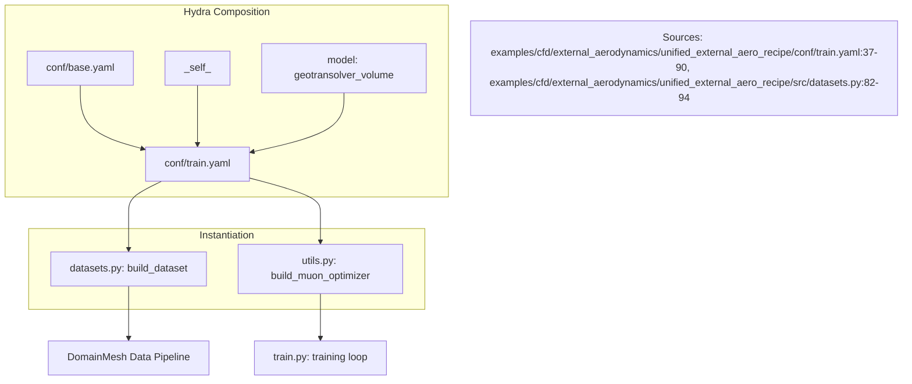
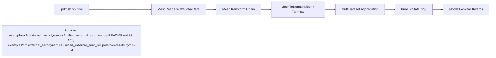
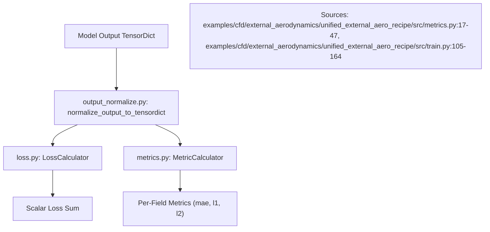
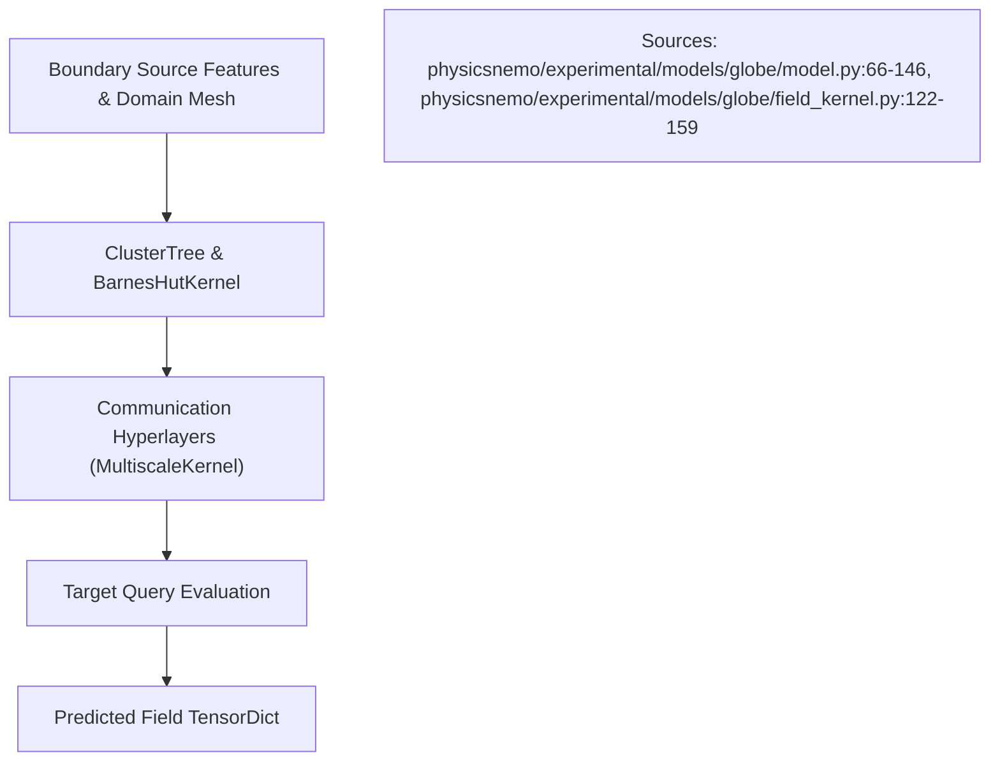

<!-- source: DeepWiki mcp.deepwiki.com · repo NVIDIA/physicsnemo · extra page Unified External Aerodynamics Recipe · fetched 2026-10-21 -->

# Unified External Aerodynamics Recipe

Relevant source files

The following files were used as context for generating this wiki page:

- [docs/api/physicsnemo.optim.rst](docs/api/physicsnemo.optim.rst)
- [examples/cfd/external_aerodynamics/aerojepa/conf/training/superwing.yaml](examples/cfd/external_aerodynamics/aerojepa/conf/training/superwing.yaml)
- [examples/cfd/external_aerodynamics/aerojepa/tests/test_checkpoint_io.py](examples/cfd/external_aerodynamics/aerojepa/tests/test_checkpoint_io.py)
- [examples/cfd/external_aerodynamics/aerojepa/train.py](examples/cfd/external_aerodynamics/aerojepa/train.py)
- [examples/cfd/external_aerodynamics/globe/airfrans/dataset.py](examples/cfd/external_aerodynamics/globe/airfrans/dataset.py)
- [examples/cfd/external_aerodynamics/globe/airfrans/inference.py](examples/cfd/external_aerodynamics/globe/airfrans/inference.py)
- [examples/cfd/external_aerodynamics/globe/airfrans/mlflow_launch.sh](examples/cfd/external_aerodynamics/globe/airfrans/mlflow_launch.sh)
- [examples/cfd/external_aerodynamics/globe/airfrans/run.sh](examples/cfd/external_aerodynamics/globe/airfrans/run.sh)
- [examples/cfd/external_aerodynamics/globe/airfrans/train.py](examples/cfd/external_aerodynamics/globe/airfrans/train.py)
- [examples/cfd/external_aerodynamics/globe/airfrans/utilities.py](examples/cfd/external_aerodynamics/globe/airfrans/utilities.py)
- [examples/cfd/external_aerodynamics/globe/drivaer/run.sh](examples/cfd/external_aerodynamics/globe/drivaer/run.sh)
- [examples/cfd/external_aerodynamics/globe/drivaer/train.py](examples/cfd/external_aerodynamics/globe/drivaer/train.py)
- [examples/cfd/external_aerodynamics/unified_external_aero_recipe/README.md](examples/cfd/external_aerodynamics/unified_external_aero_recipe/README.md)
- [examples/cfd/external_aerodynamics/unified_external_aero_recipe/conf/base.yaml](examples/cfd/external_aerodynamics/unified_external_aero_recipe/conf/base.yaml)
- [examples/cfd/external_aerodynamics/unified_external_aero_recipe/conf/train.yaml](examples/cfd/external_aerodynamics/unified_external_aero_recipe/conf/train.yaml)
- [examples/cfd/external_aerodynamics/unified_external_aero_recipe/datasets/drivaer_ml_surface.yaml](examples/cfd/external_aerodynamics/unified_external_aero_recipe/datasets/drivaer_ml_surface.yaml)
- [examples/cfd/external_aerodynamics/unified_external_aero_recipe/datasets/shift_suv_estate_surface.yaml](examples/cfd/external_aerodynamics/unified_external_aero_recipe/datasets/shift_suv_estate_surface.yaml)
- [examples/cfd/external_aerodynamics/unified_external_aero_recipe/datasets/shift_suv_fastback_surface.yaml](examples/cfd/external_aerodynamics/unified_external_aero_recipe/datasets/shift_suv_fastback_surface.yaml)
- [examples/cfd/external_aerodynamics/unified_external_aero_recipe/src/collate.py](examples/cfd/external_aerodynamics/unified_external_aero_recipe/src/collate.py)
- [examples/cfd/external_aerodynamics/unified_external_aero_recipe/src/datasets.py](examples/cfd/external_aerodynamics/unified_external_aero_recipe/src/datasets.py)
- [examples/cfd/external_aerodynamics/unified_external_aero_recipe/src/forces.py](examples/cfd/external_aerodynamics/unified_external_aero_recipe/src/forces.py)
- [examples/cfd/external_aerodynamics/unified_external_aero_recipe/src/forward_kwargs.py](examples/cfd/external_aerodynamics/unified_external_aero_recipe/src/forward_kwargs.py)
- [examples/cfd/external_aerodynamics/unified_external_aero_recipe/src/infer.py](examples/cfd/external_aerodynamics/unified_external_aero_recipe/src/infer.py)
- [examples/cfd/external_aerodynamics/unified_external_aero_recipe/src/loss.py](examples/cfd/external_aerodynamics/unified_external_aero_recipe/src/loss.py)
- [examples/cfd/external_aerodynamics/unified_external_aero_recipe/src/merge_global_data.py](examples/cfd/external_aerodynamics/unified_external_aero_recipe/src/merge_global_data.py)
- [examples/cfd/external_aerodynamics/unified_external_aero_recipe/src/metrics.py](examples/cfd/external_aerodynamics/unified_external_aero_recipe/src/metrics.py)
- [examples/cfd/external_aerodynamics/unified_external_aero_recipe/src/nondim.py](examples/cfd/external_aerodynamics/unified_external_aero_recipe/src/nondim.py)
- [examples/cfd/external_aerodynamics/unified_external_aero_recipe/src/output_normalize.py](examples/cfd/external_aerodynamics/unified_external_aero_recipe/src/output_normalize.py)
- [examples/cfd/external_aerodynamics/unified_external_aero_recipe/src/train.py](examples/cfd/external_aerodynamics/unified_external_aero_recipe/src/train.py)
- [examples/cfd/external_aerodynamics/unified_external_aero_recipe/src/utils.py](examples/cfd/external_aerodynamics/unified_external_aero_recipe/src/utils.py)
- [examples/cfd/external_aerodynamics/unified_external_aero_recipe/tests/test_infer.py](examples/cfd/external_aerodynamics/unified_external_aero_recipe/tests/test_infer.py)
- [examples/cfd/external_aerodynamics/unified_external_aero_recipe/tests/test_loss_equivalence.py](examples/cfd/external_aerodynamics/unified_external_aero_recipe/tests/test_loss_equivalence.py)
- [examples/cfd/external_aerodynamics/unified_external_aero_recipe/tests/test_manifest.py](examples/cfd/external_aerodynamics/unified_external_aero_recipe/tests/test_manifest.py)
- [examples/cfd/external_aerodynamics/unified_external_aero_recipe/tests/test_train_helpers.py](examples/cfd/external_aerodynamics/unified_external_aero_recipe/tests/test_train_helpers.py)
- [examples/cfd/external_aerodynamics/unified_external_aero_recipe/tests/test_utils.py](examples/cfd/external_aerodynamics/unified_external_aero_recipe/tests/test_utils.py)
- [physicsnemo/experimental/models/globe/__init__.py](physicsnemo/experimental/models/globe/__init__.py)
- [physicsnemo/experimental/models/globe/field_kernel.py](physicsnemo/experimental/models/globe/field_kernel.py)
- [physicsnemo/experimental/models/globe/hierarchical_acceleration.md](physicsnemo/experimental/models/globe/hierarchical_acceleration.md)
- [physicsnemo/experimental/models/globe/model.py](physicsnemo/experimental/models/globe/model.py)
- [physicsnemo/nn/module/pade.py](physicsnemo/nn/module/pade.py)
- [physicsnemo/optim/__init__.py](physicsnemo/optim/__init__.py)
- [physicsnemo/optim/combined_optimizer.py](physicsnemo/optim/combined_optimizer.py)
- [physicsnemo/optim/muon.py](physicsnemo/optim/muon.py)
- [test/models/globe/test_barnes_hut_kernel.py](test/models/globe/test_barnes_hut_kernel.py)
- [test/models/globe/test_field_kernel.py](test/models/globe/test_field_kernel.py)
- [test/models/globe/test_inference.py](test/models/globe/test_inference.py)
- [test/optim/__init__.py](test/optim/__init__.py)
- [test/optim/test_muon.py](test/optim/test_muon.py)

## Purpose and Scope

This page documents the **Unified External Aerodynamics Recipe** framework within PhysicsNeMo (`examples/cfd/external_aerodynamics/unified_external_aero_recipe`). The unified recipe standardizes data pipelines, model architectures, non-dimensionalization, loss formulation, metrics, and training/inference execution across point-cloud and operator-learning models (such as Transolver, GeoTransolver, GLOBE, and DoMINO). It also outlines specialized advanced architectures including **GLOBE** (Green's-function-Like Operator for Boundary Element PDEs) and **AeroJEPA**.

Sources: `[examples/cfd/external_aerodynamics/unified_external_aero_recipe/README.md:1-68]()`

---

## 1. Hydra Configuration Composition & Architecture

The recipe leverages [Hydra](https://hydra.cc) to compose configurations across dataset selections, model templates, and optimization schedules. The canonical entry point is `conf/train.yaml`, which merges a base configuration (`conf/base.yaml`) with model-specific overrides and CLI selections.

### Configuration Mechanics
- **Defaults and Overrides**: `conf/train.yaml` specifies `defaults: [base, _self_, {model: geotransolver_volume}]` [examples/cfd/external_aerodynamics/unified_external_aero_recipe/conf/train.yaml:37-41](). Model templates carry known-good learning rates, compilation toggles, and network geometry.
- **Dataset Selection**: Controlled via the `dataset` string property (e.g., `drivaer_ml_volume`, `drivaer_ml_surface`) and expanded using `extra_datasets` for multi-dataset composition via `MultiDataset` [examples/cfd/external_aerodynamics/unified_external_aero_recipe/conf/train.yaml:44-49]().
- **Run Identity**: Automated run naming is constructed via Hydra runtime interpolation: `run_id: "${hydra:runtime.choices.model}__${dataset}__${now:%Y%m%d_%H%M%S}"` [examples/cfd/external_aerodynamics/unified_external_aero_recipe/conf/train.yaml:70-73]().

Sources: `[examples/cfd/external_aerodynamics/unified_external_aero_recipe/conf/train.yaml:37-90]`, `[examples/cfd/external_aerodynamics/unified_external_aero_recipe/src/datasets.py:82-94]()`

---

## 2. Dataset Factory, Manifests, and DomainMesh Contract

The dataset infrastructure in `src/datasets.py` constructs `MeshDataset` instances from declarative Hydra YAML files. Each config defines a `pipeline:` block containing a `reader:` and an ordered list of `transforms:`.

### Manifest Loading and Sharding
- **Manifest Sources**: `load_manifest` supports JSON dictionaries with explicit split keys, flat JSON lists, and one-per-line text manifests with comment/whitespace stripping [examples/cfd/external_aerodynamics/unified_external_aero_recipe/tests/test_manifest.py:52-98]().
- **Index Resolution**: `resolve_manifest_indices` matches manifest run identifiers against intermediate parent directories or leaf-file parent directory names inside the reader root [examples/cfd/external_aerodynamics/unified_external_aero_recipe/tests/test_manifest.py:126-150]().
- **Distributed Sampling**: `ManifestSampler` coordinates distributed sharding across ranks, interacting with `drop_last` flags to ensure balanced step counts during distributed training [examples/cfd/external_aerodynamics/unified_external_aero_recipe/tests/test_manifest.py:17-24]().

### The DomainMesh-Native Contract
Every dataset pipeline terminates in a `DomainMesh` structure. Volume pipelines construct `DomainMesh` natively via `DomainMeshReader`, while surface pipelines append a `MeshToDomainMesh` transform. The collate function (`build_collate_fn`) maps these structured fields directly into model input keyword arguments without losing mesh topology [examples/cfd/external_aerodynamics/unified_external_aero_recipe/README.md:73-82]().

Sources: `[examples/cfd/external_aerodynamics/unified_external_aero_recipe/src/datasets.py:18-155]`, `[examples/cfd/external_aerodynamics/unified_external_aero_recipe/tests/test_manifest.py:52-174]()`

---

## 3. Non-Dimensionalization and Geometry Transforms

The recipe enforces physical consistency via strict non-dimensionalization implemented in `src/nondim.py` and spatial preprocessing transformations.

### Freestream Conditions and Scaling
Per-sample freestream conditions (`U_inf`, `rho_inf`, `p_inf`, `T_inf`, `L_ref`) are stored in `global_data`. `NonDimensionalizeByMetadata` reads these values to compute reference scales:
- **Dynamic Pressure**: $q_\infty = \frac{1}{2} \rho_\infty |\mathbf{U}_\infty|^2$ [examples/cfd/external_aerodynamics/unified_external_aero_recipe/src/nondim.py:53-76]()
- **Pressure Coefficient ($C_p$)**: $C_p = \frac{p - p_\infty}{q_\infty}$ [examples/cfd/external_aerodynamics/unified_external_aero_recipe/src/nondim.py:97-98]()
- **Skin Friction ($C_f$)**: $C_f = \frac{\tau}{q_\infty}$ [examples/cfd/external_aerodynamics/unified_external_aero_recipe/src/nondim.py:99-100]()
- **Velocity**: $\mathbf{U}^* = \frac{\mathbf{U}}{|\mathbf{U}_\infty|}$ [examples/cfd/external_aerodynamics/unified_external_aero_recipe/src/nondim.py:101-102]()
- **Coordinates**: $\mathbf{x}^* = \frac{\mathbf{x}}{L_{\text{ref}}}$ [examples/cfd/external_aerodynamics/unified_external_aero_recipe/src/nondim.py:160-162]()

### Preprocessing Transforms
- **CenterMesh**: Centers geometries at the origin (point-mean or area-weighted centroid centering) [examples/cfd/external_aerodynamics/unified_external_aero_recipe/README.md:120-123]().
- **RandomRotateMesh / RandomTranslateMesh**: Vertical-axis-restricted rotations and horizontal-axis translations for data augmentation [examples/cfd/external_aerodynamics/unified_external_aero_recipe/README.md:124-131]().
- **ComputeSDFFromBoundary**: Volume pipelines compute signed distance fields and surface normals relative to boundary STL files [examples/cfd/external_aerodynamics/unified_external_aero_recipe/README.md:144-148]().

Sources: `[examples/cfd/external_aerodynamics/unified_external_aero_recipe/src/nondim.py:45-185]`, `[examples/cfd/external_aerodynamics/unified_external_aero_recipe/README.md:105-148]()`

---

## 4. Losses, Metrics, and Evaluation

Evaluation and loss calculation are structured around `TensorDict` schemas, ensuring robust multi-field handling across scalar and vector targets.

### Metric Aggregation (`MetricCalculator`)
`MetricCalculator` iterates over target field configurations (`target_config`) and computes unweighted statistical indicators:
- **Scalar Fields**: Computes `l1`, `l2`, and `mae` per field, keyed as `"<prefix>/<name>_<metric>"` [examples/cfd/external_aerodynamics/unified_external_aero_recipe/src/metrics.py:21-23]()
- **Vector Fields**: Computes component-wise metrics (`<prefix>/<name>_x_<metric>`) and joint aggregate metrics over all spatial dimensions [examples/cfd/external_aerodynamics/unified_external_aero_recipe/src/metrics.py:24-27]()

Sources: `[examples/cfd/external_aerodynamics/unified_external_aero_recipe/src/metrics.py:17-178]`, `[examples/cfd/external_aerodynamics/unified_external_aero_recipe/src/train.py:105-164]()`

---

## 5. Training and Inference Entrypoints

The training script (`src/train.py`) and inference script (`src/infer.py`) orchestrate distributed execution, optimization, and logging.

### Distributed Aggregation & Muon Optimizer
- **`_reduce_and_average`**: Collapses rank-local loss and metric sums across DDP processes using fused `all_reduce` collectives (`physicsnemo.distributed.fused_all_reduce`), guaranteeing global mean logging without bias from uneven batch sizes [examples/cfd/external_aerodynamics/unified_external_aero_recipe/src/train.py:105-164]().
- **Muon + AdamW Combination**: `build_muon_optimizer` partitions model weights: 2-D weight matrices (linear and attention weights) are optimized via the `Muon` optimizer, while biases, normalizations, and embeddings are routed to `AdamW` [examples/cfd/external_aerodynamics/unified_external_aero_recipe/src/utils.py:86-149]().

Sources: `[examples/cfd/external_aerodynamics/unified_external_aero_recipe/src/train.py:1-164]`, `[examples/cfd/external_aerodynamics/unified_external_aero_recipe/src/utils.py:86-149]()`

---

## 6. Specialized Recipes: GLOBE and AeroJEPA

### GLOBE (Green's-function-Like Operator for Boundary Element PDEs)
`GLOBE` (`physicsnemo.experimental.models.globe.model`) is a surrogate architecture designed for boundary-driven elliptic PDEs.

- **Core Abstractions**: Implements learnable Green's-function-like kernels combined with equivariant message passing across boundary partitions [physicsnemo/experimental/models/globe/model.py:66-74]().
- **Hierarchical Acceleration**: Utilizes `ClusterTree` spatial indexing and `BarnesHutKernel` dual-tree traversal with Barnes-Hut opening angles (`theta`) to approximate far-field interactions efficiently [physicsnemo/experimental/models/globe/model.py:133-144]().
- **Memory Budgeting**: Employs static memory budgeting (`_device_chunk_budget_bytes`) to size chunked autograd evaluations securely under memory constraints [physicsnemo/experimental/models/globe/field_kernel.py:57-121]().

### AeroJEPA
`AeroJEPA` (`examples/cfd/external_aerodynamics/aerojepa`) provides a joint-embedding predictive architecture for aerodynamic point clouds and superwing configurations.
- **Data Pipeline**: `SuperWingDataset` manages geometry splitting manifests, normalization statistics, and surface query point sampling [examples/cfd/external_aerodynamics/aerojepa/train.py:77-153]().
- **Training Flow**: Coordinates exponential moving averages (EMA) for target encoders, latent representation losses (`compute_latent_loss`), and reconstruction objectives [examples/cfd/external_aerodynamics/aerojepa/train.py:53-66]().

Sources: `[physicsnemo/experimental/models/globe/model.py:66-146]`, `[physicsnemo/experimental/models/globe/field_kernel.py:57-121]`, `[examples/cfd/external_aerodynamics/aerojepa/train.py:77-182]()`

---

