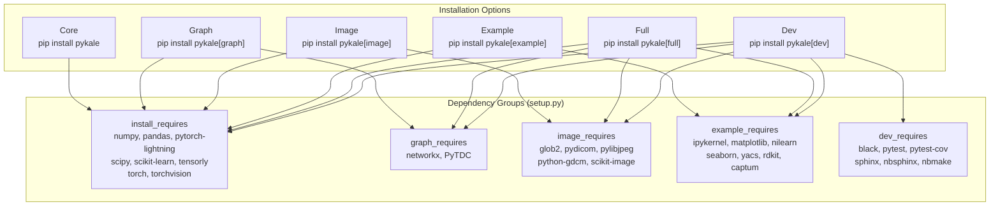
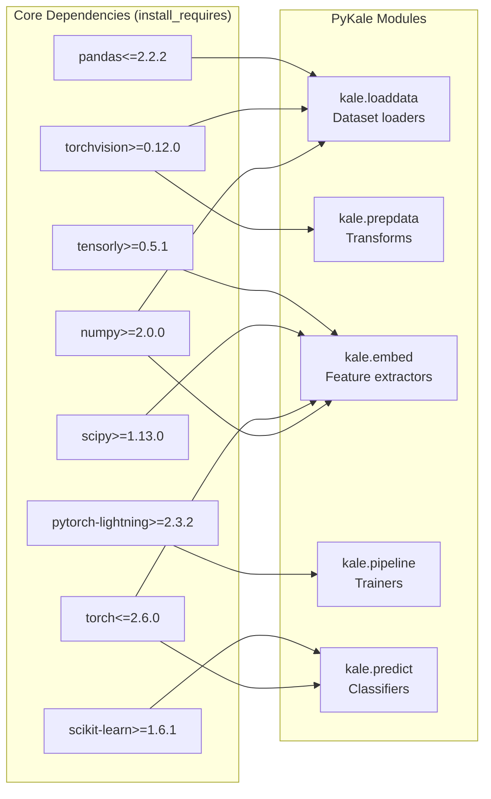
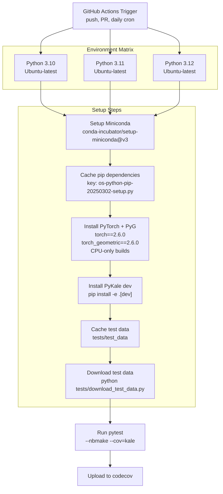
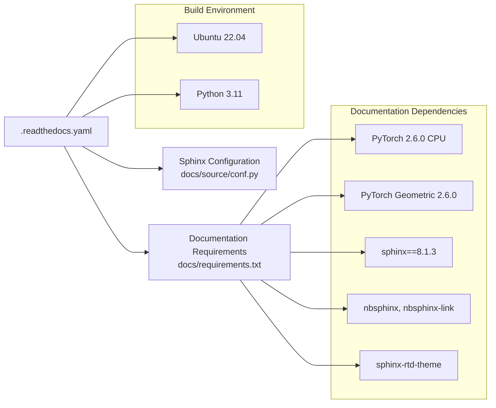

<!-- source: DeepWiki mcp.deepwiki.com · repo pykale/pykale · page 1.1 Installation and Setup · fetched 2026-10-21 -->

# Installation and Setup

<details>
<summary>Relevant source files</summary>

The following files were used as context for generating this wiki page:

- [.github/ISSUE_TEMPLATE/action-fail.md](.github/ISSUE_TEMPLATE/action-fail.md)
- [.github/workflows/stale.yml](.github/workflows/stale.yml)
- [.github/workflows/test.yml](.github/workflows/test.yml)
- [.readthedocs.yaml](.readthedocs.yaml)
- [README.md](README.md)
- [docs/requirements.txt](docs/requirements.txt)
- [docs/source/conf.py](docs/source/conf.py)
- [docs/source/installation.md](docs/source/installation.md)
- [examples/video_loading/README.md](examples/video_loading/README.md)
- [setup.py](setup.py)

</details>


This page documents the installation procedures, prerequisites, and environment configuration for PyKale. It covers the six installation options (core, graph, image, example, full, dev), manual prerequisite installation requirements, and environment setup for both users and developers.

For information about using PyKale's pipeline API after installation, see [Core Pipeline Architecture](#1.2). For development workflow and testing, see [Testing Framework](#6.1) and [CI/CD Pipeline](#6.2).

---

## Prerequisites

PyKale requires **Python 3.10, 3.11, or 3.12** as specified in [setup.py:128](). The following dependencies must be installed **manually before** installing PyKale, as they require hardware-specific configurations:

### Required Manual Installations

1. **PyTorch**: Must be installed first to match your hardware (CPU/CUDA). See [PyTorch installation guide](https://pytorch.org/get-started/locally).

2. **PyTorch Geometric** (if using graph functionality): Required for graph neural network modules in `kale.embed` and `kale.loaddata`. Follow [PyG installation instructions](https://github.com/pyg-team/pytorch_geometric#installation) matching your PyTorch version.

3. **RDKit** (if using molecular data): Required for drug discovery applications. Install via:
   ```bash
   pip install rdkit
   ```

**Rationale**: These packages have binary dependencies that vary by platform and CUDA version. Manual installation ensures compatibility with your specific hardware configuration.

Sources: [docs/source/installation.md:5-9](), [setup.py:11-14](), [README.md:58]()

---

## Installation Options

PyKale provides six installation modes defined in [setup.py:130-136]() as `extras_require` groups. Each mode installs a different set of dependencies:



### Dependency Group Details

| Option | Command | Use Case | Key Dependencies |
|--------|---------|----------|------------------|
| **core** | `pip install pykale` | Essential PyKale functionality | numpy≥2.0.0, pytorch-lightning≥2.3.2, torch≤2.6.0, scikit-learn≥1.6.1 |
| **graph** | `pip install pykale[graph]` | Graph neural networks, drug discovery | networkx, PyTDC≤0.3.6 |
| **image** | `pip install pykale[image]` | Medical imaging (DICOM), image processing | pydicom, scikit-image≥0.24.0, python-gdcm |
| **example** | `pip install pykale[example]` | Running tutorials and examples | matplotlib≤3.10.0, yacs≥0.1.7, rdkit≥2025.3.1, captum |
| **full** | `pip install pykale[full]` | All functionality except dev tools | graph + image + example dependencies |
| **dev** | `pip install pykale[dev]` | Development and testing | full + pytest, black, sphinx, nbmake≥0.8 |

**Multiple options** can be combined with commas (no spaces):
```bash
pip install pykale[graph,image]
pip install pykale[graph,example]
```

Sources: [setup.py:16-92](), [docs/source/installation.md:32-46]()

---

## Installation Methods

### Method 1: PyPI (Stable Release)

Install the latest stable version from [PyPI](https://pypi.org/project/pykale):

```bash
pip install pykale  # Core only
pip install pykale[graph]  # Core + graph functionality
pip install pykale[full]  # All features
```

### Method 2: From Source (Development)

Install from the GitHub repository for the latest features or development:

```bash
git clone https://github.com/pykale/pykale
cd pykale
pip install .  # Core only
pip install -e .[dev]  # Editable install with all dependencies
```

The `-e` flag creates an **editable install**, allowing code changes to take effect without reinstallation. This is essential for development.

Sources: [docs/source/installation.md:11-28](), [README.md:60-66]()

---

## Core Dependency Architecture

The following diagram maps PyKale's dependency structure from [setup.py:17-92]() to their usage in the codebase:



### Version Constraints

Key version constraints are defined in [setup.py:18-25]():

- **numpy≥2.0.0**: Required for NumPy 2.0+ compatibility
- **pandas≤2.2.2**: Compatibility constraint for Google Colab 1.0.0 and Torch 2.3.0
- **torch≤2.6.0**: Upper bound to ensure compatibility; update requires CI/CD changes
- **scipy≥1.13.0**: scipy 1.14.0+ requires Python 3.10+
- **matplotlib≤3.10.0**: Version 3.10.1 causes build errors in tests

Sources: [setup.py:17-26]()

---

## CI/CD Environment Setup

The GitHub Actions test workflow in [.github/workflows/test.yml]() demonstrates a reproducible installation procedure used for automated testing. This serves as a reference for setting up development environments.



### CI/CD Installation Steps

The test workflow [.github/workflows/test.yml:57-74]() installs dependencies in this order:

1. **RDKit and utilities** (lines 59-61):
   ```bash
   pip install rdkit
   pip install gdown
   pip install pyparsing==3.2.0
   pip install numpy>=2.0.0
   ```

2. **PyTorch 2.6.0 CPU** (line 63):
   ```bash
   pip install torch==2.6.0 torchvision==0.21.0 torchaudio==2.6.0 --index-url https://download.pytorch.org/whl/cpu
   ```

3. **PyTorch Geometric 2.6.0** (lines 64-68):
   ```bash
   pip install torch_scatter==2.1.2 -f https://data.pyg.org/whl/torch-2.6.0+cpu.html
   pip install torch_sparse==0.6.18 -f https://data.pyg.org/whl/torch-2.6.0+cpu.html
   pip install torch_cluster==1.6.3 -f https://data.pyg.org/whl/torch-2.6.0+cpu.html
   pip install torch_spline_conv==1.2.2 -f https://data.pyg.org/whl/torch-2.6.0+cpu.html
   pip install torch_geometric==2.6.0
   ```

4. **PyKale with dev dependencies** (line 73):
   ```bash
   pip install --no-build-isolation -e .[dev]
   ```

### Caching Strategy

The workflow uses two caching mechanisms to reduce build time:

1. **Pip cache** [.github/workflows/test.yml:42-55]():
   - Key: `${{ runner.os }}-python${{ matrix.python-version }}-pip-20250302-${{ hashFiles('**/setup.py') }}`
   - Soft matching: Restores cache even if `setup.py` changed, then updates incrementally
   - Date tag (`20250302`): Updated manually after major dependency changes

2. **Test data cache** [.github/workflows/test.yml:76-84]():
   - Key: `${{ runner.os }}-python${{ matrix.python-version }}-data-${{ hashFiles('tests/download_test_data.py') }}`
   - Strict matching: Updates only when download script changes

Sources: [.github/workflows/test.yml:1-110]()

---

## Documentation Build Environment

Read the Docs uses a separate configuration defined in [.readthedocs.yaml:1-26]():



### Documentation-Specific Dependencies

[docs/requirements.txt:1-39]() specifies documentation build dependencies:

- **Sphinx 8.1.3**: Specific version for compatibility with nbsphinx
- **PyTorch/PyG CPU wheels**: Direct URLs to CPU-only builds for faster documentation builds
- **Documentation tools**: nbsphinx (Jupyter notebook integration), recommonmark (Markdown support)

**Note**: Documentation builds use **Python 3.11 specifically** [.readthedocs.yaml:15]() and **Ubuntu 22.04** [.readthedocs.yaml:13]() for consistency.

Sources: [.readthedocs.yaml:1-26](), [docs/requirements.txt:1-39]()

---

## Installation Verification

### Running Tests

After installation, verify the setup by running tests [docs/source/installation.md:49-57]():

```bash
pytest  # Run all tests
pytest tests/test_specific_module.py  # Run specific module tests
```

**Requirements for testing**:
- PyTorch installed (matching hardware)
- PyTorch Geometric installed
- RDKit installed
- Dev dependencies: `pip install -e .[dev]`

### Test Execution Configuration

The CI/CD workflow [.github/workflows/test.yml:92-99]() runs tests with thread limits to prevent resource contention:

```bash
export OMP_NUM_THREADS=1
export MKL_NUM_THREADS=1
export NUMEXPR_NUM_THREADS=1
pytest --nbmake --nbmake-timeout=3000 --cov=kale
```

**Test flags**:
- `--nbmake`: Validates Jupyter notebooks by executing them
- `--nbmake-timeout=3000`: 3000-second timeout per notebook
- `--cov=kale`: Generates coverage report for the `kale` package

Coverage results are uploaded to [Codecov](https://codecov.io/gh/pykale/pykale) via [.github/workflows/test.yml:106-109]().

Sources: [.github/workflows/test.yml:92-109](), [docs/source/installation.md:49-57]()

---

## Installation Troubleshooting

### Common Issues

**Issue 1: PyTorch/PyG Version Mismatch**
- **Symptom**: Import errors when loading `kale.embed` modules
- **Solution**: Ensure PyTorch and PyG versions match. Check [PyG installation guide](https://github.com/pyg-team/pytorch_geometric#installation) for compatible versions.

**Issue 2: NumPy 2.0+ Compatibility**
- **Symptom**: NumPy-related errors
- **Solution**: PyKale requires numpy≥2.0.0 [setup.py:18](). Upgrade: `pip install "numpy>=2.0.0"`

**Issue 3: Matplotlib Build Failure**
- **Symptom**: Build errors with matplotlib 3.10.1
- **Solution**: Use matplotlib≤3.10.0 [setup.py:51]()

**Issue 4: Missing RDKit**
- **Symptom**: Import errors in drug discovery examples
- **Solution**: Install RDKit manually: `pip install rdkit>=2025.3.1` [setup.py:65]()

### Platform-Specific Notes

**Windows**: The CI/CD pipeline currently only tests on Ubuntu [.github/workflows/test.yml:21-22](). Windows support is experimental. Use WSL2 or conda for best compatibility.

**macOS**: Install PyTorch from official sources. For M1/M2 Macs, use the MPS-accelerated builds.

**CUDA**: For GPU support, install PyTorch with CUDA toolkit matching your GPU driver version before installing PyKale.

Sources: [.github/workflows/test.yml:21-31](), [setup.py:18-65]()

---

