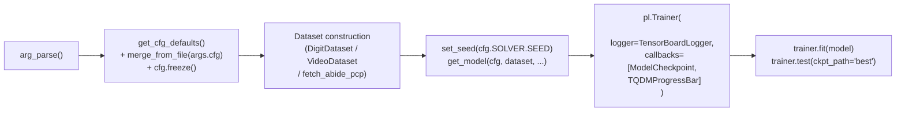
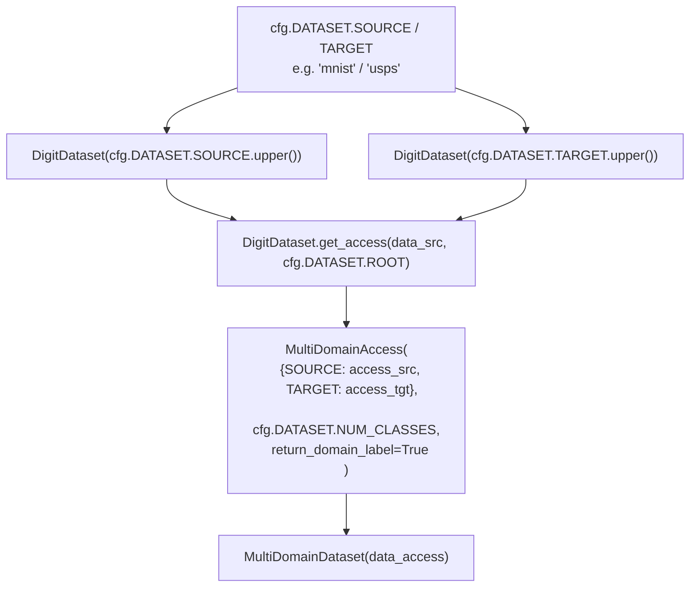
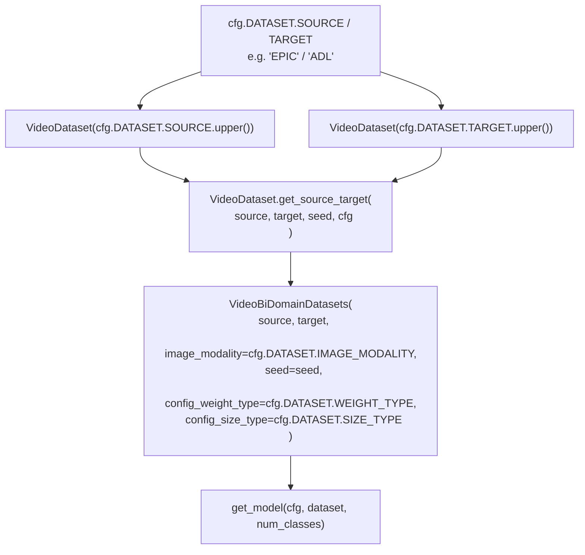
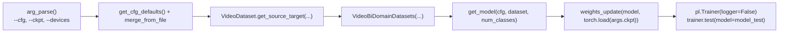
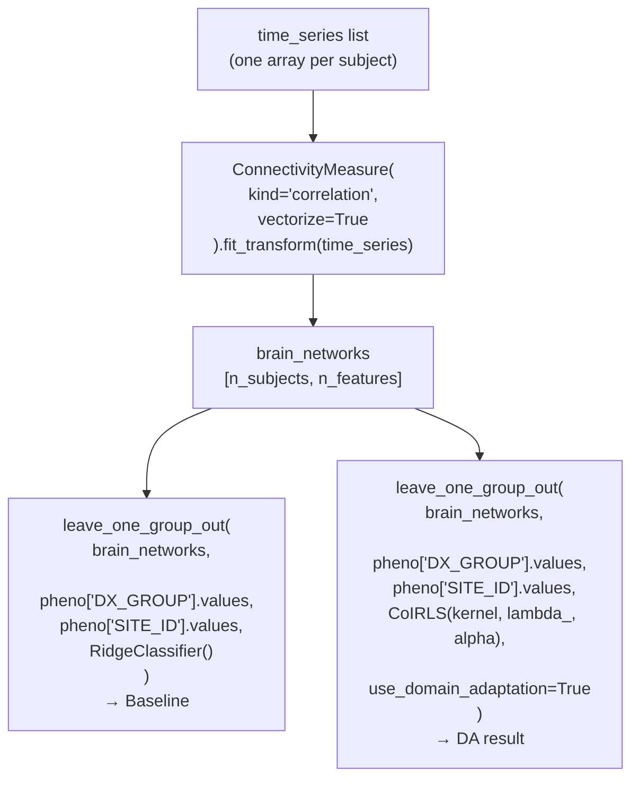
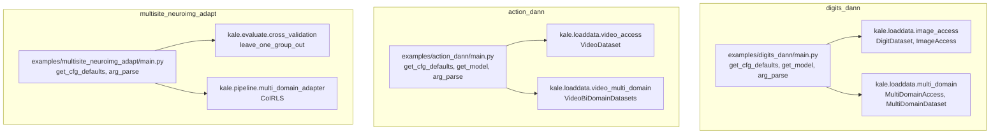

<!-- source: DeepWiki mcp.deepwiki.com · repo pykale/pykale · page 5.2 Domain Adaptation Examples · fetched 2026-10-21 -->

# Domain Adaptation Examples

<details>
<summary>Relevant source files</summary>

The following files were used as context for generating this wiki page:

- [examples/action_dann/main.py](examples/action_dann/main.py)
- [examples/action_dann/test.py](examples/action_dann/test.py)
- [examples/bindingdb_deepdta/tutorial.ipynb](examples/bindingdb_deepdta/tutorial.ipynb)
- [examples/digits_dann/configs/MN2UP-CDAN.yaml](examples/digits_dann/configs/MN2UP-CDAN.yaml)
- [examples/digits_dann/configs/MN2UP-DAN.yaml](examples/digits_dann/configs/MN2UP-DAN.yaml)
- [examples/digits_dann/configs/MN2UP-DANN.yaml](examples/digits_dann/configs/MN2UP-DANN.yaml)
- [examples/digits_dann/main.py](examples/digits_dann/main.py)
- [examples/digits_dann/tutorial.ipynb](examples/digits_dann/tutorial.ipynb)
- [examples/multisite_neuroimg_adapt/README.md](examples/multisite_neuroimg_adapt/README.md)
- [examples/multisite_neuroimg_adapt/config.py](examples/multisite_neuroimg_adapt/config.py)
- [examples/multisite_neuroimg_adapt/main.py](examples/multisite_neuroimg_adapt/main.py)
- [examples/multisite_neuroimg_adapt/tutorial.ipynb](examples/multisite_neuroimg_adapt/tutorial.ipynb)
- [examples/toy_domain_adaptation/main.py](examples/toy_domain_adaptation/main.py)
- [examples/toy_domain_adaptation/tutorial.ipynb](examples/toy_domain_adaptation/tutorial.ipynb)
- [kale/evaluate/cross_validation.py](kale/evaluate/cross_validation.py)
- [kale/loaddata/usps.py](kale/loaddata/usps.py)
- [tests/evaluate/test_cross_validation.py](tests/evaluate/test_cross_validation.py)

</details>


This page documents the runnable domain adaptation example scripts in the `examples/` directory of PyKale. It covers the shared configuration pattern, the `digits_dann` image DA example, the `action_dann` video DA example, and the `multisite_neuroimg_adapt` neuroimaging adaptation example using `CoIRLS`. For documentation of the underlying trainer classes and data loaders, see [Single-Source Domain Adaptation](#3.1), [Multi-Source Domain Adaptation](#3.2), and [Video Domain Adaptation](#3.3). For the toy CoIRLS walkthrough used as an introduction, see [Getting Started Tutorials](#5.1).

---

## Shared Pattern Across All Examples

Every domain adaptation example script follows the same five-step structure. The differences are in which datasets and trainer classes are used.

**Example Script Execution Flow**



Sources: [examples/digits_dann/main.py:26-133](), [examples/action_dann/main.py:22-113](), [examples/multisite_neuroimg_adapt/main.py:28-97]()

### Configuration System

All examples use [yacs](https://github.com/rbgirshick/yacs) configuration nodes. Each example directory contains a `config.py` with a `get_cfg_defaults()` function and a `configs/` subdirectory with `.yaml` files that override specific defaults.

| Config key group | Purpose | Example values |
|---|---|---|
| `DATASET.*` | Dataset identity and split | `SOURCE`, `TARGET`, `ROOT`, `NUM_CLASSES` |
| `SOLVER.*` | Training hyperparameters | `MAX_EPOCHS`, `SEED`, `BASE_LR`, `TRAIN_BATCH_SIZE` |
| `DAN.*` or `MODEL.*` | Algorithm selection | `METHOD` (`DANN`, `CDAN`, `DAN`, ...) |
| `OUTPUT.*` | Logging paths and verbosity | `OUT_DIR`, `PB_FRESH` |
| `COMET.*` | Optional CometML logger | `ENABLE`, `API_KEY`, `PROJECT_NAME` |

The `--cfg` argument passed to each `main.py` selects a YAML override file:

```
python main.py --cfg configs/MN2UP-DANN.yaml
```

Sources: [examples/digits_dann/main.py:26-48](), [examples/multisite_neuroimg_adapt/config.py:1-43]()

---

## `digits_dann`: Image Domain Adaptation on Digit Datasets

**Location:** `examples/digits_dann/`

This example trains and evaluates domain adaptation methods (DANN, CDAN, DAN, etc.) on pairs of digit image datasets (MNIST, USPS, MNIST-M, SVHN).

### Data Setup



Sources: [examples/digits_dann/main.py:59-79]()

- `DigitDataset` is an enum defined in `kale.loaddata.image_access` with entries for `MNIST`, `USPS`, `MNISTM`, `SVHN`.
- `DigitDataset.get_channel_numbers()` returns the number of image channels; the maximum of source and target is used to normalize the input shape.
- `MultiDomainAccess` wraps multiple `DatasetAccess` objects into a single interface that returns domain labels alongside class labels.
- `MultiDomainDataset` produces batches interleaving source and target samples, consumed by the trainer's internal `MultiDataLoader`.

Alternatively, `ImageAccess.get_multi_domain_images("DIGITS", ...)` produces the same result with a higher-level API, as shown in the commented block [examples/digits_dann/main.py:72-78]().

### Model Construction via `get_model`

The `get_model` function (defined in `examples/digits_dann/model.py`) reads `cfg.DAN.METHOD` and calls the appropriate factory from `kale.pipeline.domain_adapter`:

| `cfg.DAN.METHOD` | Factory called | Trainer class |
|---|---|---|
| `DANN` | `create_dann_like` | `DANNTrainer` |
| `CDAN` | `create_dann_like` | `CDANTrainer` |
| `CDAN+E` | `create_dann_like` | `CDANTrainer` (with entropy weighting) |
| `WDGRL` | `create_dann_like` | `WDGRLTrainer` |
| `DAN` | `create_mmd_based` | `DANTrainer` |
| `JAN` | `create_mmd_based` | `JANTrainer` |

The feature extractor used is `SmallCNNFeature` from `kale.embed.image_cnn`. The classifier head is `ClassNetSmallImage` and the domain discriminator is `DomainNetSmallImage`, both from `kale.predict.class_domain_nets`. The model summary printed during training reflects these three sub-networks.

### Logging and Checkpointing

```python
# TensorBoard (default)
logger = pl_loggers.TensorBoardLogger(outdir, name="seed{}".format(seed))

# CometML (optional, when cfg.COMET.ENABLE is True)
logger = pl_loggers.CometLogger(
    api_key=cfg.COMET.API_KEY,
    project_name=cfg.COMET.PROJECT_NAME,
    save_dir=outdir,
    experiment_name="{}_{}".format(cfg.COMET.EXPERIMENT_NAME, suffix),
)
```

Sources: [examples/digits_dann/main.py:91-101]()

`ModelCheckpoint` monitors `valid_loss` and saves checkpoints with the pattern `{epoch}-{step}-{valid_loss:.4f}.ckpt`. After training, `trainer.test(ckpt_path="best")` restores the best checkpoint before evaluation.

### Available YAML Configurations

| File | `DAN.METHOD` | `DATASET.SOURCE` |
|---|---|---|
| `configs/MN2UP-DANN.yaml` | `DANN` | `mnist` |
| `configs/MN2UP-CDAN.yaml` | `CDAN` | `mnist` |
| `configs/MN2UP-DAN.yaml` | `DAN` | `mnist` |

All three target USPS by default (set in `config.py`).

Sources: [examples/digits_dann/configs/MN2UP-DANN.yaml:1-8](), [examples/digits_dann/configs/MN2UP-CDAN.yaml:1-8](), [examples/digits_dann/configs/MN2UP-DAN.yaml:1-8]()

### Test Outputs

After training 3 epochs MNIST→USPS with DANN, the test step produces metrics including:

| Metric | Description |
|---|---|
| `test_source_acc` | Classification accuracy on source test split |
| `test_target_acc` | Classification accuracy on target test split |
| `test_domain_acc` | Domain discriminator accuracy (≈0.5 means source and target are indistinguishable) |
| `test_source_domain_acc` | Domain accuracy specifically on source samples |
| `test_target_domain_acc` | Domain accuracy specifically on target samples |
| `test_task_loss` | Cross-entropy classification loss |
| `test_domain_div_loss` | Domain divergence loss component |

Sources: [examples/digits_dann/tutorial.ipynb:440-487]()

### Interactive Tutorial

The file `examples/digits_dann/tutorial.ipynb` provides the same workflow as `main.py` in a Jupyter notebook. It is runnable on Google Colab (installs `.[image,example]`) or myBinder. The tutorial restricts `MAX_EPOCHS` to 3 to reduce runtime.

Sources: [examples/digits_dann/tutorial.ipynb:1-502]()

---

## `action_dann`: Video Domain Adaptation

**Location:** `examples/action_dann/`

This example applies domain adaptation to action recognition across video datasets (EPIC-Kitchens, ADL, GTEA, KITCHEN).

### Data Setup



Sources: [examples/action_dann/main.py:51-71]()

Key differences from `digits_dann`:

- `VideoDataset` is an enum in `kale.loaddata.video_access` with entries `EPIC`, `ADL`, `GTEA`, `KITCHEN`.
- `VideoDataset.get_source_target()` returns `(source_access, target_access, num_classes)`.
- `VideoBiDomainDatasets` (from `kale.loaddata.video_multi_domain`) takes both source and target video dataset accesses and handles the `image_modality` parameter (`rgb`, `flow`, or `joint`).
- `cfg.DATASET.IMAGE_MODALITY` selects which video modality to use; `joint` combines RGB and optical flow.

### Additional Callbacks

The `action_dann` main adds a `LearningRateMonitor` callback to log the learning rate each epoch:

```python
lr_monitor = LearningRateMonitor(logging_interval="epoch")
```

Sources: [examples/action_dann/main.py:84]()

### Standalone Testing

`examples/action_dann/test.py` allows loading and evaluating a saved checkpoint without retraining:



The `weights_update` function [examples/action_dann/test.py:33-39]() filters the checkpoint's `state_dict` to only load keys present in the current model, making it tolerant of architecture mismatches.

Sources: [examples/action_dann/test.py:1-85](), [examples/action_dann/main.py:1-113]()

---

## `multisite_neuroimg_adapt`: Neuroimaging with CoIRLS

**Location:** `examples/multisite_neuroimg_adapt/`

This example applies the `CoIRLS` domain adaptation classifier to autism detection using the [ABIDE I](http://fcon_1000.projects.nitrc.org/indi/abide) multi-site fMRI dataset. Unlike `digits_dann` and `action_dann`, this example does not use PyTorch Lightning or deep neural networks. Instead it uses a scikit-learn-compatible pipeline.

### Problem Setup

| Aspect | Detail |
|---|---|
| Dataset | ABIDE I fMRI (fetched via `nilearn.datasets.fetch_abide_pcp`) |
| Default sites used | NYU (175), UM_1 (106), UCLA_1 (72), USM (71) |
| Atlas | CC200 (`rois_cc200`) |
| Pipeline | cpac |
| Classification task | Autism (DX_GROUP=1) vs. Control (DX_GROUP=2) |
| Domain | Acquisition site (`SITE_ID`) |

Sources: [examples/multisite_neuroimg_adapt/README.md:1-43](), [examples/multisite_neuroimg_adapt/config.py:1-43]()

### Feature Extraction

Brain connectivity features are extracted from fMRI timeseries using `nilearn`'s `ConnectivityMeasure` with `kind='correlation'` and `vectorize=True`. This produces a flat vector of pairwise ROI correlations for each subject.

### Cross-Validation Pipeline



Sources: [examples/multisite_neuroimg_adapt/main.py:76-93]()

### `leave_one_group_out` Function

`kale.evaluate.cross_validation.leave_one_group_out` [kale/evaluate/cross_validation.py:268-313]() implements leave-one-site-out cross-validation. On each fold:

1. One site is held out as the target domain; all remaining sites form the source.
2. When `use_domain_adaptation=True`, the estimator's `fit()` is called with both source and target features concatenated, plus a one-hot encoded domain covariate matrix.
3. Predictions are collected across all folds, and per-site and overall accuracy are reported.

The returned dictionary has three keys: `Target` (site names + `"Average"`), `Num_samples`, and `Accuracy`.

### `CoIRLS` Classifier

`CoIRLS` (Covariate Independence Regularized Least Squares) is implemented in `kale.pipeline.multi_domain_adapter`. It is a kernel-based linear classifier that minimizes covariate dependence between features and domain indicators via HSIC regularization.

| Config key | Default | Meaning |
|---|---|---|
| `MODEL.KERNEL` | `"rbf"` | Kernel type (`"linear"` or `"rbf"`) |
| `MODEL.ALPHA` | `0.01` | Ridge regularization strength |
| `MODEL.LAMBDA_` | `1.0` | HSIC regularization weight |

Usage in the example:

```python
estimator = CoIRLS(kernel=cfg.MODEL.KERNEL, lambda_=cfg.MODEL.LAMBDA_, alpha=cfg.MODEL.ALPHA)
results = cross_validation.leave_one_group_out(
    brain_networks, pheno["DX_GROUP"].values, pheno["SITE_ID"].values,
    estimator, use_domain_adaptation=True
)
```

Sources: [examples/multisite_neuroimg_adapt/main.py:88-93]()

### Interactive Tutorial

`examples/multisite_neuroimg_adapt/tutorial.ipynb` provides a cell-by-cell walkthrough. It downloads the ABIDE data via `nilearn`, computes brain connectivity features, runs both a baseline `RidgeClassifier` and the `CoIRLS` domain adaptation classifier, and displays results as a `pandas.DataFrame`.

Sources: [examples/multisite_neuroimg_adapt/tutorial.ipynb:1-293]()

---

## Cross-Example Comparison

The table below summarizes the key code components used in each example.

| Example | Data class | DA mechanism | Trainer/estimator | Logger |
|---|---|---|---|---|
| `digits_dann` | `DigitDataset`, `MultiDomainDataset` | `create_dann_like` / `create_mmd_based` | `BaseAdaptTrainer` subclass (Lightning) | `TensorBoardLogger` or `CometLogger` |
| `action_dann` | `VideoDataset`, `VideoBiDomainDatasets` | `create_dann_like_video` | `BaseAdaptTrainer` subclass (Lightning) | `TensorBoardLogger` |
| `multisite_neuroimg_adapt` | `fetch_abide_pcp` (nilearn) | `CoIRLS.fit(..., covariates)` | `CoIRLS` (scikit-learn API) | `pandas.DataFrame` printout |
| `toy_domain_adaptation` | `make_blobs` (sklearn) | `CoIRLS.fit(x, y, covariates_mat)` | `CoIRLS` (scikit-learn API) | `distplot_1d` visualization |

Sources: [examples/digits_dann/main.py:1-133](), [examples/action_dann/main.py:1-113](), [examples/multisite_neuroimg_adapt/main.py:1-97](), [examples/toy_domain_adaptation/main.py:1-99]()

---

## Code Entity Map

**Domain Adaptation Example Entry Points and Their Key Imports**



Sources: [examples/digits_dann/main.py:1-21](), [examples/action_dann/main.py:1-19](), [examples/multisite_neuroimg_adapt/main.py:1-26]()

---

