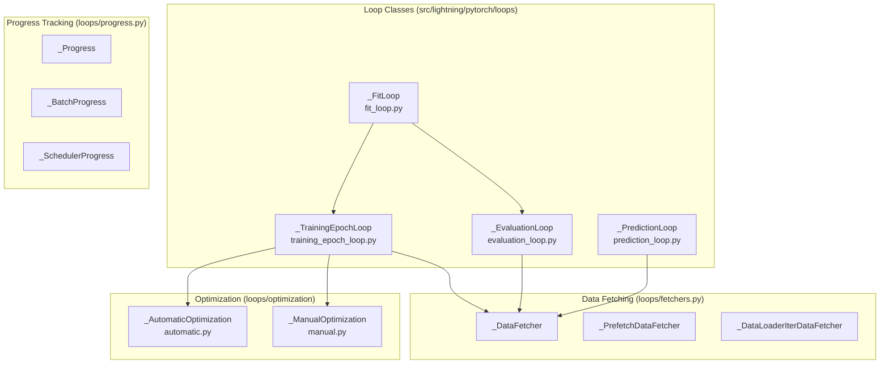
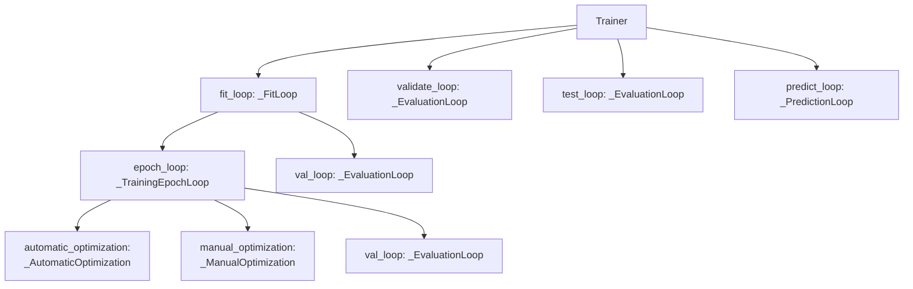
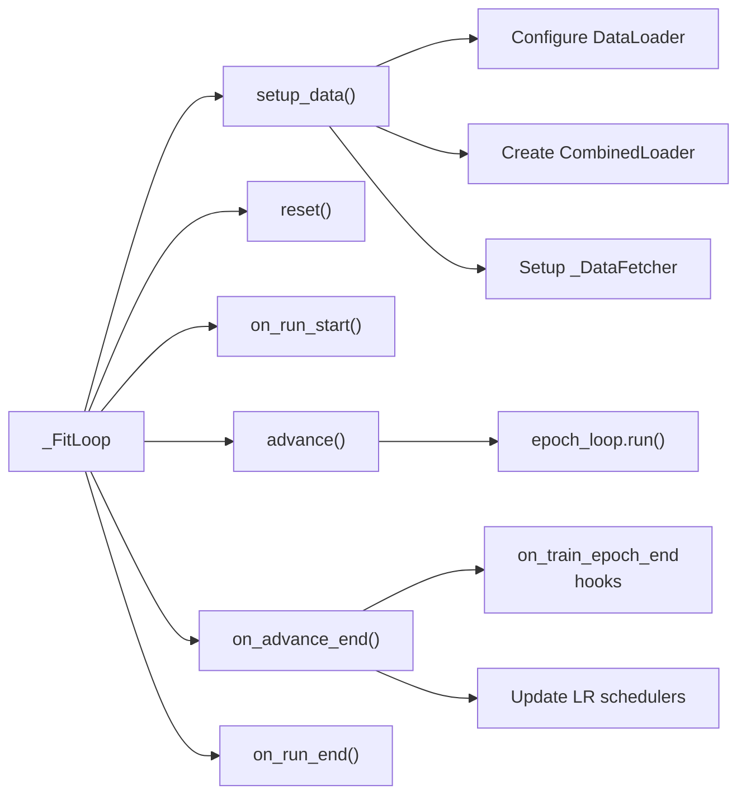
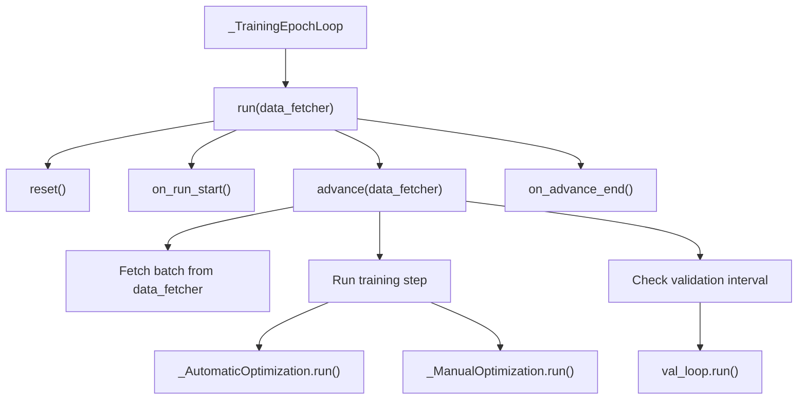
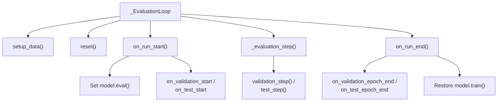
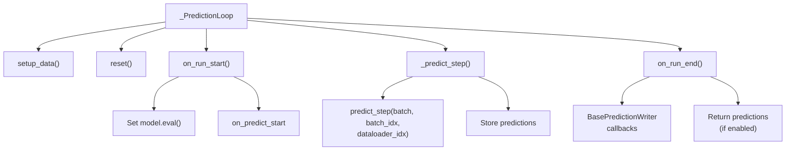
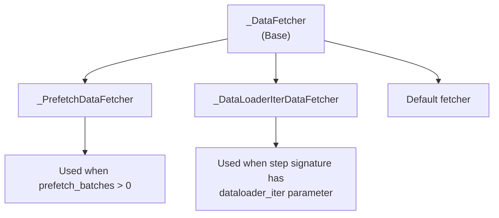
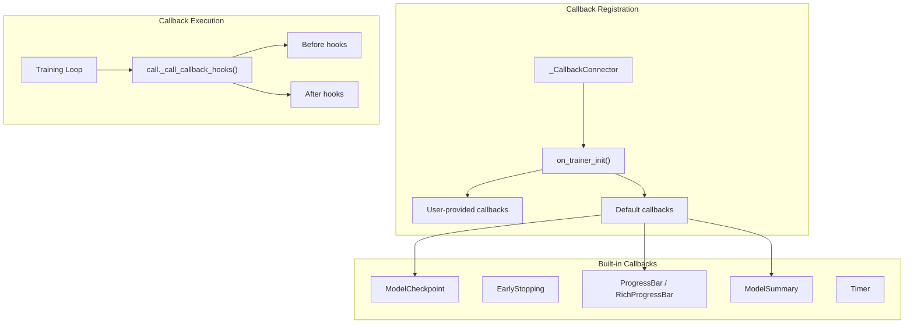
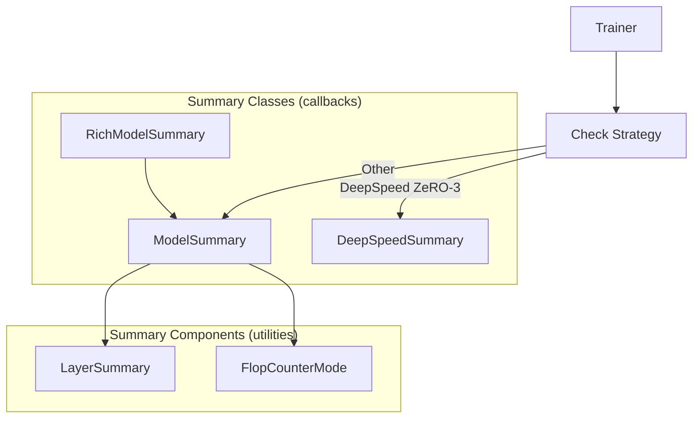
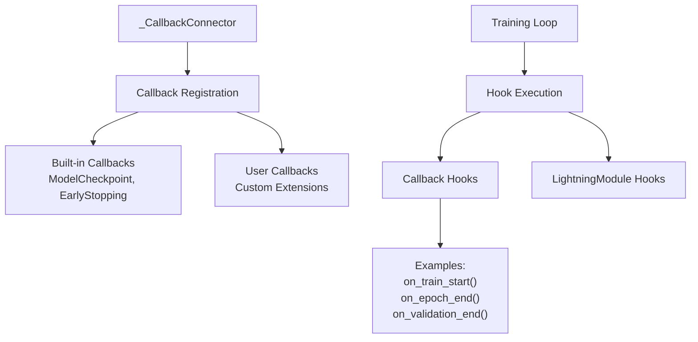

<!-- source: DeepWiki mcp.deepwiki.com · repo Lightning-AI/pytorch-lightning · page 4 Training System · fetched 2026-10-21 -->

# Training System

<details>
<summary>Relevant source files</summary>

The following files were used as context for generating this wiki page:

- [docs/source-pytorch/common/lightning_module.rst](docs/source-pytorch/common/lightning_module.rst)
- [docs/source-pytorch/common/trainer.rst](docs/source-pytorch/common/trainer.rst)
- [src/lightning/pytorch/callbacks/callback.py](src/lightning/pytorch/callbacks/callback.py)
- [src/lightning/pytorch/callbacks/device_stats_monitor.py](src/lightning/pytorch/callbacks/device_stats_monitor.py)
- [src/lightning/pytorch/core/hooks.py](src/lightning/pytorch/core/hooks.py)
- [src/lightning/pytorch/loops/evaluation_loop.py](src/lightning/pytorch/loops/evaluation_loop.py)
- [src/lightning/pytorch/loops/fetchers.py](src/lightning/pytorch/loops/fetchers.py)
- [src/lightning/pytorch/loops/fit_loop.py](src/lightning/pytorch/loops/fit_loop.py)
- [src/lightning/pytorch/loops/prediction_loop.py](src/lightning/pytorch/loops/prediction_loop.py)
- [src/lightning/pytorch/loops/training_epoch_loop.py](src/lightning/pytorch/loops/training_epoch_loop.py)
- [src/lightning/pytorch/loops/utilities.py](src/lightning/pytorch/loops/utilities.py)
- [src/lightning/pytorch/trainer/connectors/data_connector.py](src/lightning/pytorch/trainer/connectors/data_connector.py)
- [src/lightning/pytorch/trainer/trainer.py](src/lightning/pytorch/trainer/trainer.py)
- [src/lightning/pytorch/utilities/combined_loader.py](src/lightning/pytorch/utilities/combined_loader.py)
- [tests/tests_pytorch/loops/test_evaluation_loop.py](tests/tests_pytorch/loops/test_evaluation_loop.py)
- [tests/tests_pytorch/loops/test_fetchers.py](tests/tests_pytorch/loops/test_fetchers.py)
- [tests/tests_pytorch/loops/test_prediction_loop.py](tests/tests_pytorch/loops/test_prediction_loop.py)
- [tests/tests_pytorch/loops/test_training_epoch_loop.py](tests/tests_pytorch/loops/test_training_epoch_loop.py)
- [tests/tests_pytorch/models/test_hooks.py](tests/tests_pytorch/models/test_hooks.py)
- [tests/tests_pytorch/trainer/connectors/test_data_connector.py](tests/tests_pytorch/trainer/connectors/test_data_connector.py)
- [tests/tests_pytorch/trainer/flags/test_overfit_batches.py](tests/tests_pytorch/trainer/flags/test_overfit_batches.py)
- [tests/tests_pytorch/trainer/test_dataloaders.py](tests/tests_pytorch/trainer/test_dataloaders.py)
- [tests/tests_pytorch/utilities/test_combined_loader.py](tests/tests_pytorch/utilities/test_combined_loader.py)

</details>


The Training System provides the infrastructure for executing training, validation, testing, and prediction workflows in PyTorch Lightning. It consists of hierarchical loop structures, an extensible callback system, debugging utilities, and command-line interface tools.

This document covers training loops, callbacks and hooks, model debugging utilities, and the Lightning CLI. For the `Trainer` class details, see [Trainer](#2.3). For distributed strategies, see [Distributed Training](#3). For data handling, see [Data Handling](#5).

## Overview

The Training System infrastructure consists of four main components:

**Training Loop Code Entities**



Sources: [src/lightning/pytorch/loops/fit_loop.py:59-112](), [src/lightning/pytorch/loops/training_epoch_loop.py:51-96](), [src/lightning/pytorch/loops/evaluation_loop.py:58-86](), [src/lightning/pytorch/loops/prediction_loop.py:47-66]()

## Training Loops

The training system uses a hierarchical loop structure to manage training, validation, testing, and prediction. Each loop class inherits from the base `_Loop` class and implements specific logic for its phase.

### Loop Hierarchy and Initialization

**Loop Hierarchy**



Loops are initialized in `Trainer.__init__()`:

```python
# From trainer.py:435-441
self.fit_loop = _FitLoop(self, min_epochs=min_epochs, max_epochs=max_epochs)
self.fit_loop.epoch_loop = _TrainingEpochLoop(self, min_steps=min_steps, max_steps=max_steps)
self.validate_loop = _EvaluationLoop(self, TrainerFn.VALIDATING, RunningStage.VALIDATING, inference_mode=inference_mode)
self.test_loop = _EvaluationLoop(self, TrainerFn.TESTING, RunningStage.TESTING, inference_mode=inference_mode)
self.predict_loop = _PredictionLoop(self, inference_mode=inference_mode)
```

Sources: [src/lightning/pytorch/trainer/trainer.py:435-441](), [src/lightning/pytorch/loops/fit_loop.py:87-102]()

### FitLoop: Main Training Loop

**_FitLoop Structure**



**FitLoop Execution Flow**

The `_FitLoop.run()` method iterates through epochs:

```python
# Pseudocode from fit_loop.py:208-224
def run(self):
    self.setup_data()
    if self.skip:
        return
    self.reset()
    self.on_run_start()
    while not self.done:
        try:
            self.on_advance_start()
            self.advance()  # Runs epoch_loop
            self.on_advance_end()
        except StopIteration:
            break
        finally:
            self.on_iteration_done()
    self.on_run_end()
```

The loop terminates when:
- `max_epochs` is reached
- `max_steps` is reached  
- `trainer.should_stop` is set (e.g., by EarlyStopping)
- No training batches are available

Sources: [src/lightning/pytorch/loops/fit_loop.py:208-224](), [src/lightning/pytorch/loops/fit_loop.py:173-199]()

### TrainingEpochLoop: Single Epoch Execution

**_TrainingEpochLoop Structure**



**Automatic Optimization Flow**

The `_AutomaticOptimization` class in [src/lightning/pytorch/loops/optimization/automatic.py]() handles the standard training loop:

```python
# Pseudocode from automatic.py
for optimizer_idx, optimizer in enumerate(optimizers):
    # Forward pass
    closure_result = self._training_step()
    
    # Backward pass
    self._backward()
    
    # Optimizer step (if not accumulating)
    if not accumulating:
        self._optimizer_step(optimizer)
        self._zero_grad()
```

**Batch Progress Tracking**

The loop tracks progress using `_BatchProgress`:

| Counter | Meaning |
|---------|---------|
| `ready` | Batches loaded and ready |
| `started` | Batches where processing started |
| `processed` | Batches where step completed |
| `completed` | Batches fully finished (including callbacks) |

Sources: [src/lightning/pytorch/loops/training_epoch_loop.py:148-159](), [src/lightning/pytorch/loops/optimization/automatic.py](), [src/lightning/pytorch/loops/progress.py]()

### EvaluationLoop: Validation and Testing

**_EvaluationLoop Structure**



The same `_EvaluationLoop` class is used for both validation and testing, differentiated by the `TrainerFn` and `RunningStage` parameters passed during initialization.

**Sequential vs Parallel Dataloaders**

The `_EvaluationLoop` supports multiple dataloaders through `CombinedLoader`:

| Mode | Behavior |
|------|----------|
| `"sequential"` | Iterate through dataloaders one by one |
| `"max_size_cycle"` | Cycle shorter loaders to match longest |
| `"min_size"` | Stop when shortest loader exhausted |

Sources: [src/lightning/pytorch/loops/evaluation_loop.py:58-154](), [src/lightning/pytorch/loops/evaluation_loop.py:281-328]()

### PredictionLoop: Inference Execution

**_PredictionLoop Structure**



**Prediction Return Control**

The `return_predictions` property controls whether predictions are collected and returned:

```python
# From prediction_loop.py:69-83
@property
def return_predictions(self) -> bool:
    """Whether to return the predictions or not."""
    return self._return_predictions

@return_predictions.setter
def return_predictions(self, return_predictions: Optional[bool] = None) -> None:
    # Strategies that spawn or fork don't support returning predictions
    return_supported = not isinstance(self.trainer.strategy.launcher, _MultiProcessingLauncher)
    if return_predictions and not return_supported:
        raise MisconfigurationException(
            "`return_predictions` should be set to `False` when using strategies that spawn or fork."
        )
    self._return_predictions = return_supported if return_predictions is None else return_predictions
```

Sources: [src/lightning/pytorch/loops/prediction_loop.py:47-154](), [src/lightning/pytorch/loops/prediction_loop.py:69-83]()

### Data Fetchers

**Data Fetcher Classes**



The data fetcher is selected based on the step signature:

```python
# From utilities.py:135-156
def _select_data_fetcher(trainer: "pl.Trainer", stage: RunningStage) -> _DataFetcher:
    lightning_module = trainer.lightning_module
    step_fx = getattr(lightning_module, step_fx_name)
    
    if is_param_in_hook_signature(step_fx, "dataloader_iter", explicit=True):
        return _DataLoaderIterDataFetcher(prefetch_batches=0)
    return _PrefetchDataFetcher(prefetch_batches=trainer.profiler.prefetch_batches)
```

**Fetcher Responsibilities**

| Fetcher | Purpose |
|---------|---------|
| `_DataFetcher` | Base iterator over `CombinedLoader` |
| `_PrefetchDataFetcher` | Prefetches batches to overlap data loading with computation |
| `_DataLoaderIterDataFetcher` | Yields dataloader iterators for manual iteration in `*_step()` |

Sources: [src/lightning/pytorch/loops/fetchers.py:29-65](), [src/lightning/pytorch/loops/utilities.py:135-156]()

## Callbacks and Hooks

The callback system provides extensibility points for customizing training behavior without modifying the core training loop.

### Callback Architecture

**Callback System Components**



Sources: [src/lightning/pytorch/trainer/connectors/callback_connector.py](), [src/lightning/pytorch/callbacks/callback.py:25-30]()

### Callback Base Class

The `Callback` class defines the interface for all callbacks:

```python
# From callback.py:25-41
class Callback:
    @property
    def state_key(self) -> str:
        """Identifier for the state of the callback."""
        return self.__class__.__qualname__
    
    def setup(self, trainer, pl_module, stage):
        """Called when fit, validate, test, predict, or tune begins."""
        
    def teardown(self, trainer, pl_module, stage):
        """Called when fit, validate, test, predict, or tune ends."""
    
    def on_fit_start(self, trainer, pl_module):
        """Called when fit begins."""
```

**Callback State Management**

Callbacks can maintain state that is saved in checkpoints:

```python
# From callback.py:226-239
def state_dict(self) -> dict[str, Any]:
    """Called when saving a checkpoint."""
    return {}

def load_state_dict(self, state_dict: dict[str, Any]) -> None:
    """Called when loading a checkpoint."""
    pass

def on_save_checkpoint(self, trainer, pl_module, checkpoint):
    """Called when saving a checkpoint."""
    pass

def on_load_checkpoint(self, trainer, pl_module, checkpoint):
    """Called when loading a checkpoint."""
    pass
```

Sources: [src/lightning/pytorch/callbacks/callback.py:25-239]()

### Hook Execution Order

**Training Batch Hooks**

```mermaid
sequenceDiagram
    participant Loop as "Training Loop"
    participant CB as "Callbacks"
    participant LM as "LightningModule"
    
    Note over Loop: Batch Start
    Loop->>CB: on_train_batch_start(trainer, pl_module, batch, batch_idx)
    Loop->>LM: on_train_batch_start(batch, batch_idx)
    
    Note over Loop: Forward Pass
    Loop->>LM: training_step(batch, batch_idx)
    
    Note over Loop: Backward
    Loop->>CB: on_before_zero_grad(trainer, pl_module, optimizer)
    Loop->>LM: on_before_zero_grad(optimizer)
    Loop->>Loop: optimizer.zero_grad()
    
    Loop->>CB: on_before_backward(trainer, pl_module, loss)
    Loop->>LM: on_before_backward(loss)
    Loop->>Loop: loss.backward()
    Loop->>CB: on_after_backward(trainer, pl_module)
    Loop->>LM: on_after_backward()
    
    Note over Loop: Optimizer Step
    Loop->>CB: on_before_optimizer_step(trainer, pl_module, optimizer)
    Loop->>LM: on_before_optimizer_step(optimizer)
    Loop->>Loop: optimizer.step()
    
    Note over Loop: Batch End
    Loop->>CB: on_train_batch_end(trainer, pl_module, outputs, batch, batch_idx)
    Loop->>LM: on_train_batch_end(outputs, batch, batch_idx)
```

**Hook Priority**: Callbacks are called before LightningModule hooks, except for monitoring callbacks (like ModelCheckpoint) which are called after `on_train_epoch_end` to ensure they can access metrics logged in that hook.

Sources: [tests/tests_pytorch/models/test_hooks.py:266-314](), [src/lightning/pytorch/loops/training_epoch_loop.py:467-481]()

### Common Training Hooks

**Epoch-Level Hooks**

| Hook | Called When | Use Case |
|------|-------------|----------|
| `on_train_epoch_start` | Start of each training epoch | Initialize epoch-level metrics |
| `on_train_epoch_end` | End of each training epoch | Log epoch-level metrics |
| `on_validation_epoch_start` | Start of validation | Prepare for validation |
| `on_validation_epoch_end` | End of validation | Aggregate validation metrics |

**Batch-Level Hooks**

| Hook | Called When | Use Case |
|------|-------------|----------|
| `on_train_batch_start` | Before processing batch | Data inspection, dynamic batching |
| `on_train_batch_end` | After processing batch | Log batch metrics |
| `on_before_zero_grad` | Before `optimizer.zero_grad()` | Gradient inspection |
| `on_before_backward` | Before `loss.backward()` | Loss inspection |
| `on_after_backward` | After `loss.backward()` | Gradient manipulation |
| `on_before_optimizer_step` | Before `optimizer.step()` | Gradient clipping |

**Training Lifecycle Hooks**

| Hook | Called When | Use Case |
|------|-------------|----------|
| `on_fit_start` | Start of `trainer.fit()` | One-time setup |
| `on_fit_end` | End of `trainer.fit()` | Cleanup, final metrics |
| `on_train_start` | After sanity check, before training | Post-validation setup |
| `on_train_end` | End of training | Final logging |

Sources: [src/lightning/pytorch/callbacks/callback.py:25-411](), [src/lightning/pytorch/core/hooks.py:27-183]()

### Custom Callback Example

**Creating a Custom Callback**

```python
from lightning.pytorch.callbacks import Callback

class LogGradientNormCallback(Callback):
    def on_after_backward(self, trainer, pl_module):
        # Compute total gradient norm
        total_norm = 0
        for p in pl_module.parameters():
            if p.grad is not None:
                total_norm += p.grad.data.norm(2).item() ** 2
        total_norm = total_norm ** 0.5
        
        # Log the gradient norm
        pl_module.log("gradient_norm", total_norm)
```

**Registering Callbacks**

```python
trainer = Trainer(callbacks=[
    LogGradientNormCallback(),
    ModelCheckpoint(monitor="val_loss"),
    EarlyStopping(monitor="val_loss", patience=3)
])
```

Sources: [src/lightning/pytorch/callbacks/callback.py](), [docs/source-pytorch/common/trainer.rst:320-351]()

## Model Summary and Debugging

PyTorch Lightning provides utilities for inspecting model architecture, tracking parameters, and debugging training issues.

### ModelSummary System

**ModelSummary Classes**



**Summary Configuration**

The model summary is controlled via the `enable_model_summary` flag:

```python
# Enable default summary
trainer = Trainer(enable_model_summary=True)

# Disable summary
trainer = Trainer(enable_model_summary=False)

# Customize with RichModelSummary
from lightning.pytorch.callbacks import RichModelSummary
trainer = Trainer(
    enable_model_summary=True,
    callbacks=[RichModelSummary(max_depth=3)]
)
```

**Summary Output**

The model summary displays:
- Layer names and types
- Output shapes for each layer
- Parameter counts (trainable vs. total)
- Model size in MB
- Estimated FLOPs (floating point operations)

Sources: [docs/source-pytorch/common/trainer.rst:518-534]()

### DeviceStatsMonitor

The `DeviceStatsMonitor` callback logs hardware utilization during training:

```python
from lightning.pytorch.callbacks import DeviceStatsMonitor

trainer = Trainer(
    callbacks=[DeviceStatsMonitor()],
    logger=True  # Requires a logger
)
```

**Monitored Metrics**

| Accelerator | Metrics |
|-------------|---------|
| **GPU** | GPU utilization (%), memory used/free, temperature |
| **CPU** | CPU utilization (%), memory used/free (requires psutil) |
| **TPU** | TPU metrics via `torch_xla` |

**Logged Keys**

Metrics are logged with prefix `DeviceStatsMonitor.{hook_name}/{metric_name}`:
- `DeviceStatsMonitor.on_train_batch_start/gpu_0_utilization`
- `DeviceStatsMonitor.on_train_batch_start/gpu_0_memory_used`

Sources: [src/lightning/pytorch/callbacks/device_stats_monitor.py:33-80]()

### Debugging Flags

**Trainer Debugging Options**

| Flag | Purpose | Typical Use |
|------|---------|-------------|
| `fast_dev_run` | Run 1 or N batches through train/val/test | Quick bug detection |
| `overfit_batches` | Train on same batches repeatedly | Debug model convergence |
| `limit_train_batches` | Limit training data per epoch | Faster iteration during development |
| `limit_val_batches` | Limit validation data | Faster validation |
| `detect_anomaly` | Enable PyTorch anomaly detection | Find NaN/Inf in gradients |
| `log_every_n_steps` | Control logging frequency | Reduce logging overhead |

**Fast Development Run**

```python
# Run 1 batch of train, val, test
trainer = Trainer(fast_dev_run=True)

# Run 5 batches of each
trainer = Trainer(fast_dev_run=5)
```

This mode disables checkpointing, logging, and limits batches automatically.

**Overfitting on Batches**

```python
# Use 1% of data, repeated each epoch
trainer = Trainer(overfit_batches=0.01)

# Use exactly 10 batches, repeated each epoch
trainer = Trainer(overfit_batches=10)
```

Useful for verifying the model can overfit before scaling to full dataset.

**Anomaly Detection**

```python
trainer = Trainer(detect_anomaly=True)
```

Enables `torch.autograd.detect_anomaly()` to find operations producing NaN or Inf gradients. Significantly slows training.

Sources: [docs/source-pytorch/common/trainer.rst:551-590](), [docs/source-pytorch/common/trainer.rst:394-406](), [docs/source-pytorch/common/trainer.rst:946-972]()

### Barebones Mode

Barebones mode disables all features that may impact raw speed for benchmarking:

```python
trainer = Trainer(barebones=True)
```

**Disabled Features**:
- Checkpointing
- Logging
- Progress bar
- Model summary
- Sanity validation
- Callbacks that impact speed

This mode is for analyzing `Trainer` overhead, not for regular training.

Sources: [docs/source-pytorch/common/trainer.rst:254-273](), [src/lightning/pytorch/trainer/trainer.py:328-398]()

## Key Training Workflows

### Automatic vs Manual Optimization

The training system supports two optimization modes:

**Automatic Optimization** (default):
- `Trainer` handles `optimizer.zero_grad()`, `loss.backward()`, `optimizer.step()`
- Supports gradient accumulation, clipping, and multiple optimizers
- Controlled via `automatic_optimization = True`

**Manual Optimization**:
- User controls optimization steps explicitly
- Required for advanced use cases like GANs, RL
- Enabled via `automatic_optimization = False`

Sources: [docs/source-pytorch/model/manual_optimization.rst:11-45](), [src/lightning/pytorch/core/module.py:300-306]()

### Callback System Integration

Callbacks extend training functionality without modifying core logic:



Sources: [src/lightning/pytorch/trainer/connectors/callback_connector.py](), [src/lightning/pytorch/callbacks/callback.py:25-114]()

---

