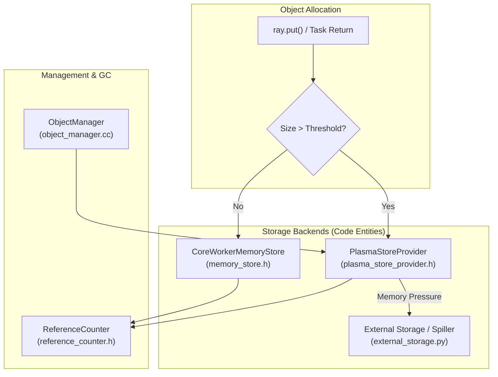

<!-- source: DeepWiki mcp.deepwiki.com · repo ray-project/ray · page 2 Ray Core Infrastructure · fetched 2026-10-21 -->

# Ray Core Infrastructure

Relevant source files

The following files were used as context for generating this wiki page:

- [cpp/src/ray/runtime/task/task_executor.cc](cpp/src/ray/runtime/task/task_executor.cc)
- [cpp/src/ray/runtime/task/task_executor.h](cpp/src/ray/runtime/task/task_executor.h)
- [doc/source/data/images/dataset_mixing/per_block_mix.png](doc/source/data/images/dataset_mixing/per_block_mix.png)
- [doc/source/data/images/dataset_mixing/random_mix.png](doc/source/data/images/dataset_mixing/random_mix.png)
- [doc/source/data/mixing-data.rst](doc/source/data/mixing-data.rst)
- [doc/source/data/scaling-collation-functions.rst](doc/source/data/scaling-collation-functions.rst)
- [doc/source/ray-observability/reference/system-metrics.rst](doc/source/ray-observability/reference/system-metrics.rst)
- [doc/source/train/user-guides.rst](doc/source/train/user-guides.rst)
- [doc/source/train/user-guides/local_mode.rst](doc/source/train/user-guides/local_mode.rst)
- [doc/source/train/user-guides/monitor-your-application.rst](doc/source/train/user-guides/monitor-your-application.rst)
- [python/ray/_private/ray_constants.py](python/ray/_private/ray_constants.py)
- [python/ray/_raylet.pyx](python/ray/_raylet.pyx)
- [python/ray/dashboard/client/src/type/node.d.ts](python/ray/dashboard/client/src/type/node.d.ts)
- [python/ray/dashboard/consts.py](python/ray/dashboard/consts.py)
- [python/ray/dashboard/dashboard_metrics.py](python/ray/dashboard/dashboard_metrics.py)
- [python/ray/dashboard/modules/metrics/dashboards/default_dashboard_panels.py](python/ray/dashboard/modules/metrics/dashboards/default_dashboard_panels.py)
- [python/ray/dashboard/modules/reporter/reporter_agent.py](python/ray/dashboard/modules/reporter/reporter_agent.py)
- [python/ray/dashboard/modules/reporter/reporter_models.py](python/ray/dashboard/modules/reporter/reporter_models.py)
- [python/ray/dashboard/modules/reporter/tests/test_reporter.py](python/ray/dashboard/modules/reporter/tests/test_reporter.py)
- [python/ray/includes/libcoreworker.pxd](python/ray/includes/libcoreworker.pxd)
- [python/ray/tests/unit/test_get_system_metric.py](python/ray/tests/unit/test_get_system_metric.py)
- [src/ray/common/ray_config_def.h](src/ray/common/ray_config_def.h)
- [src/ray/core_worker/core_worker.cc](src/ray/core_worker/core_worker.cc)
- [src/ray/core_worker/core_worker.h](src/ray/core_worker/core_worker.h)
- [src/ray/core_worker/core_worker_options.h](src/ray/core_worker/core_worker_options.h)
- [src/ray/core_worker/core_worker_process.cc](src/ray/core_worker/core_worker_process.cc)
- [src/ray/core_worker/core_worker_process.h](src/ray/core_worker/core_worker_process.h)
- [src/ray/core_worker/lib/java/io_ray_runtime_RayNativeRuntime.cc](src/ray/core_worker/lib/java/io_ray_runtime_RayNativeRuntime.cc)
- [src/ray/core_worker/metrics.h](src/ray/core_worker/metrics.h)
- [src/ray/core_worker/task_manager.cc](src/ray/core_worker/task_manager.cc)
- [src/ray/core_worker/task_manager.h](src/ray/core_worker/task_manager.h)
- [src/ray/core_worker/tests/core_worker_test.cc](src/ray/core_worker/tests/core_worker_test.cc)
- [src/ray/core_worker/tests/task_manager_test.cc](src/ray/core_worker/tests/task_manager_test.cc)

## Purpose and Scope

Ray Core Infrastructure provides the foundational distributed computing layer that underlies all Ray libraries. It handles task execution, object lifecycle management, distributed memory, reference counting, and fault tolerance. This infrastructure is implemented primarily in C++ for performance, with language-specific frontends (Python, Java, C++) that communicate through protocol buffers and shared memory.

This document covers the core execution and storage mechanisms at a high level. For details on specific subsystems, see the respective child pages:
- Core worker internals, task submission pipelines (`NormalTaskSubmitter`, `ActorTaskSubmitter`), reference counting, and actor management: see [Core Worker and Task Execution](#2.1)
- Accelerated task graph execution, shared memory optimization, and GPU tensor transport: see [Compiled DAG and Accelerated Execution](#2.2)
- Raylet node manager, Global Control Service (GCS), Plasma object store, and pub/sub infrastructure: see [Raylet, GCS, and Object Store](#2.3)
- Autoscaling architectures (`InstanceManager`, `Reconciler`), KubeRay integration, and cloud provider adapters: see [Autoscaler and Cluster Management](#2.4)
- Runtime environment packaging, URI protocols, isolation mechanisms, and dependency propagation: see [Runtime Environment and Dependency Management](#2.5)
- Dashboard head/agent modules, State API, metrics collection, and Job Submission API: see [Observability: Dashboard, Metrics, and State API](#2.6)

## Core Infrastructure Components

The Ray Core infrastructure consists of several key C++ components defined in `src/ray/core_worker/` that work together to enable distributed execution.

**Core Infrastructure Overview**

```mermaid
graph TB
    subgraph "Python Layer"
        Worker["Worker<br/>(Python Process)"]
        Raylet_pyx["_raylet.pyx<br/>(Cython Bridge)"]
    end
    
    subgraph "C++ Core Components"
        CoreWorker["CoreWorker<br/>(src/ray/core_worker/core_worker.h)"]
        TaskManager["TaskManager<br/>(src/ray/core_worker/task_manager.h)"]
        RefCounter["ReferenceCounter<br/>(src/ray/core_worker/reference_counter.h)"]
        MemoryStore["CoreWorkerMemoryStore<br/>(src/ray/core_worker/store_provider/memory_store)"]
        PlasmaProvider["PlasmaStoreProvider<br/>(src/ray/core_worker/store_provider)"]
        FutureResolver["FutureResolver<br/>(src/ray/core_worker/future_resolver.h)"]
        ObjectRecovery["ObjectRecoveryManager<br/>(src/ray/core_worker/object_recovery_manager.h)"]
    end
    
    subgraph "Task Submission"
        NormalSubmitter["NormalTaskSubmitter<br/>(src/ray/core_worker/task_submission/normal_task_submitter.h)"]
        ActorSubmitter["ActorTaskSubmitter<br/>(src/ray/core_worker/task_submission/actor_task_submitter.h)"]
    end
    
    subgraph "Task Execution"
        TaskReceiver["TaskReceiver<br/>(src/ray/core_worker/task_execution/task_receiver.h)"]
        TaskEventBuffer["TaskEventBuffer<br/>(src/ray/core_worker/task_event_buffer.h)"]
    end
    
    subgraph "External Services"
        Raylet["Raylet<br/>(src/ray/raylet)"]
        GCS["GCS Server<br/>(src/ray/gcs)"]
    end
    
    Worker --> Raylet_pyx
    Raylet_pyx --> CoreWorker
    
    CoreWorker --> TaskManager
    CoreWorker --> RefCounter
    CoreWorker --> MemoryStore
    CoreWorker --> PlasmaProvider
    CoreWorker --> FutureResolver
    CoreWorker --> ObjectRecovery
    
    CoreWorker --> NormalSubmitter
    CoreWorker --> ActorSubmitter
    
    CoreWorker --> TaskReceiver
    CoreWorker --> TaskEventBuffer
    
    NormalSubmitter --> Raylet
    ActorSubmitter --> Raylet
    TaskReceiver --> CoreWorker
    
    CoreWorker --> GCS
    RefCounter --> GCS
    ObjectRecovery --> GCS
```

Sources: [src/ray/core_worker/core_worker.h:33-56](), [src/ray/core_worker/core_worker.cc:287-372](), [python/ray/_raylet.pyx:157-170]()

### CoreWorker
The `CoreWorker` class (`src/ray/core_worker/core_worker.h`) is the central coordinator for all Ray functionality in a worker process. It is instantiated once per worker or driver process via `CoreWorkerProcess` and manages task submission, task execution, and object storage. It coordinates with the `Raylet` for resource scheduling and the `GCS` for global metadata. For details, see [Core Worker and Task Execution](#2.1).

Sources: [src/ray/core_worker/core_worker.h:136-183](), [src/ray/core_worker/core_worker_process.cc:91-125]()

### TaskManager
The `TaskManager` (`src/ray/core_worker/task_manager.h`) tracks the lifecycle of all tasks submitted by a worker. It maintains task state, handles retries for failed tasks (using policies defined in `src/ray/core_worker/task_manager.h`), and manages `ObjectRefStream` for streaming generator results. For details, see [Core Worker and Task Execution](#2.1).

| Component | Purpose |
|-----------|---------|
| `pending_tasks_` | Tasks awaiting execution or whose results are being consumed |
| `submissible_tasks_` | Tasks that can be retried if needed upon failure |
| `ObjectRefStream` | Manages streaming generator task results and unconsumed item tracking |

Sources: [src/ray/core_worker/task_manager.h:102-178](), [src/ray/core_worker/task_manager.cc:84-122]()

### ReferenceCounter
The `ReferenceCounter` (`src/ray/core_worker/reference_counter.h`) implements distributed garbage collection by tracking object references across the cluster. It manages local references held by the language runtime, references passed to tasks, and borrower information for objects shared across nodes. For details, see [Core Worker and Task Execution](#2.1).

Sources: [src/ray/core_worker/reference_counter.h](), [src/ray/core_worker/core_worker.cc:115-128]()

## Task Execution Flow

**Natural Language to Code: Task Submission and Execution**

```mermaid
graph LR
    subgraph "User Code (Python Space)"
        UserCode["@ray.remote<br/>func.remote()"]
    end

    subgraph "Python Frontend (python/ray)"
        RemoteFunc["RemoteFunction._remote()"]
        CythonBridge["_raylet.pyx<br/>CCoreWorker.SubmitTask"]
    end
    
    subgraph "C++ Core (src/ray/core_worker)"
        CoreSubmit["CoreWorker::SubmitTask<br/>(core_worker.cc)"]
        TaskMgrAdd["TaskManager::AddPendingTask<br/>(task_manager.cc)"]
        NormalSubmit["NormalTaskSubmitter::SubmitTask<br/>(normal_task_submitter.h)"]
    end
    
    subgraph "Local Node Manager (src/ray/raylet)"
        RayletSched["NodeManager::HandleSubmitTask<br/>(node_manager.cc)"]
        WorkerPool["WorkerPool::PopWorker<br/>(worker_pool.cc)"]
    end

    subgraph "Execution Worker (src/ray/core_worker)"
        TaskRecv["TaskReceiver::HandleTask<br/>(task_receiver.h)"]
        ExecLoop["CoreWorker::ExecuteTask<br/>(core_worker.cc)"]
        UserExec["Python Callback Execution"]
    end
    
    UserCode --> RemoteFunc
    RemoteFunc --> CythonBridge
    CythonBridge --> CoreSubmit
    CoreSubmit --> TaskMgrAdd
    TaskMgrAdd --> NormalSubmit
    NormalSubmit --> RayletSched
    RayletSched --> WorkerPool
    WorkerPool --> TaskRecv
    TaskRecv --> ExecLoop
    ExecLoop --> UserExec
```

Sources: [python/ray/_raylet.pyx:140-150](), [src/ray/core_worker/core_worker.cc:373-396](), [src/ray/core_worker/task_manager.cc:238-267]()

### Task Submission (Python to C++)
When a user invokes a remote function via `func.remote()`, the Python layer dispatches through `RemoteFunction._remote()`. Arguments are prepared and serialized via Cython bindings in `python/ray/_raylet.pyx`. The `CoreWorker::SubmitTask` C++ method is then invoked, registering the task in the `TaskManager` before dispatching it through the task submission pipeline (`NormalTaskSubmitter` or `ActorTaskSubmitter`) to the local `Raylet`. For details, see [Core Worker and Task Execution](#2.1).

Sources: [python/ray/_raylet.pyx:140-150](), [src/ray/core_worker/core_worker.h:140-150](), [src/ray/core_worker/task_manager.cc:238-267]()

### Task Execution
When a worker receives a task from the Raylet, `TaskReceiver::HandleTask` is triggered. The `CoreWorker` resolves task dependencies, ensures all input object references are available locally, and executes the language-specific task callback. Results are stored in the local `CoreWorkerMemoryStore` or the Plasma object store. For details, see [Core Worker and Task Execution](#2.1).

Sources: [src/ray/core_worker/core_worker.h:51](), [src/ray/core_worker/tests/core_worker_test.cc:78-104]()

## Object Management and Storage

Ray uses a tiered storage system to handle objects efficiently based on size and access patterns. For details, see [Raylet, GCS, and Object Store](#2.3).

**Natural Language to Code: Object Storage and Management Hierarchy**

Sources: [src/ray/core_worker/store_provider/memory_store/memory_store.h](), [src/ray/core_worker/store_provider/plasma_store_provider.h](), [src/ray/core_worker/reference_counter.h]()

### Memory Store vs. Plasma
- **CoreWorkerMemoryStore**: Stores small objects directly in the worker's heap using `absl::flat_hash_map`. This provides lowest-latency access for small payloads.
- **Plasma Object Store**: Large objects are stored in a shared memory region (`/dev/shm`), enabling zero-copy sharing across multiple local workers via memory mapping.

Sources: [src/ray/core_worker/store_provider/memory_store/memory_store.h](), [src/ray/core_worker/store_provider/plasma_store_provider.h]()

### Distributed Reference Counting
The `ReferenceCounter` tracks ownership semantics across the cluster. The creating worker is designated as the object owner, while workers holding references are borrowers. The owner maintains ref-counts and coordinates distributed cleanup. For details, see [Core Worker and Task Execution](#2.1).

Sources: [src/ray/core_worker/reference_counter.h](), [src/ray/core_worker/core_worker.cc:115-128]()

## Streaming and Generators
Ray supports streaming task results via `ObjectRefStream`, allowing generator tasks to yield multiple intermediate return objects asynchronously back to the task manager while maintaining backpressure and reference safety. For details, see [Core Worker and Task Execution](#2.1).

Sources: [src/ray/core_worker/task_manager.h:102-178](), [src/ray/core_worker/task_manager.cc:84-152]()

## Fault Tolerance
Object reconstruction and fault recovery are managed by `ObjectRecoveryManager`. If node failures occur and Plasma objects are evicted or lost, Ray reconstructs object lineage through the `TaskManager` and resubmits producing tasks. For details, see [Core Worker and Task Execution](#2.1).

Sources: [src/ray/core_worker/object_recovery_manager.h](), [src/ray/core_worker/core_worker.h:43]()

## Observability and Metrics
Core infrastructure components record task metrics via `TaskCounter` and task execution events via `TaskEventBuffer`, exporting signals to the GCS and Dashboard agent for cluster-wide visibility. For details, see [Observability: Dashboard, Metrics, and State API](#2.6).

Sources: [src/ray/core_worker/core_worker.h:67-157](), [src/ray/core_worker/task_event_buffer.h](), [python/ray/dashboard/modules/reporter/reporter_agent.py:134-222]()

---

