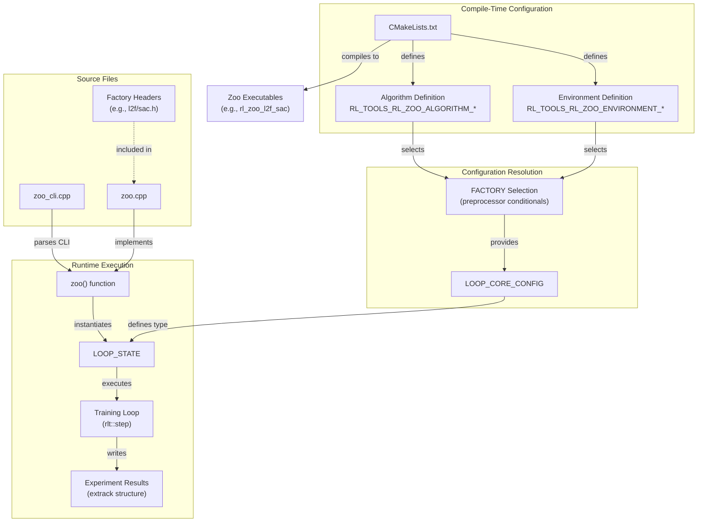
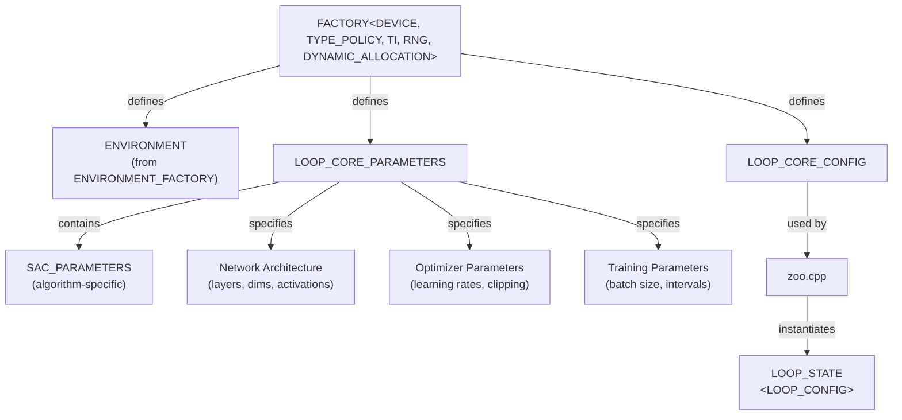
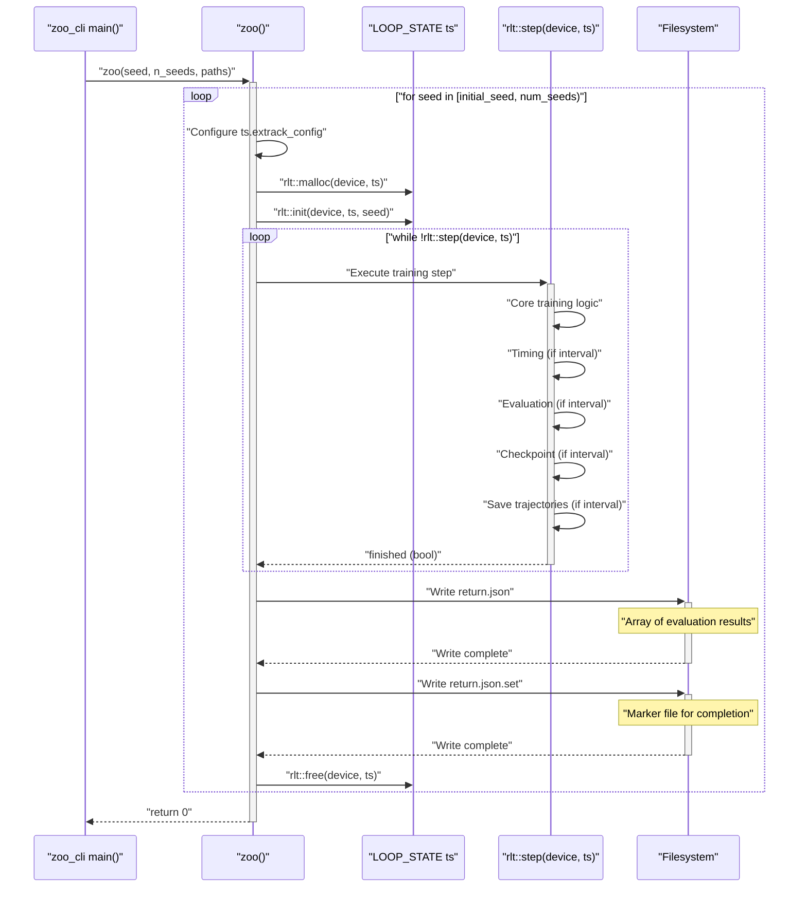
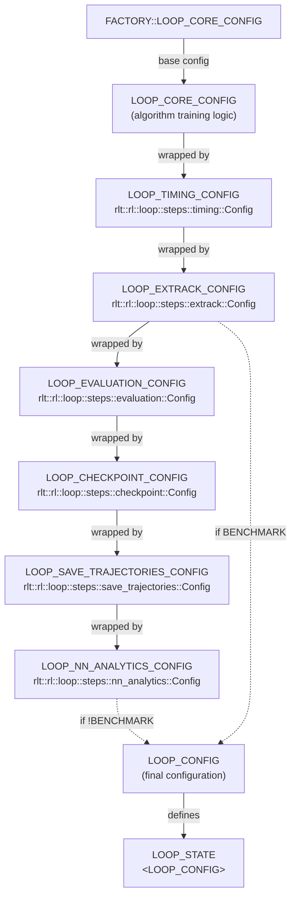
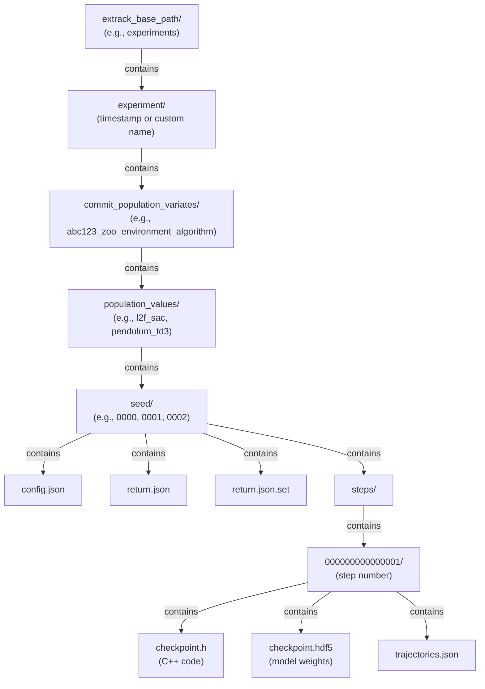

<!-- source: DeepWiki mcp.deepwiki.com · repo rl-tools/rl-tools · page 5 Zoo System · fetched 2026-10-30 -->

# Zoo System

<details>
<summary>Relevant source files</summary>

The following files were used as context for generating this wiki page:

- [include/rl_tools/rl/loop/steps/extrack/operations_cpu.h](include/rl_tools/rl/loop/steps/extrack/operations_cpu.h)
- [include/rl_tools/rl/loop/steps/extrack/state.h](include/rl_tools/rl/loop/steps/extrack/state.h)
- [src/rl/environments/l2f/dr_sac/CMakeLists.txt](src/rl/environments/l2f/dr_sac/CMakeLists.txt)
- [src/rl/environments/l2f/dr_sac/l2f_dr_sac.cpp](src/rl/environments/l2f/dr_sac/l2f_dr_sac.cpp)
- [src/rl/zoo/CMakeLists.txt](src/rl/zoo/CMakeLists.txt)
- [src/rl/zoo/l2f/environment_tiny.h](src/rl/zoo/l2f/environment_tiny.h)
- [src/rl/zoo/l2f/plot_learning_curves.py](src/rl/zoo/l2f/plot_learning_curves.py)
- [src/rl/zoo/l2f/sac.h](src/rl/zoo/l2f/sac.h)
- [src/rl/zoo/l2f/sac_tiny.h](src/rl/zoo/l2f/sac_tiny.h)
- [src/rl/zoo/zoo.cpp](src/rl/zoo/zoo.cpp)
- [src/rl/zoo/zoo_cli.cpp](src/rl/zoo/zoo_cli.cpp)

</details>


The Zoo System is RLtools' centralized training entry point that implements a compile-time algorithm-environment composition framework. It provides standardized experiment orchestration, configuration management, and result collection across multiple reinforcement learning algorithms and environments.

For information about specific algorithms supported by the Zoo system, see [Reinforcement Learning Algorithms](#2). For environment details, see [Environments](#4).

## Architecture Overview

The Zoo System uses a compile-time configuration approach where each algorithm-environment pair is compiled into a separate executable. This design eliminates runtime polymorphism overhead while enabling algorithm-specific optimizations.

### Zoo System High-Level Architecture



Sources: [src/rl/zoo/zoo.cpp:131-217](), [src/rl/zoo/CMakeLists.txt:1-154](), [src/rl/zoo/zoo_cli.cpp:1-34]()

### FACTORY Pattern for Algorithm-Environment Composition

The Zoo system uses a `FACTORY` template pattern to compose algorithms with environments. Each algorithm-environment combination defines a `FACTORY` class that produces the necessary type configurations.

### FACTORY Pattern Structure



Sources: [src/rl/zoo/l2f/sac_tiny.h:13-71](), [src/rl/zoo/l2f/sac.h:7-58]()

Each `FACTORY` exposes a `LOOP_CORE_CONFIG` type that encapsulates the complete algorithm-environment configuration.

## Compile-Time Configuration System

The Zoo system uses preprocessor directives to select algorithm-environment combinations at compile time. The [src/rl/zoo/zoo.cpp:131-217]() file contains nested `#if defined` blocks that resolve to a specific `LOOP_CORE_CONFIG` type based on compile definitions.

### Configuration Resolution in zoo.cpp

The configuration resolution follows this pattern:

```cpp
#if defined(RL_TOOLS_RL_ZOO_ALGORITHM_SAC)
  #if defined(RL_TOOLS_RL_ZOO_ENVIRONMENT_PENDULUM_V1)
    using LOOP_CORE_CONFIG = rlt::rl::zoo::pendulum_v1::sac::FACTORY<...>::LOOP_CORE_CONFIG;
  #elif defined(RL_TOOLS_RL_ZOO_ENVIRONMENT_L2F)
    using LOOP_CORE_CONFIG = rlt::rl::zoo::l2f::sac::FACTORY<...>::LOOP_CORE_CONFIG;
  #else
    #error "RLtools Zoo SAC: Environment not defined"
  #endif
#elif defined(RL_TOOLS_RL_ZOO_ALGORITHM_TD3)
  // ... TD3 environment selection
#elif defined(RL_TOOLS_RL_ZOO_ALGORITHM_PPO)
  // ... PPO environment selection
#else
  #error "RLtools Zoo: Algorithm not defined"
#endif
```

### Build System Configuration

The [src/rl/zoo/CMakeLists.txt:1-154]() defines separate executables for each combination:

| Executable | Algorithm Definition | Environment Definition |
|------------|---------------------|------------------------|
| `rl_zoo_pendulum_v1_sac` | `RL_TOOLS_RL_ZOO_ALGORITHM_SAC` | `RL_TOOLS_RL_ZOO_ENVIRONMENT_PENDULUM_V1` |
| `rl_zoo_l2f_td3` | `RL_TOOLS_RL_ZOO_ALGORITHM_TD3` | `RL_TOOLS_RL_ZOO_ENVIRONMENT_L2F` |
| `rl_zoo_ant_v4_ppo` | `RL_TOOLS_RL_ZOO_ALGORITHM_PPO` | `RL_TOOLS_RL_ZOO_ENVIRONMENT_ANT_V4` |

Each executable is built with:
```cmake
add_executable(rl_zoo_pendulum_v1_sac zoo_cli.cpp zoo.cpp)
target_link_libraries(rl_zoo_pendulum_v1_sac PRIVATE RLtools::RLtools)
target_compile_definitions(rl_zoo_pendulum_v1_sac PRIVATE 
    RL_TOOLS_RL_ZOO_ALGORITHM_SAC
    RL_TOOLS_RL_ZOO_ENVIRONMENT_PENDULUM_V1)
```

This approach provides:
- **Zero runtime overhead**: Algorithm dispatch is resolved at compile time
- **Compiler optimizations**: Each executable can be fully optimized for its specific configuration
- **Clear dependencies**: Each combination's dependencies are explicit
- **Type safety**: Mismatched algorithm-environment configurations fail at compile time

Sources: [src/rl/zoo/zoo.cpp:131-217](), [src/rl/zoo/CMakeLists.txt:10-154]()

## Running Experiments

Zoo executables are invoked through a command-line interface that supports multiple seeds and experiment tracking configuration.

### Command-Line Interface

The [src/rl/zoo/zoo_cli.cpp:1-34]() entry point parses command-line arguments:

```cpp
int main(int argc, char** argv) {
    int seed = 0;
    int n_seeds = 1;
    std::string extrack_base_path = "";
    std::string extrack_experiment = rl_tools::utils::extrack::get_timestamp_string();
    std::string extrack_experiment_path = "";
    std::string config_path = "";
    
    // CLI11 parsing or simple argv parsing
    // ...
    
    return zoo(seed, n_seeds, extrack_base_path, extrack_experiment, 
               extrack_experiment_path, config_path);
}
```

**Command-line options:**
- `-s, --seed`: Initial seed value (default: 0)
- `-n, --n_seeds`: Number of seeds to run (default: 1)
- `--e, --extrack`: Base path for experiment tracking
- `--ee, --extrack-experiment`: Experiment name (default: timestamp)
- `--eep, --extrack-experiment-path`: Explicit experiment path
- `-c, --config`: Configuration file path

### The zoo() Function

The `zoo()` function in [src/rl/zoo/zoo.cpp:302-474]() implements the core training orchestration:

```cpp
int zoo(int initial_seed, int num_seeds, std::string extrack_base_path, 
        std::string extrack_experiment, std::string extrack_experiment_path, 
        std::string config_path)
```

**Execution flow:**

1. **Type Resolution**: Instantiates `LOOP_STATE` from `LOOP_CONFIG::State<LOOP_CONFIG>`
2. **Memory Validation**: Asserts `sizeof(LOOP_STATE) < 100000000` for stack size safety
3. **Seed Loop**: Iterates from `initial_seed` to `num_seeds`
4. **ExTrack Configuration**: Sets `extrack_config` fields:
   - `name`: Set to "zoo"
   - `population_variates`: Set to "environment_algorithm"
   - `population_values`: Constructed from environment and algorithm names (e.g., "l2f_sac")
5. **Device Initialization**: Calls `rlt::malloc(device)` and `rlt::init(device)`
6. **State Initialization**: Calls `rlt::malloc(device, ts)` and `rlt::init(device, ts, seed)`
7. **Training Loop**: Executes `while(!rlt::step(device, ts))`
8. **Result Saving**: Writes `return.json` with evaluation results
9. **Confirmation**: Creates `return.json.set` marker file

Sources: [src/rl/zoo/zoo.cpp:302-474](), [src/rl/zoo/zoo_cli.cpp:1-34]()

### Training Loop Execution Sequence



Sources: [src/rl/zoo/zoo.cpp:302-474](), [src/rl/zoo/zoo.cpp:362-414]()

## Loop Configuration Hierarchy

The Zoo system constructs training loops through a decorator pattern where each configuration layer adds functionality. The final `LOOP_CONFIG` type is built by composing multiple configuration layers.

### Loop Configuration Composition



Each configuration layer defines:
- **Parameters**: Compile-time constants (intervals, batch sizes, etc.)
- **State extension**: Additional state fields via inheritance
- **Step logic**: Additional operations executed during `rlt::step()`

### Loop Configuration Parameters

The [src/rl/zoo/zoo.cpp:219-256]() defines configuration parameters:

| Configuration | Parameter | Type | Purpose |
|---------------|-----------|------|---------|
| `LOOP_TIMING_CONFIG` | `TIMING_INTERVAL` | `constexpr TI` | Performance measurement frequency |
| `LOOP_EVALUATION_CONFIG` | `EVALUATION_INTERVAL` | `constexpr TI` | Policy evaluation frequency |
| `LOOP_EVALUATION_CONFIG` | `NUM_EVALUATION_EPISODES` | `constexpr TI` | Episodes per evaluation |
| `LOOP_CHECKPOINT_CONFIG` | `CHECKPOINT_INTERVAL` | `constexpr TI` | Model checkpoint frequency |
| `LOOP_SAVE_TRAJECTORIES_CONFIG` | `INTERVAL` | `constexpr TI` | Trajectory saving frequency |
| `LOOP_SAVE_TRAJECTORIES_CONFIG` | `NUM_EPISODES` | `constexpr TI` | Trajectories to save |

Example calculation for evaluation interval:
```cpp
static constexpr TI EVALUATION_INTERVAL_TEMP = 
    LOOP_CORE_CONFIG::CORE_PARAMETERS::STEP_LIMIT / NUM_EVALUATIONS;
static constexpr TI EVALUATION_INTERVAL = 
    EVALUATION_INTERVAL_TEMP == 0 ? 1 : EVALUATION_INTERVAL_TEMP;
```

### State Composition Through Inheritance

Each configuration's `State` template inherits from the previous layer:

```cpp
template<typename T_CONFIG>
struct State: T_CONFIG::NEXT::template State<typename T_CONFIG::NEXT> {
    using CONFIG = T_CONFIG;
    using NEXT = typename T_CONFIG::NEXT::template State<typename T_CONFIG::NEXT>;
    
    // Layer-specific state fields
    // ...
};
```

This creates a chain: `LOOP_STATE` → `NN_ANALYTICS` → `SAVE_TRAJECTORIES` → `CHECKPOINT` → `EVALUATION` → `EXTRACK` → `TIMING` → `CORE`

Sources: [src/rl/zoo/zoo.cpp:219-260](), [include/rl_tools/rl/loop/steps/extrack/state.h:13-19]()

## Experiment Tracking (ExTrack)

The ExTrack system organizes experiment outputs in a hierarchical directory structure that enables systematic result comparison and analysis. The [include/rl_tools/rl/loop/steps/extrack/operations_cpu.h:1-43]() implements the tracking operations.

### ExTrack Directory Structure



### ExTrack Configuration

The `extrack_config` structure in [include/rl_tools/rl/loop/steps/extrack/state.h:13-19]() contains:

| Field | Type | Purpose | Example |
|-------|------|---------|---------|
| `name` | `std::string` | Experiment identifier | `"zoo"` |
| `base_path` | `std::string` | Root directory | `"experiments"` |
| `experiment` | `std::string` | Experiment name | `"2024-01-15_10-30-45"` |
| `population_variates` | `std::string` | Grouping variables | `"environment_algorithm"` |
| `population_values` | `std::string` | Specific values | `"l2f_sac"` |

The `extrack_paths` structure contains resolved paths:
- `seed`: Full path to seed directory
- `checkpoint`: Path to checkpoint directory
- Other resolved paths for data storage

### Result Format: return.json

The `return.json` file contains an array of evaluation results:

```json
[
  {
    "step": 10000,
    "returns": [123.4, 135.2, 129.8, ...],
    "episode_length": [500, 500, 498, ...],
    "returns_mean": 130.5,
    "returns_std": 5.2,
    "episode_length_mean": 499.3,
    "share_terminated": 0.05
  },
  // ... more evaluation points
]
```

Sources: [src/rl/zoo/zoo.cpp:402-414](), [include/rl_tools/rl/loop/steps/extrack/state.h:13-19]()

## Result Visualization and Analysis

The Zoo system provides Python-based analysis tools and web-based visualization interfaces.

### Python Analysis Script

The [src/rl/zoo/l2f/plot_learning_curves.py:1-151]() demonstrates loading and visualizing experiment results:

```python
def load_experiment(experiment, time, lower_percentile=0, upper_percentile=100):
    steps = []
    returns = []
    
    for run_path in experiment:
        if os.path.exists(os.path.join(run_path, "return.json.set")):
            with open(os.path.join(run_path, "return.json")) as f:
                results = json.load(f)
                for evaluation_step in results:
                    steps.append(evaluation_step["step"])
                    returns[i].append(np.mean(evaluation_step["returns"]))
    
    # Compute IQM (Interquartile Mean) statistics
    iqm_mean_returns = np.nanmean(iqm_data, axis=1)
    iqm_std_returns = np.nanstd(iqm_data, axis=1)
    
    return steps, wall_time, iqm_mean_returns, iqm_std_returns, returns
```

This enables:
- Loading results from multiple seeds
- Computing aggregate statistics (IQM, percentiles)
- Plotting learning curves with confidence intervals
- Comparing different algorithm-environment combinations

### Web-Based ExTrack UI

The ExTrack UI provides interactive visualization:

**Components:**
- **Dashboard**: Overview of recent experiments and zoo runs
- **Terminal**: Interactive JavaScript console for custom queries
- **Explorer**: Hierarchical navigation through experiment results
- **Zoo Viewer**: Comparative learning curve visualization

The UI reads the ExTrack directory structure and `return.json` files to generate visualizations.

Sources: [src/rl/zoo/l2f/plot_learning_curves.py:6-36]()

## Extending the Zoo System

Adding new algorithm-environment combinations requires creating a `FACTORY` template and registering it with the build system.

### Step 1: Create FACTORY Header

Create a header file (e.g., `src/rl/zoo/new_env/new_alg.h`) with a `FACTORY` template:

```cpp
namespace rl_tools::rl::zoo::new_env::new_alg {
    template <typename DEVICE, typename TYPE_POLICY, typename TI, typename RNG, 
              bool DYNAMIC_ALLOCATION=true>
    struct FACTORY {
        using ENVIRONMENT = /* define or reference environment type */;
        
        struct LOOP_CORE_PARAMETERS: 
            rlt::rl::algorithms::new_alg::loop::core::DefaultParameters<
                TYPE_POLICY, TI, ENVIRONMENT> {
            // Override parameters as needed
            static constexpr TI STEP_LIMIT = 100000;
            static constexpr TI ACTOR_NUM_LAYERS = 3;
            static constexpr TI ACTOR_HIDDEN_DIM = 64;
            // ... more parameters
        };
        
        using LOOP_CORE_CONFIG = 
            rlt::rl::algorithms::new_alg::loop::core::Config<
                TYPE_POLICY, TI, RNG, ENVIRONMENT, LOOP_CORE_PARAMETERS, 
                /* approximator config */, DYNAMIC_ALLOCATION>;
    };
}
```

### Step 2: Register in zoo.cpp

Add the include in [src/rl/zoo/zoo.cpp:52-77]():
```cpp
#include "new_env/new_alg.h"
```

Add conditional compilation in [src/rl/zoo/zoo.cpp:131-217]():
```cpp
#elif defined(RL_TOOLS_RL_ZOO_ALGORITHM_NEW_ALG)
#if defined(RL_TOOLS_RL_ZOO_ENVIRONMENT_NEW_ENV)
using LOOP_CORE_CONFIG = rlt::rl::zoo::new_env::new_alg::FACTORY<
    DEVICE, TYPE_POLICY, TI, RNG, DYNAMIC_ALLOCATION>::LOOP_CORE_CONFIG;
#else
#error "RLtools Zoo NEW_ALG: Environment not defined"
#endif
```

Add string name in [src/rl/zoo/zoo.cpp:263-290]():
```cpp
#elif defined(RL_TOOLS_RL_ZOO_ALGORITHM_NEW_ALG)
std::string algorithm = "new_alg";
// ...
#elif defined(RL_TOOLS_RL_ZOO_ENVIRONMENT_NEW_ENV)
std::string environment = "new_env";
```

### Step 3: Add CMake Target

Add to [src/rl/zoo/CMakeLists.txt:1-154]():
```cmake
# NewEnv
# NEW_ALG
add_executable(rl_zoo_new_env_new_alg zoo_cli.cpp zoo.cpp)
target_link_libraries(rl_zoo_new_env_new_alg PRIVATE RLtools::RLtools)
RL_TOOLS_RL_ZOO_LINK_CLI11_OR_NOT(rl_zoo_new_env_new_alg)
target_compile_definitions(rl_zoo_new_env_new_alg PRIVATE 
    RL_TOOLS_RL_ZOO_ALGORITHM_NEW_ALG
    RL_TOOLS_RL_ZOO_ENVIRONMENT_NEW_ENV)
```

### Step 4: Build and Run

```bash
cmake -B build
cmake --build build --target rl_zoo_new_env_new_alg
./build/src/rl/zoo/rl_zoo_new_env_new_alg -n 10
```

Sources: [src/rl/zoo/l2f/sac_tiny.h:13-71](), [src/rl/zoo/zoo.cpp:52-77](), [src/rl/zoo/zoo.cpp:131-217](), [src/rl/zoo/CMakeLists.txt:104-130]()

## Performance Considerations

The Zoo system is designed for performance through:

1. **Compile-time configuration**: Algorithm-environment pairs are determined at compile time
2. **Template-based polymorphism**: Avoids runtime overhead of virtual functions
3. **Backend flexibility**: Can leverage CPU, MKL, or CUDA backends depending on configuration
4. **Interval-based logging**: Performance-intensive operations like evaluation and checkpointing occur at configurable intervals

For benchmarking-specific builds, define the `BENCHMARK` macro to disable non-essential features:

```cpp
#ifdef BENCHMARK
using LOOP_CONFIG = LOOP_TIMING_CONFIG;
#else
using LOOP_CONFIG = LOOP_SAVE_TRAJECTORIES_CONFIG;
#endif
```

Sources: [src/rl/zoo/zoo.cpp:176-179](), [src/rl/zoo/CMakeLists.txt:44-49]()

---

