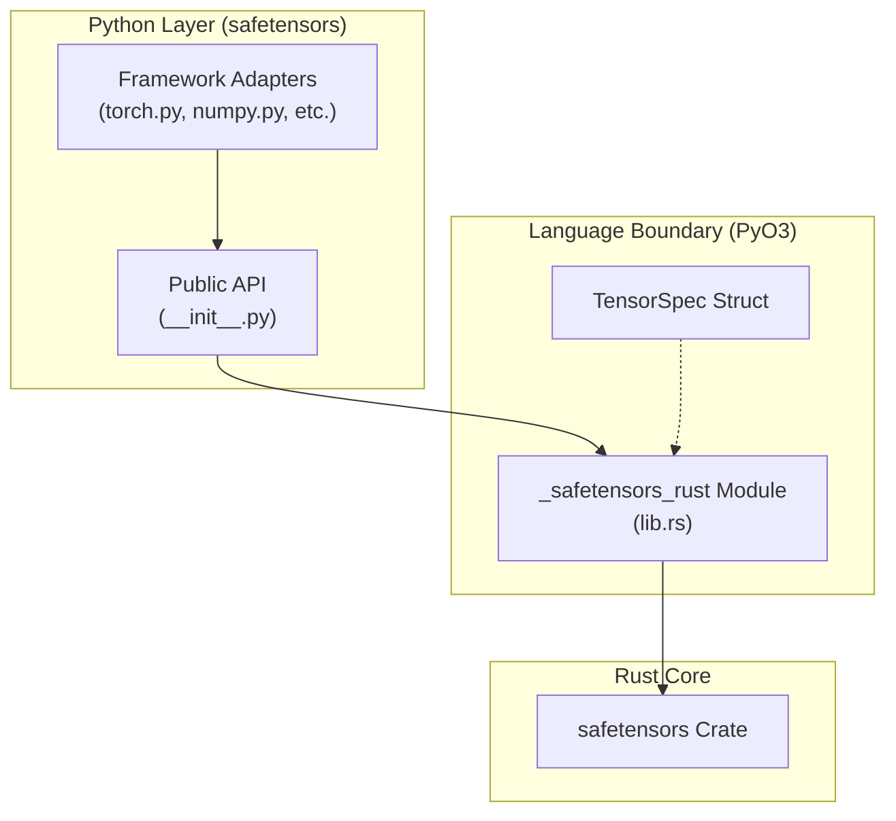
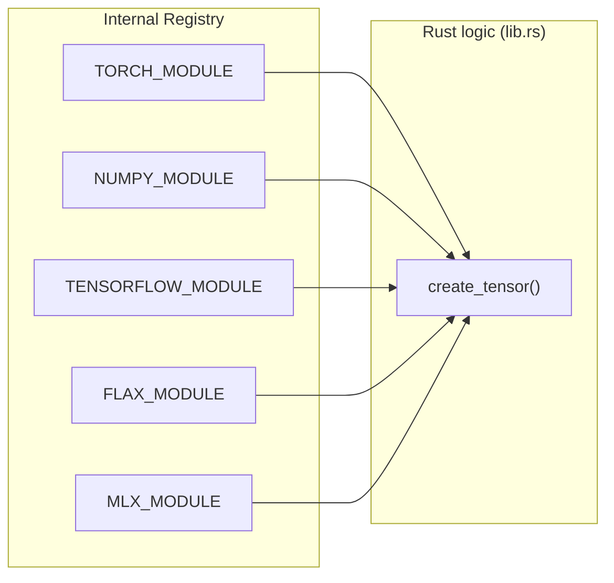

<!-- source: DeepWiki mcp.deepwiki.com · repo huggingface/safetensors · page 3 Python Bindings · fetched 2026-10-21 -->

# Python Bindings

Relevant source files

The following files were used as context for generating this wiki page:

- [.github/workflows/python-bench.yml](.github/workflows/python-bench.yml)
- [bindings/python/Cargo.toml](bindings/python/Cargo.toml)
- [bindings/python/py_src/safetensors/__init__.py](bindings/python/py_src/safetensors/__init__.py)
- [bindings/python/py_src/safetensors/__init__.pyi](bindings/python/py_src/safetensors/__init__.pyi)
- [bindings/python/pyproject.toml](bindings/python/pyproject.toml)
- [bindings/python/src/lib.rs](bindings/python/src/lib.rs)
- [bindings/python/stub.py](bindings/python/stub.py)
- [bindings/python/uv.lock](bindings/python/uv.lock)

This document provides a high-level overview of the Python integration for the `safetensors` library. These bindings serve as the interface between Python code and the core Rust implementation, enabling users to leverage the safety and performance features of `safetensors` within their preferred machine learning frameworks.

The Python bindings are implemented using **PyO3**, providing a low-overhead bridge between Rust's safety and Python's flexibility.

## 1. Architecture Overview

The Python integration is structured into two main parts: a high-performance Rust extension module (`_safetensors_rust`) and a set of framework-specific Python adapters.

Sources: [bindings/python/src/lib.rs:1-20](), [bindings/python/py_src/safetensors/__init__.py:1-11](), [bindings/python/Cargo.toml:8-13]()

## 2. Language Boundary and Type Conversion

The core of the integration resides in `bindings/python/src/lib.rs`. It defines how Python objects are mapped to Rust types and how the core `safetensors` logic is exposed to the Python interpreter.

### 2.1 TensorSpec and Serialization
To serialize tensors from Python, the library uses the `TensorSpec` class. This class captures the necessary metadata (dtype, shape) and a raw memory pointer to the tensor's data.

| Code Entity | Role |
|:---|:---|
| `TensorSpec` | A `#[pyclass]` that stores `dtype`, `shape`, `data_ptr`, and `data_len`. [bindings/python/src/lib.rs:57-64]() |
| `parse_dtype_str` | Maps Python string names (e.g., `"float32"`) to Rust `Dtype` enums. [bindings/python/src/lib.rs:154-185]() |
| `serialize` | Takes a `Dict[str, TensorSpec]` and returns a `bytes` object. [bindings/python/src/lib.rs:187-195]() |

> **Safety Note:** The `data_ptr` in `TensorSpec` is a raw memory address. The caller must ensure the underlying buffer remains valid during serialization [bindings/python/src/lib.rs:54-56]().

### 2.2 Framework Support Strategy
The bindings maintain a registry of supported frameworks to handle zero-copy tensor creation across different libraries.

Sources: [bindings/python/src/lib.rs:31-36](), [bindings/python/src/lib.rs:229-259]()

## 3. Module Organization

The Python package is organized to provide both a low-level interface to the Rust extension and high-level utilities for ML practitioners.

*   **`safetensors._safetensors_rust`**: The compiled Rust extension.
*   **`safetensors.__init__`**: Re-exports core functions like `safe_open`, `serialize`, and `deserialize` [bindings/python/py_src/safetensors/__init__.py:2-11]().
*   **Type Stubs**: `__init__.pyi` provides static type information for IDEs and type checkers [bindings/python/py_src/safetensors/__init__.pyi:1-176]().

## 4. Sub-Pages and Detailed Integration

This parent page provides the foundation. For detailed implementation and framework-specific usage, refer to the following child pages:

### [API Reference](#3.1)
Detailed documentation of the core Python API, including `serialize`, `serialize_file`, `deserialize`, and the `safe_open` context manager. It covers the public interface exported from the Rust extension.

### [PyTorch Integration](#3.2)
Deep dive into PyTorch-specific features: `save_model`, `load_model`, shared tensor detection, and how `safetensors` interacts with PyTorch's `Storage` and device placement logic.

### [NumPy, TensorFlow, and JAX/Flax Integration](#3.3)
Overview of how NumPy acts as a core adapter layer. Covers `tensorflow.py` and `flax.py` integrations, including dtype mappings and endianness handling.

### [MLX and Other Frameworks](#3.4)
Details on specialized integrations like **MLX** for Apple Silicon (utilizing `MTLBuffer` and `DLPack`) and **PaddlePaddle** support.

Sources: [bindings/python/pyproject.toml:32-42](), [bindings/python/Cargo.toml:26-32]()

---

