# Page: Overview

# Overview

<details>
<summary>Relevant source files</summary>

The following files were used as context for generating this wiki page:

- [README.md](README.md)
- [bindings/python/README.md](bindings/python/README.md)
- [safetensors/Cargo.toml](safetensors/Cargo.toml)
- [safetensors/README.md](safetensors/README.md)
- [safetensors/src/lib.rs](safetensors/src/lib.rs)

</details>


This document provides an introduction to the safetensors project, a tensor serialization format designed as a secure, fast alternative to pickle for storing machine learning model weights. This overview covers the project's core purpose, architecture, supported frameworks, key benefits (safety, zero-copy loading, lazy loading), and high-level capabilities.

For detailed information about specific components:
- File format specification: see [File Format](#2.1)
- Rust core implementation: see [Core Rust Library](#2.2)
- Python API usage: see [API Reference](#3.1)
- Framework-specific integration: see [PyTorch Integration](#3.2) and [NumPy, TensorFlow, and JAX/Flax Integration](#3.3)
- Performance benchmarks: see [Performance](#5)
- Security guarantees: see [Security](#6)

## Purpose and Problem Statement

The safetensors library addresses critical security and performance issues in machine learning model serialization. The primary problem is that PyTorch and many other ML frameworks default to using Python's `pickle` format for saving model weights, which allows arbitrary code execution when loading files. This creates a significant security vulnerability when loading models from untrusted sources.

Safetensors provides a simple, safe binary format for storing tensors that:
- **Prevents arbitrary code execution** (unlike pickle)
- **Enables zero-copy loading** through memory mapping
- **Supports lazy loading** for partial tensor access
- **Maintains fast serialization/deserialization** performance
- **Imposes no file size limits** while preventing DOS attacks

Sources: [README.md:23-28](), [README.md:111-118](), [safetensors/Cargo.toml:12-18]()

## Core Architecture

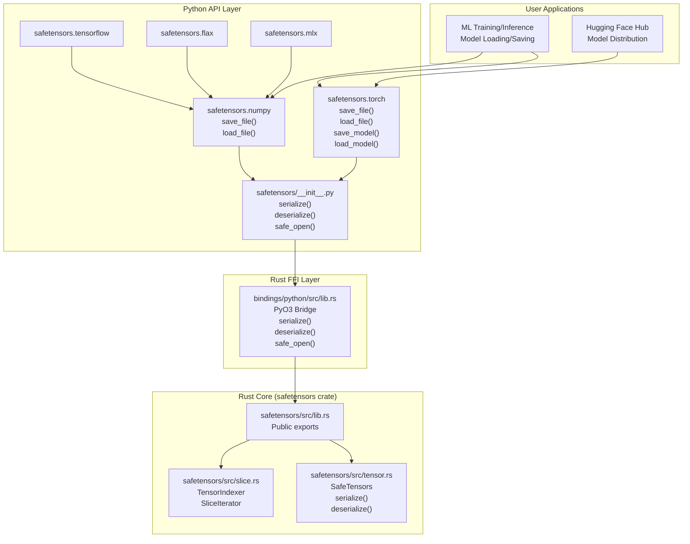

**Architecture Overview**: The safetensors system uses a three-tier architecture. The **Rust core** ([safetensors/src/]()) implements the format specification and validation logic. The **Python bindings layer** uses PyO3 to expose Rust functionality to Python with efficient type conversions. The **framework adapters** ([bindings/python/py_src/safetensors/]()) provide idiomatic interfaces for PyTorch, NumPy, TensorFlow, JAX/Flax, and MLX.

Sources: [safetensors/src/lib.rs:1-39](), [README.md:56-71](), [safetensors/Cargo.toml:24-31]()

## Serialization and Deserialization Flow

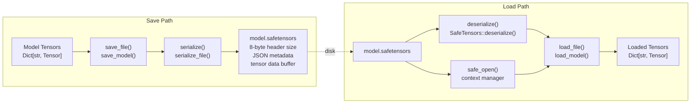

**Data Flow**: Serialization converts framework-specific tensors into the safetensors binary format using `serialize()` or `serialize_file()`. Deserialization offers two modes: **eager loading** via `load_file()` (returns all tensors as a dictionary) and **lazy loading** via `safe_open()` (memory-efficient context manager that enables on-demand tensor access and slicing).

Sources: [README.md:56-71](), [safetensors/src/lib.rs:8-9](), [bindings/python/README.md:13-44]()

## File Format Structure

The safetensors format uses a simple, safe binary layout:

| Component | Size | Description |
|-----------|------|-------------|
| Header Size | 8 bytes | Unsigned little-endian 64-bit integer (N) |
| JSON Header | N bytes | UTF-8 JSON containing tensor metadata |
| Data Buffer | Remaining bytes | Contiguous tensor data, no gaps |

### Header Structure

The JSON header contains tensor metadata with the following structure:

```json
{
  "tensor_name": {
    "dtype": "F32",
    "shape": [1024, 1024],
    "data_offsets": [0, 4194304]
  },
  "__metadata__": {
    "format": "pt",
    "version": "1.0"
  }
}
```

Key constraints enforced by the format:
- Header must begin with `{` character (0x7B) [README.md:78]()
- Header size limited to 100MB to prevent DOS attacks
- Data offsets must not overlap
- Byte buffer must be fully indexed with no gaps (prevents polyglot files) [README.md:99-100]()
- Little-endian byte order, row-major ('C') layout [README.md:101-103]()

Sources: [README.md:76-106](), [safetensors/README.md:76-106](), [safetensors/Cargo.toml:15-18]()

## Supported Frameworks

Safetensors provides native integration for major machine learning frameworks:

| Framework | Module | Key Functions |
|-----------|--------|---------------|
| PyTorch | `safetensors.torch` | `save_file()`, `load_file()`, `save_model()`, `load_model()` |
| NumPy | `safetensors.numpy` | `save_file()`, `load_file()` |
| TensorFlow | `safetensors.tensorflow` | `save_file()`, `load_file()` |
| JAX/Flax | `safetensors.flax` | `save_file()`, `load_file()` |
| MLX | `safetensors.mlx` | `save_file()`, `load_file()` |
| PaddlePaddle | `safetensors.paddle` | `save_file()`, `load_file()` |

Sources: [README.md:56-71](), [bindings/python/README.md:10-44]()

## Installation

### Via pip

```bash
pip install safetensors
```

### From Source

Building from source requires the Rust toolchain (MSRV 1.80):

```bash
# Install Rust
curl --proto '=https' --tlsv1.2 -sSf https://sh.rustup.rs | sh
rustup update

# Clone and build
git clone https://github.com/huggingface/safetensors
cd safetensors/bindings/python
pip install setuptools_rust
pip install -e .
```

Sources: [README.md:30-52](), [safetensors/Cargo.toml:5]()

## Quick Start Example

### Basic PyTorch Usage

```python
import torch
from safetensors import safe_open
from safetensors.torch import save_file

# Save tensors
tensors = {
   "weight1": torch.zeros((1024, 1024)),
   "weight2": torch.zeros((1024, 1024))
}
save_file(tensors, "model.safetensors")

# Load tensors (lazy mode)
tensors = {}
with safe_open("model.safetensors", framework="pt", device="cpu") as f:
   for key in f.keys():
       tensors[key] = f.get_tensor(key)
```

Sources: [README.md:54-71](), [bindings/python/README.md:31-44]()

## Key Features and Benefits

### Security Guarantees

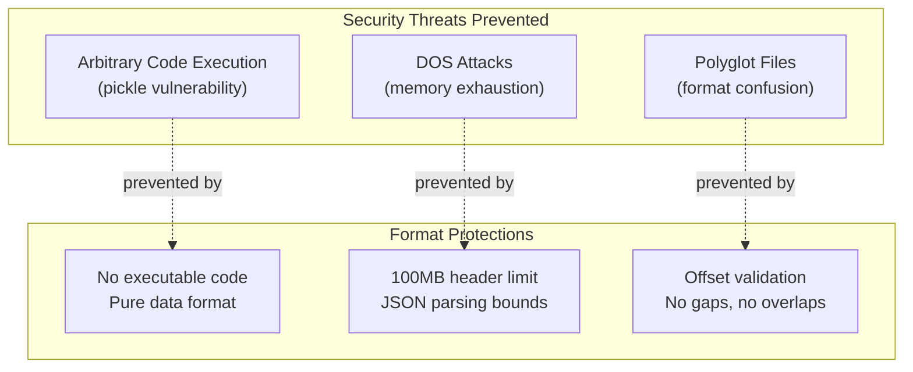

**Security Implementation**: The format contains only data - no executable code. All data offsets are validated to ensure they fall within file bounds, do not overlap, and fully index the data buffer. The 100MB header limit prevents JSON parsing DOS attacks.

Sources: [README.md:131-144](), [README.md:99-100]()

### Performance Benefits

| Feature | Benefit | Example |
|---------|---------|---------|
| Zero-copy loading | No intermediate memory allocation | Direct memory mapping |
| Lazy loading | Load only needed tensors | Distributed training: select tensors per GPU |
| Fast serialization | Minimal overhead | Simple header + data copy |
| Memory efficiency | Avoid CPU buffer duplication | GPU loading without full CPU allocation |

**Real-world Impact**: Loading the BLOOM model (176B parameters) on 8 GPUs improved from 10 minutes with PyTorch pickle to 45 seconds with safetensors. This improvement comes from lazy loading specific tensor shards directly to each GPU.

Sources: [README.md:26-27](), [README.md:132-135]()

## Implementation Characteristics

### Code Organization

The library supports both `std` (standard library) and `no_std` (embedded) Rust environments through feature flags.

```rust
// From safetensors/src/lib.rs
#![cfg_attr(not(feature = "std"), no_std)]
pub mod slice;
pub mod tensor;
pub use tensor::{serialize, Dtype, SafeTensorError, SafeTensors, View};
```

The `no_std` mode uses `alloc` and `hashbrown` instead of standard library collections to provide high-performance hash maps in constrained environments.

Sources: [safetensors/src/lib.rs:3-9](), [safetensors/src/lib.rs:18-38](), [safetensors/Cargo.toml:41-45]()

### Dependencies

The Rust core is kept minimal to reduce the attack surface:
- `serde` and `serde_json`: For header parsing/generation [safetensors/Cargo.toml:25-29]()
- `hashbrown`: High-performance hash maps for `no_std` support [safetensors/Cargo.toml:30]()
- `memmap2`: For zero-copy file access (dev-dependency) [safetensors/Cargo.toml:38]()

Sources: [safetensors/Cargo.toml:24-45]()

---

# Page: Architecture

# Architecture

<details>
<summary>Relevant source files</summary>

The following files were used as context for generating this wiki page:

- [README.md](README.md)
- [bindings/python/Cargo.toml](bindings/python/Cargo.toml)
- [safetensors/README.md](safetensors/README.md)
- [safetensors/benches/benchmark.rs](safetensors/benches/benchmark.rs)
- [safetensors/src/lib.rs](safetensors/src/lib.rs)
- [safetensors/src/slice.rs](safetensors/src/slice.rs)
- [safetensors/src/tensor.rs](safetensors/src/tensor.rs)

</details>


This document provides a comprehensive overview of the SafeTensors system architecture, describing its core components, design principles, and implementation details.

## High-Level Architecture

The SafeTensors library implements a three-tier architecture that separates concerns across implementation layers:

### Three-Tier System Design

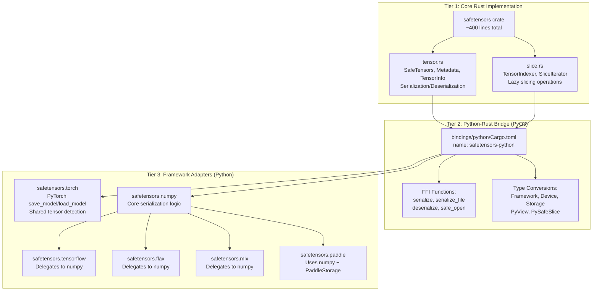

Sources: [safetensors/src/lib.rs:1-39](), [safetensors/src/tensor.rs:1-118](), [safetensors/src/slice.rs:1-64](), [bindings/python/Cargo.toml:1-19]()

### Architectural Principles

The architecture follows several key design principles:

1.  **Safety**: Format prevents arbitrary code execution (unlike pickle) through validation and no dynamic code loading.
2.  **Performance**: Zero-copy design via memory mapping and lazy loading for efficient memory usage.
3.  **Simplicity**: Compact Rust core enables thorough security audits.
4.  **Framework Agnostic**: Common format with framework-specific adapters for idiomatic interfaces.
5.  **Layered Separation**: Clean boundaries between Rust core, FFI bridge, and Python adapters.

### Core Component Overview

| Component | Responsibility | Key Entities |
|-----------|--------------|--------------|
| **File Format** | Binary layout specification | 8-byte length, JSON header, byte buffer [README.md:74-104]() |
| **Core Rust Library** | Low-level serialization/validation | `SafeTensors`, `View`, `Dtype` [safetensors/src/lib.rs:1-10]() |
| **Tensor Slicing** | Lazy partial data access | `TensorIndexer`, `SliceIterator` [safetensors/src/slice.rs:56-64]() |
| **Python Bindings** | PyO3-based bridge to Python | `safe_open`, `serialize` [README.md:52-69]() |

For details, see [File Format](#2.1), [Core Rust Library](#2.2), and [Tensor Slicing](#2.3).

## Data Flow: Serialization and Deserialization

### Serialization Path

Title: Serialization Data Flow from Framework Tensors to .safetensors File

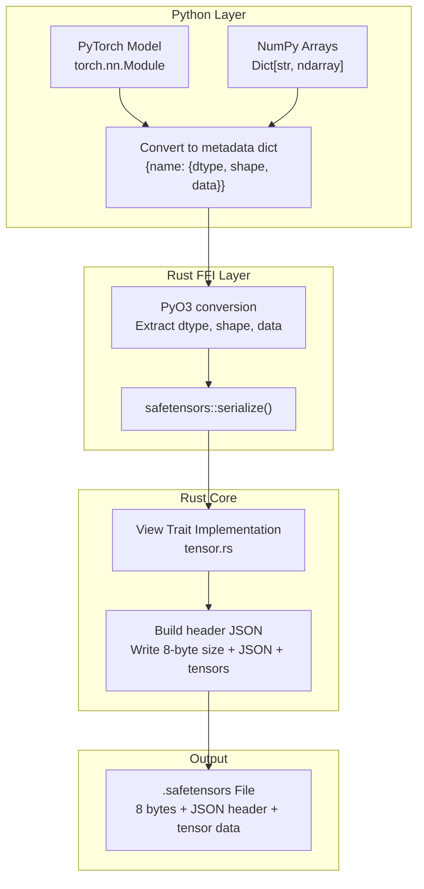

Sources: [safetensors/src/tensor.rs:126-149](), [safetensors/src/tensor.rs:179-195](), [README.md:52-69]()

### Deserialization Path

Title: Deserialization Data Flow with Eager and Lazy Loading Options

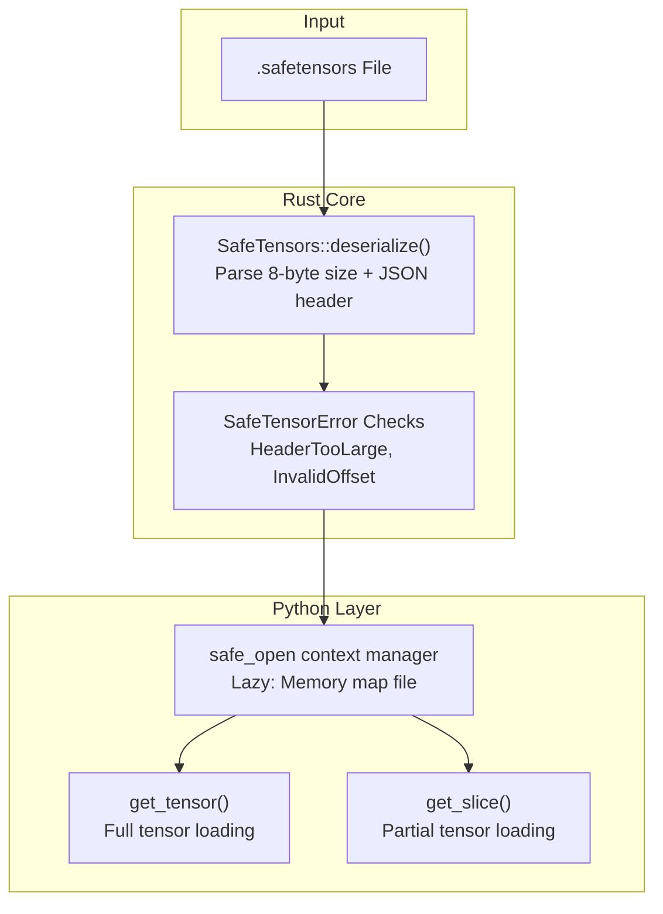

Sources: [safetensors/src/tensor.rs:13-50](), [safetensors/src/tensor.rs:511-540](), [README.md:65-69]()

## Core Rust Library Structure

The core Rust library provides the fundamental types and traits for tensor manipulation.

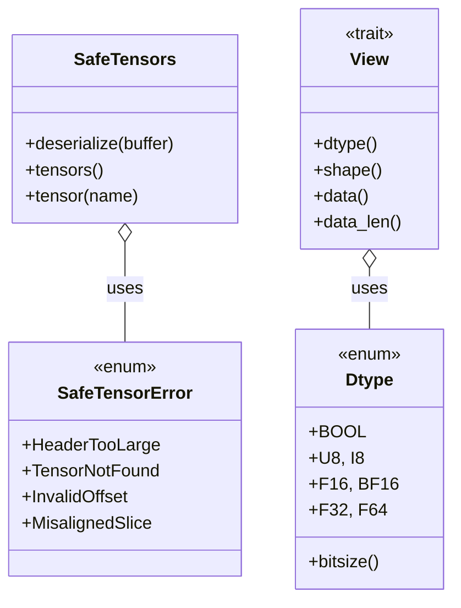

Sources: [safetensors/src/tensor.rs:15-50](), [safetensors/src/tensor.rs:130-148](), [safetensors/src/tensor.rs:511-540]()

### The View Trait

The `View` trait is fundamental to the SafeTensors architecture. It provides an abstraction for interacting with tensors regardless of their underlying implementation (owned or borrowed).

```rust
pub trait View {
   fn dtype(&self) -> Dtype;
   fn shape(&self) -> &[usize];
   fn data(&self) -> Cow<'_, [u8]>;
   fn data_len(&self) -> usize;
}
```

Sources: [safetensors/src/tensor.rs:135-148]()

## Performance and Security

SafeTensors is designed with strict constraints to ensure performance and safety:

*   **Header Limit**: The header is restricted to 100MB to prevent DoS attacks [safetensors/src/tensor.rs:10-22]().
*   **Zero-Copy**: Data is accessed directly from memory-mapped buffers without intermediate allocations [README.md:23-26]().
*   **Validation**: Offsets are validated to ensure they fully cover the buffer without overlaps, preventing polyglot file creation [README.md:99-100]().
*   **Sub-byte Alignment**: Special care is taken for dtypes smaller than 1 byte (e.g., F8), which introduce specific alignment constraints during slicing [safetensors/src/tensor.rs:47-50](), [safetensors/src/slice.rs:25-28]().

For more detailed technical information, refer to the child pages:
*   [File Format](#2.1) — Binary layout and JSON header spec.
*   [Core Rust Library](#2.2) — Rust API and `no_std` support.
*   [Tensor Slicing](#2.3) — Lazy loading and byte-range calculations.

---

# Page: File Format

# File Format

<details>
<summary>Relevant source files</summary>

The following files were used as context for generating this wiki page:

- [README.md](README.md)
- [docs/safetensors.schema.json](docs/safetensors.schema.json)
- [docs/source/_toctree.yml](docs/source/_toctree.yml)
- [docs/source/api/paddle.mdx](docs/source/api/paddle.mdx)
- [docs/source/convert-weights.md](docs/source/convert-weights.md)
- [docs/source/metadata_parsing.mdx](docs/source/metadata_parsing.mdx)
- [safetensors/README.md](safetensors/README.md)
- [safetensors/benches/benchmark.rs](safetensors/benches/benchmark.rs)
- [safetensors/src/lib.rs](safetensors/src/lib.rs)
- [safetensors/src/slice.rs](safetensors/src/slice.rs)
- [safetensors/src/tensor.rs](safetensors/src/tensor.rs)

</details>


This page documents the binary structure and specification of the safetensors file format. For information about the Rust implementation that processes this format, see [Core Rust Library](#2.2). For details on how to use the format with various frameworks, see [Python Bindings](#3).

## Overview

The safetensors format is a simple binary format designed for safe, fast, and efficient storage of machine learning tensors. The format consists of three sequential components:

1. **8-byte header length**: An unsigned 64-bit little-endian integer.
2. **JSON header**: UTF-8 encoded JSON containing tensor metadata.
3. **Data buffer**: Contiguous byte buffer containing all tensor data.

This design enables zero-copy loading through memory mapping while maintaining strict safety guarantees through validation of metadata before data access.

## Binary Structure

### File Layout

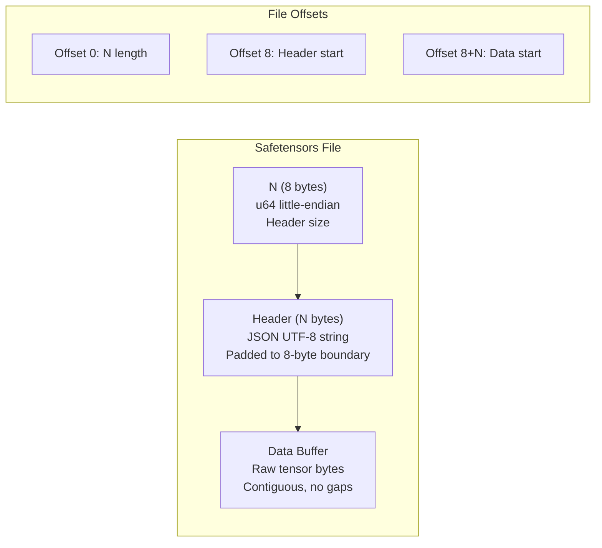

**Sources:** [safetensors/README.md:76-84](), [safetensors/src/tensor.rs:10-11](), [safetensors/src/tensor.rs:353-393]()

### Header Length (N_LEN)

The first 8 bytes of the file contain the header size as an unsigned 64-bit integer in little-endian byte order. This value is defined as `N_LEN` in the implementation.

| Byte Offset | Type | Description |
|-------------|------|-------------|
| 0-7 | `u64` (little-endian) | Size of JSON header in bytes (N) |

The implementation enforces `MAX_HEADER_SIZE = 100_000_000` bytes (100MB) to prevent denial-of-service attacks through excessively large headers.

**Sources:** [safetensors/src/tensor.rs:10-11](), [safetensors/src/tensor.rs:355-367]()

### JSON Header Structure

The header is a UTF-8 encoded JSON object. It follows a specific schema defined in `safetensors.schema.json`.

```json
{
  "__metadata__": {
    "key1": "value1",
    "key2": "value2"
  },
  "tensor_name_1": {
    "dtype": "F32",
    "shape": [2, 3, 4],
    "data_offsets": [0, 96]
  },
  "tensor_name_2": {
    "dtype": "I64",
    "shape": [10],
    "data_offsets": [96, 176]
  }
}
```

#### Header Fields

| Field | Type | Required | Description |
|-------|------|----------|-------------|
| `__metadata__` | Object | No | String-to-string map for arbitrary metadata. Only strings allowed as values. |
| `<tensor_name>` | Object | Yes (≥1) | One entry per tensor with metadata. |
| `dtype` | String | Yes | Data type identifier (e.g., "F32", "BF16"). |
| `shape` | Array[Integer] | Yes | Dimensions of the tensor. |
| `data_offsets` | Array[Integer, Integer] | Yes | `[BEGIN, END]` byte offsets relative to data buffer start. |

**Header Constraints:**
- Must begin with `{` character (0x7B).
- May be trailing padded with whitespace (0x20).
- Duplicate keys are disallowed.
- Values in `__metadata__` must be strings.

**Sources:** [safetensors/README.md:79-84](), [docs/safetensors.schema.json:12-66](), [safetensors/src/tensor.rs:254-258]()

### Data Buffer

The data buffer begins immediately after the header at offset `8 + N`. It contains raw tensor bytes.

#### Buffer Requirements

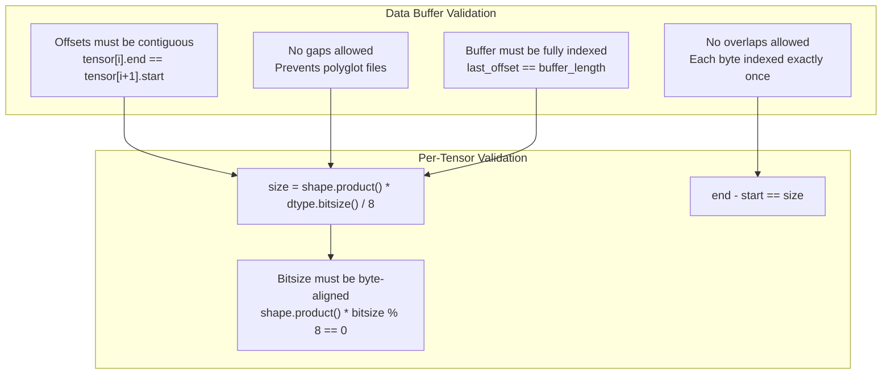

**Sources:** [safetensors/src/tensor.rs:595-632](), [safetensors/README.md:99-103]()

## Data Types (Dtype)

The format supports a comprehensive set of numeric types. The `Dtype` enum represents these types in the Rust core.

### Supported Types

| Dtype | Bits | Description |
|-------|------|-------------|
| `BOOL` | 8 | Boolean |
| `U8` | 8 | Unsigned 8-bit integer |
| `I8` | 8 | Signed 8-bit integer |
| `I16` | 16 | Signed 16-bit integer |
| `U16` | 16 | Unsigned 16-bit integer |
| `F16` | 16 | Half-precision float |
| `BF16` | 16 | Brain float 16 |
| `I32` | 32 | Signed 32-bit integer |
| `U32` | 32 | Unsigned 32-bit integer |
| `F32` | 32 | Single-precision float |
| `F64` | 64 | Double-precision float |
| `I64` | 64 | Signed 64-bit integer |
| `U64` | 64 | Unsigned 64-bit integer |

**Sub-byte Types:** Some dtypes smaller than 1 byte (like 4-bit floats) make alignment tricky and require special care during slicing.

**Sources:** [safetensors/src/tensor.rs:777-861](), [safetensors/README.md:104]()

## Serialization Process

The serialization logic in `safetensors/src/tensor.rs` handles the transition from high-level tensor views to the binary format.

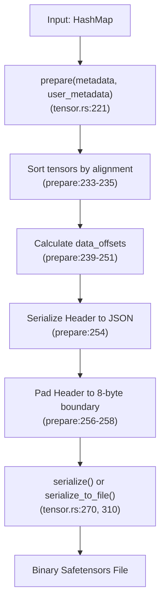

**Sources:** [safetensors/src/tensor.rs:221-268](), [safetensors/src/tensor.rs:270-302]()

## Deserialization and Validation

The `SafeTensors::deserialize()` function implement a multi-stage validation pipeline to ensure file safety.

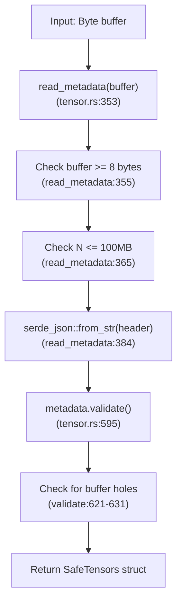

### Validation Rules (Metadata.validate())

The `validate()` method enforces these invariants:
1. **Contiguous Offsets:** Tensor offsets must follow each other exactly.
2. **Size Consistency:** The byte range `END - BEGIN` must match `shape.product() * dtype.size`.
3. **Full Coverage:** The entire data buffer must be covered by the offsets defined in the header.
4. **No Polyglots:** By ensuring no gaps, the format prevents appending the file to other formats (like ZIP) to create polyglot exploits.

**Sources:** [safetensors/src/tensor.rs:595-632](), [safetensors/src/tensor.rs:353-393](), [safetensors/README.md:99-100]()

## Format Guarantees and Constraints

### Security Guarantees

| Guarantee | Mechanism |
|-----------|-----------|
| No Code Execution | Pure JSON + Raw Data. No pickle-like opcode evaluation. |
| DOS Protection | 100MB Header cap; arithmetic overflow checks during validation. |
| Memory Safety | Strict offset and shape validation before providing slices. |

### Layout Constraints
- **Endianness:** Little-endian.
- **Order:** 'C' or row-major.
- **Alignment:** The header is padded to an 8-byte boundary to facilitate aligned access to the data buffer.

**Sources:** [safetensors/README.md:101-104](), [safetensors/src/tensor.rs:10](), [safetensors/src/tensor.rs:595-632]()

## Implementation Reference

Key code entities for format processing:

| Entity | Location | Role |
|--------|----------|------|
| `SafeTensors` | [safetensors/src/tensor.rs:331]() | Primary structure for reading/accessing safetensors files. |
| `Metadata` | [safetensors/src/tensor.rs:556]() | Internal representation of the JSON header. |
| `TensorInfo` | [safetensors/src/tensor.rs:763]() | Metadata for a single tensor (dtype, shape, offsets). |
| `SafeTensorError` | [safetensors/src/tensor.rs:16]() | Errors for invalid headers, offsets, or sizes. |
| `serialize` | [safetensors/src/tensor.rs:270]() | Main entry point for binary serialization. |

**Sources:** [safetensors/src/tensor.rs:1-862]()

---

# Page: Core Rust Library

# Core Rust Library

<details>
<summary>Relevant source files</summary>

The following files were used as context for generating this wiki page:

- [README.md](README.md)
- [safetensors/Cargo.toml](safetensors/Cargo.toml)
- [safetensors/README.md](safetensors/README.md)
- [safetensors/benches/benchmark.rs](safetensors/benches/benchmark.rs)
- [safetensors/fuzz/.gitignore](safetensors/fuzz/.gitignore)
- [safetensors/fuzz/Cargo.toml](safetensors/fuzz/Cargo.toml)
- [safetensors/fuzz/fuzz_targets/fuzz_target_1.rs](safetensors/fuzz/fuzz_targets/fuzz_target_1.rs)
- [safetensors/src/lib.rs](safetensors/src/lib.rs)
- [safetensors/src/slice.rs](safetensors/src/slice.rs)
- [safetensors/src/tensor.rs](safetensors/src/tensor.rs)

</details>


## Purpose and Scope

This document describes the `safetensors` Rust crate, which provides the core implementation of the safetensors format. This crate defines the primary data structures (`SafeTensors`, `Metadata`, `TensorInfo`, `TensorView`), serialization/deserialization functions, the `View` trait for custom tensor types, error types, and support for both `std` and `no_std` environments.

For information about the binary file format specification, see [File Format](#2.1). For tensor slicing and lazy loading capabilities, see [Tensor Slicing](#2.3). For Python bindings that wrap this Rust library, see [Python Bindings](#3).

---

## Crate Structure and Dependencies

The `safetensors` crate is organized into primary modules with minimal external dependencies:

| Module | File | Purpose |
|--------|------|---------|
| `tensor` | [safetensors/src/tensor.rs]() | Core serialization structures and functions |
| `slice` | [safetensors/src/slice.rs]() | Lazy loading and slicing support |
| `lib` | [safetensors/src/lib.rs]() | Root module with feature flag handling |

### Dependencies

The crate has a minimal dependency footprint, as specified in [safetensors/Cargo.toml:24-30]():

```toml
[dependencies]
serde = { version = "1.0", default-features = false, features = ["derive", "alloc"] }
serde_json = { version = "1.0", default-features = false, features = ["alloc"] }
hashbrown = { version = "0.16", features = ["serde"] }
tempfile = { version = "3", optional = true }
```

Development dependencies include `memmap2` for memory-mapped files, `criterion` for benchmarks, and `proptest` for property-based testing [safetensors/Cargo.toml:36-40]().

**Sources:** [safetensors/Cargo.toml:1-46](), [safetensors/src/lib.rs:1-39]()

---

## Core Data Structures Overview

The following diagram illustrates the relationships between the core data structures in the `safetensors` crate:

**Diagram: Core Structure Relationships**

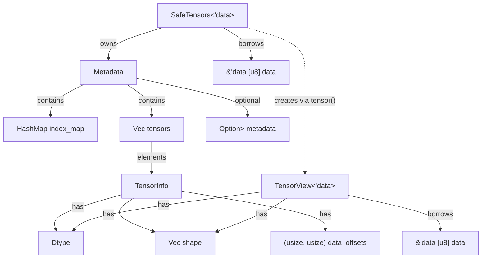

**Sources:** [safetensors/src/tensor.rs:342-348](), [safetensors/src/tensor.rs:499-504](), [safetensors/src/tensor.rs:670-678](), [safetensors/src/tensor.rs:766-774]()

---

## SafeTensors Struct

The `SafeTensors<'data>` struct is the primary interface for deserializing and accessing tensors from a safetensors buffer. It owns the parsed metadata but only borrows the underlying data buffer, enabling zero-copy access.

**Definition:** [safetensors/src/tensor.rs:342-348]()

```rust
pub struct SafeTensors<'data> {
    metadata: Metadata,
    data: &'data [u8],
}
```

### Key Methods

| Method | Signature | Purpose |
|--------|-----------|---------|
| `deserialize` | `fn(&'data [u8]) -> Result<Self, SafeTensorError>` | Parse buffer and create SafeTensors instance |
| `read_metadata` | `fn(&'data [u8]) -> Result<(usize, Metadata), SafeTensorError>` | Parse only the header without creating SafeTensors |
| `tensor` | `fn(&self, &str) -> Result<TensorView<'data>, SafeTensorError>` | Get a specific tensor by name |
| `tensors` | `fn(&self) -> Vec<(String, TensorView<'data>)>` | Get all tensors as owned vector |
| `iter` | `fn(&self) -> impl Iterator<Item = (&str, TensorView<'data>)>` | Iterate over tensors |
| `names` | `fn(&self) -> Vec<&str>` | Get all tensor names |
| `len` | `fn(&self) -> usize` | Get number of tensors |

### Deserialization Process

The deserialization process is implemented in `SafeTensors::deserialize` [safetensors/src/tensor.rs:350-370]():

1. **Read header size**: Extract first 8 bytes (`N_LEN`) as little-endian `u64` representing header length.
2. **Validate header size**: Ensure header is between 8 bytes and 100MB (`MAX_HEADER_SIZE`) [safetensors/src/tensor.rs:10]().
3. **Extract header bytes**: Slice buffer from `N_LEN` to `N_LEN + n`.
4. **Parse JSON**: Deserialize header as UTF-8 string, then parse as JSON into `Metadata`.
5. **Validate metadata**: Check offsets are contiguous, non-overlapping, and cover the entire buffer.

**Sources:** [safetensors/src/tensor.rs:350-418](), [safetensors/src/tensor.rs:420-495]()

---

## Metadata Struct

The `Metadata` struct stores the parsed header information and provides indexed access to tensor metadata.

**Definition:** [safetensors/src/tensor.rs:499-504]()

```rust
pub struct Metadata {
    metadata: Option<HashMap<String, String>>,
    tensors: Vec<TensorInfo>,
    index_map: HashMap<String, usize>,
}
```

### Validation Logic

The `validate` method performs critical safety checks to prevent malformed files or polyglot attacks [safetensors/src/tensor.rs:595-632]():

1. **Offset continuity**: Verifies each tensor's start offset equals the previous tensor's end offset.
2. **Offset ordering**: Ensures end offset is greater than or equal to start offset.
3. **Size calculation**: Computes expected size from shape and dtype, checking for `ValidationOverflow` [safetensors/src/tensor.rs:89]().
4. **Byte alignment**: Validates that sub-byte dtypes (F4, F6) align on byte boundaries [safetensors/src/tensor.rs:90]().
5. **Size matching**: Confirms computed size matches declared `data_offsets` range.

**Sources:** [safetensors/src/tensor.rs:499-668]()

---

## TensorView Struct

`TensorView<'data>` provides a read-only view of a single tensor, borrowing data from the parent buffer.

**Definition:** [safetensors/src/tensor.rs:670-678]()

### Key Methods

| Method | Purpose |
|--------|---------|
| `new(dtype, shape, &'data [u8])` | Create validated TensorView, checking size matches shape×dtype |
| `dtype() -> Dtype` | Get tensor data type |
| `shape() -> &[usize]` | Get tensor dimensions |
| `data() -> &'data [u8]` | Get raw byte buffer |
| `sliced_data(&[TensorIndexer])` | Get iterator over sliced data chunks |

`TensorView` implements the `View` trait [safetensors/src/tensor.rs:680-714](), enabling it to be serialized back to safetensors format.

**Sources:** [safetensors/src/tensor.rs:670-761]()

---

## Dtype Enum

The `Dtype` enum enumerates all supported data types, including modern sub-byte types.

**Definition:** [safetensors/src/tensor.rs:776-825]()

### Supported Types

| Category | Types |
|----------|-------|
| **Boolean** | BOOL |
| **Sub-byte** | F4, F6_E2M3, F6_E3M2 |
| **8-bit** | U8, I8, F8_E5M2, F8_E4M3, F8_E8M0 |
| **16-bit** | I16, U16, F16, BF16 |
| **32-bit** | I32, U32, F32, C64 |
| **64-bit** | F64, I64, U64 |

The `bitsize()` method returns the bit width of each dtype [safetensors/src/tensor.rs:828-852]().

**Sources:** [safetensors/src/tensor.rs:776-888]()

---

## The View Trait

The `View` trait enables custom tensor types to be serialized. Any type implementing this trait can be passed to the `serialize` function.

**Definition:** [safetensors/src/tensor.rs:208-219]()

```rust
pub trait View {
    fn dtype(&self) -> Dtype;
    fn shape(&self) -> &[usize];
    fn data(&self) -> Cow<'_, [u8]>;
    fn data_len(&self) -> usize;
}
```

**Diagram: View Trait Implementation Flow**

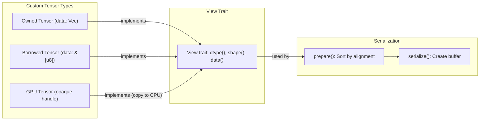

**Sources:** [safetensors/src/tensor.rs:129-219](), [safetensors/src/tensor.rs:680-714]()

---

## Serialization Pipeline

The crate provides two primary serialization functions.

**Diagram: Serialization Flow**

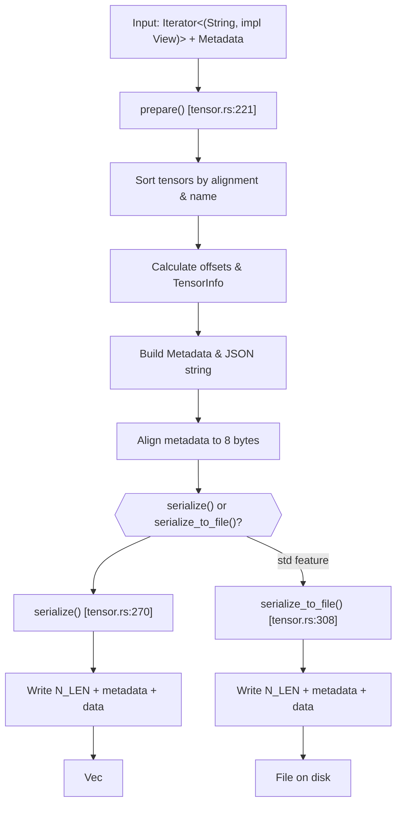

### serialize_to_file Function (std only)

Only available with the `std` feature flag [safetensors/src/lib.rs:7-8](). It writes directly to a file using a `BufWriter` [safetensors/src/tensor.rs:304-340](), avoiding full memory allocation for the output file.

**Sources:** [safetensors/src/tensor.rs:221-340]()

---

## Feature Flags and no_std Support

The crate supports `no_std` environments by using the `alloc` crate and conditional exports in `lib.rs`.

### lib.rs Abstraction Layer

The [safetensors/src/lib.rs:18-38]() module provides a facade that conditionally exports types from either `std` or `alloc`/`core`:

```rust
mod lib {
    #[cfg(not(feature = "std"))]
    mod no_stds {
        pub use alloc::borrow::Cow;
        pub use alloc::string::{String, ToString};
        pub use alloc::vec::Vec;
        pub use hashbrown::HashMap;
    }
    #[cfg(feature = "std")]
    mod stds {
        pub use std::borrow::Cow;
        pub use std::collections::HashMap;
        pub use std::string::{String, ToString};
        pub use std::vec::Vec;
    }
    #[cfg(not(feature = "std"))]
    pub use no_stds::*;
    #[cfg(feature = "std")]
    pub use stds::*;
}
```

**Sources:** [safetensors/Cargo.toml:41-43](), [safetensors/src/lib.rs:1-39]()

---

# Page: Tensor Slicing

# Tensor Slicing

<details>
<summary>Relevant source files</summary>

The following files were used as context for generating this wiki page:

- [bindings/python/src/lib.rs](bindings/python/src/lib.rs)
- [bindings/python/tests/test_pt_comparison.py](bindings/python/tests/test_pt_comparison.py)
- [safetensors/benches/benchmark.rs](safetensors/benches/benchmark.rs)
- [safetensors/src/slice.rs](safetensors/src/slice.rs)
- [safetensors/src/tensor.rs](safetensors/src/tensor.rs)

</details>


## Purpose and Overview

Tensor Slicing is a core feature of the SafeTensors library that enables efficient memory access to partial tensor data without loading entire tensors into memory. This capability is particularly valuable when working with large machine learning models, allowing users to extract only the specific portions of tensors they need for computation.

The tensor slicing functionality is implemented in the Rust core of SafeTensors and exposed through the language bindings, primarily Python. It provides NumPy/PyTorch-like slicing syntax for accessing subsets of tensor data directly from serialized files.

For information about the overall file format, see [File Format](#2.1). For details on the core serialization and deserialization functions, see [Core Rust Library](#2.2).

## Core Concepts

Tensor slicing in SafeTensors works by:

1. Allowing memory-mapped access to tensor data files via `memmap2`.
2. Computing exact byte offsets for the requested slice using `SliceIterator`.
3. Reading only the necessary bytes from storage.
4. Reshaping the resulting data to match the slice dimensions.

This approach is significantly more efficient than loading the entire tensor and then slicing it in memory, especially for large models where memory constraints are a concern.

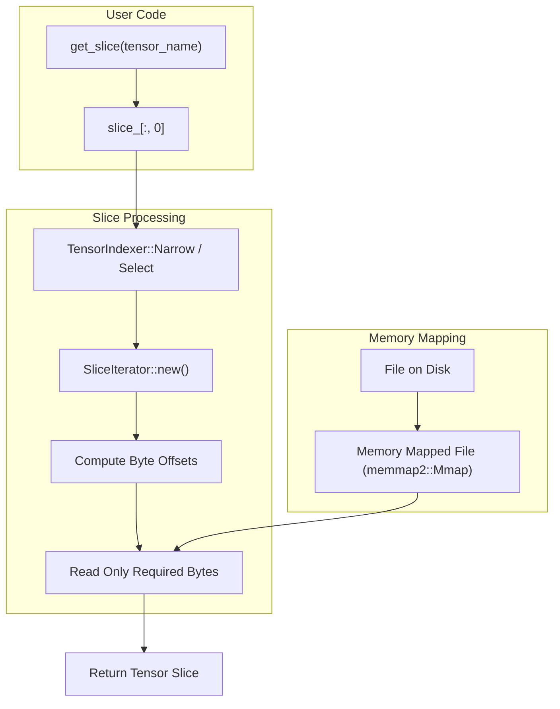

Sources: [safetensors/src/slice.rs:1-7](), [bindings/python/src/lib.rs:9-19]()

## Implementation Architecture

The tensor slicing implementation spans both the Rust core and Python bindings, with several key components working together to provide efficient slicing operations.

### Rust Core Components

The core logic resides in `safetensors/src/slice.rs`. It defines how indices are represented and how they map to the underlying byte buffer.

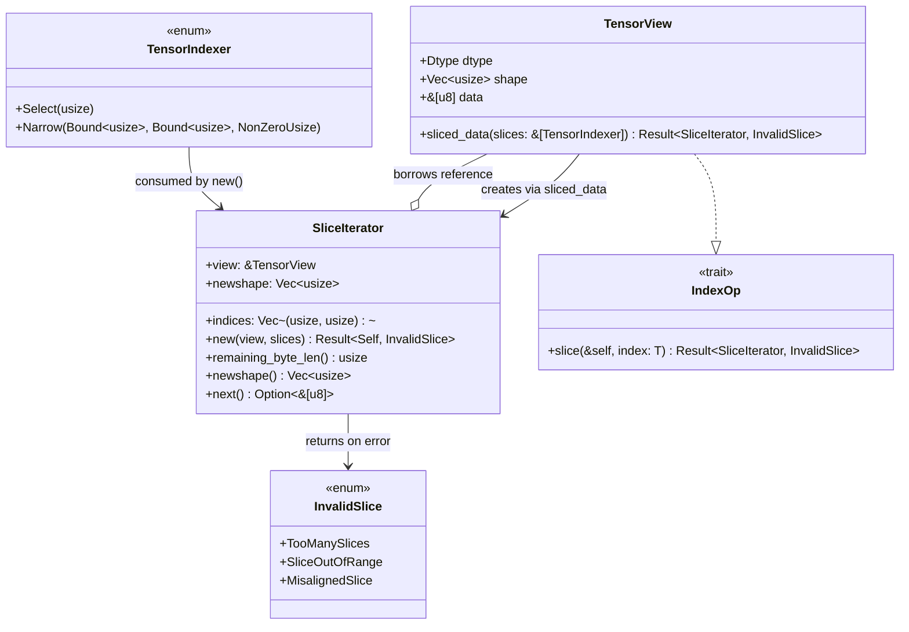

Sources: [safetensors/src/slice.rs:55-64](), [safetensors/src/slice.rs:145-149](), [safetensors/src/slice.rs:268-273](), [safetensors/src/tensor.rs:3-5]()

### Python Binding Components

The Python layer in `bindings/python/src/lib.rs` provides the user-facing `safe_open` interface and handles the conversion from Python `slice` objects to Rust `TensorIndexer`.

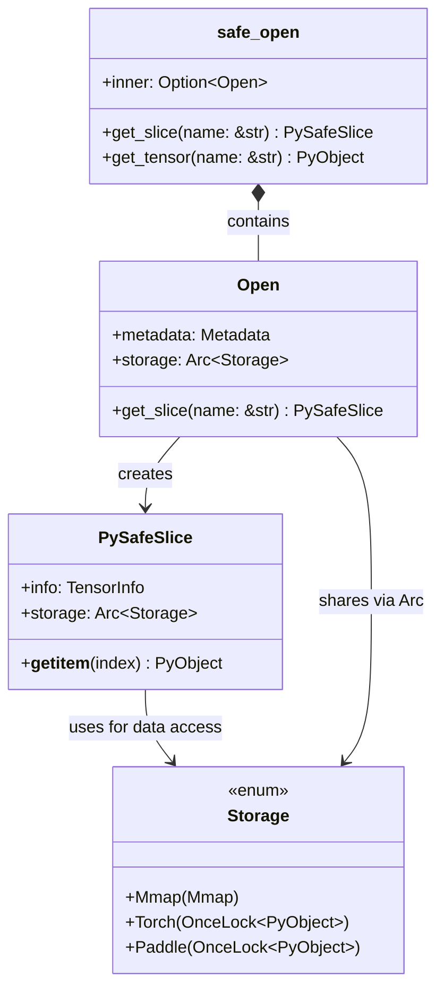

Sources: [bindings/python/src/lib.rs:385-397](), [bindings/python/src/lib.rs:441-450](), [bindings/python/src/lib.rs:839-848](), [bindings/python/src/lib.rs:1009-1016]()

## TensorIndexer Enum

The `TensorIndexer` enum at [safetensors/src/slice.rs:58-64]() specifies how to index a tensor dimension.

1. **Select(usize)**: Selects a specific index, removing that dimension from the result.
2. **Narrow(Bound\<usize\>, Bound\<usize\>, NonZeroUsize)**: Selects a range (start, stop, step), preserving the dimension.

### Conversion from Rust Range Types

The implementation in [safetensors/src/slice.rs:112-141]() provides automatic `From` trait implementations for idiomatic Rust range syntax. Note that the `step` in `Narrow` is initialized to `NonZeroUsize::MIN` (which is 1) for these ranges.

| Rust Range Type | Example | TensorIndexer Equivalent |
|-----------------|---------|--------------------------|
| `Range<usize>` | `0..5` | `Narrow(Included(0), Excluded(5), 1)` |
| `RangeFrom<usize>` | `2..` | `Narrow(Included(2), Unbounded, 1)` |
| `RangeFull` | `..` | `Narrow(Unbounded, Unbounded, 1)` |
| `RangeInclusive<usize>` | `0..=4` | `Narrow(Included(0), Included(4), 1)` |
| `usize` | `3` | `Select(3)` |

### Display Implementation

The `Display` trait implementation at [safetensors/src/slice.rs:75-90]() formats indexers in Python-like syntax:
- `Select(3)` → `"3"`
- `Narrow(Included(2), Excluded(5), 1)` → `"2:5"`
- `Narrow(Unbounded, Excluded(5), 2)` → `":5:2"`

Sources: [safetensors/src/slice.rs:58-90](), [safetensors/src/slice.rs:112-141]()

## SliceIterator Structure

The `SliceIterator` at [safetensors/src/slice.rs:268-273]() iterates over the byte chunks that constitute a slice. It pre-computes all necessary byte offsets during construction.

### Structure Fields

```rust
pub struct SliceIterator<'data> {
    view: &'data TensorView<'data>,  // Borrowed reference to original tensor
    indices: Vec<(usize, usize)>,    // Pre-computed (start, stop) byte offsets
    newshape: Vec<usize>,            // Resulting shape after slicing
}
```

### Iterator Implementation

The `Iterator` trait implementation at [safetensors/src/slice.rs:388-398]() yields byte slices:

```rust
fn next(&mut self) -> Option<&'data [u8]> {
    let (start, stop) = self.indices.pop()?;
    Some(&self.view.data()[start..stop])
}
```

The `indices` vector is reversed during construction so `pop()` yields chunks in the correct order efficiently [safetensors/src/slice.rs:369]().

### Sub-byte Alignment Constraints

SafeTensors supports sub-byte types like `F4` (4 bits per element). Slicing these requires special care because a slice might start or end in the middle of a byte.

The `SliceIterator` checks for alignment at [safetensors/src/slice.rs:337-342]() and [safetensors/src/slice.rs:351-353](). If a slice for a sub-byte dtype does not land on a byte boundary, it returns `InvalidSlice::MisalignedSlice`. This ensures that the yielded `&[u8]` chunks are always valid whole bytes.

Sources: [safetensors/src/slice.rs:268-273](), [safetensors/src/slice.rs:337-353](), [safetensors/src/slice.rs:388-398]()

## Slicing Algorithm

The core slicing algorithm is implemented in `SliceIterator::new` at [safetensors/src/slice.rs:275-375]().

### Algorithm Steps

1. **Validation**: Checks if the number of slices exceeds tensor dimensions [safetensors/src/slice.rs:281-283]().
2. **Span Calculation**: Tracks the "span" (byte size of a single element or dimension) while iterating dimensions in reverse (row-major order) [safetensors/src/slice.rs:290-366]().
3. **Index Expansion**: For each dimension, it expands the existing `indices` (byte ranges). If a dimension is narrowed, the number of byte ranges increases unless the dimension is contiguous [safetensors/src/slice.rs:344-362]().
4. **Byte Range Mapping**: Converts logical element indices (start/stop) into physical byte offsets by multiplying by the current `span` [safetensors/src/slice.rs:317-318]().
5. **Shape Update**: Updates `newshape` based on whether the dimension was `Select`ed or `Narrow`ed [safetensors/src/slice.rs:309-312]().

Sources: [safetensors/src/slice.rs:275-375]()

## Python API: safe_open and PySafeSlice

The `safe_open` context manager provides the primary entry point for slicing in Python.

### safe_open and Open

The `safe_open` class at [bindings/python/src/lib.rs:873-882]() wraps an `Open` struct. When `get_slice(name)` is called, it returns a `PySafeSlice` [bindings/python/src/lib.rs:856-871]().

### PySafeSlice.__getitem__

The `PySafeSlice` struct at [bindings/python/src/lib.rs:1009-1016]() implements `__getitem__` to handle Python slicing syntax:

- It parses Python `slice`, `int`, `Ellipsis`, and `None` (newaxis) into a vector of `TensorIndexer` [bindings/python/src/lib.rs:1022-1135]().
- It handles `Ellipsis` by calculating how many `RangeFull` indexers are needed to fill the gap between specified indices [bindings/python/src/lib.rs:1053-1070]().
- It uses `slice_to_indexer` to convert individual Python slice objects to Rust `TensorIndexer` [bindings/python/src/lib.rs:201-236]().
- Finally, it calls `SliceIterator` to get the byte ranges and reconstructs a tensor in the requested framework (PyTorch, NumPy, etc.) [bindings/python/src/lib.rs:1140-1185]().

### Python Usage Example

```python
from safetensors import safe_open

with safe_open("model.safetensors", framework="pt") as f:
    # Returns PySafeSlice, no data loaded yet
    slice_obj = f.get_slice("embeddings.weight")
    
    # Slice using standard Python syntax
    # Only the required bytes are read from the file
    subset = slice_obj[0:10, :] 
    
    # Ellipsis support
    middle = slice_obj[..., 5:10]
```

Sources: [bindings/python/src/lib.rs:201-236](), [bindings/python/src/lib.rs:856-871](), [bindings/python/src/lib.rs:1009-1185]()

## Performance and Memory Efficiency

### Zero-Copy and Lazy Loading
Slicing relies on memory mapping via `memmap2`. By default, `safe_open` maps the file into memory. When a slice is requested, the library only touches the pages corresponding to the calculated byte ranges.

### Framework Integration
- **PyTorch**: Uses `UntypedStorage.from_file` for efficient file-backed tensors [bindings/python/src/lib.rs:533-581]().
- **Paddle**: Uses `paddle.MmapStorage` [bindings/python/src/lib.rs:496-532]().
- **MLX**: Uses `MTLBuffer` and DLPack for high-performance loading on Apple Silicon [bindings/python/src/lib.rs:3-6]().

Sources: [bindings/python/src/lib.rs:496-581](), [bindings/python/src/lib.rs:1018-1185]()

---

# Page: Python Bindings

# Python Bindings

<details>
<summary>Relevant source files</summary>

The following files were used as context for generating this wiki page:

- [.github/workflows/python-bench.yml](.github/workflows/python-bench.yml)
- [bindings/python/Cargo.toml](bindings/python/Cargo.toml)
- [bindings/python/py_src/safetensors/__init__.py](bindings/python/py_src/safetensors/__init__.py)
- [bindings/python/py_src/safetensors/__init__.pyi](bindings/python/py_src/safetensors/__init__.pyi)
- [bindings/python/pyproject.toml](bindings/python/pyproject.toml)
- [bindings/python/src/lib.rs](bindings/python/src/lib.rs)
- [bindings/python/stub.py](bindings/python/stub.py)
- [bindings/python/uv.lock](bindings/python/uv.lock)

</details>


This document provides a high-level overview of the Python integration for the `safetensors` library. These bindings serve as the interface between Python code and the core Rust implementation, enabling users to leverage the safety and performance features of `safetensors` within their preferred machine learning frameworks.

The Python bindings are implemented using **PyO3**, providing a low-overhead bridge between Rust's safety and Python's flexibility.

## 1. Architecture Overview

The Python integration is structured into two main parts: a high-performance Rust extension module (`_safetensors_rust`) and a set of framework-specific Python adapters.

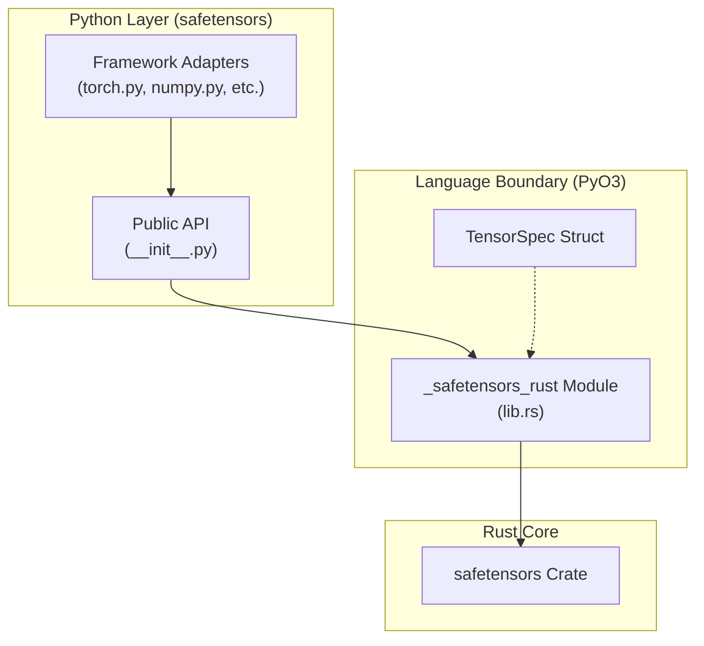

Sources: [bindings/python/src/lib.rs:1-20](), [bindings/python/py_src/safetensors/__init__.py:1-11](), [bindings/python/Cargo.toml:8-13]()

## 2. Language Boundary and Type Conversion

The core of the integration resides in `bindings/python/src/lib.rs`. It defines how Python objects are mapped to Rust types and how the core `safetensors` logic is exposed to the Python interpreter.

### 2.1 TensorSpec and Serialization
To serialize tensors from Python, the library uses the `TensorSpec` class. This class captures the necessary metadata (dtype, shape) and a raw memory pointer to the tensor's data.

| Code Entity | Role |
|:---|:---|
| `TensorSpec` | A `#[pyclass]` that stores `dtype`, `shape`, `data_ptr`, and `data_len`. [bindings/python/src/lib.rs:57-64]() |
| `parse_dtype_str` | Maps Python string names (e.g., `"float32"`) to Rust `Dtype` enums. [bindings/python/src/lib.rs:154-185]() |
| `serialize` | Takes a `Dict[str, TensorSpec]` and returns a `bytes` object. [bindings/python/src/lib.rs:187-195]() |

> **Safety Note:** The `data_ptr` in `TensorSpec` is a raw memory address. The caller must ensure the underlying buffer remains valid during serialization [bindings/python/src/lib.rs:54-56]().

### 2.2 Framework Support Strategy
The bindings maintain a registry of supported frameworks to handle zero-copy tensor creation across different libraries.

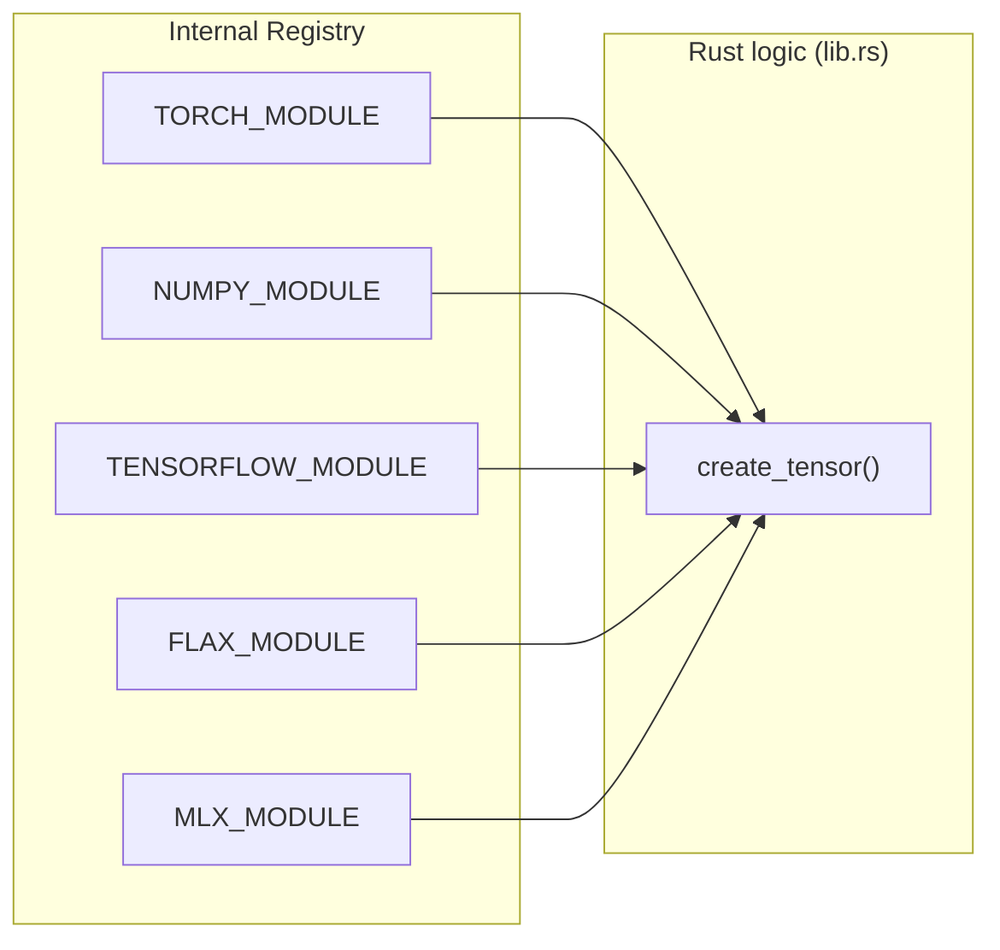

Sources: [bindings/python/src/lib.rs:31-36](), [bindings/python/src/lib.rs:229-259]()

## 3. Module Organization

The Python package is organized to provide both a low-level interface to the Rust extension and high-level utilities for ML practitioners.

*   **`safetensors._safetensors_rust`**: The compiled Rust extension.
*   **`safetensors.__init__`**: Re-exports core functions like `safe_open`, `serialize`, and `deserialize` [bindings/python/py_src/safetensors/__init__.py:2-11]().
*   **Type Stubs**: `__init__.pyi` provides static type information for IDEs and type checkers [bindings/python/py_src/safetensors/__init__.pyi:1-176]().

## 4. Sub-Pages and Detailed Integration

This parent page provides the foundation. For detailed implementation and framework-specific usage, refer to the following child pages:

### [API Reference](#3.1)
Detailed documentation of the core Python API, including `serialize`, `serialize_file`, `deserialize`, and the `safe_open` context manager. It covers the public interface exported from the Rust extension.

### [PyTorch Integration](#3.2)
Deep dive into PyTorch-specific features: `save_model`, `load_model`, shared tensor detection, and how `safetensors` interacts with PyTorch's `Storage` and device placement logic.

### [NumPy, TensorFlow, and JAX/Flax Integration](#3.3)
Overview of how NumPy acts as a core adapter layer. Covers `tensorflow.py` and `flax.py` integrations, including dtype mappings and endianness handling.

### [MLX and Other Frameworks](#3.4)
Details on specialized integrations like **MLX** for Apple Silicon (utilizing `MTLBuffer` and `DLPack`) and **PaddlePaddle** support.

Sources: [bindings/python/pyproject.toml:32-42](), [bindings/python/Cargo.toml:26-32]()

---

# Page: API Reference

# API Reference

<details>
<summary>Relevant source files</summary>

The following files were used as context for generating this wiki page:

- [bindings/python/py_src/safetensors/__init__.py](bindings/python/py_src/safetensors/__init__.py)
- [bindings/python/py_src/safetensors/__init__.pyi](bindings/python/py_src/safetensors/__init__.pyi)
- [bindings/python/src/lib.rs](bindings/python/src/lib.rs)
- [bindings/python/stub.py](bindings/python/stub.py)
- [bindings/python/tests/test_simple.py](bindings/python/tests/test_simple.py)
- [docs/source/index.mdx](docs/source/index.mdx)

</details>


This page provides a comprehensive reference to the Python API of the `safetensors` library. The public interface is primarily exported from `safetensors._safetensors_rust` via the `safetensors` package.

## Core API Overview

The core API provides fundamental functions for serializing and deserializing tensors. It is designed to be framework-agnostic at the lowest level, using raw memory addresses and lengths for serialization.

### Code Entity Association

The following diagram bridges the high-level Python API calls to the underlying Rust-backed entities defined in the bindings.

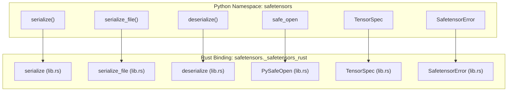
Sources: [bindings/python/py_src/safetensors/__init__.py:2-11](), [bindings/python/src/lib.rs:59-64](), [bindings/python/src/lib.rs:187-200]()

## Public Interface

### `TensorSpec`
A class describing a single tensor's metadata and memory location for serialization.

**Constructor:**
`TensorSpec(dtype: str, shape: Sequence[int], data_ptr: int, data_len: int)`

*   **dtype**: The data type string (e.g., `"float32"`, `"int64"`, `"bfloat16"`). Note: `float4_e2m1fn_x2` is handled specially by doubling the last dimension of the shape to reflect logical element count [bindings/python/src/lib.rs:75-83]().
*   **shape**: A list of integers representing the tensor dimensions.
*   **data_ptr**: The raw memory address (as an integer) of the contiguous buffer [bindings/python/src/lib.rs:110-112]().
*   **data_len**: The total size of the buffer in bytes [bindings/python/src/lib.rs:114-118]().

**Properties:**
*   `dtype`: Returns the safetensors format code (e.g., `"F32"`) [bindings/python/py_src/safetensors/__init__.pyi:137-143]().
*   `shape`: Returns the logical shape [bindings/python/py_src/safetensors/__init__.pyi:146-152]().
*   `data_ptr`: The memory address [bindings/python/py_src/safetensors/__init__.pyi:129-135]().
*   `data_len`: The buffer length in bytes [bindings/python/py_src/safetensors/__init__.pyi:122-127]().

Sources: [bindings/python/src/lib.rs:59-129](), [bindings/python/py_src/safetensors/__init__.pyi:93-152]()

### `serialize(tensor_dict, metadata=None)`
Serializes a dictionary of `TensorSpec` objects into a `bytes` object.

*   **tensor_dict**: `Dict[str, TensorSpec]`
*   **metadata**: `Optional[Dict[str, str]]` - Optional key-value pairs for the header.

**Safety Warning:** The caller must ensure that the memory pointed to by `data_ptr` in each `TensorSpec` remains valid for the duration of this call [bindings/python/src/lib.rs:189-195]().

Sources: [bindings/python/src/lib.rs:187-210](), [bindings/python/py_src/safetensors/__init__.pyi:35-60]()

### `serialize_file(tensor_dict, filename, metadata=None)`
Same as `serialize`, but writes the result directly to a file on disk.

*   **filename**: `Union[str, os.PathLike]`

Sources: [bindings/python/src/lib.rs:212-230](), [bindings/python/py_src/safetensors/__init__.pyi:63-91]()

### `safe_open(filename, framework, device="cpu", *, backend="mmap")`
A context manager for lazily loading tensors from a `.safetensors` file.

**Parameters:**
*   **framework**: One of `"pt"`, `"tf"`, `"flax"`, `"numpy"`, `"paddle"`, or `"mlx"`.
*   **device**: Target device (default `"cpu"`).
*   **backend**: Either `"mmap"` (default) or `"pread"`. `"pread"` is recommended for Apple Silicon MPS to avoid page-cache duplication [bindings/python/py_src/safetensors/__init__.pyi:169-174]().

**Methods:**
*   `keys()`: Returns list of tensor names in the file.
*   `metadata()`: Returns the header metadata dictionary.
*   `get_tensor(name)`: Loads and returns the full tensor for the given name.
*   `get_slice(name)`: Returns a `PySafeSlice` object for partial loading.

Sources: [bindings/python/py_src/safetensors/__init__.pyi:154-211](), [bindings/python/src/lib.rs:31-36]()

### `deserialize(bytes)`
Deserializes a `bytes` object into a list of tuples containing tensor names and their metadata/data.

Sources: [bindings/python/py_src/safetensors/__init__.pyi:19-32]()

## Internal Data Flow: Serialization Pipeline

The following diagram illustrates how Python objects are converted into the binary Safetensors format via the Rust bridge.

```mermaid
sequenceDiagram
    participant P as Python Caller
    participant TS as TensorSpec (Rust Struct)
    participant L as lib.rs (serialize)
    participant R as safetensors-rust (Core)
    participant B as Output Buffer/File

    P->>TS: new(dtype, shape, ptr, len)
    Note over TS: Validates dtype string<br/>Handles F4 logical shape
    P->>L: serialize(tensor_dict, metadata)
    L->>L: Map Dict[str, TensorSpec] to Vec<(&str, &TensorSpec)>
    L->>R: serialize(views, metadata)
    Note over R: Calculates offsets<br/>Writes 8-byte header length<br/>Writes JSON header
    R->>B: Write aligned binary data
    B-->>P: Return bytes or None (file)
```
Sources: [bindings/python/src/lib.rs:67-90](), [bindings/python/src/lib.rs:196-210](), [bindings/python/src/lib.rs:131-152]()

## Type Mappings

The `parse_dtype_str` function in the Rust bindings maps Python-style string identifiers to the internal `Dtype` enum used by the core library.

| Python String | Internal Dtype |
| :--- | :--- |
| `"bool"` | `BOOL` |
| `"int8"`, `"uint8"` | `I8`, `U8` |
| `"int16"`, `"uint16"` | `I16`, `U16` |
| `"int32"`, `"uint32"` | `I32`, `U32` |
| `"int64"`, `"uint64"` | `I64`, `U64` |
| `"float16"`, `"bfloat16"` | `F16`, `BF16` |
| `"float32"`, `"float64"` | `F32`, `F64` |
| `"float8_e4m3fn"`, `"float8_e5m2"` | `F8_E4M3`, `F8_E5M2` |
| `"float4_e2m1fn_x2"` | `F4` |
| `"complex64"` | `C64` |

Sources: [bindings/python/src/lib.rs:154-185]()

## Usage Examples

### Manual Serialization using `TensorSpec`
This is useful when implementing new framework adapters or handling raw memory.

```python
import numpy as np
from safetensors import serialize, TensorSpec

arr = np.zeros((2, 2), dtype=np.float32)
spec = TensorSpec(
    dtype="float32",
    shape=arr.shape,
    data_ptr=arr.ctypes.data,
    data_len=arr.nbytes
)

serialized = serialize({"weight": spec}, metadata={"version": "1.0"})
```
Sources: [bindings/python/src/lib.rs:41-56](), [bindings/python/py_src/safetensors/__init__.pyi:50-52]()

### Lazy Loading with `safe_open`
Efficiently access parts of a model without loading the entire file into memory.

```python
from safetensors import safe_open

with safe_open("model.safetensors", framework="pt", device="cpu") as f:
    # Get metadata from the header
    meta = f.metadata()
    
    # Load only a specific slice of a large tensor
    # This uses zero-copy memory mapping or efficient pread
    slice_obj = f.get_slice("large_layer")
    partial_tensor = slice_obj[0:10, :] 
```
Sources: [bindings/python/py_src/safetensors/__init__.pyi:154-211](), [docs/source/index.mdx:39-47]()

## Versioning
The current version of the library is available via `safetensors.__version__`.

Sources: [bindings/python/py_src/safetensors/__init__.py:5](), [bindings/python/py_src/safetensors/__init__.pyi:16]()

---

# Page: PyTorch Integration

# PyTorch Integration

<details>
<summary>Relevant source files</summary>

The following files were used as context for generating this wiki page:

- [bindings/python/py_src/safetensors/torch.py](bindings/python/py_src/safetensors/torch.py)
- [bindings/python/tests/test_pt_comparison.py](bindings/python/tests/test_pt_comparison.py)
- [bindings/python/tests/test_pt_model.py](bindings/python/tests/test_pt_model.py)
- [docs/source/api/torch.mdx](docs/source/api/torch.mdx)

</details>


This document explains how `safetensors` integrates with PyTorch, allowing users to save and load PyTorch tensors and models. The PyTorch integration provides specialized handling for shared tensors, supports diverse dtypes (including new FP8 formats), and enables efficient loading across hardware accelerators.

## Overview of PyTorch Integration

The PyTorch integration module acts as a bridge between PyTorch's `torch.Tensor` objects and the core `safetensors` serialization format. It manages the complexities of PyTorch's internal memory representation, such as shared storage and non-contiguous layouts.

### System Mapping: Logic to Code

The following diagram maps high-level PyTorch integration concepts to their specific implementations in the codebase.

```mermaid
flowchart TD
    subgraph "Logic Space"
        Shared["Shared Tensor Detection"]
        Storage["Storage Pointer Logic"]
        ModelAPI["Model-Level Persistence"]
        FileAPI["Tensor-Level Persistence"]
        DtypeMap["Dtype & Endianness"]
    end

    subgraph "Code Space (bindings/python/py_src/safetensors/torch.py)"
        Shared --- f1["_find_shared_tensors"]
        Shared --- f2["_remove_duplicate_names"]
        Storage --- f3["storage_ptr"]
        Storage --- f4["storage_size"]
        ModelAPI --- f5["save_model"]
        ModelAPI --- f6["load_model"]
        FileAPI --- f7["save_file"]
        FileAPI --- f8["load_file"]
        DtypeMap --- d1["_TYPES"]
        DtypeMap --- d2["_SIZE"]
    end

    f1 --> f3
    f5 --> f2
    f7 --> d1
```
Sources: [bindings/python/py_src/safetensors/torch.py:16-172](), [bindings/python/py_src/safetensors/torch.py:346-430]()

## Core API Functions

The integration provides two primary API layers: one for raw tensor dictionaries and one for `torch.nn.Module` instances.

### Model-level API
- **`save_model`**: Extracts a model's `state_dict`, identifies shared tensors, and saves them. It includes a `force_contiguous` parameter (default `True`) to ensure tensors are in a standard layout for serialization [bindings/python/py_src/safetensors/torch.py:145-192]().
- **`load_model`**: Loads a file into a model instance. It uses `load_file` internally and handles `strict` loading requirements [bindings/python/py_src/safetensors/torch.py:194-222]().

### Tensor-level API
- **`save_file` / `load_file`**: Functions for saving/loading dictionaries of tensors to/from disk [bindings/python/py_src/safetensors/torch.py:225-316]().
- **`save` / `load`**: In-memory serialization and deserialization to `bytes` [bindings/python/py_src/safetensors/torch.py:319-342]().

Sources: [bindings/python/py_src/safetensors/torch.py:145-342]()

## Handling Shared Tensors

SafeTensors does not allow the same byte range to be referenced by multiple tensor headers to prevent ambiguity and potential security risks. PyTorch models, however, frequently share storage (e.g., tied weights in embeddings and LM heads).

### Shared Tensor Detection Flow
The integration detects these by comparing storage pointers and sizes.

```mermaid
sequenceDiagram
    participant SD as state_dict
    participant FST as _find_shared_tensors
    participant RDN as _remove_duplicate_names
    participant SM as save_model

    SM->>SD: Get model.state_dict()
    SM->>RDN: Identify duplicates
    RDN->>FST: Group by (device, storage_ptr, size)
    FST->>FST: _filter_shared_not_shared (check overlaps)
    RDN-->>SM: Return map of {keep_name: [discard_names]}
    SM->>SM: Delete discard_names from state_dict
    SM->>SM: Add discard_names to metadata
```
Sources: [bindings/python/py_src/safetensors/torch.py:76-142](), [bindings/python/py_src/safetensors/torch.py:172-183]()

### Implementation Details
- **`storage_ptr`**: Retrieves the underlying memory address using `tensor.untyped_storage().data_ptr()` [bindings/python/py_src/safetensors/torch.py:16-25]().
- **`_is_complete`**: Validates if a tensor view covers its entire underlying storage. `safetensors` refuses to save a shared group if no single tensor covers the whole storage, as this would lead to saving redundant "holes" in memory [bindings/python/py_src/safetensors/torch.py:91-94](), [bindings/python/py_src/safetensors/torch.py:116-123]().
- **`_filter_shared_not_shared`**: Handles cases where tensors share the same storage but represent non-overlapping segments [bindings/python/py_src/safetensors/torch.py:49-73]().

## Dtype Support and Byte-Swapping

The integration maintains strict mappings between PyTorch dtypes and SafeTensors types.

### Dtype Mapping Table
| PyTorch Dtype | SafeTensors Identifier | Size (Bytes) |
| :--- | :--- | :--- |
| `torch.float32` | `"F32"` | 4 |
| `torch.bfloat16` | `"BF16"` | 2 |
| `torch.float8_e4m3fn` | `"F8_E4M3"` | 1 |
| `torch.float4_e2m1fn_x2`| `"F4_E2M1_X2"` | 1 |
| `torch.complex64` | `"C64"` | 8 |

Sources: [bindings/python/py_src/safetensors/torch.py:346-430](), [bindings/python/tests/test_pt_comparison.py:84-102](), [bindings/python/tests/test_pt_comparison.py:163-172]()

### Big-Endian Logic
For architectures like `s390x`, `safetensors` performs manual byte-swapping during serialization if the system is big-endian, as the format specification requires little-endian data [bindings/python/py_src/safetensors/torch.py:449-455]().

## Device Placement

When loading tensors via `load_file` or `load_model`, the `device` argument determines where the tensors are instantiated.
- **CPU**: Default placement.
- **CUDA/NPU/HPU**: Tensors are loaded into memory and then moved to the specified accelerator device [bindings/python/py_src/safetensors/torch.py:289-316]().
- **Meta Device**: `_find_shared_tensors` explicitly ignores tensors on the `meta` device as they have no underlying storage [bindings/python/py_src/safetensors/torch.py:79-81]().

Sources: [bindings/python/py_src/safetensors/torch.py:289-316](), [bindings/python/py_src/safetensors/torch.py:79-83]()

## Performance and Constraints

- **Contiguity**: SafeTensors requires data to be a contiguous byte stream. If `force_contiguous=False` is passed to `save_model` and the model contains non-contiguous parameters (e.g., transposed weights), a `ValueError` is raised [bindings/python/py_src/safetensors/torch.py:184-191](), [bindings/python/tests/test_pt_model.py:205-209]().
- **Zero-Copy**: The integration leverages `safe_open` for zero-copy loading when the framework is set to `"pt"`, allowing for efficient memory mapping of large model weights [bindings/python/tests/test_pt_comparison.py:282-294]().

Sources: [bindings/python/py_src/safetensors/torch.py:184-191](), [bindings/python/tests/test_pt_comparison.py:282-294]()

---

# Page: NumPy, TensorFlow, and JAX/Flax Integration

# NumPy, TensorFlow, and JAX/Flax Integration

<details>
<summary>Relevant source files</summary>

The following files were used as context for generating this wiki page:

- [bindings/python/benches/test_mlx.py](bindings/python/benches/test_mlx.py)
- [bindings/python/py_src/safetensors/flax.py](bindings/python/py_src/safetensors/flax.py)
- [bindings/python/py_src/safetensors/numpy.py](bindings/python/py_src/safetensors/numpy.py)
- [bindings/python/py_src/safetensors/tensorflow.py](bindings/python/py_src/safetensors/tensorflow.py)
- [bindings/python/tests/test_flax_comparison.py](bindings/python/tests/test_flax_comparison.py)
- [bindings/python/tests/test_mlx_comparison.py](bindings/python/tests/test_mlx_comparison.py)
- [bindings/python/tests/test_tf_comparison.py](bindings/python/tests/test_tf_comparison.py)
- [docs/source/api/flax.mdx](docs/source/api/flax.mdx)
- [docs/source/api/numpy.mdx](docs/source/api/numpy.mdx)
- [docs/source/api/tensorflow.mdx](docs/source/api/tensorflow.mdx)

</details>


This document explains how `safetensors` integrates with NumPy, TensorFlow, and JAX/Flax. NumPy serves as the core adapter layer for the Python ecosystem, while TensorFlow and JAX/Flax integrations are built as thin wrappers around the NumPy implementation to provide a consistent, secure, and performant serialization format across these frameworks.

## Integration Architecture Overview

The `safetensors` library uses a layered approach where framework-specific modules (`tensorflow.py`, `flax.py`) delegate the heavy lifting of buffer management and serialization to the `numpy.py` module, which in turn interfaces with the Rust core.

### Framework Dependency Graph

```mermaid
graph TD
    subgraph "Framework Layer"
        TF["safetensors.tensorflow"]
        FLAX["safetensors.flax"]
    end

    subgraph "Adapter Layer"
        NP["safetensors.numpy"]
    end

    subgraph "Core Layer"
        RUST["_safetensors_rust (PyO3)"]
    end

    TF -- "delegates to" --> NP
    FLAX -- "delegates to" --> NP
    NP -- "calls" --> RUST
    
    T_TENS["tf.Tensor"] <--> TF
    J_ARR["jax.Array"] <--> FLAX
    N_ARR["np.ndarray"] <--> NP
```
Sources: [bindings/python/py_src/safetensors/numpy.py:7](), [bindings/python/py_src/safetensors/tensorflow.py:7](), [bindings/python/py_src/safetensors/flax.py:8]()

### Serialization and Deserialization Flow

The following diagram illustrates the data flow when saving and loading tensors, highlighting the conversion patterns used by framework adapters.

```mermaid
sequenceDiagram
    participant F as Framework (TF/JAX)
    participant A as Adapter (tensorflow.py/flax.py)
    participant N as NumPy Adapter (numpy.py)
    participant C as Rust Core

    Note over F, C: Save Pipeline
    F->>A: save(tensors_dict)
    A->>A: _tf2np() / _jnp2np()
    A->>N: save(numpy_dict)
    N->>N: _flatten() (checks endianness)
    N->>C: serialize(TensorSpec)
    C-->>F: bytes

    Note over F, C: Load Pipeline
    F->>A: load_file(path)
    A->>C: safe_open(framework="tf"/"flax")
    C->>C: mmap / pread
    C-->>A: Framework-specific Tensors
    A-->>F: tensors_dict
```
Sources: [bindings/python/py_src/safetensors/tensorflow.py:37-38](), [bindings/python/py_src/safetensors/flax.py:36-37](), [bindings/python/py_src/safetensors/numpy.py:10-25](), [bindings/python/py_src/safetensors/tensorflow.py:128-129](), [bindings/python/py_src/safetensors/flax.py:127-128]()

## NumPy: The Core Adapter Layer

The `safetensors.numpy` module is the primary entry point for Python-based serialization. It handles the mapping between NumPy's memory layout and the `safetensors` format.

### Endianness Handling
SafeTensors mandates little-endian byte order. The `_is_little_endian` function inspects the NumPy `dtype.byteorder` [bindings/python/py_src/safetensors/numpy.py:184-197](). If a tensor is big-endian, the `_flatten` function performs an in-memory `byteswap` and maintains a `keep_alive_buffer` to ensure the temporary swapped tensor is not garbage collected before serialization completes [bindings/python/py_src/safetensors/numpy.py:10-25]().

### Dtype Mappings
The module defines a strict mapping between SafeTensors string identifiers and NumPy types:

| SafeTensors Dtype | NumPy Dtype | Code Reference |
|:---|:---|:---|
| `F64` | `np.float64` | [bindings/python/py_src/safetensors/numpy.py:155]() |
| `F32` | `np.float32` | [bindings/python/py_src/safetensors/numpy.py:156]() |
| `F16` | `np.float16` | [bindings/python/py_src/safetensors/numpy.py:157]() |
| `I64` | `np.int64` | [bindings/python/py_src/safetensors/numpy.py:158]() |
| `U64` | `np.uint64` | [bindings/python/py_src/safetensors/numpy.py:159]() |
| `I32` | `np.int32` | [bindings/python/py_src/safetensors/numpy.py:160]() |
| `U32` | `np.uint32` | [bindings/python/py_src/safetensors/numpy.py:161]() |
| `BOOL` | `bool` | [bindings/python/py_src/safetensors/numpy.py:166]() |
| `C64` | `np.complex64` | [bindings/python/py_src/safetensors/numpy.py:167]() |

### Conversion Functions
- `_flatten`: Converts a dictionary of NumPy arrays into a dictionary of `TensorSpec` objects containing raw data pointers (`ctypes.data`) and metadata [bindings/python/py_src/safetensors/numpy.py:10-25]().
- `_view2np`: Reconstructs NumPy arrays from the raw bytes returned by the Rust `deserialize` function using `np.frombuffer` [bindings/python/py_src/safetensors/numpy.py:175-181]().

## TensorFlow Integration

The `safetensors.tensorflow` module provides wrappers that convert `tf.Tensor` objects to NumPy arrays for processing.

- **Saving**: `save` and `save_file` use `_tf2np`, which iterates through the tensor dictionary and calls `.numpy()` on each tensor [bindings/python/py_src/safetensors/tensorflow.py:138-141]().
- **Loading**: `load` uses `_np2tf`, which wraps the loaded NumPy arrays using `tf.convert_to_tensor` [bindings/python/py_src/safetensors/tensorflow.py:132-135]().
- **Zero-Copy**: `load_file` uses `safe_open` with `framework="tf"`, allowing the Rust backend to return TensorFlow tensors directly via the internal C++ API, supporting memory mapping [bindings/python/py_src/safetensors/tensorflow.py:128-129]().

Sources: [bindings/python/py_src/safetensors/tensorflow.py:10-141]()

## JAX/Flax Integration

The `safetensors.flax` module integrates JAX's `Array` type.

- **Saving**: `_jnp2np` converts JAX arrays to NumPy using `np.asarray(v)` [bindings/python/py_src/safetensors/flax.py:137-140]().
- **Loading**: `_np2jnp` converts NumPy arrays back to JAX using `jnp.array(v)` [bindings/python/py_src/safetensors/flax.py:131-134]().
- **Framework Support**: The `load_file` function specifies `framework="flax"` in the `safe_open` call, enabling JAX-specific optimizations in the underlying bindings [bindings/python/py_src/safetensors/flax.py:127-128]().

Sources: [bindings/python/py_src/safetensors/flax.py:11-140]()

## Testing and Validation

The integration is verified through comprehensive test suites that compare `safetensors` against native framework formats (H5 for TensorFlow, Msgpack for Flax).

- **TensorFlow**: `test_tf_comparison.py` validates `bfloat16` support [bindings/python/tests/test_tf_comparison.py:66-78]() and compares deserialization results against `h5py` [bindings/python/tests/test_tf_comparison.py:56-64]().
- **Flax**: `test_flax_comparison.py` validates `complex64` and `bfloat16` types [bindings/python/tests/test_flax_comparison.py:24-26](). It also ensures that loading works even if `ml_dtypes` is missing [bindings/python/tests/test_flax_comparison.py:72-79]().
- **Zero-sized Tensors**: All integrations are tested to ensure they correctly handle tensors with zero dimensions (e.g., shape `(2, 0)`) [bindings/python/tests/test_tf_comparison.py:45-54](), [bindings/python/tests/test_flax_comparison.py:36-45]().

Sources: [bindings/python/tests/test_tf_comparison.py](), [bindings/python/tests/test_flax_comparison.py]()

---

# Page: MLX and Other Frameworks

# MLX and Other Frameworks

<details>
<summary>Relevant source files</summary>

The following files were used as context for generating this wiki page:

- [.gitignore](.gitignore)
- [bindings/python/Cargo.lock](bindings/python/Cargo.lock)
- [bindings/python/benches/test_pt.py](bindings/python/benches/test_pt.py)
- [bindings/python/py_src/safetensors/mlx.py](bindings/python/py_src/safetensors/mlx.py)
- [bindings/python/py_src/safetensors/paddle.py](bindings/python/py_src/safetensors/paddle.py)
- [bindings/python/src/dlpack.rs](bindings/python/src/dlpack.rs)
- [bindings/python/src/lib.rs](bindings/python/src/lib.rs)
- [bindings/python/src/metal.rs](bindings/python/src/metal.rs)
- [bindings/python/tests/test_paddle_comparison.py](bindings/python/tests/test_paddle_comparison.py)

</details>


This page documents the integration of MLX (Apple's machine learning framework) and PaddlePaddle with safetensors, along with the framework-specific storage strategies used for optimized tensor loading. MLX is designed for efficient machine learning on Apple Silicon (utilizing Unified Memory Architecture), while PaddlePaddle is a deep learning framework that supports specialized memory-mapped storage.

For PyTorch integration specifics, see [PyTorch Integration](). For NumPy, TensorFlow, and JAX/Flax integrations, see [NumPy, TensorFlow, and JAX/Flax Integration](). For the core Python API, see [API Reference]().

## Overview

The safetensors library supports multiple deep learning frameworks through a combination of:
- **Direct NumPy conversion** for TensorFlow and JAX/Flax.
- **Unified Memory (UMA) optimizations** for MLX and PyTorch MPS via `MTLBuffer` and `DLPack`.
- **Specialized memory-mapped storage** for PyTorch and PaddlePaddle.
- **Framework detection and validation** at the Rust bindings layer.

MLX integration utilizes the `safe_open` interface to provide lazy loading. On Apple Silicon, this path is highly optimized using parallel `pread` into shared Metal buffers. PaddlePaddle receives special treatment with `MmapStorage` support for zero-copy tensor loading in recent versions.

## Framework Support Matrix

The following frameworks are supported with varying levels of optimization:

| Framework | Framework ID | Storage Strategy | Device Support | Version Requirements |
|-----------|-------------|------------------|----------------|---------------------|
| PyTorch | `"pt"`, `"torch"`, `"pytorch"` | `Storage::Torch` | CPU, CUDA, MPS, NPU, XPU, XLA, MLU, MUSA, HPU | ≥1.11.0 for optimized storage |
| NumPy | `"np"`, `"numpy"` | `Storage::Mmap` | CPU only | None |
| TensorFlow | `"tf"`, `"tensorflow"` | `Storage::Mmap` | CPU only | None |
| JAX/Flax | `"jax"`, `"flax"` | `Storage::Mmap` | CPU only | None |
| MLX | `"mlx"` | `Storage::Mmap` | CPU (UMA) | None |
| PaddlePaddle | `"paddle"` | `Storage::Paddle` or `Storage::Mmap` | CPU, GPU (CUDA as gpu:N) | ≥3.2.0 for `MmapStorage` |

Sources: [bindings/python/src/lib.rs:240-285](), [bindings/python/src/lib.rs:457-465](), [bindings/python/py_src/safetensors/paddle.py:111-121]()

## Storage Strategy Architecture

The Rust bindings implement distinct storage strategies for memory-mapped tensor access.

```mermaid
graph TB
    subgraph "Storage Strategy Selection"
        OPEN["Open::new()<br/>(lib.rs:450)"]
        FRAMEWORK["Framework enum<br/>(lib.rs:240-246)"]
        
        OPEN --> FRAMEWORK
        
        FRAMEWORK -->|"Paddle"| PADDLE_CHECK["Version Check<br/>≥3.2.0 or dev"]
        FRAMEWORK -->|"Pytorch"| TORCH_CHECK["Version Check<br/>≥1.11.0"]
        FRAMEWORK -->|"NumPy/TF/Flax/MLX"| MMAP["Storage::Mmap<br/>(lib.rs:582)"]
        
        PADDLE_CHECK -->|"Success"| PADDLE_STORAGE["Storage::Paddle<br/>MmapStorage<br/>(lib.rs:526)"]
        PADDLE_CHECK -->|"Fail"| MMAP
        
        TORCH_CHECK -->|"Success"| TORCH_STORAGE["Storage::Torch<br/>UntypedStorage<br/>(lib.rs:577)"]
        TORCH_CHECK -->|"Fail"| MMAP
    end
    
    subgraph "Storage Enum Definition"
        STORAGE_ENUM["enum Storage<br/>(lib.rs:385-397)"]
        MMAP_VAR["Mmap(Mmap)<br/>Standard memmap2"]
        TORCH_VAR["Torch(OnceLock<PyObject>)<br/>PyTorch lifecycle"]
        PADDLE_VAR["Paddle(OnceLock<PyObject>)<br/>Paddle lifecycle"]
        
        STORAGE_ENUM --> MMAP_VAR
        STORAGE_ENUM --> TORCH_VAR
        STORAGE_ENUM --> PADDLE_VAR
    end
    
    PADDLE_STORAGE -.implements.-> PADDLE_VAR
    TORCH_STORAGE -.implements.-> TORCH_VAR
    MMAP -.implements.-> MMAP_VAR
```

Sources: [bindings/python/src/lib.rs:385-397](), [bindings/python/src/lib.rs:495-583]()

### Storage::Mmap
Standard memory-mapped storage used by NumPy, TensorFlow, JAX/Flax, and MLX. It uses the `memmap2` crate for read-only mapping.

### Storage::Paddle
PaddlePaddle-specific storage using `paddle.base.core.frombuffer` or `paddle.MmapStorage`, available in PaddlePaddle ≥3.2.0.
Sources: [bindings/python/py_src/safetensors/paddle.py:111-121](), [bindings/python/src/lib.rs:496-532]()

## MLX Framework Integration

MLX is Apple's framework for machine learning on Apple Silicon. The integration provides high-performance loading using the shared memory architecture of M-series chips.

### Apple Silicon (Metal) Optimizations
On macOS AArch64, `safetensors` uses a specialized path for loading tensors to MPS/MLX devices:
1. **Parallel `pread`**: Instead of standard `mmap`, the library can use parallelized `pread` calls to populate buffers.
2. **MTLBuffer**: Allocates `MTLResourceOptions::StorageModeShared` buffers that are simultaneously visible to the CPU and GPU.
3. **DLPack Integration**: Uses DLPack capsules to hand off these `MTLBuffer` objects to frameworks like PyTorch (MPS) without copying data.

```mermaid
graph LR
    subgraph "Apple Silicon Path"
        RUST_METAL["metal.rs: MTLBuffer<br/>(alloc_shared)"]
        DLPACK["dlpack.rs: DLManagedTensor"]
        PY_CAPSULE["PyCapsule (dltensor)"]
        
        RUST_METAL --> DLPACK
        DLPACK --> PY_CAPSULE
    end
    
    subgraph "Code Entity Space"
        GET_TENSORS["get_tensors()<br/>(lib.rs:839)"]
        MTL_ALLOC["MTLBuffer::alloc_shared<br/>(metal.rs:77)"]
        TO_CAPSULE["to_capsule<br/>(dlpack.rs:220)"]
        
        GET_TENSORS --> MTL_ALLOC
        MTL_ALLOC --> TO_CAPSULE
    end
```
Sources: [bindings/python/src/metal.rs:77-89](), [bindings/python/src/dlpack.rs:220-234](), [bindings/python/benches/test_pt.py:202-209]()

### Python API
The MLX module mirrors the standard safetensors API.

#### save() / save_file()
Converts MLX arrays to NumPy arrays and serializes them.
```python
def save(tensors: Dict[str, mx.array], metadata: Optional[Dict[str, str]] = None) -> bytes:
    np_tensors = _mx2np(tensors)
    return numpy.save(np_tensors, metadata=metadata)
```
Sources: [bindings/python/py_src/safetensors/mlx.py:10-38](), [bindings/python/py_src/safetensors/mlx.py:41-73]()

#### load_file()
Uses `safe_open` with the MLX framework identifier to enable lazy loading.
Sources: [bindings/python/py_src/safetensors/mlx.py:103-129]()

## PaddlePaddle Framework Integration

PaddlePaddle integration supports both legacy NumPy-based loading and modern `MmapStorage` loading.

### Version Detection
- **Paddle < 3.2.0**: Falls back to `numpy.load` and `paddle.to_tensor`.
- **Paddle ≥ 3.2.0**: Uses `safe_open` with `framework="paddle"` for zero-copy.
Sources: [bindings/python/py_src/safetensors/paddle.py:111-121](), [bindings/python/py_src/safetensors/paddle.py:147-151]()

### Data Flow for PaddlePaddle
```mermaid
graph TD
    subgraph "Paddle Load Path"
        LOAD_FILE["paddle.load_file(filename)"]
        VERSION_CHECK{"paddle.__version__ >= 3.2.0?"}
        SAFE_OPEN["safe_open(framework='paddle')"]
        NP_LOAD["numpy.load_file()"]
        VIEW2PADDLE["_view2paddle()"]
        
        LOAD_FILE --> VERSION_CHECK
        VERSION_CHECK -- Yes --> SAFE_OPEN
        VERSION_CHECK -- No --> NP_LOAD
        SAFE_OPEN --> VIEW2PADDLE
    end
    
    subgraph "Implementation Details"
        FROMBUFFER["paddle.base.core.frombuffer<br/>(paddle.py:238)"]
        PADDLE_TYPES["_TYPES mapping<br/>(paddle.py:192-205)"]
    end
    
    VIEW2PADDLE --> FROMBUFFER
    FROMBUFFER --> PADDLE_TYPES
```
Sources: [bindings/python/py_src/safetensors/paddle.py:119-153](), [bindings/python/py_src/safetensors/paddle.py:229-245]()

### Device Support
Paddle supports CPU and GPU (CUDA) devices. GPU devices are specified using strings like `"gpu:0"`.
Sources: [bindings/python/py_src/safetensors/paddle.py:128-130](), [bindings/python/tests/test_paddle_comparison.py:77-83]()

## Framework Module Caching
The Rust bindings cache framework modules in static `OnceLock` variables to avoid repeated import overhead.
```rust
static MLX_MODULE: OnceLock<Py<PyModule>> = OnceLock::new();
static PADDLE_MODULE: OnceLock<Py<PyModule>> = OnceLock::new();
```
Sources: [bindings/python/src/lib.rs:35-36]()

## Summary of Conversion Functions
- **MLX**: Uses `_np2mx` ([mlx.py:132-135]()) and `_mx2np` ([mlx.py:138-142]()) for array conversion.
- **Paddle**: Uses `_np2paddle` ([paddle.py:156-161]()) and `_paddle2np` ([paddle.py:164-167]()) for framework interop.

Sources: [bindings/python/py_src/safetensors/mlx.py:1-143](), [bindings/python/py_src/safetensors/paddle.py:1-245]()

---

# Page: Tools and Utilities

# Tools and Utilities

<details>
<summary>Relevant source files</summary>

The following files were used as context for generating this wiki page:

- [bindings/python/benches/test_flax.py](bindings/python/benches/test_flax.py)
- [bindings/python/benches/test_paddle.py](bindings/python/benches/test_paddle.py)
- [bindings/python/benches/test_pt.py](bindings/python/benches/test_pt.py)
- [bindings/python/benches/test_tf.py](bindings/python/benches/test_tf.py)
- [bindings/python/convert.py](bindings/python/convert.py)
- [bindings/python/convert_all.py](bindings/python/convert_all.py)
- [bindings/python/py_src/safetensors/mlx.py](bindings/python/py_src/safetensors/mlx.py)

</details>


This page documents the practical tools and utilities built on safetensors, including model conversion scripts for migrating PyTorch models to safetensors format, benchmarking utilities for performance testing, and Hugging Face Hub integration for automated model conversion workflows.

## Overview

SafeTensors provides three primary categories of utilities:

| Tool Category | Primary Files | Purpose |
|--------------|--------------|---------|
| **Model Conversion** | `convert.py`, `convert_all.py` | Convert PyTorch models to safetensors format with automatic PR creation |
| **Benchmarking** | `benches/test_pt.py`, `test_mlx.py`, etc. | Performance comparison between native formats and safetensors |
| **Hub Integration** | Functions in `convert.py` | Automated workflows for Hugging Face Hub model conversion |

```mermaid
graph TB
    subgraph "Conversion Tools"
        convert_py["convert.py<br/>convert(), convert_single()<br/>convert_multi(), convert_generic()"]
        convert_all_py["convert_all.py<br/>Batch processing top models"]
    end
    
    subgraph "Benchmarking Tools"
        bench["test_pt.py<br/>test_pt_sf_load_cpu()<br/>test_pt_sf_load_gpu()<br/>create_gpt2(), create_lora()"]
    end
    
    subgraph "Integration Points"
        hf_api["HfApi<br/>model_info(), create_commit()<br/>hf_hub_download()"]
        torch_utils["safetensors.torch<br/>save_file(), load_file()<br/>_find_shared_tensors()"]
    end
    
    convert_py --> hf_api
    convert_py --> torch_utils
    convert_all_py --> convert_py
    bench --> torch_utils
```

Sources: [bindings/python/convert.py:1-40]() , [bindings/python/convert_all.py:1-7]() , [bindings/python/benches/test_pt.py:1-9]()

## Model Conversion

The conversion utilities are designed to transition the ecosystem from PyTorch's pickle-based `pytorch_model.bin` files to the safer and faster `.safetensors` format. For a deep dive into the conversion logic, see [Model Conversion](#4.1).

### Conversion Pipeline
The `convert()` function in `convert.py` orchestrates the process, detecting model type and routing to appropriate handlers like `convert_single` or `convert_multi` [bindings/python/convert.py:330-406](). It uses `hf_hub_download` to fetch weights and `api.create_commit` to push results back to the Hub [bindings/python/convert.py:153-159]().

### Shared Tensor Handling
To avoid memory bloat, the conversion process identifies shared weights using `_find_shared_tensors` [bindings/python/convert.py:55-55](). It resolves duplicates via `_remove_duplicate_names`, ensuring only one "complete" version of a shared tensor is saved while recording the mapping in the file metadata [bindings/python/convert.py:42-89]().

### Batch Conversion
`convert_all.py` provides a workflow for mass-converting models. It filters the top 50 models by download count [bindings/python/convert_all.py:12-19](), skipping those over 2GB [bindings/python/convert_all.py:29-31](), and automatically opens PRs for each successful conversion.

Sources: [bindings/python/convert.py:42-118]() , [bindings/python/convert_all.py:8-48]()

## Benchmarking Tools

### Performance Testing Suite
The codebase includes comprehensive benchmarks comparing safetensors against native framework formats (PyTorch, TensorFlow, Flax, Paddle, MLX). These tests utilize `pytest-benchmark` to measure loading speeds across CPU, CUDA, and Apple Silicon (MPS).

**Key Benchmark Files:**
*   **PyTorch**: `benches/test_pt.py` compares `torch.load` vs `load_file` [bindings/python/benches/test_pt.py:41-64]().
*   **MLX**: `mlx.py` integration supports parallel `pread` into `MTLBuffer` for Apple Silicon [bindings/python/py_src/safetensors/mlx.py:103-129]().
*   **Frameworks**: `test_tf.py`, `test_flax.py`, and `test_paddle.py` provide cross-format parity and speed checks [bindings/python/benches/test_tf.py:55-79](), [bindings/python/benches/test_flax.py:39-64](), [bindings/python/benches/test_paddle.py:33-57]().

### Model Generation for Tests
To ensure realistic testing, the suite includes utilities to generate synthetic models:
*   `create_gpt2(n_layers)`: Generates standard transformer weights [bindings/python/benches/test_pt.py:10-30]().
*   `create_lora(n_layers)`: Generates many small adapter matrices to test overhead with high tensor counts [bindings/python/benches/test_pt.py:33-38]().

### Backend Selection
Benchmarks often compare different loading backends. For example, `test_pt_sf_load_gpu_pread` specifically tests the `pread` backend on CUDA [bindings/python/benches/test_pt.py:148-159](), while `test_pt_sf_load_mps_pread` evaluates the parallel loading path on Apple Silicon [bindings/python/benches/test_pt.py:201-215]().

Sources: [bindings/python/benches/test_pt.py:10-215]() , [bindings/python/py_src/safetensors/mlx.py:103-129]() , [bindings/python/benches/test_tf.py:1-79]()

## Hugging Face Hub Integration

The conversion workflow is deeply integrated with the `huggingface_hub` library. It uses:
*   `CommitOperationAdd`: To stage converted `.safetensors` and `.index.json` files [bindings/python/convert.py:183-186]().
*   `HfApi`: To check for existing conversion PRs via `api.get_repo_discussions` and create new ones [bindings/python/convert.py:267-285]().
*   `hf_hub_download`: To pull the original `pytorch_model.bin` or shard indices [bindings/python/convert.py:100-106]().

```mermaid
sequenceDiagram
    participant CLI as "Command Line"
    participant convert_fn as "convert()"
    participant HfApi as "Hugging Face API"
    participant torch as "PyTorch / SafeTensors"
    
    CLI->>convert_fn: "convert(model_id)"
    convert_fn->>HfApi: "hf_hub_download(pytorch_model.bin)"
    HfApi-->>convert_fn: "Local .bin file"
    convert_fn->>torch: "convert_file(bin_path, sf_path)"
    torch-->>convert_fn: "Success & Metadata"
    convert_fn->>HfApi: "api.create_commit(CommitOperationAdd)"
    HfApi-->>CLI: "PR created on Hub"
```

Sources: [bindings/python/convert.py:145-213]() , [bindings/python/convert.py:267-285]()

---

# Page: Model Conversion

# Model Conversion

<details>
<summary>Relevant source files</summary>

The following files were used as context for generating this wiki page:

- [bindings/python/convert.py](bindings/python/convert.py)
- [bindings/python/convert_all.py](bindings/python/convert_all.py)
- [bindings/python/py_src/safetensors/torch.py](bindings/python/py_src/safetensors/torch.py)

</details>


## Purpose and Scope

This document covers the utilities for converting PyTorch models from pickle format (`pytorch_model.bin`) to the safetensors format. The primary tool, `convert.py`, automates the conversion of models hosted on the Hugging Face Hub and creates pull requests with the converted files. A secondary utility, `convert_all.py`, enables batch conversion of multiple models.

For information about basic save and load operations using the safetensors API directly, see [API Reference](#3.1). For PyTorch-specific integration details, see [PyTorch Integration](#3.2).

**Sources:** [bindings/python/convert.py:1-466](), [bindings/python/convert_all.py:1-49]()

## Conversion Utilities Overview

The safetensors repository provides two command-line utilities for model conversion:

| Utility | Purpose | Primary Use Case |
|---------|---------|------------------|
| `convert.py` | Single model conversion | Converting individual models from Hugging Face Hub with PR creation |
| `convert_all.py` | Batch conversion | Converting top-N most downloaded models for ecosystem migration |

Both utilities are PyTorch-exclusive and designed to work with models hosted on the Hugging Face Hub. They handle downloading the original weights, converting them locally, verifying correctness, and uploading the results.

**Sources:** [bindings/python/convert.py:409-466](), [bindings/python/convert_all.py:8-49]()

## Conversion Architecture

```mermaid
graph TD
    subgraph "Entry Points"
        CLI["convert.py CLI<br/>argparse interface"]
        BATCH["convert_all.py<br/>batch processing"]
    end
    
    subgraph "Conversion Orchestration"
        CONVERT["convert()<br/>Main orchestrator"]
        PREV_PR["previous_pr()<br/>Check existing PRs"]
        LIBRARY["library detection<br/>transformers vs generic"]
    end
    
    subgraph "Model Type Handlers"
        SINGLE["convert_single()<br/>pytorch_model.bin"]
        MULTI["convert_multi()<br/>pytorch_model.bin.index.json"]
        GENERIC["convert_generic()<br/>any .bin/.ckpt files"]
    end
    
    subgraph "Core Conversion"
        CONV_FILE["convert_file()<br/>PT → SF conversion"]
        REMOVE_DUP["_remove_duplicate_names()<br/>shared tensor handling"]
        FIND_SHARED["_find_shared_tensors()<br/>from safetensors.torch"]
    end
    
    subgraph "Validation"
        SIZE_CHECK["check_file_size()<br/>±1% threshold"]
        EQUAL_CHECK["torch.equal()<br/>tensor verification"]
    end
    
    subgraph "Hugging Face Hub"
        DOWNLOAD["hf_hub_download()<br/>fetch PT files"]
        UPLOAD["api.create_commit()<br/>create PR with operations"]
        CONFIG["get_discard_names()<br/>tied weights from config"]
    end
    
    CLI --> CONVERT
    BATCH --> CONVERT
    
    CONVERT --> PREV_PR
    CONVERT --> LIBRARY
    
    LIBRARY --> SINGLE
    LIBRARY --> MULTI
    LIBRARY --> GENERIC
    
    SINGLE --> DOWNLOAD
    MULTI --> DOWNLOAD
    GENERIC --> DOWNLOAD
    
    SINGLE --> CONV_FILE
    MULTI --> CONV_FILE
    GENERIC --> CONV_FILE
    
    CONV_FILE --> REMOVE_DUP
    REMOVE_DUP --> FIND_SHARED
    
    CONV_FILE --> SIZE_CHECK
    CONV_FILE --> EQUAL_CHECK
    
    CONVERT --> CONFIG
    CONFIG --> REMOVE_DUP
    
    CONV_FILE --> UPLOAD
```

**Diagram: Model Conversion Pipeline Architecture**

The conversion pipeline orchestrates multiple steps: detecting model type, downloading files from the Hub, handling shared tensors, converting the format, validating correctness, and creating a pull request with the converted files.

**Sources:** [bindings/python/convert.py:330-407](), [bindings/python/convert.py:216-245]()

## Main Conversion Entry Point

The `convert()` function at [bindings/python/convert.py:330-407]() serves as the main orchestrator for converting a single model. Its signature is:

```python
def convert(
    api: "HfApi", 
    model_id: str, 
    revision: Optional[str] = None, 
    force: bool = False
) -> Tuple["CommitInfo", List[Tuple[str, "Exception"]]]
```

The function performs the following workflow:

1. **Check for existing conversions**: Calls `previous_pr()` to detect if a conversion PR already exists or if the model already has safetensors files [bindings/python/convert.py:338-349]().
2. **Detect library type**: Checks `library_name` attribute to determine if the model is a `transformers` model or generic [bindings/python/convert.py:355-356]().
3. **Route to appropriate handler**:
   - For transformers with `pytorch_model.bin`: calls `convert_single()` [bindings/python/convert.py:375-377]().
   - For transformers with `pytorch_model.bin.index.json`: calls `convert_multi()` [bindings/python/convert.py:366-373]().
   - For other libraries or unknown: calls `convert_generic()` [bindings/python/convert.py:382-389]().
4. **Create pull request**: Uses `api.create_commit()` with `create_pr=True` to submit converted files [bindings/python/convert.py:393-400]().

The function returns a `CommitInfo` object with the PR URL and a list of any errors encountered during conversion.

**Sources:** [bindings/python/convert.py:330-407](), [bindings/python/convert.py:267-286]()

## Shared Tensor Detection and Handling

A critical aspect of PyTorch model conversion is handling shared tensors—tensors that share underlying storage. The conversion process must preserve this sharing relationship through metadata rather than duplicating tensors.

### Shared Tensor Detection

The `_remove_duplicate_names()` function at [bindings/python/convert.py:42-89]() identifies and handles shared tensors:

```mermaid
graph TB
    subgraph "Input"
        STATE["state_dict<br/>Dict[str, Tensor]"]
        PREF["preferred_names<br/>on-disk names"]
        DISC["discard_names<br/>tied weights"]
    end
    
    subgraph "Detection Process"
        FIND["_find_shared_tensors()<br/>identify shared storage groups"]
        COMPLETE["_is_complete()<br/>check tensor covers full storage"]
        SELECT["Selection Logic<br/>1. Complete tensors<br/>2. Not in discard_names<br/>3. In preferred_names<br/>4. Alphabetically first"]
    end
    
    subgraph "Output"
        TO_REMOVE["to_remove<br/>Dict[keep_name, List[remove_names]]"]
        METADATA["metadata entries<br/>{removed: kept}"]
    end
    
    STATE --> FIND
    FIND --> COMPLETE
    COMPLETE --> SELECT
    PREF --> SELECT
    DISC --> SELECT
    SELECT --> TO_REMOVE
    TO_REMOVE --> METADATA
```

**Diagram: Shared Tensor Detection and Name Selection**

The function uses `_find_shared_tensors()` from `safetensors.torch` [bindings/python/torch.py:76-88]() to identify groups of tensor names that share storage. For each group, it selects one "keep name" based on:

1. **Completeness**: The tensor must cover the entire storage (checked via `_is_complete()`) [bindings/python/convert.py:58-60]().
2. **Not discarded**: Not in `discard_names` (tied weights from config) [bindings/python/convert.py:78-80]().
3. **Preference**: Prioritize names in `preferred_names` (from existing safetensors files) [bindings/python/convert.py:82-85]().
4. **Alphabetical**: As a fallback, select the first alphabetically [bindings/python/convert.py:72]().

All other names in the group are marked for removal and tracked in metadata.

**Sources:** [bindings/python/convert.py:42-89](), [bindings/python/torch.py:76-88](), [bindings/python/torch.py:91-95]()

### Tied Weights Configuration

The `get_discard_names()` function at [bindings/python/convert.py:92-119]() retrieves tied weight information from the model's config:

```python
discard_names = getattr(class_, "_tied_weights_keys", [])
```

This loads the model architecture class from `transformers` and extracts the `_tied_weights_keys` attribute, which lists tensor names that should not be preferred during deduplication (e.g., language model heads that share embeddings).

**Sources:** [bindings/python/convert.py:92-119]()

## Single-File Model Conversion

The `convert_single()` function at [bindings/python/convert.py:192-214]() handles models with a single `pytorch_model.bin` file:

```python
def convert_single(
    model_id: str,
    *,
    revision: Optional[str],
    folder: str,
    token: Optional[str],
    discard_names: List[str],
) -> ConversionResult
```

**Process:**

1. Downloads `pytorch_model.bin` from the Hub using `hf_hub_download()` [bindings/python/convert.py:200-206]().
2. Converts to `model.safetensors` via `convert_file()` [bindings/python/convert.py:210]().
3. Returns a `CommitOperationAdd` for uploading the converted file [bindings/python/convert.py:211]().

The output filename is always `model.safetensors` for single-file models.

**Sources:** [bindings/python/convert.py:192-214]()

## Multi-File Model Conversion

The `convert_multi()` function at [bindings/python/convert.py:145-190]() handles models sharded across multiple files with an index:

```python
def convert_multi(
    model_id: str,
    *,
    revision=Optional[str],
    folder: str,
    token: Optional[str],
    discard_names: List[str],
) -> ConversionResult
```

**Process:**

1. Downloads `pytorch_model.bin.index.json` to get the shard mapping [bindings/python/convert.py:153-159]().
2. Extracts unique filenames from the `weight_map` dictionary [bindings/python/convert.py:163]().
3. For each shard file:
   - Downloads the `.bin` file [bindings/python/convert.py:166-168]().
   - Converts using `convert_file()` with `rename()` to transform `pytorch_model-XXXXX.bin` to `model-XXXXX.safetensors` [bindings/python/convert.py:170-172]().
4. Creates a new `model.safetensors.index.json` with updated mappings [bindings/python/convert.py:175-180]().
5. Returns `CommitOperationAdd` operations for all shards and the index file [bindings/python/convert.py:183-186]().

The `rename()` function at [bindings/python/convert.py:138-143]() transforms filenames:
- Changes extension from `.bin` to `.safetensors`
- Replaces `pytorch_model` prefix with `model`

**Sources:** [bindings/python/convert.py:145-190](), [bindings/python/convert.py:138-143]()

## Generic File Conversion

The `convert_generic()` function at [bindings/python/convert.py:288-328]() handles non-transformers models or any `.bin` or `.ckpt` files:

```python
def convert_generic(
    model_id: str,
    *,
    revision=Optional[str],
    folder: str,
    filenames: Set[str],
    token: Optional[str],
) -> ConversionResult
```

**Process:**

1. Iterates through all files in the repository [bindings/python/convert.py:299]().
2. For each file with `.bin` or `.ckpt` extension:
   - Downloads the file [bindings/python/convert.py:302-304]().
   - Converts with `convert_file()` (using empty `discard_names`) [bindings/python/convert.py:315]().
   - Special case: `pytorch_model.bin` becomes `model.safetensors` [bindings/python/convert.py:307-308]().
   - Default: replaces extension with `.safetensors` [bindings/python/convert.py:310-311]().
3. Collects errors for files that fail conversion but continues with remaining files [bindings/python/convert.py:318-320]().
4. Returns successful operations and error list [bindings/python/convert.py:328]().

This function is more permissive, attempting conversion on all compatible files and reporting errors without failing the entire conversion.

**Sources:** [bindings/python/convert.py:288-328]()

## Core File Conversion Process

The `convert_file()` function at [bindings/python/convert.py:216-245]() implements the actual conversion logic:

```mermaid
graph TD
    subgraph "Load PyTorch"
        LOAD["torch.load(pt_filename, map_location='cpu')"]
        EXTRACT["Extract state_dict<br/>if nested"]
    end
    
    subgraph "Deduplicate"
        REMOVE["_remove_duplicate_names()<br/>with discard_names"]
        DELETE["Delete duplicate tensors<br/>from state_dict"]
        META["Build metadata<br/>{removed: kept}"]
    end
    
    subgraph "Prepare Tensors"
        CONTIG["Make contiguous<br/>{k: v.contiguous()}"]
    end
    
    subgraph "Save Safetensors"
        SAVE["save_file(loaded, sf_filename, metadata)"]
    end
    
    subgraph "Validation"
        SIZE["check_file_size()<br/>SF vs PT ±1%"]
        RELOAD["load_file(sf_filename)"]
        EQUAL["torch.equal(pt, sf)<br/>for each tensor"]
    end
    
    LOAD --> EXTRACT
    EXTRACT --> REMOVE
    REMOVE --> DELETE
    REMOVE --> META
    DELETE --> CONTIG
    META --> CONTIG
    CONTIG --> SAVE
    SAVE --> SIZE
    SIZE --> RELOAD
    RELOAD --> EQUAL
```

**Diagram: convert_file() Processing Pipeline**

**Key steps:**

1. **Load**: Uses `torch.load()` with `map_location="cpu"` and `weights_only=True` to avoid arbitrary code execution during the conversion process itself [bindings/python/convert.py:221]().
2. **Extract state_dict**: Some checkpoint files nest the state_dict under a `"state_dict"` key [bindings/python/convert.py:222-223]().
3. **Deduplicate**: Calls `_remove_duplicate_names()` to identify shared tensors [bindings/python/convert.py:225]().
4. **Build metadata**: Creates metadata entries mapping removed names to kept names, plus `{"format": "pt"}` [bindings/python/convert.py:226-231]().
5. **Force contiguity**: Ensures all tensors are contiguous with `.contiguous()` (safetensors requirement) [bindings/python/convert.py:233]().
6. **Save**: Uses `save_file()` from `safetensors.torch` [bindings/python/convert.py:234]().
7. **Validate size**: Ensures safetensors file is not >1% larger than PyTorch file [bindings/python/convert.py:236]().
8. **Validate correctness**: Reloads and verifies tensor equality with `torch.equal()` [bindings/python/convert.py:239-244]().

Any validation failure raises a `RuntimeError`, preventing upload of invalid conversions.

**Sources:** [bindings/python/convert.py:216-245]()

## Validation and Safety Checks

### File Size Validation

The `check_file_size()` function at [bindings/python/convert.py:125-136]() ensures the converted file size is reasonable:

```python
if (sf_size - pt_size) / pt_size > 0.01:
    raise RuntimeError(
        f"""The file size different is more than 1%:
     - {sf_filename}: {sf_size}
     - {pt_filename}: {pt_size}
     """
    )
```

This check prevents significant size increases, which could indicate issues with tensor storage or metadata overhead. A 1% threshold allows for minor differences due to alignment and header structure while catching problematic conversions.

**Sources:** [bindings/python/convert.py:125-136]()

### Tensor Equality Verification

At [bindings/python/convert.py:239-244](), the conversion process verifies each tensor:

```python
reloaded = load_file(sf_filename)
for k in loaded:
    pt_tensor = loaded[k]
    sf_tensor = reloaded[k]
    if not torch.equal(pt_tensor, sf_tensor):
        raise RuntimeError(f"The output tensors do not match for key {k}")
```

This ensures bit-exact equivalence between the original PyTorch tensors and the reloaded safetensors, guaranteeing no data corruption during conversion.

**Sources:** [bindings/python/convert.py:239-244]()

## Batch Conversion Utility

The `convert_all.py` script at [bindings/python/convert_all.py:8-49]() demonstrates batch conversion of popular models:

```python
total = 50
models = list(
    api.list_models(
        filter=ModelFilter(library=args.library.Transformers),
        sort="downloads",
        direction=-1,
    )
)[:total]
```

**Process:**

1. **Query Hub**: Lists transformers models sorted by download count [bindings/python/convert_all.py:13-19]().
2. **Filter by size**: Skips models with `pytorch_model.bin` larger than 2GB to avoid excessive processing time [bindings/python/convert_all.py:26-31]().
3. **Convert each model**: Calls `convert()` for each model [bindings/python/convert_all.py:36]().
4. **Handle errors**: Catches `AlreadyExists` exceptions (already converted) and other exceptions [bindings/python/convert_all.py:38-44]().
5. **Track statistics**: Reports success rate and error types [bindings/python/convert_all.py:46-48]().

This utility is useful for large-scale ecosystem migration from pickle to safetensors format.

**Sources:** [bindings/python/convert_all.py:8-49]()

## Hugging Face Hub Integration

### Pull Request Creation

The conversion process creates pull requests on the Hugging Face Hub with a standardized description defined at [bindings/python/convert.py:22-37]():

```python
COMMIT_DESCRIPTION = """
This is an automated PR created with https://huggingface.co/spaces/safetensors/convert

This new file is equivalent to `pytorch_model.bin` but safe in the sense that
no arbitrary code can be put into it.
...
"""
```

The PR is created via [bindings/python/convert.py:393-400]():

```python
new_pr = api.create_commit(
    repo_id=model_id,
    revision=revision,
    operations=operations,
    commit_message=pr_title,
    commit_description=COMMIT_DESCRIPTION,
    create_pr=True,
)
```

**Sources:** [bindings/python/convert.py:22-37](), [bindings/python/convert.py:393-400]()

### Duplicate PR Detection

The `previous_pr()` function at [bindings/python/convert.py:267-286]() checks for existing conversion PRs:

1. Retrieves the current revision's commit SHA [bindings/python/convert.py:270]().
2. Lists all discussions (PRs) for the repository [bindings/python/convert.py:272]().
3. Checks if any open or closed PR has the title "Adding `safetensors` variant of this model" [bindings/python/convert.py:275]().
4. Verifies the PR's base commit matches the current revision [bindings/python/convert.py:281]().
5. Returns the existing PR if found, `None` otherwise.

This prevents creating duplicate PRs when re-running conversion on the same model.

**Sources:** [bindings/python/convert.py:267-286]()

### Safety Warning

The CLI interface at [bindings/python/convert.py:443-447]() includes a safety prompt:

```python
txt = input(
    "This conversion script will unpickle a pickled file, which is inherently unsafe. "
    "If you do not trust this file, we invite you to use "
    "https://huggingface.co/spaces/safetensors/convert or google colab or other hosted solution "
    "to avoid potential issues with this file. Continue [Y/n] ?"
)
```

This warns users about the inherent dangers of loading pickle files, recommending the use of isolated environments (the hosted conversion Space or Colab) for untrusted models.

**Sources:** [bindings/python/convert.py:443-447]()

## Command-Line Usage

### convert.py

```bash
python convert.py MODEL_ID [--revision REVISION] [--force] [-y]
```

**Arguments:**

| Argument | Description |
|----------|-------------|
| `model_id` | Hugging Face model identifier (e.g., `gpt2`, `facebook/wav2vec2-base-960h`) |
| `--revision` | Specific git revision to convert (default: main branch) |
| `--force` | Create PR even if model already has safetensors files or existing PR |
| `-y` | Skip safety prompt for automated workflows |

**Example:**

```bash
python convert.py bert-base-uncased
```

**Sources:** [bindings/python/convert.py:409-466]()

### convert_all.py

```bash
python convert_all.py
```

This script has no command-line arguments. It converts the top 50 most downloaded transformers models under 2GB. Configuration is hardcoded in the script.

**Sources:** [bindings/python/convert_all.py:8-49]()

## Conversion Error Handling

The conversion utilities implement comprehensive error handling:

| Error Type | Exception | Behavior |
|------------|-----------|----------|
| Model already converted | `AlreadyExists` | Counted as success in batch mode, skipped |
| Existing PR found | `AlreadyExists` | Provides PR URL, skipped unless `--force` |
| File size difference >1% | `RuntimeError` | Conversion fails, not uploaded |
| Tensor inequality | `RuntimeError` | Conversion fails, not uploaded |
| Individual file failure in generic mode | `Exception` | Collected in errors list, other files continue |

The `ConversionResult` type at [bindings/python/convert.py:39]() captures both successful operations and errors:

```python
ConversionResult = Tuple[List["CommitOperationAdd"], List[Tuple[str, "Exception"]]]
```

This allows partial success: some files may convert successfully while others fail, useful for repositories with mixed content.

**Sources:** [bindings/python/convert.py:39](), [bindings/python/convert.py:121-123](), [bindings/python/convert.py:318-327]()

---

# Page: Performance

# Performance

<details>
<summary>Relevant source files</summary>

The following files were used as context for generating this wiki page:

- [.github/workflows/python-bench.yml](.github/workflows/python-bench.yml)
- [bindings/python/benches/test_pt.py](bindings/python/benches/test_pt.py)
- [bindings/python/py_src/safetensors/mlx.py](bindings/python/py_src/safetensors/mlx.py)
- [bindings/python/pyproject.toml](bindings/python/pyproject.toml)
- [bindings/python/src/lib.rs](bindings/python/src/lib.rs)
- [bindings/python/uv.lock](bindings/python/uv.lock)
- [docs/source/speed.mdx](docs/source/speed.mdx)
- [docs/source/torch_shared_tensors.mdx](docs/source/torch_shared_tensors.mdx)
- [safetensors/benches/benchmark.rs](safetensors/benches/benchmark.rs)
- [safetensors/src/slice.rs](safetensors/src/slice.rs)
- [safetensors/src/tensor.rs](safetensors/src/tensor.rs)

</details>


This page documents the performance characteristics of the `safetensors` format and its implementations. It covers zero-copy loading mechanisms, memory mapping benefits, lazy loading advantages, benchmarks (including the BLOOM 10min to 45sec speedup), distributed training optimizations, the `pread` backend, parallel MPS loading, and pinned CUDA memory transfers.

For details about the lazy loading API, see [Tensor Slicing](#2.3).

---

## Zero-Copy Loading Architecture

Safetensors achieves significant performance improvements through zero-copy loading, which eliminates unnecessary memory allocations and data copies during tensor deserialization. The format's design enables direct memory mapping of tensor data without intermediate copies.

```mermaid
graph TB
    subgraph "Traditional Pickle Loading"
        PICKLE_FILE["Pickle File<br/>on Disk"]
        PICKLE_DESER["Unpickle<br/>CPU Memory Copy"]
        PICKLE_TENSOR["Python Objects<br/>+ Tensor Data"]
        PICKLE_ALLOC["Allocate Tensors<br/>Multiple Copies"]
        
        PICKLE_FILE --> PICKLE_DESER
        PICKLE_DESER --> PICKLE_TENSOR
        PICKLE_TENSOR --> PICKLE_ALLOC
    end
    
    subgraph "Safetensors Zero-Copy Loading"
        ST_FILE["Safetensors File<br/>on Disk"]
        ST_MMAP["Memory Map<br/>via memmap2"]
        ST_HEADER["Parse JSON Header<br/>MAX_HEADER_SIZE 100MB"]
        ST_DIRECT["Direct Tensor View<br/>No Copy"]
        
        ST_FILE --> ST_MMAP
        ST_MMAP --> ST_HEADER
        ST_HEADER --> ST_DIRECT
    end
    
    PICKLE_ALLOC -.slower.-> RESULT["Loaded Tensors"]
    ST_DIRECT -.faster.-> RESULT
```

**Zero-Copy Mechanism Components**

The zero-copy implementation leverages several techniques:

| Component | Implementation | Benefit |
|-----------|---------------|---------|
| Memory Mapping | `memmap2::Mmap` | Avoids loading entire file into RAM by mapping to address space [bindings/python/src/lib.rs:9-9](). |
| Direct Buffer Access | `slice::from_raw_parts` | Rust `TensorView` points directly to the mapped memory [bindings/python/src/lib.rs:141-147](). |
| Header Validation | `SafeTensors::deserialize` | Minimal overhead (JSON parsing) with a 100MB safety cap [safetensors/src/tensor.rs:10-10](). |
| Offset-Based Access | `TensorInfo` | Pre-computed `data_offsets` allow random access without scanning [safetensors/src/tensor.rs:29-32](). |

**Sources:** [bindings/python/src/lib.rs:9-9](), [bindings/python/src/lib.rs:141-147](), [safetensors/src/tensor.rs:10-10](), [safetensors/src/tensor.rs:29-32]()

---

## Memory Mapping and `pread` Backends

Safetensors supports multiple backends for sourcing bytes, primarily `mmap` and `pread`. 

### Memory Mapping Implementation
The Rust core uses the `memmap2` crate to map file contents directly into the process address space. In the Python bindings, `safe_open` defaults to `backend="mmap"` [bindings/python/py_src/safetensors/mlx.py:104-114]().

### The `pread` Backend
For environments where memory mapping is suboptimal (e.g., certain network filesystems or specific hardware constraints), safetensors provides a `pread` backend. This uses the `pread(2)` system call to read bytes from a specific offset without changing the file pointer, which is thread-safe and efficient for parallel loading [bindings/python/benches/test_pt.py:67-71]().

**Sources:** [bindings/python/py_src/safetensors/mlx.py:104-114](), [bindings/python/benches/test_pt.py:67-71](), [bindings/python/benches/test_pt.py:148-152]()

---

## Lazy Loading for Distributed Training

The `safe_open` context manager enables lazy loading, where tensors are loaded on-demand rather than all at once. This is particularly valuable in distributed training scenarios with large models.

```mermaid
graph TB
    subgraph "Eager Loading - load_file"
        EAGER_FILE["model.safetensors<br/>176B parameters"]
        EAGER_LOAD["Load ALL tensors<br/>~10 minutes"]
        EAGER_MEM["Full model in RAM<br/>High memory usage"]
    end
    
    subgraph "Lazy Loading - safe_open"
        LAZY_FILE["model.safetensors<br/>176B parameters"]
        LAZY_OPEN["Open file + parse header<br/>~1 second"]
        LAZY_SELECT["Load specific tensors<br/>Per-GPU subset"]
        LAZY_MEM["Partial model in RAM<br/>Efficient memory"]
    end
    
    EAGER_FILE --> EAGER_LOAD
    EAGER_LOAD --> EAGER_MEM
    
    LAZY_FILE --> LAZY_OPEN
    LAZY_OPEN --> LAZY_SELECT
    LAZY_SELECT --> LAZY_MEM
```

**BLOOM Case Study**
The BLOOM model (176 billion parameters) demonstrates the impact of lazy loading:
- **Traditional PyTorch Loading**: ~10 minutes to load on 8 GPUs.
- **Safetensors Lazy Loading**: ~45 seconds to load on 8 GPUs.
- **Performance Improvement**: ~13.3x faster.

This speedup occurs because each rank only loads its assigned tensor subset using the `SafeTensors` metadata to calculate specific byte ranges [safetensors/src/slice.rs:1-3]().

**Sources:** [safetensors/src/slice.rs:1-3](), [docs/source/torch_shared_tensors.mdx:59-62]()

---

## Hardware-Specific Optimizations

### Parallel MPS Loading (Apple Silicon)
On Apple Silicon, safetensors optimizes for the Unified Memory Architecture (UMA). When loading to `mps` (Metal Performance Shaders) devices, the library can allocate `Shared MTLBuffers` and use parallel `pread` to fill them, then hand off the buffer to the framework via DLPack [bindings/python/benches/test_pt.py:202-208]().

### Pinned CUDA Memory Transfers
For GPU loading, safetensors can leverage "Fast GPU" mode by setting `SAFETENSORS_FAST_GPU=1`. This enables memory mapping the file and calling `cudaMemcpy` directly to move data to the GPU, bypassing intermediate CPU tensor allocations [docs/source/speed.mdx:63-87]().

**Sources:** [bindings/python/benches/test_pt.py:202-208](), [docs/source/speed.mdx:63-87]()

---

## Benchmark Results

Performance benchmarks compare safetensors against PyTorch's native pickle-based format. The suite uses `pytest-benchmark` to track regressions [bindings/python/pyproject.toml:51-51]().

### Benchmark Structure
[bindings/python/benches/test_pt.py:10-30]() defines representative models:
- **GPT-2 (12 layers)**: Standard transformer weights.
- **LoRA (500 layers)**: Many small adapter weights (tests header parsing overhead).

| Scenario | PyTorch (Pickle) | Safetensors | Speedup (Approx) |
|----------|------------------|-------------|------------------|
| CPU Loading (GPT-2) | 0.307s | 0.004s | 76x |
| GPU Loading (GPT-2) | 0.353s | 0.165s | 2.1x |

**Benchmark Test Functions**
- `test_pt_sf_load_cpu_pread`: Benchmarks `pread` backend performance [bindings/python/benches/test_pt.py:67-71]().
- `test_pt_sf_load_mps`: Benchmarks Apple Silicon specific paths [bindings/python/benches/test_pt.py:183-195]().
- `bench_serialize`: Measures Rust-side serialization of metadata [safetensors/benches/benchmark.rs:18-34]().

**Sources:** [bindings/python/pyproject.toml:51-51](), [bindings/python/benches/test_pt.py:10-30](), [docs/source/speed.mdx:38-85](), [safetensors/benches/benchmark.rs:18-34]()

---

## Memory Efficiency and Shared Tensors

Safetensors optimizes memory by identifying shared tensors during serialization. 

### Shared Tensor Detection
In PyTorch, models often share weights (e.g., `embeddings` and `lm_head`). Safetensors' `save_model` function uses `_find_shared_tensors` to ensure a single buffer is written to disk for multiple names, reducing file size and peak memory [docs/source/torch_shared_tensors.mdx:24-49]().

```mermaid
graph LR
    subgraph "PyTorch Model"
        A_WEIGHT["a.weight"]
        B_WEIGHT["b.weight (shared with a)"]
    end
    
    subgraph "Serialization Logic"
        FIND["_find_shared_tensors"]
        CHOOSE["Choose first name: 'a.weight'"]
    end
    
    subgraph "Safetensors File"
        HEADER["JSON Header:<br/>'a.weight': offsets [0, 1024]"]
        DATA["Binary Data:<br/>[1024 bytes]"]
    end
    
    A_WEIGHT --> FIND
    B_WEIGHT --> FIND
    FIND --> CHOOSE
    CHOOSE --> HEADER
    DATA -.-> HEADER
```

**Sources:** [docs/source/torch_shared_tensors.mdx:24-49](), [docs/source/torch_shared_tensors.mdx:91-101]()

---

# Page: Security

# Security

<details>
<summary>Relevant source files</summary>

The following files were used as context for generating this wiki page:

- [.github/workflows/security-audit.yml](.github/workflows/security-audit.yml)
- [README.md](README.md)
- [SECURITY.md](SECURITY.md)
- [attacks/README.md](attacks/README.md)
- [attacks/numpy_dos_create.py](attacks/numpy_dos_create.py)
- [attacks/paddle_ace_create.py](attacks/paddle_ace_create.py)
- [attacks/paddle_ace_get_pwned.py](attacks/paddle_ace_get_pwned.py)
- [attacks/tf_safe_ace_create.py](attacks/tf_safe_ace_create.py)
- [attacks/tf_safe_ace_get_pwned.py](attacks/tf_safe_ace_get_pwned.py)
- [attacks/torch_ace_create.py](attacks/torch_ace_create.py)
- [safetensors/README.md](safetensors/README.md)
- [safetensors/benches/benchmark.rs](safetensors/benches/benchmark.rs)
- [safetensors/fuzz/.gitignore](safetensors/fuzz/.gitignore)
- [safetensors/fuzz/Cargo.toml](safetensors/fuzz/Cargo.toml)
- [safetensors/fuzz/fuzz_targets/fuzz_target_1.rs](safetensors/fuzz/fuzz_targets/fuzz_target_1.rs)
- [safetensors/src/lib.rs](safetensors/src/lib.rs)
- [safetensors/src/slice.rs](safetensors/src/slice.rs)
- [safetensors/src/tensor.rs](safetensors/src/tensor.rs)

</details>


This page documents the security guarantees, validation pipeline, and attack mitigations in the `safetensors` library. SafeTensors provides a secure alternative to formats like `pickle` that are vulnerable to arbitrary code execution, while maintaining high performance through zero-copy loading and memory mapping.

## Security Motivation

SafeTensors was created to address critical security vulnerabilities in common tensor serialization formats used in machine learning, particularly the arbitrary code execution risks associated with `pickle`.

**Diagram: Security Problems and SafeTensors Solutions**

```mermaid
flowchart TD
    subgraph "Security_Problems_in_Existing_Formats"
        A1["Arbitrary Code Execution<br>(PyTorch pickle, Paddle pdparams)"]
        A2["Denial of Service Attacks<br>(Numpy npz zip bombs)"]
        A3["Memory Vulnerabilities<br>(HDF5 use-after-free)"]
        A4["File Size Limitations<br>(Protobuf 2GB limit)"]
    end

    subgraph "SafeTensors_Security_Design"
        B1["No Code Execution<br>Pure Data Format<br>JSON + binary data"]
        B2["DOS Prevention<br>MAX_HEADER_SIZE = 100MB<br>Offset validation"]
        B3["Non-overlapping Tensors<br>Metadata::validate()<br>Complete buffer coverage"]
        B4["Simple Format<br>~400 lines Rust<br>Minimal attack surface"]
    end

    A1 --> B1
    A2 --> B2
    A3 --> B4
    A4 --> B4
```

Sources: [README.md:109-153](), [safetensors/src/tensor.rs:10](), [README.md:145-147]()

## Core Security Guarantees

SafeTensors provides fundamental security guarantees implemented through the Rust core library:

### 1. No Arbitrary Code Execution
The format is a pure data format consisting of a JSON metadata header and raw binary tensor data. Unlike `pickle`, no Python objects, bytecode, or executable code can be embedded in the file.

### 2. DOS Attack Prevention
Multiple validation layers prevent denial-of-service attacks:
- `MAX_HEADER_SIZE` constant limits the header to 100MB [safetensors/src/tensor.rs:10]().
- Header length is validated against the total buffer size [safetensors/src/tensor.rs:369-377]().
- JSON "bombs" are prevented because the header size is strictly capped, unlike zip-based formats where small files can expand to massive sizes [attacks/README.md:51-53]().

### 3. Polyglot File Prevention
The format requires the byte buffer to be entirely indexed, and it cannot contain holes. This prevents the creation of polyglot files where hidden payloads could be stored in unindexed gaps [README.md:99-100]().
- `MetadataIncompleteBuffer` error is raised if tensors don't fully cover the file [safetensors/src/tensor.rs:43-43]().
- Sequential offset validation ensures no gaps or overlaps [safetensors/src/tensor.rs:595-632]().

### 4. Simple, Auditable Format
The core implementation is intentionally kept small (~400 lines of Rust) to make security audits feasible, contrasting with complex formats like HDF5 [README.md:145-146]().

Sources: [README.md:74-106](), [safetensors/src/tensor.rs:10-50](), [attacks/README.md:44-67]()

## Validation Pipeline

The SafeTensors deserialization process implements a multi-stage validation pipeline to ensure file safety.

**Diagram: SafeTensors::deserialize() Validation Pipeline**

```mermaid
flowchart TD
    START["SafeTensors::deserialize(buffer)"] --> READ["SafeTensors::read_metadata(buffer)"]
    
    READ --> V1["Validate header size<br>buffer.len() >= 8<br>HeaderTooSmall check"]
    V1 --> V2["Parse header length<br>u64::from_le_bytes<br>Check <= MAX_HEADER_SIZE"]
    V2 -->|"n > 100_000_000"| E1["SafeTensorError::HeaderTooLarge"]
    V2 -->|"n <= 100_000_000"| V3["Validate header bounds<br>n + 8 <= buffer.len()<br>InvalidHeaderLength check"]
    
    V3 --> V4["UTF-8 validation<br>core::str::from_utf8<br>InvalidHeader check"]
    V4 --> V5["JSON deserialization<br>serde_json::from_str<br>InvalidHeaderDeserialization"]
    
    V5 --> V6["Metadata::validate()"]
    V6 --> V7["Check sequential offsets<br>s == start && e >= s"]
    V7 -->|"Invalid"| E2["SafeTensorError::InvalidOffset"]
    V7 -->|"Valid"| V8["Overflow validation<br>checked_mul, checked_div<br>ValidationOverflow check"]
    
    V8 --> V9["Shape/dtype consistency<br>e - s == size<br>TensorInvalidInfo check"]
    V9 --> V10["Complete buffer coverage<br>buffer_end + N_LEN + n == buffer_len<br>MetadataIncompleteBuffer"]
    
    V10 --> SUCCESS["Return SafeTensors struct"]
    
    E1 --> ERROR["Return Err(SafeTensorError)"]
    E2 --> ERROR
```

Sources: [safetensors/src/tensor.rs:353-393](), [safetensors/src/tensor.rs:595-632]()

### Validation Stages

1.  **Header Size Validation**: Checks that the buffer is at least 8 bytes [safetensors/src/tensor.rs:355-357]() and reads the little-endian 64-bit header size [safetensors/src/tensor.rs:358-363](). It enforces `MAX_HEADER_SIZE` (100MB) [safetensors/src/tensor.rs:365-367]().
2.  **Header Bounds Validation**: Ensures the declared header size fits within the provided buffer [safetensors/src/tensor.rs:369-377]().
3.  **UTF-8 and JSON Validation**: Validates that the header is valid UTF-8 [safetensors/src/tensor.rs:378]() and uses `serde_json` for parsing [safetensors/src/tensor.rs:384-385]().
4.  **Metadata Validation (`Metadata::validate()`)**:
    *   **Sequential Offsets**: Ensures each tensor's start offset matches the previous tensor's end offset [safetensors/src/tensor.rs:598-606]().
    *   **Overflow Protection**: Uses `checked_mul` and `checked_div` to prevent arithmetic overflow when calculating buffer sizes from shapes and dtypes [safetensors/src/tensor.rs:610-625]().
    *   **Consistency**: Validates that the declared `data_offsets` match the computed size from `shape` and `dtype` [safetensors/src/tensor.rs:627-629]().
5.  **Complete Buffer Coverage**: Verifies that the total size of all tensors plus the header exactly matches the file size [safetensors/src/tensor.rs:388-390]().

Sources: [safetensors/src/tensor.rs:353-393](), [safetensors/src/tensor.rs:595-632]()

## Attack Vectors and Demonstrations

The `attacks/` directory contains exploits for other formats to demonstrate why SafeTensors is necessary, as well as tests for SafeTensors' own robustness.

### Real Exploits in Other Formats
- **Torch ACE**: Arbitrary code execution using `torch.save` (pickle) [attacks/README.md:4-10]().
- **Paddle ACE**: ACE using `paddle.save` [attacks/README.md:12-18]().
- **Tensorflow ACE**: ACE via Keras `Lambda` layers in `.h5` files [attacks/README.md:20-26]().
- **DOS Attacks**: ZIP bombs or massive allocation requests in Torch and Numpy [attacks/README.md:28-42]().

### SafeTensors Abuse Attempts
The library explicitly tests and mitigations against:
- **Proposal 1**: Invalid initial 8 bytes (crashes early/out of bounds) [attacks/README.md:50-50]().
- **Proposal 2**: Massive JSON headers (mitigated by 100MB cap) [attacks/README.md:51-53]().
- **Proposal 3**: Negative or out-of-file offsets [attacks/README.md:54-54]().
- **Proposal 4**: Overlapping offsets (sanitized to be contiguous and non-overlapping) [attacks/README.md:55-58]().
- **Proposal 5**: Shape/Dtype mismatch (validated against) [attacks/README.md:59-59]().

Sources: [attacks/README.md:1-68](), [attacks/tf_safe_ace_create.py:1-18]()

## Comparison with Alternative Formats

SafeTensors is compared against other common formats on security and efficiency axes:

| Format | Safe | Zero-copy | Lazy loading | No size limit | Layout control |
| :--- | :--- | :--- | :--- | :--- | :--- |
| **SafeTensors** | 🗸 | 🗸 | 🗸 | 🗸 | 🗸 |
| pickle (PyTorch) | ✗ | ✗ | ✗ | 🗸 | ✗ |
| H5 (Tensorflow) | 🗸 | ✗ | 🗸 | 🗸 | ~ |
| MsgPack (flax) | 🗸 | 🗸 | ✗ | 🗸 | ✗ |
| Protobuf (ONNX) | 🗸 | ✗ | ✗ | ✗ | ✗ |
| Numpy (npy) | 🗸 | ? | ? | ✗ | 🗸 |

Sources: [README.md:118-130]()

## Security Policy and Auditing

- **Reporting**: Vulnerabilities should be reported to `security@huggingface.co` or via [Huntr](https://huntr.com) [SECURITY.md:3-9]().
- **CI/CD Auditing**: The project uses a `Security Audit` workflow that utilizes Claude to perform penetration-test-style reviews of every change on the `main` branch, focusing on memory safety, integer overflows, and input validation [.github/workflows/security-audit.yml:1-110]().
- **Fuzzing**: The project includes fuzzing targets to discover edge cases in the parser [safetensors/fuzz/fuzz_targets/fuzz_target_1.rs]().

Sources: [SECURITY.md:1-32](), [.github/workflows/security-audit.yml:1-62]()

---

# Page: Developer Guide

# Developer Guide

<details>
<summary>Relevant source files</summary>

The following files were used as context for generating this wiki page:

- [.github/CODEOWNERS](.github/CODEOWNERS)
- [.github/PULL_REQUEST_TEMPLATE.md](.github/PULL_REQUEST_TEMPLATE.md)
- [.pre-commit-config.yaml](.pre-commit-config.yaml)
- [CODE_OF_CONDUCT.md](CODE_OF_CONDUCT.md)
- [CONTRIBUTING.md](CONTRIBUTING.md)
- [GOVERNANCE.md](GOVERNANCE.md)
- [MAINTAINERS.md](MAINTAINERS.md)
- [Makefile](Makefile)
- [bindings/python/tests/test_handle.py](bindings/python/tests/test_handle.py)
- [flake.nix](flake.nix)

</details>


This guide provides an overview of the development workflow for contributors to the `safetensors` project. It covers the project structure, build tooling, testing approach, and CI/CD infrastructure. For detailed instructions on building from source, see [Building from Source](#7.1). For comprehensive testing documentation, see [Testing](#7.2). For CI/CD pipeline and release process details, see [CI/CD and Release Process](#7.3).

## Project Structure

The `safetensors` repository is organized as a multi-language project with a Rust core and language bindings. The project enforces quality through a `.pre-commit-config.yaml` that runs `fmt` and `clippy` on both the core crate and the Python bindings.

```mermaid
graph TB
    subgraph "Repository Root"
        CARGO["Cargo.toml<br/>(workspace root)"]
        PRECOMMIT[".pre-commit-config.yaml"]
        FLAKE["flake.nix<br/>(Nix Dev Shell)"]
    end
    
    subgraph "Core Rust Crate"
        SAFE_CARGO["safetensors/Cargo.toml<br/>name: safetensors<br/>rust-version: 1.80"]
        SAFE_SRC["safetensors/src/<br/>lib.rs, tensor.rs, slice.rs"]
        SAFE_CARGO --> SAFE_SRC
    end
    
    subgraph "Python Bindings"
        PY_CARGO["bindings/python/Cargo.toml<br/>name: safetensors-python<br/>crate-type: cdylib"]
        PY_RUST["bindings/python/src/<br/>lib.rs (PyO3 FFI)"]
        PY_PKG["bindings/python/py_src/safetensors/<br/>__init__.py, torch.py, etc"]
        PY_CARGO --> PY_RUST
        PY_RUST --> PY_PKG
    end
    
    CARGO --> SAFE_CARGO
    CARGO --> PY_CARGO
    PY_CARGO -.depends on.-> SAFE_CARGO
    
    PRECOMMIT -.hooks.-> SAFE_CARGO
    PRECOMMIT -.hooks.-> PY_CARGO
```

**Sources:** [safetensors/Cargo.toml:1-5](), [bindings/python/Cargo.toml:1-10](), [.pre-commit-config.yaml:1-33](), [flake.nix:1-27]()

## Build Toolchain

The project uses a two-tier build system that reflects its dual Rust/Python nature. Contributors can use `uv` or a standard `nix` flake to manage the environment.

### Rust Toolchain

The core `safetensors` crate uses standard Cargo tooling. Formatting and linting are strictly enforced for all targets.

| Component | Purpose | Configuration |
|-----------|---------|---------------|
| `cargo` | Rust build system | Minimum version 1.80 |
| `rustfmt` | Code formatting | Enforced via `fmt` hook in pre-commit |
| `clippy` | Linting | Enforced with `-D warnings` for all targets |

**Sources:** [safetensors/Cargo.toml:1-5](), [.pre-commit-config.yaml:1-17]()

### Python Bindings Toolchain

The Python bindings use `PyO3` via `maturin`. Development typically involves `maturin develop` for incremental builds.

```mermaid
graph LR
    subgraph "Build Tools"
        MATURIN["maturin<br/>(wheel builder)"]
        PYO3["PyO3<br/>(Rust-Python FFI)"]
        RUFF["Ruff<br/>(Python Linter/Formatter)"]
    end
    
    subgraph "Build Artifacts"
        CDYLIB["safetensors_rust.so<br/>(native extension)"]
        WHEEL["safetensors wheel"]
    end
    
    subgraph "Configuration"
        CARGO_TOML["bindings/python/Cargo.toml<br/>crate-type: cdylib"]
        PRECOMMIT[".pre-commit-config.yaml"]
    end
    
    CARGO_TOML --> PYO3
    PYO3 --> CDYLIB
    MATURIN --> CDYLIB
    RUFF -.lints.-> PY_PKG
    PRECOMMIT --> RUFF
```

**Sources:** [bindings/python/Cargo.toml:1-15](), [.pre-commit-config.yaml:34-49](), [CONTRIBUTING.md:142-145]()

## Development Workflow

### Local Development Setup

Contributors should follow these steps to set up a local environment:

1.  **Prerequisites**: Install Rust (stable) and Python 3.10+. The project recommends using `uv` for Python management [CONTRIBUTING.md:87-94]().
2.  **Rust Core**: Build and test the core library using `cargo build` and `cargo test` in the `safetensors/` directory [CONTRIBUTING.md:108-117]().
3.  **Python Bindings**: In `bindings/python/`, use `maturin develop` to install the Rust extension into your virtual environment [CONTRIBUTING.md:131-145]().
4.  **Formatting**: Run `ruff-check` and `ruff-format` via pre-commit or directly to ensure Python code style compliance [.pre-commit-config.yaml:34-49]().

### Submitting Contributions

When submitting a Pull Request, contributors must indicate if an AI model was used in development [ .github/PULL_REQUEST_TEMPLATE.md:17-30](). PRs are reviewed by the maintainers listed in the `CODEOWNERS` file [.github/CODEOWNERS:1-3]().

**Sources:** [CONTRIBUTING.md:85-145](), [.github/PULL_REQUEST_TEMPLATE.md:1-30](), [.github/CODEOWNERS:1-3]()

## Testing Infrastructure

Testing spans Rust unit tests and Python integration tests across various frameworks.

| Test Suite | Command | Purpose |
|------------|---------|---------|
| **Rust Core** | `cargo test` | Validates binary format logic and safety guarantees. |
| **Python Unit** | `pytest tests/` | Tests the `PyO3` interface and framework-agnostic features. |
| **Frameworks** | `pytest tests/` | Tests specific integrations for `torch`, `numpy`, `jax`, `flax`, `tensorflow`, and `paddle`. |

Specialized tests like `test_handle.py` validate interoperability with `fsspec` and cloud storage like S3 using `_safe_open_handle`.

**Sources:** [CONTRIBUTING.md:171-205](), [bindings/python/tests/test_handle.py:1-65]()

## CI/CD and Release Process

The project uses GitHub Actions to automate multi-platform testing and wheel distribution.

- **Testing Pipeline**: Executes on every PR, covering multiple OS/Arch combinations and Python versions.
- **Release Pipeline**: Triggered by tag pushes, building wheels for 15+ architectures and publishing to PyPI with build attestations.
- **Security Audit**: Automated `cargo audit` checks for vulnerable Rust dependencies.

For details, see [CI/CD and Release Process](#7.3).

## Governance

Safetensors follows a consensus-based decision-making model. Maintainers (currently Daniël de Kok and Luc Georges) are responsible for organizing development and determining consensus.

**Sources:** [GOVERNANCE.md:1-20](), [MAINTAINERS.md:1-9]()

---

# Page: Building from Source

# Building from Source

<details>
<summary>Relevant source files</summary>

The following files were used as context for generating this wiki page:

- [.github/workflows/python-bench.yml](.github/workflows/python-bench.yml)
- [Dockerfile.s390x.test](Dockerfile.s390x.test)
- [bindings/python/Cargo.toml](bindings/python/Cargo.toml)
- [bindings/python/pyproject.toml](bindings/python/pyproject.toml)
- [bindings/python/src/view.rs](bindings/python/src/view.rs)
- [bindings/python/uv.lock](bindings/python/uv.lock)
- [safetensors/Cargo.toml](safetensors/Cargo.toml)

</details>


This page provides instructions for building the safetensors library from source code, covering both the Rust core library and Python bindings. Building from source is necessary for development work, platform-specific optimizations (such as Apple Silicon Metal support), or when pre-built wheels are not available for your system architecture.

For information about the automated release process that produces pre-built wheels, see [CI/CD and Release Process](). For testing the built artifacts, see [Testing]().

## Prerequisites

### Rust Toolchain

The safetensors project requires Rust to build both the core library and Python bindings. The required Rust versions are:

- **Core Rust library** (`safetensors` crate): Rust 1.80 or later [safetensors/Cargo.toml:5]()
- **Python bindings** (`safetensors-python`): Rust 1.74 or later [bindings/python/Cargo.toml:5]()

**Installation Steps:**

```bash
# Install Rust using rustup
curl --proto '=https' --tlsv1.2 -sSf https://sh.rustup.rs | sh

# Ensure you're using the stable channel and latest version
rustup update
```

### Python Environment and dependency management

For building Python bindings, you need:
- Python 3.10 or later [bindings/python/pyproject.toml:3]()
- `pip` package manager
- `maturin` (>=1.0, <2.0) as the build backend [bindings/python/pyproject.toml:70-71]()
- `uv` is recommended for dependency management and synchronization [bindings/python/uv.lock:1-10]()

Sources: [safetensors/Cargo.toml:5](), [bindings/python/Cargo.toml:5](), [bindings/python/pyproject.toml:3,70-71](), [bindings/python/uv.lock:1-10]()

## Build Architecture Overview

The build process involves the Rust core and a PyO3-based wrapper that exposes the core functionality to Python.

### System Entity Mapping

The following diagram maps high-level build components to their corresponding entities in the codebase.

**Build System to Code Entity Mapping**
```mermaid
graph TB
    subgraph "Natural Language: Python Build System"
        UV["uv Manager"]
        MATURIN["Maturin Backend"]
        PYPROJ["Project Config"]
    end

    subgraph "Code Entity Space: bindings/python/"
        UV_LOCK["uv.lock"]
        PY_TOML["pyproject.toml"]
        CARGO_PY["Cargo.toml"]
        SRC_PY["src/lib.rs (PyO3)"]
    end

    subgraph "Code Entity Space: safetensors/"
        CARGO_CORE["Cargo.toml"]
        SRC_CORE["src/lib.rs (Core)"]
    end

    UV -.-> UV_LOCK
    MATURIN -.-> PY_TOML
    PYPROJ -.-> PY_TOML
    PY_TOML -.-> CARGO_PY
    CARGO_PY -.-> SRC_PY
    SRC_PY -.-> SRC_CORE
    CARGO_CORE -.-> SRC_CORE
```
Sources: [bindings/python/pyproject.toml:70-71,94-98](), [bindings/python/Cargo.toml:1-18](), [safetensors/Cargo.toml:1-5]()

## Building the Rust Core Library

The core `safetensors` crate can be built independently.

### Standard Build

```bash
cd safetensors
cargo build --release
```

### Feature Flags

The core library supports the following feature flags:

| Feature | Description | Default | Dependencies Affected |
|---------|-------------|---------|----------------------|
| `std` | Enable standard library support | Yes | `serde/default`, `serde_json/default`, `tempfile` [safetensors/Cargo.toml:43]() |
| `alloc` | Enable allocation support | Always on | No-op, kept for compatibility [safetensors/Cargo.toml:45]() |

**Building for `no_std`:**
```bash
cargo build --release --no-default-features
```
In `no_std` mode, the crate uses `hashbrown` for `HashMap` and `serde_json` with the `alloc` feature [safetensors/Cargo.toml:24-30]().

Sources: [safetensors/Cargo.toml:24-30,41-45]()

## Building Python Bindings

Python bindings use `maturin` as the build backend and `pyo3` for the bridge [bindings/python/pyproject.toml:70-71,97]().

### Development Installation with `uv`

The project uses `uv` for managing development environments and locking dependencies.

```bash
cd bindings/python
pip install uv
uv sync --extra dev
```
This command synchronizes the environment based on `uv.lock` and installs development extras including `torch`, `numpy`, and `pytest` [bindings/python/pyproject.toml:66](), [bindings/python/uv.lock:1-10]().

### Compilation Flow

```mermaid
graph TD
    CMD["uv run maturin develop"] --> MATURIN["Maturin"]
    MATURIN --> CARGO["Cargo Build"]
    CARGO --> PYO3["PyO3 Bridge"]
    PYO3 --> CORE["safetensors core"]
    
    subgraph "Features & Targets"
        UMA["Apple Silicon: Metal Path"]
        BE["s390x: Big Endian"]
    end

    CORE --> UMA
    CORE --> BE
```

### Build Configuration in `pyproject.toml`
- **Module Name**: `safetensors._safetensors_rust` [bindings/python/pyproject.toml:96]()
- **Python Source**: `py_src` [bindings/python/pyproject.toml:95]()
- **Bindings**: `pyo3` [bindings/python/pyproject.toml:97]()

Sources: [bindings/python/pyproject.toml:70-71,94-98](), [bindings/python/uv.lock:1-10]()

## Platform-Specific Build Considerations

### Apple Silicon (Metal Path)
For macOS on `aarch64`, the build includes specific dependencies for direct `MTLBuffer` access, leveraging Unified Memory Architecture (UMA) [bindings/python/Cargo.toml:23-25]().
- **Dependencies**: `objc2`, `objc2-metal` [bindings/python/Cargo.toml:26-32]().
- **Requirement**: `target_os = "macos"` and `target_arch = "aarch64"` [bindings/python/Cargo.toml:26]().

### Big-Endian Systems (s390x)
Safetensors supports big-endian architectures like `s390x`.
- **Dockerized Build**: A specific `Dockerfile.s390x.test` is provided to handle big-endian environments [Dockerfile.s390x.test:1-20]().
- **Environment Tweak**: `GLIBC_TUNABLES=glibc.rtld.execstack=2` is used to work around specific shared object issues on this platform [Dockerfile.s390x.test:17]().

### PyO3 Feature Gating
The bindings use conditional compilation based on Python version features:
- **Python 3.11+**: Uses `PyBuffer` for zero-copy data access [bindings/python/src/view.rs:2-3,21-29]().
- **Python 3.8+**: Falls back to `PyBytes` [bindings/python/src/view.rs:5-6,13-19]().

Sources: [bindings/python/Cargo.toml:23-32](), [Dockerfile.s390x.test:1-20](), [bindings/python/src/view.rs:2-29]()

## Build Options and Optimization

### Release Builds
To build a production-ready wheel with optimizations:
```bash
cd bindings/python
uv run maturin build --release
```

### Dependency Conflicts
The `pyproject.toml` and `uv.lock` define specific conflicts to ensure environment stability, particularly regarding TensorFlow versions (standard, nightly, and pinned) [bindings/python/pyproject.toml:78-92](), [bindings/python/uv.lock:10-20]().

| Extra | Incompatible With |
|-------|-------------------|
| `tensorflow` | `tf-nightly`, `pinned-tf`, `dev` |
| `tf-nightly` | `tensorflow`, `pinned-tf`, `dev` |
| `dev` | `tensorflow`, `tf-nightly` |

Sources: [bindings/python/pyproject.toml:78-92](), [bindings/python/uv.lock:10-20]()

---

# Page: Testing

# Testing

<details>
<summary>Relevant source files</summary>

The following files were used as context for generating this wiki page:

- [bindings/python/benches/test_mlx.py](bindings/python/benches/test_mlx.py)
- [bindings/python/fuzz.py](bindings/python/fuzz.py)
- [bindings/python/setup.cfg](bindings/python/setup.cfg)
- [bindings/python/tests/test_flax_comparison.py](bindings/python/tests/test_flax_comparison.py)
- [bindings/python/tests/test_mlx_comparison.py](bindings/python/tests/test_mlx_comparison.py)
- [bindings/python/tests/test_multithreaded.py](bindings/python/tests/test_multithreaded.py)
- [bindings/python/tests/test_pread_backend.py](bindings/python/tests/test_pread_backend.py)
- [bindings/python/tests/test_pt_comparison.py](bindings/python/tests/test_pt_comparison.py)
- [bindings/python/tests/test_simple.py](bindings/python/tests/test_simple.py)
- [bindings/python/tests/test_tf_comparison.py](bindings/python/tests/test_tf_comparison.py)
- [bindings/python/tests/test_threadable.py](bindings/python/tests/test_threadable.py)
- [safetensors/fuzz/.gitignore](safetensors/fuzz/.gitignore)
- [safetensors/fuzz/Cargo.toml](safetensors/fuzz/Cargo.toml)
- [safetensors/fuzz/fuzz_targets/fuzz_target_1.rs](safetensors/fuzz/fuzz_targets/fuzz_target_1.rs)

</details>


This page documents the testing infrastructure for the safetensors codebase. It covers test organization, test categories, framework-specific test suites, property-based testing, and instructions for running tests locally.

## Test Organization

The safetensors repository maintains separate test suites for Rust core functionality and Python bindings with framework integrations.

```mermaid
graph TB
    subgraph "Python Tests: bindings/python/tests/"
        SIMPLE["test_simple.py<br/>Basic serialization & errors"]
        PT_COMP["test_pt_comparison.py<br/>PyTorch integration tests"]
        PT_MODEL["test_pt_model.py<br/>Model state_dict & sharing"]
        TF["test_tf_comparison.py<br/>TensorFlow integration"]
        FLAX["test_flax_comparison.py<br/>JAX/Flax integration"]
        MLX["test_mlx_comparison.py<br/>Apple MLX integration"]
        PREAD["test_pread_backend.py<br/>pread(2) vs mmap tests"]
        THREAD["test_multithreaded.py<br/>Concurrency/GIL tests"]
    end
    
    subgraph "Rust Tests"
        CORE["cargo test<br/>safetensors/src/"]
        FUZZ["safetensors/fuzz/<br/>Cargo-fuzz targets"]
    end
    
    subgraph "Execution"
        PYTEST["pytest -sv"]
        PYTEST --> SIMPLE
        PYTEST --> PT_COMP
        PYTEST --> PREAD
        PYTEST --> THREAD
    end
```

**Sources:** [bindings/python/tests/test_pt_comparison.py:1-18](), [bindings/python/tests/test_simple.py:1-17](), [bindings/python/tests/test_pread_backend.py:1-28](), [bindings/python/tests/test_multithreaded.py:1-16]()

## Framework-Specific Test Suites

Safetensors provides dedicated comparison tests for major ML frameworks to ensure parity with native serialization (like Pickle, H5, or Msgpack).

### PyTorch Integration
The PyTorch suite is the most comprehensive, testing complex storage scenarios and new data types.
*   **Data Types**: Includes tests for `bfloat16`, `float8_e4m3fn`, `float8_e5m2`, `float8_e8m0fnu`, and `float4_e2m1fn_x2` [bindings/python/tests/test_pt_comparison.py:104-180]().
*   **Complex Numbers**: Validates `complex64` representation across platforms [bindings/python/tests/test_pt_comparison.py:80-102]().
*   **Shared Storage**: Tests `_find_shared_tensors` for overlapping or disjoint views of the same memory [bindings/python/tests/test_simple.py:131-160]().

### TensorFlow, Flax, and MLX
These suites compare safetensors output against native formats:
*   **TensorFlow**: Compares against `.h5` files using `h5py` [bindings/python/tests/test_tf_comparison.py:30-43]().
*   **Flax**: Compares against `msgpack` serialization [bindings/python/tests/test_flax_comparison.py:18-34]().
*   **MLX**: Validates Apple Silicon-specific loading against `.npz` [bindings/python/tests/test_mlx_comparison.py:23-42]().

**Sources:** [bindings/python/tests/test_pt_comparison.py:104-180](), [bindings/python/tests/test_tf_comparison.py:1-92](), [bindings/python/tests/test_flax_comparison.py:1-80](), [bindings/python/tests/test_mlx_comparison.py:1-74]()

## Specialized Testing Categories

### Multithreaded and Threadable Tests
Tests in `test_multithreaded.py` and `test_threadable.py` ensure the library is safe for concurrent access and correctly releases the Python Global Interpreter Lock (GIL).

*   **GIL Release**: `test_serialize_file_releases_gil` uses a `threading.Barrier` and `ThreadPoolExecutor` to verify that multiple serialization tasks run in parallel by checking for overlapping execution windows [bindings/python/tests/test_threadable.py:12-76]().
*   **Roundtripping**: `test_multithreaded_roundtripping_numpy` and `test_multithreaded_roundtripping_torch` verify data integrity when multiple threads perform simultaneous save/load operations [bindings/python/tests/test_multithreaded.py:37-81]().

### Pread Backend Tests
The `pread` backend (alternative to `mmap`) is tested in `test_pread_backend.py`. It ensures that using `pread(2)` for tensor loading produces identical results to memory mapping while keeping host memory usage bounded [bindings/python/tests/test_pread_backend.py:1-6]().

*   **Round-trip Validation**: Verifies `safe_open`, `get_tensor`, and `load_model` using the `pread` backend [bindings/python/tests/test_pread_backend.py:64-78]().
*   **Security Validation**: Explicitly tests that truncated headers or overflowing data offsets are rejected by the backend [bindings/python/tests/test_pread_backend.py:123-150]().

### Fuzzing
Safetensors uses `atheris` for Python-level fuzzing and `cargo-fuzz` for Rust-level fuzzing to detect memory corruption or DOS vulnerabilities.
*   **Python Fuzzing**: `TestOneInput` in `fuzz.py` feeds random data into `load_file` to identify unhandled exceptions or crashes [bindings/python/fuzz.py:18-27]().
*   **Rust Fuzzing**: Located in `safetensors/fuzz/`, targeting core parsing logic [safetensors/fuzz/fuzz_targets/fuzz_target_1.rs:1-5]().

**Sources:** [bindings/python/tests/test_threadable.py:12-76](), [bindings/python/tests/test_pread_backend.py:1-150](), [bindings/python/fuzz.py:1-36]()

## Benchmark Tests
Performance benchmarks are integrated into the test suite using `pytest-benchmark`.

*   **MLX Benchmarks**: `test_mlx.py` compares the performance of `mx.load` (native) against `safetensors.mlx.load_file` using a simulated GPT-2 model structure [bindings/python/benches/test_mlx.py:35-59]().

```mermaid
graph LR
    subgraph "Benchmark: bindings/python/benches/test_mlx.py"
        CREATE["create_gpt2(n_layers)"]
        SF_LOAD["test_mlx_sf_load"]
        MX_LOAD["test_mlx_mlx_load"]
        
        CREATE --> SF_LOAD
        CREATE --> MX_LOAD
    end
    
    SF_LOAD --> BENCH["pytest-benchmark"]
    MX_LOAD --> BENCH
```

**Sources:** [bindings/python/benches/test_mlx.py:1-59]()

## Running Tests Locally

### Rust Core
Run from the root or `safetensors/` directory:
```bash
cargo test
```

### Python Bindings
Install dependencies defined in `setup.cfg` [bindings/python/setup.cfg:1-43]() and run `pytest`:
```bash
# Basic tests
pytest bindings/python/tests/test_simple.py

# Framework specific (requires respective libraries)
pytest bindings/python/tests/test_pt_comparison.py
pytest bindings/python/tests/test_tf_comparison.py
```

### Benchmarks
```bash
pytest bindings/python/benches/test_mlx.py
```

**Sources:** [bindings/python/setup.cfg:54-57](), [bindings/python/benches/test_mlx.py:35-53]()

---

# Page: CI/CD and Release Process

# CI/CD and Release Process

<details>
<summary>Relevant source files</summary>

The following files were used as context for generating this wiki page:

- [.github/workflows/build_documentation.yml](.github/workflows/build_documentation.yml)
- [.github/workflows/build_pr_documentation.yml](.github/workflows/build_pr_documentation.yml)
- [.github/workflows/delete_doc_comment.yml](.github/workflows/delete_doc_comment.yml)
- [.github/workflows/delete_doc_comment_trigger.yml](.github/workflows/delete_doc_comment_trigger.yml)
- [.github/workflows/python-release.yml](.github/workflows/python-release.yml)
- [.github/workflows/python.yml](.github/workflows/python.yml)
- [.github/workflows/rust-release.yml](.github/workflows/rust-release.yml)
- [.github/workflows/rust.yml](.github/workflows/rust.yml)
- [.github/workflows/security-audit.yml](.github/workflows/security-audit.yml)
- [.github/workflows/stale.yml](.github/workflows/stale.yml)
- [.github/workflows/trufflehog.yml](.github/workflows/trufflehog.yml)
- [.github/workflows/upload_pr_documentation.yml](.github/workflows/upload_pr_documentation.yml)
- [RELEASE.md](RELEASE.md)
- [SECURITY.md](SECURITY.md)

</details>


This page documents the Continuous Integration/Continuous Deployment (CI/CD) and release processes for the SafeTensors library. The automated pipeline ensures code quality through multi-platform testing, security auditing, and builds binary wheels for 15+ platform/architecture combinations.

## Overview

SafeTensors utilizes a suite of GitHub Actions workflows to manage the lifecycle of both the Rust core and Python bindings. The primary CI pipeline (`python.yml`) validates pull requests, while specialized release workflows (`python-release.yml`, `rust-release.yml`) handle artifact distribution to PyPI and crates.io.

**CI/CD Pipeline Architecture**

```mermaid
flowchart TD
    subgraph "Continuous Integration - python.yml & rust.yml"
        PR["Pull Request"] --> lint["Linting: rustfmt, clippy, cargo audit, ruff"]
        lint --> matrix["Test Matrix: 5+ OS/Arch Combinations"]
        matrix --> ubuntu["Ubuntu Tests (x64, s390x)"]
        matrix --> windows["Windows Tests (x64, arm64)"]
        matrix --> macos["macOS Tests (x64, arm64)"]
        ubuntu --> frameworks["Frameworks: PyTorch, TF, JAX, NumPy"]
        macos --> frameworks_mac["Frameworks: PyTorch, MLX"]
        frameworks --> audit_job["Security Audit (Claude Code)"]
    end
    
    subgraph "Release Pipeline - python-release.yml & rust-release.yml"
        tag["Push Tag (v*)"] --> trigger["Trigger Release"]
        trigger --> parallel["Parallel Wheel Builds (maturin)"]
        parallel --> linux_wheels["Linux: 7 arches (inc. riscv64, s390x)"]
        parallel --> musl_wheels["musllinux: 4 arches"]
        parallel --> win_wheels["Windows: 3 arches"]
        parallel --> mac_wheels["macOS: 2 arches"]
        parallel --> rust_crate["Rust: cargo publish"]
        
        linux_wheels --> attest["Artifact Attestation"]
        musl_wheels --> attest
        win_wheels --> attest
        mac_wheels --> attest
        
        attest --> pypi["Publish to PyPI"]
        rust_crate --> crates_io["Publish to crates.io"]
    end
```

Sources: [.github/workflows/python.yml:1-145](), [.github/workflows/python-release.yml:1-195](), [.github/workflows/rust-release.yml:1-35](), [RELEASE.md:7-14]()

## Continuous Integration Pipeline

The `python.yml` workflow validates the Python bindings on every pull request. The working directory for these operations is `./bindings/python` [.github/workflows/python.yml:51-51]().

### Test Matrix Configuration

The CI system tests across multiple environment combinations to ensure broad compatibility:

| OS | Python | Architecture | PyTorch | NumPy | Notes |
|---|---|---|---|---|---|
| `ubuntu-latest` | 3.10 | x64 | 2.4 | 1.26.4 | Lowest supported |
| `ubuntu-latest` | 3.13 | x64 | latest | latest | Standard latest |
| `ubuntu-latest` | 3.14 | x64 | latest | latest | Future support |
| `ubuntu-latest` | 3.14 | x64-freethreaded | latest | latest | GIL-disabled testing |
| `windows-latest` | 3.10 | x64 | 2.4 | 1.26.4 | Windows base |
| `windows-11-arm` | 3.13 | arm64 | latest | latest | Windows ARM |
| `macos-15-intel` | 3.10 | x64 | latest | 1.26 | Intel Mac |
| `macos-latest` | 3.13 | arm64 | latest | latest | Apple Silicon |

Sources: [.github/workflows/python.yml:10-48]()

### Security Audit and Secret Scanning

SafeTensors employs proactive security measures in the CI pipeline:
- **Claude Code Audit**: A specialized workflow (`security-audit.yml`) uses an LLM-based senior security engineer prompt to review diffs for memory safety issues, integer overflows, and input validation vulnerabilities [.github/workflows/security-audit.yml:27-79]().
- **Trufflehog**: Scans for secret leaks and credentials in every push [.github/workflows/trufflehog.yml:7-17]().
- **Cargo Audit**: Checks Rust dependencies for known vulnerabilities (RUSTSEC) [.github/workflows/rust.yml:46-48]().

### Big-Endian Testing (s390x)

To ensure the binary format remains compatible with big-endian systems, a dedicated job runs tests on emulated `s390x` hardware using QEMU and Docker [.github/workflows/python.yml:146-195]().

## Release Process

The release process is triggered by pushing a tag matching `v*` (e.g., `v0.5.0`) [RELEASE.md:7-12]().

### Python Wheel Building

The `python-release.yml` workflow, managed by `maturin`, builds wheels for 15+ architectures. It includes support for:
- **Linux**: `x86_64`, `i686`, `aarch64`, `armv7`, `s390x`, `ppc64le`, and `riscv64` [.github/workflows/python-release.yml:26-47]().
- **Windows**: `x64`, `x86`, and `arm64` [.github/workflows/windows.yml:103-109]().
- **macOS**: Universal support for Intel and Apple Silicon [.github/workflows/python-release.yml:133-137]().

**Artifact Provenance**
The release job uses `actions/attest-build-provenance` to sign artifacts and generate build attestations, providing a cryptographically verifiable link between the PyPI wheels and the source code [.github/workflows/python-release.yml:185-188]().

### Rust Release

The Rust core library is published to `crates.io` via the `rust-release.yml` workflow. This workflow authenticates using `rust-lang/crates-io-auth-action` and executes `cargo publish` from the `./safetensors` directory [.github/workflows/rust-release.yml:25-31]().

### Documentation Deployment

Documentation is automatically built and deployed for both PRs and merges to `main`:
- **PR Previews**: `build_pr_documentation.yml` generates a preview for review [.github/workflows/build_pr_documentation.yml:15-24]().
- **Production Docs**: `build_documentation.yml` pushes the latest documentation to the Hugging Face documentation server upon merges to `main` [.github/workflows/build_documentation.yml:12-24]().

## Maintenance Workflows

- **Stale Issue Management**: The `stale.yml` workflow automatically labels and closes inactive issues to maintain project hygiene.
- **Dependency Updates**: The project uses `uv` for Python lockfile management during the release cycle [RELEASE.md:59-59]().

### Release Checklist
Before cutting a release, maintainers follow the `RELEASE.md` checklist:
1. Verify CI is green on all platforms [RELEASE.md:20-20]().
2. Identify breaking changes for semver compliance [RELEASE.md:26-26]().
3. Run benchmarks using `cargo bench` [RELEASE.md:27-29]().
4. Test compatibility with the `transformers` library [RELEASE.md:31-39]().

Sources: [RELEASE.md:18-41](), [.github/workflows/python-release.yml:1-195](), [.github/workflows/rust-release.yml:1-35]()

---

# Page: Glossary

# Glossary

<details>
<summary>Relevant source files</summary>

The following files were used as context for generating this wiki page:

- [.github/workflows/python-release.yml](.github/workflows/python-release.yml)
- [README.md](README.md)
- [bindings/python/Cargo.toml](bindings/python/Cargo.toml)
- [bindings/python/py_src/safetensors/torch.py](bindings/python/py_src/safetensors/torch.py)
- [bindings/python/src/lib.rs](bindings/python/src/lib.rs)
- [safetensors/README.md](safetensors/README.md)
- [safetensors/benches/benchmark.rs](safetensors/benches/benchmark.rs)
- [safetensors/src/lib.rs](safetensors/src/lib.rs)
- [safetensors/src/slice.rs](safetensors/src/slice.rs)
- [safetensors/src/tensor.rs](safetensors/src/tensor.rs)

</details>


This glossary defines codebase-specific terms, abbreviations, and domain concepts used throughout the `safetensors` project. It covers the core Rust implementation, Python interop, and security-related jargon.

## Format Concepts

### Header
The metadata section at the beginning of a `.safetensors` file. It consists of an 8-byte little-endian unsigned integer (N) followed by N bytes of a UTF-8 encoded JSON string [README.md:76-77](). The header describes tensor shapes, types, and offsets within the subsequent byte buffer.
*   **Implementation**: Represented by the `Metadata` struct in Rust [safetensors/src/tensor.rs:434-438]().
*   **Size Limit**: For security and DOS prevention, the header is capped at 100MB [safetensors/src/tensor.rs:10-10]().

### Data Offsets
A pair of integers `[BEGIN, END]` in the JSON header representing the byte range for a specific tensor relative to the start of the data buffer [README.md:80-82]().
*   **Code Pointer**: Field `data_offsets` in the `TensorInfo` struct [safetensors/src/tensor.rs:444-448]().

### __metadata__
A reserved key in the JSON header used for storing arbitrary string-to-string key-value pairs [README.md:83-83](). This is often used for model versioning or library-specific metadata.
*   **Code Pointer**: `metadata` field in the `Metadata` struct [safetensors/src/tensor.rs:436-436]().

### Polyglot File Prevention
A security design choice where the entire byte buffer must be indexed by the header. The format does not allow "holes" (unindexed bytes) between tensors, which prevents the file from being valid in two different formats simultaneously (e.g., a ZIP and a Safetensors file) [README.md:99-100]().
*   **Validation Logic**: Checked during metadata validation in `SafeTensors::deserialize` [safetensors/src/tensor.rs:43-43]().

---

## Rust Core Entities

### SafeTensors
The primary structure for reading safetensors data. It provides a validated view of the tensors contained within a buffer [safetensors/src/tensor.rs:451-455]().
*   **Key Method**: `SafeTensors::deserialize(&data)` [safetensors/src/tensor.rs:462-464]().

### TensorView
A borrowed view of a tensor's data, including its `Dtype`, `shape`, and a slice of the underlying buffer [safetensors/src/tensor.rs:264-269]().
*   **Trait Implementation**: Implements the `View` trait [safetensors/src/tensor.rs:306-320]().

### View (Trait)
A trait defining the interface for any object that can be serialized as a tensor. It requires methods for `dtype()`, `shape()`, `data()`, and `data_len()` [safetensors/src/tensor.rs:126-152]().

### Dtype
An enumeration of supported data types, including standard types (F32, I64, BOOL) and specialized ML types (BF16, F8_E4M3, F4) [safetensors/src/tensor.rs:356-410]().

### TensorIndexer
An enum used for lazy loading and slicing. It supports `Select(index)` for a single dimension or `Narrow(start, stop, step)` for range-based slicing [safetensors/src/slice.rs:58-64]().

**Natural Language to Code Mapping: Rust Core**

```mermaid
graph TD
    subgraph "Natural Language Space"
        A["File Reader"]
        B["Tensor Description"]
        C["Slicing Logic"]
    end

    subgraph "Code Entity Space"
        A --> ST["SafeTensors struct [safetensors/src/tensor.rs:451]"]
        B --> TV["TensorView struct [safetensors/src/tensor.rs:264]"]
        B --> DT["Dtype enum [safetensors/src/tensor.rs:356]"]
        C --> TI["TensorIndexer enum [safetensors/src/slice.rs:58]"]
        C --> SI["SliceIterator struct [safetensors/src/slice.rs:263]"]
    end
```
Sources: [safetensors/src/tensor.rs:264-451](), [safetensors/src/slice.rs:58-263]().

---

## Python Interop Concepts

### TensorSpec
A Python-side class used to describe a tensor before serialization. It holds the `dtype`, `shape`, and a raw `data_ptr` to the memory buffer [bindings/python/src/lib.rs:57-64]().
*   **Safety**: The `data_ptr` must remain valid for the duration of the serialization call [bindings/python/src/lib.rs:54-56]().

### PyO3 Bindings
The bridge between Rust and Python. The `safetensors_rust` module is defined using PyO3, exposing Rust functions like `serialize` and `deserialize` to Python [bindings/python/src/lib.rs:1145-1150]().

### Shared Tensor Detection
The process of identifying if multiple names in a model's state dictionary point to the same underlying memory storage. Safetensors requires explicit handling of these to avoid duplicate data on disk [bindings/python/py_src/safetensors/torch.py:76-88]().
*   **Key Function**: `_find_shared_tensors` in the Torch integration [bindings/python/py_src/safetensors/torch.py:76]().

**Natural Language to Code Mapping: Python Bindings**

```mermaid
graph TD
    subgraph "Natural Language Space"
        P["Python Object"]
        R["Rust Implementation"]
        S["Shared Storage"]
    end

    subgraph "Code Entity Space"
        P --> TS["TensorSpec [bindings/python/src/lib.rs:59]"]
        R --> PS["serialize() [bindings/python/src/lib.rs:187]"]
        S --> ST["_find_shared_tensors [bindings/python/py_src/safetensors/torch.py:76]"]
        S --> RD["_remove_duplicate_names [bindings/python/py_src/safetensors/torch.py:97]"]
    end
```
Sources: [bindings/python/src/lib.rs:59-187](), [bindings/python/py_src/safetensors/torch.py:76-97]().

---

## Hardware & Framework Terms

### UMA (Unified Memory Architecture)
A memory design where the CPU and GPU share the same physical memory pool. This is critical for "Zero-copy" performance on Apple Silicon (M-series chips) [bindings/python/Cargo.toml:23-25]().

### Zero-copy
A loading technique where the data is mapped directly from disk to memory (often via `mmap`) without an intermediate copy into a secondary buffer [README.md:26-27](). Safetensors achieves this by ensuring the byte buffer is aligned and ready for direct consumption by framework tensors.

### Big-Endian (s390x)
While the safetensors format is strictly little-endian [README.md:101-101](), the library includes logic to handle big-endian architectures like `s390x` by performing byte-swapping during load/save operations [.github/workflows/python-release.yml:40-41]().

---

## Security Terms

### Pickle Vulnerability
The standard PyTorch `.bin` format uses Python's `pickle` module, which is unsafe because it can execute arbitrary code during deserialization. Safetensors is "safe" because it only parses JSON and raw bytes [README.md:144-144]().

### DOS (Denial of Service) Prevention
The library prevents memory exhaustion attacks by validating header sizes and ensuring that tensor offsets do not overlap or exceed the file boundaries [safetensors/src/tensor.rs:10-43]().

| Term | Code Reference | Definition |
| :--- | :--- | :--- |
| **Header Size Cap** | `MAX_HEADER_SIZE` [safetensors/src/tensor.rs:10]() | 100MB limit on the JSON metadata section. |
| **ValidationOverflow** | `SafeTensorError::ValidationOverflow` [safetensors/src/tensor.rs:46]() | Error triggered if shape/dtype math overflows `usize`. |
| **MisalignedSlice** | `SafeTensorError::MisalignedSlice` [safetensors/src/tensor.rs:49]() | Error for sub-byte dtypes (like F4) when slicing doesn't land on a byte boundary. |

Sources: [safetensors/src/tensor.rs:10-49](), [README.md:144-144]().