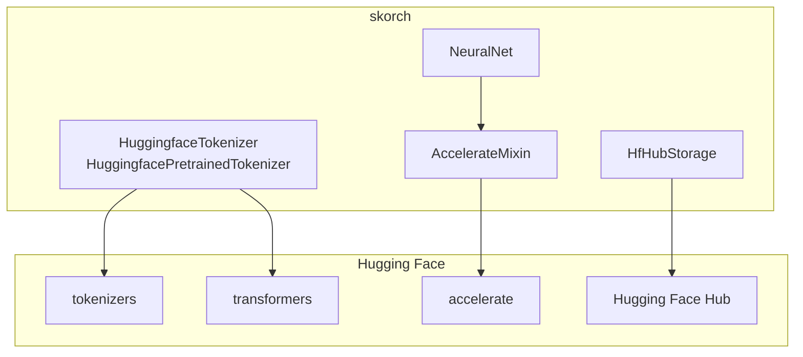
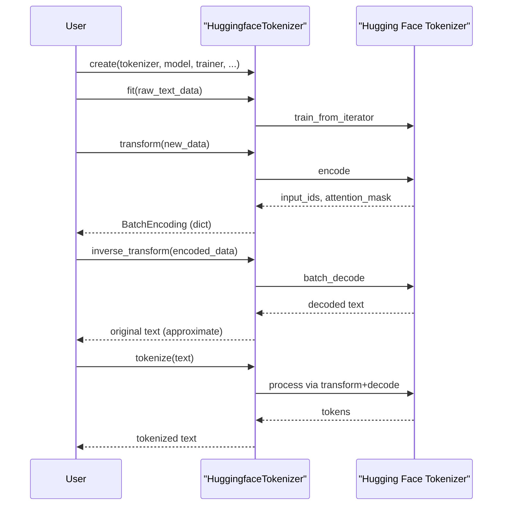
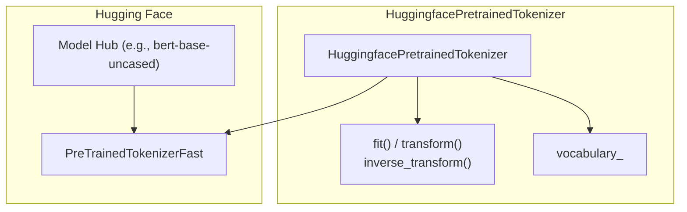
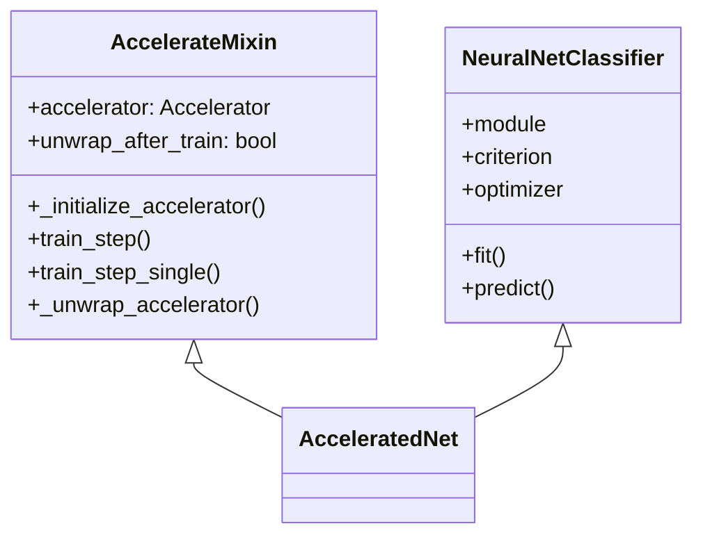
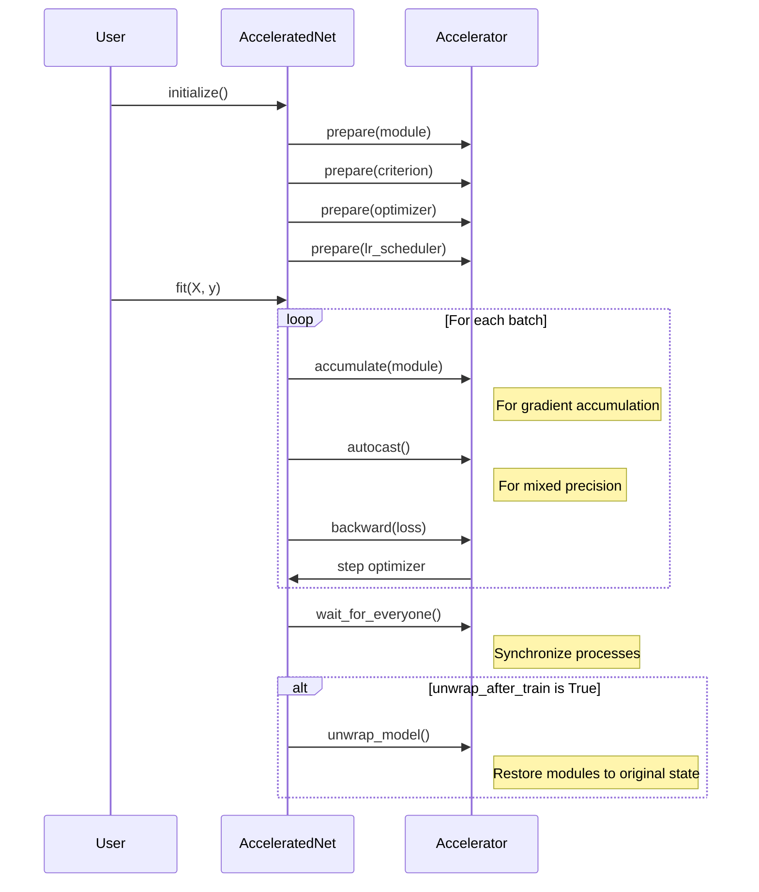
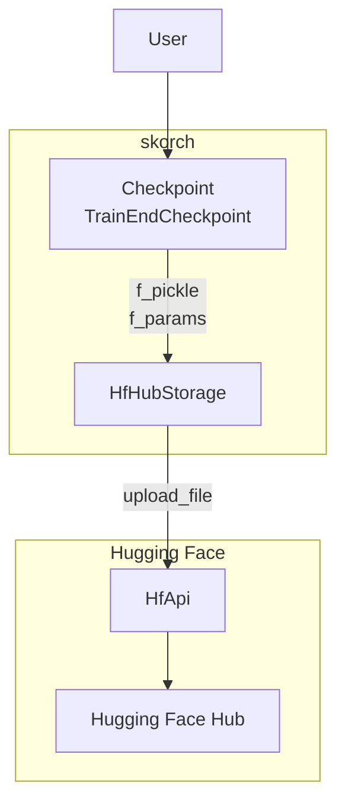
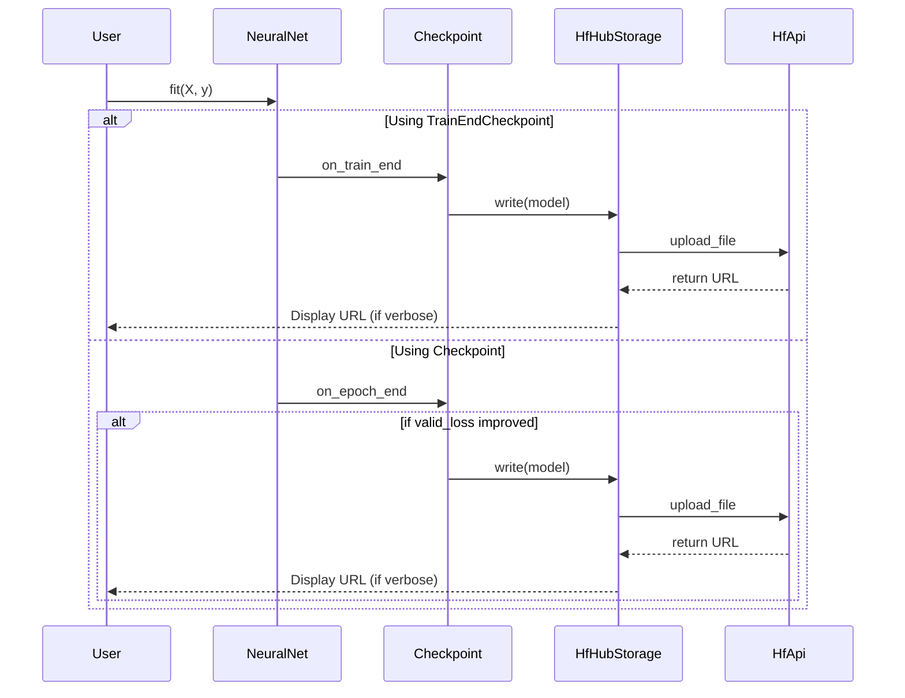

<!-- source: DeepWiki mcp.deepwiki.com · repo skorch-dev/skorch · page 7 Advanced Features · fetched 2026-10-21 -->

# Integration & Extensions

<details>
<summary>Relevant source files</summary>

The following files were used as context for generating this wiki page:

- [CHANGES.md](CHANGES.md)
- [skorch/net.py](skorch/net.py)
- [skorch/tests/test_net.py](skorch/tests/test_net.py)

</details>


This page documents the integration capabilities between skorch and other libraries or frameworks. skorch provides seamless integration with popular ML and deep learning tools, which allows you to leverage their specialized features while maintaining the scikit-learn compatible interface.

## Hugging Face Integration Overview

skorch offers comprehensive integration with the Hugging Face ecosystem, making it easy to use transformers, tokenizers, and other Hugging Face components within the skorch workflow.



Sources: [skorch/hf.py:1-10](), [skorch/hf.py:26-184](), [skorch/hf.py:186-640](), [skorch/hf.py:643-821](), [skorch/hf.py:824-1116](), [skorch/hf.py:1118-1304]()

## Tokenizer Integration

skorch provides classes to integrate with Hugging Face tokenizers, allowing you to use them as scikit-learn compatible transformers.

### HuggingfaceTokenizer

`HuggingfaceTokenizer` wraps a Hugging Face tokenizer to work as a scikit-learn transformer. It's useful when you want to train a tokenizer on your own data.



Sources: [skorch/hf.py:186-640]()

### HuggingfacePretrainedTokenizer

`HuggingfacePretrainedTokenizer` wraps a pretrained Hugging Face tokenizer, making it easier to use in a scikit-learn pipeline.

Key features:
- Can use pretrained tokenizers directly
- Can optionally retrain the tokenizer on your own data
- Maintains scikit-learn API compatibility



Sources: [skorch/hf.py:643-821]()

## Accelerated Training

skorch provides the `AccelerateMixin` to integrate with Hugging Face's accelerate library, enabling:
- Mixed precision training
- Multi-GPU training
- TPU support
- Gradient accumulation

### AccelerateMixin

The `AccelerateMixin` can be combined with any skorch neural net class to add accelerate support:



### Training Workflow with Accelerate



Sources: [skorch/hf.py:824-1116](), [skorch/tests/test_hf.py:511-931]()

## Hugging Face Hub Storage

skorch provides `HfHubStorage` to easily save models to the Hugging Face Hub:



When used with checkpoint callbacks, models and parameters can be saved directly to Hugging Face Hub:



Sources: [skorch/hf.py:1118-1304](), [skorch/tests/test_hf.py:1024-1366]()

## Usage Examples

Here are practical examples of using skorch's integration capabilities:

### Using HuggingfaceTokenizer

```python
from tokenizers import Tokenizer
from tokenizers.models import WordPiece
from tokenizers.normalizers import Lowercase
from tokenizers.pre_tokenizers import Whitespace
from skorch.hf import HuggingfaceTokenizer

tokenizer = HuggingfaceTokenizer(
    tokenizer=Tokenizer(WordPiece(unk_token="[UNK]")),
    trainer__vocab_size=10000,
    trainer__special_tokens=["[UNK]", "[CLS]", "[SEP]", "[PAD]", "[MASK]"],
    normalizer=Lowercase(),
    pre_tokenizer=Whitespace(),
)

# Train tokenizer
tokenizer.fit(texts)

# Transform text to token ids
encoded = tokenizer.transform(new_texts)
```

### Accelerated Training

```python
from skorch import NeuralNetClassifier
from skorch.hf import AccelerateMixin
from accelerate import Accelerator

# Create a custom class with accelerate support
class AcceleratedNet(AccelerateMixin, NeuralNetClassifier):
    """NeuralNetClassifier with accelerate support"""

# Initialize accelerator with desired settings
accelerator = Accelerator(mixed_precision='fp16')  # Use mixed precision

# Create and train the accelerated network
net = AcceleratedNet(
    MyModule,
    accelerator=accelerator,
    device=None,  # Let accelerate handle device placement
    max_epochs=10,
)
net.fit(X, y)
```

### Saving to Hugging Face Hub

```python
from huggingface_hub import HfApi
from skorch.callbacks import TrainEndCheckpoint
from skorch.hf import HfHubStorage

# Initialize HfApi
hf_api = HfApi()

# Create storage for model uploads
model_storage = HfHubStorage(
    hf_api,
    path_in_repo="my-model.pkl",
    repo_id="username/repository",
    token="your_token",  # Authentication token
    verbose=1,
)

# Create checkpoint callback
checkpoint = TrainEndCheckpoint(f_pickle=model_storage)

# Train model with checkpoint
net = NeuralNetClassifier(
    MyModule,
    callbacks=[checkpoint],
)
net.fit(X, y)
```

## REST API with Palladium

skorch models can be deployed as REST services using [Palladium](https://palladium.readthedocs.io), a framework for deploying machine learning models as REST services.

Note: For detailed information on REST API deployment with Palladium, please refer to the relevant documentation as this feature is outside the scope of the current implementation files.

Sources: None available in the provided files

## Limitations and Considerations

When using the integrations, be aware of the following:

1. **Accelerate Integration**:
   - Models accelerated with `AccelerateMixin` cannot be pickled directly. Use `save_params` and `load_params` instead.
   - Not all optimizers are compatible with mixed precision training (e.g., LBFGS).

2. **Hugging Face Hub Storage**:
   - Uploads to the Hub are synchronous, which can slow down training if files are large.
   - Using `HfHubStorage` with `LoadInitState` is not supported as the Hub API doesn't support direct model loading.

3. **Tokenizers**:
   - For parallel training of `HuggingfaceTokenizer`, set the environment variable `TOKENIZERS_PARALLELISM=false` to avoid slowdowns or deadlocks.

Sources: [skorch/hf.py:838-863](), [skorch/hf.py:1139-1140](), [skorch/hf.py:250-255]()

---

