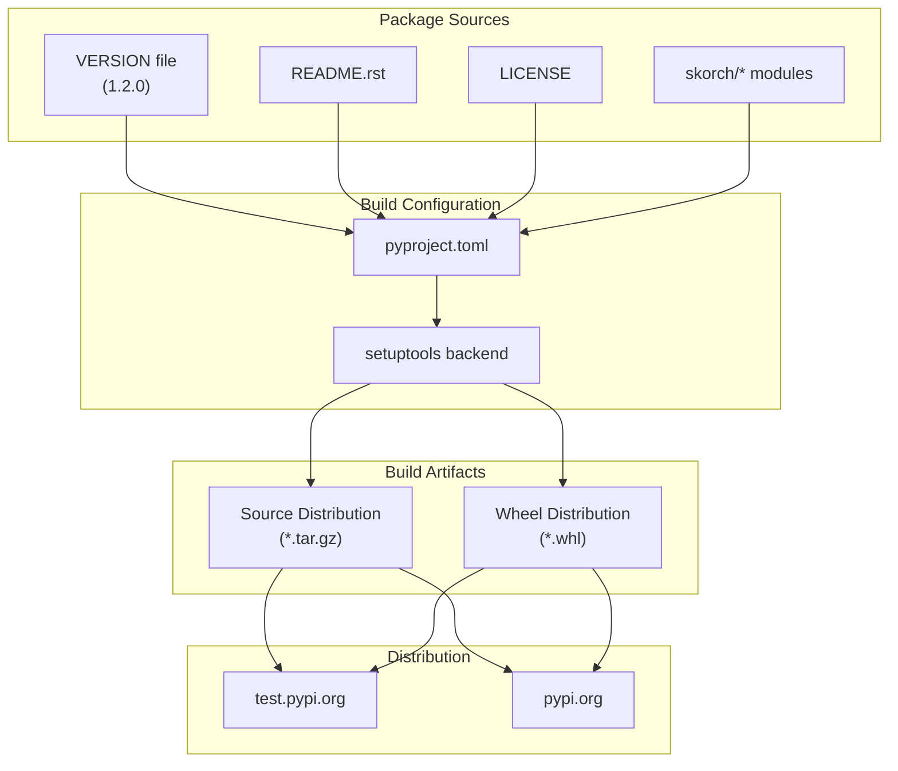
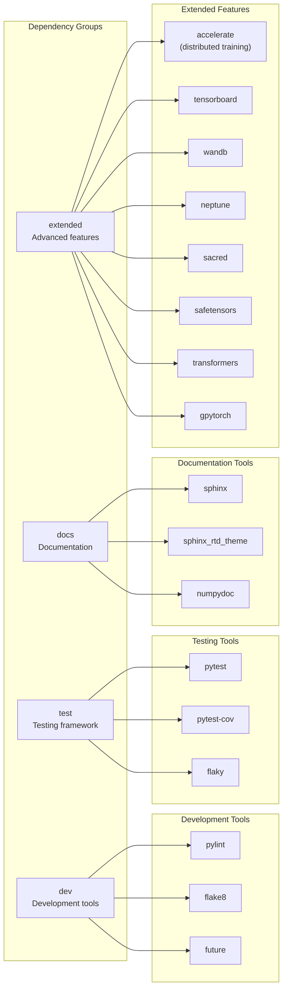
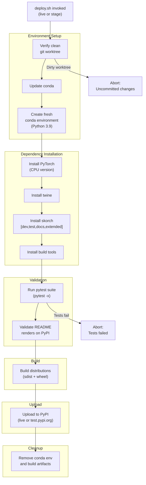

<!-- source: DeepWiki mcp.deepwiki.com · repo skorch-dev/skorch · page 9.1 Build System and Deployment · fetched 2026-10-21 -->

# Build System and Deployment

<details>
<summary>Relevant source files</summary>

The following files were used as context for generating this wiki page:

- [VERSION](VERSION)
- [pyproject.toml](pyproject.toml)
- [scripts/deploy.sh](scripts/deploy.sh)

</details>


## Purpose and Scope

This document describes the build system, package configuration, versioning strategy, and deployment process for the skorch package. It covers the technical details of how skorch is packaged for distribution on PyPI, including dependency management, version control, and the automated deployment workflow.

For information about the testing infrastructure, see [Testing Infrastructure](#9.2). For contributing guidelines and development workflows, see [Contributing Guidelines](#9.3).

---

## Package Configuration Overview

The skorch package uses a modern Python packaging approach based on `pyproject.toml` [pyproject.toml:1-187](), which centralizes all build configuration, metadata, and development tool settings in a single file. This follows [PEP 518](https://peps.python.org/pep-0518) and [PEP 621](https://peps.python.org/pep-0621) standards.



**Sources:** [pyproject.toml:1-187](), [VERSION:1-1](), [scripts/deploy.sh:67-73]()

---

## Build System Configuration

The build system is configured in the `[build-system]` section of `pyproject.toml`:

```toml
[build-system]
requires = ["setuptools>=61.1.0", "wheel"]
build-backend = "setuptools.build_meta"
```

**Key Components:**

| Component | Purpose | Version Requirement |
|-----------|---------|-------------------|
| `setuptools` | Build backend implementing PEP 517 | ≥61.1.0 |
| `wheel` | Creates binary wheel distributions | (latest) |
| `setuptools.build_meta` | Build backend interface | (with setuptools) |

The setuptools configuration specifies which files to include in distributions:

- **Package Data** [pyproject.toml:5-6](): Includes `VERSION`, `LICENSE`, and `*.rst` files
- **Package Discovery** [pyproject.toml:8-10](): Includes all `skorch*` packages, excludes `notebooks` and `assets`

**Sources:** [pyproject.toml:1-10]()

---

## Package Metadata

### Basic Metadata

The `[project]` section defines the package identity and requirements:

| Field | Value | Notes |
|-------|-------|-------|
| **Name** | `skorch` | PyPI package name [pyproject.toml:13]() |
| **Description** | "scikit-learn compatible neural network library for pytorch" | [pyproject.toml:15]() |
| **License** | BSD-3-Clause | [pyproject.toml:16]() |
| **Python Requirement** | ≥3.9 | [pyproject.toml:18]() |
| **Version** | Dynamic (from `VERSION` file) | [pyproject.toml:14,185]() |
| **README** | Dynamic (from `README.rst`) | [pyproject.toml:14,186]() |

### Supported Python Versions

The package declares support for Python 3.9 through 3.13 [pyproject.toml:34-39](). The classifiers inform PyPI and package managers about version compatibility:

```python
"Programming Language :: Python :: 3.9"
"Programming Language :: Python :: 3.10"
"Programming Language :: Python :: 3.11"
"Programming Language :: Python :: 3.12"
"Programming Language :: Python :: 3.13"
"Programming Language :: Python :: 3 :: Only"
```

**Sources:** [pyproject.toml:12-45]()

---

## Dependency Management

### Core Dependencies

The following packages are required for basic skorch functionality:

| Dependency | Minimum Version | Purpose |
|------------|-----------------|---------|
| `numpy` | 1.13.3 | Array operations and data handling |
| `scikit-learn` | 0.22.0 | Base estimator API and compatibility |
| `scipy` | 1.1.0 | Scientific computing utilities |
| `tabulate` | 0.7.7 | Formatting history output |
| `tqdm` | 4.14.0 | Progress bars during training |

Note: PyTorch is **not** listed as a dependency. Users must install it separately to match their hardware (CPU, CUDA, ROCm, etc.).

**Sources:** [pyproject.toml:19-25]()

### Optional Dependencies



#### Development Dependencies (`dev`)

Used for code quality and linting [pyproject.toml:48-52]():

- `pylint`: Static code analysis
- `flake8`: Style guide enforcement  
- `future`: Python 2/3 compatibility utilities

#### Test Dependencies (`test`)

Required for running the test suite [pyproject.toml:54-58]():

- `pytest` (≥3.4): Test framework
- `pytest-cov`: Coverage reporting
- `flaky`: Retry flaky tests

#### Documentation Dependencies (`docs`)

For building documentation [pyproject.toml:60-64]():

- `sphinx`: Documentation generator
- `sphinx_rtd_theme`: Read the Docs theme
- `numpydoc`: NumPy-style docstring support

#### Extended Dependencies (`extended`)

Optional features for advanced use cases [pyproject.toml:66-83]():

| Package | Version | Feature Enabled |
|---------|---------|----------------|
| `accelerate` | ≥0.22.0 | Distributed training (see [Distributed Training](#7.4)) |
| `tensorboard` | ≥1.14.0 | TensorBoard logging |
| `wandb` | ≥0.12.17 | Weights & Biases logging |
| `neptune` | (latest) | Neptune logging |
| `sacred` | (latest) | Sacred logging |
| `safetensors` | ≥0.3.1 | Safe tensor serialization |
| `transformers` | (latest) | Hugging Face model support |
| `tokenizers` | (latest) | Fast tokenization |
| `gpytorch` | ≥1.5 | Gaussian process models |
| `jupyter` | (latest) | Jupyter notebook support |
| `matplotlib` | ≥2.0.2 | Plotting |
| `pandas` | (latest) | DataFrame support |

**Sources:** [pyproject.toml:47-83]()

---

## Version Management

### Version File

The package version is stored in a dedicated `VERSION` file at the repository root:

```
1.2.0
```

This single-source-of-truth approach:
- Simplifies version updates (one file to change)
- Prevents version drift between package and documentation
- Enables scripts to read the version programmatically

The version is dynamically loaded during build via `pyproject.toml` [pyproject.toml:185]():

```toml
[tool.setuptools.dynamic]
version = {file = "VERSION"}
```

### Version Usage in Deployment

The deployment script reads this file to determine which artifacts to upload [scripts/deploy.sh:70,72]():

```bash
# Upload to PyPI with version from VERSION file
run_in_env twine upload --verbose dist/*"$(cat VERSION)"*
```

This ensures that only artifacts matching the current version are deployed.

**Sources:** [VERSION:1-1](), [pyproject.toml:185](), [scripts/deploy.sh:70-72]()

---

## Deployment Process

### Deployment Script Overview

The automated deployment is managed by `scripts/deploy.sh`, which handles the complete build-test-upload pipeline in an isolated environment.



**Sources:** [scripts/deploy.sh:1-74]()

### Deployment Script Configuration

#### Environment Variables

| Variable | Purpose | Default | Required |
|----------|---------|---------|----------|
| `PYTORCH_VERSION` | PyTorch version to install | (none) | Yes |
| `PYTHON_VERSION` | Python version for conda env | 3.9 | No |
| `TWINE_VERSION` | Twine version constraint | >3,<4.0.0dev | No |
| `CONDA_ENV` | Conda environment name | skorch-deploy | No |

Example usage:

```bash
# Deploy to test PyPI
PYTORCH_VERSION=2.0.0 ./scripts/deploy.sh stage

# Deploy to production PyPI
PYTORCH_VERSION=2.0.0 ./scripts/deploy.sh live
```

**Sources:** [scripts/deploy.sh:5-8,10-13]()

#### Command-Line Arguments

The script accepts exactly one argument [scripts/deploy.sh:10-13]():

- `stage`: Upload to test.pypi.org for pre-release validation
- `live`: Upload to production pypi.org

### Pre-Deployment Checks

#### Git Worktree Verification

Before proceeding, the script ensures no uncommitted changes exist [scripts/deploy.sh:20-21]():

```bash
# check if worktree is not dirty
test -z "$(git status --porcelain --untracked-files=no)"
```

This prevents accidental deployments of development code.

#### Environment Isolation

A fresh conda environment is created for each deployment [scripts/deploy.sh:24-32]():

1. Update conda to latest version
2. Remove any existing `skorch-deploy` environment
3. Create new environment with Python 3.9

This ensures reproducible builds without interference from local development dependencies.

**Sources:** [scripts/deploy.sh:20-32]()

### Dependency Installation

The script installs dependencies in a specific order [scripts/deploy.sh:51-59]():

1. **PyTorch**: CPU-only version from official PyPI index
   ```bash
   python -m pip install "torch==${PYTORCH_VERSION}" \
       --index-url https://download.pytorch.org/whl/cpu
   ```

2. **Twine**: For uploading to PyPI
3. **pyOpenSSL**: Upgraded to work around system library issues
4. **skorch**: With all optional dependencies (`[dev,test,docs,extended]`)
5. **build**: PEP 517 build frontend

**Sources:** [scripts/deploy.sh:51-59]()

### Validation Steps

#### Test Suite Execution

The complete test suite runs with early termination on failure [scripts/deploy.sh:61]():

```bash
run_in_env pytest -x
```

The `-x` flag stops on first failure, preventing deployment of broken code.

#### README Rendering Validation

The script verifies that `README.rst` renders correctly on PyPI [scripts/deploy.sh:63-65]():

```bash
python -m pip install readme-renderer
python -m readme_renderer README.rst > /dev/null
```

This prevents "broken" package pages on PyPI due to RST syntax errors.

**Sources:** [scripts/deploy.sh:61-65]()

### Build Process

The script uses the modern `build` frontend to create distributions [scripts/deploy.sh:67]():

```bash
python -m build --sdist --wheel
```

This generates two artifacts in the `dist/` directory:

1. **Source Distribution** (`*.tar.gz`): Contains all source files
2. **Wheel** (`*.whl`): Pre-built binary distribution

### Upload to PyPI

#### Target Selection

The upload target depends on the command-line argument [scripts/deploy.sh:69-73]():

```bash
if [[ $1 == "live" ]]; then
    # Production PyPI
    run_in_env twine upload --verbose dist/*"$(cat VERSION)"*
else
    # Test PyPI (staging)
    run_in_env twine upload --verbose \
        --repository-url https://test.pypi.org/legacy/ \
        dist/*"$(cat VERSION)"*
fi
```

Only artifacts matching the current version (from `VERSION` file) are uploaded, preventing accidental re-upload of old versions.

#### Authentication

Twine requires PyPI credentials, typically provided via environment variables:

- `TWINE_USERNAME`: PyPI username (or `__token__`)
- `TWINE_PASSWORD`: PyPI password (or API token)

**Sources:** [scripts/deploy.sh:69-73]()

### Cleanup

A trap ensures cleanup occurs even if the script fails [scripts/deploy.sh:34-49]():

```bash
remove_env() {
    conda env remove -q -y -n $CONDA_ENV
    if [ -d build ]; then
        rm -rf build
    fi
    if [ -d dist ]; then
        rm -rf dist
    fi
}

trap remove_env EXIT
```

This removes:
- The conda environment
- The `build/` directory
- The `dist/` directory

**Sources:** [scripts/deploy.sh:34-49]()

---

## Development Tool Configuration

The `pyproject.toml` file also configures development tools to maintain code quality and consistency.

### Test Coverage Configuration

Coverage settings [pyproject.toml:86-96]():

| Setting | Value | Purpose |
|---------|-------|---------|
| `source` | `["."]` | Root directory for coverage |
| `include` | `["skorch/*"]` | Only measure skorch code |
| `omit` | `["skorch/tests/*", "skorch/_version.py"]` | Exclude tests and version file |
| `show_missing` | `true` | Show lines not covered |
| `skip_covered` | `false` | Show fully covered files |

### Pytest Configuration

Test execution settings [pyproject.toml:103-109]():

```toml
[tool.pytest.ini_options]
addopts = [
    "--cov=skorch",
    "--cov-report=term-missing",
]
python_files = "test*.py"
testpaths = ["skorch/tests"]
```

- Automatically enables coverage reporting
- Shows missing lines in terminal output
- Discovers test files matching `test*.py` pattern
- Searches only in `skorch/tests/` directory

### Flake8 Configuration

Style checking [pyproject.toml:98-101]():

- **Max line length**: 88 characters (matches Black formatter)
- **Docstring convention**: NumPy style
- **Ignored rules**: D204 (blank line after class docstring), D401 (imperative mood)

### Pylint Configuration

Comprehensive linting settings [pyproject.toml:111-173]():

#### Disabled Checks

To reduce noise, several checks are disabled [pyproject.toml:115-133](), including:
- Import-related: `cyclic-import`, `import-error`, `import-outside-toplevel`
- Type-checking: `no-member`, `no-name-in-module`
- Formatting: `fixme`, `use-implicit-booleaness-*`

#### Code Complexity Limits

| Metric | Limit | Setting |
|--------|-------|---------|
| Max arguments | 14 | `max-args` |
| Max local variables | 24 | `max-locals` |
| Max return statements | 9 | `max-returns` |
| Max branches | 21 | `max-branches` |
| Max attributes | 19 | `max-attributes` |
| Max public methods | 40 | `max-public-methods` |
| Max line length | 88 | `max-line-length` |
| Max module lines | 1500 | `max-module-lines` |

#### Naming Conventions

Special variable names allowed [pyproject.toml:165]():

```python
good-names = ["main", "_", "X", "y", "T", "Xt", "Xs", "yt", "f", "__"]
```

This permits common machine learning conventions like `X` for features and `y` for targets.

**Sources:** [pyproject.toml:86-173]()

---

## Build Artifact Structure

### Distribution Formats

When `python -m build` executes, it creates two distribution types:

#### Source Distribution (sdist)

**Filename pattern**: `skorch-{VERSION}.tar.gz`

**Contents**:
- All Python source files in `skorch/` package
- `VERSION` file
- `LICENSE` file  
- `README.rst` and other `*.rst` files
- `pyproject.toml` for reproducible builds

**Purpose**: Allows installation from source and serves as the canonical package representation.

#### Wheel Distribution

**Filename pattern**: `skorch-{VERSION}-py3-none-any.whl`

**Characteristics**:
- **Platform**: `any` (pure Python, no compiled extensions)
- **Python version**: `py3` (Python 3 compatible)
- **ABI**: `none` (no binary dependencies)

**Purpose**: Faster installation than sdist, as no build step is required.

**Sources:** [pyproject.toml:1-10](), [scripts/deploy.sh:67]()

---

## Summary

The skorch build and deployment system is designed for:

1. **Reproducibility**: Isolated conda environments ensure consistent builds
2. **Safety**: Pre-deployment checks (tests, git status, README validation) prevent broken releases
3. **Flexibility**: Optional dependency groups support different use cases
4. **Standards compliance**: Uses modern Python packaging (PEP 517, PEP 621)
5. **Maintainability**: Single-source version management and centralized configuration

**Key Files**:
- [pyproject.toml:1-187](): Complete package configuration
- [VERSION:1-1](): Single source of version truth
- [scripts/deploy.sh:1-74](): Automated deployment pipeline

For testing infrastructure details, see [Testing Infrastructure](#9.2). For contributing to the project, see [Contributing Guidelines](#9.3).

---

