# Page: Overview

# Overview

<details>
<summary>Relevant source files</summary>

The following files were used as context for generating this wiki page:

- [README.md](README.md)
- [assets/StreamingLLM.pdf](assets/StreamingLLM.pdf)
- [figures/schemes.png](figures/schemes.png)

</details>


This document provides a comprehensive introduction to StreamingLLM, a framework that enables Large Language Models (LLMs) to efficiently process and generate text from extremely long or infinite-length input sequences without sacrificing performance or requiring retraining. The core innovation of StreamingLLM is the attention sink mechanism, which maintains model coherence while discarding most intermediate tokens in the key-value cache.

For detailed installation instructions, see [Installation & Setup](#1.1).
For in-depth explanation of the attention sink mechanism, see [Attention Sink Mechanism](#2.1).

## Purpose and Key Features

StreamingLLM addresses two critical challenges in deploying LLMs for streaming applications:

1. Memory efficiency: Reduces the extensive memory consumption required for caching previous tokens' Key and Value states.
2. Context length generalization: Enables models to handle sequences much longer than their training context length.

Key features include:

- Support for processing sequences of up to 4 million tokens or more
- Up to 22.2x speedup compared to sliding window recomputation
- No fine-tuning required to extend context handling capability
- Compatible with multiple model architectures (Llama, MPT, Falcon, Pythia)
- Integration with popular frameworks (Hugging Face, TensorRT-LLM, Intel Extensions)

Sources: [README.md:1-22]()

## System Architecture

The following diagram illustrates the core components of StreamingLLM and their relationships:

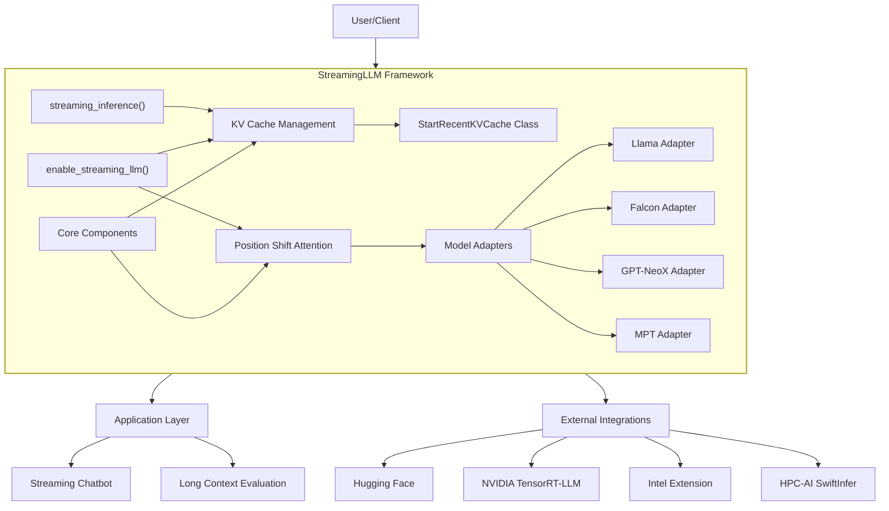

Sources: [README.md:14-18]()

## Attention Sink Mechanism

The key innovation in StreamingLLM is the attention sink mechanism. This approach was developed after observing that LLMs tend to allocate strong attention to initial tokens in a sequence, even when those tokens aren't semantically important.

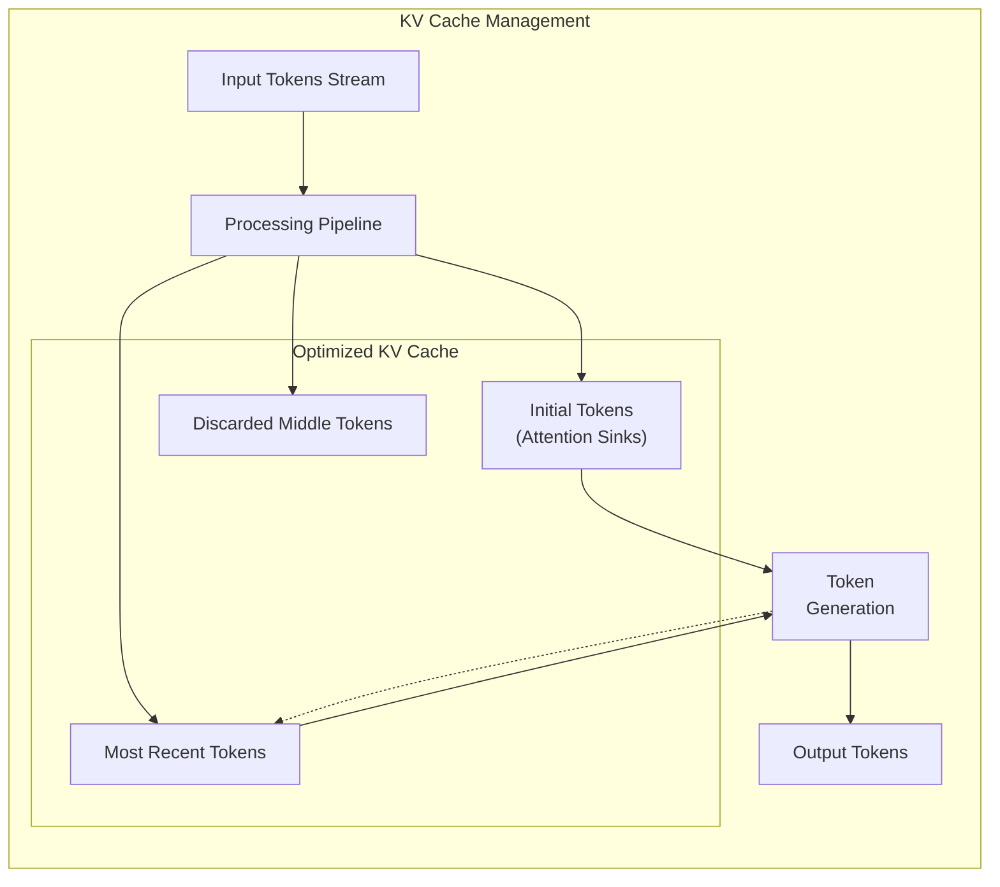

The diagram illustrates how StreamingLLM manages the KV cache:
1. Initial tokens are preserved as "attention sinks"
2. Most recent tokens are preserved for contextual relevance
3. Middle tokens are discarded to save memory
4. This pattern enables processing sequences far beyond the model's training context length

Sources: [README.md:21-22](), [README.md:46-49]()

## Core Components

### KV Cache Management

The `StartRecentKVCache` class is the central component that implements the attention sink mechanism:

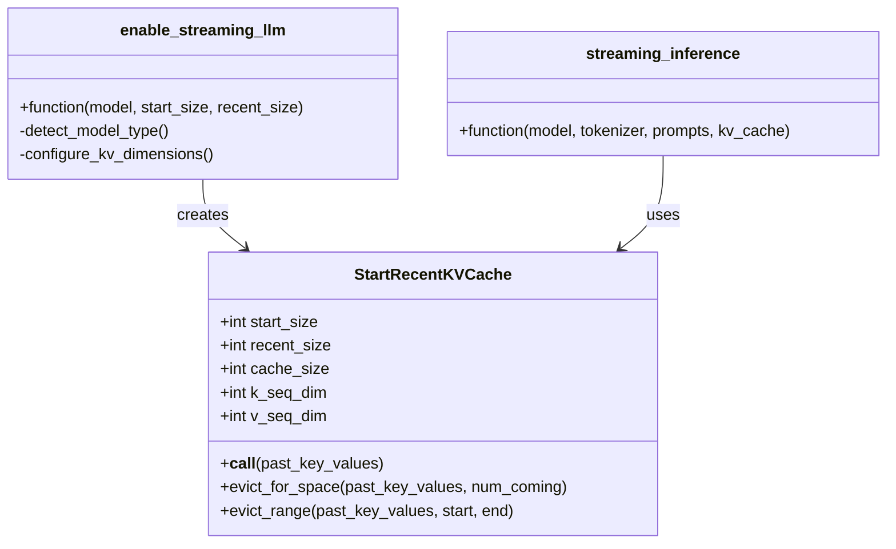

The main parameters that control the KV cache management are:
- `start_size`: Number of initial tokens to keep as attention sinks
- `recent_size`: Number of most recent tokens to keep
- `cache_size`: Total cache size (typically equal to model's context window)

Sources: [README.md:46-49]()

### Model Adaptation

StreamingLLM provides position shifting techniques for different model architectures:

| Model Architecture | Adapter Function | Description |
|-------------------|------------------|-------------|
| Llama | enable_llama_pos_shift_attention | Modifies Llama's attention mechanism for streaming |
| Falcon | enable_falcon_pos_shift_attention | Adapts Falcon's attention computation |
| GPT-NeoX | enable_gpt_neox_pos_shift_attention | Enables streaming for GPT-NeoX-based models (like Pythia) |
| MPT | enable_mpt_pos_shift_attention | Adapts MPT's attention mechanism |

Each adapter function modifies the attention mechanism of the respective model to enable efficient streaming without retraining.

Sources: [README.md:69]()

## Usage Flow

The typical usage flow for StreamingLLM follows this sequence:

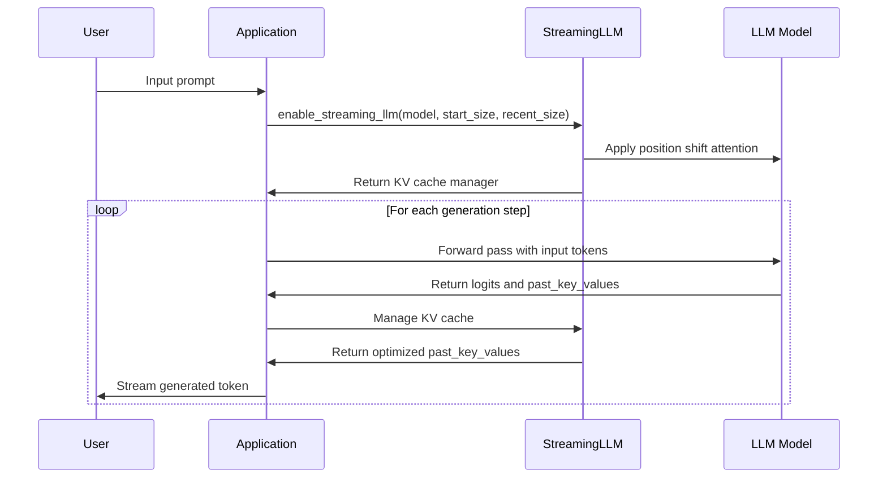

This diagram illustrates how applications interact with StreamingLLM to enable efficient processing of long sequences.

Sources: [README.md:38-42]()

## Integration Ecosystem

StreamingLLM has been integrated with several external frameworks, expanding its availability and usability:

| Framework | Description | Status |
|-----------|-------------|--------|
| Hugging Face Transformers | Popular ML library for NLP models | Integrated (Dec 2023) |
| NVIDIA TensorRT-LLM | High-performance inference for LLMs | Integrated (Jan 2024) |
| Intel Extension for Transformers | Optimizations for Intel hardware | Integrated (Oct 2023) |
| HPC-AI Tech SwiftInfer | Framework for infinite length LLM inference | Integrated (Jan 2024) |
| Attention Sinks | Third-party implementation for more Hugging Face models | Available (Oct 2023) |

These integrations make StreamingLLM's capabilities accessible through multiple platforms and optimization frameworks.

Sources: [README.md:12-19]()

## Use Cases and Limitations

### Ideal Use Cases

StreamingLLM is particularly well-suited for:
- Multi-round dialogues and chatbots
- Continuous operation scenarios where cache resets would be disruptive
- Applications that require processing long sequences efficiently

### Limitations

Important limitations to understand:
1. StreamingLLM does not expand the model's context window - it simply enables efficient streaming
2. Only the retained tokens (attention sinks + recent tokens) influence the generation
3. Not suitable for tasks that require understanding the entire document (e.g., summarizing a complete book)

Sources: [README.md:46-64]()

## Conclusion

StreamingLLM provides an efficient framework for enabling LLMs to process infinite-length inputs without sacrificing efficiency or performance. By leveraging the attention sink mechanism, models can maintain coherent generation while discarding most intermediate tokens from the KV cache. This approach requires no fine-tuning and is compatible with multiple model architectures and external frameworks.

For more detailed information on the core concepts, see [Core Concepts](#2), and for implementation details, see [Implementation](#4).

Sources: [README.md:8-9](), [README.md:21-22]()

---

# Page: Installation & Setup

# Installation & Setup

<details>
<summary>Relevant source files</summary>

The following files were used as context for generating this wiki page:

- [.gitignore](.gitignore)
- [README.md](README.md)
- [setup.py](setup.py)

</details>


This page provides instructions for installing and setting up the StreamingLLM environment. StreamingLLM is a framework that enables large language models (LLMs) to process infinite-length inputs without sacrificing efficiency or performance. This guide covers the prerequisites, installation steps, and verification process to ensure your environment is ready for running StreamingLLM.

For information about core concepts and system architecture, see the [Overview](#1) and [Core Concepts](#2) pages.

## System Requirements

Before installing StreamingLLM, ensure your system meets the following requirements:

| Requirement | Minimum Specification |
|-------------|------------------------|
| Python      | 3.8 or newer           |
| CUDA        | CUDA 11.7+ (for GPU acceleration) |
| GPU Memory  | At least 16GB for 7B models |
| RAM         | 16GB+ recommended |
| Disk Space  | 2GB for code and dependencies, plus model storage (10-30GB per model) |

Sources: [README.md:1-10]()

## Installation Process

The installation of StreamingLLM can be visualized as follows:

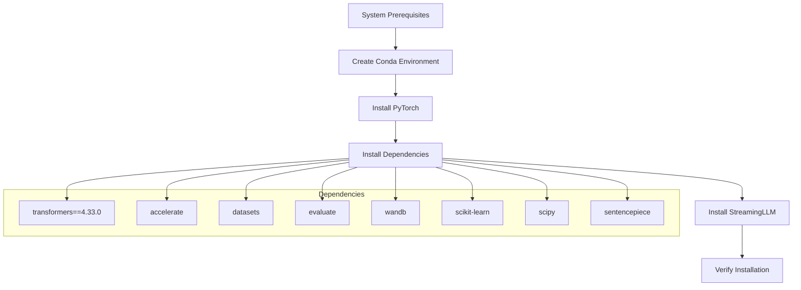

Sources: [README.md:26-36]()

### Step 1: Create a Conda Environment

The recommended approach is to use a dedicated conda environment for StreamingLLM:

```bash
conda create -yn streaming python=3.8
conda activate streaming
```

Sources: [README.md:28-31]()

### Step 2: Install PyTorch

Install PyTorch and its related packages:

```bash
pip install torch torchvision torchaudio
```

Note: For specific CUDA versions or CPU-only installations, refer to the [PyTorch official installation guide](https://pytorch.org/get-started/locally).

Sources: [README.md:32]()

### Step 3: Install Dependencies

Install the required dependencies:

```bash
pip install transformers==4.33.0 accelerate datasets evaluate wandb scikit-learn scipy sentencepiece
```

Sources: [README.md:33]()

### Step 4: Install StreamingLLM

Install the StreamingLLM package in development mode:

```bash
python setup.py develop
```

This command installs the package in a way that reflects changes to the source code immediately without needing to reinstall.

Sources: [README.md:35](), [setup.py:1-6]()

## Package Structure

The StreamingLLM installation creates the following package structure:

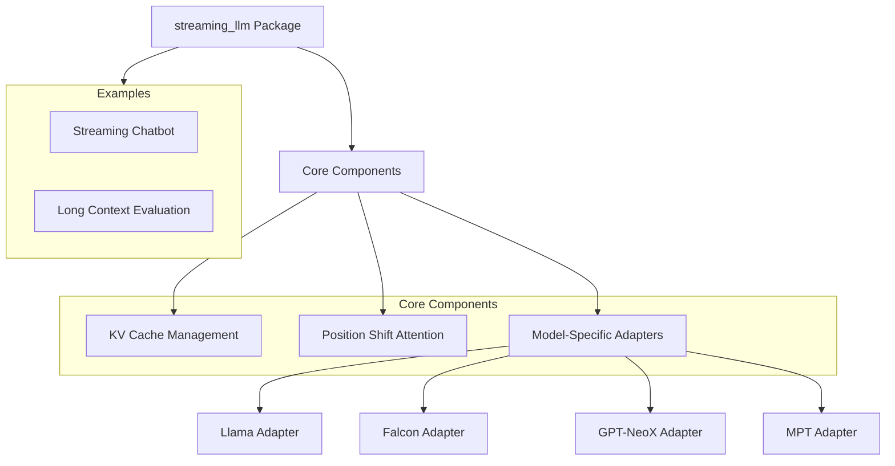

Sources: [setup.py:1-6]()

## Verifying Installation

To verify that StreamingLLM has been installed correctly, you can run the included Streaming Llama Chatbot example:

```bash
CUDA_VISIBLE_DEVICES=0 python examples/run_streaming_llama.py --enable_streaming
```

If the installation was successful, this command will start the chatbot interface. The first run will download the required model weights if they aren't already present.

Sources: [README.md:38-42]()

## Installation Options and Configurations

The installation process allows for several customization options depending on your specific requirements:

### Environment Variables

These environment variables can be set to customize the behavior of StreamingLLM:

| Variable | Purpose | Example |
|----------|---------|---------|
| CUDA_VISIBLE_DEVICES | Control which GPUs are used | `export CUDA_VISIBLE_DEVICES=0,1` |
| TRANSFORMERS_CACHE | Specify model cache location | `export TRANSFORMERS_CACHE=/path/to/cache` |
| TOKENIZERS_PARALLELISM | Control tokenizer parallelism | `export TOKENIZERS_PARALLELISM=false` |

### Development Installation

For contributors or developers who want to modify the StreamingLLM code, the development installation is recommended:

1. Clone the repository:
   ```bash
   git clone https://github.com/mit-han-lab/streaming-llm.git
   cd streaming-llm
   ```

2. Install in development mode:
   ```bash
   python setup.py develop
   ```

This setup allows changes to the source code to be immediately reflected without reinstallation.

Sources: [README.md:35](), [setup.py:1-6]()

## Troubleshooting

Here are solutions to common installation issues:

| Issue | Possible Cause | Solution |
|-------|----------------|----------|
| `ImportError: No module named streaming_llm` | Package not installed correctly | Re-run `python setup.py develop` |
| CUDA out of memory errors | GPU has insufficient memory | Use a smaller model or reduce batch size |
| Version conflicts | Dependency version mismatch | Create a fresh environment and follow the installation steps exactly |
| Model download failures | Network issues or insufficient disk space | Check your internet connection and available disk space |

If you encounter persistent issues, check the GitHub repository's issues section for similar problems and solutions.

Sources: [README.md:26-36](), [.gitignore:1-161]()

## Next Steps

After successful installation, you may want to:

1. Try the [Streaming Llama Chatbot example](#5.1)
2. Explore the [Core Concepts](#2) behind StreamingLLM
3. Learn about [Evaluating Long Context Performance](#5.2)

Sources: [README.md:38-42]()

---

# Page: Core Concepts

# Core Concepts

<details>
<summary>Relevant source files</summary>

The following files were used as context for generating this wiki page:

- [README.md](README.md)
- [assets/StreamingLLM.pdf](assets/StreamingLLM.pdf)
- [streaming_llm/kv_cache.py](streaming_llm/kv_cache.py)

</details>


This page explains the fundamental concepts that power StreamingLLM, a framework enabling Large Language Models (LLMs) to efficiently process infinitely long input sequences without degradation. We'll focus on the key innovations that allow models to handle streaming text far beyond their training context lengths without requiring model fine-tuning.

For detailed implementation specifics, see [Implementation](#4). For practical usage examples, see [Usage Examples](#5).

## The Challenge of Long Sequences in LLMs

Traditional LLMs face two significant limitations when processing long sequences:

1. **Memory Constraints**: Storing Key-Value (KV) states for all previous tokens requires substantial memory that scales linearly with sequence length
2. **Context Window Limitations**: Models struggle to generate coherent text beyond their training sequence length

A natural solution would be to use a sliding window approach, keeping only recent tokens. However, this approach fails when the sequence length exceeds the cache size, resulting in degraded performance.

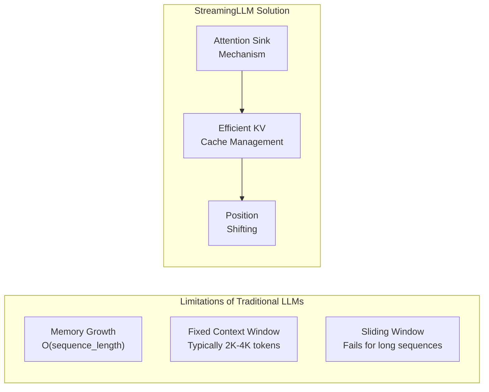

Sources: [README.md:21-22]()

## Attention Sink Mechanism

The core innovation of StreamingLLM is the **attention sink mechanism**, based on a key observation about attention patterns in LLMs: models strongly attend to initial tokens in a sequence, even when these tokens have limited semantic importance. These initial tokens function as "attention sinks" that stabilize the model's behavior.

```mermaid
flowchart TB
    subgraph "Attention Sink Pattern"
        Direction LR
        input["Input Token Sequence"]
        
        subgraph "Attention Distribution"
            initial["Initial Tokens"]
            middle["Middle Tokens"]
            recent["Recent Tokens"]
            
            initial --> |"Strong Attention\n(Attention Sinks)"| generation
            middle --> |"Variable Attention\n(Can be discarded)"| generation
            recent --> |"High Relevance\n(Must be retained)"| generation
            
            generation["Token Generation"]
        end
    end
```

By preserving the attention sinks (initial tokens) along with recent tokens and discarding the middle tokens, StreamingLLM maintains model performance while drastically reducing memory requirements and enabling processing of potentially infinite sequences.

Sources: [README.md:21-22]()

## Key-Value Cache Management

The `StartRecentKVCache` class handles the efficient management of the KV cache with the following principles:

1. Retain the first `start_size` tokens (attention sinks)
2. Retain the most recent `recent_size` tokens
3. Discard tokens in between when the sequence length exceeds `start_size + recent_size`

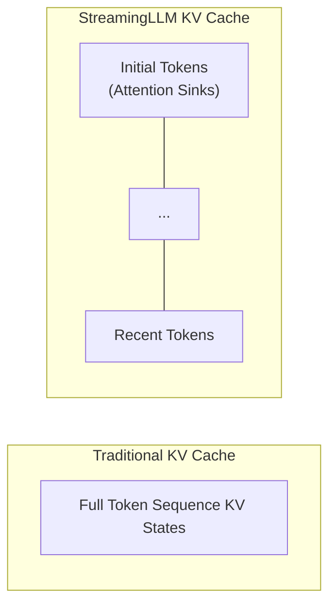

The `StartRecentKVCache` class implements this management through three key methods:

| Method | Purpose |
|--------|---------|
| `__call__` | Processes existing KV cache to retain only start and recent tokens |
| `evict_for_space` | Creates space in the cache for new incoming tokens |
| `evict_range` | Removes a specific range of tokens from the cache |

When the KV cache length exceeds the allocated cache size (`start_size + recent_size`), the middle tokens are automatically discarded while preserving the attention sinks and recent context.

Sources: [streaming_llm/kv_cache.py:23-64]()

## Position Shifting

Transformer-based LLMs rely heavily on position information. When middle tokens are discarded, position embeddings need adjustment to maintain the model's understanding of sequence structure.

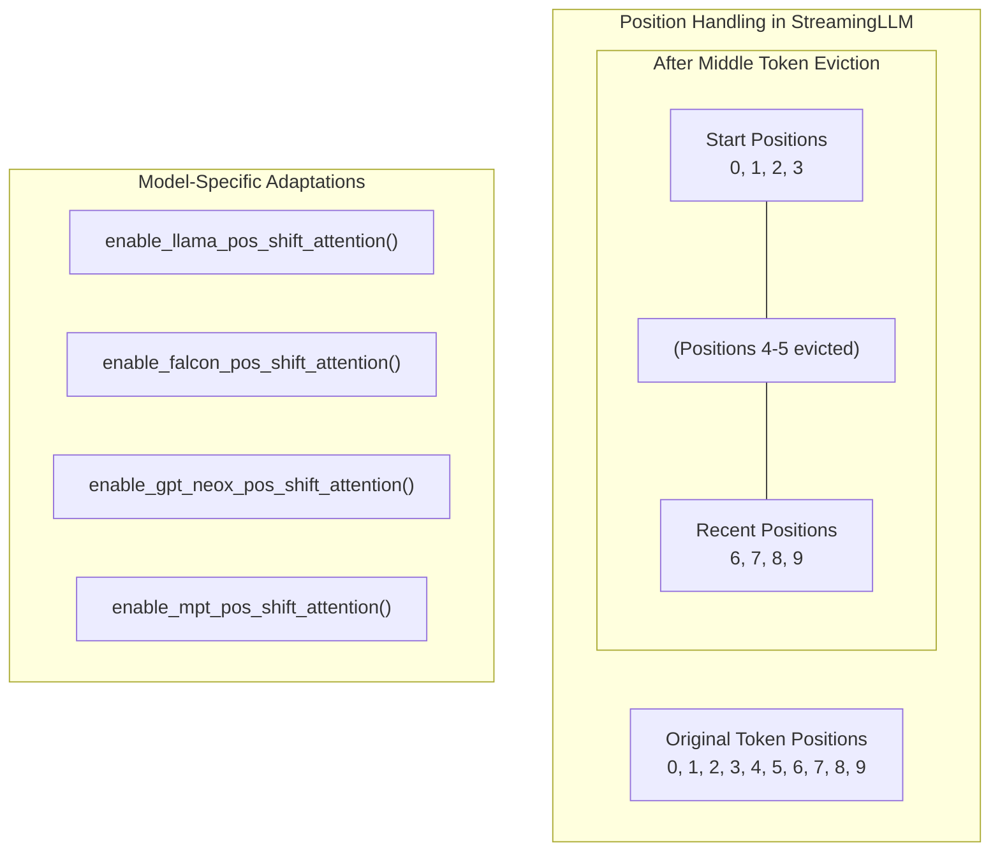

StreamingLLM modifies the attention computation for different model architectures through model-specific adapter functions. These adaptations ensure that even with a discontinuous token sequence (start + recent tokens only), the model properly processes position information and maintains generation quality.

Sources: [README.md:21-22]()

## Integrated Architecture

The StreamingLLM framework integrates these concepts into a cohesive system:

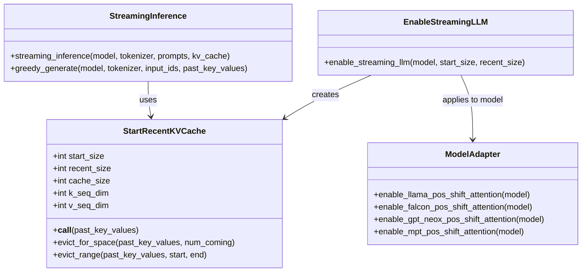

Sources: [streaming_llm/kv_cache.py:23-119]()

## Practical Benefits

The key advantages of StreamingLLM include:

1. **Memory Efficiency**: Only stores a fraction of tokens in the KV cache
2. **Infinite Context Processing**: Can handle sequences of arbitrary length
3. **No Fine-tuning Required**: Works with pre-trained models out of the box
4. **Model Flexibility**: Supports various model architectures (Llama, MPT, Falcon, Pythia)
5. **Performance**: Up to 22.2x speedup compared to sliding window recomputation

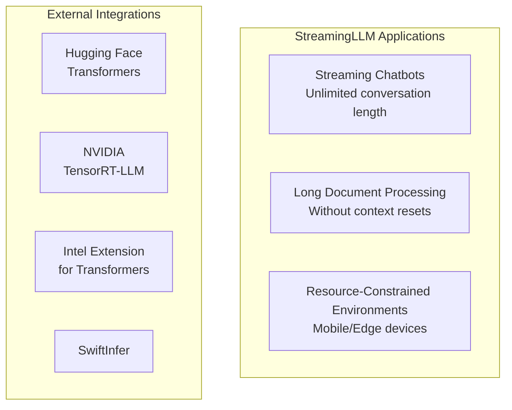

Sources: [README.md:8-19]()

StreamingLLM represents a significant advancement in efficient LLM deployment, enabling continuous text generation without the typical limitations of fixed context windows or memory constraints. By understanding these core concepts, developers can leverage StreamingLLM to build applications that require processing of arbitrarily long text sequences.

---

# Page: Attention Sink Mechanism

# Attention Sink Mechanism

<details>
<summary>Relevant source files</summary>

The following files were used as context for generating this wiki page:

- [README.md](README.md)
- [assets/StreamingLLM.pdf](assets/StreamingLLM.pdf)

</details>


## Purpose and Scope

This document explains the Attention Sink Mechanism, a core innovation in StreamingLLM that enables language models to process sequences of virtually unlimited length without requiring model fine-tuning. The mechanism addresses the key challenge of memory consumption and performance degradation when processing sequences longer than a model's training context window.

For information about the specific implementation of cache management based on this mechanism, see [Key-Value Cache Management](#2.2). For details on position shift implementation, see [Position Shifting](#2.3).

## Concept Overview

The attention sink mechanism is based on a key observation: by preserving the key-value (KV) states of initial tokens along with recent tokens in the attention cache, language models can maintain coherent generation even when processing sequences that far exceed their training context length.

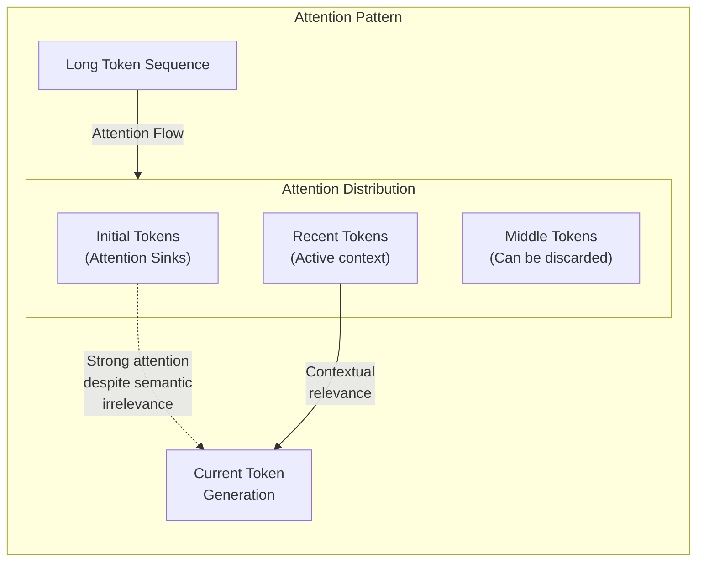

Sources: [README.md:21-22]()

### The Problem of Long Sequences

Traditional language models face two critical challenges when processing long sequences:

1. **Memory Consumption**: Storing KV states for all previous tokens requires memory that scales linearly with sequence length
2. **Performance Degradation**: Models trained on fixed context windows (e.g., 4096 tokens) tend to lose coherence when generating beyond this length

The naive approach of simply keeping a sliding window of the most recent tokens (window attention) fails when sequence length exceeds the cache size. Models begin to produce degraded outputs due to losing the ability to attend to important tokens earlier in the sequence.

### The Attention Sink Phenomenon

The key insight of StreamingLLM is that transformer-based LLMs exhibit a consistent pattern: they disproportionately attend to the very first tokens in a sequence, regardless of the semantic importance of those tokens. These initial tokens act as "attention sinks" that stabilize the model's behavior.

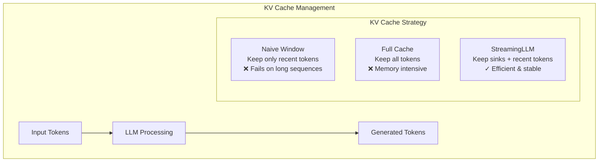

Sources: [README.md:21-22](), [README.md:46-49]()

## Technical Details

### How Attention Sinks Work

The attention sink mechanism exploits the attention pattern in transformer models by:

1. Preserving KV states for the initial tokens in a sequence ("sinks")
2. Preserving KV states for the most recent tokens (active context)
3. Strategically discarding KV states for middle tokens to save memory

This approach allows for efficient processing of arbitrarily long sequences while maintaining generation quality comparable to using the full attention context.

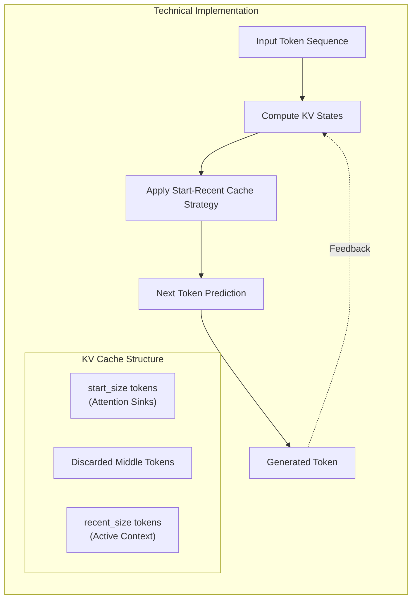

Sources: [README.md:21-22]()

### Mathematical Basis

The attention sink mechanism works because of how attention is computed in transformer models. In self-attention, the attention score between tokens is calculated as:

| Component | Mathematical Representation | Description |
|-----------|---------------------------|-------------|
| Query | Q | Representation of the current token |
| Key | K | Representation of context tokens |
| Value | V | Information from context tokens |
| Attention Weights | softmax(QK^T/√d) | How much to attend to each token |
| Output | softmax(QK^T/√d)V | Contextual representation |

The attention sink phenomenon occurs because initial tokens consistently receive high attention weights even when they aren't semantically relevant to the current generation task. By preserving these tokens, the model maintains stable generation patterns.

## Implementation in StreamingLLM

The attention sink mechanism is implemented through two primary components:

1. **StartRecentKVCache**: Manages the KV cache to retain only initial (sink) tokens and recent tokens
2. **Position Shift Attention**: Modifies positional embeddings to accommodate the discontinuity in the token sequence

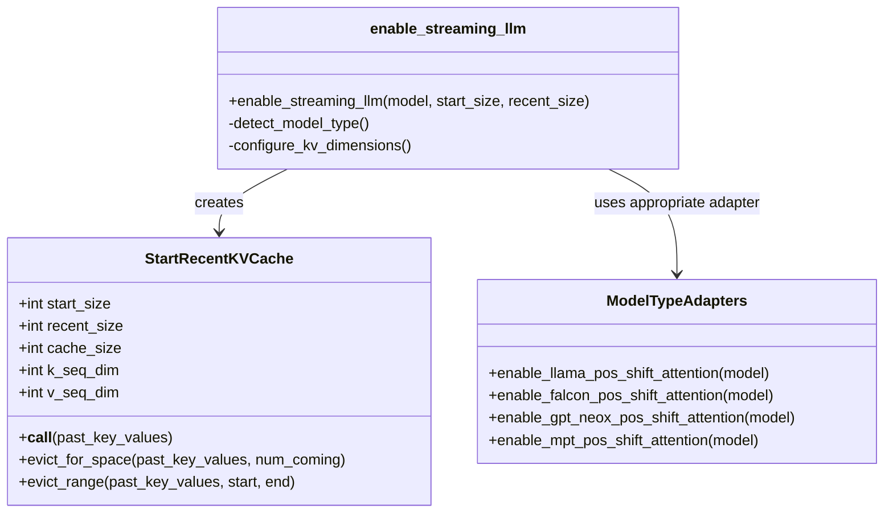

Sources: [README.md:69]()

### Configuration Parameters

The attention sink mechanism is configured with two key parameters:

1. **`start_size`**: Number of initial tokens to keep as attention sinks (typically 4-8 tokens)
2. **`recent_size`**: Number of most recent tokens to keep in the cache (depends on task requirements)

Together, these parameters determine the total cache size: `cache_size = start_size + recent_size`, which must not exceed the model's training context length.

### Cache Management Strategy

The cache management strategy follows this process:

1. Process initial tokens normally until the cache reaches capacity
2. When new tokens arrive and the cache is full:
   - Keep the first `start_size` tokens (the attention sinks)
   - Keep the most recent `recent_size` tokens
   - Discard the middle tokens to make space
3. When generating, use this selective cache for attention computation

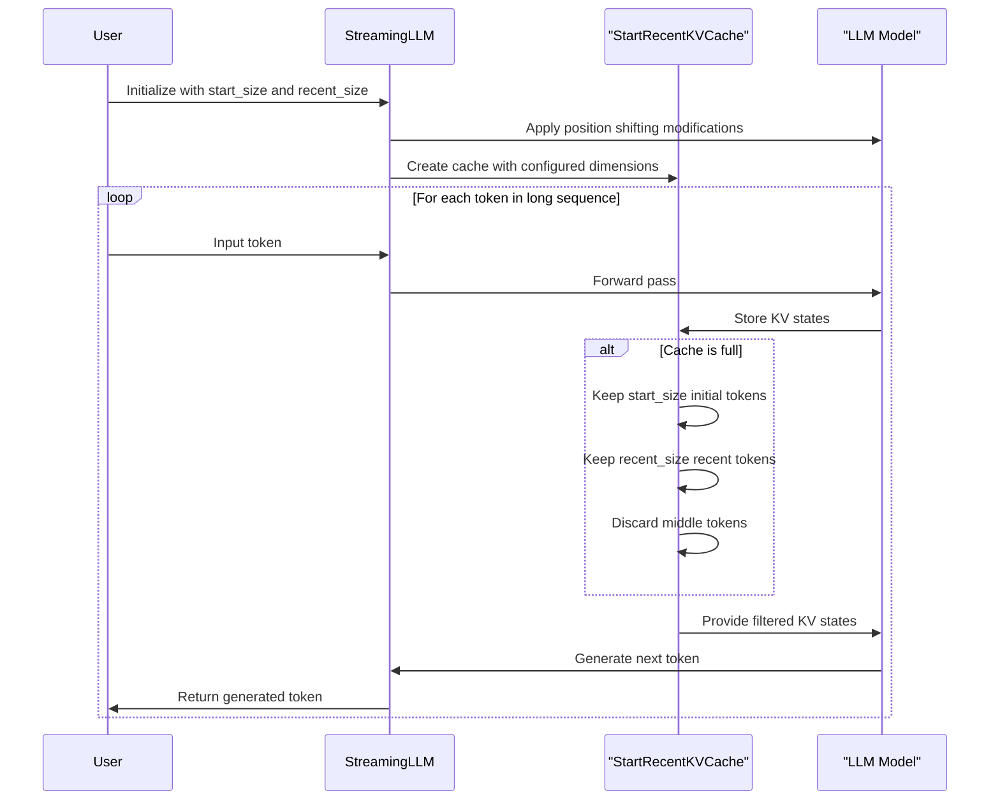

Sources: [README.md:46-49]()

## Performance Characteristics

### Benefits

1. **Memory Efficiency**: Reduces memory requirements from O(L) to O(start_size + recent_size), where L is the sequence length
2. **Unlimited Input Length**: Enables processing sequences of arbitrary length without recomputation
3. **No Fine-tuning Required**: Works with pre-trained models without modification of weights
4. **Stable Performance**: Maintains coherent generation quality comparable to full-context models

### Performance Comparison

| Approach | Memory Usage | Processing Speed | Quality on Long Sequences |
|----------|-------------|-----------------|--------------------------|
| Full Context | High (O(L)) | Slow for long sequences | High but limited by context window |
| Sliding Window | Low (O(window_size)) | Fast | Degrades beyond window size |
| Naive Recomputation | Low (O(window_size)) | Very slow | High but computationally expensive |
| StreamingLLM (Attention Sink) | Low (O(start_size + recent_size)) | Fast | High and stable for arbitrary length |

According to the StreamingLLM paper, this approach outperforms sliding window recomputation baselines by up to 22.2x in terms of processing speed.

Sources: [README.md:21-22]()

## Usage Examples

To enable the attention sink mechanism in a pre-trained model:

```python
# Initialize a model with attention sink mechanism
from streaming_llm import enable_streaming_llm

# Configure attention sinks and recent context size
start_size = 4  # Number of initial tokens to keep as attention sinks
recent_size = 1020  # Number of recent tokens to keep

# Apply attention sink mechanism to model
model = enable_streaming_llm(model, start_size=start_size, recent_size=recent_size)
```

The mechanism works with several model architectures including Llama-2, MPT, Falcon, and Pythia models.

Sources: [README.md:38-42]()

## Limitations and Considerations

While the attention sink mechanism is highly effective, users should be aware of:

1. The mechanism doesn't expand the effective context window - it enables processing of unlimited sequences but still only "pays attention" to the most recent tokens
2. For tasks requiring deep understanding of full context (like book summarization), this approach may not be optimal as middle tokens are discarded
3. Performance may vary slightly across different model architectures due to differences in attention patterns

Sources: [README.md:50-56]()

---

# Page: Key-Value Cache Management

# Key-Value Cache Management

<details>
<summary>Relevant source files</summary>

The following files were used as context for generating this wiki page:

- [streaming_llm/enable_streaming_llm.py](streaming_llm/enable_streaming_llm.py)
- [streaming_llm/kv_cache.py](streaming_llm/kv_cache.py)

</details>


This document describes how StreamingLLM efficiently manages the Key-Value (KV) cache to enable processing of arbitrarily long sequences with limited memory resources. The KV cache management system works in tandem with the attention sink mechanism to maintain only the most important tokens in memory. For more information about the attention sink concept itself, see [Attention Sink Mechanism](#2.1).

## KV Cache Management Concept

In Large Language Models (LLMs), the Key-Value cache stores the computed key and value tensors for each token position during inference, allowing reuse of previously computed values to avoid redundant calculations. However, as sequence length increases, the KV cache grows proportionally, quickly exhausting available memory.

StreamingLLM's innovation is in selectively managing which tokens are kept in the KV cache through a "start-recent" strategy:

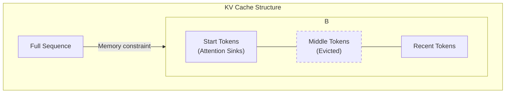

Sources: [streaming_llm/kv_cache.py:23-39](), [streaming_llm/enable_streaming_llm.py:4-38]()

## The StartRecentKVCache Class

The core of the KV cache management system is implemented in the `StartRecentKVCache` class, which maintains two critical segments of the sequence:

1. **Start tokens** (attention sinks): The initial tokens in the sequence that serve as anchors for attention
2. **Recent tokens**: The most recently processed tokens that provide immediate context

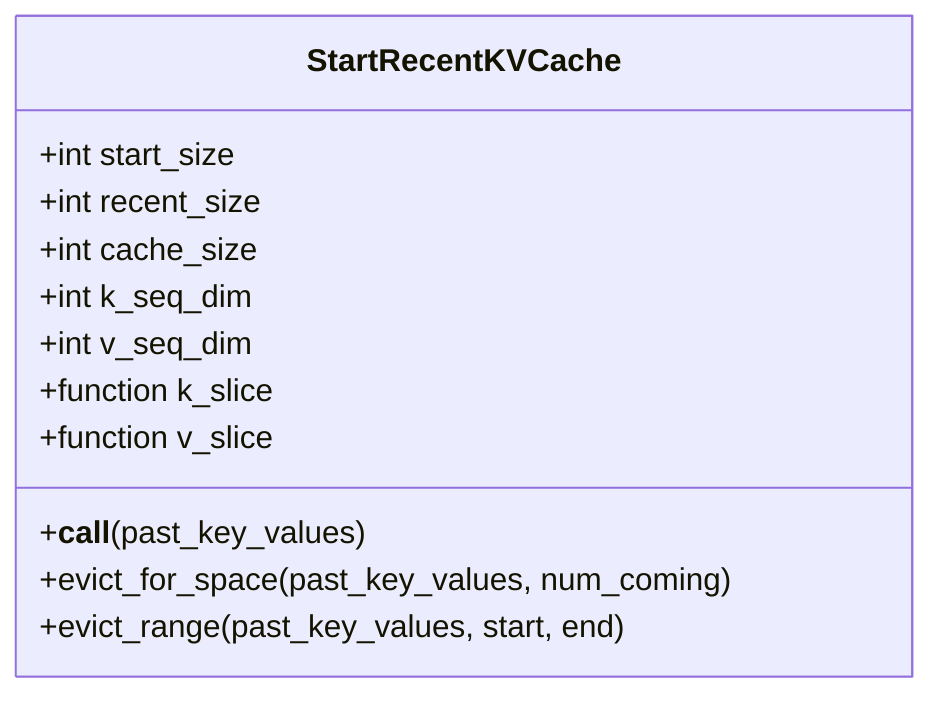

Sources: [streaming_llm/kv_cache.py:23-39]()

The class is initialized with these key parameters:

| Parameter | Purpose | Default |
|-----------|---------|---------|
| `start_size` | Number of initial tokens to retain | 4 |
| `recent_size` | Number of most recent tokens to retain | 512 |
| `k_seq_dim` | Dimension of sequence in key tensors | 2 (model-dependent) |
| `v_seq_dim` | Dimension of sequence in value tensors | 2 (model-dependent) |

The `cache_size` is calculated as `start_size + recent_size` and represents the total number of tokens kept in the cache.

Sources: [streaming_llm/kv_cache.py:23-39]()

## Cache Operations

The `StartRecentKVCache` class provides three primary operations for managing the KV cache:

### 1. Basic Cache Trimming (`__call__`)

This operation trims the KV cache to maintain only the start and recent tokens when the sequence length exceeds the cache size.

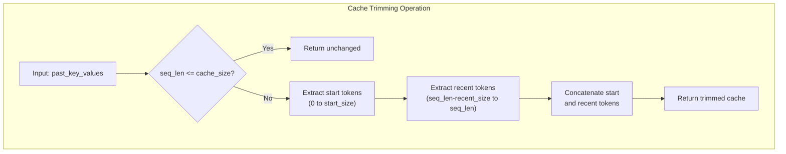

Sources: [streaming_llm/kv_cache.py:40-64]()

### 2. Eviction for Space (`evict_for_space`)

This operation makes space in the KV cache for new incoming tokens by evicting middle tokens.

```mermaid
flowchart TB
    subgraph "Evict for Space Operation"
        direction LR
        A["Input: past_key_values, num_coming"] --> B{"seq_len + num_coming <= cache_size?"}
        B -->|"Yes"| C["Return unchanged"]
        B -->|"No"| D["Extract start tokens\n(0 to start_size)"]
        D --> E["Extract adjusted recent tokens\n(seq_len-recent_size+num_coming to seq_len)"]
        E --> F["Concatenate start\nand adjusted recent tokens"]
        F --> G["Return evicted cache"]
    end
```

Sources: [streaming_llm/kv_cache.py:66-94]()

### 3. Range-Based Eviction (`evict_range`)

This operation allows evicting a specific range of tokens from the KV cache.

```mermaid
flowchart TB
    subgraph "Range-Based Eviction"
        direction LR
        A["Input: past_key_values, start, end"] --> B["Extract tokens before range\n(0 to start)"]
        B --> C["Extract tokens after range\n(end to seq_len)"]
        C --> D["Concatenate before\nand after sections"]
        D --> E["Return range-evicted cache"]
    end
```

Sources: [streaming_llm/kv_cache.py:96-119]()

## Model-Specific Cache Dimensions

Different LLM architectures organize their key and value tensors differently, requiring model-specific handling of sequence dimensions:

```mermaid
graph TD
    subgraph "KV Cache Dimensions by Model"
        direction LR
        
        ModelType["enable_streaming_llm()"] --> ModelDetection["Detect Model Type"]
        
        ModelDetection --> Llama["Llama Models\nk_seq_dim=2\nv_seq_dim=2"]
        ModelDetection --> MPT["MPT Models\nk_seq_dim=3\nv_seq_dim=2"]
        ModelDetection --> GPTNeoX["GPT-NeoX Models\nk_seq_dim=2\nv_seq_dim=2"]
        ModelDetection --> Falcon["Falcon Models\nk_seq_dim=1\nv_seq_dim=1"]
        
        Llama --> KVCache["StartRecentKVCache\nCreation"]
        MPT --> KVCache
        GPTNeoX --> KVCache
        Falcon --> KVCache
    end
```

The dimension parameters determine how slicing operations are performed:

| Model Type | k_seq_dim | v_seq_dim | Slicing Functions |
|------------|-----------|-----------|-------------------|
| Llama | 2 | 2 | slice2d for both |
| MPT | 3 | 2 | slice3d for keys, slice2d for values |
| GPT-NeoX | 2 | 2 | slice2d for both |
| Falcon | 1 | 1 | slice1d for both |

The `DIM_TO_SLICE` dictionary maps these dimension values to the appropriate slicing function:

```
DIM_TO_SLICE = {
    1: slice1d,
    2: slice2d,
    3: slice3d,
}
```

Sources: [streaming_llm/kv_cache.py:4-20](), [streaming_llm/enable_streaming_llm.py:4-38]()

## System Integration 

The KV cache management system integrates with the broader StreamingLLM framework through the `enable_streaming_llm` function, which:

1. Detects the model type
2. Configures the appropriate KV cache dimensions
3. Applies model-specific position shift attention modifications
4. Creates and returns a `StartRecentKVCache` instance

```mermaid
sequenceDiagram
    participant App as "Application"
    participant ESL as "enable_streaming_llm()"
    participant PS as "Position Shift Modules"
    participant KVC as "StartRecentKVCache"
    
    App->>ESL: model, start_size, recent_size
    ESL->>ESL: Detect model type
    
    alt Llama model
        ESL->>PS: enable_llama_pos_shift_attention(model)
    else GPT-NeoX model
        ESL->>PS: enable_gpt_neox_pos_shift_attention(model)
    else Falcon model
        ESL->>PS: enable_falcon_pos_shift_attention(model)
    end
    
    ESL->>KVC: Create with appropriate dimensions
    ESL->>App: Return KV cache manager
    
    Note over App,KVC: During generation loop...
    
    App->>KVC: __call__(past_key_values)
    KVC->>App: Trimmed past_key_values
    
    App->>KVC: evict_for_space(past_key_values, num_coming)
    KVC->>App: Evicted past_key_values
```

Sources: [streaming_llm/enable_streaming_llm.py:4-38]()

## Memory Efficiency 

The KV cache management approach provides significant memory efficiency benefits:

```mermaid
graph LR
    subgraph "Memory Usage Comparison"
        direction TB
        
        Standard["Standard KV Cache\n(Full Sequence)"] --> |"As sequence grows"| StandardMem["O(N) Memory Usage"]
        
        StreamingLLM["StreamingLLM KV Cache\n(Start + Recent only)"] --> |"As sequence grows"| StreamingMem["O(1) Memory Usage"]
    end
```

By maintaining only the start tokens (attention sinks) and the most recent tokens, StreamingLLM achieves constant memory usage regardless of input sequence length. This allows processing arbitrarily long sequences without exceeding memory constraints.

Sources: [streaming_llm/kv_cache.py:23-119]()

## Implementation Details

The actual implementation uses PyTorch tensor operations to efficiently perform the slicing and concatenation operations. The key operations are:

1. **Slicing**: Using the appropriate slice function based on the model's tensor dimensions
2. **Concatenation**: Using `torch.cat()` to join the start tokens and recent tokens
3. **Dimension-specific operations**: Managing different tensor shapes across model architectures

The performance of these operations is critical to the overall efficiency of StreamingLLM, especially for real-time applications that require low-latency responses.

Sources: [streaming_llm/kv_cache.py:4-20](), [streaming_llm/kv_cache.py:40-119]()

---

# Page: Position Shifting

# Position Shifting

<details>
<summary>Relevant source files</summary>

The following files were used as context for generating this wiki page:

- [streaming_llm/pos_shift/__init__.py](streaming_llm/pos_shift/__init__.py)
- [streaming_llm/pos_shift/modify_falcon.py](streaming_llm/pos_shift/modify_falcon.py)
- [streaming_llm/pos_shift/modify_gpt_neox.py](streaming_llm/pos_shift/modify_gpt_neox.py)

</details>


Position shifting is a critical technique in StreamingLLM that enables language models to process sequences longer than their training context window. This page explains how position shifting works in the context of attention mechanisms and how it's implemented for different model architectures.

For information about KV cache management, which works in conjunction with position shifting, see [Key-Value Cache Management](#2.2).

## What is Position Shifting?

Position shifting refers to the technique of modifying how positional embeddings are applied in transformer models during inference. In standard transformer models, positional embeddings encode the absolute or relative positions of tokens in a sequence. However, when processing sequences longer than the training context window, these embeddings can produce unexpected results since the model was never trained on such long positions.

```mermaid
flowchart TD
    subgraph "Standard Position Encoding"
        A["Input Tokens"] --> B["Fixed Position\nEmbeddings"]
        B --> C["Attention\nMechanism"]
        C --> D["Limited Context\nWindow"]
    end
    
    subgraph "Position Shifting"
        E["Input Tokens\n(Potentially Infinite)"] --> F["Shifted Position\nEmbeddings"]
        F --> G["Modified Attention\nMechanism"]
        G --> H["Extended Context\nWindow"]
    end
```

Sources: [streaming_llm/pos_shift/modify_falcon.py:19-150](), [streaming_llm/pos_shift/modify_gpt_neox.py:20-96]()

## Key Concept: Rotary Position Embeddings

Most modern LLMs use rotary position embeddings (RoPE) to encode positional information. Position shifting modifies how these embeddings are applied, especially when combining cached past tokens with new tokens.

```mermaid
flowchart LR
    subgraph "Position Shifting with RoPE"
        direction TB
        A["Input Sequence"] --> B["Split into\nWindows"]
        B --> C["Apply Modified\nRoPE"]
        
        subgraph "Key Operations"
            direction TB
            D["1. Create position IDs"] --> E["2. Apply rotary\ntransformation"]
            E --> F["3. Recalculate positions\nfor cached tokens"]
        end
        
        C --> G["Attention\nComputation"]
        G --> H["Output Tokens"]
    end
```

Sources: [streaming_llm/pos_shift/modify_gpt_neox.py:20-27](), [streaming_llm/pos_shift/modify_falcon.py:57-74]()

## Position Shifting Implementation

StreamingLLM implements model-specific position shifting adaptations since different model architectures handle positional embeddings differently. The implementation follows a consistent pattern:

1. Create custom forward pass functions for attention modules
2. Modify how position IDs are generated and applied
3. Apply special handling for cached past key-value states
4. Replace the original forward methods with the modified versions

```mermaid
classDiagram
    class PositionShiftBase {
        +enable_position_shift(model)
        #apply_modified_position_embeddings()
    }
    
    class FalconPositionShift {
        +enable_falcon_pos_shift_attention(model)
        +falcon_pos_shift_attention_forward()
    }
    
    class GPTNeoXPositionShift {
        +enable_gpt_neox_pos_shift_attention(model)
        +gpt_neox_pos_shift_attention_forward()
        +apply_rotary_pos_emb_single()
    }
    
    class LlamaPositionShift {
        +enable_llama_pos_shift_attention(model)
    }
    
    PositionShiftBase <|-- FalconPositionShift
    PositionShiftBase <|-- GPTNeoXPositionShift
    PositionShiftBase <|-- LlamaPositionShift
```

Sources: [streaming_llm/pos_shift/modify_falcon.py:152-162](), [streaming_llm/pos_shift/modify_gpt_neox.py:99-110]()

## Model-Specific Implementations

### Falcon Implementation

The Falcon implementation modifies how rotary embeddings and alibi (attention with linear biases) are applied. A key aspect is handling both falcon-7b and falcon-40b model variants, which have different attention implementations.

Key components of the Falcon implementation:

1. Custom forward function that handles both alibi and non-alibi cases
2. Special handling for key-value caching and past context
3. Proper application of rotary embeddings with shifted positions

The implementation uses monkey patching to replace the original forward method:

```python
def enable_falcon_pos_shift_attention(model):
    for name, module in reversed(model._modules.items()):
        if len(list(module.children())) > 0:
            enable_falcon_pos_shift_attention(module)
        if "self_attention" == name[-14:]:
            model._modules[name].forward = types.MethodType(
                falcon_pos_shift_attention_forward, model._modules[name]
            )
```

Sources: [streaming_llm/pos_shift/modify_falcon.py:152-162]()

### GPT-NeoX Implementation

The GPT-NeoX implementation focuses on properly handling rotary position embeddings with cached states. It introduces a helper function `apply_rotary_pos_emb_single` that applies rotary embeddings with specific position IDs.

Key aspects of the GPT-NeoX implementation:

1. Custom application of rotary embeddings for queries and keys
2. Special handling of position IDs when extending context with cached states
3. Proper sequence length tracking when combining past and current contexts

```python
def apply_rotary_pos_emb_single(x, cos, sin, position_ids):
    gather_indices = position_ids[:, None, :, None]  # [bs, 1, seq_len, 1]
    gather_indices = gather_indices.repeat(1, cos.shape[1], 1, cos.shape[3])
    cos = torch.gather(cos.repeat(gather_indices.shape[0], 1, 1, 1), 2, gather_indices)
    sin = torch.gather(sin.repeat(gather_indices.shape[0], 1, 1, 1), 2, gather_indices)
    x_embed = (x * cos) + (rotate_half(x) * sin)
    return x_embed
```

Sources: [streaming_llm/pos_shift/modify_gpt_neox.py:20-27]()

## Position Shifting and Attention Sinks

Position shifting works hand-in-hand with the attention sink mechanism to enable processing of sequences longer than the training context window:

```mermaid
flowchart LR
    subgraph "StreamingLLM Inference Process"
        A["Input Tokens\n(Long Sequence)"] --> B["KV Cache\nManagement"]
        B --> C["Position Shifting"]
        
        subgraph "Position Shifting Process"
            D["Create position IDs\nfor current window"] --> E["Apply modified\nrotary embeddings"]
            E --> F["Calculate attention\nwith shifted positions"]
        end
        
        C --> G["Generate\nOutput Tokens"]
    end
```

Sources: [streaming_llm/pos_shift/modify_falcon.py:19-150](), [streaming_llm/pos_shift/modify_gpt_neox.py:29-96]()

## Key Technical Details

Position shifting addresses several technical challenges in LLM streaming:

1. **Position Embedding Limitation**: LLMs are typically trained with fixed-length position embeddings (e.g., up to 2048 or 4096 tokens). Position shifting enables them to handle much longer sequences.

2. **Rotary Position Embedding (RoPE) Modification**: The core of position shifting is modifying RoPE application to maintain proper relative positioning information while using a sliding window approach.

3. **Position Reset**: For key vectors in the KV cache, positions are essentially "reset" to maintain proper relative positioning within the attention window.

| Model Architecture | Position Embedding Type | Modified Function | Key Adaptation |
|-------------------|-------------------------|-------------------|---------------|
| Falcon            | Rotary + Optional Alibi | `falcon_pos_shift_attention_forward` | Handles both alibi and non-alibi cases |
| GPT-NeoX          | Rotary                  | `gpt_neox_pos_shift_attention_forward` | Custom position ID handling for extended context |
| Llama             | Rotary                  | `enable_llama_pos_shift_attention` | Mentioned but implementation not shown in provided files |

Sources: [streaming_llm/pos_shift/modify_falcon.py:19-150](), [streaming_llm/pos_shift/modify_gpt_neox.py:29-96]()

## Implementation Flow

The following diagram illustrates how position shifting is applied during the inference process:

```mermaid
sequenceDiagram
    participant App as Application
    participant Model as LLM Model
    participant PosShift as Position Shift Module
    participant KVCache as KV Cache Manager
    
    App->>Model: Process input tokens
    Model->>PosShift: Generate query/key/value
    
    PosShift->>PosShift: Create position IDs
    PosShift->>PosShift: Apply rotary embeddings with modified positions
    
    PosShift->>KVCache: Store key/value with shifted positions
    KVCache->>PosShift: Retrieve past key/value states
    
    PosShift->>Model: Calculate attention with shifted positions
    Model->>App: Return output tokens
```

Sources: [streaming_llm/pos_shift/modify_falcon.py:19-150](), [streaming_llm/pos_shift/modify_gpt_neox.py:29-96]()

## Summary

Position shifting is a core technique in StreamingLLM that enables language models to process sequences longer than their training context window. By modifying how positional embeddings are applied, especially for rotary position embeddings, StreamingLLM can effectively maintain proper relative positioning information while using a sliding window approach with attention sinks. This technique is implemented differently for different model architectures but follows the same core principles of modified position ID handling and proper integration with KV cache management.

---

# Page: System Architecture

# System Architecture

<details>
<summary>Relevant source files</summary>

The following files were used as context for generating this wiki page:

- [README.md](README.md)
- [figures/schemes.png](figures/schemes.png)
- [streaming_llm/enable_streaming_llm.py](streaming_llm/enable_streaming_llm.py)

</details>


This document provides a technical overview of the StreamingLLM architecture, its key components, and their interactions. It describes how the system enables language models to process arbitrarily long input sequences without recomputation or performance degradation. For more information about specific model implementations, see [Supported Models](#3.1), and for details on integrations with external frameworks, see [External Integrations](#3.2).

## System Overview

StreamingLLM's architecture is designed to efficiently manage attention mechanisms and key-value caches in transformer-based language models, allowing them to handle sequences much longer than their training context window. The core innovation is the "attention sink" mechanism, which preserves only the most important tokens in the KV cache.

```mermaid
flowchart TD
    subgraph "StreamingLLM Core Architecture"
        Init["enable_streaming_llm()"]
        KVCache["StartRecentKVCache"]
        PosShift["Position Shift Modifications"]
        
        Init -->|"Creates and configures"| KVCache
        Init -->|"Applies model-specific"| PosShift
        
        subgraph "Model Detection & Adaptation"
            ModelDetect["Model Type Detection"]
            LlamaAdapter["Llama Adapter"]
            FalconAdapter["Falcon Adapter"]
            GPTNeoxAdapter["GPT-NeoX Adapter"]
            MPTAdapter["MPT Adapter"]
            
            ModelDetect --> LlamaAdapter
            ModelDetect --> FalconAdapter
            ModelDetect --> GPTNeoxAdapter
            ModelDetect --> MPTAdapter
        end
        
        Init -->|"Determines"| ModelDetect
        ModelDetect -->|"Configures dimensions"| KVCache
    end
    
    subgraph "Runtime Flow"
        Inference["streaming_inference()"]
        Generate["greedy_generate()"]
        
        Inference -->|"Uses"| Generate
        Generate -->|"Manages"| KVCache
    end
```

Sources: [streaming_llm/enable_streaming_llm.py:1-38]()

## Core Components

The StreamingLLM architecture consists of two primary components:

1. **KV Cache Management** - Handles selective retention and eviction of tokens in the key-value cache
2. **Position Shift Attention** - Model-specific modifications to handle position indices for arbitrarily long sequences

These components work together to enable efficient streaming of language model outputs without performance degradation over long sequences.

```mermaid
classDiagram
    class StartRecentKVCache {
        +int start_size
        +int recent_size
        +int k_seq_dim
        +int v_seq_dim
        +__call__(past_key_values)
        +evict_for_space(past_key_values, num_coming)
        +evict_range(past_key_values, start, end)
    }
    
    class ModelSpecificAdapter {
        +enable_position_shift_attention(model)
    }
    
    class PositionShiftAttention {
        +apply_position_alibi_scaling()
        +handle_shifted_indices()
    }
    
    class EnableStreamingLLM {
        +enable_streaming_llm(model, start_size, recent_size)
    }
    
    EnableStreamingLLM --> StartRecentKVCache: creates
    EnableStreamingLLM --> ModelSpecificAdapter: selects
    ModelSpecificAdapter --> PositionShiftAttention: implements
```

Sources: [streaming_llm/enable_streaming_llm.py:1-38]()

### KV Cache Management

The `StartRecentKVCache` class is responsible for managing which parts of the key-value cache are retained and which are discarded. It implements the attention sink mechanism by:

1. Keeping the initial tokens (the "attention sinks")
2. Keeping the most recent tokens
3. Discarding intermediate tokens to save memory

This approach allows the model to maintain coherence over long sequences without exhausting memory resources.

```mermaid
flowchart LR
    subgraph "KV Cache Management"
        direction TB
        Input["Input Tokens"] --> Process["Process Tokens"]
        Process --> Manage["Manage KV Cache"]
        
        subgraph "StartRecentKVCache"
            direction TB
            Sinks["Attention Sinks\n(start_size tokens)"]
            Middle["Middle Tokens\n(discarded)"]
            Recent["Recent Tokens\n(recent_size tokens)"]
            
            Sinks --- Middle --- Recent
        end
        
        Manage -->|"Retains"| Sinks
        Manage -->|"Discards"| Middle
        Manage -->|"Retains"| Recent
        
        Sinks -->|"Provides stability"| Output["Output Generation"]
        Recent -->|"Provides context"| Output
    end
```

Sources: [streaming_llm/enable_streaming_llm.py:1-38]()

### Position Shift Attention

The position shift attention mechanism modifies how the model handles position indices in the attention mechanism. Since transformer models typically expect position indices to start from 0 and increase sequentially, modifications are needed to handle arbitrary sequence lengths effectively.

The implementation varies by model architecture:

| Model Type | Key Sequence Dimension | Value Sequence Dimension | Position Shift Implementation |
|------------|------------------------|--------------------------|------------------------------|
| Llama      | 2                      | 2                        | `enable_llama_pos_shift_attention` |
| MPT        | 3                      | 2                        | Uses default position handling |
| GPT-NeoX   | 2                      | 2                        | `enable_gpt_neox_pos_shift_attention` |
| Falcon     | 1                      | 1                        | `enable_falcon_pos_shift_attention` |

These model-specific implementations ensure that position information is correctly handled when the KV cache is selectively retained.

Sources: [streaming_llm/enable_streaming_llm.py:5-29]()

## Initialization and Configuration

The initialization of StreamingLLM involves configuring the KV cache management and applying the appropriate position shift attention modifications to the model.

```mermaid
sequenceDiagram
    participant App as Application
    participant SLLM as enable_streaming_llm
    participant Model as LLM Model
    participant Cache as StartRecentKVCache
    participant PosShift as Position Shift Adapters
    
    App->>SLLM: enable_streaming_llm(model, start_size, recent_size)
    SLLM->>SLLM: Detect model type
    
    alt is Llama model
        SLLM->>PosShift: enable_llama_pos_shift_attention(model)
        SLLM->>SLLM: Set k_seq_dim=v_seq_dim=2
    else is MPT model
        SLLM->>SLLM: Set k_seq_dim=3, v_seq_dim=2
    else is GPT-NeoX model
        SLLM->>PosShift: enable_gpt_neox_pos_shift_attention(model)
        SLLM->>SLLM: Set k_seq_dim=v_seq_dim=2
    else is Falcon model
        SLLM->>PosShift: enable_falcon_pos_shift_attention(model)
        SLLM->>SLLM: Set k_seq_dim=v_seq_dim=1
    end
    
    PosShift->>Model: Apply position shift modifications
    SLLM->>Cache: Create StartRecentKVCache(start_size, recent_size, k_seq_dim, v_seq_dim)
    SLLM->>App: Return configured KV cache
```

The function `enable_streaming_llm` serves as the entry point for configuring a model for streaming:

1. It detects the model type based on `model.config.model_type`
2. It sets the appropriate dimensions for key and value tensors based on the model architecture
3. It applies model-specific position shift modifications through dedicated functions
4. It creates and returns a `StartRecentKVCache` instance configured for the specific model

Sources: [streaming_llm/enable_streaming_llm.py:4-38]()

## Execution Flow

The execution flow in StreamingLLM involves a continuous process of token generation and KV cache management.

```mermaid
flowchart TD
    subgraph "StreamingLLM Execution Flow"
        Input["Input Tokens"] --> EnableStreaming["enable_streaming_llm()"]
        EnableStreaming --> KVCache["StartRecentKVCache"]
        
        Input --> FirstForward["Initial Forward Pass"]
        FirstForward --> InitialKV["Initial KV States"]
        
        subgraph "Generation Loop"
            GenerateToken["Generate Next Token"]
            UpdateKV["Update KV Cache"]
            ManageKV["Manage KV Cache\n(StartRecentKVCache.__call__)"]
            
            GenerateToken --> UpdateKV
            UpdateKV --> ManageKV
            ManageKV --> GenerateToken
        end
        
        InitialKV --> Generation["streaming_inference()"]
        KVCache --> Generation
        Generation --> GenerateToken
        
        ManageKV -->|"When cache exceeds capacity"| EvictTokens["Evict Middle Tokens"]
    end
```

During execution:

1. The model is first configured with `enable_streaming_llm`
2. Initial input tokens are processed to generate initial KV states
3. The generation loop continues, producing tokens and updating the KV cache
4. The `StartRecentKVCache` class manages the KV cache, retaining attention sinks and recent tokens
5. When the cache exceeds capacity, middle tokens are evicted to maintain efficiency

This flow allows the model to process arbitrarily long input sequences without performance degradation.

Sources: [streaming_llm/enable_streaming_llm.py:1-38]()

## Attention Sink Mechanism

The attention sink mechanism is the key innovation that enables StreamingLLM to handle long sequences efficiently.

```mermaid
flowchart LR
    subgraph "Attention Sink Mechanism"
        direction TB
        
        subgraph "Conventional LLM"
            ConvKV["Full KV Cache\n(Limited by Context Window)"]
            ConvInput["Input"] --> ConvProcess["Process"]
            ConvProcess --> ConvKV
            ConvKV --> ConvOutput["Output\n(Limited Length)"]
        end
        
        subgraph "StreamingLLM"
            StreamKV["Selective KV Cache"]
            
            subgraph "Cache Structure"
                Sinks["Attention Sinks\n(First Tokens)"]
                Recent["Recent Tokens"]
            end
            
            StreamInput["Input\n(Potentially Infinite)"] --> StreamProcess["Process"]
            StreamProcess --> StreamKV
            StreamKV --> Sinks
            StreamKV --> Recent
            Sinks --> StreamOutput["Output\n(Unlimited Length)"]
            Recent --> StreamOutput
        end
    end
```

Key characteristics:

1. **Attention Sinks**: The initial tokens in the sequence serve as "attention sinks" - even though they may not be semantically important, the model's attention mechanism tends to assign them high attention scores
2. **Selective Retention**: By keeping only the attention sinks and the most recent tokens, the model can maintain coherence while discarding less important middle tokens
3. **Memory Efficiency**: This approach allows for processing sequences much longer than the model's training context window without increasing memory requirements

The attention sink mechanism is implemented through the `StartRecentKVCache` class, which manages the selection and retention of tokens in the KV cache.

Sources: [README.md:21-22]()

## Integration with the Model Pipeline

StreamingLLM integrates into the model execution pipeline by intercepting and managing the KV cache during the generation process.

```mermaid
flowchart TD
    subgraph "Model Pipeline Integration"
        Input["Input Sequence"] --> Tokenizer["Tokenizer"]
        Tokenizer --> Tokens["Tokenized Input"]
        
        Tokens --> ModelForward["Model Forward Pass"]
        ModelForward --> PKV["past_key_values"]
        PKV --> KVCache["StartRecentKVCache.__call__"]
        
        KVCache -->|"Manages"| RetainedKV["Retained KV Cache"]
        RetainedKV --> NextForward["Next Forward Pass"]
        
        NextForward --> Logits["Output Logits"]
        Logits --> TokenGen["Token Generation"]
        TokenGen --> Output["Output Token"]
        
        Output -->|"Feedback for next step"| NextForward
    end
```

The integration process:

1. Input sequence is tokenized and passed to the model
2. Model performs a forward pass and generates key-value states
3. `StartRecentKVCache` intercepts and manages these KV states, retaining only the attention sinks and recent tokens
4. The managed KV cache is used for subsequent forward passes
5. This process continues, allowing for efficient streaming of output tokens

This integration allows StreamingLLM to work with existing model architectures without requiring changes to the core model implementation.

Sources: [streaming_llm/enable_streaming_llm.py:1-38]()

## Supported Model Architectures

StreamingLLM supports several transformer-based language model architectures, with model-specific implementations for each:

| Model Architecture | Support Status | Implementation Details |
|-------------------|----------------|------------------------|
| Llama             | Fully supported | Uses `enable_llama_pos_shift_attention` |
| MPT               | Supported      | Uses default position handling with custom dimensions |
| GPT-NeoX          | Fully supported | Uses `enable_gpt_neox_pos_shift_attention` |
| Falcon            | Fully supported | Uses `enable_falcon_pos_shift_attention` |

Each model architecture requires specific handling due to differences in how their attention mechanisms and position embeddings work.

Sources: [streaming_llm/enable_streaming_llm.py:5-29](), [README.md:69]()

## External Framework Integrations

StreamingLLM has been integrated with various external frameworks:

```mermaid
flowchart LR
    subgraph "StreamingLLM Integrations"
        SLLM["StreamingLLM Core"]
        
        SLLM --- HF["HuggingFace\nTransformers"]
        SLLM --- TRT["NVIDIA\nTensorRT-LLM"]
        SLLM --- Intel["Intel Extension\nfor Transformers"]
        SLLM --- Swift["HPC-AI Tech\nSwiftInfer"]
    end
```

These integrations allow StreamingLLM to be used with popular frameworks and hardware acceleration technologies, enhancing its applicability in various deployment scenarios.

Sources: [README.md:13-18]()

## System Limitations and Considerations

While StreamingLLM enables processing of arbitrarily long sequences, it has some limitations to consider:

1. **Attention Window**: The model's effective context window remains limited by its training - only the most recent tokens and attention sinks are retained
2. **Information Retrieval**: The model cannot retrieve information from discarded middle tokens
3. **Cache Size**: The total cache size (start_size + recent_size) should not exceed the model's maximum training sequence length

These considerations are important when deciding whether StreamingLLM is appropriate for specific use cases.

Sources: [README.md:46-60]()

## Summary

StreamingLLM's architecture provides an efficient solution for processing arbitrarily long input sequences with transformer-based language models. By implementing the attention sink mechanism and model-specific position shift modifications, it enables models to maintain coherence over long sequences without increasing memory requirements or requiring retraining.

The key components - KV cache management and position shift attention - work together to create a system that can be integrated with various model architectures and external frameworks, making it versatile and widely applicable.

---

# Page: Supported Models

# Supported Models

<details>
<summary>Relevant source files</summary>

The following files were used as context for generating this wiki page:

- [README.md](README.md)
- [streaming_llm/enable_streaming_llm.py](streaming_llm/enable_streaming_llm.py)

</details>


This page documents the language model architectures officially supported by StreamingLLM and how each model type is specifically implemented within the framework. For information about external integrations with other frameworks, see [External Integrations](#3.2).

## Model Compatibility Overview

StreamingLLM supports several popular open-source large language model architectures. Each model type requires specific adaptations to enable the attention sink mechanism and proper KV cache management.

```mermaid
flowchart TD
    subgraph "StreamingLLM Model Support"
        enable["enable_streaming_llm()"]
        class enable important
        
        enable --> ModelDetection["Model Type Detection"]
        
        ModelDetection --> Llama["Llama Models"]
        ModelDetection --> MPT["MPT Models"]
        ModelDetection --> GPTNeox["GPT-NeoX Models\n(including Pythia)"]
        ModelDetection --> Falcon["Falcon Models"]
        
        Llama --> LlamaConfig["- k_seq_dim=2\n- v_seq_dim=2\n- Position Shift Attention"]
        MPT --> MPTConfig["- k_seq_dim=3\n- v_seq_dim=2"]
        GPTNeox --> NeoxConfig["- k_seq_dim=2\n- v_seq_dim=2\n- Position Shift Attention"]
        Falcon --> FalconConfig["- k_seq_dim=1\n- v_seq_dim=1\n- Position Shift Attention"]
        
        LlamaConfig --> KVCache["StartRecentKVCache"]
        MPTConfig --> KVCache
        NeoxConfig --> KVCache
        FalconConfig --> KVCache
    end
```

*Model support architecture in StreamingLLM*

Sources: [streaming_llm/enable_streaming_llm.py:1-38](), [README.md:21-22]()

## Supported Model Types

StreamingLLM officially supports the following model architectures:

| Model Type | KV Dimensions | Position Shift Required | Notable Models |
|------------|---------------|-------------------------|----------------|
| Llama      | k_seq_dim=2, v_seq_dim=2 | Yes | Llama, Llama-2, Llama-2-7B-32K-Instruct |
| MPT        | k_seq_dim=3, v_seq_dim=2 | No  | MPT-7B, MPT-30B |
| GPT-NeoX   | k_seq_dim=2, v_seq_dim=2 | Yes | Pythia-7B, Pythia-12B |
| Falcon     | k_seq_dim=1, v_seq_dim=1 | Yes | Falcon-7B, Falcon-40B |

Sources: [streaming_llm/enable_streaming_llm.py:4-38](), [README.md:21-22](), [README.md:69]()

## Implementation Details

### Model Detection and Configuration

The `enable_streaming_llm` function serves as the primary entry point for enabling any supported model for streaming. It takes a model instance, along with parameters for attention sink configuration:

```mermaid
flowchart LR
    Input["Model + Config Parameters"] --> Detect["Detect Model Type"]
    Detect --> Configure["Configure KV Dimensions"]
    Configure --> PosShift["Apply Position Shift\n(if required)"]
    PosShift --> CreateCache["Create KV Cache Manager"]
    CreateCache --> Output["Return KV Cache Manager"]
```

*Model detection and configuration flow*

Sources: [streaming_llm/enable_streaming_llm.py:4-38]()

### Model-Specific Implementations

#### Llama Models

Llama models require position shift attention modification to work effectively with streaming. The key and value tensors both use sequence dimension 2 (0-indexed).

```mermaid
flowchart TD
    subgraph "Llama Implementation"
        LlamaModel["Llama Model"] --> LlamaDetect["Model Type Detection\nLlama"]
        LlamaDetect --> LlamaDims["Set Dimensions\nk_seq_dim=2, v_seq_dim=2"]
        LlamaDims --> EnablePosShift["enable_llama_pos_shift_attention()"]
        EnablePosShift --> CreateCache["Create StartRecentKVCache"]
    end
```

*Llama model implementation*

Sources: [streaming_llm/enable_streaming_llm.py:5-11]()

#### MPT Models

MPT models have a different tensor structure compared to other models, with key tensors using sequence dimension 3 and value tensors using dimension 2.

```mermaid
flowchart TD
    subgraph "MPT Implementation"
        MPTModel["MPT Model"] --> MPTDetect["Model Type Detection\nMPT"]
        MPTDetect --> MPTDims["Set Dimensions\nk_seq_dim=3, v_seq_dim=2"]
        MPTDims --> CreateCache["Create StartRecentKVCache"]
    end
```

*MPT model implementation*

Sources: [streaming_llm/enable_streaming_llm.py:12-14]()

#### GPT-NeoX Models (including Pythia)

GPT-NeoX-based models, including the Pythia family, require position shift attention modification similar to Llama. Both key and value tensors use sequence dimension 2.

```mermaid
flowchart TD
    subgraph "GPT-NeoX Implementation"
        NeoxModel["GPT-NeoX Model"] --> NeoxDetect["Model Type Detection\nGPT-NeoX"]
        NeoxDetect --> NeoxDims["Set Dimensions\nk_seq_dim=2, v_seq_dim=2"]
        NeoxDims --> EnablePosShift["enable_gpt_neox_pos_shift_attention()"]
        EnablePosShift --> CreateCache["Create StartRecentKVCache"]
    end
```

*GPT-NeoX model implementation*

Sources: [streaming_llm/enable_streaming_llm.py:15-21]()

#### Falcon Models

Falcon models have a unique tensor structure with both key and value tensors using sequence dimension 1. They also require position shift attention modification.

```mermaid
flowchart TD
    subgraph "Falcon Implementation"
        FalconModel["Falcon Model"] --> FalconDetect["Model Type Detection\nFalcon"]
        FalconDetect --> FalconDims["Set Dimensions\nk_seq_dim=1, v_seq_dim=1"]
        FalconDims --> EnablePosShift["enable_falcon_pos_shift_attention()"]
        EnablePosShift --> CreateCache["Create StartRecentKVCache"]
    end
```

*Falcon model implementation*

Sources: [streaming_llm/enable_streaming_llm.py:22-29]()

## Position Shift Attention

Three of the four supported model architectures require position shift attention modifications:

1. Llama - `enable_llama_pos_shift_attention()`
2. GPT-NeoX - `enable_gpt_neox_pos_shift_attention()`
3. Falcon - `enable_falcon_pos_shift_attention()`

Position shift attention is a critical component that allows these models to work with the attention sink mechanism. For more details on position shifting, see [Position Shifting](#2.3).

Sources: [streaming_llm/enable_streaming_llm.py:7-11](), [streaming_llm/enable_streaming_llm.py:17-21](), [streaming_llm/enable_streaming_llm.py:25-29]()

## KV Cache Configuration

After model detection and necessary modifications, a `StartRecentKVCache` instance is created with model-specific parameters:

```python
kv_cache = StartRecentKVCache(
    start_size=start_size,
    recent_size=recent_size,
    k_seq_dim=k_seq_dim,
    v_seq_dim=v_seq_dim,
)
```

The `start_size` and `recent_size` parameters control the attention sink behavior:
- `start_size`: Number of initial tokens to retain (attention sinks)
- `recent_size`: Number of most recent tokens to retain

For detailed information about KV cache management, see [Key-Value Cache Management](#2.2).

Sources: [streaming_llm/enable_streaming_llm.py:32-37]()

## Code to Model Integration Flow

The following diagram illustrates how the model detection and configuration system integrates with the actual code components:

```mermaid
flowchart TD
    subgraph "Code Components"
        EnableFunction["enable_streaming_llm()\nFunction"]
        ModifyLlama["streaming_llm.pos_shift.modify_llama\nModule"]
        ModifyNeox["streaming_llm.pos_shift.modify_gpt_neox\nModule"]
        ModifyFalcon["streaming_llm.pos_shift.modify_falcon\nModule"]
        KVCacheClass["StartRecentKVCache\nClass"]
    end
    
    subgraph "Model Detection Flow"
        ModelInstance["Model Instance"] --> ModelType{"model.config.model_type?"}
        ModelType -->|"llama"| ConfigLlama["Configure Llama"]
        ModelType -->|"mpt"| ConfigMPT["Configure MPT"]
        ModelType -->|"gpt_neox"| ConfigNeox["Configure GPT-NeoX"]
        ModelType -->|"falcon"| ConfigFalcon["Configure Falcon"]
        ModelType -->|"other"| RaiseError["Raise ValueError"]
    end
    
    ModelInstance --> EnableFunction
    EnableFunction --> ModelType
    
    ConfigLlama --> ModifyLlama
    ConfigNeox --> ModifyNeox
    ConfigFalcon --> ModifyFalcon
    
    ModifyLlama --> KVCacheClass
    ModifyNeox --> KVCacheClass
    ModifyFalcon --> KVCacheClass
    ConfigMPT --> KVCacheClass
```

*Code to model integration flow*

Sources: [streaming_llm/enable_streaming_llm.py:1-38]()

## Adding Support for New Models

To add support for a new model architecture in StreamingLLM, the following steps would be needed:

1. Determine the correct sequence dimensions for key and value tensors
2. Implement position shift attention if required
3. Add detection for the new model type in `enable_streaming_llm`

Support for new models would require modifications to the `enable_streaming_llm` function to handle the new model type and potentially the creation of a new module for position shift attention implementation.

Sources: [streaming_llm/enable_streaming_llm.py:4-38]()

---

# Page: External Integrations

# External Integrations

<details>
<summary>Relevant source files</summary>

The following files were used as context for generating this wiki page:

- [README.md](README.md)

</details>


This document provides a technical overview of how StreamingLLM integrates with external frameworks and libraries. StreamingLLM's architecture is designed with extensibility in mind, allowing it to be integrated into various machine learning frameworks and deployment environments. For information on the core architecture of StreamingLLM, see [System Architecture](#3) and for specific model implementations, see [Supported Models](#3.1).

## Integration Overview

StreamingLLM has been adopted by several major machine learning frameworks and acceleration libraries. These integrations demonstrate the practical applicability of the attention sink mechanism and extend the reach of StreamingLLM's capabilities to different deployment scenarios.

```mermaid
flowchart TD
    subgraph "StreamingLLM Core Components"
        attention["Attention Sink Mechanism"]
        kvCache["StartRecentKVCache"]
        posShift["Position Shifting"]
    end

    subgraph "External Integrations"
        huggingface["Hugging Face Transformers"]
        tensorrt["NVIDIA TensorRT-LLM"]
        intel["Intel Extension for Transformers"]
        swift["HPC-AI Tech SwiftInfer"]
    end

    attention --> huggingface
    kvCache --> huggingface
    posShift --> huggingface

    attention --> tensorrt
    kvCache --> tensorrt
    posShift --> tensorrt

    attention --> intel
    kvCache --> intel
    posShift --> intel

    attention --> swift
    kvCache --> swift
    posShift --> swift
```

*Diagram: StreamingLLM Integration Overview*

Sources: [README.md:14-18]()

## Hugging Face Transformers Integration

The Hugging Face Transformers library is one of the most widely used frameworks for working with transformer-based models. The integration of StreamingLLM into Transformers allows users to leverage the attention sink mechanism within the familiar Hugging Face ecosystem.

```mermaid
flowchart TD
    subgraph "StreamingLLM Components"
        attention["Attention Sink Mechanism"]
        kvCache["StartRecentKVCache"]
        posShift["Position Shifting"]
    end

    subgraph "Hugging Face Transformers Integration"
        transformers["Transformers Library"]
        generationMixin["Generation Mixin"]
        modelClasses["Model Classes<br>(LlamaForCausalLM, etc.)"]
        attentionModules["Attention Modules"]
    end

    attention --> attentionModules
    kvCache --> generationMixin
    posShift --> modelClasses

    attentionModules --> transformers
    generationMixin --> transformers
    modelClasses --> transformers
```

*Diagram: Hugging Face Transformers Integration*

The integration with Hugging Face Transformers was completed in December 2023 (PR #26681). This integration allows users to:

1. Use StreamingLLM's attention sink mechanism directly with Hugging Face model implementations
2. Take advantage of the infinite-context capabilities while maintaining compatibility with the Transformers API
3. Apply the technique to various model architectures supported by both frameworks

Sources: [README.md:17]()

## NVIDIA TensorRT-LLM Integration

TensorRT-LLM is NVIDIA's framework for optimizing and deploying LLMs on NVIDIA GPUs. The integration of StreamingLLM with TensorRT-LLM enables efficient streaming capabilities with hardware-accelerated inference.

```mermaid
flowchart TD
    subgraph "StreamingLLM Core"
        attentionSink["Attention Sink Mechanism"]
        startRecent["StartRecentKVCache Management"]
    end

    subgraph "TensorRT-LLM Integration"
        tensorrt["TensorRT-LLM Engine"]
        llmOpt["LLM Optimization"]
        kvManager["KV Cache Manager"]
        attentionImpl["Attention Implementation"]
    end

    attentionSink --> attentionImpl
    startRecent --> kvManager
    
    attentionImpl --> tensorrt
    kvManager --> tensorrt
    llmOpt --> tensorrt
```

*Diagram: NVIDIA TensorRT-LLM Integration*

The TensorRT-LLM integration was announced in January 2024. Key aspects of this integration include:

1. Hardware-optimized implementation of the attention sink mechanism
2. Efficient KV cache management optimized for NVIDIA GPUs
3. Support for Llama models with streaming capabilities
4. Significant performance improvements for long-context generation

This integration is particularly valuable for production deployments where latency and throughput are critical concerns.

Sources: [README.md:15]()

## Intel Extension for Transformers Integration

The Intel Extension for Transformers is a toolkit designed to optimize transformer-based models for Intel hardware. The integration of StreamingLLM with this extension provides optimized performance on Intel processors.

```mermaid
flowchart TD
    subgraph "StreamingLLM"
        attentionSinkMech["Attention Sink Mechanism"]
        kvCacheManagement["KV Cache Management"]
    end

    subgraph "Intel Extension for Transformers"
        intelExt["Intel Extension Core"]
        optimization["Neural Engine Optimizations"]
        quantization["Quantization Tools"]
        deployment["Deployment Tools"]
    end

    attentionSinkMech --> intelExt
    kvCacheManagement --> intelExt
    
    intelExt --> optimization
    intelExt --> quantization
    intelExt --> deployment
```

*Diagram: Intel Extension for Transformers Integration*

This integration, announced in October 2023, provides:

1. Optimized implementation of StreamingLLM for Intel hardware
2. Integration with Intel's quantization tools for model compression
3. Enhanced performance on Intel CPUs and accelerators
4. Compatibility with Intel's deployment ecosystem

Sources: [README.md:18]()

## HPC-AI Tech SwiftInfer Integration

SwiftInfer is an inference optimization framework developed by HPC-AI Tech. The integration with StreamingLLM extends SwiftInfer's capabilities to handle infinite-length inputs.

```mermaid
flowchart TD
    subgraph "StreamingLLM Mechanisms"
        attentionSinkPattern["Attention Sink Pattern"]
        efficientKVCache["Efficient KV Cache Management"]
    end

    subgraph "SwiftInfer Integration"
        swiftInfer["SwiftInfer Core"]
        inferenceEngine["Inference Optimization Engine"]
        memoryManager["Memory Management"]
        deploymentTools["Deployment Tools"]
    end

    attentionSinkPattern --> inferenceEngine
    efficientKVCache --> memoryManager
    
    inferenceEngine --> swiftInfer
    memoryManager --> swiftInfer
    deploymentTools --> swiftInfer
```

*Diagram: SwiftInfer Integration*

The integration with SwiftInfer, announced in January 2024, provides:

1. Support for infinite input length during LLM inference
2. Optimized memory management for streaming scenarios
3. Enhanced performance for continuous dialogue applications
4. Compatibility with SwiftInfer's deployment ecosystem

Sources: [README.md:14]()

## Integration Architecture

The following diagram illustrates how external frameworks interact with StreamingLLM's core components:

```mermaid
classDiagram
    class StreamingLLMCore {
        +enable_streaming_llm()
        +StartRecentKVCache
        +position_shift_attention()
    }
    
    class HuggingFaceTransformers {
        +modeling_llama.py
        +modeling_falcon.py
        +generation_utils.py
    }
    
    class TensorRTLLM {
        +llama_extension.py
        +attention_implementation.cpp
        +kv_cache_manager.cpp
    }
    
    class IntelExtension {
        +neural_engine.py
        +streaming_optimizations.py
    }
    
    class SwiftInfer {
        +inference_engine.py
        +memory_manager.py
    }
    
    StreamingLLMCore <|-- HuggingFaceTransformers: Implements
    StreamingLLMCore <|-- TensorRTLLM: Optimizes
    StreamingLLMCore <|-- IntelExtension: Adapts
    StreamingLLMCore <|-- SwiftInfer: Integrates
```

*Diagram: StreamingLLM Integration Architecture*

The core StreamingLLM functionality provides the foundation for all integrations. Each external framework implements these core mechanisms in a way that is compatible with their specific architecture and optimized for their target hardware.

Sources: [README.md:14-18]()

## Integration Benefits and Use Cases

Each integration brings unique benefits and is suited for different deployment scenarios:

| Integration | Key Benefits | Best For |
|-------------|--------------|----------|
| Hugging Face Transformers | Easy to use, wide model support, research-friendly | Research, experimentation, model fine-tuning |
| NVIDIA TensorRT-LLM | GPU-optimized, high throughput, production-ready | Production deployments, high-performance applications |
| Intel Extension for Transformers | CPU-optimized, efficient on Intel hardware | Edge deployments, CPU-based inference |
| HPC-AI Tech SwiftInfer | Optimized for long sequences, memory-efficient | Long-context applications, continuous dialogue systems |

## Mobile and Edge Device Integration

StreamingLLM's efficient memory management makes it particularly suitable for resource-constrained environments such as mobile devices. As mentioned in the README, integration work has been done to enable StreamingLLM on iPhones through collaboration with CMU, UW, and OctoAI.

```mermaid
flowchart TD
    subgraph "StreamingLLM Core"
        attentionSink["Attention Sink<br>Mechanism"]
        memoryEfficient["Memory-Efficient<br>KV Cache"]
    end
    
    subgraph "Mobile Integration"
        mobileOpt["Mobile Optimizations"]
        resourceManagement["Resource Management"]
        uiIntegration["UI Integration"]
    end
    
    attentionSink --> mobileOpt
    memoryEfficient --> resourceManagement
    
    mobileOpt --> iPhone["iPhone Deployment"]
    resourceManagement --> iPhone
    uiIntegration --> iPhone
```

*Diagram: Mobile Integration Architecture*

The mobile integration showcases how StreamingLLM's efficient design enables LLM deployment in environments where memory and computational resources are limited.

Sources: [README.md:16]()

## Integration Implementation Notes

When integrating StreamingLLM with external frameworks, developers typically need to:

1. Implement the attention sink mechanism in the framework's attention implementation
2. Adapt the KV cache management to work with the framework's memory management system
3. Modify position encoding to support the position shift technique
4. Ensure compatibility with the framework's inference pipeline

These integrations demonstrate the versatility and practical applicability of the StreamingLLM approach, enabling efficient streaming capabilities across a wide range of deployment scenarios.

---

# Page: Implementation

# Implementation

<details>
<summary>Relevant source files</summary>

The following files were used as context for generating this wiki page:

- [streaming_llm/__init__.py](streaming_llm/__init__.py)
- [streaming_llm/enable_streaming_llm.py](streaming_llm/enable_streaming_llm.py)
- [streaming_llm/kv_cache.py](streaming_llm/kv_cache.py)

</details>


This page explains the low-level implementation details of StreamingLLM, focusing on the core code structures that enable efficient long context processing through attention sink mechanisms and KV cache management. For core concepts behind these techniques, see [Core Concepts](#2), and for usage examples, see [Usage Examples](#5).

## Core Implementation Structure

StreamingLLM's implementation consists of two primary components:

1. **Key-Value Cache Management** - Handles selective retention of tokens in the KV cache
2. **Position Shift Attention** - Adapts different model architectures to work with the modified KV cache

```mermaid
flowchart TB
    subgraph "StreamingLLM Implementation"
        Enable["enable_streaming_llm()"]
        
        subgraph "KV Cache Management"
            StartRecent["StartRecentKVCache class"]
            Call["__call__()"]
            EvictSpace["evict_for_space()"]
            EvictRange["evict_range()"]
            
            StartRecent --> Call
            StartRecent --> EvictSpace
            StartRecent --> EvictRange
        end
        
        subgraph "Position Shift Adaptations"
            LlamaPos["enable_llama_pos_shift_attention()"]
            FalconPos["enable_falcon_pos_shift_attention()"]
            NeoXPos["enable_gpt_neox_pos_shift_attention()"]
        end
        
        Enable --> StartRecent
        Enable --> LlamaPos
        Enable --> FalconPos
        Enable --> NeoXPos
    end
```

Sources: [streaming_llm/enable_streaming_llm.py](), [streaming_llm/kv_cache.py]()

## Entry Point: enable_streaming_llm

The main entry point for enabling streaming capabilities is the `enable_streaming_llm()` function. This function:

1. Detects the model type
2. Configures the appropriate attention mechanism
3. Creates a KV cache manager with proper dimensions
4. Returns the cache manager for later use

```mermaid
flowchart TD
    Start["enable_streaming_llm(model, start_size, recent_size)"] --> DetectModel{"Detect model type"}
    DetectModel -->|"llama"| LlamaConfig["Set k_seq_dim=2, v_seq_dim=2"]
    DetectModel -->|"mpt"| MPTConfig["Set k_seq_dim=3, v_seq_dim=2"]
    DetectModel -->|"gpt_neox"| NeoxConfig["Set k_seq_dim=2, v_seq_dim=2"]
    DetectModel -->|"falcon"| FalconConfig["Set k_seq_dim=1, v_seq_dim=1"]
    DetectModel -->|"other"| Error["Raise ValueError"]
    
    LlamaConfig --> EnableLlama["enable_llama_pos_shift_attention(model)"]
    NeoxConfig --> EnableNeox["enable_gpt_neox_pos_shift_attention(model)"]
    FalconConfig --> EnableFalcon["enable_falcon_pos_shift_attention(model)"]
    
    EnableLlama --> CreateCache["Create StartRecentKVCache"]
    EnableNeox --> CreateCache
    EnableFalcon --> CreateCache
    MPTConfig --> CreateCache
    
    CreateCache --> Return["Return KV cache manager"]
```

Sources: [streaming_llm/enable_streaming_llm.py:4-38]()

The function determines the appropriate sequence dimensions for key and value tensors based on the model architecture, which is critical for correctly manipulating the KV cache tensors.

## StartRecentKVCache Implementation

The `StartRecentKVCache` class implements the core attention sink mechanism by managing which tokens are kept in the KV cache.

### Class Structure and Initialization

```mermaid
classDiagram
    class StartRecentKVCache {
        +int start_size
        +int recent_size
        +int cache_size
        +int k_seq_dim
        +int v_seq_dim
        +function k_slice
        +function v_slice
        +__init__(start_size, recent_size, k_seq_dim, v_seq_dim)
        +__call__(past_key_values)
        +evict_for_space(past_key_values, num_coming)
        +evict_range(past_key_values, start, end)
    }
```

Sources: [streaming_llm/kv_cache.py:23-36]()

The `StartRecentKVCache` is initialized with:
- `start_size`: Number of initial tokens to keep (attention sinks)
- `recent_size`: Number of most recent tokens to keep
- `k_seq_dim`: Dimension for key tensors in the KV cache (varies by model architecture)
- `v_seq_dim`: Dimension for value tensors in the KV cache (varies by model architecture)

### KV Cache Operations

The class provides three main operations:

1. **Basic Cache Filtering** (`__call__`): Filters the KV cache to keep only start tokens and recent tokens
2. **Preemptive Eviction** (`evict_for_space`): Makes space for new tokens before they're generated
3. **Range Eviction** (`evict_range`): Removes a specific range of tokens from the cache

```mermaid
flowchart LR
    subgraph "Before KV Cache Management"
        FullCache["Full KV Cache Sequence"]
        FullCache --> Start["Start Tokens"] --> Middle["Middle Tokens"] --> Recent["Recent Tokens"]
    end
    
    subgraph "After __call__"
        ProcessedCache["Processed KV Cache"]
        StartKept["Start Tokens"] --> RecentKept["Recent Tokens"]
        MiddleDiscarded["Middle Tokens (Discarded)"]
    end
    
    FullCache --"KV Cache Management"--> ProcessedCache
```

Sources: [streaming_llm/kv_cache.py:40-64]()

The `__call__` method implementation:
1. Checks if the sequence length exceeds the cache size (start + recent)
2. If not, returns the cache unchanged
3. If yes, slices and concatenates the key and value tensors to keep only the initial `start_size` tokens and the last `recent_size` tokens

```python
# Pseudo-implementation of __call__ method
def __call__(self, past_key_values):
    if past_key_values is None or seq_len <= self.cache_size:
        return past_key_values
    
    # For each layer's key and value
    return [
        [
            # Keep start tokens and recent tokens for keys
            torch.cat([k[:,:,0:start_size], k[:,:,seq_len-recent_size:seq_len]], dim=seq_dim),
            # Keep start tokens and recent tokens for values
            torch.cat([v[:,:,0:start_size], v[:,:,seq_len-recent_size:seq_len]], dim=seq_dim),
        ]
        for k, v in past_key_values
    ]
```

### Dimension-Specific Slicing

An important implementation detail is how tensor slicing is handled for different model architectures. The class uses the `DIM_TO_SLICE` dictionary to map sequence dimensions to the appropriate slicing function:

```mermaid
classDiagram
    class DIM_TO_SLICE {
        +1: slice1d(x, start, end)
        +2: slice2d(x, start, end)
        +3: slice3d(x, start, end)
    }
    
    class slice1d {
        +x[:, start:end, ...]
    }
    
    class slice2d {
        +x[:, :, start:end, ...]
    }
    
    class slice3d {
        +x[:, :, :, start:end, ...]
    }
    
    DIM_TO_SLICE --> slice1d
    DIM_TO_SLICE --> slice2d
    DIM_TO_SLICE --> slice3d
```

Sources: [streaming_llm/kv_cache.py:4-20]()

This abstraction allows the cache management code to work with different model architectures where the sequence dimension may be at different positions in the tensor.

## Model-Specific Adaptations

StreamingLLM implements model-specific position-shift adaptations for various architectures:

| Model Architecture | K Sequence Dimension | V Sequence Dimension | Position Shift Function |
|--------------------|----------------------|----------------------|------------------------|
| Llama              | 2                    | 2                    | `enable_llama_pos_shift_attention` |
| MPT                | 3                    | 2                    | (No specific adaptation) |
| GPT-NeoX           | 2                    | 2                    | `enable_gpt_neox_pos_shift_attention` |
| Falcon             | 1                    | 1                    | `enable_falcon_pos_shift_attention` |

Sources: [streaming_llm/enable_streaming_llm.py:4-29]()

These adaptations modify the attention mechanism of each model to work with a non-contiguous KV cache (with attention sinks and recent tokens only).

## Implementation Workflow

The following sequence diagram shows how the StreamingLLM implementation handles a typical inference workflow:

```mermaid
sequenceDiagram
    participant App as Application
    participant EnableFn as enable_streaming_llm
    participant KVCache as StartRecentKVCache
    participant Model as LLM Model
    
    App->>EnableFn: enable_streaming_llm(model, start_size, recent_size)
    EnableFn->>Model: Apply position shift attention
    EnableFn->>KVCache: Create KV cache manager
    EnableFn->>App: Return KV cache manager
    
    loop For each generation step
        App->>Model: Forward pass with input tokens
        Model->>App: Return logits and past_key_values
        App->>KVCache: __call__(past_key_values)
        KVCache->>KVCache: Filter out middle tokens
        KVCache->>App: Return optimized past_key_values
        App->>Model: Next forward pass with filtered KV cache
    end
```

Sources: [streaming_llm/enable_streaming_llm.py](), [streaming_llm/kv_cache.py]()

## Handling Special Cases in KV Cache Management

The `evict_for_space` and `evict_range` methods handle special cases in KV cache management:

### Preemptive Eviction

The `evict_for_space` method makes room for new tokens before they're added:

```mermaid
flowchart LR
    Start["KV Cache before eviction"] --> Op["evict_for_space(past_key_values, num_coming)"]
    Op --> Check{"Will new tokens fit?"}
    Check -->|"Yes (seq_len + num_coming <= cache_size)"| NoChange["Return unchanged"]
    Check -->|"No"| Evict["Evict more tokens to make room"]
    Evict --> Result["Return adjusted KV cache"]
```

Sources: [streaming_llm/kv_cache.py:66-94]()

### Range Eviction

The `evict_range` method removes a specific range of tokens:

```mermaid
flowchart LR
    Start["KV Cache before eviction"] --> Op["evict_range(past_key_values, start, end)"]
    Op --> Execute["Remove tokens from start to end"]
    Execute --> Result["Return KV cache with range removed"]
```

Sources: [streaming_llm/kv_cache.py:96-119]()

This method can be useful for applications that need more control over which tokens to keep or discard.

## Implementation Details Summary

The StreamingLLM implementation achieves efficient long context processing through:

1. **Selective KV Cache Management**: Implemented in `StartRecentKVCache` to keep only the most important tokens
2. **Model-Specific Adaptations**: Position shift functions that modify attention mechanisms for different architectures
3. **Dimension-Agnostic Operations**: Helper functions that handle tensor slicing regardless of architecture-specific tensor dimensions

The implementation is designed to be:
- Modular: Works with multiple model architectures
- Efficient: Minimizes memory usage while maintaining model performance
- Simple: Easy to integrate with existing LLM pipelines

For more information on using these implementations, see [Usage Examples](#5).

---

# Page: StartRecentKVCache Implementation

# StartRecentKVCache Implementation

<details>
<summary>Relevant source files</summary>

The following files were used as context for generating this wiki page:

- [streaming_llm/kv_cache.py](streaming_llm/kv_cache.py)

</details>


## Purpose and Overview

This document details the implementation of the `StartRecentKVCache` class, which is the core component responsible for efficient key-value cache management in the StreamingLLM framework. This class enables processing of sequences much longer than the model's training context by selectively retaining only the most important tokens in the KV cache.

For information about the general concept of attention sinks and KV cache management, see [Key-Value Cache Management](#2.2) and [Attention Sink Mechanism](#2.1).

## Class Architecture

The `StartRecentKVCache` class is implemented in the `kv_cache.py` file and maintains two critical portions of the key-value cache:

1. **Attention Sinks**: The initial `start_size` tokens that serve as anchors for attention
2. **Recent Context**: The most recent `recent_size` tokens that provide immediate context

```mermaid
classDiagram
    class StartRecentKVCache {
        +int start_size
        +int recent_size
        +int cache_size
        +int k_seq_dim
        +int v_seq_dim
        +function k_slice
        +function v_slice
        +__call__(past_key_values)
        +evict_for_space(past_key_values, num_coming)
        +evict_range(past_key_values, start, end)
    }
    
    class DIM_TO_SLICE {
        <<dictionary>>
        +1: slice1d
        +2: slice2d
        +3: slice3d
    }
    
    StartRecentKVCache --> DIM_TO_SLICE : uses
```

Sources: [streaming_llm/kv_cache.py:23-39]()

## KV Cache Management Strategy

The core innovation in `StartRecentKVCache` is the strategy of keeping only the essential portions of the sequence while discarding the middle portion, which is less critical for maintaining coherent generation.

```mermaid
flowchart LR
    subgraph "KV Cache Management Strategy"
        direction LR
        A["Original KV Cache"] --> B["StartRecentKVCache Processing"]
        B --> C["Optimized KV Cache"]
        
        subgraph "Original KV Cache"
            OKV["Token Sequence 0 to N"]
        end
        
        subgraph "Optimized KV Cache"
            SINK["Attention Sinks\n(0 to start_size-1)"]
            RECENT["Recent Tokens\n(N-recent_size to N)"]
            SINK --- DISCARD["Discarded\nMiddle Tokens"] --- RECENT
            DISCARD["Discarded\nMiddle Tokens"]
        end
    end
```

Sources: [streaming_llm/kv_cache.py:40-64]()

## Initialization

The `StartRecentKVCache` is initialized with parameters that define its behavior:

```python
StartRecentKVCache(
    start_size=4,     # Number of initial tokens to keep (attention sinks)
    recent_size=512,  # Number of recent tokens to keep
    k_seq_dim=2,      # Dimension of the sequence in key tensor
    v_seq_dim=2       # Dimension of the sequence in value tensor
)
```

The initialization sets up:
- The sizes for the attention sinks and recent tokens
- The total cache size (`start_size + recent_size`)
- The appropriate slicing functions based on tensor dimensions

Sources: [streaming_llm/kv_cache.py:23-38]()

## Core Methods

### 1. `__call__` Method

The `__call__` method is the primary interface for managing the KV cache. It takes the current `past_key_values` and returns an optimized version by:

1. Checking if the sequence length exceeds the cache size
2. If it does, trimming the KV cache to retain only:
   - The first `start_size` tokens
   - The most recent `recent_size` tokens

```mermaid
flowchart TD
    S["__call__(past_key_values)"] --> C{"Is past_key_values\nNone?"}
    C -->|"Yes"| R1["Return None"]
    C -->|"No"| L["Get sequence length"]
    L --> C2{"Is seq_len ≤\ncache_size?"}
    C2 -->|"Yes"| R2["Return original\npast_key_values"]
    C2 -->|"No"| P["Process each layer"]
    P --> P1["For each key-value pair"]
    P1 --> P2["Extract start tokens\n(0 to start_size)"]
    P2 --> P3["Extract recent tokens\n(seq_len-recent_size to seq_len)"]
    P3 --> P4["Concatenate start\nand recent tokens"]
    P4 --> R3["Return optimized\npast_key_values"]
```

Sources: [streaming_llm/kv_cache.py:40-64]()

### 2. `evict_for_space` Method

The `evict_for_space` method is used to preemptively make space for new tokens to be added to the KV cache:

1. Takes the current `past_key_values` and `num_coming` (number of new tokens)
2. If the combined length would exceed the cache size, it evicts more tokens from the recent portion
3. Returns a modified KV cache with sufficient space for the new tokens

```mermaid
flowchart TD
    S["evict_for_space(past_key_values, num_coming)"] --> C{"Is past_key_values\nNone?"}
    C -->|"Yes"| R1["Return None"]
    C -->|"No"| L["Get sequence length"]
    L --> C2{"Is seq_len + num_coming\n≤ cache_size?"}
    C2 -->|"Yes"| R2["Return original\npast_key_values"]
    C2 -->|"No"| P["Process each layer"]
    P --> P1["For each key-value pair"]
    P1 --> P2["Extract start tokens\n(0 to start_size)"]
    P2 --> P3["Extract adjusted recent tokens\n(seq_len-recent_size+num_coming to seq_len)"]
    P3 --> P4["Concatenate start\nand adjusted recent tokens"]
    P4 --> R3["Return optimized\npast_key_values"]
```

Sources: [streaming_llm/kv_cache.py:66-94]()

### 3. `evict_range` Method

The `evict_range` method provides a more flexible approach to KV cache management by allowing the removal of a specific range of tokens:

1. Takes the current `past_key_values` and a range defined by `start` and `end`
2. Removes all tokens between the specified `start` and `end` indices
3. Returns a modified KV cache with the specified range removed

```mermaid
flowchart TD
    S["evict_range(past_key_values, start, end)"] --> C{"Is past_key_values\nNone?"}
    C -->|"Yes"| R1["Return None"]
    C -->|"No"| L["Get sequence length"]
    L --> V["Validate start ≤ end and end ≤ seq_len"]
    V --> P["Process each layer"]
    P --> P1["For each key-value pair"]
    P1 --> P2["Extract pre-range tokens\n(0 to start)"]
    P2 --> P3["Extract post-range tokens\n(end to seq_len)"]
    P3 --> P4["Concatenate pre-range\nand post-range tokens"]
    P4 --> R3["Return modified\npast_key_values"]
```

Sources: [streaming_llm/kv_cache.py:96-119]()

## Tensor Slicing Utilities

The `StartRecentKVCache` uses helper functions for slicing tensors with different dimensionality structures. These functions are necessary because different model architectures (Llama, Falcon, etc.) may have different tensor shapes for their key and value states.

```mermaid
classDiagram
    class "DIM_TO_SLICE Dictionary" {
        +1: slice1d()
        +2: slice2d()
        +3: slice3d()
    }
    
    class "slice1d" {
        +function(x, start, end)
        Returns x[:, start:end, ...]
    }
    
    class "slice2d" {
        +function(x, start, end)
        Returns x[:, :, start:end, ...]
    }
    
    class "slice3d" {
        +function(x, start, end)
        Returns x[:, :, :, start:end, ...]
    }
    
    "DIM_TO_SLICE Dictionary" --> "slice1d" : maps dimension 1 to
    "DIM_TO_SLICE Dictionary" --> "slice2d" : maps dimension 2 to
    "DIM_TO_SLICE Dictionary" --> "slice3d" : maps dimension 3 to
```

Sources: [streaming_llm/kv_cache.py:4-20]()

## Integration in the StreamingLLM Framework

The `StartRecentKVCache` class is a critical component in the StreamingLLM framework. It is typically instantiated by the `enable_streaming_llm` function and then used during the inference process to efficiently manage the KV cache.

```mermaid
sequenceDiagram
    participant App as "Application"
    participant ESLLM as "enable_streaming_llm()"
    participant SRKVP as "StartRecentKVCache"
    participant Model as "LLM Model"
    
    App->>ESLLM: Call with model, start_size, recent_size
    ESLLM->>SRKVP: Instantiate with appropriate dimensions
    ESLLM->>Model: Apply position shift attention
    ESLLM->>App: Return configured model and KV cache manager
    
    loop For each generation step
        App->>Model: Forward pass with input tokens
        Model->>App: Return logits and past_key_values
        App->>SRKVP: __call__(past_key_values)
        SRKVP->>App: Return optimized past_key_values
        App->>Model: Next forward pass with optimized KV cache
    end
```

## Memory Efficiency Analysis

The memory savings from using `StartRecentKVCache` are substantial when processing long sequences. For a sequence of length N, a traditional LLM would store the entire KV cache of size N, while StreamingLLM with `StartRecentKVCache` only stores `start_size + recent_size` tokens.

| Sequence Length | Traditional KV Cache Size | StartRecentKVCache Size (start_size=4, recent_size=512) | Memory Reduction |
|----------------:|--------------------------:|--------------------------------------------------------:|----------------:|
| 1,000           | 1,000                     | 516                                                      | 48.4%           |
| 10,000          | 10,000                    | 516                                                      | 94.8%           |
| 100,000         | 100,000                   | 516                                                      | 99.5%           |
| 1,000,000       | 1,000,000                 | 516                                                      | 99.9%           |

Sources: [streaming_llm/kv_cache.py:23-39]()

## Implementation Considerations

When using `StartRecentKVCache`, there are several important considerations:

1. **Model Compatibility**: Different models require different values for `k_seq_dim` and `v_seq_dim` based on their architecture.

2. **Attention Sink Size**: The `start_size` parameter should be tuned based on the model. Typically, 4 tokens are sufficient, but some models may benefit from different values.

3. **Recent Context Size**: The `recent_size` parameter determines how much recent context is available to the model. Larger values provide more context but consume more memory.

4. **Performance Impact**: While `StartRecentKVCache` reduces memory usage, the concatenation operations introduce some computational overhead. However, this is generally negligible compared to the benefits of processing longer sequences.

Sources: [streaming_llm/kv_cache.py:23-39]()

## Conclusion

The `StartRecentKVCache` class is a fundamental component of the StreamingLLM framework, enabling efficient management of the KV cache for processing sequences of arbitrary length. By selectively retaining only the attention sinks and most recent tokens, it dramatically reduces memory usage while maintaining generation quality.

This implementation demonstrates how simple yet effective techniques can overcome the context length limitations of large language models without requiring model retraining or architectural changes.

---

# Page: Model-Specific Adaptations

# Model-Specific Adaptations

<details>
<summary>Relevant source files</summary>

The following files were used as context for generating this wiki page:

- [streaming_llm/enable_streaming_llm.py](streaming_llm/enable_streaming_llm.py)
- [streaming_llm/pos_shift/modify_falcon.py](streaming_llm/pos_shift/modify_falcon.py)
- [streaming_llm/pos_shift/modify_gpt_neox.py](streaming_llm/pos_shift/modify_gpt_neox.py)

</details>


This document covers how StreamingLLM adapts to different model architectures to implement its long-context streaming capabilities. The framework supports several LLM architectures, each requiring specific modifications to work with the attention sink mechanism. For information about the attention sink mechanism itself, see [Attention Sink Mechanism](#2.1) and for KV cache management, see [Key-Value Cache Management](#2.2).

## Adaptation Overview

StreamingLLM needs to make low-level modifications to each supported model's attention mechanism to implement position shifting and attention sink handling. These adaptations are necessary to properly maintain attention states when processing sequences longer than the model's training context window.

```mermaid
flowchart TD
    subgraph EnableStreamingLLM["enable_streaming_llm()"]
        ModelDetection["Model Type Detection"] --> ModelConfig["Model Configuration"]
        ModelConfig --> PositionShift["Apply Position Shift Adaptation"]
        PositionShift --> KVCache["Create KV Cache"]
    end
    
    EnableStreamingLLM --> LlamaAdapter["Llama Adapter\nenable_llama_pos_shift_attention()"]
    EnableStreamingLLM --> FalconAdapter["Falcon Adapter\nenable_falcon_pos_shift_attention()"]
    EnableStreamingLLM --> NeoxAdapter["GPT-NeoX Adapter\nenable_gpt_neox_pos_shift_attention()"]
    EnableStreamingLLM --> MPTAdapter["MPT Adapter"]
    
    LlamaAdapter --> LlamaForward["Modified Attention Forward Pass"]
    FalconAdapter --> FalconForward["Modified Attention Forward Pass"]
    NeoxAdapter --> NeoxForward["Modified Attention Forward Pass"]
    MPTAdapter --> MPTForward["MPT Forward Pass"]
```

Sources: [streaming_llm/enable_streaming_llm.py:4-38]()

## Supported Models and Configurations

StreamingLLM currently supports the following model architectures, each with specific key-value cache dimension configurations:

| Model Architecture | K Sequence Dimension | V Sequence Dimension | Implementation File |
|-------------------|----------------------|----------------------|---------------------|
| Llama / Llama-2   | 2                    | 2                    | modify_llama.py     |
| MPT               | 3                    | 2                    | (special handling)  |
| GPT-NeoX / Pythia | 2                    | 2                    | modify_gpt_neox.py  |
| Falcon            | 1                    | 1                    | modify_falcon.py    |

These dimensions are crucial for properly managing the key-value cache when implementing the attention sink mechanism.

Sources: [streaming_llm/enable_streaming_llm.py:4-31]()

## Adaptation Implementation Pattern

StreamingLLM follows a consistent pattern to adapt different model architectures:

```mermaid
sequenceDiagram
    participant User as "User Code"
    participant ESL as "enable_streaming_llm()"
    participant Adapter as "Model-Specific Adapter"
    participant Model as "LLM Model"
    
    User->>ESL: Call with model, start_size, recent_size
    ESL->>ESL: Detect model type
    ESL->>Adapter: Call appropriate adapter function
    Adapter->>Model: Traverse model modules recursively
    Adapter->>Model: Replace attention forward method
    ESL->>ESL: Configure k_seq_dim and v_seq_dim
    ESL->>User: Return KV cache manager
```

Sources: [streaming_llm/enable_streaming_llm.py:4-38](), [streaming_llm/pos_shift/modify_falcon.py:152-162](), [streaming_llm/pos_shift/modify_gpt_neox.py:99-109]()

## Main Adaptation Entrypoint

The `enable_streaming_llm` function serves as the central entrypoint for applying model adaptations. It:

1. Detects the model type from `model.config.model_type`
2. Imports and applies the appropriate position shift adapter
3. Configures the key-value sequence dimensions
4. Creates and returns a `StartRecentKVCache` instance

```mermaid
classDiagram
    class enable_streaming_llm {
        +function(model, start_size, recent_size)
        -Detect model type
        -Import adapter module
        -Apply position shift
        -Configure KV dimensions
        -Return KV cache
    }
    
    class StartRecentKVCache {
        +start_size
        +recent_size
        +k_seq_dim
        +v_seq_dim
    }
    
    enable_streaming_llm --> StartRecentKVCache: creates
```

Sources: [streaming_llm/enable_streaming_llm.py:4-38]()

## Model-Specific Adapters

### Llama Adapter

For Llama models, StreamingLLM imports `enable_llama_pos_shift_attention` from `streaming_llm.pos_shift.modify_llama` and applies it to the model. The Llama models use k_seq_dim and v_seq_dim both set to 2.

Sources: [streaming_llm/enable_streaming_llm.py:5-11]()

### Falcon Adapter

Falcon models use a unique attention implementation that requires special handling:

```mermaid
flowchart TD
    subgraph FalconAdapter["enable_falcon_pos_shift_attention()"]
        TraverseModules["Traverse Model Modules"] --> FindAttention["Find Self-Attention Modules"]
        FindAttention --> ReplaceForward["Replace Forward Method\nwith falcon_pos_shift_attention_forward"]
    end
    
    subgraph NewForward["falcon_pos_shift_attention_forward()"]
        ComputeQKV["Compute Query, Key, Value"] --> HandlePast["Handle Past KV Cache"]
        HandlePast --> ApplyRotary["Apply Rotary Position Embeddings"]
        ApplyRotary --> AttentionLogic["Apply Attention Logic"]
        AttentionLogic --> ReturnOutput["Return Modified Output"]
    end
    
    FalconAdapter --> NewForward
```

Key adaptations for Falcon models:
- k_seq_dim and v_seq_dim are both set to 1
- Includes special handling for different Falcon model sizes (7B vs 40B)
- Supports both alibi and non-alibi attention variants
- Specifically modifies modules that end with "self_attention"

Sources: [streaming_llm/enable_streaming_llm.py:22-29](), [streaming_llm/pos_shift/modify_falcon.py:19-149](), [streaming_llm/pos_shift/modify_falcon.py:152-162]()

### GPT-NeoX Adapter

GPT-NeoX models (including Pythia) have their attention mechanism modified as follows:

```mermaid
flowchart TD
    subgraph NeoxAdapter["enable_gpt_neox_pos_shift_attention()"]
        TraverseModules["Traverse Model Modules"] --> FindAttention["Find GPTNeoXAttention Instances"]
        FindAttention --> ReplaceForward["Replace Forward Method\nwith gpt_neox_pos_shift_attention_forward"]
    end
    
    subgraph NewForward["gpt_neox_pos_shift_attention_forward()"]
        ComputeQKV["Compute QKV"] --> ApplyRotary["Apply Custom Rotary Position Embeddings"]
        ApplyRotary --> HandleCache["Handle KV Cache"]
        HandleCache --> ComputeAttention["Compute Attention"]
        ComputeAttention --> ReturnOutput["Return Modified Output"]
    end
    
    NeoxAdapter --> NewForward
```

Key adaptations for GPT-NeoX models:
- k_seq_dim and v_seq_dim are both set to 2
- Implements a custom `apply_rotary_pos_emb_single` function
- Requires special handling of rotary embeddings for both query and key

Sources: [streaming_llm/enable_streaming_llm.py:15-21](), [streaming_llm/pos_shift/modify_gpt_neox.py:20-96](), [streaming_llm/pos_shift/modify_gpt_neox.py:99-109]()

### MPT Adapter

MPT models have special key-value cache dimensions (k_seq_dim=3, v_seq_dim=2) but don't require the same level of position shifting adaptations as other models.

Sources: [streaming_llm/enable_streaming_llm.py:12-14]()

## Common Adaptation Patterns

Despite architectural differences, there are common patterns in the model adaptations:

1. **Module Traversal** - Each adapter recursively traverses the model modules to find attention components
2. **Forward Method Replacement** - The original attention forward method is replaced with a custom implementation
3. **Position ID Handling** - Special handling for position IDs to support longer-than-trained contexts
4. **KV Cache Integration** - Integration with the past_key_values mechanism for efficient caching
5. **Model-Specific Dimensions** - Each model requires specific key-value sequence dimensions

```mermaid
flowchart LR
    subgraph AdaptationPattern["Common Adaptation Pattern"]
        direction TB
        RecursiveTraversal["Recursive Module Traversal"] --> IdentifyTarget["Identify Target Modules"]
        IdentifyTarget --> MethodReplacement["Method Replacement with types.MethodType"]
        MethodReplacement --> CustomImpl["Custom Forward Implementation"]
    end
    
    subgraph ForwardImplementation["Modified Forward Method"]
        direction TB
        QKVComputation["QKV Computation"] --> PositionHandling["Position ID Handling"]
        PositionHandling --> KVCacheIntegration["KV Cache Integration"]
        KVCacheIntegration --> AttentionComputation["Modified Attention Computation"]
    end
    
    AdaptationPattern --> ForwardImplementation
```

Sources: [streaming_llm/pos_shift/modify_falcon.py:152-162](), [streaming_llm/pos_shift/modify_gpt_neox.py:99-109]()

## Extending to New Model Architectures

To add support for a new model architecture, you would need to:

1. Create a new module in `streaming_llm/pos_shift/` (e.g., `modify_new_model.py`)
2. Implement an `enable_new_model_pos_shift_attention` function
3. Create a custom forward implementation for the model's attention mechanism
4. Update `enable_streaming_llm` to detect the new model type and set appropriate KV dimensions
5. Import and call your new adaptation function

This extensible design allows StreamingLLM to support a wide range of model architectures while maintaining a consistent interface.

Sources: [streaming_llm/enable_streaming_llm.py:4-38](), [streaming_llm/pos_shift/modify_falcon.py:152-162](), [streaming_llm/pos_shift/modify_gpt_neox.py:99-109]()

---

# Page: Usage Examples

# Usage Examples

<details>
<summary>Relevant source files</summary>

The following files were used as context for generating this wiki page:

- [examples/eval_long_ppl.py](examples/eval_long_ppl.py)
- [examples/run_streaming_llama.py](examples/run_streaming_llama.py)

</details>


This page provides practical examples of how to use StreamingLLM in real-world applications. These examples demonstrate the implementation of StreamingLLM's core concepts and components in specific scenarios, showing you how to leverage the framework's capabilities for different use cases.

For information about the core concepts behind StreamingLLM, see [Core Concepts](#2). For details on the specific implementation of components, see [Implementation](#4).

## Basic Usage Pattern

Before diving into specific examples, let's understand the general pattern for using StreamingLLM:

```mermaid
flowchart TD
    A["Load model & tokenizer"] --> B["Enable StreamingLLM"]
    B --> C["Initialize KV cache"]
    C --> D["Process input tokens"]
    D --> E["Manage KV cache"]
    E --> F["Generate output tokens"]
    F -->|Loop for continued generation| D
```

The typical usage pattern involves:

1. Loading a model and tokenizer
2. Enabling StreamingLLM for the model with appropriate parameters
3. Processing inputs and managing the KV cache efficiently
4. Generating output tokens while maintaining only the necessary tokens in memory

Sources: [examples/run_streaming_llama.py:96-108](), [examples/eval_long_ppl.py:22-42]()

## Example 1: Streaming Llama Chatbot

The `run_streaming_llama.py` example demonstrates how to build a streaming chatbot using StreamingLLM with Llama (or any other supported model).

```mermaid
sequenceDiagram
    participant User as "User"
    participant Main as "main()"
    participant Model as "Model & Tokenizer"
    participant StreamingLLM as "enable_streaming_llm()"
    participant Inference as "streaming_inference()"
    participant Generate as "greedy_generate()"
    
    User->>Main: Run script with arguments
    Main->>Model: load(model_name_or_path)
    Main->>Main: Load MT-Bench prompts
    
    alt enable_streaming=True
        Main->>StreamingLLM: enable_streaming_llm(model, start_size, recent_size)
        StreamingLLM->>Main: Return KV cache manager
    else
        Main->>Main: Set KV cache to None
    end
    
    Main->>Inference: streaming_inference(model, tokenizer, prompts, kv_cache)
    
    loop For each prompt
        Inference->>Inference: Format prompt with USER/ASSISTANT
        Inference->>Model: Tokenize prompt
        
        alt kv_cache not None
            Inference->>Inference: Evict tokens for space
        end
        
        Inference->>Generate: greedy_generate(model, tokenizer, input_ids, past_key_values)
        
        loop For token generation
            Generate->>Model: Forward pass with inputs
            Model->>Generate: Return outputs and past_key_values
            Generate->>Generate: Extract next token
            Generate->>User: Stream word when complete
        end
        
        Generate->>Inference: Return updated past_key_values
    end
```

### Key Components

1. **Model Loading**: The script first loads the specified model and tokenizer:
   ```python
   model, tokenizer = load(model_name_or_path)
   ```

2. **Enabling StreamingLLM**: If streaming is enabled, the model is configured with StreamingLLM:
   ```python
   kv_cache = enable_streaming_llm(model, start_size=args.start_size, recent_size=args.recent_size)
   ```
   - `start_size`: Number of initial tokens to keep as attention sinks
   - `recent_size`: Number of recent tokens to keep in the KV cache

3. **Streaming Inference**: The main generation loop processes prompts and generates responses:
   ```python
   streaming_inference(model, tokenizer, prompts, kv_cache)
   ```

4. **KV Cache Management**: For long contexts, the KV cache evicts tokens as needed:
   ```python
   past_key_values = kv_cache.evict_for_space(past_key_values, space_needed)
   ```

5. **Token Generation**: Tokens are generated greedily and streamed to the output:
   ```python
   past_key_values = greedy_generate(model, tokenizer, input_ids, past_key_values, max_gen_len)
   ```

### Running the Example

To run the streaming Llama chatbot:

```bash
# Without streaming (standard KV cache)
python examples/run_streaming_llama.py --model_name_or_path lmsys/vicuna-13b-v1.3

# With streaming enabled
python examples/run_streaming_llama.py --model_name_or_path lmsys/vicuna-13b-v1.3 --enable_streaming --start_size 4 --recent_size 2000
```

Sources: [examples/run_streaming_llama.py:1-123]()

## Example 2: Evaluating Long Context Performance

The `eval_long_ppl.py` example demonstrates how to evaluate language model performance on long contexts using perplexity metrics. This example is particularly useful for testing how well a model handles sequences much longer than its training context window.

```mermaid
flowchart TD
    subgraph "eval_long_ppl.py"
        A["Parse arguments"] --> B["Load model & tokenizer"]
        B --> C["Load dataset"]
        C --> D["Initialize components"]
        
        D -->|"enable_start_recent_kv_cache=True"| E1["Create StartRecentKVCache"]
        D -->|"enable_pos_shift=True"| E2["Enable position shifting for model type"]
        
        E1 --> F["Process text samples"]
        E2 --> F
        
        F --> G["Process tokens sequentially"]
        G --> H["Calculate negative log likelihood"]
        H --> I["Update KV cache"]
        I --> J["Compute overall perplexity"]
    end
```

### Key Components

1. **Initialization**: The script loads a model, tokenizer, and dataset:
   ```python
   model, tokenizer = load(args.model_name_or_path)
   data = load_dataset(args.dataset_name, args.task, split=args.split)
   ```

2. **KV Cache Configuration**: Model-specific configuration for the KV cache:
   ```python
   kv_cache = StartRecentKVCache(
       start_size=args.start_size,
       recent_size=args.recent_size,
       k_seq_dim=k_seq_dim,
       v_seq_dim=v_seq_dim,
   )
   ```

3. **Position Shift Enabling**: Model-specific position shifting is enabled:
   ```python
   # For Llama models
   enable_llama_pos_shift_attention(model)
   
   # For Falcon models
   enable_falcon_pos_shift_attention(model)
   
   # For GPT-NeoX models
   enable_gpt_neox_pos_shift_attention(model)
   ```

4. **Token-by-Token Processing**: The script processes text token by token, calculating perplexity:
   ```python
   for idx in pbar:
       input_ids = encodings.input_ids[:, idx : idx + 1].to(device)
       with torch.no_grad():
           outputs = model(input_ids, past_key_values=past_key_values, use_cache=True)
           # Calculate loss and update KV cache
           if kv_cache is not None:
               past_key_values = kv_cache(past_key_values)
   ```

5. **Perplexity Calculation**: Final perplexity is computed from the negative log likelihoods:
   ```python
   ppl = torch.exp(torch.stack(nlls).mean())
   ```

### Running the Example

To evaluate a model on long contexts:

```bash
python examples/eval_long_ppl.py \
    --model_name_or_path meta-llama/Llama-2-7b-hf \
    --dataset_name lm-eval \
    --task wikitext \
    --enable_start_recent_kv_cache \
    --enable_pos_shift \
    --start_size 4 \
    --recent_size 2000 \
    --output_dir results/llama-2-7b-streaming
```

Sources: [examples/eval_long_ppl.py:1-111]()

## Common Usage Patterns

Here's a comparison of key parameters and settings when using StreamingLLM in different scenarios:

| Parameter | Streaming Chatbot | Long Context Evaluation | Description |
|-----------|-------------------|-------------------------|-------------|
| `start_size` | 4 | 4 | Number of initial tokens to keep as attention sinks |
| `recent_size` | 2000 | 2000 | Number of recent tokens to maintain in KV cache |
| Position Shift | Applied via `enable_streaming_llm` | Manually enabled | Modification of attention mechanism |
| KV Cache | Created via `enable_streaming_llm` | Manually created | Management of key-value cache |
| Model Support | Automatic detection | Manual configuration | Handling of model-specific parameters |

### Key Implementation Components

The diagram below shows how the example applications interact with the core StreamingLLM components:

```mermaid
classDiagram
    class Application {
        run_streaming_llama.py
        eval_long_ppl.py
    }
    
    class EnableStreamingLLM {
        enable_streaming_llm(model, start_size, recent_size)
    }
    
    class StartRecentKVCache {
        __call__(past_key_values)
        evict_for_space(past_key_values, space_needed)
    }
    
    class PositionShift {
        enable_llama_pos_shift_attention(model)
        enable_falcon_pos_shift_attention(model)
        enable_gpt_neox_pos_shift_attention(model)
    }
    
    class InferenceUtils {
        streaming_inference(model, tokenizer, prompts, kv_cache)
        greedy_generate(model, tokenizer, input_ids, past_key_values)
    }
    
    Application --> EnableStreamingLLM: Uses
    Application --> StartRecentKVCache: Directly creates in eval_long_ppl.py
    Application --> PositionShift: Directly calls in eval_long_ppl.py
    Application --> InferenceUtils: Calls inference functions
    EnableStreamingLLM --> StartRecentKVCache: Creates and configures
    EnableStreamingLLM --> PositionShift: Applies model-specific modifications
```

Sources: [examples/run_streaming_llama.py:96-101](), [examples/eval_long_ppl.py:22-42](), [examples/eval_long_ppl.py:44-64]()

## Best Practices and Tips

When using StreamingLLM in your applications, consider the following best practices:

1. **Parameter Tuning**:
   - Adjust `start_size` and `recent_size` based on your specific use case
   - For most applications, `start_size=4` works well as an attention sink
   - Set `recent_size` based on available memory and the nature of your task

2. **Model Selection**:
   - StreamingLLM works with various model architectures (Llama, Falcon, GPT-NeoX, MPT)
   - Each model may have different optimal settings

3. **Memory Management**:
   - For extremely long contexts, monitor memory usage and adjust parameters accordingly
   - Use `evict_for_space` when processing very long sequences

4. **Integration Flow**:
   - First load your model
   - Enable StreamingLLM with appropriate parameters
   - Process inputs and manage the KV cache efficiently
   - Generate outputs while maintaining only necessary tokens in memory

By following these examples and best practices, you can effectively implement StreamingLLM in your applications for efficient processing of long context sequences.

Sources: [examples/run_streaming_llama.py:60-76](), [examples/eval_long_ppl.py:70-103]()

---

# Page: Streaming Llama Chatbot

# Streaming Llama Chatbot

<details>
<summary>Relevant source files</summary>

The following files were used as context for generating this wiki page:

- [README.md](README.md)
- [examples/run_streaming_llama.py](examples/run_streaming_llama.py)

</details>


## Purpose and Scope

This document describes the Streaming Llama Chatbot, an example application that demonstrates how to implement an interactive chatbot using the StreamingLLM framework. The chatbot showcases how StreamingLLM can enable efficient processing of long conversations without running into memory limitations or context window constraints.

For information about the core StreamingLLM framework and its attention sink mechanism, see [Core Concepts](#2) and [Attention Sink Mechanism](#2.1). For details on evaluating long context performance, see [Evaluating Long Context Performance](#5.2).

Sources: [README.md:38-42](), [examples/run_streaming_llama.py:1-122]()

## System Overview

The Streaming Llama Chatbot is implemented as a command-line application that loads a language model, enables StreamingLLM's efficient KV cache management, and processes a series of conversation turns. It demonstrates how StreamingLLM allows language models to handle potentially infinite-length conversations without requiring cache resets or full recomputation.

```mermaid
flowchart TD
    subgraph "Streaming Llama Chatbot"
        Load["Load Model & Tokenizer"]
        EnableStreamingLLM["Enable StreamingLLM"]
        LoadPrompts["Load MT-Bench Prompts"]
        Process["Process Conversations"]
        
        Load --> EnableStreamingLLM
        EnableStreamingLLM --> LoadPrompts
        LoadPrompts --> Process
        
        subgraph "Generation Process"
            StreamingInference["streaming_inference()"]
            GreedyGenerate["greedy_generate()"]
            OutputTokens["Output Generated Tokens"]
            
            StreamingInference --> |"Process each prompt"| GreedyGenerate
            GreedyGenerate --> |"Generate token by token"| OutputTokens
            OutputTokens --> |"Stream words as they're ready"| GreedyGenerate
        end
        
        Process --> StreamingInference
    end
    
    User["User/Client"] --> |"Interact with"| Load
    MT_Bench["MT-Bench Dataset"] --> LoadPrompts
```

Sources: [examples/run_streaming_llama.py:78-108]()

## Key Components

### main() Function

The entry point of the application that:
1. Loads the specified language model and tokenizer
2. Downloads the MT-Bench dataset if not present
3. Enables StreamingLLM if requested via command line arguments
4. Initiates the conversation process

Sources: [examples/run_streaming_llama.py:78-108]()

### streaming_inference() Function

This function is responsible for:
1. Processing a list of prompts as conversation turns
2. Formatting each prompt for the assistant
3. Managing the KV cache between conversation turns
4. Calling the token generation function for each prompt

```mermaid
sequenceDiagram
    participant User
    participant Main as "main()"
    participant SI as "streaming_inference()"
    participant GG as "greedy_generate()"
    participant KVCache as "KV Cache Manager"
    
    User->>Main: Run with arguments
    Main->>KVCache: enable_streaming_llm(model, start_size, recent_size)
    Main->>SI: Call with model, tokenizer, prompts, kv_cache
    
    loop For each prompt
        SI->>SI: Format prompt as "USER: {prompt}\n\nASSISTANT: "
        SI->>SI: Tokenize prompt
        SI->>KVCache: evict_for_space(past_key_values, space_needed)
        SI->>GG: Call with model, tokenizer, input_ids, past_key_values
        
        loop Until max_gen_len or EOS token
            GG->>GG: Generate next token
            GG->>GG: Update past_key_values
            GG->>User: Print token if it completes a word
        end
        
        GG-->>SI: Return updated past_key_values
    end
```

Sources: [examples/run_streaming_llama.py:60-76]()

### greedy_generate() Function

This function implements the token-by-token generation process:
1. Performs greedy decoding (selecting the most likely next token)
2. Updates the KV cache after each token generation
3. Streams the output word-by-word as tokens form complete words
4. Stops generation when reaching max length or the EOS token

Sources: [examples/run_streaming_llama.py:19-57]()

## KV Cache Management

The key innovation demonstrated by the chatbot is efficient KV cache management using StreamingLLM's attention sink mechanism. When streaming is enabled, the chatbot creates a KV cache manager that:

1. Retains only a small number of initial tokens (attention sinks)
2. Maintains the most recent tokens for coherent generation
3. Discards middle tokens to save memory

Before processing each new prompt, the cache manager evicts tokens as needed to ensure there's enough space for both the new prompt and the expected response.

```mermaid
flowchart LR
    subgraph "KV Cache Management"
        direction LR
        CacheA["Initial Cache State"]
        Evict["evict_for_space()"]
        CacheB["Evicted Cache State"]
        Process["Process New Prompt"]
        CacheC["Updated Cache State"]
        
        CacheA --> Evict
        Evict --> CacheB
        CacheB --> Process
        Process --> CacheC
        
        subgraph "CacheA Details"
            direction TB
            A1["Attention Sinks (start_size tokens)"]
            A2["Middle Tokens"]
            A3["Recent Tokens (recent_size tokens)"]
            
            A1 --- A2 --- A3
        end
        
        subgraph "CacheB Details"
            direction TB
            B1["Attention Sinks (start_size tokens)"]
            B3["Recent Tokens (recent_size tokens)"]
            
            B1 -.- B3
            style B1 stroke-dasharray: 0
            style B3 stroke-dasharray: 0
        end
        
        subgraph "CacheC Details"
            direction TB
            C1["Attention Sinks (start_size tokens)"]
            C2["New Prompt Tokens"]
            C3["Generated Response Tokens"]
            
            C1 --- C2 --- C3
        end
    end
```

Sources: [examples/run_streaming_llama.py:69-71]()

## Usage Guide

### Running the Chatbot

The Streaming Llama Chatbot can be executed from the command line:

```bash
CUDA_VISIBLE_DEVICES=0 python examples/run_streaming_llama.py --enable_streaming
```

### Command-Line Arguments

The script accepts several command-line arguments to customize its behavior:

| Argument | Default | Description |
|----------|---------|-------------|
| `--model_name_or_path` | `lmsys/vicuna-13b-v1.3` | The Hugging Face model to load |
| `--data_root` | `data/` | Directory for storing datasets |
| `--enable_streaming` | (flag) | Enable StreamingLLM's efficient KV cache management |
| `--start_size` | `4` | Number of initial tokens to keep as attention sinks |
| `--recent_size` | `2000` | Number of recent tokens to maintain in the cache |

Sources: [examples/run_streaming_llama.py:111-120](), [README.md:38-42]()

## Implementation Details

### Prompt Formatting

The chatbot formats each input prompt in a consistent way to indicate user and assistant roles:

```
USER: {prompt}

ASSISTANT: 
```

This formatting helps the model understand the conversation context and respond appropriately.

Sources: [examples/run_streaming_llama.py:64]()

### Word-Level Streaming

One of the key usability features of the chatbot is word-level streaming. While the model generates text one token at a time, the output is buffered and displayed only when complete words are formed, creating a more natural reading experience:

```mermaid
flowchart LR
    subgraph "Token Generation"
        T1["Generate Token"]
        T2["Update generated_ids"]
        T3["Decode to Text"]
        T4["Split into Words"]
        T5["Compare with Previous Position"]
        T6["Output Complete Words"]
        
        T1 --> T2 --> T3 --> T4 --> T5 --> T6
        T6 --> |"Next token"| T1
    end
```

This is implemented in the `greedy_generate` function by tracking the position in the generated text and only outputting completed words.

Sources: [examples/run_streaming_llama.py:38-52]()

## Performance Considerations

### Memory Efficiency

The primary benefit of using StreamingLLM in the chatbot is memory efficiency. By maintaining only attention sinks and recent tokens, the chatbot can process conversations of unlimited length without running out of memory.

### Conversation Context

While the chatbot can process unlimited conversation length, it's important to note that it can only "remember" information from:
1. The initial tokens (attention sinks)
2. The recent tokens (defined by `recent_size`)

This means that while the conversation can continue indefinitely, the model will gradually lose access to information from the middle of the conversation. However, this tradeoff enables efficient processing of long-running conversations without requiring a cache reset or recomputation.

### Start Size and Recent Size

The `start_size` and `recent_size` parameters can be adjusted to balance memory usage and context retention:

- Larger `start_size` may improve stability but uses more memory
- Larger `recent_size` allows the model to access more recent context but increases memory usage

For most use cases, small values like 4 for `start_size` are sufficient, while `recent_size` can be set based on the available memory and desired context retention.

Sources: [examples/run_streaming_llama.py:118-119]()

## Integration with StreamingLLM Framework

The Streaming Llama Chatbot integrates with the core StreamingLLM framework through the `enable_streaming_llm` function, which modifies the model's attention mechanism to support streaming and creates a KV cache manager to handle token eviction.

```mermaid
flowchart TB
    subgraph "Streaming Llama Chatbot"
        RunStreamingLlama["run_streaming_llama.py"]
    end
    
    subgraph "StreamingLLM Framework"
        EnableStreamingLLM["enable_streaming_llm()"]
        KVCacheManager["StartRecentKVCache"]
        PositionShift["Position Shift Attention"]
    end
    
    RunStreamingLlama -->|"Calls"| EnableStreamingLLM
    EnableStreamingLLM -->|"Creates"| KVCacheManager
    EnableStreamingLLM -->|"Applies"| PositionShift
    KVCacheManager -->|"Used by"| RunStreamingLlama
```

This integration allows the chatbot to leverage the core innovations of StreamingLLM while providing a simple and intuitive interface for users.

Sources: [examples/run_streaming_llama.py:97-99]()

---

# Page: Evaluating Long Context Performance

# Evaluating Long Context Performance

<details>
<summary>Relevant source files</summary>

The following files were used as context for generating this wiki page:

- [examples/eval_long_ppl.py](examples/eval_long_ppl.py)

</details>


## Purpose

This document provides a detailed technical guide for evaluating Large Language Model (LLM) performance on long contexts using StreamingLLM. It covers the methodology, implementation, and interpretation of perplexity-based evaluation for assessing how well models maintain coherence and accuracy over sequences that extend beyond their training context window.

For information about using StreamingLLM in interactive chat applications, see [Streaming Llama Chatbot](#5.1).

## Evaluation Methodology

StreamingLLM enables efficient evaluation of LLMs on long contexts by leveraging its KV cache management and position shift attention techniques. The primary evaluation metric used is perplexity (PPL), which quantifies how well a language model predicts a sample of text.

```mermaid
flowchart TD
    subgraph "Long Context Evaluation Flow"
        Load["Load Model & Dataset"] --> Configure["Configure KV Cache"]
        Configure --> EnablePos["Enable Position Shift\nAttention (if needed)"]
        EnablePos --> ProcessTokens["Process Tokens Sequentially"]
        ProcessTokens --> ComputeMetrics["Compute NLL & Perplexity"]
        ComputeMetrics --> ManageCache["Manage KV Cache"]
        ManageCache -->|Next Token| ProcessTokens
        ComputeMetrics --> ReportResults["Report Aggregated Results"]
    end
```

Sources: [examples/eval_long_ppl.py:67-110]()

### Perplexity Calculation

Perplexity is calculated as the exponentiated average negative log-likelihood (NLL) across all predictions:

1. For each token position, the model predicts the next token
2. The negative log-likelihood (NLL) of the correct token is computed
3. These NLLs are averaged across all positions
4. The final perplexity is calculated as `exp(average_nll)`

Lower perplexity indicates better model performance.

Sources: [examples/eval_long_ppl.py:18-19](), [examples/eval_long_ppl.py:91](), [examples/eval_long_ppl.py:107-110]()

## Evaluation Script

The StreamingLLM repository provides `eval_long_ppl.py` for evaluating long context performance. This script processes long documents token-by-token, maintaining the KV cache according to the StreamingLLM approach.

```mermaid
sequenceDiagram
    participant User
    participant Script as "eval_long_ppl.py"
    participant Model as "LLM Model"
    participant Cache as "StartRecentKVCache"
    participant Dataset as "Text Dataset"
    
    User->>Script: Run with parameters
    Script->>Model: Load model & tokenizer
    Script->>Dataset: Load dataset
    Script->>Cache: Initialize (if enabled)
    
    loop For each text sample
        Script->>Dataset: Get text
        Script->>Script: Tokenize text
        loop For each token position
            Script->>Model: Process current token
            Model->>Script: Return logits & KV cache
            Script->>Script: Compute NLL for next token
            alt KV Cache enabled
                Script->>Cache: Update KV cache
                Cache->>Script: Return optimized KV cache
            end
            Script->>Script: Log token-level metrics
        end
    end
    
    Script->>Script: Calculate overall perplexity
    Script->>User: Report results
```

Sources: [examples/eval_long_ppl.py:10-43](), [examples/eval_long_ppl.py:70-103]()

### Key Parameters

The script accepts several parameters to customize the evaluation:

| Parameter | Description |
|-----------|-------------|
| `--model_name_or_path` | Path or Hugging Face identifier of the model to evaluate |
| `--dataset_name` | Name of the dataset to use for evaluation |
| `--task` | Specific task or subset of the dataset |
| `--split` | Dataset split to evaluate on (train/validation/test) |
| `--num_samples` | Number of text samples to evaluate |
| `--num_eval_tokens` | Maximum number of tokens to evaluate (optional limit) |
| `--enable_start_recent_kv_cache` | Enable StreamingLLM's KV cache management |
| `--start_size` | Size of the attention sink context to preserve |
| `--recent_size` | Size of the recent context to preserve |
| `--enable_pos_shift` | Enable position shifting for attention mechanism |
| `--output_dir` | Directory to save evaluation results |

Sources: [examples/eval_long_ppl.py:12](), [examples/eval_long_ppl.py:14-16](), [examples/eval_long_ppl.py:22-42](), [examples/eval_long_ppl.py:67-68](), [examples/eval_long_ppl.py:100-103]()

## Technical Implementation

### KV Cache Configuration

The script configures the `StartRecentKVCache` based on the model architecture, with different sequence dimensions for different model types:

```mermaid
flowchart TD
    Start["Configure KV Cache"] --> ModelCheck{"Check Model Type"}
    ModelCheck -->|"llama"| Llama["k_seq_dim = 2\nv_seq_dim = 2"]
    ModelCheck -->|"mpt"| MPT["k_seq_dim = 3\nv_seq_dim = 2"]
    ModelCheck -->|"pythia"| Pythia["k_seq_dim = 2\nv_seq_dim = 2"]
    ModelCheck -->|"falcon"| Falcon["k_seq_dim = 1\nv_seq_dim = 1"]
    ModelCheck -->|"other"| Error["Raise ValueError"]
    
    Llama --> Create["Create StartRecentKVCache\nwith configured dimensions"]
    MPT --> Create
    Pythia --> Create
    Falcon --> Create
```

Sources: [examples/eval_long_ppl.py:22-42]()

### Position Shift Adaptation

For each supported model architecture, the script applies the appropriate position shift attention modification:

| Model Type | Position Shift Implementation |
|------------|-------------------------------|
| `llama` | `enable_llama_pos_shift_attention` |
| `falcon` | `enable_falcon_pos_shift_attention` |
| `gpt_neox` | `enable_gpt_neox_pos_shift_attention` |
| `mpt` | No modification needed |

Sources: [examples/eval_long_ppl.py:44-64]()

### Evaluation Process

The token-by-token evaluation process works as follows:

1. Each token is processed individually
2. For each token:
   - Forward pass with the current token and existing KV cache
   - Get logits and updated KV cache
   - Compute loss against the next token in the sequence
   - Apply KV cache management if enabled
   - Log the NLL and perplexity for the current token

Sources: [examples/eval_long_ppl.py:80-97]()

## Running the Evaluation

### Example Command

```bash
python examples/eval_long_ppl.py \
  --model_name_or_path meta-llama/Llama-2-7b-hf \
  --dataset_name openwebtext \
  --enable_start_recent_kv_cache \
  --start_size 4 \
  --recent_size 1020 \
  --enable_pos_shift \
  --num_samples 10 \
  --num_eval_tokens 20000 \
  --output_dir eval_results
```

This would evaluate the Llama-2-7b model on 20,000 tokens from 10 OpenWebText samples, using StreamingLLM's KV cache management with 4 attention sink tokens and 1020 recent tokens.

### Output and Interpretation

The evaluation script produces several outputs:

1. `log.txt` - Contains the token-level negative log likelihood values
2. `ppl.txt` - Contains the final perplexity score

During evaluation, the script also displays token-by-token metrics:

```
nll: 2.34, ppl: 10.38
```

The final perplexity represents how well the model predicts the evaluation text, with lower values indicating better performance. When comparing evaluations with and without StreamingLLM techniques, similar perplexity values on long contexts indicate successful adaptation for streaming.

Sources: [examples/eval_long_ppl.py:67-68](), [examples/eval_long_ppl.py:95-97](), [examples/eval_long_ppl.py:107-110]()

## Comparative Analysis

To demonstrate the effectiveness of StreamingLLM for long context modeling, you can run multiple evaluations with different configurations:

1. Standard model without StreamingLLM techniques
2. Model with KV cache management but no position shift
3. Model with both KV cache management and position shift

This allows you to quantify the impact of StreamingLLM's techniques on long context understanding.

```mermaid
flowchart TD
    subgraph "Comparative Evaluation Process"
        BaseEval["Baseline Evaluation\n(Standard Model)"] --> StreamKVEval["Evaluation with\nKV Cache Management"]
        StreamKVEval --> FullStreamEval["Evaluation with KV Cache\n& Position Shift"]
        FullStreamEval --> Compare["Compare Perplexity\nScores"]
        Compare --> Analyze["Analyze Perplexity\nDegradation Curves"]
    end
```

The effectiveness of StreamingLLM is demonstrated when the model with both KV cache management and position shift maintains similar perplexity to the baseline, even on sequences much longer than the model's training context window.

Sources: [examples/eval_long_ppl.py:22-64]()

## Considerations for Long Context Evaluation

When evaluating long context performance:

1. **Context Length**: Test with sequences significantly longer than the model's training context window
2. **Document Coherence**: Use coherent documents rather than random concatenations
3. **Compute Resources**: Be aware that evaluation on very long contexts may require significant GPU memory
4. **Perplexity Trends**: Analyze how perplexity changes as context length increases
5. **Cache Parameters**: Experiment with different `start_size` and `recent_size` values to find optimal configurations

Sources: [examples/eval_long_ppl.py:70-103]()

---

# Page: Evaluation & Benchmarking

# Evaluation & Benchmarking

<details>
<summary>Relevant source files</summary>

The following files were used as context for generating this wiki page:

- [README.md](README.md)
- [data/mt_bench.jsonl](data/mt_bench.jsonl)
- [examples/eval_long_ppl.py](examples/eval_long_ppl.py)

</details>


This document explains how to evaluate StreamingLLM performance, interpret evaluation results, and use the benchmarking tools provided in the repository. The focus is on assessing how effectively the system handles long contexts, maintains coherence during streaming, and performs compared to baseline approaches.

For information about implementing streaming applications, see [Usage Examples](#5).

## Overview of Evaluation Approaches

StreamingLLM can be evaluated using two primary methods:

1. **Perplexity Evaluation**: Measures how well the model predicts the next token in long sequences
2. **MT-Bench Evaluation**: Assesses the model's capabilities on a diverse set of tasks across multiple domains

```mermaid
flowchart TD
    subgraph "Evaluation Methods"
        Perplexity["Perplexity Evaluation\n(Long Context Performance)"]
        MTBench["MT-Bench Evaluation\n(Multi-task Capabilities)"]
    end

    subgraph "Implementation"
        PPLScript["eval_long_ppl.py"]
        MTBenchData["mt_bench.jsonl"]
    end

    subgraph "Metrics & Outputs"
        PPLMetric["Perplexity Score\n(Lower is better)"]
        MTScore["Task-specific Scores"]
    end

    Perplexity --> PPLScript
    MTBench --> MTBenchData
    PPLScript --> PPLMetric
    MTBenchData --> MTScore
```

Sources: [examples/eval_long_ppl.py](), [data/mt_bench.jsonl]()

## Long Context Perplexity Evaluation

Perplexity is a standard metric for evaluating language models, measuring how "surprised" the model is by new text. Lower perplexity indicates better performance.

### Running the Evaluation Script

The repository provides a script for evaluating model perplexity on long sequences. The script supports StreamingLLM's key features including attention sinks and efficient KV cache management:

```mermaid
sequenceDiagram
    participant User
    participant Script as "eval_long_ppl.py"
    participant Model as "LLM Model"
    participant KVCache as "StartRecentKVCache"
    
    User->>Script: Configure evaluation parameters
    Note over User,Script: --model_name_or_path<br>--dataset_name<br>--enable_start_recent_kv_cache<br>--start_size<br>--recent_size<br>--enable_pos_shift
    
    Script->>Model: Load model and tokenizer
    
    alt enable_start_recent_kv_cache is true
        Script->>KVCache: Initialize KV cache with start_size and recent_size
    end
    
    alt enable_pos_shift is true
        Script->>Model: Enable position shift attention for model type
    end
    
    loop For each text sample
        loop For each token position
            Script->>Model: Forward pass with input token
            Model->>Script: Return logits and past_key_values
            
            Script->>Script: Compute negative log likelihood
            
            alt KV cache is enabled
                Script->>KVCache: Optimize past_key_values
                KVCache->>Script: Return optimized past_key_values
            end
            
            Script->>Script: Record perplexity metrics
        end
    end
    
    Script->>User: Output final perplexity score
```

Sources: [examples/eval_long_ppl.py:67-110]()

### Key Parameters for Evaluation

To run the perplexity evaluation script:

```bash
python examples/eval_long_ppl.py \
    --model_name_or_path [MODEL_PATH] \
    --dataset_name [DATASET] \
    --enable_start_recent_kv_cache \
    --start_size [N] \
    --recent_size [M] \
    --enable_pos_shift
```

Parameters explained:

| Parameter | Description | Default |
|-----------|-------------|---------|
| `--model_name_or_path` | Path to model or model identifier from HuggingFace | Required |
| `--dataset_name` | Name of the dataset to use | Required |
| `--task` | Name of the task to use from dataset | None |
| `--split` | Which split of the dataset to use | "train" |
| `--enable_start_recent_kv_cache` | Whether to use StartRecentKVCache | False |
| `--start_size` | Number of initial tokens to keep | 4 |
| `--recent_size` | Number of recent tokens to keep | 512 |
| `--enable_pos_shift` | Whether to enable position shift attention | False |
| `--num_samples` | Number of samples to evaluate | 1 |
| `--num_eval_tokens` | Maximum number of tokens to evaluate | None |
| `--output_dir` | Directory to save outputs | "output" |

Sources: [examples/eval_long_ppl.py:1-41]()

### Interpreting Perplexity Results

The script outputs several files:

- `output/log.txt`: Per-token negative log likelihood values
- `output/ppl.txt`: Final perplexity score

Lower perplexity scores indicate better model performance. When comparing configurations:

1. Compare StreamingLLM with and without attention sinks to see the impact on long context performance
2. Experiment with different `start_size` and `recent_size` parameters to find the optimal configuration
3. Compare against baseline models without streaming optimizations

## MT-Bench Evaluation

MT-Bench (Multi-turn Benchmark) is a dataset designed to evaluate language models across diverse tasks with multi-turn conversations.

### Dataset Structure

```mermaid
classDiagram
    class MTBenchQuestion {
        question_id: integer
        category: string
        turns: array[string]
        reference: array[string]?
    }
    
    class Category {
        <<enumeration>>
        writing
        roleplay
        reasoning
        math
        coding
        extraction
        stem
        humanities
    }
    
    MTBenchQuestion --> Category: belongs to
```

The MT-Bench dataset includes questions across 8 categories, with one or two conversational turns. Some questions have reference answers for precise evaluation.

Sample categories include:
- Writing: Creative writing, email composition, content adaptation
- Reasoning: Logical problems, puzzles, analytical thinking
- Math: Arithmetic, algebra, probability, geometry
- Coding: Programming problems, debugging, algorithm design
- Extraction: Information retrieval from text
- STEM: Science, technology, engineering, and mathematics
- Humanities: Philosophy, economics, social sciences

Sources: [data/mt_bench.jsonl:1-80]()

### Using MT-Bench for Evaluation

MT-Bench can be used to evaluate StreamingLLM by:

1. Passing questions to the model and collecting responses
2. Comparing responses to reference answers where available
3. Evaluating the model's accuracy, coherence, and relevance

The repository plans to release a complete StreamEval dataset and evaluation code as mentioned in the README:

```
- [ ] Release StreamEval dataset and evaluation code.
```

## Benchmarking Methodology

StreamingLLM can be benchmarked against baseline approaches by:

1. **Speed comparison**: Measure throughput (tokens/second) with and without StreamingLLM optimizations
2. **Memory efficiency**: Compare memory usage during processing of long sequences
3. **Context handling**: Evaluate performance as sequence length increases beyond training context window

```mermaid
graph TD
    subgraph "Benchmarking Dimensions"
        Speed["Throughput\n(tokens/second)"]
        Memory["Memory Usage\n(GB)"]
        Context["Context Length\nHandling"]
        Quality["Output Quality\n(Perplexity)"]
    end
    
    subgraph "Comparison Methods"
        WithStreaming["StreamingLLM"]
        WithoutStreaming["Baseline Model\n(No Streaming)"]
        Recomputation["Sliding Window\nRecomputation"]
    end
    
    WithStreaming --> Results["Benchmark Results"]
    WithoutStreaming --> Results
    Recomputation --> Results
    
    Speed --> Results
    Memory --> Results
    Context --> Results
    Quality --> Results
```

According to the paper, StreamingLLM outperforms the sliding window recomputation baseline by up to 22.2x speedup in streaming settings.

Sources: [README.md:22-22]()

## Integration with External Benchmarking Systems

StreamingLLM has been integrated with several external frameworks, which can be used for benchmarking:

| Integration | Status | Details |
|-------------|--------|---------|
| HuggingFace Transformers | ✅ Integrated | PR #26681 |
| NVIDIA TensorRT-LLM | ✅ Integrated | Examples available for Llama with StreamingLLM |
| Intel Extension for Transformers | ✅ Integrated | Enables optimizations for Intel hardware |
| SwiftInfer | ✅ Integrated | Supports infinite input length for LLM inference |

These integrations can be leveraged to benchmark StreamingLLM performance on different hardware platforms and deployment scenarios.

Sources: [README.md:13-18]()

## Interpreting Evaluation Results

When evaluating StreamingLLM, consider:

1. **Baseline Comparison**: Compare against the same model without streaming optimizations
2. **Attention Sink Effect**: Observe how keeping initial tokens as attention sinks affects performance
3. **Cache Size Impact**: Test different combinations of `start_size` and `recent_size`
4. **Sequence Length Scaling**: Evaluate how performance changes as input length increases beyond training length

The FAQ in the README highlights that StreamingLLM is especially effective for streaming applications like multi-round dialogues, where it enables continuous operation without cache resets.

Sources: [README.md:45-64]()

## Future Evaluation Plans

The StreamingLLM team plans to release additional evaluation resources:

1. StreamEval dataset - A specialized dataset for evaluating streaming language models
2. Comprehensive evaluation code - Tools for benchmarking StreamingLLM against baselines

These resources will provide standardized methods for evaluating StreamingLLM implementations and comparing different streaming approaches.

Sources: [README.md:66-73]()

---

# Page: MT-Bench Dataset

# MT-Bench Dataset

<details>
<summary>Relevant source files</summary>

The following files were used as context for generating this wiki page:

- [data/mt_bench.jsonl](data/mt_bench.jsonl)

</details>


This page documents the MT-Bench dataset used for evaluating StreamingLLM performance. MT-Bench serves as a comprehensive benchmarking dataset designed to assess language model capabilities across diverse task categories with multi-turn conversations. It's primarily used in the evaluation components of the StreamingLLM framework to measure model performance under streaming conditions.

For information about the general evaluation and benchmarking process, see [Evaluation & Benchmarking](#6).

## Dataset Overview

The MT-Bench (Multi-Turn Benchmark) dataset consists of a collection of carefully crafted questions and tasks stored in JSONL format. It enables systematic evaluation of large language models through diverse scenarios that require reasoning, knowledge, and conversational abilities.

```mermaid
flowchart TD
    subgraph "MT-Bench Dataset"
        MTBenchFile["mt_bench.jsonl"]
        Questions["Multiple Question Records"]
        Categories["Category Classification"]
        
        MTBenchFile --> Questions
        Questions --> Categories
    end

    subgraph "Evaluation Components"
        Evaluator["Benchmarking Process"]
        Results["Performance Metrics"]
    end

    MTBenchFile --> Evaluator
    Evaluator --> Results
    
    subgraph "StreamingLLM Framework"
        ModelAdapters["Model-Specific Adaptations"]
        KVCache["KV Cache Management"]
    end
    
    Evaluator --> ModelAdapters
    Evaluator --> KVCache
```

Sources: [data/mt_bench.jsonl]()

## Dataset Structure

Each entry in the MT-Bench dataset follows a consistent JSON structure with specific fields that define the question, its category, and the expected interaction pattern.

```mermaid
classDiagram
    class "Question Record" {
        +int question_id
        +string category
        +array turns
        +array reference (optional)
    }
    
    class "Turns Array" {
        +string prompt1
        +string prompt2
        +...
    }
    
    class "Reference Array" {
        +string expected_answer1
        +string expected_answer2
        +...
    }
    
    "Question Record" --> "Turns Array" : contains
    "Question Record" --> "Reference Array" : may contain
```

Example of a question record from the dataset:

```json
{
  "question_id": 101,
  "category": "reasoning",
  "turns": [
    "Imagine you are participating in a race with a group of people. If you have just overtaken the second person, what's your current position? Where is the person you just overtook?",
    "If the \"second person\" is changed to \"last person\" in the above question, what would the answer be?"
  ],
  "reference": [
    "You are in second place.",
    "Uncertain."
  ]
}
```

Sources: [data/mt_bench.jsonl]()

## Question Categories

MT-Bench contains questions across multiple categories, each designed to test different aspects of a language model's capabilities:

| Category   | Description                                          | Example Question IDs |
|------------|------------------------------------------------------|---------------------|
| Writing    | Creative writing, emails, content creation           | 81-90               |
| Roleplay   | Character impersonation, persona-based responses     | 91-100              |
| Reasoning  | Logical puzzles, deduction, analytical thinking      | 101-110             |
| Math       | Mathematical calculations and problem-solving        | 111-120             |
| Coding     | Programming, debugging, algorithm development        | 121-130             |
| Extraction | Information retrieval from text                      | 131-140             |
| STEM       | Science, technology, engineering, mathematics topics | 141-150             |
| Humanities | History, philosophy, arts, culture                   | 151-160             |

Sources: [data/mt_bench.jsonl]()

## Multi-Turn Evaluation Structure

A distinctive feature of MT-Bench is its multi-turn structure, which tests a model's ability to maintain context and respond appropriately to follow-up questions:

```mermaid
sequenceDiagram
    participant Q as "MT-Bench"
    participant M as "Language Model"
    participant E as "Evaluator"
    
    Q->>M: Initial Question (Turn 1)
    M->>E: Response to Turn 1
    E->>M: Follow-up Question (Turn 2)
    M->>E: Response to Turn 2
    
    Note over E: Compare with reference answers
    Note over E: Evaluate performance metrics
```

The multi-turn structure challenges models in several ways:
- Maintaining context across turns
- Adapting to new constraints or information
- Demonstrating flexible thinking
- Following instructions that build upon previous interactions

Sources: [data/mt_bench.jsonl]()

## Integration with StreamingLLM Evaluation

MT-Bench plays a crucial role in the evaluation pipeline for StreamingLLM, particularly for assessing how well the streaming mechanism handles conversational scenarios:

```mermaid
flowchart LR
    subgraph "MT-Bench Dataset Components"
        MTFile["mt_bench.jsonl File"]
        Questions["Question Records"]
    end
    
    subgraph "StreamingLLM Evaluation Process"
        Parser["JSON Parser"]
        Loader["Dataset Loader"]
        Evaluator["Model Evaluator"]
        Metrics["Performance Metrics"]
    end
    
    MTFile --> Parser
    Parser --> Loader
    Loader --> Evaluator
    Questions --> Evaluator
    Evaluator --> Metrics
    
    subgraph "StreamingLLM Core"
        Cache["StartRecentKVCache"]
        Attention["Position Shift Attention"]
    end
    
    Evaluator --> Cache
    Evaluator --> Attention
```

Sources: [data/mt_bench.jsonl]()

## Question Examples by Category

### Writing Tasks
Writing tasks evaluate a model's ability to generate creative, coherent, and adaptable content:

Example: "Compose an engaging travel blog post about a recent trip to Hawaii, highlighting cultural experiences and must-see attractions." (followed by) "Rewrite your previous response. Start every sentence with the letter A."

### Reasoning Tasks
Reasoning questions test logical thinking and problem-solving:

Example: "David has three sisters. Each of them has one brother. How many brothers does David have?" (followed by) "If we change the previous question and assume that each sister of David has two brothers, how many brothers would David have?"

### Coding Challenges
These tasks assess the model's programming knowledge and debugging skills:

Example: "Write a function to find the majority element in a given integer array using the Boyer-Moore Voting Algorithm." (followed by) "How about finding the top-2 most occurring elements?"

Sources: [data/mt_bench.jsonl]()

## Using MT-Bench for Evaluation

To use MT-Bench for evaluating a StreamingLLM model:

1. Load the MT-Bench dataset file
2. Configure the model with appropriate streaming parameters
3. Present each question to the model sequentially
4. For multi-turn questions, feed follow-up prompts after receiving initial responses
5. Compare responses against reference answers (when available)
6. Generate metrics across different question categories

This structured evaluation approach provides insights into how StreamingLLM performs across diverse tasks, particularly in maintaining context across conversational turns while using the attention sink mechanism.

Sources: [data/mt_bench.jsonl]()