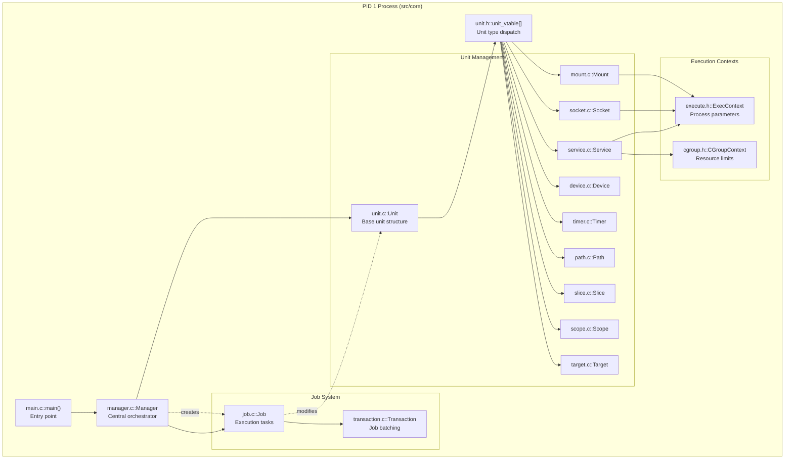
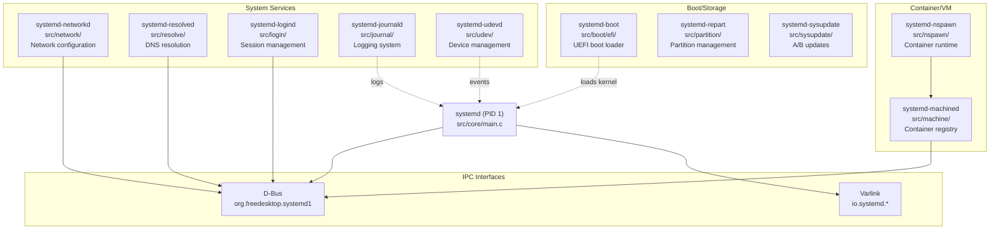

<!-- source: DeepWiki mcp.deepwiki.com · repo systemd/systemd · page 1 Overview of systemd · fetched 2026-11-07 -->

# Overview of systemd

Relevant source files

The following files were used as context for generating this wiki page:

- [.clusterfuzzlite/Dockerfile](.clusterfuzzlite/Dockerfile)
- [.mailmap](.mailmap)
- [.obs/workflows.yml](.obs/workflows.yml)
- [AGENTS.md](AGENTS.md)
- [CLAUDE.md](CLAUDE.md)
- [NEWS](NEWS)
- [README](README)
- [README.md](README.md)
- [TODO.md](TODO.md)
- [docs/ARCHITECTURE.md](docs/ARCHITECTURE.md)
- [docs/AUTOMATIC_BOOT_ASSESSMENT.md](docs/AUTOMATIC_BOOT_ASSESSMENT.md)
- [docs/BLOCK_DEVICE_LOCKING.md](docs/BLOCK_DEVICE_LOCKING.md)
- [docs/BOOT_LOADER_INTERFACE.md](docs/BOOT_LOADER_INTERFACE.md)
- [docs/BOOT_LOADER_SPECIFICATION.md](docs/BOOT_LOADER_SPECIFICATION.md)
- [docs/BUILDING_IMAGES.md](docs/BUILDING_IMAGES.md)
- [docs/CGROUP_DELEGATION.md](docs/CGROUP_DELEGATION.md)
- [docs/CODE_OF_CONDUCT.md](docs/CODE_OF_CONDUCT.md)
- [docs/CODE_QUALITY.md](docs/CODE_QUALITY.md)
- [docs/CODING_STYLE.md](docs/CODING_STYLE.md)
- [docs/CONTRIBUTING.md](docs/CONTRIBUTING.md)
- [docs/CREDENTIALS.md](docs/CREDENTIALS.md)
- [docs/DISTRO_PORTING.md](docs/DISTRO_PORTING.md)
- [docs/HACKING.md](docs/HACKING.md)
- [docs/MOUNT_REQUIREMENTS.md](docs/MOUNT_REQUIREMENTS.md)
- [docs/PORTABLE_SERVICES.md](docs/PORTABLE_SERVICES.md)
- [docs/PORTING_TO_NEW_ARCHITECTURES.md](docs/PORTING_TO_NEW_ARCHITECTURES.md)
- [docs/RELEASE.md](docs/RELEASE.md)
- [docs/RESOLVED-VPNS.md](docs/RESOLVED-VPNS.md)
- [docs/SECURITY.md](docs/SECURITY.md)
- [docs/TESTING_WITH_SANITIZERS.md](docs/TESTING_WITH_SANITIZERS.md)
- [docs/TRANSLATORS.md](docs/TRANSLATORS.md)
- [docs/UIDS-GIDS.md](docs/UIDS-GIDS.md)
- [docs/index.md](docs/index.md)
- [man/kernel-command-line.xml](man/kernel-command-line.xml)
- [man/meson.build](man/meson.build)
- [man/run0.xml](man/run0.xml)
- [man/sd-id128.xml](man/sd-id128.xml)
- [man/sd_id128_get_machine.xml](man/sd_id128_get_machine.xml)
- [man/sd_id128_randomize.xml](man/sd_id128_randomize.xml)
- [man/sd_id128_to_string.xml](man/sd_id128_to_string.xml)
- [man/standard-conf.xml](man/standard-conf.xml)
- [man/standard-options.xml](man/standard-options.xml)
- [man/systemd-networkd.service.xml](man/systemd-networkd.service.xml)
- [man/systemd-path.xml](man/systemd-path.xml)
- [man/systemd-system.conf.xml](man/systemd-system.conf.xml)
- [man/systemd-udevd.service.xml](man/systemd-udevd.service.xml)
- [man/systemd.journal-fields.xml](man/systemd.journal-fields.xml)
- [man/systemd.xml](man/systemd.xml)
- [man/udev.conf.xml](man/udev.conf.xml)
- [man/udev.xml](man/udev.xml)
- [meson.build](meson.build)
- [meson_options.txt](meson_options.txt)
- [shell-completion/bash/run0](shell-completion/bash/run0)
- [shell-completion/zsh/_run0](shell-completion/zsh/_run0)
- [src/basic/constants.h](src/basic/constants.h)
- [src/basic/meson.build](src/basic/meson.build)
- [src/basic/random-util.c](src/basic/random-util.c)
- [src/basic/random-util.h](src/basic/random-util.h)
- [src/core/efi-random.c](src/core/efi-random.c)
- [src/core/efi-random.h](src/core/efi-random.h)
- [src/core/import-creds.c](src/core/import-creds.c)
- [src/core/meson.build](src/core/meson.build)
- [src/core/system.conf.in](src/core/system.conf.in)
- [src/fundamental/macro.h](src/fundamental/macro.h)
- [src/hostname/meson.build](src/hostname/meson.build)
- [src/import/meson.build](src/import/meson.build)
- [src/journal-remote/meson.build](src/journal-remote/meson.build)
- [src/journal/meson.build](src/journal/meson.build)
- [src/libsystemd-network/meson.build](src/libsystemd-network/meson.build)
- [src/libsystemd/meson.build](src/libsystemd/meson.build)
- [src/libsystemd/sd-id128/id128-util.c](src/libsystemd/sd-id128/id128-util.c)
- [src/libsystemd/sd-id128/id128-util.h](src/libsystemd/sd-id128/id128-util.h)
- [src/libsystemd/sd-id128/sd-id128.c](src/libsystemd/sd-id128/sd-id128.c)
- [src/libsystemd/sd-id128/test-id128.c](src/libsystemd/sd-id128/test-id128.c)
- [src/libsystemd/sd-path/test-sd-path.c](src/libsystemd/sd-path/test-sd-path.c)
- [src/libudev/meson.build](src/libudev/meson.build)
- [src/locale/meson.build](src/locale/meson.build)
- [src/login/meson.build](src/login/meson.build)
- [src/machine/meson.build](src/machine/meson.build)
- [src/nspawn/meson.build](src/nspawn/meson.build)
- [src/resolve/meson.build](src/resolve/meson.build)
- [src/shared/machine-id-setup.c](src/shared/machine-id-setup.c)
- [src/shared/meson.build](src/shared/meson.build)
- [src/shared/test-varlink-idl-util.h](src/shared/test-varlink-idl-util.h)
- [src/systemd/_sd-common.h](src/systemd/_sd-common.h)
- [src/systemd/meson.build](src/systemd/meson.build)
- [src/systemd/sd-id128.h](src/systemd/sd-id128.h)
- [src/test/meson.build](src/test/meson.build)
- [src/test/test-dlopen-so.c](src/test/test-dlopen-so.c)
- [src/test/test-random-util.c](src/test/test-random-util.c)
- [src/timedate/meson.build](src/timedate/meson.build)
- [src/timesync/meson.build](src/timesync/meson.build)
- [src/udev/meson.build](src/udev/meson.build)
- [src/udev/udev.conf](src/udev/udev.conf)
- [test/fuzz/meson.build](test/fuzz/meson.build)
- [test/meson.build](test/meson.build)
- [test/units/TEST-22-TMPFILES.01.sh](test/units/TEST-22-TMPFILES.01.sh)
- [test/units/TEST-22-TMPFILES.12.sh](test/units/TEST-22-TMPFILES.12.sh)
- [test/units/TEST-74-AUX-UTILS.machine-id-setup.sh](test/units/TEST-74-AUX-UTILS.machine-id-setup.sh)
- [tools/command_ignorelist](tools/command_ignorelist)
- [tools/git-setup.sh](tools/git-setup.sh)
- [tools/meson-build.sh](tools/meson-build.sh)
- [tools/oss-fuzz.sh](tools/oss-fuzz.sh)
- [tools/sync-docs.py](tools/sync-docs.py)

## Purpose and Scope

This document provides a high-level introduction to systemd, its architecture, and its major components. It is based on the project's README, NEWS, and TODO files and serves as an entry point for understanding the codebase structure and design principles.

For detailed information about specific subsystems:
- Core unit and job management: see [Unit Management System](#2.3)
- Process execution and isolation: see [Process Execution and Sandboxing](#2.4)
- Networking components: see [Networking Subsystems](#3)
- Container runtime: see [Containers and Virtualization](#5)
- Boot and storage: see [System Initialization and Boot](#4)

---

## What is systemd

systemd is a system and service manager for Linux operating systems that runs as PID 1 and serves as the init system. It provides aggressive parallelization capabilities, uses socket and D-Bus activation for starting services, offers on-demand starting of daemons, implements transactional dependency-based service control logic, and tracks processes using Linux control groups (cgroups).

**Key characteristics:**
- **Process ID 1**: systemd runs as the first userspace process and is responsible for spawning and maintaining userspace services [man/systemd.xml:39-41]().
- **Unit-based**: All managed entities (services, sockets, devices, mounts, etc.) are represented as "units" [man/systemd.xml:84-86]().
- **Dependency resolution**: Units declare dependencies which systemd resolves into a directed acyclic graph for proper ordering [man/systemd.xml:84-86]().
- **Cgroup integration**: Each service runs in its own cgroup for resource control and process tracking [README:35-36]().
- **Embedded Units**: The manager now embeds a basic set of unit files (e.g., `basic.target`, `sysinit.target`, `reboot.target`) to allow operation even if files cannot be loaded from disk [NEWS:109-116]().

Sources: [README:1-30](), [man/systemd.xml:36-79](), [NEWS:109-116]()

---

## Core Architecture

The following diagram shows the central components of systemd's core architecture and their relationships in code:

Title: systemd Core PID 1 Architecture

**Component descriptions:**

| Component | File Path | Purpose |
|-----------|-----------|---------|
| `Manager` | [src/core/manager.c](), [src/core/manager.h]() | Central orchestrator that maintains all units, jobs, and system state [src/core/manager.c:70](). |
| `Unit` | [src/core/unit.c](), [src/core/unit.h]() | Base structure for all unit types with common fields and vtable dispatch [src/core/unit.c:88](). |
| `Job` | [src/core/job.c](), [src/core/job.h]() | Represents an asynchronous operation to be performed on a unit (start, stop, reload) [src/core/job.c:63](). |
| `Transaction` | [src/core/transaction.c]() | Groups multiple jobs together for atomic execution [src/core/transaction.c:84](). |
| `ExecContext` | [src/core/execute.h]() | Defines process execution parameters (user, environment, namespaces, etc.) [src/core/execute.c:60](). |
| `CGroupContext` | [src/core/cgroup.h]() | Defines cgroup resource control settings (CPU, memory, IO limits) [src/core/cgroup.c:36](). |

Sources: [src/core/meson.build:25-107](), [src/core/manager.c:70](), [src/core/unit.c:88](), [src/core/main.c:12-14]()

---

## Unit Type System

systemd uses a polymorphic unit system where each unit type implements a common interface:

Title: Unit Type Hierarchy and Code Entities

```mermaid
graph TB
    UnitBase["Unit (unit.c::Unit)<br/>Base structure for all units"]
    
    UnitBase --> Service["Service (service.c::Service)<br/>Daemons and processes"]
    
    UnitBase --> Socket["Socket (socket.c::Socket)<br/>IPC and network sockets"]
    
    UnitBase --> Mount["Mount (mount.c::Mount)<br/>Filesystem mount points"]
    
    UnitBase --> Device["Device (device.c::Device)<br/>Kernel device nodes"]
    
    UnitBase --> Timer["Timer (timer.c::Timer)<br/>Time-based triggers"]
    
    UnitBase --> Path["Path (path.c::Path)<br/>Path monitoring"]
    
    UnitBase --> Target["Target (target.c::Target)<br/>Synchronization points"]
    
    UnitBase --> Slice["Slice (slice.c::Slice)<br/>Resource control hierarchy"]
    
    UnitBase --> Scope["Scope (scope.c::Scope)<br/>External process tracking"]

    UnitBase --> Automount["Automount (automount.c::Automount)<br/>On-demand mounting"]
    
    UnitBase --> Swap["Swap (swap.c::Swap)<br/>Swap device management"]
```

Each unit type provides a specialized implementation of lifecycle methods (start, stop, load):

| Unit Type | Source File | Purpose |
|-----------|--------------|---------|
| `Service` | [src/core/service.c]() | Long-running processes and one-shot commands [man/systemd.xml:99-101](). |
| `Socket` | [src/core/socket.c]() | Socket-based activation [man/systemd.xml:103-109](). |
| `Mount` | [src/core/mount.c]() | Filesystem mount point management [man/systemd.xml:120-122](). |
| `Device` | [src/core/device.c]() | Device node representation from udev [man/systemd.xml:115-118](). |
| `Timer` | [src/core/timer.c]() | Time-based activation (cron-like) [man/systemd.xml:129-131](). |
| `Path` | [src/core/path.c]() | Path-based activation (inotify) [man/systemd.xml:138-140](). |
| `Target` | [src/core/target.c]() | Grouping and synchronization points [man/systemd.xml:111-113](). |
| `Slice` | [src/core/slice.c]() | Cgroup hierarchy organization [man/systemd.xml:142-145](). |
| `Scope` | [src/core/scope.c]() | External process groups [man/systemd.xml:142-145](). |

Sources: [src/core/meson.build:25-107](), [man/systemd.xml:96-145]()

---

## Major Subsystems and Daemons

Beyond the core PID 1 manager, systemd includes multiple specialized daemon processes:

Title: systemd Ecosystem and IPC Flow

**Subsystem purposes:**

- **systemd-networkd**: Manages network configuration including interfaces, DHCP, and routing [src/network/meson.build]().
- **systemd-resolved**: Provides DNS resolution with support for mDNS and LLMNR [src/resolve/meson.build]().
- **systemd-logind**: Manages user logins, sessions, and seats [src/login/meson.build]().
- **systemd-journald**: Implements structured logging [src/journal/meson.build]().
- **systemd-udevd**: Manages device nodes and kernel events. Now uses Varlink IPC exclusively for `udevadm` control [NEWS:95-101]().
- **systemd-nspawn**: Container runtime using kernel namespaces [src/nspawn/meson.build]().
- **systemd-machined**: Tracks containers and virtual machines [src/machine/meson.build]().
- **systemd-boot**: UEFI boot manager [meson.build:79]().
- **systemd-repart**: Declarative partition management. Recently updated to support expansion of "%" specifiers in `MakeSymlinks=` targets [NEWS:51-55]().
- **systemd-sysupdate**: Atomically updates the host system. Service units have been renamed to `systemd-sysupdate-update.service` to accommodate new Varlink-activated units [NEWS:66-72]().

Sources: [src/shared/meson.build:222-250](), [meson_options.txt:99-130](), [src/core/meson.build:25-107](), [NEWS:68-101]()

---

## Process Lifecycle and Isolation

systemd provides robust process isolation using kernel features. A key architectural principle is the separation of execution logic.

**Key execution flow:**

1. **Configuration**: Unit files are parsed, populating `ExecContext` which defines how a process is to be executed with proper environment, user, and sandboxing [src/core/load-fragment.c:50-80]().
2. **Spawning**: The function `exec_spawn()` in [src/core/execute.c:50-100]() prepares the environment for execution: setting up namespaces, cgroups, capabilities, and seccomp filters.
3. **The Executor**: systemd uses a separate executable called `systemd-executor` responsible for final process setup and `execve()` call. This executor can be linked as a multicall binary with systemd using build-time options [NEWS:110-120]() and meson build definitions [meson.build:18-22]().
4. **Isolation**: systemd employs Linux namespaces (mount, PID, user, network), cgroups for resource management, seccomp filters for syscall filtering, and capability bounding sets for sandboxing [README:34-47]().
5. **Tracking**: Processes spawned are tracked using `PidRef` objects that wrap PID and pidfd to handle race conditions and process lifecycle events cleanly [src/basic/pidref.c:75-110]().

Sources: [src/core/meson.build:20-38](), [src/core/execute.c:50-100](), [src/basic/pidref.c:75-110](), [README:31-60](), [NEWS:110-120]()

---

## Communication Interfaces

### D-Bus Interface
The primary management interface is D-Bus, specifically the `org.freedesktop.systemd1` interface. It allows clients to control units, jobs, and inspect the state of the manager [src/core/dbus.c:50-100](), [man/systemd.xml:69-73]().

### Varlink Interface
Increasingly, systemd components use Varlink for IPC, providing a lightweight and secure alternative to D-Bus. Systemd defines interfaces such as `io.systemd.Manager` for manager IPC and other service-specific IDs (e.g., `io.systemd.Network`, `io.systemd.Credentials`) [src/shared/meson.build:220-250]().

Notably, `udevadm` now exclusively uses Varlink IPC to interact with the `systemd-udevd` daemon, abandoning legacy UNIX sockets [NEWS:95-101]().

Sources: [src/core/dbus.c:50-100](), [src/core/varlink.c:80-110](), [src/shared/meson.build:220-250](), [NEWS:95-101]()

---

## System Requirements

### Kernel Requirements
- **Minimum baseline**: Linux kernel version 5.10 is required for full feature support including pidfd, unique mount IDs, and essential cgroup features [README:58-59]().
- **Recommended baseline**: Linux 5.14 or later recommended for best compatibility and modern features [README:65-69]().
- Advanced features may require newer kernels (6.9 or later for pidfs, advanced cgroup memory accounting, unique mount IDs) [README:70-82]().

### Build System
systemd employs Meson as its primary build system:
- Requires Meson version 0.62.0 or later [meson.build:3-14]().
- Compiled primarily in C17 GNU dialect [meson.build:7]().
- Supports static and shared libraries, multilcall binaries, and feature flags controlling build artifacts [meson_options.txt:10-90]().
- Key build components are arranged in layered libraries: libbasic, libshared, libcore, libsystemd, libudev, with dedicated meson.build files for each [src/basic/meson.build](), [src/shared/meson.build](), [src/core/meson.build]().

Sources: [README:31-82](), [meson.build:1-174](), [meson_options.txt:1-127]()

---

## Development and Testing

systemd uses `mkosi` extensively as a helper tool for building and booting test OS images configured with the latest systemd builds [docs/HACKING.md:25-60]().

Testing infrastructure components include:
- **Unit tests**: Located in `src/test/`, targeting individual source files and modules in `src/basic/` and `src/shared/`.
- **Simple C tests**: Numerous tests covering specific utilities, data structures, and protocols [src/test/meson.build:50-220]().
- **Integration tests** and **Fuzz testing**: Higher-level tests including integration with OSS-Fuzz and LLVM LibFuzzer [meson.build:65-75]().

Sources: [docs/HACKING.md:8-51](), [src/test/meson.build:50-220](), [meson.build:65-75]()

---

This overview establishes foundational knowledge on systemd's architecture, core entities, subsystems, inter-process communication, build system, and testing infrastructure to assist new contributors and developers in navigating the codebase effectively.

---

