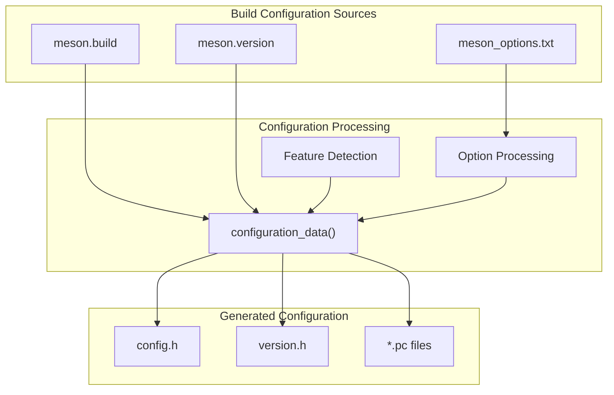
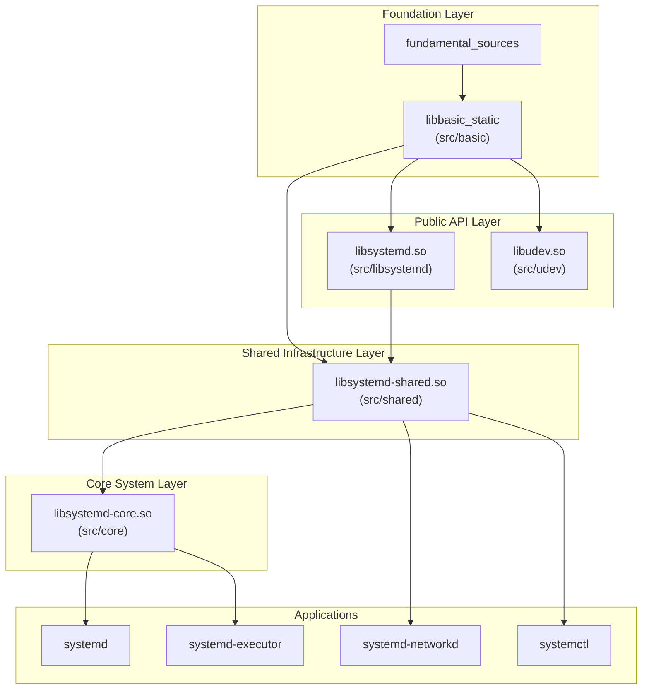
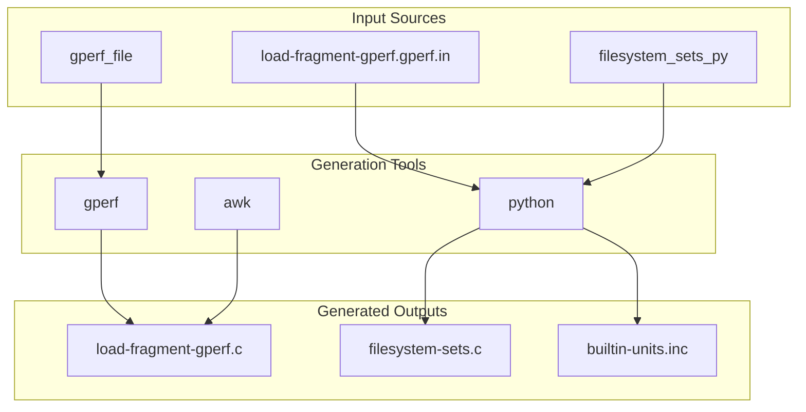

<!-- source: DeepWiki mcp.deepwiki.com · repo systemd/systemd · page 10.1 Build System and Project Organization · fetched 2026-11-07 -->

# Build System and Project Organization

Relevant source files

The following files were used as context for generating this wiki page:

- [.clusterfuzzlite/Dockerfile](.clusterfuzzlite/Dockerfile)
- [.gitignore](.gitignore)
- [.mailmap](.mailmap)
- [.obs/workflows.yml](.obs/workflows.yml)
- [AGENTS.md](AGENTS.md)
- [CLAUDE.md](CLAUDE.md)
- [NEWS](NEWS)
- [README](README)
- [README.md](README.md)
- [docs/ARCHITECTURE.md](docs/ARCHITECTURE.md)
- [docs/AUTOMATIC_BOOT_ASSESSMENT.md](docs/AUTOMATIC_BOOT_ASSESSMENT.md)
- [docs/BLOCK_DEVICE_LOCKING.md](docs/BLOCK_DEVICE_LOCKING.md)
- [docs/BOOT_LOADER_INTERFACE.md](docs/BOOT_LOADER_INTERFACE.md)
- [docs/BOOT_LOADER_SPECIFICATION.md](docs/BOOT_LOADER_SPECIFICATION.md)
- [docs/BUILDING_IMAGES.md](docs/BUILDING_IMAGES.md)
- [docs/CGROUP_DELEGATION.md](docs/CGROUP_DELEGATION.md)
- [docs/CODE_OF_CONDUCT.md](docs/CODE_OF_CONDUCT.md)
- [docs/CODE_QUALITY.md](docs/CODE_QUALITY.md)
- [docs/CODING_STYLE.md](docs/CODING_STYLE.md)
- [docs/CONTRIBUTING.md](docs/CONTRIBUTING.md)
- [docs/CREDENTIALS.md](docs/CREDENTIALS.md)
- [docs/DISTRO_PORTING.md](docs/DISTRO_PORTING.md)
- [docs/HACKING.md](docs/HACKING.md)
- [docs/MOUNT_REQUIREMENTS.md](docs/MOUNT_REQUIREMENTS.md)
- [docs/PORTABLE_SERVICES.md](docs/PORTABLE_SERVICES.md)
- [docs/PORTING_TO_NEW_ARCHITECTURES.md](docs/PORTING_TO_NEW_ARCHITECTURES.md)
- [docs/RELEASE.md](docs/RELEASE.md)
- [docs/RESOLVED-VPNS.md](docs/RESOLVED-VPNS.md)
- [docs/SECURITY.md](docs/SECURITY.md)
- [docs/TESTING_WITH_SANITIZERS.md](docs/TESTING_WITH_SANITIZERS.md)
- [docs/TRANSLATORS.md](docs/TRANSLATORS.md)
- [docs/UIDS-GIDS.md](docs/UIDS-GIDS.md)
- [docs/index.md](docs/index.md)
- [man/meson.build](man/meson.build)
- [man/rules/meson.build](man/rules/meson.build)
- [man/sd-bus.xml](man/sd-bus.xml)
- [man/sd-hwdb.xml](man/sd-hwdb.xml)
- [man/sd_bus_add_object_manager.xml](man/sd_bus_add_object_manager.xml)
- [man/sd_bus_emit_signal.xml](man/sd_bus_emit_signal.xml)
- [man/sd_bus_interface_name_is_valid.xml](man/sd_bus_interface_name_is_valid.xml)
- [man/sd_bus_message_get_type.xml](man/sd_bus_message_get_type.xml)
- [man/sd_bus_message_new_signal.xml](man/sd_bus_message_new_signal.xml)
- [man/sd_bus_reply_method_error.xml](man/sd_bus_reply_method_error.xml)
- [man/sd_bus_reply_method_return.xml](man/sd_bus_reply_method_return.xml)
- [man/sd_bus_set_server.xml](man/sd_bus_set_server.xml)
- [man/sd_hwdb_get.xml](man/sd_hwdb_get.xml)
- [man/sd_hwdb_new.xml](man/sd_hwdb_new.xml)
- [man/send-unit-files-changed.c](man/send-unit-files-changed.c)
- [man/systemd-homed.service.xml](man/systemd-homed.service.xml)
- [man/systemd.special.xml](man/systemd.special.xml)
- [meson.build](meson.build)
- [meson_options.txt](meson_options.txt)
- [po/be.po](po/be.po)
- [po/be@latin.po](po/be@latin.po)
- [po/bg.po](po/bg.po)
- [po/ca.po](po/ca.po)
- [po/cs.po](po/cs.po)
- [po/da.po](po/da.po)
- [po/de.po](po/de.po)
- [po/el.po](po/el.po)
- [po/es.po](po/es.po)
- [po/fr.po](po/fr.po)
- [po/gl.po](po/gl.po)
- [po/hr.po](po/hr.po)
- [po/hu.po](po/hu.po)
- [po/id.po](po/id.po)
- [po/it.po](po/it.po)
- [po/ja.po](po/ja.po)
- [po/ko.po](po/ko.po)
- [po/pl.po](po/pl.po)
- [po/pt_BR.po](po/pt_BR.po)
- [po/ro.po](po/ro.po)
- [po/ru.po](po/ru.po)
- [po/sk.po](po/sk.po)
- [po/sr.po](po/sr.po)
- [po/sv.po](po/sv.po)
- [po/tr.po](po/tr.po)
- [po/uk.po](po/uk.po)
- [po/zh_CN.po](po/zh_CN.po)
- [po/zh_TW.po](po/zh_TW.po)
- [presets/90-systemd.preset](presets/90-systemd.preset)
- [src/basic/constants.h](src/basic/constants.h)
- [src/basic/meson.build](src/basic/meson.build)
- [src/core/import-creds.c](src/core/import-creds.c)
- [src/core/meson.build](src/core/meson.build)
- [src/hostname/meson.build](src/hostname/meson.build)
- [src/import/meson.build](src/import/meson.build)
- [src/journal-remote/meson.build](src/journal-remote/meson.build)
- [src/journal/meson.build](src/journal/meson.build)
- [src/libsystemd-network/meson.build](src/libsystemd-network/meson.build)
- [src/libsystemd/meson.build](src/libsystemd/meson.build)
- [src/libudev/meson.build](src/libudev/meson.build)
- [src/locale/meson.build](src/locale/meson.build)
- [src/login/meson.build](src/login/meson.build)
- [src/machine/meson.build](src/machine/meson.build)
- [src/nspawn/meson.build](src/nspawn/meson.build)
- [src/resolve/meson.build](src/resolve/meson.build)
- [src/shared/meson.build](src/shared/meson.build)
- [src/systemd/meson.build](src/systemd/meson.build)
- [src/test/meson.build](src/test/meson.build)
- [src/test/test-dlopen-so.c](src/test/test-dlopen-so.c)
- [src/timedate/meson.build](src/timedate/meson.build)
- [src/timesync/meson.build](src/timesync/meson.build)
- [src/udev/meson.build](src/udev/meson.build)
- [test/fuzz/meson.build](test/fuzz/meson.build)
- [test/meson.build](test/meson.build)
- [tools/git-setup.sh](tools/git-setup.sh)
- [tools/meson-build.sh](tools/meson-build.sh)
- [tools/oss-fuzz.sh](tools/oss-fuzz.sh)
- [tools/sync-docs.py](tools/sync-docs.py)
- [units/meson.build](units/meson.build)
- [units/systemd-homed.service.in](units/systemd-homed.service.in)

This page documents systemd's build system based on Meson and the organization of source code into libraries and components. For information about testing and CI/CD workflows, see [Testing Infrastructure and CI/CD](#10.2).

## Purpose and Scope

This document covers:
- Meson build system configuration and workflow.
- Library architecture and dependency relationships (`libbasic`, `libshared`, `libcore`, etc.).
- Feature flags and build options (~200 configuration options).
- Code generation processes (`gperf`, Jinja2, Python generators).
- Directory structure and component organization.
- Build outputs: libraries, executables, and unit files.

Sources: [meson.build:1-14](), [meson_options.txt:1-50]()

## Build System Overview

systemd uses the **Meson** build system (requiring version ≥0.62.0) [meson.build:13]() with extensive customization through build options, code generation, and conditional compilation.

### Core Build Configuration

The build system bridges high-level feature requests to low-level C preprocessor macros and library links.

**Natural Language to Code Entity Space: Build Configuration**
Title: Build Configuration Mapping

Sources: [meson.build:1-53](), [meson_options.txt:1-50]()

The main build file `meson.build` defines the project with C language (`gnu17` standard) [meson.build:7](), version information, and build defaults. The configuration process creates a `configuration_data()` object [meson.build:33]() that stores all detected features and user options as preprocessor macros. Versioning is split into major and minor components for internal use [meson.build:23-28]().

### Key Build Options

| Category | Examples | Default | Description |
|----------|----------|---------|-------------|
| **Mode** | `mode` | `developer` | `developer` or `release` build [meson.build:89](), [meson_options.txt:11-12]() |
| **Features** | `resolve`, `logind`, `oomd` | enabled | Major subsystem toggles [meson.options.txt:93-120]() |
| **Linking** | `link-udev-shared`, `link-systemctl-shared` | varies | Control shared library usage [meson_options.txt:16-29]() |
| **Libraries** | `static-libsystemd`, `static-libudev` | `false` | Static library builds [meson_options.txt:37-42]() |
| **Static Build** | `build-static` | `false` | Build static versions of binaries [meson_options.txt:46-47]() |
| **Multicall** | `systemd-multicall-binary` | `false` | Link systemd and systemd-executor as a single binary [meson.build:81](), [meson_options.txt:18-19]() |

Sources: [meson.build:81-90](), [meson_options.txt:11-47](), [meson_options.txt:93-120]()

The build system supports approximately 200 configuration options, controlling everything from feature enablement to installation paths. Note that legacy Meson option compatibility rules apply; for instance, `-Dbuild-executor-shared=single` has been replaced by `-Dsystemd-multicall-binary=true`, and `-Dstandalone-binaries=` accepts a comma-separated list of patterns [NEWS:111-118](). Additionally, certain features enforce strict inter-dependencies, such as `hibernate` requiring `initrd` [meson.build:109-111]().

Sources: [meson.build:81-111](), [NEWS:111-118](), [meson_options.txt:1-50]()

## Library Architecture

systemd's codebase is organized into a layered library architecture with clear dependency relationships.

**Natural Language to Code Entity Space: Library Layers**
Title: systemd Library Dependency Graph

Sources: [src/basic/meson.build:208-221](), [src/core/meson.build:171-201](), [src/core/meson.build:212-220]()

### Library Descriptions

- **`libbasic` (`libbasic_static`)**: Foundation library with core data structures and utilities located in `src/basic/` [src/basic/meson.build:208-221](). Contains symbols defined in `hashmap.c` [src/basic/meson.build:49](), `process-util.c` [src/basic/meson.build:85](), `namespace-util.c` [src/basic/meson.build:74](), `path-util.c` [src/basic/meson.build:79](), `fd-util.c` [src/basic/meson.build:38](), and `pidref.c` [src/basic/meson.build:82](). Built as a static library with compression library dependencies [src/basic/meson.build:215-220]().
- **`libsystemd` (`libsystemd.so.0`)**: Public client API library covering components like `sd-bus`, `sd-journal`, `sd-event`, `sd-device`, `sd-hwdb`, `sd-login`, `sd-varlink`, and `sd-json` [man/rules/meson.build:126-166](). Versioned via `libsystemd_version` [meson.build:30]().
- **`libudev` (`libudev.so.1`)**: Public device management library versioned via `libudev_version` [meson.build:31]().
- **`libsystemd-shared` (`libshared`)**: Internal shared library containing core helper routines spanning `cgroup-setup.c` [src/shared/meson.build:40](), `dissect-image.c` [src/shared/meson.build:63](), and various Varlink IDL implementations [src/shared/meson.build:223-247]().
- **`libsystemd-core` (`libcore_static` / `libcore`)**: Core PID 1 functionality managing units, jobs, transactions, and execution contexts [src/core/meson.build:25-107](), [src/core/meson.build:171-201]().

Sources: [meson.build:30-31](), [src/basic/meson.build:3-221](), [src/shared/meson.build:3-247](), [src/core/meson.build:25-201]()

## Directory Structure

| Directory | Purpose | Key Build File |
|-----------|---------|----------------|
| `src/basic/` | Foundation utilities and low-level data structures | [src/basic/meson.build:1-221]() |
| `src/libsystemd/` | Public client-facing shared library APIs | [src/libsystemd/meson.build:1-305]() |
| `src/shared/` | Internal shared routines and daemon helpers | [src/shared/meson.build:1-450]() |
| `src/core/` | PID 1 core engine, unit types, and manager logic | [src/core/meson.build:1-351]() |
| `src/test/` | Unit tests and test harness infrastructure | [src/test/meson.build:1-760]() |
| `units/` | Systemd unit files and target templates | [units/meson.build:1-1224]() |
| `po/` | Gettext localization translation files | (Multiple `.po` files) |
| `docs/` | Developer guides and architecture notes | (Markdown files) |

Sources: [src/basic/meson.build:1](), [src/core/meson.build:1](), [src/test/meson.build:1](), [units/meson.build:1]()

## Code Generation Pipeline

systemd extensively uses code generation for lookup tables, configuration parsers, and interface definitions.

**Natural Language to Code Entity Space: Code Generation**
Title: Code Generation Workflow

Sources: [src/basic/meson.build:127-202](), [src/core/meson.build:121-165]()

### gperf-based Lookup Tables

The build system generates perfect hash functions for fast constant lookups. For example, system headers and constants are parsed via shell scripts [src/basic/meson.build:138](), processed through `awk` [src/basic/meson.build:149](), and turned into `gperf` lookup tables [src/basic/meson.build:158](). Similarly, fragment parsers in PID 1 are built by preprocessing `load-fragment-gperf.gperf.in` using Jinja2 and `gperf` [src/core/meson.build:121-130]().

Sources: [src/basic/meson.build:127-174](), [src/core/meson.build:121-130]()

### Python and AWK Generators

- **Hashmaps**: Ordered hashmap test harness sources like `test-hashmap-ordered.c` are generated via custom awk scripts [src/test/meson.build:3-10]().
- **Filesystem Sets**: `filesystem-sets.c` and `filesystems-gperf.h` are produced by `filesystem-sets.py` [src/basic/meson.build:181-202]().
- **Symbol Verification**: `test-libsystemd-sym.c` is compiled using `generate-sym-test.py` against exported header files [src/test/meson.build:27-54]().
- **Builtin Units**: Embedded target definitions are compiled into `builtin-units.inc` via `generate-builtin-units.py` [src/core/meson.build:138-143]().

Sources: [src/test/meson.build:3-54](), [src/basic/meson.build:181-202](), [src/core/meson.build:138-143]()

## Build Outputs and Installation

### Executable Organization

systemd produces several categories of binaries:
- **PID 1**: The primary `systemd` supervisor binary [src/core/meson.build:12]().
- **Daemons**: Components placed in `libexecdir` (`/usr/lib/systemd`) [meson.build:138](), such as `systemd-journald`, `systemd-logind`, and `systemd-resolved`.
- **User Tools**: Utilities placed in `bindir` (`/usr/bin`) [meson.build:129](), such as `systemctl`, `journalctl`, and `busctl`.
- **Udev Subsystem**: `systemd-udevd` and `udevadm` [test/meson.build:122]().

Sources: [meson.build:129-138](), [src/core/meson.build:12](), [test/meson.build:122]()

### Unit Files

The `units/` directory houses template configurations that translate into targets (e.g., `basic.target`) [units/meson.build:6](), service sockets, and mount files [units/meson.build:33](). Core targets are embedded directly into PID 1 for fallback execution.

Sources: [units/meson.build:5-200]()

### Test Executables

Unit tests are registered through `test/meson.build`, invoking test executables with isolation environments (`test_env`) defined to prevent pollution from host paths [src/test/meson.build:13-21]().

Sources: [src/test/meson.build:13-224]()

## Project Documentation and Patches

- **Developer Documentation**: Maintained in `docs/` covering coding style, release guidelines, and subsystem specifications.
- **Semantic Patches**: Automated refactoring rules are tracked via **Coccinelle** patches.
- **Translations**: Localized strings are curated in `po/` (e.g., `po/fr.po`, `po/de.po`).

Sources: [meson.build:18]()

---

