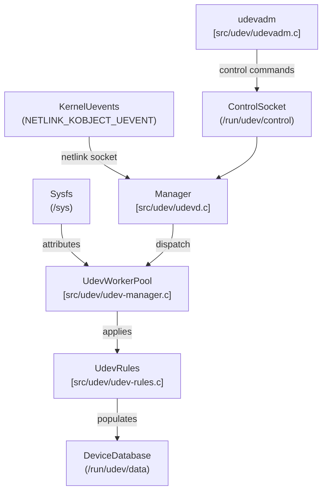

<!-- source: DeepWiki mcp.deepwiki.com · repo systemd/systemd · page 7 Device Management · fetched 2026-11-07 -->

# Device Management

<details>
<summary>Relevant source files</summary>

The following files were used as context for generating this wiki page:

- [man/udevadm.xml](man/udevadm.xml)
- [shell-completion/bash/udevadm](shell-completion/bash/udevadm)
- [shell-completion/zsh/_systemd-tmpfiles](shell-completion/zsh/_systemd-tmpfiles)
- [shell-completion/zsh/_udevadm](shell-completion/zsh/_udevadm)
- [src/libsystemd/sd-device/device-enumerator-private.h](src/libsystemd/sd-device/device-enumerator-private.h)
- [src/libsystemd/sd-device/device-enumerator.c](src/libsystemd/sd-device/device-enumerator.c)
- [src/libsystemd/sd-device/device-internal.h](src/libsystemd/sd-device/device-internal.h)
- [src/libsystemd/sd-device/device-monitor-private.h](src/libsystemd/sd-device/device-monitor-private.h)
- [src/libsystemd/sd-device/device-monitor.c](src/libsystemd/sd-device/device-monitor.c)
- [src/libsystemd/sd-device/device-private.c](src/libsystemd/sd-device/device-private.c)
- [src/libsystemd/sd-device/device-private.h](src/libsystemd/sd-device/device-private.h)
- [src/libsystemd/sd-device/device-util.c](src/libsystemd/sd-device/device-util.c)
- [src/libsystemd/sd-device/device-util.h](src/libsystemd/sd-device/device-util.h)
- [src/libsystemd/sd-device/sd-device.c](src/libsystemd/sd-device/sd-device.c)
- [src/libsystemd/sd-device/test-device-util.c](src/libsystemd/sd-device/test-device-util.c)
- [src/libsystemd/sd-device/test-sd-device-monitor.c](src/libsystemd/sd-device/test-sd-device-monitor.c)
- [src/libsystemd/sd-device/test-sd-device.c](src/libsystemd/sd-device/test-sd-device.c)
- [src/systemd/sd-device.h](src/systemd/sd-device.h)
- [src/udev/fuzz-udev-rules.c](src/udev/fuzz-udev-rules.c)
- [src/udev/udev-event.c](src/udev/udev-event.c)
- [src/udev/udev-event.h](src/udev/udev-event.h)
- [src/udev/udev-rules.c](src/udev/udev-rules.c)
- [src/udev/udev-rules.h](src/udev/udev-rules.h)
- [src/udev/udevadm-cat.c](src/udev/udevadm-cat.c)
- [src/udev/udevadm-control.c](src/udev/udevadm-control.c)
- [src/udev/udevadm-info.c](src/udev/udevadm-info.c)
- [src/udev/udevadm-monitor.c](src/udev/udevadm-monitor.c)
- [src/udev/udevadm-settle.c](src/udev/udevadm-settle.c)
- [src/udev/udevadm-test-builtin.c](src/udev/udevadm-test-builtin.c)
- [src/udev/udevadm-test.c](src/udev/udevadm-test.c)
- [src/udev/udevadm-trigger.c](src/udev/udevadm-trigger.c)
- [src/udev/udevadm-util.c](src/udev/udevadm-util.c)
- [src/udev/udevadm-util.h](src/udev/udevadm-util.h)
- [src/udev/udevadm-verify.c](src/udev/udevadm-verify.c)
- [src/udev/udevd.c](src/udev/udevd.c)

</details>


This document provides a high-level overview of systemd's device management subsystem, focusing on `systemd-udevd`, event processing, rule evaluation, and client APIs. For detailed technical information, refer to the child pages:
- [udev and Device Handling](#7.1) — Covers `systemd-udevd` worker/manager architecture, udev rules, device node management, `udevadm`, `sd-device`, and `libudev` APIs.
- [udev Builtins and Hardware Database](#7.2) — Documents udev builtins (`net_id`, `path_id`, `blkid`, `input_id`, `hwdb`, `keyboard`), predictable network interface naming, `hwdb.d/`, and rules files.

## Architecture Overview

systemd's device management layer relies on the kernel's `sysfs` filesystem and `uevent` netlink notifications. When kernel devices change, `systemd-udevd` captures the raw events using `sd_device_monitor` [src/libsystemd/sd-device/device-monitor.c:156-171]() and distributes them across worker processes for parallelized rule execution.

**Title: Udev Event Pipeline Architecture**

Sources: [src/udev/udevd.c:28-91](), [src/udev/udev-rules.c:60-160](), [src/libsystemd/sd-device/device-monitor.c:156-171]()

## Core Components

### systemd-udevd Daemon
The daemon initializes via `run_udevd()` in `src/udev/udevd.c`, establishing the `Manager` instance, configuring signal masks, bumping file descriptor limits, and opening required shared libraries (`libkmod`, `libblkid`, `libmount`, `libacl`) before spawning workers [src/udev/udevd.c:28-91]().

Sources: [src/udev/udevd.c:28-91]()

### Device Representation (`sd_device`)
The core abstraction library `sd-device` models devices through the `sd_device` struct [src/libsystemd/sd-device/sd-device.c:35-55](). It handles syspath verification, attributes caching, tags, and property maps stored in an `OrderedHashmap` [src/libsystemd/sd-device/sd-device.c:72-73]().

**Title: Device Entity and Event Relationships**
```mermaid
classDiagram
    class sd_device {
        +char* syspath
        +char* sysname
        +char* subsystem
        +char* driver
        +OrderedHashmap* properties
        +OrderedHashmap* properties_db
    }
    class UdevEvent {
        +sd_device* dev
        +sd_device* dev_db_clone
        +UdevWorker* worker
        +char* name
    }
    class sd_device_enumerator {
        +DeviceEnumerationType type
        +Hashmap* devices_by_syspath
    }
    UdevEvent --> sd_device : "manages [src/udev/udev-event.c:39]"
    sd_device_enumerator --> sd_device : "enumerates [src/libsystemd/sd-device/device-enumerator.c:44]"
```
Sources: [src/libsystemd/sd-device/sd-device.c:35-81](), [src/udev/udev-event.c:25-50](), [src/libsystemd/sd-device/device-enumerator.c:40-63]()

### Rule Processing Engine
Rules parsed in `src/udev/udev-rules.c` consist of match tokens (`TK_M_*`) and assignment tokens (`TK_A_*`) [src/udev/udev-rules.c:98-160](). These inspect attributes, subsystems, and properties, or dictate ownership, symlinks, and run actions.

For detailed rule syntax and parser internals, see [udev and Device Handling](#7.1).

Sources: [src/udev/udev-rules.c:60-160]()

## Device Event Flow

Device events are encapsulated in `UdevEvent` structures [src/udev/udev-event.c:25-50](). Workers handle the event lifecycle: matching rules, updating databases under `/run/udev/data/`, and executing renames for network interfaces through `rename_netif()` [src/udev/udev-event.c:114-161]().

Sources: [src/udev/udev-event.c:25-50](), [src/udev/udev-event.c:114-161]()

## Management Utilities (`udevadm`)

`udevadm` provides command-line control over the device management stack, supporting operations such as querying database attributes (`udevadm info`) [src/udev/udevadm-info.c:38-65](), triggering uevents (`udevadm trigger`) [src/udev/udevadm-trigger.c:26-56](), monitoring netlink traffic, and testing rule evaluations.

Sources: [src/udev/udevadm-info.c:38-65](), [src/udev/udevadm-trigger.c:26-56]()

---

