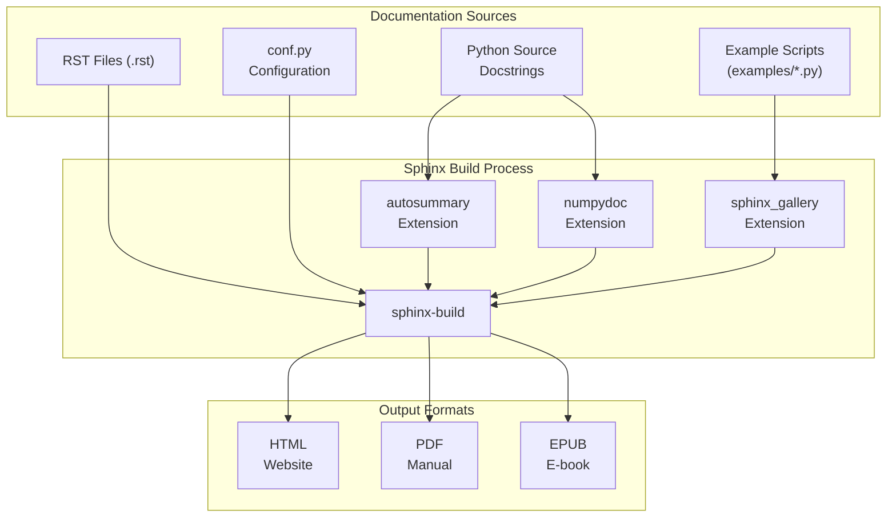
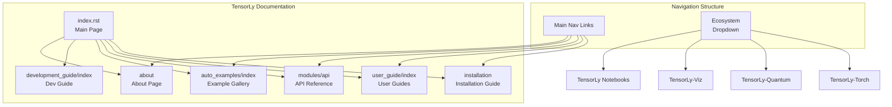
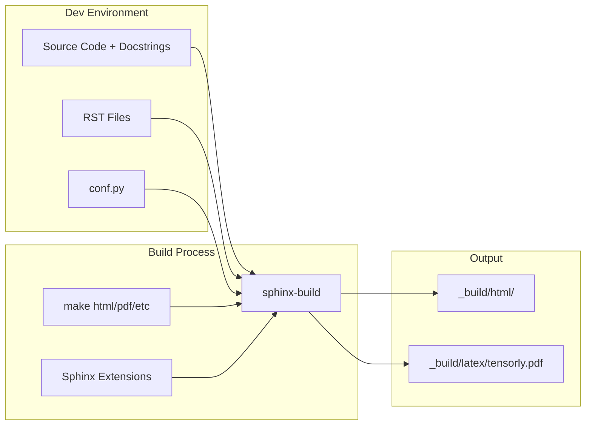

<!-- source: DeepWiki mcp.deepwiki.com · repo tensorly/tensorly · page 9.4 Documentation System · fetched 2026-10-21 -->

# Documentation System

<details>
<summary>Relevant source files</summary>

The following files were used as context for generating this wiki page:

- [doc/conf.py](doc/conf.py)
- [doc/index.rst](doc/index.rst)
- [tensorly/regression/tests/test_cp_regression.py](tensorly/regression/tests/test_cp_regression.py)

</details>


The TensorLy documentation system provides comprehensive technical documentation for the library, using industry-standard tools and a consistent format. This page describes how the documentation is structured, configured, and built in the TensorLy project.

## Overview

TensorLy uses [Sphinx](https://www.sphinx-doc.org) as its documentation generation engine, with several extensions to support mathematical notation, API documentation, and interactive examples. The documentation includes:

- Installation instructions
- User guides
- API reference
- Gallery of examples
- Development guides

Sources: [doc/conf.py:1-13](), [doc/index.rst:1-30]()

## Documentation Architecture



Sources: [doc/conf.py:33-42](), [doc/conf.py:44-49]()

## Sphinx Configuration

The documentation system is configured through the `conf.py` file, which sets up the Sphinx build environment and enables various extensions.

### Key Extensions

| Extension | Purpose |
|-----------|---------|
| `sphinx.ext.autodoc` | Automatically generates API documentation from docstrings |
| `sphinx.ext.autosummary` | Generates summary tables of functions/methods |
| `sphinx.ext.mathjax` | Supports mathematical notation using LaTeX syntax |
| `numpydoc.numpydoc` | Provides support for NumPy-style docstrings |
| `sphinx_gallery.gen_gallery` | Generates a gallery of examples from Python scripts |

Sources: [doc/conf.py:33-42]()

### Theme Configuration

TensorLy uses a custom Sphinx theme called `tensorly_sphinx_theme`, which provides:

- Navigation links
- Dropdown menus for the TensorLy ecosystem
- Integration with Google Analytics
- GitHub repository link
- Custom search functionality

Sources: [doc/conf.py:141-164]()

## Documentation Structure



Sources: [doc/index.rst:13-23](), [doc/conf.py:146-163]()

## API Documentation Style

TensorLy follows the NumPy documentation style for its API documentation. This is enforced through the `numpydoc` extension and provides a consistent format for documenting:

- Function and method signatures
- Parameters
- Returns
- Examples
- Notes and references

### Example Docstring Format

```python
def function_name(param1, param2):
    """Short description of the function
    
    Longer description with more details.
    
    Parameters
    ----------
    param1 : type
        Description of param1
    param2 : type
        Description of param2
        
    Returns
    -------
    return_type
        Description of the return value
        
    Examples
    --------
    >>> import tensorly as tl
    >>> result = function_name(1, 2)
    >>> print(result)
    
    Notes
    -----
    Additional notes or mathematical explanations.
    """
```

Sources: [doc/conf.py:40](), [doc/conf.py:51]()

## Example Gallery

TensorLy uses Sphinx-Gallery to create an interactive gallery of examples. This extension:

1. Extracts examples from the `/examples` directory
2. Runs the examples to capture outputs and generate figures
3. Creates HTML pages with annotated code and results
4. Organizes examples into a searchable gallery

The gallery configuration is defined in the `sphinx_gallery_conf` dictionary in `conf.py`.

Sources: [doc/conf.py:44-49]()

## Building Documentation



To build the documentation locally:

1. Install required dependencies:
   ```
   pip install -e .[doc]
   ```
2. Navigate to the `doc/` directory
3. Run the appropriate make command:
   ```
   make html  # For HTML documentation
   make pdf   # For PDF documentation
   ```

Sources: [doc/conf.py:191-199]()

## LaTeX and Math Support

TensorLy documentation supports mathematical notation through MathJax (for HTML) and LaTeX (for PDF). The LaTeX preamble is configured to support:

- AMS Math and AMS Fonts packages
- Matrix operations with up to 20 columns
- Consistent rendering across HTML and PDF outputs

Sources: [doc/conf.py:201-208]()

## Documentation Versioning

TensorLy documentation automatically extracts version information from the package itself:

- Version is extracted from `tensorly.__version__`
- Short version (X.Y) used for certain documentation elements
- Full version (including patch/release info) used for others

This ensures documentation always reflects the correct version of the library.

Sources: [doc/conf.py:86-90]()

## Contributing to Documentation

When contributing to the TensorLy documentation:

1. Follow the NumPy docstring format for all public API functions and classes
2. Create example scripts in the `examples/` directory for new features
3. Update relevant `.rst` files when adding new modules or features
4. Test documentation builds locally before submitting changes
5. Adhere to the existing style and organization

For guidance on the development process more broadly, refer to the [Developer Guide](#9).

Sources: [doc/conf.py:40](), [doc/conf.py:51]()