# Page: Overview

# Overview

<details>
<summary>Relevant source files</summary>

The following files were used as context for generating this wiki page:

- [README.rst](README.rst)
- [conda/meta.yaml](conda/meta.yaml)
- [doc/modules/api.rst](doc/modules/api.rst)
- [setup.cfg](setup.cfg)
- [setup.py](setup.py)
- [tensorly/decomposition/__init__.py](tensorly/decomposition/__init__.py)
- [tensorly/decomposition/tests/test_robust_decomposition.py](tensorly/decomposition/tests/test_robust_decomposition.py)

</details>


## Purpose and Scope

This document provides a high-level introduction to TensorLy, a Python library for tensor learning that enables tensor decomposition, tensor algebra, and tensor-based machine learning. This overview covers the library's purpose, core capabilities, architectural design, and key systems. For detailed information about specific subsystems, refer to the specialized pages: Backend System ([#2](#2)), Tensor Decompositions ([#3](#3)), Tensor Representations ([#4](#4)), and other sections listed in the table of contents.

**Sources:** [README.rst:1-189](), [doc/modules/api.rst:1-547]()

## What is TensorLy?

TensorLy is a Python library that makes tensor learning simple and accessible by providing a unified interface for tensor operations across multiple computational frameworks. A tensor is a multi-dimensional array (generalizing vectors and matrices to higher dimensions), and tensor learning involves decomposing, analyzing, and learning from such multi-way data structures.

The library addresses the fundamental challenge that different deep learning and numerical computing frameworks (NumPy, PyTorch, JAX, TensorFlow, CuPy, Paddle) have inconsistent APIs. TensorLy provides a thin abstraction layer that allows users to write code once and run it on any supported backend, seamlessly switching between CPU and GPU execution.

**Sources:** [README.rst:22-23](), [doc/modules/api.rst:5-14]()

## Core Capabilities

TensorLy provides four primary capabilities:

| Capability | Description | Key Modules |
|------------|-------------|-------------|
| **Tensor Decomposition** | Algorithms for factorizing tensors into lower-rank components (CP, Tucker, PARAFAC2, Tensor Train, Tensor Ring) | `tensorly.decomposition` |
| **Backend Abstraction** | Unified API supporting NumPy, PyTorch, TensorFlow, JAX, CuPy, and Paddle with automatic device management | `tensorly.backend` |
| **Tensor Algebra** | Operations like unfolding, Khatri-Rao products, mode products, and specialized linear algebra | `tensorly.base`, `tensorly.tenalg` |
| **Tensor Representations** | Data structures for factorized tensors (CPTensor, TuckerTensor, TTTensor, etc.) with reconstruction and manipulation methods | `tensorly.cp_tensor`, `tensorly.tucker_tensor`, etc. |

The library also includes higher-level applications such as tensor regression (`tensorly.regression`), random tensor generation (`tensorly.random`), and performance metrics (`tensorly.metrics`).

**Sources:** [doc/modules/api.rst:5-470](), [tensorly/decomposition/__init__.py:1-34]()

## High-Level Architecture

TensorLy follows a layered architecture where each layer builds on the abstractions provided by lower layers:

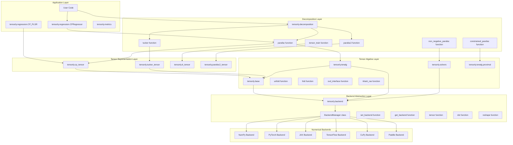

**Diagram: TensorLy Layered Architecture with Code Entities**

The architecture enforces clean separation: higher layers depend only on lower layers, never the reverse. The Backend Abstraction Layer is the foundation, with importance score 284.34 in the codebase analysis, making it the most critical component. All tensor operations flow through the `BackendManager` class, which provides dynamic dispatch to the appropriate numerical backend.

**Sources:** [doc/modules/api.rst:1-547](), [README.rst:22-128]()

## Key Systems

### 1. Backend System (Importance: 284.34)

The Backend System is TensorLy's most critical architectural component, providing a unified API across six numerical frameworks. The `BackendManager` class [tensorly/backend/__init__.py]() manages global and thread-local backend instances, enabling seamless switching between frameworks via `set_backend()` and context managers.

**Detailed documentation:** See [Backend System](#2)

### 2. Tensor Decomposition Algorithms

TensorLy implements multiple tensor factorization methods:

- **CP/PARAFAC** (Importance: 179.06): Decomposes tensors into sum of rank-1 components via `parafac()` function
- **PARAFAC2** (Importance: 207.71): Handles tensors with varying mode dimensions via `parafac2()` function
- **Tucker** (Importance: 110.79): Higher-order decomposition with core tensor via `tucker()` function
- **Tensor Train/Ring**: Sequential factorizations via `tensor_train()` and `tensor_ring()` functions
- **Constrained Decompositions** (Importance: 150.61): ADMM-based constrained optimization via `constrained_parafac()` function

**Detailed documentation:** See [Tensor Decompositions](#3)

### 3. Tensor Representations

Factorized tensor data structures stored in specialized classes:

- `CPTensor` (Importance: 74.26): Stores weights and factor matrices
- `TuckerTensor` (Importance: 74.26): Stores core tensor and factor matrices
- `Parafac2Tensor`: Stores projection matrices and factors
- `TTTensor`, `TRTensor`: Stores TT/TR cores

Each class provides methods like `to_tensor()`, `to_vec()`, and `mode_dot()` for reconstruction and manipulation.

**Detailed documentation:** See [Tensor Representations](#4)

### 4. Tensor Algebra Operations

The `tensorly.base` module provides fundamental tensor operations:

- **Unfolding/Folding**: `unfold()` and `fold()` for matricization
- **Vectorization**: `tensor_to_vec()` and `vec_to_tensor()`
- **Partial Operations**: `partial_unfold()`, `partial_fold()`

The `tensorly.tenalg` module provides advanced operations:

- **Products**: `khatri_rao()`, `kronecker()`, `mode_dot()`
- **SVD Interface**: `svd_interface()` supporting truncated, randomized, and symeig methods
- **Proximal Operators** (Importance: 150.61): 12+ constraint operators in `tensorly.tenalg.proximal`

**Detailed documentation:** See [Tensor Algebra Operations](#5), [SVD Interface](#5.1), [Proximal Operators](#5.2)

### 5. Regression and Applications

Higher-level applications built on tensor decompositions:

- `CPRegressor`: Tensor regression using CP decomposition with L2 regularization
- `CP_PLSR`: Partial least squares regression maximizing tensor-matrix covariance
- `TuckerRegressor`: Tucker-based regression

**Detailed documentation:** See [Regression and Applications](#7)

**Sources:** [tensorly/decomposition/__init__.py:1-34](), [doc/modules/api.rst:139-470]()

## Design Philosophy

### Backend Abstraction

TensorLy's design centers on the principle that users should write code once and run it anywhere. The `BackendManager` maintains a registry of loaded backends in `_loaded_backends` and provides dynamic dispatch through a unified API. Users call `tl.set_backend('pytorch')` or use `tl.backend_context('jax')` to switch frameworks without changing application code.

Example from the API:
```python
# Instead of numpy.array or torch.tensor
import tensorly as tl
tensor = tl.tensor(data)  # Works with any backend

# Instead of numpy.dot or torch.matmul
result = tl.dot(tensor_a, tensor_b)  # Backend-agnostic
```

**Sources:** [doc/modules/api.rst:5-14](), [doc/modules/api.rst:20-34]()

### Modular Decomposition Infrastructure

All decomposition algorithms share common infrastructure components:

- **Initialization**: SVD-based, random, or custom factor initialization
- **Error Calculation**: Reconstruction loss computation
- **Convergence Checking**: Tolerance-based stopping criteria
- **Optimization Solvers**: HALS, FISTA, Active Set for non-negative constraints

This design allows specialized methods (non-negative, constrained, robust) to reuse core functionality while adding domain-specific optimizations.

### Separation of Representation and Computation

Factorized tensors are stored in dedicated representation classes (`CPTensor`, `TuckerTensor`, etc.) separate from the decomposition algorithms that produce them. This separation allows:

- Multiple algorithms to produce the same representation format
- Representation-specific operations (normalization, mode products) independent of decomposition logic
- Reconstruction via dedicated `*_to_tensor()` functions

**Sources:** [doc/modules/api.rst:162-258](), [tensorly/decomposition/__init__.py:1-34]()

## Module Organization

The following diagram maps TensorLy's package structure to its functional components:

```mermaid
graph TB
    subgraph "tensorly Package Root"
        init["__init__.py<br/>Exports: set_backend, get_backend, tensor, dot, etc."]
    end
    
    subgraph "tensorly.backend Package"
        backend_init["backend/__init__.py<br/>BackendManager class"]
        numpy_backend["backend/numpy_backend.py"]
        pytorch_backend["backend/pytorch_backend.py"]
        jax_backend["backend/jax_backend.py"]
        tensorflow_backend["backend/tensorflow_backend.py"]
        cupy_backend["backend/cupy_backend.py"]
        paddle_backend["backend/paddle_backend.py"]
    end
    
    subgraph "tensorly.base Module"
        base["base.py<br/>unfold, fold, tensor_to_vec, vec_to_tensor"]
    end
    
    subgraph "tensorly.tenalg Package"
        tenalg_core["tenalg/core_tenalg.py<br/>khatri_rao, mode_dot, kronecker"]
        tenalg_svd["tenalg/svd.py<br/>svd_interface"]
        tenalg_proximal["tenalg/proximal.py<br/>soft_thresholding, simplex_projection"]
    end
    
    subgraph "tensorly.decomposition Package"
        decomp_cp["decomposition/_cp.py<br/>parafac, CP class"]
        decomp_nn_cp["decomposition/_nn_cp.py<br/>non_negative_parafac, CP_NN_HALS"]
        decomp_tucker["decomposition/_tucker.py<br/>tucker, Tucker class"]
        decomp_parafac2["decomposition/_parafac2.py<br/>parafac2, Parafac2 class"]
        decomp_tt["decomposition/_tt.py<br/>tensor_train, TensorTrain class"]
        decomp_constrained["decomposition/_constrained_cp.py<br/>constrained_parafac"]
        decomp_robust["decomposition/robust_decomposition.py<br/>robust_pca"]
    end
    
    subgraph "Tensor Representation Modules"
        cp_tensor["cp_tensor.py<br/>cp_to_tensor, cp_normalize, CPTensor"]
        tucker_tensor["tucker_tensor.py<br/>tucker_to_tensor, TuckerTensor"]
        tt_tensor["tt_tensor.py<br/>tt_to_tensor, TTTensor"]
        parafac2_tensor["parafac2_tensor.py<br/>parafac2_to_tensor, Parafac2Tensor"]
    end
    
    subgraph "tensorly.solvers Package"
        solvers_nnls["solvers/nnls.py<br/>hals_nnls, fista, active_set_nnls"]
        solvers_admm["solvers/admm.py<br/>admm function"]
    end
    
    subgraph "tensorly.regression Package"
        regression_cp["regression/cp_regression.py<br/>CPRegressor class"]
        regression_plsr["regression/cp_plsr.py<br/>CP_PLSR class"]
    end
    
    subgraph "Support Modules"
        random_mod["random.py<br/>random_cp, random_tucker, random_parafac2"]
        metrics_mod["metrics/<br/>MSE, RMSE, congruence_coefficient"]
    end
    
    init --> backend_init
    init --> base
    
    backend_init --> numpy_backend
    backend_init --> pytorch_backend
    backend_init --> jax_backend
    
    base --> backend_init
    tenalg_core --> backend_init
    tenalg_svd --> backend_init
    
    decomp_cp --> tenalg_core
    decomp_cp --> cp_tensor
    decomp_nn_cp --> solvers_nnls
    decomp_tucker --> tucker_tensor
    decomp_constrained --> tenalg_proximal
    decomp_constrained --> solvers_admm
    
    regression_cp --> cp_tensor
    regression_cp --> decomp_cp
    
    random_mod --> cp_tensor
    random_mod --> tucker_tensor
```

**Diagram: TensorLy Module Structure Mapping Code Entities**

The package follows Python's standard structure with each major system in its own module or package. The `tensorly/__init__.py` file re-exports the most commonly used functions from submodules, allowing users to access them directly via `import tensorly as tl`.

**Sources:** [doc/modules/api.rst:1-547](), [tensorly/decomposition/__init__.py:1-34](), [setup.py:48-70]()

## Installation and Dependencies

TensorLy requires Python 3 and has two core dependencies:

- `numpy`: Default backend and core dependency
- `scipy`: Additional numerical routines

Additional backends (PyTorch, JAX, TensorFlow, CuPy, Paddle) must be installed separately. The library is available via pip (`pip install tensorly`) or conda (`conda install -c tensorly tensorly`).

For development installation, clone the repository and install in editable mode:
```bash
git clone https://github.com/tensorly/tensorly
cd tensorly
pip install -e .
```

**Sources:** [setup.py:59](), [README.rst:30-60](), [conda/meta.yaml:22-25]()

## Testing and Quality Assurance

TensorLy uses pytest for testing with backend-specific test execution via environment variables:
```bash
TENSORLY_BACKEND='numpy' pytest -v tensorly
```

The test suite includes:
- Unit tests for all decomposition algorithms
- Backend compatibility tests
- Regression tests for known issues
- Coverage reporting via CodeCov (badge visible in README)

Tests are automatically run via GitHub Actions CI/CD on multiple Python versions and backends.

**Detailed documentation:** See [Testing Framework](#9.2), [CI/CD Pipeline](#9.3)

**Sources:** [README.rst:146-168](), [conda/meta.yaml:27-32](), [tensorly/decomposition/tests/test_robust_decomposition.py:1-79]()

## Performance Considerations

TensorLy's performance characteristics depend on the chosen backend:

| Backend | Best For | Device Support | Auto-Differentiation |
|---------|----------|----------------|---------------------|
| NumPy | CPU computation, prototyping | CPU only | No |
| PyTorch | GPU acceleration, gradients | CPU, CUDA | Yes |
| JAX | JIT compilation, XLA | CPU, GPU, TPU | Yes |
| TensorFlow | Production deployment | CPU, GPU, TPU | Yes |
| CuPy | GPU-only computation | CUDA only | No |
| Paddle | PaddlePaddle ecosystem | CPU, GPU | Yes |

The backend can be switched at runtime without code changes, allowing optimization for different deployment scenarios.

**Detailed documentation:** See [Using Different Backends](#2.2)

**Sources:** [doc/modules/api.rst:8-9](), [README.rst:99-106]()

## Documentation Structure

This wiki is organized into nine major sections:

1. **Overview** (this page): High-level introduction and architecture
2. **Backend System**: Backend abstraction, context management, thread safety
3. **Tensor Decompositions**: CP, Tucker, TT, PARAFAC2, robust and constrained methods
4. **Tensor Representations**: CPTensor, TuckerTensor, and other factorized formats
5. **Tensor Algebra Operations**: Unfolding, products, SVD, proximal operators
6. **Random Tensor Generation**: Testing and simulation utilities
7. **Regression and Applications**: CP regression and CP-PLSR
8. **Metrics and Validation**: Performance evaluation
9. **Developer Guide**: Contributing, testing, CI/CD, documentation

Each section provides detailed technical documentation with code citations and examples.

**Sources:** [doc/modules/api.rst:1-547]()

---

# Page: Backend System

# Backend System

<details>
<summary>Relevant source files</summary>

The following files were used as context for generating this wiki page:

- [tensorly/__init__.py](tensorly/__init__.py)
- [tensorly/backend/__init__.py](tensorly/backend/__init__.py)
- [tensorly/backend/core.py](tensorly/backend/core.py)
- [tensorly/backend/cupy_backend.py](tensorly/backend/cupy_backend.py)
- [tensorly/backend/jax_backend.py](tensorly/backend/jax_backend.py)
- [tensorly/backend/numpy_backend.py](tensorly/backend/numpy_backend.py)
- [tensorly/backend/pytorch_backend.py](tensorly/backend/pytorch_backend.py)
- [tensorly/backend/tensorflow_backend.py](tensorly/backend/tensorflow_backend.py)
- [tensorly/tests/test_backend.py](tensorly/tests/test_backend.py)

</details>


## Purpose and Scope

The Backend System is TensorLy's most critical architectural component, providing a unified abstraction layer that enables the library to work seamlessly with multiple numerical computing frameworks. This system allows users to write tensor decomposition code once and execute it on NumPy (CPU), PyTorch (CPU/GPU with autograd), TensorFlow (CPU/GPU), JAX (with JIT compilation), CuPy (GPU via CUDA), or Paddle, simply by switching the backend.

This page provides a comprehensive overview of the backend abstraction architecture, its core components, and how they work together. For implementation details of individual backend classes, see [Backend Abstraction Architecture](#2.1). For practical usage instructions, see [Using Different Backends](#2.2). For thread-safety and context management, see [Backend Context and Thread Safety](#2.3).

**Sources:** [tensorly/backend/__init__.py:1-360](), [tensorly/backend/core.py:1-91]()

## Architecture Overview

The backend system consists of three primary layers that work together to provide framework-agnostic tensor operations:

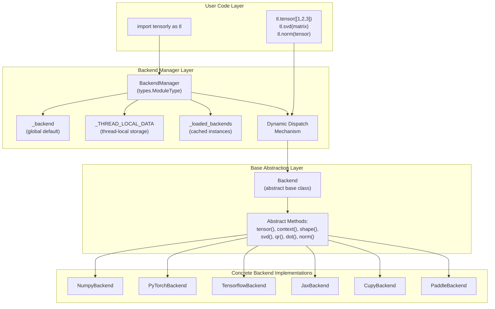

**Sources:** [tensorly/backend/__init__.py:34-360](), [tensorly/backend/core.py:91-106]()

## Core Components

### Backend Base Class

The `Backend` class in [tensorly/backend/core.py:91-1262]() defines the abstract interface that all concrete backends must implement. It uses Python's `__init_subclass__` hook to automatically register backend implementations.

| Component | Location | Purpose |
|-----------|----------|---------|
| `Backend` | [tensorly/backend/core.py:91-106]() | Abstract base class with auto-registration |
| `backend_types` | [tensorly/backend/core.py:14-24]() | Data types (`int32`, `float64`, `complex128`, etc.) |
| `backend_basic_math` | [tensorly/backend/core.py:25-40]() | Math operations (`exp`, `log`, `sin`, `cos`, etc.) |
| `backend_array` | [tensorly/backend/core.py:41-60]() | Array operations (`einsum`, `reshape`, `where`, etc.) |

The base class defines over 80 abstract methods covering:
- **Tensor creation**: `tensor()`, `zeros()`, `ones()`, `eye()`
- **Properties**: `context()`, `shape()`, `ndim()`, `is_tensor()`
- **Linear algebra**: `svd()`, `qr()`, `solve()`, `lstsq()`
- **Operations**: `dot()`, `tensordot()`, `norm()`, `transpose()`
- **Random generation**: `randn()`, `gamma()`, `check_random_state()`

**Sources:** [tensorly/backend/core.py:91-1262]()

### BackendManager

The `BackendManager` class in [tensorly/backend/__init__.py:34-353]() is implemented as a Python module (subclass of `types.ModuleType`) and manages backend state and dynamic dispatch.

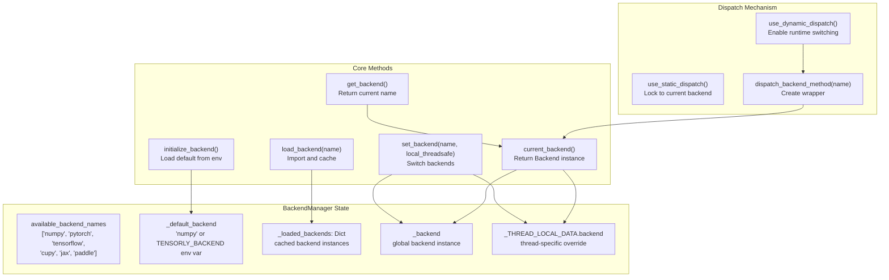

**Key features:**
- **Thread-safe backend switching**: Thread-local storage allows different threads to use different backends ([tensorly/backend/__init__.py:132]())
- **Dynamic dispatch**: All backend functions are wrapped to dispatch to the current backend at runtime ([tensorly/backend/__init__.py:195-237]())
- **Lazy loading**: Backends are only imported when first requested ([tensorly/backend/__init__.py:291-317]())
- **Environment configuration**: Default backend can be set via `TENSORLY_BACKEND` environment variable ([tensorly/backend/__init__.py:133]())

**Sources:** [tensorly/backend/__init__.py:34-353]()

### Concrete Backend Implementations

Each backend implementation inherits from `Backend` and provides framework-specific implementations:

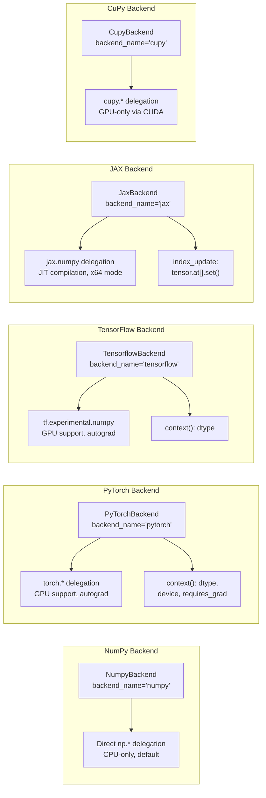

**Sources:** [tensorly/backend/numpy_backend.py:1-80](), [tensorly/backend/pytorch_backend.py:1-257](), [tensorly/backend/tensorflow_backend.py:1-195](), [tensorly/backend/jax_backend.py:1-109](), [tensorly/backend/cupy_backend.py:1-96]()

## Backend Registration and Dynamic Dispatch

### Registration Mechanism

Backends register themselves automatically using Python's `__init_subclass__` hook:

```python
class Backend:
    _available_backends = dict()
    
    def __init_subclass__(cls, backend_name, **kwargs):
        """When a subclass is created, register it in _available_backends"""
        if backend_name != "":
            cls._available_backends[backend_name.lower()] = cls
            cls.backend_name = backend_name
```

Each backend declares itself with a `backend_name` parameter:
- `class NumpyBackend(Backend, backend_name="numpy")` ([tensorly/backend/numpy_backend.py:11]())
- `class PyTorchBackend(Backend, backend_name="pytorch")` ([tensorly/backend/pytorch_backend.py:27]())
- `class TensorflowBackend(Backend, backend_name="tensorflow")` ([tensorly/backend/tensorflow_backend.py:20]())

**Sources:** [tensorly/backend/core.py:94-104]()

### Dynamic Dispatch Flow

When a user calls `tl.svd(matrix)`, the following dispatch chain executes:

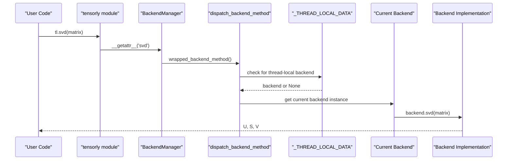

The dispatch wrapper in [tensorly/backend/__init__.py:195-237]():

```python
def dispatch_backend_method(cls, name, method):
    def wrapped_backend_method(*args, **kwargs):
        """A dynamically dispatched method"""
        return getattr(
            cls._THREAD_LOCAL_DATA.__dict__.get("backend", cls._backend), 
            name
        )(*args, **kwargs)
    # ... copy metadata from method ...
    return wrapped_backend_method
```

**Sources:** [tensorly/backend/__init__.py:195-237](), [tensorly/__init__.py:155]()

## Supported Backends

| Backend | Implementation File | Key Features | Hardware | Special Capabilities |
|---------|-------------------|--------------|----------|---------------------|
| **NumPy** | [tensorly/backend/numpy_backend.py]() | Default, stable | CPU only | Standard NumPy operations |
| **PyTorch** | [tensorly/backend/pytorch_backend.py]() | Deep learning integration | CPU/GPU | Autograd, `requires_grad`, device placement |
| **TensorFlow** | [tensorly/backend/tensorflow_backend.py]() | Google ecosystem | CPU/GPU | TF 2.x with `tf.experimental.numpy` |
| **JAX** | [tensorly/backend/jax_backend.py]() | Functional programming | CPU/GPU/TPU | JIT compilation, x64 mode enabled |
| **CuPy** | [tensorly/backend/cupy_backend.py]() | NumPy-like GPU | GPU only | Direct CUDA acceleration |
| **Paddle** | (mentioned in tests) | PaddlePaddle integration | CPU/GPU | Chinese AI ecosystem |

### Backend-Specific Context

Each backend's `context()` method returns framework-specific metadata:

| Backend | Context Keys | Example |
|---------|--------------|---------|
| NumPy | `dtype` | `{'dtype': np.float32}` |
| PyTorch | `dtype`, `device`, `requires_grad` | `{'dtype': torch.float32, 'device': 'cuda:0', 'requires_grad': True}` |
| TensorFlow | `dtype` | `{'dtype': tf.float32}` |
| JAX | `dtype` | `{'dtype': jnp.float32}` |
| CuPy | `dtype` | `{'dtype': cp.float32}` |

**Sources:** [tensorly/backend/numpy_backend.py:13-14](), [tensorly/backend/pytorch_backend.py:29-34](), [tensorly/backend/tensorflow_backend.py:22-23](), [tensorly/backend/core.py:223-256]()

## Method Registration Patterns

Backends use two patterns to implement the required API:

### Pattern 1: Direct Registration

For operations that map directly to framework functions:

```python
# NumPy backend
for name in ['solve', 'qr', 'svd', 'eigh', 'lstsq']:
    NumpyBackend.register_method(name, getattr(np.linalg, name))
```

**Sources:** [tensorly/backend/numpy_backend.py:75-76](), [tensorly/backend/pytorch_backend.py:255-256]()

### Pattern 2: Custom Implementation

For operations requiring adaptation:

```python
# PyTorch backend - custom norm implementation
@staticmethod
def norm(tensor, order=None, axis=None):
    kwds = {}
    if axis is not None:
        kwds["dim"] = axis
    if order and order != "inf":
        kwds["p"] = order
    if order == "inf":
        res = torch.max(torch.abs(tensor), **kwds)
        if axis is not None:
            return res[0]  # ignore indices output
        return res
    return torch.norm(tensor, **kwds)
```

**Sources:** [tensorly/backend/pytorch_backend.py:121-135]()

## Initialization and Configuration

### Default Backend Initialization

On module import, TensorLy initializes the backend system:

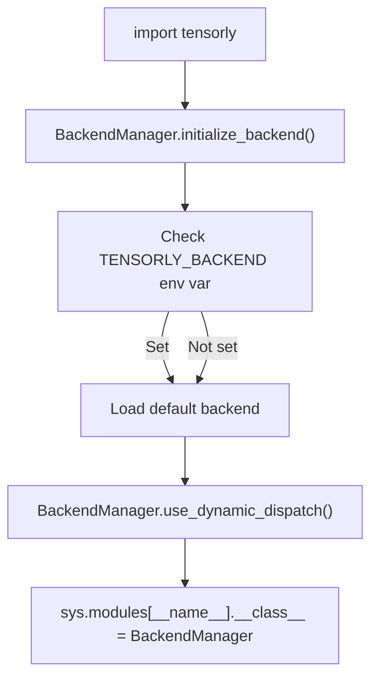

**Sources:** [tensorly/backend/__init__.py:272-289](), [tensorly/backend/__init__.py:356-360]()

### Environment Configuration

Users can set the default backend via environment variable:

```bash
export TENSORLY_BACKEND=pytorch  # Use PyTorch by default
export TENSORLY_BACKEND=jax      # Use JAX by default
```

The environment variable is checked in [tensorly/backend/__init__.py:279]():

```python
backend_name = os.environ.get(cls._ENV_DEFAULT_VAR, cls._default_backend)
```

**Sources:** [tensorly/backend/__init__.py:133](), [tensorly/backend/__init__.py:272-289]()

## Integration with TensorLy Module

The top-level `tensorly` module exposes backend functions through two mechanisms:

### Direct Imports

Selected functions are imported directly in [tensorly/__init__.py:44-132]():

```python
from .backend import (
    context, tensor, shape, ndim, to_numpy,
    solve, qr, svd, lstsq,
    dot, norm, transpose,
    # ... and many more
)
```

### Dynamic Attribute Access

The module uses `__getattr__` for dynamic dispatch in [tensorly/__init__.py:155]():

```python
__getattr__ = backend.__getattribute__
```

This allows any backend method to be accessed as `tl.method_name()`, with the call dynamically routed to the current backend.

**Sources:** [tensorly/__init__.py:44-155]()

## Testing Framework

The test suite in [tensorly/tests/test_backend.py]() validates:

1. **Backend switching** ([tensorly/tests/test_backend.py:24-75]()):
   - Context manager behavior
   - Global vs thread-local settings
   - Invalid backend names

2. **Thread safety** ([tensorly/tests/test_backend.py:77-147]()):
   - Concurrent backend usage
   - Thread-local isolation
   - Backend context nesting

3. **Operation correctness** ([tensorly/tests/test_backend.py:186-272]()):
   - SVD accuracy across backends
   - Orthogonality of decompositions
   - Numerical stability

4. **API consistency** ([tensorly/tests/test_backend.py:435-451]()):
   - Matrix multiplication shapes
   - Norm calculations
   - Linear system solving

**Sources:** [tensorly/tests/test_backend.py:1-659]()

## Backend System Benefits

The backend abstraction provides several critical advantages:

1. **Framework Independence**: Write algorithms once, run on any backend
2. **Hardware Flexibility**: Seamlessly move between CPU and GPU
3. **Performance Optimization**: Choose JAX for JIT compilation or PyTorch for autograd
4. **Backward Compatibility**: Default NumPy backend ensures compatibility
5. **Gradual Migration**: Switch backends without rewriting application code
6. **Testing**: Validate algorithms across multiple numerical frameworks

**Sources:** [tensorly/backend/__init__.py:1-360](), [tensorly/backend/core.py:1-1262]()

---

# Page: Backend Abstraction Architecture

# Backend Abstraction Architecture

<details>
<summary>Relevant source files</summary>

The following files were used as context for generating this wiki page:

- [tensorly/__init__.py](tensorly/__init__.py)
- [tensorly/backend/__init__.py](tensorly/backend/__init__.py)
- [tensorly/backend/core.py](tensorly/backend/core.py)
- [tensorly/backend/cupy_backend.py](tensorly/backend/cupy_backend.py)
- [tensorly/backend/jax_backend.py](tensorly/backend/jax_backend.py)
- [tensorly/backend/numpy_backend.py](tensorly/backend/numpy_backend.py)
- [tensorly/backend/pytorch_backend.py](tensorly/backend/pytorch_backend.py)
- [tensorly/backend/tensorflow_backend.py](tensorly/backend/tensorflow_backend.py)
- [tensorly/tests/test_backend.py](tensorly/tests/test_backend.py)

</details>


This document provides a detailed technical explanation of TensorLy's backend abstraction system, focusing on the internal architecture, dynamic dispatch mechanism, and how the `BackendManager` orchestrates multi-framework support. This covers the implementation details of the abstraction layer itself.

For guidance on switching backends and using backend-specific features, see [Using Different Backends](#2.2). For information about context managers and thread safety, see [Backend Context and Thread Safety](#2.3).

## Overview

The backend abstraction architecture enables TensorLy to support multiple numerical computing frameworks (NumPy, PyTorch, TensorFlow, JAX, CuPy, Paddle) through a unified API. The system consists of three layers:

1. **Abstract Interface Layer** - The `Backend` base class defining the contract
2. **Orchestration Layer** - The `BackendManager` handling backend selection and dispatch
3. **Implementation Layer** - Concrete backend classes for each framework

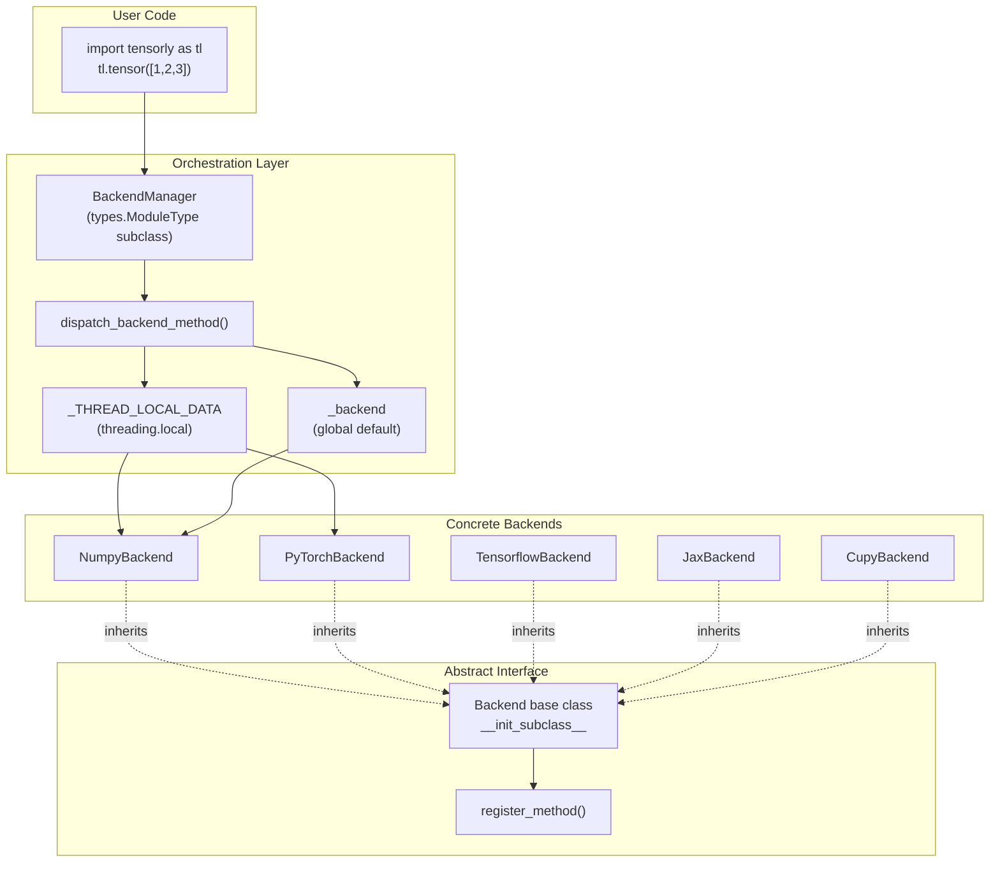

**Sources:** [tensorly/backend/__init__.py:1-360](), [tensorly/backend/core.py:1-1262]()

## Backend Base Class

The `Backend` class at [tensorly/backend/core.py:91-1262]() defines the abstract interface that all concrete backends must implement. It uses Python's `__init_subclass__` hook to automatically register backend implementations.

### Automatic Registration Mechanism

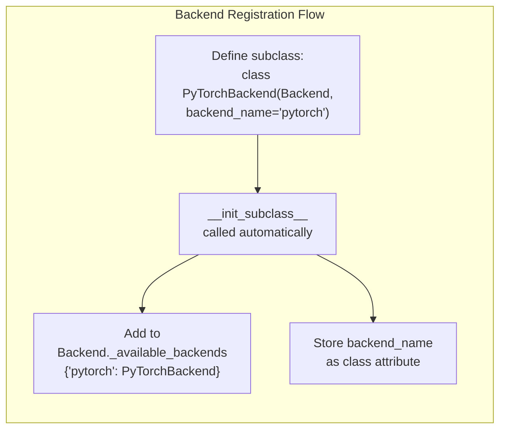

The registration occurs at [tensorly/backend/core.py:94-104]():

```python
def __init_subclass__(cls, backend_name, **kwargs):
    """When a subclass is created, register it in _known_backends"""
    super().__init_subclass__(**kwargs)
    
    if backend_name != "":
        cls._available_backends[backend_name.lower()] = cls
        cls.backend_name = backend_name
```

Each backend subclass specifies its name through the class definition syntax: `class PyTorchBackend(Backend, backend_name="pytorch")` at [tensorly/backend/pytorch_backend.py:27]().

**Sources:** [tensorly/backend/core.py:91-104](), [tensorly/backend/pytorch_backend.py:27](), [tensorly/backend/numpy_backend.py:11]()

### Abstract Method Categories

The `Backend` class organizes operations into categories defined by module-level lists:

| Category | List Name | Example Operations |
|----------|-----------|-------------------|
| Data types | `backend_types` | `int32`, `int64`, `float32`, `float64`, `complex64`, `complex128` |
| Basic math | `backend_basic_math` | `exp`, `log`, `sin`, `cos`, `tanh`, `arcsin` |
| Array operations | `backend_array` | `einsum`, `matmul`, `ones`, `zeros`, `reshape`, `eye` |
| Custom methods | Defined individually | `context`, `tensor`, `norm`, `svd`, `qr` |

These lists are defined at [tensorly/backend/core.py:14-60]() and used by concrete backends to bulk-register methods from their underlying frameworks.

**Sources:** [tensorly/backend/core.py:14-60]()

### Method Registration Pattern

Concrete backends use `register_method()` to bind framework functions to the backend interface. Two patterns exist:

**Pattern 1: Bulk registration from framework**
```python
# From numpy_backend.py
for name in (backend_types + backend_basic_math + backend_array + ['nan', 'moveaxis', ...]):
    NumpyBackend.register_method(name, getattr(np, name))
```

**Pattern 2: Custom implementation**
```python
# From pytorch_backend.py
@staticmethod
def context(tensor):
    return {
        "dtype": tensor.dtype,
        "device": tensor.device,
        "requires_grad": tensor.requires_grad,
    }
```

The `register_method()` implementation at [tensorly/backend/core.py:110-120]() uses `staticmethod` to add methods to the class.

**Sources:** [tensorly/backend/core.py:110-120](), [tensorly/backend/numpy_backend.py:41-76](), [tensorly/backend/pytorch_backend.py:29-34]()

## BackendManager: The Central Orchestrator

The `BackendManager` class at [tensorly/backend/__init__.py:34-353]() is the core orchestration component. Remarkably, it subclasses `types.ModuleType` to act as both a class and a module, enabling `import tensorly.backend` to directly access backend methods.

### Architecture Components

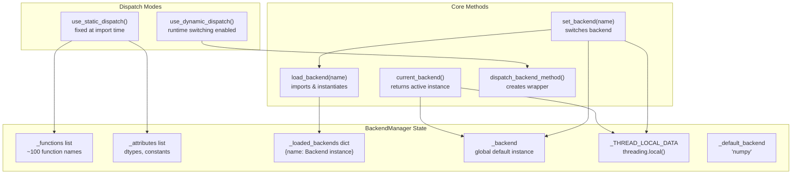

**Sources:** [tensorly/backend/__init__.py:34-353]()

### Dynamic Dispatch Mechanism

The dynamic dispatch system allows runtime backend switching. The key method is `dispatch_backend_method()` at [tensorly/backend/__init__.py:195-237]():

**Dynamic Dispatch Flow:**

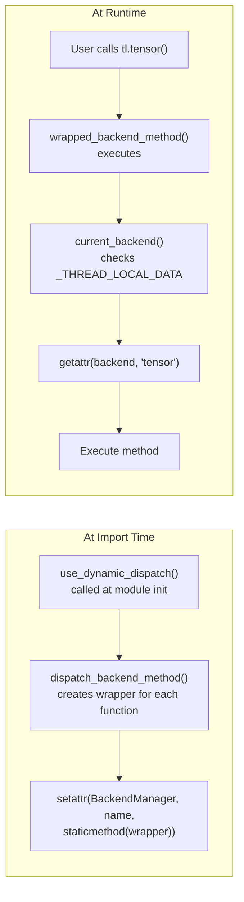

The wrapper function at [tensorly/backend/__init__.py:198-204]():

```python
def wrapped_backend_method(*args, **kwargs):
    """A dynamically dispatched method
    
    Returns the queried method from the currently set backend"""
    return getattr(
        cls._THREAD_LOCAL_DATA.__dict__.get("backend", cls._backend), name
    )(*args, **kwargs)
```

This design ensures every function call queries the current backend, enabling seamless switching at runtime.

**Sources:** [tensorly/backend/__init__.py:136-237]()

### Thread-Local Backend Management

The system maintains two backend references:

1. **Global Default** (`_backend`) - Affects all threads by default
2. **Thread-Local Override** (`_THREAD_LOCAL_DATA.backend`) - Thread-specific override

The resolution logic in `current_backend()` at [tensorly/backend/__init__.py:170-178]():

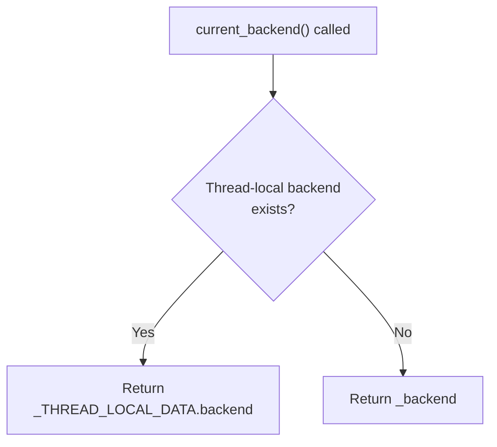

When `set_backend(name, local_threadsafe=True)` is called at [tensorly/backend/__init__.py:320-340]():
- Sets `_THREAD_LOCAL_DATA.backend` (affects only current thread)
- Does NOT modify `_backend` (global default unchanged)

When `set_backend(name, local_threadsafe=False)` is called:
- Sets both `_THREAD_LOCAL_DATA.backend` and `_backend`
- Changes global default for all threads

**Sources:** [tensorly/backend/__init__.py:170-178](), [tensorly/backend/__init__.py:320-340]()

## Backend Lifecycle and Loading

### Lazy Loading Strategy

Backends are loaded on-demand rather than at import time. The `load_backend()` method at [tensorly/backend/__init__.py:292-317]() implements this:

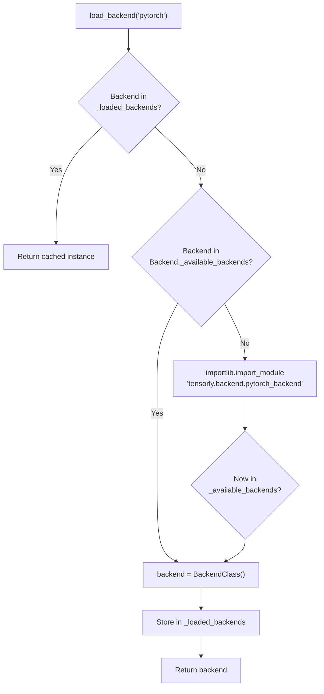

The import triggers the backend module's class definition, which calls `__init_subclass__`, registering the backend in `Backend._available_backends`.

**Sources:** [tensorly/backend/__init__.py:292-317]()

### Initialization Sequence

At module load time, the following sequence occurs at [tensorly/backend/__init__.py:355-359]():

1. `BackendManager.initialize_backend()` - Checks `TENSORLY_BACKEND` environment variable
2. `BackendManager.set_backend(backend_name)` - Loads and sets the default backend
3. `BackendManager.use_dynamic_dispatch()` - Enables runtime switching
4. Module class replacement: `sys.modules[__name__].__class__ = BackendManager`

The final step is critical - it makes the `tensorly.backend` module an instance of `BackendManager`, enabling direct attribute access.

**Sources:** [tensorly/backend/__init__.py:272-289](), [tensorly/backend/__init__.py:355-359]()

## Integration with Top-Level API

The top-level `tensorly` module exposes backend functionality through dynamic attribute lookup. The implementation at [tensorly/__init__.py:145-155]():

```python
def __dir__():
    """Returns the module's __dir__, including the local variables
    and augmenting it with the dynamically dispatched variables from backend.
    """
    static_items = list(sys.modules[__name__].__dict__.keys())
    return backend.get_backend_dir() + static_items

__getattr__ = backend.__getattribute__
```

This design allows:
- `import tensorly as tl; tl.tensor([1,2,3])` - Direct access to backend methods
- `from tensorly import tensor` - Named imports work seamlessly
- `dir(tl)` includes all backend functions - Auto-completion support

**Sources:** [tensorly/__init__.py:145-163]()

## Concrete Backend Implementations

### Common Implementation Pattern

All concrete backends follow a standard structure:

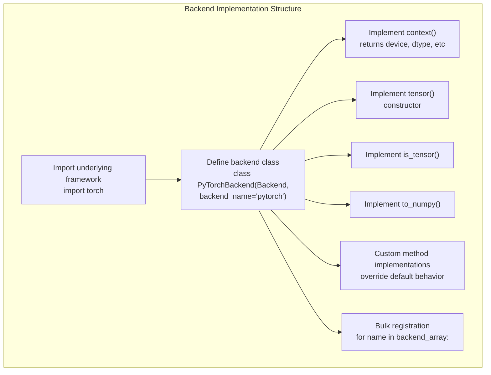

**Sources:** [tensorly/backend/pytorch_backend.py:1-257](), [tensorly/backend/numpy_backend.py:1-80]()

### Framework-Specific Adaptations

Each backend makes framework-specific adaptations:

| Backend | Key Adaptations | Location |
|---------|----------------|----------|
| **NumPy** | Minimal - mostly direct delegation | [tensorly/backend/numpy_backend.py:11-80]() |
| **PyTorch** | Device management, `requires_grad` tracking, axis naming (`dim` vs `axis`) | [tensorly/backend/pytorch_backend.py:27-257]() |
| **TensorFlow** | Uses `tensorflow.experimental.numpy` (tnp), variable handling | [tensorly/backend/tensorflow_backend.py:20-195]() |
| **JAX** | Enables x64 mode, immutable tensor updates via `.at[].set()` | [tensorly/backend/jax_backend.py:6-109]() |
| **CuPy** | GPU-specific operations, CPU-GPU transfer | [tensorly/backend/cupy_backend.py:23-96]() |

### Context Implementation Differences

The `context()` method captures backend-specific tensor properties:

**NumPy** - Only dtype matters [tensorly/backend/numpy_backend.py:13-14]():
```python
@staticmethod
def context(tensor):
    return {"dtype": tensor.dtype}
```

**PyTorch** - Includes device and gradient tracking [tensorly/backend/pytorch_backend.py:29-34]():
```python
@staticmethod
def context(tensor):
    return {
        "dtype": tensor.dtype,
        "device": tensor.device,
        "requires_grad": tensor.requires_grad,
    }
```

**Sources:** [tensorly/backend/numpy_backend.py:13-14](), [tensorly/backend/pytorch_backend.py:29-34](), [tensorly/backend/tensorflow_backend.py:22-23]()

## Dynamic vs Static Dispatch Trade-offs

The `BackendManager` supports two dispatch modes:

### Dynamic Dispatch (Default)

Enabled by `use_dynamic_dispatch()` at [tensorly/backend/__init__.py:136-154]():
- Every function call resolves the backend at runtime
- Enables seamless backend switching during execution
- Small performance overhead from wrapper function call
- Required for `backend_context()` context manager to work

### Static Dispatch

Enabled by `use_static_dispatch()` at [tensorly/backend/__init__.py:157-167]():
- Functions bound directly to backend methods at dispatch time
- No runtime resolution overhead
- Backend cannot be changed after functions are imported
- Slightly better performance for tight loops

The implementation difference:

```python
# Dynamic: Creates wrapper that queries current backend
setattr(cls, name, staticmethod(
    cls.dispatch_backend_method(name, getattr(cls.current_backend(), name))
))

# Static: Direct binding to current backend
setattr(cls, name, staticmethod(getattr(cls.current_backend(), name)))
```

**Sources:** [tensorly/backend/__init__.py:136-167]()

## Class Attribute Dynamic Dispatch

Properties like `tl.float32` use the `dynamically_dispatched_class_attribute` descriptor at [tensorly/backend/__init__.py:13-31]():

```python
class dynamically_dispatched_class_attribute:
    __slots__ = ["name"]
    
    def __init__(self, name):
        self.name = name
    
    def __get__(self, instance, cls=None):
        if isinstance is None:
            return getattr(cls.current_backend(), self.name)
        else:
            return getattr(instance.current_backend(), self.name)
```

This descriptor pattern allows `tl.float32` to resolve to `np.float32`, `torch.float32`, etc., depending on the active backend.

**Sources:** [tensorly/backend/__init__.py:13-31](), [tensorly/backend/__init__.py:151-154]()

## Summary Table

| Component | File | Key Responsibilities |
|-----------|------|---------------------|
| `Backend` | [tensorly/backend/core.py:91-1262]() | Abstract interface, method signatures, registration hook |
| `BackendManager` | [tensorly/backend/__init__.py:34-353]() | Backend selection, dynamic dispatch, thread management |
| `NumpyBackend` | [tensorly/backend/numpy_backend.py:11-80]() | NumPy implementation, default backend |
| `PyTorchBackend` | [tensorly/backend/pytorch_backend.py:27-257]() | PyTorch implementation, GPU support, autograd |
| `TensorflowBackend` | [tensorly/backend/tensorflow_backend.py:20-195]() | TensorFlow implementation via tnp |
| `JaxBackend` | [tensorly/backend/jax_backend.py:31-109]() | JAX implementation, x64 mode, JIT compatible |
| `CupyBackend` | [tensorly/backend/cupy_backend.py:23-96]() | CuPy implementation for CUDA acceleration |

**Sources:** All files listed in table

---

# Page: Using Different Backends

# Using Different Backends

<details>
<summary>Relevant source files</summary>

The following files were used as context for generating this wiki page:

- [tensorly/__init__.py](tensorly/__init__.py)
- [tensorly/backend/__init__.py](tensorly/backend/__init__.py)
- [tensorly/backend/core.py](tensorly/backend/core.py)
- [tensorly/backend/cupy_backend.py](tensorly/backend/cupy_backend.py)
- [tensorly/backend/jax_backend.py](tensorly/backend/jax_backend.py)
- [tensorly/backend/numpy_backend.py](tensorly/backend/numpy_backend.py)
- [tensorly/backend/pytorch_backend.py](tensorly/backend/pytorch_backend.py)
- [tensorly/backend/tensorflow_backend.py](tensorly/backend/tensorflow_backend.py)
- [tensorly/tests/test_backend.py](tensorly/tests/test_backend.py)

</details>


This page provides detailed instructions on how to configure and use different numerical computation backends in TensorLy. The backend system allows TensorLy to perform tensor operations using various libraries like NumPy, PyTorch, TensorFlow, JAX, CuPy, and Paddle, enabling flexibility across hardware platforms and integration with deep learning frameworks. For details on the overall backend architecture, see [Backend System](#2).

## Available Backends

TensorLy currently supports the following backends:

| Backend    | Hardware Support | Primary Use Cases                       | Additional Features                         |
|------------|------------------|----------------------------------------|---------------------------------------------|
| NumPy      | CPU              | General tensor computation             | Default backend, no external dependencies   |
| PyTorch    | CPU, GPU         | Deep learning integration              | Automatic differentiation, GPU acceleration |
| TensorFlow | CPU, GPU         | Deep learning, production deployment   | Distributed computation                     |
| JAX        | CPU, GPU, TPU    | Transformation of numerical functions  | JIT compilation, auto-differentiation       |
| CuPy       | GPU              | NumPy-compatible GPU acceleration      | Drop-in GPU replacement for NumPy           |
| Paddle     | CPU, GPU         | Deep learning                          | Similar to PyTorch with additional features |

Sources: [tensorly/backend/__init__.py:121-128](), [README.rst:22-23](), [conda/meta.yaml:40-46]()

## Backend System Architecture

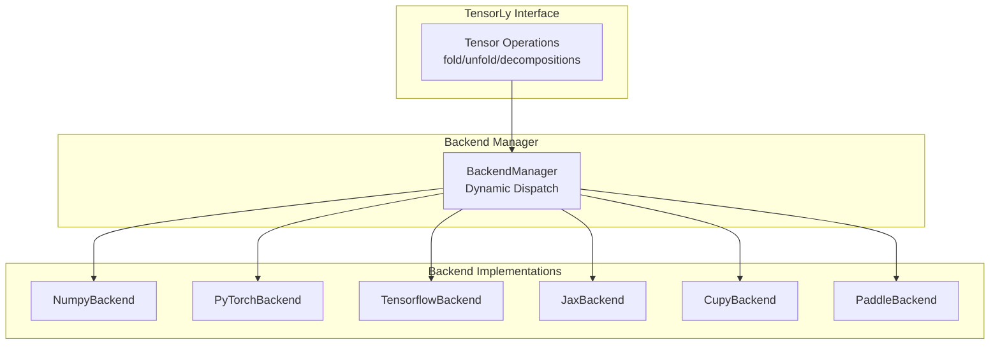

Sources: [tensorly/backend/__init__.py:34-356](), [tensorly/backend/core.py:91-102]()

## Setting the Backend

TensorLy provides multiple ways to set the backend:

### Method 1: Using `set_backend()`

The most direct way to switch backends is to use the `set_backend()` function:

```python
import tensorly as tl
tl.set_backend('pytorch')  # Switch to PyTorch backend
```

This sets the backend for all operations in the current session. Available backend names are: `'numpy'`, `'pytorch'`, `'tensorflow'`, `'jax'`, `'cupy'`, and `'paddle'`.

Sources: [tensorly/backend/__init__.py:319-341](), [tensorly/__init__.py:44-50]()

### Method 2: Using Context Manager

To temporarily switch backends without affecting the global setting, use the `backend_context()` context manager:

```python
import tensorly as tl
# Default backend remains unchanged outside this block
with tl.backend_context('pytorch'):
    # Code using PyTorch backend here
```

The `local_threadsafe` parameter can be used to control whether the backend change affects only the current thread or all threads:

```python
# Only changes backend for current thread
with tl.backend_context('pytorch', local_threadsafe=True):
    # Code using PyTorch backend
```

Sources: [tensorly/backend/__init__.py:239-270](), [tensorly/tests/test_backend.py:24-74]()

### Method 3: Using Environment Variable

You can set the default backend using the `TENSORLY_BACKEND` environment variable:

```bash
export TENSORLY_BACKEND='pytorch'
python my_script.py
```

This is useful when you want to run an entire script or application with a specific backend without modifying any code.

Sources: [tensorly/backend/__init__.py:272-290](), [tensorly/tests/test_backend.py:162-167]()

## Backend-Specific Features

Each backend implementation has unique features and characteristics that affect how you work with tensors.

### Tensor Creation and Context

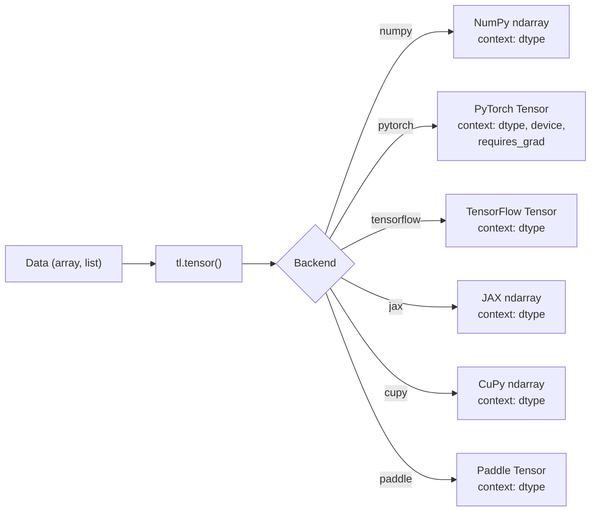

Sources: [tensorly/backend/numpy_backend.py:12-14](), [tensorly/backend/pytorch_backend.py:27-69](), [tensorly/backend/tensorflow_backend.py:21-58](), [tensorly/backend/jax_backend.py:32-38](), [tensorly/backend/cupy_backend.py:23-30]()

The `context()` method of each backend returns different information:

| Backend    | Context Information                        | Example                                     |
|------------|-------------------------------------------|---------------------------------------------|
| NumPy      | `dtype`                                   | `{'dtype': numpy.float32}`                  |
| PyTorch    | `dtype`, `device`, `requires_grad`        | `{'dtype': torch.float32, 'device': 'cuda:0', 'requires_grad': False}` |
| TensorFlow | `dtype`                                   | `{'dtype': tf.float32}`                     |
| JAX        | `dtype`                                   | `{'dtype': jnp.float32}`                    |
| CuPy       | `dtype`                                   | `{'dtype': cupy.float32}`                   |

Sources: [tensorly/backend/core.py:222-257](), [tensorly/backend/pytorch_backend.py:28-34](), [tensorly/backend/tensorflow_backend.py:21-23]()

### GPU Support

For backends that support GPU computation (PyTorch, TensorFlow, JAX, CuPy, Paddle), tensor creation can include device specification:

```python
# With PyTorch backend
tl.set_backend('pytorch')
tensor = tl.tensor([1, 2, 3], device='cuda:0')  # Create tensor on GPU 0

# With CuPy backend (automatically on GPU)
tl.set_backend('cupy')
tensor = tl.tensor([1, 2, 3])  # Already on GPU
```

The PyTorch backend supports specifying device and gradient tracking:

```python
tl.set_backend('pytorch')
tensor = tl.tensor([1, 2, 3], dtype=tl.float32, device='cuda:0', requires_grad=True)
```

Sources: [tensorly/backend/pytorch_backend.py:35-69](), [tensorly/backend/tensorflow_backend.py:33-58]()

## Backend Compatibility and Best Practices

### When to Use Each Backend

1. **NumPy**: For simple CPU computation and minimal dependencies
2. **PyTorch**: When working with deep learning models, need gradients, or GPU acceleration
3. **TensorFlow**: For production deployment of models or integration with TensorFlow ecosystem
4. **JAX**: For functional programming paradigms, transformable numerical functions
5. **CuPy**: For NumPy-like interface with GPU acceleration
6. **Paddle**: Alternative to PyTorch, particularly for certain specialized models

### Migrating Between Backends

When switching backends, use `tl.to_numpy()` to ensure compatibility:

```python
# Convert any tensor to NumPy regardless of current backend
numpy_array = tl.to_numpy(tensor)
```

Sources: [tensorly/backend/core.py:289-302](), [tensorly/backend/pytorch_backend.py:71-82](), [tensorly/backend/tensorflow_backend.py:63-73]()

### Testing with Different Backends

When running tests with different backends, set the environment variable:

```bash
TENSORLY_BACKEND='pytorch' pytest -v tensorly
```

Sources: [tensorly/tests/test_backend.py:24-74](), [README.rst:162-167]()

## Examples

### Basic Usage with Different Backends

```python
import tensorly as tl
import numpy as np

# NumPy backend (default)
tensor_np = tl.tensor(np.arange(12).reshape((3, 4)))

# Switch to PyTorch backend
tl.set_backend('pytorch')
tensor_pt = tl.tensor(np.arange(12).reshape((3, 4)))

# Switch to TensorFlow backend
tl.set_backend('tensorflow')
tensor_tf = tl.tensor(np.arange(12).reshape((3, 4)))

# Temporarily use JAX backend
with tl.backend_context('jax'):
    tensor_jax = tl.tensor(np.arange(12).reshape((3, 4)))
```

### Using Context Information

```python
import tensorly as tl

# PyTorch backend with device specification
tl.set_backend('pytorch')
tensor = tl.tensor([1, 2, 3], device='cuda:0')

# Create another tensor with same context
context = tl.context(tensor)
new_tensor = tl.tensor([4, 5, 6], **context)  # Also on cuda:0
```

## Conclusion

TensorLy's flexible backend system allows you to leverage different numerical libraries while maintaining a consistent API. By selecting the appropriate backend for your use case, you can optimize for performance, hardware utilization, or integration with other frameworks.

---

# Page: Backend Context and Thread Safety

# Backend Context and Thread Safety

<details>
<summary>Relevant source files</summary>

The following files were used as context for generating this wiki page:

- [tensorly/__init__.py](tensorly/__init__.py)
- [tensorly/backend/__init__.py](tensorly/backend/__init__.py)
- [tensorly/tests/test_backend.py](tensorly/tests/test_backend.py)

</details>


**Purpose**: This document explains TensorLy's backend context management system and thread-safety mechanisms, which allow temporary backend switching and safe concurrent backend usage across multiple threads.

For general information about backend switching and available backends, see [Using Different Backends](#2.2). For details about the underlying backend architecture, see [Backend Abstraction Architecture](#2.1).

## Overview

TensorLy provides two mechanisms for managing backend state:

1. **Backend Context Manager** (`backend_context`): Temporarily switches backend within a scope
2. **Thread-Local Configuration**: Isolates backend changes to specific threads without affecting others

These features enable safe multithreaded operations and temporary backend switching for specific computation blocks.

**Sources**: [tensorly/backend/__init__.py:239-269](), [tensorly/tests/test_backend.py:24-75]()

## Backend Context Manager

The `backend_context` function is a context manager that temporarily changes the active backend and automatically restores the previous backend upon exit.

### Basic Usage

```python
with tl.backend_context('pytorch'):
    # Operations use PyTorch backend
    tensor = tl.tensor([1, 2, 3])
    assert torch.is_tensor(tensor)
# Automatically reverts to previous backend
```

**Sources**: [tensorly/backend/__init__.py:240-269](), [tensorly/tests/test_backend.py:31-56]()

### Context Manager Nesting

Context managers can be nested arbitrarily. Each level correctly restores the previous backend:

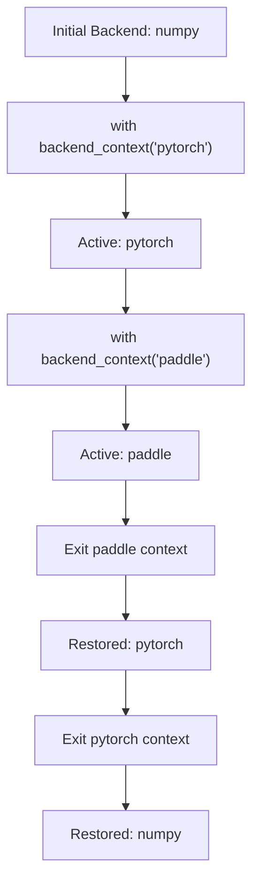

**Sources**: [tensorly/tests/test_backend.py:37-54]()

### Implementation Mechanics

The context manager implementation follows this pattern:

1. **Store current backend**: `_old_backend = cls.current_backend()`
2. **Set new backend**: `cls.set_backend(backend, local_threadsafe=local_threadsafe)`
3. **Execute context block**: `yield`
4. **Restore previous backend**: `cls.set_backend(_old_backend)` in `finally` block

This ensures the previous backend is always restored, even if exceptions occur within the context.

**Sources**: [tensorly/backend/__init__.py:264-269]()

## Thread-Local vs Global Configuration

The `local_threadsafe` parameter controls whether backend changes affect only the current thread or all threads globally.

### Configuration Modes

| Mode | Parameter | Scope | Use Case |
|------|-----------|-------|----------|
| **Global** | `local_threadsafe=False` | All threads | Default behavior, changes affect entire process |
| **Thread-Local** | `local_threadsafe=True` | Current thread only | Concurrent operations with different backends |

**Sources**: [tensorly/backend/__init__.py:241-252]()

### Global Backend Changes

When `local_threadsafe=False` (default), backend changes affect all threads:

```python
# Global change affects all threads
tl.set_backend('pytorch', local_threadsafe=False)

# All threads will now use PyTorch
executor.submit(tl.get_backend).result()  # Returns 'pytorch'
```

**Sources**: [tensorly/tests/test_backend.py:90-93]()

### Thread-Local Backend Changes

When `local_threadsafe=True`, changes are isolated to the current thread:

```python
with tl.backend_context('numpy', local_threadsafe=True):
    assert tl.get_backend() == 'numpy'
    # Other threads unchanged
    assert executor.submit(tl.get_backend).result() == 'pytorch'
```

**Sources**: [tensorly/tests/test_backend.py:83-86](), [tensorly/tests/test_backend.py:95-104]()

## Thread Safety Architecture

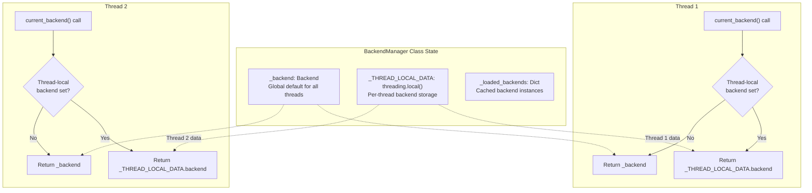

**Sources**: [tensorly/backend/__init__.py:132](), [tensorly/backend/__init__.py:170-178]()

### Thread-Local Storage Implementation

The `BackendManager` uses Python's `threading.local()` to maintain per-thread backend state:

**Class Attribute**: `_THREAD_LOCAL_DATA = threading.local()` at [tensorly/backend/__init__.py:132]()

**Backend Resolution**: The `current_backend()` method checks thread-local storage first, then falls back to the global default:

```python
@classmethod
def current_backend(cls):
    return cls._THREAD_LOCAL_DATA.__dict__.get("backend", cls._backend)
```

**Sources**: [tensorly/backend/__init__.py:169-178]()

### Backend Setting Logic

The `set_backend()` method controls both thread-local and global state based on the `local_threadsafe` parameter:

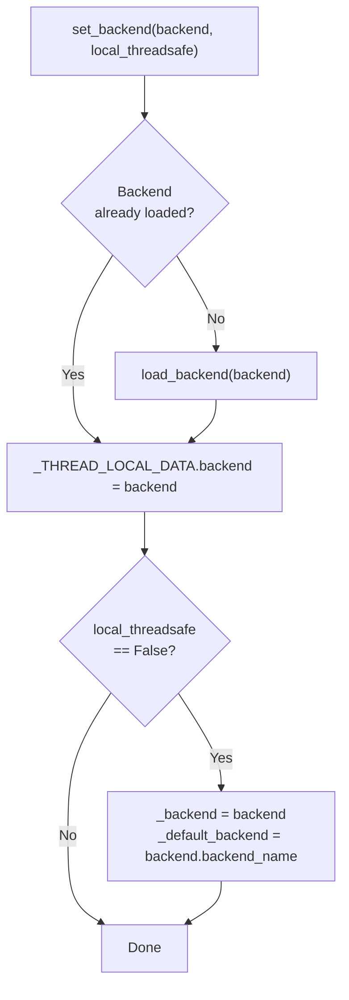

**Key Points**:
1. Thread-local backend is **always** set: `cls._THREAD_LOCAL_DATA.backend = backend`
2. Global backend is **conditionally** set: Only when `local_threadsafe=False`
3. This design ensures thread-local changes don't affect other threads unless explicitly requested

**Sources**: [tensorly/backend/__init__.py:320-340]()

## Multithreaded Usage Patterns

### Pattern 1: Thread-Isolated Backends

Each thread uses a different backend without interference:

```python
from concurrent.futures import ThreadPoolExecutor

def worker_pytorch():
    with tl.backend_context('pytorch', local_threadsafe=True):
        # This thread uses PyTorch
        return tl.tensor([1, 2, 3])

def worker_numpy():
    with tl.backend_context('numpy', local_threadsafe=True):
        # This thread uses NumPy
        return tl.tensor([1, 2, 3])

with ThreadPoolExecutor(max_workers=2) as executor:
    pytorch_result = executor.submit(worker_pytorch)
    numpy_result = executor.submit(worker_numpy)
```

**Sources**: [tensorly/tests/test_backend.py:82-110]()

### Pattern 2: Global Backend Changes in Multithreaded Context

Testing that global changes propagate to all threads:

```python
global_default = tl.get_backend()

with ThreadPoolExecutor(max_workers=1) as executor:
    # Set global backend
    tl.set_backend('pytorch', local_threadsafe=False)
    
    # Verify it changed in spawned thread
    assert executor.submit(tl.get_backend).result() == 'pytorch'
    
    # Thread-local override in main thread doesn't affect worker
    with tl.backend_context('numpy', local_threadsafe=True):
        assert tl.get_backend() == 'numpy'
        assert executor.submit(tl.get_backend).result() == 'pytorch'
```

**Sources**: [tensorly/tests/test_backend.py:89-104]()

### Pattern 3: Nested Thread-Local Contexts Across Threads

Thread-local contexts work independently in each thread:

```python
def check():
    # Worker thread has its own context stack
    assert tl.get_backend() == 'pytorch'  # Global default
    
    with tl.backend_context('numpy', local_threadsafe=True):
        assert tl.get_backend() == 'numpy'  # Local override
    
    assert tl.get_backend() == 'pytorch'  # Restored

# Main thread
with tl.backend_context('numpy', local_threadsafe=True):
    assert tl.get_backend() == 'numpy'
    # Worker operates independently
    executor.submit(check).result()
```

**Sources**: [tensorly/tests/test_backend.py:98-104]()

## Backend State Resolution Flow

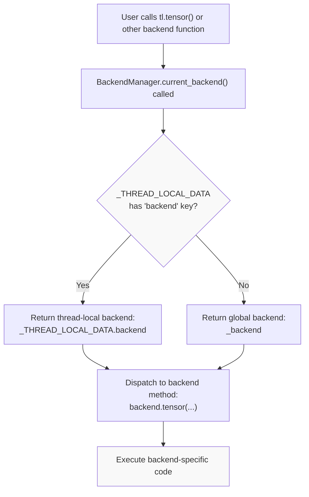

**Sources**: [tensorly/backend/__init__.py:169-178](), [tensorly/backend/__init__.py:195-237]()

## Implementation Details

### Threading Module Usage

TensorLy uses Python's standard `threading.local()` for thread-local storage:

- **Class Attribute**: `_THREAD_LOCAL_DATA = threading.local()` at [tensorly/backend/__init__.py:132]()
- **Storage Pattern**: `cls._THREAD_LOCAL_DATA.backend = backend` at [tensorly/backend/__init__.py:337]()
- **Retrieval Pattern**: `cls._THREAD_LOCAL_DATA.__dict__.get("backend", cls._backend)` at [tensorly/backend/__init__.py:178]()

The `.get()` method with a default ensures graceful fallback when no thread-local backend is set.

**Sources**: [tensorly/backend/__init__.py:132](), [tensorly/backend/__init__.py:337](), [tensorly/backend/__init__.py:178]()

### Backend Name Resolution

The `get_backend()` method returns the backend name (string), not the backend instance:

```python
@classmethod
def get_backend(cls):
    """Returns the *name* (str) of the currently used backend"""
    return cls._THREAD_LOCAL_DATA.__dict__.get("backend", cls._backend).backend_name
```

This accesses the `backend_name` attribute of the backend instance, whether thread-local or global.

**Sources**: [tensorly/backend/__init__.py:181-188]()

### Context Manager Cleanup

The context manager uses a `try-finally` block to ensure cleanup:

```python
@contextmanager
def backend_context(cls, backend, local_threadsafe=False):
    _old_backend = cls.current_backend()
    cls.set_backend(backend, local_threadsafe=local_threadsafe)
    try:
        yield
    finally:
        cls.set_backend(_old_backend)
```

This guarantees the previous backend is restored even if exceptions occur within the context block.

**Sources**: [tensorly/backend/__init__.py:240-269]()

## Testing Coverage

The backend context and thread safety features are extensively tested:

| Test Function | Coverage |
|---------------|----------|
| `test_set_backend` | Basic context manager nesting, backend restoration |
| `test_set_backend_local_threadsafe` | Thread-local isolation with PyTorch |
| `test_set_backend_local_threadsafe_paddle` | Thread-local isolation with Paddle |

Each test verifies:
1. Backend changes within context
2. Automatic restoration after context exit
3. Thread isolation when `local_threadsafe=True`
4. Global propagation when `local_threadsafe=False`

**Sources**: [tensorly/tests/test_backend.py:24-147]()

## Summary Table

| Feature | Mechanism | Key Code Reference |
|---------|-----------|-------------------|
| **Context Manager** | `backend_context()` | [tensorly/backend/__init__.py:240-269]() |
| **Thread-Local Storage** | `threading.local()` | [tensorly/backend/__init__.py:132]() |
| **Backend Resolution** | `current_backend()` | [tensorly/backend/__init__.py:169-178]() |
| **Thread-Safe Setting** | `set_backend(local_threadsafe=True)` | [tensorly/backend/__init__.py:320-340]() |
| **Global Setting** | `set_backend(local_threadsafe=False)` | [tensorly/backend/__init__.py:320-340]() |

**Sources**: [tensorly/backend/__init__.py:132-340]()

---

# Page: TenAlg Backend

# TenAlg Backend

<details>
<summary>Relevant source files</summary>

The following files were used as context for generating this wiki page:

- [doc/modules/api.rst](doc/modules/api.rst)
- [tensorly/decomposition/__init__.py](tensorly/decomposition/__init__.py)
- [tensorly/decomposition/tests/test_robust_decomposition.py](tensorly/decomposition/tests/test_robust_decomposition.py)

</details>


## Purpose and Overview

The TenAlg Backend is a specialized component within TensorLy that handles tensor algebra operations. While the main [Backend System](#2) provides a general abstraction layer for tensor operations across different numerical libraries (NumPy, PyTorch, TensorFlow, etc.), the TenAlg Backend provides different implementations specifically for tensor algebra operations like mode-n products, Kronecker products, and Khatri-Rao products.

This system allows users to choose between different implementations of tensor algebra algorithms based on their performance needs and compatibility requirements, without changing their code.

Sources: [tensorly/tenalg/__init__.py:1-11]()

## Architecture

The TenAlg Backend is structured as a secondary dispatching system built on top of the main Backend system. It uses the `TenalgBackendManager` class to manage and dispatch tensor algebra operations to the appropriate backend implementation.

```mermaid
flowchart TD
    subgraph "TensorLy Public API"
        API["User-facing functions"]
    end
    
    subgraph "Backend System"
        BackendMgr["BackendManager"]
        NumPy["NumPy Backend"]
        PyTorch["PyTorch Backend"]
        TensorFlow["TensorFlow Backend"]
        JAX["JAX Backend"]
        OtherBackends["Other Backends"]
    end
    
    subgraph "TenAlg Backend System"
        TenalgBackendMgr["TenalgBackendManager"]
        CoreTenalg["CoreTenalgBackend"]
        EinsumTenalg["EinsumTenalgBackend"]
    end
    
    API --> BackendMgr
    BackendMgr --> NumPy
    BackendMgr --> PyTorch
    BackendMgr --> TensorFlow
    BackendMgr --> JAX
    BackendMgr --> OtherBackends
    
    API --> TenalgBackendMgr
    TenalgBackendMgr --> CoreTenalg
    TenalgBackendMgr --> EinsumTenalg
    
    CoreTenalg -.-> BackendMgr
    EinsumTenalg -.-> BackendMgr
```

The `TenalgBackendManager` is implemented as a class that inherits from `BackendManager`, providing similar functionality for managing tensor algebra backends as the main backend system does for numerical backends.

Sources: [tensorly/tenalg/__init__.py:15-36]()

### Dynamic Method Dispatching

When a tensor algebra operation (like `mode_dot` or `khatri_rao`) is called, the `TenalgBackendManager` dynamically dispatches the call to the currently selected backend implementation:

```mermaid
sequenceDiagram
    participant User as "User Code"
    participant TLT as "tl.tenalg"
    participant TBM as "TenalgBackendManager"
    participant Backend as "Active TenAlg Backend"
    
    User->>TLT: mode_dot(tensor, matrix, mode)
    TLT->>TBM: Dispatch mode_dot call
    TBM->>Backend: Forward to current backend
    Backend->>TBM: Return result
    TBM->>TLT: Return result
    TLT->>User: Return result
```

This dispatching is implemented through Python's metaprogramming capabilities, where the `TenalgBackendManager` dynamically creates methods that forward calls to the current backend.

Sources: [tensorly/tenalg/__init__.py:37-60](), [tensorly/tenalg/__init__.py:90-94]()

## Available TenAlg Backends

TensorLy provides two built-in implementations of tensor algebra operations:

1. **Core TenAlg Backend** (default): Direct implementations of tensor operations using basic tensor manipulations
2. **Einsum TenAlg Backend**: Implementations using Einstein summation notation (`einsum`)

### Core TenAlg Backend

The Core TenAlg Backend provides implementations of tensor algebra operations using direct tensor manipulation functions. It's the default backend and is generally more readable and easier to understand.

```python
# Example from Core TenAlg Backend
def unfolding_dot_khatri_rao(tensor, cp_tensor, mode):
    weights, factors = cp_tensor
    kr_factors = khatri_rao(factors, weights=weights, skip_matrix=mode)
    mttkrp = T.dot(unfold(tensor, mode), T.conj(kr_factors))
    return mttkrp
```

Sources: [tensorly/tenalg/core_tenalg/__init__.py:1-30](), [tensorly/tenalg/core_tenalg/mttkrp.py:9-50]()

### Einsum TenAlg Backend

The Einsum TenAlg Backend implements the same operations but uses Einstein summation notation (`einsum`), which can be more concise and sometimes more efficient for certain operations.

```python
# Example from Einsum TenAlg Backend
def unfolding_dot_khatri_rao(tensor, cp_tensor, mode):
    weights, factors = cp_tensor
    ndims = tl.ndim(tensor)
    
    if weights is None:
        weights = tl.ones(factors[0].shape[1], **tl.context(tensor))
    
    tensor_idx = "".join(chr(ord("a") + i) for i in range(ndims))
    rank = chr(ord("a") + ndims + 1)
    op = tensor_idx + "," + rank
    # ... build einsum expression
    return tl.einsum(op, tensor, weights, *factors)
```

Sources: [tensorly/tenalg/einsum_tenalg/__init__.py:1-31](), [tensorly/tenalg/einsum_tenalg/mttkrp.py:6-39]()

### Comparison

| Feature | Core TenAlg | Einsum TenAlg |
|---------|-------------|---------------|
| Implementation style | Direct tensor manipulations | Einstein summation notation |
| Readability | More explicit | More concise but can be harder to understand |
| Memory usage | Sometimes higher (creates intermediate tensors) | Often lower (operations fused) |
| Performance | Good baseline performance | Can be faster for certain operations |
| Default in TensorLy | Yes | No |

## Registered Tensor Operations

The TenAlg Backend system manages a set of fundamental tensor algebra operations that are critical for tensor decompositions and analysis. These operations are registered with each backend implementation.

```mermaid
flowchart TD
    subgraph "TenalgBackendManager"
        TBM["Dispatching System"]
        
        subgraph "Core Operations"
            mode_dot["mode_dot"]
            multi_mode_dot["multi_mode_dot"]
            kronecker["kronecker"]
            khatri_rao["khatri_rao"]
            inner["inner"]
            outer["outer"]
            batched_outer["batched_outer"]
        end
        
        subgraph "Advanced Operations"
            higher_order_moment["higher_order_moment"]
            tt_matrix_to_tensor["_tt_matrix_to_tensor"]
            unfolding_dot_khatri_rao["unfolding_dot_khatri_rao"]
            tensordot["tensordot"]
        end
    end
    
    TBM --> Core Operations
    TBM --> Advanced Operations
```

Sources: [tensorly/tenalg/__init__.py:16-28](), [tensorly/tenalg/core_tenalg/__init__.py:19-29](), [tensorly/tenalg/einsum_tenalg/__init__.py:18-30]()

### Key Operations

- **mode_dot**: Computes the n-mode product of a tensor with a matrix
- **multi_mode_dot**: Computes the n-mode product with several matrices
- **kronecker**: Computes the Kronecker product between matrices
- **khatri_rao**: Computes the Khatri-Rao product between matrices
- **inner**: Computes the inner product between tensors
- **outer**: Computes the outer product between tensors
- **batched_outer**: Computes the outer product between batched tensors
- **tensordot**: Generalized tensor contraction similar to NumPy's tensordot
- **unfolding_dot_khatri_rao**: Optimized operation for MTTKRP (Matricized Tensor Times Khatri-Rao Product), critical for CP decomposition

Sources: [tensorly/tenalg/__init__.py:16-28](), [tensorly/tenalg/core_tenalg/mttkrp.py:9-105](), [tensorly/tenalg/einsum_tenalg/outer_product.py:1-45]()

## Usage

### Selecting a TenAlg Backend

You can select the TenAlg Backend using the `set_backend` method:

```python
import tensorly as tl
import tensorly.tenalg as tlg

# To use the core implementation
tlg.set_backend('core')  # This is the default

# To use the einsum implementation
tlg.set_backend('einsum')
```

The TenAlg Backend can be configured independently of the main backend. For example, you can use PyTorch as the main backend while using either 'core' or 'einsum' as the TenAlg Backend.

### Memory-Efficient Operations

For some operations, TensorLy provides alternative implementations optimized for memory efficiency. For example, the MTTKRP operation has a memory-efficient version that can be used for large tensors:

```python
from tensorly.tenalg.core_tenalg.mttkrp import unfolding_dot_khatri_rao_memory
import tensorly.tenalg as tlg

# Replace the default implementation with the memory-efficient one
tlg.register_backend_method("unfolding_dot_khatri_rao", unfolding_dot_khatri_rao_memory)
tlg.use_dynamic_dispatch()
```

Sources: [tensorly/tenalg/core_tenalg/mttkrp.py:53-104]()

## Implementation Details

### Backend Loading and Registration

The TenAlg Backend system uses a dynamic loading mechanism to register backends and their methods. When a backend is first requested, it's loaded using Python's import system and registered with the `TenalgBackendManager`.

```mermaid
flowchart TD
    subgraph "Backend Registration"
        LoadBackend["load_backend method"]
        ImportModule["Import tensorly.tenalg.X_tenalg"]
        CreateBackend["Create backend instance"]
        RegisterBackend["Register in _loaded_backends"]
    end
    
    LoadBackend --> ImportModule
    ImportModule --> CreateBackend
    CreateBackend --> RegisterBackend
    
    subgraph "Backend Class Definition"
        BaseClass["TenalgBackend"]
        Implementations["CoreTenalgBackend, EinsumTenalgBackend"]
        Methods["register_method calls"]
    end
    
    BaseClass --> Implementations
    Implementations --> Methods
```

Each backend implementation (like `CoreTenalgBackend` or `EinsumTenalgBackend`) inherits from `TenalgBackend` and registers its method implementations using `register_method`.

Sources: [tensorly/tenalg/__init__.py:61-87](), [tensorly/tenalg/core_tenalg/__init__.py:15-29](), [tensorly/tenalg/einsum_tenalg/__init__.py:14-30]()

### Thread-Local Backend Selection

Like the main Backend system, the TenAlg Backend system uses thread-local storage to maintain the currently selected backend. This allows different threads to use different backends concurrently without interference.

Sources: [tensorly/tenalg/__init__.py:34]()

## Extending the System

You can extend the TenAlg Backend system by creating new backend implementations. To do this, you need to:

1. Create a new module with your backend implementation
2. Define a class that inherits from `TenalgBackend`
3. Register your implementations using `register_method`
4. Make your backend available by adding it to `available_backend_names`

The system is designed to be extensible, allowing researchers and developers to implement and experiment with different tensor algebra algorithms.

## Relationship with Main Backend System

The TenAlg Backend depends on the main Backend system for basic tensor operations but provides specialized implementations for tensor algebra operations. This separation allows TensorLy to optimize tensor algebra operations independently of the underlying numerical library.

Each TenAlg Backend implementation ultimately relies on the functions provided by the main Backend (NumPy, PyTorch, etc.) for fundamental operations like tensor creation, reshaping, and basic arithmetic.

Sources: [tensorly/tenalg/__init__.py:10](), [tensorly/tenalg/core_tenalg/mttkrp.py:3]()

---

# Page: Tensor Decompositions

# Tensor Decompositions

<details>
<summary>Relevant source files</summary>

The following files were used as context for generating this wiki page:

- [doc/modules/api.rst](doc/modules/api.rst)
- [tensorly/decomposition/__init__.py](tensorly/decomposition/__init__.py)
- [tensorly/decomposition/tests/test_robust_decomposition.py](tensorly/decomposition/tests/test_robust_decomposition.py)
- [tensorly/random/__init__.py](tensorly/random/__init__.py)
- [tensorly/random/base.py](tensorly/random/base.py)
- [tensorly/random/tests/test_base.py](tensorly/random/tests/test_base.py)

</details>


## Purpose and Scope

This page provides an overview of tensor decomposition methods available in TensorLy. Tensor decomposition factorizes a high-dimensional tensor into a product of lower-dimensional factors, enabling dimensionality reduction, compression, and feature extraction. This page describes the available decomposition algorithms, their relationships, and guidance on selecting the appropriate method for specific use cases.

For detailed documentation on specific decomposition methods, see:
- CP (PARAFAC) decomposition: [#3.1](#3.1)
- Tucker decomposition: [#3.2](#3.2)
- Tensor Train decomposition: [#3.3](#3.3)
- PARAFAC2 decomposition: [#3.4](#3.4)
- Robust decomposition: [#3.5](#3.5)
- Constrained decompositions: [#3.6](#3.6)

For information on the tensor representation classes that store decomposed tensors, see [Tensor Representations](#4).

**Sources:** [doc/modules/api.rst:319-377](), [tensorly/decomposition/__init__.py:1-34]()

## Decomposition Methods Overview

TensorLy provides multiple tensor decomposition algorithms, each with specific characteristics and use cases. The following table summarizes the available methods:

| Decomposition | Function/Class | Key Features | Tensor Representation | Use Cases |
|---------------|----------------|--------------|----------------------|-----------|
| **CP (PARAFAC)** | `parafac`, `CP` | Sum of rank-1 tensors, unique under mild conditions | `CPTensor` | General-purpose, interpretable components |
| **Non-negative CP** | `non_negative_parafac`, `non_negative_parafac_hals` | CP with non-negativity constraints | `CPTensor` | Count data, positive-only interpretations |
| **Randomized CP** | `randomised_parafac`, `RandomizedCP` | Sampling-based, scalable to large tensors | `CPTensor` | Large-scale data, approximate solutions |
| **Symmetric CP** | `symmetric_parafac_power_iteration`, `SymmetricCP` | Exploits symmetry, power iteration | `CPTensor` | Symmetric tensors, moments |
| **Constrained CP** | `constrained_parafac`, `ConstrainedCP` | ADMM with proximal operators | `CPTensor` | Smoothness, sparsity, custom constraints |
| **Tucker** | `tucker`, `Tucker` | Core tensor with factor matrices (HOOI) | `TuckerTensor` | Higher-order SVD, mode-specific ranks |
| **Partial Tucker** | `partial_tucker` | Tucker on selected modes | `TuckerTensor` | Dimension reduction on specific modes |
| **Non-negative Tucker** | `non_negative_tucker`, `non_negative_tucker_hals` | Tucker with non-negativity | `TuckerTensor` | Non-negative data, parts-based models |
| **Tensor Train (TT)** | `tensor_train`, `TensorTrain` | Sequential factorization, MPS format | `TTTensor` | Large-scale, sequential structure |
| **TT-Matrix** | `tensor_train_matrix`, `TensorTrainMatrix` | TT for matrix-valued tensors | `TTMatrix` | Tensor operations, matrix approximation |
| **Tensor Ring (TR)** | `tensor_ring`, `TensorRing` | Cyclic boundary conditions | `TRTensor` | Circular symmetry, periodic data |
| **PARAFAC2** | `parafac2`, `Parafac2` | Varying mode dimensions, projection matrices | `Parafac2Tensor` | Irregular tensors, time series with varying lengths |
| **Robust PCA** | `robust_pca` | Low-rank + sparse separation | Two tensors | Outlier removal, corruption handling |

**Sources:** [tensorly/decomposition/__init__.py:6-33](), [doc/modules/api.rst:354-377]()

## Decomposition Classes and Functions

The following diagram shows the relationship between decomposition functions, classes, and tensor representations in the codebase:

```mermaid
graph TB
    subgraph "CP Family"
        parafac["parafac()"]
        CP["CP class"]
        non_negative_parafac["non_negative_parafac()"]
        non_negative_parafac_hals["non_negative_parafac_hals()"]
        CP_NN_HALS["CP_NN_HALS class"]
        randomised_parafac["randomised_parafac()"]
        RandomizedCP["RandomizedCP class"]
        symmetric_parafac_power_iteration["symmetric_parafac_power_iteration()"]
        SymmetricCP["SymmetricCP class"]
        constrained_parafac["constrained_parafac()"]
        ConstrainedCP["ConstrainedCP class"]
    end
    
    subgraph "Tucker Family"
        tucker["tucker()"]
        Tucker["Tucker class"]
        partial_tucker["partial_tucker()"]
        non_negative_tucker["non_negative_tucker()"]
        non_negative_tucker_hals["non_negative_tucker_hals()"]
    end
    
    subgraph "Tensor Train Family"
        tensor_train["tensor_train()"]
        TensorTrain["TensorTrain class"]
        tensor_train_matrix["tensor_train_matrix()"]
        TensorTrainMatrix["TensorTrainMatrix class"]
        tensor_ring["tensor_ring()"]
        TensorRing["TensorRing class"]
    end
    
    subgraph "Other Methods"
        parafac2["parafac2()"]
        Parafac2["Parafac2 class"]
        robust_pca["robust_pca()"]
    end
    
    subgraph "Tensor Representations"
        CPTensor["CPTensor\n(weights, factors)"]
        TuckerTensor["TuckerTensor\n(core, factors)"]
        TTTensor["TTTensor\n(factors list)"]
        TTMatrix["TTMatrix\n(factors list)"]
        TRTensor["TRTensor\n(factors list)"]
        Parafac2Tensor["Parafac2Tensor\n(weights, factors, projections)"]
    end
    
    parafac --> CPTensor
    CP --> CPTensor
    non_negative_parafac --> CPTensor
    non_negative_parafac_hals --> CPTensor
    CP_NN_HALS --> CPTensor
    randomised_parafac --> CPTensor
    RandomizedCP --> CPTensor
    symmetric_parafac_power_iteration --> CPTensor
    SymmetricCP --> CPTensor
    constrained_parafac --> CPTensor
    ConstrainedCP --> CPTensor
    
    tucker --> TuckerTensor
    Tucker --> TuckerTensor
    partial_tucker --> TuckerTensor
    non_negative_tucker --> TuckerTensor
    non_negative_tucker_hals --> TuckerTensor
    
    tensor_train --> TTTensor
    TensorTrain --> TTTensor
    tensor_train_matrix --> TTMatrix
    TensorTrainMatrix --> TTMatrix
    tensor_ring --> TRTensor
    TensorRing --> TRTensor
    
    parafac2 --> Parafac2Tensor
    Parafac2 --> Parafac2Tensor
```

**Sources:** [tensorly/decomposition/__init__.py:6-33](), [doc/modules/api.rst:328-349]()

## Decomposition Architecture

The decomposition system in TensorLy follows a consistent architecture with shared infrastructure. The following diagram illustrates the common workflow and components:

```mermaid
graph TB
    InputTensor["Input Tensor"]
    
    subgraph "Initialization"
        InitSVD["SVD-based initialization"]
        InitRandom["Random initialization"]
        InitCustom["Custom initialization"]
    end
    
    subgraph "Core Decomposition Engine"
        ALSLoop["ALS Iteration Loop"]
        UpdateFactors["Factor Update"]
        ErrorCalc["Reconstruction Error"]
        Convergence["Convergence Check"]
    end
    
    subgraph "Optimization Components"
        SVDInterface["svd_interface()\ntruncated/randomized/symeig"]
        ProximalOps["Proximal Operators\nsoft_thresholding, simplex_projection, etc."]
        NNLSSolvers["NNLS Solvers\nhals_nnls, fista, active_set_nnls"]
        ADMMSolver["admm() solver"]
    end
    
    subgraph "Tensor Algebra"
        KhatriRao["khatri_rao()"]
        UnfoldingDotKR["unfolding_dot_khatri_rao()"]
        ModeDot["mode_dot()"]
        TensorDot["tensordot()"]
    end
    
    subgraph "Output"
        CPTensorOut["CPTensor"]
        TuckerTensorOut["TuckerTensor"]
        TTTensorOut["TTTensor/TRTensor"]
        Parafac2TensorOut["Parafac2Tensor"]
    end
    
    InputTensor --> InitSVD
    InputTensor --> InitRandom
    InputTensor --> InitCustom
    
    InitSVD --> ALSLoop
    InitRandom --> ALSLoop
    InitCustom --> ALSLoop
    
    ALSLoop --> UpdateFactors
    UpdateFactors --> ErrorCalc
    ErrorCalc --> Convergence
    Convergence -->|Not converged| UpdateFactors
    Convergence -->|Converged| CPTensorOut
    Convergence -->|Converged| TuckerTensorOut
    Convergence -->|Converged| TTTensorOut
    Convergence -->|Converged| Parafac2TensorOut
    
    UpdateFactors --> SVDInterface
    UpdateFactors --> ProximalOps
    UpdateFactors --> NNLSSolvers
    UpdateFactors --> ADMMSolver
    
    UpdateFactors --> KhatriRao
    UpdateFactors --> UnfoldingDotKR
    UpdateFactors --> ModeDot
    ErrorCalc --> TensorDot
```

**Sources:** [tensorly/decomposition/__init__.py:1-34](), [doc/modules/api.rst:319-377]()

## Common Decomposition Parameters

Most decomposition functions share a common set of parameters that control the factorization process:

| Parameter | Type | Description | Default |
|-----------|------|-------------|---------|
| `rank` | int or tuple | Target rank(s) for the decomposition | Required |
| `n_iter_max` | int | Maximum number of iterations | Varies by method |
| `init` | str or tensor | Initialization method: 'svd', 'random', or custom factors | 'svd' |
| `tol` | float | Convergence tolerance based on reconstruction error | 1e-8 |
| `random_state` | int or RandomState | Seed for reproducibility | None |
| `verbose` | bool or int | Print iteration progress | False |
| `return_errors` | bool | Return reconstruction errors per iteration | False |
| `mask` | ndarray | Binary mask for missing values (0 = missing) | None |
| `svd` | str | SVD algorithm: 'numpy_svd', 'truncated_svd', 'randomized_svd', 'symeig_svd' | 'numpy_svd' |

Additional parameters specific to certain methods:
- **Non-negative methods**: `nn_modes` (which modes to constrain), solver options
- **Constrained methods**: `proximal_operators` (dict of constraints per mode)
- **PARAFAC2**: `nn_modes`, `normalize_factors`, `linesearch`
- **Robust PCA**: `reg_E` (regularization), `mu_max`, `learning_rate`

**Sources:** [doc/modules/api.rst:354-377]()

## Decomposition Workflow in Code

The following diagram shows the typical code flow when applying a decomposition:

```mermaid
graph LR
    subgraph "User Code"
        ImportTL["import tensorly as tl"]
        ImportDecomp["from tensorly.decomposition import parafac"]
        SetBackend["tl.set_backend('pytorch')"]
        CreateTensor["tensor = tl.tensor(data)"]
        RunDecomp["weights, factors = parafac(tensor, rank=5)"]
        CreateCPTensor["cp_tensor = CPTensor((weights, factors))"]
        Reconstruct["reconstructed = cp_to_tensor(cp_tensor)"]
    end
    
    subgraph "TensorLy Backend"
        BackendDispatch["Backend dispatch\n(NumPy/PyTorch/JAX/etc.)"]
    end
    
    subgraph "Decomposition Module"
        DecompFunc["parafac() in _cp.py"]
        InitFactors["initialize_factors()"]
        ALSIter["ALS iteration"]
        ComputeError["Compute reconstruction error"]
    end
    
    subgraph "Tensor Algebra"
        UnfoldOp["unfold()"]
        KRProduct["khatri_rao()"]
        SVDOp["svd_interface()"]
        MatrixOps["dot(), solve()"]
    end
    
    ImportTL --> ImportDecomp
    ImportDecomp --> SetBackend
    SetBackend --> CreateTensor
    CreateTensor --> RunDecomp
    RunDecomp --> CreateCPTensor
    CreateCPTensor --> Reconstruct
    
    CreateTensor --> BackendDispatch
    RunDecomp --> DecompFunc
    DecompFunc --> InitFactors
    InitFactors --> ALSIter
    ALSIter --> ComputeError
    
    InitFactors --> SVDOp
    ALSIter --> UnfoldOp
    ALSIter --> KRProduct
    ALSIter --> MatrixOps
    ComputeError --> BackendDispatch
```

**Sources:** [tensorly/decomposition/__init__.py:1-34](), [doc/modules/api.rst:354-377]()

## Choosing a Decomposition Method

The choice of decomposition method depends on several factors:

### By Data Characteristics

**Full Dense Tensors**
- Standard use case: `parafac()` or `tucker()`
- Large-scale: `randomised_parafac()` with sampling

**Sparse or Missing Data**
- Any method with `mask` parameter
- Robust to outliers: `robust_pca()`

**Non-negative Data**
- Count data, images: `non_negative_parafac()`, `non_negative_parafac_hals()`
- Tucker variant: `non_negative_tucker()`, `non_negative_tucker_hals()`

**Irregular Shape (varying mode dimensions)**
- PARAFAC2: `parafac2()`

**Symmetric Tensors**
- Exploits symmetry: `symmetric_parafac_power_iteration()`

### By Decomposition Structure

**Rank-1 Components (sum of outer products)**
- CP family: `parafac()`, `non_negative_parafac()`, etc.
- Pro: Interpretable, unique under conditions
- Con: Fixed rank across all modes

**Core Tensor with Factor Matrices**
- Tucker family: `tucker()`, `partial_tucker()`
- Pro: Different rank per mode, more flexible
- Con: Larger storage (core tensor)

**Sequential Factorization**
- Tensor Train: `tensor_train()`, `tensor_ring()`
- Pro: Extremely efficient for high-order tensors
- Con: Less interpretable

**Variable-Length Modes**
- PARAFAC2: `parafac2()`
- Pro: Handles irregular tensors
- Con: More complex, requires projection matrices

### By Constraints

**Custom Constraints (sparsity, smoothness, etc.)**
- Use: `constrained_parafac()` with proximal operators
- See [Constrained Decompositions](#3.6)

**Non-negativity Only**
- Use specialized: `non_negative_parafac()` or `non_negative_parafac_hals()`
- Generally faster than constrained variant

**Sources:** [doc/modules/api.rst:319-377](), [tensorly/decomposition/__init__.py:1-34]()

## Random Tensor Generation

TensorLy provides functions to generate random tensors in decomposed form, useful for testing and simulations:

| Function | Module | Description |
|----------|--------|-------------|
| `random_cp()` | `tensorly.random` | Random CP tensor with specified rank |
| `random_tucker()` | `tensorly.random` | Random Tucker tensor with core and factors |
| `random_tt()` | `tensorly.random` | Random Tensor Train with boundary conditions |
| `random_tt_matrix()` | `tensorly.random` | Random TT-Matrix format |
| `random_tr()` | `tensorly.random` | Random Tensor Ring with cyclic boundary |
| `random_parafac2()` | `tensorly.random` | Random PARAFAC2 with projection matrices |

**Example Usage:**
```python
import tensorly as tl
from tensorly.random import random_cp

# Generate random CP tensor
shape = (10, 15, 20)
rank = 5
cp_tensor = random_cp(shape, rank, full=False, orthogonal=True)
weights, factors = cp_tensor

# Generate full tensor
full_tensor = random_cp(shape, rank, full=True)
```

**Sources:** [tensorly/random/base.py:1-323](), [tensorly/random/__init__.py:1-10]()

## Decomposition Classes vs Functions

TensorLy provides both functional and object-oriented APIs for decompositions:

**Functional API** (recommended for simple use cases):
```python
from tensorly.decomposition import parafac
weights, factors = parafac(tensor, rank=5, n_iter_max=100)
```

**Class-based API** (recommended for integration with scikit-learn):
```python
from tensorly.decomposition import CP
estimator = CP(rank=5, n_iter_max=100)
cp_tensor = estimator.fit_transform(tensor)
# Access fitted parameters
weights = estimator.weights_
factors = estimator.factors_
```

The class-based API follows scikit-learn conventions with `fit()`, `transform()`, and `fit_transform()` methods, making it compatible with scikit-learn pipelines and cross-validation utilities.

**Available Classes:**
- `CP`, `RandomizedCP`, `CPPower`, `CP_NN_HALS`, `SymmetricCP`, `ConstrainedCP`
- `Tucker`
- `TensorTrain`, `TensorTrainMatrix`, `TensorRing`, `TensorRingALS`, `TensorRingALSSampled`
- `Parafac2`

**Sources:** [tensorly/decomposition/__init__.py:6-33](), [doc/modules/api.rst:328-349]()

## Shared Infrastructure Components

All decomposition methods leverage common infrastructure:

### Initialization Methods

Available via the `init` parameter:
- `'svd'`: SVD-based initialization (default, recommended)
- `'random'`: Random initialization
- Custom: Pass pre-initialized factors as tuple

**Sources:** [tensorly/decomposition/__init__.py:1-34]()

### SVD Interface

Unified interface `svd_interface()` in [tensorly.tenalg.svd]() supports:
- `'numpy_svd'`: Standard full SVD
- `'truncated_svd'`: Truncated SVD for large matrices
- `'randomized_svd'`: Randomized SVD (scalable)
- `'symeig_svd'`: Symmetric eigenvalue decomposition

**Sources:** [doc/modules/api.rst:274-281]()

### Proximal Operators

Available in [tensorly.tenalg.proximal]():
- `soft_thresholding()`: L1 sparsity
- `svd_thresholding()`: Nuclear norm
- `procrustes()`: Orthogonality
- Plus 9+ additional operators for various constraints

See [Proximal Operators](#5.2) for complete reference.

**Sources:** [doc/modules/api.rst:298-301]()

### NNLS Solvers

Non-negative least squares solvers in [tensorly.solvers.nnls]():
- `hals_nnls()`: Hierarchical Alternating Least Squares
- `fista()`: Fast Iterative Shrinkage-Thresholding
- `active_set_nnls()`: Active set method

**Sources:** [doc/modules/api.rst:425-432]()

### Error Calculation

All methods compute reconstruction error: `||X - X_reconstructed||_F / ||X||_F`

Enable error tracking with `return_errors=True`:
```python
cp_tensor, errors = parafac(tensor, rank=5, return_errors=True)
# errors is a list of reconstruction errors per iteration
```

## Integration with Other Systems

### Backend System

All decompositions are backend-agnostic and work with any configured backend (NumPy, PyTorch, JAX, TensorFlow, CuPy, Paddle). See [Backend System](#2).

```python
import tensorly as tl
tl.set_backend('pytorch')
# All decomposition functions now use PyTorch tensors
```

### Tensor Representations

Decomposition outputs are stored in specialized tensor classes (e.g., `CPTensor`, `TuckerTensor`) that provide operations like:
- `to_tensor()`: Reconstruct full tensor
- `to_vec()`: Vectorize
- `to_unfolded(mode)`: Unfold along mode
- `mode_dot()`: Contract with matrix

See [Tensor Representations](#4) for details.

**Sources:** [doc/modules/api.rst:162-258]()

### Regression

CP decomposition is used in tensor regression methods:
- `CPRegressor`: Tensor-to-scalar regression
- `CP_PLSR`: Partial Least Squares Regression

See [Regression and Applications](#7).

**Sources:** [doc/modules/api.rst:396-412]()

## Next Steps

For detailed information on specific decomposition methods:
- [CP Decomposition](#3.1) - Standard PARAFAC, non-negative variants, randomized methods
- [Tucker Decomposition](#3.2) - HOOI, partial Tucker, non-negative Tucker
- [Tensor Train Decomposition](#3.3) - TT, TT-Matrix, Tensor Ring
- [PARAFAC2 Decomposition](#3.4) - Variable mode dimensions, projection matrices
- [Robust Decomposition](#3.5) - Low-rank + sparse separation
- [Constrained Decompositions](#3.6) - ADMM framework with proximal operators

For understanding tensor representations:
- [Tensor Representations](#4) - Data structures for decomposed tensors

For backend configuration:
- [Backend System](#2) - Multi-framework support

---

# Page: CP Decomposition

# CP Decomposition

<details>
<summary>Relevant source files</summary>

The following files were used as context for generating this wiki page:

- [tensorly/decomposition/_cp.py](tensorly/decomposition/_cp.py)
- [tensorly/decomposition/_nn_cp.py](tensorly/decomposition/_nn_cp.py)
- [tensorly/decomposition/tests/test_cp.py](tensorly/decomposition/tests/test_cp.py)
- [tensorly/random/__init__.py](tensorly/random/__init__.py)
- [tensorly/random/base.py](tensorly/random/base.py)
- [tensorly/random/tests/test_base.py](tensorly/random/tests/test_base.py)

</details>


## Purpose and Scope

This page documents the Canonical Polyadic (CP) decomposition, also known as CANDECOMP/PARAFAC, in TensorLy. CP decomposition factorizes a tensor into a sum of rank-one tensors, representing the tensor as `tensor = [|weights; factors[0], ..., factors[-1] |]` where each factor is a matrix and weights is a vector.

The page covers:
- Standard CP decomposition via Alternating Least Squares (ALS)
- Non-negative variants using multiplicative updates and HALS
- Randomized/sampled CP decomposition
- Initialization methods (SVD, random, custom)
- Implementation details including convergence, masking, and sparsity

For information about the CPTensor data structure and operations, see [CPTensor Class](#4.1). For constrained CP decomposition using ADMM and proximal operators, see [Constrained Decompositions](#3.6). For CP-based regression methods, see [CP Regression](#7.1) and [CP-PLSR](#7.2).

---

## CP Decomposition Overview

CP decomposition approximates a tensor as a sum of `rank` rank-one tensors. Given a tensor of shape `(I₀, I₁, ..., Iₙ)`, CP decomposition finds factor matrices `A⁽⁰⁾, A⁽¹⁾, ..., A⁽ⁿ⁾` where `A⁽ᵏ⁾` has shape `(Iₖ, rank)`, such that:

```
tensor ≈ Σᵣ wᵣ · a⁽⁰⁾ᵣ ∘ a⁽¹⁾ᵣ ∘ ... ∘ a⁽ⁿ⁾ᵣ
```

where `∘` denotes the outer product and `wᵣ` are weights.

### CP Decomposition Algorithm Family

```mermaid
graph TB
    Input["Input Tensor<br/>(shape: I₀ × I₁ × ... × Iₙ)"]
    
    subgraph "Initialization Phase"
        InitChoice{"Initialization Method"}
        SVDInit["initialize_cp<br/>init='svd'<br/>Uses SVD of unfoldings"]
        RandomInit["initialize_cp<br/>init='random'<br/>Random factor matrices"]
        CustomInit["initialize_cp<br/>init=CPTensor<br/>User-provided factors"]
    end
    
    subgraph "Algorithm Selection"
        AlgoChoice{"Algorithm Type"}
        StandardALS["parafac()<br/>Standard ALS<br/>Unconstrained least squares"]
        NonNegMult["non_negative_parafac()<br/>Multiplicative Updates<br/>Element-wise updates"]
        NonNegHALS["non_negative_parafac_hals()<br/>HALS Algorithm<br/>Column-wise updates"]
        RandomizedCP["randomised_parafac()<br/>Sampled ALS<br/>Khatri-Rao sampling"]
    end
    
    subgraph "Iteration Loop"
        ModeLoop["For each mode k"]
        ComputeGram["Compute Gram matrix<br/>G = Πᵢ≠ₖ Aᵢᵀ Aᵢ"]
        ComputeMTTKRP["Compute MTTKRP<br/>unfolding_dot_khatri_rao()"]
        SolveLS["Solve least squares<br/>Aₖ = MTTKRP · G⁻¹"]
        ApplyConstraint["Apply constraints<br/>(if any)"]
        CheckConvergence["Check convergence<br/>error_calc()"]
    end
    
    Output["CPTensor<br/>(weights, factors)"]
    
    Input --> InitChoice
    InitChoice --> SVDInit
    InitChoice --> RandomInit
    InitChoice --> CustomInit
    
    SVDInit --> AlgoChoice
    RandomInit --> AlgoChoice
    CustomInit --> AlgoChoice
    
    AlgoChoice --> StandardALS
    AlgoChoice --> NonNegMult
    AlgoChoice --> NonNegHALS
    AlgoChoice --> RandomizedCP
    
    StandardALS --> ModeLoop
    NonNegMult --> ModeLoop
    NonNegHALS --> ModeLoop
    RandomizedCP --> ModeLoop
    
    ModeLoop --> ComputeGram
    ComputeGram --> ComputeMTTKRP
    ComputeMTTKRP --> SolveLS
    SolveLS --> ApplyConstraint
    ApplyConstraint --> CheckConvergence
    CheckConvergence --> ModeLoop
    CheckConvergence --> Output
```

**Sources:** [tensorly/decomposition/_cp.py:230-543](), [tensorly/decomposition/_nn_cp.py:26-183](), [tensorly/decomposition/_nn_cp.py:186-379]()

---

## Main CP Functions and Classes

### Function/Class Mapping

| Function/Class | Location | Purpose | Algorithm |
|---|---|---|---|
| `parafac()` | [_cp.py:230-543]() | Standard CP decomposition | ALS with least squares |
| `CP` | [_cp.py:765-916]() | Scikit-learn style wrapper | Wraps `parafac()` |
| `non_negative_parafac()` | [_nn_cp.py:26-183]() | Non-negative CP | Multiplicative updates |
| `CP_NN` | [_nn_cp.py:382-515]() | Wrapper for NN-CP | Wraps `non_negative_parafac()` |
| `non_negative_parafac_hals()` | [_nn_cp.py:186-379]() | Non-negative CP via HALS | Hierarchical ALS |
| `CP_NN_HALS` | [_nn_cp.py:517-656]() | Wrapper for NN-CP-HALS | Wraps `non_negative_parafac_hals()` |
| `randomised_parafac()` | [_cp.py:633-762]() | Randomized CP | Sampled Khatri-Rao ALS |
| `RandomizedCP` | [_cp.py:918-1010]() | Wrapper for randomized CP | Wraps `randomised_parafac()` |
| `initialize_cp()` | [_cp.py:26-137]() | Factor initialization | SVD, random, or custom |

**Sources:** [tensorly/decomposition/_cp.py:1-1010](), [tensorly/decomposition/_nn_cp.py:1-657]()

---

## Standard CP Decomposition (parafac)

The `parafac()` function implements the standard CP decomposition using Alternating Least Squares (ALS).

### Core Algorithm Flow

```mermaid
graph LR
    subgraph "parafac() Main Loop"
        Init["Initialize factors<br/>initialize_cp()"]
        FixedCheck{"Check fixed_modes"}
        ModeIter["Iterate modes<br/>(skip fixed modes)"]
        
        subgraph "Per-Mode Update"
            PseudoInv["Compute pseudo-inverse<br/>G = Πᵢ≠ₖ (AᵢᵀAᵢ) ⊙ (w ⊗ w)"]
            MTTKRP["Compute MTTKRP<br/>unfolding_dot_khatri_rao()"]
            Solve["Solve system<br/>tl.solve(Gᵀ, MTTKRPᵀ)ᵀ"]
            UpdateFactor["factors[mode] = solution"]
        end
        
        LineSearch{"linesearch<br/>enabled?"}
        Extrapolate["Extrapolate factors<br/>new = old + jump*(cur-old)"]
        TestError["Test extrapolated error"]
        AcceptReject{"Error<br/>improved?"}
        
        ErrorCalc["error_calc()<br/>Compute reconstruction error"]
        Converged{"Converged?<br/>|Δerror| < tol"}
        Normalize{"normalize_factors?"}
        NormalizeOp["cp_normalize()"]
    end
    
    Init --> FixedCheck
    FixedCheck --> ModeIter
    ModeIter --> PseudoInv
    PseudoInv --> MTTKRP
    MTTKRP --> Solve
    Solve --> UpdateFactor
    UpdateFactor --> LineSearch
    
    LineSearch -->|Yes| Extrapolate
    LineSearch -->|No| ErrorCalc
    Extrapolate --> TestError
    TestError --> AcceptReject
    AcceptReject -->|Accept| ErrorCalc
    AcceptReject -->|Reject| ErrorCalc
    
    ErrorCalc --> Converged
    Converged -->|No| Normalize
    Converged -->|Yes| End["Return CPTensor"]
    Normalize -->|Yes| NormalizeOp
    Normalize -->|No| ModeIter
    NormalizeOp --> ModeIter
```

**Sources:** [tensorly/decomposition/_cp.py:230-543]()

### Key Parameters

| Parameter | Type | Default | Description |
|---|---|---|---|
| `tensor` | ndarray | Required | Input tensor to decompose |
| `rank` | int | Required | Number of components (rank of decomposition) |
| `n_iter_max` | int | 100 | Maximum iterations |
| `init` | str or CPTensor | 'svd' | Initialization method: 'svd', 'random', or CPTensor |
| `svd` | str | 'truncated_svd' | SVD algorithm to use for initialization |
| `normalize_factors` | bool | False | Aggregate factor norms into weights |
| `orthogonalise` | bool or int | False | Orthogonalize factors (if int, number of iterations) |
| `tol` | float | 1e-8 | Convergence tolerance |
| `mask` | ndarray | None | Boolean mask for missing values (1=observed, 0=missing) |
| `cvg_criterion` | str | 'abs_rec_error' | 'abs_rec_error' or 'rec_error' |
| `sparsity` | float or int | None | Fraction/count of non-zero elements in sparse component |
| `l2_reg` | float | 0 | L2 regularization coefficient |
| `fixed_modes` | list | None | Modes to keep fixed during optimization |
| `linesearch` | bool | False | Enable line search acceleration |
| `callback` | callable | None | Callback function called each iteration |

**Sources:** [tensorly/decomposition/_cp.py:230-322]()

### Return Value

Returns a `CPTensor` object `(weights, factors)` where:
- `weights`: 1D array of shape `(rank,)` - all ones if `normalize_factors=False`, otherwise contains factor norms
- `factors`: List of N factor matrices, where `factors[i]` has shape `(tensor.shape[i], rank)`

If `sparsity` is not None, returns tuple `(CPTensor, sparse_component)`.

**Sources:** [tensorly/decomposition/_cp.py:300-310]()

---

## Initialization Methods

The `initialize_cp()` function provides three initialization strategies:

### Initialization Strategy Comparison

```mermaid
graph TB
    subgraph "SVD Initialization (init='svd')"
        SVDStart["For each mode k"]
        UnfoldTensor["Unfold tensor along mode k<br/>unfold(tensor, k)"]
        SVDCompute["Compute truncated SVD<br/>svd_interface(unfolding, rank)"]
        ExtractU["Extract left singular vectors U"]
        ScaleFirst["Scale first mode by singular values"]
        HandleMask["Handle mask if provided<br/>svd_mask_repeats iterations"]
        SVDFactors["factors[k] = U[:, :rank]"]
    end
    
    subgraph "Random Initialization (init='random')"
        RandomStart["Call random_cp()"]
        RandomGen["Generate random matrices<br/>rng.random_sample((shape[i], rank))"]
        RandomFactors["Return random factors"]
    end
    
    subgraph "Custom Initialization (init=CPTensor)"
        CustomStart["Accept CPTensor object"]
        PullWeights["Pull weights into last factor"]
        ResetWeights["Set weights to None"]
        CustomFactors["Return normalized factors"]
    end
    
    Choice{"init parameter"}
    NonNeg{"non_negative?"}
    MakePos["Take absolute value<br/>of all factors"]
    NormChoice{"normalize_factors?"}
    NormOp["cp_normalize()"]
    Output["Return CPTensor"]
    
    Choice -->|"'svd'"| SVDStart
    Choice -->|"'random'"| RandomStart
    Choice -->|CPTensor| CustomStart
    
    SVDStart --> UnfoldTensor
    UnfoldTensor --> SVDCompute
    SVDCompute --> ExtractU
    ExtractU --> ScaleFirst
    ScaleFirst --> HandleMask
    HandleMask --> SVDFactors
    
    RandomStart --> RandomGen
    RandomGen --> RandomFactors
    
    CustomStart --> PullWeights
    PullWeights --> ResetWeights
    ResetWeights --> CustomFactors
    
    SVDFactors --> NonNeg
    RandomFactors --> NonNeg
    CustomFactors --> NonNeg
    
    NonNeg -->|Yes| MakePos
    NonNeg -->|No| NormChoice
    MakePos --> NormChoice
    
    NormChoice -->|Yes| NormOp
    NormChoice -->|No| Output
    NormOp --> Output
```

**Sources:** [tensorly/decomposition/_cp.py:26-137]()

### Initialization Modes

**SVD Initialization (`init='svd'`)**
- Performs SVD on each mode's unfolding
- Uses left singular vectors as initial factors
- First mode scaled by singular values for better scaling
- Supports masked tensors with repeated SVD (`svd_mask_repeats`)
- Most reliable for well-conditioned problems

**Random Initialization (`init='random'`)**
- Generates random factor matrices using `random_cp()`
- Uses uniform distribution `[0, 1)`
- Requires `random_state` parameter for reproducibility
- Faster but may require more iterations

**Custom Initialization (`init=CPTensor`)**
- Accepts pre-computed CPTensor as initialization
- Redistributes weights into factors
- Useful for warm starts or continuing optimization

**Sources:** [tensorly/decomposition/_cp.py:26-137](), [tensorly/random/base.py:64-114]()

---

## Non-Negative CP Variants

TensorLy provides two algorithms for non-negative CP decomposition, ensuring all factor matrices contain only non-negative values.

### Non-Negative Algorithms Comparison

| Feature | `non_negative_parafac()` | `non_negative_parafac_hals()` |
|---|---|---|
| **Algorithm** | Multiplicative Updates | Hierarchical ALS (HALS) |
| **Update Rule** | Element-wise multiplicative | Column-wise least squares |
| **Constraint** | All modes non-negative | Configurable via `nn_modes` |
| **Sparsity** | Not supported | Supported via `sparsity_coefficients` |
| **Speed** | Slower convergence | Faster convergence |
| **Unconstrained modes** | Not supported | Supported (uses standard LS) |
| **Function** | [_nn_cp.py:26-183]() | [_nn_cp.py:186-379]() |
| **Class** | `CP_NN` [_nn_cp.py:382-515]() | `CP_NN_HALS` [_nn_cp.py:517-656]() |

**Sources:** [tensorly/decomposition/_nn_cp.py:1-657]()

### Multiplicative Updates Algorithm

The `non_negative_parafac()` function uses the multiplicative update rule from Shashua & Hazan (2005):

```
A_k^(new) = A_k^(old) ⊙ (numerator / denominator)
```

where:
- `numerator = MTTKRP` (clipped to be positive)
- `denominator = A_k · G` (where G is the Gram matrix, clipped to be positive)

```mermaid
graph TB
    subgraph "non_negative_parafac() Per-Mode Update"
        Start["Mode k iteration"]
        ComputeAccum["Compute accumulator<br/>accum = Πᵢ≠ₖ (Aᵢᵀ Aᵢ)"]
        WeightAccum["Weight accumulator<br/>accum = (w ⊗ w) ⊙ accum"]
        UpdateMask{"mask<br/>provided?"}
        FillMask["Fill masked values<br/>tensor = tensor⊙mask + cp_to_tensor()⊙(1-mask)"]
        ComputeMTTKRP["MTTKRP = unfolding_dot_khatri_rao()"]
        ClipNum["numerator = clip(MTTKRP, min=ε)"]
        ComputeDenom["denominator = Aₖ · accum"]
        ClipDenom["denominator = clip(denom, min=ε)"]
        Multiply["Aₖ = Aₖ ⊙ (numerator / denominator)"]
        NormCheck{"normalize_factors<br/>and not last mode?"}
        Normalize["cp_normalize()"]
        ErrorCheck["error_calc()"]
    end
    
    Start --> ComputeAccum
    ComputeAccum --> WeightAccum
    WeightAccum --> UpdateMask
    UpdateMask -->|Yes| FillMask
    UpdateMask -->|No| ComputeMTTKRP
    FillMask --> ComputeMTTKRP
    ComputeMTTKRP --> ClipNum
    ClipNum --> ComputeDenom
    ComputeDenom --> ClipDenom
    ClipDenom --> Multiply
    Multiply --> NormCheck
    NormCheck -->|Yes| Normalize
    NormCheck -->|No| ErrorCheck
    Normalize --> ErrorCheck
```

**Key Implementation Details:**
- Uses `epsilon = tl.eps(tensor.dtype)` for numerical stability
- Clips numerator and denominator to avoid division by zero
- Supports `fixed_modes` to keep certain factors unchanged
- Last mode cannot be fixed (needed for error computation)

**Sources:** [tensorly/decomposition/_nn_cp.py:26-183]()

### HALS Algorithm

The `non_negative_parafac_hals()` function uses Hierarchical ALS, updating each factor column-by-column:

```mermaid
graph TB
    subgraph "non_negative_parafac_hals() Column-wise Update"
        Start["Mode k iteration"]
        BuildGram["Build Gram matrix<br/>G = Πᵢ≠ₖ (Aᵢᵀ Aᵢ)"]
        WeightGram["G = (w ⊗ w) ⊙ G"]
        MTTKRP["MTTKRP = unfolding_dot_khatri_rao()"]
        
        CheckMode{"mode in<br/>nn_modes?"}
        
        subgraph "Non-negative mode"
            CallHALS["Call hals_nnls()<br/>from tensorly.solvers.nnls"]
            TransposeIn["Input: MTTKRPᵀ, G, Aₖᵀ"]
            HALSIterate["HALS iterations<br/>Column-wise NNLS"]
            ApplySparsity["Apply sparsity if specified"]
            TransposeOut["Transpose result"]
        end
        
        subgraph "Unconstrained mode"
            StandardLS["Solve tl.solve(Gᵀ, MTTKRPᵀ)"]
            NoConstraint["No non-negativity constraint"]
        end
        
        Update["Update factors[k]"]
        NormCheck{"normalize_factors?"}
        Normalize["cp_normalize()"]
        ErrorCalc["Compute error using<br/>cp_norm() and inner product"]
    end
    
    Start --> BuildGram
    BuildGram --> WeightGram
    WeightGram --> MTTKRP
    MTTKRP --> CheckMode
    
    CheckMode -->|Yes| CallHALS
    CheckMode -->|No| StandardLS
    
    CallHALS --> TransposeIn
    TransposeIn --> HALSIterate
    HALSIterate --> ApplySparsity
    ApplySparsity --> TransposeOut
    TransposeOut --> Update
    
    StandardLS --> NoConstraint
    NoConstraint --> Update
    
    Update --> NormCheck
    NormCheck -->|Yes| Normalize
    NormCheck -->|No| ErrorCalc
    Normalize --> ErrorCalc
```

**Key Features:**
- `nn_modes`: Specify which modes to constrain (default: 'all')
- `sparsity_coefficients`: Per-mode sparsity penalties
- `exact`: If True, uses exact HALS (slower but more precise)
- Uses `hals_nnls()` solver from [tensorly/solvers/nnls.py]()
- Allows mixing constrained and unconstrained modes

**Sources:** [tensorly/decomposition/_nn_cp.py:186-379](), [tensorly/solvers/nnls.py]()

---

## Randomized CP Decomposition

The `randomised_parafac()` function implements a sampling-based CP decomposition that scales better for large tensors.

### Randomized Algorithm Overview

```mermaid
graph TB
    subgraph "randomised_parafac() Iteration"
        Init["Initialize factors<br/>initialize_cp()"]
        ModeLoop["For each mode k"]
        
        subgraph "Sampled Update"
            SampleKR["Sample Khatri-Rao product<br/>sample_khatri_rao()<br/>n_samples rows"]
            BuildIndices["Build index list<br/>Skip mode k, keep all for mode k"]
            ExtractSlice["Extract tensor slice<br/>tensor[indices_list]"]
            ComputePseudo["Compute pseudo-inverse<br/>KRᵀ · KR"]
            ComputeFactor["factor = KRᵀ · sampled_unfolding"]
            SolveSystem["Solve: pseudo_inv⁻¹ · factor"]
            TransposeResult["Transpose to get Aₖ"]
        end
        
        ErrorCheck{"max_stagnation<br/>or tol?"}
        FullError["Compute full reconstruction error<br/>||tensor - cp_to_tensor()||"]
        CheckStag{"Stagnation<br/>count"}
        CheckTol{"Error<br/>decrease < tol?"}
        Continue["Continue iterations"]
        Stop["Stop: converged"]
    end
    
    Init --> ModeLoop
    ModeLoop --> SampleKR
    SampleKR --> BuildIndices
    BuildIndices --> ExtractSlice
    ExtractSlice --> ComputePseudo
    ComputePseudo --> ComputeFactor
    ComputeFactor --> SolveSystem
    SolveSystem --> TransposeResult
    TransposeResult --> ErrorCheck
    
    ErrorCheck -->|Yes| FullError
    ErrorCheck -->|No| Continue
    FullError --> CheckStag
    CheckStag --> CheckTol
    CheckTol -->|No| Continue
    CheckTol -->|Yes| Stop
    Continue --> ModeLoop
```

**Sources:** [tensorly/decomposition/_cp.py:633-762]()

### Khatri-Rao Sampling

The `sample_khatri_rao()` function samples rows from the Khatri-Rao product without computing the full product:

**Algorithm:**
1. For each factor matrix, randomly sample `n_samples` row indices
2. For sampled indices `(i₁, i₂, ..., iₙ)`, compute row of KR product as element-wise product: `KR[row] = factors[0][i₁] ⊙ factors[1][i₂] ⊙ ... ⊙ factors[n][iₙ]`
3. Return sampled KR matrix of shape `(n_samples, rank)`

**Key Parameters:**
- `n_samples`: Number of rows to sample (balance between accuracy and speed)
- `random_state`: For reproducible sampling
- `return_sampled_rows`: If True, also return the corresponding full KR row indices

**Sources:** [tensorly/decomposition/_cp.py:546-630]()

### When to Use Randomized CP

**Advantages:**
- Much faster for large tensors (avoids materializing full Khatri-Rao products)
- Memory efficient
- Provably approximates standard CP

**Disadvantages:**
- Requires more iterations to converge
- Less accurate than standard CP
- Requires tuning `n_samples` parameter

**Typical Usage:**
```python
# Large tensor where standard CP is too slow
large_tensor = tl.tensor(np.random.randn(1000, 1000, 1000))

cp_tensor = randomised_parafac(
    large_tensor,
    rank=10,
    n_samples=500,  # Sample 500 rows per iteration
    n_iter_max=100,
    max_stagnation=20
)
```

**Sources:** [tensorly/decomposition/_cp.py:633-762](), [tensorly/decomposition/tests/test_cp.py:482-520]()

---

## Advanced Features

### Masked/Missing Values

CP decomposition supports missing values through the `mask` parameter:

**Mask Format:**
- Boolean array same shape as tensor
- `1` or `True`: observed value
- `0` or `False`: missing value

**Algorithm Behavior:**
1. During each iteration, masked values are filled with current reconstruction
2. Tensor is updated: `tensor = tensor * mask + cp_to_tensor() * (1-mask)`
3. Norm is recomputed with updated tensor
4. This effectively imputes missing values based on current factors

**Initialization with Mask:**
- `svd_mask_repeats`: Performs SVD initialization multiple times to reduce bias from missing values
- Higher values = better initialization but slower

**Example:**
```python
# Tensor with missing values
tensor = tl.tensor(data)
mask = tl.tensor(observed_mask)  # 1 where data is observed, 0 where missing

cp_tensor = parafac(
    tensor,
    rank=5,
    mask=mask,
    svd_mask_repeats=10  # Perform SVD 10 times for better init
)
```

**Sources:** [tensorly/decomposition/_cp.py:280-284](), [tensorly/decomposition/_cp.py:294-296](), [tensorly/decomposition/_cp.py:194-200]()

### Sparse Component Separation

The `sparsity` parameter enables decomposing a tensor into low-rank + sparse components:

```
tensor ≈ cp_to_tensor((weights, factors)) + sparse_component
```

**Sparsity Parameter:**
- If float (0.0 to 1.0): fraction of non-zero elements
- If int: absolute number of non-zero elements

**Algorithm:**
1. Perform standard CP iteration
2. Compute residual: `residual = tensor - cp_to_tensor()`
3. Keep only largest `sparsity` elements in absolute value (via `sparsify_tensor()`)
4. This forms the sparse component

**Use Cases:**
- Robust decomposition when tensor contains outliers or sparse noise
- Separating structured low-rank patterns from sparse anomalies

**Sources:** [tensorly/decomposition/_cp.py:140-159](), [tensorly/decomposition/_cp.py:289-290]()

### Fixed Modes

The `fixed_modes` parameter allows keeping certain factor matrices fixed during optimization:

**Implementation:**
- Provide list of mode indices to keep fixed (e.g., `[0, 2]`)
- These modes skip the update step in the ALS loop
- Last mode cannot be fixed (required for error computation)

**Use Cases:**
- Transfer learning: fix learned factors, optimize others
- Constrained decomposition: enforce known structure in certain modes
- Incremental learning: add new modes while keeping others fixed

**Example:**
```python
# Initialize with specific factors for modes 0 and 1
init_tensor = CPTensor((None, [factor_0, factor_1, random_factor_2]))

cp_tensor = parafac(
    tensor,
    rank=5,
    init=init_tensor,
    fixed_modes=[0, 1]  # Only optimize mode 2
)
```

**Sources:** [tensorly/decomposition/_cp.py:291-293](), [tensorly/decomposition/_cp.py:356-370]()

### Line Search Acceleration

When `linesearch=True`, the algorithm performs extrapolation to accelerate convergence:

**Algorithm (Bro's acceleration):**
1. Store factors from previous iteration: `factors_last`
2. Compute current factors: `factors`
3. Extrapolate: `factors_new = factors_last + jump * (factors - factors_last)`
   - `jump = iteration^(1/acc_pow)` where `acc_pow` starts at 2.0
4. Test if extrapolated factors reduce error
5. If yes: accept and reset fail counter
6. If no: reject, increment fail counter, increase `acc_pow` after max_fail failures

**Performance:**
- Can significantly speed up convergence (fewer iterations)
- Most effective after initial iterations (activated after iteration 5)
- Only performs extrapolation every 2nd iteration

**Sources:** [tensorly/decomposition/_cp.py:297-299](), [tensorly/decomposition/_cp.py:333-336](), [tensorly/decomposition/_cp.py:447-484]()

### Convergence Criteria

Two convergence criteria are supported via `cvg_criterion`:

| Criterion | Formula | When to Use |
|---|---|---|
| `'abs_rec_error'` (default) | `|error[t] - error[t-1]| < tol` | Stable, absolute improvement |
| `'rec_error'` | `error[t] - error[t-1] < tol` | Relative improvement, may oscillate |

**Error Calculation Methods:**

The `error_calc()` function computes reconstruction error using two strategies:

1. **When mask or mttkrp=None**: Full reconstruction
   ```
   error = ||tensor - cp_to_tensor()||
   ```

2. **When mttkrp available and no mask**: Efficient computation
   ```
   error = sqrt(||tensor||² + ||CP||² - 2⟨tensor, CP⟩)
   where ⟨tensor, CP⟩ = sum(mttkrp * factors[-1])
   ```

**Sources:** [tensorly/decomposition/_cp.py:285-288](), [tensorly/decomposition/_cp.py:162-227]()

---

## Class-Based API

TensorLy provides scikit-learn style class wrappers for all CP variants:

### Class Usage Pattern

```mermaid
graph LR
    subgraph "Scikit-learn Style API"
        Create["Create decomposer<br/>decomp = CP(rank, ...)"]
        Fit["Fit to tensor<br/>cp_tensor = decomp.fit_transform(tensor)"]
        Access["Access results<br/>decomp.decomposition_<br/>decomp.errors_"]
    end
    
    subgraph "Functional API"
        Call["Direct function call<br/>cp_tensor = parafac(tensor, rank, ...)"]
        Return["Returns CPTensor"]
    end
    
    Create --> Fit
    Fit --> Access
    
    Call --> Return
```

**Available Classes:**
- `CP`: Standard CP via ALS
- `CP_NN`: Non-negative CP via multiplicative updates
- `CP_NN_HALS`: Non-negative CP via HALS
- `RandomizedCP`: Randomized/sampled CP

**Common Pattern:**
```python
# Create decomposer with hyperparameters
decomposer = CP(rank=10, n_iter_max=100, tol=1e-6)

# Fit to data
cp_tensor = decomposer.fit_transform(tensor)

# Access stored results
errors = decomposer.errors_
final_decomposition = decomposer.decomposition_
```

**Sources:** [tensorly/decomposition/_cp.py:765-916](), [tensorly/decomposition/_nn_cp.py:382-515](), [tensorly/decomposition/_nn_cp.py:517-656]()

---

## Implementation Architecture

### Key Internal Functions

```mermaid
graph TB
    subgraph "Core Operations"
        UnfoldDotKR["unfolding_dot_khatri_rao()<br/>Compute MTTKRP efficiently<br/>tensor.tenalg"]
        CPToTensor["cp_to_tensor()<br/>Reconstruct full tensor<br/>tensor.cp_tensor"]
        CPNorm["cp_norm()<br/>Frobenius norm of CP<br/>tensor.cp_tensor"]
        CPNormalize["cp_normalize()<br/>Normalize factors<br/>tensor.cp_tensor"]
        ValidateRank["validate_cp_rank()<br/>Check rank validity<br/>tensor.cp_tensor"]
    end
    
    subgraph "Initialization"
        InitCP["initialize_cp()<br/>SVD/Random/Custom"]
        SVDInterface["svd_interface()<br/>Unified SVD API<br/>tensor.tenalg.svd"]
        UnfoldOp["unfold()<br/>Matricization<br/>tensor.base"]
        RandomCP["random_cp()<br/>Generate random CP<br/>tensor.random"]
    end
    
    subgraph "Error Calculation"
        ErrorCalc["error_calc()<br/>Compute reconstruction error"]
        NormOp["tl.norm()<br/>Tensor norm<br/>Backend operation"]
        SparsifyOp["sparsify_tensor()<br/>Keep top-k elements"]
    end
    
    subgraph "Backend Operations"
        DotOp["tl.dot()<br/>Matrix multiplication"]
        SolveOp["tl.solve()<br/>Linear system solver"]
        QROp["tl.qr()<br/>QR decomposition"]
        TransposeOp["tl.transpose()<br/>Matrix transpose"]
    end
    
    parafac["parafac()"]
    NonNegParafac["non_negative_parafac()"]
    HALSParafac["non_negative_parafac_hals()"]
    RandomizedParafac["randomised_parafac()"]
    
    parafac --> InitCP
    NonNegParafac --> InitCP
    HALSParafac --> InitCP
    RandomizedParafac --> InitCP
    
    InitCP --> SVDInterface
    InitCP --> RandomCP
    SVDInterface --> UnfoldOp
    
    parafac --> UnfoldDotKR
    NonNegParafac --> UnfoldDotKR
    HALSParafac --> UnfoldDotKR
    
    parafac --> ErrorCalc
    NonNegParafac --> ErrorCalc
    HALSParafac --> CPNorm
    
    ErrorCalc --> CPToTensor
    ErrorCalc --> CPNorm
    ErrorCalc --> SparsifyOp
    
    parafac --> SolveOp
    NonNegParafac --> DotOp
    HALSParafac --> SolveOp
    
    parafac --> CPNormalize
    NonNegParafac --> CPNormalize
    HALSParafac --> CPNormalize
```

**Sources:** [tensorly/decomposition/_cp.py:1-1010](), [tensorly/decomposition/_nn_cp.py:1-657]()

### Dependencies on Core TensorLy Modules

| Module | Functions Used | Purpose |
|---|---|---|
| `tensorly.cp_tensor` | `cp_to_tensor`, `CPTensor`, `cp_norm`, `cp_normalize`, `validate_cp_rank`, `unfolding_dot_khatri_rao` | CP tensor operations and validation |
| `tensorly.base` | `unfold` | Tensor unfolding/matricization |
| `tensorly.tenalg` | `unfolding_dot_khatri_rao` | Efficient MTTKRP computation |
| `tensorly.tenalg.svd` | `svd_interface` | Unified SVD for initialization |
| `tensorly.random` | `random_cp` | Random tensor generation |
| `tensorly.solvers.nnls` | `hals_nnls` | Non-negative least squares solver |
| `tensorly.backend` | `tl.dot`, `tl.solve`, `tl.norm`, `tl.qr`, etc. | Backend-agnostic operations |

**Sources:** [tensorly/decomposition/_cp.py:1-23](), [tensorly/decomposition/_nn_cp.py:1-22]()

---

## Testing and Validation

The test suite for CP decomposition is comprehensive and covers multiple scenarios:

### Test Coverage

| Test | File Location | What It Tests |
|---|---|---|
| `test_parafac` | [test_cp.py:42-211]() | Standard CP with various parameters (linesearch, orthogonalize, ranks, init methods) |
| `test_masked_parafac` | [test_cp.py:214-247]() | CP with missing values, mask handling, svd_mask_repeats |
| `test_parafac_linesearch` | [test_cp.py:250-277]() | Line search acceleration convergence |
| `test_non_negative_parafac` | [test_cp.py:279-384]() | Both NN-CP variants (multiplicative & HALS) |
| `test_initialize_nn_cp` | [test_cp.py:387-394]() | Initialization with non-negative constraints |
| `test_non_negative_parafac_hals_one_unconstrained` | [test_cp.py:397-443]() | HALS with mixed constrained/unconstrained modes |
| `test_sample_khatri_rao` | [test_cp.py:446-479]() | Khatri-Rao sampling correctness |
| `test_randomised_parafac` | [test_cp.py:482-520]() | Randomized CP decomposition |

**Test Methodology:**
- Generate synthetic tensors with known CP structure using `random_cp()`
- Decompose and measure reconstruction error
- Verify factor recovery using congruence coefficients
- Test with various backends (NumPy, PyTorch, JAX, etc.)
- Validate class wrappers match functional APIs

**Sources:** [tensorly/decomposition/tests/test_cp.py:1-521]()

---

## Performance Considerations

### Algorithm Complexity

| Algorithm | Per-Iteration Complexity | When to Use |
|---|---|---|
| Standard ALS | O(NR² + IR²) per mode | Default choice, well-studied |
| Multiplicative Updates | O(NR² + IR²) per mode | When non-negativity required, simpler |
| HALS | O(NR² + 100·IR) per mode | When faster NN convergence needed |
| Randomized CP | O(SR² + R³) per mode | For very large tensors, S << I |

Where:
- N = total tensor size (∏ dimensions)
- I = size of current mode
- R = rank
- S = number of samples

### Memory Usage

**Standard CP:**
- Factor matrices: `Σᵢ(Iᵢ × R)` 
- Gram matrices: `R × R` (reused)
- Temporary MTTKRP: `max(Iᵢ) × R`

**Randomized CP:**
- Sampled KR: `S × R` (much smaller than full)
- Avoids materializing full Khatri-Rao products

**Tips for Large Tensors:**
1. Use `randomised_parafac()` for tensors > 1GB
2. Enable `normalize_factors=False` to avoid frequent normalizations
3. Reduce `n_iter_max` and use `callback` for early stopping
4. Consider Tucker decomposition if rank is very small relative to dimensions

**Sources:** [tensorly/decomposition/_cp.py:633-762]()

---

## Common Usage Patterns

### Basic Usage

```python
import tensorly as tl
from tensorly.decomposition import parafac

# Create or load tensor
tensor = tl.tensor(data)

# Perform CP decomposition
cp_tensor = parafac(tensor, rank=5, n_iter_max=100)

# Access results
weights, factors = cp_tensor
# weights: shape (5,)
# factors: list of 3 matrices, shapes (I0, 5), (I1, 5), (I2, 5)

# Reconstruct tensor
reconstructed = tl.cp_to_tensor(cp_tensor)
```

### Non-Negative Decomposition

```python
from tensorly.decomposition import non_negative_parafac_hals

# For data that should have non-negative factors (e.g., images, counts)
nn_cp_tensor = non_negative_parafac_hals(
    tensor,
    rank=10,
    n_iter_max=100,
    tol=1e-6,
    init='svd'  # SVD init, then take absolute value
)

# Verify all factors are non-negative
for factor in nn_cp_tensor.factors:
    assert tl.all(factor >= 0)
```

### Missing Value Handling

```python
# Create mask (1 = observed, 0 = missing)
mask = tl.tensor(observation_mask, dtype=tl.float32)

# CP decomposition with mask
cp_tensor = parafac(
    tensor,
    rank=5,
    mask=mask,
    svd_mask_repeats=10,  # Better initialization
    n_iter_max=200  # May need more iterations
)

# Impute missing values
imputed_tensor = tl.cp_to_tensor(cp_tensor)
missing_values = imputed_tensor * (1 - mask)
```

### Using Class API with Callbacks

```python
from tensorly.decomposition import CP

# Define callback to monitor progress
def my_callback(cp_tensor, error):
    print(f"Error: {error:.6f}")
    # Can return True to stop early
    return error < 1e-4

# Create decomposer with callback
decomposer = CP(
    rank=10,
    n_iter_max=100,
    callback=my_callback,
    verbose=1
)

# Fit
result = decomposer.fit_transform(tensor)

# Access error history
errors = decomposer.errors_
```

**Sources:** [tensorly/decomposition/_cp.py:230-543](), [tensorly/decomposition/tests/test_cp.py]()

---

## Related Pages

- [CPTensor Class](#4.1) - Data structure and operations for CP tensors
- [Tucker Decomposition](#3.2) - Higher-order decomposition with core tensor
- [Constrained Decompositions](#3.6) - CP with ADMM and proximal constraints
- [Proximal Operators](#5.2) - Constraint operators for constrained CP
- [SVD Interface](#5.1) - Unified SVD used in initialization
- [CP Regression](#7.1) - Regression using CP decomposition
- [CP-PLSR](#7.2) - Partial least squares regression with CP
- [Random Tensor Generation](#6) - Generating synthetic CP tensors

---

# Page: Tucker Decomposition

# Tucker Decomposition

<details>
<summary>Relevant source files</summary>

The following files were used as context for generating this wiki page:

- [tensorly/decomposition/_tucker.py](tensorly/decomposition/_tucker.py)
- [tensorly/decomposition/tests/test_tucker.py](tensorly/decomposition/tests/test_tucker.py)

</details>


This document explains the Tucker decomposition in TensorLy, a method that decomposes a tensor into a core tensor multiplied by a matrix along each mode. For other decomposition methods like CP decomposition or Tensor Train, see [CP Decomposition](#3.1) and [Tensor Train Decomposition](#3.3) respectively.

## Overview

Tucker decomposition, also known as Higher-Order SVD (HOSVD) or multilinear SVD, generalizes SVD to higher-order tensors. Given an N-dimensional tensor, Tucker decomposition expresses it as a product of a smaller core tensor and N factor matrices. Unlike CP decomposition which uses the same rank for all modes, Tucker allows specifying different ranks for different modes.

```mermaid
graph TD
    subgraph "Original Tensor X"
        X["X"]
    end
    
    subgraph "Tucker Decomposition"
        G["Core Tensor G"]
        A1["Factor Matrix A₁"]
        A2["Factor Matrix A₂"]
        A3["Factor Matrix A₃"]
    end
    
    X --> G
    X --> A1
    X --> A2
    X --> A3
    
    G & A1 & A2 & A3 --> Recon["Reconstruction: X ≈ G ×₁ A₁ ×₂ A₂ ×₃ A₃"]
```

Sources: [tensorly/decomposition/_tucker.py:224-245]()/[tensorly/tucker_tensor.py:50-75]()

## Mathematical Formulation

For a tensor X ∈ ℝ^(I₁×I₂×...×Iₙ), the Tucker decomposition is:

X ≈ G ×₁ A₁ ×₂ A₂ ... ×ₙ Aₙ

where:
- G ∈ ℝ^(R₁×R₂×...×Rₙ) is the core tensor
- Aₖ ∈ ℝ^(Iₖ×Rₖ) are the factor matrices
- ×ₖ represents the mode-k product
- Rₖ ≤ Iₖ is the rank along mode k

The rank of the decomposition is described by the tuple (R₁, R₂, ..., Rₙ).

Sources: [tensorly/decomposition/_tucker.py:226-241]()/[tensorly/tucker_tensor.py:19-47]()

## Tucker vs CP Decomposition

Tucker decomposition differs from CP decomposition in several important ways:

```mermaid
graph TB
    subgraph "CP Decomposition"
        direction TB
        CPw["Weights λ"]
        CPa["Factor A"]
        CPb["Factor B"]
        CPc["Factor C"]
    end
    
    subgraph "Tucker Decomposition"
        direction TB
        Tg["Core Tensor G"]
        Ta["Factor A"]
        Tb["Factor B"]
        Tc["Factor C"]
    end
    
    CP["X ≈ ∑ λᵣ aᵣ ⊗ bᵣ ⊗ cᵣ"] --> CPw
    CP --> CPa
    CP --> CPb
    CP --> CPc
    
    Tucker["X ≈ G ×₁ A ×₂ B ×₃ C"] --> Tg
    Tucker --> Ta
    Tucker --> Tb
    Tucker --> Tc
    
    CPr["Single rank R"] --> CP
    Tr["Multilinear rank (R₁,R₂,R₃)"] --> Tucker
```

Sources: [tensorly/decomposition/_tucker.py:224-245]()/[tensorly/cp_tensor.py:433-454]()

## Core Implementation

TensorLy implements Tucker decomposition through Higher-Order Orthogonal Iteration (HOI), a generalization of the power iteration method for tensors.

### HOI Algorithm

```mermaid
flowchart TD
    init["Initialize factors<br>SVD or random"] --> loop["For each iteration"]
    loop --> modes["For each mode i"]
    modes --> unfold["Compute core approximation<br>multi_mode_dot with all factors<br>except current mode"]
    unfold --> svd["Compute SVD of<br>unfolded approximation"]
    svd --> update["Update factor matrix<br>with left singular vectors"]
    update --> check["More modes?"]
    check -- "Yes" --> modes
    check -- "No" --> core["Compute core tensor<br>multi_mode_dot with all factors"]
    core --> error["Compute reconstruction error"]
    error --> converged{"Converged?"}
    converged -- "Yes" --> output["Return core & factors"]
    converged -- "No" --> loop
```

Sources: [tensorly/decomposition/_tucker.py:105-221]()

### Key Functions

```mermaid
classDiagram
    class tucker{
        +tensor: ndarray
        +rank: int or list
        +fixed_factors: list or None
        +n_iter_max: int
        +init: str or tuple
        +svd: str
        +tol: float
        +mask: ndarray or None
        +Returns: TuckerTensor
    }
    
    class partial_tucker{
        +tensor: ndarray
        +rank: int or list
        +modes: list or None
        +n_iter_max: int
        +init: str or tuple
        +svd: str
        +tol: float
        +mask: ndarray or None
        +Returns: tuple(core, factors)
    }
    
    class non_negative_tucker{
        +tensor: ndarray
        +rank: int or list
        +n_iter_max: int
        +init: str
        +tol: float
        +normalize_factors: bool
        +Returns: TuckerTensor
    }
    
    class non_negative_tucker_hals{
        +tensor: ndarray
        +rank: int or list
        +n_iter_max: int
        +init: str
        +svd: str
        +tol: float
        +sparsity_coefficients: array
        +core_sparsity_coefficient: array
        +fixed_modes: list
        +normalize_factors: bool
        +exact: bool
        +algorithm: str
        +Returns: TuckerTensor
    }
    
    tucker --> partial_tucker: Uses
    tucker --> TuckerTensor: Returns
    non_negative_tucker --> TuckerTensor: Returns
    non_negative_tucker_hals --> TuckerTensor: Returns
```

Sources: [tensorly/decomposition/_tucker.py:25-694]()

## TuckerTensor Class

The `TuckerTensor` class provides an object-oriented representation of a Tucker decomposition:

```mermaid
classDiagram
    class FactorizedTensor{
        <<Abstract>>
        +to_tensor(): tensor
        +to_unfolded(mode): matrix
        +to_vec(): vector
    }
    
    class TuckerTensor{
        +shape: tuple
        +rank: tuple
        +factors: list
        +core: tensor
        +__getitem__(index)
        +__setitem__(index, value)
        +__iter__()
        +to_tensor(): tensor
        +to_unfolded(mode): matrix
        +to_vec(): vector
        +tucker_copy(): TuckerTensor
        +mode_dot(matrix_or_vector, mode): TuckerTensor
        +normalize(): None
    }
    
    FactorizedTensor <|-- TuckerTensor
```

Sources: [tensorly/tucker_tensor.py:227-320]()

## Tucker Variants

### Standard Tucker Decomposition

The standard Tucker decomposition, implemented in `tucker()` function, uses the Higher Order Orthogonal Iteration (HOI) algorithm. It starts with an initial guess for the factor matrices (either from SVD or random), and then iteratively updates each factor matrix by fixing all others.

```python
tucker_tensor = tucker(tensor, rank=3, n_iter_max=100, init='svd')
```

Sources: [tensorly/decomposition/_tucker.py:224-345]()

### Partial Tucker Decomposition

Partial Tucker decomposition, implemented in `partial_tucker()`, allows decomposing a tensor along specific modes only:

```python
(core, factors), rec_errors = partial_tucker(tensor, rank=[3, 4], modes=[0, 2])
```

Sources: [tensorly/decomposition/_tucker.py:105-221]()

### Non-negative Tucker

TensorLy provides two implementations of non-negative Tucker decomposition:

1. `non_negative_tucker()`: Uses iterative multiplicative updates to enforce non-negativity
2. `non_negative_tucker_hals()`: Uses Hierarchical Alternating Least Squares (HALS) with non-negativity constraints

```python
# Non-negative Tucker with multiplicative updates
nn_tucker = non_negative_tucker(tensor, rank=[3, 4, 5], init='svd', n_iter_max=100)

# Non-negative Tucker with HALS
nn_tucker_hals = non_negative_tucker_hals(
    tensor, 
    rank=[3, 4, 5], 
    sparsity_coefficients=[0.1, 0.1, 0.1],
    algorithm='fista'
)
```

Sources: [tensorly/decomposition/_tucker.py:348-1015]()

## Class-based Interface

TensorLy also provides a scikit-learn-style interface through classes:

```mermaid
classDiagram
    class DecompositionMixin{
        <<Abstract>>
        +fit_transform(tensor)
    }
    
    class Tucker{
        +rank: int or list
        +n_iter_max: int
        +init: str
        +svd: str
        +tol: float
        +fixed_factors: list or None
        +random_state: int or None
        +mask: ndarray or None
        +verbose: bool
        +fit_transform(tensor): TuckerTensor
    }
    
    class Tucker_NN{
        +rank: int or list
        +n_iter_max: int
        +init: str
        +svd: str
        +tol: float
        +random_state: int or None
        +verbose: bool
        +normalize_factors: bool
        +fit_transform(tensor): TuckerTensor
    }
    
    class Tucker_NN_HALS{
        +rank: int or list
        +n_iter_max: int
        +init: str
        +svd: str
        +tol: float
        +sparsity_coefficients: array
        +core_sparsity_coefficient: array
        +fixed_modes: list
        +random_state: int or None
        +verbose: bool
        +normalize_factors: bool
        +exact: bool
        +algorithm: str
        +fit_transform(tensor): TuckerTensor
    }
    
    DecompositionMixin <|-- Tucker
    DecompositionMixin <|-- Tucker_NN
    DecompositionMixin <|-- Tucker_NN_HALS
```

Usage example:

```python
# Standard Tucker
tucker_model = Tucker(rank=[3, 4, 5])
tucker_result = tucker_model.fit_transform(tensor)

# Non-negative Tucker
nn_tucker_model = Tucker_NN(rank=[3, 4, 5], normalize_factors=True)
nn_tucker_result = nn_tucker_model.fit_transform(tensor)
```

Sources: [tensorly/decomposition/_tucker.py:697-1015]()

## Tucker Tensor Operations

TensorLy provides several operations for working with Tucker tensors:

| Operation | Function | Description |
|-----------|----------|-------------|
| To tensor | `tucker_to_tensor()` | Converts Tucker tensor to full tensor |
| To unfolded | `tucker_to_unfolded()` | Converts to unfolded tensor (matrix) |
| To vector | `tucker_to_vec()` | Converts to vectorized form |
| Mode-n product | `tucker_mode_dot()` | n-mode product with matrix/vector |
| Normalize | `tucker_normalize()` | Normalizes factors to unit length |

Sources: [tensorly/tucker_tensor.py:50-102]()/[tensorly/tucker_tensor.py:167-225]()

## Rank Selection

TensorLy provides utilities to select the rank of Tucker decomposition:

```python
# Automatic rank selection to maintain same parameter count
rank = validate_tucker_rank(tensor_shape, rank='same')

# Fractional rank (e.g., use 50% of parameters)
rank = validate_tucker_rank(tensor_shape, rank=0.5)

# Fixed rank for specific modes
rank = validate_tucker_rank(tensor_shape, rank=0.5, fixed_modes=[0, 2])
```

The `validate_tucker_rank` function computes appropriate ranks for each mode to maintain the specified parameter ratio while allowing fixed ranks for specific modes.

Sources: [tensorly/tucker_tensor.py:344-447]()

## Advanced Features

### Fixed Factors

The `tucker` function allows keeping some factor matrices fixed during optimization:

```python
# Keep the factor for mode 1 fixed
tucker_tensor = tucker(tensor, rank=[3, 4, 5], fixed_factors=[1], init=(core, factors))
```

Sources: [tensorly/decomposition/_tucker.py:286-322]()

### Masking

Tucker decomposition supports masking for handling missing values:

```python
# Create a mask (1 for observed, 0 for missing)
mask = tensor != 0

# Decompose with mask
tucker_tensor = tucker(tensor, rank=[3, 4, 5], mask=mask)
```

Sources: [tensorly/decomposition/_tucker.py:188-191]()

### Sparsity Constraints

The HALS implementation of non-negative Tucker decomposition supports sparsity constraints:

```python
# Apply sparsity constraints to factors and core
tucker_tensor = non_negative_tucker_hals(
    tensor, 
    rank=[3, 4, 5], 
    sparsity_coefficients=[0.1, 0.1, 0.1],
    core_sparsity_coefficient=0.01
)
```

Sources: [tensorly/decomposition/_tucker.py:473-519]()

## Integration with TensorLy Backend

Tucker decomposition works with any backend supported by TensorLy (NumPy, PyTorch, TensorFlow, JAX), allowing for GPU acceleration and automatic differentiation when needed.

---

# Page: Tensor Train Decomposition

# Tensor Train Decomposition

<details>
<summary>Relevant source files</summary>

The following files were used as context for generating this wiki page:

- [doc/modules/api.rst](doc/modules/api.rst)
- [tensorly/decomposition/__init__.py](tensorly/decomposition/__init__.py)
- [tensorly/decomposition/tests/test_robust_decomposition.py](tensorly/decomposition/tests/test_robust_decomposition.py)

</details>


## Purpose and Scope

This page documents Tensor Train (TT) decomposition and its variants in TensorLy. Tensor Train decomposition, also known as Matrix Product State (MPS) in quantum physics, represents a tensor as a sequence of 3-dimensional cores with constrained rank structure. This page covers:

- Standard Tensor Train (TT/MPS) decomposition for tensors
- TT-Matrix decomposition for representing matrices in TT format
- Tensor Ring (TR) decomposition with cyclic boundary conditions

For general tensor decomposition overview, see [Tensor Decompositions](#3). For other decomposition methods like CP and Tucker, see [CP Decomposition](#3.1) and [Tucker Decomposition](#3.2).

## Overview of Tensor Train Format

Tensor Train decomposition factorizes a high-dimensional tensor into a sequence of low-rank 3-dimensional cores. Unlike CP decomposition which uses rank-1 outer products, or Tucker decomposition which uses a single core tensor, TT decomposition creates a chain structure where each mode is represented by a separate core tensor.

The key advantage of TT format is its ability to represent high-dimensional tensors with computational and storage complexity that grows linearly with the number of modes, rather than exponentially. This makes TT particularly valuable for very high-dimensional problems where other decompositions become intractable.

```mermaid
graph LR
    subgraph "Tensor Train Chain Structure"
        Core1["Core 1<br/>G₁[i₁]<br/>(1, n₁, r₁)"]
        Core2["Core 2<br/>G₂[i₂]<br/>(r₁, n₂, r₂)"]
        Core3["Core 3<br/>G₃[i₃]<br/>(r₂, n₃, r₃)"]
        CoreN["Core N<br/>Gₙ[iₙ]<br/>(rₙ₋₁, nₙ, 1)"]
        
        Core1 -->|"rank r₁"| Core2
        Core2 -->|"rank r₂"| Core3
        Core3 -.->|"..."| CoreN
    end
    
    subgraph "Tensor Ring Cyclic Structure"
        RCore1["Core 1<br/>(r₀, n₁, r₁)"]
        RCore2["Core 2<br/>(r₁, n₂, r₂)"]
        RCore3["Core 3<br/>(r₂, n₃, r₃)"]
        RCoreN["Core N<br/>(rₙ₋₁, nₙ, r₀)"]
        
        RCore1 -->|"rank r₁"| RCore2
        RCore2 -->|"rank r₂"| RCore3
        RCore3 -.-> RCoreN
        RCoreN -->|"rank r₀<br/>cyclic"| RCore1
    end
```

**Sources:** [doc/modules/api.rst:203-238](), [tensorly/decomposition/__init__.py:16-24]()

## Mathematical Representation

### Standard Tensor Train (TT/MPS)

A tensor `X` of size `(n₁, n₂, ..., nₙ)` is represented in TT format as:

```
X[i₁, i₂, ..., iₙ] = G₁[i₁] × G₂[i₂] × ... × Gₙ[iₙ]
```

where:
- `G₁[i₁]` has shape `(1, n₁, r₁)` (first core with boundary rank 1)
- `Gₖ[iₖ]` has shape `(rₖ₋₁, nₖ, rₖ)` for `k = 2, ..., n-1` (middle cores)
- `Gₙ[iₙ]` has shape `(rₙ₋₁, nₙ, 1)` (last core with boundary rank 1)

The multiplication represents matrix products along the rank dimensions, resulting in a scalar for each index combination. The sequence of ranks `(r₁, r₂, ..., rₙ₋₁)` is called the **TT-rank** and controls the approximation quality and storage requirements.

### TT-Matrix Format

TT-Matrix format represents a matrix (or equivalently, a 2N-dimensional tensor) where each core has two mode indices:

```
M[i₁, j₁, i₂, j₂, ..., iₙ, jₙ] = G₁[i₁,j₁] × G₂[i₂,j₂] × ... × Gₙ[iₙ,jₙ]
```

where:
- `Gₖ[iₖ,jₖ]` has shape `(rₖ₋₁, nₖ, mₖ, rₖ)`
- This is useful for representing large matrices in compressed format

The TT-Matrix format is particularly effective for representing structured matrices arising from discretized partial differential equations or kernel matrices.

### Tensor Ring Format

Tensor Ring (TR) extends TT by imposing cyclic boundary conditions, removing the asymmetry in TT format:

```
X[i₁, i₂, ..., iₙ] = Trace(G₁[i₁] × G₂[i₂] × ... × Gₙ[iₙ])
```

where:
- All cores `Gₖ[iₖ]` have shape `(rₖ₋₁, nₖ, rₖ)`
- The last rank `rₙ` equals the first rank `r₀` (cyclic boundary)
- The trace operation closes the ring

The cyclic structure makes TR more flexible than TT, as the representation is invariant to circular permutations of the modes.

**Sources:** [doc/modules/api.rst:203-238]()

## Implementation Architecture

```mermaid
graph TB
    subgraph "Decomposition Layer"
        TensorTrainFunc["tensor_train()<br/>function"]
        TensorTrainClass["TensorTrain<br/>class"]
        TTMatrixFunc["tensor_train_matrix()<br/>function"]
        TTMatrixClass["TensorTrainMatrix<br/>class"]
        TensorRingFunc["tensor_ring()<br/>function"]
        TensorRingClass["TensorRing<br/>class"]
        TRAlsFunc["tensor_ring_als()<br/>function"]
        TRAlsClass["TensorRingALS<br/>class"]
    end
    
    subgraph "Representation Layer - tensorly.tt_tensor"
        TTToTensor["tt_to_tensor()<br/>Reconstruct full tensor"]
        TTToUnfolded["tt_to_unfolded()<br/>Convert to matrix"]
        TTToVec["tt_to_vec()<br/>Vectorize"]
        PadTTRank["pad_tt_rank()<br/>Increase ranks"]
    end
    
    subgraph "Representation Layer - tensorly.tt_matrix"
        TTMToTensor["tt_matrix_to_tensor()<br/>Reconstruct matrix"]
        TTMToUnfolded["tt_matrix_to_unfolded()<br/>Unfold matrix"]
        TTMToVec["tt_matrix_to_vec()<br/>Vectorize matrix"]
    end
    
    subgraph "Core TensorLy Infrastructure"
        Backend["Backend System<br/>tensorly.backend"]
        TenAlg["Tensor Algebra<br/>tensorly.tenalg"]
        SVDInterface["SVD Interface<br/>svd_interface()"]
    end
    
    TensorTrainFunc --> TTToTensor
    TensorTrainFunc --> SVDInterface
    TensorTrainClass --> TensorTrainFunc
    
    TTMatrixFunc --> TTMToTensor
    TTMatrixFunc --> SVDInterface
    TTMatrixClass --> TTMatrixFunc
    
    TensorRingFunc --> TTToTensor
    TensorRingFunc --> SVDInterface
    TensorRingClass --> TensorRingFunc
    
    TRAlsFunc --> TensorRingFunc
    TRAlsClass --> TRAlsFunc
    
    TTToTensor --> Backend
    TTToUnfolded --> Backend
    TTToVec --> Backend
    TTMToTensor --> Backend
    
    SVDInterface --> TenAlg
    TenAlg --> Backend
```

**Sources:** [tensorly/decomposition/__init__.py:16-24](), [doc/modules/api.rst:203-238](), [doc/modules/api.rst:319-377]()

## Decomposition Functions and Classes

### Tensor Train Decomposition

| Function/Class | Purpose | Key Parameters | Module |
|---------------|---------|----------------|---------|
| `tensor_train()` | Decompose tensor into TT format | tensor, rank, SVD method | `tensorly.decomposition` |
| `TensorTrain` | Class interface for TT decomposition | rank, n_iter_max, init | `tensorly.decomposition` |

The `tensor_train()` function performs Sequential SVD-based decomposition:
1. Iteratively unfolds the tensor along each mode
2. Applies SVD to separate the current mode from remaining modes
3. Truncates SVD to the specified TT-rank
4. Continues until all modes are processed

### TT-Matrix Decomposition

| Function/Class | Purpose | Module |
|---------------|---------|---------|
| `tensor_train_matrix()` | Decompose matrix into TT-Matrix format | `tensorly.decomposition` |
| `TensorTrainMatrix` | Class interface for TT-Matrix decomposition | `tensorly.decomposition` |

TT-Matrix format treats a matrix as having paired indices (row-column pairs for each mode), making it suitable for representing large structured matrices.

### Tensor Ring Decomposition

| Function/Class | Purpose | Algorithm | Module |
|---------------|---------|-----------|---------|
| `tensor_ring()` | TR decomposition via SVD | Sequential SVD | `tensorly.decomposition` |
| `TensorRing` | Class interface for TR SVD | Sequential SVD | `tensorly.decomposition` |
| `tensor_ring_als()` | TR decomposition via ALS | Alternating Least Squares | `tensorly.decomposition` |
| `TensorRingALS` | Class interface for TR ALS | ALS optimization | `tensorly.decomposition` |
| `tensor_ring_als_sampled()` | Sampled TR-ALS | Sampling-based ALS | `tensorly.decomposition` |
| `TensorRingALSSampled` | Class interface for sampled TR-ALS | Sampling-based ALS | `tensorly.decomposition` |

Tensor Ring provides multiple algorithms:
- **SVD-based**: Similar to TT but with cyclic closure
- **ALS-based**: Iteratively optimizes each core while fixing others
- **Sampled ALS**: Uses sampling for large-scale problems

**Sources:** [tensorly/decomposition/__init__.py:16-24](), [doc/modules/api.rst:342-348](), [doc/modules/api.rst:372-374]()

## Tensor Representation Functions

### TT Tensor Operations

The `tensorly.tt_tensor` module provides functions for manipulating tensors in TT format:

| Function | Purpose | Input | Output |
|----------|---------|-------|--------|
| `tt_to_tensor()` | Reconstruct full tensor | TT cores (list) | Dense tensor |
| `tt_to_unfolded()` | Convert to unfolded matrix | TT cores, mode | Matrix |
| `tt_to_vec()` | Vectorize TT | TT cores | Vector |
| `pad_tt_rank()` | Increase TT-ranks | TT cores, new ranks | Padded TT cores |

The reconstruction process multiplies the cores sequentially:
- For index `[i₁, i₂, ..., iₙ]`, extract the matrix slice from each core
- Perform matrix multiplications: `G₁[i₁] @ G₂[i₂] @ ... @ Gₙ[iₙ]`
- The result is a scalar (due to boundary ranks of 1)

### TT-Matrix Operations

The `tensorly.tt_matrix` module provides operations specific to TT-Matrix format:

| Function | Purpose | Description |
|----------|---------|-------------|
| `tt_matrix_to_tensor()` | Reconstruct matrix | Converts TT-Matrix to dense matrix |
| `tt_matrix_to_unfolded()` | Unfold TT-Matrix | Matrix unfolding along modes |
| `tt_matrix_to_vec()` | Vectorize TT-Matrix | Flatten to vector |

**Sources:** [doc/modules/api.rst:203-238]()

## Data Flow Through TT Decomposition

```mermaid
graph TB
    subgraph "Input"
        FullTensor["Full Tensor X<br/>(n₁, n₂, ..., nₙ)"]
        TTRank["TT-Rank Specification<br/>(r₁, r₂, ..., rₙ₋₁)"]
    end
    
    subgraph "Decomposition Process - tensor_train"
        Unfold1["Unfold mode 1<br/>reshape to (n₁, n₂×...×nₙ)"]
        SVD1["SVD truncation<br/>U₁, S₁, V₁<br/>keep rank r₁"]
        Core1Gen["Generate Core 1<br/>reshape U₁ to (1, n₁, r₁)"]
        
        Unfold2["Unfold remaining<br/>(r₁×n₂, n₃×...×nₙ)"]
        SVD2["SVD truncation<br/>keep rank r₂"]
        Core2Gen["Generate Core 2<br/>(r₁, n₂, r₂)"]
        
        UnfoldN["Final unfold<br/>(rₙ₋₁×nₙ, 1)"]
        CoreNGen["Generate Core N<br/>(rₙ₋₁, nₙ, 1)"]
    end
    
    subgraph "TT Representation"
        CoreList["TT Cores List<br/>[G₁, G₂, ..., Gₙ]"]
        TTFormat["TT Format Tensor"]
    end
    
    subgraph "Reconstruction - tt_to_tensor"
        ExtractSlices["For each index:<br/>extract matrix slices"]
        MatMul["Matrix multiply<br/>G₁[i₁] @ G₂[i₂] @ ... @ Gₙ[iₙ]"]
        Scalar["Result: scalar value<br/>X[i₁, i₂, ..., iₙ]"]
    end
    
    subgraph "Backend Operations"
        BackendSVD["Backend SVD<br/>via svd_interface()"]
        BackendMatmul["Backend matmul<br/>matrix products"]
        BackendReshape["Backend reshape<br/>unfold/fold ops"]
    end
    
    FullTensor --> Unfold1
    TTRank --> SVD1
    
    Unfold1 --> SVD1
    SVD1 --> Core1Gen
    SVD1 --> Unfold2
    
    Unfold2 --> SVD2
    SVD2 --> Core2Gen
    
    UnfoldN --> CoreNGen
    
    Core1Gen --> CoreList
    Core2Gen --> CoreList
    CoreNGen --> CoreList
    
    CoreList --> TTFormat
    
    TTFormat --> ExtractSlices
    ExtractSlices --> MatMul
    MatMul --> Scalar
    
    SVD1 --> BackendSVD
    SVD2 --> BackendSVD
    Unfold1 --> BackendReshape
    Unfold2 --> BackendReshape
    MatMul --> BackendMatmul
```

**Sources:** [doc/modules/api.rst:203-238](), [doc/modules/api.rst:274-280]()

## Random Tensor Generation

TensorLy provides utilities for generating random tensors in TT format for testing and initialization:

| Function | Purpose | Module |
|----------|---------|---------|
| `random_tt()` | Generate random TT tensor | `tensorly.random` |
| `random_tt_matrix()` | Generate random TT-Matrix | `tensorly.random` |

These functions create TT tensors with random entries, useful for:
- Testing decomposition algorithms
- Initializing optimization procedures
- Benchmarking reconstruction accuracy

**Sources:** [doc/modules/api.rst:453-471]()

## Rank Constraints and Storage Complexity

### Storage Requirements

The storage complexity of TT format for a tensor of size `(n₁, n₂, ..., nₙ)` with TT-ranks `(r₁, r₂, ..., rₙ₋₁)` is:

```
Storage = n₁×r₁ + r₁×n₂×r₂ + r₂×n₃×r₃ + ... + rₙ₋₁×nₙ
        = O(n × d × r²)
```

where `n` is the maximum mode size, `d` is the number of modes, and `r` is the maximum TT-rank.

This is **linear** in the number of modes `d`, compared to:
- Full tensor: `O(nᵈ)` (exponential)
- CP format: `O(d × n × R)` (linear, but different structure)
- Tucker format: `O(Rᵈ + d × n × R)` (exponential in core)

### Rank Selection

| Strategy | Description | Trade-off |
|----------|-------------|-----------|
| Fixed rank | Specify `rank=(r₁, r₂, ..., rₙ₋₁)` | User controls compression |
| Uniform rank | Single value `rank=r` for all | Simplest specification |
| SVD truncation | Truncate based on singular values | Automatic quality control |

The `pad_tt_rank()` function allows increasing TT-ranks after decomposition, which can be useful for:
- Adding flexibility for optimization
- Ensuring compatibility between TT tensors

**Sources:** [doc/modules/api.rst:203-220]()

## Tensor Ring Specifics

```mermaid
graph LR
    subgraph "TT vs TR Boundary Conditions"
        direction TB
        
        TT1["TT: Linear Chain<br/>r₀=1, rₙ=1<br/>Boundary ranks fixed"]
        
        TR1["TR: Cyclic Ring<br/>r₀=rₙ<br/>Closed loop"]
    end
    
    subgraph "TR Advantages"
        Symmetry["Mode symmetry<br/>No distinguished endpoints"]
        Flexibility["More flexible<br/>representation"]
        CircPerm["Invariant to<br/>circular permutation"]
    end
    
    subgraph "TR Algorithms"
        TRSVD["tensor_ring()<br/>SVD-based<br/>Fast but approximate"]
        TRALS["tensor_ring_als()<br/>ALS-based<br/>Iterative refinement"]
        TRSampled["tensor_ring_als_sampled()<br/>Sampling-based<br/>Large-scale"]
    end
    
    TT1 -.->|"Remove boundary<br/>constraint"| TR1
    TR1 --> Symmetry
    TR1 --> Flexibility
    TR1 --> CircPerm
    
    TR1 --> TRSVD
    TR1 --> TRALS
    TR1 --> TRSampled
```

**Sources:** [tensorly/decomposition/__init__.py:18-24](), [doc/modules/api.rst:346-348]()

## Integration with Backend System

All TT operations are backend-agnostic and work seamlessly with different numerical backends:

```mermaid
graph TB
    subgraph "User Code"
        UserTT["user_tensor = tl.tensor(...)<br/>tt_cores = tensor_train(user_tensor)"]
    end
    
    subgraph "TT Decomposition Layer"
        TTFunc["tensor_train()"]
        TTToTensor["tt_to_tensor()"]
    end
    
    subgraph "Tensor Algebra Layer"
        SVDInt["svd_interface()<br/>Backend-agnostic SVD"]
        Unfold["unfold()<br/>Mode unfolding"]
        Reshape["reshape()<br/>Core generation"]
    end
    
    subgraph "Backend Selection"
        BackendMgr["Backend Manager<br/>get_backend()"]
    end
    
    subgraph "Concrete Backends"
        NumPy["NumPy Backend<br/>numpy.linalg.svd"]
        PyTorch["PyTorch Backend<br/>torch.svd"]
        JAX["JAX Backend<br/>jax.numpy.linalg.svd"]
        TensorFlow["TensorFlow Backend<br/>tf.linalg.svd"]
    end
    
    UserTT --> TTFunc
    TTFunc --> SVDInt
    TTFunc --> Unfold
    TTFunc --> Reshape
    TTToTensor --> Reshape
    
    SVDInt --> BackendMgr
    Unfold --> BackendMgr
    Reshape --> BackendMgr
    
    BackendMgr --> NumPy
    BackendMgr --> PyTorch
    BackendMgr --> JAX
    BackendMgr --> TensorFlow
```

Users can switch backends without changing TT decomposition code:

```python
import tensorly as tl

# NumPy backend (default)
tl.set_backend('numpy')
tt_cores_np = tl.decomposition.tensor_train(tensor)

# PyTorch backend with GPU
tl.set_backend('pytorch')
tt_cores_torch = tl.decomposition.tensor_train(tensor)
```

**Sources:** [doc/modules/api.rst:5-34](), [doc/modules/api.rst:319-377]()

## Class-Based Interface

TensorLy provides class-based interfaces for all TT variants, following scikit-learn style:

```mermaid
graph TB
    subgraph "Class Hierarchy"
        TensorTrain["TensorTrain<br/>Standard TT decomposition"]
        TensorTrainMatrix["TensorTrainMatrix<br/>Matrix-specific TT"]
        TensorRing["TensorRing<br/>Cyclic TR via SVD"]
        TensorRingALS["TensorRingALS<br/>TR via ALS"]
        TensorRingALSSampled["TensorRingALSSampled<br/>TR via sampled ALS"]
    end
    
    subgraph "Common Interface"
        Init["__init__(rank, ...)<br/>Configure parameters"]
        Fit["fit(tensor)<br/>Perform decomposition"]
        Transform["Stores result<br/>Access via attributes"]
    end
    
    subgraph "Stored Attributes"
        Factors["factors_<br/>List of TT cores"]
        RecError["rec_errors_<br/>Reconstruction error history"]
    end
    
    TensorTrain --> Init
    TensorTrainMatrix --> Init
    TensorRing --> Init
    TensorRingALS --> Init
    TensorRingALSSampled --> Init
    
    Init --> Fit
    Fit --> Factors
    Fit --> RecError
```

All classes follow the pattern:
1. Initialize with decomposition parameters (rank, SVD method, etc.)
2. Call `fit(tensor)` to perform decomposition
3. Access results via `factors_` attribute
4. Monitor convergence via `rec_errors_` if applicable

**Sources:** [tensorly/decomposition/__init__.py:16-24](), [doc/modules/api.rst:328-348]()

## Usage Considerations

### When to Use TT vs Other Decompositions

| Scenario | Recommended Format | Reason |
|----------|-------------------|---------|
| Very high-dimensional tensors (d > 10) | Tensor Train | Linear scaling with modes |
| Low-rank structure across all modes | Tensor Train | Efficient sequential compression |
| Structured matrices (PDE, kernels) | TT-Matrix | Specialized matrix format |
| Mode symmetry important | Tensor Ring | Circular symmetry |
| Sum of rank-1 structure | CP Decomposition | See [CP Decomposition](#3.1) |
| Single core tensor structure | Tucker Decomposition | See [Tucker Decomposition](#3.2) |

### Computational Complexity

| Operation | TT Complexity | Full Tensor |
|-----------|---------------|-------------|
| Storage | `O(d × n × r²)` | `O(nᵈ)` |
| Decomposition | `O(d × n³ × r³)` | Intractable for large d |
| Element access | `O(d × r²)` | `O(1)` |
| Reconstruction | `O(nᵈ × d × r²)` | N/A |

### Rank Determination

The TT-rank directly controls the approximation quality. Common strategies:
- **Trial ranks**: Start small, increase until error acceptable
- **SVD truncation**: Set threshold on singular values
- **Cross-validation**: Use held-out data to select ranks
- **Information criteria**: Balance fit quality and model complexity

**Sources:** [doc/modules/api.rst:319-377]()

---

# Page: PARAFAC2 Decomposition

# PARAFAC2 Decomposition

<details>
<summary>Relevant source files</summary>

The following files were used as context for generating this wiki page:

- [tensorly/decomposition/_parafac2.py](tensorly/decomposition/_parafac2.py)
- [tensorly/decomposition/tests/test_parafac2.py](tensorly/decomposition/tests/test_parafac2.py)
- [tensorly/parafac2_tensor.py](tensorly/parafac2_tensor.py)
- [tensorly/testing.py](tensorly/testing.py)
- [tensorly/tests/test_parafac2_tensor.py](tensorly/tests/test_parafac2_tensor.py)
- [tensorly/tests/test_testing.py](tensorly/tests/test_testing.py)

</details>


## Purpose and Scope

This document describes TensorLy's PARAFAC2 decomposition implementation, a tensor factorization method designed specifically for tensors with **varying dimensions along one mode**. Unlike standard CP decomposition (see [CP Decomposition](#3.1)) which requires fixed dimensions across all modes, PARAFAC2 handles data where slices have different sizes, making it suitable for time series data with irregular sampling or datasets with unequal observation counts.

The implementation provides alternating least squares (ALS) optimization with optional line search acceleration, support for non-negative constraints, and missing value handling. For the tensor representation format, see [Parafac2Tensor and Other Formats](#4.3).

Sources: [tensorly/decomposition/_parafac2.py:415-536]()

---

## Mathematical Formulation

PARAFAC2 decomposes a third-order tensor into factors $(A, [B_i], C)$ where the second mode factor $B_i$ varies across the first mode while maintaining a constant cross-product structure:

$$X_i = B_i \text{diag}(a_i) C^T$$

where:
- $a_i$ is the $i$-th row of factor matrix $A$ (size $I \times R$)
- $B_i$ is a varying factor matrix (size $J_i \times R$) for the $i$-th slice
- $C$ is a constant factor matrix (size $K \times R$)
- The constraint: $B_i^T B_i$ is constant for all $i$

This is reformulated as $B_i = P_i B$ where:
- $P_i$ is a $J_i \times R$ orthogonal projection matrix ($P_i^T P_i = I$)
- $B$ is a $R \times R$ matrix

Element-wise notation: $X_{ijk} = \sum_{r=1}^R A_{ir} B_{ijr} C_{kr}$

```mermaid
graph LR
    subgraph "Standard CP Decomposition"
        X1["X (I×J×K)"]
        A1["A (I×R)"]
        B1["B (J×R)"]
        C1["C (K×R)"]
        X1 --> A1
        X1 --> B1
        X1 --> C1
    end
    
    subgraph "PARAFAC2 Decomposition"
        X2["X_i (J_i×K)<br/>Varying J_i"]
        A2["A (I×R)"]
        B2["B (R×R)"]
        P2["P_i (J_i×R)<br/>Orthogonal"]
        C2["C (K×R)"]
        Bi["B_i = P_i × B"]
        X2 --> A2
        X2 --> Bi
        X2 --> C2
        P2 --> Bi
        B2 --> Bi
    end
```

**Key Differences from CP**:
| Feature | CP Decomposition | PARAFAC2 |
|---------|-----------------|----------|
| Mode dimensions | Fixed $J$ | Varying $J_i$ |
| Factor structure | $B$ is $J \times R$ | $B_i = P_i B$, varies per slice |
| Constraint | None | $B_i^T B_i$ constant |
| Input format | 3D tensor | List of 2D matrices or 3D tensor |

Sources: [tensorly/decomposition/_parafac2.py:415-447](), [tensorly/parafac2_tensor.py:248-278]()

---

## Core Components Architecture

```mermaid
graph TB
    subgraph "User Interface"
        UserCall["User calls parafac2()"]
        UserClass["User instantiates Parafac2()"]
    end
    
    subgraph "Main Algorithm"
        MainFunc["parafac2()<br/>_parafac2.py:399-707"]
        ClassWrapper["Parafac2.fit_transform()<br/>_parafac2.py:844-871"]
    end
    
    subgraph "Initialization"
        InitDecomp["initialize_decomposition()<br/>_parafac2.py:69-156"]
        RandomInit["random_parafac2()<br/>from tensorly.random"]
        SVDInit["SVD-based init<br/>Cross-product or concat"]
    end
    
    subgraph "Core Operations"
        ComputeProj["_compute_projections()<br/>_parafac2.py:158-171"]
        ProjectSlices["_project_tensor_slices()<br/>_parafac2.py:174-180"]
        RecError["_parafac2_reconstruction_error()<br/>_parafac2.py:321-396"]
        UpdateImputed["_update_imputed()<br/>_parafac2.py:21-66"]
    end
    
    subgraph "Optimization"
        ALSLoop["ALS Iteration Loop<br/>parafac or non_negative_parafac_hals"]
        LineSearch["_BroThesisLineSearch<br/>_parafac2.py:183-318"]
    end
    
    subgraph "Tensor Representation"
        Parafac2TensorClass["Parafac2Tensor<br/>parafac2_tensor.py:12-93"]
        Validate["_validate_parafac2_tensor()<br/>parafac2_tensor.py:95-165"]
        ToTensor["parafac2_to_tensor()<br/>parafac2_tensor.py:375-429"]
        ToSlices["parafac2_to_slices()<br/>parafac2_tensor.py:310-372"]
    end
    
    UserCall --> MainFunc
    UserClass --> ClassWrapper
    ClassWrapper --> MainFunc
    
    MainFunc --> InitDecomp
    InitDecomp --> RandomInit
    InitDecomp --> SVDInit
    
    MainFunc --> ALSLoop
    MainFunc --> ComputeProj
    MainFunc --> ProjectSlices
    MainFunc --> RecError
    MainFunc --> UpdateImputed
    MainFunc --> LineSearch
    
    ALSLoop --> ComputeProj
    LineSearch --> ComputeProj
    LineSearch --> RecError
    
    MainFunc --> Parafac2TensorClass
    Parafac2TensorClass --> Validate
    Parafac2TensorClass --> ToTensor
    Parafac2TensorClass --> ToSlices
```

Sources: [tensorly/decomposition/_parafac2.py:1-872](), [tensorly/parafac2_tensor.py:1-530]()

---

## The parafac2() Function

The main entry point for PARAFAC2 decomposition is the `parafac2()` function located at [tensorly/decomposition/_parafac2.py:399-707]().

### Function Signature

```python
parafac2(
    tensor_slices,
    rank: int,
    n_iter_max: int = 2000,
    init="random",
    svd: SVD_TYPES = "truncated_svd",
    normalize_factors: bool = False,
    tol: float = 1.0e-8,
    nn_modes: Optional[Union[Sequence[int], Literal["all"]]] = None,
    random_state=None,
    verbose: Union[bool, int] = False,
    return_errors: bool = False,
    n_iter_parafac: int = 5,
    linesearch: bool = True,
    mask=None,
)
```

### Key Parameters

| Parameter | Type | Description |
|-----------|------|-------------|
| `tensor_slices` | ndarray or list | Third-order tensor or list of 2D tensors with varying rows |
| `rank` | int | Number of components (must be ≤ number of columns) |
| `n_iter_max` | int | Maximum iterations (default: 2000, changed from 100 in v0.6.1) |
| `init` | str/CPTensor/Parafac2Tensor | Initialization: 'random', 'svd', or existing decomposition |
| `nn_modes` | None/'all'/list | Modes to constrain as non-negative (modes 0, 2 only) |
| `linesearch` | bool | Enable Bro's line search acceleration |
| `mask` | ndarray | Missing value mask (0=missing, 1=observed) |
| `n_iter_parafac` | int | CP iterations per PARAFAC2 iteration |

### Algorithm Flow

```mermaid
graph TD
    Start["Input: tensor_slices, rank, parameters"]
    Validate["Validate inputs<br/>rank ≤ num_columns<br/>all slices same columns"]
    Init["initialize_decomposition()<br/>Returns weights, factors, projections"]
    
    Impute1["Initial missing value imputation<br/>_update_imputed()"]
    
    NormTensor["Compute norm_tensor<br/>for convergence check"]
    
    SetupLS["Setup line search<br/>_BroThesisLineSearch if enabled"]
    
    LoopStart["Loop: iteration < n_iter_max"]
    
    SaveFactors["Save factors_last<br/>if line search iteration"]
    
    ComputeProj["_compute_projections()<br/>P_i from factors via SVD"]
    
    Project["_project_tensor_slices()<br/>Create aligned tensor"]
    
    ParafacUpdate["CP/HALS update<br/>parafac() or non_negative_parafac_hals()"]
    
    LineStep["linesearch.line_step()<br/>Accelerate if iteration%2==0"]
    
    Impute2["Update imputations<br/>_update_imputed()"]
    
    Normalize["Normalize factors<br/>if normalize_factors=True"]
    
    ComputeError["_parafac2_reconstruction_error()<br/>Calculate reconstruction error"]
    
    CheckConv{"Convergence?<br/>|error_prev - error| < tol"}
    
    LoopEnd["Continue loop"]
    
    Return["Return Parafac2Tensor<br/>and errors if requested"]
    
    Start --> Validate
    Validate --> Init
    Init --> Impute1
    Impute1 --> NormTensor
    NormTensor --> SetupLS
    SetupLS --> LoopStart
    LoopStart --> SaveFactors
    SaveFactors --> ComputeProj
    ComputeProj --> Project
    Project --> ParafacUpdate
    ParafacUpdate --> LineStep
    LineStep --> Impute2
    Impute2 --> Normalize
    Normalize --> ComputeError
    ComputeError --> CheckConv
    CheckConv -->|No| LoopEnd
    LoopEnd --> LoopStart
    CheckConv -->|Yes| Return
```

Sources: [tensorly/decomposition/_parafac2.py:399-707]()

---

## Initialization Methods

The `initialize_decomposition()` function at [tensorly/decomposition/_parafac2.py:69-156]() provides three initialization strategies:

### 1. Random Initialization

Uses `random_parafac2()` from the random module to generate random orthogonal projection matrices and factor matrices.

```python
# Code at tensorly/decomposition/_parafac2.py:114-118
if init == "random":
    return random_parafac2(
        shapes, rank, full=False, random_state=random_state, **context
    )
```

### 2. SVD Initialization

Computes the factor matrix $C$ using SVD on either:
- **Concatenated slices**: When $\sum_i J_i \leq K$ (total rows ≤ columns)
- **Cross-product matrix**: When $\sum_i J_i > K$ (more efficient)

The cross-product approach computes $K = X_1^T X_1 + X_2^T X_2 + \ldots$ to avoid creating a large concatenated matrix.

```mermaid
graph LR
    Slices["tensor_slices<br/>[X_1, X_2, ..., X_I]"]
    
    Decision{"concat_shape > K?"}
    
    Concat["Concatenate slices<br/>stack(X_1, X_2, ...)"]
    CrossProd["Compute cross-product<br/>K = ΣX_i^T X_i"]
    
    SVD["svd_interface()<br/>Extract C factor"]
    
    InitA["A = ones(I, rank)"]
    InitB["B = eye(rank)"]
    
    ComputeP["_compute_projections()<br/>P_i from factors"]
    
    Return["Return Parafac2Tensor"]
    
    Slices --> Decision
    Decision -->|Yes| CrossProd
    Decision -->|No| Concat
    CrossProd --> SVD
    Concat --> SVD
    SVD --> InitA
    InitA --> InitB
    InitB --> ComputeP
    ComputeP --> Return
```

Sources: [tensorly/decomposition/_parafac2.py:119-141]()

### 3. Existing Decomposition

Accepts a `CPTensor` or `Parafac2Tensor` for warm-start initialization. The rank must match the specified rank.

```python
# Code at tensorly/decomposition/_parafac2.py:143-154
elif isinstance(init, (tuple, list, Parafac2Tensor, CPTensor)):
    decomposition = Parafac2Tensor.from_CPTensor(init, parafac2_tensor_ok=True)
    if decomposition.rank != rank:
        raise ValueError("Cannot init with a decomposition of different rank")
    return decomposition
```

Sources: [tensorly/decomposition/_parafac2.py:69-156]()

---

## Projection Matrix Computation

The `_compute_projections()` function at [tensorly/decomposition/_parafac2.py:158-171]() is critical to PARAFAC2. It computes orthogonal projection matrices $P_i$ that align the varying $B_i$ factors.

### Algorithm

For each slice $i$:
1. Compute $\text{lhs} = B \cdot (a_i \odot C)^T$
2. Compute $\text{rhs} = X_i^T$
3. Perform SVD: $\text{lhs} \cdot \text{rhs} = U \Sigma V^T$
4. Set $P_i = (U V^T)^T$ (orthogonal matrix)

```mermaid
graph TD
    Input["Input: tensor_slices, factors (A, B, C)"]
    
    LoopStart["For each slice i"]
    
    ComputeLHS["lhs = B · (A[i] ⊙ C)^T<br/>tensorly/decomposition/_parafac2.py:163"]
    
    ComputeRHS["rhs = tensor_slices[i]^T<br/>tensorly/decomposition/_parafac2.py:164"]
    
    Product["product = lhs · rhs"]
    
    SVD["svd_interface(product)<br/>Returns U, Σ, V^T"]
    
    ComputeP["P_i = (U · V^T)^T<br/>Orthogonal projection"]
    
    Append["Append P_i to output list"]
    
    LoopEnd["Next slice"]
    
    Return["Return list of projections"]
    
    Input --> LoopStart
    LoopStart --> ComputeLHS
    ComputeLHS --> ComputeRHS
    ComputeRHS --> Product
    Product --> SVD
    SVD --> ComputeP
    ComputeP --> Append
    Append --> LoopEnd
    LoopEnd -->|More slices| LoopStart
    LoopEnd -->|Done| Return
```

**Key Property**: The resulting $P_i$ matrices are orthogonal: $P_i^T P_i = I_R$

Sources: [tensorly/decomposition/_parafac2.py:158-171]()

---

## Line Search Optimization

The `_BroThesisLineSearch` class at [tensorly/decomposition/_parafac2.py:183-318]() implements the line search acceleration from Rasmus Bro's PhD thesis.

### Mechanism

After computing new factors at iteration $n$, the line search extrapolates ahead by:

$$\text{factors}_{\text{ls}} = \text{factors}_{n-1} + (\text{factors}_n - \text{factors}_{n-1}) \cdot \text{jump}$$

where $\text{jump} = \text{iteration}^{1/\text{acc\_pow}}$

The extrapolated factors are **accepted** only if they reduce reconstruction error, otherwise the standard update is used.

### Key Parameters

| Parameter | Default | Description |
|-----------|---------|-------------|
| `acc_pow` | 2.0 | Controls jump size: iteration^(1/acc_pow) |
| `max_fail` | 4 | Failures before increasing acc_pow |
| `acc_fail` | 0 | Current failure count |

```mermaid
graph TD
    Start["line_step() called<br/>iteration % 2 == 0 and iteration > 5"]
    
    ComputeJump["jump = iteration^(1/acc_pow)"]
    
    Extrapolate["factors_ls = factors_last +<br/>(factors - factors_last) × jump"]
    
    ClipNN["Clip if nn_modes specified<br/>factors_ls[0], factors_ls[2] ≥ 0"]
    
    ComputeProjLS["projections_ls =<br/>_compute_projections(factors_ls)"]
    
    ComputeErrorLS["ls_rec_error =<br/>_parafac2_reconstruction_error()"]
    
    Compare{"ls_rec_error <<br/>rec_error?"}
    
    Accept["Accept line search<br/>acc_fail = 0<br/>Return factors_ls"]
    
    Reject["Reject line search<br/>acc_fail += 1"]
    
    CheckFail{"acc_fail ==<br/>max_fail?"}
    
    IncreaseAccPow["acc_pow += 1.0<br/>acc_fail = 0<br/>Reduce acceleration"]
    
    ReturnOrig["Return original factors"]
    
    Start --> ComputeJump
    ComputeJump --> Extrapolate
    Extrapolate --> ClipNN
    ClipNN --> ComputeProjLS
    ComputeProjLS --> ComputeErrorLS
    ComputeErrorLS --> Compare
    Compare -->|Yes| Accept
    Compare -->|No| Reject
    Reject --> CheckFail
    CheckFail -->|Yes| IncreaseAccPow
    CheckFail -->|No| ReturnOrig
    IncreaseAccPow --> ReturnOrig
```

**Performance Impact**: Tests show line search typically achieves better reconstruction error in fewer iterations (see test at [tensorly/decomposition/tests/test_parafac2.py:110-142]()).

Sources: [tensorly/decomposition/_parafac2.py:183-318](), [tensorly/decomposition/tests/test_parafac2.py:110-142]()

---

## Missing Value Handling

PARAFAC2 supports missing values via the `mask` parameter. The `_update_imputed()` function at [tensorly/decomposition/_parafac2.py:21-66]() provides two imputation strategies:

### Imputation Methods

| Method | When Used | Strategy |
|--------|-----------|----------|
| `"mode-2"` | Initialization | Fill with mean of each slice |
| `"factors"` | During optimization | Fill with reconstructed values from decomposition |

### Implementation Flow

```mermaid
graph TD
    Input["Input: tensor_slices, mask, decomposition, method"]
    
    CheckMethod{"method?"}
    
    Mode2["Method: 'mode-2'"]
    Factors["Method: 'factors'"]
    
    ComputeMean["For each slice:<br/>mean = sum(slice × mask) / sum(mask)"]
    FillMean["tensor[mask==0] = mean"]
    
    Reconstruct["reconstructed_slices =<br/>parafac2_to_slices(decomposition)"]
    FillRecon["tensor[mask==0] = reconstructed[mask==0]"]
    
    Return["Return imputed tensor_slices"]
    
    Input --> CheckMethod
    CheckMethod -->|"mode-2"| Mode2
    CheckMethod -->|"factors"| Factors
    
    Mode2 --> ComputeMean
    ComputeMean --> FillMean
    FillMean --> Return
    
    Factors --> Reconstruct
    Reconstruct --> FillRecon
    FillRecon --> Return
```

### Usage Pattern

1. **Initial imputation** (iteration 0): Use `"mode-2"` or `"factors"` (if init decomposition provided)
2. **During optimization**: Use `"factors"` after each iteration to refine missing value estimates

```python
# Code at tensorly/decomposition/_parafac2.py:664-671
if mask is not None:
    tensor_slices = _update_imputed(
        tensor_slices=tensor_slices,
        decomposition=(weights, factors, projections),
        mask=mask,
        method="factors",
    )
```

**Test coverage**: See [tensorly/decomposition/tests/test_parafac2.py:508-570]() for EM-style missing value tests.

Sources: [tensorly/decomposition/_parafac2.py:21-66](), [tensorly/decomposition/_parafac2.py:553-671]()

---

## Non-Negative PARAFAC2

When `nn_modes` parameter is specified, PARAFAC2 enforces non-negativity constraints on selected modes.

### Important Constraint

**Mode 1 (B matrix) cannot be truly non-negative** with the ALS algorithm because $B_i = P_i B$. While $B$ can be constrained non-negative, the orthogonal projection matrices $P_i$ may have negative entries, so $B_i$ is unlikely to be non-negative.

A warning is issued if mode 1 is included in `nn_modes`:

```python
# Code at tensorly/decomposition/_parafac2.py:615-618
if nn_modes == "all" or 1 in nn_modes:
    warn("Mode `1` of PARAFAC2 fitted with ALS cannot be constrained "
         "to be truly non-negative. See the documentation for more info.")
```

### Implementation

| nn_modes value | CP solver used | Constrained modes |
|----------------|----------------|-------------------|
| `None` | `parafac()` | None |
| `[0, 2]` or `"all"` | `non_negative_parafac_hals()` | A and C factors only |

```mermaid
graph TD
    Start["parafac2() with nn_modes"]
    
    CheckNN{"nn_modes<br/>is None?"}
    
    SetupStd["Setup standard CP updates<br/>parafac_updates = parafac()"]
    
    CheckMode1{"1 in nn_modes<br/>or 'all'?"}
    
    WarnUser["Issue warning:<br/>Mode 1 cannot be truly non-negative"]
    
    SetupHALS["Setup HALS updates<br/>parafac_updates = non_negative_parafac_hals()"]
    
    ALSLoop["ALS loop:<br/>projected_tensor, factors = parafac_updates()"]
    
    LineSearchClip["Line search clips:<br/>factors[0], factors[2] ≥ 0"]
    
    Start --> CheckNN
    CheckNN -->|Yes| SetupStd
    CheckNN -->|No| CheckMode1
    CheckMode1 -->|Yes| WarnUser
    WarnUser --> SetupHALS
    CheckMode1 -->|No| SetupHALS
    SetupStd --> ALSLoop
    SetupHALS --> ALSLoop
    ALSLoop --> LineSearchClip
```

**Test validation**: Tests verify that modes 0 and 2 are non-negative after decomposition at [tensorly/decomposition/tests/test_parafac2.py:291-292]().

Sources: [tensorly/decomposition/_parafac2.py:595-631](), [tensorly/decomposition/tests/test_parafac2.py:206-318]()

---

## Parafac2Tensor Class

The `Parafac2Tensor` class at [tensorly/parafac2_tensor.py:12-93]() wraps the decomposition result.

### Structure

```python
Parafac2Tensor
├── weights: 1D array (rank,)
├── factors: List[ndarray]
│   ├── factors[0]: A matrix (I×R)
│   ├── factors[1]: B matrix (R×R)
│   └── factors[2]: C matrix (K×R)
└── projections: List[ndarray]
    └── projections[i]: P_i matrix (J_i×R) - orthogonal
```

### Key Methods

| Method | Returns | Description |
|--------|---------|-------------|
| `to_tensor()` | ndarray | Full reconstructed tensor (padded with zeros) |
| `to_vec()` | ndarray | Vectorized tensor |
| `to_unfolded(mode)` | ndarray | Unfolded tensor along specified mode |
| `from_CPTensor(cp_tensor)` | Parafac2Tensor | Convert CPTensor to Parafac2Tensor via QR |

### Validation

The `_validate_parafac2_tensor()` function at [tensorly/parafac2_tensor.py:95-165]() checks:

1. **Three factors**: Must have exactly 3 factor matrices
2. **Consistent rank**: All factors and projections have same number of columns
3. **Correct projections**: One projection per slice (length = factors[0].shape[0])
4. **Orthogonality**: $P_i^T P_i = I$ for all projections (tolerance 1e-5)
5. **Weights length**: If provided, length must equal rank

```mermaid
graph TD
    Input["Input: Parafac2Tensor or tuple"]
    
    CheckType{"Is Parafac2Tensor?"}
    
    ReturnCached["Return cached shape, rank"]
    
    Unpack["Unpack: weights, factors, projections"]
    
    Check3Factors{"len(factors)<br/>== 3?"}
    
    CheckNumProj{"len(projections)<br/>== factors[0].shape[0]?"}
    
    ExtractRank["rank = factors[0].shape[1]"]
    
    LoopProj["For each projection P_i"]
    
    CheckProjRank{"P_i.shape[1]<br/>== rank?"}
    
    CheckOrthogonal{"||P_i^T P_i - I||<br/>< 1e-5?"}
    
    LoopFactors["For each factor in factors[1:]"]
    
    CheckFactorRank{"factor.shape[1]<br/>== rank?"}
    
    CheckWeights{"weights.shape[0]<br/>== rank?"}
    
    ReturnValid["Return (shape, rank)"]
    
    Error["Raise ValueError"]
    
    Input --> CheckType
    CheckType -->|Yes| ReturnCached
    CheckType -->|No| Unpack
    Unpack --> Check3Factors
    Check3Factors -->|No| Error
    Check3Factors -->|Yes| CheckNumProj
    CheckNumProj -->|No| Error
    CheckNumProj -->|Yes| ExtractRank
    ExtractRank --> LoopProj
    LoopProj --> CheckProjRank
    CheckProjRank -->|No| Error
    CheckProjRank -->|Yes| CheckOrthogonal
    CheckOrthogonal -->|No| Error
    CheckOrthogonal -->|Yes| LoopFactors
    LoopFactors --> CheckFactorRank
    CheckFactorRank -->|No| Error
    CheckFactorRank -->|Yes| CheckWeights
    CheckWeights -->|No| Error
    CheckWeights -->|Yes| ReturnValid
```

Sources: [tensorly/parafac2_tensor.py:12-165]()

---

## Reconstruction Operations

### parafac2_to_slices()

Reconstructs individual slices without padding. Returns a list since slices may have different dimensions.

```python
# Code at tensorly/parafac2_tensor.py:310-372
def parafac2_to_slices(parafac2_tensor, validate=True):
    # For each slice i:
    # 1. B_i = P_i @ B
    # 2. X_i = B_i * diag(a_i) @ C^T
    pass
```

### parafac2_to_tensor()

Creates a full 3D tensor by padding shorter slices with zeros to match the maximum slice length.

```python
# Code at tensorly/parafac2_tensor.py:375-429
def parafac2_to_tensor(parafac2_tensor):
    slices = parafac2_to_slices(parafac2_tensor)
    max_length = max(P_i.shape[0] for P_i in projections)
    # Create tensor with shape (I, max_length, K)
    # Fill with slices, pad remaining entries with zeros
```

### Reconstruction Flow

```mermaid
graph LR
    subgraph "Input"
        PF2T["Parafac2Tensor<br/>(weights, factors, projections)"]
    end
    
    subgraph "Slice Reconstruction"
        ExtractFactors["Extract A, B, C"]
        LoopSlices["For each i"]
        ComputeBi["B_i = P_i × B"]
        Weighted["a_i = A[i] × weights"]
        Multiply["X_i = B_i × diag(a_i) × C^T"]
    end
    
    subgraph "Outputs"
        SliceList["List[ndarray]<br/>parafac2_to_slices()"]
        PaddedTensor["ndarray (I×max_J×K)<br/>parafac2_to_tensor()"]
    end
    
    PF2T --> ExtractFactors
    ExtractFactors --> LoopSlices
    LoopSlices --> ComputeBi
    ComputeBi --> Weighted
    Weighted --> Multiply
    Multiply --> SliceList
    SliceList --> PaddedTensor
```

### Other Operations

- `parafac2_to_slice(parafac2_tensor, slice_idx)`: Reconstruct single slice [tensorly/parafac2_tensor.py:248-307]()
- `parafac2_to_unfolded(parafac2_tensor, mode)`: Unfold reconstructed tensor [tensorly/parafac2_tensor.py:432-479]()
- `parafac2_to_vec(parafac2_tensor)`: Vectorize reconstructed tensor [tensorly/parafac2_tensor.py:482-529]()
- `parafac2_normalise(parafac2_tensor)`: Normalize factors to unit length [tensorly/parafac2_tensor.py:168-218]()

Sources: [tensorly/parafac2_tensor.py:248-529]()

---

## Reconstruction Error Calculation

The `_parafac2_reconstruction_error()` function at [tensorly/decomposition/_parafac2.py:321-396]() efficiently computes the reconstruction error without materializing the full reconstructed tensor.

### Efficient Computation

Uses the identity: $\|X - \hat{X}\|^2 = \|X\|^2 + \|\hat{X}\|^2 - 2\langle X, \hat{X} \rangle$

For **fully observed data** (no mask):

1. Precompute $C^T C$ (shared across slices)
2. For each slice $i$:
   - Compute $B_i = P_i B \odot A[i]$
   - Inner product: $\text{trace}(B_i^T X_i C)$
   - Norm component: $\sum (B_i^T B_i) \odot (C^T C)$

For **missing values** (with mask):
- Directly compute: $\sum_i \|M_i \odot X_i - M_i \odot \hat{X}_i\|^2$ where $M_i$ is the mask

```mermaid
graph TD
    Input["Input: tensor_slices, decomposition, norm_matrices, mask"]
    
    CheckMask{"mask is None?"}
    
    FullyObserved["Efficient computation"]
    Missing["Direct reconstruction"]
    
    PrecomputeNorm["norm_X_sq = precomputed or<br/>Σ||X_i||^2"]
    
    PrecomputeCtC["CtC = C^T × C"]
    
    LoopSlices["For each slice i"]
    
    ComputeBi["B_i = (P_i × B) ⊙ A[i]"]
    
    InnerProd["inner += trace(B_i^T × X_i × C)"]
    
    NormCMF["norm_cmf_sq +=<br/>sum((B_i^T × B_i) ⊙ CtC)"]
    
    FinalCalc["error = sqrt(norm_X_sq -<br/>2×inner + norm_cmf_sq)"]
    
    ReconstructSlices["reconstructed =<br/>parafac2_to_slices()"]
    
    MaskedError["error = Σsqrt(||mask_i ⊙ (X_i - rec_i)||^2)"]
    
    Return["Return error"]
    
    Input --> CheckMask
    CheckMask -->|Yes| FullyObserved
    CheckMask -->|No| Missing
    
    FullyObserved --> PrecomputeNorm
    PrecomputeNorm --> PrecomputeCtC
    PrecomputeCtC --> LoopSlices
    LoopSlices --> ComputeBi
    ComputeBi --> InnerProd
    InnerProd --> NormCMF
    NormCMF --> FinalCalc
    FinalCalc --> Return
    
    Missing --> ReconstructSlices
    ReconstructSlices --> MaskedError
    MaskedError --> Return
```

Sources: [tensorly/decomposition/_parafac2.py:321-396]()

---

## Parafac2 Class (OOP Interface)

The `Parafac2` class at [tensorly/decomposition/_parafac2.py:710-872]() provides a scikit-learn-style interface.

### Usage Pattern

```python
# Initialize
decomposer = Parafac2(
    rank=5,
    n_iter_max=1000,
    init='svd',
    linesearch=True
)

# Fit and transform
decomposition = decomposer.fit_transform(tensor_slices)

# Access results
decomposer.decomposition_  # Parafac2Tensor
decomposer.errors_         # List of errors per iteration
```

### Key Differences from Function

| Feature | `parafac2()` function | `Parafac2` class |
|---------|----------------------|------------------|
| Interface | Functional | Object-oriented |
| Return | Parafac2Tensor (or tuple with errors) | Self (stores results in attributes) |
| Errors | Optional via `return_errors` | Always stored in `self.errors_` |
| Use case | Single decomposition | Reusable, sklearn-compatible |

### Implementation

```python
# Code at tensorly/decomposition/_parafac2.py:844-871
def fit_transform(self, tensor):
    self.decomposition_, self.errors_ = parafac2(
        tensor,
        rank=self.rank,
        n_iter_max=self.n_iter_max,
        init=self.init,
        svd=self.svd,
        normalize_factors=self.normalize_factors,
        tol=self.tol,
        nn_modes=self.nn_modes,
        random_state=self.random_state,
        verbose=self.verbose,
        return_errors=self.return_errors,
        n_iter_parafac=self.n_iter_parafac,
        linesearch=self.linesearch,
        mask=self.mask,
    )
    return self.decomposition_
```

Sources: [tensorly/decomposition/_parafac2.py:710-872]()

---

## Implementation Notes

### Note on Mode Ordering

TensorLy's PARAFAC2 differs from the original paper [Kiers et al., 1999]:

- **TensorLy**: Second mode changes over **first mode**
- **Original paper**: Second mode changes over **third mode**

This modification allows accepting both lists of matrices and single 3D tensors without mode reordering.

### Input Flexibility

The `parafac2()` function accepts:

1. **List of 2D matrices**: `[X_1, X_2, ..., X_I]` where each `X_i` is shape `(J_i, K)`
2. **3D tensor**: Shape `(I, J, K)` where all slices have same `J` (degenerates to standard case)

```python
# Test at tensorly/decomposition/tests/test_parafac2.py:321-341
slice_rec = parafac2(slices, rank)  # List input
tensor_rec = parafac2(tensor, rank)  # Tensor input
# Results are equivalent
```

### Convergence Criterion

Changed in version 0.6.1:

**Old criterion** (before v0.6.1): $|\|X - \hat{X}_{n-1}\| - \|X - \hat{X}_n\|| < \epsilon$

**New criterion** (v0.6.1+): $|\|X - \hat{X}_{n-1}\|^2 - \|X - \hat{X}_n\|^2| < \epsilon \|X - \hat{X}_{n-1}\|^2$

This makes the tolerance relative to the reconstruction error, improving robustness.

Sources: [tensorly/decomposition/_parafac2.py:460-481](), [tensorly/decomposition/_parafac2.py:527-531](), [tensorly/decomposition/tests/test_parafac2.py:321-341]()

---

## Testing and Validation

The test suite at [tensorly/decomposition/tests/test_parafac2.py]() covers:

| Test | Purpose | Location |
|------|---------|----------|
| `test_parafac2` | Core decomposition with various parameters | Lines 26-107 |
| `test_parafac2_linesearch` | Line search effectiveness | Lines 110-142 |
| `test_linesearch_accepts_only_improved_fit` | Line search logic | Lines 145-202 |
| `test_parafac2_nn` | Non-negative constraints | Lines 206-318 |
| `test_parafac2_slice_and_tensor_input` | Input format equivalence | Lines 321-341 |
| `test_parafac2_normalize_factors` | Factor normalization | Lines 344-371 |
| `test_parafac2_init_*` | Initialization methods | Lines 374-435 |
| `test_update_imputed` | Missing value imputation | Lines 458-505 |
| `test_parafac2_em` | EM-style missing value handling | Lines 508-570 |

**Validation metrics**: Tests use `congruence_coefficient` from [tensorly/metrics/factors.py]() to measure factor recovery quality (typically > 0.98 threshold).

Sources: [tensorly/decomposition/tests/test_parafac2.py:1-570]()

---

# Page: Robust Decomposition

# Robust Decomposition

<details>
<summary>Relevant source files</summary>

The following files were used as context for generating this wiki page:

- [doc/modules/api.rst](doc/modules/api.rst)
- [tensorly/decomposition/__init__.py](tensorly/decomposition/__init__.py)
- [tensorly/decomposition/_constrained_cp.py](tensorly/decomposition/_constrained_cp.py)
- [tensorly/decomposition/robust_decomposition.py](tensorly/decomposition/robust_decomposition.py)
- [tensorly/decomposition/tests/test_robust_decomposition.py](tensorly/decomposition/tests/test_robust_decomposition.py)
- [tensorly/tenalg/proximal.py](tensorly/tenalg/proximal.py)
- [tensorly/tenalg/svd.py](tensorly/tenalg/svd.py)
- [tensorly/tenalg/tests/test_proximal.py](tensorly/tenalg/tests/test_proximal.py)
- [tensorly/tenalg/tests/test_svd.py](tensorly/tenalg/tests/test_svd.py)

</details>


## Purpose and Scope

This document covers TensorLy's robust tensor decomposition capabilities, specifically the **Robust PCA** method for decomposing tensors into the sum of a low-rank component and a sparse component. This decomposition is useful for separating structured signal from outliers or corrupted entries in tensor data.

For standard low-rank decompositions without sparsity handling, see CP Decomposition ([3.1](#3.1)) and Tucker Decomposition ([3.2](#3.2)). For constrained decompositions with various constraints on factors, see Constrained Decompositions ([3.6](#3.6)).

**Sources**: [tensorly/decomposition/robust_decomposition.py:1-145](), [doc/modules/api.rst:371]()

## Problem Formulation

Robust PCA decomposes an input tensor $\tilde{X}$ into two components:
- **D**: Low-rank component (the clean signal)
- **E**: Sparse component (outliers/errors)

The optimization problem solved is:

$$
\begin{aligned}
& \min_{\{J_i\}, \tilde{D}, \tilde{E}} & & \sum_{i=1}^N \text{reg}_J \|J_i\|_* + \text{reg}_E \|E\|_1 \\
& \text{subject to} & & \tilde{X} = \tilde{D} + \tilde{E} \\
& & & D_{[i]} = J_i, \text{ for each } i \in \{1, 2, \cdots, N\}
\end{aligned}
$$

where:
- $\|\cdot\|_*$ denotes the nuclear norm (sum of singular values), enforcing low-rank structure
- $\|\cdot\|_1$ denotes the L1 norm, enforcing sparsity
- $J_i$ are the unfolded low-rank components along each mode
- $D_{[i]}$ is the mode-i unfolding of tensor $D$

**Sources**: [tensorly/decomposition/robust_decomposition.py:68-83]()

## Algorithm: Augmented Lagrangian Method (ALM)

```mermaid
graph TB
    subgraph "Input"
        X["Tensor X<br/>(possibly with mask)"]
        Params["Parameters:<br/>reg_E, reg_J, mu_init,<br/>learning_rate, tol"]
    end
    
    subgraph "Initialization"
        InitD["D = zeros_like(X)"]
        InitE["E = zeros_like(X)"]
        InitLx["L_x = zeros_like(X)"]
        InitJ["J[i] = zeros_like(X)<br/>for all modes i"]
        InitL["L[i] = zeros_like(X)<br/>for all modes i"]
    end
    
    subgraph "ALM Iteration Loop"
        UpdateJ["Update J[i] for each mode:<br/>J[i] = fold(svd_thresholding(<br/>unfold(D, i) + unfold(L[i], i)/mu,<br/>reg_J/mu), i, X.shape)"]
        UpdateD["Update D:<br/>D = (L_x/mu + X - E + sum(J[i] - L[i]/mu))/<br/>(ndim(X) + 1)"]
        UpdateE["Update E:<br/>E = soft_thresholding(<br/>X - D + L_x/mu,<br/>mask * reg_E/mu)"]
        UpdateLagrange["Update Lagrangians:<br/>L[i] += mu * (D - J[i])<br/>L_x += mu * (X - D - E)"]
        UpdateMu["mu = min(mu * learning_rate, mu_max)"]
        CheckConv["Check convergence:<br/>||X - D - E|| < tol?<br/>max(||J[i] - D||) < tol?"]
    end
    
    subgraph "Output"
        OutD["Low-rank D"]
        OutE["Sparse E"]
    end
    
    X --> InitD
    X --> InitE
    X --> InitLx
    X --> InitJ
    X --> InitL
    Params --> UpdateJ
    
    InitD --> UpdateJ
    InitE --> UpdateJ
    InitLx --> UpdateJ
    InitJ --> UpdateJ
    InitL --> UpdateJ
    
    UpdateJ --> UpdateD
    UpdateD --> UpdateE
    UpdateE --> UpdateLagrange
    UpdateLagrange --> UpdateMu
    UpdateMu --> CheckConv
    
    CheckConv -->|"Not converged"| UpdateJ
    CheckConv -->|"Converged"| OutD
    CheckConv -->|"Converged"| OutE
    
    style CheckConv fill:#f9f9f9,stroke:#333,stroke-width:2px
    style UpdateJ fill:#f9f9f9,stroke:#333,stroke-width:2px
    style UpdateE fill:#f9f9f9,stroke:#333,stroke-width:2px
```

**Diagram: Robust PCA ALM Algorithm Flow**

The algorithm alternates between updating the low-rank components $J_i$, the decomposed components $D$ and $E$, and the Lagrangian multipliers, with an adaptive penalty parameter $\mu$.

**Sources**: [tensorly/decomposition/robust_decomposition.py:105-144]()

## Key Components and Dependencies

```mermaid
graph TB
    subgraph "tensorly.decomposition"
        RobustPCA["robust_pca()<br/>[robust_decomposition.py:11-144]"]
    end
    
    subgraph "tensorly.tenalg.proximal"
        SoftThresh["soft_thresholding()<br/>[proximal.py:631-671]<br/>Element-wise thresholding:<br/>sign(x) * max(|x| - threshold, 0)"]
        SVDThresh["svd_thresholding()<br/>[proximal.py:674-692]<br/>Matrix thresholding via SVD:<br/>U @ soft_thresh(S) @ V"]
    end
    
    subgraph "tensorly.base"
        Unfold["unfold()<br/>Tensor matricization"]
        Fold["fold()<br/>Inverse of unfold"]
    end
    
    subgraph "tensorly.backend"
        Backend["Backend operations:<br/>zeros_like, norm,<br/>tensor, ndim"]
    end
    
    RobustPCA -->|"Sparse component"| SoftThresh
    RobustPCA -->|"Low-rank modes"| SVDThresh
    RobustPCA -->|"Matricization"| Unfold
    RobustPCA -->|"Tensorization"| Fold
    RobustPCA -->|"Tensor ops"| Backend
    
    SVDThresh -->|"Element threshold"| SoftThresh
```

**Diagram: Component Dependencies for Robust PCA**

**Sources**: [tensorly/decomposition/robust_decomposition.py:1-3](), [tensorly/tenalg/proximal.py:631-692]()

## Function API: robust_pca

The primary function is `robust_pca` located in [tensorly/decomposition/robust_decomposition.py:11-144]().

### Parameters

| Parameter | Type | Default | Description |
|-----------|------|---------|-------------|
| `X` | ndarray | required | Input tensor of shape `(n_samples, N1, ..., NS)` |
| `mask` | ndarray | `None` | Boolean array with same shape as `X`. Zero where values are missing, one elsewhere |
| `tol` | float | `10e-7` | Convergence tolerance for reconstruction error |
| `reg_E` | float | `1.0` | Regularization parameter for sparse component (L1 norm) |
| `reg_J` | float | `1.0` | Regularization parameter for low-rank component (nuclear norm) |
| `mu_init` | float | `10e-5` | Initial value for penalty parameter |
| `mu_max` | float | `10e-9` | Maximum value for penalty parameter |
| `learning_rate` | float | `1.1` | Multiplicative increase rate for `mu` per iteration |
| `n_iter_max` | int | `100` | Maximum number of iterations |
| `return_errors` | bool | `False` | Whether to return reconstruction error history |
| `verbose` | int | `1` | Verbosity level (0=silent, 1=convergence info) |

**Sources**: [tensorly/decomposition/robust_decomposition.py:11-53]()

### Returns

| Return Value | Type | Description |
|--------------|------|-------------|
| `D` | ndarray | Low-rank component, same shape as input `X` |
| `E` | ndarray | Sparse error component, same shape as input `X` |
| `rec_errors` | list | (Optional) Reconstruction errors per iteration if `return_errors=True` |

The decomposition satisfies: `X ≈ D + E`

**Sources**: [tensorly/decomposition/robust_decomposition.py:56-84]()

## Proximal Operators

### soft_thresholding

Performs element-wise soft thresholding: $\text{sign}(x) \cdot \max(|x| - \text{threshold}, 0)$

This is the proximal operator for the L1 norm, used to enforce sparsity on the error component `E`.

```python
# From tensorly/tenalg/proximal.py
E = soft_thresholding(X - D + L_x / mu, mask * reg_E / mu)
```

Supports element-wise thresholding with masks for missing values.

**Sources**: [tensorly/tenalg/proximal.py:631-671](), [tensorly/decomposition/robust_decomposition.py:120]()

### svd_thresholding

Performs singular value thresholding:
1. Compute SVD: $M = U S V^T$
2. Threshold singular values: $S' = \text{soft\_threshold}(S, \text{threshold})$
3. Reconstruct: $M' = U S' V^T$

This is the proximal operator for the nuclear norm, used to enforce low-rank structure on unfolded modes of `D`.

```python
# From tensorly/decomposition/robust_decomposition.py
J[i] = fold(
    svd_thresholding(unfold(D, i) + unfold(L[i], i) / mu, reg_J / mu),
    i,
    X.shape,
)
```

**Sources**: [tensorly/tenalg/proximal.py:674-692](), [tensorly/decomposition/robust_decomposition.py:109-113]()

## Implementation Details

```mermaid
graph LR
    subgraph "Variables Tracked"
        D["D: Low-rank part<br/>(updated each iteration)"]
        E["E: Sparse part<br/>(updated each iteration)"]
        J["J[i]: Low-rank modes<br/>(one per mode)"]
        Lx["L_x: Lagrangian for<br/>X = D + E constraint"]
        L["L[i]: Lagrangians for<br/>D[i] = J[i] constraints"]
        mu["mu: Penalty parameter<br/>(increases each iteration)"]
    end
    
    subgraph "Update Sequence"
        Step1["1. Update J[i]<br/>via SVD thresholding"]
        Step2["2. Update D<br/>averaging constraint terms"]
        Step3["3. Update E<br/>via soft thresholding"]
        Step4["4. Update Lagrangians<br/>L[i] and L_x"]
        Step5["5. Increase mu"]
    end
    
    Step1 --> Step2 --> Step3 --> Step4 --> Step5
    Step5 -.->|"Next iteration"| Step1
```

**Diagram: Variable Update Sequence in ALM**

### Convergence Monitoring

Two error metrics are tracked per iteration:

1. **Reconstruction Error**: `||X - D - E||₂` measures how well the decomposition reconstructs the input
2. **Consistency Error**: `max(||J[i] - D||₂)` measures consistency across mode unfoldings

Convergence is achieved when both errors fall below `tol`.

**Sources**: [tensorly/decomposition/robust_decomposition.py:131-140]()

### Missing Value Handling

When a `mask` is provided:
- Zeros in the mask indicate missing values
- During the sparse update: `E = soft_thresholding(X - D + L_x / mu, mask * reg_E / mu)`
- The mask multiplies the threshold, effectively setting threshold to zero for missing entries
- This allows the algorithm to impute missing values while still detecting sparse errors in observed entries

**Sources**: [tensorly/decomposition/robust_decomposition.py:85-88](), [tensorly/decomposition/robust_decomposition.py:120]()

## Usage Pattern from Tests

```mermaid
graph TB
    subgraph "Test Scenario"
        Clean["Clean low-rank tensor"]
        Noise["Sparse noise<br/>(0, +100, -100)<br/>with 5% probability"]
        Input["Corrupted input = clean + noise"]
    end
    
    subgraph "robust_pca Call"
        Call["D, E = robust_pca(tensor,<br/>mask=None,<br/>reg_E=0.4,<br/>mu_max=10e12,<br/>learning_rate=1.2,<br/>n_iter_max=200)"]
    end
    
    subgraph "Verification"
        Check1["tensor ≈ D + E<br/>(reconstruction)"]
        Check2["D ≈ clean<br/>(low-rank recovery)"]
        Check3["E ≈ noise<br/>(sparse recovery)"]
        Check4["sparsity(E) = sparsity(noise)<br/>(sparsity preserved)"]
    end
    
    Clean --> Input
    Noise --> Input
    Input --> Call
    Call --> Check1
    Call --> Check2
    Call --> Check3
    Call --> Check4
```

**Diagram: Test Pattern for Robust PCA**

### Example Test Case

From [tensorly/decomposition/tests/test_robust_decomposition.py:8-46]():

```python
# Create clean low-rank data
sample = np.array([[1.0, 2, 3, 4], [2, 4, 6, 8]])
clean = np.vstack([sample[None, ...]] * 100)

# Add sparse noise
noise = rng.choice([0.0, 100.0, -100.0], size=clean.shape, 
                   p=[0.95, 0.025, 0.025])
tensor = tl.tensor(clean + noise)

# Decompose
clean_pred, noise_pred = robust_pca(
    tensor, mask=None, reg_E=0.4, mu_max=10e12,
    learning_rate=1.2, n_iter_max=200, tol=1e-5
)

# Verify: tensor ≈ clean_pred + noise_pred
# Verify: clean_pred ≈ clean (low-rank)
# Verify: noise_pred ≈ noise (sparse)
```

**Sources**: [tensorly/decomposition/tests/test_robust_decomposition.py:8-46]()

## Integration with TensorLy Ecosystem

```mermaid
graph TB
    subgraph "User API"
        Import["from tensorly.decomposition<br/>import robust_pca"]
        SetBackend["tl.set_backend('pytorch')"]
    end
    
    subgraph "Backend System [2]"
        Backend["Backend Manager<br/>Dispatches tensor ops"]
        NumPy["NumPy Backend"]
        PyTorch["PyTorch Backend"]
        JAX["JAX Backend"]
    end
    
    subgraph "Tensor Algebra [5]"
        Proximal["Proximal Operators [5.2]<br/>soft_thresholding<br/>svd_thresholding"]
        SVD["SVD Interface [5.1]<br/>truncated_svd"]
    end
    
    subgraph "Core Operations"
        Base["Base Operations<br/>unfold, fold"]
    end
    
    subgraph "Decomposition Methods [3]"
        RobustPCA["robust_pca [3.5]"]
        CP["CP Decomposition [3.1]"]
        Tucker["Tucker [3.2]"]
        Constrained["Constrained CP [3.6]"]
    end
    
    Import --> RobustPCA
    SetBackend --> Backend
    Backend --> NumPy
    Backend --> PyTorch
    Backend --> JAX
    
    RobustPCA --> Proximal
    RobustPCA --> Base
    RobustPCA --> Backend
    
    Proximal --> SVD
    
    style RobustPCA fill:#f9f9f9,stroke:#333,stroke-width:3px
```

**Diagram: Robust PCA Integration in TensorLy Architecture**

Robust PCA integrates into TensorLy as:
- A decomposition method alongside CP, Tucker, etc. (exported from `tensorly.decomposition`)
- Backend-agnostic through TensorLy's backend abstraction
- Built on tensor algebra operations (unfold/fold) and proximal operators
- Usable with any supported backend (NumPy, PyTorch, JAX, TensorFlow, CuPy, Paddle)

**Sources**: [tensorly/decomposition/__init__.py:15](), [tensorly/decomposition/robust_decomposition.py:1-3]()

## Comparison with Related Methods

| Method | Purpose | Output | Constraints | Related Page |
|--------|---------|--------|-------------|--------------|
| **Robust PCA** | Separate low-rank + sparse | D (low-rank) + E (sparse) | Nuclear norm + L1 | This page (3.5) |
| **CP Decomposition** | Factor tensor into rank-1 components | Weights + factors | None (standard) | [3.1](#3.1) |
| **Constrained CP** | CP with constraints on factors | Weights + factors | 12+ constraint types | [3.6](#3.6) |
| **Tucker** | Core tensor + factor matrices | Core + factors | None (standard) | [3.2](#3.2) |

Robust PCA is unique in that it decomposes into additive components (low-rank + sparse) rather than multiplicative factors.

**Sources**: [doc/modules/api.rst:319-377]()

## Performance Considerations

### Computational Complexity

Per iteration:
- **SVD thresholding**: $O(N \cdot \text{cost of SVD})$ where $N$ is number of modes
  - For mode-$i$ unfolding of shape $(n_i, \prod_{j \neq i} n_j)$, SVD cost is $O(n_i^2 \prod_{j \neq i} n_j)$
- **Soft thresholding**: $O(\prod_i n_i)$ (linear in tensor size)
- **Lagrangian updates**: $O(\prod_i n_i)$ per update

Total iterations depends on convergence (typically 50-200 iterations in practice).

### Memory Requirements

The algorithm maintains:
- Input tensor `X`
- Decomposed components `D`, `E` (same size as `X`)
- Low-rank modes `J[i]` (N tensors, each same size as `X`)
- Lagrangian variables `L[i]`, `L_x` (N+1 tensors, each same size as `X`)

Total memory: approximately $(2N + 3) \times \text{size}(X)$

**Sources**: [tensorly/decomposition/robust_decomposition.py:90-100]()

## Parameter Tuning Guidelines

| Parameter | Impact | Tuning Strategy |
|-----------|--------|-----------------|
| `reg_E` | Controls sparsity of `E` | Increase to enforce more sparsity; decrease if sparse component is under-detected |
| `reg_J` | Controls rank of `D` | Increase to enforce lower rank; decrease if low-rank component is over-smoothed |
| `mu_init` | Initial penalty strength | Start small (1e-5 to 1e-3) to allow gradual convergence |
| `learning_rate` | Growth rate of penalty | Typical values 1.05-1.5; higher = faster convergence but less stable |
| `mu_max` | Maximum penalty | Set high enough (1e9-1e12) to ensure convergence; prevents numerical issues |
| `tol` | Convergence tolerance | Tighter tolerance (1e-7 to 1e-5) for more accurate decomposition |

**Sources**: [tensorly/decomposition/robust_decomposition.py:14-22](), [tensorly/decomposition/tests/test_robust_decomposition.py:30-35]()

---

# Page: Constrained Decompositions

# Constrained Decompositions

<details>
<summary>Relevant source files</summary>

The following files were used as context for generating this wiki page:

- [tensorly/decomposition/_constrained_cp.py](tensorly/decomposition/_constrained_cp.py)
- [tensorly/decomposition/robust_decomposition.py](tensorly/decomposition/robust_decomposition.py)
- [tensorly/tenalg/proximal.py](tensorly/tenalg/proximal.py)
- [tensorly/tenalg/svd.py](tensorly/tenalg/svd.py)
- [tensorly/tenalg/tests/test_proximal.py](tensorly/tenalg/tests/test_proximal.py)
- [tensorly/tenalg/tests/test_svd.py](tensorly/tenalg/tests/test_svd.py)

</details>


This page documents the constrained tensor decomposition capabilities in TensorLy, focusing on how to apply various constraints to tensor decompositions. Constrained decompositions allow you to incorporate domain knowledge or desired properties into your tensor factorization results, leading to more interpretable or physically meaningful solutions. Currently, TensorLy primarily implements constrained CP (CANDECOMP/PARAFAC) decomposition using the Alternating Direction Method of Multipliers (ADMM) optimization algorithm.

For general information about tensor decompositions without constraints, see [Tensor Decompositions](#3).

## System Overview

TensorLy's constrained decomposition system applies constraints to factor matrices during the optimization process. The main approach uses AO-ADMM (Alternating Optimization with Alternating Direction Method of Multipliers), which efficiently handles various constraints through proximal operators.

### Constrained Decomposition Flow

```mermaid
flowchart TD
    subgraph "Constrained CP Decomposition Process"
        A["Input Tensor"] --> B["Initialize Factors"]
        B --> C["AO-ADMM Optimization Loop"]
        
        subgraph "For each mode"
            C --> D["Update Factor Matrix"]
            D --> E["Apply Constraints via Proximal Operators"]
            E --> F["Update Auxiliary Variables"]
            F --> G["Update Dual Variables"]
            G -->|"Until inner convergence"| D
        end
        
        G --> H{"Converged?"}
        H -->|"No"| C
        H -->|"Yes"| I["Output CP Tensor"]
    end
```

Sources: [tensorly/decomposition/_constrained_cp.py:166-423]()

### Available Constraints Architecture

```mermaid
flowchart TD
    A["Constraints System"] --> B["Proximal Operators"]
    A --> C["Constrained Decompositions"]
    
    B --> D["validate_constraints()"]
    B --> E["proximal_operator()"]
    
    E --> F["Non-negative"]
    E --> G["Regularization"]
    E --> H["Sparsity"]
    E --> I["Shape"]
    
    G --> G1["L1 Regularization"]
    G --> G2["L2 Regularization"]
    G --> G3["L2 Square Regularization"]
    
    H --> H1["Hard Sparsity"]
    H --> H2["Soft Sparsity"]
    H --> H3["Normalized Sparsity"]
    
    I --> I1["Monotonicity"]
    I --> I2["Unimodality"]
    I --> I3["Simplex"]
    I --> I4["Smoothness"]
    I --> I5["Normalize"]
    
    C --> J["constrained_parafac()"]
    C --> K["ConstrainedCP class"]
    
    D --> J
    E --> J
```

Sources: [tensorly/tenalg/proximal.py:4-145](), [tensorly/decomposition/_constrained_cp.py:166-423]()

## Available Constraints

TensorLy supports a comprehensive set of constraints that can be applied to tensor decompositions. These constraints are implemented through proximal operators in the `tensorly.tenalg.proximal` module.

### Constraint Types

| Constraint Type | Parameter | Description | Mathematical Form |
|-----------------|-----------|-------------|-------------------|
| Non-negative | `non_negative` | Forces factor elements to be non-negative | max(x, 0) |
| L1 Regularization | `l1_reg` | Encourages sparsity through L1 penalty | sign(x) * max(|x| - λ, 0) |
| L2 Regularization | `l2_reg` | Penalizes with L2 norm | x - λx/max(‖x‖₂, λ) |
| L2 Square Regularization | `l2_square_reg` | Penalizes with squared L2 norm | x/(1 + 2λ) |
| Unimodality | `unimodality` | Enforces single-peak structure | Projection to unimodal set |
| Normalize | `normalize` | Scales by maximum value | x/max(|x|) |
| Simplex | `simplex` | Projects onto simplex | Projection to {x: x≥0, Σxᵢ=λ} |
| Normalized Sparsity | `normalized_sparsity` | K-sparse vectors with unit norm | Hard thresholding + normalization |
| Soft Sparsity | `soft_sparsity` | Bounded L1 norm | Projection to {x: ‖x‖₁≤λ} |
| Smoothness | `smoothness` | Enforces smoothness | Solution to banded system |
| Monotonicity | `monotonicity` | Forces monotonic pattern | Projection to monotonic set |
| Hard Sparsity | `hard_sparsity` | Forces exact sparsity level | Keep top-k values |

Sources: [tensorly/tenalg/proximal.py:148-672]()

### Constraint Specification

Constraints can be specified in three ways:

1. **Boolean flag** (applies to all modes):
   ```python
   non_negative=True  # Apply non-negativity to all factor matrices
   ```

2. **Dictionary** (mode-specific application):
   ```python
   non_negative={0: True, 2: True}  # Apply only to modes 0 and 2
   ```

3. **List** (mode-specific parameters):
   ```python
   l1_reg=[0.1, 0.2, 0.1]  # Different L1 regularization for each mode
   ```

Sources: [tensorly/tenalg/proximal.py:4-145]()

## Implementation Details

### ADMM Optimization

The constrained CP decomposition uses the ADMM algorithm, which introduces auxiliary variables to efficiently handle constraints. The algorithm alternates between:

1. Solving for the factor matrices
2. Applying constraints via proximal operators
3. Updating dual variables

This approach allows handling complex constraints that would be difficult to incorporate directly into the optimization objective.

```mermaid
flowchart TD
    subgraph "ADMM Inner Loop"
        A["Update Factor Matrix:\nSolve for factor using pseudo-inverse"] -->
        B["Update Auxiliary Variable:\nApply proximal operator"] -->
        C["Update Dual Variable:\nDual += factor - auxiliary"] --> A
    end
    
    D["Compute MTTKRP"] --> A
    E["Compute Pseudo-inverse"] --> A
    F["Select Constraint"] --> B
    G["Apply proximal_operator()"] --> B
    
    C --> H{"Convergence Check"}
    H -->|"No"| A
    H -->|"Yes"| I["Next Mode"]
```

Sources: [tensorly/decomposition/_constrained_cp.py:166-423]()

### Proximal Operators

Each constraint is implemented as a proximal operator, which projects a point onto the constraint set. The general form of a proximal operator for a function f is:

prox_f(x) = argmin_z { f(z) + (1/2)‖z - x‖² }

For example:
- For non-negativity: prox(x) = max(x, 0)
- For L1 regularization: prox(x) = sign(x) * max(|x| - λ, 0)

The `proximal_operator` function in TensorLy takes a tensor and constraint parameters, identifies the appropriate constraint, and applies the corresponding proximal operator.

Sources: [tensorly/tenalg/proximal.py:148-267]()

## Usage Examples

### Basic Usage

```python
from tensorly.decomposition import constrained_parafac

# Non-negative CP decomposition
cp_tensor = constrained_parafac(tensor, rank=3, non_negative=True)

# Using the class-based API
from tensorly.decomposition import ConstrainedCP
model = ConstrainedCP(rank=3, non_negative=True)
cp_tensor = model.fit_transform(tensor)
```

### Constraint Combinations

```python
# Combine multiple constraints
cp_tensor = constrained_parafac(
    tensor, 
    rank=3,
    non_negative=True,  # All factors non-negative
    l1_reg={1: 0.1},    # L1 regularization on second mode only
    smoothness={0: 0.01}  # Smoothness constraint on first mode
)
```

### Specifying Mode-Specific Constraints

```python
# Different constraints for different modes
cp_tensor = constrained_parafac(
    tensor,
    rank=5,
    # Mode 0: Non-negative
    # Mode 1: Simplex with sum=1
    # Mode 2: Soft sparsity with L1 bound of 2
    non_negative={0: True},
    simplex={1: 1.0},
    soft_sparsity={2: 2.0}
)
```

Sources: [tensorly/decomposition/tests/test_constrained_parafac.py:17-399]()

## Example Results

Below are examples of how different constraints affect decomposition results:

### Non-negative CP Decomposition

Non-negativity constraints ensure all factor values are positive, which is useful for applications where negative values have no physical interpretation (e.g., chemical concentrations, image processing).

```python
# Example from tests
cp_tensor, errors = constrained_parafac(
    tensor,
    non_negative=True,
    rank=3,
    return_errors=True
)
# All elements of factors are >= 0
```

Sources: [tensorly/decomposition/tests/test_constrained_parafac.py:17-65]()

### Monotonic Factors

Monotonicity constraints enforce that values in each column of a factor are either strictly increasing or decreasing, useful for time-series or physical processes.

```python
# Example from tests
cp_tensor = constrained_parafac(
    tensor, 
    monotonicity=True, 
    rank=3
)
# Factors have monotonically increasing values along columns
```

Sources: [tensorly/decomposition/tests/test_constrained_parafac.py:189-204](), [tensorly/tenalg/proximal.py:270-356]()

### Unimodal Factors

Unimodality enforces a single-peak pattern in factors, which can represent phenomena that rise and then fall.

```python
# Example from tests
cp_tensor = constrained_parafac(
    tensor,
    unimodality=True,
    rank=3
)
# Factors have a single peak in each column
```

Sources: [tensorly/decomposition/tests/test_constrained_parafac.py:279-303](), [tensorly/tenalg/proximal.py:359-441]()

## Performance Considerations

When using constrained decompositions, consider the following best practices:

1. **Initialization**: Good initialization can significantly improve convergence. Options include:
   - `init='svd'`: Uses SVD of unfoldings (default, often best)
   - `init='random'`: Random initialization
   - Or provide a pre-computed CPTensor

2. **Convergence Parameters**:
   - `n_iter_max`: Maximum outer iterations (default: 100)
   - `n_iter_max_inner`: Maximum ADMM iterations (default: 10)
   - `tol_outer`: Outer convergence tolerance (default: 1e-8)
   - `tol_inner`: Inner convergence tolerance (default: 1e-6)

3. **Constraint Strength**: For regularization parameters, start with small values (0.01-0.1) and adjust as needed.

4. **Fixed Modes**: Use `fixed_modes` parameter to keep certain modes unchanged during optimization.

5. **Computational Complexity**: Constraints increase computational cost. The most expensive constraints are unimodality and monotonicity, which require complex projections.

Sources: [tensorly/decomposition/_constrained_cp.py:22-163](), [tensorly/decomposition/_constrained_cp.py:166-423]()

## Limitations

1. Constraint combinations on the same mode are not supported - you can only apply one constraint type per mode.

2. The last mode cannot be fixed due to how error computation is implemented.

3. Some constraints may slow convergence or lead to lower-quality decompositions if parameters are not properly tuned.

Sources: [tensorly/tenalg/proximal.py:100-126](), [tensorly/decomposition/_constrained_cp.py:326-332]()

## Advanced Usage: Customizing the Optimization Process

For advanced users, it's possible to customize the optimization process by adjusting parameters like:

```python
cp_tensor = constrained_parafac(
    tensor,
    rank=3,
    non_negative=True,
    n_iter_max=200,           # More outer iterations
    n_iter_max_inner=20,      # More ADMM iterations per factor update
    tol_outer=1e-10,          # Stricter outer convergence
    tol_inner=1e-8,           # Stricter inner convergence
    cvg_criterion="abs_rec_error"  # Convergence criterion
)
```

The `cvg_criterion` parameter can be either:
- `"abs_rec_error"`: Uses absolute change in reconstruction error
- `"rec_error"`: Uses the raw change in reconstruction error

Sources: [tensorly/decomposition/_constrained_cp.py:166-423]()

---

# Page: Tensor Representations

# Tensor Representations

<details>
<summary>Relevant source files</summary>

The following files were used as context for generating this wiki page:

- [tensorly/cp_tensor.py](tensorly/cp_tensor.py)
- [tensorly/decomposition/_parafac2.py](tensorly/decomposition/_parafac2.py)
- [tensorly/decomposition/tests/test_parafac2.py](tensorly/decomposition/tests/test_parafac2.py)
- [tensorly/parafac2_tensor.py](tensorly/parafac2_tensor.py)
- [tensorly/testing.py](tensorly/testing.py)
- [tensorly/tests/test_cp_tensor.py](tensorly/tests/test_cp_tensor.py)
- [tensorly/tests/test_parafac2_tensor.py](tensorly/tests/test_parafac2_tensor.py)
- [tensorly/tests/test_testing.py](tensorly/tests/test_testing.py)
- [tensorly/tests/test_tucker_tensor.py](tensorly/tests/test_tucker_tensor.py)
- [tensorly/tucker_tensor.py](tensorly/tucker_tensor.py)

</details>


This page documents TensorLy's factorized tensor data structures, which store tensors in decomposed form for computational and memory efficiency. These representations are the core output of decomposition algorithms and support various tensor operations without requiring full reconstruction.

For details on specific decomposition algorithms that produce these representations, see [Tensor Decompositions](#3). For backend-agnostic tensor operations, see [Tensor Algebra Operations](#5).

## Purpose and Scope

Tensor representations in TensorLy encapsulate factorized forms of multi-dimensional arrays. Instead of storing a full dense tensor of size $I_1 \times I_2 \times \cdots \times I_N$, these representations store factor matrices and optionally weights or core tensors, enabling:

- **Memory efficiency**: Storage scales linearly with tensor dimensions rather than exponentially
- **Computational efficiency**: Operations can be performed directly on factors without reconstruction
- **Algorithmic flexibility**: Different decomposition types capture different structural properties

The three primary factorized formats are:
- **CPTensor** (Canonical Polyadic): Rank-$R$ sum of outer products
- **TuckerTensor**: Core tensor with factor matrices per mode
- **Parafac2Tensor**: CP-like format with evolving second-mode factors

## Factorized Tensor Base Class

All tensor representations inherit from `FactorizedTensor`, an abstract base class that defines the common interface.

```mermaid
classDiagram
    class FactorizedTensor {
        <<abstract>>
        +shape: tuple
        +rank: int or tuple
        +to_tensor()
        +to_vec()
        +to_unfolded(mode)
    }
    
    class CPTensor {
        +weights: ndarray
        +factors: list[ndarray]
        +normalize(inplace)
        +mode_dot(matrix, mode)
        +norm()
        +cp_copy()
    }
    
    class TuckerTensor {
        +core: ndarray
        +factors: list[ndarray]
        +normalize()
        +mode_dot(matrix, mode)
        +tucker_copy()
    }
    
    class Parafac2Tensor {
        +weights: ndarray
        +factors: list[ndarray]
        +projections: list[ndarray]
        +from_CPTensor(cp_tensor)
    }
    
    FactorizedTensor <|-- CPTensor
    FactorizedTensor <|-- TuckerTensor
    FactorizedTensor <|-- Parafac2Tensor
```

**Sources**: [tensorly/_factorized_tensor.py](), [tensorly/cp_tensor.py:17-161](), [tensorly/tucker_tensor.py:227-321](), [tensorly/parafac2_tensor.py:12-93]()

## Common Representation Structure

### Validation Functions

Each representation type implements a validation function that checks structural consistency and returns shape and rank information:

| Function | Input | Returns | Validates |
|----------|-------|---------|-----------|
| `_validate_cp_tensor` | `(weights, factors)` | `(shape, rank)` | Factor dimensions match, rank consistency |
| `_validate_tucker_tensor` | `(core, factors)` | `(shape, rank)` | Core/factor compatibility, mode count |
| `_validate_parafac2_tensor` | `(weights, factors, projections)` | `(shape, rank)` | Projection orthogonality, 3 factors exactly |

These functions are called automatically during object construction and raise `ValueError` if the structure is invalid.

**Sources**: [tensorly/cp_tensor.py:163-214](), [tensorly/tucker_tensor.py:19-47](), [tensorly/parafac2_tensor.py:95-165]()

### Conversion Operations

All representations support three primary conversion operations:

```mermaid
graph LR
    subgraph "Factorized Representation"
        FR["CPTensor / TuckerTensor / Parafac2Tensor"]
    end
    
    subgraph "Dense Formats"
        FT["Full Tensor<br/>shape: (I₁, I₂, ..., Iₙ)"]
        UF["Unfolded Matrix<br/>shape: (Iₖ, ∏ⱼ≠ₖ Iⱼ)"]
        VEC["Vectorized<br/>shape: (∏ᵢ Iᵢ,)"]
    end
    
    FR -->|"to_tensor()"| FT
    FR -->|"to_unfolded(mode)"| UF
    FR -->|"to_vec()"| VEC
    
    FT -->|"unfold(mode)"| UF
    FT -->|"tensor_to_vec()"| VEC
```

**Implementation details:**
- **`to_tensor()`**: Reconstructs the full dense tensor
  - CP: [tensorly/cp_tensor.py:433-485]()
  - Tucker: [tensorly/tucker_tensor.py:50-75]()
  - Parafac2: [tensorly/parafac2_tensor.py:375-429]()
  
- **`to_unfolded(mode)`**: Produces mode-$k$ matricization without full reconstruction
  - CP: [tensorly/cp_tensor.py:488-521]()
  - Tucker: [tensorly/tucker_tensor.py:105-131]()
  - Parafac2: [tensorly/parafac2_tensor.py:432-479]()
  
- **`to_vec()`**: Flattens to 1D vector
  - CP: [tensorly/cp_tensor.py:524-546]()
  - Tucker: [tensorly/tucker_tensor.py:134-164]()
  - Parafac2: [tensorly/parafac2_tensor.py:482-529]()

**Sources**: [tensorly/cp_tensor.py:433-546](), [tensorly/tucker_tensor.py:50-164](), [tensorly/parafac2_tensor.py:375-529]()

## Data Flow Through Representations

```mermaid
graph TB
    subgraph "Input Layer"
        RAW["Raw Dense Tensor<br/>shape: (I₁, ..., Iₙ)"]
        INIT["Initialization<br/>(random, SVD, custom)"]
    end
    
    subgraph "Decomposition Layer"
        PARAFAC["parafac()<br/>ALS iterations"]
        TUCKER["tucker()<br/>HOOI algorithm"]
        PF2["parafac2()<br/>ALS + projections"]
    end
    
    subgraph "Representation Layer"
        CPT["CPTensor<br/>(weights, factors)"]
        TUCKT["TuckerTensor<br/>(core, factors)"]
        PF2T["Parafac2Tensor<br/>(weights, factors, projections)"]
    end
    
    subgraph "Operations Layer"
        NORM["Normalization<br/>cp_normalize()<br/>tucker_normalize()"]
        MDOT["Mode Product<br/>cp_mode_dot()<br/>tucker_mode_dot()"]
        CONV["Conversions<br/>to_tensor()<br/>to_unfolded()"]
    end
    
    subgraph "Application Layer"
        RECON["Reconstruction"]
        REG["Regression"]
        COMPRESS["Compression"]
    end
    
    RAW --> PARAFAC
    RAW --> TUCKER
    RAW --> PF2
    
    INIT -.-> PARAFAC
    INIT -.-> TUCKER
    INIT -.-> PF2
    
    PARAFAC --> CPT
    TUCKER --> TUCKT
    PF2 --> PF2T
    
    CPT --> NORM
    CPT --> MDOT
    CPT --> CONV
    
    TUCKT --> NORM
    TUCKT --> MDOT
    TUCKT --> CONV
    
    PF2T --> MDOT
    PF2T --> CONV
    
    NORM --> RECON
    MDOT --> REG
    CONV --> COMPRESS
```

**Sources**: [tensorly/decomposition/_cp.py](), [tensorly/decomposition/_tucker.py](), [tensorly/decomposition/_parafac2.py](), [tensorly/cp_tensor.py](), [tensorly/tucker_tensor.py](), [tensorly/parafac2_tensor.py]()

## Representation Types Overview

### CPTensor: Canonical Polyadic Format

The CP decomposition represents a tensor as a sum of rank-1 tensors:

$$\mathcal{X} \approx \sum_{r=1}^R \lambda_r \mathbf{a}_r \circ \mathbf{b}_r \circ \mathbf{c}_r$$

**Structure:**
- `weights`: 1D array of shape `(rank,)` - component weights $\lambda_r$
- `factors`: List of $N$ matrices - factor matrices for each mode

**Key operations:**
- `cp_normalize()`: Normalizes factor columns to unit length, absorbs norms into weights
- `cp_flip_sign()`: Adjusts signs for interpretability
- `cp_mode_dot()`: Efficient n-mode product with matrices/vectors
- `cp_norm()`: Computes Frobenius norm without reconstruction using $\|\mathcal{X}\|^2 = \sum_{r,s} \lambda_r \lambda_s \prod_n (\mathbf{u}_r^{(n)})^T \mathbf{u}_s^{(n)}$
- `cp_permute_factors()`: Reorders components to match a reference decomposition

For detailed documentation, see [CPTensor Class](#4.1).

**Sources**: [tensorly/cp_tensor.py:17-689]()

### TuckerTensor: Core + Factor Format

The Tucker decomposition represents a tensor via a core tensor and factor matrices:

$$\mathcal{X} \approx \mathcal{G} \times_1 \mathbf{A}^{(1)} \times_2 \mathbf{A}^{(2)} \cdots \times_N \mathbf{A}^{(N)}$$

**Structure:**
- `core`: $N$-dimensional core tensor of shape `(R₁, R₂, ..., Rₙ)`
- `factors`: List of $N$ matrices - factor matrices of shape `(Iₖ, Rₖ)` for mode $k$

**Key operations:**
- `tucker_normalize()`: Normalizes factors, absorbs scaling into core
- `tucker_mode_dot()`: n-mode product implementation
- `validate_tucker_rank()`: Determines rank to maintain parameter count
- `_tucker_n_param()`: Computes parameter count for given rank

For detailed documentation, see [TuckerTensor Class](#4.2).

**Sources**: [tensorly/tucker_tensor.py:1-448]()

### Parafac2Tensor: Evolving Mode Format

PARAFAC2 extends CP to handle varying dimensions along one mode via projection matrices:

$$\mathcal{X}_i \approx \mathbf{B}_i \text{diag}(\mathbf{a}_i) \mathbf{C}^T \text{ where } \mathbf{B}_i = \mathbf{P}_i \mathbf{B}$$

**Structure:**
- `weights`: 1D array of shape `(rank,)` - component weights
- `factors`: List of 3 matrices - $\mathbf{A}$, $\mathbf{B}$, $\mathbf{C}$
- `projections`: List of orthogonal projection matrices $\mathbf{P}_i$

**Key operations:**
- `parafac2_to_slice()`: Extracts single slice along first mode
- `parafac2_to_slices()`: Generates all slices (returns list, not tensor)
- `parafac2_normalise()`: Normalizes all factors including projections
- `apply_parafac2_projections()`: Computes evolved factors $\mathbf{B}_i = \mathbf{P}_i \mathbf{B}$
- `from_CPTensor()`: Creates Parafac2Tensor from CPTensor by QR decomposition

**Constraint**: Projection matrices must be orthonormal ($\mathbf{P}_i^T \mathbf{P}_i = \mathbf{I}$), enforced in validation.

For detailed documentation, see [Parafac2Tensor and Other Formats](#4.3).

**Sources**: [tensorly/parafac2_tensor.py:1-530]()

## Representation Comparison

| Aspect | CPTensor | TuckerTensor | Parafac2Tensor |
|--------|----------|--------------|----------------|
| **Parameters** | $(N \cdot R + R)$ weights + factors | $\prod_k R_k$ core + $\sum_k I_k R_k$ factors | $(N \cdot R + R)$ + $\sum_i J_i \cdot R$ projections |
| **Uniqueness** | Often unique (under conditions) | Not unique (rotation invariant) | Partially unique |
| **Flexibility** | Fixed structure all slices | Fixed structure all slices | Varying second-mode dimension |
| **Tuple Length** | 2: `(weights, factors)` | 2: `(core, factors)` | 3: `(weights, factors, projections)` |
| **Indexing** | `[0]` weights, `[1]` factors | `[0]` core, `[1]` factors | `[0]` weights, `[1]` factors, `[2]` projections |
| **Reconstruction** | Sum of outer products | Multi-mode product | Slice-wise with projections |
| **Primary Use** | Low-rank approximation | Compression, dimensionality reduction | Time-varying/ragged tensors |

**Sources**: [tensorly/cp_tensor.py](), [tensorly/tucker_tensor.py](), [tensorly/parafac2_tensor.py]()

## Accessing Representation Components

All representation classes support both attribute and indexing access:

```python
# CPTensor
cp_tensor = CPTensor((weights, factors))
cp_tensor.weights  # or cp_tensor[0]
cp_tensor.factors  # or cp_tensor[1]

# TuckerTensor
tucker_tensor = TuckerTensor((core, factors))
tucker_tensor.core     # or tucker_tensor[0]
tucker_tensor.factors  # or tucker_tensor[1]

# Parafac2Tensor
pf2_tensor = Parafac2Tensor((weights, factors, projections))
pf2_tensor.weights      # or pf2_tensor[0]
pf2_tensor.factors      # or pf2_tensor[1]
pf2_tensor.projections  # or pf2_tensor[2]
```

All classes implement `__iter__` and `__len__` for tuple-like unpacking:

```python
weights, factors = cp_tensor  # unpacking
len(tucker_tensor)  # returns 2
```

**Sources**: [tensorly/cp_tensor.py:33-62](), [tensorly/tucker_tensor.py:238-267](), [tensorly/parafac2_tensor.py:59-79]()

## Mode-Dot Operations

All representations support efficient n-mode products without full reconstruction:

```mermaid
graph LR
    subgraph "Input"
        TENSOR["Factorized Tensor"]
        MAT["Matrix M<br/>shape: (J, Iₖ)"]
        VEC["Vector v<br/>shape: (Iₖ,)"]
    end
    
    subgraph "Mode-Dot Functions"
        CPMD["cp_mode_dot(tensor, M, k)"]
        TUCKERMD["tucker_mode_dot(tensor, M, k)"]
    end
    
    subgraph "Output"
        NEWCP["CPTensor<br/>mode k: Iₖ → J"]
        NEWTUCKER["TuckerTensor<br/>mode k: Iₖ → J"]
        CONTRACT["Contracted tensor<br/>(mode k removed)"]
    end
    
    TENSOR --> CPMD
    TENSOR --> TUCKERMD
    
    MAT --> CPMD
    MAT --> TUCKERMD
    
    VEC -.->|"keep_dim=False"| CPMD
    VEC -.->|"keep_dim=False"| TUCKERMD
    
    CPMD -->|"matrix"| NEWCP
    CPMD -->|"vector"| CONTRACT
    
    TUCKERMD -->|"matrix"| NEWTUCKER
    TUCKERMD -->|"vector"| CONTRACT
```

**CP mode-dot**: Modifies factor matrix at specified mode: `factors[mode] = matrix @ factors[mode]`

**Tucker mode-dot**: Updates both factor and adjusts core if needed

**Sources**: [tensorly/cp_tensor.py:549-611](), [tensorly/tucker_tensor.py:167-224]()

## Parameter Count Functions

Each representation provides functions to compute the number of parameters:

- **`_cp_n_param(tensor_shape, rank)`**: Returns $R \cdot \sum_n I_n$ (optionally $+ R$ for weights)
- **`_tucker_n_param(tensor_shape, rank)`**: Returns $\prod_n R_n + \sum_n I_n R_n$
- **`validate_cp_rank(tensor_shape, rank, rounding)`**: Finds CP rank for target parameter fraction
- **`validate_tucker_rank(tensor_shape, rank, rounding, fixed_modes)`**: Finds Tucker rank for target parameters

These utilities help choose appropriate ranks to balance compression and accuracy.

**Sources**: [tensorly/cp_tensor.py:217-275](), [tensorly/tucker_tensor.py:323-447]()

## Tensor Reconstruction Formulas

The mathematical reconstruction differs by type:

**CP reconstruction** (mode-0 unfolding then refolding):
$$\mathbf{X}_{(0)} = (\mathbf{A}^{(0)} \odot \lambda) (\mathbf{A}^{(N)} \odot \cdots \odot \mathbf{A}^{(1)})^T$$

**Tucker reconstruction** (sequential mode products):
$$\mathcal{X} = \mathcal{G} \times_1 \mathbf{A}^{(1)} \times_2 \mathbf{A}^{(2)} \cdots \times_N \mathbf{A}^{(N)}$$

**PARAFAC2 reconstruction** (slice-wise):
$$\mathcal{X}_i = \mathbf{B}_i \text{diag}(\mathbf{a}_i \odot \lambda) \mathbf{C}^T = (\mathbf{P}_i \mathbf{B}) \text{diag}(\mathbf{a}_i \odot \lambda) \mathbf{C}^T$$

Where $\odot$ denotes Khatri-Rao product and $\times_n$ denotes n-mode product.

**Sources**: [tensorly/cp_tensor.py:433-485](), [tensorly/tucker_tensor.py:50-75](), [tensorly/parafac2_tensor.py:248-307]()

## Testing Infrastructure

All representations have comprehensive test suites verifying:

1. **Validation**: Structural constraints and error handling
2. **Conversions**: Correctness of `to_tensor()`, `to_unfolded()`, `to_vec()`
3. **Normalization**: Factor norms and reconstruction preservation
4. **Operations**: Mode-dot, copying, permutations
5. **Special cases**: Rank-1 tensors, zero-order tensors, edge cases

Test files follow the pattern `test_<representation>_tensor.py` in `tensorly/tests/`.

**Sources**: [tensorly/tests/test_cp_tensor.py](), [tensorly/tests/test_tucker_tensor.py](), [tensorly/tests/test_parafac2_tensor.py]()

## Integration with Decomposition Algorithms

Decomposition functions return factorized representations directly:

```python
from tensorly.decomposition import parafac, tucker, parafac2

# Returns CPTensor
cp_tensor = parafac(X, rank=5)

# Returns TuckerTensor  
tucker_tensor = tucker(X, rank=[5, 4, 3])

# Returns Parafac2Tensor
pf2_tensor = parafac2(tensor_slices, rank=5)
```

These representations can be used directly in downstream tasks without reconstruction, passed to regression models, or converted to full tensors when needed.

**Sources**: [tensorly/decomposition/_cp.py](), [tensorly/decomposition/_tucker.py](), [tensorly/decomposition/_parafac2.py]()

---

# Page: CPTensor Class

# CPTensor Class

<details>
<summary>Relevant source files</summary>

The following files were used as context for generating this wiki page:

- [tensorly/cp_tensor.py](tensorly/cp_tensor.py)
- [tensorly/tests/test_cp_tensor.py](tensorly/tests/test_cp_tensor.py)
- [tensorly/tests/test_tucker_tensor.py](tensorly/tests/test_tucker_tensor.py)
- [tensorly/tucker_tensor.py](tensorly/tucker_tensor.py)

</details>


## Purpose and Scope

This document details the `CPTensor` class and associated functions in TensorLy, which provide the core data structure and operations for Canonical Polyadic (CP) tensor decompositions. The CPTensor class stores a tensor in its factorized CP form as weights and factor matrices, enabling memory-efficient representation and computation.

For information about computing CP decompositions, see [CP Decomposition](#3.1). For other tensor representation formats, see [TuckerTensor Class](#4.2) and [Parafac2Tensor and Other Formats](#4.3).

**Sources:** [tensorly/cp_tensor.py:1-690]()

## CPTensor Data Structure

The `CPTensor` class represents a tensor in CP factorized form as a tuple `(weights, factors)`:

- **weights**: 1D array of shape `(rank,)` containing the weights for each rank-1 component
- **factors**: List of `N` matrices, where `factors[i]` has shape `(tensor_shape[i], rank)`

The full tensor is reconstructed as:

$$\mathcal{X} = \sum_{r=1}^{R} w_r \cdot \mathbf{u}_r^{(1)} \circ \mathbf{u}_r^{(2)} \circ \cdots \circ \mathbf{u}_r^{(N)}$$

where $w_r$ are the weights, $\mathbf{u}_r^{(i)}$ are the columns of `factors[i]`, and $\circ$ denotes the outer product.

```mermaid
graph TB
    subgraph "CPTensor Structure"
        CPTensor["CPTensor<br/>(weights, factors)"]
        Weights["weights: ndarray<br/>shape: (rank,)"]
        Factors["factors: list[ndarray]"]
        Factor0["factors[0]<br/>shape: (I₀, rank)"]
        Factor1["factors[1]<br/>shape: (I₁, rank)"]
        FactorN["factors[N-1]<br/>shape: (Iₙ₋₁, rank)"]
    end
    
    subgraph "Properties"
        Shape["shape: tuple<br/>(I₀, I₁, ..., Iₙ₋₁)"]
        Rank["rank: int<br/>Number of components"]
    end
    
    subgraph "Inherited from FactorizedTensor"
        Base["FactorizedTensor<br/>Abstract base class"]
    end
    
    CPTensor --> Weights
    CPTensor --> Factors
    Factors --> Factor0
    Factors --> Factor1
    Factors --> FactorN
    
    CPTensor --> Shape
    CPTensor --> Rank
    
    Base --> CPTensor
    
    style CPTensor fill:#fff,stroke:#333,stroke-width:3px
    style Weights fill:#f9f,stroke:#333,stroke-width:2px
    style Factors fill:#f9f,stroke:#333,stroke-width:2px
```

**Sources:** [tensorly/cp_tensor.py:17-68](), [tensorly/cp_tensor.py:163-214]()

## Class Initialization and Validation

### CPTensor Constructor

The `CPTensor` class constructor accepts a tuple `(weights, factors)` and validates the structure:

| Validation Check | Requirement |
|-----------------|-------------|
| **Factor dimensions** | All factors must have the same number of columns (rank) |
| **Weights length** | `len(weights)` must equal `rank` |
| **Factor rank consistency** | `factors[i].shape[1] == rank` for all `i` |
| **Weights shape** | If provided, `weights.shape == (rank,)` |

If `weights` is `None`, it is automatically set to `ones(rank)`.

```python
# Example usage
weights = tl.tensor([1.0, 2.0, 3.0])  # rank=3
factors = [
    tl.tensor([[1, 2, 3], [4, 5, 6]]),        # shape (2, 3)
    tl.tensor([[7, 8, 9], [10, 11, 12]]),     # shape (2, 3)
    tl.tensor([[13, 14, 15], [16, 17, 18]])   # shape (2, 3)
]
cp_tensor = CPTensor((weights, factors))
# Represents a 2x2x2 tensor with rank 3
```

**Sources:** [tensorly/cp_tensor.py:17-68](), [tensorly/cp_tensor.py:163-214]()

### Validation Function

The `_validate_cp_tensor()` function validates a CP tensor and returns its shape and rank:

```python
shape, rank = _validate_cp_tensor(cp_tensor)
```

This function handles both `CPTensor` instances and raw `(weights, factors)` tuples. It also handles special cases:
- 0-order tensors (scalars)
- Rank-1 tensors (vectors with single-column factors)

**Sources:** [tensorly/cp_tensor.py:163-214]()

## Indexing and Iteration

The `CPTensor` class supports tuple-like indexing and iteration:

| Operation | Behavior | Example |
|-----------|----------|---------|
| `cp_tensor[0]` | Returns weights | `weights = cp_tensor[0]` |
| `cp_tensor[1]` | Returns factors list | `factors = cp_tensor[1]` |
| `weights, factors = cp_tensor` | Unpacking | Iterates over weights, then factors |
| `len(cp_tensor)` | Always returns 2 | `len(cp_tensor) == 2` |

```mermaid
graph LR
    subgraph "CPTensor Indexing"
        CPTensor["CPTensor"]
        Index0["cp_tensor[0]<br/>→ weights"]
        Index1["cp_tensor[1]<br/>→ factors"]
        Iter["for item in cp_tensor:<br/>  # yields weights, then factors"]
    end
    
    CPTensor --> Index0
    CPTensor --> Index1
    CPTensor --> Iter
```

**Sources:** [tensorly/cp_tensor.py:33-62]()

## Conversion Methods

The `CPTensor` class provides several methods to convert the factorized representation to other forms:

### to_tensor(): Full Tensor Reconstruction

Converts the CP tensor to a full dense tensor using the Khatri-Rao product:

```python
full_tensor = cp_tensor.to_tensor()
```

Implementation computes: `factors[0] * weights @ khatri_rao(factors[1:]).T`, then folds to original shape.

**Sources:** [tensorly/cp_tensor.py:70-72](), [tensorly/cp_tensor.py:433-486]()

### to_unfolded(mode): Matrix Unfolding

Converts to a mode-n unfolding (matricization) without forming the full tensor:

```python
unfolded_matrix = cp_tensor.to_unfolded(mode=0)
```

Computes: `factors[mode] * weights @ khatri_rao(factors, skip_matrix=mode).T`

**Sources:** [tensorly/cp_tensor.py:76-77](), [tensorly/cp_tensor.py:488-522]()

### to_vec(): Vectorization

Converts to a flattened vector representation:

```python
vector = cp_tensor.to_vec()
```

Equivalent to vectorizing the full tensor but computed efficiently via the Khatri-Rao product.

**Sources:** [tensorly/cp_tensor.py:73-74](), [tensorly/cp_tensor.py:524-546]()

```mermaid
graph TB
    subgraph "Conversion Methods"
        CPTensor["CPTensor<br/>(weights, factors)"]
        
        ToTensor["to_tensor()"]
        ToUnfolded["to_unfolded(mode)"]
        ToVec["to_vec()"]
        
        FullTensor["Full Dense Tensor<br/>shape: (I₀, I₁, ..., Iₙ₋₁)"]
        UnfoldedMatrix["Unfolded Matrix<br/>shape: (Iₘₒdₑ, -1)"]
        Vector["Vectorized Tensor<br/>shape: (∏Iᵢ,)"]
    end
    
    subgraph "Backend Functions"
        CpToTensor["cp_to_tensor()"]
        CpToUnfolded["cp_to_unfolded()"]
        CpToVec["cp_to_vec()"]
        KhatriRao["khatri_rao()"]
        Fold["fold()"]
    end
    
    CPTensor --> ToTensor
    CPTensor --> ToUnfolded
    CPTensor --> ToVec
    
    ToTensor --> FullTensor
    ToUnfolded --> UnfoldedMatrix
    ToVec --> Vector
    
    ToTensor --> CpToTensor
    ToUnfolded --> CpToUnfolded
    ToVec --> CpToVec
    
    CpToTensor --> KhatriRao
    CpToTensor --> Fold
    CpToUnfolded --> KhatriRao
    CpToVec --> CpToTensor
    
    style CPTensor fill:#fff,stroke:#333,stroke-width:3px
    style ToTensor fill:#f9f,stroke:#333,stroke-width:2px
    style ToUnfolded fill:#f9f,stroke:#333,stroke-width:2px
    style ToVec fill:#f9f,stroke:#333,stroke-width:2px
```

**Sources:** [tensorly/cp_tensor.py:70-77](), [tensorly/cp_tensor.py:433-546]()

## Operations on CP Tensors

### mode_dot(): N-Mode Product

Performs n-mode product with a matrix or vector at a specified mode:

```python
result = cp_tensor.mode_dot(matrix_or_vector, mode, keep_dim=False, copy=True)
```

| Parameter | Description |
|-----------|-------------|
| `matrix_or_vector` | 2D matrix of shape `(J, tensor_shape[mode])` or 1D vector of shape `(tensor_shape[mode],)` |
| `mode` | Mode along which to perform the product |
| `keep_dim` | If False and input is vector, contracts over that mode |
| `copy` | If True, returns new CPTensor; if False, modifies in-place |

**Behavior:**
- **Matrix multiplication**: Replaces `factors[mode]` with `matrix @ factors[mode]`, resulting in shape change at that mode
- **Vector multiplication with `keep_dim=False`**: Contracts the mode, removing it from the tensor and merging the result into an adjacent factor
- **Vector multiplication with `keep_dim=True`**: Keeps dimensionality but updates the factor

**Sources:** [tensorly/cp_tensor.py:87-110](), [tensorly/cp_tensor.py:549-612]()

### norm(): L2 Norm

Computes the L2 norm of the full tensor without reconstructing it:

```python
norm_value = cp_tensor.norm()
```

Uses the property that for Khatri-Rao products:
$$\text{khatri-rao}(A, B)^T \times \text{khatri-rao}(A, B) = (A^T A) \odot (B^T B)$$

where $\odot$ is the Hadamard (elementwise) product.

**Sources:** [tensorly/cp_tensor.py:112-130](), [tensorly/cp_tensor.py:614-644]()

### normalize(): Factor Normalization

Normalizes factor matrices to unit column norm, absorbing the norms into the weights:

```python
cp_tensor.normalize(inplace=True)
```

| Parameter | Description |
|-----------|-------------|
| `inplace` | If True, modifies tensor in-place; if False, returns normalized copy |

After normalization, each column of each factor matrix has unit Euclidean norm, and the magnitude information is stored in the weights.

**Sources:** [tensorly/cp_tensor.py:132-161](), [tensorly/cp_tensor.py:278-321]()

### cp_copy(): Deep Copy

Creates a deep copy of the CP tensor:

```python
cp_tensor_copy = cp_tensor.cp_copy()
```

Copies both weights and all factor matrices.

**Sources:** [tensorly/cp_tensor.py:79-85]()

## Utility Functions

### cp_normalize(): Standalone Normalization

```python
normalized_cp_tensor = cp_normalize(cp_tensor)
```

Returns a new normalized CPTensor without modifying the input. Absorbs the first factor's norms into weights, then normalizes all factors.

**Sources:** [tensorly/cp_tensor.py:278-321]()

### cp_flip_sign(): Sign Flipping

```python
flipped_cp_tensor = cp_flip_sign(cp_tensor, mode=0, func=None)
```

Flips factor signs to ensure positivity (by default, positive mean). Negative signs are assigned to the specified mode.

| Parameter | Description |
|-----------|-------------|
| `mode` | Mode that receives negative signs (default: 0) |
| `func` | Function to summarize column sign (default: `T.mean`) |

**Sources:** [tensorly/cp_tensor.py:324-374]()

### cp_lstsq_grad(): Gradient Computation

```python
cp_gradient = cp_lstsq_grad(cp_tensor, target_tensor, return_loss=False, mask=None)
```

Computes the gradient of the least-squares loss $\frac{1}{2}\|\mathcal{X} - \text{CP}\|^2$ with respect to the factor matrices.

| Parameter | Description |
|-----------|-------------|
| `target_tensor` | Target dense tensor to compare against |
| `return_loss` | If True, also returns scalar loss value |
| `mask` | Optional mask to apply to the difference |

Returns a `CPTensor` with `weights=None` and gradient matrices as factors.

**Sources:** [tensorly/cp_tensor.py:377-430]()

### cp_permute_factors(): Factor Permutation

```python
permuted_tensors, permutation = cp_permute_factors(ref_cp_tensor, tensors_to_permute)
```

Permutes columns of factor matrices to match a reference CP tensor's component order. Uses congruence coefficients and Linear Sum Assignment to find optimal permutation.

| Parameter | Description |
|-----------|-------------|
| `ref_cp_tensor` | Reference CP tensor |
| `tensors_to_permute` | Single CPTensor or list of CPTensors to permute |

Returns permuted tensors and the permutation indices used.

**Sources:** [tensorly/cp_tensor.py:647-689]()

## Rank Validation and Parameter Counting

### validate_cp_rank(): Rank Determination

```python
rank = validate_cp_rank(tensor_shape, rank='same', rounding='round')
```

Determines appropriate CP rank based on desired parameter count:

| `rank` value | Behavior |
|--------------|----------|
| `'same'` | Rank chosen to match original tensor parameter count |
| `float` (e.g., 0.5) | Rank chosen to use specified fraction of original parameters |
| `int` | Returns the integer as-is |

| `rounding` value | Effect |
|------------------|--------|
| `'round'` | Standard rounding |
| `'floor'` | Round down |
| `'ceil'` | Round up |

**Sources:** [tensorly/cp_tensor.py:240-275]()

### _cp_n_param(): Parameter Count

```python
n_params = _cp_n_param(tensor_shape, rank, weights=False)
```

Computes the number of parameters in a CP decomposition:

$$n_{\text{params}} = r \times \sum_{i=1}^{N} I_i$$

where $r$ is the rank and $I_i$ are the mode sizes. Add $r$ if `weights=True`.

**Sources:** [tensorly/cp_tensor.py:217-237]()

## Data Flow Summary

```mermaid
graph TB
    subgraph "Input"
        Tuple["(weights, factors)<br/>tuple"]
        FactorList["factors: list[ndarray]"]
        WeightsArray["weights: ndarray"]
    end
    
    subgraph "CPTensor Class"
        Constructor["CPTensor.__init__()"]
        Validate["_validate_cp_tensor()"]
        Store["Store as:<br/>self.weights<br/>self.factors<br/>self.shape<br/>self.rank"]
    end
    
    subgraph "Operations"
        ToTensorOp["to_tensor()<br/>→ cp_to_tensor()"]
        ToUnfoldedOp["to_unfolded()<br/>→ cp_to_unfolded()"]
        ToVecOp["to_vec()<br/>→ cp_to_vec()"]
        ModeDotOp["mode_dot()<br/>→ cp_mode_dot()"]
        NormOp["norm()<br/>→ cp_norm()"]
        NormalizeOp["normalize()<br/>→ cp_normalize()"]
    end
    
    subgraph "Outputs"
        FullTensorOut["Dense Tensor"]
        UnfoldedOut["Matrix Unfolding"]
        VectorOut["Vectorized Form"]
        ModifiedCP["Modified CPTensor"]
        ScalarOut["Scalar Value"]
    end
    
    Tuple --> Constructor
    FactorList --> Constructor
    WeightsArray --> Constructor
    
    Constructor --> Validate
    Validate --> Store
    
    Store --> ToTensorOp
    Store --> ToUnfoldedOp
    Store --> ToVecOp
    Store --> ModeDotOp
    Store --> NormOp
    Store --> NormalizeOp
    
    ToTensorOp --> FullTensorOut
    ToUnfoldedOp --> UnfoldedOut
    ToVecOp --> VectorOut
    ModeDotOp --> ModifiedCP
    NormOp --> ScalarOut
    NormalizeOp --> ModifiedCP
    
    style Constructor fill:#fff,stroke:#333,stroke-width:3px
    style Store fill:#f9f,stroke:#333,stroke-width:2px
```

**Sources:** [tensorly/cp_tensor.py:1-690]()

## Practical Usage Examples

### Creating a CP Tensor

```python
import tensorly as tl

# Create factor matrices for a 4x5x6 tensor with rank 3
factors = [
    tl.tensor(np.random.randn(4, 3)),  # mode 0: shape (4, 3)
    tl.tensor(np.random.randn(5, 3)),  # mode 1: shape (5, 3)
    tl.tensor(np.random.randn(6, 3))   # mode 2: shape (6, 3)
]
weights = tl.tensor([1.0, 2.0, 3.0])

# Create CPTensor instance
cp_tensor = CPTensor((weights, factors))

print(cp_tensor.shape)  # (4, 5, 6)
print(cp_tensor.rank)   # 3
```

### Converting and Computing

```python
# Reconstruct full tensor
full_tensor = cp_tensor.to_tensor()

# Get mode-0 unfolding
unfolded = cp_tensor.to_unfolded(mode=0)

# Compute norm without reconstruction
norm_value = cp_tensor.norm()

# Normalize factors
cp_tensor.normalize()
```

### N-Mode Product

```python
# Matrix multiplication along mode 1
matrix = tl.tensor(np.random.randn(7, 5))  # maps mode 1 from size 5 to 7
result = cp_tensor.mode_dot(matrix, mode=1, copy=True)
# result has shape (4, 7, 6) with rank 3

# Vector contraction along mode 2
vector = tl.tensor(np.random.randn(6))
result = cp_tensor.mode_dot(vector, mode=2, keep_dim=False, copy=True)
# result has shape (4, 5) with rank 3 (mode 2 contracted out)
```

**Sources:** [tensorly/cp_tensor.py:17-690](), [tensorly/tests/test_cp_tensor.py:1-332]()

## Integration with Decomposition Algorithms

The `CPTensor` class is the primary output format for CP decomposition algorithms:

- `parafac()` returns a `CPTensor` instance
- `non_negative_parafac()` returns a `CPTensor` instance
- `constrained_parafac()` returns a `CPTensor` instance

These decomposition methods are detailed in [CP Decomposition](#3.1).

**Sources:** [tensorly/cp_tensor.py:1-15]()

---

# Page: TuckerTensor Class

# TuckerTensor Class

<details>
<summary>Relevant source files</summary>

The following files were used as context for generating this wiki page:

- [tensorly/cp_tensor.py](tensorly/cp_tensor.py)
- [tensorly/tests/test_cp_tensor.py](tensorly/tests/test_cp_tensor.py)
- [tensorly/tests/test_tucker_tensor.py](tensorly/tests/test_tucker_tensor.py)
- [tensorly/tucker_tensor.py](tensorly/tucker_tensor.py)

</details>


## Purpose and Scope

This document describes the `TuckerTensor` class and associated operations in TensorLy. The TuckerTensor class provides a factorized representation of tensors using Tucker decomposition, which decomposes a tensor into a core tensor multiplied by factor matrices along each mode. This representation enables efficient storage and computation for high-dimensional tensors.

For information about Tucker decomposition algorithms (HOOI, partial Tucker, non-negative variants), see [Tucker Decomposition](#3.2). For information about CP decomposition representation, see [CPTensor Class](#4.1). For other tensor formats, see [Parafac2Tensor and Other Formats](#4.3).

---

## Tucker Decomposition Structure

A Tucker decomposition represents a tensor **X** of shape `(I₁, I₂, ..., Iₙ)` as:

**X** ≈ **G** ×₁ **U₁** ×₂ **U₂** ... ×ₙ **Uₙ**

Where:
- **G** is the **core tensor** of shape `(R₁, R₂, ..., Rₙ)`
- **U₁**, **U₂**, ..., **Uₙ** are **factor matrices** where **Uₖ** has shape `(Iₖ, Rₖ)`
- `(R₁, R₂, ..., Rₙ)` is the **rank** (also called multi-linear rank)

```mermaid
graph TB
    subgraph "Tucker Decomposition"
        Core["Core Tensor G<br/>shape: (R₁, R₂, ..., Rₙ)"]
        Factor1["Factor Matrix U₁<br/>shape: (I₁, R₁)"]
        Factor2["Factor Matrix U₂<br/>shape: (I₂, R₂)"]
        FactorN["Factor Matrix Uₙ<br/>shape: (Iₙ, Rₙ)"]
        
        FullTensor["Full Tensor X<br/>shape: (I₁, I₂, ..., Iₙ)"]
        
        Core --> |"×₁"| Factor1
        Core --> |"×₂"| Factor2
        Core --> |"×ₙ"| FactorN
        
        Factor1 --> FullTensor
        Factor2 --> FullTensor
        FactorN --> FullTensor
    end
    
    subgraph "TuckerTensor Storage"
        TT["TuckerTensor instance"]
        TTCore["self.core"]
        TTFactors["self.factors = [U₁, U₂, ..., Uₙ]"]
        TTShape["self.shape = (I₁, I₂, ..., Iₙ)"]
        TTRank["self.rank = (R₁, R₂, ..., Rₙ)"]
        
        TT --> TTCore
        TT --> TTFactors
        TT --> TTShape
        TT --> TTRank
    end
```

**Sources:** [tensorly/tucker_tensor.py:19-47](), [tensorly/tucker_tensor.py:227-236]()

---

## TuckerTensor Class Definition

The `TuckerTensor` class is defined in [tensorly/tucker_tensor.py:227-321]() and inherits from `FactorizedTensor`.

```mermaid
graph TB
    FactorizedTensor["FactorizedTensor<br/>(base class)"]
    TuckerTensor["TuckerTensor<br/>tensorly/tucker_tensor.py:227"]
    
    FactorizedTensor --> TuckerTensor
    
    subgraph "TuckerTensor Attributes"
        core["self.core<br/>Core tensor"]
        factors["self.factors<br/>List of factor matrices"]
        shape["self.shape<br/>Tuple of mode sizes"]
        rank["self.rank<br/>Tuple of ranks per mode"]
    end
    
    subgraph "TuckerTensor Methods"
        getitem["__getitem__(index)<br/>Access core (0) or factors (1)"]
        setitem["__setitem__(index, value)<br/>Set core or factors"]
        iter["__iter__()<br/>Iterate over core, factors"]
        to_tensor["to_tensor()<br/>Convert to full tensor"]
        to_unfolded["to_unfolded(mode)<br/>Convert to unfolded matrix"]
        to_vec["to_vec()<br/>Convert to vector"]
        mode_dot["mode_dot(matrix, mode)<br/>n-mode product"]
        normalize["normalize()<br/>Normalize factors"]
        tucker_copy["tucker_copy()<br/>Create deep copy"]
    end
    
    TuckerTensor --> core
    TuckerTensor --> factors
    TuckerTensor --> shape
    TuckerTensor --> rank
    
    TuckerTensor --> getitem
    TuckerTensor --> to_tensor
    TuckerTensor --> mode_dot
```

**Sources:** [tensorly/tucker_tensor.py:227-321]()

---

## Initialization and Validation

### TuckerTensor Constructor

The `TuckerTensor` class is initialized with a tuple `(core, factors)`:

```python
tucker_tensor = TuckerTensor((core, factors))
```

Where:
- `core`: Core tensor of shape `(R₁, R₂, ..., Rₙ)`
- `factors`: List of `n` factor matrices, where `factors[i]` has shape `(Iᵢ, Rᵢ)`

**Sources:** [tensorly/tucker_tensor.py:228-236]()

### Validation Process

The `_validate_tucker_tensor` function [tensorly/tucker_tensor.py:19-47]() performs the following checks:

| Validation Check | Error Condition | Error Message |
|-----------------|-----------------|---------------|
| Minimum factors | `len(factors) < 2` | "A Tucker tensor should be composed of at least two factors and a core" |
| Factor count matches core modes | `len(factors) != ndim(core)` | "Tucker decompositions should have one factor per mode of the core tensor" |
| Factor dimensions match core | `factors[i].shape[1] != core.shape[i]` | "factors[n].shape[1] = core.shape[n]" must hold |

```mermaid
graph TD
    Start["Input: (core, factors)"]
    CheckLen["Check len(factors) >= 2"]
    CheckModes["Check len(factors) == ndim(core)"]
    LoopFactors["For each factor i"]
    CheckDim["Check factors[i].shape[1] == core.shape[i]"]
    ComputeShape["Compute shape[i] = factors[i].shape[0]"]
    ComputeRank["Compute rank[i] = factors[i].shape[1]"]
    Return["Return (shape, rank)"]
    Error["Raise ValueError"]
    
    Start --> CheckLen
    CheckLen -->|"< 2"| Error
    CheckLen -->|">= 2"| CheckModes
    CheckModes -->|"!="| Error
    CheckModes -->|"=="| LoopFactors
    LoopFactors --> CheckDim
    CheckDim -->|"Mismatch"| Error
    CheckDim -->|"Match"| ComputeShape
    ComputeShape --> ComputeRank
    ComputeRank --> LoopFactors
    LoopFactors -->|"All done"| Return
```

**Sources:** [tensorly/tucker_tensor.py:19-47](), [tensorly/tests/test_tucker_tensor.py:26-58]()

---

## Indexing and Iteration

The `TuckerTensor` class supports tuple-like indexing:

| Index | Returns | Line Reference |
|-------|---------|----------------|
| `tucker_tensor[0]` | Core tensor | [tensorly/tucker_tensor.py:238-242]() |
| `tucker_tensor[1]` | List of factors | [tensorly/tucker_tensor.py:238-242]() |
| Other indices | Raises `IndexError` | [tensorly/tucker_tensor.py:243-248]() |

Assignment works similarly via `__setitem__` [tensorly/tucker_tensor.py:250-260](). The class also supports iteration via `__iter__` [tensorly/tucker_tensor.py:262-264](), yielding the core followed by the factors.

**Sources:** [tensorly/tucker_tensor.py:238-267]()

---

## Conversion Methods

### tucker_to_tensor / to_tensor()

Converts the Tucker decomposition to a full dense tensor by computing the multi-mode product:

**X** = **G** ×₁ **U₁** ×₂ **U₂** ... ×ₙ **Uₙ**

```mermaid
graph LR
    TuckerRep["Tucker Representation<br/>(core, factors)"]
    MultiModeDot["multi_mode_dot()<br/>tensorly/tenalg"]
    FullTensor["Full Tensor<br/>shape: (I₁, I₂, ..., Iₙ)"]
    
    TuckerRep --> MultiModeDot
    MultiModeDot --> FullTensor
    
    subgraph "Implementation Details"
        Core["core tensor"]
        Factors["factors list"]
        Skip["skip parameter"]
        Transpose["transpose parameter"]
        Modes["modes parameter"]
    end
    
    TuckerRep --> Core
    TuckerRep --> Factors
    MultiModeDot --> Skip
    MultiModeDot --> Transpose
    MultiModeDot --> Modes
```

**Function signatures:**
- `tucker_to_tensor(tucker_tensor, skip_factor=None, transpose_factors=False, modes=None)` [tensorly/tucker_tensor.py:50-75]()
- `TuckerTensor.to_tensor()` [tensorly/tucker_tensor.py:273-274]()

**Parameters:**
- `skip_factor`: Index of a factor to skip in the computation
- `transpose_factors`: Whether to transpose factor matrices
- `modes`: List of modes on which to perform the decomposition

**Sources:** [tensorly/tucker_tensor.py:50-75](), [tensorly/tucker_tensor.py:273-274](), [tensorly/tests/test_tucker_tensor.py:60-92]()

### tucker_to_unfolded / to_unfolded()

Converts the Tucker tensor to an unfolded (matricized) representation at a specified mode.

```mermaid
graph LR
    TuckerRep["Tucker Representation"]
    ToTensor["tucker_to_tensor()"]
    Unfold["unfold(tensor, mode)<br/>tensorly/base"]
    UnfoldedMatrix["Unfolded Matrix<br/>shape: (Iₘ, ∏ⱼ≠ₘIⱼ)"]
    
    TuckerRep --> ToTensor
    ToTensor --> Unfold
    Unfold --> UnfoldedMatrix
```

**Function signatures:**
- `tucker_to_unfolded(tucker_tensor, mode=0, skip_factor=None, transpose_factors=False)` [tensorly/tucker_tensor.py:105-131]()
- `TuckerTensor.to_unfolded(mode)` [tensorly/tucker_tensor.py:276-277]()

**Sources:** [tensorly/tucker_tensor.py:105-131](), [tensorly/tucker_tensor.py:276-277](), [tensorly/tests/test_tucker_tensor.py:133-156]()

### tucker_to_vec / to_vec()

Converts the Tucker tensor to a vectorized (flattened) representation.

**Function signatures:**
- `tucker_to_vec(tucker_tensor, skip_factor=None, transpose_factors=False)` [tensorly/tucker_tensor.py:134-164]()
- `TuckerTensor.to_vec()` [tensorly/tucker_tensor.py:287-288]()

**Note:** The implementation first converts to full tensor, then vectorizes. An alternative (slower) mathematical formulation exists: `kronecker(factors).dot(tensor_to_vec(core))`

**Sources:** [tensorly/tucker_tensor.py:134-164](), [tensorly/tucker_tensor.py:287-288](), [tensorly/tests/test_tucker_tensor.py:158-173]()

---

## Operations

### tucker_mode_dot / mode_dot()

Performs n-mode product between a Tucker tensor and a matrix or vector at a specified mode.

```mermaid
graph TB
    Input["Tucker Tensor<br/>(core, factors)"]
    Matrix["Matrix or Vector<br/>at mode m"]
    Validate["Validate shapes"]
    
    IsMatrix{"Is input<br/>a matrix?"}
    IsVector{"Is input<br/>a vector?"}
    
    MatrixOp["factors[m] = matrix @ factors[m]"]
    VectorContract["Contract: core = mode_dot(core, vector @ factors[m], mode=m)<br/>factors.pop(m)"]
    VectorKeep["factors[m] = vector @ factors[m]<br/>keep_dim=True"]
    
    Output["Updated Tucker Tensor"]
    
    Input --> Validate
    Matrix --> Validate
    Validate --> IsMatrix
    IsMatrix -->|"ndim=2"| MatrixOp
    IsMatrix -->|"ndim=1"| IsVector
    IsVector -->|"keep_dim=False"| VectorContract
    IsVector -->|"keep_dim=True"| VectorKeep
    MatrixOp --> Output
    VectorContract --> Output
    VectorKeep --> Output
```

**Function signatures:**
- `tucker_mode_dot(tucker_tensor, matrix_or_vector, mode, keep_dim=False, copy=False)` [tensorly/tucker_tensor.py:167-224]()
- `TuckerTensor.mode_dot(matrix_or_vector, mode, keep_dim=False, copy=False)` [tensorly/tucker_tensor.py:290-313]()

**Parameters:**
- `matrix_or_vector`: 1D or 2D array
  - If 2D: shape `(J, Iₘ)` - tensor times matrix
  - If 1D: shape `(Iₘ,)` - tensor times vector
- `mode`: Integer specifying which mode to multiply
- `keep_dim`: If False and input is vector, contracts over that mode
- `copy`: If True, creates copies of core and factors

**Behavior:**
- **Matrix multiplication**: `factors[mode] = matrix @ factors[mode]` (new shape: `(J, Rₘ)`)
- **Vector multiplication (keep_dim=False)**: Contracts the mode by computing `core = mode_dot(core, vector @ factors[mode], mode)` and removing `factors[mode]`
- **Vector multiplication (keep_dim=True)**: `factors[mode] = vector @ factors[mode]` (new shape: `(1, Rₘ)`)

**Sources:** [tensorly/tucker_tensor.py:167-224](), [tensorly/tucker_tensor.py:290-313](), [tensorly/tests/test_tucker_tensor.py:175-211]()

### tucker_normalize / normalize()

Normalizes the factor matrices to unit length, absorbing the normalizing constants into the core tensor.

```mermaid
graph TB
    Input["Tucker Tensor<br/>(core, factors)"]
    LoopFactors["For each factor i"]
    ComputeNorms["scales = norm(factors[i], axis=0)<br/>shape: (Rᵢ,)"]
    HandleZero["scales_non_zero = where(scales==0, 1, scales)"]
    UpdateCore["core *= reshape(scales, ...)<br/>Insert at dimension i"]
    NormalizeFactor["factors[i] /= scales_non_zero"]
    Output["Normalized Tucker Tensor"]
    
    Input --> LoopFactors
    LoopFactors --> ComputeNorms
    ComputeNorms --> HandleZero
    HandleZero --> UpdateCore
    UpdateCore --> NormalizeFactor
    NormalizeFactor --> LoopFactors
    LoopFactors --> Output
```

**Function signatures:**
- `tucker_normalize(tucker_tensor)` [tensorly/tucker_tensor.py:78-102]()
- `TuckerTensor.normalize()` [tensorly/tucker_tensor.py:315-320]()

The normalization process:
1. For each factor matrix, compute column-wise norms
2. Handle zero norms by replacing with ones
3. Multiply core tensor by the norms (properly shaped)
4. Divide factor columns by their norms

**Result:** All factor columns have unit Euclidean length, and `tucker_to_tensor` produces the same result.

**Sources:** [tensorly/tucker_tensor.py:78-102](), [tensorly/tucker_tensor.py:315-320](), [tensorly/tests/test_tucker_tensor.py:273-283]()

### tucker_copy()

Creates a deep copy of the TuckerTensor by copying both the core and all factor matrices.

**Function signature:**
- `TuckerTensor.tucker_copy()` [tensorly/tucker_tensor.py:279-285]()

**Sources:** [tensorly/tucker_tensor.py:279-285](), [tensorly/tests/test_tucker_tensor.py:285-295]()

---

## Rank Validation and Parameter Counting

### validate_tucker_rank()

Determines the appropriate rank for a Tucker decomposition based on various criteria.

```mermaid
graph TB
    Input["tensor_shape, rank, rounding, fixed_modes"]
    
    CheckRank{"rank type?"}
    
    Same["rank = 'same'<br/>Set rank = 1.0"]
    Float["rank is float<br/>Fraction of original params"]
    Int["rank is int<br/>Use same rank for all modes"]
    Tuple["rank is tuple<br/>Return as-is"]
    
    CalcFloat["Solve equation:<br/>c^N * n_param_tensor + Σ(c*Iᵢ²) = rank * n_param_tensor<br/>using brentq solver"]
    CalcInt["Create rank list<br/>Handle fixed_modes"]
    
    HandleFixed["Insert fixed mode ranks<br/>rank[i] = tensor_shape[i] for i in fixed_modes"]
    
    Output["Return rank tuple"]
    
    Input --> CheckRank
    CheckRank -->|"'same'"| Same
    Same --> Float
    CheckRank -->|"float"| Float
    CheckRank -->|"int"| Int
    CheckRank -->|"tuple"| Tuple
    
    Float --> CalcFloat
    Int --> CalcInt
    CalcFloat --> HandleFixed
    CalcInt --> HandleFixed
    HandleFixed --> Output
    Tuple --> Output
```

**Function signature:**
- `validate_tucker_rank(tensor_shape, rank='same', rounding='round', fixed_modes=None)` [tensorly/tucker_tensor.py:344-447]()

**Parameters:**

| Parameter | Type | Description |
|-----------|------|-------------|
| `tensor_shape` | tuple | Shape of the full tensor `(I₁, I₂, ..., Iₙ)` |
| `rank` | str/float/int/tuple | Determines rank selection |
| `rounding` | str | Rounding method: 'round', 'floor', or 'ceil' |
| `fixed_modes` | list or None | Modes where rank equals original dimension |

**Rank specification options:**

| rank value | Behavior |
|------------|----------|
| `'same'` | Computes rank to preserve the same number of parameters as the full tensor |
| `float` (0 < rank ≤ 1) | Computes rank to keep `rank` fraction of original parameters |
| `int` | Uses the same rank for all modes (unless `fixed_modes` specified) |
| `tuple` | Directly specifies rank for each mode |

**Algorithm for fractional rank:**

The function solves for a scaling factor `c` such that the Tucker decomposition with rank `(c*I₁, c*I₂, ..., c*Iₙ)` has the desired fraction of parameters:

- Full tensor parameters: `∏ᵢIᵢ`
- Tucker parameters: `∏ᵢ(c*Iᵢ)` (core) + `Σᵢ(c*Iᵢ²)` (factors)
- Equation: `c^N * ∏ᵢIᵢ + Σᵢ(c*Iᵢ²) = rank * ∏ᵢIᵢ`

The equation is solved using scipy's `brentq` root finder [tensorly/tucker_tensor.py:428]().

**Sources:** [tensorly/tucker_tensor.py:344-447](), [tensorly/tests/test_tucker_tensor.py:225-271]()

### _tucker_n_param()

Computes the number of parameters in a Tucker decomposition.

**Function signature:**
- `_tucker_n_param(tensor_shape, rank)` [tensorly/tucker_tensor.py:323-341]()

**Formula:**
```
n_params = ∏ᵢRᵢ + Σᵢ(Rᵢ * Iᵢ)
```

Where:
- `∏ᵢRᵢ` = parameters in core tensor
- `Σᵢ(Rᵢ * Iᵢ)` = total parameters in all factor matrices

**Sources:** [tensorly/tucker_tensor.py:323-341](), [tensorly/tests/test_tucker_tensor.py:213-222]()

---

## Complete Function Reference

### Standalone Functions

| Function | Location | Purpose |
|----------|----------|---------|
| `_validate_tucker_tensor()` | [tensorly/tucker_tensor.py:19-47]() | Validates Tucker tensor structure and returns shape/rank |
| `tucker_to_tensor()` | [tensorly/tucker_tensor.py:50-75]() | Converts to full tensor using multi-mode product |
| `tucker_normalize()` | [tensorly/tucker_tensor.py:78-102]() | Normalizes factor matrices to unit length |
| `tucker_to_unfolded()` | [tensorly/tucker_tensor.py:105-131]() | Converts to mode-n unfolded matrix |
| `tucker_to_vec()` | [tensorly/tucker_tensor.py:134-164]() | Converts to vectorized form |
| `tucker_mode_dot()` | [tensorly/tucker_tensor.py:167-224]() | Performs n-mode product with matrix/vector |
| `_tucker_n_param()` | [tensorly/tucker_tensor.py:323-341]() | Counts parameters in decomposition |
| `validate_tucker_rank()` | [tensorly/tucker_tensor.py:344-447]() | Validates and computes appropriate rank |

### TuckerTensor Class Methods

| Method | Location | Purpose |
|--------|----------|---------|
| `__init__()` | [tensorly/tucker_tensor.py:228-236]() | Initializes Tucker tensor from (core, factors) |
| `__getitem__()` | [tensorly/tucker_tensor.py:238-248]() | Accesses core (index 0) or factors (index 1) |
| `__setitem__()` | [tensorly/tucker_tensor.py:250-260]() | Sets core or factors |
| `__iter__()` | [tensorly/tucker_tensor.py:262-264]() | Iterates over core and factors |
| `__len__()` | [tensorly/tucker_tensor.py:266-267]() | Returns 2 (core and factors) |
| `__repr__()` | [tensorly/tucker_tensor.py:269-271]() | String representation |
| `to_tensor()` | [tensorly/tucker_tensor.py:273-274]() | Converts to full tensor |
| `to_unfolded()` | [tensorly/tucker_tensor.py:276-277]() | Converts to unfolded matrix |
| `tucker_copy()` | [tensorly/tucker_tensor.py:279-285]() | Creates deep copy |
| `to_vec()` | [tensorly/tucker_tensor.py:287-288]() | Converts to vector |
| `mode_dot()` | [tensorly/tucker_tensor.py:290-313]() | n-mode product operation |
| `normalize()` | [tensorly/tucker_tensor.py:315-320]() | Normalizes factors |

**Sources:** [tensorly/tucker_tensor.py:227-321]()

---

## Usage Examples

### Creating and Converting a Tucker Tensor

```python
from tensorly import backend as tl
from tensorly.tucker_tensor import TuckerTensor
from tensorly.random import random_tucker

# Generate random Tucker tensor
shape = (3, 4, 5)
rank = (2, 3, 4)
tucker_tensor = random_tucker(shape, rank)

# Access components
core, factors = tucker_tensor  # Unpacking
core = tucker_tensor[0]        # Core tensor
factors = tucker_tensor[1]     # List of factor matrices

# Convert to full tensor
full_tensor = tucker_tensor.to_tensor()

# Convert to unfolded matrix at mode 1
unfolded = tucker_tensor.to_unfolded(mode=1)

# Convert to vector
vec = tucker_tensor.to_vec()
```

**Sources:** [tensorly/tests/test_tucker_tensor.py:60-92](), [tensorly/tests/test_tucker_tensor.py:133-156]()

### Performing Mode Products

```python
import numpy as np
from tensorly import backend as tl
from tensorly.tucker_tensor import TuckerTensor

# Create Tucker tensor
shape = (5, 4, 6)
rank = (3, 2, 4)
tucker_ten = random_tucker(shape, rank)

# Matrix for mode 1 (shape: 7 x 4)
matrix = tl.tensor(np.random.random((7, shape[1])))

# Multiply at mode 1
result = tucker_ten.mode_dot(matrix, mode=1, copy=True)
# Result has new shape: (5, 7, 6) with rank (3, 2, 4)

# Vector for mode 2 (shape: 6)
vec = tl.tensor(np.random.random(shape[2]))

# Contract over mode 2
result = tucker_ten.mode_dot(vec, mode=2, keep_dim=False)
# Result has new shape: (5, 4) with 2 modes
```

**Sources:** [tensorly/tests/test_tucker_tensor.py:175-211]()

### Normalizing Factors

```python
from tensorly.tucker_tensor import TuckerTensor
from tensorly.random import random_tucker

shape = (3, 4, 5)
rank = (3, 2, 4)
tucker_ten = random_tucker(shape, rank)

# Normalize in-place
tucker_ten.normalize()

# All factor columns now have unit length
for i, factor in enumerate(tucker_ten.factors):
    norms = tl.norm(factor, axis=0)
    # norms ≈ [1, 1, ..., 1]

# Reconstruction is unchanged
```

**Sources:** [tensorly/tests/test_tucker_tensor.py:273-283]()

### Validating Tucker Rank

```python
from tensorly.tucker_tensor import validate_tucker_rank, _tucker_n_param

tensor_shape = (10, 15, 20)

# Keep same number of parameters
rank = validate_tucker_rank(tensor_shape, rank='same')
# rank ≈ (5, 7, 9)

# Use 50% of parameters
rank = validate_tucker_rank(tensor_shape, rank=0.5)
n_params = _tucker_n_param(tensor_shape, rank)
# n_params ≈ 0.5 * (10 * 15 * 20)

# Fixed modes: mode 0 keeps original size
rank = validate_tucker_rank(
    tensor_shape, 
    rank=0.3, 
    fixed_modes=[0]
)
# rank[0] == tensor_shape[0] == 10
```

**Sources:** [tensorly/tests/test_tucker_tensor.py:225-271]()

---

## Key Implementation Details

### Validation Enforcement

The `_validate_tucker_tensor` function is called during `TuckerTensor.__init__` [tensorly/tucker_tensor.py:231]() to ensure:
1. At least 2 factors exist
2. Number of factors equals core dimensions
3. Factor dimensions align with core dimensions

### Multi-Mode Product Implementation

The `tucker_to_tensor` function delegates to `multi_mode_dot(core, factors, ...)` from [tensorly/tenalg](), which efficiently computes the sequence of mode products.

### Memory Efficiency

The Tucker representation stores:
- Core: `∏ᵢRᵢ` parameters
- Factors: `Σᵢ(Rᵢ * Iᵢ)` parameters
- Total: `∏ᵢRᵢ + Σᵢ(Rᵢ * Iᵢ)` parameters

This is significantly more compact than the full tensor (`∏ᵢIᵢ` parameters) when ranks are chosen appropriately.

### Copy Behavior

The `copy` parameter in `mode_dot()` is important:
- `copy=False`: Modifies the Tucker tensor in-place, updating `self.core` and `self.factors`
- `copy=True`: Creates copies before modification, returning a new TuckerTensor instance

**Sources:** [tensorly/tucker_tensor.py:213-224]()

---

## Related Components

- **Base operations**: Importing from [tensorly/base.py]() for `unfold()` and `tensor_to_vec()`
- **Tensor algebra**: Using `multi_mode_dot()` and `mode_dot()` from [tensorly/tenalg]()
- **Backend**: All operations use `tl` (backend as tl) for backend-agnostic computation
- **Factorized tensor interface**: Inherits from `FactorizedTensor` defined in [tensorly/_factorized_tensor.py]()
- **Random generation**: `random_tucker()` from [tensorly/random]() generates random Tucker tensors for testing

**Sources:** [tensorly/tucker_tensor.py:5-11]()

---

# Page: Parafac2Tensor and Other Formats

# Parafac2Tensor and Other Formats

<details>
<summary>Relevant source files</summary>

The following files were used as context for generating this wiki page:

- [doc/modules/api.rst](doc/modules/api.rst)
- [tensorly/decomposition/__init__.py](tensorly/decomposition/__init__.py)
- [tensorly/decomposition/_parafac2.py](tensorly/decomposition/_parafac2.py)
- [tensorly/decomposition/tests/test_parafac2.py](tensorly/decomposition/tests/test_parafac2.py)
- [tensorly/decomposition/tests/test_robust_decomposition.py](tensorly/decomposition/tests/test_robust_decomposition.py)
- [tensorly/parafac2_tensor.py](tensorly/parafac2_tensor.py)
- [tensorly/testing.py](tensorly/testing.py)
- [tensorly/tests/test_parafac2_tensor.py](tensorly/tests/test_parafac2_tensor.py)
- [tensorly/tests/test_testing.py](tensorly/tests/test_testing.py)

</details>


This page documents the specialized tensor representation classes for PARAFAC2, Tensor Train (TT), and Tensor Ring (TR) decompositions. These formats extend TensorLy's factorized tensor capabilities beyond the standard CP and Tucker representations covered in [4.1](#4.1) and [4.2](#4.2).

For information about the decomposition algorithms that produce these formats, see [3.3](#3.3) for Tensor Train and [3.4](#3.4) for PARAFAC2 decomposition.

---

## Parafac2Tensor: Handling Variable Mode Dimensions

### Mathematical Formulation

The `Parafac2Tensor` class represents a specialized tensor decomposition that allows the second mode to vary in size across the first mode. This is particularly useful for datasets where observations have different lengths or dimensions.

The decomposition has the form $(A, [B_i], C)$ where the $i$-th frontal slice $X_i$ is given by:

$$X_i = B_i \text{diag}(a_i) C^T$$

where:
- $a_i$ is the $i$-th row of factor matrix $A$ (shape $I \times R$)
- $B_i$ is a varying factor matrix (shape $J_i \times R$) satisfying $B_i = P_i B$
- $P_i$ are orthogonal projection matrices (shape $J_i \times R$)
- $B$ is a constant factor matrix (shape $R \times R$)
- $C$ is a constant factor matrix (shape $K \times R$)

The key constraint is that $B_i^T B_i$ must be constant for all $i$, achieved through the orthogonal projections.

**Sources:** [tensorly/parafac2_tensor.py:1-10](), [tensorly/decomposition/_parafac2.py:415-447]()

### Class Structure and Components

```mermaid
graph TB
    subgraph "Parafac2Tensor Class Structure"
        PF2["Parafac2Tensor<br/>(weights, factors, projections)"]
        
        Weights["weights: 1D array<br/>shape (rank,)"]
        Factors["factors: List[3]<br/>[A, B, C]"]
        Projections["projections: List[I]<br/>[P_0, P_1, ..., P_{I-1}]"]
        
        FactorA["A: ndarray<br/>shape (I, rank)<br/>First mode factor"]
        FactorB["B: ndarray<br/>shape (rank, rank)<br/>Constant second mode"]
        FactorC["C: ndarray<br/>shape (K, rank)<br/>Third mode factor"]
        
        ProjI["P_i: ndarray<br/>shape (J_i, rank)<br/>Orthogonal projection<br/>P_i^T P_i = I"]
    end
    
    PF2 --> Weights
    PF2 --> Factors
    PF2 --> Projections
    
    Factors --> FactorA
    Factors --> FactorB
    Factors --> FactorC
    
    Projections --> ProjI

    style PF2 fill:#f9f9f9,stroke:#333,stroke-width:2px
```

**Parafac2Tensor Structure Mapping**

**Sources:** [tensorly/parafac2_tensor.py:12-29](), [tensorly/parafac2_tensor.py:95-166]()

### Initialization and Validation

The `Parafac2Tensor` class performs strict validation during initialization:

| Validation Check | Requirement | Error Type |
|-----------------|-------------|------------|
| Number of factors | Must be exactly 3 | `ValueError` |
| Number of projections | Must equal `factors[0].shape[0]` | `ValueError` |
| Factor rank consistency | All factors must have same rank | `ValueError` |
| Projection orthogonality | $P_i^T P_i = I$ for all $i$ | `ValueError` |
| Weights dimension | Must match rank | `ValueError` |

**Sources:** [tensorly/parafac2_tensor.py:95-166]()

### Key Methods and Conversions

```mermaid
graph LR
    subgraph "Parafac2Tensor Conversion Methods"
        PF2Obj["Parafac2Tensor<br/>Object"]
        
        ToTensor["to_tensor()<br/>parafac2_to_tensor()"]
        ToSlices["parafac2_to_slices()"]
        ToSlice["parafac2_to_slice(i)"]
        ToUnfolded["to_unfolded(mode)<br/>parafac2_to_unfolded()"]
        ToVec["to_vec()<br/>parafac2_to_vec()"]
        
        FullTensor["Full Tensor<br/>shape (I, max(J_i), K)<br/>Padded with zeros"]
        SliceList["List of Matrices<br/>[X_0, X_1, ..., X_{I-1}]<br/>Varying shapes"]
        SingleSlice["Single Matrix X_i<br/>shape (J_i, K)"]
        Unfolded["Unfolded Matrix<br/>shape varies by mode"]
        Vector["Vectorized Tensor<br/>1D array"]
    end
    
    PF2Obj --> ToTensor
    PF2Obj --> ToSlices
    PF2Obj --> ToSlice
    PF2Obj --> ToUnfolded
    PF2Obj --> ToVec
    
    ToTensor --> FullTensor
    ToSlices --> SliceList
    ToSlice --> SingleSlice
    ToUnfolded --> Unfolded
    ToVec --> Vector
```

**Parafac2Tensor Conversion Operations**

The main conversion functions are:

- **`parafac2_to_tensor()`** [tensorly/parafac2_tensor.py:375-429](): Reconstructs the full tensor, padding uneven slices with zeros
- **`parafac2_to_slices()`** [tensorly/parafac2_tensor.py:310-373](): Returns a list of all slices without padding
- **`parafac2_to_slice()`** [tensorly/parafac2_tensor.py:248-308](): Reconstructs a single slice by index
- **`parafac2_to_unfolded()`** [tensorly/parafac2_tensor.py:432-479](): Unfolds the padded tensor along a specified mode
- **`parafac2_to_vec()`** [tensorly/parafac2_tensor.py:482-530](): Vectorizes the padded tensor

**Sources:** [tensorly/parafac2_tensor.py:248-530]()

### Normalization and Projection Application

#### Factor Normalization

The `parafac2_normalise()` function normalizes all factor matrices to unit column norms and absorbs the scaling into weights:

```mermaid
graph LR
    subgraph "parafac2_normalise() Process"
        Input["Input:<br/>(weights, factors, projections)"]
        
        CalcNorms["Calculate column norms<br/>for each factor matrix"]
        
        Multiply["Multiply weights by<br/>accumulated norms"]
        
        Divide["Divide each factor<br/>by its column norms"]
        
        Output["Output:<br/>(new_weights, normalized_factors,<br/>normalized_projections)"]
    end
    
    Input --> CalcNorms
    CalcNorms --> Multiply
    CalcNorms --> Divide
    Multiply --> Output
    Divide --> Output
```

**Factor Normalization Process**

**Sources:** [tensorly/parafac2_tensor.py:168-219]()

#### Applying Projections

The `apply_parafac2_projections()` function computes the evolving factor matrices $B_i = P_i B$ for all slices:

```
Input:  (weights, [A, B, C], [P_0, P_1, ..., P_{I-1}])
Output: (weights, [A, [B_0, B_1, ..., B_{I-1}], C])
```

This converts from the compact representation with constant $B$ to an explicit representation with varying $B_i$ matrices.

**Sources:** [tensorly/parafac2_tensor.py:221-246]()

### Special Properties and Constraints

| Property | Description | Implementation |
|----------|-------------|----------------|
| **Variable dimensions** | Second mode can vary in size across first mode | Projections list can have varying first dimensions |
| **Orthogonality** | All projections satisfy $P_i^T P_i = I$ | Validated in `_validate_parafac2_tensor()` [tensorly/parafac2_tensor.py:139-145]() |
| **Constant cross-product** | $B_i^T B_i$ is constant for all $i$ | Ensured by $B_i = P_i B$ formulation |
| **Indexing** | Supports `[0]`, `[1]`, `[2]` indexing | Returns weights, factors, projections [tensorly/parafac2_tensor.py:59-71]() |
| **Iteration** | Iterable over components | Yields weights, factors, projections [tensorly/parafac2_tensor.py:73-76]() |

**Sources:** [tensorly/parafac2_tensor.py:12-93]()

### Conversion from CPTensor

The `from_CPTensor()` class method converts a standard CP decomposition to PARAFAC2 format by applying QR decomposition to the second factor:

```mermaid
graph LR
    subgraph "CPTensor to Parafac2Tensor Conversion"
        CP["CPTensor<br/>(weights, [A, B, C])"]
        
        QR["QR Decomposition<br/>B = Q @ R"]
        
        CreateProj["Create projections<br/>P_i = Q for all i"]
        
        UpdateB["Update factor<br/>B_new = R"]
        
        PF2["Parafac2Tensor<br/>(weights, [A, R, C], [Q, Q, ...])"]
    end
    
    CP --> QR
    QR --> CreateProj
    QR --> UpdateB
    CreateProj --> PF2
    UpdateB --> PF2
```

**CPTensor to Parafac2Tensor Conversion**

**Sources:** [tensorly/parafac2_tensor.py:30-57]()

---

## TTTensor: Tensor Train Format

The Tensor Train (also known as Matrix Product State) format represents a tensor as a sequence of 3-way cores:

$$X_{i_1 i_2 ... i_N} = G_1[i_1] G_2[i_2] ... G_N[i_N]$$

where each $G_k[i_k]$ is a matrix of shape $(r_{k-1}, r_k)$ and $r_0 = r_N = 1$.

### TTTensor Structure

```mermaid
graph LR
    subgraph "Tensor Train Representation"
        TT["TTTensor<br/>List of cores"]
        
        Core1["Core 1<br/>shape (1, n_1, r_1)"]
        Core2["Core 2<br/>shape (r_1, n_2, r_2)"]
        CoreK["Core k<br/>shape (r_{k-1}, n_k, r_k)"]
        CoreN["Core N<br/>shape (r_{N-1}, n_N, 1)"]
    end
    
    TT --> Core1
    TT --> Core2
    TT --> CoreK
    TT --> CoreN
    
    Core1 -.->|"Contract"| Core2
    Core2 -.->|"Contract"| CoreK
    CoreK -.->|"Contract"| CoreN
```

**Tensor Train Core Structure**

### Key Operations

The `tensorly.tt_tensor` module provides the following conversion functions:

- **`tt_to_tensor()`**: Reconstructs the full tensor from TT cores
- **`tt_to_unfolded(mode)`**: Unfolds the TT representation along a specified mode
- **`tt_to_vec()`**: Vectorizes the tensor
- **`pad_tt_rank()`**: Pads TT cores to increase rank

**Sources:** [doc/modules/api.rst:203-220]()

---

## TRTensor: Tensor Ring Format

The Tensor Ring format is similar to Tensor Train but with cyclic boundary conditions, where the last core connects back to the first:

$$X_{i_1 i_2 ... i_N} = \text{Trace}(G_1[i_1] G_2[i_2] ... G_N[i_N])$$

### TRTensor vs TTTensor

| Feature | Tensor Train (TT) | Tensor Ring (TR) |
|---------|------------------|------------------|
| **Boundary** | Open: $r_0 = r_N = 1$ | Closed: $r_0 = r_N \geq 1$ |
| **Operation** | Matrix products | Trace of matrix products |
| **Symmetry** | First/last modes special | All modes equivalent |
| **Rank flexibility** | Edge ranks fixed at 1 | All ranks can be larger |

**Sources:** [tensorly/decomposition/__init__.py:18-24]()

---

## TTMatrix: Tensor Train Matrix Format

The `tt_matrix` module provides a specialized format for representing matrices in Tensor Train form, useful for large-scale linear operators:

```mermaid
graph TB
    subgraph "TTMatrix Structure"
        TTM["TTMatrix<br/>List of 4-way cores"]
        
        Core1["Core 1<br/>shape (1, n_1, m_1, r_1)"]
        Core2["Core 2<br/>shape (r_1, n_2, m_2, r_2)"]
        CoreK["Core k<br/>shape (r_{k-1}, n_k, m_k, r_k)"]
        
        Matrix["Represents matrix<br/>shape (n_1*n_2*...*n_N,<br/>m_1*m_2*...*m_N)"]
    end
    
    TTM --> Core1
    TTM --> Core2
    TTM --> CoreK
    
    Core1 -.-> Matrix
    Core2 -.-> Matrix
    CoreK -.-> Matrix
```

**Tensor Train Matrix Structure**

### Key Operations

- **`tt_matrix_to_tensor()`**: Reconstructs the full matrix
- **`tt_matrix_to_unfolded(mode)`**: Unfolds the matrix representation
- **`tt_matrix_to_vec()`**: Vectorizes the matrix

**Sources:** [doc/modules/api.rst:222-238]()

---

## Comparison of Factorized Formats

| Format | Components | Varying Dimensions | Orthogonality Constraint | Use Case |
|--------|-----------|-------------------|-------------------------|----------|
| **CPTensor** | weights, 3 factors | No | No | Standard decomposition |
| **TuckerTensor** | core tensor, 3 factors | No | No | Higher-order SVD |
| **Parafac2Tensor** | weights, 3 factors, projections | Yes (mode 2) | Yes (projections) | Variable-length sequences |
| **TTTensor** | N cores | No | No | High-dimensional tensors |
| **TRTensor** | N cores (cyclic) | No | No | Translation-invariant data |
| **TTMatrix** | N 4-way cores | No | No | Large-scale linear operators |

**Sources:** [tensorly/parafac2_tensor.py:1-530](), [doc/modules/api.rst:162-259]()

---

## Random Tensor Generation

TensorLy provides random generation functions for testing and initialization:

```mermaid
graph TB
    subgraph "Random Tensor Generation Functions"
        RandomCP["random_cp()<br/>Generate random CP"]
        RandomTucker["random_tucker()<br/>Generate random Tucker"]
        RandomPF2["random_parafac2()<br/>Generate random PARAFAC2"]
        RandomTT["random_tt()<br/>Generate random TT"]
        RandomTR["random_tr()<br/>Generate random TR"]
        RandomTTM["random_tt_matrix()<br/>Generate random TT matrix"]
    end
    
    RandomCP --> |"Returns"| CPOut["CPTensor"]
    RandomTucker --> |"Returns"| TuckerOut["TuckerTensor"]
    RandomPF2 --> |"Returns"| PF2Out["Parafac2Tensor"]
    RandomTT --> |"Returns"| TTOut["TTTensor"]
    RandomTR --> |"Returns"| TROut["TRTensor"]
    RandomTTM --> |"Returns"| TTMOut["TTMatrix"]
```

**Random Generation Functions for Tensor Formats**

These functions are particularly useful for:
- Testing decomposition algorithms
- Initializing iterative algorithms
- Generating synthetic datasets

**Sources:** [doc/modules/api.rst:453-471](), [tensorly/decomposition/tests/test_parafac2.py:31-35]()

---

# Page: Tensor Algebra Operations

# Tensor Algebra Operations

<details>
<summary>Relevant source files</summary>

The following files were used as context for generating this wiki page:

- [doc/modules/api.rst](doc/modules/api.rst)
- [tensorly/decomposition/__init__.py](tensorly/decomposition/__init__.py)
- [tensorly/decomposition/_constrained_cp.py](tensorly/decomposition/_constrained_cp.py)
- [tensorly/decomposition/robust_decomposition.py](tensorly/decomposition/robust_decomposition.py)
- [tensorly/decomposition/tests/test_robust_decomposition.py](tensorly/decomposition/tests/test_robust_decomposition.py)
- [tensorly/tenalg/proximal.py](tensorly/tenalg/proximal.py)
- [tensorly/tenalg/svd.py](tensorly/tenalg/svd.py)
- [tensorly/tenalg/tests/test_proximal.py](tensorly/tenalg/tests/test_proximal.py)
- [tensorly/tenalg/tests/test_svd.py](tensorly/tenalg/tests/test_svd.py)

</details>


## Purpose and Scope

This page provides a comprehensive guide to TensorLy's tensor algebra operations, which form the mathematical foundation for tensor decompositions and manipulations. These operations include tensor unfolding/folding, mode-wise operations, specialized tensor products, and tensor reshaping utilities.

For specialized linear algebra operations including SVD variants, see [SVD Interface and Linear Algebra](#5.1). For constraint projection and proximal operators used in optimization, see [Proximal Operators](#5.2).

**Sources:** [doc/modules/api.rst:260-317](), [tensorly/tenalg/proximal.py:1-715](), [tensorly/tenalg/svd.py:1-448]()

## Tensor Algebra System Architecture

The tensor algebra layer sits between the backend abstraction and the decomposition algorithms, providing mathematical primitives for tensor manipulation.

```mermaid
graph TB
    subgraph "Backend Layer"
        Backend["Backend Manager<br/>tl.tensor, tl.dot, tl.norm"]
    end
    
    subgraph "Core Module: tensorly.base"
        Unfold["unfold()<br/>Matricization of tensors"]
        Fold["fold()<br/>Inverse of unfolding"]
        TensorToVec["tensor_to_vec()<br/>Vectorization"]
        VecToTensor["vec_to_tensor()<br/>Inverse vectorization"]
        PartialUnfold["partial_unfold()<br/>Partial matricization"]
        PartialFold["partial_fold()<br/>Inverse partial unfold"]
    end
    
    subgraph "Tensor Algebra Module: tensorly.tenalg"
        ModeDot["mode_dot()<br/>Tensor-matrix product along mode"]
        MultiModeDot["multi_mode_dot()<br/>Multiple mode products"]
        KhatriRao["khatri_rao()<br/>Column-wise Kronecker product"]
        UnfoldingDotKR["unfolding_dot_khatri_rao()<br/>Efficient MTTKRP"]
        Kronecker["kronecker()<br/>Standard Kronecker product"]
        Inner["inner()<br/>Tensor inner product"]
        Outer["outer()<br/>Tensor outer product"]
        BatchedOuter["batched_outer()<br/>Batch outer products"]
        TensorDot["tensordot()<br/>Generalized tensor contraction"]
        HigherMoment["higher_order_moment()<br/>Statistical moments"]
    end
    
    subgraph "Linear Algebra: tensorly.tenalg.svd"
        SVDInterface["svd_interface()<br/>Unified SVD dispatcher"]
        TruncatedSVD["truncated_svd()"]
        RandomizedSVD["randomized_svd()"]
        SymeigSVD["symeig_svd()"]
    end
    
    subgraph "Optimization: tensorly.tenalg.proximal"
        ProximalOp["proximal_operator()<br/>Main dispatcher"]
        SoftThreshold["soft_thresholding()"]
        SVDThreshold["svd_thresholding()"]
        Procrustes["procrustes()"]
        Constraints["12+ constraint types"]
    end
    
    subgraph "Applications"
        CPDecomp["CP Decomposition"]
        TuckerDecomp["Tucker Decomposition"]
        ConstrainedDecomp["Constrained Decomposition"]
        RobustPCA["Robust PCA"]
    end
    
    Backend --> Unfold
    Backend --> TensorToVec
    
    Unfold --> ModeDot
    Unfold --> UnfoldingDotKR
    Fold --> ModeDot
    
    Backend --> KhatriRao
    Backend --> Kronecker
    
    KhatriRao --> UnfoldingDotKR
    ModeDot --> MultiModeDot
    
    Backend --> SVDInterface
    SVDInterface --> TruncatedSVD
    SVDInterface --> RandomizedSVD
    SVDInterface --> SymeigSVD
    
    Backend --> ProximalOp
    ProximalOp --> SoftThreshold
    ProximalOp --> SVDThreshold
    SoftThreshold --> SVDThreshold
    SVDInterface --> SVDThreshold
    
    ModeDot --> CPDecomp
    UnfoldingDotKR --> CPDecomp
    KhatriRao --> CPDecomp
    
    ModeDot --> TuckerDecomp
    SVDInterface --> TuckerDecomp
    
    ProximalOp --> ConstrainedDecomp
    UnfoldingDotKR --> ConstrainedDecomp
    
    SVDThreshold --> RobustPCA
    SoftThreshold --> RobustPCA
    Unfold --> RobustPCA
    Fold --> RobustPCA
```

**Sources:** [doc/modules/api.rst:139-160](), [doc/modules/api.rst:260-301](), [tensorly/decomposition/_constrained_cp.py:1-613](), [tensorly/decomposition/robust_decomposition.py:1-145]()

## Unfolding and Reshaping Operations

Unfolding (also called matricization) converts a tensor into a matrix by rearranging its elements along specific modes. These operations are fundamental to tensor decomposition algorithms.

### Core Unfolding Functions

| Function | Location | Purpose |
|----------|----------|---------|
| `unfold(tensor, mode)` | `tensorly.base` | Unfolds tensor along specified mode |
| `fold(unfolded, mode, shape)` | `tensorly.base` | Inverse operation: reconstructs tensor |
| `partial_unfold(tensor, mode, ...)` | `tensorly.base` | Unfolds subset of modes |
| `partial_fold(unfolded, mode, ...)` | `tensorly.base` | Inverse of partial_unfold |
| `tensor_to_vec(tensor)` | `tensorly.base` | Flattens tensor to 1D vector |
| `vec_to_tensor(vec, shape)` | `tensorly.base` | Reshapes vector back to tensor |

**Unfolding Operation:**
For a tensor of shape `(I₁, I₂, ..., Iₙ)`, unfolding along mode `k` produces a matrix of shape `(Iₖ, I₁×...×Iₖ₋₁×Iₖ₊₁×...×Iₙ)`.

```mermaid
graph LR
    subgraph "Example: 3D Tensor (I, J, K)"
        Tensor3D["Original Tensor<br/>Shape: (I, J, K)"]
    end
    
    subgraph "Mode-0 Unfolding"
        Unfold0["unfold(tensor, 0)<br/>Matrix shape: (I, J×K)"]
    end
    
    subgraph "Mode-1 Unfolding"
        Unfold1["unfold(tensor, 1)<br/>Matrix shape: (J, I×K)"]
    end
    
    subgraph "Mode-2 Unfolding"
        Unfold2["unfold(tensor, 2)<br/>Matrix shape: (K, I×J)"]
    end
    
    subgraph "Vectorization"
        Vec["tensor_to_vec(tensor)<br/>Vector shape: (I×J×K,)"]
    end
    
    Tensor3D --> Unfold0
    Tensor3D --> Unfold1
    Tensor3D --> Unfold2
    Tensor3D --> Vec
    
    Unfold0 -->|"fold(·, 0, shape)"| Tensor3D
    Unfold1 -->|"fold(·, 1, shape)"| Tensor3D
    Unfold2 -->|"fold(·, 2, shape)"| Tensor3D
    Vec -->|"vec_to_tensor(·, shape)"| Tensor3D
```

**Sources:** [doc/modules/api.rst:139-160]()

## Mode Operations

Mode operations perform tensor-matrix or tensor-tensor products along specific modes of a tensor, fundamental to Tucker decomposition and CP decomposition algorithms.

### Mode-n Product

The mode-n product multiplies a tensor by a matrix along its n-th mode:

**Function:** `mode_dot(tensor, matrix, mode, transpose=False)`

For a tensor `X` of shape `(I₁, ..., Iₙ, ..., Iₘ)` and matrix `U` of shape `(J, Iₙ)`, the mode-n product produces a tensor of shape `(I₁, ..., J, ..., Iₘ)`.

```mermaid
graph TB
    subgraph "Single Mode Operation"
        InputTensor["Tensor X<br/>shape: (I₁, I₂, ..., Iₙ, ..., Iₘ)"]
        Matrix["Matrix U<br/>shape: (J, Iₙ)"]
        ModeDotFunc["mode_dot(X, U, mode=n)"]
        OutputTensor["Result<br/>shape: (I₁, I₂, ..., J, ..., Iₘ)"]
        
        InputTensor --> ModeDotFunc
        Matrix --> ModeDotFunc
        ModeDotFunc --> OutputTensor
    end
    
    subgraph "Multi-Mode Operation"
        InputTensor2["Tensor X<br/>shape: (I₁, I₂, I₃)"]
        Matrices["List of matrices<br/>[U₁, U₂, U₃]"]
        MultiModeDotFunc["multi_mode_dot(X, [U₁, U₂, U₃])"]
        Core["Core tensor<br/>Transformed along all modes"]
        
        InputTensor2 --> MultiModeDotFunc
        Matrices --> MultiModeDotFunc
        MultiModeDotFunc --> Core
    end
    
    subgraph "Implementation Detail"
        UnfoldOp["unfold(tensor, mode)"]
        MatMul["matrix @ unfolded.T"]
        FoldOp["fold(result, mode, new_shape)"]
        
        UnfoldOp --> MatMul
        MatMul --> FoldOp
    end
```

**Multi-mode product:** `multi_mode_dot(tensor, matrix_or_matrices, modes=None, skip=None, transpose=False)`

This applies mode products sequentially along multiple modes, useful in Tucker decomposition where the core tensor is computed as `G = X ×₁ U₁ᵀ ×₂ U₂ᵀ ×₃ U₃ᵀ`.

**Sources:** [doc/modules/api.rst:284-296]()

## Tensor Products

TensorLy provides several specialized tensor product operations used throughout decomposition algorithms.

### Khatri-Rao Product

The Khatri-Rao product is the column-wise Kronecker product, fundamental to CP decomposition.

**Function:** `khatri_rao(matrices, skip_matrix=None, mask=None)`

For matrices `A` of shape `(I, R)` and `B` of shape `(J, R)`, the Khatri-Rao product is:
```
(A ⊙ B)[:,r] = A[:,r] ⊗ B[:,r]  for r = 1,...,R
```
Result shape: `(I×J, R)`

```mermaid
graph TB
    subgraph "Khatri-Rao Product Chain"
        FactorA["Factor A<br/>(I, R)"]
        FactorB["Factor B<br/>(J, R)"]
        FactorC["Factor C<br/>(K, R)"]
        
        KRFunc["khatri_rao([A, B, C])"]
        
        FactorA --> KRFunc
        FactorB --> KRFunc
        FactorC --> KRFunc
        
        Result["Result<br/>(I×J×K, R)<br/>Column-wise Kronecker"]
        
        KRFunc --> Result
    end
    
    subgraph "Efficient MTTKRP"
        TensorX["Tensor X<br/>(I, J, K)"]
        UnfoldX["unfold(X, mode)"]
        KRProduct["Khatri-Rao of<br/>other factors"]
        
        MTTKRPFunc["unfolding_dot_khatri_rao(X, factors, mode)"]
        
        UpdatedFactor["Updated factor<br/>unfolding × KR product"]
        
        TensorX --> MTTKRPFunc
        KRProduct --> MTTKRPFunc
        MTTKRPFunc --> UpdatedFactor
        
        Note["Avoids explicit<br/>KR computation"]
        MTTKRPFunc -.-> Note
    end
    
    subgraph "CP Decomposition Usage"
        CPTensor["CP Factors<br/>[A, B, C]"]
        MTTKRP["MTTKRP operation<br/>for factor updates"]
        ALS["ALS Iteration"]
        
        CPTensor --> MTTKRP
        MTTKRP --> ALS
        ALS --> CPTensor
    end
```

**Efficient MTTKRP:** `unfolding_dot_khatri_rao(tensor, cp_tensor, mode)`

The matricized tensor times Khatri-Rao product (MTTKRP) is the most computationally expensive operation in CP decomposition. This function computes `unfold(X, mode) @ khatri_rao(factors, skip_matrix=mode)` efficiently without explicitly forming the full Khatri-Rao product.

**Sources:** [doc/modules/api.rst:288-289](), [tensorly/decomposition/_constrained_cp.py:355-356]()

### Kronecker Product

**Function:** `kronecker(matrices, skip_matrix=None, reverse=False)`

Standard Kronecker product for a list of matrices. For matrices `A` of shape `(I, J)` and `B` of shape `(K, L)`, the Kronecker product `A ⊗ B` has shape `(I×K, J×L)`.

### Other Products

| Function | Description | Output Shape |
|----------|-------------|--------------|
| `inner(tensor1, tensor2)` | Tensor inner product (element-wise multiply then sum) | Scalar |
| `outer(tensor1, tensor2)` | Tensor outer product | `shape1 + shape2` |
| `batched_outer(tensor1, tensor2)` | Outer product for batched tensors | Depends on batch dims |
| `tensordot(tensor1, tensor2, axes)` | Generalized tensor contraction | Depends on axes |

**Sources:** [doc/modules/api.rst:290-296]()

## Tensor Algebra Backend

TensorLy's tensor algebra operations can be dispatched to different computational backends for performance optimization.

```mermaid
graph TB
    subgraph "User Code"
        UserCall["tl.tenalg.khatri_rao(matrices)"]
    end
    
    subgraph "Tensor Algebra Dispatch"
        TenAlgBackend["Tensor Algebra Backend<br/>tl.tenalg.set_backend()"]
        
        DefaultImpl["Default Implementation<br/>Manual optimization"]
        EinsumImpl["Einsum Implementation<br/>Uses np.einsum/equivalent"]
        CustomImpl["Custom Implementation<br/>User-provided functions"]
    end
    
    subgraph "Numerical Backend"
        NumBackend["Numerical Backend<br/>NumPy, PyTorch, JAX, etc."]
    end
    
    UserCall --> TenAlgBackend
    
    TenAlgBackend --> DefaultImpl
    TenAlgBackend --> EinsumImpl
    TenAlgBackend --> CustomImpl
    
    DefaultImpl --> NumBackend
    EinsumImpl --> NumBackend
    CustomImpl --> NumBackend
    
    Note1["For einsum backend:<br/>tl.tenalg.set_backend('einsum')"]
    Note2["For default:<br/>tl.tenalg.set_backend('core')"]
    
    EinsumImpl -.-> Note1
    DefaultImpl -.-> Note2
```

**Functions:**
- `tl.tenalg.set_backend(backend_name)` - Set the tensor algebra backend
- `tl.tenalg.get_backend()` - Get current tensor algebra backend name
- `tl.tenalg.backend_context(backend_name)` - Temporary context manager

The einsum backend can provide performance benefits when einsum is optimized (e.g., with `opt_einsum` or `cuQuantum` plugins).

**Sources:** [doc/modules/api.rst:302-317]()

## Higher-Order Operations

### Higher-Order Moments

**Function:** `higher_order_moment(tensor, order)`

Computes the `order`-th moment of a tensor, used in tensor decomposition initialization and analysis.

**Sources:** [doc/modules/api.rst:297]()

## Integration with Decomposition Algorithms

Tensor algebra operations are the building blocks for all decomposition algorithms:

```mermaid
graph TB
    subgraph "CP Decomposition Flow"
        CPInput["Input Tensor X"]
        CPInit["Initialize factors<br/>using SVD"]
        CPLoop["ALS Iteration Loop"]
        MTTKRP["unfolding_dot_khatri_rao()<br/>Compute gradient"]
        KRProd["khatri_rao()<br/>For reconstruction"]
        CPOutput["CP factors [A, B, C]"]
        
        CPInput --> CPInit
        CPInit --> CPLoop
        CPLoop --> MTTKRP
        MTTKRP --> CPLoop
        KRProd -.-> CPLoop
        CPLoop --> CPOutput
    end
    
    subgraph "Tucker Decomposition Flow"
        TuckerInput["Input Tensor X"]
        TuckerInit["Initialize using<br/>truncated_svd()"]
        TuckerLoop["HOOI Iteration"]
        ModeDotOp["multi_mode_dot()<br/>Compute core"]
        UnfoldSVD["unfold() + svd_interface()<br/>Update factors"]
        TuckerOutput["Tucker (core, factors)"]
        
        TuckerInput --> TuckerInit
        TuckerInit --> TuckerLoop
        TuckerLoop --> ModeDotOp
        TuckerLoop --> UnfoldSVD
        ModeDotOp --> TuckerLoop
        UnfoldSVD --> TuckerLoop
        TuckerLoop --> TuckerOutput
    end
    
    subgraph "Constrained Decomposition Flow"
        ConstInput["Input Tensor X"]
        ConstInit["Initialize with<br/>proximal_operator()"]
        ADMMLoop["ADMM Iteration"]
        MTTKRPConst["MTTKRP computation"]
        ProxUpdate["proximal_operator()<br/>Enforce constraints"]
        ConstOutput["Constrained CP factors"]
        
        ConstInput --> ConstInit
        ConstInit --> ADMMLoop
        ADMMLoop --> MTTKRPConst
        MTTKRPConst --> ProxUpdate
        ProxUpdate --> ADMMLoop
        ADMMLoop --> ConstOutput
    end
    
    subgraph "Robust PCA Flow"
        RPCAInput["Input Tensor X"]
        RPCALoop["ALM Iteration"]
        UnfoldOp["unfold() each mode"]
        SVDThresh["svd_thresholding()<br/>Low-rank part"]
        SoftThresh["soft_thresholding()<br/>Sparse part"]
        FoldOp["fold() back to tensor"]
        RPCAOutput["D (low-rank) + E (sparse)"]
        
        RPCAInput --> RPCALoop
        RPCALoop --> UnfoldOp
        UnfoldOp --> SVDThresh
        RPCALoop --> SoftThresh
        SVDThresh --> FoldOp
        FoldOp --> RPCALoop
        SoftThresh --> RPCALoop
        RPCALoop --> RPCAOutput
    end
```

**Sources:** [tensorly/decomposition/_constrained_cp.py:355-378](), [tensorly/decomposition/robust_decomposition.py:108-120]()

## Usage Patterns

### Pattern 1: Factor Update in CP Decomposition

```python
# Compute MTTKRP for mode update
# From: tensorly/decomposition/_constrained_cp.py:355-356
mttkrp = unfolding_dot_khatri_rao(tensor, (None, factors), mode)

# Solve least squares problem
# pseudo_inverse = (A.T @ A) * (B.T @ B) * (C.T @ C) for other modes
factor_new = solve(pseudo_inverse, mttkrp.T).T
```

### Pattern 2: Tucker Core Computation

```python
# Compute Tucker core via multi-mode product
# G = X ×₁ U₁ᵀ ×₂ U₂ᵀ ×₃ U₃ᵀ
core = multi_mode_dot(tensor, factors, transpose=True)
```

### Pattern 3: Mode-wise SVD in Tucker

```python
# Update factor for mode via unfolding + SVD
unfolded = unfold(tensor, mode)
U, S, V = svd_interface(unfolded, n_eigenvecs=rank)
factor[mode] = U[:, :rank]
```

### Pattern 4: Robust PCA Low-Rank Update

```python
# From: tensorly/decomposition/robust_decomposition.py:109-113
for i in range(ndim(X)):
    J[i] = fold(
        svd_thresholding(unfold(D, i) + unfold(L[i], i) / mu, reg_J / mu),
        i,
        X.shape,
    )
```

**Sources:** [tensorly/decomposition/_constrained_cp.py:355-378](), [tensorly/decomposition/robust_decomposition.py:108-120]()

## Advanced Features

### SVD Interface and Linear Algebra

For unified SVD operations supporting multiple algorithms (truncated, randomized, symeig), missing value imputation, non-negative factorization, and sign resolution, see [SVD Interface and Linear Algebra](#5.1).

Key functions:
- `svd_interface()` - Main dispatcher with advanced features
- `truncated_svd()` - Standard truncated SVD
- `randomized_svd()` - Randomized SVD for large matrices  
- `symeig_svd()` - SVD via eigendecomposition

**Sources:** [tensorly/tenalg/svd.py:366-448]()

### Proximal Operators

For constraint enforcement and proximal optimization operators supporting 12+ constraint types (non-negativity, sparsity, smoothness, monotonicity, unimodality, simplex projection, etc.), see [Proximal Operators](#5.2).

Key functions:
- `proximal_operator()` - Main dispatcher for constraints
- `soft_thresholding()` - L1 regularization
- `svd_thresholding()` - Nuclear norm regularization
- `simplex_prox()` - Simplex projection
- `monotonicity_prox()` - Monotonicity constraints
- `unimodality_prox()` - Unimodal distributions

**Sources:** [tensorly/tenalg/proximal.py:148-268](), [tensorly/tenalg/proximal.py:270-715]()

## Performance Considerations

1. **MTTKRP Efficiency:** The `unfolding_dot_khatri_rao()` function avoids explicit formation of the Khatri-Rao product, which is the primary computational bottleneck in CP decomposition.

2. **Tensor Algebra Backend:** For operations like Khatri-Rao products, switching to the einsum backend with `opt_einsum` or `cuQuantum` can provide significant speedups.

3. **Memory Layout:** Unfolding operations do not copy data when possible, but the memory layout depends on the backend and may affect performance.

4. **Backend Selection:** Different numerical backends (NumPy, PyTorch, JAX) have different performance characteristics for tensor operations. GPU backends can provide substantial speedups for large tensors.

**Sources:** [doc/modules/api.rst:302-317]()

---

# Page: SVD Interface and Linear Algebra

# SVD and Matrix Operations

<details>
<summary>Relevant source files</summary>

The following files were used as context for generating this wiki page:

- [tensorly/decomposition/_constrained_cp.py](tensorly/decomposition/_constrained_cp.py)
- [tensorly/decomposition/robust_decomposition.py](tensorly/decomposition/robust_decomposition.py)
- [tensorly/tenalg/proximal.py](tensorly/tenalg/proximal.py)
- [tensorly/tenalg/svd.py](tensorly/tenalg/svd.py)
- [tensorly/tenalg/tests/test_proximal.py](tensorly/tenalg/tests/test_proximal.py)
- [tensorly/tenalg/tests/test_svd.py](tensorly/tenalg/tests/test_svd.py)

</details>


This page documents the Singular Value Decomposition (SVD) implementations and matrix operations in TensorLy, which serve as fundamental building blocks for many tensor decomposition algorithms. For information about tensor operations more generally, see [Tensor Operations](#5).

## Purpose and Scope

TensorLy provides multiple SVD implementations optimized for different use cases, along with utility functions for enhancing SVD results (e.g., sign correction, non-negative transformations). These operations are critical for initializing tensor decompositions and are designed to work with TensorLy's backend system, enabling computation across various numerical libraries (NumPy, PyTorch, TensorFlow, etc.).

## SVD Interface System

TensorLy implements a unified SVD interface that dispatches to different SVD algorithms based on user requirements. This provides flexibility to choose the most appropriate algorithm for a given task.

```mermaid
flowchart TD
    User["User Code"] --> SVDInterface["svd_interface()"]
    
    SVDInterface --> Method{{"Method Selection"}}
    
    Method --> |"method='truncated_svd'"| TruncatedSVD["truncated_svd()"]
    Method --> |"method='symeig_svd'"| SymeigSVD["symeig_svd()"]
    Method --> |"method='randomized_svd'"| RandomizedSVD["randomized_svd()"]
    Method --> |"callable"| CustomSVD["Custom SVD Function"]
    
    TruncatedSVD --> BackendSVD["Backend SVD\n(tl.svd)"]
    SymeigSVD --> BackendEigh["Backend Eigendecomposition\n(tl.eigh)"]
    RandomizedSVD --> RangeFind["randomized_range_finder()"]
    RangeFind --> TruncatedSVD
    
    SVDInterface --> EnhancementOps{{"Enhancement Operations"}}
    EnhancementOps --> |"flip_sign=True"| SVDFlip["svd_flip()"]
    EnhancementOps --> |"non_negative is not None"| MakeNonNeg["make_svd_non_negative()"]
    EnhancementOps --> |"mask is not None"| ImputeMissing["Imputation for Missing Values"]
    
    BackendSVD --> Result["U, S, V"]
    BackendEigh --> Result
    SVDFlip --> Result
    MakeNonNeg --> Result
    ImputeMissing --> Result
```

Sources: [tensorly/tenalg/svd.py:364-445]()

### Available SVD Methods

TensorLy provides three main SVD implementations:

| Method | Description | Best for | Implementation |
|--------|-------------|----------|----------------|
| `truncated_svd` | Standard SVD truncated to desired rank | General purpose | Uses backend's native SVD implementation |
| `symeig_svd` | SVD via eigendecomposition of A<sup>T</sup>A or AA<sup>T</sup> | Symmetric matrices or when backend eigendecomposition is optimized | Computes eigendecomposition of Gram matrix |
| `randomized_svd` | Randomized algorithm for approximate SVD | Large matrices where approximate result is sufficient | Uses random projections to reduce computation |

Sources: [tensorly/tenalg/svd.py:209-357]()

### SVD Interface Function

The `svd_interface` function serves as the main entry point for performing SVD operations in TensorLy:

```mermaid
flowchart LR
    Input["Input Matrix"] --> SVDInterface["svd_interface()"]
    SVDInterface --> SVDMethod["Selected SVD Method"]
    SVDMethod --> RawDecomp["Raw U, S, V"]
    
    RawDecomp --> |"mask is not None"| Imputation["Missing Value Imputation Loop"]
    Imputation --> Reconstructed["SVD with Imputed Values"]
    
    RawDecomp --> |"No imputation needed"| SignFlip["Sign Correction\n(optional)"]
    Reconstructed --> SignFlip
    
    SignFlip --> |"non_negative is not None"| NonNeg["Non-negative Transformation"]
    SignFlip --> |"non_negative is None"| Output["Final U, S, V"]
    NonNeg --> Output
```

Sources: [tensorly/tenalg/svd.py:364-445]()

## SVD Implementation Types

### Truncated SVD

The `truncated_svd` function computes a standard SVD truncated to the desired number of components:

```python
U, S, V = truncated_svd(matrix, n_eigenvecs=None)
```

This implementation leverages the backend's native SVD implementation (`tl.svd`), making it efficient across different backend libraries. It performs basic input validation through `svd_checks` to ensure proper dimensions and handling of edge cases.

Sources: [tensorly/tenalg/svd.py:209-233]()

### Symmetric Eigendecomposition SVD

The `symeig_svd` function computes SVD through eigendecomposition of either matrix.T.dot(matrix) or matrix.dot(matrix.T), depending on which dimension is smaller:

```python
U, S, V = symeig_svd(matrix, n_eigenvecs=None)
```

This approach can be more efficient for certain matrix shapes and backend implementations, especially when the matrix has significantly different dimensions.

Sources: [tensorly/tenalg/svd.py:236-283]()

### Randomized SVD

The `randomized_svd` function implements a probabilistic algorithm for SVD that can be significantly faster for large matrices where an approximate result is sufficient:

```python
U, S, V = randomized_svd(matrix, n_eigenvecs=None, n_oversamples=5, n_iter=2)
```

It works by finding a low-dimensional subspace that captures most of the matrix's action, then performing SVD in this smaller subspace. The implementation follows Algorithm 5.1 from Halko et al. (2009).

Sources: [tensorly/tenalg/svd.py:286-357]()

## SVD Enhancements

### Sign Correction with svd_flip

The `svd_flip` function ensures deterministic output from SVD by adjusting the sign of the columns in U and rows in V:

```mermaid
flowchart TD
    U["U Matrix"] --> SVDFlip["svd_flip()"]
    V["V Matrix"] --> SVDFlip
    
    SVDFlip --> Decision{{"u_based_decision"}}
    Decision --> |"True"| ColBased["Find max absolute values\nin columns of U"]
    Decision --> |"False"| RowBased["Find max absolute values\nin rows of V"]
    
    ColBased --> SignsU["Determine signs based on\nmax values in U columns"]
    RowBased --> SignsV["Determine signs based on\nmax values in V rows"]
    
    SignsU --> AdjustU["Multiply U by signs"]
    SignsU --> AdjustV["Multiply V by signs"]
    SignsV --> AdjustU2["Multiply U by signs"]
    SignsV --> AdjustV2["Multiply V by signs"]
    
    AdjustU --> Result["Deterministic U, V"]
    AdjustV --> Result
    AdjustU2 --> Result
    AdjustV2 --> Result
```

This function is particularly important for ensuring reproducible results across runs, especially when SVD results are used for initialization in iterative algorithms.

Sources: [tensorly/tenalg/svd.py:13-63]()

### Non-negative SVD

The `make_svd_non_negative` function transforms SVD results into non-negative form using the NNDSVD method (Non-Negative Double Singular Value Decomposition):

```python
W, H = make_svd_non_negative(tensor, U, S, V, nntype='nndsvda')
```

This transformation is useful for applications requiring non-negative factors, such as non-negative matrix factorization (NMF) initialization. Two variants are available:
- `nndsvd`: Small values are set to zero
- `nndsvda`: Small values are set to the tensor mean

Sources: [tensorly/tenalg/svd.py:66-133]()

## SVD in Tensor Decomposition Initialization

SVD plays a crucial role in initializing tensor decomposition algorithms, particularly for CP and Tucker decompositions.

```mermaid
flowchart TD
    Tensor["Input Tensor"] --> Init{{"Initialization Method"}}
    
    Init --> |"init='svd'"| SVDInit["SVD-based Initialization"]
    Init --> |"init='random'"| RandomInit["Random Initialization"]
    Init --> |"init=cptensor"| CPInit["CP Tensor Initialization"]
    
    SVDInit --> ForEachMode["For each mode of tensor"]
    ForEachMode --> Unfold["Unfold tensor along mode"]
    Unfold --> SVDInterface["svd_interface()"]
    SVDInterface --> ExtractFactors["Extract factors from U"]
    
    ExtractFactors --> ApplyConstraints["Apply constraints\nvia proximal operators"]
    RandomInit --> ApplyConstraints
    
    ApplyConstraints --> CPTensor["CP Tensor\n(weights, factors)"]
```

Sources: [tensorly/decomposition/_constrained_cp.py:22-163]()

### SVD in Constrained PARAFAC

The `initialize_constrained_parafac` function uses SVD to initialize the factors for constrained CP decomposition:

1. For each mode of the tensor, the tensor is unfolded along that mode
2. SVD is performed on the unfolded tensor using `svd_interface`
3. The left singular vectors (U) are used to initialize the factors
4. Constraints are applied to the factors using proximal operators

This SVD-based initialization typically provides a better starting point than random initialization, leading to faster convergence and better solutions.

Sources: [tensorly/decomposition/_constrained_cp.py:22-163]()

## Randomized Range Finding

The `randomized_range_finder` function computes an orthonormal matrix whose range approximates the range of a given matrix:

```python
Q = randomized_range_finder(A, n_dims, n_iter=2, random_state=None)
```

This is a building block for the randomized SVD algorithm and works by:

1. Generating a random matrix and projecting it through A
2. Orthogonalizing the result
3. Performing power iterations to improve accuracy when the spectrum decays slowly

Sources: [tensorly/tenalg/svd.py:136-168]()

## Common SVD Checks

The `svd_checks` function performs common validation for all SVD methods:

```python
n_eigenvecs, min_dim, max_dim = svd_checks(matrix, n_eigenvecs=None)
```

It ensures that:
1. The input is a 2D matrix
2. The requested number of eigenvectors is valid (not exceeding matrix dimensions)
3. Returns the minimum and maximum dimensions for further processing

Sources: [tensorly/tenalg/svd.py:171-206]()

---

# Page: Proximal Operators

# Proximal Operators

<details>
<summary>Relevant source files</summary>

The following files were used as context for generating this wiki page:

- [tensorly/decomposition/_constrained_cp.py](tensorly/decomposition/_constrained_cp.py)
- [tensorly/decomposition/robust_decomposition.py](tensorly/decomposition/robust_decomposition.py)
- [tensorly/tenalg/proximal.py](tensorly/tenalg/proximal.py)
- [tensorly/tenalg/svd.py](tensorly/tenalg/svd.py)
- [tensorly/tenalg/tests/test_proximal.py](tensorly/tenalg/tests/test_proximal.py)
- [tensorly/tenalg/tests/test_svd.py](tensorly/tenalg/tests/test_svd.py)

</details>


## Purpose and Scope

This page documents TensorLy's proximal operator system located in [tensorly/tenalg/proximal.py](). Proximal operators solve convex optimization problems of the form `argmin_x(f(x) + 1/2||x - v||_2^2)`, enabling constrained tensor decompositions. The system provides 12+ constraint types including thresholding, sparsity, smoothness, monotonicity, unimodality, and projection operators.

For usage within decompositions, see [Constrained Decompositions](#3.6) and [Robust Decomposition](#3.5). For the SVD interface that uses proximal operators, see [SVD Interface and Linear Algebra](#5.1).

## System Architecture

The proximal operator system consists of three layers:

1. **Constraint Validation Layer** - Validates and routes constraint specifications
2. **Dispatcher Layer** - Routes to appropriate proximal operator implementations
3. **Operator Implementation Layer** - Individual mathematical proximal operators

### High-Level Architecture

```mermaid
graph TB
    subgraph "User Layer"
        User["User Specifies Constraints"]
    end
    
    subgraph "Validation Layer"
        ValidateConstraints["validate_constraints()<br/>tensorly/tenalg/proximal.py:4-145"]
        ConstraintNames["Constraint Names:<br/>non_negative, l1_reg, l2_reg,<br/>l2_square_reg, unimodality,<br/>normalize, simplex,<br/>normalized_sparsity,<br/>soft_sparsity, smoothness,<br/>monotonicity, hard_sparsity"]
        ModeCheck["Mode Conflict Detection"]
    end
    
    subgraph "Dispatcher Layer"
        ProximalOperator["proximal_operator()<br/>tensorly/tenalg/proximal.py:148-268"]
    end
    
    subgraph "Operator Implementations"
        Thresholding["Thresholding:<br/>soft_thresholding<br/>hard_thresholding<br/>svd_thresholding"]
        Sparsity["Sparsity:<br/>simplex_prox<br/>soft_sparsity_prox<br/>normalized_sparsity_prox"]
        Structural["Structural:<br/>smoothness_prox<br/>monotonicity_prox<br/>unimodality_prox"]
        Regularization["Regularization:<br/>l2_prox<br/>l2_square_prox<br/>normalize, non_negative"]
        Matrix["Matrix Operators:<br/>procrustes"]
    end
    
    subgraph "Applications"
        ConstrainedCP["Constrained CP Decomposition<br/>tensorly/decomposition/_constrained_cp.py"]
        RobustPCA["Robust PCA<br/>tensorly/decomposition/robust_decomposition.py"]
        ADMM["ADMM Solver<br/>tensorly/solvers/admm.py"]
    end
    
    User --> ValidateConstraints
    ValidateConstraints --> ConstraintNames
    ValidateConstraints --> ModeCheck
    ValidateConstraints --> ProximalOperator
    
    ProximalOperator --> Thresholding
    ProximalOperator --> Sparsity
    ProximalOperator --> Structural
    ProximalOperator --> Regularization
    ProximalOperator --> Matrix
    
    Thresholding --> ConstrainedCP
    Sparsity --> ConstrainedCP
    Structural --> ConstrainedCP
    Regularization --> ConstrainedCP
    Thresholding --> RobustPCA
    Matrix --> RobustPCA
    
    ProximalOperator --> ADMM
```

**Sources:** [tensorly/tenalg/proximal.py:1-715](), [tensorly/decomposition/_constrained_cp.py:1-613]()

## Constraint Validation System

The `validate_constraints` function provides unified constraint validation and routing. It accepts constraints specified in three formats:

| Format | Example | Description |
|--------|---------|-------------|
| Boolean | `non_negative=True` | Apply to all modes |
| List | `l1_reg=[0.1, 0.2, 0.3]` | Per-mode specification |
| Dictionary | `smoothness={0: 0.5, 2: 0.3}` | Sparse per-mode specification |

### Validation Flow

```mermaid
graph TD
    Input["Constraint Inputs<br/>12 constraint types"]
    
    ValidateFunc["validate_constraints()<br/>Line 4-145"]
    
    CheckDuplicates["Check Mode Conflicts<br/>Lines 101-125"]
    
    BuildLists["Build Constraint Lists<br/>Lines 67-83"]
    
    Register["Register Constraints<br/>Lines 127-143"]
    
    Return["Return:<br/>constraint name, parameter<br/>for specified order"]
    
    Input --> ValidateFunc
    ValidateFunc --> BuildLists
    BuildLists --> CheckDuplicates
    CheckDuplicates --> Register
    Register --> Return
    
    Error["ValueError:<br/>Two constraints<br/>on same mode"]
    
    CheckDuplicates -->|Conflict| Error
```

**Sources:** [tensorly/tenalg/proximal.py:4-145]()

### Key Parameters

- `n_const` (int): Number of constraints (modes) in the problem
- `order` (int): Which constraint to return (for multi-mode problems)
- Returns: `(constraint_name, parameter)` tuple

The validation ensures no mode is constrained twice by tracking `modes_constrained` set [tensorly/tenalg/proximal.py:101-125]().

## Main Dispatcher

The `proximal_operator` function serves as the central dispatcher, routing to specific operator implementations based on validated constraints.

### Dispatcher Logic

```mermaid
graph TD
    Input["Input Tensor + Constraints"]
    
    Dispatcher["proximal_operator()<br/>Lines 148-268"]
    
    Validate["validate_constraints()<br/>Lines 224-239"]
    
    Switch["Switch on constraint_name"]
    
    NonNeg["non_negative:<br/>tl.clip tensor, 0, max"]
    L1["l1_reg:<br/>soft_thresholding"]
    L2["l2_reg:<br/>l2_prox"]
    L2Sq["l2_square_reg:<br/>l2_square_prox"]
    Uni["unimodality:<br/>unimodality_prox"]
    Norm["normalize:<br/>tensor / max abs"]
    Simp["simplex:<br/>simplex_prox"]
    NormSparse["normalized_sparsity:<br/>normalized_sparsity_prox"]
    SoftSparse["soft_sparsity:<br/>soft_sparsity_prox"]
    Smooth["smoothness:<br/>smoothness_prox"]
    Mono["monotonicity:<br/>monotonicity_prox"]
    Hard["hard_sparsity:<br/>hard_thresholding"]
    
    Output["Updated Tensor"]
    
    Input --> Dispatcher
    Dispatcher --> Validate
    Validate --> Switch
    
    Switch --> NonNeg
    Switch --> L1
    Switch --> L2
    Switch --> L2Sq
    Switch --> Uni
    Switch --> Norm
    Switch --> Simp
    Switch --> NormSparse
    Switch --> SoftSparse
    Switch --> Smooth
    Switch --> Mono
    Switch --> Hard
    
    NonNeg --> Output
    L1 --> Output
    L2 --> Output
    L2Sq --> Output
    Uni --> Output
    Norm --> Output
    Simp --> Output
    NormSparse --> Output
    SoftSparse --> Output
    Smooth --> Output
    Mono --> Output
    Hard --> Output
```

**Sources:** [tensorly/tenalg/proximal.py:148-268]()

## Thresholding Operators

### Soft Thresholding

**Function:** `soft_thresholding(tensor, threshold)` [tensorly/tenalg/proximal.py:631-672]()

Implements the proximal operator of the L1 norm: `sign(tensor) * max[abs(tensor) - threshold, 0]`.

**Mathematical Form:**
```
prox_λ(x) = sign(x) * max(|x| - λ, 0)
```

**Key Features:**
- Supports scalar threshold (applied uniformly)
- Supports array threshold (element-wise, 0 values ignored for masking)
- Used in L1 regularization and sparse decompositions

**Usage Example Context:**
- Robust PCA [tensorly/decomposition/robust_decomposition.py:120]()
- SVD initialization [tensorly/tenalg/svd.py:124-125]()

### Hard Thresholding

**Function:** `hard_thresholding(tensor, number_of_non_zero)` [tensorly/tenalg/proximal.py:602-628]()

Proximal operator of the L0 "norm". Keeps the largest `number_of_non_zero` elements by absolute value, sets others to zero.

**Algorithm:**
1. Vectorize tensor
2. Argsort by absolute value (descending)
3. Keep top-k elements, zero others
4. Reshape to original shape

**Sources:** [tensorly/tenalg/proximal.py:602-628](), [tensorly/tenalg/tests/test_proximal.py:43-52]()

### SVD Thresholding

**Function:** `svd_thresholding(matrix, threshold)` [tensorly/tenalg/proximal.py:674-693]()

Singular value soft thresholding operator for low-rank matrix approximation.

**Algorithm:**
1. Compute SVD: `U, s, V = truncated_svd(matrix)`
2. Apply soft thresholding to singular values
3. Reconstruct: `U @ diag(soft_threshold(s, λ)) @ V`

**Used In:**
- Robust PCA for low-rank component recovery [tensorly/decomposition/robust_decomposition.py:110]()

**Sources:** [tensorly/tenalg/proximal.py:674-693]()

### Procrustes Operator

**Function:** `procrustes(matrix)` [tensorly/tenalg/proximal.py:695-714]()

Projects matrix onto the set of orthogonal matrices by computing `U @ V^T` from SVD.

**Mathematical Form:**
```
argmin_X ||X - M||_F  subject to X^T X = I
Solution: X = U V^T where M = U Σ V^T
```

**Sources:** [tensorly/tenalg/proximal.py:695-714](), [tensorly/tenalg/tests/test_proximal.py:192-198]()

## Sparsity Operators

### Simplex Projection

**Function:** `simplex_prox(tensor, parameter)` [tensorly/tenalg/proximal.py:558-600]()

Projects input tensor onto the simplex of radius `parameter`, ensuring sum of elements equals the parameter while maintaining non-negativity.

**Algorithm** (per column):
1. Sort elements in descending order
2. Compute cumulative sum minus parameter, divided by position
3. Find threshold index
4. Subtract threshold and clip to [0, ∞)

**Mathematical Form:**
```
argmin_x ||x - v||² subject to Σx_i = parameter, x ≥ 0
```

**Sources:** [tensorly/tenalg/proximal.py:558-600](), [tensorly/tenalg/tests/test_proximal.py:64-76]()

### Soft Sparsity

**Function:** `soft_sparsity_prox(tensor, threshold)` [tensorly/tenalg/proximal.py:529-556]()

Projects columns to have L1 norm ≤ threshold using simplex projection on absolute values.

**Implementation:**
```python
simplex_prox(abs(tensor), threshold) * sign(tensor)
```

Imposes L1 norm bounds while preserving sign structure.

**Sources:** [tensorly/tenalg/proximal.py:529-556](), [tensorly/tenalg/tests/test_proximal.py:55-61]()

### Normalized Sparsity

**Function:** `normalized_sparsity_prox(tensor, threshold)` [tensorly/tenalg/proximal.py:496-527]()

Projects onto intersection of unit L2 ball with k-sparse vectors: `{||x||_2 = 1, ||x||_0 ≤ k}`.

**Algorithm:**
1. Apply hard thresholding to achieve target sparsity
2. Normalize result to unit L2 norm

**Mathematical Form:**
```
hard_threshold(x, k) / ||hard_threshold(x, k)||_2
```

**Sources:** [tensorly/tenalg/proximal.py:496-527](), [tensorly/tenalg/tests/test_proximal.py:79-84]()

## Structural Constraint Operators

### Smoothness

**Function:** `smoothness_prox(tensor, regularizer)` [tensorly/tenalg/proximal.py:270-290]()

Enforces smoothness by penalizing differences between adjacent elements. Solves a banded linear system.

**Mathematical Form:**
```
argmin_x (||x - v||² + λΣ(x_i - x_{i+1})²)
```

**Implementation:**
Constructs tridiagonal matrix with:
- Diagonal: `2λ + 1`
- Off-diagonals: `-λ`

Solves: `(2λI + D)x = v` where D is the difference operator.

**Sources:** [tensorly/tenalg/proximal.py:270-290](), [tensorly/tenalg/tests/test_proximal.py:29-40]()

### Monotonicity

**Function:** `monotonicity_prox(tensor, decreasing=False)` [tensorly/tenalg/proximal.py:292-357]()

Projects each column onto monotonically increasing (or decreasing) distributions using isotonic regression.

**Algorithm** (per column):
1. Compute cumulative sums
2. Build assisted tensor of candidate values
3. Find optimal monotone approximation via dynamic programming
4. Enforce monotonicity via backward pass

**Guarantees:**
- `decreasing=False`: x[1] ≤ x[2] ≤ ... ≤ x[n]
- `decreasing=True`: x[1] ≥ x[2] ≥ ... ≥ x[n]

**Sources:** [tensorly/tenalg/proximal.py:292-357](), [tensorly/tenalg/tests/test_proximal.py:87-95]()

### Unimodality

**Function:** `unimodality_prox(tensor)` [tensorly/tenalg/proximal.py:359-442]()

Projects each column onto unimodal distributions: `x[1] ≤ ... ≤ x[j] ≥ ... ≥ x[n]` for some peak j.

**Algorithm:**
1. Compute monotonically increasing projection
2. Compute monotonically decreasing projection
3. Find mutual peak points (where both constraints satisfied)
4. Select peak minimizing total deviation
5. Combine increasing part before peak, decreasing part after

**Sources:** [tensorly/tenalg/proximal.py:359-442](), [tensorly/tenalg/tests/test_proximal.py:98-114]()

## Regularization Operators

### L2 Proximal Operator

**Function:** `l2_prox(tensor, regularizer)` [tensorly/tenalg/proximal.py:466-494]()

Proximal operator for L2 norm regularization (block soft thresholding).

**Mathematical Form:**
```
prox_λ(x) = (1 - λ/max(||x||_2, λ)) * x
```

Shrinks the tensor toward zero while preserving direction.

**Sources:** [tensorly/tenalg/proximal.py:466-494](), [tensorly/tenalg/tests/test_proximal.py:117-122]()

### L2 Squared Proximal Operator

**Function:** `l2_square_prox(tensor, regularizer)` [tensorly/tenalg/proximal.py:444-464]()

Proximal operator for squared L2 norm: `λ||x||²_2`.

**Closed Form Solution:**
```
prox_λ(x) = x / (1 + 2λ)
```

Simple element-wise scaling operation.

**Sources:** [tensorly/tenalg/proximal.py:444-464](), [tensorly/tenalg/tests/test_proximal.py:125-130]()

### Non-Negativity

**Implementation:** [tensorly/tenalg/proximal.py:242-243]()

Simple clipping to `[0, max(tensor)]`:
```python
tl.clip(tensor, 0, tl.max(tensor))
```

### Normalization

**Implementation:** [tensorly/tenalg/proximal.py:252-253]()

Divides by maximum absolute value:
```python
tensor / tl.max(tl.abs(tensor))
```

**Sources:** [tensorly/tenalg/proximal.py:242-253]()

## Constraint Specification Format

Constraints support three specification formats for flexibility:

### Format Comparison Table

| Constraint Type | Boolean Format | List Format | Dictionary Format |
|----------------|----------------|-------------|-------------------|
| `non_negative` | `True` (all modes) | N/A | `{0: True, 2: True}` (modes 0,2) |
| `l1_reg` | `0.1` (all modes) | `[0.1, 0.2, 0.3]` (per mode) | `{1: 0.2, 2: 0.3}` (sparse) |
| `smoothness` | N/A | `[0.5, 0.3, 0.1]` | `{0: 0.5, 2: 0.1}` |
| `unimodality` | `True` | N/A | `{0: True, 1: True}` |

### Constraint Registration Process

```mermaid
graph LR
    Input["Constraint Input:<br/>bool/float/list/dict"]
    
    Check["Type Check:<br/>isinstance"]
    
    Dict["Dictionary Path:<br/>Extract modes,<br/>register per mode"]
    
    List["List Path:<br/>Iterate indices,<br/>register per index"]
    
    Scalar["Scalar Path:<br/>Apply to all modes"]
    
    Output["constraints[i] = name<br/>parameters[i] = value"]
    
    Input --> Check
    Check -->|dict| Dict
    Check -->|list| List
    Check -->|scalar| Scalar
    
    Dict --> Output
    List --> Output
    Scalar --> Output
```

**Sources:** [tensorly/tenalg/proximal.py:127-143]()

## Integration with Decompositions

### Constrained CP Decomposition

The constrained PARAFAC algorithm uses proximal operators within an ADMM framework:

```mermaid
graph TD
    Init["Initialize Factors<br/>initialize_constrained_parafac<br/>Lines 22-163"]
    
    ApplyProx["Apply Proximal Operators<br/>to Initial Factors<br/>Lines 144-161"]
    
    OuterLoop["Outer ALS Loop<br/>n_iter_max iterations"]
    
    ModeLoop["For each mode"]
    
    ADMM["ADMM Update<br/>tensorly/solvers/admm.py"]
    
    ProxInADMM["Proximal Operator<br/>in ADMM<br/>Lines 357-378"]
    
    Converge["Check Convergence"]
    
    Init --> ApplyProx
    ApplyProx --> OuterLoop
    OuterLoop --> ModeLoop
    ModeLoop --> ADMM
    ADMM --> ProxInADMM
    ProxInADMM --> Converge
    Converge -->|not converged| ModeLoop
    Converge -->|converged| Output["CPTensor"]
```

**Key Integration Points:**

1. **Initialization** [tensorly/decomposition/_constrained_cp.py:144-161]():
   - SVD initialization
   - Apply proximal operator to each factor
   - Ensures factors satisfy constraints from start

2. **ADMM Inner Loop** [tensorly/decomposition/_constrained_cp.py:357-378]():
   - Factor update via least squares
   - Proximal operator applied to auxiliary variables
   - Dual variable update

**Sources:** [tensorly/decomposition/_constrained_cp.py:1-613]()

### Robust PCA

Robust PCA uses two specific operators:

```mermaid
graph TD
    Input["Input Tensor X"]
    
    InitVars["Initialize:<br/>D low-rank<br/>E sparse<br/>J modes<br/>Lagrangians"]
    
    Loop["For n_iter_max"]
    
    SVDThresh["Update J[i]:<br/>svd_thresholding<br/>Line 110"]
    
    UpdateD["Update D:<br/>Average of J[i]<br/>Lines 115-118"]
    
    SoftThresh["Update E:<br/>soft_thresholding<br/>Line 120"]
    
    UpdateLagrange["Update Lagrangians<br/>Lines 123-126"]
    
    UpdateMu["Update mu:<br/>mu * learning_rate<br/>Line 128"]
    
    Check["Convergence Check"]
    
    Output["Return D, E"]
    
    Input --> InitVars
    InitVars --> Loop
    Loop --> SVDThresh
    SVDThresh --> UpdateD
    UpdateD --> SoftThresh
    SoftThresh --> UpdateLagrange
    UpdateLagrange --> UpdateMu
    UpdateMu --> Check
    Check -->|not converged| Loop
    Check -->|converged| Output
```

**Operators Used:**
- `svd_thresholding` [tensorly/decomposition/robust_decomposition.py:110](): Nuclear norm penalty on low-rank modes
- `soft_thresholding` [tensorly/decomposition/robust_decomposition.py:120](): L1 penalty on sparse component

**Sources:** [tensorly/decomposition/robust_decomposition.py:1-145]()

## Complete Operator Reference

### Operator Summary Table

| Operator | Function Name | Parameters | Mathematical Operation | Use Case |
|----------|--------------|------------|----------------------|----------|
| Soft Threshold | `soft_thresholding` | threshold | `sign(x)*max(abs(x)-λ, 0)` | L1 regularization |
| Hard Threshold | `hard_thresholding` | number_of_non_zero | Keep top-k by magnitude | L0 sparsity |
| SVD Threshold | `svd_thresholding` | threshold | Soft threshold singular values | Nuclear norm |
| Procrustes | `procrustes` | - | `U V^T` from SVD | Orthogonality |
| Simplex | `simplex_prox` | parameter | Project to simplex radius | Sum constraint |
| Soft Sparsity | `soft_sparsity_prox` | threshold | L1 norm ≤ threshold | Bounded L1 |
| Normalized Sparsity | `normalized_sparsity_prox` | threshold | k-sparse + unit norm | Sparse + normalized |
| Smoothness | `smoothness_prox` | regularizer | Minimize differences | Smooth factors |
| Monotonicity | `monotonicity_prox` | decreasing | Isotonic projection | Ordered factors |
| Unimodality | `unimodality_prox` | - | Single peak | Peak distributions |
| L2 | `l2_prox` | regularizer | Block soft threshold | L2 regularization |
| L2 Squared | `l2_square_prox` | regularizer | `x/(1+2λ)` | Quadratic penalty |

**Sources:** [tensorly/tenalg/proximal.py:1-715]()

## Backend Compatibility

All proximal operators are backend-agnostic, using TensorLy's unified API:

**Key Backend Operations Used:**
- `tl.clip`: Clipping operations
- `tl.norm`: Norm computations
- `tl.sort`, `tl.argsort`: Sorting for thresholding
- `tl.solve`: Linear system solving for smoothness
- `tl.index_update`: In-place updates (JAX compatibility)
- `tl.cumsum`: Cumulative sums for monotonicity
- `tl.truncated_svd`: SVD for matrix operators

**Special Considerations:**
- JAX requires `tl.index_update` instead of direct assignment
- TensorFlow has indexing limitations [tensorly/tenalg/tests/test_proximal.py:23-26]()
- All operators preserve tensor context (dtype, device)

**Sources:** [tensorly/tenalg/proximal.py:1-715](), [tensorly/backend/core.py]()

---

# Page: Random Tensor Generation

# Random Tensor Generation

<details>
<summary>Relevant source files</summary>

The following files were used as context for generating this wiki page:

- [tensorly/random/__init__.py](tensorly/random/__init__.py)
- [tensorly/random/base.py](tensorly/random/base.py)
- [tensorly/random/tests/test_base.py](tensorly/random/tests/test_base.py)

</details>


Random tensor generation in TensorLy provides utilities for creating random tensors with specific structures and decompositions. These functions are essential for testing decomposition algorithms, creating synthetic datasets with known properties, initializing tensor factors, and benchmarking performance.

For information about using these tensors in tensor operations, see [Tensor Operations](#5).

## Overview

TensorLy's random module includes functions for generating random tensors with various tensor decomposition formats, including CP (CANDECOMP/PARAFAC), Tucker, Tensor Train (TT), Tensor Ring (TR), TT-Matrix, and PARAFAC2. Each function allows you to specify the shape and rank of the tensor, with options to return either the full tensor or its decomposed representation.

```mermaid
flowchart TD
    randomTensor["random_tensor()"]
    randomCP["random_cp()"]
    randomTucker["random_tucker()"]
    randomTT["random_tt()"]
    randomTR["random_tr()"]
    randomTTMatrix["random_tt_matrix()"]
    randomParafac2["random_parafac2()"]

    randomTensor --> |"Basic tensor"| basicTensor["Unstructured random tensor"]
    randomCP --> |"CP decomposition"| cpTensor["CP tensor with factors and weights"]
    randomTucker --> |"Tucker decomposition"| tuckerTensor["Tucker tensor with core and factors"]
    randomTT --> |"Tensor Train"| ttTensor["TT tensor with 3D factors"]
    randomTR --> |"Tensor Ring"| trTensor["TR tensor with 3D factors"]
    randomTTMatrix --> |"TT-Matrix format"| ttMatrixTensor["TT-Matrix with 4D factors"]
    randomParafac2 --> |"PARAFAC2"| parafac2Tensor["PARAFAC2 with weights, factors, projections"]
```

Sources: [tensorly/random/base.py:11-323](), [tensorly/random/__init__.py:1-9]()

## General Random Tensor Generation

The most basic function is `random_tensor()` which creates an unstructured random tensor with a uniform distribution.

```python
random_tensor(shape, random_state=None, **context)
```

**Parameters:**
- `shape`: tuple defining the dimensions of the tensor
- `random_state`: controls random number generation for reproducibility
- `**context`: backend-specific tensor creation parameters

```python
# Example: Generate a random 3D tensor of shape (10, 20, 30)
tensor = random_tensor((10, 20, 30))
```

Sources: [tensorly/random/base.py:12-15]()

## Random CP Tensor Generation

The `random_cp()` function generates random CP decomposed tensors, allowing you to create either the full tensor or just the CP components.

```python
random_cp(shape, rank, full=False, orthogonal=False, random_state=None, normalise_factors=True, **context)
```

**Parameters:**
- `shape`: tuple defining the dimensions of the tensor
- `rank`: rank of the CP decomposition
- `full`: if True, returns the full tensor; if False, returns the CP factors
- `orthogonal`: if True, generates orthogonal components
- `normalise_factors`: if True, normalizes the factors
- `random_state`: controls random number generation

```mermaid
flowchart LR
    subgraph "CP Tensor Structure"
        direction LR
        cpStruct["CPTensor(
            weights: [R]
            factors: [
                [I×R],
                [J×R],
                [K×R]
            ]
        )"]
    end
```

**Notes:**
- Orthogonal tensors can only be created when `rank <= min(shape)`
- The function validates the CP rank before proceeding
- When `normalise_factors=True`, the function normalizes the factors via `cp_normalize`

Sources: [tensorly/random/base.py:64-114](), [tensorly/random/tests/test_base.py:31-67]()

## Random Tucker Tensor Generation

The `random_tucker()` function generates random Tucker decomposed tensors.

```python
random_tucker(shape, rank, full=False, orthogonal=False, random_state=None, non_negative=False, **context)
```

**Parameters:**
- `shape`: tuple defining the dimensions of the tensor
- `rank`: rank of the Tucker decomposition (int or list of ints)
- `full`: if True, returns the full tensor; if False, returns the Tucker components
- `orthogonal`: if True, generates orthogonal factor matrices
- `non_negative`: if True, generates non-negative factors and core
- `random_state`: controls random number generation

```mermaid
flowchart LR
    subgraph "Tucker Tensor Structure"
        direction LR
        tuckerStruct["TuckerTensor(
            core: [R₁×R₂×R₃]
            factors: [
                [I×R₁],
                [J×R₂],
                [K×R₃]
            ]
        )"]
    end
```

**Notes:**
- If `rank` is an integer, the same rank is used for all modes
- When `orthogonal=True`, the function performs QR decomposition on the factors
- When `non_negative=True`, absolute values are used for factors and core

Sources: [tensorly/random/base.py:117-179](), [tensorly/random/tests/test_base.py:69-108]()

## Random TT (Tensor Train) Tensor Generation

The `random_tt()` function generates random Tensor Train (TT) decomposed tensors.

```python
random_tt(shape, rank, full=False, random_state=None, **context)
```

**Parameters:**
- `shape`: tuple defining the dimensions of the tensor
- `rank`: rank of the TT decomposition (list of ints)
- `full`: if True, returns the full tensor; if False, returns the TT factors
- `random_state`: controls random number generation

```mermaid
flowchart LR
    subgraph "TT Tensor Structure"
        direction LR
        ttStruct["TTTensor(
            factors: [
                [1×I×R₁],
                [R₁×J×R₂],
                [R₂×K×1]
            ]
        )"]
    end
```

**Boundary Conditions:**
- `rank[0] = rank[-1] = 1` (boundary ranks must be 1)
- Length of rank must be `len(shape) + 1`

Sources: [tensorly/random/base.py:182-230](), [tensorly/random/tests/test_base.py:111-136]()

## Random TR (Tensor Ring) Tensor Generation

The `random_tr()` function generates random Tensor Ring (TR) decomposed tensors.

```python
random_tr(shape, rank, full=False, random_state=None, **context)
```

**Parameters:**
- `shape`: tuple defining the dimensions of the tensor
- `rank`: rank of the TR decomposition (list of ints)
- `full`: if True, returns the full tensor; if False, returns the TR factors
- `random_state`: controls random number generation

```mermaid
flowchart LR
    subgraph "TR Tensor Structure"
        direction LR
        trStruct["TRTensor(
            factors: [
                [R₃×I×R₁],
                [R₁×J×R₂],
                [R₂×K×R₃]
            ]
        )"]
    end
```

**Boundary Conditions:**
- `rank[0] = rank[-1]` (circular boundary condition)
- Length of rank must be `len(shape) + 1`

Sources: [tensorly/random/base.py:279-322](), [tensorly/random/tests/test_base.py:138-162]()

## Random TT-Matrix Generation

The `random_tt_matrix()` function generates random tensors in TT-Matrix format.

```python
random_tt_matrix(shape, rank, full=False, random_state=None, **context)
```

**Parameters:**
- `shape`: tuple defining the dimensions of the tensor (must have an even length)
- `rank`: rank of the TT-Matrix decomposition (list of ints)
- `full`: if True, returns the full tensor; if False, returns the TT-Matrix factors
- `random_state`: controls random number generation

**Notes:**
- The shape is interpreted as left and right shapes concatenated
- The first half of `shape` represents the left dimensions
- The second half represents the right dimensions
- Similar boundary conditions apply as in TT decomposition

Sources: [tensorly/random/base.py:233-276]()

## Random Parafac2 Tensor Generation

The `random_parafac2()` function generates random PARAFAC2 decomposed tensors.

```python
random_parafac2(shapes, rank, full=False, random_state=None, normalise_factors=False, **context)
```

**Parameters:**
- `shapes`: list of tuples, where each tuple represents the shape of a matrix
- `rank`: rank of the PARAFAC2 decomposition
- `full`: if True, returns the full tensor; if False, returns the PARAFAC2 components
- `normalise_factors`: if True, normalizes the factors
- `random_state`: controls random number generation

**Notes:**
- All matrices must have the same number of columns (second dimension)
- Internally uses `random_cp` to generate the weights and factors

Sources: [tensorly/random/base.py:18-61]()

## Random State Handling

All random tensor generation functions use TensorLy's `check_random_state` function to handle random number generation consistently across different backends.

```mermaid
flowchart TD
    input["Input: random_state"] --> checkRS["check_random_state()"]
    checkRS --> isNone{"Is None?"}
    isNone -- "Yes" --> newRS["Create new RandomState"]
    isNone -- "No" --> isInt{"Is integer?"}
    isInt -- "Yes" --> seedRS["Create RandomState with seed"]
    isInt -- "No" --> isRS{"Is RandomState?"}
    isRS -- "Yes" --> returnRS["Return existing RandomState"]
    isRS -- "No" --> error["ValueError"]
    
    newRS --> returnValue["Return RandomState"]
    seedRS --> returnValue
    returnRS --> returnValue
```

This standardized handling ensures reproducibility of random tensor generation across different runs and backends.

Sources: [tensorly/random/tests/test_base.py:12-28]()

## Usage Examples

### Basic Random Tensor Generation
```python
from tensorly.random import random_tensor
# Create a random 3D tensor with shape (10, 20, 30)
tensor = random_tensor((10, 20, 30))
```

### Random CP Tensor with Orthogonal Factors
```python
from tensorly.random import random_cp
# Generate a random CP tensor with orthogonal factors
weights, factors = random_cp((10, 20, 30), rank=5, orthogonal=True)
```

### Random Tucker Tensor with Non-negative Values
```python
from tensorly.random import random_tucker
# Generate a non-negative Tucker tensor
core, factors = random_tucker((10, 20, 30), rank=(5, 6, 7), non_negative=True)
```

### Random Tensor Train with Specific Ranks
```python
from tensorly.random import random_tt
# Generate a TT tensor with specific ranks
factors = random_tt((10, 20, 30), rank=(1, 4, 5, 1))
```

### Reproducible Random Tensor Generation
```python
import numpy as np
from tensorly.random import random_tensor
# Generate the same random tensor twice
tensor1 = random_tensor((10, 20), random_state=42)
tensor2 = random_tensor((10, 20), random_state=42)
# tensor1 and tensor2 will be identical
```

Sources: [tensorly/random/base.py:11-323]()

## Rank Validation

Each tensor decomposition type has specific requirements for its rank structure, which are validated by corresponding validation functions:

| Decomposition | Validation Function | Requirements |
|--------------|---------------------|-------------|
| CP | `validate_cp_rank` | Rank must be a positive integer |
| Tucker | `validate_tucker_rank` | Rank can be int or tuple matching tensor order |
| TT | `validate_tt_rank` | Rank list with `len(shape)+1` elements and rank[0]=rank[-1]=1 |
| TR | `validate_tr_rank` | Rank list with `len(shape)+1` elements and rank[0]=rank[-1] |
| TT-Matrix | `validate_tt_matrix_rank` | Similar to TT rank validation |

These validation functions ensure that the provided ranks are compatible with the respective tensor decomposition formats.

Sources: [tensorly/random/base.py:64-322]()

---

# Page: Regression and Applications

# Regression and Applications

<details>
<summary>Relevant source files</summary>

The following files were used as context for generating this wiki page:

- [doc/conf.py](doc/conf.py)
- [doc/index.rst](doc/index.rst)
- [tensorly/backend/paddle_backend.py](tensorly/backend/paddle_backend.py)
- [tensorly/metrics/regression.py](tensorly/metrics/regression.py)
- [tensorly/metrics/tests/__init__.py](tensorly/metrics/tests/__init__.py)
- [tensorly/metrics/tests/test_regression.py](tensorly/metrics/tests/test_regression.py)
- [tensorly/regression/cp_plsr.py](tensorly/regression/cp_plsr.py)
- [tensorly/regression/tests/test_cp_plsr.py](tensorly/regression/tests/test_cp_plsr.py)
- [tensorly/regression/tests/test_cp_regression.py](tensorly/regression/tests/test_cp_regression.py)

</details>


## Purpose and Scope

This section documents TensorLy's tensor regression capabilities, which enable predictive modeling with high-dimensional tensor data. Tensor regression methods decompose weight tensors using factorization techniques to reduce parameters and improve generalization.

This page provides an overview of tensor regression concepts and available methods. For detailed documentation of specific regression methods, see:
- [CP Regression](#7.1) - Standard CP-based tensor regression with weight regularization
- [CP-PLSR](#7.2) - CP Partial Least Squares Regression for maximizing covariance

For metrics used to evaluate regression performance, see [Metrics and Validation](#8).

---

## Tensor Regression Overview

### What is Tensor Regression?

Tensor regression extends traditional linear regression to handle multi-dimensional array inputs. Instead of mapping vectors to scalars/vectors, tensor regression maps tensors to scalars or lower-dimensional outputs:

**Standard Regression**: `y = X·w` where `X ∈ ℝ^(n×p)`, `w ∈ ℝ^p`

**Tensor Regression**: `y = X ⊙ W` where `X ∈ ℝ^(n×I₁×I₂×...×Iₘ)`, `W ∈ ℝ^(I₁×I₂×...×Iₘ)`

The key challenge is that the weight tensor `W` can have millions of parameters. TensorLy addresses this by representing `W` in factorized form using tensor decompositions.

### Why Use Tensor Decomposition for Regression?

| Benefit | Description |
|---------|-------------|
| **Parameter Reduction** | A rank-R CP decomposition of a 3-mode tensor reduces parameters from `I₁·I₂·I₃` to `R·(I₁+I₂+I₃)` |
| **Regularization** | Low-rank constraint acts as implicit regularization, preventing overfitting |
| **Interpretability** | Factorized weights reveal mode-specific patterns |
| **Computational Efficiency** | Operations on factorized tensors are faster than on full tensors |

Sources: [tensorly/regression/cp_plsr.py:11-33](), High-level architecture diagrams

---

## Regression Methods Architecture

```mermaid
graph TB
    subgraph "Input Layer"
        X["Training Tensor X<br/>shape: (n_samples, I₁, I₂, ..., Iₘ)"]
        Y["Target Y<br/>shape: (n_samples, n_targets)"]
    end
    
    subgraph "Preprocessing"
        MeanCenter["Mean Centering<br/>X -= X_mean<br/>Y -= Y_mean"]
    end
    
    subgraph "Regression Methods"
        CPReg["CPRegressor<br/>Standard CP regression<br/>with weight regularization"]
        CPPLSR["CP_PLSR<br/>Partial Least Squares<br/>maximizes covariance"]
    end
    
    subgraph "Core Operations"
        CPDecomp["CP Decomposition<br/>initialize_cp"]
        MultiModeDot["multi_mode_dot<br/>Tensor contractions"]
        Outer["outer<br/>Rank-1 tensor construction"]
        Deflation["Deflation Step<br/>Remove explained variance"]
    end
    
    subgraph "Optimization"
        ALS["Alternating Least Squares"]
        RegW["Weight Regularization<br/>L2 penalty on W"]
        Convergence["Convergence Check<br/>tolerance-based"]
    end
    
    subgraph "Output"
        Factors["Learned Factors<br/>X_factors, Y_factors"]
        Coef["Linear Coefficients<br/>coef_"]
        Predictions["Predictions<br/>Y_pred"]
    end
    
    subgraph "Evaluation Metrics"
        R2["R2_score"]
        MSEMetric["MSE"]
        RMSEMetric["RMSE"]
        Corr["correlation"]
    end
    
    X --> MeanCenter
    Y --> MeanCenter
    
    MeanCenter --> CPReg
    MeanCenter --> CPPLSR
    
    CPReg --> CPDecomp
    CPPLSR --> CPDecomp
    
    CPDecomp --> MultiModeDot
    MultiModeDot --> ALS
    
    CPPLSR --> Outer
    CPPLSR --> Deflation
    
    CPReg --> RegW
    
    ALS --> Convergence
    RegW --> Convergence
    
    Convergence --> Factors
    Factors --> Coef
    Coef --> Predictions
    
    Predictions --> R2
    Predictions --> MSEMetric
    Predictions --> RMSEMetric
    Predictions --> Corr
    
    style CPReg fill:#f9f9f9,stroke:#333,stroke-width:2px
    style CPPLSR fill:#f9f9f9,stroke:#333,stroke-width:2px
    style Factors fill:#e8e8e8,stroke:#333,stroke-width:2px
```

**Diagram: Tensor Regression System Architecture**

Sources: [tensorly/regression/cp_plsr.py:11-328](), [tensorly/regression/tests/test_cp_regression.py:11-88]()

---

## Available Regression Methods

### Method Comparison

| Method | Class | Use Case | Key Feature | Child Page |
|--------|-------|----------|-------------|------------|
| **CP Regression** | `CPRegressor` | Standard tensor-to-scalar/vector regression | Weight regularization with L2 penalty | [7.1](#7.1) |
| **CP-PLSR** | `CP_PLSR` | Maximize covariance between tensor and matrix | Deflation-based component extraction | [7.2](#7.2) |

### CP_PLSR: Partial Least Squares Regression

Located in [tensorly/regression/cp_plsr.py:11-328]()

**Key Characteristics:**
- Performs partial least squares regression from tensor X (≥2 modes) to matrix Y
- First modes of X and Y are coupled (same length)
- Decomposition maximizes covariance between coupled modes
- Sequential component extraction with deflation
- Orthogonal factors across components

**Main Methods:**
- `fit(X, Y)` - Learn factors maximizing covariance [tensorly/regression/cp_plsr.py:55-188]()
- `predict(X)` - Predict labels for new tensor data [tensorly/regression/cp_plsr.py:190-223]()
- `transform(X, Y)` - Project data to component space [tensorly/regression/cp_plsr.py:225-293]()
- `fit_transform(X, Y)` - Fit and transform in one step [tensorly/regression/cp_plsr.py:295-312]()
- `score(X, Y)` - Calculate R² of predictions [tensorly/regression/cp_plsr.py:314-327]()

### CPRegressor: Standard CP Regression

Referenced in [tensorly/regression/tests/test_cp_regression.py:11-88]()

**Key Characteristics:**
- Uses CP decomposition to represent weight tensor W
- Regularization parameter `reg_W` for L2 penalty
- Supports multi-dimensional output tensors
- Rank controlled by `weight_rank` parameter

**Main Methods:**
- `fit(X, y)` - Learn weight tensor factors
- `predict(X)` - Make predictions on new data
- `get_params()` / `set_params()` - Parameter management

Sources: [tensorly/regression/tests/test_cp_regression.py:11-88]()

---

## Regression Workflow

```mermaid
graph LR
    subgraph "Training Phase"
        TrainData["Training Data<br/>(X_train, y_train)"]
        Fit["fit()<br/>Learn weight factors"]
        LearnedModel["Learned Model<br/>X_factors, Y_factors, coef_"]
    end
    
    subgraph "Prediction Phase"
        NewData["New Data<br/>X_test"]
        Predict["predict()<br/>Apply learned weights"]
        Predictions["Predictions<br/>y_pred"]
    end
    
    subgraph "Evaluation Phase"
        GroundTruth["Ground Truth<br/>y_test"]
        Score["score()<br/>Calculate R²"]
        Metrics["Performance Metrics<br/>R², MSE, RMSE"]
    end
    
    subgraph "Transformation Phase"
        TransformX["transform(X)<br/>Project to latent space"]
        XScores["X_scores<br/>Low-dimensional representation"]
    end
    
    TrainData --> Fit
    Fit --> LearnedModel
    
    LearnedModel --> Predict
    NewData --> Predict
    Predict --> Predictions
    
    Predictions --> Score
    GroundTruth --> Score
    Score --> Metrics
    
    LearnedModel --> TransformX
    NewData --> TransformX
    TransformX --> XScores
```

**Diagram: Regression Method Workflow**

Sources: [tensorly/regression/cp_plsr.py:55-327]()

---

## Code Integration Points

### Backend Integration

Tensor regression methods are backend-agnostic through TensorLy's unified API:

```python
# Methods use backend operations via T (tensorly.backend)
T.tensor()          # Tensor creation
T.dot()             # Matrix multiplication
T.tensordot()       # Tensor contraction
T.lstsq()           # Least squares solver
T.norm()            # Norms
T.index_update()    # In-place updates
```

Sources: [tensorly/regression/cp_plsr.py:1-4]()

### Tensor Algebra Operations

Regression methods rely on tensor algebra primitives:

| Operation | Function | Purpose |
|-----------|----------|---------|
| Mode-n multiplication | `multi_mode_dot` | Contract tensor with factors [tensorly/regression/cp_plsr.py:1]() |
| Outer product | `outer` | Construct rank-1 tensors [tensorly/regression/cp_plsr.py:1]() |
| Vectorization | `tensor_to_vec` | Flatten tensors [tensorly/regression/cp_plsr.py:3]() |
| Initialization | `initialize_cp` | Factor initialization [tensorly/regression/cp_plsr.py:4]() |

### Decomposition Dependencies

```mermaid
graph TD
    subgraph "Regression Module"
        CPRegressor["CPRegressor"]
        CPPLSR["CP_PLSR"]
    end
    
    subgraph "Tensor Operations"
        MultiModeDot["multi_mode_dot"]
        Outer["outer"]
        TensorToVec["tensor_to_vec"]
    end
    
    subgraph "Decomposition"
        InitializeCP["initialize_cp"]
        CPNormalize["cp_normalize"]
        CPToTensor["cp_to_tensor"]
    end
    
    subgraph "Tensor Representations"
        CPTensor["CPTensor"]
    end
    
    subgraph "Metrics"
        R2Score["R2_score"]
        MSE["MSE"]
        RMSE["RMSE"]
        Correlation["correlation"]
    end
    
    subgraph "Backend"
        Backend["Backend API<br/>T.dot, T.lstsq, etc."]
    end
    
    CPPLSR --> MultiModeDot
    CPPLSR --> Outer
    CPPLSR --> TensorToVec
    CPPLSR --> InitializeCP
    
    CPRegressor --> CPToTensor
    CPRegressor --> CPNormalize
    
    InitializeCP --> CPTensor
    CPNormalize --> CPTensor
    
    CPPLSR --> R2Score
    CPRegressor --> RMSE
    
    MultiModeDot --> Backend
    Outer --> Backend
    InitializeCP --> Backend
    R2Score --> Backend
    
    style CPPLSR fill:#f9f9f9,stroke:#333,stroke-width:2px
    style CPRegressor fill:#f9f9f9,stroke:#333,stroke-width:2px
```

**Diagram: Regression Module Dependencies**

Sources: [tensorly/regression/cp_plsr.py:1-10](), [tensorly/regression/tests/test_cp_regression.py:3-8]()

---

## Performance Metrics

TensorLy provides several metrics for evaluating regression performance, located in [tensorly/metrics/regression.py:1-109]():

### Available Metrics

| Metric | Function | Formula | Range | Use Case |
|--------|----------|---------|-------|----------|
| **MSE** | `MSE(y_true, y_pred)` | mean((y_true - y_pred)²) | [0, ∞) | Average squared error |
| **RMSE** | `RMSE(y_true, y_pred)` | sqrt(MSE) | [0, ∞) | Error in original units |
| **R² Score** | `R2_score(X_original, X_predicted)` | 1 - ‖X_pred - X_orig‖² / ‖X_orig‖² | (-∞, 1] | Proportion of variance explained |
| **Correlation** | `correlation(y_true, y_pred)` | Pearson's r | [-1, 1] | Linear relationship strength |
| **Covariance** | `covariance(y_true, y_pred)` | cov(y_true, y_pred) | (-∞, ∞) | Joint variability |

### Metric Implementation Details

**R² Score** [tensorly/metrics/regression.py:41-57]():
- Best possible score: 1.0 (perfect prediction)
- Score of 0.0: prediction equals baseline (mean)
- Negative scores: prediction worse than baseline
- Used by `CP_PLSR.score()` method

**Correlation** [tensorly/metrics/regression.py:104-108]():
- Pearson's product-moment correlation coefficient
- Measures linear relationship between predictions and ground truth
- Normalized covariance divided by standard deviations

**MSE/RMSE** [tensorly/metrics/regression.py:6-38]():
- Standard error metrics
- Support axis parameter for multi-dimensional arrays
- RMSE preferred when error should be in same units as target

Sources: [tensorly/metrics/regression.py:1-109](), [tensorly/regression/cp_plsr.py:325-327]()

---

## Testing Infrastructure

### CP_PLSR Tests

Located in [tensorly/regression/tests/test_cp_plsr.py:1-250]()

**Key Test Categories:**

1. **Structure Tests** - Verify mathematical properties:
   - `test_factor_normality` - Components have unit norm [tensorly/regression/tests/test_cp_plsr.py:72-82]()
   - `test_factor_orthogonality` - Components are orthogonal [tensorly/regression/tests/test_cp_plsr.py:85-98]()
   - `test_consistent_components` - Factor dimensions match n_components [tensorly/regression/tests/test_cp_plsr.py:101-111]()

2. **Dimension Compatibility** [tensorly/regression/tests/test_cp_plsr.py:117-129]():
   - Tests with 2-5 mode tensors
   - Tests with 1-4 response variables
   - Ensures flexibility across tensor shapes

3. **Decomposition Accuracy** [tensorly/regression/tests/test_cp_plsr.py:135-162]():
   - Recovery of known synthetic factors
   - Congruence coefficient > 0.85 threshold
   - Reconstruction accuracy tests

4. **Covariance Optimization** [tensorly/regression/tests/test_cp_plsr.py:177-208]():
   - Verifies components capture maximum covariance
   - Tests with synthetic and random data

5. **Increasing Variance** [tensorly/regression/tests/test_cp_plsr.py:211-235]():
   - R² increases with more components
   - Validates sequential component extraction

### CPRegressor Tests

Located in [tensorly/regression/tests/test_cp_regression.py:11-88]()

Tests verify:
- Regression accuracy on synthetic data (RMSE < 0.05)
- Multi-dimensional output support
- Parameter management (get_params/set_params)
- Convergence to known weights

Sources: [tensorly/regression/tests/test_cp_plsr.py:1-250](), [tensorly/regression/tests/test_cp_regression.py:11-88]()

---

## Usage Patterns

### Typical CP_PLSR Workflow

```
1. Import and instantiate
   CP_PLSR(n_components, tol, n_iter_max, random_state, verbose)

2. Fit to training data
   model.fit(X_train, Y_train)
   # Learns X_factors, Y_factors, coef_

3. Make predictions
   Y_pred = model.predict(X_test)

4. Evaluate performance
   r2_score = model.score(X_test, Y_test)

5. Transform to latent space (optional)
   X_scores = model.transform(X_test)
   X_scores, Y_scores = model.transform(X_test, Y_test)
```

### Typical CPRegressor Workflow

```
1. Import and instantiate
   CPRegressor(weight_rank, tol, reg_W, n_iter_max, verbose)

2. Fit to training data
   model.fit(X_train, y_train)
   # Learns weight_tensor_ in factorized form

3. Make predictions
   y_pred = model.predict(X_test)

4. Evaluate performance
   from tensorly.metrics.regression import RMSE
   error = RMSE(y_test, y_pred)
```

Sources: [tensorly/regression/cp_plsr.py:35-327](), [tensorly/regression/tests/test_cp_regression.py:37-42]()

---

## Key Design Decisions

### Mean Centering

Both regression methods center data before decomposition [tensorly/regression/cp_plsr.py:97-104]():
- Stores `X_mean_` and `Y_mean_` during fit
- Subtracts means from input during training
- Adds means back during prediction
- Ensures zero-mean components for proper interpretation

### Sequential Component Extraction (CP_PLSR)

CP_PLSR uses deflation to extract components sequentially [tensorly/regression/cp_plsr.py:118-187]():
1. Find component maximizing covariance
2. Deflate X and Y by removing explained variance
3. Repeat for next component
4. Results in orthogonal components

### Convergence Criteria

Iterative optimization stops when [tensorly/regression/cp_plsr.py:151-156]():
- `norm(old_factors - new_factors) < tol`
- Or `n_iter_max` iterations reached
- Convergence tracked per component

### Index Update Pattern

Uses `T.index_update()` for backend-agnostic in-place updates [tensorly/regression/cp_plsr.py:161-176]():
- Compatible with JAX (which doesn't support in-place ops)
- Maintains gradient flow for autograd backends
- Consistent interface across NumPy, PyTorch, TensorFlow, JAX

Sources: [tensorly/regression/cp_plsr.py:81-187]()

---

# Page: CP Regression

# CP Regression

<details>
<summary>Relevant source files</summary>

The following files were used as context for generating this wiki page:

- [doc/conf.py](doc/conf.py)
- [doc/index.rst](doc/index.rst)
- [tensorly/regression/tests/test_cp_regression.py](tensorly/regression/tests/test_cp_regression.py)

</details>


## Purpose and Scope

This document covers the `CPRegressor` class, which performs tensor regression using CP (Canonical Polyadic) decomposition. The method learns a low-rank weight tensor to predict outputs from multi-dimensional input tensors. For CP Partial Least Squares Regression (CP-PLSR), which maximizes covariance rather than minimizing prediction error, see [CP-PLSR](#7.2). For details on the underlying CP decomposition algorithm, see [CP Decomposition](#3.1). For the CPTensor representation used internally, see [CPTensor Class](#4.1).

---

## Overview

`CPRegressor` learns a weight tensor in CP format to map tensor-valued inputs to tensor-valued outputs. The key innovation is representing regression weights as a low-rank CP tensor, which provides:

- **Dimensionality reduction** through low-rank approximation
- **Implicit regularization** via the rank constraint
- **Interpretability** through separable factor structure
- **Computational efficiency** for high-dimensional problems

The method is particularly useful when dealing with structured data such as images, videos, or multi-way feature arrays.

Sources: [tensorly/regression/tests/test_cp_regression.py:11-88]()

---

## Mathematical Formulation

Given:
- Input tensors: $\mathbf{X} \in \mathbb{R}^{N \times I_1 \times I_2 \times \ldots \times I_M}$ (N samples)
- Output: $\mathbf{y} \in \mathbb{R}^{N \times J_1 \times \ldots \times J_K}$ (can be vector or tensor)
- Weight tensor: $\mathbf{W} \in \mathbb{R}^{I_1 \times I_2 \times \ldots \times I_M \times J_1 \times \ldots \times J_K}$

The model predicts:
$$\hat{\mathbf{y}}_n = \text{vec}(\mathbf{X}_n)^\top \cdot \text{vec}(\mathbf{W})$$

`CPRegressor` represents $\mathbf{W}$ as a CP decomposition:
$$\mathbf{W} = \sum_{r=1}^{R} \lambda_r \cdot \mathbf{w}_r^{(1)} \circ \mathbf{w}_r^{(2)} \circ \ldots \circ \mathbf{w}_r^{(M+K)}$$

The optimization problem:
$$\min_{\mathbf{W}} \|\mathbf{y} - \hat{\mathbf{y}}\|_F^2 + \text{reg}_W \|\mathbf{W}\|_F^2$$

subject to $\mathbf{W}$ having CP rank $R$.

Sources: [tensorly/regression/tests/test_cp_regression.py:22-41](), [tensorly/regression/tests/test_cp_regression.py:62-73]()

---

## CPRegressor Class Structure

### Class Overview

```mermaid
graph TB
    subgraph "CPRegressor"
        Class["CPRegressor"]
        
        subgraph "Hyperparameters"
            weight_rank["weight_rank<br/>CP rank"]
            tol["tol<br/>Convergence tolerance"]
            reg_W["reg_W<br/>L2 regularization"]
            n_iter_max["n_iter_max<br/>Max iterations"]
            verbose["verbose<br/>Print progress"]
        end
        
        subgraph "Learned Attributes"
            weight_tensor_["weight_tensor_<br/>CP format weight tensor"]
        end
        
        subgraph "Public Methods"
            fit["fit(X, y)"]
            predict["predict(X)"]
            get_params["get_params()"]
            set_params["set_params(**params)"]
        end
    end
    
    Class --> weight_rank
    Class --> tol
    Class --> reg_W
    Class --> n_iter_max
    Class --> verbose
    Class --> weight_tensor_
    
    Class --> fit
    Class --> predict
    Class --> get_params
    Class --> set_params
    
    fit --> weight_tensor_
    predict --> weight_tensor_
```

Sources: [tensorly/regression/tests/test_cp_regression.py:37-55]()

---

## Data Flow Through CPRegressor

### Training and Prediction Pipeline

```mermaid
graph LR
    subgraph "Training: fit(X, y)"
        X_train["X_train<br/>N × I₁ × ... × Iₘ"]
        y_train["y_train<br/>N × J₁ × ... × Jₖ"]
        
        X_train --> PTVec["partial_tensor_to_vec<br/>skip_begin=1"]
        y_train --> TVec["tensor_to_vec"]
        
        PTVec --> X_mat["X_matrix<br/>N × prod(I)"]
        TVec --> y_vec["y_vector<br/>N × prod(J)"]
        
        X_mat --> Optimize["CP-Constrained<br/>Optimization"]
        y_vec --> Optimize
        reg_W_param["reg_W parameter"] --> Optimize
        
        Optimize --> WeightCP["weight_tensor_<br/>CPTensor format"]
    end
    
    subgraph "Prediction: predict(X)"
        X_test["X_test<br/>N × I₁ × ... × Iₘ"]
        
        X_test --> PTVec2["partial_tensor_to_vec<br/>skip_begin=1"]
        PTVec2 --> X_test_mat["X_test_matrix"]
        
        WeightCP --> WVec["Vectorize W"]
        
        X_test_mat --> MatMul["X_test @ W"]
        WVec --> MatMul
        
        MatMul --> Reshape["Reshape to<br/>output shape"]
        Reshape --> y_pred["y_pred<br/>N × J₁ × ... × Jₖ"]
    end
```

Sources: [tensorly/regression/tests/test_cp_regression.py:31-41](), [tensorly/regression/tests/test_cp_regression.py:66-80]()

---

## Usage Examples

### Basic Tensor Regression (Scalar Output)

```python
import tensorly as tl
from tensorly.regression import CPRegressor

# Generate image-like data: 1000 samples of 8×8×3 tensors
rng = tl.check_random_state(1234)
X_train = tl.tensor(rng.normal(size=(1000, 8, 8, 3)))
y_train = ...  # Scalar targets, shape (1000,)

# Create regressor with CP rank 4
estimator = CPRegressor(
    weight_rank=4,      # CP rank for weight tensor
    tol=1e-8,          # Convergence tolerance
    reg_W=1.0,         # L2 regularization strength
    n_iter_max=200,    # Maximum iterations
    verbose=True       # Print training progress
)

# Train model
estimator.fit(X_train, y_train)

# Predict on new data
X_test = ...
y_pred = estimator.predict(X_test)
```

Sources: [tensorly/regression/tests/test_cp_regression.py:11-43]()

### Multi-Dimensional Output Regression

`CPRegressor` supports tensor-valued outputs:

```python
# Input: 1000 samples of 12×5×4 tensors
X_train = tl.randn((1000, 12, 5, 4), seed=rng)

# Output: 1000 samples of 4×3 matrices
y_train = ...  # shape (1000, 4, 3)

# Weight tensor will have shape (12, 5, 4, 4, 3)
# Represented in CP format with rank 3
estimator = CPRegressor(
    weight_rank=3,
    tol=1e-8,
    reg_W=0.0,        # No regularization
    n_iter_max=200,
    verbose=True
)

estimator.fit(X_train, y_train)

# Predictions have same shape as training outputs
y_pred = estimator.predict(X_test)  # shape (N_test, 4, 3)
```

Sources: [tensorly/regression/tests/test_cp_regression.py:58-82]()

---

## Constructor Parameters

| Parameter | Type | Default | Description |
|-----------|------|---------|-------------|
| `weight_rank` | int | Required | Rank of the CP decomposition for the weight tensor. Higher ranks capture more complex relationships but increase risk of overfitting. |
| `tol` | float | 1e-4 | Convergence tolerance for the optimization algorithm. Training stops when the relative improvement falls below this threshold. |
| `reg_W` | float | 0.0 | L2 regularization coefficient for the weight tensor. Set to 0.0 to disable explicit regularization (rank constraint still applies). |
| `n_iter_max` | int | 100 | Maximum number of iterations for the optimization algorithm. |
| `verbose` | bool | False | If True, print progress information during training. |

Sources: [tensorly/regression/tests/test_cp_regression.py:37-39](), [tensorly/regression/tests/test_cp_regression.py:75-77]()

---

## Methods

### fit(X, y)

Trains the CP regression model on the provided data.

**Parameters:**
- `X` : tensor, shape `(n_samples, i_1, i_2, ..., i_m)`
  - Input tensor where the first dimension is the sample dimension
  - Remaining dimensions represent the feature tensor modes
  
- `y` : tensor, shape `(n_samples,)` or `(n_samples, j_1, ..., j_k)`
  - Target tensor where the first dimension matches `n_samples` from X
  - Can be a vector (scalar output) or multi-dimensional tensor

**Returns:**
- `self` : CPRegressor
  - The fitted estimator

**Side Effects:**
- Sets `weight_tensor_` attribute containing the learned CP weight tensor
- Optimizes the model parameters using the specified hyperparameters

Sources: [tensorly/regression/tests/test_cp_regression.py:40](), [tensorly/regression/tests/test_cp_regression.py:78]()

### predict(X)

Makes predictions using the trained model.

**Parameters:**
- `X` : tensor, shape `(n_samples, i_1, i_2, ..., i_m)`
  - Input tensor with same feature dimensions as training data
  - Number of samples can differ from training

**Returns:**
- `y_pred` : tensor, shape `(n_samples,)` or `(n_samples, j_1, ..., j_k)`
  - Predicted values with same output shape as training targets

**Raises:**
- Error if called before `fit()`
- Error if input feature dimensions don't match training data

Sources: [tensorly/regression/tests/test_cp_regression.py:41](), [tensorly/regression/tests/test_cp_regression.py:79]()

### get_params()

Retrieves the current hyperparameters of the model (sklearn compatibility).

**Returns:**
- `params` : dict
  - Dictionary containing all constructor parameters
  - Keys: `'weight_rank'`, `'tol'`, `'reg_W'`, `'n_iter_max'`, `'verbose'`

Sources: [tensorly/regression/tests/test_cp_regression.py:45-49]()

### set_params(\*\*params)

Updates the hyperparameters of the model (sklearn compatibility).

**Parameters:**
- `**params` : dict
  - Keyword arguments for parameters to update
  - Must be valid constructor parameter names

**Returns:**
- `self` : CPRegressor
  - The estimator with updated parameters

**Note:** Calling `set_params()` does not retrain the model. Call `fit()` again to train with new parameters.

Sources: [tensorly/regression/tests/test_cp_regression.py:50-55]()

---

## Implementation Architecture

### Internal Component Relationships

```mermaid
graph TB
    subgraph "CPRegressor Implementation"
        Init["__init__<br/>Store hyperparameters"]
        
        subgraph "fit() Method"
            FitMethod["fit(X, y)"]
            VectorizeX["partial_tensor_to_vec(X)<br/>tensorly.base"]
            VectorizeY["tensor_to_vec(y)<br/>tensorly.base"]
            CPOptimize["CP-constrained<br/>optimization"]
            StoreWeight["Store as<br/>CPTensor"]
        end
        
        subgraph "predict() Method"
            PredictMethod["predict(X)"]
            VectorizeXTest["partial_tensor_to_vec(X)"]
            VectorizeW["Vectorize<br/>weight_tensor_"]
            MatrixMult["Matrix multiply<br/>X @ W"]
            ReshapeOutput["Reshape to<br/>output shape"]
        end
        
        subgraph "sklearn Interface"
            GetParams["get_params()"]
            SetParams["set_params(**params)"]
        end
    end
    
    subgraph "Dependencies"
        Backend["tensorly.backend<br/>Tensor operations"]
        Base["tensorly.base<br/>tensor_to_vec<br/>partial_tensor_to_vec"]
        Decomposition["tensorly.decomposition<br/>CP algorithms"]
        CPTensorMod["tensorly.cp_tensor<br/>CPTensor class"]
        Metrics["tensorly.metrics<br/>RMSE evaluation"]
    end
    
    Init --> FitMethod
    FitMethod --> VectorizeX
    FitMethod --> VectorizeY
    VectorizeX --> CPOptimize
    VectorizeY --> CPOptimize
    CPOptimize --> StoreWeight
    
    StoreWeight --> PredictMethod
    PredictMethod --> VectorizeXTest
    PredictMethod --> VectorizeW
    VectorizeXTest --> MatrixMult
    VectorizeW --> MatrixMult
    MatrixMult --> ReshapeOutput
    
    VectorizeX --> Base
    VectorizeY --> Base
    VectorizeXTest --> Base
    CPOptimize --> Decomposition
    StoreWeight --> CPTensorMod
    VectorizeW --> CPTensorMod
    
    FitMethod --> Backend
    PredictMethod --> Backend
    CPOptimize --> Backend
```

Sources: [tensorly/regression/tests/test_cp_regression.py:1-9]()

---

## Tensor Shape Requirements

### Input Tensor X

**Required shape:** `(n_samples, i_1, i_2, ..., i_m)`

- **First dimension**: Number of samples (batch dimension)
- **Remaining dimensions**: Feature tensor modes
- All samples must have identical feature shape

**Examples:**
- Images: `(1000, height, width, channels)` → `(1000, 8, 8, 3)`
- 3D volumes: `(500, depth, height, width)` → `(500, 12, 5, 4)`
- Time series: `(2000, timesteps, features)` → `(2000, 100, 10)`

### Output Tensor y

**Required shape:** `(n_samples,)` or `(n_samples, j_1, ..., j_k)`

- **First dimension**: Must match `n_samples` from X
- **Remaining dimensions**: Output tensor modes (can be empty for scalar output)

**Examples:**
- Scalar output: `(1000,)`
- Vector output: `(1000, 10)`
- Matrix output: `(1000, 4, 3)`
- 3D output: `(1000, 2, 3, 4)`

### Weight Tensor W (Internal)

**Shape:** `(i_1, i_2, ..., i_m, j_1, ..., j_k)`

The weight tensor connects input feature modes to output modes. It is stored internally in `weight_tensor_` as a `CPTensor` with rank equal to `weight_rank`.

**Parameter count:**
- **Full format**: $\prod_{d} (\text{dimension}_d)$ parameters
- **CP format**: $R \times \sum_{d} (\text{dimension}_d)$ parameters
- **Reduction factor**: Can be several orders of magnitude for high-dimensional tensors

Sources: [tensorly/regression/tests/test_cp_regression.py:22-35](), [tensorly/regression/tests/test_cp_regression.py:62-73]()

---

## Key Features and Benefits

### Low-Rank Weight Representation

The weight tensor uses CP format with rank `weight_rank`, providing:

**1. Parameter Reduction**

For a weight tensor of shape $(I_1, I_2, ..., I_M, J_1, ..., J_K)$:
- Full format requires: $I_1 \times I_2 \times ... \times I_M \times J_1 \times ... \times J_K$ parameters
- CP format requires: $R \times (I_1 + I_2 + ... + I_M + J_1 + ... + J_K)$ parameters

Example: For shape `(12, 5, 4, 4, 3)`:
- Full: 2,880 parameters
- CP rank 3: 3 × (12+5+4+4+3) = 84 parameters
- Reduction: 97% fewer parameters

**2. Implicit Regularization**

The rank constraint prevents overfitting by limiting model capacity:
- Low rank: Strong regularization, may underfit
- High rank: Weak regularization, may overfit
- Optimal rank: Balance between bias and variance

**3. Interpretable Structure**

Each rank-1 component represents a separable pattern:
$$\mathbf{w}_r^{(1)} \circ \mathbf{w}_r^{(2)} \circ ... \circ \mathbf{w}_r^{(M+K)}$$

Individual factors can be analyzed to understand feature interactions.

Sources: [tensorly/regression/tests/test_cp_regression.py:37-39](), [tensorly/regression/tests/test_cp_regression.py:75-77]()

### Explicit Regularization

The `reg_W` parameter controls L2 regularization:

$$\text{Loss} = \|\mathbf{y} - \hat{\mathbf{y}}\|_F^2 + \text{reg}_W \|\mathbf{W}\|_F^2$$

**Usage guidelines:**
- `reg_W = 0.0`: No explicit regularization (only rank constraint)
- `reg_W > 0.0`: Additional L2 penalty on weight magnitude
- Higher values: Stronger regularization, simpler models

**Test examples:**
- Basic test uses `reg_W=1.0` for additional regularization
- Multi-dimensional test uses `reg_W=0.0` (rank constraint sufficient)

Sources: [tensorly/regression/tests/test_cp_regression.py:38](), [tensorly/regression/tests/test_cp_regression.py:76]()

### Scikit-learn Compatibility

`CPRegressor` implements the standard scikit-learn estimator interface, enabling:

**Cross-validation:**
```python
from sklearn.model_selection import cross_val_score

scores = cross_val_score(estimator, X, y, cv=5)
```

**Grid search:**
```python
from sklearn.model_selection import GridSearchCV

param_grid = {'weight_rank': [2, 3, 4, 5], 'reg_W': [0.1, 1.0, 10.0]}
grid_search = GridSearchCV(CPRegressor(), param_grid)
grid_search.fit(X_train, y_train)
```

**Pipelines:**
```python
from sklearn.pipeline import Pipeline
from sklearn.preprocessing import StandardScaler

pipeline = Pipeline([
    ('scaler', StandardScaler()),
    ('regressor', CPRegressor(weight_rank=4))
])
```

Sources: [tensorly/regression/tests/test_cp_regression.py:45-55]()

---

## Integration with TensorLy Components

### Dependency Graph

```mermaid
graph TB
    subgraph "Application Layer"
        UserCode["User Application"]
    end
    
    subgraph "Regression Layer"
        CPReg["CPRegressor<br/>tensorly.regression.cp_regression"]
    end
    
    subgraph "Tensor Operations Layer"
        TensorToVec["tensor_to_vec<br/>tensorly.base:tensor_to_vec"]
        PartialVec["partial_tensor_to_vec<br/>tensorly.base:partial_tensor_to_vec"]
        VecToTensor["vec_to_tensor<br/>tensorly.base:vec_to_tensor"]
    end
    
    subgraph "Decomposition Layer"
        CPDecomp["CP Decomposition<br/>tensorly.decomposition"]
        CPTensor["CPTensor<br/>tensorly.cp_tensor:CPTensor"]
        CPToTensor["cp_to_tensor<br/>tensorly.cp_tensor:cp_to_tensor"]
    end
    
    subgraph "Backend Layer"
        Backend["Backend Manager<br/>tensorly.backend"]
        NumPy["NumPy Backend"]
        PyTorch["PyTorch Backend"]
        JAX["JAX Backend"]
    end
    
    subgraph "Evaluation Layer"
        RMSE["RMSE<br/>tensorly.metrics.regression:RMSE"]
        MSE["MSE<br/>tensorly.metrics.regression"]
    end
    
    UserCode --> CPReg
    CPReg --> TensorToVec
    CPReg --> PartialVec
    CPReg --> VecToTensor
    
    CPReg --> CPDecomp
    CPReg --> CPTensor
    CPReg --> CPToTensor
    
    TensorToVec --> Backend
    PartialVec --> Backend
    VecToTensor --> Backend
    CPDecomp --> Backend
    CPTensor --> Backend
    
    Backend --> NumPy
    Backend --> PyTorch
    Backend --> JAX
    
    UserCode --> RMSE
    UserCode --> MSE
```

Sources: [tensorly/regression/tests/test_cp_regression.py:1-9]()

---

## Performance Considerations

### Computational Complexity

**Training (fit method):**
- Input vectorization: $O(N \times \prod I_m)$
- CP optimization: $O(R \times T \times N \times \sum_{d} I_d)$ where T is number of iterations
- Overall: Linear in number of samples and CP rank

**Prediction (predict method):**
- Input vectorization: $O(N \times \prod I_m)$
- Matrix multiplication: $O(N \times \prod I_m \times \prod J_k)$
- Output reshaping: $O(N \times \prod J_k)$

The CP format significantly reduces complexity compared to full weight tensor operations.

### Memory Requirements

**Storage:**
- Input data: $O(N \times \prod I_m)$
- Weight tensor (CP format): $O(R \times \sum (I_m + J_k))$
- Weight tensor (full format would be): $O(\prod I_m \times \prod J_k)$

**Working memory:**
- Vectorized inputs: $O(N \times \prod I_m)$
- Intermediate matrices: Depends on backend and decomposition algorithm

The CP representation provides massive memory savings for high-dimensional problems.

### Convergence Settings

**Tolerance (`tol`):**
- Typical values: `1e-6` to `1e-8`
- Lower values: More precise convergence, longer training
- Higher values: Faster training, may sacrifice accuracy

**Maximum iterations (`n_iter_max`):**
- Typical values: 100 to 200
- Should be set high enough to allow convergence
- Acts as safeguard against non-convergent cases

**Test suite settings:**
- High precision: `tol=1e-8`, `n_iter_max=200`
- These ensure reliable convergence in validation tests

Sources: [tensorly/regression/tests/test_cp_regression.py:38-39](), [tensorly/regression/tests/test_cp_regression.py:76-77]()

---

## Testing and Validation

### Test Coverage

The test suite provides comprehensive validation:

**1. test_CPRegressor** (Single-output regression):
- Input: 1200 samples of 8×8×3 image tensors
- Output: Scalar targets
- Weight tensor shape: (8, 8, 3)
- Validation: RMSE < 0.05
- Tests: Basic functionality, parameter get/set

**2. test_multidim_CPRegressor** (Multi-dimensional output):
- Input: 1200 samples of 12×5×4 tensors  
- Output: 4×3 matrix targets
- Weight tensor shape: (12, 5, 4, 4, 3)
- Validation: RMSE < 1e-3 AND weight recovery accuracy
- Tests: Complex output structure, convergence quality

Sources: [tensorly/regression/tests/test_cp_regression.py:11-88]()

### Evaluation Metrics

```mermaid
graph LR
    subgraph "Model Evaluation"
        Predictions["y_pred<br/>Model predictions"]
        GroundTruth["y_test<br/>Ground truth"]
        
        Predictions --> RMSE_calc["RMSE<br/>tensorly.metrics.regression"]
        GroundTruth --> RMSE_calc
        
        RMSE_calc --> Error["error value"]
        Error --> Assert["assert error <= threshold"]
    end
    
    subgraph "Weight Validation"
        LearnedWeights["estimator.weight_tensor_"]
        TrueWeights["regression_weights"]
        
        LearnedWeights --> Compare["assert_allclose"]
        TrueWeights --> Compare
        
        Compare --> WeightError["Check weight recovery"]
    end
```

**RMSE (Root Mean Squared Error):**
```python
from tensorly.metrics.regression import RMSE

error = RMSE(y_test, y_pred)
```

Used to evaluate prediction accuracy in both test cases.

Sources: [tensorly/regression/tests/test_cp_regression.py:5](), [tensorly/regression/tests/test_cp_regression.py:42-43](), [tensorly/regression/tests/test_cp_regression.py:80-81]()

---

## Comparison with Related Methods

| Method | Location | Key Differences |
|--------|----------|-----------------|
| **CP-PLSR** | [7.2](#7.2) | Maximizes covariance between X and y modes; supervised dimensionality reduction; different objective function |
| **Standard CP** | [3.1](#3.1) | General unsupervised decomposition; CPRegressor is supervised regression with specific loss function |
| **Non-negative CP** | [3.1](#3.1) | Adds non-negativity constraints; CPRegressor allows negative weights |
| **Tucker Regression** | N/A | Uses Tucker format instead of CP; allows different ranks per mode; more parameters but more flexible |
| **Standard Linear Regression** | External | CPRegressor: Low-rank tensor weights; Linear: Full-rank vector/matrix weights |

**When to use CPRegressor:**
- Multi-dimensional input features with structure
- High-dimensional weight tensors where full representation is intractable
- When interpretability of weight factors is important
- When implicit regularization from rank constraint is desired

---

## Related Components

The following TensorLy components are directly used by or related to CPRegressor:

**Core Dependencies:**
- **[Backend System](#2)**: Provides multi-framework support (NumPy, PyTorch, JAX, etc.)
- **[Tensor Operations](#5)**: `tensor_to_vec` and `partial_tensor_to_vec` for reshaping
- **[CP Decomposition](#3.1)**: Underlying decomposition algorithm for optimization
- **[CPTensor Class](#4.1)**: Representation format for learned weight tensors

**Related Applications:**
- **[CP-PLSR](#7.2)**: Alternative tensor regression method based on covariance maximization
- **[Metrics and Validation](#8)**: Performance evaluation tools (RMSE, MSE, R²)

**Supporting Infrastructure:**
- **[Random Tensor Generation](#6)**: Generate synthetic CP tensors for testing
- **[Testing Framework](#9.2)**: Pytest-based validation infrastructure

Sources: [tensorly/regression/tests/test_cp_regression.py:1-88]()

---

# Page: CP-PLSR

# CP-PLSR

<details>
<summary>Relevant source files</summary>

The following files were used as context for generating this wiki page:

- [tensorly/backend/paddle_backend.py](tensorly/backend/paddle_backend.py)
- [tensorly/metrics/regression.py](tensorly/metrics/regression.py)
- [tensorly/metrics/tests/__init__.py](tensorly/metrics/tests/__init__.py)
- [tensorly/metrics/tests/test_regression.py](tensorly/metrics/tests/test_regression.py)
- [tensorly/regression/cp_plsr.py](tensorly/regression/cp_plsr.py)
- [tensorly/regression/tests/test_cp_plsr.py](tensorly/regression/tests/test_cp_plsr.py)

</details>


## Purpose and Scope

CP-PLSR (Canonical Polyadic Partial Least Squares Regression) is a tensor regression method that learns a low-rank CP tensor weight to predict a matrix Y from a tensor X. This method performs partial least squares regression where the first modes of X and Y are coupled, and the decomposition maximizes the covariance between them. This is particularly useful for high-dimensional tensor data where traditional regression methods would be inefficient or suffer from overfitting.

For standard CP-based regression without the PLS covariance maximization, see [CP Regression](#7.1). For information about the underlying CP decomposition algorithm, see [CP Decomposition](#3.1).

Sources: [tensorly/regression/cp_plsr.py:11-33]()

## Overview

CP-PLSR extends the concept of Partial Least Squares (PLS) regression to tensor data by finding CP decompositions of both the input tensor X and the output matrix Y such that their first mode factors (the sample dimension) have maximum covariance. Unlike standard CP decomposition which minimizes reconstruction error, CP-PLSR optimizes for predictive covariance while maintaining the interpretability of the CP factor structure.

### Key Characteristics

| Property | Description |
|----------|-------------|
| **Input** | Tensor X of shape `(n_samples, N1, ..., NS)` where S ≥ 1 |
| **Output** | Matrix Y of shape `(n_samples, n_predictions)` |
| **Coupling** | First mode (samples) must match between X and Y |
| **Objective** | Maximize covariance between `X_factors[0]` and `Y_factors[0]` |
| **Decomposition** | Sequential component extraction with deflation |
| **Normalization** | Factors are normalized to unit norm |

Sources: [tensorly/regression/cp_plsr.py:11-33](), [tensorly/regression/tests/test_cp_plsr.py:26-47]()

## Class Structure and API

```mermaid
graph TB
    subgraph "CP_PLSR Class"
        Init["__init__<br/>(n_components, tol, n_iter_max,<br/>random_state, verbose)"]
        Fit["fit(X, Y)<br/>Main training method"]
        Predict["predict(X)<br/>Generate predictions"]
        Transform["transform(X, Y=None)<br/>Dimension reduction"]
        FitTransform["fit_transform(X, Y)<br/>Train and transform"]
        Score["score(X, Y)<br/>R² evaluation"]
        GetParams["get_params()"]
        SetParams["set_params(**parameters)"]
    end
    
    subgraph "Fitted Attributes"
        XFactors["X_factors<br/>List[ndarray]<br/>Factors for each mode of X"]
        YFactors["Y_factors<br/>List[ndarray]<br/>Factors for Y (2 modes)"]
        Coef["coef_<br/>ndarray(n_components, n_components)<br/>Linear regression coefficients"]
        XMean["X_mean_<br/>Mean of X for centering"]
        YMean["Y_mean_<br/>Mean of Y for centering"]
        XShape["X_shape_, Y_shape_<br/>Original data shapes"]
        XR2["X_r2, Y_r2<br/>R² per component"]
    end
    
    subgraph "Dependencies"
        MultiModeDot["multi_mode_dot<br/>tensorly.tenalg"]
        Outer["outer<br/>tensorly.tenalg"]
        InitCP["initialize_cp<br/>tensorly.decomposition._cp"]
        Backend["Backend T<br/>tensorly.backend"]
        TensorToVec["tensor_to_vec<br/>tensorly"]
        R2Score["R2_score<br/>tensorly.metrics.regression"]
    end
    
    Init --> Fit
    Fit --> Predict
    Fit --> Transform
    Fit --> FitTransform
    Fit --> Score
    
    Fit --> XFactors
    Fit --> YFactors
    Fit --> Coef
    Fit --> XMean
    Fit --> YMean
    Fit --> XShape
    
    Predict --> XFactors
    Predict --> YFactors
    Predict --> Coef
    Predict --> XMean
    Predict --> YMean
    
    Transform --> XFactors
    Transform --> YFactors
    
    Fit --> MultiModeDot
    Fit --> Outer
    Fit --> InitCP
    Fit --> Backend
    Fit --> TensorToVec
    
    Predict --> MultiModeDot
    Predict --> Outer
    Predict --> Backend
    
    Score --> R2Score
```

Sources: [tensorly/regression/cp_plsr.py:11-328]()

## Initialization Parameters

The `CP_PLSR` class is initialized with hyperparameters that control the decomposition:

| Parameter | Type | Default | Description |
|-----------|------|---------|-------------|
| `n_components` | int | required | Rank of the CP decomposition (number of components to extract) |
| `tol` | float | 1.0e-9 | Convergence tolerance for each component |
| `n_iter_max` | int | 100 | Maximum iterations per component |
| `random_state` | None, int, RandomState | None | Random seed for reproducibility |
| `verbose` | bool | False | Whether to print convergence messages |

Sources: [tensorly/regression/cp_plsr.py:35-42]()

## Algorithm Workflow

```mermaid
graph TB
    InputData["Input: X (n_samples, N1, ..., NS)<br/>Y (n_samples, n_predictions)"]
    
    Validate["Validate Inputs<br/>- Check first mode coupling<br/>- Convert Y to matrix if vector<br/>Line 83-95"]
    
    Center["Mean Center Data<br/>X -= X_mean_<br/>Y -= Y_mean_<br/>Line 97-104"]
    
    InitFactors["Initialize Factor Matrices<br/>X_factors[i] = zeros(shape[i], n_components)<br/>Y_factors[i] = zeros(shape[i], n_components)<br/>Line 106-116"]
    
    ComponentLoop["For component in range(n_components)<br/>Line 119"]
    
    InitYFactor["Initialize comp_Y_factors_0 = Y[:, 0]<br/>Line 121"]
    
    IterLoop["Alternating Iteration Loop<br/>Line 124"]
    
    TensorDot["Z = tensordot(X, comp_Y_factors_0, axes=((0,), (0,)))<br/>Contract X along sample mode<br/>Line 125"]
    
    InitZ["Initialize Z_comp from Z<br/>using initialize_cp<br/>Line 127-129"]
    
    UpdateZComp["Update Z_comp factors<br/>via multi_mode_dot<br/>Normalize to unit norm<br/>Line 131-137"]
    
    UpdateXFactors["Update X_factors from Z_comp<br/>X_factors[mode>0] = Z_comp<br/>X_factors[0] = multi_mode_dot(X, X_factors[1:])<br/>Line 139-146"]
    
    UpdateYFactors["Update Y_factors<br/>Y_factors[1] = Y.T @ X_factors[0]<br/>Y_factors[0] = Y @ Y_factors[1]<br/>Line 147-149"]
    
    CheckConverge["Check Convergence<br/>norm(old - new) < tol<br/>Line 151-157"]
    
    SaveFactors["Save Component Factors<br/>Update X_factors, Y_factors<br/>using index_update<br/>Line 160-169"]
    
    ComputeCoef["Compute Coefficients<br/>coef = lstsq(X_factors[0], Y_factors[0])<br/>Line 171-176"]
    
    Deflation["Deflation<br/>X -= outer(comp_X_factors)<br/>Y -= X_factors[0] @ coef @ Y_factors[1].T<br/>Line 178-186"]
    
    NextComponent["Next Component"]
    
    Return["Return self with fitted attributes"]
    
    InputData --> Validate
    Validate --> Center
    Center --> InitFactors
    InitFactors --> ComponentLoop
    ComponentLoop --> InitYFactor
    InitYFactor --> IterLoop
    IterLoop --> TensorDot
    TensorDot --> InitZ
    InitZ --> UpdateZComp
    UpdateZComp --> UpdateXFactors
    UpdateXFactors --> UpdateYFactors
    UpdateYFactors --> CheckConverge
    CheckConverge -->|"Not Converged"| IterLoop
    CheckConverge -->|"Converged"| SaveFactors
    SaveFactors --> ComputeCoef
    ComputeCoef --> Deflation
    Deflation --> NextComponent
    NextComponent -->|"More Components"| ComponentLoop
    NextComponent -->|"Done"| Return
```

Sources: [tensorly/regression/cp_plsr.py:55-188]()

## Core Methods

### fit(X, Y)

The `fit` method trains the CP-PLSR model by iteratively extracting components that maximize covariance between X and Y.

**Process:**

1. **Preprocessing** [tensorly/regression/cp_plsr.py:81-104]()
   - Validates that first modes of X and Y match
   - Converts vector Y to matrix if needed
   - Mean-centers both X and Y
   - Stores shapes and means

2. **Component Extraction** [tensorly/regression/cp_plsr.py:119-187]()
   - For each component (sequential extraction):
     - Initialize Y factor from first column
     - Alternate between updating X and Y factors
     - Contract X with Y factor via `tensordot`
     - Decompose contracted tensor using `initialize_cp` and `multi_mode_dot`
     - Normalize all factors to unit norm
     - Check convergence based on change in Y factor
     - Compute linear regression coefficients via `lstsq`
     - Deflate X and Y to remove the extracted component

**Returns:** self (with fitted attributes)

**Key Fitted Attributes:**

| Attribute | Shape | Description |
|-----------|-------|-------------|
| `X_factors` | List of `(shape[i], n_components)` | CP factors for each mode of X |
| `Y_factors` | List of `(shape[i], n_components)` | CP factors for Y (2 factors) |
| `coef_` | `(n_components, n_components)` | Linear model coefficients |

Sources: [tensorly/regression/cp_plsr.py:55-188]()

### predict(X)

Generates predictions for new tensor data using the fitted model.

**Algorithm:**

1. Validate that X shape matches training data (except first dimension)
2. Mean-center X using stored `X_mean_`
3. Project X onto the learned factors sequentially:
   - For each component:
     - Compute projection: `multi_mode_dot(X, X_factors[1:], range(1, ndim(X)))`
     - Deflate X by subtracting the outer product
4. Compute final prediction: `X_projection @ coef_ @ Y_factors[1].T + Y_mean_`

**Returns:** ndarray of shape `(n_samples, n_predictions)`

Sources: [tensorly/regression/cp_plsr.py:190-223]()

### transform(X, Y=None)

Applies dimensionality reduction by projecting data onto learned factors.

**Behavior:**

- If only X provided: Returns `X_scores` of shape `(n_samples, n_components)`
- If both X and Y provided: Returns `(X_scores, Y_scores)` tuple

**X Transformation:**
- Projects X onto `X_factors[1:]` for all modes except samples
- Uses sequential deflation like in `predict`

**Y Transformation:**
- Projects Y onto `Y_factors[1]`: `Y_scores[:, c] = Y @ Y_factors[1][:, c]`
- Deflates Y using `X_scores @ coef_[:, c] @ Y_factors[1][:, c].T`

Sources: [tensorly/regression/cp_plsr.py:225-293]()

### score(X, Y)

Evaluates prediction quality using R² (coefficient of determination).

**Calculation:**
```
R² = R2_score(Y - Y_mean_, predict(X) - Y_mean_)
   = 1 - ||predicted - true||² / ||true||²
```

Best possible score is 1.0; can be negative if predictions are arbitrarily bad.

Sources: [tensorly/regression/cp_plsr.py:314-327](), [tensorly/metrics/regression.py:41-57]()

## Key Dependencies and Operations

```mermaid
graph LR
    subgraph "Core Tensor Operations"
        Tensordot["T.tensordot<br/>Contract X with Y factor<br/>along sample dimension"]
        MultiModeDot["multi_mode_dot<br/>Project tensor onto<br/>multiple factor vectors"]
        Outer["outer<br/>Reconstruct tensor<br/>from factor list"]
    end
    
    subgraph "Linear Algebra"
        Lstsq["T.lstsq<br/>Solve linear regression<br/>X_factors[0] -> Y_factors[0]"]
        Norm["T.norm<br/>Normalize factors to<br/>unit length"]
        Dot["T.dot<br/>Matrix multiplication<br/>for predictions"]
    end
    
    subgraph "Initialization"
        InitCP["initialize_cp<br/>SVD-based initialization<br/>for contracted tensor Z"]
    end
    
    subgraph "Utilities"
        Copy["T.copy<br/>Avoid modifying input data"]
        Mean["T.mean<br/>Compute data means"]
        Shape["T.shape<br/>Validate dimensions"]
        IndexUpdate["T.index_update<br/>Update factor columns"]
    end
    
    Tensordot --> MultiModeDot
    MultiModeDot --> Norm
    Lstsq --> Outer
    InitCP --> MultiModeDot
    Copy --> Mean
    Mean --> Tensordot
```

Sources: [tensorly/regression/cp_plsr.py:1-4]()

## Implementation Details

### Convergence and Normalization

The algorithm ensures that factors are orthonormal and converges when the Y factor stabilizes:

1. **Factor Normalization** [tensorly/regression/cp_plsr.py:134-137]()
   - Each Z component factor is normalized: `factor = factor / T.norm(factor, 2)`
   - Ensures numerical stability and interpretability

2. **Convergence Check** [tensorly/regression/cp_plsr.py:151-157]()
   - Monitors change in `comp_Y_factors_0`: `T.norm(old - new) < tol`
   - Default tolerance: 1e-9
   - Maximum iterations: 100 (configurable)

Sources: [tensorly/regression/cp_plsr.py:119-157]()

### Deflation Strategy

After extracting each component, both X and Y are deflated to ensure subsequent components capture orthogonal variance:

**X Deflation:**
```python
X -= outer(comp_X_factors)
```
Removes the rank-1 tensor approximation for the current component.

**Y Deflation:**
```python
Y -= X_factors[0] @ coef_ @ Y_factors[1].T
```
Removes the predicted Y contribution from the current component.

This ensures components are extracted in decreasing order of covariance.

Sources: [tensorly/regression/cp_plsr.py:178-186]()

### Backend Compatibility

CP-PLSR uses backend-agnostic operations throughout:

| Operation | Backend Method | Purpose |
|-----------|---------------|---------|
| Tensor contraction | `T.tensordot` | Contract X with Y factor |
| Matrix operations | `T.dot`, `T.lstsq` | Linear regression |
| Indexing | `T.index_update` | Update factor columns |
| Reshaping | `T.reshape` | Handle vector Y |
| Copying | `T.copy` | Avoid input mutation |

This allows CP-PLSR to work seamlessly with NumPy, PyTorch, TensorFlow, JAX, CuPy, and Paddle backends.

Sources: [tensorly/regression/cp_plsr.py:1-4]()

## Usage Example Pattern

```mermaid
graph LR
    Data["Prepare Data<br/>X: (n_samples, N1, ..., NS)<br/>Y: (n_samples, n_pred)"]
    
    Create["Create Model<br/>pls = CP_PLSR(n_components=r)"]
    
    Fit["Train Model<br/>pls.fit(X, Y)"]
    
    subgraph "Use Fitted Model"
        Pred["Predict<br/>Y_pred = pls.predict(X_new)"]
        Trans["Transform<br/>X_scores = pls.transform(X_new)"]
        Eval["Evaluate<br/>r2 = pls.score(X_test, Y_test)"]
    end
    
    Data --> Create
    Create --> Fit
    Fit --> Pred
    Fit --> Trans
    Fit --> Eval
```

Sources: [tensorly/regression/tests/test_cp_plsr.py:60-70](), [tensorly/regression/tests/test_cp_plsr.py:119-129]()

## Testing and Validation

The CP-PLSR implementation is validated through comprehensive tests:

### Test Categories

| Test Type | Description | Location |
|-----------|-------------|----------|
| **Dimension Compatibility** | Tests various tensor dimensions and response sizes | [test_cp_plsr.py:117-129]() |
| **Factor Properties** | Validates normality and orthogonality of factors | [test_cp_plsr.py:72-99]() |
| **Decomposition Accuracy** | Verifies factor recovery on synthetic data | [test_cp_plsr.py:149-162]() |
| **Covariance Optimization** | Confirms maximum covariance is achieved | [test_cp_plsr.py:190-208]() |
| **Variance Explained** | Checks R² increases with more components | [test_cp_plsr.py:211-235]() |
| **Reconstruction** | Tests X reconstruction from factors | [test_cp_plsr.py:165-174]() |
| **Transform Consistency** | Validates transform equals first factor | [test_cp_plsr.py:238-249]() |

### Key Test Insights

**Factor Normality Test** [tensorly/regression/tests/test_cp_plsr.py:72-82]()
- Verifies all factors (except first mode) have unit norm
- `assert_allclose(tl.norm(x_factor, axis=0), 1, rtol=1e-6)`

**Orthogonality Test** [tensorly/regression/tests/test_cp_plsr.py:85-98]()
- Confirms components are orthogonal by checking factor products
- Essential for ensuring components capture independent variance

**Covariance Maximization Test** [tensorly/regression/tests/test_cp_plsr.py:191-208]()
- Compares PLS covariance with true maximum covariance
- Validates the core objective function is optimized

Sources: [tensorly/regression/tests/test_cp_plsr.py:1-250]()

## Comparison with Standard PLS

| Aspect | Matrix PLS (2D) | CP-PLSR (Tensor) |
|--------|-----------------|------------------|
| **Input Structure** | Matrix (2D) | Tensor (≥2D) |
| **Factor Structure** | Single loadings vector per mode | CP factors for each tensor mode |
| **Decomposition** | SVD-based | Alternating least squares with deflation |
| **Interpretability** | One set of loadings | Multi-mode interpretable factors |
| **Compression** | Linear projection | Low-rank tensor approximation |
| **Applications** | Spectroscopy, chemometrics | Multi-way data (images, videos, time-series) |

Sources: [tensorly/regression/cp_plsr.py:11-33]()

## Mathematical Foundation

CP-PLSR solves the following optimization problem sequentially for each component:

**Objective:** Maximize covariance between projected X and projected Y

**Constraints:**
- X factors normalized: `||X_factors[i][:, r]||₂ = 1` for i > 0
- Y factors normalized: `||Y_factors[1][:, r]||₂ = 1`
- Components orthogonal (via deflation)

**Solution Method:**
1. Alternating updates of X and Y factors
2. Each update maximizes covariance given other factors fixed
3. Deflation removes extracted variance before next component

This is based on the multiway PLS calibration framework by Rasmus Bro (1996).

Sources: [tensorly/regression/cp_plsr.py:30-33]()

---

# Page: Metrics and Validation

# Metrics and Validation

<details>
<summary>Relevant source files</summary>

The following files were used as context for generating this wiki page:

- [doc/modules/api.rst](doc/modules/api.rst)
- [tensorly/backend/paddle_backend.py](tensorly/backend/paddle_backend.py)
- [tensorly/decomposition/__init__.py](tensorly/decomposition/__init__.py)
- [tensorly/decomposition/tests/test_robust_decomposition.py](tensorly/decomposition/tests/test_robust_decomposition.py)
- [tensorly/metrics/regression.py](tensorly/metrics/regression.py)
- [tensorly/metrics/tests/__init__.py](tensorly/metrics/tests/__init__.py)
- [tensorly/metrics/tests/test_regression.py](tensorly/metrics/tests/test_regression.py)
- [tensorly/regression/cp_plsr.py](tensorly/regression/cp_plsr.py)
- [tensorly/regression/tests/test_cp_plsr.py](tensorly/regression/tests/test_cp_plsr.py)

</details>


## Purpose and Scope

This page documents TensorLy's metrics and validation system, which provides performance measures for evaluating tensor decompositions and regression models. The metrics module includes regression metrics (MSE, RMSE, R²), correlation measures, and factor comparison metrics (congruence coefficients). 

For tensor regression methods that use these metrics, see [CP Regression](#7.1) and [CP-PLSR](#7.2). For decomposition algorithms that may be evaluated using these metrics, see [Tensor Decompositions](#3).

## Metrics System Overview

The metrics system sits at the application layer, consuming outputs from decomposition and regression systems to provide quantitative evaluation measures. It operates entirely through the backend abstraction layer, making all metrics backend-agnostic.

```mermaid
graph TB
    subgraph "Input Sources"
        DecompOutput["Decomposition Outputs<br/>Factorized Tensors"]
        RegressionOutput["Regression Predictions<br/>CPRegressor, CP_PLSR"]
        GroundTruth["Ground Truth Data<br/>Original Tensors, Labels"]
    end
    
    subgraph "Metrics Module"
        RegressionMetrics["tensorly.metrics.regression<br/>MSE, RMSE, R2_score"]
        CorrelationMetrics["Correlation Measures<br/>correlation, covariance"]
        FactorMetrics["tensorly.metrics.factors<br/>congruence_coefficient"]
    end
    
    subgraph "Validation Workflows"
        ModelSelection["Model Selection<br/>Rank determination"]
        ConvergenceCheck["Convergence Monitoring<br/>Error tracking"]
        Benchmarking["Algorithm Comparison<br/>Performance evaluation"]
    end
    
    subgraph "Backend Layer"
        BackendAPI["Backend API<br/>mean, sqrt, norm, sum"]
    end
    
    DecompOutput --> RegressionMetrics
    DecompOutput --> FactorMetrics
    RegressionOutput --> RegressionMetrics
    RegressionOutput --> CorrelationMetrics
    GroundTruth --> RegressionMetrics
    GroundTruth --> FactorMetrics
    
    RegressionMetrics --> BackendAPI
    CorrelationMetrics --> BackendAPI
    FactorMetrics --> BackendAPI
    
    RegressionMetrics --> ModelSelection
    RegressionMetrics --> ConvergenceCheck
    FactorMetrics --> Benchmarking
    CorrelationMetrics --> Benchmarking
```

**Sources:** [doc/modules/api.rst:434-451](), [tensorly/metrics/regression.py:1-109]()

## Regression Metrics Module

The regression metrics module provides standard error and accuracy measures for comparing predicted values against ground truth. All metrics are backend-agnostic and support axis-wise computation.

### Module Structure

```mermaid
graph LR
    subgraph "tensorly.metrics.regression"
        MSE["MSE(y_true, y_pred, axis)"]
        RMSE["RMSE(y_true, y_pred, axis)"]
        R2["R2_score(X_original, X_predicted)"]
        Correlation["correlation(y_true, y_pred, axis)"]
        ReflectiveCorr["reflective_correlation_coefficient()"]
        Covariance["covariance(y_true, y_pred, axis)"]
        Variance["variance(y, axis)"]
        StdDev["standard_deviation(y, axis)"]
    end
    
    RMSE --> MSE
    Correlation --> Covariance
    Correlation --> Variance
    StdDev --> Variance
    Variance --> Covariance
    
    MSE --> BackendMean["T.mean()"]
    R2 --> BackendNorm["T.norm()"]
    Covariance --> BackendMean
    ReflectiveCorr --> BackendSum["T.sum()"]
    ReflectiveCorr --> BackendSqrt["T.sqrt()"]
```

**Sources:** [tensorly/metrics/regression.py:1-109]()

## Mean Squared Error (MSE)

Computes the mean squared error between predictions and ground truth.

**Function:** `MSE(y_true, y_pred, axis=None)`

**Formula:**
```
MSE = mean((y_true - y_pred)²)
```

**Parameters:**
| Parameter | Type | Description |
|-----------|------|-------------|
| `y_true` | array | Ground truth target values (n_samples,) |
| `y_pred` | array | Estimated target values (n_samples,) |
| `axis` | int or None | Axis along which to compute mean |

**Returns:** float or array

**Implementation:** [tensorly/metrics/regression.py:6-20]()

```python
def MSE(y_true, y_pred, axis=None):
    return T.mean((y_true - y_pred) ** 2, axis=axis)
```

The implementation uses backend-agnostic operations, computing element-wise squared differences followed by a mean reduction.

**Sources:** [tensorly/metrics/regression.py:6-20]()

## Root Mean Squared Error (RMSE)

Computes the square root of the mean squared error, providing error in the same units as the original values.

**Function:** `RMSE(y_true, y_pred, axis=None)`

**Formula:**
```
RMSE = sqrt(mean((y_true - y_pred)²))
```

**Parameters:** Same as `MSE`

**Returns:** float or array

**Implementation:** [tensorly/metrics/regression.py:23-38]()

```python
def RMSE(y_true, y_pred, axis=None):
    return T.sqrt(MSE(y_true, y_pred, axis=axis))
```

**Sources:** [tensorly/metrics/regression.py:23-38]()

## R² Score (Coefficient of Determination)

Computes the R² regression score, measuring the proportion of variance explained by predictions. Best possible score is 1.0; scores can be negative if predictions are worse than a constant model.

**Function:** `R2_score(X_original, X_predicted)`

**Formula:**
```
R² = 1 - ||X_predicted - X_original||² / ||X_original||²
```

**Parameters:**
| Parameter | Type | Description |
|-----------|------|-------------|
| `X_original` | array | Original tensor/array |
| `X_predicted` | array | Predicted tensor/array |

**Returns:** float

**Special Cases:**
- R² = 1.0: Perfect prediction
- R² = 0.0: Prediction equivalent to constant model (mean of targets)
- R² < 0.0: Prediction worse than constant model

**Implementation:** [tensorly/metrics/regression.py:41-57]()

```python
def R2_score(X_original, X_predicted):
    return 1 - T.norm(X_predicted - X_original) ** 2.0 / T.norm(X_original) ** 2.0
```

**Sources:** [tensorly/metrics/regression.py:41-57]()

## Correlation and Covariance Functions

The regression module provides a family of functions for measuring linear relationships between variables.

### Correlation Metric Hierarchy

```mermaid
graph TB
    Correlation["correlation(y_true, y_pred, axis)<br/>Pearson's correlation coefficient"]
    ReflectiveCorr["reflective_correlation_coefficient(y_true, y_pred, axis)<br/>Non-centered variant"]
    Covariance["covariance(y_true, y_pred, axis)<br/>Centered product"]
    Variance["variance(y, axis)<br/>Self-covariance"]
    StdDev["standard_deviation(y, axis)<br/>sqrt(variance)"]
    
    Correlation -->|"numerator"| Covariance
    Correlation -->|"denominator"| Variance
    StdDev --> Variance
    Variance -->|"special case"| Covariance
    
    Covariance -->|"centered_true = mean(y_true)"| Implementation1["(y_true - centered_true)"]
    Covariance -->|"centered_pred = mean(y_pred)"| Implementation2["* (y_pred - centered_pred)"]
    
    ReflectiveCorr -->|"non-centered"| DirectProduct["sum(y_true * y_pred)"]
```

**Sources:** [tensorly/metrics/regression.py:60-109]()

### Pearson Correlation Coefficient

**Function:** `correlation(y_true, y_pred, axis=None)`

**Formula:**
```
correlation = cov(y_true, y_pred) / sqrt(var(y_true) * var(y_pred))
```

Measures linear relationship between variables, ranging from -1 (perfect negative correlation) to +1 (perfect positive correlation).

**Implementation:** [tensorly/metrics/regression.py:104-108]()

### Reflective Correlation Coefficient

**Function:** `reflective_correlation_coefficient(y_true, y_pred, axis=None)`

**Formula:**
```
reflective_corr = sum(y_true * y_pred) / sqrt(sum(y_true²) * sum(y_pred²))
```

Non-centered variant where predictions are not centered around their mean values. Useful when comparing factor matrices or when zero has special meaning.

**Implementation:** [tensorly/metrics/regression.py:60-77]()

**Sources:** [tensorly/metrics/regression.py:60-109]()

## Factor Metrics Module

Factor metrics compare the quality of recovered factors in tensor decompositions against ground truth or between different decompositions.

**Module:** `tensorly.metrics.factors`

### Congruence Coefficient

**Function:** `congruence_coefficient(factors_1, factors_2)`

Measures the similarity between two sets of factors from tensor decompositions. Used extensively in decomposition validation to assess recovery quality.

**Usage Example from Tests:** [tensorly/regression/tests/test_cp_plsr.py:157-162]()

```python
for pls_factor, true_factor in zip(pls.X_factors, x_cp.factors):
    assert congruence_coefficient(pls_factor, true_factor)[0] > 0.85
```

The function returns a tuple where the first element is the congruence score. Values close to 1.0 indicate high similarity between factor matrices.

**Sources:** [doc/modules/api.rst:447-449](), [tensorly/regression/tests/test_cp_plsr.py:157-162]()

## Integration with Regression Systems

Metrics are tightly integrated with TensorLy's regression classes through their `score()` methods, which provide a consistent interface for model evaluation.

```mermaid
graph TB
    subgraph "Regression Classes"
        CPPLSR["CP_PLSR<br/>tensorly.regression.CP_PLSR"]
        CPRegressor["CPRegressor<br/>tensorly.regression.CPRegressor"]
    end
    
    subgraph "Training Phase"
        Fit["fit(X, Y)<br/>Learn decomposition"]
        DeflationLoop["Iterative deflation<br/>Component extraction"]
    end
    
    subgraph "Prediction Phase"
        Predict["predict(X)<br/>Generate predictions"]
        Transform["transform(X, Y)<br/>Dimension reduction"]
    end
    
    subgraph "Evaluation Phase"
        Score["score(X, Y)<br/>Compute R² score"]
        R2Score["R2_score(Y_true, Y_pred)<br/>tensorly.metrics.regression"]
    end
    
    CPPLSR --> Fit
    Fit --> DeflationLoop
    DeflationLoop --> Predict
    Predict --> Score
    Score --> R2Score
    Transform --> Predict
    
    R2Score -->|"returns float"| ValidationResult["Model quality metric"]
```

**Sources:** [tensorly/regression/cp_plsr.py:314-327]()

### CP_PLSR Score Method

The `CP_PLSR.score()` method demonstrates standard metric integration:

**Implementation:** [tensorly/regression/cp_plsr.py:314-327]()

```python
def score(self, X, Y):
    """Calculate the R^2 of prediction on X compared to the ground truth Y provided."""
    from ..metrics.regression import R2_score
    return R2_score(Y - self.Y_mean_, self.predict(X) - self.Y_mean_)
```

**Key Design Patterns:**
1. **Mean Centering:** Predictions and ground truth are centered before computing R²
2. **Import Location:** Metrics imported locally to avoid circular dependencies
3. **Consistent Interface:** `score(X, Y)` signature matches scikit-learn convention

**Sources:** [tensorly/regression/cp_plsr.py:314-327]()

## Validation Workflows

Metrics enable several validation workflows throughout the library.

### Component Number Selection

```mermaid
graph LR
    subgraph "Rank Selection Workflow"
        TestRanks["Test Multiple Ranks<br/>r = 1, 2, ..., max_rank"]
        FitModels["Fit CP_PLSR Models<br/>for each rank"]
        ComputeR2["Compute R² Scores<br/>score(X_test, Y_test)"]
        CompareScores["Compare R² Values<br/>Select optimal rank"]
    end
    
    TestRanks --> FitModels
    FitModels --> ComputeR2
    ComputeR2 --> CompareScores
    
    CompareScores -->|"Best R²"| OptimalModel["Selected Model"]
```

**Test Example:** [tensorly/regression/tests/test_cp_plsr.py:211-235]()

```python
def test_increasing_variance_synthetic():
    """Tests that for synthetic X and Y, the R^2s are increasing"""
    X, Y, _, _ = _get_pls_dataset((20, 18, 14, 13), 8, 17)
    R2s = []
    for r in range(1, 12):
        tpls = CP_PLSR(r)
        tpls.fit(X, Y)
        R2s.append(tpls.score(X, Y))
    
    assert np.all(np.array(R2s) >= 0.0)
    assert np.all(np.diff(R2s) >= 0.0)
```

This test validates that R² scores are non-decreasing as the number of components increases, which is an important property for model selection.

**Sources:** [tensorly/regression/tests/test_cp_plsr.py:211-235]()

### Factor Recovery Validation

```mermaid
graph TB
    subgraph "Synthetic Data Generation"
        TrueFactors["Generate True Factors<br/>random_cp() with known rank"]
        Reconstruct["Reconstruct Tensor<br/>cp_to_tensor()"]
    end
    
    subgraph "Decomposition"
        Decompose["Apply Algorithm<br/>CP_PLSR, parafac, etc."]
        EstimatedFactors["Extract Factors<br/>pls.X_factors, cp.factors"]
    end
    
    subgraph "Validation"
        Normalize["Normalize Factors<br/>cp_normalize()"]
        ComputeCong["Compute Congruence<br/>congruence_coefficient()"]
        CheckThreshold["congruence > 0.85?"]
    end
    
    TrueFactors --> Reconstruct
    Reconstruct --> Decompose
    Decompose --> EstimatedFactors
    EstimatedFactors --> Normalize
    TrueFactors --> Normalize
    Normalize --> ComputeCong
    ComputeCong --> CheckThreshold
    
    CheckThreshold -->|"Yes"| Success["Recovery Successful"]
    CheckThreshold -->|"No"| Failure["Recovery Failed"]
```

**Test Example:** [tensorly/regression/tests/test_cp_plsr.py:149-162]()

```python
def test_decomposition_accuracy(n_modes, n_response):
    """Tests CP_PLSR recovers factors in original synthetic data."""
    x, y, x_cp, y_cp = _get_pls_dataset(tuple([10] * n_modes), N_LATENT, n_response)
    pls = CP_PLSR(N_LATENT)
    pls.fit(x, y)
    
    cp_normalize(x_cp)
    
    for pls_factor, true_factor in zip(pls.X_factors, x_cp.factors):
        assert congruence_coefficient(pls_factor, true_factor)[0] > 0.85
```

**Sources:** [tensorly/regression/tests/test_cp_plsr.py:149-162]()

## Testing and Validation

The metrics module includes comprehensive tests ensuring correct behavior across backends.

### Test Coverage

| Metric | Test File | Key Tests |
|--------|-----------|-----------|
| `MSE` | [tensorly/metrics/tests/test_regression.py]() | Known value verification |
| `RMSE` | [tensorly/metrics/tests/test_regression.py]() | Known value verification |
| `R2_score` | [tensorly/metrics/tests/test_regression.py]() | Perfect/zero/scaled predictions |
| `correlation` | [tensorly/metrics/tests/test_regression.py]() | Linear relationships, orthogonality |

### Test Cases

**MSE Test:** [tensorly/metrics/tests/test_regression.py:8-13]()

```python
def test_MSE():
    y_true = tl.tensor([1, 0, 2, -2], dtype=tl.float32)
    y_pred = tl.tensor([1, -1, 1, -1], dtype=tl.float32)
    true_mse = 0.75
    assert_array_almost_equal(MSE(y_true, y_pred), true_mse)
```

**R² Score Special Cases:** [tensorly/metrics/tests/test_regression.py:24-29]()

```python
def test_R2_score():
    X_original = tl.randn((5, 4, 3))
    assert R2_score(X_original, X_original) == 1.0        # Perfect fit
    assert R2_score(X_original, X_original * 2) == 0.0    # Scaled (worse than mean)
    assert R2_score(X_original, tl.zeros_like(X_original)) == 0.0  # Zero prediction
```

**Correlation Properties:** [tensorly/metrics/tests/test_regression.py:32-46]()

Tests verify:
- Perfect positive correlation: `correlation(a, a*2 + 1) == 1`
- Perfect negative correlation: `correlation(a, -a*2 + 1) == -1`
- Zero correlation for orthogonal data
- Axis-wise computation

**Sources:** [tensorly/metrics/tests/test_regression.py:1-47]()

## Backend Compatibility

All metrics operate through the backend abstraction layer, ensuring compatibility across NumPy, PyTorch, TensorFlow, JAX, CuPy, and Paddle backends.

```mermaid
graph TB
    subgraph "Metrics API"
        MSEFunc["MSE(y_true, y_pred)"]
        RMSEFunc["RMSE(y_true, y_pred)"]
        R2Func["R2_score(X_orig, X_pred)"]
    end
    
    subgraph "Backend Operations"
        Mean["T.mean()"]
        Sqrt["T.sqrt()"]
        Norm["T.norm()"]
        Sum["T.sum()"]
    end
    
    subgraph "Backend Implementations"
        NumPy["numpy.mean, numpy.sqrt"]
        PyTorch["torch.mean, torch.sqrt"]
        JAX["jax.numpy.mean, jax.numpy.sqrt"]
        TensorFlow["tf.reduce_mean, tf.sqrt"]
    end
    
    MSEFunc --> Mean
    RMSEFunc --> Sqrt
    R2Func --> Norm
    
    Mean --> NumPy
    Mean --> PyTorch
    Mean --> JAX
    Mean --> TensorFlow
    
    Sqrt --> NumPy
    Sqrt --> PyTorch
    Sqrt --> JAX
    Sqrt --> TensorFlow
```

**Key Design Decisions:**

1. **No Direct Backend Imports:** Metrics never import `numpy`, `torch`, etc. directly
2. **Backend Prefix:** All operations use `T.` prefix (backend alias)
3. **Generic Array Types:** Functions accept any backend-compatible array type
4. **Automatic Dispatch:** Backend manager handles operation routing

**Sources:** [tensorly/metrics/regression.py:1-109]()

## Summary of Available Metrics

| Metric | Module | Function | Use Case |
|--------|--------|----------|----------|
| Mean Squared Error | `tensorly.metrics.regression` | `MSE()` | Prediction error magnitude |
| Root Mean Squared Error | `tensorly.metrics.regression` | `RMSE()` | Error in original units |
| R² Score | `tensorly.metrics.regression` | `R2_score()` | Proportion of variance explained |
| Correlation | `tensorly.metrics.regression` | `correlation()` | Linear relationship strength |
| Reflective Correlation | `tensorly.metrics.regression` | `reflective_correlation_coefficient()` | Non-centered similarity |
| Covariance | `tensorly.metrics.regression` | `covariance()` | Joint variability |
| Variance | `tensorly.metrics.regression` | `variance()` | Dispersion measure |
| Standard Deviation | `tensorly.metrics.regression` | `standard_deviation()` | Dispersion in original units |
| Congruence Coefficient | `tensorly.metrics.factors` | `congruence_coefficient()` | Factor similarity |

**Sources:** [doc/modules/api.rst:434-451](), [tensorly/metrics/regression.py:1-109]()

---

# Page: Developer Guide

# Developer Guide

<details>
<summary>Relevant source files</summary>

The following files were used as context for generating this wiki page:

- [.github/workflows/build_doc.yml](.github/workflows/build_doc.yml)
- [.github/workflows/deploy_pypi.yml](.github/workflows/deploy_pypi.yml)
- [.github/workflows/lint.yml](.github/workflows/lint.yml)
- [.github/workflows/test.yml](.github/workflows/test.yml)
- [README.rst](README.rst)
- [conda/meta.yaml](conda/meta.yaml)
- [setup.cfg](setup.cfg)
- [setup.py](setup.py)

</details>


## Purpose and Scope

This document provides a comprehensive overview of the development infrastructure for TensorLy contributors. It covers the development workflow, testing framework, continuous integration/continuous deployment (CI/CD) pipelines, and documentation system. This guide is intended for developers who want to contribute code, fix bugs, or extend TensorLy's capabilities.

For specific topics:
- **Development environment setup**: See [Development Setup](#9.1)
- **Testing infrastructure details**: See [Testing Framework](#9.2)
- **CI/CD pipeline configuration**: See [CI/CD Pipeline](#9.3)
- **Documentation building and deployment**: See [Documentation System](#9.4)

## Development Infrastructure Architecture

The TensorLy development infrastructure consists of four primary systems that work together to ensure code quality, test coverage, and automated deployment:

```mermaid
graph TB
    subgraph "Development Environment"
        LocalRepo["Local Git Repository"]
        EditableInstall["pip install -e ."]
        DevDeps["Development Dependencies<br/>pytest, black, sphinx"]
    end
    
    subgraph "Code Quality System"
        Black["black Formatter<br/>lint.yml"]
        Flake8Config["setup.cfg<br/>flake8 rules"]
        CodeStyle["Code Style Guidelines"]
    end
    
    subgraph "Testing System"
        PytestRunner["pytest Framework"]
        TestMatrix["Test Matrix<br/>test.yml"]
        BackendTests["Backend-Specific Tests<br/>TENSORLY_BACKEND"]
        Coverage["codecov Coverage<br/>Report"]
    end
    
    subgraph "CI/CD Pipelines"
        TestWorkflow["test.yml<br/>GitHub Actions"]
        LintWorkflow["lint.yml<br/>GitHub Actions"]
        DocWorkflow["build_doc.yml<br/>GitHub Actions"]
        DeployWorkflow["deploy_pypi.yml<br/>GitHub Actions"]
    end
    
    subgraph "Documentation System"
        SphinxBuild["Sphinx Build<br/>doc/Makefile"]
        DocTheme["tensorly-sphinx-theme"]
        DocDeploy["GitHub Pages<br/>tensorly.github.io"]
    end
    
    subgraph "Package Distribution"
        SetupPy["setup.py"]
        CondaMeta["conda/meta.yaml"]
        PyPI["PyPI Distribution"]
        TestPyPI["TestPyPI"]
        CondaForge["Conda Channel"]
    end
    
    LocalRepo --> EditableInstall
    DevDeps --> PytestRunner
    DevDeps --> Black
    DevDeps --> SphinxBuild
    
    LocalRepo --> TestWorkflow
    LocalRepo --> LintWorkflow
    LocalRepo --> DocWorkflow
    
    Black --> LintWorkflow
    Flake8Config --> LintWorkflow
    
    PytestRunner --> TestWorkflow
    TestMatrix --> TestWorkflow
    BackendTests --> TestWorkflow
    TestWorkflow --> Coverage
    
    SphinxBuild --> DocWorkflow
    DocTheme --> DocWorkflow
    DocWorkflow --> DocDeploy
    
    SetupPy --> DeployWorkflow
    DeployWorkflow --> TestPyPI
    DeployWorkflow --> PyPI
    DeployWorkflow --> DocDeploy
    
    CondaMeta --> CondaForge
    
    style TestWorkflow fill:#f9f,stroke:#333,stroke-width:2px
    style LintWorkflow fill:#f9f,stroke:#333,stroke-width:2px
    style DocWorkflow fill:#f9f,stroke:#333,stroke-width:2px
    style DeployWorkflow fill:#f9f,stroke:#333,stroke-width:2px
```

**Sources:** [README.rst:1-189](), [.github/workflows/test.yml:1-74](), [.github/workflows/lint.yml:1-27](), [.github/workflows/build_doc.yml:1-60](), [.github/workflows/deploy_pypi.yml:1-110](), [setup.py:1-71](), [conda/meta.yaml:1-52]()

## Development Workflow

The typical development workflow follows this pattern from local changes through automated testing to deployment:

```mermaid
graph LR
    subgraph "Local Development"
        Clone["git clone<br/>tensorly/tensorly"]
        Branch["git checkout -b<br/>feature-branch"]
        Install["pip install -e ."]
        Edit["Edit Code"]
        Format["black ."]
        LocalTest["pytest -v tensorly"]
    end
    
    subgraph "Version Control"
        Commit["git commit"]
        Push["git push origin<br/>feature-branch"]
        PR["Create Pull Request"]
    end
    
    subgraph "Automated CI"
        LintCheck["Lint Check<br/>black --check"]
        MatrixTest["Test Matrix<br/>numpy/pytorch/paddle<br/>Python 3.9-3.13"]
        CoverageCheck["Coverage Report<br/>codecov"]
        DocBuild["Build Documentation<br/>make html"]
    end
    
    subgraph "Review & Merge"
        CodeReview["Code Review"]
        Merge["Merge to main"]
    end
    
    subgraph "Deployment"
        AutoDocDeploy["Auto-deploy docs<br/>to dev/"]
        TagRelease["Create Tag<br/>v0.x.x"]
        BuildDist["Build Wheel<br/>sdist bdist_wheel"]
        PublishTestPyPI["Publish TestPyPI"]
        PublishPyPI["Publish PyPI"]
        UpdateStable["Update stable/<br/>docs"]
    end
    
    Clone --> Branch
    Branch --> Install
    Install --> Edit
    Edit --> Format
    Format --> LocalTest
    LocalTest --> Commit
    Commit --> Push
    Push --> PR
    
    PR --> LintCheck
    PR --> MatrixTest
    PR --> CoverageCheck
    PR --> DocBuild
    
    LintCheck --> CodeReview
    MatrixTest --> CodeReview
    CoverageCheck --> CodeReview
    DocBuild --> CodeReview
    
    CodeReview --> Merge
    Merge --> AutoDocDeploy
    
    Merge --> TagRelease
    TagRelease --> BuildDist
    BuildDist --> PublishTestPyPI
    PublishTestPyPI --> PublishPyPI
    PublishPyPI --> UpdateStable
```

**Sources:** [README.rst:45-56](), [README.rst:133-144](), [.github/workflows/test.yml:1-74](), [.github/workflows/lint.yml:1-27](), [.github/workflows/deploy_pypi.yml:1-110]()

## Repository Structure

The TensorLy repository follows a standard Python package structure with additional directories for testing, documentation, and CI/CD configuration:

| Directory/File | Purpose | Key Contents |
|----------------|---------|--------------|
| `tensorly/` | Main package source code | Core modules, backend implementations, decomposition algorithms |
| `tensorly/tests/` | Test suite | Unit tests, integration tests, backend-specific tests |
| `doc/` | Documentation source | Sphinx configuration, RST files, examples |
| `.github/workflows/` | CI/CD configuration | `test.yml`, `lint.yml`, `build_doc.yml`, `deploy_pypi.yml` |
| `setup.py` | Package installation configuration | Dependencies, metadata, version info |
| `setup.cfg` | Tool configuration | Flake8 rules, package data |
| `requirements.txt` | Core dependencies | NumPy, SciPy |
| `README.rst` | Project documentation | Installation, quickstart, contribution guidelines |
| `LICENSE.txt` | License information | BSD License |
| `conda/` | Conda packaging | `meta.yaml` for conda-forge |

**Sources:** [setup.py:1-71](), [setup.cfg:1-28](), [conda/meta.yaml:1-52](), [README.rst:1-189]()

## Development Environment Setup

To contribute to TensorLy, you need to:

1. **Clone the repository** and install in editable mode:
   ```bash
   git clone https://github.com/tensorly/tensorly
   cd tensorly
   pip install -e .
   ```
   [README.rst:50-54]()

2. **Install development dependencies**:
   - Core dependencies: `numpy`, `scipy` [setup.py:59]()
   - Testing: `pytest` [README.rst:152-154]()
   - Linting: `black` [README.rst:142]()
   - Documentation: Sphinx and related packages [.github/workflows/build_doc.yml:21-26]()

3. **Install backend-specific dependencies** (optional):
   - PyTorch: `pip install torch torchvision` [.github/workflows/test.yml:47-48]()
   - TensorFlow: `pip install tensorflow` [.github/workflows/test.yml:50-51]()
   - JAX: `pip install jax jaxlib` [.github/workflows/test.yml:53-54]()
   - Paddle: `pip install paddlepaddle` [.github/workflows/test.yml:56-59]()

For detailed setup instructions, see [Development Setup](#9.1).

**Sources:** [README.rst:45-56](), [setup.py:59](), [.github/workflows/test.yml:37-59]()

## Testing Infrastructure

TensorLy uses `pytest` as its testing framework with comprehensive backend-specific test coverage:

### Test Execution

```mermaid
graph TB
    subgraph "Test Entry Points"
        PytestCLI["pytest -v tensorly"]
        BackendEnv["TENSORLY_BACKEND=<name>"]
        CoverageFlag["--cov tensorly<br/>--cov-report xml"]
    end
    
    subgraph "Test Discovery"
        TestFiles["tensorly/*/tests/"]
        TestFunctions["test_* functions"]
        TestClasses["Test* classes"]
    end
    
    subgraph "Test Matrix"
        NumpyTests["numpy backend<br/>Python 3.9, 3.11, 3.12"]
        PyTorchTests["pytorch backend<br/>Python 3.12"]
        JAXTests["jax backend<br/>Python 3.13"]
        TFTests["tensorflow backend<br/>Python 3.12"]
        PaddleTests["paddle backend<br/>Python 3.12"]
    end
    
    subgraph "Coverage Analysis"
        CoverageXML["coverage.xml"]
        CodeCov["CodeCov Upload<br/>codecov-action@v4"]
        CoverageBadge["Coverage Badge<br/>README.rst"]
    end
    
    PytestCLI --> TestFiles
    BackendEnv --> PytestCLI
    CoverageFlag --> PytestCLI
    
    TestFiles --> TestFunctions
    TestFiles --> TestClasses
    
    TestFunctions --> NumpyTests
    TestFunctions --> PyTorchTests
    TestFunctions --> JAXTests
    TestFunctions --> TFTests
    TestFunctions --> PaddleTests
    
    NumpyTests --> CoverageXML
    PyTorchTests --> CoverageXML
    JAXTests --> CoverageXML
    TFTests --> CoverageXML
    PaddleTests --> CoverageXML
    
    CoverageXML --> CodeCov
    CodeCov --> CoverageBadge
```

### Test Matrix Configuration

The CI test matrix covers multiple Python versions and backends:

| Backend | Python Versions | Additional Config |
|---------|----------------|-------------------|
| `numpy` | 3.9, 3.11, 3.12 | Default, includes sparse tests |
| `pytorch` | 3.12 | GPU support available |
| `tensorflow` | 3.12 | einsum tenalg backend |
| `jax` | 3.13 | einsum tenalg backend |
| `paddle` | 3.12 | - |

[.github/workflows/test.yml:9-25]()

### Running Tests Locally

```bash
# Run all tests with default (NumPy) backend
pytest -v tensorly

# Run tests with a specific backend
TENSORLY_BACKEND='pytorch' pytest -v tensorly

# Run tests with coverage
pytest -v --cov tensorly --cov-report xml tensorly
```

[README.rst:156-167]()

For detailed testing documentation, see [Testing Framework](#9.2).

**Sources:** [README.rst:146-167](), [.github/workflows/test.yml:1-74](), [conda/meta.yaml:27-32]()

## CI/CD Pipeline

TensorLy uses GitHub Actions for continuous integration and deployment with four primary workflows:

### Workflow Overview

```mermaid
graph TB
    subgraph "Trigger Events"
        PushEvent["git push"]
        PREvent["Pull Request"]
        TagEvent["Tag Push<br/>v*.*.*"]
    end
    
    subgraph "test.yml Workflow"
        TestCheckout["actions/checkout@v4"]
        TestSetupPython["actions/setup-python@v5<br/>Python 3.9-3.13"]
        TestInstallDeps["Install backend deps"]
        TestInstallPkg["pip install -e ."]
        TestRun["pytest --cov"]
        TestCodeCov["codecov-action@v4"]
    end
    
    subgraph "lint.yml Workflow"
        LintCheckout["actions/checkout@v4"]
        LintSetupPython["actions/setup-python@v5<br/>Python 3.12"]
        LintInstallBlack["pip install black"]
        LintRun["black --check --diff"]
    end
    
    subgraph "build_doc.yml Workflow"
        DocCheckout["actions/checkout@v4"]
        DocSetupPython["actions/setup-python@v5"]
        DocInstallDeps["Install sphinx deps"]
        DocInstallPkg["pip install -e ."]
        DocMinify["python minify.py"]
        DocMakeHTML["make html"]
        DocDeploy["Deploy to<br/>tensorly.github.io/dev/"]
    end
    
    subgraph "deploy_pypi.yml Workflow"
        DeployBuild["Build wheel & sdist<br/>setup.py"]
        DeployTestPyPI["Publish to TestPyPI<br/>pypa/gh-action-pypi-publish"]
        DeployPyPI["Publish to PyPI<br/>trusted publishing"]
        DeployStableDocs["Copy dev/ to stable/"]
    end
    
    PushEvent --> TestCheckout
    PREvent --> TestCheckout
    TestCheckout --> TestSetupPython
    TestSetupPython --> TestInstallDeps
    TestInstallDeps --> TestInstallPkg
    TestInstallPkg --> TestRun
    TestRun --> TestCodeCov
    
    PushEvent --> LintCheckout
    PREvent --> LintCheckout
    LintCheckout --> LintSetupPython
    LintSetupPython --> LintInstallBlack
    LintInstallBlack --> LintRun
    
    PushEvent --> DocCheckout
    DocCheckout --> DocSetupPython
    DocSetupPython --> DocInstallDeps
    DocInstallDeps --> DocInstallPkg
    DocInstallPkg --> DocMinify
    DocMinify --> DocMakeHTML
    DocMakeHTML --> DocDeploy
    
    TagEvent --> DeployBuild
    DeployBuild --> DeployTestPyPI
    DeployTestPyPI --> DeployPyPI
    DeployPyPI --> DeployStableDocs
```

### Workflow Configuration Files

| Workflow | File | Trigger | Purpose |
|----------|------|---------|---------|
| Test | `.github/workflows/test.yml` | Push, PR | Run pytest with multiple backends and Python versions |
| Lint | `.github/workflows/lint.yml` | Push to main, PR | Enforce code style with black |
| Build Docs | `.github/workflows/build_doc.yml` | Push | Build and deploy documentation to dev/ |
| Deploy | `.github/workflows/deploy_pypi.yml` | Tag push | Build wheel, publish to PyPI, update stable docs |

[.github/workflows/test.yml:1-3](), [.github/workflows/lint.yml:3-7](), [.github/workflows/build_doc.yml:3](), [.github/workflows/deploy_pypi.yml:3-6]()

For detailed CI/CD documentation, see [CI/CD Pipeline](#9.3).

**Sources:** [.github/workflows/test.yml:1-74](), [.github/workflows/lint.yml:1-27](), [.github/workflows/build_doc.yml:1-60](), [.github/workflows/deploy_pypi.yml:1-110]()

## Documentation System

TensorLy uses Sphinx to build documentation, which is automatically deployed to GitHub Pages:

### Documentation Build Pipeline

The documentation system consists of:

- **Sphinx Configuration**: Located in `doc/` directory
- **Theme**: `tensorly-sphinx-theme` custom theme [.github/workflows/build_doc.yml:25]()
- **Minification**: `doc/minify.py` script prepares files [.github/workflows/build_doc.yml:32-33]()
- **Build Command**: `make html` in `doc/` directory [.github/workflows/build_doc.yml:34]()
- **Deployment**: 
  - Development version → `tensorly.github.io/dev/` on every push to main [.github/workflows/build_doc.yml:37-59]()
  - Stable version → `tensorly.github.io/stable/` on tagged releases [.github/workflows/deploy_pypi.yml:89-109]()

### Building Documentation Locally

```bash
cd doc
python minify.py
make html
# Output in doc/_build/html/
```

For detailed documentation system information, see [Documentation System](#9.4).

**Sources:** [.github/workflows/build_doc.yml:1-60](), [.github/workflows/deploy_pypi.yml:29-34](), [.github/workflows/deploy_pypi.yml:89-109]()

## Code Quality Standards

TensorLy enforces code quality through automated linting and formatting:

### Black Formatter

The codebase uses `black` for consistent code formatting:

```bash
# Format code
pip install black
black .

# Check formatting (CI mode)
black --check --diff --color ./tensorly
```

[README.rst:138-144](), [.github/workflows/lint.yml:24-26]()

The lint workflow runs on every push to main and on pull requests, ensuring all code follows consistent style.

### Flake8 Configuration

Additional style rules are configured in `setup.cfg`:

```python
[flake8]
exclude = __init__.py
ignore = E20, E231, E241, E26, E4, E741
max-line-length = 90
```

[setup.cfg:9-28]()

These rules allow some flexibility for tensor operation formatting while maintaining readability.

**Sources:** [README.rst:138-144](), [.github/workflows/lint.yml:1-27](), [setup.cfg:9-28]()

## Contribution Process

To contribute to TensorLy:

1. **Open an Issue or Discussion**: Report bugs, request features, or ask questions [README.rst:129]()

2. **Fork and Clone**: Fork the repository and clone your fork locally [README.rst:50-51]()

3. **Create a Branch**: Create a feature or bugfix branch
   ```bash
   git checkout -b feature-name
   ```

4. **Make Changes**: Edit code, add tests, update documentation

5. **Format Code**: Run `black` to format your changes [README.rst:138-144]()

6. **Run Tests**: Verify tests pass locally [README.rst:156-167]()
   ```bash
   pytest -v tensorly
   ```

7. **Commit and Push**: Commit your changes and push to your fork

8. **Open Pull Request**: Create a PR on GitHub [README.rst:129]()

9. **CI Checks**: Wait for automated CI checks to pass:
   - Lint check with black
   - Tests across multiple backends
   - Documentation build
   - Coverage report

10. **Code Review**: Address reviewer feedback

11. **Merge**: Once approved, maintainers will merge your PR

**Sources:** [README.rst:129-144](), [README.rst:146-167]()

## Package Distribution

TensorLy is distributed through multiple channels:

### PyPI Distribution

- **Source**: [setup.py:1-71]()
- **Installation**: `pip install tensorly` [README.rst:41]()
- **Build**: `python setup.py sdist bdist_wheel` [.github/workflows/deploy_pypi.yml:37]()
- **Automated Deployment**: Tag-based releases via `deploy_pypi.yml` [.github/workflows/deploy_pypi.yml:1-110]()

### Conda Distribution

- **Source**: [conda/meta.yaml:1-52]()
- **Installation**: `conda install -c tensorly tensorly` [README.rst:41]()
- **Build**: `noarch: python` package [conda/meta.yaml:13]()
- **Testing**: Conda package includes pytest tests [conda/meta.yaml:27-32]()

### Trusted Publishing

TensorLy uses PyPI's trusted publishing feature for secure, automated releases:
- No API tokens stored in GitHub secrets
- Identity-based authentication via OIDC
- Configured in `deploy_pypi.yml` with `id-token: write` permission [.github/workflows/deploy_pypi.yml:79]()

**Sources:** [setup.py:1-71](), [conda/meta.yaml:1-52](), [.github/workflows/deploy_pypi.yml:68-88](), [README.rst:35-44]()

---

# Page: Development Setup

# Development Setup

<details>
<summary>Relevant source files</summary>

The following files were used as context for generating this wiki page:

- [README.rst](README.rst)
- [conda/meta.yaml](conda/meta.yaml)
- [setup.cfg](setup.cfg)
- [setup.py](setup.py)

</details>


This document provides instructions for setting up a local development environment for TensorLy. It covers cloning the repository, installing in editable mode, configuring dependencies, and verifying the installation.

For information on testing, see page 9.2. For CI/CD workflows, see page 9.3. For documentation building, see page 9.4.

## Prerequisites

Before setting up TensorLy for development, ensure you have:

- **Python 3.9 or newer** - Required for compatibility with all backends
- **Git** - For version control and cloning the repository
- **pip** - For installing packages (recommended for development)

Alternatively, you can use **conda** for package management, though pip is recommended for development installations.

Sources: [README.rst:32-33](), [setup.py:66]()

## Cloning the Repository

Clone the TensorLy repository from GitHub:

```bash
git clone https://github.com/tensorly/tensorly
cd tensorly
```

The repository structure includes:
- `tensorly/` - Main package source code
- `doc/` - Documentation source files
- `.github/workflows/` - CI/CD configuration
- `setup.py` - Package installation configuration
- `README.rst` - Project readme

Sources: [README.rst:50-52](), [setup.py:48-70]()

## Installing in Editable Mode

Install TensorLy in editable (development) mode using pip:

```bash
pip install -e .
```

**What is editable mode?**

The `-e` flag (or `--editable`) installs the package in a way that allows you to modify the source code and have changes take effect immediately without reinstalling. This is the recommended approach for development.

**What gets installed:**

When you run `pip install -e .`, the following occurs:
- Core dependencies (`numpy`, `scipy`) are installed automatically
- A link is created from your Python environment to the local source directory
- The `tensorly` package becomes available for import
- Any changes to `.py` files in the source tree are immediately reflected

Sources: [README.rst:48-56](), [setup.py:59]()

## Development Setup Workflow

Development Setup Process:

```mermaid
flowchart TD
    Start["Start"] --> Clone["Clone Repository<br/>git clone"]
    Clone --> Install["Install in Editable Mode<br/>pip install -e ."]
    Install --> CoreDeps["Core Dependencies<br/>numpy, scipy"]
    CoreDeps --> Backend["Install Backend<br/>(optional)"]
    Backend --> DevTools["Install Dev Tools<br/>pytest, black"]
    DevTools --> Verify["Verify Installation<br/>import tensorly"]
    Verify --> Ready["Ready to Develop"]
    
    Backend --> NumPy["NumPy (default)"]
    Backend --> PyTorch["PyTorch"]
    Backend --> JAX["JAX"]
    Backend --> TensorFlow["TensorFlow"]
    Backend --> CuPy["CuPy"]
    Backend --> Paddle["Paddle"]
```

Sources: [README.rst:48-56](), [setup.py:59]()

## Installing Dependencies

### Core Dependencies

The core dependencies are automatically installed when you run `pip install -e .`:

| Package | Purpose |
|---------|---------|
| `numpy` | Default backend for tensor operations |
| `scipy` | Scientific computing utilities |

These dependencies are specified in [setup.py:59]() as `install_requires`.

Sources: [setup.py:59]()

### Backend Dependencies

TensorLy's backend system (see page 2) allows seamless switching between different tensor computation frameworks. The default NumPy backend is installed automatically, but you can install additional backends:

**Backend Installation Commands:**

| Backend | Installation Command | Notes |
|---------|---------------------|-------|
| **NumPy** | *(default)* | Installed with TensorLy |
| **PyTorch** | `pip install torch` | GPU support available |
| **JAX** | `pip install jax jaxlib` | JIT compilation support |
| **TensorFlow** | `pip install tensorflow` | GPU support available |
| **CuPy** | `pip install cupy` | CUDA-based GPU acceleration |
| **Paddle** | `pip install paddlepaddle` | PaddlePaddle framework |

**Example: Installing PyTorch backend**

```bash
pip install torch
```

Then in your code:
```python
import tensorly as tl
tl.set_backend('pytorch')
```

Sources: [README.rst:57-58](), [README.rst:99-105]()

### Development Tools

For development work, you should also install:

**Testing:**
```bash
pip install pytest
```

**Code Formatting:**
```bash
pip install black
```

**Documentation Building:**
```bash
pip install -r doc/requirements_doc.txt
```

See page 9.2 for testing details, and page 9.4 for documentation building.

Sources: [README.rst:138-154]()

## Verifying Your Installation

After installation, verify that TensorLy is correctly installed:

**Basic Import Test:**

```python
import tensorly as tl
print(f"TensorLy version: {tl.__version__}")
print(f"Current backend: {tl.get_backend()}")
```

**Testing Backend Switching:**

```python
import tensorly as tl

# Test NumPy backend (default)
tl.set_backend('numpy')
tensor = tl.tensor([[1, 2], [3, 4]])
print(f"NumPy backend: {type(tensor)}")  # <class 'numpy.ndarray'>

# Test PyTorch backend (if installed)
try:
    tl.set_backend('pytorch')
    tensor = tl.tensor([[1, 2], [3, 4]])
    print(f"PyTorch backend: {type(tensor)}")  # <class 'torch.Tensor'>
except ModuleNotFoundError:
    print("PyTorch not installed")
```

**Verification Checklist:**

```mermaid
flowchart TD
    Start["Start Verification"] --> Import["Import tensorly"]
    Import --> ImportOK{{"Import OK?"}}
    ImportOK -->|No| InstallIssue["Check pip install -e ."]
    ImportOK -->|Yes| Version["Check __version__"]
    Version --> Backend["Test get_backend"]
    Backend --> Tensor["Create test tensor"]
    Tensor --> Success["Installation Verified"]
    
    InstallIssue --> Retry["Retry Installation"]
    Retry --> Import
```

If you encounter import errors, ensure:
1. You're in the correct Python environment
2. The installation completed without errors
3. Core dependencies (numpy, scipy) are installed

Sources: [README.rst:74-80](), [README.rst:96-106]()

## Package Structure Overview

Understanding the TensorLy package structure:

```
tensorly/
├── __init__.py              # Package initialization, version
├── backend/                 # Backend system (see page 2)
│   ├── numpy_backend.py
│   ├── pytorch_backend.py
│   ├── tensorflow_backend.py
│   ├── jax_backend.py
│   ├── cupy_backend.py
│   └── paddle_backend.py
├── decomposition/           # Decomposition algorithms (see page 3)
│   ├── parafac.py
│   ├── tucker.py
│   ├── tensor_train.py
│   └── ...
├── tenalg/                  # Tensor algebra operations
│   ├── svd.py
│   ├── proximal.py
│   └── ...
├── regression/              # Tensor regression methods
├── metrics/                 # Performance metrics
├── random/                  # Random tensor generation
└── ...
```

**Key Files:**

| File | Purpose |
|------|---------|
| `setup.py` | Package configuration and dependencies |
| `setup.cfg` | Additional package metadata and linting rules |
| `README.rst` | Project documentation |
| `LICENSE.txt` | License information |

Sources: [setup.py:48-70](), [setup.cfg:1-27]()

## Code Formatting

TensorLy uses **Black** for code formatting. All code contributions must be formatted with Black before submission.

**Installing Black:**

```bash
pip install black
```

**Formatting Your Code:**

```bash
# Format all Python files in the current directory
black .

# Format specific files
black tensorly/decomposition/parafac.py
```

**Checking Formatting (without changing files):**

```bash
black --check --diff --color ./tensorly
```

**Additional Linting Rules:**

The file [setup.cfg:9-27]() defines additional linting rules for `flake8`:
- Maximum line length: 90 characters
- Excluded files: `__init__.py`
- Ignored error codes: E20, E231, E241, E26, E4, E741

See page 9.3 for details on how the CI/CD pipeline enforces these rules.

Sources: [README.rst:138-144](), [setup.cfg:9-27]()

## Building Documentation

If you're working on documentation, install the documentation dependencies:

```bash
pip install -r doc/requirements_doc.txt
pip install git+https://github.com/tensorly/tensorly-sphinx-theme.git@main
```

Then build the documentation:

```bash
cd doc
python minify.py
make html
cd ..
```

The documentation will be generated in `doc/_build/html/`.

Sources: [.github/workflows/build_doc.yml:22-35]()

## CI/CD Workflows

TensorLy uses GitHub Actions for continuous integration and deployment:

```mermaid
flowchart TD
    PR["Pull Request / Push"] --> Tests["Run Tests<br>test.yml"]
    PR --> Lint["Check Formatting<br>lint.yml"]
    PR --> BuildDoc["Build Documentation<br>build_doc.yml"]
    
    Tests --> Merge{{"Merge to Main"}}
    Lint --> Merge
    BuildDoc --> Merge
    
    Merge --> Tag["Create Tag/Release"]
    Tag --> Deploy["Deploy to PyPI<br>deploy_pypi.yml"]
    Deploy --> TestPyPI["TestPyPI"]
    Deploy --> PyPI["PyPI"]
    Deploy --> UpdateDoc["Update Stable Docs"]
```

The GitHub Actions workflows are defined in `.github/workflows/`:

- `test.yml`: Tests across multiple backends and Python versions
- `lint.yml`: Enforces code formatting with Black
- `build_doc.yml`: Builds and deploys development documentation
- `deploy_pypi.yml`: Deploys releases to TestPyPI and PyPI, updates stable documentation

Sources: [.github/workflows/test.yml](), [.github/workflows/lint.yml](), [.github/workflows/build_doc.yml](), [.github/workflows/deploy_pypi.yml]()

## Contributing Guidelines

- All contributions are welcome
- Report bugs or typos by opening GitHub issues
- Open pull requests for code changes
- Ensure your code adheres to the style guide (using Black)
- Add tests for new features or bug fixes
- Test with multiple backends if possible

For more information on the TensorLy project structure, see the [Overview](#1) page.

Sources: [README.rst:129-136](), [README.rst:146-150]()

---

# Page: Testing Framework

# Testing Framework

<details>
<summary>Relevant source files</summary>

The following files were used as context for generating this wiki page:

- [.github/workflows/build_doc.yml](.github/workflows/build_doc.yml)
- [.github/workflows/deploy_pypi.yml](.github/workflows/deploy_pypi.yml)
- [.github/workflows/lint.yml](.github/workflows/lint.yml)
- [.github/workflows/test.yml](.github/workflows/test.yml)
- [tensorly/__init__.py](tensorly/__init__.py)
- [tensorly/backend/__init__.py](tensorly/backend/__init__.py)
- [tensorly/tests/test_backend.py](tensorly/tests/test_backend.py)

</details>


## Purpose and Scope

This document describes TensorLy's pytest-based testing infrastructure, including backend-agnostic test design, CI/CD integration, coverage reporting, and test execution strategies. The testing framework ensures that all decomposition algorithms, tensor operations, and backend implementations work correctly across multiple numerical computing frameworks.

For information about the CI/CD pipeline that executes these tests, see [CI/CD Pipeline](#9.3). For development environment setup, see [Development Setup](#9.1).

## Overview

TensorLy uses **pytest** as its primary testing framework, with a testing infrastructure specifically designed to validate functionality across multiple backend implementations (NumPy, PyTorch, TensorFlow, JAX, CuPy, Paddle). The testing system includes:

- Backend-agnostic test design with environment-based backend selection
- Custom assertion utilities via `tensorly.testing` module
- Comprehensive CI/CD integration through GitHub Actions
- Code coverage tracking with CodeCov
- Test matrix strategies for multiple Python versions and backends

```mermaid
graph TB
    subgraph "Test Execution Entry Points"
        LocalPytest["Local pytest Execution"]
        CIWorkflow["GitHub Actions Workflow<br/>test.yml"]
    end
    
    subgraph "Test Configuration"
        EnvVars["Environment Variables<br/>TENSORLY_BACKEND<br/>TENSORLY_TENALG_BACKEND"]
        PytestConfig["pytest Configuration"]
        TestMatrix["Test Matrix Strategy<br/>backends × python versions"]
    end
    
    subgraph "Test Files"
        TestBackend["test_backend.py<br/>Backend switching & operations"]
        TestDecomp["test_decomposition.py<br/>CP, Tucker, PARAFAC2, etc."]
        TestRegression["test_regression.py<br/>CP regression & PLSR"]
        OtherTests["Other test_*.py files"]
    end
    
    subgraph "Testing Utilities"
        TLTesting["tensorly.testing module<br/>assert_allclose<br/>assert_array_equal<br/>assert_raises"]
        BackendContext["tl.backend_context<br/>Backend switching"]
        Fixtures["pytest fixtures"]
    end
    
    subgraph "Validation & Reporting"
        PytestExec["pytest Runner<br/>--cov --cov-report"]
        CoverageXML["coverage.xml"]
        CodeCov["CodeCov Integration"]
    end
    
    LocalPytest --> EnvVars
    CIWorkflow --> EnvVars
    CIWorkflow --> TestMatrix
    
    EnvVars --> PytestConfig
    TestMatrix --> CIWorkflow
    
    PytestConfig --> PytestExec
    
    PytestExec --> TestBackend
    PytestExec --> TestDecomp
    PytestExec --> TestRegression
    PytestExec --> OtherTests
    
    TestBackend --> TLTesting
    TestBackend --> BackendContext
    TestDecomp --> TLTesting
    TestRegression --> TLTesting
    
    PytestExec --> CoverageXML
    CoverageXML --> CodeCov
    
    style PytestExec fill:#f9f,stroke:#333,stroke-width:2px
    style TLTesting fill:#bbf,stroke:#333,stroke-width:2px
    style CodeCov fill:#bfb,stroke:#333,stroke-width:2px
```

**Sources:** [.github/workflows/test.yml:1-74](), [tensorly/tests/test_backend.py:1-659]()

## Test Organization

Tests are located in the `tensorly/tests/` directory with a modular structure that mirrors the library's organization:

| Test File | Purpose | Key Coverage |
|-----------|---------|--------------|
| `test_backend.py` | Backend abstraction and operations | Backend switching, tensor operations, SVD, linear algebra |
| `test_decomposition.py` | Tensor decompositions | CP, Tucker, TT, TR, PARAFAC2 algorithms |
| `test_cp_tensor.py` | CP tensor representation | CPTensor class methods and operations |
| `test_tucker_tensor.py` | Tucker tensor representation | TuckerTensor class methods |
| `test_regression.py` | Tensor regression | CPRegressor, CP-PLSR implementations |
| `test_metrics.py` | Metrics and validation | R2 score, RMSE, congruence coefficients |
| `test_tenalg.py` | Tensor algebra operations | Unfolding, Khatri-Rao, mode_dot |
| `test_proximal.py` | Proximal operators | Constraint operators for optimization |

**Sources:** [tensorly/tests/test_backend.py:1-659]()

## Testing Utilities Module

The `tensorly.testing` module provides backend-agnostic assertion functions that work consistently across all backends:

```mermaid
graph LR
    subgraph "tensorly.testing Module"
        AssertAllclose["assert_allclose"]
        AssertArrayEqual["assert_array_equal"]
        AssertEqual["assert_equal"]
        AssertUnderscore["assert_"]
        AssertArrayAlmostEqual["assert_array_almost_equal"]
        AssertRaises["assert_raises"]
    end
    
    subgraph "Test Files"
        TestCode["Test Functions"]
    end
    
    subgraph "Backend Operations"
        BackendTensor["Backend Tensors<br/>NumPy, PyTorch, JAX, etc."]
    end
    
    TestCode --> AssertAllclose
    TestCode --> AssertArrayEqual
    TestCode --> AssertEqual
    TestCode --> AssertRaises
    
    AssertAllclose --> BackendTensor
    AssertArrayEqual --> BackendTensor
    
    style AssertAllclose fill:#bbf,stroke:#333,stroke-width:2px
```

### Assertion Functions

- **`assert_allclose(actual, desired, rtol=1e-7, atol=0)`**: Validates numerical equality within tolerance, handles backend-specific tensor types
- **`assert_array_equal(x1, x2)`**: Validates exact array equality after converting to NumPy
- **`assert_equal(actual, desired)`**: General equality assertion
- **`assert_array_almost_equal(x, y, decimal=6)`**: Validates numerical arrays match to specified decimal precision
- **`assert_(condition, msg=None)`**: Boolean assertion with optional message
- **`assert_raises(exception_class)`**: Context manager for validating exceptions

**Sources:** [tensorly/tests/test_backend.py:11-18]()

## Backend Testing Strategy

TensorLy's tests are designed to execute against any supported backend through environment variable configuration:

```mermaid
graph TB
    subgraph "Environment Configuration"
        EnvBackend["TENSORLY_BACKEND<br/>numpy | pytorch | tensorflow<br/>jax | cupy | paddle"]
        EnvTenAlg["TENSORLY_TENALG_BACKEND<br/>einsum | core"]
    end
    
    subgraph "Backend Initialization"
        BackendManager["BackendManager.initialize_backend"]
        LoadBackend["BackendManager.load_backend"]
        SetBackend["BackendManager.set_backend"]
    end
    
    subgraph "Test Execution Contexts"
        GlobalBackend["Global Backend<br/>set by environment"]
        ContextBackend["Context-Specific Backend<br/>tl.backend_context"]
        ThreadLocal["Thread-Local Backend<br/>local_threadsafe=True"]
    end
    
    subgraph "Test Patterns"
        SkipMissing["pytest.importorskip<br/>Skip if backend unavailable"]
        MultiBackend["Multi-Backend Tests<br/>with backend_context"]
        ThreadSafe["Thread-Safety Tests<br/>ThreadPoolExecutor"]
    end
    
    EnvBackend --> BackendManager
    EnvTenAlg --> BackendManager
    
    BackendManager --> LoadBackend
    LoadBackend --> SetBackend
    
    SetBackend --> GlobalBackend
    
    GlobalBackend --> ContextBackend
    GlobalBackend --> ThreadLocal
    
    ContextBackend --> MultiBackend
    ThreadLocal --> ThreadSafe
    SkipMissing --> MultiBackend
    
    style BackendManager fill:#f9f,stroke:#333,stroke-width:2px
    style MultiBackend fill:#bbf,stroke:#333,stroke-width:2px
```

### Backend Selection Mechanism

Tests use the `TENSORLY_BACKEND` environment variable to select which backend to test:

```bash
# Run tests with NumPy backend (default)
pytest tensorly/

# Run tests with PyTorch backend
TENSORLY_BACKEND=pytorch pytest tensorly/

# Run tests with JAX backend and einsum tensor algebra
TENSORLY_BACKEND=jax TENSORLY_TENALG_BACKEND=einsum pytest tensorly/
```

**Sources:** [.github/workflows/test.yml:67](), [tensorly/backend/__init__.py:272-289]()

### Backend Context Testing

Tests validate backend switching behavior using `tl.backend_context()` and `pytest.importorskip()`:

**Example from test_backend.py:**
```python
def test_set_backend():
    torch = pytest.importorskip("torch")
    paddle = pytest.importorskip("paddle")
    
    toplevel_backend = tl.get_backend()
    
    # Set in context manager
    with tl.backend_context("numpy"):
        assert tl.get_backend() == "numpy"
        assert isinstance(tl.tensor([1, 2, 3]), np.ndarray)
        
        with tl.backend_context("pytorch"):
            assert tl.get_backend() == "pytorch"
            assert torch.is_tensor(tl.tensor([1, 2, 3]))
        
        # Sets back to numpy
        assert tl.get_backend() == "numpy"
    
    # Reset back to initial backend
    assert tl.get_backend() == toplevel_backend
```

**Sources:** [tensorly/tests/test_backend.py:24-75]()

### Thread-Safety Testing

Tests validate thread-local backend behavior using `ThreadPoolExecutor`:

**Example Pattern:**
```python
def test_set_backend_local_threadsafe():
    pytest.importorskip("torch")
    
    global_default = tl.get_backend()
    
    with ThreadPoolExecutor(max_workers=1) as executor:
        with tl.backend_context("numpy", local_threadsafe=True):
            assert tl.get_backend() == "numpy"
            # Changes only happen locally in this thread
            assert executor.submit(tl.get_backend).result() == global_default
```

**Sources:** [tensorly/tests/test_backend.py:77-111]()

## Test Execution

### Local Test Execution

Run the full test suite:
```bash
# Run all tests with default backend
pytest tensorly/

# Run with verbose output and coverage
pytest -vv --cov tensorly --cov-report term-missing tensorly/

# Run specific test file
pytest tensorly/tests/test_backend.py

# Run specific test function
pytest tensorly/tests/test_backend.py::test_set_backend

# Show test durations
pytest --durations=10 tensorly/
```

**Sources:** [.github/workflows/test.yml:65-67]()

### Backend-Specific Testing

Execute tests against specific backends:

```bash
# Test with PyTorch
TENSORLY_BACKEND=pytorch pytest tensorly/

# Test with TensorFlow
TENSORLY_BACKEND=tensorflow pytest tensorly/

# Test with JAX
TENSORLY_BACKEND=jax pytest tensorly/

# Test with CuPy (requires CUDA)
TENSORLY_BACKEND=cupy pytest tensorly/

# Test with Paddle
TENSORLY_BACKEND=paddle pytest tensorly/
```

**Sources:** [.github/workflows/test.yml:12](), [tensorly/backend/__init__.py:121-128]()

### Coverage Reporting

Generate coverage reports locally:

```bash
# Generate terminal coverage report
pytest --cov tensorly --cov-report term-missing tensorly/

# Generate HTML coverage report
pytest --cov tensorly --cov-report html tensorly/
# Open htmlcov/index.html in browser

# Generate XML coverage report (for CI)
pytest --cov tensorly --cov-report xml tensorly/
```

**Sources:** [.github/workflows/test.yml:67]()

## CI/CD Integration

### GitHub Actions Test Workflow

The test workflow (`test.yml`) implements a comprehensive test matrix strategy:

```mermaid
graph TB
    subgraph "Trigger Events"
        Push["push event"]
        PR["pull_request event"]
    end
    
    subgraph "Test Matrix"
        MatrixBackend["BACKEND<br/>numpy | pytorch | paddle<br/>jax | tensorflow"]
        MatrixPython["Python Version<br/>3.9 | 3.11 | 3.12 | 3.13"]
        MatrixTenalg["TENSORLY_TENALG_BACKEND<br/>einsum (optional)"]
    end
    
    subgraph "Setup Steps"
        Checkout["Checkout Code<br/>actions/checkout@v4"]
        SetupPython["Setup Python<br/>actions/setup-python@v5"]
        InstallDeps["Install Dependencies<br/>requirements.txt<br/>backend-specific packages"]
        InstallPkg["Install Package<br/>pip install -e ."]
    end
    
    subgraph "Test Execution"
        RunTests["pytest -vv --cov tensorly<br/>--cov-report xml<br/>--durations=10"]
    end
    
    subgraph "Reporting"
        CoverageXML["coverage.xml"]
        CodeCov["codecov/codecov-action@v4"]
    end
    
    Push --> MatrixBackend
    PR --> MatrixBackend
    
    MatrixBackend --> MatrixPython
    MatrixPython --> MatrixTenalg
    
    MatrixBackend --> Checkout
    MatrixPython --> SetupPython
    MatrixTenalg --> InstallDeps
    
    Checkout --> SetupPython
    SetupPython --> InstallDeps
    InstallDeps --> InstallPkg
    InstallPkg --> RunTests
    
    RunTests --> CoverageXML
    CoverageXML --> CodeCov
    
    style RunTests fill:#f9f,stroke:#333,stroke-width:2px
    style CodeCov fill:#bfb,stroke:#333,stroke-width:2px
```

**Sources:** [.github/workflows/test.yml:1-74]()

### Test Matrix Configuration

The CI test matrix tests multiple combinations:

| Configuration | Details |
|--------------|---------|
| **Primary Backends** | `numpy`, `pytorch`, `paddle` |
| **Python Versions** | 3.9, 3.11, 3.12, 3.13 |
| **Additional Backends** | `jax` (Python 3.13), `tensorflow` (Python 3.12) |
| **Tensor Algebra Backend** | `einsum` (for numpy 3.11, jax, tensorflow) |
| **Fail-Fast** | `false` - all jobs run even if one fails |

**Matrix Definition:**
```yaml
strategy:
  fail-fast: false
  matrix:
    BACKEND: ['numpy', 'pytorch', 'paddle']
    python-version: ['3.12']
    include:
      - BACKEND: 'numpy'
        python-version: '3.9'
      - BACKEND: 'numpy'
        python-version: '3.11'
        TENSORLY_TENALG_BACKEND: ['einsum']
      - BACKEND: 'jax'
        python-version: '3.13'
        TENSORLY_TENALG_BACKEND: ['einsum']
      - BACKEND: 'tensorflow'
        python-version: '3.12'
        TENSORLY_TENALG_BACKEND: ['einsum']
```

**Sources:** [.github/workflows/test.yml:9-25]()

### Dependency Installation

Backend-specific dependencies are installed conditionally:

| Backend | Package Installation |
|---------|---------------------|
| `numpy` | `pip install sparse` |
| `pytorch` | `pip install torch torchvision` |
| `tensorflow` | `pip install tensorflow` |
| `jax` | `pip install jax jaxlib` |
| `paddle` | `pip install setuptools>=65.0`<br/>`pip install paddlepaddle==3.0.0b1` |

**Sources:** [.github/workflows/test.yml:37-59]()

### CodeCov Integration

Coverage reports are automatically uploaded to CodeCov:

```yaml
- name: Check coverage with CodeCov
  uses: codecov/codecov-action@v4
  with:
    file: ./coverage.xml
    verbose: true
```

**Sources:** [.github/workflows/test.yml:69-73]()

## Writing Backend-Agnostic Tests

### Standard Test Pattern

Tests should use TensorLy's API exclusively for backend portability:

```python
def test_tensor_operation():
    """Test pattern that works across all backends"""
    # Create tensors using tl.tensor()
    tensor = tl.tensor([[1, 2], [3, 4]])
    
    # Use TensorLy operations
    result = tl.dot(tensor, tl.transpose(tensor))
    
    # Use tensorly.testing assertions
    expected = tl.tensor([[5, 11], [11, 25]])
    assert_array_equal(result, expected)
```

**Sources:** [tensorly/tests/test_backend.py:159-165]()

### Testing Numerical Accuracy

Use `assert_allclose` for floating-point comparisons with appropriate tolerances:

```python
def test_svd():
    """Test SVD reconstruction accuracy"""
    tol = 0.1
    
    matrix = tl.tensor(np.random.random((100, 5)))
    U, S, V = tl.truncated_svd(matrix, n_eigenvecs=4)
    
    # Reconstruction
    reconstructed = tl.dot(U, tl.reshape(S, (-1, 1)) * V)
    rec_error = tl.sum((matrix - reconstructed) ** 2)
    
    assert_(rec_error <= tol, 
            msg=f'Reconstruction error {rec_error} exceeds tolerance {tol}')
```

**Sources:** [tensorly/tests/test_backend.py:186-263]()

### Testing Shape Consistency

Validate tensor shapes across backends:

```python
def test_shape():
    """Ensure shape returns tuple consistently"""
    A = tl.arange(3 * 4 * 5)
    
    shape = (3, 4, 5)
    A_reshaped = tl.reshape(A, shape)
    
    assert_equal(tl.shape(A_reshaped), shape)
    assert type(tl.shape(A_reshaped)) == tuple
```

**Sources:** [tensorly/tests/test_backend.py:281-293]()

### Testing Backend-Specific Features

Use `pytest.importorskip()` for optional backend testing:

```python
def test_pytorch_specific_feature():
    """Test PyTorch-specific functionality"""
    torch = pytest.importorskip("torch")
    
    # Save current backend
    original_backend = tl.get_backend()
    
    try:
        tl.set_backend("pytorch")
        
        # Test PyTorch-specific feature
        tensor = tl.tensor([1.0, 2.0, 3.0], requires_grad=True)
        assert tensor.requires_grad
        
    finally:
        # Restore original backend
        tl.set_backend(original_backend)
```

**Sources:** [tensorly/tests/test_backend.py:24-26]()

## Performance Testing

### Test Duration Tracking

The CI workflow tracks test durations using `--durations=10` to identify slow tests:

```bash
pytest --durations=10 tensorly/
```

This outputs the 10 slowest tests, helping identify performance regressions.

**Sources:** [.github/workflows/test.yml:67]()

### SVD Performance Tests

Tests include timing assertions for critical operations:

```python
def test_svd_time():
    """Test SVD time - shouldn't be slow for tall/skinny matrices"""
    from time import time
    
    M = tl.tensor(np.random.random_sample((4, 10000)))
    t = time()
    _ = tl.truncated_svd(M, 4)
    t = time() - t
    
    assert_(t <= 0.1, 
            f"Partial_SVD took too long, maybe full_matrices set wrongly")
```

**Sources:** [tensorly/tests/test_backend.py:167-183]()

## Test Coverage Requirements

Coverage is tracked at the function and line level across all backends:

- **Coverage Tool**: pytest-cov
- **Minimum Target**: No explicit minimum enforced, but coverage trends monitored
- **Report Format**: XML for CI (CodeCov), HTML/terminal for local development
- **Scope**: All files in `tensorly/` package

**Coverage Command:**
```bash
pytest -vv --cov tensorly --cov-report xml --durations=10 tensorly
```

**Sources:** [.github/workflows/test.yml:67]()

---

# Page: CI/CD Pipeline

# CI/CD Pipeline

<details>
<summary>Relevant source files</summary>

The following files were used as context for generating this wiki page:

- [.github/workflows/build_doc.yml](.github/workflows/build_doc.yml)
- [.github/workflows/deploy_pypi.yml](.github/workflows/deploy_pypi.yml)
- [.github/workflows/lint.yml](.github/workflows/lint.yml)
- [.github/workflows/test.yml](.github/workflows/test.yml)

</details>


## Purpose and Scope

This document describes the Continuous Integration and Continuous Deployment (CI/CD) infrastructure for TensorLy, implemented using GitHub Actions. The pipeline consists of four automated workflows that handle testing, code quality, documentation, and package distribution.

For information about the testing framework itself (pytest configuration, test structure, fixtures), see [Testing Framework](#9.2). For documentation generation details (Sphinx configuration, theme customization), see [Documentation System](#9.4). For development environment setup, see [Development Setup](#9.1).

## CI/CD Architecture Overview

The TensorLy CI/CD pipeline consists of four independent GitHub Actions workflows, each responsible for a specific aspect of the development lifecycle.

```mermaid
graph TB
    subgraph "Trigger Events"
        PushEvent["Push to any branch"]
        PREvent["Pull Request"]
        TagPush["Tag Push (release)"]
        MainPush["Push to main branch"]
    end
    
    subgraph "Workflows"
        TestWorkflow["test.yml<br/>Multi-backend Testing"]
        LintWorkflow["lint.yml<br/>Code Formatting Check"]
        BuildDocWorkflow["build_doc.yml<br/>Documentation Build"]
        DeployWorkflow["deploy_pypi.yml<br/>Package Distribution"]
    end
    
    subgraph "External Services"
        CodeCov["CodeCov<br/>Coverage Reporting"]
        TestPyPI["TestPyPI<br/>Test Package Index"]
        PyPI["PyPI<br/>Production Package Index"]
        DocSite["tensorly.github.io<br/>Documentation Website"]
    end
    
    subgraph "Artifacts"
        CoverageXML["coverage.xml"]
        Distributions["dist/<br/>wheel + sdist"]
        DocHTML["_build/html/<br/>Sphinx output"]
    end
    
    PushEvent --> TestWorkflow
    PREvent --> TestWorkflow
    PushEvent --> LintWorkflow
    PREvent --> LintWorkflow
    PushEvent --> BuildDocWorkflow
    TagPush --> DeployWorkflow
    
    TestWorkflow --> CoverageXML
    CoverageXML --> CodeCov
    
    LintWorkflow
    
    BuildDocWorkflow --> DocHTML
    DocHTML --> DocSite
    
    DeployWorkflow --> Distributions
    Distributions --> TestPyPI
    Distributions --> PyPI
    DeployWorkflow --> DocSite
    
    MainPush -.-> BuildDocWorkflow
    MainPush -.-> LintWorkflow
```

**Sources:** [.github/workflows/test.yml:1-74](), [.github/workflows/lint.yml:1-27](), [.github/workflows/build_doc.yml:1-60](), [.github/workflows/deploy_pypi.yml:1-110]()

| Workflow | File | Trigger | Purpose | Duration |
|----------|------|---------|---------|----------|
| Test TensorLy | `test.yml` | Push, PR | Run test suite across backends and Python versions | ~5-10 min |
| Lint with Black | `lint.yml` | Push/PR to main | Verify code formatting | ~1 min |
| Build documentation | `build_doc.yml` | Any push | Generate and deploy docs | ~3-5 min |
| Deploy to PyPI | `deploy_pypi.yml` | Tag push | Build and publish release | ~5-8 min |

**Sources:** [.github/workflows/test.yml:1-3](), [.github/workflows/lint.yml:3-7](), [.github/workflows/build_doc.yml:3](), [.github/workflows/deploy_pypi.yml:3-6]()

## Test Workflow

The `test.yml` workflow provides comprehensive multi-backend and multi-Python version testing to ensure compatibility across TensorLy's supported environments.

### Test Matrix Configuration

```mermaid
graph TB
    subgraph "Base Matrix"
        Backend1["BACKEND: numpy<br/>Python: 3.12"]
        Backend2["BACKEND: pytorch<br/>Python: 3.12"]
        Backend3["BACKEND: paddle<br/>Python: 3.12"]
    end
    
    subgraph "Additional Configurations"
        NumPy39["BACKEND: numpy<br/>Python: 3.9"]
        NumPy311["BACKEND: numpy<br/>Python: 3.11<br/>TENALG_BACKEND: einsum"]
        JAX313["BACKEND: jax<br/>Python: 3.13<br/>TENALG_BACKEND: einsum"]
        TF312["BACKEND: tensorflow<br/>Python: 3.12<br/>TENALG_BACKEND: einsum"]
    end
    
    TestJob["Test Job<br/>fail-fast: false"]
    
    Backend1 --> TestJob
    Backend2 --> TestJob
    Backend3 --> TestJob
    NumPy39 --> TestJob
    NumPy311 --> TestJob
    JAX313 --> TestJob
    TF312 --> TestJob
```

**Sources:** [.github/workflows/test.yml:9-25]()

The matrix strategy is defined in [.github/workflows/test.yml:9-25]() with `fail-fast: false`, meaning all matrix jobs continue even if one fails. This ensures complete test coverage visibility across all backend combinations.

| Matrix Parameter | Default Values | Additional Values | Purpose |
|------------------|---------------|-------------------|---------|
| `BACKEND` | numpy, pytorch, paddle | jax, tensorflow | Backend to test |
| `python-version` | 3.12 | 3.9, 3.11, 3.13 | Python version compatibility |
| `TENSORLY_TENALG_BACKEND` | (unset) | einsum | Tensor algebra optimization mode |

**Sources:** [.github/workflows/test.yml:12-25]()

### Test Execution Pipeline

```mermaid
graph LR
    Checkout["actions/checkout@v4"]
    SetupPython["actions/setup-python@v5<br/>with pip cache"]
    InstallBase["Install base dependencies<br/>requirements.txt<br/>doc/requirements_doc.txt"]
    InstallBackend["Install backend-specific<br/>torch/tensorflow/jax/paddle"]
    InstallPackage["pip install -e ."]
    RunTests["pytest --cov<br/>TENSORLY_BACKEND=$BACKEND"]
    UploadCoverage["codecov/codecov-action@v4<br/>coverage.xml"]
    
    Checkout --> SetupPython
    SetupPython --> InstallBase
    InstallBase --> InstallBackend
    InstallBackend --> InstallPackage
    InstallPackage --> RunTests
    RunTests --> UploadCoverage
```

**Sources:** [.github/workflows/test.yml:27-74]()

### Backend-Specific Installation

The workflow conditionally installs dependencies based on the `matrix.BACKEND` value:

```bash
# numpy backend
pip install sparse

# pytorch backend  
pip install torch torchvision

# tensorflow backend
pip install tensorflow

# jax backend
pip install jax jaxlib

# paddle backend
pip install 'setuptools>=65.0'
pip install paddlepaddle==3.0.0b1 -i https://www.paddlepaddle.org.cn/packages/stable/cpu/
```

**Sources:** [.github/workflows/test.yml:37-59]()

### Test Execution Command

The core test execution uses pytest with coverage tracking:

```bash
TENSORLY_BACKEND=${{matrix.BACKEND}} pytest -vv --cov tensorly --cov-report xml --durations=10 tensorly
```

Key flags:
- `-vv`: Verbose output
- `--cov tensorly`: Measure coverage for tensorly package
- `--cov-report xml`: Generate XML coverage report
- `--durations=10`: Report 10 slowest tests

**Sources:** [.github/workflows/test.yml:65-67]()

### Coverage Reporting

Coverage data is uploaded to CodeCov using the `codecov/codecov-action@v4` action:

**Sources:** [.github/workflows/test.yml:69-73]()

## Lint Workflow

The `lint.yml` workflow enforces code formatting standards using Black, the Python code formatter.

```mermaid
graph LR
    Trigger["Push or PR to main"]
    Checkout["actions/checkout@v4"]
    SetupPython["actions/setup-python@v5<br/>Python 3.12"]
    InstallBlack["pip install black"]
    RunBlack["black --check --diff --color<br/>./tensorly"]
    
    Trigger --> Checkout
    Checkout --> SetupPython
    SetupPython --> InstallBlack
    InstallBlack --> RunBlack
```

**Sources:** [.github/workflows/lint.yml:1-27]()

### Black Configuration

The Black command runs in check mode:

```bash
black --check --diff --color ./tensorly
```

- `--check`: Don't write changes, just return exit code
- `--diff`: Show what would be changed
- `--color`: Colorize output for readability

This workflow only triggers on pushes and pull requests to the `main` branch, as defined in [.github/workflows/lint.yml:3-7]().

**Sources:** [.github/workflows/lint.yml:24-26]()

## Documentation Build Workflow

The `build_doc.yml` workflow generates Sphinx documentation and deploys it to the TensorLy documentation website.

```mermaid
graph TB
    subgraph "Build Phase"
        Checkout["actions/checkout@v4"]
        SetupPython["actions/setup-python@v5<br/>Python 3.12<br/>pip cache enabled"]
        InstallDeps["Install dependencies<br/>requirements.txt<br/>tensorly-sphinx-theme<br/>doc/requirements_doc.txt"]
        InstallPkg["pip install -e ."]
        MinifyJS["python minify.py<br/>Optimize JavaScript"]
        MakeHTML["make html<br/>Build Sphinx docs"]
    end
    
    subgraph "Deployment Phase (main branch only)"
        SSHSetup["Setup SSH deploy key<br/>DEPLOY_DOC_KEY secret"]
        CloneRepo["git clone<br/>tensorly.github.io"]
        UpdateDev["rm -r dev/*<br/>cp _build/html/* dev/"]
        CommitPush["git commit & push<br/>to main branch"]
    end
    
    Checkout --> SetupPython
    SetupPython --> InstallDeps
    InstallDeps --> InstallPkg
    InstallPkg --> MinifyJS
    MinifyJS --> MakeHTML
    
    MakeHTML --> SSHSetup
    SSHSetup --> CloneRepo
    CloneRepo --> UpdateDev
    UpdateDev --> CommitPush
```

**Sources:** [.github/workflows/build_doc.yml:1-60]()

### Build Steps

The documentation build process consists of:

1. **Dependency Installation**: Installs the custom `tensorly-sphinx-theme` from GitHub main branch [.github/workflows/build_doc.yml:21-26]()
2. **JavaScript Minification**: Runs `python minify.py` to optimize documentation assets [.github/workflows/build_doc.yml:32]()
3. **Sphinx Build**: Executes `make html` to generate HTML documentation [.github/workflows/build_doc.yml:33]()

**Sources:** [.github/workflows/build_doc.yml:21-34]()

### Conditional Deployment

Documentation deployment only occurs when:
- The build succeeds (`if: success()`)
- The push is to the `main` branch (`github.ref == 'refs/heads/main'`)

The deployment uses SSH authentication with a deploy key stored as `secrets.DEPLOY_DOC_KEY`. The generated HTML is copied to the `dev/` directory of the `tensorly.github.io` repository.

**Sources:** [.github/workflows/build_doc.yml:36-59]()

### Git Configuration

The workflow configures Git with GitHub Actions bot credentials:

```
user.email: 41898282+github-actions[bot]@users.noreply.github.com
user.name: github-actions
```

**Sources:** [.github/workflows/build_doc.yml:46-48]()

## PyPI Deployment Workflow

The `deploy_pypi.yml` workflow handles package building, testing, and publication to PyPI. It consists of three sequential jobs.

```mermaid
graph TB
    subgraph "Job 1: build"
        BuildCheckout["actions/checkout@v4"]
        BuildSetup["Setup Python 3.12"]
        BuildDeps["Install dependencies"]
        BuildDoc["Build documentation<br/>minify.py + make html"]
        BuildDist["python setup.py<br/>sdist bdist_wheel"]
        UploadArtifact["upload-artifact@v4<br/>python-package-distributions"]
    end
    
    subgraph "Job 2: publish-to-testpypi"
        DownloadArtifact1["download-artifact@v4<br/>python-package-distributions"]
        PublishTest["gh-action-pypi-publish@release/v1<br/>repository-url: test.pypi.org"]
    end
    
    subgraph "Job 3: publish-to-pypi (tags only)"
        DownloadArtifact2["download-artifact@v4<br/>python-package-distributions"]
        PublishProd["gh-action-pypi-publish@release/v1<br/>Production PyPI"]
        UpdateStableDocs["Clone tensorly.github.io<br/>cp dev/* stable/<br/>git push"]
    end
    
    BuildCheckout --> BuildSetup
    BuildSetup --> BuildDeps
    BuildDeps --> BuildDoc
    BuildDoc --> BuildDist
    BuildDist --> UploadArtifact
    
    UploadArtifact --> DownloadArtifact1
    DownloadArtifact1 --> PublishTest
    
    UploadArtifact --> DownloadArtifact2
    DownloadArtifact2 --> PublishProd
    PublishProd --> UpdateStableDocs
```

**Sources:** [.github/workflows/deploy_pypi.yml:1-110]()

### Trigger Condition

The workflow triggers only on tag pushes:

```yaml
on:
  push:
    tags:
    - '*'
```

**Sources:** [.github/workflows/deploy_pypi.yml:3-6]()

### Job 1: Build

The build job creates distributable packages:

| Step | Command | Output |
|------|---------|--------|
| Documentation Build | `python minify.py && make html` | `doc/_build/html/` |
| Source Distribution | `python setup.py sdist` | `dist/*.tar.gz` |
| Binary Wheel | `python setup.py bdist_wheel` | `dist/*.whl` |

The distributions are stored as artifacts named `python-package-distributions`.

**Sources:** [.github/workflows/deploy_pypi.yml:9-42]()

### Job 2: TestPyPI Publication

Publishes to TestPyPI for validation before production release:

- **Environment**: `testpypi`
- **URL**: https://test.pypi.org/p/tensorly
- **Authentication**: Trusted publishing via OIDC (`id-token: write`)

**Sources:** [.github/workflows/deploy_pypi.yml:44-66]()

### Job 3: PyPI Publication

Only executes when the Git ref starts with `refs/tags/` (tag pushes):

```yaml
if: startsWith(github.ref, 'refs/tags/')
```

- **Environment**: `pypi`
- **URL**: https://pypi.org/p/tensorly
- **Authentication**: Trusted publishing via OIDC

**Sources:** [.github/workflows/deploy_pypi.yml:68-88]()

### Stable Documentation Update

Upon successful PyPI publication, the workflow updates the stable documentation:

```bash
git clone "git@github.com:tensorly/tensorly.github.io.git" doc_folder
cd doc_folder
cp -r dev/* stable/
git add stable
git commit -m "Github action: new release."
git push --force origin main
```

This copies the development documentation to the `stable/` directory, creating a snapshot of the documentation for the released version.

**Sources:** [.github/workflows/deploy_pypi.yml:89-109]()

## Workflow Integration

```mermaid
graph TB
    subgraph "Development Cycle"
        DevCommit["Developer commits code"]
        CreatePR["Create Pull Request"]
        MergePR["Merge to main"]
        CreateTag["Create version tag"]
    end
    
    subgraph "Automated Quality Checks"
        TestRun["test.yml<br/>All backends tested"]
        LintCheck["lint.yml<br/>Formatting verified"]
        CoverageReport["CodeCov updates<br/>coverage report"]
    end
    
    subgraph "Documentation Updates"
        DevDoc["build_doc.yml<br/>Updates dev docs"]
        StableDoc["deploy_pypi.yml<br/>Updates stable docs"]
    end
    
    subgraph "Package Distribution"
        TestPkg["Publish to TestPyPI"]
        ProdPkg["Publish to PyPI"]
    end
    
    DevCommit --> CreatePR
    CreatePR --> TestRun
    CreatePR --> LintCheck
    TestRun --> CoverageReport
    
    CreatePR --> MergePR
    MergePR --> TestRun
    MergePR --> LintCheck
    MergePR --> DevDoc
    
    MergePR --> CreateTag
    CreateTag --> TestPkg
    TestPkg --> ProdPkg
    ProdPkg --> StableDoc
```

**Sources:** [.github/workflows/test.yml:3](), [.github/workflows/lint.yml:3-7](), [.github/workflows/build_doc.yml:3](), [.github/workflows/deploy_pypi.yml:3-6]()

### Shared Dependencies

All workflows share common setup steps:

| Component | Action | Version | Configuration |
|-----------|--------|---------|---------------|
| Checkout | `actions/checkout` | v4 | Default settings |
| Python Setup | `actions/setup-python` | v5 | Python 3.12 (3.9-3.13 in tests) |
| Pip Cache | Built into `setup-python` | v5 | Caches based on requirements files |

**Sources:** [.github/workflows/test.yml:28-35](), [.github/workflows/lint.yml:15-19](), [.github/workflows/build_doc.yml:11-19](), [.github/workflows/deploy_pypi.yml:14-19]()

## Security and Permissions

### Secrets Used

| Secret | Used In | Purpose |
|--------|---------|---------|
| `DEPLOY_DOC_KEY` | `build_doc.yml`, `deploy_pypi.yml` | SSH deploy key for tensorly.github.io repository |

**Sources:** [.github/workflows/build_doc.yml:42](), [.github/workflows/deploy_pypi.yml:95]()

### Trusted Publishing

Both PyPI publication jobs use trusted publishing (OIDC):

```yaml
permissions:
  id-token: write  # IMPORTANT: mandatory for trusted publishing
```

This eliminates the need for manually managed API tokens. GitHub generates short-lived tokens automatically.

**Sources:** [.github/workflows/deploy_pypi.yml:54-55](), [.github/workflows/deploy_pypi.yml:78-79]()

### GitHub Environments

The deployment workflow uses GitHub environments for access control:

- **testpypi**: For TestPyPI publication [.github/workflows/deploy_pypi.yml:50-52]()
- **pypi**: For production PyPI publication [.github/workflows/deploy_pypi.yml:75-77]()

**Sources:** [.github/workflows/deploy_pypi.yml:50-77]()

## Workflow Optimization

### Caching Strategy

The workflows implement pip caching to speed up dependency installation:

```yaml
- uses: actions/setup-python@v5
  with:
    python-version: ${{ matrix.python-version }}
    cache: "pip"
    cache-dependency-path: |
      requirements.txt
      doc/requirements_doc.txt
```

**Sources:** [.github/workflows/test.yml:29-35](), [.github/workflows/build_doc.yml:16-19]()

### Artifact Handling

The deployment workflow uses artifacts to pass distributions between jobs:

1. **Upload** in build job: [.github/workflows/deploy_pypi.yml:38-42]()
2. **Download** in publish jobs: [.github/workflows/deploy_pypi.yml:58-62](), [.github/workflows/deploy_pypi.yml:82-86]()

This approach ensures consistent packages are tested on TestPyPI and published to PyPI.

### Test Duration Reporting

The test workflow reports the 10 slowest tests using `--durations=10`, helping identify performance bottlenecks in the test suite.

**Sources:** [.github/workflows/test.yml:67]()

---

# Page: Documentation System

# Documentation System

<details>
<summary>Relevant source files</summary>

The following files were used as context for generating this wiki page:

- [doc/conf.py](doc/conf.py)
- [doc/index.rst](doc/index.rst)
- [tensorly/regression/tests/test_cp_regression.py](tensorly/regression/tests/test_cp_regression.py)

</details>


The TensorLy documentation system provides comprehensive technical documentation for the library, using industry-standard tools and a consistent format. This page describes how the documentation is structured, configured, and built in the TensorLy project.

## Overview

TensorLy uses [Sphinx](https://www.sphinx-doc.org) as its documentation generation engine, with several extensions to support mathematical notation, API documentation, and interactive examples. The documentation includes:

- Installation instructions
- User guides
- API reference
- Gallery of examples
- Development guides

Sources: [doc/conf.py:1-13](), [doc/index.rst:1-30]()

## Documentation Architecture

```mermaid
flowchart TD
    subgraph "Documentation Sources"
        RST["RST Files (.rst)"]
        PY["Python Source\nDocstrings"]
        EX["Example Scripts\n(examples/*.py)"]
        CONF["conf.py\nConfiguration"]
    end
    
    subgraph "Sphinx Build Process"
        SPHINX["sphinx-build"]
        AUTOSUMMARY["autosummary\nExtension"]
        NUMPYDOC["numpydoc\nExtension"]
        GALLERY["sphinx_gallery\nExtension"]
    end
    
    subgraph "Output Formats"
        HTML["HTML\nWebsite"]
        PDF["PDF\nManual"]
        EPUB["EPUB\nE-book"]
    end
    
    RST --> SPHINX
    PY --> AUTOSUMMARY
    PY --> NUMPYDOC
    EX --> GALLERY
    CONF --> SPHINX
    
    AUTOSUMMARY --> SPHINX
    NUMPYDOC --> SPHINX
    GALLERY --> SPHINX
    
    SPHINX --> HTML
    SPHINX --> PDF
    SPHINX --> EPUB
```

Sources: [doc/conf.py:33-42](), [doc/conf.py:44-49]()

## Sphinx Configuration

The documentation system is configured through the `conf.py` file, which sets up the Sphinx build environment and enables various extensions.

### Key Extensions

| Extension | Purpose |
|-----------|---------|
| `sphinx.ext.autodoc` | Automatically generates API documentation from docstrings |
| `sphinx.ext.autosummary` | Generates summary tables of functions/methods |
| `sphinx.ext.mathjax` | Supports mathematical notation using LaTeX syntax |
| `numpydoc.numpydoc` | Provides support for NumPy-style docstrings |
| `sphinx_gallery.gen_gallery` | Generates a gallery of examples from Python scripts |

Sources: [doc/conf.py:33-42]()

### Theme Configuration

TensorLy uses a custom Sphinx theme called `tensorly_sphinx_theme`, which provides:

- Navigation links
- Dropdown menus for the TensorLy ecosystem
- Integration with Google Analytics
- GitHub repository link
- Custom search functionality

Sources: [doc/conf.py:141-164]()

## Documentation Structure

```mermaid
graph TD
    subgraph "TensorLy Documentation"
        ROOT["index.rst\nMain Page"]
        INSTALL["installation\nInstallation Guide"]
        USER["user_guide/index\nUser Guides"]
        API["modules/api\nAPI Reference"]
        EXAMPLES["auto_examples/index\nExample Gallery"]
        DEV["development_guide/index\nDev Guide"]
        ABOUT["about\nAbout Page"]
    end
    
    ROOT --> INSTALL
    ROOT --> USER
    ROOT --> API
    ROOT --> EXAMPLES
    ROOT --> DEV
    ROOT --> ABOUT
    
    subgraph "Navigation Structure"
        NAV_LINKS["Main Nav Links"]
        NAV_DROPDOWN["Ecosystem\nDropdown"]
    end
    
    NAV_LINKS --> INSTALL
    NAV_LINKS --> USER
    NAV_LINKS --> API
    NAV_LINKS --> EXAMPLES
    NAV_LINKS --> ABOUT
    
    NAV_DROPDOWN --> TORCH["TensorLy-Torch"]
    NAV_DROPDOWN --> QUANTUM["TensorLy-Quantum"]
    NAV_DROPDOWN --> VIZ["TensorLy-Viz"]
    NAV_DROPDOWN --> NOTEBOOKS["TensorLy Notebooks"]
```

Sources: [doc/index.rst:13-23](), [doc/conf.py:146-163]()

## API Documentation Style

TensorLy follows the NumPy documentation style for its API documentation. This is enforced through the `numpydoc` extension and provides a consistent format for documenting:

- Function and method signatures
- Parameters
- Returns
- Examples
- Notes and references

### Example Docstring Format

```python
def function_name(param1, param2):
    """Short description of the function
    
    Longer description with more details.
    
    Parameters
    ----------
    param1 : type
        Description of param1
    param2 : type
        Description of param2
        
    Returns
    -------
    return_type
        Description of the return value
        
    Examples
    --------
    >>> import tensorly as tl
    >>> result = function_name(1, 2)
    >>> print(result)
    
    Notes
    -----
    Additional notes or mathematical explanations.
    """
```

Sources: [doc/conf.py:40](), [doc/conf.py:51]()

## Example Gallery

TensorLy uses Sphinx-Gallery to create an interactive gallery of examples. This extension:

1. Extracts examples from the `/examples` directory
2. Runs the examples to capture outputs and generate figures
3. Creates HTML pages with annotated code and results
4. Organizes examples into a searchable gallery

The gallery configuration is defined in the `sphinx_gallery_conf` dictionary in `conf.py`.

Sources: [doc/conf.py:44-49]()

## Building Documentation

```mermaid
flowchart LR
    subgraph "Dev Environment"
        SRC["Source Code + Docstrings"]
        RST["RST Files"]
        CONF["conf.py"]
    end
    
    subgraph "Build Process"
        CMD["make html/pdf/etc"]
        SPHINX["sphinx-build"]
        EXT["Sphinx Extensions"]
    end
    
    subgraph "Output"
        HTML["_build/html/"]
        PDF["_build/latex/tensorly.pdf"]
    end
    
    SRC --> SPHINX
    RST --> SPHINX
    CONF --> SPHINX
    
    CMD --> SPHINX
    SPHINX --> HTML
    SPHINX --> PDF
    
    EXT --> SPHINX
```

To build the documentation locally:

1. Install required dependencies:
   ```
   pip install -e .[doc]
   ```
2. Navigate to the `doc/` directory
3. Run the appropriate make command:
   ```
   make html  # For HTML documentation
   make pdf   # For PDF documentation
   ```

Sources: [doc/conf.py:191-199]()

## LaTeX and Math Support

TensorLy documentation supports mathematical notation through MathJax (for HTML) and LaTeX (for PDF). The LaTeX preamble is configured to support:

- AMS Math and AMS Fonts packages
- Matrix operations with up to 20 columns
- Consistent rendering across HTML and PDF outputs

Sources: [doc/conf.py:201-208]()

## Documentation Versioning

TensorLy documentation automatically extracts version information from the package itself:

- Version is extracted from `tensorly.__version__`
- Short version (X.Y) used for certain documentation elements
- Full version (including patch/release info) used for others

This ensures documentation always reflects the correct version of the library.

Sources: [doc/conf.py:86-90]()

## Contributing to Documentation

When contributing to the TensorLy documentation:

1. Follow the NumPy docstring format for all public API functions and classes
2. Create example scripts in the `examples/` directory for new features
3. Update relevant `.rst` files when adding new modules or features
4. Test documentation builds locally before submitting changes
5. Adhere to the existing style and organization

For guidance on the development process more broadly, refer to the [Developer Guide](#9).

Sources: [doc/conf.py:40](), [doc/conf.py:51]()