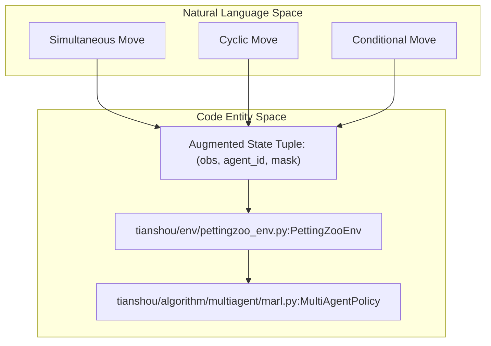
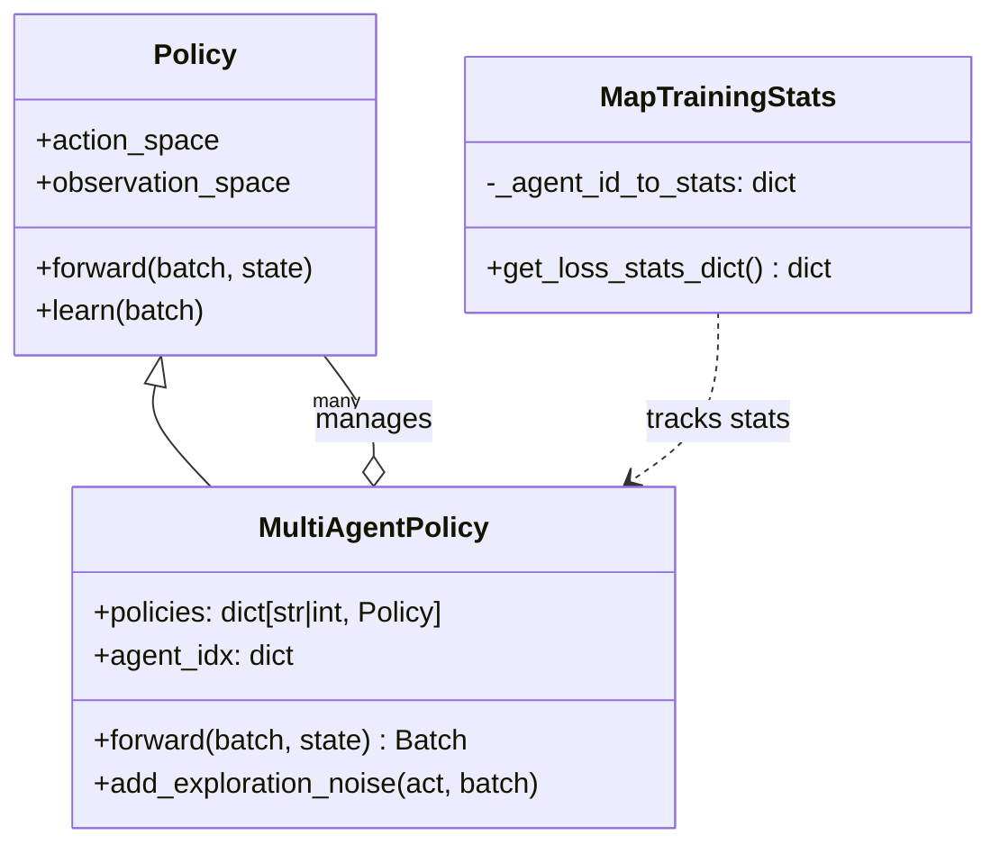
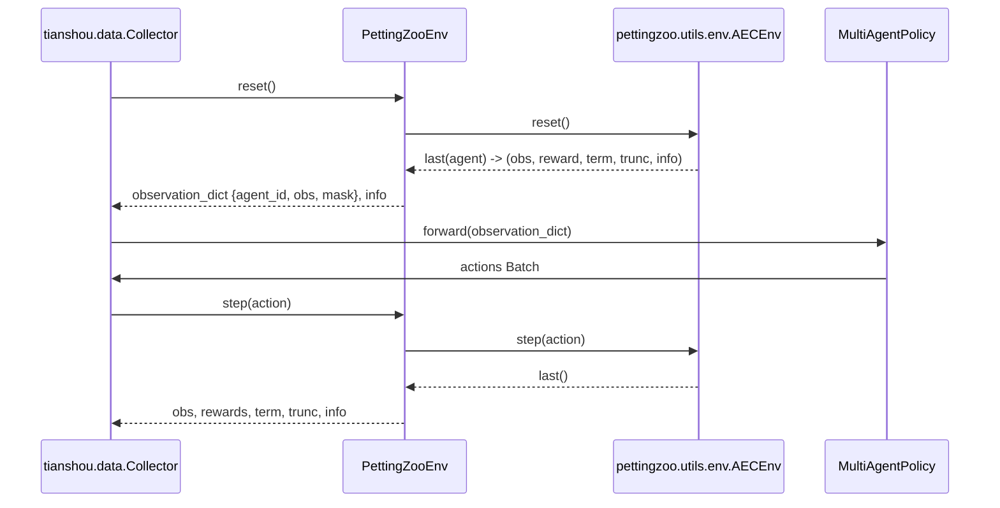

<!-- source: DeepWiki mcp.deepwiki.com · repo thu-ml/tianshou · page 3.7 Multi-Agent Algorithms · fetched 2026-10-30 -->

# Multi-Agent Algorithms

Relevant source files

The following files were used as context for generating this wiki page:

- [docs/02_deep_dives/L5_Collector.ipynb](docs/02_deep_dives/L5_Collector.ipynb)
- [docs/02_deep_dives/L6_MARL.ipynb](docs/02_deep_dives/L6_MARL.ipynb)
- [test/pettingzoo/test_pistonball.py](test/pettingzoo/test_pistonball.py)
- [test/pettingzoo/test_pistonball_continuous.py](test/pettingzoo/test_pistonball_continuous.py)
- [test/pettingzoo/test_tic_tac_toe.py](test/pettingzoo/test_tic_tac_toe.py)
- [tianshou/algorithm/__init__.py](tianshou/algorithm/__init__.py)
- [tianshou/algorithm/multiagent/marl.py](tianshou/algorithm/multiagent/marl.py)
- [tianshou/env/pettingzoo_env.py](tianshou/env/pettingzoo_env.py)
- [tianshou/env/worker/__init__.py](tianshou/env/worker/__init__.py)
- [tianshou/env/worker/worker_base.py](tianshou/env/worker/worker_base.py)
- [tianshou/trainer.py](tianshou/trainer.py)

## Purpose and Scope
This page details Tianshou's support for Multi-Agent Reinforcement Learning (MARL). It covers the theoretical formulation of multi-agent tasks, the conversion of multi-agent environments into single-agent abstractions, the policy and algorithm architecture implemented in `tianshou/algorithm/multiagent/marl.py`, and the integration with PettingZoo via `tianshou/env/pettingzoo_env.py`.

Sources: [docs/02_deep_dives/L6_MARL.ipynb:1-84](), [tianshou/algorithm/multiagent/marl.py:1-60](), [tianshou/env/pettingzoo_env.py:1-35]()

---

## MARL Paradigms and Unified Formulation

Tianshou supports three fundamental multi-agent reinforcement learning paradigms:
1. **Simultaneous move**: All agents take their actions at each timestep simultaneously (e.g., MOBA games).
2. **Cyclic move**: Agents take actions sequentially in turns (e.g., Go).
3. **Conditional move**: The environment conditionally selects which agent acts at each timestep.

To solve multi-agent problems using standard single-agent algorithms, Tianshou unifies these paradigms by augmenting the state representation. At each step, the environment provides an observation containing the active `agent_id`, the raw observation tensor `obs`, and optionally a legal action `mask`.

Sources: [docs/02_deep_dives/L6_MARL.ipynb:16-70](), [tianshou/env/pettingzoo_env.py:70-94]()

---

## Policy and Algorithm Architecture

Multi-agent coordination in Tianshou is driven by `MultiAgentPolicy`, which manages a dictionary of individual sub-policies mapped by agent identifiers.

### Key Classes

- **`MultiAgentPolicy`**: Inherits from `Policy` [tianshou/algorithm/multiagent/marl.py:74-84](). It overrides `forward()` [tianshou/algorithm/multiagent/marl.py:105-] to inspect `batch.obs.agent_id`, partition the batch per agent, route subset batches to respective sub-policies, and concatenate the resulting actions.
- **`MapTrainingStats`**: Inherits from `TrainingStats` [tianshou/algorithm/multiagent/marl.py:29-34](). It aggregates agent-specific loss statistics and training times, formatting keys with agent prefixes (`agent_id/loss`) [tianshou/algorithm/multiagent/marl.py:52-60]().

Sources: [tianshou/algorithm/multiagent/marl.py:29-171]()

---

## PettingZoo Integration

Tianshou integrates seamlessly with [PettingZoo](https://pettingzoo.farama.org) multi-agent environments through the `PettingZooEnv` wrapper [tianshou/env/pettingzoo_env.py:20-35](). 

`PettingZooEnv` bridges PettingZoo's Agent-Environment Cycle (AEC) API with Tianshou's vector-compatible step/reset interface.

### Observation and Action Masking
During `reset()` and `step()`, `PettingZooEnv` inspects whether the observation contains an `action_mask` [tianshou/env/pettingzoo_env.py:75-92](). If present, it extracts and converts the mask into boolean format:
- `obs["agent_id"]`: Identifier of the currently acting agent.
- `obs["obs"]`: Underlying observation tensor/array.
- `obs["mask"]`: Boolean array indicating legal actions (`True` for valid, `False` for masked).

Sources: [tianshou/env/pettingzoo_env.py:20-131](), [docs/02_deep_dives/L6_MARL.ipynb:76-123]()

---

