# Page: Overview

# 1. Overview

<details>
<summary>Relevant source files</summary>

The following files were used as context for generating this wiki page:

- [CHANGELOG.md](CHANGELOG.md)
- [README.md](README.md)
- [docs/index.rst](docs/index.rst)
- [tianshou/__init__.py](tianshou/__init__.py)
- [tianshou/data/__init__.py](tianshou/data/__init__.py)
- [tianshou/env/__init__.py](tianshou/env/__init__.py)
- [tianshou/env/gym_wrappers.py](tianshou/env/gym_wrappers.py)
- [tianshou/highlevel/algorithm.py](tianshou/highlevel/algorithm.py)

</details>


Tianshou ([天授](https://baike.baidu.com/item/%E5%A4%A9%E6%8E%88)) is a reinforcement learning (RL) library built on pure PyTorch and `Gymnasium` [README.md:23()]. Version 2 introduces a major architectural overhaul focused on a cleaner design, strict separation of concerns, and enhanced type safety [README.md:9-20] [CHANGELOG.md:14-18].

This page provides a high-level introduction to Tianshou v2, outlining its dual API design, overall system architecture, and core components.

Sources: [README.md:9-23](), [CHANGELOG.md:14-18]()

## Purpose and Scope

Tianshou is designed to serve both researchers requiring fine-grained algorithmic control and practitioners seeking rapid application deployment [README.md:25-27]. Key characteristics include:
- **Modular Low-Level Procedural API**: Clean separation between learning algorithms (`Algorithm`) and action-selection policies (`Policy`), supporting online (on-policy/off-policy), offline, multi-agent, and model-based RL [README.md:25-27] [CHANGELOG.md:110-114].
- **Convenient High-Level Declarative API**: Experiment builders and factories (`ExperimentBuilder`, `AlgorithmFactory`) for setting up complex training runs with minimal boilerplate [README.md:26()] [tianshou/highlevel/algorithm.py:110-112].
- **High Performance**: Native support for synchronous and asynchronous vectorized environments (`BaseVectorEnv`) and ultra-fast `EnvPool` integration [README.md:73-80] [tianshou/env/__init__.py:10-16].

Sources: [README.md:23-32](), [CHANGELOG.md:110-114](), [tianshou/highlevel/algorithm.py:110-112]()

## System Architecture and Dual API Design

Tianshou offers two distinct APIs sharing the same underlying data structures and execution primitives: the **Procedural API** and the **High-Level API**. 

```mermaid
graph TD
    subgraph NaturalLanguage["Natural Language Space"]
        CoreLib["Tianshou v2 Library"]
        ProcAPI["Procedural API"]
        HighAPI["High-Level API"]
        DataSys["Data Handling"]
        EnvSys["Environment System"]
        TrainSys["Trainer System"]
    end

    subgraph CodeSpace["Code Entity Space"]
        CoreLib --> ProcAPI
        CoreLib --> HighAPI
        
        ProcAPI --> AlgModule["tianshou.algorithm"]
        ProcAPI --> CollectorClass["tianshou.data.collector.Collector"]
        ProcAPI --> TrainerClass["tianshou.trainer.OffPolicyTrainer"]
        
        HighAPI --> ExpClass["tianshou.highlevel.experiment.Experiment"]
        HighAPI --> AlgFac["tianshou.highlevel.algorithm.AlgorithmFactory"]
        HighAPI --> ExpBuilder["tianshou.highlevel.ExperimentBuilder"]
        
        DataSys --> BatchClass["tianshou.data.batch.Batch"]
        DataSys --> BufferClass["tianshou.data.buffer.buffer_base.ReplayBuffer"]
        
        EnvSys --> VEnvClass["tianshou.env.venvs.BaseVectorEnv"]
        EnvSys --> WrapperClass["tianshou.env.gym_wrappers"]
        
        TrainSys --> OnTrainer["tianshou.trainer.trainer_onpolicy.OnPolicyTrainer"]
        TrainSys --> OffTrainer["tianshou.trainer.trainer_offpolicy.OffPolicyTrainer"]
    end
```

Sources: [README.md:25-35](), [CHANGELOG.md:14-43](), [tianshou/__init__.py:3-5](), [tianshou/highlevel/algorithm.py:110-189]()

### API Execution Flow

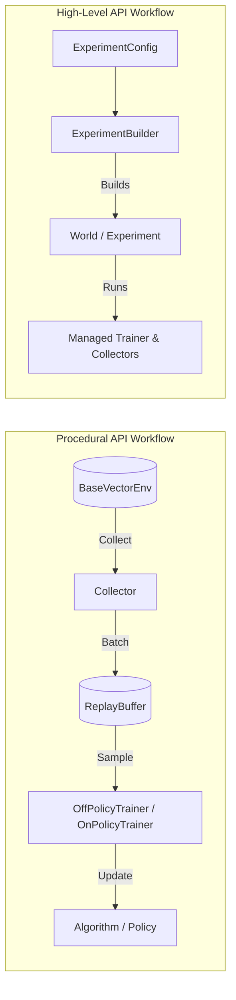

Sources: [README.md:73-77](), [tianshou/highlevel/algorithm.py:110-166]()

---

## 1.1. Core Concepts

Tianshou v2 establishes fundamental abstractions to decouple algorithm math from policy execution, data storage, rollout collection, and training loops [README.md:13-18] [CHANGELOG.md:110-114]:
- **Algorithm vs Policy**: The `Algorithm` class handles loss computation and gradient updates, while the `Policy` component manages action selection during environment interactions [README.md:13-15] [CHANGELOG.md:110-114].
- **Batch**: A dictionary-like container (`tianshou.data.Batch`) that supports recursive batching, slicing, and conversion between NumPy arrays and PyTorch tensors [tianshou/data/__init__.py:4()].
- **ReplayBuffer**: Experience storage classes (`tianshou.data.ReplayBuffer`, `VectorReplayBuffer`, `PrioritizedReplayBuffer`) supporting efficient sampling and multi-step returns [tianshou/data/__init__.py:7-19].
- **Collector**: Bridges agents, policies, and environments (`tianshou.data.Collector`, `AsyncCollector`) by executing rollouts and storing transitions into buffers [tianshou/data/__init__.py:27-33].
- **Trainer**: Manages epochs, collection steps, optimization updates, and logging (`OnPolicyTrainer`, `OffPolicyTrainer`, `OfflineTrainer`) [CHANGELOG.md:40-43].
- **Vectorized Environments**: Parallel environment execution wrappers (`BaseVectorEnv`, `DummyVectorEnv`, `SubprocVectorEnv`) and `EnvPool` support [tianshou/env/__init__.py:10-16].

For details, see [Core Concepts](#1.1).

Sources: [README.md:13-18](), [CHANGELOG.md:110-114](), [tianshou/data/__init__.py:4-59](), [tianshou/env/__init__.py:10-16]()

---

## 1.2. Installation and Dependencies

Tianshou requires Python >= 3.11 and is available on PyPI or via source installation [docs/index.rst:41-58]:
- **Standard Installation**: Install the core library via `pip install tianshou` [docs/index.rst:47-51].
- **Dependency Management**: Uses Poetry for dependency groups and environment management.
- **Optional Extras**: Specialized extras support Atari (`atari`), MuJoCo/continuous control (`mujoco`), ultra-fast parallel sampling (`envpool`), and distributed training (`ray`).

For details, see [Installation and Dependencies](#1.2).

Sources: [docs/index.rst:41-65](), [README.md:79-80]()

---

## 1.3. Migration from v1 to v2

Version 2 introduces breaking API changes and cleanups designed to improve long-term maintainability and type safety [README.md:20()] [CHANGELOG.md:14-18]:
- **Removal of God Classes**: `BaseTrainer` was refactored into distinct subclasses (`OnPolicyTrainer`, `OffPolicyTrainer`, `OfflineTrainer`) [CHANGELOG.md:40-44].
- **Algorithm / Policy Separation**: The `tianshou.policy` module was renamed to `tianshou.algorithm`, cleanly separating policy execution interfaces from algorithm learning logic [CHANGELOG.md:110-114].
- **Explicit Trainer Parameters**: Training parameters are now passed through dedicated configuration dataclasses (`OnPolicyTrainerParams`, `OffPolicyTrainerParams`, `OfflineTrainerParams`) rather than positional keyword arguments [CHANGELOG.md:89-91].
- **Optimizer and Component Factories**: Standardization of component creation via `OptimizerFactoryFactory` and modular builders [tianshou/highlevel/algorithm.py:113-116].

For details, see [Migration from v1 to v2](#1.3).

Sources: [README.md:20](), [CHANGELOG.md:14-114](), [tianshou/highlevel/algorithm.py:113-116]()

---

# Page: Core Concepts

# Core Concepts

<details>
<summary>Relevant source files</summary>

The following files were used as context for generating this wiki page:

- [README.md](README.md)
- [docs/01_user_guide/00_training_process.md](docs/01_user_guide/00_training_process.md)
- [docs/01_user_guide/01_apis.md](docs/01_user_guide/01_apis.md)
- [docs/01_user_guide/02_core_abstractions.md](docs/01_user_guide/02_core_abstractions.md)
- [docs/01_user_guide/index.rst](docs/01_user_guide/index.rst)
- [docs/02_deep_dives/0_intro.md](docs/02_deep_dives/0_intro.md)
- [docs/02_deep_dives/L1_Batch.ipynb](docs/02_deep_dives/L1_Batch.ipynb)
- [docs/index.rst](docs/index.rst)
- [tianshou/__init__.py](tianshou/__init__.py)
- [tianshou/data/__init__.py](tianshou/data/__init__.py)
- [tianshou/env/__init__.py](tianshou/env/__init__.py)
- [tianshou/env/gym_wrappers.py](tianshou/env/gym_wrappers.py)

</details>


## Purpose and Scope

This document explains the fundamental concepts and architecture of Tianshou v2, a reinforcement learning framework built on pure PyTorch and Gymnasium [README.md:23-23](). It covers foundational terminology and core abstractions including the separation of `Algorithm` and `Policy`, the versatile `Batch` container, experience storage via `ReplayBuffer`, experience gathering through `Collector`, training loops managed by `Trainer`, and parallel execution via vectorized environments [README.md:10-18](). For installation instructions, see [1.2 Installation and Dependencies](). For architectural migrations from v1 to v2, see [1.3 Migration from v1 to v2]().

Sources: [README.md:10-28](), [docs/01_user_guide/02_core_abstractions.md:1-5]()

---

## Algorithm vs. Policy Separation

In Tianshou v2, a major architectural redesign separates the responsibility of decision-making (`Policy`) from the responsibility of learning (`Algorithm`) [README.md:13-18]().

- **`Policy`**: Encapsulates the agent's strategy for action selection (mapping observations to actions). It inherits from `torch.nn.Module` and defines methods such as `forward` and `compute_action` [docs/01_user_guide/02_core_abstractions.md:46-86]().
- **`Algorithm`**: Encapsulates the training logic, loss functions, optimization steps, and target network updates for a specific reinforcement learning method (e.g., DQN, PPO, SAC). It inherits from `torch.nn.Module` and handles batch preprocessing (`_preprocess_batch`) and network updates (`_update_with_batch`) [docs/01_user_guide/02_core_abstractions.md:8-44]().

### Diagram: Algorithm and Policy Code Entities

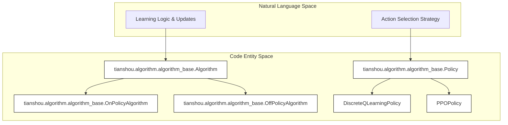

Sources: [docs/01_user_guide/02_core_abstractions.md:8-86](), [README.md:13-18]()

---

## Batch

The `Batch` class (`tianshou.data.Batch`) is Tianshou's core data structure for storing and manipulating heterogeneous reinforcement learning data [docs/02_deep_dives/L1_Batch.ipynb:7-10](). It behaves as a hybrid between a Python dictionary and a NumPy array/PyTorch tensor, supporting recursive nesting, indexing, attribute-based access (`batch.obs`), and type safety via protocol definitions [docs/02_deep_dives/L1_Batch.ipynb:75-88]().

### Diagram: Batch Data Structure Tree

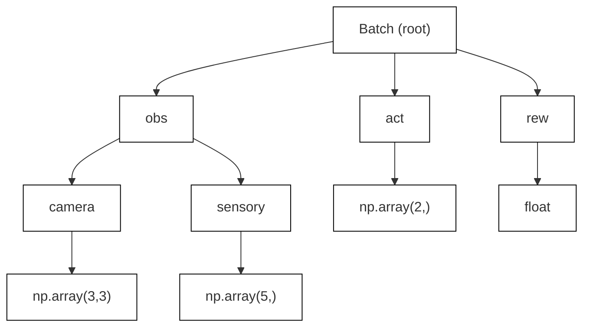

Sources: [docs/02_deep_dives/L1_Batch.ipynb:80-131](), [tianshou/data/__init__.py:4-4]()

---

## ReplayBuffer

The `ReplayBuffer` family (`tianshou.data.ReplayBuffer`) manages experience storage and sampling for reinforcement learning algorithms [docs/01_user_guide/00_training_process.md:47-49](). Key classes include:
- `VectorReplayBuffer`: Optimized buffer for multi-environment vectorized collection [tianshou/data/__init__.py:15-18]()
- `PrioritizedReplayBuffer`: Implements Prioritized Experience Replay (PER) using segment trees [tianshou/data/__init__.py:8-17]()
- `HERReplayBuffer`: Implements Hindsight Experience Replay (HER) for goal-conditioned RL [tianshou/data/__init__.py:9-14]()

Sources: [tianshou/data/__init__.py:7-20](), [docs/01_user_guide/00_training_process.md:47-49]()

---

## Collector

The `Collector` class (`tianshou.data.Collector` and `tianshou.data.AsyncCollector`) bridges the policy and the environment(s) [docs/01_user_guide/02_core_abstractions.md:87-92](). It steps through environments using actions computed by the policy, records transitions into a `ReplayBuffer`, and computes rollout statistics (`CollectStats`) [docs/01_user_guide/02_core_abstractions.md:95-106]().

### Diagram: Collector Code Entities and Flow

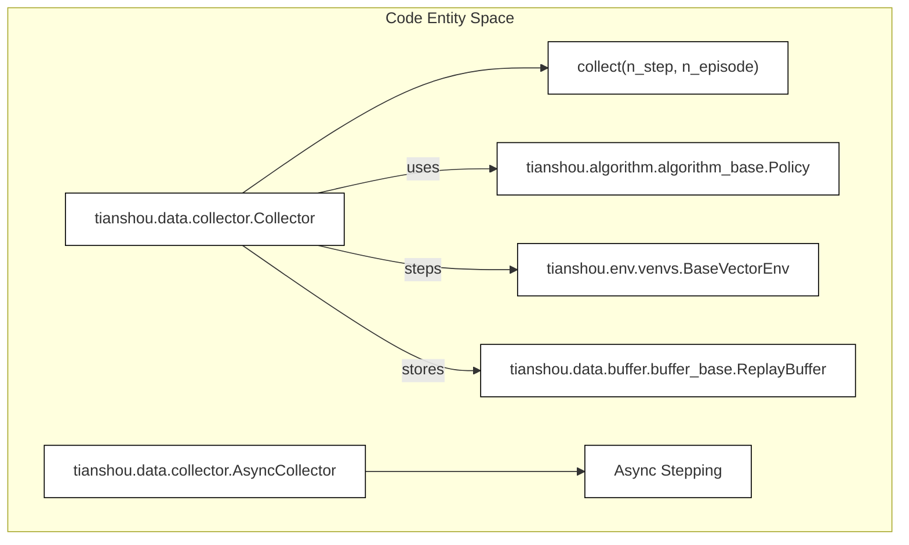

Sources: [docs/01_user_guide/02_core_abstractions.md:87-119](), [tianshou/data/__init__.py:27-33]()

---

## Trainer

The `Trainer` system (`tianshou.trainer`) orchestrates epochs, data collection, policy updates, test evaluations, and stopping conditions [docs/01_user_guide/00_training_process.md:67-101](). Tianshou provides specialized trainer classes corresponding to learning paradigms:
- `OnPolicyTrainer`: For on-policy algorithms (e.g., PPO, A2C)
- `OffPolicyTrainer`: For off-policy algorithms (e.g., DQN, SAC, TD3)
- `OfflineTrainer`: For offline RL and imitation learning algorithms

Sources: [docs/01_user_guide/00_training_process.md:67-101](), [docs/01_user_guide/02_core_abstractions.md:120-121]()

---

## Vectorized Environments

Tianshou provides robust vectorized environment abstractions (`tianshou.env.BaseVectorEnv`) to execute multiple environment instances in parallel [README.md:79-80](). Worker implementations include `DummyVectorEnv` (sequential), `SubprocVectorEnv` (multiprocessing), `ShmemVectorEnv` (shared memory), and `RayVectorEnv` (distributed) [tianshou/env/__init__.py:10-16]().

Sources: [tianshou/env/__init__.py:10-16](), [README.md:79-80]()

---

# Page: Installation and Dependencies

# Installation and Dependencies

<details>
<summary>Relevant source files</summary>

The following files were used as context for generating this wiki page:

- [docs/.gitignore](docs/.gitignore)
- [docs/_config.yml](docs/_config.yml)
- [docs/autogen_rst.py](docs/autogen_rst.py)
- [poetry.lock](poetry.lock)
- [pyproject.toml](pyproject.toml)

</details>


This document provides comprehensive technical details for installing Tianshou, configuring Poetry dependency groups, and managing optional extras (`atari`, `mujoco`, `envpool`, etc.). It covers system requirements, installation workflows, core and optional dependency mappings, and validation procedures.

Sources: [pyproject.toml:1-185]()

## System Requirements

- **Python Version**: `>=3.11` (`[tool.poetry.dependencies]` specifies `python = "^3.11"`).
- **Supported Operating Systems**: Linux, macOS, Windows (noting platform-specific limitations for certain extras like `envpool` which excludes `darwin`).

Sources: [pyproject.toml:27-48](), [pyproject.toml:63]()

## Installation Methods

Tianshou can be installed via several workflows, with Poetry recommended for development and environment isolation.

### Using Poetry (Recommended)

Clone the repository and install dependencies using Poetry:

```bash
git clone git@github.com:thu-ml/tianshou.git
cd tianshou
poetry install
```

To include development tools or optional extras:

```bash
poetry install --with dev
poetry install --extras "mujoco envpool"
poetry install --all-extras
```

*Important*: When installing multiple extras, include them in a single command. Sequential calls overwrite prior extra installations due to Poetry behavior.

Sources: [pyproject.toml:76-89](), [pyproject.toml:91-130]()

### Using Pip, Conda, or Source

- **PyPI**: `pip install tianshou`
- **Conda**: `conda install tianshou -c conda-forge`
- **Source**: `pip install git+https://github.com/thu-ml/tianshou.git@master --upgrade`

Sources: [pyproject.toml:1-7]()

## Core Dependencies and Configuration

Tianshou's core dependencies are managed in `pyproject.toml` under `[tool.poetry.dependencies]`.

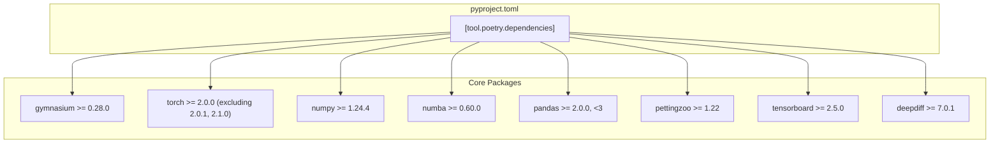

*Note*: PyTorch versions `2.0.1` and `2.1.0` are explicitly excluded via `!=2.0.1, !=2.1.0` due to upstream compatibility issues.

Sources: [pyproject.toml:26-48]()

## Optional Dependencies (Extras)

Tianshou defines optional extras under `[tool.poetry.extras]` to support specific simulation backends and utilities.

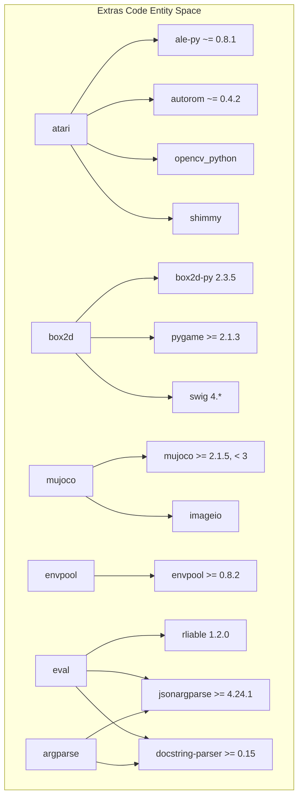

Sources: [pyproject.toml:55-89]()

## Poetry Dependency Groups and Development Tooling

Development dependencies are grouped under `[tool.poetry.group.dev.dependencies]`. This includes static analysis tools, documentation generators, and testing frameworks.

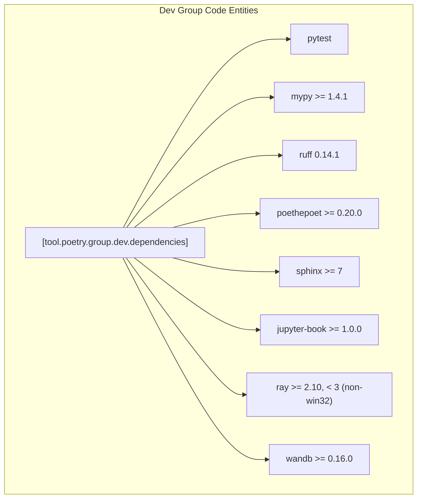

Sources: [pyproject.toml:91-130]()

## Installation Workflow and Validation

The installation sequence validates system parameters, resolves dependencies via Poetry or Pip, and verifies package accessibility.

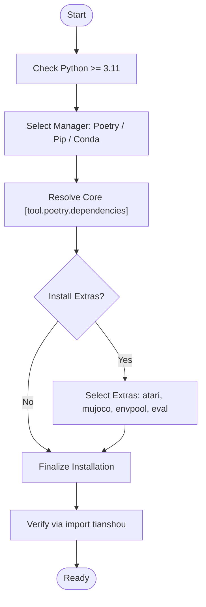

Sources: [pyproject.toml:26-89]()

---

# Page: Migration from v1 to v2

# Migration from v1 to v2

<details>
<summary>Relevant source files</summary>

The following files were used as context for generating this wiki page:

- [CHANGELOG.md](CHANGELOG.md)
- [README.md](README.md)
- [docs/index.rst](docs/index.rst)
- [tianshou/highlevel/algorithm.py](tianshou/highlevel/algorithm.py)

</details>


## Purpose and Scope

This document details the architectural and API changes introduced in Tianshou version 2, as documented in [CHANGELOG.md:14-114]() and [README.md:10-21](). Tianshou v2 provides a complete overhaul of the software design, improving type safety, separating learning algorithm logic from action-selection policies, eliminating monolithic "God" classes, introducing explicit parameter configuration objects, and adopting a factory-based initialization paradigm. Because of the extent of these changes, v2 is not backwards compatible with v1 [README.md:20-20](), and persisted agents created in v1 cannot be loaded directly [CHANGELOG.md:18-19]().

Sources: [README.md:10-21](), [CHANGELOG.md:14-114]()

---

## 1. Architectural Redesign: Algorithm and Policy Split

In Tianshou v1, policy classes encapsulated both the neural network forward pass (action selection) and the gradient update computations (learning). In v2, this package is renamed from `tianshou.policy` to `tianshou.algorithm` [CHANGELOG.md:110-114](), and a strict separation is established between:
- **`Algorithm`**: Encapsulates the optimization target, loss computation, and parameter updates.
- **`Policy`**: Encapsulates state preprocessing, action distribution computation, and action selection during data collection.

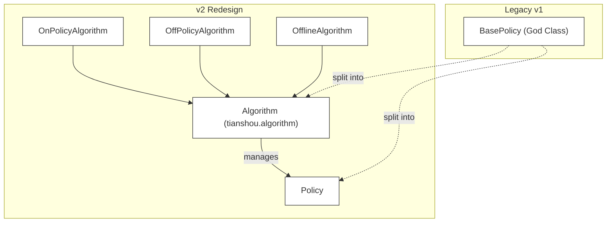
*Figure 1: Transition from monolithic BasePolicy to decoupled Algorithm and Policy abstractions.*

Sources: [README.md:13-18](), [CHANGELOG.md:110-114]()

---

## 2. Trainer Refactoring and Configuration Objects

The legacy `BaseTrainer` class acted as a monolithic "God" class handling on-policy, off-policy, and offline training paths. In v2, this class has been replaced by specialized trainer subclasses inheriting from an `OnlineTrainer` base class or directly from `Trainer` [CHANGELOG.md:38-44](). Furthermore, direct keyword arguments to trainers have been replaced by dedicated configuration dataclasses [CHANGELOG.md:45-47]().

### Trainer Class Hierarchy and Configuration Dataclasses

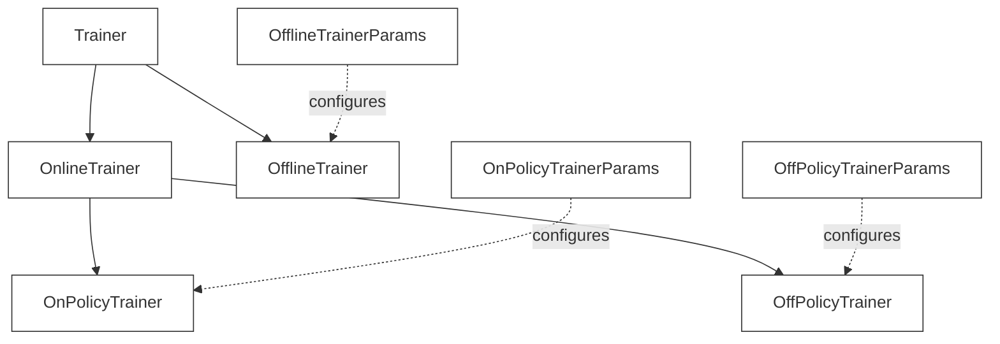
*Figure 2: Trainer class hierarchy and their corresponding configuration dataclasses.*

### Parameter Renaming and API Updates

Training parameters are now passed via instances of configuration objects rather than directly as keyword arguments [CHANGELOG.md:89-90](). The parameter names have been standardized for clarity [CHANGELOG.md:92-99]():

| v1 Parameter Name | v2 Configuration Parameter Name | Description |
|---|---|---|
| `max_epoch` | `max_epochs` | Maximum number of training epochs [CHANGELOG.md:93-93]() |
| `step_per_epoch` | `epoch_num_steps` | Number of environment steps per epoch [CHANGELOG.md:94-94]() |
| `episode_per_test` | `test_step_num_episodes` | Number of episodes for testing [CHANGELOG.md:95-95]() |
| `step_per_collect` | `collection_step_num_env_steps` | Number of environment steps per collection step [CHANGELOG.md:96-96]() |
| `episode_per_collect` | `collection_step_num_episodes` | Number of episodes per collection step [CHANGELOG.md:97-97]() |
| `update_per_step` | `update_step_num_gradient_steps_per_sample` | Gradient steps per sample [CHANGELOG.md:98-98]() |
| `repeat_per_collect` | `update_step_num_repetitions` | Number of update repetitions [CHANGELOG.md:99-99]() |

Additionally, trainer iterator semantics (`__next__`) were removed in favor of explicit calls to `reset` followed by `execute_epoch` [CHANGELOG.md:52-53](). The default value for `test_in_train` was changed from `True` to `False` [CHANGELOG.md:57-58]().

Sources: [CHANGELOG.md:38-58](), [CHANGELOG.md:89-107]()

---

## 3. Optimizer and Factory Abstractions

To support declarative experiment setups, high-level algorithm configuration makes extensive use of factory patterns, such as `AlgorithmFactory` [tianshou/highlevel/algorithm.py:110-111]() and `OptimizerFactoryFactory` [tianshou/highlevel/algorithm.py:113](). These factories decouple optimizer construction from the network and algorithm definition, enabling seamless injection of learning rate schedulers, weight decay, and optimizer types across different agent architectures.

Sources: [tianshou/highlevel/algorithm.py:110-116]()

---

## 4. Exploration and Epsilon-Greedy Simplifications

Management of epsilon-greedy exploration for discrete Q-learning algorithms has been restructured [CHANGELOG.md:60-65]():
- Policy implementations (e.g., `DQNPolicy`, `C51Policy`) now accept explicit `eps_training` and `eps_inference` parameters [CHANGELOG.md:60-64]().
- This eliminates the need for callback functions (`train_fn`, `test_fn`) when only constant epsilon values are required [CHANGELOG.md:62-64]().
- The legacy `set_eps` setter method has been replaced with `set_eps_training` and `set_eps_inference` [CHANGELOG.md:65-65]().

Sources: [CHANGELOG.md:60-65]()

---

# Page: Data Handling System

# Data Handling System

<details>
<summary>Relevant source files</summary>

The following files were used as context for generating this wiki page:

- [test/base/env.py](test/base/env.py)
- [test/base/test_batch.py](test/base/test_batch.py)
- [test/base/test_buffer.py](test/base/test_buffer.py)
- [test/base/test_collector.py](test/base/test_collector.py)
- [tianshou/__init__.py](tianshou/__init__.py)
- [tianshou/data/__init__.py](tianshou/data/__init__.py)
- [tianshou/data/batch.py](tianshou/data/batch.py)
- [tianshou/data/collector.py](tianshou/data/collector.py)
- [tianshou/env/__init__.py](tianshou/env/__init__.py)
- [tianshou/env/gym_wrappers.py](tianshou/env/gym_wrappers.py)

</details>


The Data Handling System is responsible for efficiently managing, storing, and processing data throughout the reinforcement learning lifecycle in Tianshou v2. It coordinates the flow of experience data from environment interactions to policy training, providing robust abstractions for data representation, batching, experience replay, rollout collection, and statistics aggregation.

As a parent overview, this page introduces Tianshou's core data management components. For deep technical details, protocols, and specialized variants, refer to the child pages:
- **Batch**: For details on the flexible container, protocols, and conversion, see [Batch](#2.1).
- **ReplayBuffer**: For experience storage, managers, cached, prioritized, and HER variants, see [ReplayBuffer](#2.2).
- **Collector**: For rollout logic, hooks, and bridging policies and environments, see [Collector](#2.3).
- **Statistics and Collection Metrics**: For `CollectStats`, `EpochStats`, and metric flow, see [Statistics and Collection Metrics](#2.4).

---

## Architecture and Data Flow

The data handling system integrates tightly with policies, vectorized environments, and trainers. The diagram below illustrates how data moves across Tianshou's data entities during training.

Title: Data Flow and Component Architecture
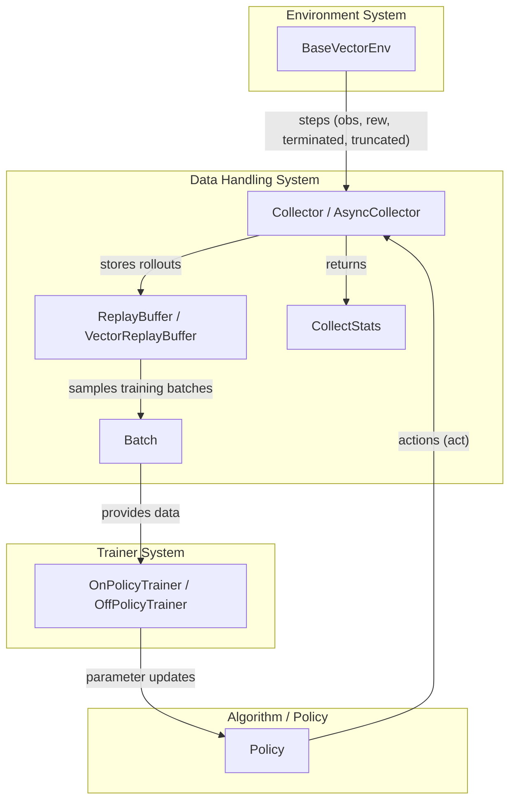
Sources: [tianshou/data/collector.py:1-39](), [tianshou/data/batch.py:1-43](), [tianshou/data/buffer/buffer_base.py:20-50]().

---

## 2.1. Batch

The `Batch` class (`[tianshou/data/batch.py:1-43]`) is Tianshou's primary data carrier, designed to hold heterogeneous data structures such as NumPy arrays, PyTorch tensors, nested dictionaries, and arbitrary objects. It bridges dictionary-like flexibility with array-like operations, supporting slicing, concatenation, stacking, and device conversions.

To maintain type safety and IDE autocompletion without restricting custom user fields, Tianshou implements `BatchProtocol` and derived types like `ActBatchProtocol` and `RolloutBatchProtocol` (`[tianshou/data/collector.py:49-80]()`).

For complete details on protocols, custom transformations, and conversion methods, see [Batch](#2.1).

Sources: [tianshou/data/batch.py:1-43](), [tianshou/data/collector.py:49-80]().

---

## 2.2. ReplayBuffer

The `ReplayBuffer` family handles experience storage and sampling for reinforcement learning algorithms. Base buffers (`[tianshou/data/buffer/buffer_base.py:24-43]()`) implement circular experience storage with support for frame stacking and episode length tracking. 

Tianshou provides several specialized buffer variants for advanced training paradigms:
- `PrioritizedReplayBuffer`: Implements prioritized experience replay using segment trees (`[tianshou/data/buffer/prio.py:12-23]()`).
- `HERReplayBuffer`: Implements Hindsight Experience Replay for goal-conditioned tasks (`[tianshou/data/buffer/her.py:11-32]()`).
- `VectorReplayBuffer`: Manages partitioned buffers corresponding to parallel vectorized environments.

For implementation details on buffer managers, cached buffers, and sampling protocols, see [ReplayBuffer](#2.2).

Sources: [tianshou/data/buffer/buffer_base.py:24-43](), [tianshou/data/buffer/prio.py:12-23](), [tianshou/data/buffer/her.py:11-32]().

---

## 2.3. Collector

The `Collector` class (`[tianshou/data/collector.py:15-35]()`) manages the interaction loop between a `Policy` and a `BaseVectorEnv`, storing generated trajectories into a `ReplayBuffer`. It supports both synchronous execution (`Collector`) and asynchronous parallel rollouts (`AsyncCollector`) across multiple environment instances.

Collectors handle action computation, environment stepping, rollout hook execution, and metric collection during training and evaluation phases.

For details on rollout hooks, custom step functions, and async collection mechanics, see [Collector](#2.3).

Sources: [tianshou/data/collector.py:15-35]().

---

## 2.4. Statistics and Collection Metrics

Data collection and training generate structured metric containers that flow into logging backends (such as Tensorboard or Weights & Biases). The stats subsystem includes `CollectStats` (`[tianshou/data/collector.py:117-150]()`), which tracks episode returns, lengths, collection speeds, and distribution statistics, alongside epoch-level summaries like `EpochStats` and `SequenceSummaryStats` (`[tianshou/data/__init__.py:21-26]()`).

For information on how these metrics are aggregated and reported during training epochs, see [Statistics and Collection Metrics](#2.4).

Sources: [tianshou/data/collector.py:117-150](), [tianshou/data/__init__.py:21-26]().

---

# Page: Batch

# Batch

<details>
<summary>Relevant source files</summary>

The following files were used as context for generating this wiki page:

- [docs/01_user_guide/00_training_process.md](docs/01_user_guide/00_training_process.md)
- [docs/01_user_guide/01_apis.md](docs/01_user_guide/01_apis.md)
- [docs/01_user_guide/02_core_abstractions.md](docs/01_user_guide/02_core_abstractions.md)
- [docs/01_user_guide/index.rst](docs/01_user_guide/index.rst)
- [docs/02_deep_dives/0_intro.md](docs/02_deep_dives/0_intro.md)
- [docs/02_deep_dives/L1_Batch.ipynb](docs/02_deep_dives/L1_Batch.ipynb)
- [test/base/env.py](test/base/env.py)
- [test/base/test_batch.py](test/base/test_batch.py)
- [test/base/test_buffer.py](test/base/test_buffer.py)
- [test/base/test_collector.py](test/base/test_collector.py)
- [tianshou/data/batch.py](tianshou/data/batch.py)
- [tianshou/data/collector.py](tianshou/data/collector.py)
- [tianshou/data/types.py](tianshou/data/types.py)
- [tianshou/data/utils/converter.py](tianshou/data/utils/converter.py)

</details>


## Purpose and Scope

The `Batch` class is the fundamental data structure in Tianshou for handling heterogeneous data in reinforcement learning algorithms. It serves as a flexible container that can store and manipulate various types of data including:

- NumPy arrays
- PyTorch tensors
- Python scalars
- Nested `Batch` objects
- PyTorch `Distribution` objects

The `Batch` class provides array-like indexing and slicing operations while maintaining the flexibility of a dictionary, making it ideal for processing the diverse data encountered in reinforcement learning.

For data collection using this structure, see [Collector](#2.3), and for data storage, see [ReplayBuffer](#2.2).

Sources: [tianshou/data/batch.py:1-43](tianshou/data/batch.py:1-43), [docs/02_deep_dives/L1_Batch.ipynb:7-89](docs/02_deep_dives/L1_Batch.ipynb:7-89)

## Structure and Design

The `Batch` class can be thought of as a hybrid between a dictionary and an array. It has key-value pairs like a dictionary, but also supports array-like operations such as indexing, slicing, and batch operations. It supports typing and IDE autocompletion via protocol definitions in `tianshou.data.types`.

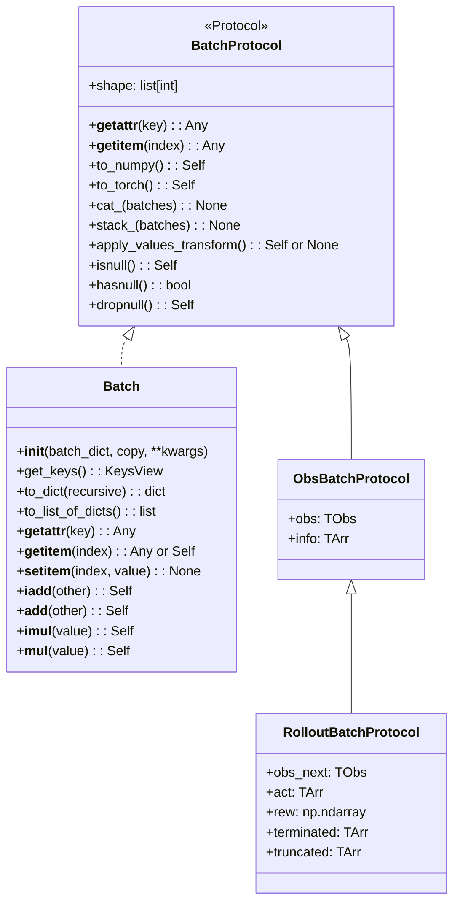

Sources: [tianshou/data/batch.py:309-631](tianshou/data/batch.py:309-631), [tianshou/data/types.py:14-37](tianshou/data/types.py:14-37)

### Data Organization

A typical `Batch` object in reinforcement learning contains structured data representing transitions or trajectories:

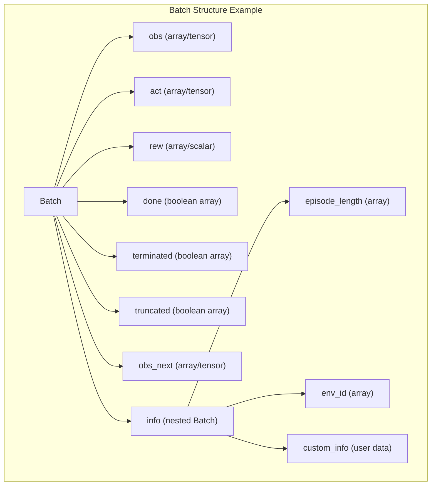

Sources: [tianshou/data/batch.py:1-43](tianshou/data/batch.py:1-43), [test/base/test_buffer.py:35-47](test/base/test_buffer.py:35-47)

## Creating and Accessing Batch Objects

### Creating Batch Objects

```python
# From dictionary
batch = Batch({"obs": np.array([1, 2, 3]), "act": torch.tensor([0, 1, 0])})

# From keyword arguments
batch = Batch(obs=np.array([1, 2, 3]), act=torch.tensor([0, 1, 0]))

# With nested structure
batch = Batch(
    obs=np.array([1, 2, 3]),
    info={"terminal": np.array([False, False, True])}
)

# From a list of dicts/batches (will stack them)
batch = Batch([
    {"obs": 1, "act": 0},
    {"obs": 2, "act": 1}
])
```

Sources: [tianshou/data/batch.py:632-659](tianshou/data/batch.py:632-659), [test/base/test_batch.py:19-67](test/base/test_batch.py:19-67)

### Accessing Data

```python
# Attribute access (recommended)
obs = batch.obs
terminal = batch.info.terminal

# Dictionary-style access
obs = batch["obs"]
terminal = batch["info"]["terminal"]

# Checking for keys
has_obs = "obs" in batch

# Getting all keys
keys = batch.get_keys()
```

Sources: [tianshou/data/batch.py:685-692](tianshou/data/batch.py:685-692), [test/base/test_batch.py:103-118](test/base/test_batch.py:103-118)

## Core Operations

### Indexing and Slicing

Batch objects support numpy-like indexing and slicing operations, which are applied consistently across all fields:

```python
# Get first element across all fields
first = batch[0]  # Returns a Batch with first element of each field

# Get a slice
subset = batch[1:3]  # Returns a Batch with elements 1 and 2 of each field

# Advanced indexing
mask = np.array([True, False, True])
filtered = batch[mask]  # Returns a Batch with elements 0 and 2
```

Sources: [tianshou/data/batch.py:714-746](tianshou/data/batch.py:714-746), [test/base/test_batch.py:118-142](test/base/test_batch.py:118-142)

### Concatenation and Stacking

```python
# Concatenation (combine along existing dimension)
batch1 = Batch(obs=np.array([1, 2]), act=np.array([0, 1]))
batch2 = Batch(obs=np.array([3, 4]), act=np.array([1, 0]))
result = Batch.cat([batch1, batch2])  
# result.obs = [1, 2, 3, 4], result.act = [0, 1, 1, 0]

# In-place concatenation
batch1.cat_(batch2)  # Modifies batch1 in-place

# Stacking (combine along new dimension)
result = Batch.stack([batch1, batch2])  
# result.obs = [[1, 2], [3, 4]], result.act = [[0, 1], [1, 0]]

# Stack along different axis
result = Batch.stack([batch1, batch2], axis=1)  
# result.obs = [[1, 3], [2, 4]], result.act = [[0, 1], [1, 0]]
```

Sources: [tianshou/data/batch.py:408-430](tianshou/data/batch.py:408-430), [tianshou/data/batch.py:436-458](tianshou/data/batch.py:436-458), [test/base/test_batch.py:237-322](test/base/test_batch.py:237-322)

### Arithmetic Operations

```python
# Addition
result = batch + 1  # Adds 1 to each numeric value
result = batch1 + batch2  # Element-wise addition

# Multiplication
result = batch * 2  # Multiplies each numeric value by 2

# Division
result = batch / 2  # Divides each numeric value by 2

# In-place operations
batch += 1
batch *= 2
batch /= 2
```

Sources: [tianshou/data/batch.py:803-851](tianshou/data/batch.py:803-851), [test/base/test_batch.py:143-147](test/base/test_batch.py:143-147)

## Data Conversion

### NumPy and PyTorch Conversion

Conversion helpers such as `to_numpy` and `to_torch` (defined in `tianshou.data.utils.converter`) handle recursive conversions across all nested tensors and arrays within a `Batch`.

```python
from tianshou.data import to_numpy, to_torch

# Convert to numpy arrays (creates a copy)
numpy_batch = to_numpy(batch)

# Convert to torch tensors (creates a copy)
torch_batch = to_torch(batch, dtype=torch.float32, device="cuda")

# In-place conversion to numpy
batch.to_numpy_()

# In-place conversion to torch
batch.to_torch_(dtype=torch.float32, device="cuda")
```

Sources: [tianshou/data/batch.py:868-914](tianshou/data/batch.py:868-914), [tianshou/data/utils/converter.py:17-61](tianshou/data/utils/converter.py:17-61), [test/base/test_batch.py:669-768](test/base/test_batch.py:669-768)

### Dictionary Conversion

```python
# Convert to dictionary (non-recursive)
dict_representation = batch.to_dict()

# Convert to dictionary recursively
dict_representation = batch.to_dict(recursive=True)

# Convert to list of dictionaries
list_of_dicts = batch.to_list_of_dicts()
```

Sources: [tianshou/data/batch.py:661-680](tianshou/data/batch.py:661-680), [test/base/test_batch.py:597-666](test/base/test_batch.py:597-666)

## Advanced Features

### Value Transformations

```python
# Apply a function to all arrays in the batch
transformed = batch.apply_values_transform(lambda x: x * 2)

# Apply transformation in-place
batch.apply_values_transform(lambda x: x * 2, inplace=True)
```

Sources: [tianshou/data/batch.py:580-613](tianshou/data/batch.py:580-613), [test/base/test_batch.py:710-721](test/base/test_batch.py:710-721)

### Handling Missing Values

```python
# Check for missing values (returns a boolean Batch)
is_null = batch.isnull()

# Check if any value is missing
has_null = batch.hasnull()

# Drop entries with missing values
clean_batch = batch.dropnull()
```

Sources: [tianshou/data/batch.py:553-578](tianshou/data/batch.py:553-578)

## Typed Batch Protocols

To enable IDE autocompletion and type checking without imposing strict class definitions, Tianshou provides a suite of protocols in `tianshou.data.types`:

| Protocol Name | Key Attributes / Extensions | Purpose |
| :--- | :--- | :--- |
| `BatchProtocol` | Base interface (`shape`, `to_numpy`, `to_torch`, etc.) | Base typing contract for all batch-like objects. |
| `ObsBatchProtocol` | `obs`, `info` | Observations generated by environment steps. |
| `RolloutBatchProtocol` | Extends `ObsBatchProtocol` with `obs_next`, `act`, `rew`, `terminated`, `truncated` | Standard transition tuples stored in replay buffers. |
| `ActBatchProtocol` | `act` | Simple action containers (e.g., random policies). |
| `DistBatchProtocol` | Extends `ModelOutputBatchProtocol` with `dist` | Contains action probability distributions. |
| `BatchWithAdvantagesProtocol` | Extends `BatchWithReturnsProtocol` with `adv`, `v_s` | Used in policy gradient methods (e.g., PPO, A2C). |

Sources: [tianshou/data/types.py:1-134](tianshou/data/types.py:1-135)

## Integration with Tianshou

The `Batch` class is central to Tianshou's data flow, serving as the standard format for transitions, episodes, and policy operations:

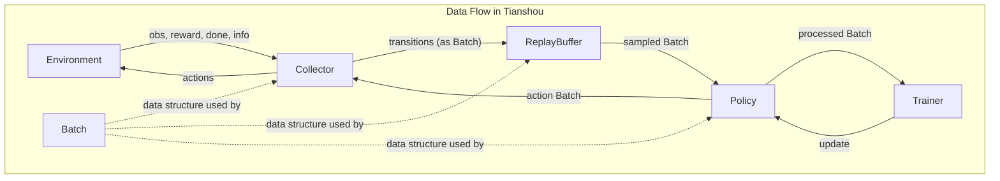

Sources: [test/base/test_collector.py:87-109](test/base/test_collector.py:87-109), [test/base/test_buffer.py:27-49](test/base/test_buffer.py:27-49)

## Distribution Handling

A unique feature of `Batch` is its ability to handle torch `Distribution` objects when slicing:

```python
batch = Batch(
    obs=torch.tensor([[1, 2], [3, 4]]),
    act=torch.tensor([0, 1]),
    dist=Categorical(probs=torch.tensor([[0.3, 0.7], [0.4, 0.6]]))
)

# When slicing the batch, the distribution is also properly sliced
first = batch[0]  # first.dist is Categorical(probs=torch.tensor([0.3, 0.7]))
```

Sources: [tianshou/data/batch.py:266-278](tianshou/data/batch.py:266-278), [tianshou/data/batch.py:728-745](tianshou/data/batch.py:728-745)

## Best Practices

1. **Use attribute notation** (`batch.obs`) for clarity and better IDE support.
2. **Convert data types consistently** using `to_numpy()` and `to_torch()` as needed.
3. **Check for missing values** with `hasnull()` before operations that may fail.
4. **Use in-place operations** (`cat_`, `to_numpy_`) for performance-critical code.
5. **Leverage batch operations** for concise, vectorized code.
6. **Create batches with appropriate types** - numpy arrays for CPU operations, torch tensors for GPU operations.

Sources: [tianshou/data/batch.py:1-43](tianshou/data/batch.py:1-43), [test/base/test_batch.py:19-67](test/base/test_batch.py:19-67)

## Common Use Cases

### Reinforcement Learning Transitions

```python
transition = Batch(
    obs=current_observation,
    act=action,
    rew=reward,
    terminated=terminated,
    truncated=truncated,
    obs_next=next_observation,
    info=additional_info
)
```

### Batched Policy Inputs/Outputs

```python
# Input batch to policy
obs_batch = Batch(obs=observations)

# Output from policy
action_batch = Batch(
    act=actions,
    logits=logits,
    state=hidden_states
)
```

### Data Processing

```python
# Filter data
positive_rewards = batch[batch.rew > 0]

# Normalize observations
batch.obs = (batch.obs - mean) / std

# Compute discounted returns
batch.returns = discount_cumsum(batch.rew)
```

Sources: [test/base/test_buffer.py:35-47](test/base/test_buffer.py:35-47), [test/base/test_collector.py:35-84](test/base/test_collector.py:35-84)

---

# Page: ReplayBuffer

# ReplayBuffer

<details>
<summary>Relevant source files</summary>

The following files were used as context for generating this wiki page:

- [docs/02_deep_dives/L2_Buffer.ipynb](docs/02_deep_dives/L2_Buffer.ipynb)
- [docs/02_deep_dives/L3_Environments.ipynb](docs/02_deep_dives/L3_Environments.ipynb)
- [docs/02_deep_dives/L4_GAE.ipynb](docs/02_deep_dives/L4_GAE.ipynb)
- [tianshou/algorithm/algorithm_base.py](tianshou/algorithm/algorithm_base.py)
- [tianshou/algorithm/imitation/cql.py](tianshou/algorithm/imitation/cql.py)
- [tianshou/data/buffer/buffer_base.py](tianshou/data/buffer/buffer_base.py)
- [tianshou/data/buffer/cached.py](tianshou/data/buffer/cached.py)
- [tianshou/data/buffer/her.py](tianshou/data/buffer/her.py)
- [tianshou/data/buffer/manager.py](tianshou/data/buffer/manager.py)
- [tianshou/data/buffer/prio.py](tianshou/data/buffer/prio.py)

</details>


The `ReplayBuffer` family in Tianshou provides robust data structures for storing, managing, and sampling experiences from agent-environment interactions. Located in the data handling subsystem, buffers bridge the gap between environment rollouts performed by a `Collector` and parameter updates executed by an `Algorithm` or `Policy`.

Sources: [tianshou/data/buffer/buffer_base.py:25-42](), [docs/02_deep_dives/L2_Buffer.ipynb:7-72]()

---

## 1. Core Architecture and Class Hierarchy

Tianshou implements a modular class hierarchy for its replay buffers, supporting single environments, vector environments, priority-based sampling, hindsight relabeling, and cached storage. 

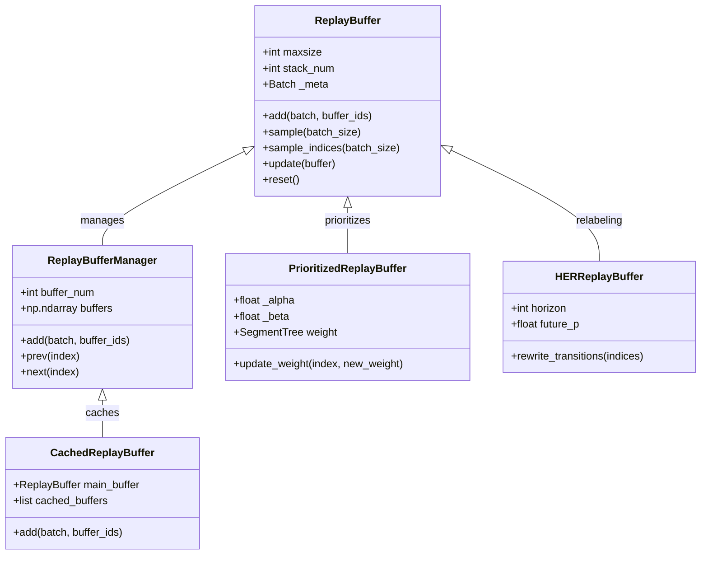
*Figure 1: Code-space class hierarchy mapping concrete buffer classes to their inheritance structures.*

Sources: [tianshou/data/buffer/buffer_base.py:25-104](), [tianshou/data/buffer/manager.py:13-54](), [tianshou/data/buffer/prio.py:12-45](), [tianshou/data/buffer/her.py:11-44](), [tianshou/data/buffer/cached.py:7-33]()

---

## 2. Core `ReplayBuffer` Implementation

The base `ReplayBuffer` class [tianshou/data/buffer/buffer_base.py:25]() manages experiences in a circular-queue format using an internal `Batch` container `self._meta` [tianshou/data/buffer/buffer_base.py:97](). 

### Key Attributes and Initialization Parameters

| Parameter | Type | Default | Description |
|-----------|------|---------|-------------|
| `size` | int | - | Maximum capacity of transitions stored in the buffer |
| `stack_num` | int | `1` | Number of consecutive frames stacked for temporal context |
| `ignore_obs_next` | bool | `False` | Disables storing `obs_next` to conserve memory |
| `save_only_last_obs` | bool | `False` | Stores only the final observation when using temporal stacks |
| `sample_avail` | bool | `False` | Restricts sampling to indices valid for frame stacking |
| `random_seed` | int | `42` | Seed for reproducible random sampling |

Sources: [tianshou/data/buffer/buffer_base.py:71-104]()

---

## 3. Buffer Managers and Vectorized Storage

To support vectorized environments (`BaseVectorEnv`), Tianshou provides `ReplayBufferManager` [tianshou/data/buffer/manager.py:13]() which manages multiple contiguous sub-buffers under a unified interface.

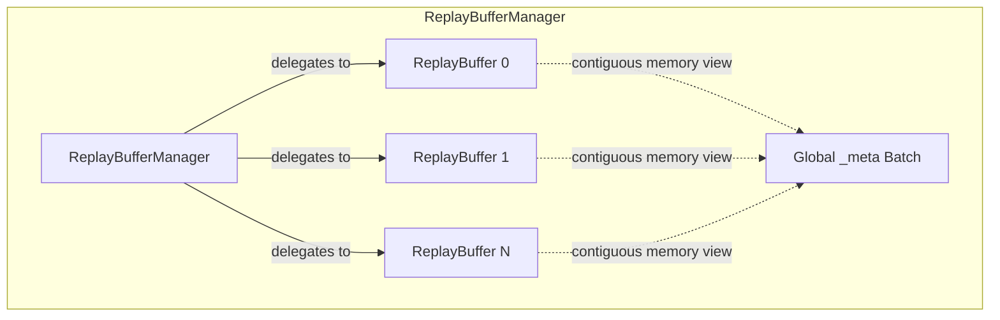
*Data flow diagram showing how `ReplayBufferManager` coordinates multiple underlying buffers into a unified storage space.*

Sources: [tianshou/data/buffer/manager.py:13-54]()

---

## 4. Specialized Replay Buffers

### Prioritized Experience Replay (`PrioritizedReplayBuffer`)

`PrioritizedReplayBuffer` [tianshou/data/buffer/prio.py:12]() implements Prioritized Experience Replay (PER), sampling transitions proportional to their temporal-difference (TD) errors. It utilizes a binary `SegmentTree` for $O(\log N)$ priority-based sampling.

- **`alpha` (`_alpha`)**: Controls the degree of prioritization ($\alpha > 0$).
- **`beta` (`_beta`)**: Controls the amount of importance-sampling correction ($\beta \ge 0$).
- **`SegmentTree`**: Efficiently queries prefix sums of priority weights (`self.weight`) [tianshou/data/buffer/prio.py:41]().

Sources: [tianshou/data/buffer/prio.py:12-45]()

### Hindsight Experience Replay (`HERReplayBuffer`)

`HERReplayBuffer` [tianshou/data/buffer/her.py:11]() supports goal-conditioned reinforcement learning (e.g., sparse-reward robotic environments). Observations are expected to contain dictionaries with `observation`, `achieved_goal`, and `desired_goal`.

- **`future_k`**: Controls the ratio of synthetic goal-relabeled transitions generated during sampling.
- **`compute_reward_fn`**: Callable used to recompute rewards given relabelled achieved and desired goals [tianshou/data/buffer/her.py:19-22]().

Sources: [tianshou/data/buffer/her.py:11-44]()

### Cached Replay Buffer (`CachedReplayBuffer`)

`CachedReplayBuffer` [tianshou/data/buffer/cached.py:7]() maintains a main buffer and multiple episode-length temporary caches. Transitions are initially written to a cached sub-buffer; upon episode termination, the data is flushed and moved into the main buffer.

Sources: [tianshou/data/buffer/cached.py:7-33]()

---

## 5. Key Operations and Data Flow

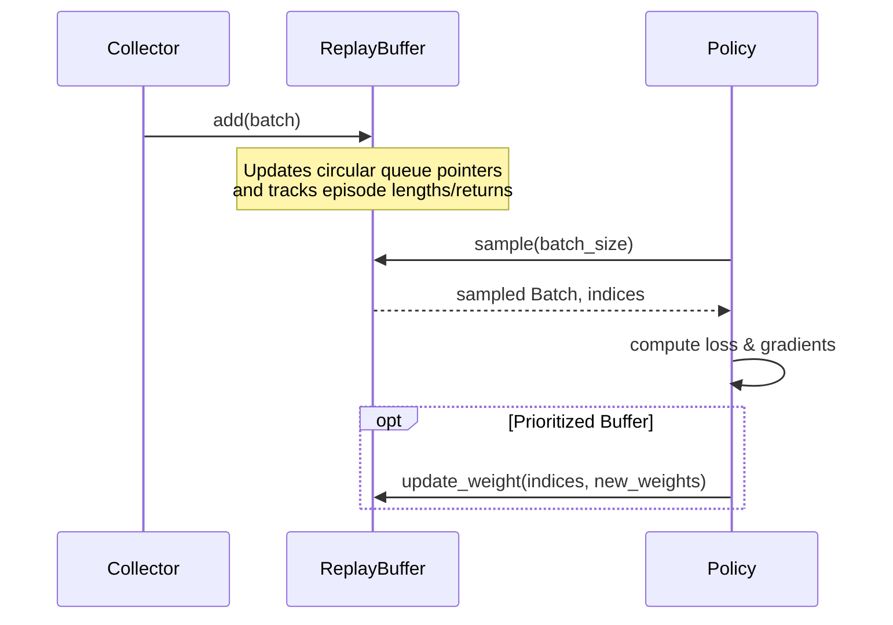
*Sequence diagram illustrating the interaction loop between `Collector`, `ReplayBuffer`, and `Policy`.*

Sources: [tianshou/data/buffer/buffer_base.py:270-325](), [tianshou/data/buffer/prio.py:54-91]()

### Persistence (HDF5)

Buffers support saving to and loading from HDF5 files using underlying converters:

```python
buffer.save_hdf5("path_to_buffer.hdf5")
loaded_buffer = ReplayBuffer.load_hdf5("path_to_buffer.hdf5")
```

Sources: [tianshou/data/buffer/buffer_base.py:240-255]()

---

# Page: Collector

# Collector

<details>
<summary>Relevant source files</summary>

The following files were used as context for generating this wiki page:

- [docs/02_deep_dives/L5_Collector.ipynb](docs/02_deep_dives/L5_Collector.ipynb)
- [docs/02_deep_dives/L6_MARL.ipynb](docs/02_deep_dives/L6_MARL.ipynb)
- [test/base/env.py](test/base/env.py)
- [test/base/test_batch.py](test/base/test_batch.py)
- [test/base/test_buffer.py](test/base/test_buffer.py)
- [test/base/test_collector.py](test/base/test_collector.py)
- [tianshou/data/batch.py](tianshou/data/batch.py)
- [tianshou/data/collector.py](tianshou/data/collector.py)
- [tianshou/trainer.py](tianshou/trainer.py)

</details>


The Collector component serves as the core orchestration layer in Tianshou's data handling system (`tianshou/data/collector.py`), mediating interactions between policies (`tianshou/algorithm/algorithm_base.py`) and environments (`tianshou/env/`) to gather experiences for reinforcement learning. It efficiently collects transitions, tracks execution metadata, and populates replay buffers (`tianshou/data/buffer/`) used by training algorithms.

## Purpose and Scope

This document covers the Collector architecture and implementation in Tianshou v2, including:
- The role of `BaseCollector`, `Collector`, and `AsyncCollector` in bridging policies, environments, and buffers.
- Collection modes (`n_step` and `n_episode`) and vectorized environment integration.
- Rollout hooks (`StepHook`, `EpisodeRolloutHookMCReturn`) for augmenting trajectories.
- Collection statistics tracking via `CollectStats`.

For details on replay buffers, see [ReplayBuffer](#2.2).

Sources: `[tianshou/data/collector.py:1-40]`, `[tianshou/data/collector.py:296-319]`

## Overview of the Collector System

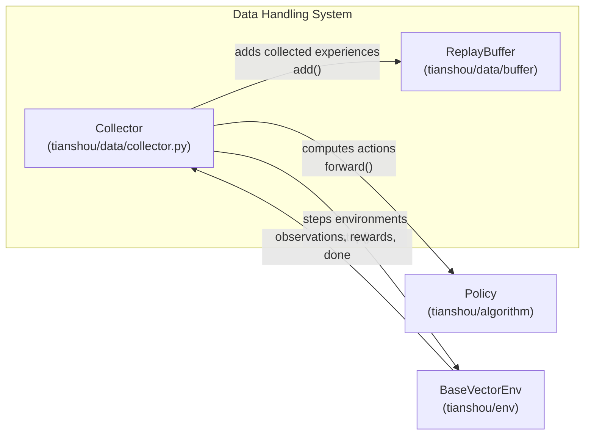

The Collector sits between policies and environments, managing the rollout loop. It queries actions from a policy based on current observations, steps the vectorized environments, and persists transitions into a replay buffer.

Sources: `[tianshou/data/collector.py:296-319]`, `[tianshou/data/collector.py:520-617]`

## Collector Class Hierarchy and Code Mapping

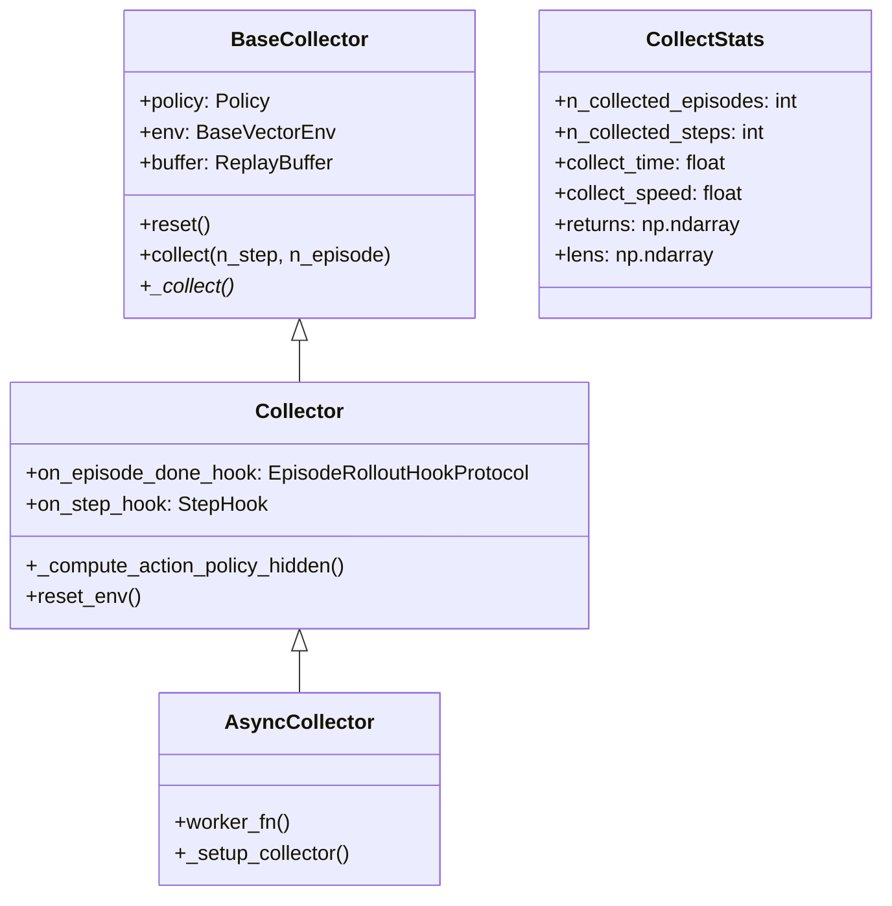

This diagram maps conceptual collector tiers directly to their implementations in `[tianshou/data/collector.py]()`.

Sources: `[tianshou/data/collector.py:296-431]`, `[tianshou/data/collector.py:520-776]`, `[tianshou/data/collector.py:102-251]`

## Collector Initialization and Configuration

When instantiating a `Collector`, the following parameters are supplied:

```python
collector = Collector(
    policy=my_policy,
    env=my_env,  
    buffer=my_buffer,  # Optional
    exploration_noise=False,
    on_episode_done_hook=None,
    on_step_hook=None,
    raise_on_nan_in_buffer=True,
    collect_stats_class=CollectStats,
)
```

Sources: `[tianshou/data/collector.py:549-600]`

## Data Flow in Collection Process

```mermaid
sequenceDiagram
    participant Collector as Collector._collect()
    participant Policy as Policy.forward()
    participant Env as BaseVectorEnv.step()
    participant Buffer as ReplayBuffer.add()
    
    Collector->>Env: reset()
    Env-->>Collector: initial observations (obs_RO)
    
    loop for n_step or n_episode
        Collector->>Policy: forward(obs, state)
        Policy-->>Collector: CollectActionBatchProtocol (act, dist, hidden_state)
        Collector->>Env: step(act)
        Env-->>Collector: CollectStepBatchProtocol (obs_next, rew, terminated, truncated, info)
        Collector->>Buffer: add(batch, buffer_ids)
        
        alt if on_step_hook
            Collector->>Collector: on_step_hook(current_batch)
        end
        
        alt if episode done (done=True)
            Collector->>Buffer: extract episode batch
            alt if on_episode_done_hook
                Collector->>Collector: on_episode_done_hook(episode_batch)
            end
        end
    end
    
    Collector->>Collector: refresh_sequence_stats()
```

This sequence details the execution flow inside `Collector._collect()` (`[tianshou/data/collector.py:664-774]()`), showing how batches flow from environment stepping to buffer insertion and stats refresh.

Sources: `[tianshou/data/collector.py:664-774]`, `[tianshou/data/collector.py:49-79]`

## Key Methods in Collector

| Method | Description | Source Reference |
|--------|-------------|------------------|
| `reset()` | Reset environment, buffer, and statistics counters. | `[tianshou/data/collector.py:372-397]()` |
| `reset_env()` | Reset only the vectorized environment. | `[tianshou/data/collector.py:432-450]()` |
| `reset_buffer()` | Reset only the replay buffer storage. | `[tianshou/data/collector.py:451-468]()` |
| `collect(n_step=None, n_episode=None)` | Main entry point to gather steps or episodes. | `[tianshou/data/collector.py:484-518]()` |
| `_collect()` | Internal synchronous rollout loop implementation. | `[tianshou/data/collector.py:664-774]()` |

Sources: `[tianshou/data/collector.py:372-518]`, `[tianshou/data/collector.py:664-774]`

## Collection Statistics (`CollectStats`)

The `CollectStats` dataclass tracks performance metrics during rollouts:

```mermaid
classDiagram
    class CollectStats {
        +n_collected_episodes: int
        +n_collected_steps: int
        +collect_time: float
        +collect_speed: float
        +returns: np.ndarray
        +returns_stat: SequenceSummaryStats
        +lens: np.ndarray
        +lens_stat: SequenceSummaryStats
        +update_at_step_batch()
        +update_at_episode_done()
        +refresh_all_sequence_stats()
    }
```

After collection completes, `Collector.collect()` returns a populated `CollectStats` instance containing returns, step counts, speeds, and summary statistics (`[tianshou/data/collector.py:102-251]()`).

Sources: `[tianshou/data/collector.py:102-251]`, `[tianshou/data/collector.py:484-518]`

## Collection Modes

The collector supports two termination conditions:
1. **Step-based collection** (`n_step`): Collects until the total number of environment steps reaches `n_step`.
2. **Episode-based collection** (`n_episode`): Collects until the number of completed episodes reaches `n_episode`.

```python
# Collect 1000 environment steps
stats = collector.collect(n_step=1000)

# Collect 10 complete episodes across all vectorized envs
stats = collector.collect(n_episode=10)
```

Sources: `[tianshou/data/collector.py:484-518]`

## Hooks for Customizing Collection Behavior

Tianshou supports two hook types during collection:
1. **`on_step_hook` (`StepHook`)**: Executed after each environment step, allowing inspection or modification of step transitions before buffer storage (`[tianshou/data/collector.py:555-587]()`).
2. **`on_episode_done_hook`**: Executed upon episode termination. For example, `EpisodeRolloutHookMCReturn` computes Monte Carlo return-to-go and appends it to the episode batch (`[tianshou/data/collector.py:575-586]()`).

Sources: `[tianshou/data/collector.py:555-587]`

## Working with Vectorized Environments

Collectors coordinate with `BaseVectorEnv` subclasses (`DummyVectorEnv`, `SubprocVectorEnv`) via `buffer_ids` indexing (`[tianshou/data/collector.py:520-547]()`). They maintain parallel observation arrays (`obs_RO`) and route policies across ready environments (`ready_env_ids_R`).

Sources: `[tianshou/data/collector.py:520-547]`, `[tianshou/data/collector.py:664-774]`

## AsyncCollector Implementation

For environments with variable latency, `AsyncCollector` (`[tianshou/data/collector.py:777-850]()`) subclasses `Collector` to step environments asynchronously. It accepts a `wait_num` parameter determining how many parallel environments must finish before executing policy inference and buffer updates.

Sources: `[tianshou/data/collector.py:777-850]`

## Integration with ReplayBuffer

Collectors automatically validate buffer compatibility upon initialization (`[tianshou/data/collector.py:327-362]()`). Standard environments utilize `ReplayBuffer`, while vectorized environments integrate with `VectorReplayBuffer` or `CachedReplayBuffer`.

Sources: `[tianshou/data/collector.py:327-362]`

## Common Usage Patterns

```python
env = DummyVectorEnv([lambda: gym.make('CartPole-v1') for _ in range(2)])
policy = MyPolicy(...)
buffer = VectorReplayBuffer(total_size=20000, buffer_num=2)
collector = Collector(policy, env, buffer)

collector.reset()
result = collector.collect(n_step=1000)
```

Sources: `[tianshou/data/collector.py:549-600]`, `[test/base/test_collector.py:85-110]`

## Tips and Best Practices

- Use `n_step` collection for off-policy algorithms and fixed update ratios.
- Use `n_episode` collection for on-policy algorithms (like PPO) requiring complete epoch batches.
- Set `raise_on_nan_in_buffer=True` during debugging to catch numerical instability early (`[tianshou/data/collector.py:555-587]()`).

Sources: `[tianshou/data/collector.py:555-587]`, `[tianshou/data/collector.py:484-518]`

## Implementation Details and Naming Conventions

Internal arrays use strict dimension suffixes:
- `_N`: Size equal to total number of parallel environments (`buffer_num`).
- `_R`: Size equal to number of ready environments.
- `_O`: Observation dimensions.
- `_A`: Action dimensions.

Sources: `[tianshou/data/collector.py:523-547]`

---

# Page: Statistics and Collection Metrics

# Statistics and Collection Metrics

<details>
<summary>Relevant source files</summary>

The following files were used as context for generating this wiki page:

- [test/base/test_stats.py](test/base/test_stats.py)
- [tianshou/data/stats.py](tianshou/data/stats.py)
- [tianshou/env/atari/atari_wrapper.py](tianshou/env/atari/atari_wrapper.py)
- [tianshou/evaluation/rliable_evaluation.py](tianshou/evaluation/rliable_evaluation.py)
- [tianshou/highlevel/logger.py](tianshou/highlevel/logger.py)
- [tianshou/utils/logger/logger_base.py](tianshou/utils/logger/logger_base.py)
- [tianshou/utils/logger/tensorboard.py](tianshou/utils/logger/tensorboard.py)
- [tianshou/utils/logger/wandb.py](tianshou/utils/logger/wandb.py)
- [tianshou/utils/statistics.py](tianshou/utils/statistics.py)

</details>


This page describes Tianshou's data structures for tracking execution metrics, collection statistics, epoch summaries, and how metrics propagate through the logging architecture to backends like TensorBoard and Weights & Biases.

---

## Core Statistics Data Structures

Tianshou encapsulates training progress, timing, and episode summaries into structured dataclasses defined in `tianshou/data/stats.py`. These classes inherit from `DataclassPPrintMixin` for clean formatting [tianshou/data/stats.py:8]().

### `SequenceSummaryStats`
`SequenceSummaryStats` computes and holds summary indicators (`mean`, `std`, `max`, `min`) for a 1D sequence or NumPy array [tianshou/data/stats.py:18-43](). 
- `SequenceSummaryStats.from_sequence()` computes summary statistics over sequences or flattens multi-dimensional inputs with a warning [tianshou/data/stats.py:27-43]().
- `SequenceSummaryStats.from_single_value()` initializes stats where all metrics equal a single scalar value [tianshou/data/stats.py:46-47]().
- `compute_dim_to_summary_stats()` generates a dictionary mapping each dimension index to its respective `SequenceSummaryStats` for multi-dimensional arrays [tianshou/data/stats.py:50-61]().

### `TimingStats`
`TimingStats` tracks elapsed wall-clock times across training phases [tianshou/data/stats.py:65-80]():
- `total_time`: Total elapsed time [tianshou/data/stats.py:68]().
- `train_time`: Total training duration (collection plus update) [tianshou/data/stats.py:70]().
- `train_time_collect`: Time spent collecting training transitions [tianshou/data/stats.py:72]().
- `train_time_update`: Time spent updating model weights [tianshou/data/stats.py:74]().
- `test_time`: Total evaluation duration [tianshou/data/stats.py:76]().
- `update_speed`: Update throughput measured in environment steps per second [tianshou/data/stats.py:78]().

### `InfoStats` and `EpochStats`
- `InfoStats`: Aggregates global training counters including `update_step`, `best_score`, `best_reward`, `best_reward_std`, training/test steps and episodes, and nested `TimingStats` [tianshou/data/stats.py:83-105]().
- `EpochStats`: Bundles per-epoch telemetry, linking `epoch`, `train_collect_stat`, `test_collect_stat`, `training_stat`, and `info_stat` [tianshou/data/stats.py:108-122]().

```mermaid
graph TD
    A["EpochStats"] --> B["Epoch (int)"]
    A --> C["train_collect_stat (CollectStatsBase)"]
    A --> D["test_collect_stat (CollectStats)"]
    A --> E["training_stat (TrainingStats)"]
    A --> F["info_stat (InfoStats)"]
    F --> G["TimingStats"]
    
    classDef default stroke:#000,fill:none;
```
*Diagram 1: Code Structure of `EpochStats` and Associated Telemetry Classes.*

Sources: `tianshou/data/stats.py` [tianshou/data/stats.py:1-122]()

---

## Collection Statistics (`CollectStats`)

Collectors measure environment rollout metrics and accumulate performance statistics during interaction loops. 

`CollectStats` records:
- `n_collected_steps`: Total environment steps executed during the collect call.
- `n_collected_episodes`: Total completed episodes.
- `collect_time`: Duration of the collection phase.
- `collect_speed`: Steps per second.
- `returns_stat`: A `SequenceSummaryStats` instance summarizing episode returns.
- `lens_stat`: A `SequenceSummaryStats` instance summarizing episode lengths.
- Distribution diagnostics such as `pred_dist_std_array` and `pred_dist_std_array_stat` computed from policy action distributions [test/base/test_stats.py:69-94]().

Sources: `tianshou/data/stats.py` [tianshou/data/stats.py:1-122](), `test/base/test_stats.py` [test/base/test_stats.py:69-94]()

---

## Metric Flow and Logging Architecture

Metrics flow from trainers and collectors into loggers through a unified interface defined in `tianshou/utils/logger/logger_base.py`.

### Logger Abstractions
- `BaseLogger`: Abstract base class managing logging intervals (`training_interval`, `test_interval`, `update_interval`, `info_interval`, `save_interval`) and defining logging methods [tianshou/utils/logger/logger_base.py:23-163]().
- `DataScope`: An enum categorizing log namespaces: `TRAINING`, `TEST`, `UPDATE`, and `INFO` [tianshou/utils/logger/logger_base.py:16-20]().
- `TensorboardLogger`: Uses `torch.utils.tensorboard.SummaryWriter` to write scalars, histograms, and figures to TensorBoard event files [tianshou/utils/logger/tensorboard.py:17-144]().
- `WandbLogger`: Integrates Weights & Biases (`wandb`), synchronizing tensorboard outputs and logging model checkpoints as W&B artifacts [tianshou/utils/logger/wandb.py:14-178]().
- `LoggerFactory` / `LoggerFactoryDefault`: High-level factory classes that instantiate concrete loggers (`TensorboardLogger` or `WandbLogger`) based on configuration settings [tianshou/highlevel/logger.py:13-111]().

```mermaid
graph TD
    Collector["Collector.collect()"] -->|CollectStats| Trainer["BaseTrainer"]
    Trainer -->|log_training_data()| BaseLogger["BaseLogger (Base class)"]
    Trainer -->|log_test_data()| BaseLogger
    Trainer -->|log_update_data()| BaseLogger
    Trainer -->|log_info_data()| BaseLogger
    
    BaseLogger -->|TensorboardLogger| TB["SummaryWriter / TensorBoard"]
    BaseLogger -->|WandbLogger| WB["wandb.init() / W&B Backend"]

    classDef default stroke:#000,fill:none;
```
*Diagram 2: Data Flow from Collectors and Trainers through `BaseLogger` to Logging Backends.*

Sources: `tianshou/utils/logger/logger_base.py` [tianshou/utils/logger/logger_base.py:1-163](), `tianshou/utils/logger/tensorboard.py` [tianshou/utils/logger/tensorboard.py:1-144](), `tianshou/utils/logger/wandb.py` [tianshou/utils/logger/wandb.py:1-178](), `tianshou/highlevel/logger.py` [tianshou/highlevel/logger.py:1-111]()

---

## Supporting Statistical Utilities

Tianshou provides general-purpose statistical helpers in `tianshou/utils/statistics.py` [tianshou/utils/statistics.py:1-114]():

| Utility Class | Description | Key Methods |
| :--- | :--- | :--- |
| `MovAvg` | Computes a sliding window moving average while automatically ignoring `NaN` and `inf` values. | `add()`, `get()`, `mean()`, `std()` [tianshou/utils/statistics.py:7-67]() |
| `RunningMeanStd` | Maintains running mean and variance for data streams using parallel algorithms (Welford's algorithm variant). | `update()`, `norm()` [tianshou/utils/statistics.py:69-114]() |

Sources: `tianshou/utils/statistics.py` [tianshou/utils/statistics.py:1-114]()

---

# Page: Algorithm and Policy Framework

# Algorithm and Policy Framework

<details>
<summary>Relevant source files</summary>

The following files were used as context for generating this wiki page:

- [README.md](README.md)
- [docs/index.rst](docs/index.rst)
- [tianshou/algorithm/__init__.py](tianshou/algorithm/__init__.py)
- [tianshou/algorithm/algorithm_base.py](tianshou/algorithm/algorithm_base.py)
- [tianshou/algorithm/imitation/cql.py](tianshou/algorithm/imitation/cql.py)
- [tianshou/algorithm/multiagent/marl.py](tianshou/algorithm/multiagent/marl.py)
- [tianshou/data/buffer/buffer_base.py](tianshou/data/buffer/buffer_base.py)
- [tianshou/env/worker/__init__.py](tianshou/env/worker/__init__.py)
- [tianshou/env/worker/worker_base.py](tianshou/env/worker/worker_base.py)

</details>


The purpose of this page is to present Tianshou's v2 architecture, which establishes a clear architectural separation between **Algorithms** (responsible for training, loss computation, and optimization) and **Policies** (responsible for action selection and environment interaction) [README.md:13-18](). This page provides a high-level overview of the algorithm families and interfaces, serving as a parent guide to more detailed child pages.

For details on data handling and collection, see [Data Handling System](#2).

---

## 1. v2 Architecture: Algorithm vs. Policy Separation

In Tianshou v2, the legacy "God class" design where a single class handled both sampling/action selection and weight updates has been fully overhauled. The framework now cleanly separates concerns:

- **`Policy`**: Inherits from `torch.nn.Module` and defines the core mapping from observations to actions via `forward()` [tianshou/algorithm/algorithm_base.py:159-160](). It governs action bounds, scaling, and exploration noise.
- **`Algorithm`**: Encapsulates the training logic, loss functions, optimizer factories, and target network update rules. It operates on experience buffers via an `update()` procedure.

```mermaid
classDiagram
    class Policy {
        +forward(batch, state) Batch
        +map_action(act)
        +exploration_noise(act, batch)
    }
    
    class Algorithm {
        +policy: Policy
        +update(sample_size, buffer) TrainingStats
        +learn(batch) TrainingStats
    }

    class OnPolicyAlgorithm {
        +compute_episodic_return()
    }

    class OffPolicyAlgorithm {
        +compute_nstep_return()
    }

    class OfflineAlgorithm {
        +learn(batch)
    }

    Algorithm <|-- OnPolicyAlgorithm
    Algorithm <|-- OffPolicyAlgorithm
    Algorithm <|-- OfflineAlgorithm
    Algorithm --> Policy : "uses for action selection"
```

Sources:
- [tianshou/algorithm/algorithm_base.py:159-200]()
- [README.md:13-18]()

---

## 2. Algorithm Base and Policy Interfaces

The foundational base classes define strict type-level distinctions across on-policy, off-policy, and offline paradigms [README.md:17-18](). `Algorithm` subclasses coordinate data preprocessing hooks (`process_fn`), network updates (`learn`), and post-processing steps.

For full details on base classes, preprocessing hooks, and lagged/target network synchronization, see [Algorithm Base and Policy Interfaces](#3.1).

Sources:
- [tianshou/algorithm/algorithm_base.py:1-250]()

---

## 3. Value-Based Algorithms

Value-based algorithms estimate action-value functions ($Q$-functions) or distributional returns to derive discrete or continuous greedy policies. Tianshou implements standard and advanced variants such as DQN, Double DQN, Dueling DQN, Branching DQN, C51, Rainbow, QRDQN, IQN, and FQF.

For full implementation details, architectures, and associated policies, see [Value-Based Algorithms](#3.2).

Sources:
- [README.md:38-46]()
- [docs/index.rst:7-15]()

---

## 4. Policy Gradient Algorithms

Policy gradient methods directly parameterize the policy distribution and optimize objectives via gradient ascent. Tianshou supports vanilla REINFORCE, Advantage Actor-Critic (A2C), Proximal Policy Optimization (PPO), Natural Policy Gradient (NPG), and Trust Region Policy Optimization (TRPO), utilizing Generalized Advantage Estimation (GAE) for return and advantage computations.

For details on return computation and loss formulations, see [Policy Gradient Algorithms](#3.3).

Sources:
- [README.md:47-51]()
- [docs/index.rst:16-20]()

---

## 5. Actor-Critic Off-Policy Algorithms

Continuous and discrete actor-critic algorithms combine policy updates with off-policy sample efficiency via replay buffers and target networks. Supported algorithms include DDPG, TD3, SAC, Discrete SAC, and Randomized Ensembled Double Q-Learning (REDQ), complete with entropy regularization ($\alpha$) tuning and Polyak averaging mixins.

For configuration parameters and target network mixins, see [Actor-Critic Off-Policy Algorithms](#3.4).

Sources:
- [README.md:52-56]()
- [docs/index.rst:21-25]()

---

## 6. Offline and Imitation Learning

Offline and imitation learning algorithms learn policies entirely from static datasets without environment interaction during training. Tianshou provides algorithms such as Behaviour Cloning (`ImitationPolicy`), BCQ, CQL, TD3+BC, Discrete BCQ/CQL/CRR, and Generative Adversarial Imitation Learning (GAIL).

For dataset processing and algorithmic regularizers, see [Offline and Imitation Learning](#3.5).

Sources:
- [README.md:57-64]()
- [docs/index.rst:26-33]()

---

## 7. Model-Based and Exploration Wrappers

To facilitate model-based planning and advanced exploration, Tianshou provides wrappers and algorithms including Posterior Sampling Reinforcement Learning (PSRL) and Intrinsic Curiosity Module (ICM) wrappers for on-policy and off-policy training, alongside custom exploration noise processes.

For wrapper integrations and transition models, see [Model-Based and Exploration Wrappers](#3.6).

Sources:
- [README.md:67-68]()
- [docs/index.rst:34-35]()

---

## 8. Multi-Agent Algorithms

Multi-Agent Reinforcement Learning (MARL) is supported through decentralized/centralized policy managers (`MultiAgentPolicyManager` / `marl.py`) and seamless integration with `PettingZoo` environments, enabling multi-agent coordination and competitive self-play.

For agent observation routing and MARL training loops, see [Multi-Agent Algorithms](#3.7).

Sources:
- [tianshou/algorithm/multiagent/marl.py:1-100]()

---

# Page: Algorithm Base and Policy Interfaces

# Algorithm Base and Profile Interfaces

<details>
<summary>Relevant source files</summary>

The following files were used as context for generating this wiki page:

- [test/base/test_policy.py](test/base/test_policy.py)
- [test/base/test_returns.py](test/base/test_returns.py)
- [tianshou/algorithm/algorithm_base.py](tianshou/algorithm/algorithm_base.py)
- [tianshou/algorithm/imitation/cql.py](tianshou/algorithm/imitation/cql.py)
- [tianshou/algorithm/modelfree/ddpg.py](tianshou/algorithm/modelfree/ddpg.py)
- [tianshou/algorithm/modelfree/sac.py](tianshou/algorithm/modelfree/sac.py)
- [tianshou/algorithm/modelfree/td3.py](tianshou/algorithm/modelfree/td3.py)
- [tianshou/data/buffer/buffer_base.py](tianshou/data/buffer/buffer_base.py)
- [tianshou/utils/lagged_network.py](tianshou/utils/lagged_network.py)

</details>


## Purpose and Scope
This page details the core architectural separation introduced in Tianshou v2 between **Policies** (stateless or stateful action-selection modules) and **Algorithms** (training engines that handle loss computation, gradient descent, and buffer updates). It covers the base classes (`Algorithm`, `OnPolicyAlgorithm`, `OffPolicyAlgorithm`, `OfflineAlgorithm`), the `Policy` interface, preprocessing and update hooks, and lagged/target network management (`LaggedNetworkCollection`).

Sources: `[tianshou/algorithm/algorithm_base.py:1-250]()`, `[tianshou/utils/lagged_network.py:1-87]()`

---

## 1. Architecture of Policy and Algorithm Separation

In Tianshou v2, the monolithic policy classes of v1 have been decoupled into two distinct component types:
1. **`Policy`**: Inherits from PyTorch's `torch.nn.Module` and focuses strictly on computing actions from observations, handling action scaling, bounding, and optional exploration noise during rollouts.
2. **`Algorithm`**: Manages the training workflow, optimizers (`OptimizerFactory`), loss functions, target network synchronization, and parameter updates given experience batches.

```mermaid
classDiagram
    class "nn.Module" {
      +forward()
      +parameters()
      +train(mode)
      +eval()
    }
    
    class "Policy" {
      +action_space: gym.Space
      +observation_space: gym.Space
      +action_scaling: bool
      +action_bound_method: str
      +forward(batch, state)*
      +map_action(act)
      +exploration_noise(act, batch)
    }
    
    class "Algorithm" {
      +policy: Policy
      +optim: OptimizerFactory
      +learn(batch)*
      +process_fn(batch, buffer, indices)
      +update(sample_size, buffer)
    }
    
    class "OnPolicyAlgorithm" {
      +process_fn()
    }
    
    class "OffPolicyAlgorithm" {
      +critic: nn.Module
      +critic_old: nn.Module
      +tau: float
      +gamma: float
    }
    
    class "OfflineAlgorithm" {
      +learn(batch)
    }
    
    "nn.Module" <|-- "Policy"
    "Algorithm" --> "Policy" : "contains"
    "Algorithm" <|-- "OnPolicyAlgorithm"
    "Algorithm" <|-- "OffPolicyAlgorithm"
    "OffPolicyAlgorithm" <|-- "OfflineAlgorithm"
```

Sources: `[tianshou/algorithm/algorithm_base.py:159-250]()`, `[tianshou/utils/lagged_network.py:1-87]()`

---

## 2. The `Policy` Interface

The `Policy` abstract base class provides the fundamental mapping from observations to actions (`[tianshou/algorithm/algorithm_base.py:159-170]()`). All concrete policy implementations (e.g., discrete actors, probabilistic continuous actors, deterministic policies) inherit from it.

### Core Policy Responsibilities

```mermaid
flowchart TB
    subgraph "Policy Action Pipeline"
        obs["Observation Batch"] --> forward["Policy.forward(batch, state)"]
        forward --> dist["Compute Action / Distribution"]
        dist --> noise["exploration_noise(act, batch)"]
        noise --> map["map_action(act)"]
        map --> final["Final Environment Actions"]
    end
```

Sources: `[tianshou/algorithm/algorithm_base.py:159-246]()`, `[tianshou/algorithm/modelfree/ddpg.py:45-112]()`

### Key Methods and Properties

| Method / Attribute | Purpose |
|----------------|---------|
| `forward(batch, state)` | Abstract method returning actions, distributions, and hidden states. |
| `map_action(act)` | Scales normalized actions from `[-1, 1]` to the environment's `action_space` range. |
| `exploration_noise(act, batch)` | Injects noise (e.g., Gaussian or Ornstein-Uhlenbeck) into continuous actions. |
| `is_within_training_step` | Boolean flag indicating whether the policy is currently executing a training step. |

Sources: `[tianshou/algorithm/algorithm_base.py:159-246]()`, `[test/base/test_policy.py:89-105]()`

---

## 3. Algorithm Base Classes

Algorithms encapsulate the learning logic. Tianshou categorizes algorithms into three main training paradigms:

### Algorithm Hierarchy

```mermaid
flowchart TB
    subgraph "Algorithm Base Classes"
        alg["Algorithm (ABC)"]
        on["OnPolicyAlgorithm"]
        off["OffPolicyAlgorithm"]
        offline["OfflineAlgorithm"]
        
        alg --> on
        alg --> off
        off --> offline
    end
```

Sources: `[tianshou/algorithm/algorithm_base.py:1-150]()`

- **`Algorithm`**: The root abstract base class defining optimizers, device management, and state dict loading/saving hooks.
- **`OnPolicyAlgorithm`**: Specialized for on-policy methods (e.g., PPO, A2C) where experience collected by the current policy is used once (or for a few epochs) and then discarded.
- **`OffPolicyAlgorithm`**: Specialized for off-policy methods (e.g., DQN, DDPG, SAC, TD3) utilizing a replay buffer, n-step returns, and lagged target networks.
- **`OfflineAlgorithm`**: Extends off-policy algorithms for static datasets (e.g., CQL, BCQ) without online environment interaction during learning.

Sources: `[tianshou/algorithm/algorithm_base.py:1-150]()`, `[tianshou/algorithm/imitation/cql.py:32-35]()`

---

## 4. Preprocessing and Update Hooks

Algorithms and policies interact with experience buffers via explicit hooks during training loops.

```mermaid
sequenceDiagram
    participant Trainer
    participant Algorithm
    participant Policy
    participant ReplayBuffer
    
    Trainer->>ReplayBuffer: sample(sample_size)
    ReplayBuffer-->>Trainer: Batch
    Trainer->>Algorithm: update(sample_size, buffer)
    Algorithm->>Algorithm: process_fn(batch, buffer, indices)
    Algorithm->>Policy: learn(processed_batch)
    Policy-->>Algorithm: TrainingStats
    Algorithm->>Algorithm: post_process_fn(batch, buffer, indices)
```

Sources: `[tianshou/algorithm/algorithm_base.py:1-250]()`

- **`process_fn(batch, buffer, indices)`**: Pre-processes sampled batch data (e.g., computing n-step returns or Generalized Advantage Estimation) before feeding it to the optimization step.
- **`learn(batch)`**: Computes loss tensors, performs backpropagation, and steps optimizers. Returns a `TrainingStats` instance.
- **`post_process_fn(batch, buffer, indices)`**: Updates buffer priorities (in Prioritized Experience Replay) based on recent TD-errors.

Sources: `[tianshou/algorithm/algorithm_base.py:1-250]()`

---

## 5. Lagged and Target Networks

Off-policy algorithms rely on target or lagged networks to stabilize Q-learning updates. Tianshou provides a robust utility module `tianshou.utils.lagged_network` to manage target network copies and updates (`[tianshou/utils/lagged_network.py:1-87]()`).

### Lagged Network Management Architecture

```mermaid
classDiagram
    class "LaggedNetworkCollection" {
      -_lagged_network_pairs: list[LaggedNetworkPair]
      +add_lagged_network(source) EvalModeModuleWrapper
      +polyak_parameter_update(tau)
      +full_parameter_update()
    }
    
    class "LaggedNetworkPair" {
      +target: torch.nn.Module
      +source: torch.nn.Module
    }
    
    class "EvalModeModuleWrapper" {
      +module: torch.nn.Module
      +forward(*args, **kwargs)
      +train(mode)
    }
    
    "LaggedNetworkCollection" --> "LaggedNetworkPair" : manages
    "LaggedNetworkPair" --> "EvalModeModuleWrapper" : wraps target
```

Sources: `[tianshou/utils/lagged_network.py:47-87]()`

### Key Components

- **`LaggedNetworkCollection`**: Manages a collection of source-target network pairs, automating parameter synchronization (`[tianshou/utils/lagged_network.py:53-87]()`).
- **`EvalModeModuleWrapper`**: Wraps target networks, forcing them permanently into evaluation mode (`eval()`) regardless of global training state toggles (`[tianshou/utils/lagged_network.py:21-45]()`).
- **Polyak Averaging (`polyak_parameter_update`)**: Soft-updates target network parameters using the formula $\theta_{\text{target}} \leftarrow \tau \theta_{\text{source}} + (1 - \tau) \theta_{\text{target}}$ (`[tianshou/utils/lagged_network.py:8-19]()`).
- **Full Parameter Update (`full_parameter_update`)**: Performs hard periodic copies of source parameters into target networks (`[tianshou/utils/lagged_network.py:81-87]()`).

Sources: `[tianshou/utils/lagged_network.py:1-87]()`

---

## 6. Training Statistics

Training metrics are structured via `TrainingStats` and `TrainingStatsWrapper` dataclasses (`[tianshou/algorithm/algorithm_base.py:64-158]()`).

```mermaid
classDiagram
    class "TrainingStats" {
      +train_time: float
      +smoothed_loss: dict
      +get_loss_stats_dict() dict
    }
    
    class "TrainingStatsWrapper" {
      +wrapped_stats: TrainingStats
      +__getattr__(name)
      +__setattr__(name, value)
    }
    
    class "SACTrainingStats" {
      +actor_loss: float
      +critic1_loss: float
      +critic2_loss: float
      +alpha: float
      +alpha_loss: float
    }
    
    "TrainingStats" <|-- "TrainingStatsWrapper"
    "TrainingStats" <|-- "SACTrainingStats"
```

Sources: `[tianshou/algorithm/algorithm_base.py:64-158]()`, `[tianshou/algorithm/modelfree/sac.py:43-50]()`

Algorithms return specialized stats (e.g., `SACTrainingStats`, `TD3TrainingStats`, `CQLTrainingStats`) containing optimizer losses, entropy coefficients (`alpha`), and timing details which flow directly into loggers (`[tianshou/algorithm/modelfree/sac.py:43-50]()`, `[tianshou/algorithm/imitation/cql.py:23-29]()`).

Sources: `[tianshou/algorithm/algorithm_base.py:64-158]()`, `[tianshou/algorithm/modelfree/sac.py:43-50]()`, `[tianshou/algorithm/imitation/cql.py:23-29]()`

---

# Page: Value-Based Algorithms

# Value-Based Algorithms

<details>
<summary>Relevant source files</summary>

The following files were used as context for generating this wiki page:

- [test/discrete/test_c51.py](test/discrete/test_c51.py)
- [test/discrete/test_fqf.py](test/discrete/test_fqf.py)
- [test/discrete/test_iqn.py](test/discrete/test_iqn.py)
- [test/discrete/test_qrdqn.py](test/discrete/test_qrdqn.py)
- [test/discrete/test_rainbow.py](test/discrete/test_rainbow.py)
- [tianshou/algorithm/imitation/discrete_bcq.py](tianshou/algorithm/imitation/discrete_bcq.py)
- [tianshou/algorithm/modelfree/bdqn.py](tianshou/algorithm/modelfree/bdqn.py)
- [tianshou/algorithm/modelfree/dqn.py](tianshou/algorithm/modelfree/dqn.py)
- [tianshou/algorithm/modelfree/iqn.py](tianshou/algorithm/modelfree/iqn.py)
- [tianshou/algorithm/modelfree/rainbow.py](tianshou/algorithm/modelfree/rainbow.py)
- [tianshou/algorithm/modelfree/reinforce.py](tianshou/algorithm/modelfree/reinforce.py)
- [tianshou/algorithm/random.py](tianshou/algorithm/random.py)
- [tianshou/data/buffer/__init__.py](tianshou/data/buffer/__init__.py)

</details>


This page documents the value-based reinforcement learning algorithms and their corresponding policies implemented in Tianshou v2. Value-based methods estimate value functions (such as Q-values or return distributions) over discrete action spaces and derive greedy or epsilon-greedy policies from them. 

In Tianshou v2, value-based methods follow the explicit separation between **Algorithm** (which manages optimization, loss computation, target networks, and batch updates) and **Policy** (which handles action selection, forward evaluation, action masking, and exploration noise).

---

## Core Architecture and Class Hierarchy

Value-based algorithms inherit from `OffPolicyAlgorithm` or specialized subclasses like `C51`, while their policies inherit from `DiscreteQLearningPolicy` or specialized distribution-based policy classes.

### Diagram: Value-Based Algorithm & Policy Class Hierarchy (NLS to CES)

```mermaid
classDiagram
    class Algorithm {
        +run_training(params)
    }
    class QLearningOffPolicyAlgorithm {
        +_target_q(buffer, indices)
    }
    class C51 {
        +_target_q(buffer, indices)
    }
    class RainbowDQN {
        +_sample_noise(model)
    }
    class FQF {
        +fraction_optim
    }
    class Policy {
        +forward(batch, state)
        +add_exploration_noise(act, batch)
    }
    class DiscreteQLearningPolicy {
        +compute_q_value(logits, mask)
        +set_eps_training(eps)
    }
    class C51Policy {
        +num_atoms, v_min, v_max
    }
    class QRDQNPolicy {
        +num_quantiles
    }
    class IQNPolicy {
        +sample_size, online_sample_size
    }
    class FQFPolicy {
        +fraction_model
    }
    class BDQNPolicy {
        +forward(...)
    }

    Algorithm <|-- QLearningOffPolicyAlgorithm
    QLearningOffPolicyAlgorithm <|-- C51
    C51 <|-- RainbowDQN
    C51 <|-- FQF
    Policy <|-- DiscreteQLearningPolicy
    DiscreteQLearningPolicy <|-- C51Policy
    DiscreteQLearningPolicy <|-- QRDQNPolicy
    DiscreteQLearningPolicy <|-- IQNPolicy
    DiscreteQLearningPolicy <|-- FQFPolicy
    DiscreteQLearningPolicy <|-- BDQNPolicy
```

Sources: [tianshou/algorithm/algorithm_base.py:1-50](), [tianshou/algorithm/modelfree/dqn.py:14-143](), [tianshou/algorithm/modelfree/bdqn.py:29-153](), [tianshou/algorithm/modelfree/rainbow.py:18-101](), [test/discrete/test_iqn.py:10-118]()

---

## Data Flow in Value-Based Execution

Value-based algorithms coordinate between environment collectors, replay buffers, policy evaluation, and optimizer updates during training and inference.

### Diagram: Value-Based Execution and Training Data Flow (NLS to CES)

```mermaid
flowchart TD
    Env["gym.make / VectorEnv"] -->|"observation"| Collector["Collector[CollectStats]"]
    Collector -->|"forward"| Policy["DiscreteQLearningPolicy / C51Policy / IQNPolicy"]
    Policy -->|"act / logits"| Collector
    Collector -->|"add transition"| Buffer["VectorReplayBuffer / PrioritizedVectorReplayBuffer"]
    Buffer -->|"sample batch"| Algo["QLearningOffPolicyAlgorithm / C51 / RainbowDQN / IQN / FQF"]
    Algo -->|"_target_q"| Target["EvalModeModuleWrapper / model_old"]
    Algo -->|"compute loss & backprop"| Optim["OptimizerFactory (AdamOptimizerFactory)"]
```

Sources: [test/discrete/test_iqn.py:79-141](), [test/discrete/test_c51.py:80-139](), [test/discrete/test_qrdqn.py:80-136]()

---

## Deep Q-Network (DQN) and Branching Dueling Q-Network (BDQN)

### DQN & DiscreteQLearningPolicy
Standard Deep Q-Learning is represented by `DiscreteQLearningPolicy` combined with an off-policy Q-learning algorithm framework. 
- **Action Selection**: Implements epsilon-greedy exploration via `add_exploration_noise` and handles action masking via `compute_q_value` [tianshou/algorithm/modelfree/dqn.py:101-152]().
- **Double DQN**: Decouples action selection from target evaluation to mitigate overestimation bias [tianshou/algorithm/modelfree/bdqn.py:139-144]().

### BDQN (Branching Dueling Q-Network)
BDQN (`BDQNPolicy` and `BDQN`) is designed for high-dimensional discrete action spaces with factorized action branches [tianshou/algorithm/modelfree/bdqn.py:29-153]().
- **Model**: Utilizes a `BranchingNet` mapping observations to multi-branch action values [tianshou/algorithm/modelfree/bdqn.py:29-40]().
- **Returns**: Implements 1-step returns tailored for branching architectures [tianshou/algorithm/modelfree/bdqn.py:145-152]().

Sources: [tianshou/algorithm/modelfree/dqn.py:39-168](), [tianshou/algorithm/modelfree/bdqn.py:29-153]()

---

## Distributional Reinforcement Learning Algorithms

Tianshou provides comprehensive support for distributional RL algorithms, modeling full return distributions rather than expected values.

### C51 (Categorical DQN)
- **Class**: `C51Policy` and `C51` algorithm [test/discrete/test_c51.py:11-116]().
- **Mechanism**: Approximates the return distribution over a discrete set of fixed atoms (`num_atoms`, `v_min`, `v_max`) [test/discrete/test_c51.py:40-42, 100-116]().

### Quantile Regression DQN (QRDQN)
- **Class**: `QRDQNPolicy` and `QRDQN` algorithm [test/discrete/test_qrdqn.py:10-113]().
- **Mechanism**: Models return distributions using quantile regression with a fixed number of quantiles (`num_quantiles`) [test/discrete/test_qrdqn.py:38, 99-113]().

### Implicit Quantile Networks (IQN)
- **Class**: `IQNPolicy` and `IQN` algorithm [test/discrete/test_iqn.py:10-118]().
- **Mechanism**: Implicitly parameterizes the quantile function by sampling quantile fractions dynamically during training and inference (`sample_size`, `online_sample_size`, `target_sample_size`) [test/discrete/test_iqn.py:40-42, 103-118]().

### Fully Parameterized Quantile Function (FQF)
- **Class**: `FQFPolicy` and `FQF` algorithm [test/discrete/test_fqf.py:10-122]().
- **Mechanism**: Extends IQN by learning the quantile fractions themselves via a `FractionProposalNetwork` optimized with a separate optimizer (`fraction_optim`) [test/discrete/test_fqf.py:104-122]().

### Rainbow DQN
- **Class**: `RainbowDQN` (inheriting from `C51`) [tianshou/algorithm/modelfree/rainbow.py:18-19]().
- **Mechanism**: Integrates C51 distributional RL with Double Q-learning, prioritized experience replay, dueling networks, multi-step returns, and `NoisyLinear` layers for parametric exploration [test/discrete/test_rainbow.py:97-125](), [tianshou/algorithm/modelfree/rainbow.py:67-101]().

Sources: [test/discrete/test_c51.py:11-116](), [test/discrete/test_qrdqn.py:10-113](), [test/discrete/test_iqn.py:10-118](), [test/discrete/test_fqf.py:10-122](), [test/discrete/test_rainbow.py:11-125](), [tianshou/algorithm/modelfree/rainbow.py:18-101]()

---

# Page: Policy Gradient Algorithms

# Policy Gradient Algorithms

<details>
<summary>Relevant source files</summary>

The following files were used as context for generating this wiki page:

- [test/continuous/test_ddpg.py](test/continuous/test_ddpg.py)
- [test/continuous/test_npg.py](test/continuous/test_npg.py)
- [test/continuous/test_ppo.py](test/continuous/test_ppo.py)
- [test/continuous/test_td3.py](test/continuous/test_td3.py)
- [test/continuous/test_trpo.py](test/continuous/test_trpo.py)
- [test/discrete/test_dqn.py](test/discrete/test_dqn.py)
- [test/discrete/test_drqn.py](test/discrete/test_drqn.py)
- [tianshou/algorithm/imitation/discrete_cql.py](tianshou/algorithm/imitation/discrete_cql.py)
- [tianshou/algorithm/modelfree/discrete_sac.py](tianshou/algorithm/modelfree/discrete_sac.py)
- [tianshou/algorithm/modelfree/fqf.py](tianshou/algorithm/modelfree/fqf.py)
- [tianshou/algorithm/modelfree/qrdqn.py](tianshou/algorithm/modelfree/qrdqn.py)
- [tianshou/algorithm/modelfree/trpo.py](tianshou/algorithm/modelfree/trpo.py)

</details>


This page documents the policy gradient algorithms implemented in Tianshou v2. Policy gradient methods are a family of reinforcement learning algorithms that directly optimize the policy by following the gradient of expected return. This page covers REINFORCE, Advantage Actor-Critic (A2C), Proximal Policy Optimization (PPO), Natural Policy Gradient (NPG), Trust Region Policy Optimization (TRPO), and generalized advantage estimation (GAE). For off-policy actor-critic algorithms, see [Actor-Critic Off-Policy Algorithms](#3.4).

## Policy Gradient Framework in Tianshou

In Tianshou v2, policy gradient algorithms and their corresponding action-selection policies are implemented under `tianshou.algorithm` [test/continuous/test_ppo.py:11-14](). Algorithms encapsulate the training and optimization logic, while policies handle action selection during environment interactions.

```mermaid
classDiagram
    direction TB
    class Algorithm {
        +run_training(trainer_params)*
        +state_dict()
    }
    
    class PPO {
        +policy: ProbabilisticActorPolicy
        +critic: nn.Module
        +eps_clip: float
        +vf_coef: float
        +ent_coef: float
        +gae_lambda: float
    }
    
    class NPG {
        +policy: ProbabilisticActorPolicy
        +critic: nn.Module
        +trust_region_size: float
        +optim_critic_iters: int
    }
    
    class TRPO {
        +max_kl: float
        +backtrack_coeff: float
        +max_backtracks: int
    }
    
    Algorithm <|-- PPO
    Algorithm <|-- NPG
    NPG <|-- TRPO
    
    class ProbabilisticActorPolicy {
        +actor: nn.Module
        +dist_fn: Callable
        +forward(batch)* : Batch
    }
```

Sources: [test/continuous/test_ppo.py:11-130](), [test/continuous/test_npg.py:12-129](), [test/continuous/test_trpo.py:12-131](), [tianshou/algorithm/modelfree/trpo.py:23-120]()

## Policy Gradient Algorithm Workflow

The data collection and optimization workflow for on-policy gradient algorithms in Tianshou relies on collectors gathering complete trajectories or fixed-length rollouts into vector replay buffers, followed by policy updates using advantage estimation.

```mermaid
flowchart TD
    subgraph Environment
        Observation
        Action
        Reward
    end
    
    subgraph CollectionPhase["Data Collection Phase"]
        Collector["Collector[CollectStats]"]
        Buffer["VectorReplayBuffer"]
    end
    
    subgraph TrainingPhase["Algorithm Training Phase"]
        ComputeGAE["Compute Returns & Advantages (GAE)"]
        BatchSplit["Split into Minibatches"]
        UpdateParams["Optimize Actor & Critic Networks"]
    end
    
    Observation --> Collector
    Collector --> Action
    Action --> Reward
    Reward --> Collector
    
    Collector -->|collect rollouts| Buffer
    Buffer -->|batch data| ComputeGAE
    ComputeGAE --> BatchSplit
    BatchSplit --> UpdateParams
    UpdateParams --> Collector
```

Sources: [test/continuous/test_ppo.py:131-137](), [test/continuous/test_npg.py:130-136](), [test/continuous/test_trpo.py:133-138]()

## REINFORCE (Vanilla Policy Gradient) and Probabilistic Actor Policy

REINFORCE relies on Monte Carlo return estimation to weight action log probabilities. In Tianshou, probabilistic action selection for policy gradient methods is managed via `ProbabilisticActorPolicy`, which takes an actor network and a distribution function (`dist_fn`) to construct torch distributions (such as `Independent(Normal(...), 1)` or categorical distributions) [test/continuous/test_ppo.py:106-114]().

### Implementation Details

1. **Action Generation**: `ProbabilisticActorPolicy.forward` evaluates the actor network on observation batches to obtain distribution parameters, samples actions (or evaluates deterministic modes during evaluation), and records log probabilities [test/continuous/test_ppo.py:110-114]().
2. **Loss Computation**: The policy gradient loss is weighted by the episodic return-to-go $G_t$:
   $$\mathcal{L}(\theta) = -\mathbb{E} \left[ \sum_t \log \pi_\theta(a_t | s_t) G_t \right]$$

Sources: [test/continuous/test_ppo.py:110-114]()

## Advantage Actor-Critic (A2C)

A2C incorporates a critic network estimating state values $V(s)$ to compute advantages, significantly reducing the variance of policy gradient updates compared to pure Monte Carlo returns.

### Key Features

- **Actor-Critic Separation**: Actor outputs action distribution parameters; critic outputs scalar state values.
- **Generalized Advantage Estimation (GAE)**: Balances bias and variance across temporal differences.
- **Entropy Regularization**: Weighted by `ent_coef` to encourage exploration.
- **Value Function Loss**: Mean squared error between predicted values and target returns, weighted by `vf_coef`.

Sources: [test/continuous/test_ppo.py:90-130]()

## Proximal Policy Optimization (PPO)

PPO is implemented in the `PPO` algorithm class [test/continuous/test_ppo.py:115](). It stabilizes training by clipping the probability ratio between the current and old policies.

### Core Components and Hyperparameters

- **Clipped Surrogate Objective**: Constrains policy updates using `eps_clip` ($\epsilon$) [test/continuous/test_ppo.py:50]():
  $$L^{CLIP}(\theta) = \hat{\mathbb{E}}_t \left[ \min(r_t(\theta)\hat{A}_t, \text{clip}(r_t(\theta), 1-\epsilon, 1+\epsilon)\hat{A}_t) \right]$$
- **Value Clipping**: Option (`value_clip=1`) to clip value function loss and prevent destructive updates [test/continuous/test_ppo.py:55]().
- **Advantage Normalization**: Option (`advantage_normalization=1`) to scale advantages per mini-batch [test/continuous/test_ppo.py:56]().
- **GAE Parameter**: Controlled via `gae_lambda` [test/continuous/test_ppo.py:52]().

```mermaid
flowchart TD
    subgraph PPOExecution["PPO Update Step"]
        BatchData["Batch Data with Old Log Probs"]
        ComputeRatio["Compute Probability Ratio r_t(θ)"]
        NormAdv["Normalize Advantages (optional)"]
        Surrogate["Compute Clipped Surrogate Loss"]
        ValueLoss["Compute Value Function Loss (with optional clip)"]
        Entropy["Compute Entropy Regularization"]
        Optimizer["Optimizer Step"]
    end
    
    BatchData --> ComputeRatio
    BatchData --> NormAdv
    ComputeRatio --> Surrogate
    NormAdv --> Surrogate
    Surrogate --> Optimizer
    ValueLoss --> Optimizer
    Entropy --> Optimizer
```

Sources: [test/continuous/test_ppo.py:48-60](), [test/continuous/test_ppo.py:115-130]()

## Natural Policy Gradient (NPG) and Trust Region Policy Optimization (TRPO)

Tianshou also implements second-order policy gradient methods that respect trust region constraints: Natural Policy Gradient (`NPG`) [test/continuous/test_npg.py:12]() and Trust Region Policy Optimization (`TRPO`) [tianshou/algorithm/modelfree/trpo.py:23]().

### Trust Region Mechanics

- **NPG**: Uses the Fisher Information Matrix to compute natural gradients, constrained by a trust region size $\delta$ (`trust_region_size`) [test/continuous/test_npg.py:55]().
- **TRPO**: Extends NPG by enforcing a strict KL-divergence constraint (`max_kl`) with backtracking line search (`backtrack_coeff`, `max_backtracks`) to ensure monotonic improvement [tianshou/algorithm/modelfree/trpo.py:32-34]().
- **Critic Optimization**: Performs multiple critic optimization iterations (`optim_critic_iters`) per actor update to ensure accurate value estimation [tianshou/algorithm/modelfree/trpo.py:35]().

```mermaid
classDiagram
    direction TB
    class NPG {
        +policy: ProbabilisticActorPolicy
        +critic: torch.nn.Module
        +trust_region_size: float
        +optim_critic_iters: int
    }
    
    class TRPO {
        +max_kl: float
        +backtrack_coeff: float
        +max_backtracks: int
    }
    
    NPG <|-- TRPO
```

Sources: [test/continuous/test_npg.py:12-56](), [tianshou/algorithm/modelfree/trpo.py:23-42]()

## GAE-Based Return Computation

Generalized Advantage Estimation (GAE) computes advantages $\hat{A}_t^{\text{GAE}(\gamma, \lambda)}$ by combining temporal difference residuals $\delta_t^V$:
$$\delta_t^V = r_t + \gamma V(s_{t+1}) - V(s_t)$$
$$\hat{A}_t^{\text{GAE}(\gamma, \lambda)} = \sum_{l=0}^{\infty} (\gamma \lambda)^l \delta_{t+l}^V$$

By adjusting `gae_lambda` ($\lambda$) between $0$ (high bias, low variance TD error) and $1$ (low bias, high variance Monte Carlo return), algorithms like PPO, A2C, NPG, and TRPO achieve optimal bias-variance tradeoffs for policy updates.

Sources: [test/continuous/test_ppo.py:52](), [test/continuous/test_npg.py:51](), [tianshou/algorithm/modelfree/trpo.py:38]()

## Usage Examples

### Setting up PPO in Continuous Control

The following snippet demonstrates setting up PPO with `ProbabilisticActorPolicy` and `ContinuousCritic` for `Pendulum-v1`:

```python
net = Net(state_shape=args.state_shape, hidden_sizes=args.hidden_sizes)
actor = ContinuousActorProbabilistic(
    preprocess_net=net, action_shape=args.action_shape, unbounded=True
).to(args.device)
critic = ContinuousCritic(
    preprocess_net=Net(state_shape=args.state_shape, hidden_sizes=args.hidden_sizes),
).to(args.device)

def dist(loc_scale: tuple[torch.Tensor, torch.Tensor]) -> Distribution:
    loc, scale = loc_scale
    return Independent(Normal(loc, scale), 1)

policy = ProbabilisticActorPolicy(
    actor=actor,
    dist_fn=dist,
    action_space=env.action_space,
)

algorithm = PPO(
    policy=policy,
    critic=critic,
    optim=AdamOptimizerFactory(lr=args.lr),
    gamma=args.gamma,
    eps_clip=args.eps_clip,
    vf_coef=args.vf_coef,
    ent_coef=args.ent_coef,
    gae_lambda=args.gae_lambda,
)
```

Sources: [test/continuous/test_ppo.py:89-130]()

Sources: [test/continuous/test_ppo.py](), [test/continuous/test_npg.py](), [test/continuous/test_trpo.py](), [tianshou/algorithm/modelfree/trpo.py]()

---

# Page: Actor-Critic Off-Policy Algorithms

# Actor-Critic Off-Policy Algorithms

<details>
<summary>Relevant source files</summary>

The following files were used as context for generating this wiki page:

- [test/continuous/test_redq.py](test/continuous/test_redq.py)
- [test/discrete/test_discrete_sac.py](test/discrete/test_discrete_sac.py)
- [test/offline/gather_pendulum_data.py](test/offline/gather_pendulum_data.py)
- [test/offline/test_bcq.py](test/offline/test_bcq.py)
- [test/offline/test_cql.py](test/offline/test_cql.py)
- [tianshou/algorithm/modelfree/ddpg.py](tianshou/algorithm/modelfree/ddpg.py)
- [tianshou/algorithm/modelfree/sac.py](tianshou/algorithm/modelfree/sac.py)
- [tianshou/algorithm/modelfree/td3.py](tianshou/algorithm/modelfree/td3.py)
- [tianshou/utils/lagged_network.py](tianshou/utils/lagged_network.py)

</details>


This document details the off-policy actor-critic algorithm implementations in Tianshou v2. Off-policy actor-critic methods leverage experience replay buffers to train parameterized actor (policy) networks and critic (value) networks concurrently. This page covers `DDPG`, `TD3`, `SAC`, `DiscreteSAC`, and `REDQ`, alongside core supporting infrastructure such as target network management (`LaggedNetworkCollection`) and entropy temperature control (`Alpha`, `AutoAlpha`, `FixedAlpha`).

---

## 1. Target Network Management and Mixins

Off-policy algorithms rely on target networks (lagged copies of the source networks) to stabilize temporal difference (TD) target calculations. Tianshou encapsulates target network tracking and updates within `tianshou.utils.lagged_network`.

The core components include:
- `LaggedNetworkPair`: A dataclass holding a reference to a `target` model and a `source` model [tianshou/utils/lagged_network.py:47-50]().
- `LaggedNetworkCollection`: Manages a collection of lagged networks, providing automated Polyak averaging (`polyak_parameter_update`) and exact copying (`full_parameter_update`) [tianshou/utils/lagged_network.py:53-87]().
- `EvalModeModuleWrapper`: Wraps target networks to enforce `eval()` mode during forward passes, ensuring batch normalization and dropout layers behave deterministically [tianshou/utils/lagged_network.py:21-44]().
- `polyak_parameter_update`: Executes soft updates via the formula $\tau \cdot \text{src} + (1 - \tau) \cdot \text{tgt}$ [tianshou/utils/lagged_network.py:8-19]().

```mermaid
graph TD
    subgraph "LaggedNetworkManagement"
        LNC["LaggedNetworkCollection"] -->|"add_lagged_network()"| LNP["LaggedNetworkPair"]
        LNP -->|"source"| Src["Source Network (e.g. self.critic)"]
        LNP -->|"target (wrapped in EvalModeModuleWrapper)"| Tgt["Target Network (e.g. self.critic_old)"]
        LNC -->|"polyak_parameter_update(tau)"| PUA["polyak_parameter_update(tgt, src, tau)"]
    end
```
Sources: [tianshou/utils/lagged_network.py:8-87]()

---

## 2. Entropy Temperature Alpha Handling (`Alpha`, `AutoAlpha`, `FixedAlpha`)

Entropy regularization is central to Soft Actor-Critic (`SAC`) and related algorithms. Tianshou defines an abstract base class `Alpha` and concrete implementations for static and automatic entropy tuning in `tianshou.algorithm.modelfree.sac`.

- `Alpha`: Abstract base class defining the `value` property and `update(entropy)` method [tianshou/algorithm/modelfree.sac:134-160]().
- `FixedAlpha`: Maintains a constant entropy penalty coefficient [tianshou/algorithm/modelfree.sac:162-170]().
- `AutoAlpha`: Dynamically adjusts $\alpha$ via gradient descent to match a target entropy ($\text{target\_entropy} = -\dim(\mathcal{A})$) [tianshou/algorithm/modelfree.sac:172-200]().
- `correct_log_prob_gaussian_tanh`: Applies the Jacobian correction term when squashing Gaussian samples through $\tanh$ activation [tianshou/algorithm/modelfree.sac:25-40]().

```mermaid
graph TD
    subgraph "Code-Entity Space: Entropy Alpha Hierarchy"
        AlphaBase["Alpha (Abstract Base)"] --> FixedAlpha["FixedAlpha"]
        AlphaBase --> AutoAlpha["AutoAlpha"]
        AutoAlpha -->|"optimizes"| AlphaLoss["alpha_loss"]
        SACAlgo["SAC / DiscreteSAC / REDQ"] -->|"queries"| AlphaBase
    end
```
Sources: [tianshou/algorithm/modelfree/sac.py:25-162]()

---

## 3. Off-Policy Algorithm Catalog

### 3.1 DDPG (Deep Deterministic Policy Gradient)

`DDPG` uses a deterministic continuous policy combined with exploration noise and an actor-critic Q-learning update.

- `ContinuousPolicyWithExplorationNoise`: Extends `Policy` to support exploration noise models such as `GaussianNoise` [tianshou/algorithm/modelfree/ddpg.py:45-112]().
- `ContinuousDeterministicPolicy`: Maps states directly to deterministic actions [tianshou/algorithm/modelfree/ddpg.py:114-148]().
- `DDPGTrainingStats`: Dataclass holding `actor_loss` and `critic_loss` [tianshou/algorithm/modelfree/ddpg.py:39-43]().

Sources: [tianshou/algorithm/modelfree/ddpg.py:39-148]()

### 3.2 TD3 (Twin Delayed DDPG)

`TD3` extends DDPG to address overestimation bias using twin critics, target policy smoothing, and delayed actor updates.

- `ActorDualCriticsOffPolicyAlgorithm`: Base class providing dual critic management (`self.critic` and `self.critic2`) alongside lagged targets (`self.critic_old` and `self.critic2_old`), computing target Q-values via `torch.min` [tianshou/algorithm/modelfree/td3.py:32-103]().
- `TD3`: Implements policy noise clipping (`noise_clip`), target policy smoothing, and delayed updates (`update_actor_freq`) [tianshou/algorithm/modelfree/td3.py:105-150]().

Sources: [tianshou/algorithm/modelfree/td3.py:32-150]()

### 3.3 SAC (Soft Actor-Critic) and DiscreteSAC

`SAC` implements maximum entropy reinforcement learning for continuous action spaces, while `DiscreteSAC` adapts the twin-critic entropy-regularized framework for discrete action spaces.

- `SACPolicy`: Evaluates stochastic Gaussian policies with `tanh` squashing, supporting `deterministic_eval` [tianshou/algorithm/modelfree/sac.py:54-132]().
- `DiscreteSAC`: Integrates twin discrete critics (`critic1`, `critic2`) with entropy regularization [test/discrete/test_discrete_sac.py:111-122]().

Sources: [tianshou/algorithm/modelfree/sac.py:54-132](), [test/discrete/test_discrete_sac.py:111-122]()

### 3.4 REDQ (Randomized Ensembled Double Q-Learning)

`REDQ` extends ensemble Q-learning by maintaining an ensemble of multiple critics ($N \ge 2$) and subsampling a smaller subset ($M < N$) to compute target Q-values, mitigating overestimation bias and improving sample efficiency.

- `REDQPolicy`: Action selection policy wrapper for REDQ [test/continuous/test_redq.py:117-120]().
- `REDQ`: Algorithm instance managing `ensemble_size`, `subset_size`, `target_mode` (`"min"` or `"mean"`), and `actor_delay` [test/continuous/test_redq.py:121-134]().

Sources: [test/continuous/test_redq.py:11-140]()

---

## 4. Off-Policy Data Flow and Architecture

The following diagram bridges the high-level off-policy actor-critic architecture to the exact code entities (`ReplayBuffer`, `Collector`, `LaggedNetworkCollection`, `Alpha`) used across `DDPG`, `TD3`, `SAC`, `DiscreteSAC`, and `REDQ`.

```mermaid
graph TD
    subgraph "Natural Language Space"
        Env["Environment Rollouts"] -->|"stores transition"| RB["ReplayBuffer"]
        RB -->|"batch sample"| Algo["Off-Policy Algorithm (DDPG / TD3 / SAC / REDQ)"]
    end

    subgraph "Code Entity Space"
        RB -->|"Batch"| CriticUpdate["Critic Update: MSE(Q(s,a), r + gamma * Q_target)"]
        CriticUpdate -->|"L_critic"| CriticOptim["OptimizerFactory / critic_optim"]
        
        Algo -->|"Actor Forward"| ActorLoss["Actor Loss / Policy Gradient"]
        ActorLoss -->|"L_actor"| ActorOptim["OptimizerFactory / policy_optim"]
        
        Algo -->|"tianshou.utils.lagged_network"| LNC["LaggedNetworkCollection.polyak_parameter_update()"]
        Algo -->|"tianshou.algorithm.modelfree.sac"| AlphaObj["Alpha / AutoAlpha / FixedAlpha"]
    end
```
Sources: [tianshou/utils/lagged_network.py:53-80](), [tianshou/algorithm/modelfree/sac.py:134-160](), [test/continuous/test_redq.py:117-134]()

---

# Page: Offline and Imitation Learning

# Offline and Imitation Learning

<details>
<summary>Relevant source files</summary>

The following files were used as context for generating this wiki page:

- [examples/inverse/irl_gail.py](examples/inverse/irl_gail.py)
- [examples/offline/d4rl_td3_bc.py](examples/offline/d4rl_td3_bc.py)
- [test/offline/test_discrete_bcq.py](test/offline/test_discrete_bcq.py)
- [test/offline/test_discrete_cql.py](test/offline/test_discrete_cql.py)
- [test/offline/test_discrete_crr.py](test/offline/test_discrete_crr.py)
- [test/offline/test_gail.py](test/offline/test_gail.py)
- [test/offline/test_td3_bc.py](test/offline/test_td3_bc.py)
- [tianshou/algorithm/imitation/imitation_base.py](tianshou/algorithm/imitation/imitation_base.py)

</details>


This section documents Tianshou v2's offline reinforcement learning and imitation learning algorithms. It covers core imitation policy abstractions, standard offline model architectures (BCQ, CQL, TD3+BC, CRR), and inverse reinforcement learning via GAIL.

---

## 3.1 Imitation Policy and Base Abstractions

Tianshou separates action selection (`Policy`) from optimization (`Algorithm`). For imitation learning, `ImitationPolicy` processes states into action logits (for discrete spaces) or distribution parameters (for continuous spaces) [tianshou/algorithm/imitation/imitation_base.py:37-105]().

The training logic is shared via `ImitationLearningAlgorithmMixin`, which computes mean squared error (MSE) loss for continuous regression or negative log-likelihood (NLL) loss for discrete classification [tianshou/algorithm/imitation/imitation_base.py:108-128](). `OffPolicyImitationLearning` and `OfflineImitationLearning` combine this mixin with `OffPolicyAlgorithm` and `OfflineAlgorithm` respectively [tianshou/algorithm/imitation/imitation_base.py:130-172]().

### Imitation Architecture Diagram
The mapping from natural language concepts to code entities for imitation learning is structured as follows:

```mermaid
graph TD
    subcode["Code Entity Space"]
    IP["ImitationPolicy"]
    ILM["ImitationLearningAlgorithmMixin"]
    OPIO["OffPolicyImitationLearning"]
    OFLI["OfflineImitationLearning"]
    
    IP -->|"Used by"| OPIO
    IP -->|"Used by"| OFLI
    ILM -->|"Mixin for"| OPIO
    ILM -->|"Mixin for"| OFLI
    
    subcodeText["Natural Language Space: Imitation Learning Abstractions"]
    
    style IP stroke:#000,fill:#fff
    style ILM stroke:#000,fill:#fff
    style OPIO stroke:#000,fill:#fff
    style OFLI stroke:#000,fill:#fff
```
*Sources: [tianshou/algorithm/imitation/imitation_base.py:37-172]()*

---

## 3.2 Offline RL Algorithms: TD3+BC, BCQ, CQL, and CRR

Offline RL algorithms learn policies from fixed datasets without environment interaction during training. Tianshou provides both continuous and discrete variants.

### TD3+BC (`TD3BC`)
`TD3BC` extends the TD3 continuous off-policy algorithm by adding a behavior cloning (BC) regularization term to the actor loss update, preventing the policy from querying out-of-distribution actions [test/offline/test_td3_bc.py:13](). It requires twin critics (`critic`, `critic2`) and an actor optimizer [test/offline/test_td3_bc.py:134-148]().

### Discrete BCQ (`DiscreteBCQ`)
`DiscreteBCQ` utilizes `DiscreteBCQPolicy` alongside an imitator network to filter out unlikely actions based on an `unlikely_action_threshold` [test/offline/test_discrete_bcq.py:12-101](). The algorithm penalizes logits of actions that deviate significantly from the behavior policy during Q-learning updates [test/offline/test_discrete_bcq.py:102-109]().

### Discrete CQL (`DiscreteCQL`)
`DiscreteCQL` (Conservative Q-Learning) wraps a distributional Q-policy (such as `QRDQNPolicy`) [test/offline/test_discrete_cql.py:13]() and adds a conservative penalty to the Q-values, forcing lower values on out-of-distribution actions while raising values on dataset actions [test/offline/test_discrete_cql.py:93-101]().

### Discrete CRR (`DiscreteCRR`)
`DiscreteCRR` (Critic Regularized Regression) pairs a `DiscreteActorPolicy` with a `DiscreteCritic` [test/offline/test_discrete_crr.py:12-98]() to weigh policy gradient updates using advantage-based weights derived from the critic network [test/offline/test_discrete_crr.py:96-102]().

### Offline Algorithm Data Flow Diagram
```mermaid
graph TD
    Buffer["VectorReplayBuffer"] -->|"Batch Samples"| Algo["OfflineAlgorithm (TD3BC / DiscreteCQL / DiscreteBCQ / DiscreteCRR)"]
    Algo -->|"Critic Loss"| CriticUpdate["Update Q-Networks / Critics"]
    Algo -->|"Actor Loss w/ Regularization"| ActorUpdate["Update Policy / Actor"]
    Algo -->|"Target Sync"| TargetNet["Update Target Networks (Tau / Freq)"]
    
    style Buffer stroke:#000,fill:#fff
    style Algo stroke:#000,fill:#fff
    style CriticUpdate stroke:#000,fill:#fff
    style ActorUpdate stroke:#000,fill:#fff
    style TargetNet stroke:#000,fill:#fff
```
*Sources: [test/offline/test_discrete_bcq.py:102-109](), [test/offline/test_td3_bc.py:134-148](), [test/offline/test_discrete_cql.py:93-101](), [test/offline/test_discrete_crr.py:96-102]()*

---

## 3.3 Inverse Reinforcement Learning: GAIL

Generative Adversarial Imitation Learning (`GAIL`) combines an expert dataset buffer with online environment rollouts [examples/inverse/irl_gail.py:17](), [test/offline/test_gail.py:13](). 

### Implementation Details
* **Generator**: A policy (e.g., `ProbabilisticActorPolicy`) trained via PPO/advantage-based updates [examples/inverse/irl_gail.py:19](), [test/offline/test_gail.py:138]().
* **Discriminator**: A neural network (`disc_net`) trained with binary cross-entropy or similar objectives to distinguish state-action pairs generated by the policy from those in the `expert_buffer` [test/offline/test_gail.py:116-150]().
* **Reward Modification**: Environment rewards are replaced or shaped by discriminator outputs (e.g., using `NoRewardEnv` wrappers) [examples/inverse/irl_gail.py:37]().

### GAIL Entity and Data Flow Mapping
```mermaid
graph TD
    subcodeGAIL["Code Entity Space"]
    G["GAIL Algorithm"]
    P["ProbabilisticActorPolicy"]
    EB["expert_buffer (ReplayBuffer)"]
    DN["disc_net (Discriminator)"]
    DO["disc_optim"]
    
    EB -->|"Expert Batch"| DN
    P -->|"Generated Rollout Batch"| DN
    DN -->|"Discriminator Loss"| DO
    DN -->|"Shaped Rewards"| G
    G -->|"Policy Update"| P
    
    subcodeText["Natural Language Space: GAIL Adversarial Loop"]
    
    style G stroke:#000,fill:#fff
    style P stroke:#000,fill:#fff
    style EB stroke:#000,fill:#fff
    style DN stroke:#000,fill:#fff
    style DO stroke:#000,fill:#fff
```
*Sources: [examples/inverse/irl_gail.py:17-164](), [test/offline/test_gail.py:13-158]()*

---

# Page: Model-Based and Exploration Wrappers

# Model-Based and Exploration Wrappers

<details>
<summary>Relevant source files</summary>

The following files were used as context for generating this wiki page:

- [test/modelbased/test_dqn_icm.py](test/modelbased/test_dqn_icm.py)
- [test/modelbased/test_ppo_icm.py](test/modelbased/test_ppo_icm.py)
- [test/modelbased/test_psrl.py](test/modelbased/test_psrl.py)
- [test/offline/gather_cartpole_data.py](test/offline/gather_cartpole_data.py)
- [test/pettingzoo/pistonball.py](test/pettingzoo/pistonball.py)
- [test/pettingzoo/pistonball_continuous.py](test/pettingzoo/pistonball_continuous.py)
- [test/pettingzoo/tic_tac_toe.py](test/pettingzoo/tic_tac_toe.py)
- [tianshou/exploration/random.py](tianshou/exploration/random.py)

</details>


This page documents model-based reinforcement learning algorithms, intrinsic curiosity wrappers, and exploration noise processes implemented in Tianshou v2. These components are designed to enhance sample efficiency and explore sparse-reward or continuous-control environments effectively.

---

## 3.6.1 Posterior Sampling for Reinforcement Learning (PSRL)

Posterior Sampling for Reinforcement Learning (PSRL) is a model-based Bayesian reinforcement learning approach. PSRL maintains a posterior distribution over the transition probabilities and reward functions of the environment. At the start of an episode or a collection phase, it samples a single Markov Decision Process (MDP) from the posterior distribution and acts greedily or via near-optimal planning with respect to the sampled MDP.

In Tianshou, PSRL is implemented via `PSRLPolicy` and the `PSRL` algorithm structure. It tracks transition counts and reward statistics using prior distributions (e.g., Dirichlet/Beta for transitions and Gaussian for rewards).

### Key Classes and Data Flow
- `PSRLPolicy`: Defined in `[test/modelbased/test_psrl.py:10]()`, this policy handles belief updates over state-transition counts and reward parameters, and generates actions via sampled MDP policies.
- `PSRL`: Defined in `[test/modelbased/test_psrl.py:9](),` the algorithm wrapper coordinates training routines, buffer integration, and policy execution.

```mermaid
graph TD
    subcode["Code Entity Space"]
    PSRLAlg["PSRL"] --> PSRLPol["PSRLPolicy"]
    PSRLPol --> TransPrior["trans_count_prior"]
    PSRLPol --> RewPrior["rew_mean_prior / rew_std_prior"]
    PSRLAlg --> Coll["Collector"]
    Coll --> Trainer["OnPolicyTrainerParams"]
```
*Figure 1: PSRL architectural mapping from high-level concepts to Tianshou classes.*

Sources: `[test/modelbased/test_psrl.py:9-85]()`

---

## 3.6.2 Intrinsic Curiosity Module (ICM) Wrappers

In environments with sparse or delayed extrinsic rewards, reinforcement learning algorithms often struggle to explore effectively. The Intrinsic Curiosity Module (ICM) generates an intrinsic reward based on the prediction error of a forward dynamics model. If an agent visits states whose transitions are difficult to predict given its feature representation and action, it receives a higher intrinsic reward, encouraging exploration.

Tianshou provides algorithm-agnostic wrappers for ICM that modify rewards during collection or training:
- `ICMOnPolicyWrapper`: Used for on-policy algorithms like PPO (see `[test/modelbased/test_ppo_icm.py:12]()`).
- `ICMOffPolicyWrapper`: Used for off-policy algorithms like DQN (see `[test/modelbased/test_dqn_icm.py:9]()`).
- `IntrinsicCuriosityModule`: The core neural network container responsible for feature extraction, inverse dynamics, and forward dynamics loss calculation (see `[test/modelbased/test_dqn_icm.py:22]()`, `[test/modelbased/test_ppo_icm.py:23]()`).

### Mechanics and Configuration
When wrapped, the algorithm computes intrinsic rewards via the ICM network using observed states, actions, and next states. These intrinsic rewards are scaled by `reward_scale` and combined with (or substituted for) extrinsic rewards.

```mermaid
graph TD
    subcode["Code Entity Space"]
    Env["Vectorized Environments"] --> Collector["Collector"]
    Collector --> Wrapper["ICMOnPolicyWrapper / ICMOffPolicyWrapper"]
    Wrapper --> Alg["Wrapped Algorithm (PPO / DQN)"]
    Wrapper --> ICMNet["IntrinsicCuriosityModule"]
    ICMNet --> FeatNet["feature_net (MLP / Net)"]
    ICMNet --> Opt["AdamOptimizerFactory"]
```
*Figure 2: Component hierarchy for ICM wrappers.*

Sources: `[test/modelbased/test_dqn_icm.py:9-148]()`, `[test/modelbased/test_ppo_icm.py:12-169]()`

---

## 3.6.3 Exploration Noise Processes

For continuous action spaces, off-policy algorithms such as DDPG, TD3, and SAC often require exploration noise added to the policy's deterministic or stochastic actions during collection. Tianshou provides a modular noise hierarchy under `tianshou.exploration`.

### Abstract Base Class and Implementations
- `BaseNoise`: The abstract base class (`[tianshou/exploration/random.py:7-18]`) defining the noise interface through `reset()` and `__call__(size)`.
- `GaussianNoise`: Implements a vanilla Gaussian exploration process (`[tianshou/exploration/random.py:20-33]`) parameterized by mean `mu` and standard deviation `sigma`.
- `OUNoise`: Implements the Ornstein-Uhlenbeck stochastic process (`[tianshou/exploration/random.py:35-83]`), which models temporally correlated exploration noise useful for inertia-heavy physical control tasks.

```mermaid
graph TD
    subcode["Code Entity Space"]
    Base["BaseNoise"] --> Gauss["GaussianNoise"]
    Base --> OU["OUNoise"]
    Gauss --> Call1["__call__(size)"]
    OU --> Call2["__call__(size, mu)"]
    OU --> Res["reset()"]
```
*Structure of the exploration noise classes in Tianshou.*

Sources: `[tianshou/exploration/random.py:1-82]()`

---

# Page: Multi-Agent Algorithms

# Multi-Agent Algorithms

<details>
<summary>Relevant source files</summary>

The following files were used as context for generating this wiki page:

- [docs/02_deep_dives/L5_Collector.ipynb](docs/02_deep_dives/L5_Collector.ipynb)
- [docs/02_deep_dives/L6_MARL.ipynb](docs/02_deep_dives/L6_MARL.ipynb)
- [test/pettingzoo/test_pistonball.py](test/pettingzoo/test_pistonball.py)
- [test/pettingzoo/test_pistonball_continuous.py](test/pettingzoo/test_pistonball_continuous.py)
- [test/pettingzoo/test_tic_tac_toe.py](test/pettingzoo/test_tic_tac_toe.py)
- [tianshou/algorithm/__init__.py](tianshou/algorithm/__init__.py)
- [tianshou/algorithm/multiagent/marl.py](tianshou/algorithm/multiagent/marl.py)
- [tianshou/env/pettingzoo_env.py](tianshou/env/pettingzoo_env.py)
- [tianshou/env/worker/__init__.py](tianshou/env/worker/__init__.py)
- [tianshou/env/worker/worker_base.py](tianshou/env/worker/worker_base.py)
- [tianshou/trainer.py](tianshou/trainer.py)

</details>


## Purpose and Scope
This page details Tianshou's support for Multi-Agent Reinforcement Learning (MARL). It covers the theoretical formulation of multi-agent tasks, the conversion of multi-agent environments into single-agent abstractions, the policy and algorithm architecture implemented in `tianshou/algorithm/multiagent/marl.py`, and the integration with PettingZoo via `tianshou/env/pettingzoo_env.py`.

Sources: [docs/02_deep_dives/L6_MARL.ipynb:1-84](), [tianshou/algorithm/multiagent/marl.py:1-60](), [tianshou/env/pettingzoo_env.py:1-35]()

---

## MARL Paradigms and Unified Formulation

Tianshou supports three fundamental multi-agent reinforcement learning paradigms:
1. **Simultaneous move**: All agents take their actions at each timestep simultaneously (e.g., MOBA games).
2. **Cyclic move**: Agents take actions sequentially in turns (e.g., Go).
3. **Conditional move**: The environment conditionally selects which agent acts at each timestep.

To solve multi-agent problems using standard single-agent algorithms, Tianshou unifies these paradigms by augmenting the state representation. At each step, the environment provides an observation containing the active `agent_id`, the raw observation tensor `obs`, and optionally a legal action `mask`.

```mermaid
flowchart TD
    subgraph NaturalLanguageSpace ["Natural Language Space"]
        Sim["Simultaneous Move"]
        Cyclic["Cyclic Move"]
        Conditional["Conditional Move"]
    end

    subgraph CodeEntitySpace ["Code Entity Space"]
        Aug["Augmented State Tuple: (obs, agent_id, mask)"]
        PettingZooEnv["tianshou/env/pettingzoo_env.py:PettingZooEnv"]
        MultiAgentPolicy["tianshou/algorithm/multiagent/marl.py:MultiAgentPolicy"]
    end

    Sim --> Aug
    Cyclic --> Aug
    Conditional --> Aug
    Aug --> PettingZooEnv
    PettingZooEnv --> MultiAgentPolicy
```

Sources: [docs/02_deep_dives/L6_MARL.ipynb:16-70](), [tianshou/env/pettingzoo_env.py:70-94]()

---

## Policy and Algorithm Architecture

Multi-agent coordination in Tianshou is driven by `MultiAgentPolicy`, which manages a dictionary of individual sub-policies mapped by agent identifiers.

### Key Classes

- **`MultiAgentPolicy`**: Inherits from `Policy` [tianshou/algorithm/multiagent/marl.py:74-84](). It overrides `forward()` [tianshou/algorithm/multiagent/marl.py:105-] to inspect `batch.obs.agent_id`, partition the batch per agent, route subset batches to respective sub-policies, and concatenate the resulting actions.
- **`MapTrainingStats`**: Inherits from `TrainingStats` [tianshou/algorithm/multiagent/marl.py:29-34](). It aggregates agent-specific loss statistics and training times, formatting keys with agent prefixes (`agent_id/loss`) [tianshou/algorithm/multiagent/marl.py:52-60]().

```mermaid
classDiagram
    class Policy {
        +action_space
        +observation_space
        +forward(batch, state)
        +learn(batch)
    }

    class MultiAgentPolicy {
        +policies: dict[str|int, Policy]
        +agent_idx: dict
        +forward(batch, state) Batch
        +add_exploration_noise(act, batch)
    }

    class MapTrainingStats {
        -_agent_id_to_stats: dict
        +get_loss_stats_dict() dict
    }

    Policy <|-- MultiAgentPolicy
    MultiAgentPolicy o-- "many" Policy : manages
    MapTrainingStats ..> MultiAgentPolicy : tracks stats
```

Sources: [tianshou/algorithm/multiagent/marl.py:29-171]()

---

## PettingZoo Integration

Tianshou integrates seamlessly with [PettingZoo](https://pettingzoo.farama.org) multi-agent environments through the `PettingZooEnv` wrapper [tianshou/env/pettingzoo_env.py:20-35](). 

`PettingZooEnv` bridges PettingZoo's Agent-Environment Cycle (AEC) API with Tianshou's vector-compatible step/reset interface.

```mermaid
sequenceDiagram
    participant Collector as tianshou.data.Collector
    participant Wrapper as PettingZooEnv
    participant AECEnv as pettingzoo.utils.env.AECEnv
    participant MAPolicy as MultiAgentPolicy

    Collector->>Wrapper: reset()
    Wrapper->>AECEnv: reset()
    AECEnv-->>Wrapper: last(agent) -> (obs, reward, term, trunc, info)
    Wrapper-->>Collector: observation_dict {agent_id, obs, mask}, info

    Collector->>MAPolicy: forward(observation_dict)
    MAPolicy->>Collector: actions Batch
    Collector->>Wrapper: step(action)
    Wrapper->>AECEnv: step(action)
    AECEnv-->>Wrapper: last()
    Wrapper-->>Collector: obs, rewards, term, trunc, info
```

### Observation and Action Masking
During `reset()` and `step()`, `PettingZooEnv` inspects whether the observation contains an `action_mask` [tianshou/env/pettingzoo_env.py:75-92](). If present, it extracts and converts the mask into boolean format:
- `obs["agent_id"]`: Identifier of the currently acting agent.
- `obs["obs"]`: Underlying observation tensor/array.
- `obs["mask"]`: Boolean array indicating legal actions (`True` for valid, `False` for masked).

Sources: [tianshou/env/pettingzoo_env.py:20-131](), [docs/02_deep_dives/L6_MARL.ipynb:76-123]()

---

# Page: Environment System

# Environment System

<details>
<summary>Relevant source files</summary>

The following files were used as context for generating this wiki page:

- [test/base/test_env.py](test/base/test_env.py)
- [tianshou/__init__.py](tianshou/__init__.py)
- [tianshou/data/__init__.py](tianshou/data/__init__.py)
- [tianshou/env/__init__.py](tianshou/env/__init__.py)
- [tianshou/env/gym_wrappers.py](tianshou/env/gym_wrappers.py)
- [tianshou/env/venv_wrappers.py](tianshou/env/venv_wrappers.py)
- [tianshou/env/venvs.py](tianshou/env/venvs.py)
- [tianshou/env/worker/dummy.py](tianshou/env/worker/dummy.py)
- [tianshou/env/worker/ray.py](tianshou/env/worker/ray.py)
- [tianshou/env/worker/subproc.py](tianshou/env/worker/subproc.py)

</details>


The Environment System in Tianshou provides a comprehensive framework for handling reinforcement learning environments, focusing on vectorized environments that enable parallel execution. It serves as the interface between reinforcement learning agents and the environments they interact with, efficiently collecting experiences through various parallelization strategies.

This is a parent page providing a high-level overview of Tianshou's environment abstractions. For deep technical details, implementation specifics, and advanced usage, please refer to the dedicated child pages:
- [Vectorized Environments and Workers](#4.1)
- [Environment Wrappers](#4.2)
- [Atari and PettingZoo Environments](#4.3)

---

## Core Architecture and Vectorized Environments

At the center of Tianshou's environment architecture is `BaseVectorEnv`, which manages a pool of `EnvWorker` instances to execute multiple environment steps in parallel [tianshou/env/venvs.py:25-363](). Depending on the use case, Tianshou supports sequential execution (`DummyVectorEnv`), multiprocessing execution (`SubprocVectorEnv`), shared-memory optimized multiprocessing (`ShmemVectorEnv`), and distributed execution (`RayVectorEnv`) [tianshou/env/venvs.py:365-473]().

```mermaid
classDiagram
    class BaseVectorEnv {
        +workers: List[EnvWorker]
        +env_num: int
        +wait_num: int
        +timeout: float
        +is_async: bool
        +reset(env_id) : tuple[obs, info]
        +step(action, id) : tuple[obs, rew, terminated, truncated, info]
        +seed(seed)
        +render()
        +close()
    }
    
    BaseVectorEnv <|-- DummyVectorEnv
    BaseVectorEnv <|-- SubprocVectorEnv
    BaseVectorEnv <|-- ShmemVectorEnv
    BaseVectorEnv <|-- RayVectorEnv
    
    class EnvWorker {
        +reset() : tuple[obs, info]
        +step(action) : tuple[obs, rew, terminated, truncated, info]
        +send(action)
        +recv()
        +seed(seed)
        +render()
        +close()
    }
    
    EnvWorker <|-- DummyEnvWorker
    EnvWorker <|-- SubprocEnvWorker
    EnvWorker <|-- RayEnvWorker
    
    BaseVectorEnv "1" *-- "many" EnvWorker : contains
```

Sources: [tianshou/env/venvs.py:25-363](), [tianshou/env/worker/base.py:11-87]()

For details on base classes, worker communication protocols, asynchronous stepping behavior, and shared-memory array optimization (`ShArray`), see [Vectorized Environments and Workers](#4.1).

---

## Environment Wrappers

Tianshou provides various environment wrappers to modify single-environment or vector environment behaviors to suit reinforcement learning requirements. These include action space transformations such as `ContinuousToDiscrete` and `MultiDiscreteToDiscrete`, time-limit adaptations via `TruncatedAsTerminated` [tianshou/env/gym_wrappers.py:8-80](), and observation normalization via `VectorEnvNormObs` [tianshou/env/venv_wrappers.py:69-120]().

```mermaid
classDiagram
    class VectorEnvWrapper {
        +venv: BaseVectorEnv
        +reset(env_id, **kwargs)
        +step(action, id)
    }
    
    VectorEnvWrapper <|-- VectorEnvNormObs
    VectorEnvWrapper o-- BaseVectorEnv : wraps
    
    class gym_ActionWrapper {
        +action(act)
    }
    
    gym_ActionWrapper <|-- ContinuousToDiscrete
    gym_ActionWrapper <|-- MultiDiscreteToDiscrete
```

Sources: [tianshou/env/gym_wrappers.py:8-80](), [tianshou/env/venv_wrappers.py:11-120]()

For details on custom wrappers, configuration options, and normalization mechanics, see [Environment Wrappers](#4.2).

---

## Atari and Multi-Agent Integrations

To support specialized domains, Tianshou offers integrations for Atari game preprocessing wrappers and multi-agent reinforcement learning via PettingZoo (`PettingZooEnv`) [tianshou/env/pettingzoo_env.py](). These adapters map multi-agent or complex frame-stacking environments into formats compatible with Tianshou's collectors and batch structures.

```mermaid
flowchart TD
    subgraph "Specialized Integrations"
        PZ["PettingZooEnv"]
        AT["Atari Preprocessing Wrappers"]
    end
    
    subgraph "Tianshou Core"
        VE["BaseVectorEnv"]
        COL["Collector"]
    end
    
    PZ --> VE
    AT --> VE
    VE --> COL
```

Sources: [tianshou/env/pettingzoo_env.py](), [tianshou/env/venvs.py:25-363]()

For details on Atari network backbones, frame stacking, reward clipping, and PettingZoo multi-agent mapping, see [Atari and PettingZoo Environments](#4.3).

---

# Page: Vectorized Environments and Workers

# Vectorized Environments and Workers

<details>
<summary>Relevant source files</summary>

The following files were used as context for generating this wiki page:

- [test/base/test_env.py](test/base/test_env.py)
- [test/base/test_env_finite.py](test/base/test_env_finite.py)
- [tianshou/env/utils.py](tianshou/env/utils.py)
- [tianshou/env/venv_wrappers.py](tianshou/env/venv_wrappers.py)
- [tianshou/env/venvs.py](tianshou/env/venvs.py)
- [tianshou/env/worker/dummy.py](tianshou/env/worker/dummy.py)
- [tianshou/env/worker/ray.py](tianshou/env/worker/ray.py)
- [tianshou/env/worker/subproc.py](tianshou/env/worker/subproc.py)

</details>


## Purpose and Scope

This document details Tianshou's vectorized environment system, which enables parallel execution of multiple environments simultaneously to maximize throughput for experience collection. The architecture comprises `BaseVectorEnv`, environment worker abstractions (`EnvWorker`), concrete worker implementations (`DummyEnvWorker`, `SubprocEnvWorker`, `RayEnvWorker`), shared memory utilities (`ShArray`), asynchronous stepping mechanisms, and environment utilities.

Sources: [tianshou/env/venvs.py:25-101](), [tianshou/env/worker/base.py:1-87](), [tianshou/env/worker/subproc.py:33-141]()

## Overview and Architecture

Vectorized environments in Tianshou wrap collections of environment instances (`ENV_TYPE`), allowing synchronous or asynchronous execution across in-process sequential loops, multiprocessing subprocesses, shared memory regions, or distributed Ray actors.

```mermaid
classDiagram
    class BaseVectorEnv {
        +Sequence[Callable] _env_fns
        +List[EnvWorker] workers
        +int env_num
        +int wait_num
        +float timeout
        +bool is_async
        +reset(id) tuple
        +step(action, id) tuple
        +seed(seed)
        +render()
        +close()
        +get_env_attr(key, id) list
        +set_env_attr(key, value, id)
    }
    
    class DummyVectorEnv {
    }
    
    class SubprocVectorEnv {
    }
    
    class ShmemVectorEnv {
    }
    
    class RayVectorEnv {
    }

    BaseVectorEnv <|-- DummyVectorEnv : inherits
    BaseVectorEnv <|-- SubprocVectorEnv : inherits
    BaseVectorEnv <|-- ShmemVectorEnv : inherits
    BaseVectorEnv <|-- RayVectorEnv : inherits

    class EnvWorker {
        <<abstract>>
        +Callable env_fn
        +send(action, kwargs)
        +recv() tuple
        +reset(kwargs) tuple
        +seed(seed)
        +render(kwargs)
        +close_env()
        +get_env_attr(key) Any
        +set_env_attr(key, value)
    }

    class DummyEnvWorker {
        +gym.Env env
    }

    class SubprocEnvWorker {
        +Connection parent_remote
        +Connection child_remote
        +Process process
        +bool share_memory
        +ShArray buffer
    }

    class RayEnvWorker {
        +ray.remote env
        +ObjectRef result
    }

    EnvWorker <|-- DummyEnvWorker : inherits
    EnvWorker <|-- SubprocEnvWorker : inherits
    EnvWorker <|-- RayEnvWorker : inherits

    BaseVectorEnv "1" *-- "many" EnvWorker : manages
```

Sources: [tianshou/env/venvs.py:25-109](), [tianshou/env/worker/base.py:11-87](), [tianshou/env/worker/dummy.py:10-55](), [tianshou/env/worker/subproc.py:143-274](), [tianshou/env/worker/ray.py:24-77]()

## Core Components and Data Flow

The relationship between `BaseVectorEnv`, `EnvWorker`, and underlying gymnasium/pettingzoo environments involves explicit command passing and shared memory buffer updates.

```mermaid
flowchart TB
    subgraph CodeEntitySpace["Code Entity Space"]
        BVE["BaseVectorEnv"]
        EW["EnvWorker subclasses"]
        DEW["DummyEnvWorker"]
        SEW["SubprocEnvWorker"]
        REW["RayEnvWorker"]
        SH["ShArray"]
        
        BVE -->|"instantiates and calls"| EW
        EW <|-- DEW
        EW <|-- SEW
        EW <|-- REW
        SEW -->|"uses buffer"| SH
    end
    
    subgraph NaturalLanguageSpace["System Operation"]
        direction TB
        User["Agent / Collector"] -->|"venv.step(action)"| BVE
        BVE -->|"worker.send(action)"| EW
        EW -->|"gym.Env.step()"| EnvInstance["gym.Env / PettingZooEnv"]
        EnvInstance -->|"returns obs, rew, term, trunc, info"| EW
        EW -->|"worker.recv()"| BVE
    end
```

Sources: [tianshou/env/venvs.py:131-235](), [tianshou/env/worker/subproc.py:33-141](), [tianshou/env/worker/ray.py:46-64]()

### BaseVectorEnv Class

`BaseVectorEnv` orchestrates multiple `EnvWorker` instances [tianshou/env/venvs.py:76-110](). It tracks environment readiness via `ready_id`, `waiting_id`, and `waiting_conn` to support asynchronous stepping [tianshou/env/venvs.py:100-109](). Attribute lookups on reserved Gym keys (`metadata`, `reward_range`, `spec`, `action_space`, `observation_space`) automatically delegate to underlying workers via `__getattribute__` and `get_env_attr()` [tianshou/env/venvs.py:120-154]().

Sources: [tianshou/env/venvs.py:76-177]()

### Worker Implementations

Tianshou provides four concrete `EnvWorker` subclasses:

1. **`DummyEnvWorker`**: Executes environments sequentially within the main process [tianshou/env/worker/dummy.py:10-15](). All workers are immediately ready [tianshou/env/worker/dummy.py:28-35]().
2. **`SubprocEnvWorker`**: Runs each environment in a separate subprocess communicating via multiprocessing `Pipe` objects [tianshou/env/worker/subproc.py:143-154]().
3. **`ShmemVectorEnv` / `SubprocEnvWorker` (with `share_memory=True`)**: Optimizes observation transfers by allocating shared memory buffers using `ShArray` [tianshou/env/worker/subproc.py:33-75](), [tianshou/env/worker/subproc.py:158-163](). Observation arrays are written directly into shared memory by worker processes, eliminating IPC serialization overhead [tianshou/env/worker/subproc.py:83-112]().
4. **`RayEnvWorker`**: Leverages Ray remote actors (`ray.remote`) for distributed execution across processes or compute nodes [tianshou/env/worker/ray.py:24-38](). Asynchronous waiting utilizes `ray.wait()` [tianshou/env/worker/ray.py:45-54]().

Sources: [tianshou/env/worker/dummy.py:10-55](), [tianshou/env/worker/subproc.py:33-174](), [tianshou/env/worker/ray.py:24-77]()

## Asynchronous Stepping and Execution

When `wait_num` is less than `env_num` or `timeout` is specified, `BaseVectorEnv` operates asynchronously [tianshou/env/venvs.py:100](). Instead of blocking until all environment instances complete their step, `step()` returns as soon as `wait_num` environments finish or the `timeout` elapses [tianshou/env/venvs.py:237-322]().

```mermaid
sequenceDiagram
    participant Collector
    participant BaseVectorEnv
    participant Workers as "EnvWorker Pool"

    Collector->>BaseVectorEnv: step(action, id)
    BaseVectorEnv->>Workers: send(action) to specified workers
    Note over BaseVectorEnv, Workers: Waiting phase (wait_num / timeout)
    Workers-->>BaseVectorEnv: Worker results ready
    BaseVectorEnv-->>Collector: (obs, rew, terminated, truncated, info)
    Note over Collector, BaseVectorEnv: info contains env_id for ready environments
    Collector->>BaseVectorEnv: step(next_action, id=ready_ids)
```

Sources: [tianshou/env/venvs.py:237-322]()

## Environment Utilities and Wrappers

### Utilities
- `CloudpickleWrapper`: Wraps environment callable functions with `cloudpickle` to ensure robust serialization when spawning multiprocessing subprocesses [tianshou/env/utils.py:14-24]().
- `ShArray`: Manages shared memory NumPy array views over multiprocessing shared memory objects (`ctx.Array`) [tianshou/env/worker/subproc.py:33-66]().

### Wrappers
- `VectorEnvWrapper`: Base class for wrapping vectorized environments while preserving `BaseVectorEnv` and Gym attribute lookup interfaces [tianshou/env/venv_wrappers.py:11-67]().
- `VectorEnvNormObs`: Dynamically maintains running mean and standard deviation (`RunningMeanStd`) of observations across vectorized environments, normalizing observation tensors on `reset()` and `step()` [tianshou/env/venv_wrappers.py:69-120]().

Sources: [tianshou/env/utils.py:14-24](), [tianshou/env/worker/subproc.py:33-66](), [tianshou/env/venv_wrappers.py:11-120]()

Sources: [tianshou/env/venvs.py:25-101](), [tianshou/env/worker/base.py:1-87](), [tianshou/env/worker/dummy.py:10-55](), [tianshou/env/worker/subproc.py:33-174](), [tianshou/env/worker/ray.py:24-77](), [tianshou/env/utils.py:14-24](), [tianshou/env/venv_wrappers.py:11-120]()

---

# Page: Environment Wrappers

# Environment Wrappers

<details>
<summary>Relevant source files</summary>

The following files were used as context for generating this wiki page:

- [docs/02_deep_dives/L2_Buffer.ipynb](docs/02_deep_dives/L2_Buffer.ipynb)
- [docs/02_deep_dives/L3_Environments.ipynb](docs/02_deep_dives/L3_Environments.ipynb)
- [docs/02_deep_dives/L4_GAE.ipynb](docs/02_deep_dives/L4_GAE.ipynb)
- [test/base/test_env.py](test/base/test_env.py)
- [tianshou/__init__.py](tianshou/__init__.py)
- [tianshou/data/__init__.py](tianshou/data/__init__.py)
- [tianshou/env/__init__.py](tianshou/env/__init__.py)
- [tianshou/env/gym_wrappers.py](tianshou/env/gym_wrappers.py)
- [tianshou/env/venv_wrappers.py](tianshou/env/venv_wrappers.py)
- [tianshou/env/venvs.py](tianshou/env/venvs.py)
- [tianshou/env/worker/dummy.py](tianshou/env/worker/dummy.py)
- [tianshou/env/worker/ray.py](tianshou/env/worker/ray.py)
- [tianshou/env/worker/subproc.py](tianshou/env/worker/subproc.py)

</details>


Environment wrappers in Tianshou provide a modular way to modify the behavior of environments without changing their underlying implementation. These wrappers enable functionality such as observation normalization, action space conversions, and truncation handling.

For details on parallel execution engines, see [Vectorized Environments and Workers](#4.1).

## Overview of Environment Wrappers

Environment wrappers extend the decorator and composition patterns to dynamically alter environment inputs, outputs, or termination semantics. In Tianshou, wrappers are divided into two main categories:
1. **Vector Environment Wrappers**: Operate on `BaseVectorEnv` instances (`[tianshou/env/venvs.py:25-68]()`), performing operations like running observation normalization across parallel instances.
2. **Gymnasium Wrappers**: Modify standard single-environment behaviors (`[tianshou/env/gym_wrappers.py:8-80]()`), such as mapping continuous action spaces to discrete bins or converting truncation flags.

```mermaid
classDiagram
    class "BaseVectorEnv" {
        +workers: List[EnvWorker]
        +reset()
        +step(action)
    }
    
    class "VectorEnvWrapper" {
        +venv: BaseVectorEnv
        +reset()
        +step(action)
    }
    
    class "VectorEnvNormObs" {
        +obs_rms: RunningMeanStd
        +update_obs_rms: bool
        +_norm_obs(obs)
    }
    
    class "ContinuousToDiscrete" {
        +action_space: gym.spaces.MultiDiscrete
        +mesh: np.ndarray
        +action(act)
    }
    
    class "MultiDiscreteToDiscrete" {
        +action_space: gym.spaces.Discrete
        +bases: np.ndarray
        +action(act)
    }
    
    class "TruncatedAsTerminated" {
        +step(act)
    }
    
    BaseVectorEnv <|-- VectorEnvWrapper
    VectorEnvWrapper <|-- VectorEnvNormObs
    
    note for VectorEnvWrapper "Composes BaseVectorEnv"
    note for VectorEnvNormObs "Normalizes observations via RunningMeanStd"
    note for ContinuousToDiscrete "Converts gym.spaces.Box to MultiDiscrete"
    note for MultiDiscreteToDiscrete "Converts MultiDiscrete to Discrete"
    note for TruncatedAsTerminated "Sets terminated = terminated or truncated"
```

Sources:
- [tianshou/env/venv_wrappers.py:11-70]()
- [tianshou/env/venvs.py:25-68]()
- [tianshou/env/gym_wrappers.py:8-80]()

---

## Vector Environment Wrappers

Tianshou provides vectorized wrappers that inherit from or wrap `BaseVectorEnv` to apply batch-level transformations.

### Base Vector Environment Wrapper

The `VectorEnvWrapper` class serves as the abstract base for all vector environment wrappers (`[tianshou/env/venv_wrappers.py:11-67]`). It holds a reference to an underlying `BaseVectorEnv` (`self.venv`) and delegates method calls, forwarding reserved Gymnasium attributes directly (`[tianshou/env/venvs.py:127-129]()`).

### Observation Normalization (`VectorEnvNormObs`)

`VectorEnvNormObs` normalizes vectorized observations using running statistics maintained by `RunningMeanStd` (`[tianshou/env/venv_wrappers.py:69-120]()`).

```mermaid
flowchart TD
    subgraph "VectorEnvNormObs Flow"
        A["venv.step() / venv.reset()"] -->|"Raw Obs"| B["VectorEnvNormObs._norm_obs"]
        B -->|"Update & Normalize"| C["RunningMeanStd"]
        C -->|"Normalized Obs"| D["Collector / Policy"]
    end
```

During training, observation statistics update dynamically. During evaluation, `update_obs_rms` can be disabled, and statistics can be synchronized using `set_obs_rms()` and `get_obs_rms()`.

Sources:
- [tianshou/env/venv_wrappers.py:11-120]()
- [test/base/test_env.py:245-343]()

---

## Gymnasium Action Space & Episode Wrappers

For single environments (or wrapped before vectorization), Tianshou implements three key gymnasium-compatible wrappers (`[tianshou/env/gym_wrappers.py:8-80]()`).

### Continuous to Discrete Conversion (`ContinuousToDiscrete`)

`ContinuousToDiscrete` inherits from `gym.ActionWrapper` (`[tianshou/env/gym_wrappers.py:8-35]()`). It takes an environment with a continuous `gym.spaces.Box` action space and discretizes each dimension into `action_per_dim` bins, replacing `env.action_space` with a `gym.spaces.MultiDiscrete` space and constructing a linear mapping `mesh`.

### Multi-Discrete to Discrete Conversion (`MultiDiscreteToDiscrete`)

`MultiDiscreteToDiscrete` takes a `gym.spaces.MultiDiscrete` action space and flattens it into a single `gym.spaces.Discrete` space (`[tianshou/env/gym_wrappers.py:37-59]()`). It calculates stride bases to map scalar discrete indices back into multi-dimensional discrete arrays during `action()`.

### Truncated Episodes Handling (`TruncatedAsTerminated`)

`TruncatedAsTerminated` overrides `step()` to set `terminated = terminated or truncated` (`[tianshou/env/gym_wrappers.py:61-80]()`). This is required for algorithms that do not natively handle time-limit truncations separately from terminal states.

Sources:
- [tianshou/env/gym_wrappers.py:8-80]()
- [test/base/test_env.py:345-391]()

---

## Usage Patterns and Integration

Environment wrappers integrate directly into the data collection loop between the `Collector` and the underlying `BaseVectorEnv` workers.

```mermaid
graph TD
    subgraph "Execution Pipeline"
        A["Collector"] -->|"actions"| B["VectorEnvNormObs"]
        B -->|"actions"| C["BaseVectorEnv"]
        C -->|"raw obs, rew, terminated, truncated"| B
        B -->|"normalized obs"| A
    end
```

### Combining Wrappers

```python
# Example pattern for setting up train and test environments with normalization
train_env = VectorEnvNormObs(DummyVectorEnv(env_fns))
test_env = VectorEnvNormObs(DummyVectorEnv(env_fns), update_obs_rms=False)
test_env.set_obs_rms(train_env.get_obs_rms())
```

Sources:
- [tianshou/env/venv_wrappers.py:11-120]()
- [tianshou/env/gym_wrappers.py:8-80]()
- [test/base/test_env.py:331-391]()

---

## Summary of Wrapper Classes

| Class Name | Module Path | Base Class | Primary Purpose |
|------------|-------------|------------|-----------------|
| `VectorEnvWrapper` | `tianshou.env.venv_wrappers` | `BaseVectorEnv` | Base proxy class for vector env wrappers |
| `VectorEnvNormObs` | `tianshou.env.venv_wrappers` | `VectorEnvWrapper` | Running observation mean/variance normalization |
| `ContinuousToDiscrete` | `tianshou.env.gym_wrappers` | `gym.ActionWrapper` | Converts `Box` action space to `MultiDiscrete` |
| `MultiDiscreteToDiscrete` | `tianshou.env.gym_wrappers` | `gym.ActionWrapper` | Converts `MultiDiscrete` action space to `Discrete` |
| `TruncatedAsTerminated` | `tianshou.env.gym_wrappers` | `gym.Wrapper` | Treats time-limit truncations as terminations |

Sources:
- [tianshou/env/__init__.py:3-10]()
- [tianshou/env/venv_wrappers.py:11-120]()
- [tianshou/env/gym_wrappers.py:8-80]()

---

# Page: Atari and PettingZoo Environments

# Atari and PettingZoo Environments

<details>
<summary>Relevant source files</summary>

The following files were used as context for generating this wiki page:

- [test/pettingzoo/test_pistonball.py](test/pettingzoo/test_pistonball.py)
- [test/pettingzoo/test_pistonball_continuous.py](test/pettingzoo/test_pistonball_continuous.py)
- [test/pettingzoo/test_tic_tac_toe.py](test/pettingzoo/test_tic_tac_toe.py)
- [tianshou/env/atari/atari_network.py](tianshou/env/atari/atari_network.py)
- [tianshou/env/atari/atari_wrapper.py](tianshou/env/atari/atari_wrapper.py)
- [tianshou/env/pettingzoo_env.py](tianshou/env/pettingzoo_env.py)
- [tianshou/evaluation/rliable_evaluation.py](tianshou/evaluation/rliable_evaluation.py)
- [tianshou/highlevel/logger.py](tianshou/highlevel/logger.py)
- [tianshou/utils/logger/logger_base.py](tianshou/utils/logger/logger_base.py)
- [tianshou/utils/logger/tensorboard.py](tianshou/utils/logger/tensorboard.py)
- [tianshou/utils/logger/wandb.py](tianshou/utils/logger/wandb.py)
- [tianshou/utils/net/common.py](tianshou/utils/net/common.py)
- [tianshou/utils/net/continuous.py](tianshou/utils/net/continuous.py)
- [tianshou/utils/net/discrete.py](tianshou/utils/net/discrete.py)
- [tianshou/utils/statistics.py](tianshou/utils/statistics.py)

</details>


## Purpose and Scope
This page documents the specialized environment integrations and pre-processing components in Tianshou: Atari 2600 preprocessing wrappers, convolutional neural network architectures tailored for Atari games, and the `PettingZooEnv` adapter for multi-agent reinforcement learning (MARL) via PettingZoo AEC environments.

---

## 1. Atari Environment Preprocessing (`atari_wrapper`)

To train deep reinforcement learning agents successfully on Atari 2600 environments (via Gymnasium and ALE), raw frames must be preprocessed to reduce dimensionality, handle partial observability, and stabilize training. Tianshou provides a suite of standard Atari wrappers in `tianshou/env/atari/atari_wrapper.py`:

- `NoopResetEnv`: Samples a random number of "no-operation" actions on reset to introduce stochasticity in initial states [tianshou/env/atari/atari_wrapper.py:57-88]().
- `MaxAndSkipEnv`: Implements frame-skipping by taking the maximum over the last two frames to address flickering issues in Atari rendering [tianshou/env/atari/atari_wrapper.py:90-132]().
- `EpisodicLifeEnv`: Treats loss of life as the end of an episode during training (helpful for value estimation) while only resetting the environment when the game is truly over [tianshou/env/atari/atari_wrapper.py:134-185]().
- `FireResetEnv`: Automatically executes a `FIRE` action on reset if required by the game's start sequence.
- `ClipRewardEnv`: Clips rewards to the range $[-1, 1]$ to limit the scale of error derivatives across different games.

Vectorized Atari environments can also integrate with **EnvPool** via `EnvPoolFactory` or standard Gymnasium vector environments via `EnvFactoryRegistered` [tianshou/env/atari/atari_wrapper.py:13-26]().

Sources: `tianshou/env/atari/atari_wrapper.py`

---

## 2. Atari Neural Networks (`atari_network`)

Atari reinforcement learning algorithms require specialized convolutional feature extractors and distributional/dueling heads. Tianshou implements these architectures in `tianshou/env/atari/atari_network.py`.

### Key Classes
- `ScaledObsInputActionReprNet`: Scales raw observation tensors (e.g., dividing uint8 pixel values by `255.0`) before passing them to the underlying representation network [tianshou/env/atari/atari_network.py:38-58]().
- `DQNet`: The standard Nature DQN convolutional backbone consisting of three convolutional layers followed by fully connected layers mapping to action values [tianshou/env/atari/atari_network.py:60-123]().
- `C51Net`: Extends `DQNet` to support distributional RL by outputting categorical probabilities over return atoms for each action [tianshou/env/atari/atari_network.py:125-152]().
- `RainbowNet`: Combines distributional outputs, noisy linear layers (`NoisyLinear`), and dueling network architectures (`_is_dueling`) [tianshou/env/atari/atari_network.py:154-202]().

```mermaid
title "Atari Architecture Concept to Code Entity Mapping"

graph TD
    A["RawPixelObservations"] --> B["ScaledObsInputActionReprNet"]
    B --> C["DQNet"]
    C --> D{{"Network Variant"}}
    D -->|"Standard DQN"| E["DQNet (Linear Action Head)"]
    D -->|"Distributional C51"| F["C51Net (Atom Softmax Probs)"]
    D -->|"Rainbow DQN"| G["RainbowNet (NoisyLinear + Dueling V/Q)"]
```

Sources: `tianshou/env/atari/atari_network.py`

---

## 3. PettingZoo Multi-Agent Environment Adapter (`PettingZooEnv`)

Tianshou integrates multi-agent reinforcement learning (MARL) through the `PettingZooEnv` class, which bridges PettingZoo's Agent-Environment Cycle (AEC) API with Tianshou's vectorized and single-agent interface expectations [tianshou/env/pettingzoo_env.py:20-35]().

### Implementation and Data Flow

`PettingZooEnv` inherits from `pettingzoo.utils.env.AECEnv` [tianshou/env/pettingzoo_env.py:20]() and wraps a PettingZoo environment wrapper instance. 

1. **Initialization (`__init__`)**: Inspects `possible_agents`, builds an agent-to-index mapping dictionary (`self.agent_idx`), validates that all agents share identical observation and action spaces (recommending SuperSuit wrappers if spaces differ), and performs an initial `reset()` [tianshou/env/atari/atari_wrapper.py] / [tianshou/env/pettingzoo_env.py:37-69]().
2. **Reset (`reset`)**: Calls `self.env.reset()` and retrieves the current agent's observation via `self.env.last()`. Constructs an observation dictionary containing `agent_id`, raw observation `obs`, and action `mask` (if discrete action spaces provide valid execution masks) [tianshou/env/pettingzoo_env.py:70-95]().
3. **Step (`step`)**: Steps the underlying AEC environment with the provided action, extracts the next agent's observation, reward vector, termination/truncation flags, and info dictionary, and updates accumulated rewards per agent index [tianshou/env/pettingzoo_env.py:96-120]().

```mermaid
title "PettingZoo Environment Step and Translation Flow"

graph TD
    A["Tianshou Collector/Policy"] -->|"step(action)"| B["PettingZooEnv.step(action)"]
    B --> C["env.step(action)"]
    C --> D["env.last()"]
    D --> E{{"Action Mask Present?"}}
    E -->|"Yes"| F["Extract obs['observation'] and action_mask"]
    E -->|"No"| G["Extract raw observation and set default boolean mask"]
    F --> H["Construct observation_dict (agent_id, obs, mask)"]
    G --> H
    H --> I["Return obs, self.rewards, term, trunc, info"]
```

Sources: `tianshou/env/pettingzoo_env.py`

---

# Page: Trainer System

# Trainer System

<details>
<summary>Relevant source files</summary>

The following files were used as context for generating this wiki page:

- [CHANGELOG.md](CHANGELOG.md)
- [docs/02_deep_dives/L5_Collector.ipynb](docs/02_deep_dives/L5_Collector.ipynb)
- [docs/02_deep_dives/L6_MARL.ipynb](docs/02_deep_dives/L6_MARL.ipynb)
- [tianshou/highlevel/algorithm.py](tianshou/highlevel/algorithm.py)
- [tianshou/trainer.py](tianshou/trainer.py)

</details>


The Trainer System is the central orchestration component in Tianshou v2 (`[tianshou/trainer.py:1-32]()`) that manages the reinforcement learning training process. It coordinates environment data collection, policy updates, and evaluation while tracking training progress, callbacks, and stopping criteria. This document provides a high-level overview of the trainer architecture. For specialized configuration and implementation details, see [OnPolicyTrainer](#5.1) and [OffPolicyTrainer and OfflineTrainer](#5.2).

## Overview and Architecture

In Tianshou v2, the monolithic "God class" trainer (`BaseTrainer`) has been refactored into a clean hierarchy [CHANGELOG.md:38-44] rooted in `OnlineTrainer` and `OfflineTrainer`, with concrete implementations for `OnPolicyTrainer`, `OffPolicyTrainer`, and `OfflineTrainer` [tianshou/trainer.py:40-65]. Configuration options are encapsulated in dedicated parameter dataclasses (`TrainerParams` and its subclasses) [CHANGELOG.md:45-47]. Iterator semantics have been replaced by explicit epoch execution methods such as `execute_epoch` [CHANGELOG.md:52-53].

```mermaid
classDiagram
    class TrainerParams {
        +int max_epochs
        +int epoch_num_steps
        +BaseLogger logger
    }
    class OnlineTrainerParams {
        +int collection_step_num_env_steps
    }
    class OnPolicyTrainerParams {
        +int update_step_num_repetitions
    }
    class OffPolicyTrainerParams {
        +int update_step_num_gradient_steps_per_sample
    }
    class OfflineTrainerParams {
        +int update_step_num_gradient_steps
    }

    TrainerParams <|-- OnlineTrainerParams
    OnlineTrainerParams <|-- OnPolicyTrainerParams
    OnlineTrainerParams <|-- OffPolicyTrainerParams
    TrainerParams <|-- OfflineTrainerParams

    class OnlineTrainer {
        +execute_epoch()
    }
    class OnPolicyTrainer {
        +policy_update_fn()
    }
    class OffPolicyTrainer {
        +policy_update_fn()
    }
    class OfflineTrainer {
        +policy_update_fn()
    }

    OnlineTrainer <|-- OnPolicyTrainer
    OnlineTrainer <|-- OffPolicyTrainer
    Trainer <|-- OfflineTrainer
```

Sources: [CHANGELOG.md:38-47](), [tianshou/trainer.py:80-160]()

## Core Training Concepts

Training is structured hierarchically around epochs, training steps, and test steps [tianshou/trainer.py:5-32]:

- **Epoch**: The outermost iteration level of the training loop, consisting of a series of training steps followed by a single test/evaluation step [tianshou/trainer.py:7-9].
- **Training Step**: Performs the operations required to update the neural network components via the RL algorithm (`Algorithm`), involving collection steps (for online learning) and update steps [tianshou/trainer.py:10-27].
- **Test Step**: Collects test episodes from dedicated evaluation environments to assess policy performance and check early stopping criteria (`stop_fn`) [tianshou/trainer.py:29-31].

Sources: [tianshou/trainer.py:5-32]()

## Callbacks and Stopping Criteria

All trainers accept configuration dataclasses derived from `TrainerParams` [tianshou/trainer.py:80-160], which expose hooks and callbacks for customization:
- `training_fn`: Executed at the beginning of each training step [tianshou/trainer.py:125-130].
- `test_fn`: Executed at the beginning of each test step [tianshou/trainer.py:132-137].
- `stop_fn`: Determines whether training should terminate early based on evaluation scores [tianshou/trainer.py:139-150].
- `save_best_fn`: Called when a new optimal evaluation score is achieved [tianshou/trainer.py:158-161].

Sources: [tianshou/trainer.py:80-160]()

---

## 5.1 OnPolicyTrainer

For PPO, A2C, TRPO, and other on-policy reinforcement learning algorithms, the `OnPolicyTrainer` processes entire batches of freshly collected trajectories per update iteration. 

For detailed configuration parameters (`OnPolicyTrainerParams`) and usage, see [OnPolicyTrainer](#5.1).

Sources: [CHANGELOG.md:38-44](), [tianshou/trainer.py:40-65]()

---

## 5.2 OffPolicyTrainer and OfflineTrainer

For off-policy algorithms (e.g., DQN, SAC, TD3) and offline datasets (e.g., BCQ, CQL), `OffPolicyTrainer` and `OfflineTrainer` manage replay buffers, mini-batch sampling, and multiple gradient updates per environment collection step.

For detailed configuration parameters (`OffPolicyTrainerParams`, `OfflineTrainerParams`) and usage, see [OffPolicyTrainer and OfflineTrainer](#5.2).

Sources: [CHANGELOG.md:38-44](), [tianshou/trainer.py:40-65]()

---

# Page: OnPolicyTrainer

# OnPolicyTrainer

<details>
<summary>Relevant source files</summary>

The following files were used as context for generating this wiki page:

- [docs/02_deep_dives/L5_Collector.ipynb](docs/02_deep_dives/L5_Collector.ipynb)
- [docs/02_deep_dives/L6_MARL.ipynb](docs/02_deep_dives/L6_MARL.ipynb)
- [test/continuous/test_ddpg.py](test/continuous/test_ddpg.py)
- [test/continuous/test_ppo.py](test/continuous/test_ppo.py)
- [test/continuous/test_td3.py](test/continuous/test_td3.py)
- [test/discrete/test_dqn.py](test/discrete/test_dqn.py)
- [test/discrete/test_drqn.py](test/discrete/test_drqn.py)
- [tianshou/trainer.py](tianshou/trainer.py)

</details>


## Purpose and Scope

The `OnPolicyTrainer` and its configuration dataclass `OnPolicyTrainerParams` manage the execution loop for on-policy reinforcement learning algorithms (such as PPO, A2C, and TRPO). In on-policy training, experiences collected via environment interactions are used immediately to update the policy and are subsequently discarded, enforcing the strict on-policy data distribution requirement.

Sources: [`tianshou/trainer.py:1-160`](), [`test/continuous/test_ppo.py:17-18`](), [`test/continuous/test_ppo.py:115-130`]()

## Architecture Overview and Code Entity Mapping

The training architecture relies on configuration dataclasses (`TrainerParams`, `OnPolicyTrainerParams`) that govern data collection through `Collector` instances and gradient updates via `Algorithm` instances.

### Diagram: Trainer Architecture and Code Entity Mapping
```mermaid
classDiagram
    direction TB
    class TrainerParams {
        +int max_epochs
        +int epoch_num_steps
        +BaseCollector test_collector
        +int test_step_num_episodes
    }
    class OnPolicyTrainerParams {
        +BaseCollector training_collector
        +int batch_size
        +float repeat_per_collect
    }
    class Algorithm {
        +run_training(params: TrainerParams) TrainingStats
        +update(...)
    }
    class Collector {
        +collect(...) CollectStats
        +reset()
    }
    
    TrainerParams <|-- OnPolicyTrainerParams
    Algorithm --> TrainerParams : "accepts via run_training"
    OnPolicyTrainerParams --> Collector : "references training_collector"
```
Sources: [`tianshou/trainer.py:80-160`](), [`tianshou/algorithm/algorithm_base.py:50-56`]()

## On-Policy Training Workflow and Data Flow

During each epoch, the training loop alternates between collecting trajectories from vectorized environments and executing optimization passes over the collected buffer data.

### Diagram: Natural Language Space to Code Entity Space Flow
```mermaid
flowchart TD
    subgraph "NaturalLanguageSpace"
        A["EnvironmentCollection"] --> B["PolicyUpdate"]
        B --> C["BufferReset"]
    end
    
    subgraph "CodeEntitySpace"
        D["Collector.collect()"] --> E["Algorithm.update()"]
        E --> F["ReplayBuffer.reset()"]
    end
    
    A -.-> D
    B -.-> E
    C -.-> F
```
Sources: [`tianshou/trainer.py:1-160`](), [`test/continuous/test_ppo.py:115-136`]()

## Configuration Parameters (`OnPolicyTrainerParams`)

`OnPolicyTrainerParams` extends base trainer parameters with settings tailored to on-policy algorithms:
- `training_collector`: The `Collector` instance used to gather training rollouts.
- `batch_size`: Mini-batch size utilized during policy optimization.
- `repeat_per_collect`: Number of times to iterate over the collected dataset per collection step.

Sources: [`tianshou/trainer.py:80-160`](), [`test/continuous/test_ppo.py:17-18`]()

## Usage Example

```python
result = algorithm.run_training(
    OnPolicyTrainerParams(
        training_collector=training_collector,
        test_collector=test_collector,
        max_epochs=args.epoch,
        epoch_num_steps=args.epoch_num_steps,
        batch_size=args.batch_size,
        repeat_per_collect=args.update_step_num_repetitions,
        stop_fn=stop_fn,
        save_best_fn=save_best_fn,
        logger=logger,
    )
)
```
Sources: [`test/continuous/test_ppo.py:115-160`]()

---

# Page: OffPolicyTrainer and OfflineTrainer

# OffPolicyTrainer and OfflineTrainer

<details>
<summary>Relevant source files</summary>

The following files were used as context for generating this wiki page:

- [docs/02_deep_dives/L5_Collector.ipynb](docs/02_deep_dives/L5_Collector.ipynb)
- [docs/02_deep_dives/L6_MARL.ipynb](docs/02_deep_dives/L6_MARL.ipynb)
- [test/continuous/test_redq.py](test/continuous/test_redq.py)
- [test/offline/gather_pendulum_data.py](test/offline/gather_pendulum_data.py)
- [test/offline/test_bcq.py](test/offline/test_bcq.py)
- [test/offline/test_cql.py](test/offline/test_cql.py)
- [test/offline/test_discrete_bcq.py](test/offline/test_discrete_bcq.py)
- [test/offline/test_discrete_cql.py](test/offline/test_discrete_cql.py)
- [test/offline/test_discrete_crr.py](test/offline/test_discrete_crr.py)
- [tianshou/trainer.py](tianshou/trainer.py)

</details>


This page documents Tianshou's `OffPolicyTrainer` and `OfflineTrainer` systems, along with their respective configuration parameter dataclasses (`OffPolicyTrainerParams` and `OfflineTrainerParams`) and how they orchestrate model updates using replay buffers and collectors.

Sources: [`tianshou/trainer.py:1-40`]()

## Overview

Off-policy and offline reinforcement learning trainers manage gradient updates where data samples do not need to be generated exclusively by the policy currently being optimized. 

- **`OffPolicyTrainer`**: Orchestrates online off-policy learning (e.g., DQN, SAC, TD3, REDQ), where a collector continuously interacts with the environment, populates a replay buffer (`VectorReplayBuffer`), and the trainer performs multiple mini-batch gradient updates per collection step.
- **`OfflineTrainer`**: Orchestrates offline/imitation learning (e.g., BCQ, CQL, CRR, DiscreteBCQ), where no environment interaction occurs during training; instead, updates are performed entirely on a static, pre-collected replay buffer dataset.

Sources: [`tianshou/trainer.py:1-32`]()

## OffPolicyTrainer and OffPolicyTrainerParams

The `OffPolicyTrainer` manages the iterative loop for algorithms where exploration and exploitation occur simultaneously via a training collector and a replay buffer. 

### Parameter Dataclass: `OffPolicyTrainerParams`

Configuration parameters for off-policy training are encapsulated in `OffPolicyTrainerParams`. Key attributes include:

| Parameter | Type | Description |
|-----------|------|-------------|
| `training_collector` | `BaseCollector` | Collector responsible for gathering training experiences from training environments [test/continuous/test_redq.py:136](). |
| `test_collector` | `BaseCollector \| None` | Collector used for periodic policy evaluation [tianshou/trainer.py:116](). |
| `max_epochs` | `int` | Maximum number of training epochs [tianshou/trainer.py:82](). |
| `epoch_num_steps` | `int` | Total number of environment steps collected per epoch [tianshou/trainer.py:109](). |
| `collection_step_num_env_steps` | `int` | Number of environment steps to collect per training step before updating [test/continuous/test_redq.py:163](). |
| `update_step_num_gradient_steps_per_sample` | `float` | Number of gradient updates performed per collected environment step (`update_per_step`) [test/continuous/test_redq.py:166](). |
| `batch_size` | `int` | Mini-batch size sampled from the replay buffer for each gradient step [test/continuous/test_redq.py:165](). |
| `stop_fn` | `Callable[[float], bool] \| None` | Callback function to determine early stopping based on evaluation score [tianshou/trainer.py:139](). |
| `save_best_fn` | `Callable[[Algorithm], None] \| None` | Callback invoked when a new best evaluation score is achieved [tianshou/trainer.py:158](). |

Sources: [`tianshou/trainer.py:80-160`](), [`test/continuous/test_redq.py:158-166`]()

### Code-to-System Mapping: Off-Policy Training Loop

```mermaid
graph TD
    subgraph "NaturalLanguageSpace"
        A["Off-Policy Training Initiation"]
        B["Experience Collection Step"]
        C["Mini-Batch Sampling & Update"]
    end
    
    subgraph "CodeEntitySpace"
        D["Algorithm.run_training(params: OffPolicyTrainerParams)"]:::code
        E["Collector.collect()"]:::code
        F["OffPolicyTrainer._sample_and_update()"]:::code
        G["VectorReplayBuffer.sample()"]:::code
    end
    
    A --> D
    D --> E
    E --> F
    F --> G
    
    classDef code font-family:monospace;
```

Sources: [`test/continuous/test_redq.py:157-166`](), [`tianshou/trainer.py:1-40`]()

## OfflineTrainer and OfflineTrainerParams

The `OfflineTrainer` handles training algorithms that learn entirely from fixed datasets without environment interaction during training.

### Parameter Dataclass: `OfflineTrainerParams`

Configuration parameters for offline training are encapsulated in `OfflineTrainerParams`. Key attributes include:

| Parameter | Type | Description |
|-----------|------|-------------|
| `buffer` | `ReplayBuffer` | Pre-collected replay buffer containing expert or exploratory transition datasets [test/offline/test_cql.py:161](). |
| `test_collector` | `BaseCollector \| None` | Collector used to evaluate the learned policy on test environments [test/offline/test_cql.py:169](). |
| `max_epochs` | `int` | Maximum number of training epochs [tianshou/trainer.py:82](). |
| `epoch_num_steps` | `int` | Number of gradient update steps executed per epoch [test/offline/test_cql.py:164](). |
| `batch_size` | `int` | Mini-batch size sampled from the static dataset buffer [test/offline/test_cql.py:166](). |
| `stop_fn` | `Callable[[float], bool] \| None` | Early stopping predicate based on test evaluation scores [test/offline/test_cql.py:167](). |
| `save_best_fn` | `Callable[[Algorithm], None] \| None` | Callback function to persist the best-performing policy checkpoint [test/offline/test_cql.py:168](). |

Sources: [`tianshou/trainer.py:80-160`](), [`test/offline/test_cql.py:160-172`]()

### Code-to-System Mapping: Offline Training Execution

```mermaid
graph TD
    subgraph "NaturalLanguageSpace"
        A["Offline Experiment Setup"]
        B["Dataset Buffer Loading"]
        C["Gradient Step Iteration"]
    end
    
    subgraph "CodeEntitySpace"
        D["Algorithm.run_training(params: OfflineTrainerParams)"]:::code
        E["VectorReplayBuffer.load_hdf5()"]:::code
        F["OfflineTrainer.training_step()"]:::code
    end
    
    A --> D
    D --> E
    E --> F
    
    classDef code font-family:monospace;
```

Sources: [`test/offline/test_cql.py:73-160`]()

## Execution Flow and Data Flow

The following sequence diagram illustrates how `OffPolicyTrainer` and `OfflineTrainer` interact with collectors, buffers, and algorithms during a training step.

```mermaid
sequenceDiagram
    participant T as Trainer (OffPolicy/Offline)
    participant C as TrainingCollector (OffPolicy only)
    participant B as ReplayBuffer
    participant A as Algorithm

    alt OffPolicy Training Step
        T->>C: collect(n_env_steps)
        C->>B: store transitions
        C-->>T: CollectStats
    end
    
    loop For each gradient step
        T->>B: sample(batch_size)
        B-->>T: batch data
        T->>A: update(batch)
        A-->>T: TrainingStats
    end
    
    Note over T: Periodic Evaluation & Checkpointing
    T->>TestCollector: collect test episodes
    TestCollector-->>T: evaluation metrics
```

Sources: [`tianshou/trainer.py:1-40`](), [`test/continuous/test_redq.py:136-166`]()

## Comparison of Trainer Types

| Aspect | `OffPolicyTrainer` | `OfflineTrainer` |
|--------|---------------------|------------------|
| **Environment Interaction** | Active collection during training (`training_collector`) | None (`buffer` is static) |
| **Data Source** | Dynamically expanding `ReplayBuffer` | Fixed, pre-loaded `ReplayBuffer` |
| **Primary Use Cases** | DQN, SAC, TD3, REDQ [test/continuous/test_redq.py:121]() | BCQ, CQL, CRR, DiscreteBCQ [test/offline/test_cql.py:144](), [test/offline/test_discrete_bcq.py:102]() |
| **Primary Parameter Class** | `OffPolicyTrainerParams` [test/continuous/test_redq.py:158]() | `OfflineTrainerParams` [test/offline/test_cql.py:160]() |

Sources: [`tianshou/trainer.py:1-40`](), [`test/continuous/test_redq.py:121-166`](), [`test/offline/test_cql.py:144-172`]()

---

# Page: High-Level API

# High-Level API

<details>
<summary>Relevant source files</summary>

The following files were used as context for generating this wiki page:

- [examples/mujoco/mujoco_env.py](examples/mujoco/mujoco_env.py)
- [tianshou/highlevel/__init__.py](tianshou/highlevel/__init__.py)
- [tianshou/highlevel/env.py](tianshou/highlevel/env.py)
- [tianshou/highlevel/experiment.py](tianshou/highlevel/experiment.py)
- [tianshou/highlevel/persistence.py](tianshou/highlevel/persistence.py)
- [tianshou/highlevel/trainer.py](tianshou/highlevel/trainer.py)
- [tianshou/highlevel/world.py](tianshou/highlevel/world.py)

</details>


The High-Level API in Tianshou provides a declarative, configuration-driven approach for setting up and running reinforcement learning experiments. It abstracts away the boilerplate code typically required to manually instantiate environments, neural network modules, optimizers, collectors, and trainers, allowing users to focus on experiment design and hyperparameter tuning.

For a comprehensive overview of Tianshou's core architecture, see [Overview](#1). Below is an architectural overview of how the high-level API components interact with core system entities.

```mermaid
graph TD
    classDef default fill:#f9f9f9,stroke:#333,stroke-width:1px;
    
    ExperimentBuilder["ExperimentBuilder"] -->|builds| Experiment["Experiment"]
    Experiment -->|creates| World["World"]
    World -->|contains| Envs["Environments"]
    World -->|contains| Algo["Algorithm"]
    World -->|contains| Collector["BaseCollector"]
    World -->|contains| Trainer["Trainer"]
    World -->|contains| Logger["TLogger"]
    
    EnvFactory["EnvFactory / EnvFactoryRegistered"] -->|supplies| Envs
    AlgorithmFactory["AlgorithmFactory"] -->|supplies| Algo
    ActorFactory["ActorFactory & CriticFactory"] -->|supplies| Algo
    
    subgraph "High-Level API Layer"
        ExperimentBuilder
        Experiment
        World
        EnvFactory
        AlgorithmFactory
        ActorFactory
    end
    
    subgraph "Core Components Layer"
        Envs
        Algo
        Collector
        Trainer
        Logger
    end
```

Sources: [tianshou/highlevel/experiment.py:1-176](), [tianshou/highlevel/env.py:107-160]()

---

## 6.1. Experiment Framework

The experiment framework centers around configuration dataclasses, experiment container objects, and execution contexts. `ExperimentConfig` [tianshou/highlevel/experiment.py:125-154]() handles non-RL execution settings such as random seeds, execution devices (`cuda`/`cpu`), persistence directories, and evaluation rendering. An `Experiment` instance bundles these configurations with factory definitions, enabling lightweight serialization and pickling for reproducible runs.

Execution resolves into a `World` instance [tianshou/highlevel/world.py:13-25](), which houses active environment wrappers, algorithm policies, data collectors, loggers, and trainers. The framework also supports experiment persistence (saving policies and environment normalization states) as well as multi-seed execution via `ExperimentCollection` for rigorous benchmarking.

For details, see [Experiment Framework](#6.1).

Sources: [tianshou/highlevel/experiment.py:1-176](), [tianshou/highlevel/world.py:1-34](), [tianshou/highlevel/persistence.py:60-154]()

---

## 6.2. Experiment Builders

To simplify constructing complex experiment objects, Tianshou implements the builder pattern via `ExperimentBuilder`. Builders provide a fluent interface for chaining configuration methods (such as specifying logging, optimization, and sampling parameters) before compiling a fully configured `Experiment`.

In addition to generic builders, algorithm-specific subclasses such as `PPOExperimentBuilder`, `DQNExperimentBuilder`, `SACExperimentBuilder`, and others encapsulate algorithm-tailored defaults, network topologies, and hyperparameter structures. These builders streamline the transition between different RL paradigms while maintaining strict type safety and modular extensibility.

For details, see [Experiment Builders](#6.2).

Sources: [tianshou/highlevel/experiment.py:1-18]()

---

## 6.3. Algorithm and Environment Factories

Decoupling instantiation logic from experiment execution is handled through dedicated factory hierarchies. The `AlgorithmFactory` base class and its concrete implementations manage the creation of specific algorithms, handling policy initialization, target networks, and update rules.

Concurrently, environment creation is managed through `EnvFactory` and `EnvFactoryRegistered` [examples/mujoco/mujoco_env.py:73-84](), which abstract away vectorization strategies (`VectorEnvType`) and mode-specific environment generation (`EnvMode.TRAINING`, `EnvMode.TEST`, `EnvMode.WATCH`) [tianshou/highlevel/env.py:59-106](). This ensures consistent observation normalization, wrapper application, and parallel execution contexts across training and evaluation phases.

For details, see [Algorithm and Environment Factories](#6.3).

Sources: [tianshou/highlevel/env.py:29-160](), [examples/mujoco/mujoco_env.py:27-109]()

---

## 6.4. Module Factories and Parameter Objects

Neural network architectures and algorithm hyperparameters are constructed using modular factory classes and parameter dataclasses. Actor and critic factories (e.g., `ActorFactoryDefault`, `CriticFactoryDefault`) assemble backbone networks like MLPs or recurrent structures with customizable activation functions and output distributions.

Parameter objects encapsulate tuning parameters such as learning rate schedulers, entropy coefficients (`alpha`), distribution functions (`dist_fn`), exploration noise processes, optimizer factories (`OptimizerFactoryAdam`), and collector settings. These objects integrate cleanly into experiment builders to provide fine-grained control over training dynamics.

For details, see [Module Factories and Parameter Objects](#6.4).

Sources: [tianshou/highlevel/experiment.py:41-118]()

---

# Page: Experiment Framework

# Experiment Framework

<details>
<summary>Relevant source files</summary>

The following files were used as context for generating this wiki page:

- [examples/mujoco/mujoco_env.py](examples/mujoco/mujoco_env.py)
- [tianshou/highlevel/config.py](tianshou/highlevel/config.py)
- [tianshou/highlevel/env.py](tianshou/highlevel/env.py)
- [tianshou/highlevel/experiment.py](tianshou/highlevel/experiment.py)
- [tianshou/highlevel/persistence.py](tianshou/highlevel/persistence.py)
- [tianshou/highlevel/trainer.py](tianshou/highlevel/trainer.py)
- [tianshou/highlevel/world.py](tianshou/highlevel/world.py)

</details>


This page documents the Experiment Framework, which forms part of Tianshou's high-level API (`tianshou/highlevel/experiment.py:1-18`()). The framework provides a structured approach to configuring, building, executing, and persisting reinforcement learning experiments with minimal boilerplate code while supporting extensive customizability.

## Overview

The Experiment Framework serves as a high-level abstraction layer bridging user-defined configurations and Tianshou's underlying reinforcement learning components (`tianshou/highlevel/experiment.py:1-18`()). It encapsulates experiments into lightweight, serializable objects containing configurations and factory references (`tianshou/highlevel/experiment.py:165-176`()).

Title: "Experiment Framework Component Architecture"
```mermaid
flowchart TD
    subgraph "tianshou/highlevel/experiment.py"
        EC["ExperimentConfig"]
        E["Experiment"]
        EB["ExperimentBuilder"]
        ECL["ExperimentCollection"]
    end

    EB -->|builds| E
    EC -->|configures| E
    E --> ECL
    ECL -->|runs multiple| E

    subgraph "tianshou/highlevel/world.py & Core"
        W["World"]
        P["Algorithm"]
        ENV["Environments"]
        TR["Trainer"]
        COL["BaseCollector"]
    end

    E -->|create_experiment_world()| W
    W -->|contains| P
    W -->|contains| ENV
    W -->|contains| TR
    W -->|contains| COL
```

Sources: [tianshou/highlevel/experiment.py:1-18](), [tianshou/highlevel/experiment.py:125-176](), [tianshou/highlevel/world.py:13-34]()

## Key Components

### ExperimentConfig

The `ExperimentConfig` dataclass (`tianshou/highlevel/experiment.py:125-154`()) manages global experiment settings that are independent of specific reinforcement learning algorithms or training hyper-parameters.

Title: "ExperimentConfig Class Structure"
```mermaid
classDiagram
    class ExperimentConfig {
        +int seed
        +TDevice device
        +str|None policy_restore_directory
        +bool train
        +bool watch
        +int watch_num_episodes
        +float watch_render
        +str persistence_base_dir
        +bool persistence_enabled
        +bool log_file_enabled
        +PolicyPersistence.Mode policy_persistence_mode
    }
```

Key configuration properties include:
- Random number generator seed initialization (`tianshou/highlevel/experiment.py:129-130`())
- Target Torch device (`tianshou/highlevel/experiment.py:131-132`())
- Policy restoration directories (`tianshou/highlevel/experiment.py:133-134`())
- Training and evaluation flags (`tianshou/highlevel/experiment.py:135-142`())
- Persistence and logging directories (`tianshou/highlevel/experiment.py:143-153`())

Sources: [tianshou/highlevel/experiment.py:125-154]()

### Experiment and World

The `Experiment` class (`tianshou/highlevel/experiment.py:170-176`()) represents a complete, picklable reinforcement learning experiment. When executed, it instantiates a `World` object (`tianshou/highlevel/world.py:13-35`()), which holds the runtime instances.

Title: "Experiment and World Code Entities"
```mermaid
classDiagram
    class Experiment {
        +ExperimentConfig config
        +create_experiment_world() World
        +run() ExperimentResult
        +save() void
        +from_directory() Experiment
    }
    class World {
        +Environments envs
        +Algorithm algorithm
        +BaseCollector training_collector
        +BaseCollector test_collector
        +TLogger logger
        +str persist_directory
        +str restore_directory
        +Trainer trainer
        +persist_path(filename) str
        +restore_path(filename) str
    }
    Experiment --> World : "instantiates via create_experiment_world()"
```

Sources: [tianshou/highlevel/experiment.py:125-176](), [tianshou/highlevel/world.py:13-34]()

### Persistence and PolicyPersistence

Tianshou's persistence infrastructure is built around the abstract `Persistence` interface, `PersistenceGroup`, and `PolicyPersistence` (`tianshou/highlevel/persistence.py:32-154`()). These components manage saving and restoring neural network weights (`torch.nn.Module`), state dictionaries, and environment-specific statistics such as observation normalization running means (`examples/mujoco/mujoco_env.py:48-71`()).

Title: "Persistence Architecture and Event Handling"
```mermaid
classDiagram
    class Persistence {
        <<abstract>>
        +persist(event, world) void
        +restore(event, world) void
    }
    class PersistenceGroup {
        +list items
        +bool enabled
        +persist(event, world) void
        +restore(event, world) void
    }
    class PolicyPersistence {
        +Mode mode
        +persist(policy, world) void
        +restore(policy, world, device) void
        +get_save_best_fn(world) Callable
        +get_save_checkpoint_fn(world) Callable
    }
    Persistence <|-- PersistenceGroup
    Persistence <|-- PolicyPersistence
```

Sources: [tianshou/highlevel/persistence.py:32-154](), [examples/mujoco/mujoco_env.py:48-71]()

### ExperimentCollection and Multi-Seed Runs

`ExperimentCollection` wraps a list of `Experiment` instances to facilitate parallel or sequential batch execution across multiple random seeds via experiment launchers (`tianshou/highlevel/experiment.py:13-15`()).

Title: "Multi-Seed Experiment Collection Code Flow"
```mermaid
flowchart TD
    subgraph "tianshou/highlevel/experiment.py"
        EB["ExperimentBuilder"] -->|build_seeded_collection()| EC["ExperimentCollection"]
        EC -->|contains list| E1["Experiment(seed=42)"]
        EC -->|contains list| E2["Experiment(seed=43)"]
        EC -->|contains list| E3["Experiment(seed=44)"]
    end
    subgraph "tianshou/evaluation/launcher.py"
        EC -->|run(launcher)| L["ExpLauncher / RegisteredExpLauncher"]
        L -->|executes| R["ExperimentResult List"]
    end
```

Sources: [tianshou/highlevel/experiment.py:13-15]()

## Training Configuration and Callbacks

Training parameters are governed by `TrainingConfig` (`tianshou/highlevel/config.py:11-149`()), defining epoch boundaries, collection transition limits, buffer allocation sizes, and parallel environment counts. Furthermore, training callbacks (`EpochTrainCallback`, `EpochTestCallback`, `EpochStopCallback`) enable fine-grained phase-specific behaviors such as epsilon decay schedules for discrete Q-learning algorithms (`tianshou/highlevel/trainer.py:25-157`()).

Sources: [tianshou/highlevel/config.py:11-149](), [tianshou/highlevel/trainer.py:25-157]()

---

# Page: Experiment Builders

# Experiment Builders

<details>
<summary>Relevant source files</summary>

The following files were used as context for generating this wiki page:

- [examples/discrete/discrete_dqn_hl.py](examples/discrete/discrete_dqn_hl.py)
- [examples/mujoco/mujoco_env.py](examples/mujoco/mujoco_env.py)
- [test/highlevel/test_experiment_builder.py](test/highlevel/test_experiment_builder.py)
- [tianshou/highlevel/env.py](tianshou/highlevel/env.py)
- [tianshou/highlevel/experiment.py](tianshou/highlevel/experiment.py)
- [tianshou/highlevel/persistence.py](tianshou/highlevel/persistence.py)
- [tianshou/highlevel/trainer.py](tianshou/highlevel/trainer.py)
- [tianshou/highlevel/world.py](tianshou/highlevel/world.py)

</details>


## Purpose and Scope

This document explains the Builder Pattern implementation in Tianshou's high-level API (`tianshou/highlevel/experiment.py`). The Builder Pattern is used to simplify the creation of complex reinforcement learning experiments by providing a fluent, readable interface for configuring numerous components. This page covers the architecture of experiment builders, how they're used to construct experiments, and how to customize various aspects of the experimental setup.

For information about the overall High-Level API, see [High-Level API](#6). For Agent and Environment Factories, see [Algorithm and Environment Factories](#6.3).

Sources:
- [tianshou/highlevel/experiment.py:1-18](tianshou/highlevel/experiment.py:1-18)

## Overview of the Builder Pattern in Tianshou

The Builder Pattern in Tianshou allows users to create complex reinforcement learning experiments with chainable method calls that make the code more readable and maintainable. It separates the construction logic (how components are created and connected) from the representation (the actual `Experiment` objects), enabling algorithm-specific configuration through specialized builders.

```mermaid
graph TD
    subgraph "NaturalLanguageSpace"
      User["UserCode"]
    end
    subgraph "CodeEntitySpace"
      Builder["tianshou.highlevel.experiment.ExperimentBuilder"]
      ConcreteBuilder["tianshou.highlevel.experiment.PPOExperimentBuilder"]
      Experiment["tianshou.highlevel.experiment.Experiment"]
      
      User -->|"Creates"| ConcreteBuilder
      User -->|"Configures with with_* methods"| ConcreteBuilder
      User -->|"Calls build()"| ConcreteBuilder
      ConcreteBuilder -->|"Creates"| Experiment
      Builder -->|"Inherits from"| ConcreteBuilder
    end
```

Sources:
- [tianshou/highlevel/experiment.py:170-176](tianshou/highlevel/experiment.py:170-176)
- [examples/mujoco/mujoco_env.py:40-45](examples/mujoco/mujoco_env.py:40-45)

## Architecture

The Builder Pattern in Tianshou is implemented through a hierarchy of builder classes, with mixins providing specific functionality:

```mermaid
classDiagram
    class ExperimentBuilder {
        -_config: ExperimentConfig
        -_env_factory: EnvFactory
        -_training_config: TTrainingConfig
        -_logger_factory: LoggerFactory
        -_optim_factory: OptimizerFactory
        -_trainer_callbacks: TrainerCallbacks
        +build()
        +build_seeded_collection()
        #_create_agent_factory()*
    }

    class _BuilderMixinActorFactory {
        -_actor_factory: ActorFactory
        +with_actor_factory()
        #_get_actor_factory()
    }

    class _BuilderMixinCriticsFactory {
        -_critic_factories: list
        #_with_critic_factory()
        #_with_critic_factory_default()
        #_get_critic_factory()
    }

    class PPOExperimentBuilder {
        -_ppo_params: PPOParams
        +with_ppo_params()
        #_create_agent_factory()
    }
    
    class SACExperimentBuilder {
        -_sac_params: SACParams
        +with_sac_params()
        #_create_agent_factory()
    }

    ExperimentBuilder <|-- PPOExperimentBuilder
    ExperimentBuilder <|-- SACExperimentBuilder
    _BuilderMixinActorFactory <|-- PPOExperimentBuilder
    _BuilderMixinActorFactory <|-- SACExperimentBuilder
    _BuilderMixinCriticsFactory <|-- PPOExperimentBuilder
    _BuilderMixinCriticsFactory <|-- SACExperimentBuilder
```

Sources:
- [tianshou/highlevel/experiment.py:1-60](tianshou/highlevel/experiment.py:1-60)
- [test/highlevel/test_experiment_builder.py:27-50](test/highlevel/test_experiment_builder.py:27-50)

### Core Components

1. **`ExperimentBuilder` (Abstract Base Class)**
   - Provides the foundation for all builders.
   - Manages common configuration parameters (`ExperimentConfig`, `EnvFactory`, training configuration).
   - Defines the interface for customization through `with_*` methods.

2. **Builder Mixins**
   - Mixins like actor and critic factories add modular capabilities for composing neural network components.

3. **Algorithm-Specific Builders**
   - Inherit from `ExperimentBuilder` and appropriate mixins (e.g., `PPOExperimentBuilder`, `DQNExperimentBuilder`, `SACExperimentBuilder`).
   - Implement algorithm-specific configuration methods (`with_ppo_params`, `with_dqn_params`, etc.).
   - Override `_create_agent_factory()` to create the appropriate agent factory.

Sources:
- [tianshou/highlevel/experiment.py:41-61](tianshou/highlevel/experiment.py:41-61)

## Building Process

The experiment building process follows a specific flow across user calls, factory construction, and world initialization:

```mermaid
sequenceDiagram
    participant User as "UserCode"
    participant Builder as "tianshou.highlevel.experiment.PPOExperimentBuilder"
    participant Experiment as "tianshou.highlevel.experiment.Experiment"
    participant World as "tianshou.highlevel.world.World"
    
    User->>Builder: "env_factory, experiment_config, training_config"
    User->>Builder: "with_ppo_params(params)"
    User->>Builder: "with_actor_factory_default(...)"
    User->>Builder: "build()"
    
    activate Builder
    Builder->>Experiment: "Creates Experiment instance"
    deactivate Builder
    
    User->>Experiment: "run(run_name)"
    
    activate Experiment
    Experiment->>World: "create_experiment_world()"
    Experiment->>World: "Run training/testing loop"
    deactivate Experiment
```

Sources:
- [tianshou/highlevel/experiment.py:170-176](tianshou/highlevel/experiment.py:170-176)
- [tianshou/highlevel/world.py:13-25](tianshou/highlevel/world.py:13-25)

## Key Customization Points

The Builder Pattern provides numerous customization points through its fluent interface:

### 1. Algorithm Parameters
Each algorithm-specific builder provides a method to set algorithm-specific parameters (e.g., `with_ppo_params`, `with_sac_params`, `with_dqn_params`) using dedicated parameter dataclasses [test/highlevel/test_experiment_builder.py:27-65]().

### 2. Network Architecture
Customize neural network architectures via default factories or custom actor/critic factories [examples/discrete/discrete_dqn_hl.py:54-67]().

### 3. Optimizer Configuration
Configure optimizers using optimizer factory methods [tianshou/highlevel/experiment.py:101-104]().

### 4. Training Callbacks
Add custom callbacks for training events, such as `EpochTrainCallback`, `EpochTestCallback`, or `EpochStopCallback` [tianshou/highlevel/trainer.py:25-83]().

Sources:
- [tianshou/highlevel/experiment.py:101-114](tianshou/highlevel/experiment.py:101-114)
- [tianshou/highlevel/trainer.py:25-83](tianshou/highlevel/trainer.py:25-83)

## Example Usage

Here is an example of creating a DQN experiment using `DQNExperimentBuilder` [examples/discrete/discrete_dqn_hl.py:55-68]():

```python
experiment_builder = (
    DQNExperimentBuilder(env_factory, experiment_config, training_config)
    .with_dqn_params(
        DQNParams(
            lr=1e-3,
            gamma=0.9,
            n_step_return_horizon=3,
            target_update_freq=320,
            eps_training=0.3,
            eps_inference=0.0,
        ),
    )
    .with_model_factory_default(hidden_sizes=(64, 64))
)
experiment_builder.build_and_run(num_experiments=num_experiments, launcher=experiment_launcher)
```

Sources:
- [examples/discrete/discrete_dqn_hl.py:55-70](examples/discrete/discrete_dqn_hl.py:55-70)

## Advanced Usage

### Running Multiple Experiments with Different Seeds
The builder can produce a seeded collection of experiments via `build_seeded_collection(num_experiments)` to evaluate statistical significance across runs [examples/discrete/discrete_dqn_hl.py:24-33]().

Sources:
- [examples/discrete/discrete_dqn_hl.py:24-33](examples/discrete/discrete_dqn_hl.py:24-33)

## Conclusion
The Builder Pattern in Tianshou provides a clean, declarative way to configure and run complex reinforcement learning experiments while minimizing boilerplate and maintaining readability across algorithms.

Sources:
- [tianshou/highlevel/experiment.py:1-18](tianshou/highlevel/experiment.py:1-18)

---

# Page: Algorithm and Environment Factories

# Algorithm and Environment Factories

<details>
<summary>Relevant source files</summary>

The following files were used as context for generating this wiki page:

- [CHANGELOG.md](CHANGELOG.md)
- [examples/mujoco/mujoco_env.py](examples/mujoco/mujoco_env.py)
- [test/highlevel/env_factory.py](test/highlevel/env_factory.py)
- [tianshou/highlevel/algorithm.py](tianshou/highlevel/algorithm.py)
- [tianshou/highlevel/env.py](tianshou/highlevel/env.py)
- [tianshou/highlevel/experiment.py](tianshou/highlevel/experiment.py)
- [tianshou/highlevel/persistence.py](tianshou/highlevel/persistence.py)
- [tianshou/highlevel/trainer.py](tianshou/highlevel/trainer.py)
- [tianshou/highlevel/world.py](tianshou/highlevel/world.py)

</details>


## Purpose and Scope

This document describes the `AlgorithmFactory` hierarchy and the environment factory abstractions (`EnvFactory`, `EnvFactoryRegistered`) in Tianshou's high-level API. These factories encapsulate the instantiation and configuration of learning algorithms, policies, collectors, and vectorized environments across different execution modes (`EnvMode`). They serve as foundational building blocks for the high-level `Experiment` framework.

For details on how experiments are structured, see [Experiment Framework](#6.1), and for algorithm-specific builders, see [Experiment Builders](#6.2).

---

## AlgorithmFactory Hierarchy

The `AlgorithmFactory` is an abstract base class responsible for instantiating an `Algorithm`, its underlying policy, optimizers, trainers, and data collectors [tianshou/highlevel/algorithm.py:110-119]().

```mermaid
graph TD
    subgraph "AlgorithmFactory Hierarchy"
        AlgorithmFactory["AlgorithmFactory"]
        PPOAlgorithmFactory["PPOAlgorithmFactory"]
        DQNAlgorithmFactory["DQNAlgorithmFactory"]
        SACAlgorithmFactory["SACAlgorithmFactory"]
    end

    subgraph "Core Artifacts Created"
        Algorithm["Algorithm"]
        Policy["Policy"]
        Collectors["Train/Test Collectors"]
    end

    AlgorithmFactory -->|subclassed by| PPOAlgorithmFactory
    AlgorithmFactory -->|subclassed by| DQNAlgorithmFactory
    AlgorithmFactory -->|subclassed by| SACAlgorithmFactory
    
    PPOAlgorithmFactory -->|creates| Algorithm
    DQNAlgorithmFactory -->|creates| Algorithm
    SACAlgorithmFactory -->|creates| Algorithm
    
    AlgorithmFactory -->|instantiates| Collectors
```

Sources:
- [tianshou/highlevel/algorithm.py:110-193]()
- [tianshou/highlevel/experiment.py:41-54]()

### Core Responsibilities of `AlgorithmFactory`

1. **Collector Construction**: The method `create_train_test_collectors` configures `ReplayBuffer` or `VectorReplayBuffer` depending on environment parallelism and builds training and testing collectors [tianshou/highlevel/algorithm.py:123-166]().
2. **Algorithm & Policy Instantiation**: Subclasses implement `_create_algorithm` to construct specific RL algorithms (e.g., PPO, DQN, SAC) [tianshou/highlevel/algorithm.py:187-193]().
3. **Wrapper and Callback Management**: Manages policy wrapper factories and trainer callbacks [tianshou/highlevel/algorithm.py:116-118, 168-176]().

Sources:
- [tianshou/highlevel/algorithm.py:110-193]()

---

## Environment Factories (`EnvFactory` and `EnvFactoryRegistered`)

Tianshou provides an environment factory abstraction to handle single environments, vectorized execution, and mode-specific configuration.

```mermaid
classDiagram
    class EnvFactory {
        <<abstract>>
        +venv_type: VectorEnvType
        +create_env(mode)* gymnasium.Env
        +create_venv(num_envs, mode) BaseVectorEnv
        +create_envs(num_training_envs, num_test_envs, create_watch_env) Environments
    }
    
    class EnvFactoryRegistered {
        +task: str
        +venv_type: VectorEnvType
        +create_env(mode) gymnasium.Env
    }
    
    class Environments {
        +env: gymnasium.Env
        +training_envs: BaseVectorEnv
        +test_envs: BaseVectorEnv
        +watch_env: BaseVectorEnv | None
        +from_factory_and_type() Environments
    }

    EnvFactory <|-- EnvFactoryRegistered
    Environments --> EnvFactory : uses
```

Sources:
- [tianshou/highlevel/env.py:107-160]()
- [examples/mujoco/mujoco_env.py:73-92]()

### `EnvFactoryRegistered`

`EnvFactoryRegistered` inherits from `EnvFactory` and standardizes the creation of Gym/Gymnasium environments using registered task strings (e.g., `"CartPole-v1"`, `"Pendulum-v1"`) [test/highlevel/env_factory.py:7-20](). It also optionally integrates with `EnvPool` for high-throughput vectorized execution [examples/mujoco/mujoco_env.py:73-84]().

Sources:
- [examples/mujoco/mujoco_env.py:73-84]()
- [test/highlevel/env_factory.py:7-20]()

---

## Creating Environments per Mode (`EnvMode`)

Environments behave differently depending on their intended usage phase. Tianshou defines an `EnvMode` enumeration to differentiate these phases:

```mermaid
graph LR
    subgraph "EnvMode Enum"
        TRAINING["EnvMode.TRAINING"]
        TEST["EnvMode.TEST"]
        WATCH["EnvMode.WATCH"]
    end

    subgraph "Behaviors & Wrappers"
        NormUpdate["Update Observation RMS"]
        Evaluation["Pure Evaluation / No Training"]
        Render["Human Rendering Enabled"]
    end

    TRAINING --> NormUpdate
    TEST --> Evaluation
    WATCH --> Render
```

Sources:
- [tianshou/highlevel/env.py:59-65]()
- [examples/mujoco/mujoco_env.py:87-92]()

### Mode-Specific Instantiation

When `Environments.from_factory_and_type` is invoked, it passes the appropriate `EnvMode` to the factory method [tianshou/highlevel/env.py:124-152]():
- `EnvMode.TRAINING`: Used for gathering experience samples; observation RMS normalization wrappers update statistics (`update_obs_rms=True`) [examples/mujoco/mujoco_env.py:91]().
- `EnvMode.TEST`: Used for periodic evaluation without updating normalization stats (`update_obs_rms=False`).
- `EnvMode.WATCH`: Used for visual inspection and rendering post-training.

Sources:
- [tianshou/highlevel/env.py:59-65, 124-152]()
- [examples/mujoco/mujoco_env.py:87-92]()

---

## Integration within the Experiment Framework

Factories are assembled inside `Experiment` and `World` instances to orchestrate setup [tianshou/highlevel/experiment.py:155-168, tianshou/highlevel/world.py:13-25]().

```mermaid
flowchart TD
    subgraph "Experiment Setup"
        ExpBuilder["ExperimentBuilder"] -->|configures| AlgFactory["AlgorithmFactory"]
        ExpBuilder -->|configures| EnvFactory["EnvFactory"]
    end

    subgraph "Execution World"
        EnvFactory -->|create_envs| Envs["Environments\n(training/test/watch)"]
        AlgFactory -->|create_algorithm| Algorithm["Algorithm & Policy"]
        AlgFactory -->|create_train_test_collectors| Collectors["Train/Test Collectors"]
        
        Envs --> World["World"]
        Algorithm --> World
        Collectors --> World
    end
```

Sources:
- [tianshou/highlevel/experiment.py:155-168]()
- [tianshou/highlevel/algorithm.py:110-166]()
- [tianshou/highlevel/env.py:107-160]()
- [tianshou/highlevel/world.py:13-25]()

Sources:
- [tianshou/highlevel/experiment.py:155-168]()
- [tianshou/highlevel/algorithm.py:110-166]()
- [tianshou/highlevel/env.py:107-160]()
- [tianshou/highlevel/world.py:13-25]()

---

# Page: Module Factories and Parameter Objects

# Module Factories and Parameter Objects

<details>
<summary>Relevant source files</summary>

The following files were used as context for generating this wiki page:

- [tianshou/highlevel/module/actor.py](tianshou/highlevel/module/actor.py)
- [tianshou/highlevel/module/core.py](tianshou/highlevel/module/core.py)
- [tianshou/highlevel/module/critic.py](tianshou/highlevel/module/critic.py)
- [tianshou/highlevel/module/intermediate.py](tianshou/highlevel/module/intermediate.py)
- [tianshou/highlevel/module/special.py](tianshou/highlevel/module/special.py)
- [tianshou/highlevel/params/algorithm_params.py](tianshou/highlevel/params/algorithm_params.py)
- [tianshou/highlevel/params/algorithm_wrapper.py](tianshou/highlevel/params/algorithm_wrapper.py)
- [tianshou/highlevel/params/alpha.py](tianshou/highlevel/params/alpha.py)
- [tianshou/highlevel/params/collector.py](tianshou/highlevel/params/collector.py)
- [tianshou/highlevel/params/dist_fn.py](tianshou/highlevel/params/dist_fn.py)
- [tianshou/highlevel/params/env_param.py](tianshou/highlevel/params/env_param.py)
- [tianshou/highlevel/params/lr_scheduler.py](tianshou/highlevel/params/lr_scheduler.py)
- [tianshou/highlevel/params/noise.py](tianshou/highlevel/params/noise.py)
- [tianshou/highlevel/params/optim.py](tianshou/highlevel/params/optim.py)

</details>


## Purpose and Scope
This section documents Tianshou v2's declarative high-level API components for constructing neural network modules (actors and critics) and configuring hyperparameters (such as entropy coefficients, learning rate schedulers, exploration noise, distribution functions, optimizers, and collectors). These factories and parameter dataclasses bridge high-level user specifications with low-level algorithm implementations.

---

## 1. Actor Module Factories
Actor factories encapsulate the creation of policy action-selection networks and their corresponding action distribution functions based on environment metadata.

The abstract base class `ActorFactory` defines methods for module creation and distribution function mapping [tianshou/highlevel/module/actor.py:53-65](). Concrete implementations handle discrete, continuous Gaussian, or continuous deterministic action spaces.

```mermaid
graph TD
    AF["ActorFactory"] --> AFD["ActorFactoryDefault"]
    AF --> AFC["ActorFactoryContinuous"]
    AFC --> AFCD["ActorFactoryContinuousDeterministicNet"]
    AFC --> AFCG["ActorFactoryContinuousGaussianNet"]
    AF --> AFDN["ActorFactoryDiscreteNet"]
    
    subgraph "Environment Inspection"
    AFD -->|EnvType.CONTINUOUS| AFCG
    AFD -->|EnvType.CONTINUOUS| AFCD
    AFD -->|EnvType.DISCRETE| AFDN
    end

    classDef default stroke:#000,fill:#fff;
```
*Figure 1: Actor factory architecture mapping environment types to concrete network factories.*

Sources: `[tianshou/highlevel/module/actor.py:53-184]()`

---

## 2. Critic Module Factories
Critic factories instantiate value networks used in actor-critic and value-based algorithms. The `CriticFactory` interface requires a `create_module` method that accepts environment properties, device configuration, action usage flags, and discrete output dimension parameters [tianshou/highlevel/module/critic.py:17-36]().

To share feature extraction layers between the actor and critic networks, Tianshou implements `CriticFactoryReuseActor`, which leverages an `ActorFuture` container to defer critic creation until the actor module is instantiated [tianshou/highlevel/module/critic.py:134-144]().

```mermaid
graph TD
    CF["CriticFactory"] --> CFD["CriticFactoryDefault"]
    CF --> CFCN["CriticFactoryContinuousNet"]
    CF --> CFDN["CriticFactoryDiscreteNet"]
    CF --> CFRA["CriticFactoryReuseActor"]
    
    CFRA -->|Reads| AF["ActorFuture"]
    AF -->|Supplies| AN["Actor.get_preprocess_net()"]
    AN -->|Builds| CC["ContinuousCritic / DiscreteCritic"]

    classDef default stroke:#000,fill:#fff;
```
*Figure 2: Critic creation and actor feature reuse data flow.*

Sources: `[tianshou/highlevel/module/critic.py:17-181]()`, `[tianshou/highlevel/module/actor.py:41-46]()`

---

## 3. Specialized Module Factories
For distributional reinforcement learning algorithms requiring specialized architectures, Tianshou provides factories like `ImplicitQuantileNetworkFactory`. This factory constructs an `ImplicitQuantileNetwork` using an intermediate representation factory for its backbone preprocessing network [tianshou/highlevel/module/special.py:11-29]().

Sources: `[tianshou/highlevel/module/special.py:11-29]()`

---

## 4. Parameter Objects and Transformation System
The high-level API uses parameter dataclasses inheriting from `Params` to collect training and algorithm hyperparameters [tianshou/highlevel/module/algorithm_params.py:169-176](). 

Because low-level policy classes expect instantiated objects (e.g., actual noise instances, distribution functions, or optimizers) rather than high-level configuration factories, Tianshou utilizes `ParamTransformer` classes to convert dictionaries during initialization [tianshou/highlevel/module/algorithm_params.py:31-43]().

- `ParamTransformerOptimFactory`: Replaces optimizer factory parameters and learning rate schedulers with configured `OptimizerFactory` instances [tianshou/highlevel/module/algorithm_params.py:94-130]().
- `ParamTransformerAutoAlpha`: Instantiates `AutoAlpha` objects from `AutoAlphaFactory` specifications [tianshou/highlevel/module/algorithm_params.py:132-141]().
- `ParamTransformerNoiseFactory`: Converts noise factory objects into operational `BaseNoise` instances using environment bounds [tianshou/highlevel/module/algorithm_params.py:142-146]().

Sources: `[tianshou/highlevel/module/algorithm_params.py:18-184]()`

---

## 5. Specific Parameter Factories

### Entropy Alpha (`alpha.py`)
For maximum entropy algorithms like SAC, `AutoAlphaFactoryDefault` manages entropy regularization coefficients, learning rates, and target entropy calculations based on action space dimensions [tianshou/highlevel/params/alpha.py:22-57]().

Sources: `[tianshou/highlevel/params/alpha.py:1-57]()`

### Learning Rate Scheduler (`lr_scheduler.py`)
`LRSchedulerFactoryFactoryLinear` creates linear learning rate schedulers tied to training epoch specifications and environment step counts [tianshou/highlevel/params/lr_scheduler.py:17-34]().

Sources: `[tianshou/highlevel/params/lr_scheduler.py:1-34]()`

### Distribution Functions (`dist_fn.py`)
`DistributionFunctionFactoryCategorical` and `DistributionFunctionFactoryIndependentGaussians` supply activation-to-distribution mapping functions for discrete (Categorical) and continuous (Independent Normal) action spaces [tianshou/highlevel/params/dist_fn.py:12-59]().

Sources: `[tianshou/highlevel/params/dist_fn.py:1-59]()`

### Exploration Noise (`noise.py`)
`NoiseFactoryMaxActionScaledGaussian` (aliased as `MaxActionScaled`) generates Gaussian noise whose standard deviation is proportional to the environment's maximum action values [tianshou/highlevel/params/noise.py:15-33]().

Sources: `[tianshou/highlevel/params/noise.py:1-33]()`

### Collectors (`collector.py`)
`CollectorFactoryDefault` instantiates standard experience collection loops (`Collector`) connecting policies, vector environments, and replay buffers [tianshou/highlevel/params/collector.py:29-39]().

Sources: `[tianshou/highlevel/params/collector.py:1-39]()`

---

# Page: Neural Network Components

# Neural Network Components

<details>
<summary>Relevant source files</summary>

The following files were used as context for generating this wiki page:

- [tianshou/env/atari/atari_network.py](tianshou/env/atari/atari_network.py)
- [tianshou/utils/net/common.py](tianshou/utils/net/common.py)
- [tianshou/utils/net/continuous.py](tianshou/utils/net/continuous.py)
- [tianshou/utils/net/discrete.py](tianshou/utils/net/discrete.py)

</details>


This page provides a high-level overview of the neural network components available in Tianshou [tianshou/utils/net/common.py:1-15](). These building blocks bridge raw environment observations and reinforcement learning algorithms, handling feature extraction, value estimation, and action distribution generation. 

As a parent page, this section summarizes the main network families. For detailed documentation and implementation specifics, refer to the child pages:
- [Common Networks](#7.1)
- [Actor-Critic Networks](#7.2)
- [Distributional RL Networks](#7.3)

```mermaid
classDiagram
    class ModuleWithVectorOutput {
        +output_dim int
        +get_output_dim() int
    }
    class MLP {
        +model nn.Sequential
        +forward()
    }
    class Net {
        +model nn.Sequential
        +forward()
    }
    class DiscreteActor {
        +preprocess ModuleWithVectorOutput
        +forward()
    }
    class ContinuousActorProbabilistic {
        +preprocess ModuleWithVectorOutput
        +forward()
    }
    ModuleWithVectorOutput <|-- MLP
    ModuleWithVectorOutput <|-- Net
    ModuleWithVectorOutput <|-- DiscreteActor
    ModuleWithVectorOutput <|-- ContinuousActorProbabilistic
```
Sources: [tianshou/utils/net/common.py:50-105](), [tianshou/utils/net/continuous.py:172-190](), [tianshou/utils/net/discrete.py:29-58]()

## Common Networks and Backbones

The foundation of Tianshou's architecture rests on general-purpose network abstractions defined in `tianshou/utils/net/common.py` [tianshou/utils/net/common.py:1-15](). The core base class `ModuleWithVectorOutput` ensures that all preprocessing modules expose a consistent output dimension interface [tianshou/utils/net/common.py:50-73]().

The `MLP` class implements standard multi-layer perceptrons with configurable activation functions, normalization layers (`nn.LayerNorm`, `nn.BatchNorm1d`), and input flattening [tianshou/utils/net/common.py:90-123](). Wrapping these are `Net` for flexible state representation (including dueling architecture support) and `Recurrent` for handling partially observable MDPs with RNN/LSTM memory [tianshou/utils/net/common.py:161-374]().

For detailed documentation, see [Common Networks](#7.1).

Sources: [tianshou/utils/net/common.py:50-374]()

## Actor and Critic Architectures

Tianshou provides specialized network architectures for actor-critic and value-based algorithms across both discrete and continuous action domains.

- **Discrete Networks**: `DiscreteActor` maps observations to action probabilities or values via a preprocessing backbone and linear layers [tianshou/utils/net/discrete.py:29-92](). `DiscreteCritic` estimates state values $V(s)$ [tianshou/utils/net/discrete.py:94-123]().
- **Continuous Networks**: `ContinuousActorDeterministic` directly outputs bounded actions for algorithms like DDPG [tianshou/utils/net/continuous.py:32-86](). `ContinuousActorProbabilistic` outputs distribution parameters ($\mu$ and $\sigma$) for stochastic policies such as PPO and SAC [tianshou/utils/net/continuous.py:172-261](). `ContinuousCritic` evaluates state-action pairs $Q(s, a)$ [tianshou/utils/net/continuous.py:99-170]().

For detailed documentation, see [Actor-Critic Networks](#7.2).

Sources: [tianshou/utils/net/discrete.py:29-123](), [tianshou/utils/net/continuous.py:32-261]()

## Distributional RL and Advanced Networks

To capture complex return distributions and enhance exploration, Tianshou implements advanced distributional and exploratory layers:

- **Distributional Networks**: `ImplicitQuantileNetwork` (IQN), `CosineEmbeddingNetwork`, and Atari-specific backbones like `C51Net` and `RainbowNet` model value distributions rather than expected values [tianshou/utils/net/discrete.py:126-186](), [tianshou/env/atari/atari_network.py:125-202]().
- **Exploration & Offline RL**: `NoisyLinear` layers provide parametric noise for exploration, while VAE and `Perturbation` networks model action distributions for offline RL algorithms like BCQ [tianshou/utils/net/discrete.py:321-360](), [tianshou/utils/net/continuous.py:410-490]().

For detailed documentation, see [Distributional RL Networks](#7.3).

Sources: [tianshou/utils/net/discrete.py:126-360](), [tianshou/env/atari/atari_network.py:125-202](), [tianshou/utils/net/continuous.py:410-490]()

## Integration Architecture

Neural network components integrate directly with policy classes and environment steps during training execution.

```mermaid
flowchart TD
    Env["VectorizedEnv"] --> Collector["Collector"]
    Collector --> Buffer["ReplayBuffer"]
    Buffer --> Algorithm["Algorithm / Policy Framework"]
    Algorithm --> Actor["DiscreteActor / ContinuousActorProbabilistic"]
    Algorithm --> Critic["DiscreteCritic / ContinuousCritic"]
    Actor --> Backbone["MLP / Net / DQNet"]
    Critic --> Backbone
```
Sources: [tianshou/utils/net/common.py:90-105](), [tianshou/utils/net/discrete.py:29-123](), [tianshou/utils/net/continuous.py:32-170]()

## Network Feature Support Summary

| Component | Discrete Actions | Continuous Actions | Recurrent Support | Distributional RL | Dueling Architecture |
|-----------|:----------------:|:------------------:|:-----------------:|:-----------------:|:--------------------:|
| `Net` | ✓ | ✓ | | ✓ | ✓ |
| `Recurrent` | ✓ | ✓ | ✓ | | |
| `DiscreteActor` | ✓ | | | | |
| `DiscreteCritic` | ✓ | | | | |
| `ContinuousActorDeterministic` | | ✓ | | | |
| `ContinuousActorProbabilistic` | | ✓ | | | |
| `ContinuousCritic` | | ✓ | | | |
| `ImplicitQuantileNetwork` | ✓ | | | ✓ | |
| `RainbowNet` | ✓ | | | ✓ | ✓ |

Sources: [tianshou/utils/net/common.py:90-374](), [tianshou/utils/net/discrete.py:29-186](), [tianshou/utils/net/continuous.py:32-170](), [tianshou/env/atari/atari_network.py:154-202]()

---

# Page: Common Networks

# Common Networks

<details>
<summary>Relevant source files</summary>

The following files were used as context for generating this wiki page:

- [tianshou/env/atari/atari_network.py](tianshou/env/atari/atari_network.py)
- [tianshou/utils/net/common.py](tianshou/utils/net/common.py)
- [tianshou/utils/net/continuous.py](tianshou/utils/net/continuous.py)
- [tianshou/utils/net/discrete.py](tianshou/utils/net/discrete.py)

</details>


## Purpose and Scope

This document details the common neural network components provided by Tianshou as building blocks for reinforcement learning algorithms. These components serve as the foundation for creating policy and value networks used in various RL algorithms. This page focuses on base network architectures such as `MLP`, `Net`, `Recurrent`, `BranchingNet`, and `ActionReprNet`, while specialized actor-critic architectures are covered in [Actor-Critic Networks](#7.2).

Sources: [tianshou/utils/net/common.py:1-801]()

## Network Architecture Overview

The network components in Tianshou are designed to be modular and flexible, allowing users to construct networks for discrete and continuous action spaces. The following diagram illustrates the relationship between the base network abstractions and their corresponding code entities in `tianshou.utils.net.common`.

```mermaid
classDiagram
    direction TD
    
    class "nn.Module" as nnModule {
        <<PyTorch>>
    }
    
    class "ModuleWithVectorOutput" as ModuleWithVectorOutput {
        +int output_dim
        +get_output_dim()
        +from_module()
    }
    
    class "MLP" as MLP {
        +int input_dim
        +int output_dim
        +Sequence hidden_sizes
        +forward(obs)
    }
    
    class "Net" as Net {
        +MLP model
        +bool dueling
        +forward(obs, state, info)
    }
    
    class "Recurrent" as Recurrent {
        +nn.LSTM nn
        +forward(obs, state, info)
    }
    
    class "BranchingNet" as BranchingNet {
        +MLP common
        +nn.ModuleList branches
        +forward(obs, state, info)
    }
    
    class "ActionReprNetWithVectorOutput" as ActionReprNet {
        +int output_dim
        +forward(obs, state, info)
    }

    nnModule <|-- ModuleWithVectorOutput
    ModuleWithVectorOutput <|-- MLP
    ModuleWithVectorOutput <|-- Net
    ModuleWithVectorOutput <|-- Recurrent
    ModuleWithVectorOutput <|-- BranchingNet
    ModuleWithVectorOutput <|-- ActionReprNet
```

Sources: [tianshou/utils/net/common.py:50-166]()

## Core Network Components

### MLP (Multi-Layer Perceptron)

The `MLP` class (`[tianshou/utils/net/common.py:90-166]()`) implements a configurable multi-layer perceptron utilizing `miniblock` (`[tianshou/utils/net/common.py:22-47]()`) for constructing linear layers with optional normalization (`norm_layer`) and activation functions.

```mermaid
flowchart TD
    subgraph "MLP Data Flow"
        direction LR
        Input[""Input Vector""] --> Miniblock1[""miniblock(in_dim, out_dim)""]
        Miniblock1 --> Norm[""norm_layer (optional)""]
        Norm --> Act[""activation (e.g. ReLU)""]
        Act --> Hidden[""Hidden Features""]
        Hidden --> Output[""Output Layer""]
    end
```

Key features of `MLP`:
- Configurable `input_dim`, `output_dim`, and `hidden_sizes`.
- Optional per-layer or global `norm_layer` (e.g., `nn.LayerNorm`, `nn.BatchNorm1d`).
- Customizable activation functions.
- Flattening options via `flatten_input`.

Sources: [tianshou/utils/net/common.py:22-166]()

### Net

The `Net` class extends feature extraction capabilities, integrating state/action processing, dueling structures, and support for multi-dimensional observations.

Sources: [tianshou/utils/net/common.py:161-289]()

### Recurrent Networks

The `Recurrent` class implements sequential processing modules using recurrent neural networks (such as `nn.LSTM`) combined with linear projection layers for partially observable environments or sequence modeling.

Sources: [tianshou/utils/net/common.py:292-373]()

### BranchingNet

The `BranchingNet` class (`[tianshou/utils/net/common.py:454-566]`) implements a branching dual Q-network architecture for `BranchingDQNPolicy`, separating a common representation stream into individual action dimension branches.

```mermaid
flowchart TD
    subgraph "BranchingNet Architecture"
        Input[""Input State (obs)""] --> Common[""Common MLP Backbone""]
        Common --> Value[""Value Stream (V)""]
        Common --> Branch1[""Action Branch 1""]
        Common --> Branch2[""Action Branch 2""]
        Common --> BranchN[""Action Branch N""]
        
        Value --> Combine[""Combine Q = V + (A - mean)""]
        Branch1 --> Combine
        Branch2 --> Combine
        BranchN --> Combine
        
        Combine --> Output[""Branching Action Values""]
    end
```

Sources: [tianshou/utils/net/common.py:454-566]()

### ActionReprNet

The `ActionReprNet` and `ActionReprNetWithVectorOutput` abstractions provide standard interfaces for action representation networks, mapping observations to vector representations utilized across policy estimators and environment wrappers (e.g., `ScaledObsInputActionReprNet` in `[tianshou/env/atari/atari_network.py:38-58]()`).

Sources: [tianshou/utils/net/common.py:1-801](), [tianshou/env/atari/atari_network.py:38-58]()

## Utility Network Components

### ActorCritic

The `ActorCritic` class combines separate actor and critic modules into a unified `nn.Module` container for parameter management.

Sources: [tianshou/utils/net/common.py:377-390]()

### DataParallelNet

The `DataParallelNet` wrapper distributes network execution across multiple GPUs using PyTorch's `nn.DataParallel`.

Sources: [tianshou/utils/net/common.py:393-415]()

### EnsembleLinear

The `EnsembleLinear` class implements ensemble linear layers maintaining multiple weight tensors in parallel.

Sources: [tianshou/utils/net/common.py:418-450]()

## Utility Functions

### miniblock

The `miniblock` function constructs a sequence of PyTorch modules comprising a linear layer, an optional normalization layer, and an optional activation function.

Sources: [tianshou/utils/net/common.py:22-47]()

### get_dict_state_decorator

The `get_dict_state_decorator` helper function adapts networks to handle dictionary-structured observation spaces by flattening and concatenating specified keys.

Sources: [tianshou/utils/net/common.py:569-613]()

## Code Entity Mapping Diagram

The following diagram bridges system-level network concepts to concrete Python classes implemented in Tianshou source files.

```mermaid
flowchart TD
    subgraph "Natural Language Concept Space"
        A1[""Multi-Layer Perceptron""]
        A2[""Recurrent Sequential Net""]
        A3[""Branching Q-Network""]
        A4[""Action Representation Net""]
    end

    subgraph "Code Entity Space"
        B1[""tianshou.utils.net.common.ML""]
        B2[""tianshou.utils.net.common.Recurrent""]
        B3[""tianshou.utils.net.common.BranchingNet""]
        B4[""tianshou.utils.net.common.ActionReprNetWithVectorOutput""]
    end

    A1 --> B1
    A2 --> B2
    A3 --> B3
    A4 --> B4
```

Sources: [tianshou/utils/net/common.py:90-566]()

---

# Page: Actor-Critic Networks

# Actor-Critic Networks

<details>
<summary>Relevant source files</summary>

The following files were used as context for generating this wiki page:

- [tianshou/env/atari/atari_network.py](tianshou/env/atari/atari_network.py)
- [tianshou/highlevel/module/actor.py](tianshou/highlevel/module/actor.py)
- [tianshou/highlevel/module/critic.py](tianshou/highlevel/module/critic.py)
- [tianshou/utils/net/common.py](tianshou/utils/net/common.py)
- [tianshou/utils/net/continuous.py](tianshou/utils/net/continuous.py)
- [tianshou/utils/net/discrete.py](tianshou/utils/net/discrete.py)

</details>


This page details the actor-critic network architectures implemented in Tianshou. Actor-critic methods maintain separate neural network representations for the policy (the actor, which selects actions) and the value function (the critic, which evaluates states or state-action pairs). This document covers discrete and continuous actor and critic modules, probabilistic extensions, high-level factories, and specialized backbone networks.

---

## 1. Overview and Core Architecture

In Tianshou, actor and critic models are structured around modular preprocessing backbones (`Net`, `MLP`, or custom visual encoders) combined with action-space-specific output layers.

```mermaid
---
title: "Actor-Critic Component Bridge"
---
flowchart TD
    State["Environment State s_B"] --> Preprocess["tianshou.utils.net.common.Net / MLP"]
    Preprocess --> DiscreteActor["tianshou.utils.net.discrete.DiscreteActor"]
    Preprocess --> ContinuousActor["tianshou.utils.net.continuous.ContinuousActorProbabilistic"]
    Preprocess --> ContinuousDetActor["tianshou.utils.net.continuous.ContinuousActorDeterministic"]
    Preprocess --> Critic["tianshou.utils.net.continuous.ContinuousCritic / DiscreteCritic"]
    
    DiscreteActor --> ActionProbs["Action Probabilities / Logits"]
    ContinuousActor --> GaussDist["Gaussian Parameters mu, sigma"]
    ContinuousDetActor --> DetAction["Deterministic Action a"]
    Critic --> QValue["Value Estimate V(s) or Q(s,a)"]
```

Sources: [tianshou/utils/net/common.py:90-105](), [tianshou/utils/net/discrete.py:29-124](), [tianshou/utils/net/continuous.py:32-170]()

---

## 2. Actor Architectures

Tianshou provides distinct actor classes depending on whether the action space is discrete or continuous, and whether the policy is deterministic or stochastic.

### 2.1 Discrete Actors

`DiscreteActor` maps an observation tensor through a preprocessing backbone followed by an MLP layer to produce discrete action logits or softmax probabilities [tianshou/utils/net/discrete.py:29-91]().

```mermaid
---
title: "Discrete Actor Data Flow"
---
flowchart LR
    obs["obs: TObs"] --> preprocess["preprocess_net: ModuleWithVectorOutput"]
    preprocess --> mlp["last: MLP"]
    mlp --> softmax{"softmax_output?"}
    softmax -- "Yes" --> probs["Softmax Probabilities"]
    softmax -- "No" --> logits["Raw Logits"]
```

Sources: [tianshou/utils/net/discrete.py:29-91]()

### 2.2 Continuous Actors: Deterministic vs. Probabilistic

For continuous action spaces, Tianshou distinguishes between deterministic policies (such as DDPG and TD3) and probabilistic policies (such as SAC and PPO).

- **`ContinuousActorDeterministic`**: Directly outputs continuous actions scaled by `max_action` and bounded via `torch.tanh` [tianshou/utils/net/continuous.py:32-86]().
- **`ContinuousActorProbabilistic`**: Outputs distribution parameters ($\mu$ and $\sigma$) used to construct continuous action distributions [tianshou/utils/net/continuous.py:172-261]().

Sources: [tianshou/utils/net/continuous.py:32-261]()

---

## 3. Critic Architectures

Critics evaluate states or state-action pairs to guide the actor's updates.

### 3.1 Discrete and Continuous Critics

- **`DiscreteCritic`**: Computes state value estimates $V(s)$ for discrete domains [tianshou/utils/net/discrete.py:94-124]().
- **`ContinuousCritic`**: Computes state-action value estimates $Q(s, a)$. It supports concatenation of state and action tensors, as well as reusing preprocessing networks via `apply_preprocess_net_to_obs_only` [tianshou/utils/net/continuous.py:99-170]().

```mermaid
---
title: "Continuous Critic Architecture"
---
flowchart TD
    State["obs: State Tensor"] --> Preprocess["preprocess: ModuleWithVectorOutput"]
    Action["act: Action Tensor"] --> Concat["torch.cat [obs, act]"]
    Preprocess --> Concat
    Concat --> LastMLP["last: MLP"]
    LastMLP --> QValue["Q(s, a) Value Tensor"]
```

Sources: [tianshou/utils/net/discrete.py:94-124](), [tianshou/utils/net/continuous.py:99-170]()

---

## 4. High-Level Factories for Actors and Critics

The high-level experiment framework uses factory patterns (`ActorFactory` and `CriticFactory`) to instantiate network modules dynamically based on environment specifications [tianshou/highlevel/module/actor.py:53-146](), [tianshou/highlevel/module/critic.py:17-36]().

```mermaid
---
title: "Factory Code Entity Relationships"
---
classDiagram
    class ActorFactory {
        +create_module(envs, device)
        +create_dist_fn(envs)
    }
    class ActorFactoryDefault {
        +continuous_actor_type: ContinuousActorType
        +create_module(envs, device)
    }
    class CriticFactory {
        +create_module(envs, device, use_action)
    }
    class CriticFactoryDefault {
        +create_module(envs, device, use_action)
    }
    ActorFactory <|-- ActorFactoryDefault
    CriticFactory <|-- CriticFactoryDefault
```

- **`ActorFactoryDefault`**: Inspects environment type (`EnvType.DISCRETE` or `EnvType.CONTINUOUS`) and instantiates either discrete action models or Gaussian/deterministic continuous actors [tianshou/highlevel/module/actor.py:83-146]().
- **`CriticFactoryDefault`**: Constructs `ContinuousCritic` or `DiscreteCritic` instances with configurable hidden dimensions and activation functions [tianshou/highlevel/module/critic.py:38-78]().
- **`CriticFactoryReuseActor`**: Reuses the actor's preprocessing backbone for the critic to save memory and parameter count [tianshou/highlevel/module/critic.py:134-181]().

Sources: [tianshou/highlevel/module/actor.py:53-146](), [tianshou/highlevel/module/critic.py:17-181]()

---

## 5. Specialized Backbones and Distributional Networks

For complex observation spaces (such as Atari frames) or distributional reinforcement learning, Tianshou provides specialized network extensions.

- **`DQNet`, `C51Net`, `RainbowNet`**: Convolutional neural network backbones specialized for visual grid inputs, supporting dueling architectures and noisy linear layers [tianshou/env/atari/atari_network.py:60-202]().
- **`ImplicitQuantileNetwork` (IQN)**: Computes quantile value distributions by embedding quantile fractions $\tau$ via `CosineEmbeddingNetwork` [tianshou/utils/net/discrete.py:126-186]().

Sources: [tianshou/env/atari/atari_network.py:60-202](), [tianshou/utils/net/discrete.py:126-186]()

---

# Page: Distributional RL Networks

# Distributional RL Networks

<details>
<summary>Relevant source files</summary>

The following files were used as context for generating this wiki page:

- [tianshou/algorithm/modelfree/rainbow.py](tianshou/algorithm/modelfree/rainbow.py)
- [tianshou/env/atari/atari_network.py](tianshou/env/atari/atari_network.py)
- [tianshou/utils/net/common.py](tianshou/utils/net/common.py)
- [tianshou/utils/net/continuous.py](tianshou/utils/net/continuous.py)
- [tianshou/utils/net/discrete.py](tianshou/utils/net/discrete.py)

</details>


## Purpose and Scope

This document details the neural network architectures specifically designed for distributional reinforcement learning algorithms in Tianshou. Distributional RL extends traditional value-based methods by modeling the entire distribution of returns rather than just the expected value. This page covers the network implementations that support algorithms like C51, QR-DQN, IQN, and FQF, as well as specialized components such as `CosineEmbeddingNetwork` [tianshou/utils/net/discrete.py:126-161](), `NoisyLinear` [tianshou/utils/net/discrete.py:321-378] (referenced in [tianshou/algorithm/modelfree/rainbow.py:10-11]()), and Atari backbones like `DQNet`, `C51Net`, and `RainbowNet` [tianshou/env/atari/atari_network.py:60-202]().

Sources: [tianshou/utils/net/discrete.py:126-378](), [tianshou/env/atari/atari_network.py:60-202]()

## Overview of Distributional RL

Distributional reinforcement learning represents the value function as a distribution over possible returns rather than a single expected value. This provides several advantages, including better uncertainty estimation, improved exploration, more stable learning dynamics, and enhanced performance in environments with multimodal reward distributions.

```mermaid
flowchart TB
    subgraph "Standard RL"
        State1["State"] --> ValueFunction["Value Function"]
        ValueFunction --> ExpectedValue["Single Expected Value Q(s,a)"]
    end

    subgraph "Distributional RL"
        State2["State"] --> DistValueFunction["Distributional Value Function"]
        DistValueFunction --> ReturnDistribution["Distribution Z(s,a)"]
    end
```
*Figure 1: Mapping Natural Language Space to Code Entity Space for Distributional vs Standard RL [tianshou/utils/net/common.py:1-166]()*

Sources: [tianshou/utils/net/common.py:1-166]()

## Supported Distributional Algorithms and Architectures

Tianshou implements network structures for several distributional RL algorithms across general utilities and Atari-specific modules:

| Algorithm / Class | Description | Main Network Component / File |
|-------------------|-------------|------------------------------|
| C51 | Categorical distribution with 51 fixed atoms | `C51Net` [tianshou/env/atari/atari_network.py:125-152]() |
| QR-DQN | Quantile Regression DQN with fixed quantiles | `DiscreteCritic` / `MLP` [tianshou/utils/net/discrete.py:94-124]() |
| IQN | Implicit Quantile Networks with sampled quantiles | `ImplicitQuantileNetwork`, `CosineEmbeddingNetwork` [tianshou/utils/net/discrete.py:126-215]() |
| FQF | Fully parameterized Quantile Function with learned fractions | `FullQuantileFunction`, `FractionProposalNetwork` [tianshou/utils/net/discrete.py:218-318]() |
| Rainbow | Combination of C51, NoisyNets, Dueling, etc. | `RainbowNet` [tianshou/env/atari/atari_network.py:154-202](), `RainbowDQN` [tianshou/algorithm/modelfree/rainbow.py:18-101]() |

Sources: [tianshou/env/atari/atari_network.py:60-202](), [tianshou/utils/net/discrete.py:94-318](), [tianshou/algorithm/modelfree/rainbow.py:18-101]()

## Categorical Distribution (C51) and Atari Backbones

For image-based and discrete control tasks, Tianshou provides specialized Atari network classes (`DQNet`, `C51Net`, `RainbowNet`) inside `tianshou/env/atari/atari_network.py`.

```mermaid
classDiagram
    class DQNet {
        +net: nn.Sequential
        +forward(obs, state, info)
    }
    
    class C51Net {
        +action_num: int
        +num_atoms: int
        +forward(obs, state, info)
    }
    
    class RainbowNet {
        +Q: nn.Sequential
        +V: nn.Sequential
        +_is_dueling: bool
        +forward(obs, state, info)
    }
    
    DQNet <|-- C51Net
    DQNet <|-- RainbowNet
```
*Figure 2: Atari Network Hierarchy [tianshou/env/atari/atari_network.py:60-202]()*

`C51Net` inherits from `DQNet` and reshapes the network outputs via softmax to produce categorical distributions over support atoms [tianshou/env/atari/atari_network.py:125-152]().

Sources: [tianshou/env/atari/atari_network.py:60-152]()

## Cosine Embedding Network and Implicit Quantile Networks (IQN)

The `CosineEmbeddingNetwork` maps a scalar quantile $\tau \in [0, 1]$ to an embedding space using cosine functions [tianshou/utils/net/discrete.py:126-161]():

```mermaid
flowchart LR
    Tau["Tau Tensors τ ∈ [0,1]"] --> CosineFunc["CosineEmbeddingNetwork"]
    CosineFunc --> LinearRelu["nn.Linear & nn.ReLU"]
    LinearRelu --> Embedding["Embedded Features"]
```
*Figure 3: Data flow in `CosineEmbeddingNetwork` [tianshou/utils/net/discrete.py:126-161]()*

`ImplicitQuantileNetwork` combines observation features with these cosine embeddings through element-wise multiplication to predict quantile values [tianshou/utils/net/discrete.py:163-215]().

Sources: [tianshou/utils/net/discrete.py:126-215]()

## Fully Parameterized Quantile Function (FQF)

FQF extends IQN by dynamically learning quantile fractions rather than sampling them uniformly. It uses a `FractionProposalNetwork` to output fractions and a `FullQuantileFunction` to compute the corresponding quantile values [tianshou/utils/net/discrete.py:218-318]().

```mermaid
flowchart TB
    Obs["Observation Tensor"] --> FPN["FractionProposalNetwork"]
    FPN --> Fractions["Proposed Fractions"]
    Fractions --> FQF["FullQuantileFunction"]
    Obs --> FQF
    FQF --> QuantileValues["Quantile Values Output"]
```
*Figure 4: FQF Architecture and Data Flow [tianshou/utils/net/discrete.py:218-318]()*

Sources: [tianshou/utils/net/discrete.py:218-318]()

## Noisy Linear Layers for Rainbow

To support parameter-space noise exploration in algorithms like Rainbow DQN, Tianshou implements `NoisyLinear` [tianshou/utils/net/discrete.py:321-378](), which is sampled during training updates via helper methods in `RainbowDQN` [tianshou/algorithm/modelfree/rainbow.py:76-91]().

```mermaid
flowchart TB
    Input["Input Tensor"] --> NoisyLinearLayer["NoisyLinear"]
    NoisyLinearLayer --> SampleNoise["sample() method"]
    SampleNoise --> Output["Output with Parametric Noise"]
```
*Figure 5: NoisyLinear Execution Flow [tianshou/utils/net/discrete.py:321-378], [tianshou/algorithm/modelfree/rainbow.py:76-91]()*

Sources: [tianshou/utils/net/discrete.py:321-378](), [tianshou/algorithm/modelfree/rainbow.py:76-91]()

## Summary

Distributional RL networks in Tianshou provide robust support for modeling return distributions. Through `C51Net`, `RainbowNet`, `ImplicitQuantileNetwork`, `FullQuantileFunction`, and auxiliary modules like `CosineEmbeddingNetwork` and `NoisyLinear`, agents can capture complex multimodal return distributions and uncertainty effectively.

Sources: [tianshou/env/atari/atari_network.py:60-202](), [tianshou/utils/net/discrete.py:126-378](), [tianshou/algorithm/modelfree/rainbow.py:18-101]()

---

# Page: Examples and Tutorials

# Examples and Tutorials

<details>
<summary>Relevant source files</summary>

The following files were used as context for generating this wiki page:

- [docs/01_user_guide/00_training_process.md](docs/01_user_guide/00_training_process.md)
- [docs/01_user_guide/01_apis.md](docs/01_user_guide/01_apis.md)
- [docs/01_user_guide/02_core_abstractions.md](docs/01_user_guide/02_core_abstractions.md)
- [docs/01_user_guide/index.rst](docs/01_user_guide/index.rst)
- [docs/02_deep_dives/0_intro.md](docs/02_deep_dives/0_intro.md)
- [docs/02_deep_dives/L1_Batch.ipynb](docs/02_deep_dives/L1_Batch.ipynb)
- [examples/discrete/discrete_dqn.py](examples/discrete/discrete_dqn.py)

</details>


This page provides a high-level overview of the `examples/` directory and documentation notebooks available in the Tianshou reinforcement learning framework. Tianshou includes a comprehensive collection of sample training scripts covering both the procedural and high-level APIs across diverse domains like Atari arcade games, MuJoCo continuous control, classic control/Box2D tasks, VizDoom FPS environments, and offline/inverse reinforcement learning.

For deep-dive walkthroughs and detailed code breakdowns, see the respective child pages:
- [Atari Examples](#8.1)
- [MuJoCo Examples](#8.2)
- [Offline and Inverse RL Examples](#8.3)
- [Box2D, Discrete and VizDoom Examples](#8.4)

```mermaid
flowchart TD
    subgraph "ExamplesRoot"
        direction TB
        Atari["Atari Examples (#8.1)"]
        MuJoCo["MuJoCo Examples (#8.2)"]
        Offline["Offline & Inverse RL Examples (#8.3)"]
        Box2D["Box2D, Discrete & VizDoom Examples (#8.4)"]
    end
    
    style Atari fill:#e1f5ff
    style MuJoCo fill:#fff4e1
    style Offline fill:#ffe1f5
    style Box2D fill:#e8f5e1
```

Sources: [examples/discrete/discrete_dqn.py:1-99]()

---

## 8.1 Atari Examples

The Atari domain examples demonstrate how to train agents on classic arcade games using both procedural scripts and high-level experiment builders. These scripts cover value-based algorithms (such as DQN, C51, Rainbow, QRDQN, IQN, and FQF) as well as policy-gradient and actor-critic methods (like PPO and discrete SAC). They make use of dedicated Atari preprocessing wrappers to handle frame stacking, resizing, and grayscale conversions.

For complete details on Atari script walkthroughs, architecture setups, and hyperparameters, see [Atari Examples](#8.1).

Sources: [examples/atari/atari_dqn.py:1-50]()

---

## 8.2 MuJoCo Examples

MuJoCo examples focus on continuous-control physics simulation tasks (such as Hopper, HalfCheetah, and Ant). Tianshou provides both procedural implementations and declarative high-level API builder scripts (`mujoco_ppo_hl.py`, `mujoco_sac_hl.py`, etc.) for algorithms including PPO, SAC, A2C, TRPO, NPG, DDPG, TD3, REINFORCE, and REDQ. These scripts also integrate performance plotting and analysis tools.

For details on MuJoCo experiment configurations, builder workflows, and performance analysis, see [MuJoCo Examples](#8.2).

Sources: [docs/01_user_guide/01_apis.md:64-122]()

---

## 8.3 Offline and Inverse RL Examples

Offline RL and imitation learning examples leverage pre-collected datasets (such as D4RL benchmarks and Atari offline datasets) to train agents without online environment interaction. Supported algorithms include Behavior Cloning (BC), BCQ, CQL, CRR, TD3+BC, and Generative Adversarial Imitation Learning (GAIL).

For detailed documentation on offline buffer setups, constraint coefficients, and inverse RL pipelines, see [Offline and Inverse RL Examples](#8.3).

Sources: [docs/01_user_guide/00_training_process.md:95-101]()

---

## 8.4 Box2D, Discrete and VizDoom Examples

For simpler discrete and classic-control environments (such as `CartPole-v1` from Gymnasium and Box2D tasks), Tianshou provides lightweight scripts like `discrete_dqn.py`. Additionally, VizDoom integration examples demonstrate how to train agents in first-person shooter environments using CNN-based feature extractors with PPO or C51.

For comprehensive walkthroughs of classic control, Box2D, and VizDoom integrations, see [Box2D, Discrete and VizDoom Examples](#8.4).

Sources: [examples/discrete/discrete_dqn.py:13-31]()

---

# Page: Atari Examples

# Atari Examples

<details>
<summary>Relevant source files</summary>

The following files were used as context for generating this wiki page:

- [examples/atari/README.md](examples/atari/README.md)
- [examples/atari/atari_c51.py](examples/atari/atari_c51.py)
- [examples/atari/atari_dqn.py](examples/atari/atari_dqn.py)
- [examples/atari/atari_dqn_hl.py](examples/atari/atari_dqn_hl.py)
- [examples/atari/atari_fqf.py](examples/atari/atari_fqf.py)
- [examples/atari/atari_iqn.py](examples/atari/atari_iqn.py)
- [examples/atari/atari_iqn_hl.py](examples/atari/atari_iqn_hl.py)
- [examples/atari/atari_ppo.py](examples/atari/atari_ppo.py)
- [examples/atari/atari_ppo_hl.py](examples/atari/atari_ppo_hl.py)
- [examples/atari/atari_qrdqn.py](examples/atari/atari_qrdqn.py)
- [examples/atari/atari_rainbow.py](examples/atari/atari_rainbow.py)
- [examples/atari/atari_sac.py](examples/atari/atari_sac.py)
- [examples/atari/atari_sac_hl.py](examples/atari/atari_sac_hl.py)

</details>


This page documents the Atari environment examples provided in the Tianshou reinforcement learning framework. These examples demonstrate how to implement and train various reinforcement learning algorithms on classic Atari 2600 games using both the procedural API (`examples/atari/atari_dqn.py` [examples/atari/atari_dqn.py:1-257](), etc.) and the declarative high-level API (`examples/atari/atari_dqn_hl.py` [examples/atari/atari_dqn_hl.py:1-86](), etc.).

## Overview and Script Structure

The Atari examples showcase implementations of value-based, policy gradient, and actor-critic algorithms using pixel observations from Atari environments.

```mermaid
flowchart TB
    subgraph "Atari Examples Architecture"
        AtariExamples["Atari Examples"]
        
        APIs["API Paradigms"]
        Algorithms["Algorithm Families"]
        Components["Core Entities"]
        
        AtariExamples --> APIs
        AtariExamples --> Algorithms
        AtariExamples --> Components
        
        APIs --> ProceduralAPI["Procedural API\nmake_atari_env, Collector, OffPolicyTrainer"]
        APIs --> HighLevelAPI["High-Level API\nExperimentBuilder, AtariEnvFactory"]
        
        Algorithms --> ValueBased["Value-Based / Distributional\nDQN, C51, QRDQN, IQN, FQF, Rainbow"]
        Algorithms --> PolicyGradient["Policy Gradient\nPPO"]
        Algorithms --> ActorCritic["Actor-Critic\nDiscreteSAC"]
        
        Components --> EnvSetup["AtariEnvFactory / make_atari_env"]
        Components --> Networks["DQNet, C51Net, QRDQNet, RainbowNet"]
        Components --> Wrappers["AtariEpochStopCallback / AtariEnvFactory"]
    end
```

Sources: [examples/atari/atari_dqn.py:27-150](), [examples/atari/atari_dqn_hl.py:24-82](), [examples/atari/atari_ppo.py:37-151](), [examples/atari/atari_ppo_hl.py:21-83]()

## Environment Setup and Wrappers

Atari environments are configured using factory functions or environment factories that wrap raw ALE environments with standard preprocessing wrappers (such as frame skipping, grayscale conversion, resizing, and frame stacking).

```mermaid
classDiagram
    class make_atari_env {
        <<function>>
        +task: str
        +seed: int
        +training_num: int
        +test_num: int
        +scale: int
        +frame_stack: int
        +Returns: env, training_envs, test_envs
    }
    
    class AtariEnvFactory {
        +task: str
        +train_seed: int
        +test_seed: int
        +frame_stack: int
        +scale: bool
        +create_train_envs()
        +create_test_envs()
    }
    
    make_atari_env ..> AtariEnvFactory : "used by HL scripts"
```

Sources: [examples/atari/atari_dqn.py:71-78](), [examples/atari/atari_dqn_hl.py:62-62]()

Key wrapper steps include:
- `NoopResetEnv`: Executes random no-op actions at episode start.
- `MaxAndSkipEnv`: Skips frames and returns max pixel values.
- `EpisodicLifeEnv`: Treats life loss as terminal during training.
- `FireResetEnv`: Automatically executes FIRE action on reset.
- `WarpFrame`: Resizes observations to $84 \times 84$ grayscale.
- `ClipRewardEnv`: Clips rewards to $[-1, 1]$.
- `FrameStack`: Stacks consecutive frames (typically `frames_stack=4`).

Sources: [examples/atari/atari_wrapper.py]()

## Neural Network Components

Different algorithms leverage specialized backbone networks defined in the codebase:
- `DQNet`: Standard convolutional backbone for DQN, PPO, SAC, IQN, FQF [examples/atari/atari_dqn.py:91](), [examples/atari/atari_ppo.py:107](), [examples/atari/atari_sac.py:95](), [examples/atari/atari_iqn.py:90](), [examples/atari/atari_fqf.py:92]()
- `C51Net`: Distributional network for C51 [examples/atari/atari_c51.py:85]()
- `QRDQNet`: Quantile regression network for QR-DQN [examples/atari/atari_qrdqn.py:85]()
- `RainbowNet`: Network supporting noisy linear layers and dueling architectures for Rainbow [examples/atari/atari_rainbow.py:100]()
- `ImplicitQuantileNetwork` / `FullQuantileFunction`: Specialized quantile networks for IQN and FQF [examples/atari/atari_iqn.py:92](), [examples/atari/atari_fqf.py:93]()

```mermaid
flowchart TB
    Input["State Tensor\n(c, h, w)"] --> Backbone["DQNet / C51Net / RainbowNet"]
    Backbone --> ConvLayers["Conv2d Layers + ReLU"]
    ConvLayers --> Flatten["Flatten"]
    Flatten --> Out["Algorithm-Specific Head\n(Q-values / Atoms / Quantiles)"]
```

Sources: [examples/atari/atari_dqn.py:90-91](), [examples/atari/atari_c51.py:84-85](), [examples/atari/atari_rainbow.py:99-109]()

## Procedural vs High-Level API Scripts

Tianshou provides both procedural training scripts (e.g., `atari_dqn.py` [examples/atari/atari_dqn.py]()) and high-level builder scripts (e.g., `atari_dqn_hl.py` [examples/atari/atari_dqn_hl.py]()).

```mermaid
flowchart LR
    subgraph "Procedural Script"
        P1["make_atari_env()"] --> P2["DQNet & Optim"]
        P2 --> P3["DiscreteQLearningPolicy & DQN"]
        P3 --> P4["VectorReplayBuffer & Collector"]
        P4 --> P5["algorithm.run_training()"]
    end
    
    subgraph "High-Level Script"
        H1["AtariEnvFactory"] --> H2["DQNExperimentBuilder"]
        H2 --> H3[".with_dqn_params()"]
        H3 --> H4[".with_model_factory()"]
        H4 --> H5[".build_and_run()"]
    end
```

Sources: [examples/atari/atari_dqn.py:71-201](), [examples/atari/atari_dqn_hl.py:62-85]()

## Supported Algorithm Scripts

The repository includes scripts covering the complete range of supported Atari algorithms:

| Algorithm | Procedural Script | High-Level Script | Key Policy / Algorithm Class |
|-----------|------------------|-------------------|------------------------------|
| DQN | `atari_dqn.py` [examples/atari/atari_dqn.py]() | `atari_dqn_hl.py` [examples/atari/atari_dqn_hl.py]() | `DiscreteQLearningPolicy`, `DQN` [examples/atari/atari_dqn.py:95-102]() |
| C51 | `atari_c51.py` [examples/atari/atari_c51.py]() | — | `C51Policy`, `C51` [examples/atari/atari_c51.py:89-98]() |
| Rainbow | `atari_rainbow.py` [examples/atari/atari_rainbow.py]() | — | `C51Policy`, `RainbowDQN` [examples/atari/atari_rainbow.py:112-122]() |
| QR-DQN | `atari_qrdqn.py` [examples/atari/atari_qrdqn.py]() | — | `QRDQNPolicy`, `QRDQN` [examples/atari/atari_qrdqn.py:95-101]() |
| IQN | `atari_iqn.py` [examples/atari/atari_iqn.py]() | `atari_iqn_hl.py` [examples/atari/atari_iqn_hl.py]() | `IQNPolicy`, `IQN` [examples/atari/atari_iqn.py:101-110]() |
| FQF | `atari_fqf.py` [examples/atari/atari_fqf.py]() | — | `FQFPolicy`, `FQF` [examples/atari/atari_fqf.py:104-109]() |
| PPO | `atari_ppo.py` [examples/atari/atari_ppo.py]() | `atari_ppo_hl.py` [examples/atari/atari_ppo_hl.py]() | `DiscreteActorPolicy`, `PPO` [examples/atari/atari_ppo.py:132-136]() |
| SAC (Discrete) | `atari_sac.py` [examples/atari/atari_sac.py]() | `atari_sac_hl.py` [examples/atari/atari_sac_hl.py]() | `DiscreteSACPolicy`, `DiscreteSAC` [examples/atari/atari_sac.py:118-122]() |

Sources: [examples/atari/atari_dqn.py](), [examples/atari/atari_c51.py](), [examples/atari/atari_rainbow.py](), [examples/atari/atari_qrdqn.py](), [examples/atari/atari_iqn.py](), [examples/atari/atari_fqf.py](), [examples/atari/atari_ppo.py](), [examples/atari/atari_sac.py]()

## Intrinsic Curiosity Module (ICM) Wrappers

Several procedural scripts (`atari_dqn.py`, `atari_ppo.py`, `atari_sac.py`) support intrinsic curiosity exploration via `ICMOffPolicyWrapper` and `ICMOnPolicyWrapper`:

```mermaid
flowchart TB
    Algorithm["Base Algorithm\n(DQN / PPO / SAC)"] --> ICMWrapper["ICMOffPolicyWrapper / ICMOnPolicyWrapper"]
    ICMModule["IntrinsicCuriosityModule\n(feature_net, forward/inverse models)"] --> ICMWrapper
    ICM Wrapper --> CombinedLoss["Combined Extrinsic + Intrinsic Reward"]
```

Sources: [examples/atari/atari_dqn.py:121-128](), [examples/atari/atari_ppo.py:164-171](), [examples/atari/atari_sac.py:145-152]()

---

# Page: MuJoCo Examples

# MuJoCo Examples

<details>
<summary>Relevant source files</summary>

The following files were used as context for generating this wiki page:

- [examples/mujoco/README.md](examples/mujoco/README.md)
- [examples/mujoco/analysis.py](examples/mujoco/analysis.py)
- [examples/mujoco/fetch_her_ddpg.py](examples/mujoco/fetch_her_ddpg.py)
- [examples/mujoco/mujoco_a2c.py](examples/mujoco/mujoco_a2c.py)
- [examples/mujoco/mujoco_a2c_hl.py](examples/mujoco/mujoco_a2c_hl.py)
- [examples/mujoco/mujoco_ddpg.py](examples/mujoco/mujoco_ddpg.py)
- [examples/mujoco/mujoco_ddpg_hl.py](examples/mujoco/mujoco_ddpg_hl.py)
- [examples/mujoco/mujoco_npg.py](examples/mujoco/mujoco_npg.py)
- [examples/mujoco/mujoco_npg_hl.py](examples/mujoco/mujoco_npg_hl.py)
- [examples/mujoco/mujoco_ppo.py](examples/mujoco/mujoco_ppo.py)
- [examples/mujoco/mujoco_ppo_hl.py](examples/mujoco/mujoco_ppo_hl.py)
- [examples/mujoco/mujoco_redq.py](examples/mujoco/mujoco_redq.py)
- [examples/mujoco/mujoco_redq_hl.py](examples/mujoco/mujoco_redq_hl.py)
- [examples/mujoco/mujoco_reinforce.py](examples/mujoco/mujoco_reinforce.py)
- [examples/mujoco/mujoco_reinforce_hl.py](examples/mujoco/mujoco_reinforce_hl.py)
- [examples/mujoco/mujoco_sac.py](examples/mujoco/mujoco_sac.py)
- [examples/mujoco/mujoco_sac_hl.py](examples/mujoco/mujoco_sac_hl.py)
- [examples/mujoco/mujoco_td3.py](examples/mujoco/mujoco_td3.py)
- [examples/mujoco/mujoco_td3_hl.py](examples/mujoco/mujoco_td3_hl.py)
- [examples/mujoco/mujoco_trpo.py](examples/mujoco/mujoco_trpo.py)
- [examples/mujoco/mujoco_trpo_hl.py](examples/mujoco/mujoco_trpo_hl.py)
- [examples/mujoco/plotter.py](examples/mujoco/plotter.py)
- [examples/mujoco/tools.py](examples/mujoco/tools.py)

</details>


## Purpose and Scope

This document details the MuJoCo continuous-control examples provided in the Tianshou reinforcement learning library (`examples/mujoco/`). It covers both the high-level declarative experiment API (`*_hl.py`) and procedural script implementations (`*.py`), alongside configuration patterns, environment factories, and algorithm setups for continuous control benchmarks like Ant, HalfCheetah, and Walker2d.

Sources: [examples/mujoco/mujoco_ppo_hl.py:1-85](), [examples/mujoco/mujoco_sac_hl.py:1-82]()

## Overview of MuJoCo Examples

Tianshou provides both declarative high-level experiment builders and procedural scripts for a wide variety of on-policy and off-policy algorithms on MuJoCo environments.

Title: MuJoCo High-Level Architecture Data Flow
```mermaid
flowchart TD
    subgraph "Code Entity Space"
        EnvFactory["MujocoEnvFactory<br>examples/mujoco/mujoco_env.py"]
        ExpConfig["ExperimentConfig<br>tianshou.highlevel.experiment"]
        TrainConfig["OnPolicyTrainingConfig / OffPolicyTrainingConfig<br>tianshou.highlevel.config"]
        Builder["PPOExperimentBuilder / SACExperimentBuilder<br>tianshou.highlevel.experiment"]
        Run["Experiment.build_and_run()<br>tianshou.highlevel.experiment"]
    end

    EnvFactory -->|Provides envs| Builder
    ExpConfig -->|Sets logging/dirs| Builder
    TrainConfig -->|Sets steps/batch/buffer| Builder
    Builder -->|Constructs components| Run
```

Sources: [examples/mujoco/mujoco_ppo_hl.py:40-81](), [examples/mujoco/mujoco_sac_hl.py:38-78]()

## Supported Algorithms and Code Entities

The MuJoCo examples cover both on-policy gradient methods and off-policy actor-critic architectures.

Title: MuJoCo Algorithm Code Entity Mapping
```mermaid
graph TD
    subgraph "Natural Language Space: On-Policy"
        PPO["Proximal Policy Optimization"]
        A2C["Advantage Actor-Critic"]
        TRPO["Trust Region Policy Optimization"]
        NPG["Natural Policy Gradient"]
        REINFORCE["REINFORCE"]
    end

    subgraph "Code Entity Space: On-Policy Builders"
        PPOBuilder["PPOExperimentBuilder<br>examples/mujoco/mujoco_ppo_hl.py"]
        A2CBuilder["A2CExperimentBuilder<br>examples/mujoco/mujoco_a2c_hl.py"]
        TRPOBuilder["TRPOExperimentBuilder<br>examples/mujoco/mujoco_trpo_hl.py"]
        NPGBuilder["NPGExperimentBuilder<br>examples/mujoco/mujoco_npg_hl.py"]
        REINFORCEBuilder["ReinforceExperimentBuilder<br>examples/mujoco/mujoco_reinforce_hl.py"]
    end

    subgraph "Natural Language Space: Off-Policy"
        SAC["Soft Actor-Critic"]
        TD3["Twin Delayed DDPG"]
        DDPG["Deep Deterministic Policy Gradient"]
        REDQ["Randomized Ensembled Double Q-Learning"]
    end

    subgraph "Code Entity Space: Off-Policy Builders"
        SACBuilder["SACExperimentBuilder<br>examples/mujoco/mujoco_sac_hl.py"]
        TD3Builder["TD3ExperimentBuilder<br>examples/mujoco/mujoco_td3_hl.py"]
        DDPGBuilder["DDPGExperimentBuilder<br>examples/mujoco/mujoco_ddpg_hl.py"]
        REDQBuilder["REDQExperimentBuilder<br>examples/mujoco/mujoco_redq_hl.py"]
    end

    PPO --> PPOBuilder
    A2C --> A2CBuilder
    TRPO --> TRPOBuilder
    NPG --> NPGBuilder
    REINFORCE --> REINFORCEBuilder

    SAC --> SACBuilder
    TD3 --> TD3Builder
    DDPG --> DDPGBuilder
    REDQ --> REDQBuilder
```

Sources: [examples/mujoco/mujoco_ppo_hl.py:13](), [examples/mujoco/mujoco_sac_hl.py:12](), [examples/mujoco/mujoco_ddpg_hl.py:11](), [examples/mujoco/mujoco_td3_hl.py:13](), [examples/mujoco/mujoco_a2c_hl.py:12](), [examples/mujoco/mujoco_reinforce_hl.py:13](), [examples/mujoco/mujoco_trpo_hl.py:13](), [examples/mujoco/mujoco_redq_hl.py:12](), [examples/mujoco/mujoco_npg_hl.py:13]()

## Procedural vs High-Level Implementation

Tianshou provides two styles of execution for MuJoCo benchmarks:
1. **Procedural scripts** (`mujoco_sac.py`, `mujoco_td3.py`, `mujoco_ddpg.py`): Explicitly instantiate `Collector`, `ReplayBuffer`, `VectorReplayBuffer`, `Net`, and `OffPolicyTrainerParams`.
2. **High-level declarative scripts** (`mujoco_ppo_hl.py`, `mujoco_sac_hl.py`, etc.): Use specialized experiment builders that encapsulate boilerplate setup.

Title: Procedural Script Execution Sequence
```mermaid
sequenceDiagram
    participant Main as "main() [mujoco_sac.py]"
    participant Env as "make_mujoco_env()"
    participant Net as "Net / Actor / Critic"
    participant Algo as "SAC"
    participant Buffer as "VectorReplayBuffer"
    participant Collector as "Collector"
    participant Trainer as "algorithm.run_training()"

    Main->>Env: Create training/test environments
    Main->>Net: Build actor & critic neural networks
    Main->>Algo: Instantiate SAC algorithm policy
    Main->>Buffer: Initialize ReplayBuffer
    Main->>Collector: Create training_collector & test_collector
    Main->>Trainer: Execute OffPolicyTrainerParams via run_training()
```

Sources: [examples/mujoco/mujoco_sac.py:65-188](), [examples/mujoco/mujoco_td3.py:66-184](), [examples/mujoco/mujoco_ddpg.py:64-168]()

## Example Implementations and Parameterizations

### On-Policy High-Level Examples

On-policy high-level scripts such as `mujoco_ppo_hl.py` configure `OnPolicyTrainingConfig` and build parameter objects like `PPOParams`.

```python
training_config = OnPolicyTrainingConfig(
    max_epochs=max_epochs,
    epoch_num_steps=epoch_num_steps,
    batch_size=64,
    num_training_envs=64,
    num_test_envs=10,
    buffer_size=4096,
    collection_step_num_env_steps=2048,
    update_step_num_repetitions=1,
)
```

Sources: [examples/mujoco/mujoco_ppo_hl.py:43-52](), [examples/mujoco/mujoco_a2c_hl.py:44-53](), [examples/mujoco/mujoco_trpo_hl.py:43-52]()

### Off-Policy High-Level Examples

Off-policy high-level scripts utilize `OffPolicyTrainingConfig` with sample steps, start timesteps, and gradient step repetitions.

```python
training_config = OffPolicyTrainingConfig(
    max_epochs=max_epochs,
    epoch_num_steps=epoch_num_steps,
    num_training_envs=1,
    num_test_envs=10,
    buffer_size=1000000,
    batch_size=256,
    collection_step_num_env_steps=1,
    update_step_num_gradient_steps_per_sample=1,
    start_timesteps=10000,
    start_timesteps_random=True,
)
```

Sources: [examples/mujoco/mujoco_sac_hl.py:41-52](), [examples/mujoco/mujoco_td3_hl.py:46-57](), [examples/mujoco/mujoco_ddpg_hl.py:42-53]()

## Algorithm Parameter Summary

| Algorithm | Parameter Class | Key Hyperparameters | Source File |
|-----------|-----------------|---------------------|-------------|
| PPO | `PPOParams` | `gamma`, `gae_lambda`, `eps_clip`, `vf_coef`, `ent_coef` | `examples/mujoco/mujoco_ppo_hl.py` |
| SAC | `SACParams` | `tau`, `gamma`, `alpha`, `actor_lr`, `critic1_lr` | `examples/mujoco/mujoco_sac_hl.py` |
| TD3 | `TD3Params` | `tau`, `gamma`, `update_actor_freq`, `policy_noise`, `noise_clip` | `examples/mujoco/mujoco_td3_hl.py` |
| DDPG | `DDPGParams` | `actor_lr`, `critic_lr`, `gamma`, `tau`, `exploration_noise` | `examples/mujoco/mujoco_ddpg_hl.py` |
| A2C | `A2CParams` | `gamma`, `gae_lambda`, `ent_coef`, `vf_coef`, `optim` | `examples/mujoco/mujoco_a2c_hl.py` |
| TRPO | `TRPOParams` | `gamma`, `gae_lambda`, `max_kl`, `backtrack_coeff` | `examples/mujoco/mujoco_trpo_hl.py` |
| NPG | `NPGParams` | `gamma`, `gae_lambda`, `trust_region_size`, `optim_critic_iters` | `examples/mujoco/mujoco_npg_hl.py` |
| REDQ | `REDQParams` | `ensemble_size`, `subset_size`, `target_mode`, `alpha` | `examples/mujoco/mujoco_redq_hl.py` |
| REINFORCE | `ReinforceParams` | `gamma`, `action_bound_method`, `return_standardization` | `examples/mujoco/mujoco_reinforce_hl.py` |

Sources: [examples/mujoco/mujoco_ppo_hl.py:60-75](), [examples/mujoco/mujoco_sac_hl.py:59-68](), [examples/mujoco/mujoco_td3_hl.py:64-76](), [examples/mujoco/mujoco_ddpg_hl.py:60-68](), [examples/mujoco/mujoco_a2c_hl.py:60-72](), [examples/mujoco/mujoco_trpo_hl.py:59-72](), [examples/mujoco/mujoco_npg_hl.py:59-70](), [examples/mujoco/mujoco_redq_hl.py:59-70](), [examples/mujoco/mujoco_reinforce_hl.py:59-66]()

## Running and CLI Execution

All MuJoCo example scripts can be executed directly from the command line using the `logging.run_cli` utility, supporting parameters like `--task`, `--seed`, and joblib/sequential experiment launchers.

```bash
python examples/mujoco/mujoco_ppo_hl.py --task Ant-v4 --num_experiments 3
```

Sources: [examples/mujoco/mujoco_ppo_hl.py:84-85](), [examples/mujoco/mujoco_sac_hl.py:81-82]()

---

# Page: Offline and Inverse RL Examples

# Offline and Inverse RL Examples

<details>
<summary>Relevant source files</summary>

The following files were used as context for generating this wiki page:

- [examples/inverse/irl_gail.py](examples/inverse/irl_gail.py)
- [examples/offline/README.md](examples/offline/README.md)
- [examples/offline/atari_bcq.py](examples/offline/atari_bcq.py)
- [examples/offline/atari_cql.py](examples/offline/atari_cql.py)
- [examples/offline/atari_crr.py](examples/offline/atari_crr.py)
- [examples/offline/atari_il.py](examples/offline/atari_il.py)
- [examples/offline/convert_rl_unplugged_atari.py](examples/offline/convert_rl_unplugged_atari.py)
- [examples/offline/d4rl_bcq.py](examples/offline/d4rl_bcq.py)
- [examples/offline/d4rl_cql.py](examples/offline/d4rl_cql.py)
- [examples/offline/d4rl_il.py](examples/offline/d4rl_il.py)
- [examples/offline/utils.py](examples/offline/utils.py)
- [test/offline/test_gail.py](test/offline/test_gail.py)

</details>


This page documents the offline reinforcement learning, imitation learning, and inverse reinforcement learning examples provided in Tianshou v2. It covers continuous control workflows using D4RL datasets (`examples/offline/`), discrete control Atari offline datasets (`examples/offline/`), data conversion utilities (`examples/offline/convert_rl_unplugged_atari.py`), and Generative Adversarial Imitation Learning (GAIL) (`examples/inverse/irl_gail.py`).

---

## 1. Continuous Control Offline RL (D4RL)

Tianshou provides continuous-control offline algorithms (`BCQ`, `CQL`, and Imitation Learning) that train entirely from static datasets without environment interaction during the training loop. These scripts use `d4rl` environments and datasets loaded via helper utilities.

### Data Loading and Utilities
Datasets are loaded from D4RL using `load_buffer_d4rl()` in `examples/offline/utils.py`, which extracts observations, actions, rewards, terminals, and next observations into a Tianshou `ReplayBuffer`. Observation normalization can be optionally applied via `normalize_all_obs_in_replay_buffer()`.

- **BCQ (`d4rl_bcq.py`)**: Utilizes a Variational Autoencoder (`VAE`) to model the behavior distribution, a perturbation network (`Perturbation`) to modify actions within bounds $\phi$, and Clipped Double Q-learning (`ContinuousCritic`) [examples/offline/d4rl_bcq.py:102-167]().
- **CQL (`d4rl_cql.py`)**: Implements Conservative Q-Learning over SAC (`SACPolicy`), adding a conservative penalty to push down out-of-distribution action values while supporting automatic alpha tuning (`AutoAlpha`) [examples/offline/d4rl_cql.py:14-24]().
- **IL (`d4rl_il.py`)**: Performs standard Behavior Cloning via `ImitationPolicy` and `OfflineImitationLearning` using deterministic continuous actors (`ContinuousActorDeterministic`) [examples/offline/d4rl_il.py:15-108]().

```mermaid
graph TD
    A["d4rl.qlearning_dataset"] -->|load_buffer_d4rl| B["ReplayBuffer examples/offline/utils.py:10-20"]
    B -->|OfflineTrainerParams| C["OfflineTrainer tianshou.trainer"]
    C -->|Updates| D["BCQPolicy examples/offline/d4rl_bcq.py:151"]
    C -->|Updates| E["SACPolicy examples/offline/d4rl_cql.py:16"]
    C -->|Updates| F["ImitationPolicy examples/offline/d4rl_il.py:101"]
```
*Diagram 1: Continuous Offline RL Data Flow*

Sources: `examples/offline/utils.py:10-48]`, `examples/offline/d4rl_bcq.py:100-167]`, `examples/offline/d4rl_cql.py:14-24]`, `examples/offline/d4rl_il.py:15-110]()`.

---

## 2. Discrete Control Offline RL (Atari)

For discrete control domains, Tianshou provides offline implementations tested on Atari 2600 games using pre-generated or converted replay buffers.

### Atari Offline Scripts
- **BCQ (`atari_bcq.py`)**: Uses `DiscreteBCQ` and `DiscreteBCQPolicy` with a policy network and an imitator network to restrict action selection to likely actions [examples/offline/atari_bcq.py:15-127]().
- **CQL (`atari_cql.py`)**: Uses `DiscreteCQL` wrapping `QRDQNPolicy` with quantile regression networks (`QRDQNet`) [examples/offline/atari_cql.py:16-122]().
- **CRR (`atari_crr.py`)**: Implements Critic-Weighted Regression via `DiscreteCRR` [examples/offline/atari_crr.py:15-136]().
- **IL (`atari_il.py`)**: Standard imitation learning on Atari via `OfflineImitationLearning` and `ImitationPolicy` [examples/offline/atari_il.py:15-101]().

### RL Unplugged Conversion
The script `examples/offline/convert_rl_unplugged_atari.py` converts Google's RL Unplugged TFRecord Atari datasets into HDF5 format compatible with Tianshou's `ReplayBuffer.load_hdf5()` loader [examples/offline/convert_rl_unplugged_atari.py:6-223]().

```mermaid
graph TD
    A["TFRecord Dataset convert_rl_unplugged_atari.py:206"] -->|_tf_example_to_tianshou_batch| B["Batch instances convert_rl_unplugged_atari.py:151"]
    B -->|h5py.File| C["HDF5 Replay Buffer File convert_rl_unplugged_atari.py:223"]
    C -->|load_buffer| D["VectorReplayBuffer examples/offline/utils.py:23"]
    D -->|OfflineTrainerParams| E["DiscreteCQL / DiscreteBCQ / DiscreteCRR"]
```
*Diagram 2: Atari Offline Data Ingestion Pipeline*

Sources: `examples/offline/atari_bcq.py:15-135]`, `examples/offline/atari_cql.py:16-122]`, `examples/offline/atari_crr.py:15-136]`, `examples/offline/atari_il.py:15-101]`, `examples/offline/convert_rl_unplugged_atari.py:6-223]()`.

---

## 3. Inverse Reinforcement Learning (GAIL)

Generative Adversarial Imitation Learning is implemented in `examples/inverse/irl_gail.py` and tested in `test/offline/test_gail.py`. GAIL interleaves policy optimization via PPO with discriminator updates to distinguish expert transitions from agent rollouts.

### Key Components
- **`NoRewardEnv`**: A custom `gym.RewardWrapper` that overrides environment rewards with zeros, forcing the agent to rely entirely on the GAIL discriminator reward [examples/inverse/irl_gail.py:37-49]().
- **`GAIL` Algorithm**: Manages the policy, critic, and discriminator networks (`disc_net`), updating the discriminator using expert buffers (`expert_buffer`) and policy rollouts [examples/inverse/irl_gail.py:17]().
- **`ProbabilisticActorPolicy`**: Wraps the continuous probabilistic actor for rollout collection [examples/inverse/irl_gail.py:19]().

```mermaid
graph TD
    A["expert_buffer test/offline/test_gail.py:147"] -->|Expert Samples| B["GAIL Discriminator irl_gail.py:164"]
    C["Collector Rollouts irl_gail.py:23"] -->|Policy Samples| B
    B -->|Generated Reward| D["OnPolicyTrainer"]
    D -->|PPO Updates| E["ProbabilisticActorPolicy irl_gail.py:138"]
```
*Diagram 3: GAIL Training Architecture*

Sources: `examples/inverse/irl_gail.py:17-49]`, `test/offline/test_gail.py:11-159]()`.

---

# Page: Box2D, Discrete and VizDoom Examples

# Box2D, Discrete and VizDoom Examples

<details>
<summary>Relevant source files</summary>

The following files were used as context for generating this wiki page:

- [examples/box2d/README.md](examples/box2d/README.md)
- [examples/box2d/acrobot_dualdqn.py](examples/box2d/acrobot_dualdqn.py)
- [examples/box2d/bipedal_bdq.py](examples/box2d/bipedal_bdq.py)
- [examples/box2d/bipedal_hardcore_sac.py](examples/box2d/bipedal_hardcore_sac.py)
- [examples/box2d/lunarlander_dqn.py](examples/box2d/lunarlander_dqn.py)
- [examples/box2d/mcc_sac.py](examples/box2d/mcc_sac.py)
- [examples/discrete/discrete_dqn.py](examples/discrete/discrete_dqn.py)
- [examples/vizdoom/env.py](examples/vizdoom/env.py)
- [examples/vizdoom/vizdoom_c51.py](examples/vizdoom/vizdoom_c51.py)
- [examples/vizdoom/vizdoom_ppo.py](examples/vizdoom/vizdoom_ppo.py)
- [test/discrete/test_bdqn.py](test/discrete/test_bdqn.py)

</details>


This page documents the classic control, Box2D, and VizDoom environment integrations and examples provided in the Tianshou codebase. It covers concrete scripts for discrete action spaces (CartPole, LunarLander, Acrobot), continuous and high-dimensional discrete Box2D tasks (MountainCarContinuous, BipedalWalker, BipedalWalkerHardcore), and 3D first-person shooter integration using VizDoom.

---

## 1. Classic Control and Box2D Examples

Tianshou provides numerous reference implementations for classic control and Box2D environments under `examples/discrete/` and `examples/box2d/`. These examples demonstrate how to wire up vector environments, neural network backbones, policies, algorithms, and trainers.

### 1.1 Discrete Control: DQN on CartPole, LunarLander, and Acrobot
Discrete control scripts like `examples/discrete/discrete_dqn.py`, `examples/box2d/lunarlander_dqn.py`, and `examples/box2d/acrobot_dualdqn.py` showcase standard Q-learning workflows using `DiscreteQLearningPolicy` combined with the `DQN` algorithm class.

- **Environment Setup**: Environments are instantiated using `gym.make()` and wrapped into vectorized containers such as `DummyVectorEnv` or `SubprocVectorEnv` [examples/discrete/discrete_dqn.py:27-30](), [examples/box2d/lunarlander_dqn.py:63-67](), [examples/box2d/acrobot_dualdqn.py:61-65]().
- **Network Architecture**: The scripts use `Net` with optional dueling architectures (`dueling_param=(Q_param, V_param)`) to separate state-value and advantage estimation [examples/box2d/lunarlander_dqn.py:76-80](), [examples/box2d/acrobot_dualdqn.py:74-79]().
- **Optimization & Training**: Optimization uses `AdamOptimizerFactory` [examples/discrete/discrete_dqn.py:41](), [examples/box2d/lunarlander_dqn.py:82](), and training is driven by `OffPolicyTrainerParams` passed to `algorithm.run_training()` [examples/discrete/discrete_dqn.py:76-90](), [examples/box2d/lunarlander_dqn.py:127-143]().

Sources:
- `examples/discrete/discrete_dqn.py`
- `examples/box2d/lunarlander_dqn.py`
- `examples/box2d/acrobot_dualdqn.py`

### 1.2 High-Dimensional Discrete Actions: Branching DQN (BDQ)
To scale up to environments with large or continuous action spaces discretized per dimension, Tianshou provides `examples/box2d/bipedal_bdq.py` and its test suite `test/discrete/test_bdqn.py`.

- **Action Discretization**: The continuous action space of `BipedalWalker-v3` is transformed into a `MultiDiscrete` space using `ContinuousToDiscrete` [examples/box2d/bipedal_bdq.py:59-62](). For $N$ branches with $K$ actions per branch, standard DQN requires $K^N$ output neurons, whereas Branching DQN scales linearly ($K \times N$) [examples/box2d/README.md:10-17]().
- **Network**: Uses `BranchingNet` to split the shared representation into action-value branches [examples/box2d/bipedal_bdq.py:96-103]().
- **Policy & Algorithm**: Uses `BDQNPolicy` and `BDQN` [examples/box2d/bipedal_bdq.py:105-117]().

Sources:
- `examples/box2d/bipedal_bdq.py`
- `examples/box2d/README.md`
- `test/discrete/test_bdqn.py`

### 1.3 Continuous Control: Soft Actor-Critic (SAC)
Continuous Box2D tasks such as `MountainCarContinuous-v0` and `BipedalWalkerHardcore-v3` are solved using SAC (`examples/box2d/mcc_sac.py` and `examples/box2d/bipedal_hardcore_sac.py`).

- **Custom Environment Wrappers**: `BipedalHardcore` utilizes a custom `Wrapper` inheriting from `gym.Wrapper` to handle action repetition, reward scaling, and termination penalty removal (`rm_done`), which significantly accelerates convergence [examples/box2d/bipedal_hardcore_sac.py:57-87](), [examples/box2d/README.md:1-8]().
- **Actor and Critics**: Uses `ContinuousActorProbabilistic` and twin `ContinuousCritic` networks backed by `Net` [examples/box2d/bipedal_hardcore_sac.py:113-137]().
- **Entropy Tuning**: Automatic entropy adjustment is configured via `AutoAlpha` with a target entropy linked to action dimensions [examples/box2d/bipedal_hardcore_sac.py:140-144]().

Sources:
- `examples/box2d/mcc_sac.py`
- `examples/box2d/bipedal_hardcore_sac.py`
- `examples/box2d/README.md`

---

## 2. VizDoom Environment Integration

VizDoom provides 3D navigation and combat environments for reinforcement learning. Tianshou integrates VizDoom through custom environment wrappers and high-performance vectorization.

### 2.1 VizDoom Environment Definition (`examples/vizdoom/env.py`)
The `examples/vizdoom/env.py` module defines the custom `Env` class and environment construction helper `make_vizdoom_env()`.

- **Action Combinations**: Discrete action mappings are generated via `normal_button_comb()` or `battle_button_comb()` depending on whether the map involves combat or navigation [examples/vizdoom/env.py:19-43]().
- **Custom `gym.Env` Subclass**: The `Env` class loads ViZDoom configuration files (`cfg_path`), configures observation shapes (resizing screen buffers via OpenCV), extracts game variables (`HEALTH`, `KILLCOUNT`, `AMMO2`), and computes shaped rewards [examples/vizdoom/env.py:46-127]().
- **Vectorization Factory**: `make_vizdoom_env()` checks if `envpool` is installed. If available, it uses `envpool.make_gymnasium()`; otherwise, it falls back to `ShmemVectorEnv` with custom `Env` instances [examples/vizdoom/env.py:136-192]().

Sources:
- `examples/vizdoom/env.py`

### 2.2 VizDoom Algorithms: PPO and C51
VizDoom tasks like `D1_basic` are trained using algorithms adapted for image-based inputs, such as PPO (`examples/vizdoom/vizdoom_ppo.py`) and C51 (`examples/vizdoom/vizdoom_c51.py`).

- **Backbone Networks**: Both scripts use Atari/image-oriented network trunks (`DQNet` and `C51Net`) to process stacked frame observations (`C x H x W`) [examples/vizdoom/vizdoom_ppo.py:126-134](), [examples/vizdoom/vizdoom_c51.py:97-98]().
- **Optional Intrinsic Curiosity**: `vizdoom_ppo.py` supports the Intrinsic Curiosity Module (`ICMOnPolicyWrapper`) for sparse reward exploration [examples/vizdoom/vizdoom_ppo.py:86-102]().
- **Logging**: Integrates `LoggerFactoryDefault` supporting both TensorBoard and Weights & Biases (`wandb`) loggers [examples/vizdoom/vizdoom_c51.py:143-155]().

Sources:
- `examples/vizdoom/vizdoom_ppo.py`
- `examples/vizdoom/vizdoom_c51.py`

---

## 3. Architectural Data Flow & Component Mapping

The following diagrams bridge the natural language domain concepts to the exact code entities, classes, and modules used across Box2D and VizDoom examples.

### 3.1 Box2D SAC / BDQN Training Pipeline

```mermaid
graph TD
  subgraph "Environment_Space"
    E1["gym.make('BipedalWalker-v3')"] --> W["ContinuousToDiscrete / Wrapper"]
    W --> V["SubprocVectorEnv / DummyVectorEnv"]
  end
  subgraph "Data_Collection_Space"
    V --> COL["Collector[CollectStats]"]
    COL --> BUF["VectorReplayBuffer"]
  end
  subgraph "Algorithm_and_Policy_Space"
    BUF --> ALG["SAC / BDQN"]
    ALG --> POL["SACPolicy / BDQNPolicy"]
    POL --> ACT["ContinuousActorProbabilistic / BranchingNet"]
  end
  subgraph "Optimization_Space"
    ALG --> TRN["OffPolicyTrainerParams"]
    TRN --> OPT["AdamOptimizerFactory"]
    OPT --> NET["torch.nn.Module"]
  end
```

Sources:
- `examples/box2d/bipedal_hardcore_sac.py`
- `examples/box2d/bipedal_bdq.py`
- `examples/box2d/lunarlander_dqn.py`

### 3.2 VizDoom Environment & Algorithm Pipeline

```mermaid
graph TD
  subgraph "VizDoom_Environment_Space"
    VZD["vzd.DoomGame"] --> ENV["Env(gym.Env)"]
    ENV --> MVE["make_vizdoom_env"]
    MVE --> |"Envpool Enabled"| EP["envpool.make_gymnasium"]
    MVE --> |"Fallback"| SVE["ShmemVectorEnv"]
  end
  subgraph "Collection_Space"
    EP --> CL["Collector[CollectStats]"]
    SVE --> CL
    CL --> VBUF["VectorReplayBuffer"]
  end
  subgraph "Model_and_Algorithm_Space"
    VBUF --> ALGO["PPO / C51"]
    ALGO --> CPOL["ProbabilisticActorPolicy / C51Policy"]
    CPOL --> CNN["DQNet / C51Net"]
  end
  subgraph "Logging_Space"
    ALGO --> LGF["LoggerFactoryDefault"]
    LGF --> TB["TensorboardLogger / WandbLogger"]
  end
```

Sources:
- `examples/vizdoom/env.py`
- `examples/vizdoom/vizdoom_ppo.py`
- `examples/vizdoom/vizdoom_c51.py`

---

# Page: Development and Contribution

# Development and Contribution

<details>
<summary>Relevant source files</summary>

The following files were used as context for generating this wiki page:

- [.github/ISSUE_TEMPLATE.md](.github/ISSUE_TEMPLATE.md)
- [.github/PULL_REQUEST_TEMPLATE.md](.github/PULL_REQUEST_TEMPLATE.md)
- [CONTRIBUTING.md](CONTRIBUTING.md)
- [docs/.gitignore](docs/.gitignore)
- [docs/_config.yml](docs/_config.yml)
- [docs/autogen_rst.py](docs/autogen_rst.py)
- [poetry.lock](poetry.lock)
- [pyproject.toml](pyproject.toml)

</details>


This page serves as the parent guide for contributing to the Tianshou reinforcement learning library (`tianshou`). It outlines the high-level workflow, dependency management, testing infrastructure, CI/CD pipelines, and documentation standards. For granular technical details, refer to the child pages linked throughout.

Sources: [pyproject.toml:1-10]()

## 1. Build System and Tooling

Tianshou manages dependencies using Poetry and automates development tasks via `poethepoet` [pyproject.toml:2-5, 104](). The project defines core requirements, optional extras (such as `atari`, `mujoco`, `envpool`), and a dedicated `dev` dependency group containing linters, type checkers, and documentation tools [pyproject.toml:26-90, 94-130](). Code formatting and linting are strictly enforced using Ruff and MyPy [pyproject.toml:113-149, 159-185]().

For details on Poetry configuration, task definitions, Ruff/MyPy settings, and devcontainer support, see [Build System and Tooling](#9.1).

Diagram: Build and Tooling Architecture
```mermaid
graph TD
    subgraph "Build System Space"
        PoetryMgr["Poetry Dependency Manager"] --> PyProject["pyproject.toml"]
        TaskRunner["PoeThePoet Task Runner"] --> PoeTasks["poe format / poe lint"]
        CodeQuality["Static Analysis"] --> MyPyConfig["tool.mypy"]
        CodeQuality --> RuffConfig["tool.ruff"]
    end
```
Sources: [pyproject.toml:2-185]()

## 2. Testing Framework

The test suite is structured to cover base utilities, continuous control algorithms, and discrete control algorithms. Determinism utilities and regression tests ensure that algorithm updates and refactorings do not inadvertently alter training trajectories or introduce non-determinism.

For details on test layout, regression tests, and determinism suites, see [Testing Framework](#9.2).

Sources: [.github/PULL_REQUEST_TEMPLATE.md:4-5]()

## 3. CI/CD Pipeline

Tianshou relies on GitHub Actions to execute automated checks across multiple operating systems and hardware configurations. Workflows handle standard pytest execution (`pytest.yml`), cross-platform compatibility (`extra_sys.yml`), GPU-accelerated tests (`gputest.yml`), and static analysis/documentation builds (`lint_and_docs.yml`). Standardized pull request and issue templates guide contributors through required validation steps [.github/PULL_REQUEST_TEMPLATE.md:1-10](), [.github/ISSUE_TEMPLATE.md:1-13]().

For details on workflow definitions, triggers, and runner setups, see [CI/CD Pipeline](#9.3).

Sources: [.github/PULL_REQUEST_TEMPLATE.md:1-10](), [.github/ISSUE_TEMPLATE.md:1-13]()

## 4. Documentation System

Documentation is built using Jupyter Book and Sphinx [docs/_config.yml:1-11, 95-102](). API references are automatically generated from source code docstrings via `docs/autogen_rst.py`, and interactive notebooks are processed while stripping output caches to maintain repository cleanliness [docs/_config.yml:16, 23](), [docs/autogen_rst.py:1-153]().

For details on Sphinx configuration, RST generation scripts, notebook stripping, and ReadTheDocs integration, see [Documentation System](#9.4).

Diagram: Documentation Generation Entity Map
```mermaid
graph TD
    subgraph "Documentation System Space"
        ConfigYaml["docs/_config.yml"] --> SphinxBuild["Sphinx Builder"]
        AutoScript["docs/autogen_rst.py"] --> RstFiles["API .rst Generation"]
        GitIgnore["docs/.gitignore"] --> CacheClean["Jupyter Cache Exclusions"]
    end
```
Sources: [docs/_config.yml:1-129](), [docs/autogen_rst.py:1-153](), [docs/.gitignore:1-4]()

## 5. Contribution Workflow and Guidelines

Contributors are expected to follow a rigorous pull request checklist, verifying code formatting (`poe format`), linting (`poe lint`), type checking (`poe type-check`), and testing (`poe test-reduced`) before submitting changes [.github/PULL_REQUEST_TEMPLATE.md:1-10]().

Diagram: Contribution Flow Mapping
```mermaid
graph TD
    subgraph "Contribution Process Space"
        PRTemplate[".github/PULL_REQUEST_TEMPLATE.md"] --> FormatTask["poe format"]
        FormatTask --> LintTask["poe lint"]
        LintTask --> TypeTask["poe type-check"]
        TypeTask --> TestTask["poe test-reduced"]
        TestTask --> CIWorkflows["GitHub Actions Workflows"]
    end
```
Sources: [.github/PULL_REQUEST_TEMPLATE.md:1-10]()

---

# Page: Build System and Tooling

# Build System and Tooling

<details>
<summary>Relevant source files</summary>

The following files were used as context for generating this wiki page:

- [.devcontainer/devcontainer.json](.devcontainer/devcontainer.json)
- [.dockerignore](.dockerignore)
- [.gitignore](.gitignore)
- [.pre-commit-config.yaml](.pre-commit-config.yaml)
- [Dockerfile](Dockerfile)
- [docs/.gitignore](docs/.gitignore)
- [docs/_config.yml](docs/_config.yml)
- [docs/autogen_rst.py](docs/autogen_rst.py)
- [poetry.lock](poetry.lock)
- [pyproject.toml](pyproject.toml)

</details>


This section covers Tianshou's build system, dependency management via Poetry, code quality enforcement through Ruff and MyPy, pre-commit hooks, and containerized development environments using Docker and Devcontainers.

## Purpose and Scope

The build and tooling framework ensures reproducible installations, consistent code formatting, rigorous static type checking, and standardized developer workflows. Tianshou leverages `poetry` for dependency resolution [pyproject.toml:5-49](), `ruff` and `mypy` for code validation [pyproject.toml:131-185](), `pre-commit` for hook automation [.pre-commit-config.yaml:1-52](), and a containerized setup via `Dockerfile` and `devcontainer.json` [.devcontainer/devcontainer.json:1-22](), [Dockerfile:1-42]().

Sources: [pyproject.toml:1-185](), [.pre-commit-config.yaml:1-52](), [.devcontainer/devcontainer.json:1-22](), [Dockerfile:1-42]()

---

## Build System Architecture and Poetry Configuration

Tianshou uses Poetry as its primary build tool and package manager, specified in `pyproject.toml` using `poetry.core.masonry.api` [pyproject.toml:1-3](). The project metadata and core dependencies are declared under `[tool.poetry]` and `[tool.poetry.dependencies]`.

```mermaid
graph TD
    A["pyproject.toml"] --> B["poetry.core.masonry.api"]
    A --> C["tool.poetry.dependencies"]
    A --> D["tool.poetry.extras"]
    A --> E["tool.mypy"]
    A --> F["tool.ruff"]
    C --> G["Core: torch, gymnasium, numpy"]
    D --> H["Extras: atari, mujoco, eval"]
    E --> I["Type Checking Rules"]
    F --> J["Linting and Formatting Rules"]
```

Sources: [pyproject.toml:1-89](), [pyproject.toml:131-185]()

### Core Dependencies

The core runtime dependencies are strictly version-pinned or bounded in `pyproject.toml`:
- Python: `^3.11` [pyproject.toml:27]()
- PyTorch: `^2.0.0, !=2.0.1, !=2.1.0` (avoiding known unstable releases) [pyproject.toml:41]()
- Gymnasium: `>=0.28.0` [pyproject.toml:29]()
- NumPy: `>=1.24.4` [pyproject.toml:33]()

Sources: [pyproject.toml:26-48]()

---

## Optional Dependencies and Extras

Because gymnasium optional dependencies cannot be seamlessly mapped directly through Poetry extras due to upstream constraint limitations, Tianshou maintains an explicit set of optional dependency groups [pyproject.toml:51-89]().

```mermaid
graph LR
    A["poe / poetry"] --> B["Extras Installation"]
    B --> C["atari"]
    B --> D["mujoco"]
    B --> E["envpool"]
    B --> F["eval"]
    C --> C1["ale-py"]
    C --> C2["autorom"]
    C --> C3["shimmy"]
    D --> D1["mujoco"]
    D --> D2["imageio"]
    E --> E1["envpool"]
    F --> F1["rliable"]
    F --> F2["arch"]
```

Sources: [pyproject.toml:78-89]()

To install specific optional extras, users invoke Poetry with the `-E` flag:
```bash
poetry install -E atari
poetry install -E mujoco
poetry install -E eval
```

Sources: [pyproject.toml:78-89]()

---

## Code Quality and Static Analysis

Tianshou enforces strict linting, formatting, and static typing rules configured in `pyproject.toml`.

### Ruff Configuration
Ruff is used as a fast linter and formatter, targeting Python 3.11 with a line length of 100 characters [pyproject.toml:159-161](). It selects a wide array of rule sets including `ASYNC`, `B`, `C4`, `E`, `F`, `I`, `UP`, and `W` [pyproject.toml:163-166]() while ignoring specific rule exceptions such as `E501` and specific logging f-string warnings `G004` [pyproject.toml:167-185]().

### MyPy Configuration
Static type checking is governed by `[tool.mypy]` [pyproject.toml:131-150]():
- `disallow_untyped_defs = true` [pyproject.toml:135]()
- `check_untyped_defs = true` [pyproject.toml:133]()
- `no_implicit_optional = true` [pyproject.toml:137]()
- `warn_unused_ignores = true` [pyproject.toml:148]()
- Excludes build and documentation directories [pyproject.toml:149]()

Sources: [pyproject.toml:131-185]()

---

## Pre-Commit Hooks

Local code quality checks are automated via `.pre-commit-config.yaml`, ensuring that code formatting, linting, lock file integrity, and type checks pass prior to commit [.pre-commit-config.yaml:1-52]().

```mermaid
graph TD
    A["git commit"] --> B["pre-commit hooks"]
    B --> C["check-added-large-files"]
    B --> D["poetry-check & lock-check"]
    B --> E["ruff & ruff-nb"]
    B --> F["mypy & mypy-nb"]
    D --> D1["poetry check --lock"]
    E --> E1["poetry run ruff"]
    F --> F1["poetry run mypy tianshou examples test"]
```

Sources: [.pre-commit-config.yaml:1-52]()

---

## Docker and Devcontainer Integration

Tianshou provides a containerized development environment via a `Dockerfile` [Dockerfile:1-42]() and a `.devcontainer/devcontainer.json` configuration [.devcontainer/devcontainer.json:1-22]().

```mermaid
graph TD
    A[".devcontainer/devcontainer.json"] --> B["Dockerfile"]
    B --> C["python:3.11-slim"]
    C --> D["Install system deps: curl, build-essential, git"]
    D --> E["Install Poetry via pipx"]
    E --> F["WORKDIR /workspaces/tianshou"]
    F --> G["poetry install --no-root --with dev"]
    G --> H["PostCreateCommand: poetry install --with dev"]
```

Sources: [.devcontainer/devcontainer.json:1-22](), [Dockerfile:1-42]()

The container uses a base image of `python:3.11-slim` [Dockerfile:2](), installs Poetry via `pipx` [Dockerfile:21-28](), configures shared memory or workspace directories, and automatically runs dependency installations post-creation [.devcontainer/devcontainer.json:5-20](), [Dockerfile:37-42]().

Sources: [.devcontainer/devcontainer.json:1-22](), [Dockerfile:1-42]()

---

## Documentation Build System

Documentation is generated using Sphinx and Jupyter Book, supported by helper scripts such as `docs/autogen_rst.py` [docs/autogen_rst.py:1-153]() and configuration files like `docs/_config.yml` [docs/_config.yml:1-129]().

```mermaid
graph TD
    A["docs/autogen_rst.py"] -->|Generate RST| B["docs/03_api/"]
    C["docs/_config.yml"] --> D["Sphinx / Jupyter Book Build"]
    B --> D
    E[".readthedocs.yaml"] --> D
```

Sources: [docs/autogen_rst.py:1-153](), [docs/_config.yml:1-129]()

Sources: [docs/autogen_rst.py:1-153](), [docs/_config.yml:1-129]()

---

# Page: Testing Framework

# Testing Framework

<details>
<summary>Relevant source files</summary>

The following files were used as context for generating this wiki page:

- [test/base/__init__.py](test/base/__init__.py)
- [test/base/test_action_space_sampling.py](test/base/test_action_space_sampling.py)
- [test/base/test_utils.py](test/base/test_utils.py)
- [test/continuous/__init__.py](test/continuous/__init__.py)
- [test/continuous/test_ddpg.py](test/continuous/test_ddpg.py)
- [test/continuous/test_ppo.py](test/continuous/test_ppo.py)
- [test/continuous/test_td3.py](test/continuous/test_td3.py)
- [test/determinism_test.py](test/determinism_test.py)
- [test/discrete/__init__.py](test/discrete/__init__.py)
- [test/discrete/test_dqn.py](test/discrete/test_dqn.py)
- [test/discrete/test_drqn.py](test/discrete/test_drqn.py)
- [tianshou/utils/__init__.py](tianshou/utils/__init__.py)
- [tianshou/utils/determinism.py](tianshou/utils/determinism.py)
- [tianshou/utils/torch_utils.py](tianshou/utils/torch_utils.py)
- [tianshou/utils/warning.py](tianshou/utils/warning.py)

</details>


This page documents the testing framework used in Tianshou v2, focusing on how tests are organized, structured, and implemented, with particular emphasis on algorithm regression tests and determinism testing utilities. For information about the build system, see [Build System and Tooling](#9.1), and for details on continuous integration, see [CI/CD Pipeline](#9.3).

## Test Suite Layout

Tianshou uses `pytest` as its testing framework to verify the correctness and performance of reinforcement learning algorithms and components [test/determinism_test.py:6](). Tests are structured into a directory hierarchy under `test/` based on action space types and core utility modules:

```mermaid
graph TD
    subgraph "DirectoryStructure"
        test["test/"]
        continuous["test/continuous/"]
        discrete["test/discrete/"]
        base["test/base/"]
        
        test --> continuous
        test --> discrete
        test --> base
        
        continuous --> test_ppo["test_ppo.py"]
        continuous --> test_ddpg["test_ddpg.py"]
        continuous --> test_td3["test_td3.py"]
        
        discrete --> test_dqn["test_dqn.py"]
        discrete --> test_drqn["test_drqn.py"]
        
        base --> test_utils["test_utils.py"]
        base --> test_determinism["determinism_test.py"]
    end
```

Sources: [test/continuous/test_ppo.py](), [test/discrete/test_dqn.py](), [test/base/test_utils.py](), [test/determinism_test.py]()

## Standard Algorithm Test Structure

Algorithm tests in Tianshou follow a declarative setup pattern where command-line arguments, environment vectors, networks, policies, and algorithms are initialized before executing training via `algorithm.run_training()` [test/discrete/test_dqn.py:154-170]().

```mermaid
flowchart TD
    subgraph "AlgorithmTestExecution"
        get_args["get_args()"] --> test_func["test_algorithm(args)"]
        
        subgraph "Environment Setup"
            test_func --> gym_make["gym.make(args.task)"]
            gym_make --> vec_envs["DummyVectorEnv / VectorReplayBuffer"]
        end
        
        subgraph "Policy and Algorithm"
            vec_envs --> net_setup["Net / ActorCritic / Optimizer"]
            net_setup --> policy_init["DiscreteQLearningPolicy / PPO / DDPG"]
            policy_init --> algo_init["Algorithm Initialization"]
        end
        
        subgraph "Execution and Verification"
            algo_init --> run_training["algorithm.run_training(OffPolicyTrainerParams)"]
            run_training --> assert_check["assert stop_fn(result.best_reward)"]
        end
    end
```

Sources: [test/continuous/test_ppo.py:63-130](), [test/discrete/test_dqn.py:62-170](), [test/continuous/test_ddpg.py:55-147]()

## Algorithm Regression and Determinism Testing

To ensure that refactoring or modifications do not inadvertently alter numerical or behavioral trajectories, Tianshou provides specialized determinism testing utilities in `test/determinism_test.py` and `tianshou/utils/determinism.py`.

### Determinism Testing Architecture

The determinism framework records execution traces via `TraceLoggerContext` and evaluates them against reference snapshots using `AlgorithmDeterminismTest` [test/determinism_test.py:26-123]().

```mermaid
graph TD
    subgraph "DeterminismTestingFlow"
        dt_class["AlgorithmDeterminismTest"] --> ctx_trace["TraceLoggerContext()"]
        dt_class --> ctx_torch["TorchDeterministicModeContext()"]
        ctx_trace --> main_fn["main_fn(args)"]
        ctx_torch --> main_fn
        main_fn --> trace_log["TraceLog Collection"]
        trace_log --> check_snap["TraceDeterminismTest.check()"]
        check_snap --> snapshot_file["determinism_tests.log / Reference Snapshot"]
    end
```

Sources: [test/determinism_test.py:26-123](), [tianshou/utils/determinism.py:112-187]()

### Key Classes and Utilities

- `AlgorithmDeterminismTest`: Wraps algorithm test execution for snapshot comparison. It overrides epochs, steps, and device settings to ensure fast, CPU-safe comparisons [test/determinism_test.py:26-100]().
- `TorchDeterministicModeContext`: A context manager that sets PyTorch into deterministic debug mode via `torch.set_deterministic_debug_mode()` during test execution [test/determinism_test.py:12-24]().
- `TraceLoggerContext`: Enables behavioral trace logging and captures execution logs into a memory buffer (`StringIO`) for verification [tianshou/utils/determinism.py:188-198]().

Sources: [test/determinism_test.py:12-123](), [tianshou/utils/determinism.py:188-198]()

## Test Utilities and PyTorch Helpers

Tianshou includes supporting utilities designed for testing environment sampling, training/evaluation states, and metric tracking [test/base/test_utils.py](), [tianshou/utils/torch_utils.py]().

- `torch_train_mode`: A context manager that temporarily switches an `nn.Module`'s training flag, impacting modules like `BatchNorm` [tianshou/utils/torch_utils.py:15-22]().
- `policy_within_training_step`: Manages the `is_within_training_step` flag on policies, letting algorithms distinguish between online rollouts and gradient update steps [tianshou/utils/torch_utils.py:26-45]().
- `create_uniform_action_dist`: Generates uniform action distributions matching continuous (`Box`) or discrete (`Discrete`) action spaces for testing [tianshou/utils/torch_utils.py:58-77]().

Sources: [tianshou/utils/torch_utils.py:15-77](), [test/base/test_utils.py:114-128]()

## Best Practices for Writing Tests

1. **Deterministic Seeds**: Always fix random seeds across `numpy`, `torch`, and vector environments [test/continuous/test_ppo.py:83-86]().
2. **Lightweight Configurations**: Keep determinism and regression test parameters small (e.g., `epoch=3`, `epoch_num_steps=100`) to maintain fast CI execution [test/determinism_test.py:91-96]().
3. **Assertion Thresholds**: Utilize `stop_fn` assertions against algorithm result objects (`result.best_reward`) to verify convergence thresholds [test/discrete/test_dqn.py:172-173]().

Sources: [test/continuous/test_ppo.py:24-60](), [test/determinism_test.py:91-96](), [test/discrete/test_dqn.py:172-173]()

---

# Page: CI/CD Pipeline

# CI/CD Pipeline

<details>
<summary>Relevant source files</summary>

The following files were used as context for generating this wiki page:

- [.github/ISSUE_TEMPLATE.md](.github/ISSUE_TEMPLATE.md)
- [.github/PULL_REQUEST_TEMPLATE.md](.github/PULL_REQUEST_TEMPLATE.md)
- [.github/workflows/extra_sys.yml](.github/workflows/extra_sys.yml)
- [.github/workflows/gputest.yml](.github/workflows/gputest.yml)
- [.github/workflows/lint_and_docs.yml](.github/workflows/lint_and_docs.yml)
- [.github/workflows/publish.yaml](.github/workflows/publish.yaml)
- [.github/workflows/pytest.yml](.github/workflows/pytest.yml)
- [CONTRIBUTING.md](CONTRIBUTING.md)

</details>


## Purpose and Scope

This document details the Continuous Integration and Continuous Deployment (CI/CD) pipeline used in the Tianshou reinforcement learning framework. It explains how automated testing, code quality checking, and documentation building are implemented across GitHub Actions workflows (`pytest.yml`, `extra_sys.yml`, `gputest.yml`, `lint_and_docs.yml`, `publish.yaml`), alongside pull request and issue templates. For information about the testing framework itself, see [Testing Framework](#9.2).

Sources: [.github/workflows/pytest.yml:1-109](), [.github/workflows/extra_sys.yml:1-57](), [.github/workflows/gputest.yml:1-55](), [.github/workflows/lint_and_docs.yml:1-57](), [.github/workflows/publish.yaml:1-28]()

## Pipeline Overview

Tianshou employs GitHub Actions to implement its CI/CD pipeline. The pipeline automatically runs tests and quality checks whenever code changes are pushed or pull requests are created. This ensures all contributions maintain the project's quality standards.

```mermaid
flowchart TD
    push["Code Push/PR to master branch"]
    skip{"Contains 'ci skip'?"}
    parallel["Run Parallel Jobs"]
    ubuntu["Ubuntu Tests (pytest.yml)"]
    winmac["Windows/MacOS Tests (extra_sys.yml)"]
    gpu["GPU Tests (gputest.yml)"]
    quality["Code Quality & Docs (lint_and_docs.yml)"]
    publish["Publish Package (publish.yaml)"]
    complete["CI Complete"]
    codecov["Upload Coverage to Codecov"]

    push --> skip
    skip -->|"Yes"| complete
    skip -->|"No"| parallel
    parallel --> ubuntu
    parallel --> winmac
    parallel --> gpu
    parallel --> quality
    ubuntu --> codecov
    codecov --> complete
    winmac --> complete
    gpu --> complete
    quality --> complete
    publish --> complete
```

**Title: CI/CD Workflow Overview**

Sources: [.github/workflows/pytest.yml:3-9](), [.github/workflows/extra_sys.yml:3-9](), [.github/workflows/gputest.yml:3-9](), [.github/workflows/lint_and_docs.yml:3-9](), [.github/workflows/publish.yaml:3-6]()

## CI/CD Components

The pipeline consists of five main workflows, each defined in a separate YAML file:

| Workflow | File | Purpose |
|----------|------|---------|
| Ubuntu Tests | `pytest.yml` | Main test suite on Ubuntu across pinned and latest Python versions with coverage reporting |
| Windows/MacOS Tests | `extra_sys.yml` | Cross-platform compatibility testing running a reduced test suite |
| GPU Tests | `gputest.yml` | Tests requiring hardware GPU acceleration on self-hosted runners |
| Code Quality & Docs | `lint_and_docs.yml` | Linting, type checking, and documentation building via `poe` tasks |
| Publish Package | `publish.yaml` | Automated publishing to PyPI upon GitHub release creation |

All CI workflows are triggered on pull requests to the master branch, pushes to the master branch, and manual workflow dispatches. They can be bypassed by including `ci skip` in the commit message. The publishing workflow triggers specifically on release creation (`types: [created]`).

Sources: [.github/workflows/pytest.yml:3-16](), [.github/workflows/extra_sys.yml:3-16](), [.github/workflows/gputest.yml:3-16](), [.github/workflows/lint_and_docs.yml:3-16](), [.github/workflows/publish.yaml:3-6]()

## Workflow Details

### Common Setup Pattern

All workflows follow a similar setup pattern leveraging Poetry and caching:

```mermaid
flowchart TD
    checkout["actions/checkout@v3"]
    setup["actions/setup-python@v4"]
    poetry["abatilo/actions-poetry@v2"]
    config["Configure Poetry virtualenvs"]
    cache["actions/cache@v3 (.venv cache)"]
    install["poetry install"]
    wandb["wandb login"]
    execute["Execute Tests/Checks"]

    checkout --> setup
    setup --> poetry
    poetry --> config
    config --> cache
    cache --> install
    install --> wandb
    wandb --> execute
```

**Title: Common Workflow Setup Process**

Sources: [.github/workflows/pytest.yml:50-93](), [.github/workflows/extra_sys.yml:33-55](), [.github/workflows/gputest.yml:30-52](), [.github/workflows/lint_and_docs.yml:29-48]()

### Ubuntu Tests (Main Workflow)

The main test workflow (`pytest.yml`) runs on Ubuntu using a matrix strategy covering two environments:
- `py_pinned`: Uses Python 3.11 with the stable `poetry.lock` file (`use_lock: true`), installing project extras `"envpool eval"` [.github/workflows/pytest.yml:33-35](). Runs `poetry run poe test` [.github/workflows/pytest.yml:97]() and uploads coverage XML to Codecov [.github/workflows/pytest.yml:101-109]().
- `py_latest`: Uses the latest Python version (3.13) without the lock file (`use_lock: false`), testing against upstream package versions by installing extras `"eval"` [.github/workflows/pytest.yml:36-38](). Runs `poetry run poe test-nocov` [.github/workflows/pytest.yml:99]().

Sources: [.github/workflows/pytest.yml:25-109]()

### Windows/MacOS Tests

This workflow (`extra_sys.yml`) ensures cross-platform compatibility by running on both `macos-latest` and `windows-latest` with Python 3.11 [.github/workflows/extra_sys.yml:18-24](). It executes a reduced test suite (`poetry run poe test-reduced`) to accommodate platform-specific limitations [.github/workflows/extra_sys.yml:57](). It also includes fallback execution for poetry installation issues [.github/workflows/extra_sys.yml:53]().

Sources: [.github/workflows/extra_sys.yml:18-57]()

### GPU Tests

The GPU test workflow (`gputest.yml`) runs on self-hosted Linux X64 runners with GPU capabilities [.github/workflows/gputest.yml:19-20](). It installs the project with the `"envpool"` extra and executes the full test suite via `poetry run poe test` [.github/workflows/gputest.yml:48-55]().

Sources: [.github/workflows/gputest.yml:18-55]()

### Code Quality and Documentation

The quality workflow (`lint_and_docs.yml`) enforces code style, type annotations, and documentation builds on Ubuntu with Python 3.11 [.github/workflows/lint_and_docs.yml:19-33](). It executes:
- Formatting/linting checks: `poetry run poe lint` [.github/workflows/lint_and_docs.yml:50]()
- Type checking: `poetry run poe type-check` [.github/workflows/lint_and_docs.yml:52]()
- Documentation building: `MYSTNB_DEBUG=1 poetry run poe doc-build` [.github/workflows/lint_and_docs.yml:54]()

Sources: [.github/workflows/lint_and_docs.yml:18-57]()

### Package Publication

The publishing workflow (`publish.yaml`) builds and publishes Tianshou to PyPI when a GitHub release is created [.github/workflows/publish.yaml:1-28](). It sets up Python 3.11, configures Poetry, and invokes `poetry publish --build` using the `POETRY_PYPI_TOKEN_PYPI` secret [.github/workflows/publish.yaml:12-28]().

Sources: [.github/workflows/publish.yaml:1-28]()

## Dependency Management and Poe Tasks

Tianshou uses Poetry for dependency management and Poe-the-Poet task runner scripts defined in `pyproject.toml`.

```mermaid
flowchart LR
    subgraph "poetry.lock"
        deps["Project Dependencies"]
    end

    subgraph "CI Workflow"
        cache["Virtual Env Cache (.venv)"]
        install["poetry install --with dev"]
        poe["poe task execution"]
    end

    deps --> cache
    cache --> install
    install --> poe
```

**Title: Poetry Dependency Management and Poe Tasks**

Sources: [.github/workflows/pytest.yml:69-84](), [.github/workflows/lint_and_docs.yml:41-54]()

Summary of Poe tasks executed across workflows:

| Poe Command | Purpose | Used In |
|-------------|---------|---------|
| `poetry run poe test` | Run full test suite with coverage | Ubuntu (`py_pinned`) & GPU workflows |
| `poetry run poe test-nocov` | Run test suite without coverage | Ubuntu (`py_latest`) workflow |
| `poetry run poe test-reduced` | Run reduced test suite | Windows/MacOS workflow |
| `poetry run poe lint` | Run style and linting checks | Lint & Docs workflow |
| `poetry run poe type-check` | Perform static type analysis (MyPy) | Lint & Docs workflow |
| `poetry run poe doc-build` | Build documentation (Sphinx/MyST-NB) | Lint & Docs workflow |

Sources: [.github/workflows/pytest.yml:97-99](), [.github/workflows/extra_sys.yml:57](), [.github/workflows/gputest.yml:55](), [.github/workflows/lint_and_docs.yml:50-54]()

## Pull Request and Issue Templates

To maintain consistency and catch issues prior to CI execution, Tianshou provides standardized templates for pull requests and bug reports.

### Pull Request Template (`.github/PULL_REQUEST_TEMPLATE.md`)
Contributors must verify checklist items before merging:
- Label assignment and issue linking [.github/PULL_REQUEST_TEMPLATE.md:1]()
- Change description and documentation / `CHANGELOG.md` updates [.github/PULL_REQUEST_TEMPLATE.md:3]()
- Test coverage additions and determinism verification (`poe test` without altering training determinism) [.github/PULL_REQUEST_TEMPLATE.md:4-5]()
- Code reformatting (`poe format`) and style/type validation (`poe lint`, `poe type-check`) [.github/PULL_REQUEST_TEMPLATE.md:6-7]()

Sources: [.github/PULL_REQUEST_TEMPLATE.md:1-10]()

### Issue Template (`.github/ISSUE_TEMPLATE.md`)
Bug reports and feature requests require categorizing the issue type (exception-raising bug, RL algorithm bug, documentation request, feature request, design request) [.github/PULL_REQUEST_TEMPLATE.md:1-6](), searching existing issues [.github/PULL_REQUEST_TEMPLATE.md:8](), and providing runtime environment details:
```python
import tianshou, gymnasium as gym, torch, numpy, sys
print(tianshou.__version__, gym.__version__, torch.__version__, numpy.__version__, sys.version, sys.platform)
```
Sources: [.github/ISSUE_TEMPLATE.md:1-13]()

## Debugging Support

All workflows support interactive debugging via GitHub Actions' `workflow_dispatch` trigger with `debug_enabled` boolean inputs configured for `mxschmitt/action-tmate@v3` [.github/workflows/pytest.yml:10-16](), [.github/workflows/pytest.yml:41-43](). This enables maintainers to inspect runners interactively via SSH when troubleshooting failed CI runs.

Sources: [.github/workflows/pytest.yml:10-16](), [.github/workflows/pytest.yml:41-43](), [.github/workflows/extra_sys.yml:10-16](), [.github/workflows/gputest.yml:10-16](), [.github/workflows/lint_and_docs.yml:10-16]()

Sources: [.github/workflows/pytest.yml](), [.github/workflows/extra_sys.yml](), [.github/workflows/gputest.yml](), [.github/workflows/lint_and_docs.yml](), [.github/workflows/publish.yaml](), [.github/PULL_REQUEST_TEMPLATE.md](), [.github/ISSUE_TEMPLATE.md]()

---

# Page: Documentation System

# Documentation System

<details>
<summary>Relevant source files</summary>

The following files were used as context for generating this wiki page:

- [.readthedocs.yaml](.readthedocs.yaml)
- [docs/.gitignore](docs/.gitignore)
- [docs/01_user_guide/00_training_process.md](docs/01_user_guide/00_training_process.md)
- [docs/01_user_guide/01_apis.md](docs/01_user_guide/01_apis.md)
- [docs/01_user_guide/02_core_abstractions.md](docs/01_user_guide/02_core_abstractions.md)
- [docs/01_user_guide/index.rst](docs/01_user_guide/index.rst)
- [docs/02_deep_dives/0_intro.md](docs/02_deep_dives/0_intro.md)
- [docs/02_deep_dives/L1_Batch.ipynb](docs/02_deep_dives/L1_Batch.ipynb)
- [docs/_config.yml](docs/_config.yml)
- [docs/_static/css/style.css](docs/_static/css/style.css)
- [docs/_static/images/tianshou-favicon.png](docs/_static/images/tianshou-favicon.png)
- [docs/_static/images/tianshou-logo.png](docs/_static/images/tianshou-logo.png)
- [docs/_static/js/copybutton.js](docs/_static/js/copybutton.js)
- [docs/_static/js/v5.json](docs/_static/js/v5.json)
- [docs/_static/js/vega-embed@5.js](docs/_static/js/vega-embed@5.js)
- [docs/_static/js/vega-lite@5.js](docs/_static/js/vega-lite@5.js)
- [docs/_static/js/vega@5.js](docs/_static/js/vega@5.js)
- [docs/autogen_rst.py](docs/autogen_rst.py)
- [docs/create_toc.py](docs/create_toc.py)
- [docs/nbstripout.py](docs/nbstripout.py)
- [poetry.lock](poetry.lock)
- [pyproject.toml](pyproject.toml)

</details>


## Purpose and Scope
This page details Tianshou's documentation system, powered by **Jupyter Book** and **Sphinx**. It covers the automated generation of API reference documentation via `autogen_rst.py`, dynamic Table of Contents creation via `create_toc.py`, notebook cleaning through `nbstripout`, ReadTheDocs configuration (`.readthedocs.yaml`), book configuration (`_config.yml`), and static site assets (CSS styles and custom JavaScript widgets).

---

## 1. Overview and Architecture of the Documentation Pipeline
Tianshou's documentation bridges rich interactive notebooks, Markdown user guides, and automatically generated API references into a unified website hosted on ReadTheDocs. The build pipeline relies on Poetry development dependencies [pyproject.toml:91-130]() which include `jupyter-book`, `sphinx`, and associated extensions.

The following diagram illustrates the transformation flow from source code and markdown guides into the final HTML documentation, linking human-readable concepts to underlying Python and configuration entities.

```mermaid
graph TD
    subgraph Natural_Language_Space ["Natural Language Space"]
        Markdown["User Guides & Deep Dives"]
        Jupyter["Jupyter Notebooks"]
    end

    subgraph Code_Entity_Space ["Code Entity Space"]
        SourceCode["Python Package tianshou/"]
        AutogenScript["autogen_rst.py"]
        TocScript["create_toc.py"]
        ConfigYaml["_config.yml & .readthedocs.yaml"]
    end

    subgraph Build_Pipeline ["Build Pipeline"]
        JBook["jupyter-book config sphinx"]
        SphinxBuild["sphinx-build"]
    end

    Markdown --> JBook
    Jupyter --> JBook
    SourceCode --> AutogenScript
    AutogenScript -->|"Generates .rst files"| SphinxBuild
    TocScript -->|"Generates _toc.yml"| JBook
    ConfigYaml --> JBook
    ConfigYaml --> SphinxBuild
    JBook --> SphinxBuild
    SphinxBuild -->|"Output HTML"| HTML["ReadTheDocs Output"]

    style Natural_Language_Space fill:none
    style Code_Entity_Space fill:none
    style Build_Pipeline fill:none
```
Sources: `pyproject.toml:91-130](), [.readthedocs.yaml:1-23](), [docs/_config.yml:1-129]()`

---

## 2. Automatic API Reference Generation (`autogen_rst.py`)
To ensure documentation stays synchronized with the codebase, Tianshou utilizes the script `docs/autogen_rst.py` to recursively inspect the `tianshou/` package and generate Sphinx-compatible ReStructuredText (`.rst`) files.

### Key Functions and Classes
- `module_template(module_qualname: str)`: Generates the Sphinx `automodule` directive string for a given Python module [docs/autogen_rst.py:9-18]().
- `index_template(package_name: str, doc_references: list[str] | None, text_prefix: str)`: Creates package index pages containing `:doc:` cross-references [docs/autogen_rst.py:21-30]().
- `write_to_file(content: str, path: str)`: Handles safe directory creation and file writing with appropriate permissions [docs/autogen_rst.py:33-38]().
- `make_rst(src_root, rst_root, clean, overwrite, package_prefix)`: Traverses the source directory tree, skipping private files/directories prefixed with `_`, and produces `.rst` stub files [docs/autogen_rst.py:48-144]().

The generation workflow mapping is detailed below:

```mermaid
graph TD
    Main["__main__ execution"] --> MakeRst["make_rst(src_root, rst_root)"]
    MakeRst --> Walk["os.walk(src_root)"]
    Walk --> CheckDir{"Is private dir?"}
    CheckDir -->|Yes| Skip["Skip prefix _"]
    CheckDir -->|No| GenIndex["index_template() -> index.rst"]
    Walk --> CheckFile{"Is python file?"}
    CheckFile -->|Yes| GenMod["module_template() -> module.rst"]
    GenMod --> Write["write_to_file()"]

    style Main fill:none
    style MakeRst fill:none
    style Walk fill:none
```
Sources: `[docs/autogen_rst.py:9-153]()`

---

## 3. Table of Contents Generation (`create_toc.py`)
The `docs/create_toc.py` script automatically constructs the navigation hierarchy (`_toc.yml`) required by Jupyter Book. It inspects the organizational structure of the documentation source directory, ensuring all Markdown guides, notebooks, and generated API modules appear in the sidebar navigation without requiring manual maintenance of the table of contents.

Sources: `[docs/_config.yml:16-18](), [docs/.gitignore:3]()`

---

## 4. Notebook Cleaning (`nbstripout` & `nbstripout.py`)
To prevent large binary cell outputs, execution counts, and transient execution artifacts from bloating version control history, Tianshou enforces notebook cleaning. 
- The project integrates `nbstripout` as a development dependency and pre-commit hook [pyproject.toml:101-105]().
- A custom utility script `docs/nbstripout.py` strips cell outputs prior to commits or documentation builds.

Sources: `[pyproject.toml:101-105]()`

---

## 5. Build Configuration and ReadTheDocs (`.readthedocs.yaml` & `_config.yml`)

### ReadTheDocs Configuration (`.readthedocs.yaml`)
ReadTheDocs executes a strict sequence of shell commands to provision the environment and compile the book [ .readthedocs.yaml:1-24]():
1. Selects Ubuntu 22.04 with Python 3.11 [ .readthedocs.yaml:10-12]().
2. Installs Poetry via official install scripts [ .readthedocs.yaml:15]() and installs dependencies including developer groups and evaluation extras: `poetry install --with dev -E eval` [ .readthedocs.yaml:17]().
3. Invokes API generation (`autogen_rst.py`) and TOC creation (`create_toc.py`) [ .readthedocs.yaml:19-21]().
4. Configures and builds the Sphinx book:
   - `poetry run jupyter-book config sphinx docs/` [ .readthedocs.yaml:22]()
   - `poetry run sphinx-build -W -b html docs $READTHEDOCS_OUTPUT/html` [ .readthedocs.yaml:23]()

### Jupyter Book Configuration (`_config.yml`)
The `docs/_config.yml` file controls book metadata, parsing extensions, and Sphinx overrides [docs/_config.yml:1-156](). Key configurations include:
- **Exclusions**: Skips build caches, checkpoints, and generation scripts [docs/_config.yml:16-18]().
- **MyST Parser Extensions**: Enables `amsmath`, `colon_fence`, `dollarmath`, `html_admonition`, `linkify`, `substitution`, and `tasklist` [docs/_config.yml:34-46]().
- **Sphinx Advanced Settings**: Configures autodoc member ordering (`bysource`), typehints formatting (`short`), signature options, and mock imports for optional dependencies like `cv2` [docs/_config.yml:95-129]().

Sources: `[.readthedocs.yaml:1-23](), [docs/_config.yml:1-156]()`

---

## 6. Static Assets and Theme Customization
Custom styling and interactive elements are injected into the Sphinx documentation build via static files located in `docs/_static/`:
- **Custom Styling (`docs/_static/css/style.css`)**: Overrides default ReadTheDocs / Sphinx Book Theme styles, adjusting font families (`Lato`), content container widths, and literal color accents (`#4692BC`) [docs/_static/css/style.css:1-146]().
- **Copy Button Widget (`docs/_static/js/copybutton.js`)**: Enhances code blocks by prepending a `[>>>]` interaction button that strips python interactive prompt indicators (`>>>` and `...`) to simplify code copying [docs/_static/js/copybutton.js:1-63]().

Sources: `[docs/_static/css/style.css:1-146](), [docs/_static/js/copybutton.js:1-63]()`

---

# Page: Utilities, Logging and Evaluation

# Utilities, Logging and Evaluation

<details>
<summary>Relevant source files</summary>

The following files were used as context for generating this wiki page:

- [test/base/test_utils.py](test/base/test_utils.py)
- [tianshou/env/atari/atari_wrapper.py](tianshou/env/atari/atari_wrapper.py)
- [tianshou/evaluation/rliable_evaluation.py](tianshou/evaluation/rliable_evaluation.py)
- [tianshou/highlevel/logger.py](tianshou/highlevel/logger.py)
- [tianshou/utils/__init__.py](tianshou/utils/__init__.py)
- [tianshou/utils/logger/logger_base.py](tianshou/utils/logger/logger_base.py)
- [tianshou/utils/logger/tensorboard.py](tianshou/utils/logger/tensorboard.py)
- [tianshou/utils/logger/wandb.py](tianshou/utils/logger/wandb.py)
- [tianshou/utils/statistics.py](tianshou/utils/statistics.py)
- [tianshou/utils/torch_utils.py](tianshou/utils/torch_utils.py)
- [tianshou/utils/warning.py](tianshou/utils/warning.py)

</details>


The purpose of this page is to provide a high-level overview of Tianshou's supporting utilities, logging infrastructure, and evaluation tooling. These modules underpin experiment tracking, metric normalization, PyTorch operation helpers, and robust statistical benchmarking across multi-seed runs. 

As a parent page, this section introduces the core sub-topics and links to detailed child pages. For deep technical reference, see [Logging](#10.1), [Evaluation and Benchmarking](#10.2), and [General Utilities](#10.3).

---

## 10.1 Logging

The logging subsystem standardizes how metrics, checkpoints, and experiment metadata are recorded during training. Tianshou abstracts logging behind an abstract base class (`BaseLogger`) and provides concrete adapters for TensorBoard and Weights & Biases, alongside a high-level `LoggerFactory` for declarative experiment setups.

```mermaid
classDiagram
    class LoggerFactory {
        <<abstract>>
        +create_logger()
        +get_logger_class()
    }
    class LoggerFactoryDefault {
        +logger_type: str
        +create_logger()
    }
    class BaseLogger {
        <<abstract>>
        +write()
        +prepare_dict_for_logging()
        +finalize()
        +save_data()
        +restore_data()
    }
    class TensorboardLogger {
        +writer: SummaryWriter
        +write()
    }
    class WandbLogger {
        +wandb_run: Run
        +write()
    }
    class LazyLogger {
        +write()
    }

    LoggerFactory <|-- LoggerFactoryDefault
    BaseLogger <|-- TensorboardLogger
    BaseLogger <|-- WandbLogger
    BaseLogger <|-- LazyLogger
    LoggerFactoryDefault ..> TensorboardLogger : "instantiates"
    LoggerFactoryDefault ..> WandbLogger : "instantiates"
```
Sources: [tianshou/highlevel/logger.py:13-111](), [tianshou/utils/logger/logger_base.py:23-170](), [tianshou/utils/logger/tensorboard.py:17-46](), [tianshou/utils/logger/wandb.py:14-94]()

For detailed documentation on logger implementations, interval configurations, artifact syncing, and factory patterns, see [Logging](#10.1).

---

## 10.2 Evaluation and Benchmarking

Tianshou provides evaluation tooling designed to aggregate performance across multi-seed experiments using the `rliable` library. This allows practitioners to compute robust metrics like Interquartile Mean (IQM) and generate confidence intervals for episode returns and environment steps.

```mermaid
flowchart TD
    subgraph NaturalLanguageSpace ["Natural Language Space"]
        MultiRunEval["Multi-Seed Experiment Evaluation"]
        RobustMetrics["Robust Performance Metrics (IQM)"]
    end

    subgraph CodeEntitySpace ["Code Entity Space"]
        MRE["MultiRunExperimentResult"]
        ESE["EvaluationSequenceEntry"]
        RLiableView["tianshou/evaluation/rliable_evaluation.py"]
    end

    NaturalLanguageSpace --> CodeEntitySpace
    MultiRunEval --> MRE
    RobustMetrics --> ESE
    MRE --> RLiableView
    ESE --> RLiableView
```
Sources: [tianshou/evaluation/rliable_evaluation.py:1-172]()

For complete details on disk restoration, experiment result parsing, and benchmark scripts, see [Evaluation and Benchmarking](#10.2).

---

## 10.3 General Utilities

General-purpose helpers include statistical stream trackers, PyTorch context managers, and action distribution creators. These components assist trainers, collectors, and policies in normalizing observation streams and managing execution modes.

```mermaid
flowchart LR
    subgraph NaturalLanguageSpace ["Natural Language Space"]
        MovingAverages["Moving Average Tracker"]
        ObsNormalization["Running Mean / Std"]
        ModeSwitching["PyTorch Train/Eval Mode Switching"]
    end

    subgraph CodeEntitySpace ["Code Entity Space"]
        MA["MovAvg"]
        RMS["RunningMeanStd"]
        TTM["torch_train_mode"]
        PWTS["policy_within_training_step"]
    end

    NaturalLanguageSpace --> CodeEntitySpace
    MovingAverages --> MA
    ObsNormalization --> RMS
    ModeSwitching --> TTM
    ModeSwitching --> PWTS
```
Sources: [tianshou/utils/statistics.py:7-114](), [tianshou/utils/torch_utils.py:14-45]()

For information on `MovAvg`, `RunningMeanStd`, `torch_train_mode`, action distribution factories, progress bars, and warning decorators, see [General Utilities](#10.3).

---

# Page: Logging

# Logging

<details>
<summary>Relevant source files</summary>

The following files were used as context for generating this wiki page:

- [tianshou/env/atari/atari_wrapper.py](tianshou/env/atari/atari_wrapper.py)
- [tianshou/evaluation/rliable_evaluation.py](tianshou/evaluation/rliable_evaluation.py)
- [tianshou/highlevel/logger.py](tianshou/highlevel/logger.py)
- [tianshou/utils/logger/logger_base.py](tianshou/utils/logger/logger_base.py)
- [tianshou/utils/logger/tensorboard.py](tianshou/utils/logger/tensorboard.py)
- [tianshou/utils/logger/wandb.py](tianshou/utils/logger/wandb.py)
- [tianshou/utils/logging.py](tianshou/utils/logging.py)
- [tianshou/utils/statistics.py](tianshou/utils/statistics.py)

</details>


## Purpose and Scope
This page documents Tianshou's logging system, which tracks, serializes, and visualizes training, testing, update, and epoch-level statistics. The system is built around an abstract base class (`BaseLogger`), concrete implementations for TensorBoard and Weights & Biases (`TensorboardLogger` and `WandbLogger`), and a declarative factory pattern (`LoggerFactory`) for high-level experiment setups.

Sources: `[tianshou/utils/logger/logger_base.py:23-170]`, `[tianshou/utils/logger/tensorboard.py:17-46]`, `[tianshou/utils/logger/wandb.py:14-64]`, `[tianshou/highlevel/logger.py:13-111]()`

---

## 1. Logger Base Architecture (`logger_base.py`)
The foundation of Tianshou's logging framework is defined in `tianshou/utils/logger/logger_base.py`. It establishes the interface required by trainers to record metrics at different frequencies and scopes.

### Key Classes and Enums
*   `DataScope`: An `StrEnum` defining standard namespaces for logged metrics: `TRAINING`, `TEST`, `UPDATE`, and `INFO` `[tianshou/utils/logger/logger_base.py:16-21]`.
*   `BaseLogger`: An abstract base class managing intervals and step counters for different data scopes. It defines abstract methods `write()`, `prepare_dict_for_logging()`, `finalize()`, `save_data()`, `restore_data()`, and `restore_logged_data()` `[tianshou/utils/logger/logger_base.py:23-163]`.
*   `LazyLogger`: A null-object pattern implementation of `BaseLogger` that performs no logging operations, serving as a safe default placeholder in trainers `[tianshou/utils/logger/logger_base.py:165-170]`.

```mermaid
graph TD
    BaseLogger["BaseLogger"] --> TensorboardLogger["TensorboardLogger"]
    BaseLogger --> WandbLogger["WandbLogger"]
    BaseLogger --> LazyLogger["LazyLogger"]
    DataScope["DataScope"] --> BaseLogger
    
    subclass1["BaseLogger manages intervals"] -->|training_interval| TStep["log_training_data"]
    subclass2["BaseLogger manages intervals"] -->|test_interval| TeStep["log_test_data"]
    subclass3["BaseLogger manages intervals"] -->|update_interval| UStep["log_update_data"]
    subclass4["BaseLogger manages intervals"] -->|info_interval| IStep["log_info_data"]
```
*Sources: `[tianshou/utils/logger/logger_base.py:1-170]()`*

---

## 2. Concrete Loggers: TensorBoard and Weights & Biases

### TensorboardLogger
`TensorboardLogger` utilizes PyTorch's `SummaryWriter` to record scalar metrics, histograms, and figures [tianshou/utils/logger/tensorboard.py:17-46].

*   **Data Flattening and Filtering**: The `prepare_dict_for_logging()` method recursively traverses nested dictionaries, filters out numpy arrays if `exclude_arrays=True`, flattens keys using a configurable delimiter (default `/`), and retains only valid scalar types (`VALID_LOG_VALS`) [tianshou/utils/logger/tensorboard.py:47-86].
*   **Writing & Flushing**: `write()` parses the `step_type` namespace, logs scalars via `writer.add_scalar()`, histograms via `writer.add_histogram()`, and figures via `writer.add_figure()`. It flushes the writer if `write_flush=True` [tianshou/utils/logger/tensorboard.py:88-101].
*   **Restoration**: `restore_logged_data()` uses TensorBoard's `EventAccumulator` to read historical tfevent files from disk and reconstruct nested numerical dictionaries [tianshou/utils/logger/tensorboard.py:146-200].

```mermaid
graph TD
    InputDict["NestedDict"] --> TBL["TensorboardLogger.prepare_dict_for_logging"]
    TBL --> Flattened["FlatDict[str, VALID_LOG_VALS_TYPE]"]
    Flattened --> WriteMethod["TensorboardLogger.write"]
    WriteMethod --> SummaryWriter["torch.utils.tensorboard.SummaryWriter"]
    SummaryWriter --> Disk["tfevent files on disk"]
    Disk --> EventAccumulator["EventAccumulator.Reload"]
    EventAccumulator --> Restored["restore_logged_data"]
```
*Sources: `[tianshou/utils/logger/tensorboard.py:17-199]()`*

### WandbLogger
`WandbLogger` extends `BaseLogger` to forward logs to Weights & Biases (`wandb.ai`) while optionally syncing with a underlying `SummaryWriter` [tianshou/utils/logger/wandb.py:14-94].

*   **Initialization**: Initializes a `wandb` run via `wandb.init()` with configurations, project names, entities, and resume settings [tianshou/utils/logger/wandb.py:41-88].
*   **TensorBoard Syncing**: By leveraging `sync_tensorboard=True` and loading a `SummaryWriter` via `load(writer)`, `WandbLogger` delegates tensorboard calls to a contained `TensorboardLogger` instance [tianshou/utils/logger/wandb.py:95-122].
*   **Artifact Management**: `save_data()` records model checkpoints as `wandb.Artifact` entries with metadata (epoch, env steps, gradient steps) and uploads them to W&B. `restore_data()` downloads latest checkpoint artifacts during training resumption [tianshou/utils/logger/wandb.py:129-198].

Sources: `[tianshou/utils/logger/wandb.py:14-197]()`

---

## 3. High-Level LoggerFactory (`tianshou/highlevel/logger.py`)

The high-level API decouples logger instantiation from experiment configuration via the `LoggerFactory` abstract base class and `LoggerFactoryDefault` implementation [tianshou/highlevel/logger.py:13-112].

### LoggerFactory Classes
*   `LoggerFactory`: Abstract interface declaring `create_logger()` and `get_logger_class()` [tianshou/highlevel/logger.py:13-34].
*   `LoggerFactoryDefault`: Concrete factory that handles creation of either `WandbLogger` or `TensorboardLogger` based on `logger_type` (`"tensorboard"`, `"wandb"`, or `"pandas"`) [tianshou/highlevel/logger.py:36-112].
*   `_create_writer()`: Internal helper method that initializes a `SummaryWriter` at `log_dir` and writes experiment arguments as a text artifact (`writer.add_text("args", ...)`).

```mermaid
graph TD
    Config["ExperimentConfig"] --> Factory["LoggerFactoryDefault"]
    Factory -->|logger_type == wandb| WandB["WandbLogger"]
    Factory -->|logger_type == tensorboard| TB["TensorboardLogger"]
    Factory --> Writer["_create_writer"] --> SummaryWriter["SummaryWriter"]
    WandB --> LoadWriter["logger.load(writer)"]
```
*Sources: `[tianshou/highlevel/logger.py:13-111]()`*

---

## 4. End-to-End Logging Data Flow

The following diagram illustrates how metrics flow from collectors and trainers through `BaseLogger` subclasses to persistent storage and visualization backends.

```mermaid
graph TD
    Trainer["BaseTrainer / Collector"] -->|log_data dict| BaseLogger["BaseLogger subclasses"]
    BaseLogger -->|prepare_dict_for_logging| Filter["Filter invalid types & flatten"]
    Filter --> Write["write(step_type, step, data)"]
    Write -->|TensorboardLogger| SummaryWriter["SummaryWriter / tfevent"]
    Write -->|WandbLogger| WandBAPI["wandb.run.log()"]
    SummaryWriter --> DiskStorage["Disk Storage (.tfevent files)"]
    WandBAPI --> CloudService["Weights & Biases Cloud"]
```
*Sources: `[tianshou/utils/logger/logger_base.py:78-126]`, `[tianshou/utils/logger/tensorboard.py:47-101]`, `[tianshou/utils/logger/wandb.py:95-122]()`*

---

# Page: Evaluation and Benchmarking

# Evaluation and Benchmarking

<details>
<summary>Relevant source files</summary>

The following files were used as context for generating this wiki page:

- [benchmark/run_benchmark.py](benchmark/run_benchmark.py)
- [docs/04_benchmarks/benchmarks.rst](docs/04_benchmarks/benchmarks.rst)
- [docs/05_developer_guide/developer_guide.md](docs/05_developer_guide/developer_guide.md)
- [docs/06_contributors/contributors.rst](docs/06_contributors/contributors.rst)
- [docs/_static/js/benchmark.js](docs/_static/js/benchmark.js)
- [docs/_static/js/mujoco/benchmark/Ant-v4/results.json](docs/_static/js/mujoco/benchmark/Ant-v4/results.json)
- [tianshou/evaluation/launcher.py](tianshou/evaluation/launcher.py)

</details>


This page documents Tianshou's evaluation infrastructure, robust evaluation practices via the `rliable` library, parallel experiment execution through experiment launchers, and automated benchmarking scripts for environments such as MuJoCo and Atari.

---

## 1. Trustworthy Evaluation with Rliable

Tianshou integrates with the Google Research `rliable` library (`https://github.com/google-research/rliable`) to support best practices for trustworthy reinforcement learning evaluation [docs/04_benchmarks/benchmarks.rst:10-11](). Rather than relying solely on mean performance across seeds—which can be heavily skewed by outliers—benchmarks in Tianshou compute the **Interquartile Mean (IQM)** and **95% confidence intervals** across multiple random seeds (typically 5 seeds) [docs/04_benchmarks/benchmarks.rst:12]().

Evaluation metrics are structured to track performance over environment steps (`env_step`), computing point estimates and uncertainty bounds that are serialized into structured JSON formats for downstream visualization [docs/_static/js/mujoco/benchmark/Ant-v4/results.json:1]().

Sources: [docs/04_benchmarks/benchmarks.rst:1-21](), [docs/_static/js/mujoco/benchmark/Ant-v4/results.json:1]()

---

## 2. Experiment Launchers (`tianshou/evaluation/launcher.py`)

To execute and manage collections of reinforcement learning experiments concurrently or sequentially, Tianshou provides an experiment launcher framework under `tianshou/evaluation/launcher.py`.

### Core Classes and Functions

* **`ExpLauncher`**: An abstract base class defining the interface for launching multiple `Experiment` instances [tianshou/evaluation/launcher.py:36-62](). It manages safe execution (`_safe_execute`) catching base exceptions, and filters results via `_return_from_successful_and_failed_exps` [tianshou/evaluation/launcher.py:64-85](). If a single experiment is provided, it bypasses launcher overhead and runs directly in the main process [tianshou/evaluation/launcher.py:93-97]().
* **`SequentialExpLauncher`**: A concrete subclass that iterates through a sequence of experiments in a simple `for` loop [tianshou/evaluation/launcher.py:101-114]().
* **`JoblibExpLauncher`**: A parallel launcher utilizing `joblib.Parallel` and `delayed` to run experiments concurrently [tianshou/evaluation/launcher.py:117-147](). It accepts a **`JoblibConfig`** dataclass to configure `n_jobs`, `backend` (hard-coded or defaulted to `"loky"`), and `verbose` levels [tianshou/evaluation/launcher.py:21-29, 117-134]().
* **`RegisteredExpLauncher`**: An `Enum` registry mapping string identifiers (`JOBLIB`, `SEQUENTIAL`) to their respective launcher factories [tianshou/evaluation/launcher.py:150-163]().

```mermaid
graph TD
  A["ExpLauncher"] --> B["SequentialExpLauncher"]
  A --> C["JoblibExpLauncher"]
  C --> D["JoblibConfig"]
  E["RegisteredExpLauncher"] -->|creates| B
  E -->|creates| C
  F["Experiment"] -->|passed to| A
  C -->|uses joblib.Parallel| G["Parallel Execution"]

  classDef default fill:#fff,stroke:#333,stroke-width:2px;
```
*Sources: [tianshou/evaluation/launcher.py:1-163]()*

---

## 3. Benchmark Orchestration (`benchmark/run_benchmark.py`)

The `benchmark/run_benchmark.py` script orchestrates automated benchmarking for algorithms across standard suites (Atari and MuJoCo) [benchmark/run_benchmark.py:1-21](). It coordinates parallel execution using isolated `tmux` sessions, manages resource constraints, and aggregates evaluation logs [benchmark/run_benchmark.py:7-12]().

### Key Script Mechanisms

* **Task Discovery**: `find_script_paths()` scans `examples/<benchmark_type>` for high-level experiment scripts matching glob filters (e.g., `**/*_hl.py`), supporting inclusion and exclusion filters [benchmark/run_benchmark.py:67-89]().
* **tmux Session Management**: 
  * `get_current_tmux_sessions()` queries active tmux sessions prefixed with `tianshou_<benchmark_type>` [benchmark/run_benchmark.py:92-104]().
  * `start_tmux_session()` spawns detached tmux sessions (`tmux new-session -d -s <session_name>`) running Python experiment scripts with custom arguments like `--num_experiments`, `--persistence_base_dir`, `--task`, `--max_epochs`, and `--epoch_num_steps` [benchmark/run_benchmark.py:106-161]().
* **Result Aggregation**: `aggregate_rliable_results()` parses individual experiment directories containing `rliable_evaluation_test.json` and consolidates them into task-level `results.json` payloads expected by the documentation viewer [benchmark/run_benchmark.py:163-183]().

```mermaid
graph TD
  A["run_benchmark.py"] -->|find_script_paths| B["examples/mujoco or atari"]
  A -->|get_current_tmux_sessions| C["tmux CLI"]
  A -->|start_tmux_session| D["tmux session: tianshou_type_task_script"]
  D -->|executes script| E["Experiment Execution"]
  E -->|generates logs| F["rliable_evaluation_test.json"]
  F -->|aggregate_rliable_results| G["results.json"]

  classDef default fill:#fff,stroke:#333,stroke-width:2px;
```
*Sources: [benchmark/run_benchmark.py:1-183]()*

---

## 4. Documentation and Visualization Integration

Benchmark results processed via `rliable` and aggregated into `results.json` are rendered in the Sphinx documentation (`docs/04_benchmarks/benchmarks.rst`) using Vega-Lite interactive charts driven by `docs/_static/js/benchmark.js` [docs/_static/js/benchmark.js:15-62]().

The visualization script configures interactive range sliders, confidence interval bands (`iqm_confidence_lower` and `iqm_confidence_upper`), and tooltip bindings for the Interquartile Mean across environment steps [docs/_static/js/benchmark.js:25-61]().

Sources: [docs/04_benchmarks/benchmarks.rst:1-21](), [docs/_static/js/benchmark.js:1-89]()

---

# Page: General Utilities

# General Utilities

<details>
<summary>Relevant source files</summary>

The following files were used as context for generating this wiki page:

- [test/base/test_utils.py](test/base/test_utils.py)
- [test/determinism_test.py](test/determinism_test.py)
- [tianshou/config.py](tianshou/config.py)
- [tianshou/utils/__init__.py](tianshou/utils/__init__.py)
- [tianshou/utils/determinism.py](tianshou/utils/determinism.py)
- [tianshou/utils/torch_utils.py](tianshou/utils/torch_utils.py)
- [tianshou/utils/warning.py](tianshou/utils/warning.py)

</details>


This page documents the general-purpose utility modules provided by Tianshou v2 (`tianshou.utils` and related helper files), covering PyTorch training context helpers, deterministic testing and tracking frameworks, statistical running accumulators, warning wrappers, and progress bar configurations.

---

## 1. PyTorch Utilities (`torch_utils`)

The `tianshou.utils.torch_utils` module provides context managers and helper functions for managing PyTorch module states, policy execution flags, and action distributions [tianshou/utils/torch_utils.py:1-88]().

### Key Functions and Context Managers

- **`torch_train_mode(module: nn.Module, enabled: bool = True)`**: A context manager that temporarily switches an `nn.Module` to train or evaluation mode (`module.train(enabled)`), correctly restoring its original mode upon exit [tianshou/utils/torch_utils.py:14-23]().
- **`policy_within_training_step(policy: Policy, enabled: bool = True)`**: Temporarily updates `policy.is_within_training_step`, enabling policies to adjust their action-selection behavior between exploration rollouts and gradient updates [tianshou/utils/torch_utils.py:25-45]().
- **`create_uniform_action_dist(action_space: spaces.Box | spaces.Discrete, batch_size: int = 1)`**: Generates a PyTorch distribution (`torch.distributions.Uniform` or `torch.distributions.Categorical`) matching `action_space.sample()` semantics across a given `batch_size` [tianshou/utils/torch_utils.py:48-77]().
- **`torch_device(module: torch.nn.Module) -> torch.device`**: Determines the device of an `nn.Module` by inspecting its parameters, falling back to `cpu` if no parameters exist [tianshou/utils/torch_utils.py:80-88]().

```mermaid
graph TD
    A["Caller Code"] -->|With Context| B["torch_train_mode"]
    B -->|Sets train state| C["nn.Module"]
    A -->|With Context| D["policy_within_training_step"]
    D -->|Sets flag| E["Policy"]
    A -->|Calls| F["create_uniform_action_dist"]
    F -->|Returns| G["Box -> Uniform / Discrete -> Categorical"]
    A -->|Calls| H["torch_device"]
    H -->|Inspects parameters| I["torch.device"]
```

*Sources: [tianshou/utils/torch_utils.py:1-88](), [test/base/test_utils.py:114-128]() *

---

## 2. Determinism and Trace Logging (`determinism`)

Tianshou provides comprehensive behavioral tracking and determinism testing infrastructure under `tianshou.utils.determinism` and `test/determinism_test.py` [tianshou/utils/determinism.py:1-397](), [test/determinism_test.py:1-123]().

### Core Components

- **`TraceLogger`**: A class supporting behavioral trace logs during agent-environment interactions. Enabled via context managers, it records messages prefixed with `[TRACE]` along with caller frame information [tianshou/utils/determinism.py:57-110]().
- **`TraceLog`**: Encapsulates a list of trace log lines, offering methods to save, print, reduce, and filter messages based on required or ignored substrings [tianshou/utils/determinism.py:112-185]().
- **`TraceLoggerContext` & `TraceDeterminismTest`**: Context managers and testing wrappers used to verify algorithmic determinism against stored reference logs or snapshots [test/determinism_test.py:26-123](), [tianshou/utils/determinism.py:188-397]().

```mermaid
graph TD
    subcode ["Code Entity Space"]
        TL[TraceLogger]
        TLog[TraceLog]
        TLC[TraceLoggerContext]
        TDT[TraceDeterminismTest]
    end
    subnat ["Natural Language Space"]
        TLC -->|Captures traces| TLog
        TLog -->|Filters and compares| TDT
        TDT -->|Asserts equivalence| TL
    end
```

*Sources: [tianshou/utils/determinism.py:1-397](), [test/determinism_test.py:1-123]() *

---

## 3. Statistical Accumulators (`statistics`)

The `tianshou.utils.statistics` package implements online statistical trackers for reinforcement learning metrics [tianshou/utils/__init__.py:7]().

### Classes

- **`MovAvg`**: Maintains a rolling moving average over a fixed window size, supporting additions from scalars, lists, NumPy arrays, and PyTorch tensors [test/base/test_utils.py:26-37]().
- **`RunningMeanStd`**: Computes Welford-based online mean and variance across incoming multi-dimensional batches, commonly used for observation normalization [test/base/test_utils.py:40-47]().

```mermaid
graph TD
    A["Input Data (Tensor/Array/Scalar)"] --> B["MovAvg"]
    B -->|Calculates windowed| C["Mean, Std, Value"]
    A --> D["RunningMeanStd"]
    D -->|Updates running moments via Welford's algorithm| E["mean, var"]
```

*Sources: [test/base/test_utils.py:26-47](), [tianshou/utils/__init__.py:7]() *

---

## 4. Progress Bars and Warnings

### Progress Bars (`progress_bar`)
Tianshou integrates `tqdm` progress bars with configuration helpers and a `DummyTqdm` fallback when progress bars are disabled [tianshou/utils/__init__.py:6]().

### Deprecation Warnings (`warning`)
The `tianshou.utils.warning` module sets up warning filters and supplies the `deprecation(msg: str)` wrapper to emit `DeprecationWarning` messages with appropriate stack levels [tianshou/utils/warning.py:1-8]().

```mermaid
graph TD
    A["tianshou.utils.warning"] -->|Configures simplefilter| B["DeprecationWarning"]
    A -->|Provides helper| C["deprecation(msg)"]
    C -->|Emits warning at stacklevel=2| B
```

*Sources: [tianshou/utils/__init__.py:6](), [tianshou/utils/warning.py:1-8]() *

---

## 5. Configuration Constants (`config`)

Global configuration flags such as `ENABLE_VALIDATION` control runtime validation overhead across Tianshou modules [tianshou/config.py:1-2]().

```mermaid
graph TD
    A["tianshou.config"] -->|Defines flag| B["ENABLE_VALIDATION"]
    B -->|Toggles checks| C["Data & Buffer Validation"]
```

*Sources: [tianshou/config.py:1-2]()*

---

# Page: Glossary

# Glossary

<details>
<summary>Relevant source files</summary>

The following files were used as context for generating this wiki page:

- [CHANGELOG.md](CHANGELOG.md)
- [README.md](README.md)
- [docs/index.rst](docs/index.rst)
- [test/base/env.py](test/base/env.py)
- [test/base/test_batch.py](test/base/test_batch.py)
- [test/base/test_buffer.py](test/base/test_buffer.py)
- [test/base/test_collector.py](test/base/test_collector.py)
- [tianshou/data/batch.py](tianshou/data/batch.py)
- [tianshou/data/collector.py](tianshou/data/collector.py)
- [tianshou/env/atari/atari_network.py](tianshou/env/atari/atari_network.py)
- [tianshou/highlevel/algorithm.py](tianshou/highlevel/algorithm.py)
- [tianshou/utils/net/common.py](tianshou/utils/net/common.py)
- [tianshou/utils/net/continuous.py](tianshou/utils/net/continuous.py)
- [tianshou/utils/net/discrete.py](tianshou/utils/net/discrete.py)

</details>


## Purpose and Scope

This glossary defines core terminology, jargon, classes, modules, and architectural concepts specific to the Tianshou v2 reinforcement learning codebase. It serves as a technical reference linking natural language reinforcement learning concepts to their concrete implementations in Tianshou's codebase, providing code pointers and architectural context.

---

## 1. Core Data Structures and Execution Components

### Batch
`Batch` is Tianshou's central heterogeneous container for data handling, replacing standard dictionaries and custom structures. It supports numpy arrays, PyTorch tensors, scalars, nested `Batch` objects, and torch distributions while offering dynamic attribute access, slicing, concatenation (`cat_`), and splitting (`split`) [tianshou/data/batch.py:1-43](). Type safety and IDE autocompletion are supported via runtime-checkable protocols like `BatchProtocol` [tianshou/data/batch.py:31-42]().

```mermaid
graph TD
    A["BatchContainer"] --> B["NumPyArrays"]
    A --> C["TorchTensors"]
    A --> D["NestedBatchObjects"]
    A --> E["TorchDistributions"]
    
    subclass A BatchClass [tianshou/data/batch.py:1-43]
    subclass B NumPy [tianshou/data/batch.py:120-131]
    subclass C Tensors [test/base/test_batch.py:47-53]
    subclass D Nested [test/base/test_batch.py:98-104]
```
*Sources: [tianshou/data/batch.py:1-43](), [test/base/test_batch.py:47-104]()*

### ReplayBuffer
The base experience storage container and sampling engine in Tianshou. `ReplayBuffer` manages circular buffer memory allocation for online and offline RL. Specialized variants include `VectorReplayBuffer` for parallel vectorized environments, `PrioritizedReplayBuffer` (PER) for prioritized sampling, `HERReplayBuffer` for hindsight goal relabeling, and `CachedReplayBuffer` [test/base/test_buffer.py:13-24]().

*Sources: [test/base/test_buffer.py:13-24]()*

### Collector
The execution bridge connecting policies, environments, and replay buffers. A `Collector` (or `AsyncCollector`) steps through vectorized environments using actions sampled from a `Policy`, computes rollouts, records transition tuples into a `ReplayBuffer`, and returns performance metrics (`CollectStats`) [tianshou/data/collector.py:49-80]().

*Sources: [tianshou/data/collector.py:49-80](), [tianshou/data/collector.py:117-150]()*

### World
The high-level experiment execution context and container managing the experiment lifecycle, environment creation, policy persistence, and logging in the declarative API [tianshou/highlevel/algorithm.py:79-79]().

*Sources: [tianshou/highlevel/algorithm.py:79-79]()*

---

## 2. Algorithm and Policy Framework

### Algorithm vs. Policy (v2 Architecture)
In Tianshou v2, a strict type-level separation is established between **Algorithm** (the optimization engine containing loss functions, gradient computation, and network update logic) and **Policy** (the evaluation interface responsible for action selection and probability distribution outputs) [README.md:10-18](). The package formerly known as `tianshou.policy` was restructured into `tianshou.algorithm` [CHANGELOG.md:110-113]().

```mermaid
graph TD
    A["WorldExecutionEngine"] --> B["AlgorithmEngine"]
    A --> C["CollectorInstance"]
    B -->|ComputesLossAndUpdates| D["AlgorithmBase"]
    C -->|SelectsActionsVia| E["PolicyInterface"]
    E -->|Wraps| F["NeuralNetworkModules"]
    
    subclass B Algorithm [tianshou/highlevel/algorithm.py:110-112]
    subclass E Policy [tianshou/algorithm/algorithm_base.py:1-29]
    subclass F Modules [tianshou/utils/net/common.py:90-105]
```
*Sources: [README.md:10-18](), [CHANGELOG.md:110-113](), [tianshou/highlevel/algorithm.py:110-112]() [tianshou/algorithm/algorithm_base.py:1-29]()*

### Lagged / Target Network
A secondary neural network copy maintained in off-policy algorithms (such as DQN, DDPG, and TD3) whose weights are updated slowly or periodically tracking the primary training network to stabilize value target computation.

*Sources: [README.md:38-54]()*

### Alpha ($\alpha$)
The entropy regularization coefficient used in algorithms like SAC (`SAC` / `SACPolicy`) that weights the entropy term in the objective function to balance exploration and exploitation.

*Sources: [README.md:54-56](), [tianshou/highlevel/algorithm.py:67-67]()*

### GAE (Generalized Advantage Estimator)
A method for computing variance-reduced advantage estimates for policy gradient algorithms (PPO, TRPO, A2C) parameterized by $\gamma$ and $\lambda$, implemented via episodic return-to-go calculations [CHANGELOG.md:66]().

*Sources: [README.md:66](), [tianshou/algorithm/algorithm_base.py:16-16]() [docs/index.rst:37-37]()*

---

## 3. Advanced Modules and Integration Abstractions

### ICM (Intrinsic Curiosity Module)
An exploration wrapper (`ICMOffPolicyWrapper`, `ICMOnPolicyWrapper`) that computes intrinsic reward bonuses derived from the prediction error of a learned forward dynamics model of the environment [docs/index.rst:35-35]().

*Sources: [docs/index.rst:35-35]() [README.md:68-68]()*

### HER (Hindsight Experience Replay)
An experience replay mechanism (`HERReplayBuffer`, `HERVectorReplayBuffer`) that substitutes achieved goals with desired goals in past trajectories to facilitate learning in sparse-reward environments [docs/index.rst:38-38]() [test/base/test_buffer.py:16-17]().

*Sources: [docs/index.rst:38-38](), [test/base/test_buffer.py:16-17]()*

### PER (Prioritized Experience Replay)
A replay buffer variant (`PrioritizedReplayBuffer`, `PrioritizedVectorReplayBuffer`) that samples transition tuples with probability proportional to their temporal-difference (TD) error magnitude using a segment tree data structure [docs/index.rst:36-36]() [test/base/test_buffer.py:18-19]().

*Sources: [docs/index.rst:36-36](), [test/base/test_buffer.py:18-19](), [test/base/test_buffer.py:21-21]()*

### EnvFactory
A factory class hierarchy in the high-level API responsible for instantiating training and testing environments per execution mode (e.g., vectorized, Gym, EnvPool) [README.md:80-80]() [tianshou/highlevel/algorithm.py:110-112]().

*Sources: [README.md:80-80](), [tianshou/highlevel/algorithm.py:110-112]()*

---

## 4. Summary Table of Key Code Entities

| Natural Language Term | Code Entity Name | Module Path / Reference | Role |
| :--- | :--- | :--- | :--- |
| **Batch Container** | `Batch` | `tianshou.data.Batch` | Heterogeneous container for RL data [tianshou/data/batch.py:1-43]() |
| **Experience Buffer** | `ReplayBuffer` | `tianshou.data.ReplayBuffer` | Stores and samples transition rollouts [test/base/test_buffer.py:28-30]() |
| **Rollout Collector** | `Collector` | `tianshou.data.Collector` | Executes environment steps and populates buffers [tianshou/data/collector.py:49-80]() |
| **Learning Algorithm** | `Algorithm` | `tianshou.algorithm.Algorithm` | Encapsulates training loss and optimization [tianshou/highlevel/algorithm.py:110-112]() |
| **Action Policy** | `Policy` | `tianshou.algorithm.algorithm_base.Policy` | Computes action distributions and selections [tianshou/algorithm/algorithm_base.py:1-29]() |
| **Environment Factory** | `EnvFactory` | `tianshou.highlevel.env` | Builds vectorized/wrapped environments [tianshou/highlevel/algorithm.py:110-112]() |

*Sources: [tianshou/data/batch.py:1-43](), [test/base/test_buffer.py:28-30](), [tianshou/data/collector.py:49-80](), [tianshou/highlevel/algorithm.py:110-112](), [tianshou/algorithm/algorithm_base.py:1-29]()*