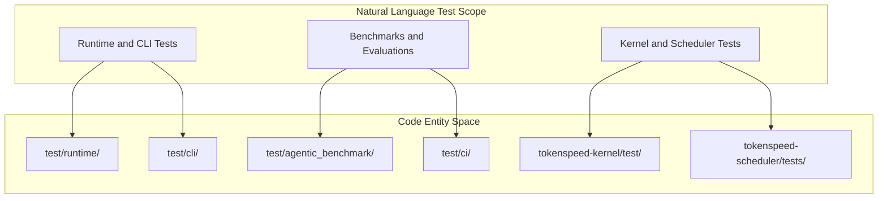
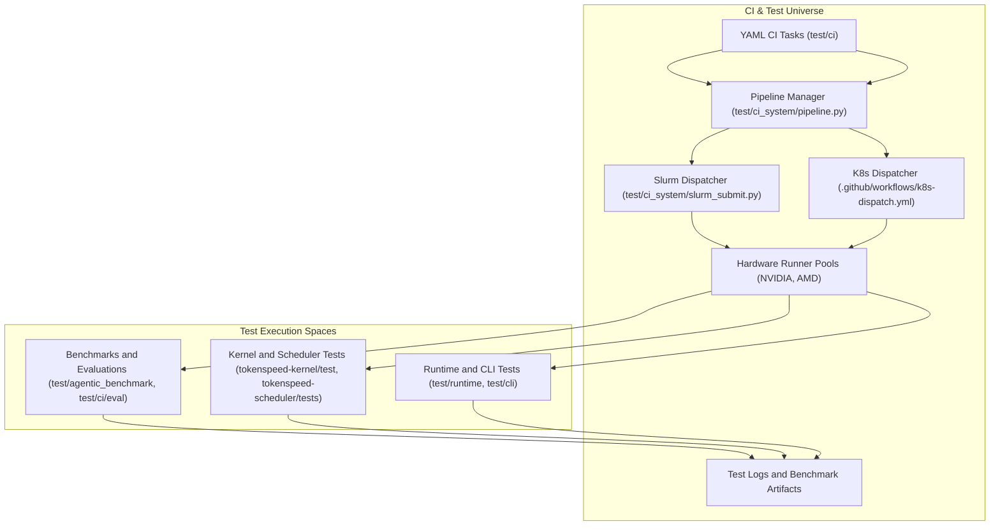

<!-- source: DeepWiki mcp.deepwiki.com · repo lightseekorg/tokenspeed · page 8 Testing · fetched 2026-10-21 -->

# Testing

Relevant source files

The following files were used as context for generating this wiki page:

- [.github/workflows/k8s-dispatch.yml](.github/workflows/k8s-dispatch.yml)
- [.github/workflows/slurm-dispatch.yml](.github/workflows/slurm-dispatch.yml)
- [python/tokenspeed/runtime/layers/dense/w8a8_fp8.py](python/tokenspeed/runtime/layers/dense/w8a8_fp8.py)
- [test/ci/README.md](test/ci/README.md)
- [test/ci/perf/kimi-k3-eagle3-mxfp4-tp8ep1-evalscope-random-50k-500-mi35x.yaml](test/ci/perf/kimi-k3-eagle3-mxfp4-tp8ep1-evalscope-random-50k-500-mi35x.yaml)
- [test/ci_system/pipeline.py](test/ci_system/pipeline.py)
- [test/ci_system/slurm_submit.py](test/ci_system/slurm_submit.py)
- [test/ci_system/test_dispatch_workflows.py](test/ci_system/test_dispatch_workflows.py)
- [test/ci_system/test_eval_configs.py](test/ci_system/test_eval_configs.py)
- [test/ci_system/test_pipeline.py](test/ci_system/test_pipeline.py)
- [test/ci_system/test_slurm_submit.py](test/ci_system/test_slurm_submit.py)
- [test/runtime/test_fp8_linear_blockscale_flashinfer.py](test/runtime/test_fp8_linear_blockscale_flashinfer.py)
- [test/runtime/test_fp8_pb_wo_loading.py](test/runtime/test_fp8_pb_wo_loading.py)
- [test/runtime/test_kda_fp8_w8a8.py](test/runtime/test_kda_fp8_w8a8.py)
- [tokenspeed-kernel/python/tokenspeed_kernel/ops/gemm/triton.py](tokenspeed-kernel/python/tokenspeed_kernel/ops/gemm/triton.py)
- [tokenspeed-kernel/python/tokenspeed_kernel/ops/metadata/ngram_history.py](tokenspeed-kernel/python/tokenspeed_kernel/ops/metadata/ngram_history.py)
- [tokenspeed-kernel/test/ops/metadata/test_ngram_history.py](tokenspeed-kernel/test/ops/metadata/test_ngram_history.py)
- [tokenspeed-kernel/test/test_benchmark_gemm_generator.py](tokenspeed-kernel/test/test_benchmark_gemm_generator.py)
- [tokenspeed-kernel/test/utils.py](tokenspeed-kernel/test/utils.py)

The TokenSpeed test suite validates the monorepo across multiple stack layers, from low-level silicon kernels to high-level asynchronous request handling (`test/runtime`) and agentic benchmarks (`test/agentic_benchmark`). The testing infrastructure is coordinated via YAML-driven CI tasks executed on NVIDIA and AMD runner pools.

The testing effort spans numerical correctness, component API contracts, server lifecycle management, distributed parallelism, sampling correctness, detokenization parity, model evaluation, and performance benchmarking. These components interact to ensure end-to-end reliability and reproducibility over diverse hardware backends.

---

### Test Suite Organization and Code Mapping

The repository organizes test cases and infrastructure into separate top-level directories reflecting distinct system layers and concerns:

- `test/runtime` and `test/cli` cover the Python runtime, request handling, cache logic, sampling, logits processing, distributed PD/EPD correctness, and detokenization.
- `tokenspeed-kernel/test` and `tokenspeed-scheduler/tests` provide deeper numeric verification, API goldens, integration and binding tests for the kernel and scheduler libraries.
- `test/agentic_benchmark` and `test/ci` manage evaluation harnesses, benchmarking workflows, and CI task specifications.

Sources: [test/runtime/models/test_kimi_models.py:35-92](), [test/runners.py:82-132](), [test/test_utils.py:139-188](), [test/ci/README.md:1-153](), [tokenspeed-kernel/test/utils.py:1-186]() 

---

### Runtime and CLI Tests

The runtime and CLI tests focus on verifying the high-level inference engine and serving stack. This includes:

- Unit tests for multiple supported model architectures and cache recipes.
- Validation of prefill and decode disaggregated execution.
- Correct handling of sampling, logits processors, and speculative decoding grammars.
- Parity checks for detokenizer implementations against reference tokenizers.
- Compatibility tests for configuration surfaces.
- Shared runners and fixtures like `HFRunner` to spawn and validate HuggingFace-based reference models.
- Lifecycle management via subprocess utilities like `popen_serve_server()` which controls server start, health polling, and graceful shutdown.

For complete details on these tests, see [Runtime and CLI Tests](#8.1).

Sources: [test/runners.py:82-132](), [test/test_utils.py:139-188](), [python/tokenspeed/runtime/sampling/sampling_params.py:42-93]() 

---

### Kernel and Scheduler Tests

Kernel and Scheduler tests verify core numerical operations and control flow in foundational C++ and Python-boundary layers:

- Operation-level correctness tests in `tokenspeed-kernel/test/`, including CUDA, ROCm, and mixed precision kernels.
- API validation with registered kernel selectors, including golden data and tactic tuning results.
- Third-party CUDA kernel sources integrated for fused operations like top-k sampling and routing.
- `tokenspeed-scheduler/tests` provide thorough FSM-based request lifecycle coverage, multi-thread resource and cache management validations, and Python binding correctness for nanobind-based scheduler APIs.
- The testing harness supports both CMake/Ninja native binaries and Python integration, ensuring API and ABI stability.

For full technical detail, see [Kernel and Scheduler Tests](#8.2).

Sources: [test/test_utils.py:17-36](), [tokenspeed-kernel/test/utils.py:55-112]() 

---

### Benchmarks and Evaluations

This testing space emphasizes model-level, long-context, and accuracy benchmarking:

- `test/agentic_benchmark/` contains harnesses comparing TokenSpeed performance and accuracy against other LLM serving frameworks like TRT-LLM, vLLM, and SGLang across major model families.
- Benchmark workloads include randomized and long-context prompt lengths, multi-GPU scaling, and speculative decoding measurement.
- `test/ci/eval` YAML-defined evaluation configurations execute standard benchmarks via EvalScope integrations, quantifying reasoning accuracy, latency, and throughput.
- Benchmarks run continuously in CI with acceptance thresholds and retry semantics to catch regressions early.
- Artifact upload covers detailed output answers and reasoning traces for downstream analysis.

For extensive information, see [Benchmarks and Evaluations](#8.3).

Sources: [test/runtime/models/test_kimi_k3_eagle3_e2e.py:1-13](), [test/test_utils.py:232-236](), [test/ci/README.md:20-56]() 

---

### CI Infrastructure and Task Orchestration

TokenSpeed's CI system drives automated validation across complex hardware and software configurations:

- YAML-defined task specifications under `test/ci/` describe triggers (commit, manual, nightly, debug, slurm), runners (GPU families), workflow stages (`unit-test`, `kernel-benchmark`, `model-test`), and priority/optional flags.
- The CI pipeline uses Python orchestration in `test/ci_system/pipeline.py` to load, validate, and execute tasks in parallel matrix jobs grouped by hardware runner labels and test kinds.
- Slurm and Kubernetes dispatch scripts (`test/ci_system/slurm_submit.py`) convert CI tasks into cluster job submissions with GPU and node-topology awareness.
- Runner setup scripts manage environment preparation, cleanups, device isolation, logging, and artifact collection.
- The pipeline enforces compile-time kernel parameter stability (`TOKENSPEED_JIT_COMPILE_CHECK`) to catch unexpected Triton kernel recompilations during server runs.
- The CI reports detailed benchmark results, EvalScope scores, and logs with GitHub annotations.

The following diagram depicts the high-level CI orchestration along with test-related components:

**CI Pipeline and Test Suite Orchestration**

Sources: [test/ci/README.md:1-153](), [test/ci_system/pipeline.py:1-200](), [test/ci_system/slurm_submit.py:1-253]()

---

### Test Suite Role Summary

| Test Suite Location           | Primary Focus                                       | Key Code Aspects Covered                                          |
|------------------------------|---------------------------------------------------|-------------------------------------------------------------------|
| `test/runtime`                | Runtime engine, execution, distributed correctness| Model unit tests, cache behavior, prefill/decode correctness, sampling, detokenizer parity |
| `test/cli`                   | Command-line lifecycle and config compatibility  | Serve orchestration, CLI argument parsing, integration fixtures    |
| `test/agentic_benchmark`     | Performance and end-to-end accuracy benchmarks    | Multi-model family benchmarks, agentic eval harnesses, throughput measurement |
| `test/ci`                    | CI task declarative specs, workflows, matrix jobs | Trigger definitions, runner selections, priority and retry flags  |
| `tokenspeed-kernel/test`     | Low-level kernel correctness and numerics         | Numeric verification, API goldens, thirdparty CUDA kernel tests   |
| `tokenspeed-scheduler/tests` | Scheduler request life cycle and resource management | FSM transitions, prefix cache coordination, Python bindings       |

---

For deep dives into each category, please refer to the dedicated child pages:
- [Runtime and CLI Tests](#8.1)
- [Kernel and Scheduler Tests](#8.2)
- [Benchmarks and Evaluations](#8.3)

---

This hierarchical and layered testing strategy ensures holistic, scalable, and hardware-aware verification of the TokenSpeed codebase.

Sources:  
[test/runtime/models/test_kimi_models.py:35-92](), [test/runners.py:82-132](), [test/test_utils.py:17-188](),   
[test/ci/README.md:1-153](), [test/ci_system/pipeline.py:1-200](), [test/ci_system/slurm_submit.py:1-253](),   
[tokenspeed-kernel/test/utils.py:55-112](), [test/runtime/models/test_kimi_k3_eagle3_e2e.py:1-13](), [test/test_utils.py:232-236]()

---

