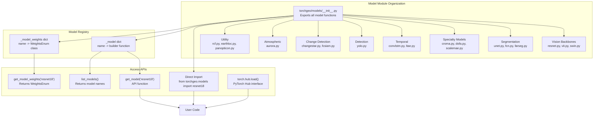
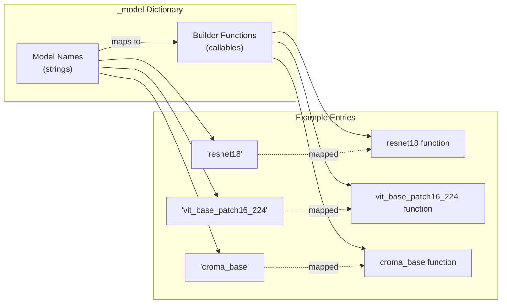
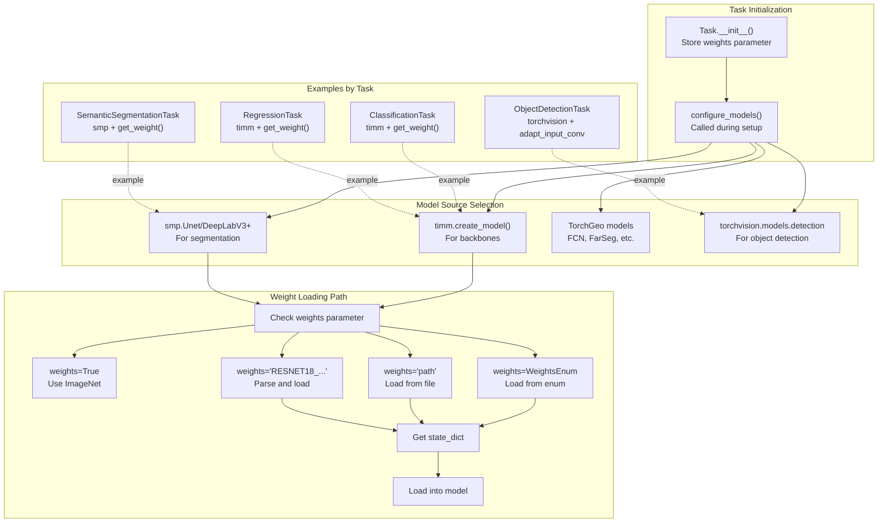
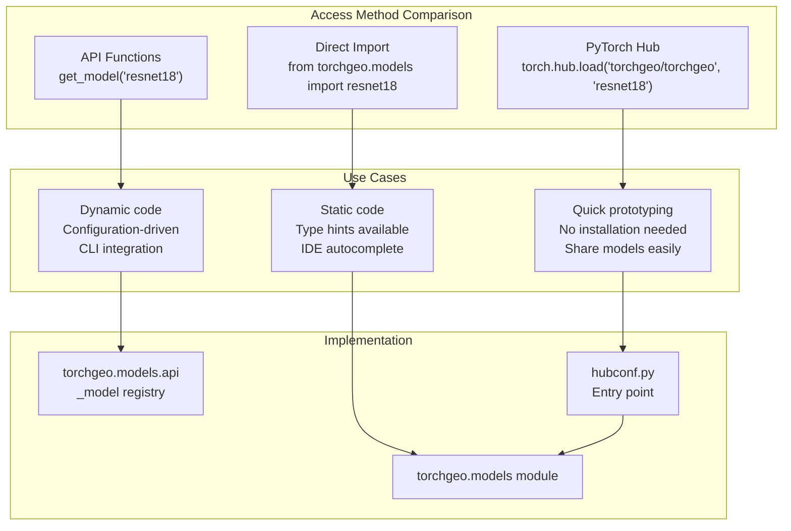

<!-- source: DeepWiki mcp.deepwiki.com · repo torchgeo/torchgeo · page 4.1 Model Zoo · fetched 2026-10-21 -->

# Model Zoo

<details>
<summary>Relevant source files</summary>

The following files were used as context for generating this wiki page:

- [docs/api/models.rst](docs/api/models.rst)
- [docs/api/models/tessera.rst](docs/api/models/tessera.rst)
- [docs/api/weights/agnostic.csv](docs/api/weights/agnostic.csv)
- [docs/api/weights/sentinel1.csv](docs/api/weights/sentinel1.csv)
- [docs/api/weights/sentinel2.csv](docs/api/weights/sentinel2.csv)
- [hubconf.py](hubconf.py)
- [requirements/models.txt](requirements/models.txt)
- [tests/models/test_api.py](tests/models/test_api.py)
- [torchgeo/models/__init__.py](torchgeo/models/__init__.py)
- [torchgeo/models/api.py](torchgeo/models/api.py)
- [torchgeo/models/tessera.py](torchgeo/models/tessera.py)

</details>


The Model Zoo is TorchGeo's collection of pre-trained models and architectures optimized for geospatial machine learning. It provides 20+ model architectures with sensor-specific pre-trained weights trained on satellite imagery from Landsat, Sentinel-1/2, NAIP, and other sensors. Models span vision backbones (ResNet, ViT, Swin), segmentation architectures (UNet, FCN), specialty geospatial models (CROMA, DOFA, ScaleMAE), and task-specific models (YOLO for detection, Aurora for atmospheric forecasting).

For information about how to use these models in training workflows, see [Task Architecture](#5.1) and [Training Workflows](#5.5). For details about the pre-trained weights system, see [Pre-trained Weights System](#4.2). For model loading methods, see [Loading and Using Models](#4.3).

---

## Model Categories

TorchGeo organizes models into functional categories based on their architecture and intended use case. The following table summarizes the available models:

### Vision Backbone Models

These models serve as feature extractors and can be used as backbones for downstream tasks like classification, segmentation, and detection.

| Model | Variants | Input Channels | Description |
|-------|----------|----------------|-------------|
| ResNet | 18, 50, 152 | Configurable | Residual networks with various depths |
| Vision Transformer (ViT) | Small/16, Base/16, Large/16, Huge/14 | Configurable | Transformer-based vision models |
| ViT (DINOv2) | Small/14, Base/14 | Configurable | Self-supervised ViT variants |
| Swin Transformer | Tiny, Base | Configurable | Shifted window transformer |

### Segmentation Models

Semantic segmentation architectures for pixel-wise prediction tasks.

| Model | Source | Description |
|-------|--------|-------------|
| UNet | TorchGeo | Classic encoder-decoder with skip connections |
| FCN | TorchGeo | Fully convolutional network |
| FarSeg | TorchGeo | Foreground-aware relation network |
| ChangeStar | TorchGeo | Change detection with FarSeg backbone |
| ChangeStarFarSeg | TorchGeo | Combined change detection model |

*Note: Additional segmentation models (DeepLabV3+, UPerNet, Segformer, DPT) are available via the [segmentation_models_pytorch](https://smp.readthedocs.io) integration in trainers.*

### Specialty Geospatial Models

Models specifically designed for satellite imagery and remote sensing tasks.

| Model | Architecture | Use Case | Pre-trained Weights |
|-------|--------------|----------|---------------------|
| CROMA | Temporal transformer | Multi-temporal learning | Base, Large |
| DOFA | Foundation model | General remote sensing | Base/16, Large/16 |
| ScaleMAE | Masked autoencoder | Multi-scale learning | Large/16 |
| CopernicusFM | Foundation model | Sentinel-2 imagery | Base |
| Panopticon | Location encoder | Geographic representation | ViT-B/14 |
| EarthLoc | Geolocation | Image geolocalization | Default |

### Temporal and Sequence Models

Models for processing time-series satellite data.

| Model | Description |
|-------|-------------|
| ConvLSTM | Convolutional LSTM for spatiotemporal data |
| LTAE | Lightweight Temporal Attention Encoder |

### Detection and Other Tasks

| Model | Task | Description |
|-------|------|-------------|
| YOLO | Object detection | YOLOv11 for geospatial object detection |
| FCSiamConc/Diff | Change detection | Fully convolutional Siamese networks |
| MOSAIKS | Feature extraction | Random convolutional features |
| RCF | Feature extraction | Random convolutional features base class |

### Atmospheric Forecasting

| Model | Description | Variants |
|-------|-------------|----------|
| Aurora | Weather forecasting with 3D Swin U-Net | 7 variants for different resolutions and tasks |

**Sources:** 
- [torchgeo/models/__init__.py:1-124]()
- [docs/api/models.rst:1-219]()
- [hubconf.py:1-72]()

---

## Model Catalog Architecture

The following diagram shows how models are organized in the codebase and accessed through different interfaces:



**Sources:**
- [torchgeo/models/__init__.py:1-124]()
- [torchgeo/models/api.py:1-197]()
- [hubconf.py:1-72]()

---

## Model Builder Functions

Each model in the zoo is exposed through a builder function that handles instantiation and optional weight loading. The naming convention follows a consistent pattern:

### Naming Convention

```
{architecture}_{variant}_{patch_size}_{resolution}
```

Examples:
- `resnet18` - ResNet with 18 layers
- `vit_small_patch16_224` - ViT Small with 16×16 patches at 224 resolution
- `dofa_base_patch16_224` - DOFA Base variant
- `swin_v2_t` - Swin Transformer v2 Tiny

### Function Signatures

All model builders follow a similar pattern:

```python
def model_name(
    weights: WeightsEnum | None = None,
    *args: Any,
    **kwargs: Any
) -> nn.Module:
    """Load model with optional pretrained weights."""
```

Key parameters:
- `weights`: Pre-trained weights to load (WeightsEnum instance or None)
- `*args, **kwargs`: Model-specific configuration (varies by architecture)

### Model Registry

The model registry maps string names to builder functions:



**Sources:**
- [torchgeo/models/api.py:59-84]()
- [torchgeo/models/api.py:134-148]()

---

## Integration with Training Tasks

Models from the zoo are integrated into TorchGeo's training system through the Task classes. The following diagram shows the model instantiation flow in trainers:



### Task-Specific Model Loading

#### Classification Task

[ClassificationTask](torchgeo/trainers/classification.py:29-308) uses `timm` for backbone models:

```python
# From ClassificationTask.configure_models()
self.model = timm.create_model(
    self.hparams['model'],
    num_classes=self.hparams['num_classes'] or self.hparams['num_labels'] or 1,
    in_chans=self.hparams['in_channels'],
    pretrained=weights is True,
)

# Load custom weights if provided
if weights and weights is not True:
    if isinstance(weights, WeightsEnum):
        state_dict = weights.get_state_dict(progress=True)
    elif os.path.exists(weights):
        _, state_dict = utils.extract_backbone(weights)
    else:
        state_dict = get_weight(weights).get_state_dict(progress=True)
    utils.load_state_dict(self.model, state_dict)
```

#### Semantic Segmentation Task

[SemanticSegmentationTask](torchgeo/trainers/segmentation.py:27-404) uses either `smp` or TorchGeo models:

```python
# SMP model example
self.model = smp.Unet(
    encoder_name=backbone,
    encoder_weights='imagenet' if weights is True else None,
    in_channels=in_channels,
    classes=num_classes,
)

# TorchGeo FCN model
self.model = FCN(
    in_channels=in_channels,
    classes=num_classes,
    num_filters=num_filters,
)

# Load pretrained weights for encoder
if model != 'fcn' and weights and weights is not True:
    state_dict = get_weight(weights).get_state_dict(progress=True)
    self.model.encoder.load_state_dict(state_dict)
```

#### Object Detection Task

[ObjectDetectionTask](torchgeo/trainers/detection.py:54-368) uses `torchvision` detection models:

```python
# Build FPN backbone
model_backbone = resnet_fpn_backbone(
    backbone_name=backbone,
    trainable_layers=self.hparams['trainable_layers'],
    weights=BACKBONE_WEIGHT_MAP[backbone] if weights else None
)

# Create Faster R-CNN
self.model = torchvision.models.detection.FasterRCNN(
    model_backbone,
    num_classes,
    rpn_anchor_generator=anchor_generator,
    box_roi_pool=roi_pooler,
)

# Adapt first conv layer for multispectral input
weight = adapt_input_conv(in_channels, self.model.backbone.body.conv1.weight)
self.model.backbone.body.conv1.weight = Parameter(weight)
```

#### Self-Supervised Learning Tasks

[BYOLTask](torchgeo/trainers/byol.py:284-407), [SimCLRTask](torchgeo/trainers/simclr.py:56-323), and [MoCoTask](torchgeo/trainers/moco.py:118-431) use `timm` backbones with custom projection heads:

```python
# Create backbone without classifier
backbone = timm.create_model(
    self.hparams['model'],
    in_chans=in_channels,
    num_classes=0,  # No classifier head
    pretrained=weights is True
)

# Load custom weights
if weights and weights is not True:
    state_dict = get_weight(weights).get_state_dict(progress=True)
    utils.load_state_dict(backbone, state_dict)

# Wrap with SSL-specific components (projection heads, momentum models, etc.)
```

**Sources:**
- [torchgeo/trainers/classification.py:82-109]()
- [torchgeo/trainers/segmentation.py:121-193]()
- [torchgeo/trainers/detection.py:112-221]()
- [torchgeo/trainers/byol.py:329-349]()
- [torchgeo/trainers/simclr.py:151-186]()
- [torchgeo/trainers/moco.py:226-270]()

---

## Model Access Methods

TorchGeo provides three primary methods for accessing models from the zoo:

### Method 1: Direct Import

Import model builder functions directly from `torchgeo.models`:

```python
from torchgeo.models import resnet18, ResNet18_Weights

# Create model without weights
model = resnet18()

# Create model with pretrained weights
model = resnet18(weights=ResNet18_Weights.SENTINEL2_ALL_MOCO)
```

### Method 2: API Functions

Use the model API for string-based access:

```python
from torchgeo.models import get_model, get_model_weights, get_weight

# Get model by name
model = get_model('resnet18')

# Get weights enum class
weights_enum = get_model_weights('resnet18')

# Get specific weight by full name
weight = get_weight('ResNet18_Weights.SENTINEL2_ALL_MOCO')
model = get_model('resnet18', weights=weight)

# List all available models
from torchgeo.models import list_models
models = list_models()  # Returns list of model names
```

### Method 3: PyTorch Hub

Load models directly via PyTorch Hub:

```python
import torch

# Load model from hub
model = torch.hub.load('torchgeo/torchgeo', 'resnet18')

# Load with pretrained weights
model = torch.hub.load(
    'torchgeo/torchgeo',
    'resnet18',
    weights='SENTINEL2_ALL_MOCO'
)
```



**Sources:**
- [torchgeo/models/__init__.py:1-124]()
- [torchgeo/models/api.py:134-197]()
- [hubconf.py:1-72]()

---

## Model Architecture Examples

### Vision Transformers (ViT)

The ViT implementation provides multiple variants with different patch sizes and model depths:

| Function | Patch Size | Model Size | Parameters |
|----------|------------|------------|------------|
| `vit_small_patch16_224` | 16×16 | Small | ~22M |
| `vit_base_patch16_224` | 16×16 | Base | ~86M |
| `vit_large_patch16_224` | 16×16 | Large | ~304M |
| `vit_huge_patch14_224` | 14×14 | Huge | ~632M |

Available pretrained weights include:
- `ViTSmall16_Weights.SENTINEL2_ALL_MOCO` - MoCo on Sentinel-2
- `ViTBase16_Weights.SENTINEL2_ALL_MOCO` - MoCo on Sentinel-2
- And more (see [Pre-trained Weights System](#4.2))

### Specialty Models

#### CROMA (Crop Recognition with Masked Autoencoding)

Temporal transformer model for multi-temporal satellite imagery:

```python
from torchgeo.models import croma_base, CROMABase_Weights

# Load CROMA base model
model = croma_base(weights=CROMABase_Weights.SENTINEL2_RGB_SECO_MOCO)
```

#### DOFA (Dynamic One-For-All)

Foundation model for remote sensing with dynamic architecture:

```python
from torchgeo.models import dofa_base_patch16_224, DOFABase16_Weights

# Load DOFA base model
model = dofa_base_patch16_224(weights=DOFABase16_Weights.DOFA_BASE_PATCH16_224)
```

#### ScaleMAE (Multi-Scale Masked Autoencoder)

Masked autoencoding with multi-scale support:

```python
from torchgeo.models import scalemae_large_patch16, ScaleMAELarge16_Weights

# Load ScaleMAE
model = scalemae_large_patch16(
    weights=ScaleMAELarge16_Weights.SCALEMAE_LARGE_PATCH16
)
```

### Aurora (Atmospheric Forecasting)

Aurora is a specialized model for weather forecasting with 7 variants for different tasks:

```python
from torchgeo.models import aurora_swin_unet, Aurora_Weights

# Medium-range weather forecasting
model = aurora_swin_unet(weights=Aurora_Weights.HRES_T0_AURORA)

# High-resolution forecasting
model = aurora_swin_unet(weights=Aurora_Weights.HRES_T0_HIGH_RES_AURORA)

# Air pollution forecasting
model = aurora_swin_unet(weights=Aurora_Weights.HRES_CAMS_AIR_POLLUTION_AURORA)
```

Aurora variants:
- `HRES_T0_PRETRAINED_AURORA` - Pretrained on HRES-T0 (0.25° resolution)
- `HRES_T0_PRETRAINED_12HR_AURORA` - 12-hour lead time variant
- `HRES_T0_PRETRAINED_SMALL_AURORA` - Smaller model variant
- `HRES_T0_AURORA` - Fine-tuned model
- `HRES_T0_HIGH_RES_AURORA` - High resolution (0.1°)
- `HRES_CAMS_AIR_POLLUTION_AURORA` - Air pollution forecasting
- `HRES_WAM0_WAVE_AURORA` - Ocean wave forecasting

**Sources:**
- [torchgeo/models/vit.py]() (referenced in imports)
- [torchgeo/models/croma.py]() (referenced in imports)
- [torchgeo/models/dofa.py]() (referenced in imports)
- [torchgeo/models/scale_mae.py]() (referenced in imports)
- [torchgeo/models/aurora.py:1-260]()
- [docs/api/weights/atmospheric.csv:1-9]()

---

## Model Dependencies

Different models have different external dependencies beyond the core TorchGeo requirements:

| Model(s) | Required Package | Minimum Version | Purpose |
|----------|------------------|-----------------|---------|
| All vision backbones | `timm` | - | Model architectures |
| Segmentation (in trainers) | `segmentation_models_pytorch` | - | UNet, DeepLabV3+, etc. |
| YOLO | `ultralytics` | 8.3 | Object detection |
| Aurora | `microsoft-aurora` | 1.7.0 | Atmospheric forecasting |
| All models | `kornia` | - | Augmentations |
| All models | `torch`, `torchvision` | - | Core deep learning |

The model dependencies are specified in separate requirements files:
- Core models: Included in main requirements
- Optional models: [requirements/models.txt:1-4]()

**Sources:**
- [requirements/models.txt:1-4]()
- [hubconf.py:64-71]()

---

## Model Testing and Validation

The test suite validates model functionality through several test files:

### API Tests

[tests/models/test_api.py:1-153]() validates:
- `get_model()` returns correct `nn.Module` instances
- `get_model_weights()` returns `WeightsEnum` classes
- `get_weight()` parses weight strings correctly
- `list_models()` includes all registered models

### Trainer Integration Tests

Model integration with trainers is tested through:
- [tests/trainers/test_classification.py:1-321]() - Classification with various backbones
- [tests/trainers/test_segmentation.py]() - Segmentation models (referenced)
- [tests/trainers/test_regression.py:1-372]() - Regression with backbones
- [tests/trainers/test_detection.py]() - Detection models (referenced)

### Self-Supervised Learning Tests

SSL model integration:
- [tests/trainers/test_byol.py:1-135]() - BYOL with backbones
- [tests/trainers/test_simclr.py:1-140]() - SimCLR with backbones
- [tests/trainers/test_moco.py:1-142]() - MoCo with backbones

### Weight Loading Tests

Tests verify multiple weight loading mechanisms:

```python
# Weight enum loading
def test_weight_enum(self, mocked_weights: WeightsEnum) -> None:
    ClassificationTask(
        model=mocked_weights.meta['model'],
        weights=mocked_weights,
        in_channels=mocked_weights.meta['in_chans'],
        num_classes=10,
    )

# String representation loading
def test_weight_str(self, mocked_weights: WeightsEnum) -> None:
    ClassificationTask(
        model=mocked_weights.meta['model'],
        weights=str(mocked_weights),  # String representation
        in_channels=mocked_weights.meta['in_chans'],
        num_classes=10,
    )

# File path loading
def test_weight_file(self, checkpoint: str) -> None:
    ClassificationTask(
        model='resnet18',
        weights=checkpoint,  # Path to .pth file
        in_channels=13,
        num_classes=10
    )
```

**Sources:**
- [tests/models/test_api.py:116-148]()
- [tests/trainers/test_classification.py:150-191]()
- [tests/trainers/test_byol.py:102-135]()

---

## Benchmark Integration

Models are used in I/O and training benchmarks through the [experiments/torchgeo/benchmark.py:1-292]() script:

```python
# Example: ResNet-34 for benchmarking
model = resnet34()
model.conv1 = nn.Conv2d(
    len(bands), 64, kernel_size=7, stride=2, padding=3, bias=False
)
criterion = nn.CrossEntropyLoss()
optimizer = optim.SGD(params, lr=0.0001)
```

The benchmark script measures:
- Data loading performance with different samplers
- Model throughput (patches/second)
- GPU utilization

**Sources:**
- [experiments/torchgeo/benchmark.py:211-261]()

---

## Summary

The Model Zoo provides:

1. **20+ model architectures** spanning vision backbones, segmentation, detection, and specialty geospatial models
2. **Sensor-specific pre-trained weights** for Landsat, Sentinel-1/2, NAIP, and more
3. **Three access methods**: Direct imports, API functions, and PyTorch Hub
4. **Seamless task integration** through the trainer system
5. **Flexible weight loading** supporting WeightsEnum, strings, and file paths
6. **Comprehensive testing** covering API, integration, and weight loading

For detailed information about specific pre-trained weights, see [Pre-trained Weights System](#4.2). For guidance on using models in training, see [Task Architecture](#5.1) and [Training Workflows](#5.5).

---

