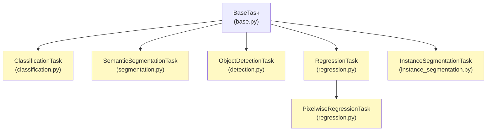
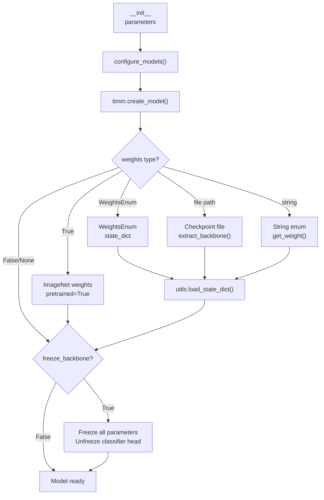
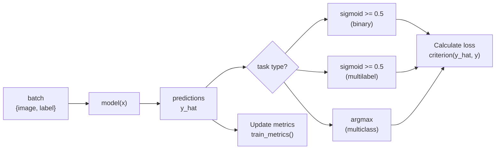
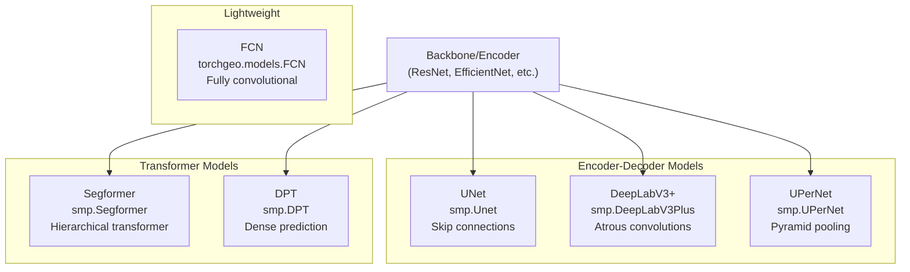
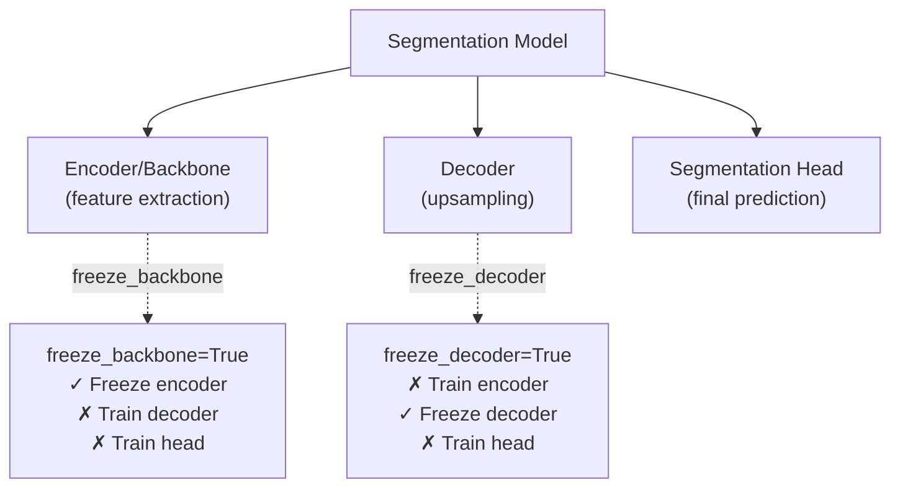
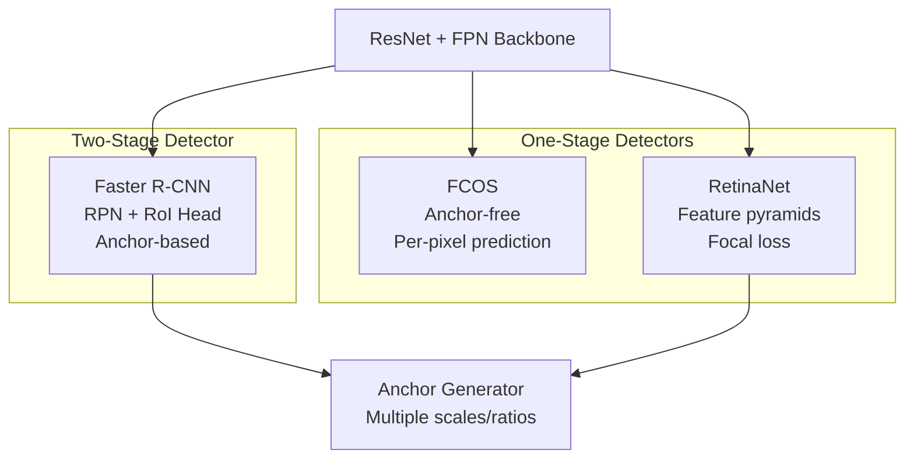
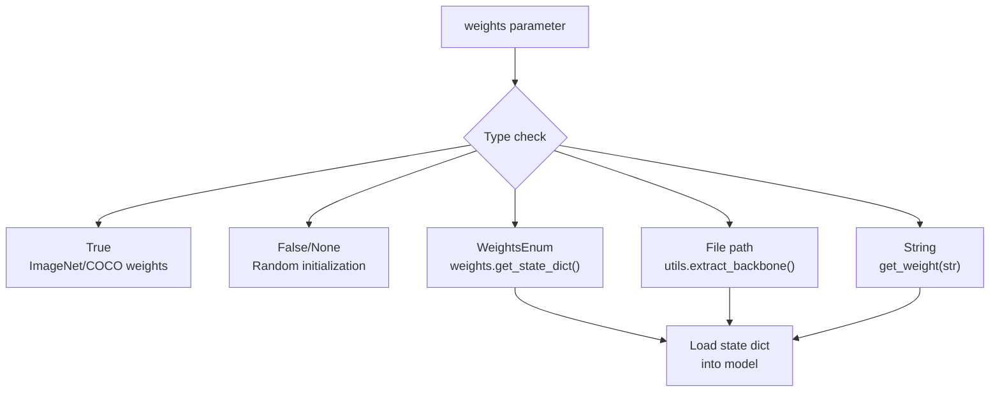
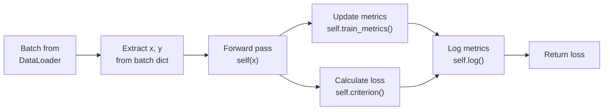

<!-- source: DeepWiki mcp.deepwiki.com · repo torchgeo/torchgeo · page 5.2 Supervised Learning Tasks · fetched 2026-10-21 -->

# Supervised Learning Tasks

<details>
<summary>Relevant source files</summary>

The following files were used as context for generating this wiki page:

- [tests/conf/vhr10_ins_seg.yaml](tests/conf/vhr10_ins_seg.yaml)
- [tests/conf/vhr10_obj_det.yaml](tests/conf/vhr10_obj_det.yaml)
- [tests/models/test_btc.py](tests/models/test_btc.py)
- [tests/trainers/test_byol.py](tests/trainers/test_byol.py)
- [tests/trainers/test_classification.py](tests/trainers/test_classification.py)
- [tests/trainers/test_detection.py](tests/trainers/test_detection.py)
- [tests/trainers/test_instance_segmentation.py](tests/trainers/test_instance_segmentation.py)
- [tests/trainers/test_moco.py](tests/trainers/test_moco.py)
- [tests/trainers/test_regression.py](tests/trainers/test_regression.py)
- [tests/trainers/test_simclr.py](tests/trainers/test_simclr.py)
- [torchgeo/models/btc.py](torchgeo/models/btc.py)
- [torchgeo/trainers/base.py](torchgeo/trainers/base.py)
- [torchgeo/trainers/byol.py](torchgeo/trainers/byol.py)
- [torchgeo/trainers/classification.py](torchgeo/trainers/classification.py)
- [torchgeo/trainers/detection.py](torchgeo/trainers/detection.py)
- [torchgeo/trainers/instance_segmentation.py](torchgeo/trainers/instance_segmentation.py)
- [torchgeo/trainers/iobench.py](torchgeo/trainers/iobench.py)
- [torchgeo/trainers/moco.py](torchgeo/trainers/moco.py)
- [torchgeo/trainers/regression.py](torchgeo/trainers/regression.py)
- [torchgeo/trainers/segmentation.py](torchgeo/trainers/segmentation.py)
- [torchgeo/trainers/simclr.py](torchgeo/trainers/simclr.py)

</details>


Supervised learning tasks in TorchGeo provide PyTorch Lightning modules for training models on labeled geospatial data. This page documents the five supervised task types available: classification, semantic segmentation, object detection, regression, and instance segmentation. Each task encapsulates model selection, loss functions, metrics, and training logic into a single class.

For information about the base task abstraction and custom task creation, see [Task Architecture](#5.1) and [Creating Custom Tasks](#5.4). For self-supervised learning methods, see [Self-Supervised Learning](#5.3).

## Task Hierarchy

All supervised tasks inherit from `BaseTask` and implement the standard PyTorch Lightning training loop methods. The following diagram shows the task class hierarchy:



**Sources:** [torchgeo/trainers/base.py:16-82](), [torchgeo/trainers/classification.py:30-309](), [torchgeo/trainers/segmentation.py:28-405](), [torchgeo/trainers/detection.py:55-369](), [torchgeo/trainers/regression.py:27-351](), [torchgeo/trainers/instance_segmentation.py:29-269]()

## ClassificationTask

`ClassificationTask` performs image-level classification with support for binary, multiclass, and multilabel tasks. It uses models from the [timm library](https://huggingface.co/docs/timm/reference/models) and can load pretrained weights from TorchGeo's model zoo.

### Configuration Parameters

| Parameter | Type | Default | Description |
|-----------|------|---------|-------------|
| `model` | str | `'resnet50'` | Name of timm model architecture |
| `weights` | WeightsEnum \| str \| bool \| None | `None` | Initial model weights (True for ImageNet, False/None for random, enum/str for TorchGeo weights, path for checkpoint) |
| `in_channels` | int | `3` | Number of input channels |
| `task` | Literal['binary', 'multiclass', 'multilabel'] | `'multiclass'` | Classification task type |
| `num_classes` | int \| None | `None` | Number of classes (for multiclass) |
| `num_labels` | int \| None | `None` | Number of labels (for multilabel) |
| `loss` | Literal['ce', 'bce', 'jaccard', 'focal'] | `'ce'` | Loss function |
| `class_weights` | Tensor \| Sequence[float] \| None | `None` | Optional class weights for CE loss |
| `lr` | float | `1e-3` | Learning rate |
| `patience` | int | `10` | Learning rate scheduler patience |
| `freeze_backbone` | bool | `False` | Freeze backbone for linear probing |

### Model Initialization and Weight Loading

The model initialization process follows this workflow:



**Sources:** [torchgeo/trainers/classification.py:83-111]()

### Loss Functions and Metrics

The task supports four loss functions configured via the `loss` parameter:

| Loss | Description | Supports |
|------|-------------|----------|
| `'ce'` | Cross-entropy loss with optional class weights | multiclass, multilabel |
| `'bce'` | Binary cross-entropy with logits | binary, multilabel |
| `'jaccard'` | Jaccard/IoU loss | all task types |
| `'focal'` | Focal loss for class imbalance | all task types |

Metrics tracked during training:

- **OverallAccuracy**: Micro-averaged accuracy (total correct / total samples)
- **AverageAccuracy**: Macro-averaged accuracy (mean per-class accuracy)
- **JaccardIndex**: Intersection over Union (IoU)
- **F1Score**: Harmonic mean of precision and recall

**Sources:** [torchgeo/trainers/classification.py:112-163]()

### Training Loop

The training loop handles different task types by adjusting the prediction format:



**Sources:** [torchgeo/trainers/classification.py:165-297]()

### Usage Example

```python
from torchgeo.trainers import ClassificationTask

# Multiclass classification with pretrained weights
task = ClassificationTask(
    model='resnet50',
    weights='SENTINEL2_ALL_MOCO',
    in_channels=13,
    task='multiclass',
    num_classes=10,
    loss='ce',
    lr=1e-3
)

# Binary classification with class weights
task = ClassificationTask(
    model='efficientnet_b0',
    task='binary',
    loss='bce',
    class_weights=[1.0, 2.0]  # Weight positive class more heavily
)

# Linear probing: freeze backbone, train only classifier
task = ClassificationTask(
    model='resnet18',
    weights='SENTINEL2_RGB_MOCO',
    freeze_backbone=True
)
```

**Sources:** [tests/trainers/test_classification.py:72-301]()

## SemanticSegmentationTask

`SemanticSegmentationTask` performs dense pixel-wise classification using encoder-decoder architectures. It supports models from [segmentation-models-pytorch](https://smp.readthedocs.io) and a custom FCN implementation.

### Configuration Parameters

| Parameter | Type | Default | Description |
|-----------|------|---------|-------------|
| `model` | Literal['unet', 'deeplabv3+', 'fcn', 'upernet', 'segformer', 'dpt'] | `'unet'` | Segmentation architecture |
| `backbone` | str | `'resnet50'` | Encoder backbone (timm or smp model) |
| `weights` | WeightsEnum \| str \| bool \| None | `None` | Initial encoder weights |
| `in_channels` | int | `3` | Number of input channels |
| `task` | Literal['binary', 'multiclass', 'multilabel'] | `'multiclass'` | Segmentation task type |
| `num_classes` | int \| None | `None` | Number of classes (for multiclass) |
| `num_labels` | int \| None | `None` | Number of labels (for multilabel) |
| `num_filters` | int | `3` | Number of filters (FCN only) |
| `loss` | Literal['ce', 'bce', 'jaccard', 'focal'] | `'ce'` | Loss function |
| `class_weights` | Tensor \| Sequence[float] \| None | `None` | Class weights for CE loss |
| `ignore_index` | int \| None | `None` | Class index to ignore in loss/metrics |
| `lr` | float | `1e-3` | Learning rate |
| `patience` | int | `10` | LR scheduler patience |
| `freeze_backbone` | bool | `False` | Freeze encoder |
| `freeze_decoder` | bool | `False` | Freeze decoder |

### Architecture Selection

The task supports six segmentation architectures, each with different characteristics:



**Sources:** [torchgeo/trainers/segmentation.py:122-194]()

### Time Series Support

The `forward()` method supports time series inputs with shape `(B, T, C, H, W)` by reshaping to `(B, T*C, H, W)`:

```python
def forward(self, x: Tensor) -> Tensor:
    if x.ndim == 5:
        x = rearrange(x, 'b t c h w -> b (t c) h w')
    x = self.model(x)
    return x
```

This allows processing multi-temporal imagery by concatenating temporal channels.

**Sources:** [torchgeo/trainers/segmentation.py:108-121]()

### Metrics

Segmentation metrics use micro-averaging for overall performance:

- **Accuracy**: Global pixel accuracy
- **JaccardIndex**: Mean IoU across all classes

The `ignore_index` parameter excludes specific classes (e.g., background, no-data) from loss and metric calculations.

**Sources:** [torchgeo/trainers/segmentation.py:227-257]()

### Freeze Strategies

Two freezing strategies enable efficient fine-tuning:



**Sources:** [torchgeo/trainers/segmentation.py:185-194]()

### Usage Example

```python
from torchgeo.trainers import SemanticSegmentationTask

# UNet with pretrained ResNet50 encoder
task = SemanticSegmentationTask(
    model='unet',
    backbone='resnet50',
    weights='SENTINEL2_ALL_MOCO',
    in_channels=13,
    num_classes=5,
    loss='ce',
    ignore_index=0  # Ignore background class
)

# Lightweight FCN for quick prototyping
task = SemanticSegmentationTask(
    model='fcn',
    in_channels=4,
    num_classes=2,
    num_filters=32
)

# Fine-tune decoder only
task = SemanticSegmentationTask(
    model='deeplabv3+',
    backbone='resnet18',
    weights='IMAGENET',
    freeze_backbone=True
)
```

**Sources:** [tests/trainers/test_segmentation.py:1-405]()

## ObjectDetectionTask

`ObjectDetectionTask` performs bounding box prediction using models from torchvision. It supports three detection architectures: Faster R-CNN, FCOS, and RetinaNet.

### Configuration Parameters

| Parameter | Type | Default | Description |
|-----------|------|---------|-------------|
| `model` | Literal['faster-rcnn', 'fcos', 'retinanet'] | `'faster-rcnn'` | Detection architecture |
| `backbone` | str | `'resnet50'` | Backbone architecture (ResNet family) |
| `weights` | bool \| None | `None` | Use ImageNet pretrained weights |
| `in_channels` | int | `3` | Number of input channels |
| `num_classes` | int | `1000` | Number of classes (including background) |
| `trainable_layers` | int | `3` | Number of trainable backbone layers |
| `lr` | float | `1e-3` | Learning rate |
| `patience` | int | `10` | LR scheduler patience |
| `freeze_backbone` | bool | `False` | Freeze backbone for detection head tuning |

### Supported Backbones

The task supports ResNet-family backbones with Feature Pyramid Networks (FPN):

```python
BACKBONE_LAT_DIM_MAP = {
    'resnet18': 512,
    'resnet34': 512,
    'resnet50': 2048,
    'resnet101': 2048,
    'resnet152': 2048,
    'resnext50_32x4d': 2048,
    'resnext101_32x8d': 2048,
    'wide_resnet50_2': 2048,
    'wide_resnet101_2': 2048,
}
```

**Sources:** [torchgeo/trainers/detection.py:30-52]()

### Detection Architectures



**Sources:** [torchgeo/trainers/detection.py:140-217]()

### Transform Override

The task disables internal torchvision transforms (normalize + resize) by replacing them with a no-op:

```python
self.model.transform = GeneralizedRCNNTransformNoOp()
```

This allows users to control preprocessing via DataModules, which is important for geospatial data with non-standard channel configurations.

**Sources:** [torchgeo/trainers/detection.py:160]()

### Input Format

Detection tasks require specific batch keys:

```python
# Training/validation batch format
batch = {
    'image': Tensor,           # Shape: (B, C, H, W)
    'bbox_xyxy': List[Tensor], # List of (N, 4) bounding boxes per image
    'label': List[Tensor]      # List of (N,) class labels per image
}
```

The `bbox_xyxy` format uses `[x_min, y_min, x_max, y_max]` coordinates.

**Sources:** [torchgeo/trainers/detection.py:242-265]()

### Metrics

The task uses `MeanAveragePrecision` from torchmetrics:

- **mAP**: Mean Average Precision across IoU thresholds
- **mAR**: Mean Average Recall
- Computed separately for validation and test sets

**Sources:** [torchgeo/trainers/detection.py:223-241]()

### Usage Example

```python
from torchgeo.trainers import ObjectDetectionTask

# Faster R-CNN with frozen backbone
task = ObjectDetectionTask(
    model='faster-rcnn',
    backbone='resnet50',
    weights=True,
    num_classes=10,
    freeze_backbone=True
)

# RetinaNet for multispectral imagery
task = ObjectDetectionTask(
    model='retinanet',
    backbone='resnet18',
    in_channels=13,
    num_classes=5
)
```

**Sources:** [tests/trainers/test_detection.py:34-140]()

## RegressionTask and PixelwiseRegressionTask

Two regression tasks are available: `RegressionTask` for image-level prediction and `PixelwiseRegressionTask` for dense pixel-wise regression (e.g., depth estimation, continuous segmentation).

### RegressionTask

Predicts scalar values from images using timm models:

| Parameter | Type | Default | Description |
|-----------|------|---------|-------------|
| `model` | str | `'resnet50'` | timm model name |
| `weights` | WeightsEnum \| str \| bool \| None | `None` | Initial weights |
| `in_channels` | int | `3` | Number of input channels |
| `num_outputs` | int | `1` | Number of output values |
| `loss` | Literal['mse', 'mae'] | `'mse'` | Loss function |
| `lr` | float | `1e-3` | Learning rate |
| `patience` | int | `10` | LR scheduler patience |
| `freeze_backbone` | bool | `False` | Freeze backbone |

### PixelwiseRegressionTask

Predicts continuous values per pixel using segmentation architectures:

| Parameter | Type | Default | Description |
|-----------|------|---------|-------------|
| `model` | str | `'resnet50'` | Architecture (unet, deeplabv3+, fcn, upernet, segformer, dpt) |
| `backbone` | str | `'resnet50'` | Encoder backbone |
| `weights` | WeightsEnum \| str \| bool \| None | `None` | Initial encoder weights |
| `in_channels` | int | `3` | Number of input channels |
| `num_outputs` | int | `1` | Number of output channels |
| `num_filters` | int | `3` | Filters (FCN only) |
| `loss` | Literal['mse', 'mae'] | `'mse'` | Loss function |
| `lr` | float | `1e-3` | Learning rate |
| `patience` | int | `10` | LR scheduler patience |
| `freeze_backbone` | bool | `False` | Freeze encoder |
| `freeze_decoder` | bool | `False` | Freeze decoder |

### Target Key Difference

The two tasks differ in their expected batch keys:

```python
# RegressionTask uses 'label' key
class RegressionTask(BaseTask):
    target_key = 'label'

# PixelwiseRegressionTask uses 'mask' key
class PixelwiseRegressionTask(RegressionTask):
    target_key = 'mask'
```

**Sources:** [torchgeo/trainers/regression.py:30](), [torchgeo/trainers/regression.py:279]()

### Metrics

Both tasks track three regression metrics:

- **RMSE**: Root Mean Squared Error (lower is better)
- **MSE**: Mean Squared Error (lower is better)
- **MAE**: Mean Absolute Error (lower is better)

**Sources:** [torchgeo/trainers/regression.py:129-149]()

### Usage Example

```python
from torchgeo.trainers import RegressionTask, PixelwiseRegressionTask

# Image-level regression (e.g., crop yield prediction)
task = RegressionTask(
    model='resnet18',
    weights='SENTINEL2_ALL_MOCO',
    num_outputs=1,
    loss='mse'
)

# Pixel-wise regression (e.g., elevation mapping)
task = PixelwiseRegressionTask(
    model='unet',
    backbone='resnet34',
    in_channels=4,
    num_outputs=1,
    loss='mae'
)
```

**Sources:** [tests/trainers/test_regression.py:56-372]()

## InstanceSegmentationTask

`InstanceSegmentationTask` combines object detection and semantic segmentation to predict individual object instances with masks. It currently supports Mask R-CNN.

### Configuration Parameters

| Parameter | Type | Default | Description |
|-----------|------|---------|-------------|
| `model` | str | `'mask-rcnn'` | Instance segmentation architecture |
| `backbone` | str | `'resnet50'` | Backbone (currently only ResNet50) |
| `weights` | bool \| None | `None` | Use pretrained weights |
| `in_channels` | int | `3` | Number of input channels |
| `num_classes` | int | `91` | Number of classes (including background) |
| `lr` | float | `1e-3` | Learning rate |
| `patience` | int | `10` | LR scheduler patience |
| `freeze_backbone` | bool | `False` | Freeze backbone |

### Input Format

Instance segmentation requires bounding boxes, class labels, and segmentation masks:

```python
batch = {
    'image': Tensor,           # Shape: (B, C, H, W)
    'bbox_xyxy': List[Tensor], # List of (N, 4) boxes per image
    'label': List[Tensor],     # List of (N,) class labels per image
    'mask': List[Tensor]       # List of (N, H, W) binary masks per image
}
```

**Sources:** [torchgeo/trainers/instance_segmentation.py:145-154]()

### Metrics

The task tracks both bounding box and segmentation metrics:

- **bbox_map**: Mean Average Precision for bounding boxes
- **segm_map**: Mean Average Precision for segmentation masks
- Monitored metric: `val_segm_map` (segmentation mAP)

**Sources:** [torchgeo/trainers/instance_segmentation.py:113-131]()

### Prediction Post-Processing

During prediction, masks are thresholded and low-confidence detections are filtered:

```python
for pred in y_hat:
    keep = pred['scores'] > 0.05
    pred['boxes'] = pred['boxes'][keep]
    pred['labels'] = pred['labels'][keep]
    pred['scores'] = pred['scores'][keep]
    pred['masks'] = (pred['masks'] > 0.5).squeeze(1).to(torch.uint8)[keep]
```

**Sources:** [torchgeo/trainers/instance_segmentation.py:262-267]()

### Usage Example

```python
from torchgeo.trainers import InstanceSegmentationTask

# Mask R-CNN with COCO pretrained weights
task = InstanceSegmentationTask(
    model='mask-rcnn',
    backbone='resnet50',
    weights=True,
    num_classes=91  # COCO classes
)

# Custom instance segmentation
task = InstanceSegmentationTask(
    in_channels=4,
    num_classes=5,
    freeze_backbone=True
)
```

**Sources:** [tests/trainers/test_instance_segmentation.py:34-135]()

## Common Patterns

### Weight Loading Workflow

All supervised tasks follow a consistent weight loading pattern:



**Sources:** [torchgeo/trainers/classification.py:95-103](), [torchgeo/trainers/segmentation.py:176-183]()

### Batch Processing Flow

All supervised tasks follow this training step pattern:



**Sources:** [torchgeo/trainers/classification.py:165-191](), [torchgeo/trainers/segmentation.py:258-284]()

### Validation Visualization

Tasks with `BaseDataModule` integration automatically log visualizations during validation:

```python
if (
    batch_idx < 10
    and hasattr(self.trainer, 'datamodule')
    and isinstance(self.trainer.datamodule, BaseDataModule)
    and self.logger
    and hasattr(self.logger, 'experiment')
    and hasattr(self.logger.experiment, 'add_figure')
):
    # Generate prediction
    # Denormalize batch
    # Plot sample
    # Log to TensorBoard
```

This pattern appears in all supervised tasks and logs the first 10 validation batches with predictions overlaid.

**Sources:** [torchgeo/trainers/classification.py:216-253](), [torchgeo/trainers/segmentation.py:309-360]()

### Task Configuration Summary

The following table summarizes key configuration differences across tasks:

| Task | Model Source | Output Type | Loss Options | Freezing Options |
|------|--------------|-------------|--------------|------------------|
| Classification | timm | Class logits | ce, bce, jaccard, focal | backbone |
| SemanticSegmentation | smp, torchgeo | Dense logits | ce, bce, jaccard, focal | backbone, decoder |
| ObjectDetection | torchvision | Boxes + labels | Built-in | backbone |
| Regression | timm | Scalar values | mse, mae | backbone |
| PixelwiseRegression | smp, torchgeo | Dense values | mse, mae | backbone, decoder |
| InstanceSegmentation | torchvision | Boxes + masks + labels | Built-in | backbone |

**Sources:** [torchgeo/trainers/classification.py:33-46](), [torchgeo/trainers/segmentation.py:31-50](), [torchgeo/trainers/detection.py:65-76](), [torchgeo/trainers/regression.py:32-44](), [torchgeo/trainers/instance_segmentation.py:39-49]()

---

