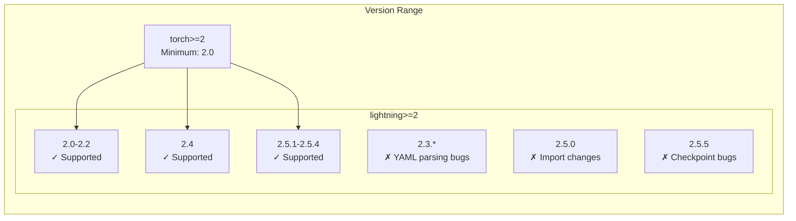
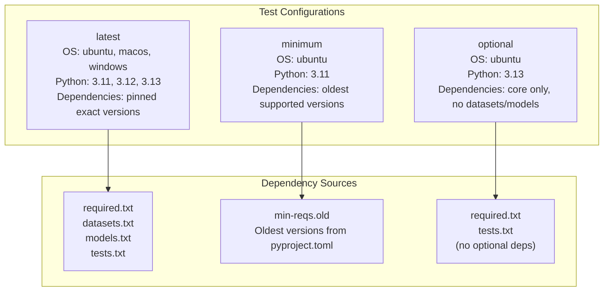
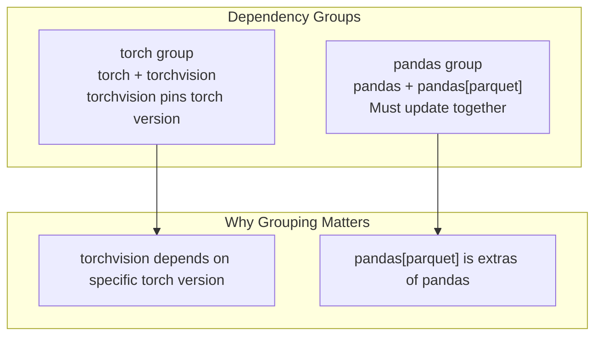
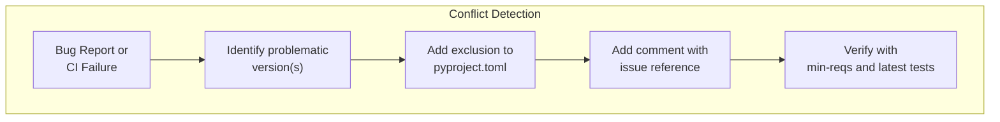
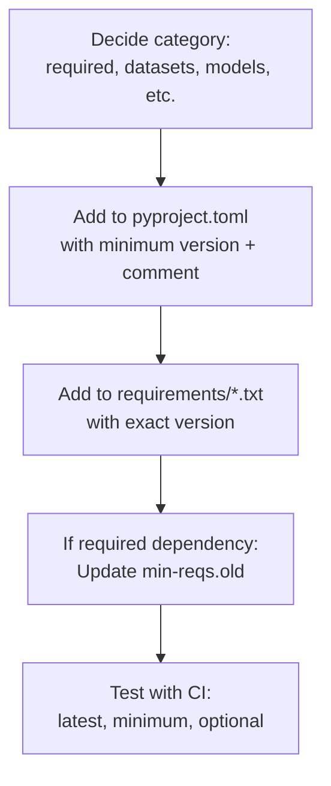

<!-- source: DeepWiki mcp.deepwiki.com · repo torchgeo/torchgeo · page 6.5 Dependency Management · fetched 2026-10-21 -->

# Dependency Management

<details>
<summary>Relevant source files</summary>

The following files were used as context for generating this wiki page:

- [.github/dependabot.yml](.github/dependabot.yml)
- [.pre-commit-config.yaml](.pre-commit-config.yaml)
- [pyproject.toml](pyproject.toml)
- [requirements/datasets.txt](requirements/datasets.txt)
- [requirements/min-reqs.old](requirements/min-reqs.old)
- [requirements/required.txt](requirements/required.txt)

</details>


## Purpose and Scope

This document explains TorchGeo's multi-file dependency management strategy, version pinning philosophy, and automated update mechanisms. It covers how dependencies are organized across multiple requirement files, how version constraints are managed to prevent conflicts, and how the CI/CD pipeline tests different dependency configurations.

For information about setting up a development environment, see [Development Setup](#6.1). For details about the CI/CD workflows that consume these dependencies, see [CI/CD Pipeline](#6.4).

---

## Dependency Organization Strategy

TorchGeo uses a dual-specification approach where dependencies are declared in both [`pyproject.toml`](pyproject.toml:37-90)() and pinned in separate files under [`requirements/`](requirements)().

### Multi-File Structure

```mermaid
graph TB
    subgraph "Dependency Specification"
        pyproject["pyproject.toml<br/>Flexible version ranges"]
    end
    
    subgraph "Pinned Versions"
        required["requirements/required.txt<br/>Core dependencies"]
        datasets["requirements/datasets.txt<br/>Optional: h5py, xarray, etc."]
        models["requirements/models.txt<br/>Optional: ultralytics, aurora"]
        style["requirements/style.txt<br/>Development: ruff, mypy"]
        tests["requirements/tests.txt<br/>Development: pytest, nbmake"]
        docs["requirements/docs.txt<br/>Documentation: sphinx, nbsphinx"]
        minreqs["requirements/min-reqs.old<br/>Minimum versions for testing"]
    end
    
    subgraph "CI/CD Workflows"
        latest["tests.yaml: latest<br/>Test with pinned versions"]
        minimum["tests.yaml: minimum<br/>Test with min versions"]
        optional["tests.yaml: optional<br/>Test without optional deps"]
        stylecheck["style.yaml<br/>mypy, ruff checks"]
        release["release.yaml<br/>Integration tests"]
    end
    
    pyproject --> required
    pyproject --> datasets
    pyproject --> models
    
    required --> latest
    datasets --> latest
    models --> latest
    tests --> latest
    
    minreqs --> minimum
    
    required --> optional
    tests --> optional
    
    required --> stylecheck
    style --> stylecheck
    
    pyproject --> release
```

**Purpose of Dual Specification**

| File | Purpose | Version Style | Updated By |
|------|---------|---------------|------------|
| `pyproject.toml` | Define minimum compatible versions | `>=X.Y.Z` with exclusions | Manual + review |
| `requirements/*.txt` | Lock exact versions for reproducibility | `==X.Y.Z` | Dependabot daily |
| `min-reqs.old` | Test backward compatibility | `==X.Y.Z` (oldest supported) | Manual when changing mins |

Sources: [pyproject.toml:37-154](), [requirements/required.txt:1-22](), [.github/workflows/tests.yaml:1-119]()

---

## Core Dependency Files

### pyproject.toml Dependencies

The [`dependencies`](pyproject.toml:37-90)() section defines **minimum version constraints** for all required packages:

```toml
dependencies = [
    "einops>=0.3",         # einops 0.3+ required for einops.repeat
    "torch>=2",            # torch 2+ required for Python 3.11 wheels
    "lightning>=2,!=2.3.*,!=2.5.0,<2.5.5",  # Complex exclusions
    ...
]
```

Each constraint includes a **comment explaining the rationale** for the minimum version. This makes it clear why specific versions are required.

**Optional Dependencies** are organized by feature category:

| Group | Purpose | Key Packages |
|-------|---------|--------------|
| `datasets` | Support for specialized data formats | `h5py`, `netcdf4`, `xarray`, `webdataset` |
| `models` | Optional model architectures | `ultralytics`, `microsoft-aurora` |
| `style` | Code quality tools | `mypy>=0.900`, `ruff>=0.9` |
| `tests` | Testing infrastructure | `pytest>=7.3`, `pytest-cov>=4`, `nbmake>=1.3.3` |
| `docs` | Documentation building | `sphinx>=4,<6`, `nbsphinx>=0.8.5` |
| `all` | Installs all optional dependencies | All of the above |

Sources: [pyproject.toml:37-154]()

### requirements/*.txt Files

These files contain **exact pinned versions** that are known to work together:

#### required.txt
Contains the 21 core dependencies needed for basic TorchGeo functionality:

```
einops==0.8.1
torch==2.8.0
lightning==2.5.4
rasterio==1.4.3
geopandas==1.0.1
...
```

Sources: [requirements/required.txt:1-22]()

#### datasets.txt
Contains 12 optional packages for dataset support:

```
h5py==3.14.0
xarray==2025.10.0
netcdf4==1.7.2
webdataset==0.2.111
...
```

Sources: [requirements/datasets.txt:1-13]()

#### models.txt, style.txt, tests.txt, docs.txt
Each contains dependencies for specific optional features, mirroring the structure in `pyproject.toml`.

Sources: [requirements/](requirements)

---

## Version Constraint Philosophy

### Minimum Version Constraints (pyproject.toml)

TorchGeo specifies **minimum versions** in `pyproject.toml` using the `>=` operator:

```python
"torch>=2",                    # Allow any torch 2.x or later
"lightning>=2,!=2.3.*,!=2.5.0,<2.5.5",  # With exclusions
"rasterio>=1.4.3",            # Must be at least 1.4.3
```

**Exclusion patterns** handle known incompatible versions:



**Common exclusion reasons** documented in comments:

| Exclusion | Reason | Issue Reference |
|-----------|--------|-----------------|
| `lightly!=1.4.26` | Incompatible with timm required by SMP | [#1824](https://github.com/torchgeo/torchgeo/issues/1824) |
| `lightning!=2.3.*` | YAML parsing bugs | [Lightning #19977](https://github.com/Lightning-AI/pytorch-lightning/issues/19977) |
| `lightning!=2.5.0` | Backwards-incompatible imports | [Lightning #20511](https://github.com/Lightning-AI/pytorch-lightning/issues/20511) |
| `lightning<2.5.5` | Checkpoint loading bugs | [#2995](https://github.com/torchgeo/torchgeo/issues/2995) |

Sources: [pyproject.toml:37-90]()

### Exact Version Pinning (requirements/*.txt)

The `requirements/*.txt` files pin **exact versions** that are verified to work together:

```python
torch==2.8.0        # Not >=2.8.0, exactly 2.8.0
lightning==2.5.4    # Not >=2.5.4, exactly 2.5.4
```

This ensures:
- **Reproducible builds** across development machines
- **Consistent CI results** across test runs
- **Known-good combinations** that pass all tests

Sources: [requirements/required.txt:1-22]()

---

## Testing Multiple Dependency Configurations

The CI/CD pipeline tests three different dependency configurations to ensure compatibility:

### Configuration Matrix



Sources: [.github/workflows/tests.yaml:15-115]()

### latest Configuration

Tests the **current pinned versions** across multiple operating systems and Python versions:

```yaml
# .github/workflows/tests.yaml
strategy:
  matrix:
    os: [ubuntu-latest, macos-latest, windows-latest]
    python-version: ['3.11', '3.12', '3.13']
```

**Cache key includes all requirement files** to invalidate cache when dependencies change:

```yaml
key: ${{ runner.os }}-${{ runner.arch }}-Python-${{ steps.setup-python.outputs.python-version }}-${{ hashFiles('requirements/required.txt', 'requirements/datasets.txt', 'requirements/models.txt', 'requirements/tests.txt') }}
```

Sources: [.github/workflows/tests.yaml:15-51]()

### minimum Configuration

Tests **backward compatibility** with the oldest supported versions:

```yaml
# .github/workflows/tests.yaml
- name: Install pip dependencies
  run: pip install -r requirements/min-reqs.old
```

The [`min-reqs.old`](requirements/min-reqs.old:1-45)() file contains exact versions matching the minimum constraints in `pyproject.toml`:

```
einops==0.3.0        # Matches einops>=0.3 in pyproject.toml
torch==2.0.0         # Matches torch>=2 in pyproject.toml
lightning==2.0.0     # Matches lightning>=2 (with exclusions) in pyproject.toml
```

Sources: [.github/workflows/tests.yaml:52-83](), [requirements/min-reqs.old:1-45]()

### optional Configuration

Tests that **core functionality works without optional dependencies**:

```yaml
# .github/workflows/tests.yaml
- name: Install pip dependencies
  run: pip install -r requirements/required.txt -r requirements/tests.txt
```

This ensures users can install with `pip install torchgeo` (without extras) and still use basic features.

Sources: [.github/workflows/tests.yaml:84-115]()

---

## Automated Dependency Management

### Dependabot Configuration

Dependabot automatically checks for dependency updates **daily** for pip packages:

```yaml
# .github/dependabot.yml
- package-ecosystem: 'pip'
  directory: '/requirements'
  schedule:
    interval: 'daily'
```

Sources: [.github/dependabot.yml:12-42]()

### Dependency Grouping

Related packages are grouped to ensure they're updated together:



**Configuration:**

```yaml
groups:
  pandas:
    patterns:
      - 'pandas'
      - 'pandas[parquet]'
  torch:
    patterns:
      - 'torch'
      - 'torchvision'
```

Sources: [.github/dependabot.yml:16-25]()

### Ignored Updates

Some updates are intentionally ignored to prevent known issues:

| Package | Version | Reason |
|---------|---------|--------|
| `lightning` | `>=2.5.5` | Checkpoint loading bugs ([#2995](https://github.com/torchgeo/torchgeo/issues/2995)) |
| `sphinx` | `>=6` | Incompatible with pytorch-sphinx-theme ([pytorch_sphinx_theme#175](https://github.com/pytorch/pytorch_sphinx_theme/issues/175)) |
| `ultralytics` | Patch updates | Releases almost daily, too noisy |

**Configuration:**

```yaml
ignore:
  - dependency-name: 'lightning'
    versions: '>=2.5.5'
  - dependency-name: 'sphinx'
    versions: '>=6'
  - dependency-name: 'ultralytics'
    update-types: ['version-update:semver-patch']
```

Sources: [.github/dependabot.yml:26-37]()

---

## Conflict Resolution Strategy

### Known Incompatibility Patterns

TorchGeo uses **explicit exclusions** in `pyproject.toml` to handle known conflicts:



**Example conflict resolution:**

```python
# pyproject.toml
dependencies = [
    # lightly 1.4.26 is incompatible with the version of timm required by smp
    # https://github.com/torchgeo/torchgeo/issues/1824
    "lightly>=1.4.5,!=1.4.26",
]
```

Sources: [pyproject.toml:48-51]()

### Adding Exclusions

When a new incompatibility is discovered:

1. **Add exclusion** to `pyproject.toml` with version constraint
2. **Add comment** with link to issue explaining the conflict
3. **Update Dependabot** ignore rules if permanent exclusion
4. **Test** with both `min-reqs.old` and `requirements/*.txt`

Sources: [pyproject.toml:37-90](), [.github/dependabot.yml:26-37]()

---

## Adding or Updating Dependencies

### Adding a New Dependency



**Step-by-step process:**

1. **Determine category**: Is it required, optional (datasets/models), or development-only (style/tests/docs)?

2. **Add to `pyproject.toml`** with minimum version and explanatory comment:
   ```python
   dependencies = [
       # newpackage 1.5+ required for feature X
       "newpackage>=1.5",
   ]
   ```

3. **Add to appropriate `requirements/*.txt`** with exact version:
   ```
   newpackage==1.5.2
   ```

4. **Update `min-reqs.old`** if it's a required dependency:
   ```
   newpackage==1.5.0
   ```

5. **Run tests locally** and ensure CI passes all configurations

Sources: [pyproject.toml:37-154](), [requirements/min-reqs.old:1-45]()

### Updating Existing Dependencies

**Automated via Dependabot:**

1. Dependabot creates PR daily with updates to `requirements/*.txt`
2. CI runs all test configurations (latest, minimum, optional)
3. If tests pass, maintainers merge the PR
4. If tests fail, maintainers investigate and may add exclusions

**Manual updates:**

1. **Update `pyproject.toml`** if changing minimum version requirement
2. **Update all `requirements/*.txt`** files to latest compatible versions
3. **Update `min-reqs.old`** if minimum version changed
4. **Document reason** in comments if adding exclusions
5. **Run full test suite** including slow integration tests

Sources: [.github/dependabot.yml:12-42](), [.github/workflows/tests.yaml:1-119]()

---

## Dependency Cache Strategy

The CI workflows use **aggressive caching** to speed up builds:

```yaml
# .github/workflows/tests.yaml
- name: Cache dependencies
  uses: actions/cache@v4.3.0
  with:
    path: ${{ env.pythonLocation }}
    key: ${{ runner.os }}-${{ runner.arch }}-Python-${{ steps.setup-python.outputs.python-version }}-${{ hashFiles('requirements/required.txt', 'requirements/datasets.txt', 'requirements/models.txt', 'requirements/tests.txt') }}
```

**Cache invalidation triggers:**
- Changes to any `requirements/*.txt` file
- Python version change
- OS or architecture change

**Cache benefits:**
- Reduces CI time from ~5 minutes to ~2 minutes
- Reduces load on PyPI servers
- Ensures consistent environment across test runs

Sources: [.github/workflows/tests.yaml:30-36](), [.github/workflows/style.yaml:26-31]()

---

## Summary

TorchGeo's dependency management strategy balances **flexibility** and **reproducibility**:

| Aspect | Implementation | Benefit |
|--------|---------------|---------|
| Dual specification | `pyproject.toml` (minimums) + `requirements/*.txt` (exact) | Users can upgrade, CI gets reproducibility |
| Multi-file organization | Separate files for required/optional/dev deps | Users install only what they need |
| Explicit exclusions | Version constraints with issue references | Known conflicts documented and prevented |
| Multi-config testing | latest, minimum, optional workflows | Ensures compatibility across version ranges |
| Automated updates | Dependabot with grouping and ignores | Dependencies stay current without manual work |

This approach supports a diverse user base ranging from minimal installations to full development environments, while maintaining high code quality and compatibility guarantees.

Sources: [pyproject.toml:1-352](), [requirements/](), [.github/workflows/tests.yaml:1-119](), [.github/dependabot.yml:1-43]()

---

