# Page: Overview

# Overview

<details>
<summary>Relevant source files</summary>

The following files were used as context for generating this wiki page:

- [CITATION.cff](CITATION.cff)
- [README.md](README.md)
- [docs/user/installation.rst](docs/user/installation.rst)
- [images/geodataset.png](images/geodataset.png)
- [images/inria.png](images/inria.png)
- [images/vhr10.png](images/vhr10.png)

</details>


TorchGeo is a PyTorch domain library that provides datasets, samplers, transforms, and pre-trained models for working with geospatial data. It serves as the geospatial equivalent of torchvision, bridging the gap between machine learning practitioners and remote sensing experts by providing standardized tools for loading, processing, and training models on satellite imagery and related geospatial datasets.

**Purpose**: This page provides a comprehensive overview of TorchGeo's architecture, core abstractions, and component interactions. It is intended for developers who need to understand how the library is organized and how its pieces fit together.

**Scope**: This document covers the high-level system design, core abstractions, and main functional areas. For detailed information on specific topics, see:
- Dataset implementations and usage patterns: [Dataset System](#2)
- Data loading and preprocessing details: [Data Loading Pipeline](#3)
- Model architectures and pre-trained weights: [Models and Pre-trained Weights](#4)
- Training workflows and task configurations: [Training System](#5)

Sources: [README.md:1-275]()

## What TorchGeo Provides

TorchGeo addresses the unique challenges of working with geospatial data:

- **Geographic indexing**: Datasets that use spatial coordinates (latitude/longitude, CRS) rather than integer indices
- **Multi-source composition**: Ability to combine datasets from different satellites and sensors with different resolutions and coordinate systems
- **Pre-trained weights**: Models trained on satellite imagery (Sentinel-1/2, Landsat, NAIP) rather than just ImageNet
- **Domain-specific transforms**: Spectral indices (NDVI, NDWI, NDBI) and other remote sensing preprocessing operations
- **Benchmark datasets**: 67+ curated datasets for reproducible comparisons

The library supports both **geospatial datasets** (continent-scale imagery with spatial indexing) and **non-geospatial benchmark datasets** (pre-chipped images with standard integer indexing).

Sources: [README.md:3-9](), [README.md:67-115]()

## System Architecture

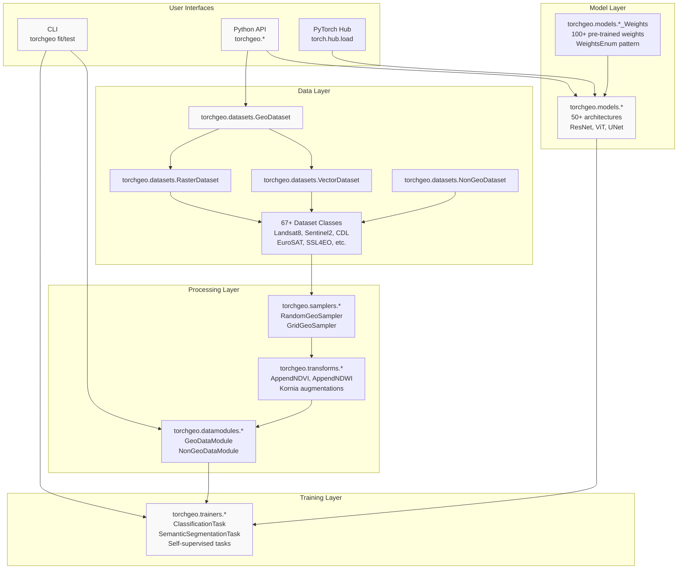

**Architecture Overview**: TorchGeo is organized into five functional layers:

1. **User Interfaces**: Three entry points - direct Python imports (most flexible), CLI for configuration-driven training, and PyTorch Hub for model loading
2. **Data Layer**: Dataset abstractions supporting both geospatial (coordinate-based) and non-geospatial (index-based) access patterns
3. **Processing Layer**: Components for sampling patches, applying transforms, and managing train/val/test splits
4. **Model Layer**: Architecture implementations and pre-trained weights with sensor-aware metadata
5. **Training Layer**: PyTorch Lightning trainers encapsulating task-specific logic

Sources: [README.md:3-9](), [README.md:52-249]()

## Core Package Structure

The library is organized into the following top-level modules:

| Module | Purpose | Key Classes/Functions |
|--------|---------|----------------------|
| `torchgeo.datasets` | Dataset implementations | `GeoDataset`, `RasterDataset`, `VectorDataset`, `NonGeoDataset`, 67+ concrete datasets |
| `torchgeo.samplers` | Spatial sampling strategies | `RandomGeoSampler`, `GridGeoSampler`, `PreChippedGeoSampler` |
| `torchgeo.transforms` | Data augmentation and preprocessing | `AppendNDVI`, `AppendNDWI`, `AppendNDBI`, Kornia wrappers |
| `torchgeo.datamodules` | Lightning DataModules | `GeoDataModule`, `NonGeoDataModule`, task-specific modules |
| `torchgeo.models` | Model architectures and weights | `get_model()`, `get_weight()`, `ResNet18_Weights`, etc. |
| `torchgeo.trainers` | Training task definitions | `ClassificationTask`, `SemanticSegmentationTask`, `SimCLRTask` |

Sources: [README.md:55-65](), [README.md:155-187]()

## Dataset Abstractions

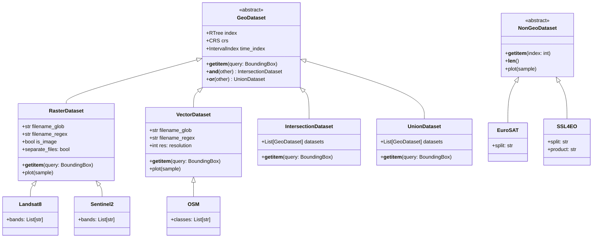

**Key Abstractions**:

- **`GeoDataset`**: Base class for datasets with spatial/temporal indexing using `BoundingBox` queries instead of integer indices. Supports composition via `&` (intersection) and `|` (union) operators.

- **`RasterDataset`**: Handles raster imagery (GeoTIFF, NetCDF, HDF5). Automatically builds spatial index from file metadata, handles CRS transformations, and merges multi-file scenes.

- **`VectorDataset`**: Handles vector data (GeoJSON, Shapefile). Rasterizes geometries on-the-fly or extracts keypoint features.

- **`NonGeoDataset`**: Standard PyTorch dataset pattern with integer indexing for benchmark datasets (EuroSAT, SSL4EO, etc.).

Sources: [README.md:67-115]()

## Data Flow Pipeline

```mermaid
flowchart LR
    subgraph "Input Data"
        Files["Raw Files<br/>GeoTIFF, HDF5, etc."]
    end
    
    subgraph "Dataset Creation"
        RD["RasterDataset<br/>e.g., Landsat8"]
        Index["Build RTree Index<br/>from file metadata"]
    end
    
    subgraph "Composition"
        Union["UnionDataset<br/>operator |"]
        Intersection["IntersectionDataset<br/>operator &"]
    end
    
    subgraph "Sampling"
        RandomSampler["RandomGeoSampler<br/>sample(BoundingBox)"]
        GridSampler["GridGeoSampler<br/>non-overlapping tiles"]
    end
    
    subgraph "Preprocessing"
        Indices["Spectral Indices<br/>AppendNDVI, etc."]
        Augment["Augmentations<br/>Kornia wrappers"]
    end
    
    subgraph "Batching"
        Collate["Collate Functions<br/>stack_samples<br/>concat_samples"]
        DataLoader["PyTorch DataLoader"]
    end
    
    subgraph "Training"
        Batch["Mini-batch<br/>image: Tensor<br/>mask: Tensor<br/>metadata: dict"]
    end
    
    Files --> RD
    RD --> Index
    Index --> Union
    Index --> Intersection
    Union --> RandomSampler
    Intersection --> RandomSampler
    Union --> GridSampler
    Intersection --> GridSampler
    RandomSampler --> Indices
    GridSampler --> Indices
    Indices --> Augment
    Augment --> Collate
    Collate --> DataLoader
    DataLoader --> Batch
```

**Pipeline Stages**:

1. **Dataset Creation**: `RasterDataset` subclasses scan directories matching `filename_glob` patterns and build spatial indices
2. **Composition**: Multiple datasets combined via `&` (intersection - imagery + labels) or `|` (union - multi-source imagery)
3. **Sampling**: `RandomGeoSampler` generates random `BoundingBox` queries; `GridGeoSampler` generates non-overlapping tiles
4. **Preprocessing**: Transforms like `AppendNDVI` compute spectral indices; Kornia augmentations applied for training
5. **Batching**: Custom collate functions (`stack_samples`, `concat_samples`) handle variable-size inputs
6. **Training**: PyTorch `DataLoader` yields mini-batches with standardized dictionary structure

Sources: [README.md:73-103]()

## Model and Weight Management

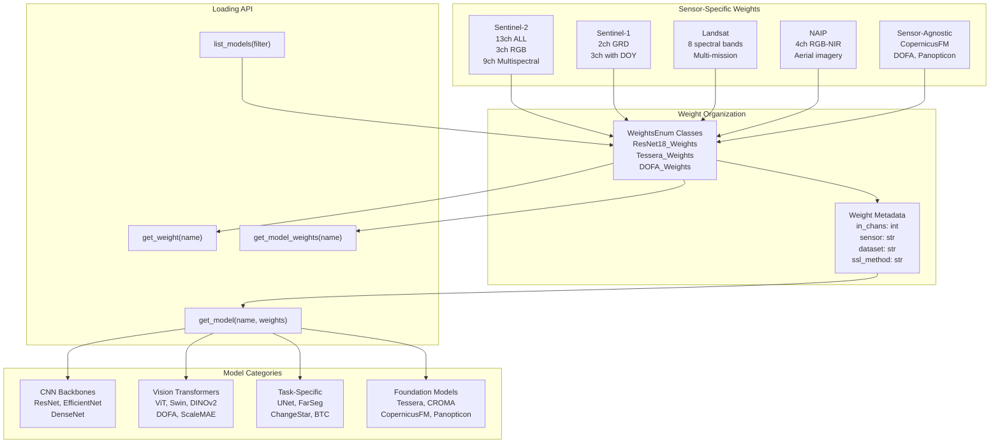

**Weight System**: TorchGeo adopts torchvision's `WeightsEnum` pattern for managing 100+ pre-trained weights. Each weight includes metadata about input channels, sensor type, pretraining dataset, and training method (supervised, self-supervised, multi-modal).

**Usage Pattern**:
```python
from torchgeo.models import ResNet18_Weights, get_model

# Option 1: Using enum
weights = ResNet18_Weights.SENTINEL2_ALL_MOCO
model = get_model("resnet18", weights=weights)

# Option 2: String-based
model = get_model("resnet18", weights="sentinel2_all_moco")

# Option 3: Load state dict manually
state_dict = weights.get_state_dict(progress=True)
```

**Sensor Categories**:
- **Sentinel-2**: 13-channel multispectral, 3-channel RGB, 9-channel multispectral variants
- **Sentinel-1**: 2-channel SAR (VV/VH), 3-channel with day-of-year encoding
- **Landsat**: 8 spectral bands across Landsat 7/8/9 missions
- **NAIP**: 4-channel RGB + near-infrared aerial imagery
- **Sensor-Agnostic**: Foundation models (DOFA, CopernicusFM, Panopticon) trained on multiple sensors

Sources: [README.md:155-168]()

## Training Framework

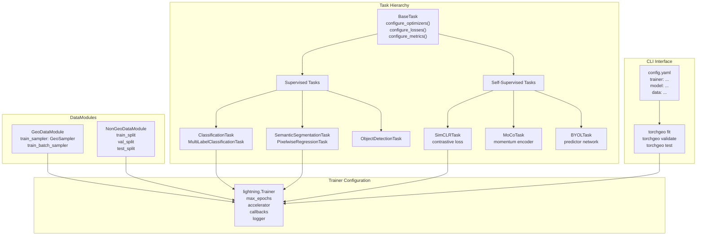

**Training Architecture**: TorchGeo leverages PyTorch Lightning's `LightningModule` abstraction through a hierarchy of task classes:

- **`BaseTask`**: Common interface for optimizer configuration, metric logging, and checkpoint management
- **Supervised Tasks**: Standard computer vision tasks (classification, segmentation, detection) with task-specific models, losses, and metrics
- **Self-Supervised Tasks**: Contrastive learning methods (SimCLR, MoCo, BYOL) for pretraining on unlabeled satellite imagery

**DataModule Integration**: `GeoDataModule` and `NonGeoDataModule` encapsulate data loading logic with well-defined train/val/test splits and preprocessing pipelines.

**CLI Usage**:
```bash
# Train a model
torchgeo fit --config config.yaml

# Validate only
torchgeo validate --config config.yaml --ckpt_path path/to/checkpoint.ckpt

# Test and report metrics
torchgeo test --config config.yaml --ckpt_path path/to/checkpoint.ckpt
```

Sources: [README.md:170-251]()

## Example Usage Patterns

### Geospatial Data Composition

```python
from torchgeo.datasets import Landsat7, Landsat8, CDL
from torchgeo.samplers import RandomGeoSampler
from torch.utils.data import DataLoader

# Create union of Landsat 7 and 8 (combine multi-source imagery)
landsat7 = Landsat7(paths="...", bands=["B1", ..., "B7"])
landsat8 = Landsat8(paths="...", bands=["B2", ..., "B8"])
landsat = landsat7 | landsat8

# Create intersection with labels (imagery + labels)
cdl = CDL(paths="...", download=True, checksum=True)
dataset = landsat & cdl

# Sample 256x256 patches
sampler = RandomGeoSampler(dataset, size=256, length=10000)
dataloader = DataLoader(dataset, batch_size=128, sampler=sampler, 
                       collate_fn=stack_samples)

for batch in dataloader:
    image = batch["image"]  # Tensor of shape (B, C, H, W)
    mask = batch["mask"]    # Tensor of shape (B, H, W)
```

**Key Concepts**:
- `|` operator creates `UnionDataset` - queries return data from first matching dataset
- `&` operator creates `IntersectionDataset` - queries must be present in all datasets
- `RandomGeoSampler` generates `BoundingBox` queries for spatial sampling
- `stack_samples` collates dictionary samples into batched tensors

Sources: [README.md:73-103]()

### Benchmark Dataset Training

```python
from lightning.pytorch import Trainer
from torchgeo.datamodules import InriaAerialImageLabelingDataModule
from torchgeo.trainers import SemanticSegmentationTask

# DataModule handles train/val/test splits and preprocessing
datamodule = InriaAerialImageLabelingDataModule(
    root="...", 
    batch_size=64, 
    num_workers=6
)

# Task encapsulates model, loss, optimizer, and metrics
task = SemanticSegmentationTask(
    model="unet",
    backbone="resnet50",
    weights=True,  # Use ImageNet weights
    in_channels=3,
    num_classes=2,
    loss="bce"
)

# Standard Lightning training
trainer = Trainer(max_epochs=20, accelerator="gpu")
trainer.fit(model=task, datamodule=datamodule)
```

**Key Concepts**:
- DataModules provide complete data loading pipeline with well-defined splits
- Tasks encapsulate model architecture, loss function, optimizer, and evaluation metrics
- PyTorch Lightning handles training loop, checkpointing, and logging

Sources: [README.md:170-187]()

### Pre-trained Weight Loading

```python
import timm
from torchgeo.models import ResNet18_Weights

# Get weight metadata
weights = ResNet18_Weights.SENTINEL2_ALL_MOCO
print(f"Input channels: {weights.meta['in_chans']}")  # 13
print(f"Sensor: {weights.meta['sensor']}")           # sentinel2
print(f"Dataset: {weights.meta['dataset']}")         # ssl4eo_l

# Create model with correct input channels
model = timm.create_model("resnet18", 
                         in_chans=weights.meta["in_chans"],
                         num_classes=10)

# Load pre-trained weights
model.load_state_dict(weights.get_state_dict(progress=True), strict=False)
```

**Key Concepts**:
- `WeightsEnum` classes provide type-safe access to pre-trained weights
- Weight metadata includes sensor type, input channels, pretraining dataset, and method
- Weights trained on Sentinel-2's 13 spectral bands transfer better to satellite imagery than ImageNet RGB weights

Sources: [README.md:155-168]()

## Installation and Distribution

TorchGeo is distributed through three package managers:

| Package Manager | Installation Command | Notes |
|----------------|---------------------|-------|
| pip | `pip install torchgeo` | Recommended; supports optional dependencies |
| conda | `conda install -c conda-forge torchgeo` | Stable releases only; required dependencies |
| spack | `spack install py-torchgeo` | HPC environments; supports variants |

**Optional Dependencies**:
```bash
# Install with dataset support
pip install torchgeo[datasets]

# Install with model support  
pip install torchgeo[models]

# Install all optional dependencies
pip install torchgeo[all]

# Development installation
pip install torchgeo[style,tests,docs]
```

**Dependency Groups** (defined in `pyproject.toml`):
- `datasets`: Rasterio, GeoPandas, Shapely for geospatial data loading
- `models`: Timm, Segmentation-Models-PyTorch for model architectures
- `style`: Ruff, mypy, prettier for code quality
- `tests`: Pytest, pytest-cov for testing
- `docs`: Sphinx, nbsphinx for documentation

Sources: [README.md:28-36](), [docs/user/installation.rst:1-84]()

## Key Design Patterns

### Spatial Indexing with RTree

All `GeoDataset` subclasses maintain an RTree spatial index mapping `BoundingBox` queries to data files:

```python
from rtree import index
from torchgeo.datasets import BoundingBox

# Internal to RasterDataset
self.index = index.Index(interleaved=False)

# When files are discovered, add bounds to index
for filepath in filepaths:
    minx, maxx, miny, maxy, mint, maxt = self._get_bounds(filepath)
    coords = (minx, maxx, miny, maxy, mint, maxt)
    self.index.insert(id, coords, filepath)

# Query returns matching file paths
hits = self.index.intersection(query.bounds)
```

This enables efficient spatial queries on continental-scale datasets without loading all files into memory.

### Dataset Composition Operators

The `&` and `|` operators create composite datasets that transparently handle multiple data sources:

```python
# Union: queries return from first matching dataset
dataset1 | dataset2  # -> UnionDataset([dataset1, dataset2])

# Intersection: queries must be present in all datasets  
dataset1 & dataset2  # -> IntersectionDataset([dataset1, dataset2])

# Composition is associative
(imagery1 | imagery2) & labels
```

### WeightsEnum Pattern

Following torchvision's multi-weight API:

```python
from enum import Enum
from torchgeo.models._api import WeightsEnum

class ResNet18_Weights(WeightsEnum):
    SENTINEL2_ALL_MOCO = Weights(
        url="...",
        transforms=...,
        meta={
            "in_chans": 13,
            "sensor": "sentinel2", 
            "dataset": "ssl4eo_l",
            "ssl_method": "moco"
        }
    )
```

This provides type safety, metadata discoverability, and consistent API across all model architectures.

Sources: [README.md:155-168]()

## Summary

TorchGeo provides a complete toolkit for geospatial deep learning:

1. **Dataset Abstractions**: Unified interface for geospatial (coordinate-based) and non-geospatial (index-based) datasets
2. **Spatial Sampling**: Efficient patch extraction from continent-scale imagery via `RandomGeoSampler` and `GridGeoSampler`
3. **Data Composition**: Algebraic operators (`&`, `|`) for combining multi-source datasets
4. **Pre-trained Models**: 100+ weights trained on satellite imagery across multiple sensors
5. **Training Framework**: PyTorch Lightning tasks for classification, segmentation, detection, and self-supervised learning
6. **CLI Interface**: Configuration-driven training for reproducible experiments

The library's design prioritizes flexibility (direct Python API), reproducibility (Lightning DataModules and CLI), and domain expertise (sensor-aware weights, spectral transforms).

For detailed information on specific components, see the relevant section pages linked at the top of this document.

Sources: [README.md:1-275](), [CITATION.cff:1-42]()

---

# Page: Installation

# Installation

<details>
<summary>Relevant source files</summary>

The following files were used as context for generating this wiki page:

- [.github/dependabot.yml](.github/dependabot.yml)
- [.pre-commit-config.yaml](.pre-commit-config.yaml)
- [CITATION.cff](CITATION.cff)
- [README.md](README.md)
- [docs/user/installation.rst](docs/user/installation.rst)
- [images/geodataset.png](images/geodataset.png)
- [images/inria.png](images/inria.png)
- [images/vhr10.png](images/vhr10.png)
- [pyproject.toml](pyproject.toml)
- [requirements/datasets.txt](requirements/datasets.txt)
- [requirements/min-reqs.old](requirements/min-reqs.old)
- [requirements/required.txt](requirements/required.txt)

</details>


TorchGeo can be installed via pip, conda, or spack. The library requires Python 3.12+ and includes required dependencies plus optional groups for datasets, models, documentation, testing, and style checking. For development installation, see page 6.1.

**Sources:** [pyproject.toml:13](), [README.md:28-36](), [docs/user/installation.rst:1-4]()

## Installation via pip

TorchGeo is distributed as a pure-Python package on PyPI. Install the latest stable release:

```bash
pip install torchgeo
```

Install a development version from the main branch:

```bash
pip install git+https://github.com/torchgeo/torchgeo.git
```

Install from a local checkout:

```bash
git clone https://github.com/torchgeo/torchgeo.git
cd torchgeo
pip install .
```

### Optional Dependencies

The base installation includes only required dependencies. Optional groups are installed using bracket notation:

```bash
# Single group
pip install torchgeo[datasets]

# Multiple groups
pip install torchgeo[datasets,models]

# All optional dependencies
pip install torchgeo[all]
```

Available optional groups:
- `datasets`: HDF5, NetCDF, LAS, Parquet, WebDataset support
- `models`: Foundation models (microsoft-aurora)
- `docs`: Sphinx documentation building
- `style`: Code formatting and type checking (ruff, mypy)
- `tests`: Testing infrastructure (pytest, nbmake)
- `all`: All of the above

**Sources:** [docs/user/installation.rst:6-37](), [pyproject.toml:92-158](), [requirements/datasets.txt:1-13]()

## Installation via conda

TorchGeo is available on conda-forge. Configure conda to prioritize conda-forge:

```bash
conda config --add channels conda-forge
conda config --set channel_priority strict
conda install torchgeo
```

Conda packages include only stable releases and required dependencies. Optional dependencies must be installed separately via pip.

**Sources:** [docs/user/installation.rst:39-56](), [README.md:36]()

## Installation via spack

For HPC environments, spack supports source-based builds with build variants:

```bash
# Stable release
spack install py-torchgeo
spack load py-torchgeo

# Development version from main branch
spack install py-torchgeo@main

# With optional dependencies (build variants)
spack install py-torchgeo+datasets+models

# List available variants
spack info py-torchgeo
```

**Sources:** [docs/user/installation.rst:59-83]()

## Required Dependencies

Title: **Required Dependencies by Category**

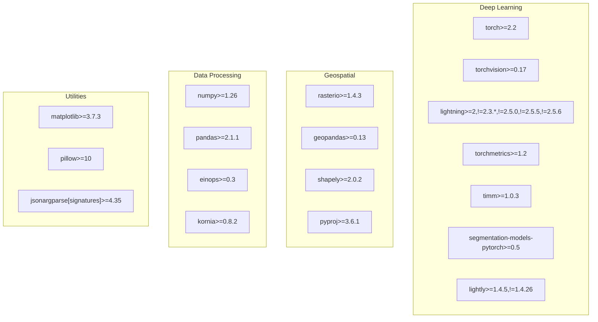

Required dependencies are listed in [pyproject.toml:37-89]() with minimum version constraints. The pinned versions used in CI are specified in [requirements/required.txt:1-22]().

**Sources:** [pyproject.toml:37-89](), [requirements/required.txt:1-22]()

## Optional Dependencies

Title: **Optional Dependency Groups**

| Group | Purpose | Key Packages | Used By |
|-------|---------|--------------|---------|
| `datasets` | Additional data formats | h5py, netcdf4, laspy, xarray, rioxarray, webdataset, pycocotools | Datasets requiring HDF5, NetCDF, point clouds, Parquet |
| `models` | Foundation models | microsoft-aurora | Aurora atmospheric model |
| `docs` | Documentation | sphinx, nbsphinx, myst-parser, pydata-sphinx-theme | Building API docs and tutorials |
| `style` | Code quality | mypy, ruff, types-* | Type checking, linting, formatting |
| `tests` | Testing | pytest, pytest-cov, nbmake | Running test suite |

Optional dependencies are defined in [pyproject.toml:92-158]() and pinned versions are in [requirements/datasets.txt:1-13]().

**Sources:** [pyproject.toml:92-158](), [requirements/datasets.txt:1-13]()

## Version Constraints

TorchGeo requires **Python 3.12+** as specified in [pyproject.toml:13](). 

### Critical Version Exclusions

Certain package versions are excluded due to known bugs:

| Package | Excluded Versions | Reason |
|---------|-------------------|--------|
| lightning | 2.3.*, 2.5.0, 2.5.5, 2.5.6 | YAML parsing bugs, import changes, checkpoint loading issues |
| lightly | 1.4.26 | Incompatible with timm version required by segmentation-models-pytorch |

**Sources:** [pyproject.toml:46-58]()

### Minimum Tested Versions

The [requirements/min-reqs.old:1-44]() file specifies the oldest supported versions tested in CI:

| Package | Minimum | Note |
|---------|---------|------|
| torch | 2.2.0 | Python 3.12 wheels |
| lightning | 2.0.0 | LightningCLI args support |
| rasterio | 1.4.3 | WarpedVRT merging, positive y-resolution |
| geopandas | 0.13.0 | GeoDataFrame.get_coordinates() |
| timm | 1.0.3 | forward_intermediates for ViT |
| kornia | 0.8.2 | VideoSequential fix |
| segmentation-models-pytorch | 0.5.0 | UnetDecoder API |

**Sources:** [requirements/min-reqs.old:1-24](), [pyproject.toml:37-89]()

## Command Line Interface

After installation, TorchGeo provides a command-line interface for training and evaluation:

```bash
# Available after installation
torchgeo --help
torchgeo fit --help
torchgeo validate --help
torchgeo test --help

# Alternative invocation
python3 -m torchgeo
```

The CLI is registered via the `[project.scripts]` section and provides access to Lightning-based training workflows.

**Sources:** [pyproject.toml:156-157](), [README.md:193-213]()

## Verification

After installation, verify TorchGeo is correctly installed:

```python
import torchgeo
print(torchgeo.__version__)

# Check available modules
from torchgeo import datasets, samplers, transforms, models, trainers
```

**Sources:** [pyproject.toml:10-11](), [docs/conf.py:22-30]()

---

# Page: System Architecture

# System Architecture

<details>
<summary>Relevant source files</summary>

The following files were used as context for generating this wiki page:

- [CITATION.cff](CITATION.cff)
- [README.md](README.md)
- [docs/user/installation.rst](docs/user/installation.rst)
- [images/geodataset.png](images/geodataset.png)
- [images/inria.png](images/inria.png)
- [images/vhr10.png](images/vhr10.png)
- [tests/conf/vhr10_ins_seg.yaml](tests/conf/vhr10_ins_seg.yaml)
- [tests/conf/vhr10_obj_det.yaml](tests/conf/vhr10_obj_det.yaml)
- [tests/data/naip/data.py](tests/data/naip/data.py)
- [tests/data/naip/m_3807511_ne_18_060_20181104.tif](tests/data/naip/m_3807511_ne_18_060_20181104.tif)
- [tests/data/naip/m_3807511_ne_18_060_20190605.tif](tests/data/naip/m_3807511_ne_18_060_20190605.tif)
- [tests/data/vector/data.py](tests/data/vector/data.py)
- [tests/data/vector/vector_2024.geojson](tests/data/vector/vector_2024.geojson)
- [tests/data/vector/vector_2024.parquet](tests/data/vector/vector_2024.parquet)
- [tests/datasets/test_geo.py](tests/datasets/test_geo.py)
- [tests/datasets/test_utils.py](tests/datasets/test_utils.py)
- [tests/models/test_btc.py](tests/models/test_btc.py)
- [tests/trainers/test_byol.py](tests/trainers/test_byol.py)
- [tests/trainers/test_classification.py](tests/trainers/test_classification.py)
- [tests/trainers/test_detection.py](tests/trainers/test_detection.py)
- [tests/trainers/test_instance_segmentation.py](tests/trainers/test_instance_segmentation.py)
- [tests/trainers/test_moco.py](tests/trainers/test_moco.py)
- [tests/trainers/test_regression.py](tests/trainers/test_regression.py)
- [tests/trainers/test_simclr.py](tests/trainers/test_simclr.py)
- [torchgeo/datasets/cdl.py](torchgeo/datasets/cdl.py)
- [torchgeo/datasets/geo.py](torchgeo/datasets/geo.py)
- [torchgeo/datasets/landsat.py](torchgeo/datasets/landsat.py)
- [torchgeo/datasets/naip.py](torchgeo/datasets/naip.py)
- [torchgeo/datasets/sentinel.py](torchgeo/datasets/sentinel.py)
- [torchgeo/datasets/utils.py](torchgeo/datasets/utils.py)
- [torchgeo/models/btc.py](torchgeo/models/btc.py)
- [torchgeo/trainers/base.py](torchgeo/trainers/base.py)
- [torchgeo/trainers/byol.py](torchgeo/trainers/byol.py)
- [torchgeo/trainers/classification.py](torchgeo/trainers/classification.py)
- [torchgeo/trainers/detection.py](torchgeo/trainers/detection.py)
- [torchgeo/trainers/instance_segmentation.py](torchgeo/trainers/instance_segmentation.py)
- [torchgeo/trainers/iobench.py](torchgeo/trainers/iobench.py)
- [torchgeo/trainers/moco.py](torchgeo/trainers/moco.py)
- [torchgeo/trainers/regression.py](torchgeo/trainers/regression.py)
- [torchgeo/trainers/segmentation.py](torchgeo/trainers/segmentation.py)
- [torchgeo/trainers/simclr.py](torchgeo/trainers/simclr.py)

</details>


TorchGeo is a PyTorch domain library that provides datasets, samplers, transforms, models, and trainers for geospatial data. This page describes the high-level architecture, showing how these components interact to form a complete machine learning pipeline. For detailed documentation of specific subsystems, see:

- [Dataset System](#2) - Core dataset abstractions and implementations
- [Data Loading Pipeline](#3) - Samplers, transforms, and DataModules
- [Models and Pre-trained Weights](#4) - Model zoo and weight management
- [Training System](#5) - Lightning tasks and training workflows

**Sources**: [README.md:1-276](), [torchgeo/datasets/geo.py:1-100](), [torchgeo/trainers/base.py:1-100]()

---

## High-Level System Overview

TorchGeo is structured as a layered system with six core modules that integrate with PyTorch and Lightning:

**Diagram: TorchGeo System Components**

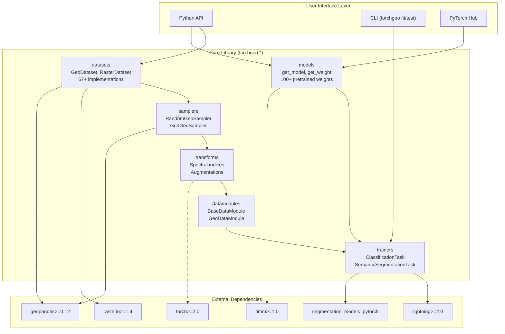

The library is organized into functional modules:

| Module | Location | Purpose | Key Classes/Functions |
|--------|----------|---------|----------------------|
| `datasets` | [torchgeo/datasets/](torchgeo/datasets) | Dataset abstractions and implementations | `GeoDataset`, `RasterDataset`, `Landsat`, `Sentinel2`, `CDL` |
| `samplers` | [torchgeo/samplers/](torchgeo/samplers) | Spatial/temporal patch extraction | `RandomGeoSampler`, `GridGeoSampler`, `PreChippedGeoSampler` |
| `transforms` | [torchgeo/transforms/](torchgeo/transforms) | Spectral indices and augmentations | `AppendNormalizedDifferenceIndex`, `AppendNDVI` |
| `models` | [torchgeo/models/](torchgeo/models) | Model architectures and weights | `get_model()`, `get_weight()`, `ResNet18_Weights` |
| `trainers` | [torchgeo/trainers/](torchgeo/trainers) | Lightning training tasks | `ClassificationTask`, `SemanticSegmentationTask`, `ObjectDetectionTask` |
| `datamodules` | [torchgeo/datamodules/](torchgeo/datamodules) | Lightning data loading | `BaseDataModule`, `GeoDataModule`, `NonGeoDataModule` |

**Sources**: [README.md:1-50](), [torchgeo/datasets/geo.py:1-100](), [torchgeo/trainers/classification.py:1-50](), [torchgeo/models/__init__.py:1-50](), [pyproject.toml:37-90]()

---

## Data Flow Pipeline

Data flows through five layers from raw files to trained models. This architecture separates data loading, preprocessing, and training concerns.

**Diagram: End-to-End Data Pipeline**

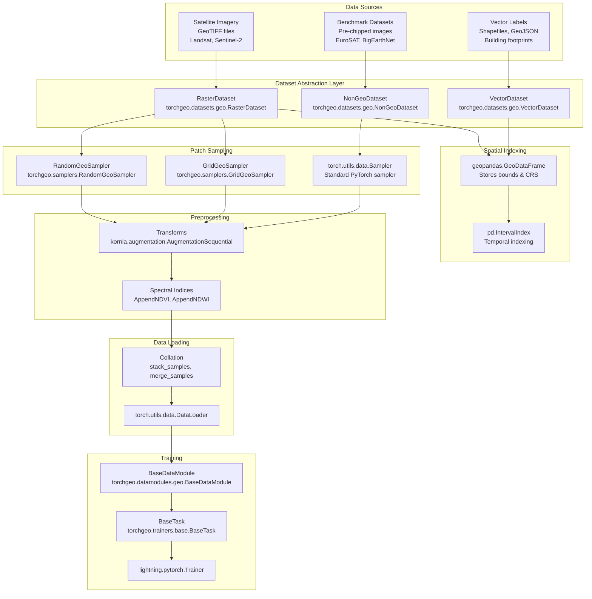

### Key Components by Layer

**Dataset Layer** ([torchgeo/datasets/geo.py:54-691]()):
- `GeoDataset`: Base class with spatiotemporal indexing using `GeoSlice` notation `[xmin:xmax:xres, ymin:ymax:yres, tmin:tmax:tres]`
- `RasterDataset`: Reads GeoTIFF/JP2 files using `rasterio.open()` with windowed reading
- `VectorDataset`: Rasterizes vector geometries using `rasterio.features.rasterize()`
- `NonGeoDataset`: Integer indexing for pre-processed benchmark datasets

**Indexing Layer** ([torchgeo/datasets/geo.py:96-223]()):
- `geopandas.GeoDataFrame`: Stores spatial bounds and CRS for each file
- `pandas.IntervalIndex`: Temporal index with overlapping timestamp ranges
- `GeoDataFrame.cx[]`: Spatial query using coordinate-based indexing

**Sampling Layer**:
- `RandomGeoSampler` ([torchgeo/samplers/](torchgeo/samplers)): Generates random bounding boxes within dataset bounds
- `GridGeoSampler`: Systematic grid-based sampling for inference
- Standard PyTorch samplers for `NonGeoDataset`

**Processing Layer**:
- `kornia.augmentation.AugmentationSequential`: GPU-accelerated augmentations
- Spectral index calculation ([torchgeo/transforms/](torchgeo/transforms)): Append NDVI, NDWI, NDBI to input tensors

**Sources**: [torchgeo/datasets/geo.py:54-691](), [torchgeo/samplers/](torchgeo/samplers), [torchgeo/datamodules/geo.py:1-200](), [README.md:69-116]()

---

## Dataset System Architecture

The dataset system has two parallel hierarchies for geospatial and non-geospatial data, with composition operators for combining datasets.

**Diagram: Dataset Class Hierarchy and Composition**

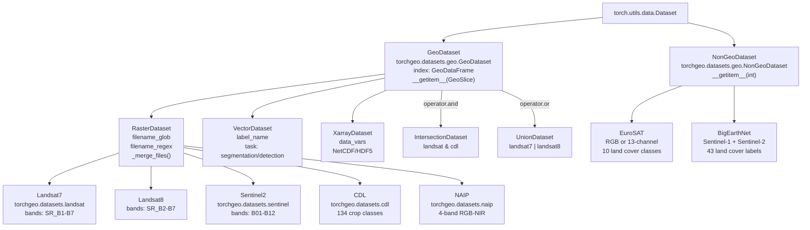

### Design Patterns

**Spatiotemporal Indexing** ([torchgeo/datasets/geo.py:96-223]()):
```python
class GeoDataset:
    index: GeoDataFrame  # Stores bounds & timestamp per file
    
    def __getitem__(self, index: GeoSlice) -> Sample:
        # GeoSlice = (x: slice, y: slice, t: slice)
        # Example: dataset[0:100:10, 0:100:10, mint:maxt:1]
```

**Dataset Composition** ([torchgeo/datasets/geo.py:185-215]()):
```python
# Union: Combine multiple sensors (Landsat 7 + 8)
landsat = Landsat7(...) | Landsat8(...)

# Intersection: Pair imagery with labels
dataset = landsat & CDL(...)
```

**Windowed Reading** ([torchgeo/datasets/geo.py:621-650]()):
- Uses `rasterio.merge.merge()` to read only requested bounds
- Lazy loading with `functools.lru_cache` for repeated queries
- Automatic CRS reprojection via `rasterio.vrt.WarpedVRT`

**Filename Pattern Matching** ([torchgeo/datasets/geo.py:463-492]()):
- `filename_glob`: Glob pattern to find files (e.g., `'LT05_*_SR_B*.TIF'`)
- `filename_regex`: Extract metadata from filename (date, band, satellite ID)
- `date_format`: Parse timestamp from filename

**Sources**: [torchgeo/datasets/geo.py:54-691](), [torchgeo/datasets/landsat.py:19-267](), [torchgeo/datasets/sentinel.py:260-400](), [torchgeo/datasets/cdl.py:20-383](), [README.md:69-116]()

---

## Training Framework Architecture

The training system uses PyTorch Lightning's modular design with `BaseTask` for model/training logic and `BaseDataModule` for data loading.

**Diagram: Training Task and DataModule Structure**

```mermaid
graph TB
    subgraph TaskHierarchy["Task Hierarchy (torchgeo.trainers)"]
        BaseTask["BaseTask<br/>torchgeo.trainers.base.BaseTask<br/>configure_models()<br/>configure_losses()<br/>configure_metrics()<br/>configure_optimizers()"]
        
        ClassificationTask["ClassificationTask<br/>model: timm backbone<br/>loss: ce/bce/jaccard/focal"]
        SegmentationTask["SemanticSegmentationTask<br/>model: unet/deeplabv3+/fcn<br/>loss: ce/bce/jaccard/focal"]
        DetectionTask["ObjectDetectionTask<br/>model: faster-rcnn/fcos/retinanet"]
        RegressionTask["RegressionTask<br/>model: timm backbone<br/>loss: mse/mae"]
        SimCLRTask["SimCLRTask<br/>Self-supervised contrastive"]
        MoCoTask["MoCoTask<br/>Self-supervised momentum"]
        
        BaseTask --> ClassificationTask
        BaseTask --> SegmentationTask
        BaseTask --> DetectionTask
        BaseTask --> RegressionTask
        BaseTask --> SimCLRTask
        BaseTask --> MoCoTask
    end
    
    subgraph DataModuleHierarchy["DataModule Hierarchy (torchgeo.datamodules)"]
        BaseDataModule["BaseDataModule<br/>torchgeo.datamodules.geo.BaseDataModule<br/>setup()<br/>train_dataloader()<br/>val_dataloader()<br/>test_dataloader()"]
        
        GeoDataModule["GeoDataModule<br/>Uses RandomGeoSampler<br/>Spatial sampling"]
        NonGeoDataModule["NonGeoDataModule<br/>Uses random_split()<br/>Integer indexing"]
        
        BaseDataModule --> GeoDataModule
        BaseDataModule --> NonGeoDataModule
    end
    
    subgraph Components["Training Components"]
        Models["Models<br/>timm.create_model()<br/>smp.Unet/DeepLabV3Plus<br/>torchvision.models.detection"]
        Losses["Losses<br/>nn.CrossEntropyLoss<br/>smp.losses.JaccardLoss<br/>smp.losses.FocalLoss"]
        Metrics["Metrics<br/>torchmetrics.Accuracy<br/>torchmetrics.JaccardIndex<br/>torchmetrics.MeanAveragePrecision"]
        Optimizers["Optimizers<br/>torch.optim.AdamW<br/>lightly.utils.lars.LARS"]
    end
    
    subgraph Lightning["PyTorch Lightning"]
        Trainer["lightning.pytorch.Trainer<br/>fit/validate/test<br/>callbacks<br/>loggers"]
    end
    
    Models --> BaseTask
    Losses --> BaseTask
    Metrics --> BaseTask
    Optimizers --> BaseTask
    
    BaseDataModule --> Trainer
    BaseTask --> Trainer
```

### BaseTask Interface

All tasks inherit from `BaseTask` ([torchgeo/trainers/base.py:16-85]()) and implement:

| Method | Purpose | Example Implementation |
|--------|---------|----------------------|
| `configure_models()` | Instantiate model architecture | `self.model = timm.create_model(...)` |
| `configure_losses()` | Define loss function | `self.criterion = nn.CrossEntropyLoss()` |
| `configure_metrics()` | Setup torchmetrics | `self.train_metrics = Accuracy(...)` |
| `configure_optimizers()` | Define optimizer/scheduler | `return AdamW(...), ReduceLROnPlateau(...)` |
| `training_step()` | Forward pass + loss | `loss = self.criterion(y_hat, y)` |
| `validation_step()` | Validation metrics | `self.val_metrics(y_hat, y)` |

### Task Configuration Examples

**Classification** ([torchgeo/trainers/classification.py:30-82]()):
```python
task = ClassificationTask(
    model='resnet50',              # timm model name
    weights='SENTINEL2_ALL_MOCO',  # Pretrained weights
    in_channels=13,                # Sentinel-2 bands
    num_classes=10,                # Output classes
    loss='ce'                      # CrossEntropy loss
)
```

**Segmentation** ([torchgeo/trainers/segmentation.py:28-106]()):
```python
task = SemanticSegmentationTask(
    model='unet',                  # smp model
    backbone='resnet18',           # Encoder
    in_channels=3,                 # RGB
    num_classes=5,                 # Land cover classes
    loss='jaccard',                # IoU loss
    freeze_backbone=True           # Linear probing
)
```

**Self-Supervised** ([torchgeo/trainers/simclr.py:56-127]()):
```python
task = SimCLRTask(
    model='resnet50',
    in_channels=13,
    version=2,                     # SimCLR v2
    layers=3,                      # Projection head layers
    temperature=0.07               # NT-Xent temperature
)
```

### DataModule Interface

`BaseDataModule` ([torchgeo/datamodules/geo.py:1-100]()) provides data loading:

| Method | Purpose |
|--------|---------|
| `setup(stage)` | Initialize datasets for fit/validate/test/predict |
| `train_dataloader()` | Return `DataLoader` for training |
| `val_dataloader()` | Return `DataLoader` for validation |
| `test_dataloader()` | Return `DataLoader` for testing |
| `predict_dataloader()` | Return `DataLoader` for inference |

**Sources**: [torchgeo/trainers/base.py:1-85](), [torchgeo/trainers/classification.py:30-164](), [torchgeo/trainers/segmentation.py:28-257](), [torchgeo/trainers/simclr.py:56-127](), [torchgeo/datamodules/geo.py:1-200]()

---

## Model and Weight Management

TorchGeo provides 100+ pretrained weights organized by sensor type, following torchvision's `WeightsEnum` API pattern.

**Diagram: Weight Enums and Model Loading API**

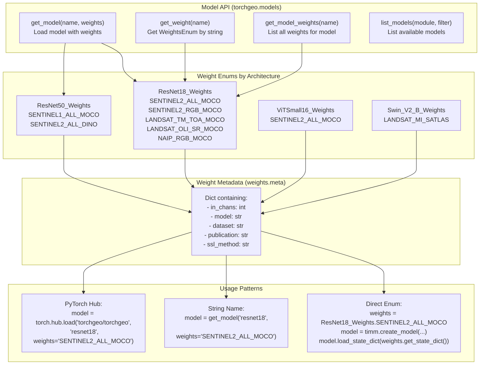

### Weight Organization by Sensor

Weights are organized by source sensor to match input channel requirements:

| Sensor | Channels | Example Weights | SSL Method |
|--------|----------|----------------|------------|
| Sentinel-2 ALL | 13 | `ResNet18_Weights.SENTINEL2_ALL_MOCO` | MoCo v2 |
| Sentinel-2 RGB | 3 | `ResNet18_Weights.SENTINEL2_RGB_MOCO` | MoCo v2 |
| Sentinel-1 GRD | 2 | `ResNet50_Weights.SENTINEL1_ALL_MOCO` | MoCo v2 |
| Landsat TM | 7 | `ResNet18_Weights.LANDSAT_TM_TOA_MOCO` | MoCo v2 |
| Landsat OLI | 7 | `ResNet18_Weights.LANDSAT_OLI_SR_MOCO` | MoCo v2 |
| NAIP | 4 | `ResNet18_Weights.NAIP_RGB_MOCO` | MoCo v2 |
| Sensor-Agnostic | Variable | `ViTSmall16_Weights.SENTINEL2_ALL_MOCO` | MoCo v2 |

### Loading Models with Weights

**Method 1: Direct WeightsEnum** ([torchgeo/models/__init__.py:1-100]()):
```python
from torchgeo.models import ResNet18_Weights
import timm

weights = ResNet18_Weights.SENTINEL2_ALL_MOCO
in_chans = weights.meta["in_chans"]  # 13 for Sentinel-2

model = timm.create_model("resnet18", in_chans=in_chans, num_classes=10)
model.load_state_dict(weights.get_state_dict(progress=True), strict=False)
```

**Method 2: String-based Loading**:
```python
from torchgeo.models import get_model

model = get_model("resnet18", weights="SENTINEL2_ALL_MOCO")
```

**Method 3: Use in Tasks** ([torchgeo/trainers/classification.py:83-103]()):
```python
task = ClassificationTask(
    model='resnet18',
    weights='SENTINEL2_ALL_MOCO',  # Automatically loads weights
    in_channels=13,
    num_classes=10
)
```

### Weight Metadata

Each `WeightsEnum` member includes metadata accessible via `.meta`:

```python
weights = ResNet18_Weights.SENTINEL2_ALL_MOCO
print(weights.meta)
# {
#     'in_chans': 13,
#     'model': 'resnet18',
#     'dataset': 'ssl4eo_s2_12',
#     'publication': 'https://arxiv.org/abs/2306.09424',
#     'ssl_method': 'moco_v2'
# }
```

**Sources**: [README.md:155-168](), [torchgeo/models/__init__.py:1-100](), [torchgeo/trainers/classification.py:83-111](), [tests/trainers/test_classification.py:128-189]()

---

## User Interface Patterns

TorchGeo provides three interfaces for different use cases:

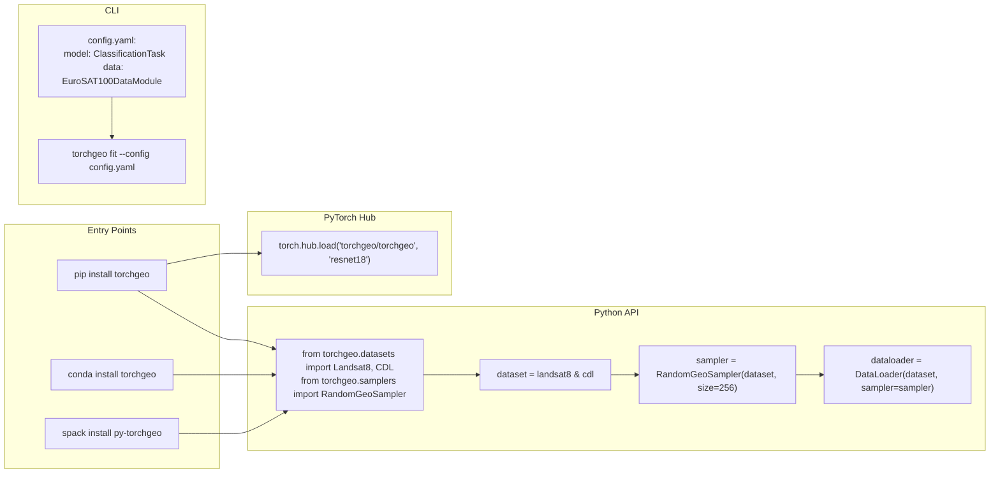

### Python API

Programmatic control for research workflows. Users compose datasets, add samplers/transforms, and train models using Lightning or plain PyTorch.

### Command Line Interface

Configuration-driven training via Lightning CLI. Users specify model and data in YAML files:

```yaml
model:
  class_path: SemanticSegmentationTask
  init_args:
    model: 'unet'
    backbone: 'resnet18'
data:
  class_path: PASTISDataModule
  init_args:
    batch_size: 32
```

Run with: `torchgeo fit --config config.yaml`

### PyTorch Hub

One-line model loading for inference:

```python
model = torch.hub.load("torchgeo/torchgeo", "resnet18", 
                       weights="SENTINEL2_ALL_MOCO")
```

**Sources**: [README.md:27-253](), [docs/user/installation.rst:1-84](), [tests/conf/pastis.yaml:1-19](), [pyproject.toml:156-158]()

---

## Dependency Management

TorchGeo uses a multi-file dependency strategy to support optional features:

```mermaid
graph TB
    subgraph "Dependency Files"
        required["requirements/required.txt<br/>Core dependencies<br/>- torch>=2.0<br/>- rasterio>=1.4.3<br/>- geopandas>=0.12.1"]
        
        datasets["requirements/datasets.txt<br/>Dataset dependencies<br/>- h5py, netcdf4<br/>- rioxarray, xarray<br/>- opencv-python"]
        
        models["requirements/models.txt<br/>Model dependencies<br/>- microsoft-aurora<br/>- ultralytics"]
        
        style["requirements/style.txt<br/>Linting tools<br/>- mypy, ruff"]
        
        tests["requirements/tests.txt<br/>Testing tools<br/>- pytest, pytest-cov<br/>- nbmake"]
    end
    
    subgraph "Installation Options"
        base["pip install torchgeo<br/>(required only)"]
        extras["pip install torchgeo[datasets,models]<br/>(with optional dependencies)"]
        all["pip install torchgeo[all]<br/>(everything)"]
    end
    
    required --> base
    required --> extras
    required --> all
    
    datasets --> extras
    models --> extras
    
    datasets --> all
    models --> all
    style --> all
    tests --> all
```

### Version Constraints

TorchGeo explicitly excludes incompatible versions in [pyproject.toml:37-90]():

- `lightning>=2,!=2.3.*,!=2.5.0,<2.5.5`: Excludes versions with known bugs
- `lightly>=1.4.5,!=1.4.26`: Excludes version incompatible with `timm`
- `rasterio>=1.4.3`: Requires version with `rasterio.merge` fixes

**Sources**: [requirements/required.txt:1-22](), [requirements/datasets.txt:1-13](), [pyproject.toml:37-155](), [docs/user/installation.rst:29-83]()

---

## Design Philosophy

TorchGeo's architecture follows several key principles:

### 1. Composability

Datasets, transforms, and models are designed to be composed. The `&` and `|` operators allow intuitive dataset combination without explicit wrapper classes.

### 2. Lazy Evaluation

Operations like dataset union and reprojection are lazily evaluated. `GeoDataset` doesn't create mosaics or reproject files until data is accessed.

### 3. PyTorch Native

TorchGeo extends `torch.utils.data.Dataset` and integrates seamlessly with PyTorch and Lightning. Users can mix TorchGeo components with standard PyTorch code.

### 4. Geospatial Aware

Unlike generic computer vision libraries, TorchGeo handles CRS, resolution, spatial indexing, and multi-spectral data as first-class concepts.

### 5. Reproducibility

Lightning integration, CLI support, and seed control enable reproducible experiments. DataModules encapsulate train/val/test splits.

**Sources**: [README.md:1-276](), [docs/tutorials/torchgeo.ipynb:83-392]()

---

# Page: Dataset System

# Dataset System

<details>
<summary>Relevant source files</summary>

The following files were used as context for generating this wiki page:

- [docs/api/datamodules.rst](docs/api/datamodules.rst)
- [docs/api/datasets.rst](docs/api/datasets.rst)
- [tests/data/deepglobelandcover/data.py](tests/data/deepglobelandcover/data.py)
- [tests/data/deepglobelandcover/data.zip](tests/data/deepglobelandcover/data.zip)
- [tests/data/naip/data.py](tests/data/naip/data.py)
- [tests/data/naip/m_3807511_ne_18_060_20181104.tif](tests/data/naip/m_3807511_ne_18_060_20181104.tif)
- [tests/data/naip/m_3807511_ne_18_060_20190605.tif](tests/data/naip/m_3807511_ne_18_060_20190605.tif)
- [tests/data/vector/data.py](tests/data/vector/data.py)
- [tests/data/vector/vector_2024.geojson](tests/data/vector/vector_2024.geojson)
- [tests/data/vector/vector_2024.parquet](tests/data/vector/vector_2024.parquet)
- [tests/datasets/test_deepglobelandcover.py](tests/datasets/test_deepglobelandcover.py)
- [tests/datasets/test_geo.py](tests/datasets/test_geo.py)
- [tests/datasets/test_utils.py](tests/datasets/test_utils.py)
- [tests/trainers/test_segmentation.py](tests/trainers/test_segmentation.py)
- [torchgeo/datamodules/__init__.py](torchgeo/datamodules/__init__.py)
- [torchgeo/datasets/__init__.py](torchgeo/datasets/__init__.py)
- [torchgeo/datasets/cdl.py](torchgeo/datasets/cdl.py)
- [torchgeo/datasets/deepglobelandcover.py](torchgeo/datasets/deepglobelandcover.py)
- [torchgeo/datasets/geo.py](torchgeo/datasets/geo.py)
- [torchgeo/datasets/landsat.py](torchgeo/datasets/landsat.py)
- [torchgeo/datasets/naip.py](torchgeo/datasets/naip.py)
- [torchgeo/datasets/sentinel.py](torchgeo/datasets/sentinel.py)
- [torchgeo/datasets/utils.py](torchgeo/datasets/utils.py)

</details>


The Dataset System provides the foundational data loading infrastructure for TorchGeo. It defines abstract base classes and concrete implementations for accessing geospatial and non-geospatial remote sensing datasets with consistent interfaces optimized for machine learning workflows.

**Scope:** This page covers dataset abstractions, spatial indexing mechanisms, and implementation patterns. For information about sampling patches from datasets, see [Data Loading Pipeline](#3). For specific dataset implementations, see [Dataset Catalog](#2.2). For creating custom datasets, see [Creating Custom Datasets](#2.5).

---

## Core Dataset Hierarchy

The dataset system is organized around two primary abstractions: geospatial datasets with coordinate awareness, and non-geospatial datasets with simple integer indexing.

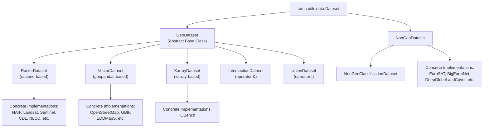

**Sources:** [torchgeo/datasets/geo.py:54-95](), [torchgeo/datasets/geo.py:338-339](), [torchgeo/datasets/geo.py:693-697](), [torchgeo/datasets/geo.py:859-860](), [torchgeo/datasets/__init__.py:82-91]()

---

## Geospatial Indexing with GeoSlice

Geospatial datasets use a `GeoSlice` indexing scheme that represents spatiotemporal queries as three-dimensional slices:

```
dataset[xmin:xmax:xres, ymin:ymax:yres, tmin:tmax:tres]
```

Each component follows Python's slice notation where `start:stop:step` defines:
- **Spatial dimensions:** min/max bounds in CRS units, step as resolution
- **Temporal dimension:** min/max timestamps, step as sampling interval

### GeoSlice to Internal Index Translation

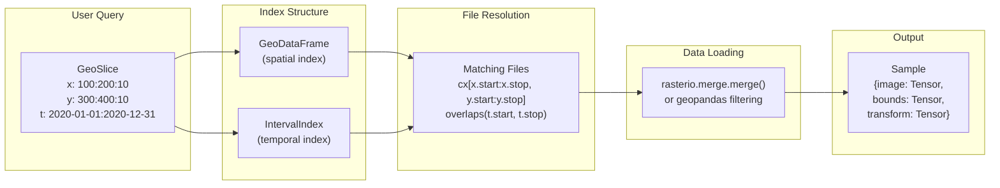

**Index Attributes:**
- `index: GeoDataFrame` - Stores file paths, geometries (shapely polygons), and temporal intervals
- `crs: CRS` - Coordinate reference system for spatial queries
- `res: tuple[float, float]` - Resolution in (xres, yres) format
- `bounds: tuple[slice, slice, slice]` - Dataset extent as spatiotemporal slices

**Sources:** [torchgeo/datasets/geo.py:96](), [torchgeo/datasets/geo.py:238-249](), [torchgeo/datasets/utils.py:51-53](), [torchgeo/datasets/geo.py:534-543]()

---

## RasterDataset: Satellite Imagery and Masks

`RasterDataset` provides the foundation for datasets stored as geospatial raster files (GeoTIFF, JP2, etc.). It handles multi-file merging, CRS transformation, and resolution resampling automatically.

### File Discovery and Temporal Extraction

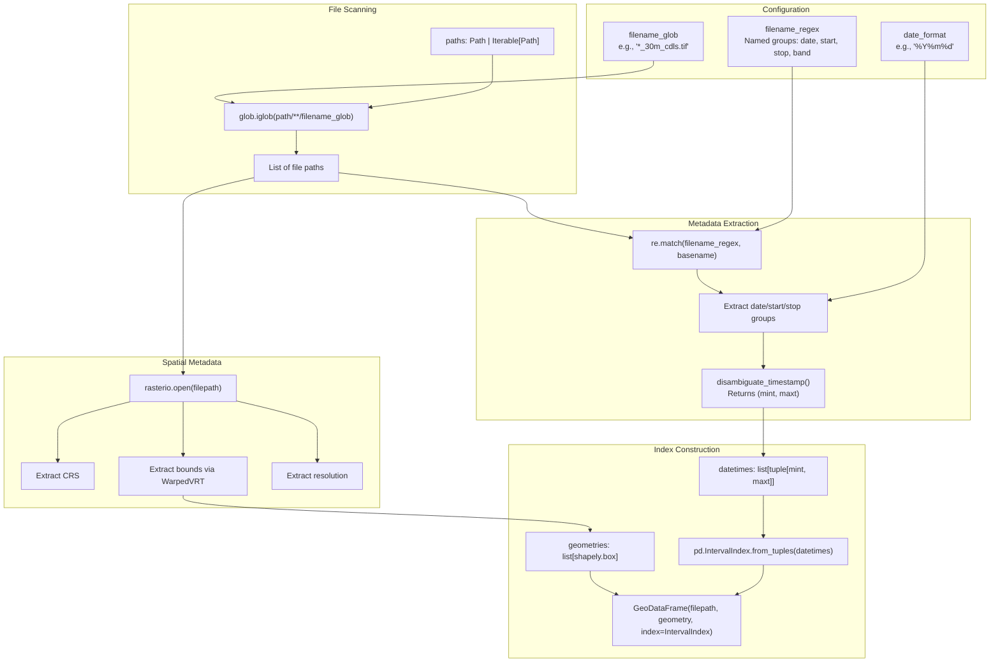

**Key Methods:**

| Method | Purpose |
|--------|---------|
| `__init__` | Initialize dataset with paths, CRS, resolution, bands, transforms |
| `__getitem__` | Retrieve data for spatiotemporal slice via `_merge_files` |
| `_filepath_to_timestamp` | Extract temporal bounds from filename using regex |
| `_merge_files` | Load and merge multiple rasters using `rasterio.merge.merge` |
| `_load_warp_file` | Open file and warp to target CRS/resolution via `WarpedVRT` |

**Sample Structure (is_image=True):**

```python
{
    'image': Tensor,      # Shape: (C, H, W), dtype from self.dtype
    'bounds': Tensor,     # Spatiotemporal slice as tensor
    'transform': Tensor   # Affine transform for georeferencing
}
```

**Sample Structure (is_image=False):**

```python
{
    'mask': Tensor,       # Shape: (H, W), dtype typically long
    'bounds': Tensor,
    'transform': Tensor
}
```

**Band Selection:**

For multi-band datasets, specify `bands` parameter:
- **Separate files** (`separate_files=True`): Each band stored in separate file, uses `filename_regex` group `band` to locate files
- **Single file** (`separate_files=False`): Multiple bands in one file, uses `band_indexes` to select specific bands

**Sources:** [torchgeo/datasets/geo.py:338-424](), [torchgeo/datasets/geo.py:425-520](), [torchgeo/datasets/geo.py:522-572](), [torchgeo/datasets/geo.py:621-650]()

---

## VectorDataset: Points, Lines, and Polygons

`VectorDataset` handles vector data formats (GeoJSON, Shapefile, Parquet) and rasterizes geometries into masks or extracts bounding boxes for object detection.

### Task-Specific Output Formats

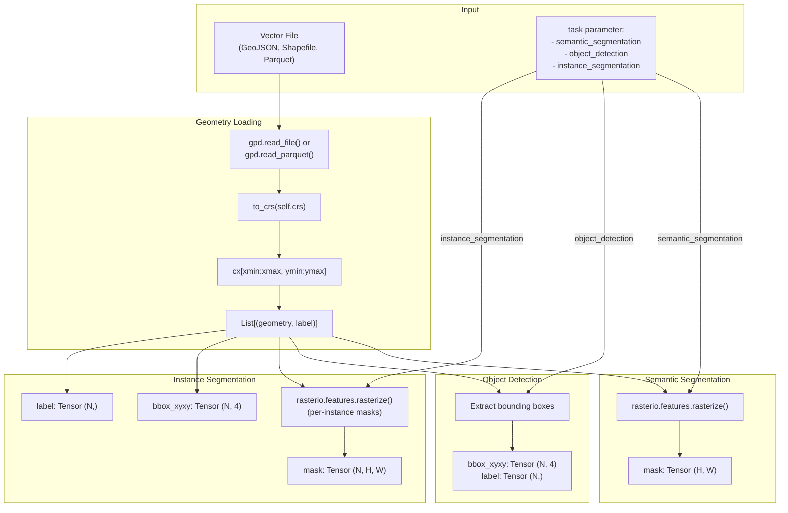

**Label Extraction:**

Each geometry can have an associated label value extracted via `label_name` parameter:
- If `label_name` is specified, reads property from vector file (e.g., `{'label_id': 3}`)
- Otherwise defaults to class index via `get_label` method (can be overridden)

**Sources:** [torchgeo/datasets/geo.py:859-990](), [torchgeo/datasets/geo.py:992-1095](), [tests/data/vector/data.py]()

---

## XarrayDataset: Multidimensional Array Data

`XarrayDataset` provides support for multidimensional array datasets stored in formats like NetCDF or HDF5, leveraging xarray's labeled array capabilities.

**Key Features:**
- Multi-variable data loading via `data_vars` parameter
- Time-series support with native xarray temporal indexing
- Lazy loading and chunked computation
- Automatic CRS reprojection via `rioxarray`

**Dependencies:**
- Requires `xarray >= 0.17`, `rioxarray >= 0.14.1`
- Optional: `h5py >= 3.10` for HDF5, `netCDF4 >= 1.6.5` for NetCDF

**Sources:** [torchgeo/datasets/geo.py:693-856]()

---

## NonGeoDataset: Integer-Indexed Datasets

`NonGeoDataset` is the base class for datasets without geospatial information, using traditional integer indexing:

```python
sample = dataset[42]  # Integer index
```

### NonGeoClassificationDataset

Extends `NonGeoDataset` with torchvision's `ImageFolder` pattern:

```
root/
    class_a/
        img1.jpg
        img2.jpg
    class_b/
        img3.jpg
```

**Automatic class indexing:** Discovers subdirectories as class labels and creates `classes` and `class_to_idx` mappings.

**Sources:** [torchgeo/datasets/geo.py:1098-1176]()

---

## Dataset Composition Operators

TorchGeo provides algebraic operators for combining multiple `GeoDataset` instances:

### Union Operator (|): Spatial Concatenation

```python
dataset = landsat7 | landsat8  # Combine Landsat 7 and 8
```

**Use cases:**
- Multiple sensors covering same area (Landsat 7 + Landsat 8)
- Multiple temporal acquisitions
- Non-overlapping spatial regions (Chesapeake NY | Chesapeake PA)

**Behavior:** Query must be found in **at least one** dataset. Returns data from first matching dataset.

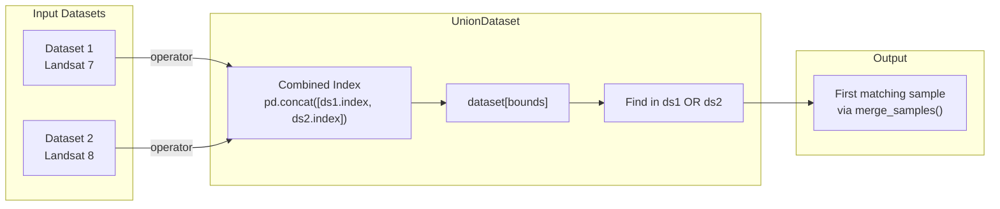

### Intersection Operator (&): Aligned Pairing

```python
dataset = landsat & cdl  # Pair imagery with labels
```

**Use cases:**
- Imagery + ground truth labels (Landsat & CDL)
- Multi-modal data fusion (optical & SAR)
- Imagery + auxiliary data (elevation, temperature)

**Behavior:** Query must be found in **both** datasets. Samples are concatenated along channel dimension.

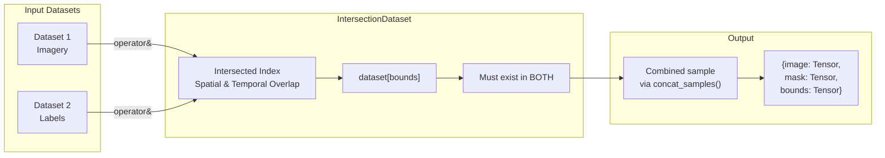

**CRS Harmonization:** When combining datasets with different CRS, the first dataset's CRS is used. Other datasets are automatically reprojected.

**Sources:** [torchgeo/datasets/geo.py:185-215](), [torchgeo/datasets/geo.py:1179-1289](), [torchgeo/datasets/geo.py:1292-1396]()

---

## Common Implementation Patterns

### Pattern 1: File Discovery Configuration

Every `RasterDataset` and `VectorDataset` subclass defines file discovery parameters:

```python
class Landsat8(Landsat):
    filename_glob = 'LC08_*_{}.*'
    filename_regex = r"""
        ^L(?P<sensor>[COTEM])
        (?P<satellite>\d{2})
        _(?P<processing_correction_level>[A-Z0-9]{4})
        ...
        _(?P<date>\d{8})
        ...
        _(?P<band>[A-Z0-9_]+)
        \.
    """
    date_format = '%Y%m%d'
```

**Sources:** [torchgeo/datasets/landsat.py:39-52](), [torchgeo/datasets/landsat.py:240-246]()

### Pattern 2: Download/Verify/Extract Workflow

Datasets with downloadable data implement a three-phase initialization:

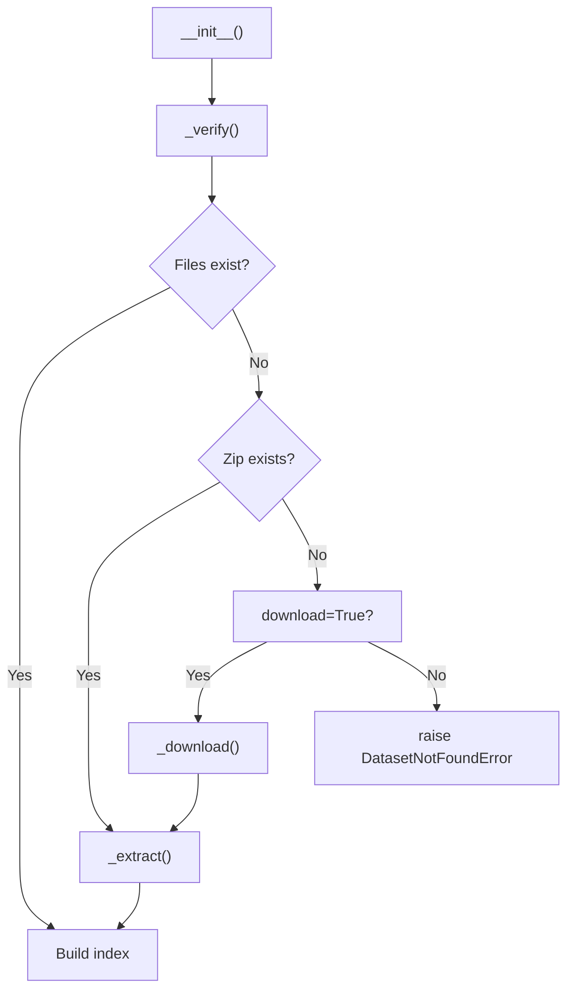

**Example from CDL:**

| Method | Purpose |
|--------|---------|
| `_verify` | Check if files exist, trigger download if needed |
| `_download` | Download files from URLs with checksum validation |
| `_extract` | Extract archives to destination directory |

**Sources:** [torchgeo/datasets/cdl.py:291-336]()

### Pattern 3: Band Selection

**Separate Files (Sentinel-2):**
```python
all_bands = ('B01', 'B02', 'B03', ...)
separate_files = True

def __init__(self, bands=['B04', 'B03', 'B02'], ...):
    # Uses filename_regex group 'band' to find files
    self.filename_glob = f'T*_*_{bands[0]}*.*'
```

**Single File (NAIP):**
```python
all_bands = ('R', 'G', 'B', 'NIR')
separate_files = False

def __init__(self, bands=['R', 'G', 'B'], ...):
    # Creates band_indexes = [0, 1, 2]
    self.band_indexes = [self.all_bands.index(b) + 1 for b in bands]
```

**Sources:** [torchgeo/datasets/sentinel.py:141-201](), [torchgeo/datasets/naip.py:47-48](), [torchgeo/datasets/geo.py:497-509]()

### Pattern 4: Custom Class Mapping

Datasets like CDL with 134+ raw classes allow class filtering:

```python
cdl = CDL(
    paths='data',
    years=[2023],
    classes=[0, 1, 5, 24, 36]  # Background, Corn, Soybeans, Winter Wheat, Alfalfa
)

# Creates ordinal_map: tensor mapping raw class IDs to [0, 1, 2, 3, 4]
sample = cdl[bounds]
# sample['mask'] contains values 0-4 instead of original class IDs
```

**Implementation:**
1. Initialize `ordinal_map` tensor of size `max(class_ids) + 1`
2. Map selected classes to ordinal indices: `ordinal_map[class_id] = ordinal`
3. In `__getitem__`, remap: `sample['mask'] = self.ordinal_map[sample['mask']]`

**Sources:** [torchgeo/datasets/cdl.py:209-289]()

### Pattern 5: Plotting with RGB Bands

Datasets define `rgb_bands` attribute for visualization:

```python
class Landsat8(Landsat):
    rgb_bands = ('SR_B4', 'SR_B3', 'SR_B2')  # Red, Green, Blue
    
    def plot(self, sample, ...):
        rgb_indices = [self.bands.index(b) for b in self.rgb_bands]
        image = sample['image'][rgb_indices].permute(1, 2, 0)
        # Normalize and plot
```

**Sources:** [torchgeo/datasets/landsat.py:99-142](), [torchgeo/datasets/sentinel.py:260-315]()

---

## Sample Transformation and Collation

### Transform Pipeline

Datasets accept a `transforms` callable that modifies samples:

```python
def my_transform(sample: dict[str, Any]) -> dict[str, Any]:
    sample['image'] = sample['image'] / 10000.0  # Scale reflectance
    return sample

dataset = Landsat8(paths='data', transforms=my_transform)
```

Transforms are applied in `__getitem__` after data loading but before returning.

### Collation Functions

For batching samples in DataLoaders:

| Function | Purpose |
|----------|---------|
| `stack_samples` | Stack list of samples into batch (adds new dimension) |
| `concat_samples` | Concatenate samples along existing dimension (for IntersectionDataset) |
| `merge_samples` | Merge samples taking maximum values (for UnionDataset) |
| `unbind_samples` | Reverse of stack_samples, splits batch into list |

**Sources:** [torchgeo/datasets/utils.py:473-558]()

---

## Dataset Catalog Overview

TorchGeo includes 67+ dataset implementations. Key categories:

### Geospatial Datasets (Imagery)

| Dataset | Type | Description | Bands/Channels |
|---------|------|-------------|----------------|
| NAIP | Raster | High-resolution aerial imagery (60cm) | R, G, B, NIR |
| Landsat 8/9 | Raster | Multispectral satellite (30m) | 11 bands |
| Sentinel-1 | Raster | SAR imagery (10m) | HH, HV, VV, VH polarizations |
| Sentinel-2 | Raster | Multispectral satellite (10-60m) | 13 bands |
| PRISMA | Raster | Hyperspectral (30m) | 239 bands |

### Geospatial Datasets (Labels)

| Dataset | Type | Description | Classes |
|---------|------|-------------|---------|
| CDL | Raster | Crop type classification | 134 crop types |
| NLCD | Raster | Land cover classification | 16 classes |
| Chesapeake | Raster | Land cover for Chesapeake Bay | 7 classes |
| OpenStreetMap | Vector | Building footprints, roads | Geometries |
| GBIF | Vector | Species occurrence data | Point locations |

### Non-Geospatial Datasets (Benchmark)

| Dataset | Task | Samples | Classes/Metrics |
|---------|------|---------|-----------------|
| EuroSAT | Classification | 27,000 | 10 land use classes |
| BigEarthNet | Multi-label classification | 590,326 | 19 land cover classes |
| DeepGlobeLandCover | Segmentation | 803 | 7 land cover classes |
| So2Sat | Classification | 400,673 | 17 local climate zones |
| xBD | Disaster assessment | 850,736 buildings | Pre/post disaster damage |

**Sources:** [docs/api/datasets.rst:10-611](), [torchgeo/datasets/__init__.py:6-381]()

---

## Error Handling

Common exceptions:

| Exception | Raised When | Resolution |
|-----------|-------------|------------|
| `DatasetNotFoundError` | No files found matching `filename_glob` | Check paths, download data, or set `download=True` |
| `IndexError` | Query outside dataset bounds | Verify spatiotemporal query intersects dataset |
| `AssertionError` | Invalid bands specified | Ensure bands in `all_bands` attribute |
| `DependencyNotFoundError` | Optional dependency missing | Install required package (e.g., `rioxarray`, `h5py`) |
| `RGBBandsMissingError` | Plotting without RGB bands | Provide dataset with RGB bands or use custom plot |

**Sources:** [torchgeo/datasets/errors.py:1-61](), [torchgeo/datasets/geo.py:447-449](), [torchgeo/datasets/geo.py:540-543]()

---

## Key Dataset Attributes

Every `GeoDataset` provides:

| Attribute/Property | Type | Description |
|-------------------|------|-------------|
| `index` | `GeoDataFrame` | Spatial index with file paths and temporal intervals |
| `crs` | `CRS` | Coordinate reference system |
| `res` | `tuple[float, float]` | Resolution in CRS units (xres, yres) |
| `bounds` | `tuple[slice, slice, slice]` | Dataset extent as spatiotemporal slices |
| `files` | `list[str]` | All files matching filename_glob |

Every `RasterDataset` adds:

| Attribute | Type | Description |
|-----------|------|-------------|
| `all_bands` | `tuple[str, ...]` | All available bands |
| `bands` | `Sequence[str]` | Selected bands to load |
| `rgb_bands` | `tuple[str, ...]` | Bands for RGB visualization |
| `is_image` | `bool` | True for imagery, False for masks |
| `dtype` | `torch.dtype` | Output tensor dtype |
| `resampling` | `Resampling` | Resampling algorithm (bilinear/nearest) |

**Sources:** [torchgeo/datasets/geo.py:96-283](), [torchgeo/datasets/geo.py:381-423]()

---

# Page: Core Dataset Abstractions

# Core Dataset Abstractions

<details>
<summary>Relevant source files</summary>

The following files were used as context for generating this wiki page:

- [tests/data/naip/data.py](tests/data/naip/data.py)
- [tests/data/naip/m_3807511_ne_18_060_20181104.tif](tests/data/naip/m_3807511_ne_18_060_20181104.tif)
- [tests/data/naip/m_3807511_ne_18_060_20190605.tif](tests/data/naip/m_3807511_ne_18_060_20190605.tif)
- [tests/data/vector/data.py](tests/data/vector/data.py)
- [tests/data/vector/vector_2024.geojson](tests/data/vector/vector_2024.geojson)
- [tests/data/vector/vector_2024.parquet](tests/data/vector/vector_2024.parquet)
- [tests/datasets/test_geo.py](tests/datasets/test_geo.py)
- [tests/datasets/test_utils.py](tests/datasets/test_utils.py)
- [torchgeo/datasets/cdl.py](torchgeo/datasets/cdl.py)
- [torchgeo/datasets/geo.py](torchgeo/datasets/geo.py)
- [torchgeo/datasets/landsat.py](torchgeo/datasets/landsat.py)
- [torchgeo/datasets/naip.py](torchgeo/datasets/naip.py)
- [torchgeo/datasets/sentinel.py](torchgeo/datasets/sentinel.py)
- [torchgeo/datasets/utils.py](torchgeo/datasets/utils.py)

</details>


This page provides a detailed explanation of the core dataset base classes in TorchGeo: `GeoDataset`, `RasterDataset`, `VectorDataset`, `XarrayDataset`, and `NonGeoDataset`. These abstractions define the fundamental interfaces for loading geospatial data and enable spatiotemporal indexing, multi-modal data fusion, and dataset composition. For information about specific dataset implementations, see [Dataset Catalog](#2.2). For details on how to combine datasets using operators, see [Dataset Composition and Indexing](#2.3). For guidance on creating custom datasets, see [Creating Custom Datasets](#2.4).

## Dataset Hierarchy Overview

TorchGeo's dataset system is built on two parallel inheritance hierarchies, each serving different use cases:

```mermaid
graph TB
    Dataset["torch.utils.data.Dataset<br/>(PyTorch Base)"]
    
    Dataset --> GeoDataset["GeoDataset<br/>(Abstract)<br/>Spatiotemporal indexing via GeoSlice"]
    Dataset --> NonGeoDataset["NonGeoDataset<br/>(Abstract)<br/>Integer indexing"]
    
    GeoDataset --> RasterDataset["RasterDataset<br/>rasterio-based<br/>Single/multi-band rasters"]
    GeoDataset --> VectorDataset["VectorDataset<br/>fiona-based<br/>Vector geometries"]
    GeoDataset --> XarrayDataset["XarrayDataset<br/>xarray-based<br/>NetCDF/HDF5 arrays"]
    
    NonGeoDataset --> NonGeoClassificationDataset["NonGeoClassificationDataset<br/>ImageFolder-style<br/>Classification benchmarks"]
    
    RasterDataset --> Landsat["Landsat8<br/>CDL<br/>Chesapeake<br/>...100+ datasets"]
    VectorDataset --> CBF["CanadianBuildingFootprints"]
    XarrayDataset --> Custom["Custom implementations"]
    NonGeoClassificationDataset --> EuroSAT["EuroSAT<br/>PASTIS<br/>BigEarthNet<br/>...30+ benchmarks"]
    
    style GeoDataset fill:#e1f5ff
    style NonGeoDataset fill:#ffe1e1
```

**Sources:** [torchgeo/datasets/geo.py:50-1099]()

The key distinction:
- **GeoDataset**: For datasets with geospatial metadata (CRS, bounds, resolution). Indexed by spatiotemporal slices.
- **NonGeoDataset**: For pre-curated benchmark datasets without geospatial context. Indexed by integers.

## GeoDataset Base Class

`GeoDataset` is an abstract base class that adds geospatial awareness to PyTorch's `Dataset` interface. It provides spatiotemporal indexing, coordinate reference system (CRS) management, and dataset composition operators.

### Class Definition and Core Properties

```mermaid
classDiagram
    class GeoDataset {
        <<abstract>>
        +index: GeoDataFrame
        +paths: Path | Iterable[Path]
        +crs: CRS
        +res: tuple[float, float]
        +bounds: tuple[slice, slice, slice]
        +files: list[str]
        +filename_glob: str
        +__getitem__(query: GeoSlice) dict
        +__and__(other: GeoDataset) IntersectionDataset
        +__or__(other: GeoDataset) UnionDataset
        +__len__() int
        -_disambiguate_slice(query: GeoSlice) tuple
    }
```

**Sources:** [torchgeo/datasets/geo.py:50-309]()

| Property | Type | Description |
|----------|------|-------------|
| `index` | `GeoDataFrame` | Spatiotemporal index of all files, with geometry and temporal interval |
| `paths` | `Path \| Iterable[Path]` | Root directory(ies) to search for files |
| `crs` | `CRS` | Coordinate reference system |
| `res` | `tuple[float, float]` | Resolution in CRS units (xres, yres) |
| `bounds` | `tuple[slice, slice, slice]` | Bounding box as (x_slice, y_slice, t_slice) |
| `files` | `list[str]` | List of all files matching `filename_glob` |
| `filename_glob` | `str` | Glob pattern for finding files (e.g., `"*.tif"`) |

**Sources:** [torchgeo/datasets/geo.py:92-309]()

### Spatiotemporal Indexing with GeoSlice

The primary innovation of `GeoDataset` is its indexing mechanism. Instead of integer indices, datasets are queried using spatiotemporal slices:

```mermaid
graph LR
    Query["GeoSlice Query<br/>xmin:xmax:xres,<br/>ymin:ymax:yres,<br/>tmin:tmax:tres"]
    
    Query --> Disambiguate["_disambiguate_slice()<br/>Fill in None values<br/>from bounds"]
    
    Disambiguate --> IndexQuery["GeoDataFrame Query<br/>1. Temporal overlap<br/>2. Spatial intersection"]
    
    IndexQuery --> GetItem["__getitem__()<br/>Load and return data"]
    
    GetItem --> Sample["Sample Dict<br/>image/mask, crs, bounds"]
```

**Sources:** [torchgeo/datasets/geo.py:116-156](), [torchgeo/datasets/utils.py:48-51]()

#### GeoSlice Type

A `GeoSlice` can be:
- A single slice: `[xmin:xmax:xres]`
- A tuple of 2 slices: `[xmin:xmax:xres, ymin:ymax:yres]`
- A tuple of 3 slices: `[xmin:xmax:xres, ymin:ymax:yres, tmin:tmax:tres]`

```python
# Example queries
dataset[0.0:1.0:0.1, 2.0:3.0:0.1, datetime(2020,1,1):datetime(2020,12,31):1]
dataset[:, :, :]  # Full bounds
dataset[slice(None), slice(None), slice(t_start, t_end)]  # Specific time range
```

**Sources:** [torchgeo/datasets/utils.py:48-51](), [tests/datasets/test_geo.py:194-274]()

### The Index: GeoDataFrame Structure

Every `GeoDataset` maintains a `GeoDataFrame` that indexes all available data:

```mermaid
graph TB
    subgraph "GeoDataFrame Index"
        Index["pd.IntervalIndex<br/>(datetime intervals)"]
        Filepath["Column: filepath<br/>(str)"]
        Geometry["Column: geometry<br/>(shapely.box)"]
        CRSCol["CRS attribute"]
    end
    
    Index --> Temporal["Temporal Indexing<br/>index.overlaps(interval)"]
    Geometry --> Spatial["Spatial Indexing<br/>.cx[xmin:xmax, ymin:ymax]"]
    
    Files["Dataset Files"] --> Build["Build Index<br/>Extract bounds, dates"] --> Index
```

**Sources:** [torchgeo/datasets/geo.py:503-504](), [torchgeo/datasets/geo.py:911-912]()

The index is constructed by:
1. Finding all files matching `filename_glob` in `paths`
2. Extracting spatial bounds using rasterio/fiona
3. Extracting temporal information from filename using `filename_regex` and `date_format`
4. Creating a GeoDataFrame with geometry and temporal IntervalIndex

**Example Index Structure:**
| datetime (IntervalIndex) | filepath | geometry |
|--------------------------|----------|----------|
| [2020-01-01, 2020-12-31] | /path/to/file1.tif | POLYGON((0 0, 1 0, 1 1, 0 1, 0 0)) |
| [2021-01-01, 2021-12-31] | /path/to/file2.tif | POLYGON((1 0, 2 0, 2 1, 1 1, 1 0)) |

**Sources:** [torchgeo/datasets/geo.py:501-504](), [torchgeo/datasets/geo.py:909-912]()

### CRS and Resolution Management

`GeoDataset` provides properties and setters for managing coordinate reference systems and resolution:

```mermaid
graph LR
    Dataset["Multiple Files<br/>Different CRS/Resolution"]
    
    Dataset --> Auto["Automatic Detection<br/>Use first file's CRS/res"]
    Dataset --> Manual["Manual Override<br/>crs=..., res=..."]
    
    Auto --> Warp["Warping on Read<br/>WarpedVRT in rasterio"]
    Manual --> Warp
    
    Warp --> Unified["Unified Output<br/>Same CRS and resolution"]
```

**Sources:** [torchgeo/datasets/geo.py:224-274](), [torchgeo/datasets/geo.py:606-624]()

When setting a new CRS, the index is automatically reprojected:
```python
# Change CRS
dataset.crs = CRS.from_epsg(4326)  # Reprojects index geometries
dataset.res = (10.0, 10.0)  # Changes resolution for future reads
```

**Sources:** [torchgeo/datasets/geo.py:234-248](), [torchgeo/datasets/geo.py:258-274]()

## GeoDataset Specializations

Three concrete base classes extend `GeoDataset` for different file formats:

### RasterDataset

`RasterDataset` is designed for raster data (GeoTIFF, JP2, etc.) using rasterio:

```mermaid
graph TB
    RasterDataset["RasterDataset"]
    
    RasterDataset --> Props["Key Properties<br/>filename_regex: str<br/>date_format: str<br/>is_image: bool<br/>separate_files: bool<br/>all_bands: tuple[str]<br/>rgb_bands: tuple[str]<br/>dtype: torch.dtype<br/>resampling: Resampling"]
    
    RasterDataset --> Methods["Key Methods<br/>__getitem__()<br/>_merge_files()<br/>_load_warp_file()"]
    
    Props --> SingleFile["Single File Mode<br/>All bands in one file<br/>e.g., NAIP"]
    Props --> MultiFile["Separate Files Mode<br/>One file per band<br/>e.g., Sentinel-2"]
    
    Methods --> Merge["Merge Multiple Files<br/>rasterio.merge.merge()"]
    Methods --> Warp["Warp to Target CRS<br/>WarpedVRT"]
```

**Sources:** [torchgeo/datasets/geo.py:311-624]()

#### Key Attributes

| Attribute | Type | Description |
|-----------|------|-------------|
| `filename_regex` | `str` | Regex with named groups (date, start, stop, band) |
| `date_format` | `str` | strptime format for parsing dates (default: `'%Y%m%d'`) |
| `is_image` | `bool` | True for inputs (key='image'), False for masks (key='mask') |
| `separate_files` | `bool` | True if each band is a separate file |
| `all_bands` | `tuple[str, ...]` | Names of all available bands |
| `rgb_bands` | `tuple[str, ...]` | Names of RGB bands for plotting |
| `dtype` | `torch.dtype` | Output dtype (default: float32 for images, long for masks) |
| `resampling` | `Resampling` | Resampling algorithm (bilinear for float, nearest for int) |

**Sources:** [torchgeo/datasets/geo.py:314-397]()

#### Data Loading Flow

```mermaid
sequenceDiagram
    participant User
    participant RasterDataset
    participant Index
    participant Rasterio
    
    User->>RasterDataset: dataset[xmin:xmax, ymin:ymax, t1:t2]
    RasterDataset->>Index: Query overlapping files
    Index-->>RasterDataset: List of filepaths
    
    alt separate_files == True
        loop For each band
            RasterDataset->>Rasterio: Open band file
            Rasterio-->>RasterDataset: WarpedVRT
            RasterDataset->>RasterDataset: _merge_files()
        end
        RasterDataset->>RasterDataset: torch.cat(bands)
    else separate_files == False
        RasterDataset->>Rasterio: Open file with band_indexes
        Rasterio-->>RasterDataset: WarpedVRT
        RasterDataset->>RasterDataset: _merge_files()
    end
    
    RasterDataset-->>User: {"image": Tensor, "crs": CRS, "bounds": GeoSlice}
```

**Sources:** [torchgeo/datasets/geo.py:506-562](), [torchgeo/datasets/geo.py:563-593]()

#### Example: CDL Dataset

The Cropland Data Layer (CDL) demonstrates a typical `RasterDataset` implementation:

```python
class CDL(RasterDataset):
    filename_glob = '*_30m_cdls.tif'
    filename_regex = r'^(?P<date>\d+)_30m_cdls\..*$'
    date_format = '%Y'
    is_image = False  # This is a mask dataset
    
    def __getitem__(self, query):
        sample = super().__getitem__(query)
        # Apply class remapping
        sample['mask'] = self.ordinal_map[sample['mask']]
        return sample
```

**Sources:** [torchgeo/datasets/cdl.py:20-290]()

### VectorDataset

`VectorDataset` is designed for vector data (Shapefiles, GeoJSON, GeoPackage) using fiona:

```mermaid
graph TB
    VectorDataset["VectorDataset"]
    
    VectorDataset --> Props["Key Properties<br/>filename_regex: str<br/>date_format: str<br/>label_name: str | None<br/>task: Literal[...]<br/>layer: str | int | None<br/>dtype: torch.dtype"]
    
    VectorDataset --> Tasks["Supported Tasks"]
    
    Tasks --> Semantic["semantic_segmentation<br/>Rasterize to mask"]
    Tasks --> Detection["object_detection<br/>Extract bounding boxes"]
    Tasks --> Instance["instance_segmentation<br/>Boxes + instance masks"]
    
    VectorDataset --> Rasterize["Rasterization Process<br/>1. Filter geometries by bbox<br/>2. Warp to target CRS<br/>3. rasterio.features.rasterize()"]
```

**Sources:** [torchgeo/datasets/geo.py:784-1042]()

#### Task-Specific Outputs

| Task | Output Keys | Description |
|------|-------------|-------------|
| `semantic_segmentation` | `mask` | Single-channel mask with class labels |
| `object_detection` | `bbox_xyxy`, `label` | Bounding boxes in (xmin, ymin, xmax, ymax) format + labels |
| `instance_segmentation` | `bbox_xyxy`, `label`, `mask` | Boxes + labels + multi-channel instance masks |

**Sources:** [torchgeo/datasets/geo.py:960-1028]()

#### Label Extraction

If `label_name` is specified, labels are extracted from feature properties. Otherwise, all features get label 1:

```python
def get_label(self, feature):
    if self.label_name and self.label_name in feature['properties']:
        return feature['properties'][self.label_name]
    return 1
```

**Sources:** [torchgeo/datasets/geo.py:1029-1042]()

### XarrayDataset

`XarrayDataset` is designed for multidimensional array data (NetCDF, HDF5) using xarray:

```mermaid
graph TB
    XarrayDataset["XarrayDataset"]
    
    XarrayDataset --> Features["Key Features<br/>Multi-dimensional arrays<br/>Named dimensions<br/>Time-series support"]
    
    XarrayDataset --> DataVars["data_vars: Sequence[str]<br/>Select variables to load"]
    
    XarrayDataset --> Merge["Merging Process<br/>rioxarray.merge.merge_datasets()"]
    
    Features --> Output["Output Format<br/>Stack data_vars as channels<br/>torch.stack(tensors)"]
```

**Sources:** [torchgeo/datasets/geo.py:626-782]()

The primary difference from `RasterDataset` is that xarray handles multi-dimensional data with labeled dimensions and coordinates. This is useful for datasets like climate model outputs or time-series satellite data stored in NetCDF format.

**Sources:** [torchgeo/datasets/geo.py:626-709](), [torchgeo/datasets/geo.py:741-782]()

## NonGeoDataset Base Class

`NonGeoDataset` is the abstract base class for datasets without geospatial metadata:

```mermaid
graph TB
    NonGeoDataset["NonGeoDataset<br/>(Abstract)"]
    
    NonGeoDataset --> Index["Integer Indexing<br/>__getitem__(index: int)"]
    NonGeoDataset --> Addition["Concatenation<br/>__add__ → ConcatDataset"]
    
    NonGeoDataset --> NonGeoClass["NonGeoClassificationDataset<br/>Extends ImageFolder"]
    
    NonGeoClass --> Structure["Directory Structure<br/>root/<br/>  class1/<br/>    img1.png<br/>    img2.png<br/>  class2/<br/>    img3.png"]
    
    NonGeoClass --> Examples["Examples<br/>EuroSAT<br/>PASTIS<br/>BigEarthNet<br/>30+ benchmarks"]
```

**Sources:** [torchgeo/datasets/geo.py:1044-1099](), [torchgeo/datasets/geo.py:1101-1199]()

### NonGeoClassificationDataset

The most common specialization, `NonGeoClassificationDataset`, extends `torchvision.datasets.ImageFolder`:

| Property | Description |
|----------|-------------|
| `root` | Root directory containing class subdirectories |
| `classes` | List of class names |
| `class_to_idx` | Mapping from class name to integer label |
| `loader` | Function to load images (default: PIL loader or rasterio) |

**Sources:** [torchgeo/datasets/geo.py:1101-1199]()

Example directory structure:
```
eurosat/
  AnnualCrop/
    AnnualCrop_1.jpg
    AnnualCrop_2.jpg
  Forest/
    Forest_1.jpg
    Forest_2.jpg
```

**Sources:** [torchgeo/datasets/geo.py:1101-1155]()

## Dataset Composition

`GeoDataset` supports two composition operators for combining datasets:

```mermaid
graph LR
    Dataset1["GeoDataset 1"]
    Dataset2["GeoDataset 2"]
    
    Dataset1 --> And["& (AND)<br/>IntersectionDataset<br/>Sample from both"]
    Dataset2 --> And
    
    Dataset1 --> Or["| (OR)<br/>UnionDataset<br/>Sample from either"]
    Dataset2 --> Or
    
    And --> MultiModal["Use Case: Multi-modal<br/>Landsat & CDL<br/>Sentinel-2 & Labels"]
    Or --> Mosaic["Use Case: Mosaicking<br/>Landsat7 | Landsat8<br/>Multiple regions"]
```

**Sources:** [torchgeo/datasets/geo.py:158-188]()

### IntersectionDataset

Created with the `&` operator. Requires that queries exist in **both** datasets:

```python
# Multi-modal learning
imagery = Landsat8(root)
labels = CDL(root)
dataset = imagery & labels  # Sample contains both image and mask

sample = dataset[bounds]
# sample = {
#     'image': Tensor,  # from Landsat8
#     'mask': Tensor,   # from CDL
#     'crs': CRS,
#     'bounds': GeoSlice
# }
```

When `__getitem__` is called, `IntersectionDataset`:
1. Queries both datasets with the same spatiotemporal slice
2. Concatenates the samples using `concat_samples()` helper
3. Returns a single dictionary with keys from both datasets

**Sources:** [torchgeo/datasets/geo.py:158-172](), [torchgeo/datasets/utils.py:495-515]()

### UnionDataset

Created with the `|` operator. Requires that queries exist in **at least one** dataset:

```python
# Virtual mosaic
landsat7 = Landsat7(root)
landsat8 = Landsat8(root)
dataset = landsat7 | landsat8  # Use whichever has data

sample = dataset[bounds]
# sample = {
#     'image': Tensor,  # from either Landsat7 or Landsat8
#     'crs': CRS,
#     'bounds': GeoSlice
# }
```

When `__getitem__` is called, `UnionDataset`:
1. Attempts to query each dataset with the spatiotemporal slice
2. Merges the samples using `merge_samples()` helper (takes maximum to fill gaps)
3. Returns a single dictionary with combined data

**Sources:** [torchgeo/datasets/geo.py:174-188](), [torchgeo/datasets/utils.py:517-540]()

### Operator Overloading Summary

| Operator | Class | Behavior | Use Case |
|----------|-------|----------|----------|
| `&` | `IntersectionDataset` | Both datasets must have data | Multi-modal fusion |
| `\|` | `UnionDataset` | Either dataset can have data | Mosaicking, coverage extension |
| `+` | `ConcatDataset` (NonGeoDataset only) | Simple concatenation | Combine benchmarks |

**Note:** `GeoDataset.__add__` is explicitly set to `None` because addition is ambiguous for geospatial data (should it be intersection or union?). Users must explicitly choose `&` or `|`.

**Sources:** [torchgeo/datasets/geo.py:112-114](), [torchgeo/datasets/geo.py:158-188]()

## Key Abstractions Summary

### Abstract Methods and Contracts

| Class | Abstract Methods | Expected Behavior |
|-------|------------------|-------------------|
| `GeoDataset` | `__getitem__(query: GeoSlice)` | Query by spatiotemporal slice, return dict with 'crs', 'bounds' |
| `NonGeoDataset` | `__getitem__(index: int)`<br/>`__len__()` | Query by integer index, return dict with 'image' or 'mask' |

**Sources:** [torchgeo/datasets/geo.py:144-156](), [torchgeo/datasets/geo.py:1068-1080]()

### File Discovery Pattern

All `GeoDataset` subclasses follow this pattern:

```mermaid
graph LR
    Paths["paths: Path | Iterable[Path]"]
    
    Paths --> Glob["Find files matching<br/>filename_glob"]
    
    Glob --> Regex["Match filename_regex<br/>Extract date group"]
    
    Regex --> Open["Open with rasterio/fiona<br/>Extract bounds and CRS"]
    
    Open --> Index["Build GeoDataFrame index<br/>geometry + temporal interval"]
    
    Index --> Ready["Dataset Ready<br/>Queryable via GeoSlice"]
```

**Sources:** [torchgeo/datasets/geo.py:398-477](), [torchgeo/datasets/geo.py:813-903]()

### Sample Dictionary Contract

All datasets return a dictionary from `__getitem__`:

**GeoDataset Sample:**
```python
{
    'image': Tensor,      # (C, H, W) if is_image=True
    'mask': Tensor,       # (H, W) if is_image=False
    'crs': CRS,           # Coordinate reference system
    'bounds': GeoSlice,   # Query bounds
}
```

**NonGeoDataset Sample:**
```python
{
    'image': Tensor,      # (C, H, W)
    'label': int,         # Class label
}
```

This contract enables:
- Consistent data loading across different dataset types
- Easy integration with PyTorch DataLoaders
- Transforms that operate on standard keys
- Combining samples from multiple datasets

**Sources:** [torchgeo/datasets/geo.py:550-561](), [torchgeo/datasets/geo.py:1165-1179]()

---

# Page: Dataset Catalog

# Dataset Catalog

<details>
<summary>Relevant source files</summary>

The following files were used as context for generating this wiki page:

- [docs/api/datamodules.rst](docs/api/datamodules.rst)
- [docs/api/datasets.rst](docs/api/datasets.rst)
- [tests/data/deepglobelandcover/data.py](tests/data/deepglobelandcover/data.py)
- [tests/data/deepglobelandcover/data.zip](tests/data/deepglobelandcover/data.zip)
- [tests/datasets/test_deepglobelandcover.py](tests/datasets/test_deepglobelandcover.py)
- [tests/trainers/test_segmentation.py](tests/trainers/test_segmentation.py)
- [torchgeo/datamodules/__init__.py](torchgeo/datamodules/__init__.py)
- [torchgeo/datasets/__init__.py](torchgeo/datasets/__init__.py)
- [torchgeo/datasets/deepglobelandcover.py](torchgeo/datasets/deepglobelandcover.py)

</details>


## Purpose and Scope

This page provides a comprehensive catalog of the 67+ built-in datasets available in TorchGeo, organized by type and purpose. Each dataset is implemented as a concrete class ready for immediate use in training and evaluation workflows.

For information about the base classes and core abstractions these datasets inherit from, see [Core Dataset Abstractions](#2.1). For guidance on composing multiple datasets together or creating custom datasets, see [Dataset Composition and Indexing](#2.3) and [Creating Custom Datasets](#2.5).

**Sources:** [torchgeo/datasets/__init__.py:1-382](), [docs/api/datasets.rst:1-730]()

## Dataset Organization

TorchGeo datasets are organized into two fundamental categories based on whether they contain geospatial coordinate information:

```mermaid
graph TB
    Root["TorchGeo Datasets<br/>67+ Implementations"]
    
    Geo["Geospatial Datasets<br/>GeoDataset hierarchy<br/>~30 datasets"]
    NonGeo["Non-Geospatial Datasets<br/>NonGeoDataset hierarchy<br/>~80 datasets"]
    
    GeoRaster["Raster Datasets<br/>RasterDataset<br/>Satellite imagery"]
    GeoVector["Vector Datasets<br/>VectorDataset<br/>Points, polygons"]
    
    NonGeoBench["Benchmark Datasets<br/>Pre-chipped images<br/>Train/val/test splits"]
    NonGeoEmbed["Embedding Datasets<br/>Pre-computed features<br/>Foundation models"]
    
    Root --> Geo
    Root --> NonGeo
    
    Geo --> GeoRaster
    Geo --> GeoVector
    
    NonGeo --> NonGeoBench
    NonGeo --> NonGeoEmbed
    
    GeoRaster --> Landsat["Landsat<br/>Landsat8<br/>Landsat9"]
    GeoRaster --> Sentinel["Sentinel<br/>Sentinel1<br/>Sentinel2"]
    GeoRaster --> CDL["CDL"]
    GeoRaster --> NAIP["NAIP"]
    
    GeoVector --> GBIF["GBIF"]
    GeoVector --> OpenStreetMap["OpenStreetMap"]
    GeoVector --> EDDMapS["EDDMapS"]
    
    NonGeoBench --> EuroSAT["EuroSAT<br/>EuroSAT100<br/>EuroSATSpatial"]
    NonGeoBench --> BigEarthNet["BigEarthNet<br/>BigEarthNetV2"]
    NonGeoBench --> RESISC45["RESISC45"]
    
    NonGeoEmbed --> TesseraEmbeddings["TesseraEmbeddings"]
    NonGeoEmbed --> PrestoEmbeddings["PrestoEmbeddings"]
    NonGeoEmbed --> ClayEmbeddings["ClayEmbeddings"]
```

**Sources:** [torchgeo/datasets/__init__.py:82-91](), [docs/api/datasets.rst:6-237]()

## Geospatial Datasets

Geospatial datasets inherit from `GeoDataset` and support spatial queries via bounding boxes in any coordinate reference system. These datasets are designed for continental-scale data and can be composed using intersection (`&`) and union (`|`) operators.

### Satellite Imagery Collections

Multi-mission satellite imagery datasets providing optical and radar observations:

| Dataset Class | Missions | Resolution | Spectral Bands | Temporal Coverage |
|---------------|----------|------------|----------------|-------------------|
| `Landsat` | Landsat 1-9 | 30m | Pan, MS, TIR | 1972-present |
| `Landsat9` | Landsat 9 | 30m | 11 bands | 2021-present |
| `Landsat8` | Landsat 8 | 30m | 11 bands | 2013-present |
| `Landsat7` | Landsat 7 | 30m | 8 bands | 1999-present |
| `Landsat5TM` | Landsat 5 TM | 30m | 7 bands | 1984-2012 |
| `Landsat4TM` | Landsat 4 TM | 30m | 7 bands | 1982-1993 |
| `Sentinel` | Sentinel 1-2 | 10-60m | SAR + MS | 2014-present |
| `Sentinel2` | Sentinel-2 A/B | 10-60m | 13 MS bands | 2015-present |
| `Sentinel1` | Sentinel-1 A/B | 10m | SAR (VV, VH) | 2014-present |
| `NAIP` | Aerial imagery | 0.3-1m | RGB + NIR | 2002-present |

**Usage Pattern:**

```mermaid
graph LR
    User["User Query<br/>BoundingBox(minx, maxx, miny, maxy, mint, maxt, crs)"]
    
    Landsat["Landsat9(root='/path/to/data')<br/>RasterDataset"]
    Sentinel["Sentinel2(root='/path/to/data')<br/>RasterDataset"]
    
    Index["Spatial Index<br/>R-tree over files"]
    
    Sample["Sample<br/>image: Tensor[C,H,W]<br/>crs: CRS<br/>bbox: BoundingBox"]
    
    User --> Landsat
    User --> Sentinel
    
    Landsat --> Index
    Sentinel --> Index
    
    Index --> Sample
```

**Sources:** [torchgeo/datasets/__init__.py:104-116](), [torchgeo/datasets/__init__.py:145](), [docs/api/datasets.rst:150-163](), [docs/api/datasets.rst:204-209]()

### Hyperspectral and Specialized Sensors

High spectral resolution datasets for advanced remote sensing:

| Dataset Class | Sensor Type | Spectral Bands | Spatial Resolution | Use Case |
|---------------|-------------|----------------|-------------------|----------|
| `PRISMA` | Hyperspectral | 239 bands | 30m | Mineral detection |
| `EnMAP` | Hyperspectral | 224 bands | 30m | Vegetation analysis |
| `AsterGDEM` | DEM | Elevation | 30m | Terrain modeling |
| `EUDEM` | DEM | Elevation | 25m | European terrain |

**Sources:** [torchgeo/datasets/__init__.py:67](), [torchgeo/datasets/__init__.py:72](), [torchgeo/datasets/__init__.py:10](), [docs/api/datasets.rst:36-39](), [docs/api/datasets.rst:89-92](), [docs/api/datasets.rst:104-107](), [docs/api/datasets.rst:199-202]()

### Label and Reference Data

Geospatial label datasets for supervised learning, typically paired with satellite imagery:

```mermaid
graph TB
    subgraph "U.S. Land Cover Labels"
        CDL["CDL<br/>Cropland Data Layer<br/>Annual crop types<br/>30m resolution"]
        NLCD["NLCD<br/>National Land Cover Database<br/>Land cover classes<br/>30m resolution"]
        Chesapeake["Chesapeake<br/>7-13 land cover classes<br/>1m resolution<br/>ChesapeakeDC, ChesapeakeDE, etc."]
    end
    
    subgraph "European Labels"
        EuroCrops["EuroCrops<br/>Crop type vectors<br/>Pan-European coverage"]
        NCCM["NCCM<br/>Netherlands crop monitoring<br/>Field boundaries"]
    end
    
    subgraph "Global Labels"
        Esri2020["Esri2020<br/>10m global land cover<br/>10 classes"]
        GlobBiomass["GlobBiomass<br/>Above-ground biomass<br/>Global 100m"]
        CMSGlobalMangroveCanopy["CMSGlobalMangroveCanopy<br/>Mangrove canopy height<br/>30m resolution"]
    end
    
    subgraph "Regional Labels"
        SouthAfricaCropType["SouthAfricaCropType<br/>Crop type fields<br/>South Africa"]
        SouthAmericaSoybean["SouthAmericaSoybean<br/>Soybean/non-soybean<br/>Brazil, Argentina"]
    end
```

**Typical Pairing Pattern:**

```mermaid
graph LR
    Sentinel2["Sentinel2<br/>Multispectral imagery"]
    CDL["CDL<br/>Crop type labels"]
    
    Intersection["sentinel2 & cdl<br/>IntersectionDataset<br/>Paired samples"]
    
    Sampler["RandomGeoSampler<br/>Extract patches"]
    
    Batch["Training Batch<br/>image: Sentinel-2<br/>mask: Crop classes"]
    
    Sentinel2 --> Intersection
    CDL --> Intersection
    Intersection --> Sampler
    Sampler --> Batch
```

**Sources:** [torchgeo/datasets/__init__.py:18](), [torchgeo/datasets/__init__.py:128](), [torchgeo/datasets/__init__.py:20-30](), [torchgeo/datasets/__init__.py:73](), [torchgeo/datasets/__init__.py:127](), [docs/api/datasets.rst:46-57](), [docs/api/datasets.rst:79-82](), [docs/api/datasets.rst:109-112](), [docs/api/datasets.rst:174-177](), [docs/api/datasets.rst:179-182]()

### Vector Data Sources

Point and polygon datasets for various ecological and infrastructure applications:

| Dataset Class | Data Type | Content | Global Coverage |
|---------------|-----------|---------|-----------------|
| `GBIF` | Points | Species observations | Yes |
| `INaturalist` | Points | Species observations | Yes |
| `EDDMapS` | Points | Invasive species | North America |
| `OpenStreetMap` | Polygons/Lines | Buildings, roads, POIs | Yes |
| `CanadianBuildingFootprints` | Polygons | Building footprints | Canada |
| `OpenBuildings` | Polygons | Building footprints | Global |

**Sources:** [torchgeo/datasets/__init__.py:80](), [torchgeo/datasets/__init__.py:98](), [torchgeo/datasets/__init__.py:66](), [torchgeo/datasets/__init__.py:130](), [torchgeo/datasets/__init__.py:17](), [torchgeo/datasets/__init__.py:129](), [docs/api/datasets.rst:114-117](), [docs/api/datasets.rst:124-127](), [docs/api/datasets.rst:84-87](), [docs/api/datasets.rst:189-192](), [docs/api/datasets.rst:41-44](), [docs/api/datasets.rst:184-187]()

### Embedding Datasets (Geospatial)

Pre-computed feature embeddings from foundation models with geospatial indexing:

| Dataset Class | Model Source | Embedding Dim | Coverage |
|---------------|--------------|---------------|----------|
| `TesseraEmbeddings` | Tessera | 1024 | User-provided |
| `PrestoEmbeddings` | Presto | 128 | User-provided |
| `GoogleSatelliteEmbedding` | Google | 512 | Global grid |
| `CopernicusEmbed` | CopernicusFM | 768 | User-provided |

**Sources:** [torchgeo/datasets/__init__.py:175](), [torchgeo/datasets/__init__.py:135](), [torchgeo/datasets/__init__.py:95](), [torchgeo/datasets/__init__.py:52](), [docs/api/datasets.rst:221-224](), [docs/api/datasets.rst:194-197](), [docs/api/datasets.rst:74-77](), [docs/api/datasets.rst:59-62]()

## Non-Geospatial Datasets

Non-geospatial datasets inherit from `NonGeoDataset` and use integer indexing. These are typically pre-processed benchmark datasets with fixed train/validation/test splits.

### Classification Benchmarks

Scene classification datasets with labeled image chips:

```mermaid
graph TB
    subgraph "General Purpose"
        EuroSAT["EuroSAT<br/>10 land use classes<br/>27k images<br/>Sentinel-2 RGB"]
        EuroSAT100["EuroSAT100<br/>100-sample subset<br/>Quick prototyping"]
        RESISC45["RESISC45<br/>45 scene classes<br/>31.5k images<br/>High-resolution RGB"]
        UCMerced["UCMerced<br/>21 scene classes<br/>2.1k images<br/>Aerial RGB"]
        PatternNet["PatternNet<br/>38 scene classes<br/>30k images<br/>High-resolution"]
    end
    
    subgraph "Large Scale"
        BigEarthNet["BigEarthNet<br/>43 multi-label classes<br/>590k patches<br/>Sentinel-1 + Sentinel-2"]
        BigEarthNetV2["BigEarthNetV2<br/>19 classes<br/>Updated labels<br/>Multiple sensors"]
        MillionAID["MillionAID<br/>51 scene classes<br/>1M images<br/>Various resolutions"]
    end
    
    subgraph "Specialized Domain"
        So2Sat["So2Sat<br/>17 urban classes<br/>400k patches<br/>Sentinel-1/2 + OSM"]
        SSL4EO["SSL4EO<br/>Self-supervised learning<br/>251k/1M Sentinel-2 images"]
        SustainBenchCropYield["SustainBenchCropYield<br/>Crop yield prediction<br/>Time series"]
    end
```

**Task Type Distribution:**

| Task Type | Datasets | Typical Use |
|-----------|----------|-------------|
| Classification (C) | EuroSAT, RESISC45, UCMerced, PatternNet, MillionAID, So2Sat, DIOR, FAIR1M | Scene classification, land use |
| Multi-label (C) | BigEarthNet, BigEarthNetV2 | Multi-class land cover |
| Regression (R) | SustainBenchCropYield, FireRisk | Yield prediction, risk assessment |
| Time Series (T) | PASTIS, CropHarvest, TropicalCyclone, DigitalTyphoon | Temporal modeling |

**Sources:** [torchgeo/datasets/__init__.py:74](), [torchgeo/datasets/__init__.py:139](), [torchgeo/datasets/__init__.py:177](), [torchgeo/datasets/__init__.py:133](), [torchgeo/datasets/__init__.py:12](), [torchgeo/datasets/__init__.py:122](), [docs/api/datasets.rst:351-356](), [docs/api/datasets.rst:490-493](), [docs/api/datasets.rst:577-580](), [docs/api/datasets.rst:470-473](), [docs/api/datasets.rst:249-253](), [docs/api/datasets.rst:445-448]()

### Semantic Segmentation Benchmarks

Pixel-wise land cover and building segmentation datasets:

| Dataset Class | Task | Classes | Image Count | Resolution |
|---------------|------|---------|-------------|------------|
| `DeepGlobeLandCover` | Land cover | 7 | 803 | 0.5m |
| `LandCoverAI` | Land cover | 5 | 41k | 0.25-0.5m |
| `LandCoverAI100` | Land cover | 5 | 100 | 0.25-0.5m |
| `Potsdam2D` | Urban mapping | 6 | 38 | 0.05m |
| `Vaihingen2D` | Urban mapping | 6 | 33 | 0.09m |
| `Inria` | Buildings | 2 | 360 | 0.3m |
| `LoveDA` | Urban/rural | 7 | 5987 | 0.3m |
| `SEN12MS` | Land cover | 17 | 180k | 10m |
| `GID15` | Land cover | 15 | 150 | 4m |
| `PASTIS` | Crop mapping | 18 | 2433 | 10m |

**Sources:** [torchgeo/datasets/__init__.py:59](), [torchgeo/datasets/__init__.py:103](), [torchgeo/datasets/__init__.py:134](), [torchgeo/datasets/__init__.py:186](), [torchgeo/datasets/__init__.py:99](), [torchgeo/datasets/__init__.py:118](), [torchgeo/datasets/__init__.py:144](), [torchgeo/datasets/__init__.py:93](), [torchgeo/datasets/__init__.py:132](), [docs/api/datasets.rst:312-315](), [docs/api/datasets.rst:408-412](), [docs/api/datasets.rst:475-478](), [docs/api/datasets.rst:587-590](), [docs/api/datasets.rst:403-406](), [docs/api/datasets.rst:425-428](), [docs/api/datasets.rst:515-518](), [docs/api/datasets.rst:388-391](), [docs/api/datasets.rst:465-468]()

### Object Detection and Instance Segmentation

Datasets for detecting and segmenting individual objects:

```mermaid
graph TB
    subgraph "Building Detection"
        SpaceNet["SpaceNet1-8<br/>Building footprints<br/>Multiple cities<br/>0.3-0.5m resolution"]
        DIOR["DIOR<br/>20 object classes<br/>23.4k images<br/>Detection + segmentation"]
    end
    
    subgraph "Vehicle and Infrastructure"
        COWC["COWC<br/>Car detection<br/>COWCCounting<br/>COWCDetection"]
        FAIR1M["FAIR1M<br/>37 fine-grained classes<br/>15k images<br/>Oriented bounding boxes"]
        DOTA["DOTA<br/>18 object categories<br/>2806 images<br/>Aerial scenes"]
    end
    
    subgraph "Specialized"
        NASAMarineDebris["NASAMarineDebris<br/>Marine debris detection<br/>Coastal regions"]
        xBD["xBD/XView2<br/>Building damage assessment<br/>Pre/post disaster"]
        VHR10["VHR10<br/>10 object classes<br/>800 images<br/>Very high resolution"]
    end
```

**Sources:** [torchgeo/datasets/__init__.py:153-163](), [torchgeo/datasets/__init__.py:62](), [torchgeo/datasets/__init__.py:55](), [torchgeo/datasets/__init__.py:76](), [torchgeo/datasets/__init__.py:64](), [torchgeo/datasets/__init__.py:126](), [torchgeo/datasets/__init__.py:189](), [torchgeo/datasets/__init__.py:187](), [docs/api/datasets.rst:643-662](), [docs/api/datasets.rst:322-325](), [docs/api/datasets.rst:295-300](), [docs/api/datasets.rst:363-366](), [docs/api/datasets.rst:337-340](), [docs/api/datasets.rst:455-458](), [docs/api/datasets.rst:602-605](), [docs/api/datasets.rst:592-595]()

### Change Detection

Bi-temporal or multi-temporal datasets for detecting changes:

| Dataset Class | Task | Image Pairs | Resolution | Focus Area |
|---------------|------|-------------|------------|------------|
| `OSCD` | Urban change | 24 | 10m | Sentinel-2 cities |
| `LEVIRCD` | Building change | 637 | 0.5m | Urban development |
| `LEVIRCDPlus` | Building change | 985 | 0.5m | Enhanced LEVIRCD |
| `xBD` / `XView2` | Damage assessment | 22k | 0.3-0.8m | Pre/post disaster |
| `DFC2022` | Change detection | - | Multi-source | IEEE GRSS competition |

**Sources:** [torchgeo/datasets/__init__.py:131](), [torchgeo/datasets/__init__.py:117](), [torchgeo/datasets/__init__.py:60](), [torchgeo/datasets/__init__.py:189](), [docs/api/datasets.rst:460-463](), [docs/api/datasets.rst:414-423](), [docs/api/datasets.rst:317-320]()

### Self-Supervised Learning Datasets

Unlabeled datasets for pre-training:

| Dataset Class | Images | Sensors | Purpose |
|---------------|--------|---------|---------|
| `SSL4EO` | - | Sentinel-2 | SSL pre-training |
| `SSL4EOL` | 251k | Landsat 8 | SSL pre-training |
| `SSL4EOS12` | 1M | Sentinel-1/2 | Multi-modal SSL |
| `SeasonalContrastS2` | 1M | Sentinel-2 | Seasonal contrast |
| `SatlasPretrain` | 302M | NAIP + Sentinel-2 | Large-scale SSL |
| `CopernicusPretrain` | 5M | Sentinel 1/2/3/5P | Multi-sensor SSL |

**Sources:** [torchgeo/datasets/__init__.py:171](), [torchgeo/datasets/__init__.py:141](), [torchgeo/datasets/__init__.py:143](), [docs/api/datasets.rst:545-550](), [docs/api/datasets.rst:505-508](), [docs/api/datasets.rst:500-503](), [docs/api/datasets.rst:290-293]()

### Pre-computed Embedding Datasets

Feature embeddings from foundation models for transfer learning:

```mermaid
graph LR
    subgraph "Embedding Datasets"
        Clay["ClayEmbeddings<br/>Clay model<br/>Dim: 768"]
        MajorTOM["MajorTOMEmbeddings<br/>Major TOM<br/>Dim: 1024"]
        EarthIndex["EarthIndexEmbeddings<br/>Earth Index<br/>Dim: 512"]
        MMEarth["MMEarth<br/>Multi-modal Earth<br/>Dim: 768"]
    end
    
    subgraph "Usage Pattern"
        Load["Load pre-computed embeddings<br/>Skip expensive inference"]
        Train["Train downstream task<br/>Classification, regression"]
        Eval["Fast iteration<br/>Reduced compute"]
    end
    
    Clay --> Load
    MajorTOM --> Load
    EarthIndex --> Load
    MMEarth --> Load
    
    Load --> Train
    Train --> Eval
```

**Sources:** [torchgeo/datasets/__init__.py:31](), [torchgeo/datasets/__init__.py:119](), [torchgeo/datasets/__init__.py:65](), [torchgeo/datasets/__init__.py:123](), [docs/api/datasets.rst:280-283](), [docs/api/datasets.rst:430-433](), [docs/api/datasets.rst:341-344](), [docs/api/datasets.rst:450-453]()

## Special Dataset Collections

### Copernicus-Bench

A comprehensive benchmark suite with 15 downstream tasks across three application tiers:

```mermaid
graph TB
    Root["CopernicusBench<br/>Unified benchmark interface"]
    
    subgraph "Preprocessing Tasks"
        CloudS2["CopernicusBenchCloudS2<br/>Cloud removal Sentinel-2"]
        CloudS3["CopernicusBenchCloudS3<br/>Cloud removal Sentinel-3"]
    end
    
    subgraph "Base Applications"
        EuroSATS1["CopernicusBenchEuroSATS1<br/>10 classes, SAR"]
        EuroSATS2["CopernicusBenchEuroSATS2<br/>10 classes, optical"]
        BEN_S1["CopernicusBenchBigEarthNetS1<br/>19 classes, SAR"]
        BEN_S2["CopernicusBenchBigEarthNetS2<br/>19 classes, optical"]
        LC100Cls["CopernicusBenchLC100ClsS3<br/>Land cover classification"]
        LC100Seg["CopernicusBenchLC100SegS3<br/>Land cover segmentation"]
        DFC_S1["CopernicusBenchDFC2020S1<br/>Change detection SAR"]
        DFC_S2["CopernicusBenchDFC2020S2<br/>Change detection optical"]
    end
    
    subgraph "Specialized Applications"
        Flood["CopernicusBenchFloodS1<br/>Flood mapping"]
        LCZ["CopernicusBenchLCZS2<br/>Local climate zones"]
        Biomass["CopernicusBenchBiomassS3<br/>Biomass estimation"]
        AQNO2["CopernicusBenchAQNO2S5P<br/>Air quality NO2"]
        AQO3["CopernicusBenchAQO3S5P<br/>Air quality O3"]
    end
    
    Root --> CloudS2
    Root --> CloudS3
    Root --> EuroSATS1
    Root --> EuroSATS2
    Root --> BEN_S1
    Root --> BEN_S2
    Root --> LC100Cls
    Root --> LC100Seg
    Root --> DFC_S1
    Root --> DFC_S2
    Root --> Flood
    Root --> LCZ
    Root --> Biomass
    Root --> AQNO2
    Root --> AQO3
```

**Sensor Coverage:**

| Sentinel Mission | Task Count | Task Types |
|------------------|------------|------------|
| Sentinel-1 (SAR) | 5 | Classification, segmentation, change detection |
| Sentinel-2 (Optical) | 7 | Classification, segmentation, preprocessing |
| Sentinel-3 (OLCI) | 4 | Classification, segmentation, regression |
| Sentinel-5P (TROPOMI) | 2 | Regression (air quality) |

**Sources:** [torchgeo/datasets/__init__.py:34-54](), [docs/api/datasets.rst:614-641]()

### SpaceNet

A multi-challenge building detection and road extraction benchmark:

| Dataset Class | Challenge | Task | Location | Image Count |
|---------------|-----------|------|----------|-------------|
| `SpaceNet1` | 1 | Building footprints | Rio de Janeiro | 6940 |
| `SpaceNet2` | 2 | Building footprints | 5 cities | 4000 |
| `SpaceNet3` | 3 | Road network | 5 cities | 3000 |
| `SpaceNet4` | 4 | Off-nadir buildings | Atlanta | 1000 |
| `SpaceNet5` | 5 | Road speed limits | Moscow | 1353 |
| `SpaceNet6` | 6 | SAR + optical buildings | Rotterdam | 3000 |
| `SpaceNet7` | 7 | Multi-temporal buildings | 100 regions | 24000 |
| `SpaceNet8` | 8 | Flood mapping | 6 regions | 450 |

**Usage via base class:**

```python
from torchgeo.datasets import SpaceNet1, SpaceNet6

# Buildings from WorldView-3 imagery
spacenet1 = SpaceNet1(root='data/spacenet1')

# Multi-modal SAR + optical
spacenet6 = SpaceNet6(root='data/spacenet6', image='PS-RGB')
```

**Sources:** [torchgeo/datasets/__init__.py:153-163](), [docs/api/datasets.rst:643-662]()

## Dataset Selection Guide

### By Task Type

```mermaid
graph TB
    Task["Select Task Type"]
    
    Cls["Classification"]
    Seg["Segmentation"]
    Det["Detection"]
    CD["Change Detection"]
    Reg["Regression"]
    SSL["Self-Supervised"]
    
    Task --> Cls
    Task --> Seg
    Task --> Det
    Task --> CD
    Task --> Reg
    Task --> SSL
    
    Cls --> ClsSmall["Small: EuroSAT100<br/>UCMerced"]
    Cls --> ClsMed["Medium: RESISC45<br/>PatternNet"]
    Cls --> ClsLarge["Large: BigEarthNet<br/>MillionAID"]
    
    Seg --> SegBuilding["Buildings: Inria<br/>SpaceNet"]
    Seg --> SegLandCover["Land Cover: LandCoverAI<br/>DeepGlobeLandCover"]
    Seg --> SegUrban["Urban: Potsdam2D<br/>Vaihingen2D"]
    
    Det --> DetVehicle["Vehicles: COWC"]
    Det --> DetBuilding["Buildings: SpaceNet<br/>DIOR"]
    Det --> DetGeneral["General: FAIR1M<br/>DOTA"]
    
    CD --> CDUrban["Urban: OSCD<br/>LEVIRCD"]
    CD --> CDDisaster["Disaster: xBD"]
    
    Reg --> RegCrop["Crop Yield: SustainBenchCropYield"]
    Reg --> RegRisk["Risk: FireRisk"]
    
    SSL --> SSLOpt["Optical: SSL4EO<br/>SeasonalContrastS2"]
    SSL --> SSLMulti["Multi-modal: SSL4EOS12<br/>CopernicusPretrain"]
```

**Sources:** [docs/api/datasets.rst:233-237]()

### By Data Requirements

**Small Datasets (< 5k images):** Ideal for quick prototyping and testing
- `EuroSAT100` (100 samples)
- `LandCoverAI100` (100 samples)  
- `UCMerced` (2.1k images)
- `Vaihingen2D` (33 images)

**Medium Datasets (5k-100k images):** Suitable for model development
- `EuroSAT` (27k images)
- `RESISC45` (31.5k images)
- `PatternNet` (30k images)
- `LandCoverAI` (41k images)

**Large Datasets (> 100k images):** For production-grade models
- `BigEarthNet` (590k patches)
- `SEN12MS` (180k triplets)
- `MillionAID` (1M images)
- `SSL4EOS12` (1M images)

**Sources:** [docs/api/datasets.rst:233-237]()

### By Sensor Compatibility

Common pairing patterns for multi-modal learning:

```mermaid
graph LR
    subgraph "Optical Imagery"
        S2["Sentinel2"]
        L8["Landsat8"]
        NAIP_img["NAIP"]
    end
    
    subgraph "SAR Imagery"
        S1["Sentinel1"]
    end
    
    subgraph "Labels"
        CDL_lbl["CDL"]
        NLCD_lbl["NLCD"]
        Chesapeake_lbl["Chesapeake"]
        EuroCrops_lbl["EuroCrops"]
    end
    
    S2 --> CDL_lbl
    S2 --> EuroCrops_lbl
    L8 --> CDL_lbl
    NAIP_img --> Chesapeake_lbl
    NAIP_img --> NLCD_lbl
    
    S1 -.-> S2
    S1 -.-> L8
```

**Typical Combinations:**
- `Sentinel2 & CDL`: Crop type mapping (30m)
- `Sentinel2 & EuroCrops`: European crop monitoring
- `NAIP & Chesapeake`: High-res land cover (1m)
- `Landsat8 & CDL`: Long-term crop analysis
- `Sentinel1 & Sentinel2`: Multi-modal classification

**Sources:** [docs/api/datasets.rst:6-19]()

## Dataset Characteristics Reference

### Task Type Legend

The following abbreviations are used throughout dataset documentation:

| Code | Task Type | Description |
|------|-----------|-------------|
| C | Classification | Scene-level or patch-level classification |
| R | Regression | Continuous value prediction |
| S | Semantic Segmentation | Pixel-wise classification |
| I | Instance Segmentation | Object detection with masks |
| T | Time Series | Temporal sequence modeling |
| CD | Change Detection | Bi-temporal or multi-temporal analysis |
| OD | Object Detection | Bounding box detection |
| IC | Image Captioning | Natural language description |
| E | Embedding | Pre-computed feature vectors |

**Sources:** [docs/api/datasets.rst:233](), [docs/api/datasets.rst:619](), [docs/api/datasets.rst:648]()

### Resolution Categories

| Category | Range | Typical Datasets | Use Cases |
|----------|-------|------------------|-----------|
| Very High (< 1m) | 0.3-1m | NAIP, SpaceNet, Potsdam2D | Urban mapping, building detection |
| High (1-10m) | 1-10m | Sentinel-2, Chesapeake | Land cover, crop monitoring |
| Medium (10-30m) | 10-30m | Landsat, PRISMA | Regional analysis |
| Coarse (> 30m) | 30m+ | MODIS, SRTM | Continental modeling |

**Sources:** [docs/api/datasets.rst:15-19]()

## Dataset Access Patterns

### Integer Indexing (NonGeoDataset)

```python
from torchgeo.datasets import EuroSAT

dataset = EuroSAT(root='data/eurosat', split='train')

# Access by integer index
sample = dataset[0]
# Returns: {'image': Tensor[C,H,W], 'label': int}

# Compatible with standard PyTorch DataLoader
from torch.utils.data import DataLoader
loader = DataLoader(dataset, batch_size=32, shuffle=True)
```

### Spatial Indexing (GeoDataset)

```python
from torchgeo.datasets import Landsat8, CDL
from torchgeo.samplers import RandomGeoSampler

# Combine imagery and labels
imagery = Landsat8(root='data/landsat')
labels = CDL(root='data/cdl')
dataset = imagery & labels

# Sample patches by geographic coordinates
sampler = RandomGeoSampler(dataset, size=256, length=1000)

# Access by bounding box
from torchgeo.datasets import BoundingBox
bbox = BoundingBox(minx=-100, maxx=-99, miny=40, maxy=41,
                    mint=..., maxt=..., crs='EPSG:4326')
sample = dataset[bbox]
# Returns: {'image': Tensor[C,H,W], 'mask': Tensor[H,W],
#           'crs': CRS, 'bbox': BoundingBox}
```

**Sources:** [torchgeo/datasets/__init__.py:82-91]()

## Dataset Discovery Functions

TorchGeo provides utilities for programmatic dataset discovery:

```python
from torchgeo.datasets import __all__ as all_datasets

# List all available datasets
print(f"Total datasets: {len(all_datasets)}")

# Filter by base class
from torchgeo.datasets import RasterDataset, NonGeoDataset
geo_datasets = [d for d in dir(torchgeo.datasets) 
                if isinstance(getattr(torchgeo.datasets, d), type) 
                and issubclass(getattr(torchgeo.datasets, d), RasterDataset)]

# Check dataset availability
from torchgeo.datasets import DatasetNotFoundError
try:
    dataset = EuroSAT(root='data/eurosat')
except DatasetNotFoundError as e:
    print(f"Dataset not found: {e}")
```

**Error Handling:**
- `DatasetNotFoundError`: Raised when data is not downloaded
- `DependencyNotFoundError`: Raised when optional dependencies are missing  
- `RGBBandsMissingError`: Raised when plotting requires RGB bands not present

**Sources:** [torchgeo/datasets/__init__.py:192-381](), [torchgeo/datasets/errors.py]()

## Summary Statistics

```mermaid
graph LR
    Total["Total Datasets: 67+"]
    
    GeoCount["Geospatial: ~30<br/>RasterDataset, VectorDataset"]
    NonGeoCount["Non-Geospatial: ~80<br/>NonGeoDataset variants"]
    
    Tasks["Task Distribution<br/>Classification: 25+<br/>Segmentation: 15+<br/>Detection: 10+<br/>Change: 5+<br/>SSL: 10+"]
    
    Sensors["Sensor Coverage<br/>Sentinel-1/2: 15+<br/>Landsat: 10+<br/>Aerial: 8+<br/>Multi-sensor: 12+"]
    
    Total --> GeoCount
    Total --> NonGeoCount
    
    NonGeoCount --> Tasks
    GeoCount --> Sensors
```

**Key Capabilities:**
- **67+ datasets** spanning diverse remote sensing tasks
- **30+ geospatial datasets** with coordinate-aware indexing
- **15+ benchmark collections** with standardized splits
- **10+ embedding datasets** from foundation models
- **5+ special collections** (Copernicus-Bench, SpaceNet)
- **Multi-modal support** (optical, SAR, hyperspectral, DEM)

**Sources:** [torchgeo/datasets/__init__.py:1-382](), [docs/api/datasets.rst:1-730]()

---

# Page: Dataset Composition and Indexing

# Dataset Composition and Indexing

<details>
<summary>Relevant source files</summary>

The following files were used as context for generating this wiki page:

- [tests/data/naip/data.py](tests/data/naip/data.py)
- [tests/data/naip/m_3807511_ne_18_060_20181104.tif](tests/data/naip/m_3807511_ne_18_060_20181104.tif)
- [tests/data/naip/m_3807511_ne_18_060_20190605.tif](tests/data/naip/m_3807511_ne_18_060_20190605.tif)
- [tests/data/vector/data.py](tests/data/vector/data.py)
- [tests/data/vector/vector_2024.geojson](tests/data/vector/vector_2024.geojson)
- [tests/data/vector/vector_2024.parquet](tests/data/vector/vector_2024.parquet)
- [tests/datasets/test_geo.py](tests/datasets/test_geo.py)
- [tests/datasets/test_utils.py](tests/datasets/test_utils.py)
- [torchgeo/datasets/cdl.py](torchgeo/datasets/cdl.py)
- [torchgeo/datasets/geo.py](torchgeo/datasets/geo.py)
- [torchgeo/datasets/landsat.py](torchgeo/datasets/landsat.py)
- [torchgeo/datasets/naip.py](torchgeo/datasets/naip.py)
- [torchgeo/datasets/sentinel.py](torchgeo/datasets/sentinel.py)
- [torchgeo/datasets/utils.py](torchgeo/datasets/utils.py)

</details>


## Purpose and Scope

This page explains how TorchGeo datasets can be composed together using operators and how spatiotemporal indexing works for querying geospatial data. This covers the mechanics of combining multiple datasets for multimodal learning or mosaicking, and the GeoDataFrame-based query system that enables efficient spatial and temporal lookups.

For information about the base dataset classes themselves, see [Core Dataset Abstractions](#2.1). For a catalog of available datasets, see [Dataset Catalog](#2.2).

## Dataset Composition Operators

TorchGeo provides operator overloading to intuitively combine geospatial datasets. The semantics differ from PyTorch's `ConcatDataset` because geospatial datasets have spatial and temporal extents that determine how they should be merged.

### Intersection Operator (`&`)

The intersection operator creates an `IntersectionDataset` where queries must be present in **all** constituent datasets. This is used for:

- **Multimodal learning**: Combining imagery from different sensors (e.g., Landsat + Sentinel-2)
- **Image-label pairs**: Combining input imagery with target labels (e.g., Landsat + CDL)
- **Multi-source fusion**: Combining imagery with auxiliary data (e.g., imagery + elevation)

```python
from torchgeo.datasets import Landsat8, CDL

landsat = Landsat8(paths="path/to/landsat")
cdl = CDL(paths="path/to/cdl", download=True)

# Create intersection - only samples where both datasets overlap
dataset = landsat & cdl
```

When you query an `IntersectionDataset`, it queries each constituent dataset with the same spatiotemporal coordinates and merges the results using `concat_samples`, which concatenates tensors along the channel dimension and preserves scalar values from the first dataset.

**Sources:** [torchgeo/datasets/geo.py:158-172](), [torchgeo/datasets/utils.py:495-514](), [README.md:73-117]()

### Union Operator (`|`)

The union operator creates a `UnionDataset` where queries must be present in **at least one** constituent dataset. This is used for:

- **Virtual mosaicking**: Combining datasets covering different geographic areas (e.g., Chesapeake NY + PA)
- **Temporal continuity**: Combining datasets from different time periods (e.g., Landsat 7 + Landsat 8)
- **Mixed sensors**: Treating multiple sensors as equivalent data sources

```python
from torchgeo.datasets import Landsat7, Landsat8

landsat7 = Landsat7(paths="path/to/l7", bands=["SR_B1", "SR_B2", "SR_B3"])
landsat8 = Landsat8(paths="path/to/l8", bands=["SR_B2", "SR_B3", "SR_B4"])

# Create union - samples from either Landsat 7 or 8
dataset = landsat7 | landsat8
```

When you query a `UnionDataset`, it queries each constituent dataset and returns data from the first one that contains the query. Results are merged using `merge_samples`, which takes the element-wise maximum of tensors (replacing nodata zeros with actual values).

**Sources:** [torchgeo/datasets/geo.py:174-188](), [torchgeo/datasets/utils.py:517-539](), [README.md:73-117]()

### Deprecated Addition Operator

The `+` operator is **no longer supported** for `GeoDataset` objects because its semantics are ambiguous. Previously, it was unclear whether `dataset1 + dataset2` meant intersection or union. Users should now explicitly use `&` or `|`.

For `NonGeoDataset` objects (benchmark datasets), the standard PyTorch `torch.utils.data.ConcatDataset` should be used instead.

**Sources:** [torchgeo/datasets/geo.py:110-114]()

### Dataset Composition Patterns

```mermaid
graph TB
    subgraph "Intersection (&) - All datasets must contain query"
        L1["Landsat8<br/>Image Data"]
        C1["CDL<br/>Label Data"]
        I1["IntersectionDataset"]
        L1 -->|"& operator"| I1
        C1 -->|"& operator"| I1
        I1 -->|"concat_samples"| R1["Sample with<br/>image + mask"]
    end
    
    subgraph "Union (|) - At least one dataset must contain query"
        L7["Landsat7<br/>2015-2020"]
        L8["Landsat8<br/>2013-present"]
        U1["UnionDataset"]
        L7 -->|"| operator"| U1
        L8 -->|"| operator"| U1
        U1 -->|"merge_samples"| R2["Sample from<br/>first matching"]
    end
    
    subgraph "Chaining Operators"
        S1["Sentinel1<br/>SAR"]
        S2["Sentinel2<br/>Optical"]
        C2["CDL<br/>Labels"]
        I2["IntersectionDataset"]
        I3["IntersectionDataset"]
        S1 -->|"&"| I2
        S2 -->|"&"| I2
        I2 -->|"&"| I3
        C2 -->|"&"| I3
        I3 --> R3["Multimodal<br/>SAR + Optical + Labels"]
    end
```

**Sources:** [torchgeo/datasets/geo.py:158-188](), [tests/datasets/test_geo.py:121-167]()

## Spatiotemporal Indexing

TorchGeo uses a slice-based indexing system called `GeoSlice` that allows querying datasets by geographic coordinates and time ranges.

### GeoSlice Syntax

A `GeoSlice` is defined as a tuple of up to three slice objects representing `[xmin:xmax:xres, ymin:ymax:yres, tmin:tmax:tres]`:

```python
# Query a 256x256 meter patch at 1m resolution from 2023
query = (
    slice(100000, 100256, 1),      # x: [100000, 100256) with 1m resolution
    slice(200000, 200256, 1),      # y: [200000, 200256) with 1m resolution  
    slice(pd.Timestamp(2023, 1, 1), pd.Timestamp(2023, 12, 31), 1)  # t: year 2023
)
sample = dataset[query]
```

The slice syntax is:
- **start**: Minimum coordinate (inclusive)
- **stop**: Maximum coordinate (exclusive)
- **step**: Resolution in units of the dataset's CRS

**Type Definition:**
```
GeoSlice = slice | tuple[slice] | tuple[slice, slice] | tuple[slice, slice, slice]
```

Partial slices are supported - any missing or `None` components are filled in using the dataset's bounds via `_disambiguate_slice`.

**Sources:** [torchgeo/datasets/utils.py:48-50](), [torchgeo/datasets/geo.py:116-142]()

### Query Resolution Flow

```mermaid
graph TB
    Q["GeoSlice Query<br/>[xmin:xmax:xres, ymin:ymax:yres, tmin:tmax:tres]"]
    Q --> D1["_disambiguate_slice<br/>Fill in missing bounds"]
    D1 --> I["GeoDataFrame Index Query"]
    
    I --> T["Temporal Filter<br/>self.index.index.overlaps(interval)"]
    T --> S["Spatial Filter<br/>self.index.cx[x.start:x.stop, y.start:y.stop]"]
    S --> E{"Index empty?"}
    
    E -->|Yes| ER["Raise IndexError"]
    E -->|No| M["_merge_files<br/>Load and merge rasters"]
    M --> W["Warp to query CRS/resolution<br/>if needed"]
    W --> R["Return sample dict<br/>{crs, bounds, image/mask}"]
```

**Sources:** [torchgeo/datasets/geo.py:506-561](), [torchgeo/datasets/geo.py:116-142]()

### Query Disambiguation

The `_disambiguate_slice` method fills in partial queries using the dataset's bounds:

```python
# Dataset bounds: x=[0, 100], y=[200, 300], t=[2020, 2023]

# Partial query - only x specified
query = slice(10, 20, 1)
# Becomes: (slice(10, 20, 1), slice(200, 300, 1), slice(2020, 2023, 1))

# Partial query - x and y specified, default resolution
query = (slice(10, 20), slice(210, 220))
# Becomes: (slice(10, 20, 1), slice(210, 220, 1), slice(2020, 2023, 1))

# Full query - all components specified
query = (slice(10, 20, 1), slice(210, 220, 1), slice(2021, 2022, 1))
# Unchanged
```

This allows flexible querying without requiring users to specify all components every time.

**Sources:** [torchgeo/datasets/geo.py:116-142](), [tests/datasets/test_geo.py:194-273]()

## Index Structure

All `GeoDataset` objects maintain a `GeoDataFrame` index that stores the spatiotemporal metadata for all files in the dataset. This enables efficient spatial and temporal queries.

### GeoDataFrame Components

```mermaid
graph LR
    subgraph "GeoDataFrame Index"
        direction TB
        
        I["IntervalIndex<br/>name='datetime'<br/>closed='both'"]
        G["Geometry Column<br/>shapely.box(minx, miny, maxx, maxy)"]
        F["Data Columns<br/>filepath: str"]
        
        I -.-> R["Row 0:<br/>(2019-01-01, 2019-12-31)"]
        G -.-> R
        F -.-> R
        
        I -.-> R2["Row 1:<br/>(2020-01-01, 2020-12-31)"]
        G -.-> R2
        F -.-> R2
    end
    
    subgraph "Index Properties"
        CRS["CRS<br/>pyproj.CRS<br/>e.g., EPSG:32616"]
        Bounds["Bounds<br/>(xslice, yslice, tslice)"]
    end
    
    R --> CRS
    R2 --> CRS
    R --> Bounds
    R2 --> Bounds
```

### Index Construction in RasterDataset

During initialization, `RasterDataset` scans all files matching `filename_glob` and builds the index:

1. **File Discovery**: Use `glob` to find all files matching the pattern
2. **Metadata Extraction**: For each file:
   - Open with `rasterio` to get CRS and bounds
   - Parse filename with `filename_regex` to extract date
   - Create `shapely.box` geometry from bounds
   - Disambiguate timestamp to get temporal range
3. **Index Assembly**: Create `GeoDataFrame` with:
   - `pd.IntervalIndex` as the index (temporal ranges)
   - Geometry column (spatial extents)
   - `filepath` column (file paths)
   - CRS property (coordinate system)

**Example Index:**

| datetime (IntervalIndex) | geometry | filepath | 
|--------------------------|----------|----------|
| [2019-01-01, 2019-12-31] | POLYGON((100 200, 110 200, ...)) | /data/2019.tif |
| [2020-01-01, 2020-12-31] | POLYGON((100 200, 110 200, ...)) | /data/2020.tif |

**Sources:** [torchgeo/datasets/geo.py:436-504](), [torchgeo/datasets/geo.py:662-708]()

### Spatial Queries

Spatial queries use GeoPandas' `.cx` indexer, which performs a bounding box intersection:

```python
# Query all files overlapping x=[100, 110], y=[200, 210]
index = self.index.cx[100:110, 200:210]
```

This is equivalent to:
```python
index.cx[x.start:x.stop, y.start:y.stop]
```

The `.cx` indexer uses the R-tree spatial index built by GeoPandas for efficient lookups.

**Sources:** [torchgeo/datasets/geo.py:522](), [torchgeo/datasets/geo.py:726]()

### Temporal Queries

Temporal queries use pandas `IntervalIndex.overlaps()` to find all intervals that intersect with the query time range:

```python
# Create query interval
interval = pd.Interval(t.start, t.stop)

# Find all overlapping intervals
index = self.index.iloc[self.index.index.overlaps(interval)]
```

This handles:
- Point-in-time queries (single timestamp)
- Range queries (start to end timestamps)  
- Partial overlaps (dataset may span multiple years, query may span single month)

**Sources:** [torchgeo/datasets/geo.py:519-520](), [torchgeo/datasets/geo.py:723-724]()

### Combined Spatiotemporal Query Example

```mermaid
sequenceDiagram
    participant User
    participant Dataset
    participant Index as GeoDataFrame Index
    participant Files as File System
    
    User->>Dataset: dataset[xmin:xmax, ymin:ymax, tmin:tmax]
    Dataset->>Dataset: _disambiguate_slice(query)
    Dataset->>Index: Create pd.Interval(tmin, tmax)
    Index->>Index: index.index.overlaps(interval)
    Index->>Index: index.cx[xmin:xmax, ymin:ymax]
    Index-->>Dataset: Filtered GeoDataFrame
    
    alt Index is empty
        Dataset->>User: Raise IndexError
    else Index contains files
        Dataset->>Files: _merge_files(filepaths, query)
        Files->>Files: Warp to query CRS/resolution
        Files->>Files: Crop to query bounds
        Files-->>Dataset: Merged array
        Dataset->>Dataset: Apply transforms
        Dataset-->>User: Sample dict {crs, bounds, image/mask}
    end
```

**Sources:** [torchgeo/datasets/geo.py:506-561]()

## Dataset Bounds Property

Every `GeoDataset` has a `bounds` property that returns the spatiotemporal extent as a tuple of three slices:

```python
# Get dataset bounds
xslice, yslice, tslice = dataset.bounds

# Example values:
# xslice = slice(100000, 200000, 1.0)  # x: [100km, 200km] at 1m resolution
# yslice = slice(300000, 400000, 1.0)  # y: [300km, 400km] at 1m resolution  
# tslice = slice(Timestamp('2019-01-01'), Timestamp('2023-12-31'), 1)
```

The bounds are computed from the GeoDataFrame index:
- **xmin, xmax**: From `index.total_bounds` (GeoPandas aggregate)
- **ymin, ymax**: From `index.total_bounds`
- **xres, yres**: From `dataset.res` property
- **tmin, tmax**: From `index.index.left.min()` and `index.index.right.max()`

This property is commonly used to:
- Query the entire dataset: `sample = dataset[dataset.bounds]`
- Initialize samplers: `RandomGeoSampler(dataset, size=256, length=1000)`
- Check dataset coverage before merging

**Sources:** [torchgeo/datasets/geo.py:210-222](), [tests/datasets/test_geo.py:111-112]()

## Index Updates and CRS Transformation

The GeoDataFrame index can be modified after initialization:

### CRS Transformation

```python
from pyproj import CRS

# Change CRS (reprojects all geometries in index)
dataset.crs = CRS.from_epsg(4326)  # WGS84
```

When the CRS is changed, `GeoDataFrame.to_crs()` reprojects all geometries in the index. This is useful when combining datasets in different coordinate systems.

### Resolution Modification

```python
# Change resolution
dataset.res = (10, 10)  # 10m x 10m
# or
dataset.res = 10  # same value for both dimensions
```

Changing resolution affects how queries are interpreted but doesn't modify the index itself.

**Sources:** [torchgeo/datasets/geo.py:234-273]()

## File Merging and Warping

When multiple files are found for a query, `_merge_files` handles loading, warping, and merging:

1. **Load files**: Open each file using `rasterio` and wrap in `WarpedVRT` if CRS doesn't match
2. **Merge**: Use `rasterio.merge.merge()` to combine overlapping rasters
3. **Resample**: Warp to query resolution using the dataset's `resampling` method (bilinear for floats, nearest for ints)
4. **Crop**: Extract only the query bounding box
5. **Convert**: Convert numpy array to PyTorch tensor using `array_to_tensor`

For datasets with `separate_files=True` (e.g., Sentinel-2), this process is repeated for each band, then results are concatenated.

**Sources:** [torchgeo/datasets/geo.py:563-592](), [torchgeo/datasets/geo.py:594-623]()

## Integration with Samplers

Samplers use the index to generate random or systematic queries:

```python
from torchgeo.samplers import RandomGeoSampler
from torch.utils.data import DataLoader

# Sampler generates random spatiotemporal queries
sampler = RandomGeoSampler(dataset, size=256, length=1000)

# DataLoader uses sampler to generate batches
dataloader = DataLoader(dataset, sampler=sampler, collate_fn=stack_samples)

for batch in dataloader:
    # Each iteration: sampler -> query -> dataset[query] -> batch
    images = batch['image']  # Shape: [batch_size, channels, 256, 256]
```

Samplers query `dataset.index` directly to ensure they only generate valid queries within the dataset's spatiotemporal bounds. See [Samplers](#3.1) for more details.

**Sources:** [README.md:90-97](), [torchgeo/datasets/utils.py:474-492]()

---

# Page: Common Dataset Patterns

# Common Dataset Patterns

<details>
<summary>Relevant source files</summary>

The following files were used as context for generating this wiki page:

- [tests/datasets/test_benin_cashews.py](tests/datasets/test_benin_cashews.py)
- [tests/datasets/test_cowc.py](tests/datasets/test_cowc.py)
- [tests/datasets/test_cv4a_kenya_crop_type.py](tests/datasets/test_cv4a_kenya_crop_type.py)
- [tests/datasets/test_cyclone.py](tests/datasets/test_cyclone.py)
- [tests/datasets/test_eddmaps.py](tests/datasets/test_eddmaps.py)
- [tests/datasets/test_gbif.py](tests/datasets/test_gbif.py)
- [tests/datasets/test_inaturalist.py](tests/datasets/test_inaturalist.py)
- [tests/datasets/test_landcoverai.py](tests/datasets/test_landcoverai.py)
- [tests/datasets/test_sen12ms.py](tests/datasets/test_sen12ms.py)
- [torchgeo/datasets/agrifieldnet.py](torchgeo/datasets/agrifieldnet.py)
- [torchgeo/datasets/benin_cashews.py](torchgeo/datasets/benin_cashews.py)
- [torchgeo/datasets/chesapeake.py](torchgeo/datasets/chesapeake.py)
- [torchgeo/datasets/cowc.py](torchgeo/datasets/cowc.py)
- [torchgeo/datasets/cv4a_kenya_crop_type.py](torchgeo/datasets/cv4a_kenya_crop_type.py)
- [torchgeo/datasets/cyclone.py](torchgeo/datasets/cyclone.py)
- [torchgeo/datasets/eddmaps.py](torchgeo/datasets/eddmaps.py)
- [torchgeo/datasets/enviroatlas.py](torchgeo/datasets/enviroatlas.py)
- [torchgeo/datasets/gbif.py](torchgeo/datasets/gbif.py)
- [torchgeo/datasets/globbiomass.py](torchgeo/datasets/globbiomass.py)
- [torchgeo/datasets/inaturalist.py](torchgeo/datasets/inaturalist.py)
- [torchgeo/datasets/landcoverai.py](torchgeo/datasets/landcoverai.py)
- [torchgeo/datasets/openbuildings.py](torchgeo/datasets/openbuildings.py)
- [torchgeo/datasets/sen12ms.py](torchgeo/datasets/sen12ms.py)
- [torchgeo/datasets/south_africa_crop_type.py](torchgeo/datasets/south_africa_crop_type.py)

</details>


This page documents recurring design patterns found across TorchGeo's dataset implementations. These patterns provide reusable solutions for common challenges in geospatial dataset handling, including data acquisition, loading optimization, multi-layer composition, and visualization. Understanding these patterns is essential for implementing custom datasets (see [Creating Custom Datasets](#2.5)) and for using existing datasets effectively.

For information about the core dataset abstractions and base classes, see [Core Dataset Abstractions](#2.1). For an overview of available datasets, see [Dataset Catalog](#2.2).

---

## Data Acquisition Pattern

Nearly all TorchGeo datasets implement a three-stage data acquisition workflow: verification, download, and extraction. This pattern ensures datasets are available locally before attempting to load data, with optional automatic downloading.

### Workflow Architecture

```mermaid
flowchart TB
    Init["Dataset.__init__()"]
    Verify["_verify()"]
    CheckFiles{"Files<br/>exist?"}
    CheckZip{"Zip files<br/>exist?"}
    CheckDownload{"download<br/>parameter?"}
    Download["_download()"]
    Extract["_extract()"]
    Ready["Dataset Ready"]
    Error["Raise DatasetNotFoundError"]
    
    Init --> Verify
    Verify --> CheckFiles
    CheckFiles -->|Yes| Ready
    CheckFiles -->|No| CheckZip
    CheckZip -->|Yes| Extract
    CheckZip -->|No| CheckDownload
    CheckDownload -->|True| Download
    CheckDownload -->|False| Error
    Download --> Extract
    Extract --> CheckFiles
```

Sources: [torchgeo/datasets/chesapeake.py:168-186](), [torchgeo/datasets/landcoverai.py:103-121](), [torchgeo/datasets/cyclone.py:141-154]()

### Implementation Pattern

Datasets typically implement three methods following this pattern:

**`_verify()` Method**: Checks for data availability and orchestrates the workflow.

```python
def _verify(self) -> None:
    # Check if extracted files exist
    if self.files:  # or custom existence check
        return
    
    # Check if archives exist
    if self._check_archives():
        self._extract()
        return
    
    # Download if requested
    if not self.download:
        raise DatasetNotFoundError(self)
    
    self._download()
    self._extract()
```

**`_download()` Method**: Downloads dataset files from remote sources.

```python
def _download(self) -> None:
    for filename, md5 in zip(self.filenames, self.md5s):
        download_url(
            self.url + filename,
            self.root,
            md5=md5 if self.checksum else None
        )
```

**`_extract()` Method**: Extracts compressed archives.

```python
def _extract(self) -> None:
    for file in glob.iglob(os.path.join(self.root, '**', '*.zip'), recursive=True):
        extract_archive(file)
```

Sources: [torchgeo/datasets/chesapeake.py:168-199](), [torchgeo/datasets/landcoverai.py:140-146](), [torchgeo/datasets/cowc.py:167-191]()

### Checksum Validation

Most datasets support MD5 checksum validation to ensure data integrity. Checksums are stored as class attributes and used during download:

| Dataset | Checksum Storage | Usage |
|---------|-----------------|-------|
| Chesapeake | `md5s: ClassVar[dict[int, str]]` | Per-year checksums |
| LandCoverAI | `md5: str` | Single file checksum |
| SEN12MS | `md5s: tuple[str, ...]` | Multiple file checksums |
| OpenBuildings | `md5s: ClassVar[dict[str, str]]` | Per-tile checksums |

The `checksum` parameter in `__init__()` controls whether validation is performed. When `True`, downloads and file reads verify MD5 hashes, which may be slow but ensures data integrity.

Sources: [torchgeo/datasets/chesapeake.py:254-257](), [torchgeo/datasets/landcoverai.py:67](), [torchgeo/datasets/sen12ms.py:150-165](), [torchgeo/datasets/openbuildings.py:61-198]()

---

## Data Loading Optimization

### LRU Caching Pattern

Datasets that load data from disk frequently use `functools.lru_cache` to cache loaded tiles or chips, avoiding redundant I/O operations:

```mermaid
graph LR
    Request["__getitem__(index)"]
    Cache["@lru_cache<br/>_load_tile(tile_id)"]
    Disk["Disk I/O"]
    Memory["Cached Result"]
    
    Request --> Cache
    Cache -->|"Cache Miss"| Disk
    Cache -->|"Cache Hit"| Memory
    Disk --> Memory
```

**Common Usage Pattern**:

```python
@lru_cache(maxsize=128)
def _load_single_image_tile(self, tile: str, date: str) -> Tensor:
    """Load imagery for a single tile and date."""
    directory = os.path.join(self.root, 'data', tile, date)
    # ... load and return tensor
```

**Datasets Using LRU Caching**:
- `CV4AKenyaCropType`: Caches tiles and labels [torchgeo/datasets/cv4a_kenya_crop_type.py:195-242]()
- `BeninSmallHolderCashews`: Caches scenes and masks [torchgeo/datasets/benin_cashews.py:249-323]()
- `LandCoverAI`: Caches images and targets [torchgeo/datasets/landcoverai.py:361-393]()
- `TropicalCyclone`: Caches images [torchgeo/datasets/cyclone.py:120-139]()

Sources: [torchgeo/datasets/cv4a_kenya_crop_type.py:195-264](), [torchgeo/datasets/benin_cashews.py:249-323](), [torchgeo/datasets/landcoverai.py:361-393]()

### Cache Parameter

Many `RasterDataset` subclasses expose a `cache` parameter in `__init__()` that controls whether file handles are cached. This is distinct from LRU caching and is handled by the base `RasterDataset` class for efficient raster file access:

```python
def __init__(
    self,
    paths: Path | Iterable[Path] = 'data',
    crs: CRS | None = None,
    res: float | tuple[float, float] | None = None,
    transforms: Callable[[Sample], Sample] | None = None,
    cache: bool = True,  # Cache rasterio file handles
    download: bool = False,
    checksum: bool = False,
) -> None:
```

Sources: [torchgeo/datasets/chesapeake.py:126-166](), [torchgeo/datasets/landcoverai.py:203-232]()

---

## Multi-Layer Dataset Pattern

Some datasets provide multiple data layers that can be loaded simultaneously. This pattern is common for datasets that include both input data (imagery) and various label types or auxiliary data.

### Layer Selection Architecture

```mermaid
graph TB
    Init["__init__(layers=['naip', 'lc', 'nlcd'])"]
    Validate["Validate layers<br/>against valid_layers"]
    Store["self.layers = layers"]
    GetItem["__getitem__(index)"]
    LoopLayers["for layer in self.layers"]
    LoadNAIP["Load NAIP<br/>→ sample['image']"]
    LoadLC["Load LC<br/>→ sample['mask']"]
    LoadNLCD["Load NLCD<br/>→ sample['mask']"]
    Concat["Concatenate arrays"]
    Return["Return sample"]
    
    Init --> Validate
    Validate --> Store
    Store --> GetItem
    GetItem --> LoopLayers
    LoopLayers --> LoadNAIP
    LoopLayers --> LoadLC
    LoopLayers --> LoadNLCD
    LoadNAIP --> Concat
    LoadLC --> Concat
    LoadNLCD --> Concat
    Concat --> Return
```

Sources: [torchgeo/datasets/chesapeake.py:372-382](), [torchgeo/datasets/chesapeake.py:496-576]()

### Implementation Example: ChesapeakeCVPR

The `ChesapeakeCVPR` dataset demonstrates the multi-layer pattern:

**Valid Layers**: Defined as class attribute
```python
valid_layers = (
    'naip-new',
    'naip-old',
    'landsat-leaf-on',
    'landsat-leaf-off',
    'nlcd',
    'lc',
    'buildings',
    'prior_from_cooccurrences_101_31_no_osm_no_buildings',
)
```

**Layer Loading**: In `__getitem__()`, layers are categorized and loaded into appropriate sample keys:
```python
for layer in self.layers:
    fn = filenames[layer]
    data, _ = rasterio.mask.mask(f, [query_geom_transformed], crop=True)
    
    if layer in ['naip-new', 'naip-old', 'landsat-leaf-on', 'landsat-leaf-off']:
        sample['image'].append(data)
    elif layer in ['lc', 'nlcd', 'buildings', 'prior_...']:
        sample['mask'].append(data)
```

Sources: [torchgeo/datasets/chesapeake.py:372-382](), [torchgeo/datasets/chesapeake.py:532-563]()

### EnviroAtlas Pattern

`EnviroAtlas` extends this with a `prior_as_input` flag to control whether prior layers are treated as input or supervision:

```python
if layer in ['prior', 'prior_no_osm_no_buildings']:
    if self.prior_as_input:
        sample['image'].append(data)
    else:
        sample['mask'].append(data)
```

Sources: [torchgeo/datasets/enviroatlas.py:380-384]()

---

## Band Subsetting Pattern

Many multi-spectral datasets allow users to select a subset of bands to load, reducing memory usage and focusing on relevant spectral information.

### Band Subsetting Workflow

```mermaid
flowchart LR
    Init["__init__(bands=['B04','B03','B02'])"]
    Validate["_validate_bands()"]
    Index["band_indices = [3,2,1]"]
    Load["Load all bands"]
    Select["torch.index_select(image, dim=0, index=band_indices)"]
    Return["Return subset"]
    
    Init --> Validate
    Validate --> Index
    Index --> Load
    Load --> Select
    Select --> Return
```

### Implementation Patterns

**Pattern 1: Pre-defined Band Sets** (SEN12MS):
```python
BAND_SETS: ClassVar[dict[str, tuple[str, ...]]] = {
    'all': ('VV', 'VH', 'B01', 'B02', ..., 'B12'),
    's1': ('VV', 'VH'),
    's2-all': ('B01', 'B02', ..., 'B12'),
    's2-reduced': ('B02', 'B03', 'B04', 'B08', 'B10', 'B11'),
}

def __init__(self, bands: Sequence[str] = BAND_SETS['all'], ...):
    self.band_indices = torch.tensor([self.band_names.index(b) for b in bands])
```

**Pattern 2: Custom Band Selection** (CV4AKenyaCropType, BeninSmallHolderCashews):
```python
def __init__(self, bands: Sequence[str] = all_bands, ...):
    assert set(bands) <= set(self.all_bands)
    self.bands = bands

def _load_single_scene(self, date: str) -> Tensor:
    img = torch.zeros(len(self.bands), height, width)
    for band_index, band_name in enumerate(self.bands):
        filepath = os.path.join(self.root, f'{date}_{band_name}_10m.tif')
        # Load only requested bands
```

Sources: [torchgeo/datasets/sen12ms.py:69-122](), [torchgeo/datasets/sen12ms.py:216-239](), [torchgeo/datasets/cv4a_kenya_crop_type.py:105-136](), [torchgeo/datasets/benin_cashews.py:163-196]()

---

## Time-Series Data Pattern

Several datasets handle time-series data where each sample contains imagery from multiple time steps. This pattern is essential for crop type classification and change detection tasks.

### Time-Series Architecture

```mermaid
graph TB
    subgraph "Dataset Structure"
        Dates["dates = ('20190606', '20190701', ...)"]
        Chips["chips_metadata = [(tile, y, x), ...]"]
    end
    
    subgraph "Loading Pipeline"
        GetItem["__getitem__(index)"]
        LoadAll["_load_all_image_tiles(tile)"]
        Loop["for date in dates"]
        LoadSingle["_load_single_image_tile(tile, date)"]
        Stack["Stack: (T, C, H, W)"]
        Slice["Slice chip: [:, :, y:y+size, x:x+size]"]
    end
    
    Dates --> LoadAll
    Chips --> GetItem
    GetItem --> LoadAll
    LoadAll --> Loop
    Loop --> LoadSingle
    LoadSingle --> Stack
    Stack --> Slice
```

Sources: [torchgeo/datasets/cv4a_kenya_crop_type.py:154-185](), [torchgeo/datasets/benin_cashews.py:211-239]()

### Implementation: CV4AKenyaCropType

**Date Sequence**: Defined as class attribute
```python
dates = (
    '20190606', '20190701', '20190706', '20190711', '20190721',
    '20190805', '20190815', '20190825', '20190909', '20190919',
    '20190924', '20191004', '20191103',
)
```

**Multi-temporal Loading**:
```python
def _load_all_image_tiles(self, tile: str) -> Tensor:
    img = torch.zeros(
        len(self.dates),      # Time dimension
        len(self.bands),      # Channel dimension
        self.tile_height,     # Height
        self.tile_width,      # Width
    )
    for date_index, date in enumerate(self.dates):
        img[date_index] = self._load_single_image_tile(tile, date)
    return img
```

**Plotting**: Time-series datasets provide a `time_step` parameter in their `plot()` method:
```python
def plot(self, sample: Sample, time_step: int = 0, ...):
    image = sample['image'][time_step, rgb_indices]
```

Sources: [torchgeo/datasets/cv4a_kenya_crop_type.py:69-83](), [torchgeo/datasets/cv4a_kenya_crop_type.py:217-241](), [torchgeo/datasets/cv4a_kenya_crop_type.py:285-345]()

---

## Chip-Based Indexing Pattern

Some datasets with large continuous imagery pre-compute chip metadata during initialization to enable efficient random access. This pattern is common for datasets that extract fixed-size patches from large tiles.

### Chip Metadata Computation

```mermaid
graph TB
    Init["__init__(chip_size=256, stride=128)"]
    ComputeChips["Compute chips_metadata"]
    
    subgraph "Chip Calculation"
        YLoop["for y in range(0, height-chip_size, stride)"]
        XLoop["for x in range(0, width-chip_size, stride)"]
        Append["chips_metadata.append((tile, y, x))"]
    end
    
    GetItem["__getitem__(index)"]
    Lookup["tile, y, x = chips_metadata[index]"]
    LoadTile["Load full tile"]
    ExtractChip["Extract [y:y+chip_size, x:x+chip_size]"]
    
    Init --> ComputeChips
    ComputeChips --> YLoop
    YLoop --> XLoop
    XLoop --> Append
    Append --> GetItem
    GetItem --> Lookup
    Lookup --> LoadTile
    LoadTile --> ExtractChip
```

Sources: [torchgeo/datasets/cv4a_kenya_crop_type.py:142-153](), [torchgeo/datasets/benin_cashews.py:199-209]()

### Implementation Example

**Chip Metadata Computation** (CV4AKenyaCropType):
```python
self.chips_metadata = []
for tile_index in range(len(self.tiles)):
    for y in [
        *list(range(0, self.tile_height - self.chip_size, stride)),
        self.tile_height - self.chip_size,  # Include edge
    ]:
        for x in [
            *list(range(0, self.tile_width - self.chip_size, stride)),
            self.tile_width - self.chip_size,
        ]:
            self.chips_metadata.append((tile_index, y, x))
```

**Chip Extraction** in `__getitem__()`:
```python
def __getitem__(self, index: int) -> Sample:
    tile_index, y, x = self.chips_metadata[index]
    tile = self.tiles[tile_index]
    
    img = self._load_all_image_tiles(tile)  # Full tile
    img = img[:, :, y:y+self.chip_size, x:x+self.chip_size]  # Extract chip
```

**Dataset Length**: The number of chips determines dataset length:
```python
def __len__(self) -> int:
    return len(self.chips_metadata)
```

Sources: [torchgeo/datasets/cv4a_kenya_crop_type.py:142-185](), [torchgeo/datasets/benin_cashews.py:199-239]()

---

## Visualization Pattern

All TorchGeo datasets implement a standardized `plot()` method for visualizing samples. This pattern ensures consistent visualization across different dataset types.

### Plot Method Signature

The standard signature across datasets:

```python
def plot(
    self,
    sample: Sample,
    show_titles: bool = True,
    suptitle: str | None = None
) -> Figure:
    """Plot a sample from the dataset.
    
    Args:
        sample: a sample returned by :meth:`__getitem__`
        show_titles: flag indicating whether to show titles above each panel
        suptitle: optional suptitle to use for figure
        
    Returns:
        a matplotlib Figure with the rendered sample
    """
```

Sources: [torchgeo/datasets/chesapeake.py:201-248](), [torchgeo/datasets/landcoverai.py:148-189](), [torchgeo/datasets/cyclone.py:166-201]()

### Color Map Pattern

Datasets with categorical labels define color maps as class attributes:

```python
cmap: ClassVar[dict[int, tuple[int, int, int, int]]] = {
    0: (0, 0, 0, 0),           # Transparent background
    1: (97, 74, 74, 255),      # Building
    2: (38, 115, 0, 255),      # Woodland
    3: (0, 197, 255, 255),     # Water
    4: (207, 207, 207, 255),   # Road
}
```

**Color Map Application**:
```python
# Convert to colormap tensor
cmap = torch.zeros(max(self.cmap) + 1, 4, dtype=torch.uint8)
for key, value in self.cmap.items():
    cmap[key] = torch.tensor(value)

mask = sample['mask'].squeeze(0)
mask = cmap[mask]  # Apply colormap
```

Alternatively, using matplotlib:
```python
from matplotlib.colors import ListedColormap

lc_colors = np.zeros((max(self.cmap.keys()) + 1, 4))
lc_colors[list(self.cmap.keys())] = list(self.cmap.values())
self._lc_cmap = ListedColormap(lc_colors[:, :3] / 255)

# In plot()
axs[1].imshow(mask, vmin=0, vmax=4, cmap=self._lc_cmap, interpolation='none')
```

Sources: [torchgeo/datasets/landcoverai.py:69-99](), [torchgeo/datasets/chesapeake.py:218-223](), [torchgeo/datasets/chesapeake.py:84-124]()

### Prediction Visualization

The plot method detects and visualizes predictions when present:

```python
def plot(self, sample: Sample, ...) -> Figure:
    image = sample['image']
    mask = sample['mask']
    
    showing_predictions = 'prediction' in sample
    ncols = 2 if showing_predictions else 1
    
    fig, axs = plt.subplots(1, ncols)
    axs[0].imshow(mask)
    
    if showing_predictions:
        axs[1].imshow(sample['prediction'])
        if show_titles:
            axs[1].set_title('Prediction')
```

Sources: [torchgeo/datasets/landcoverai.py:164-186](), [torchgeo/datasets/cyclone.py:183-196]()

### RGB Band Selection

Multi-spectral datasets that support plotting must handle RGB band selection:

```python
rgb_bands = ('B04', 'B03', 'B02')

def plot(self, sample: Sample, ...) -> Figure:
    rgb_indices = []
    for band in self.rgb_bands:
        if band in self.bands:
            rgb_indices.append(self.bands.index(band))
        else:
            raise RGBBandsMissingError()
    
    image = sample['image'][rgb_indices]
```

Sources: [torchgeo/datasets/cv4a_kenya_crop_type.py:308-336](), [torchgeo/datasets/sen12ms.py:331-336]()

---

## Split Handling Pattern

Many benchmark datasets support train/val/test splits, with split information stored in metadata files or class attributes.

### Split Implementation Patterns

```mermaid
graph TB
    subgraph "Split Definition"
        SplitAttr["Class attribute:<br/>splits = ['train', 'val', 'test']"]
        SplitFiles["Split files:<br/>train.txt, val.txt, test.txt"]
    end
    
    subgraph "Initialization"
        Init["__init__(split='train')"]
        Assert["assert split in valid_splits"]
        LoadIDs["Load sample IDs for split"]
    end
    
    subgraph "Access"
        GetItem["__getitem__(index)"]
        IDLookup["id = self.ids[index]"]
        LoadData["Load data for id"]
    end
    
    SplitAttr --> Assert
    SplitFiles --> LoadIDs
    Init --> Assert
    Assert --> LoadIDs
    LoadIDs --> GetItem
    GetItem --> IDLookup
    IDLookup --> LoadData
```

### Pattern 1: Split Files (LandCoverAI)

Split membership is stored in text files:
```python
def __init__(self, root: Path, split: str = 'train', ...):
    assert split in ['train', 'val', 'test']
    self.split = split
    
    with open(os.path.join(self.root, split + '.txt')) as f:
        self.ids = f.readlines()

def __getitem__(self, index: int) -> Sample:
    id_ = self.ids[index].rstrip()
    return {'image': self._load_image(id_), 'mask': self._load_target(id_)}
```

Sources: [torchgeo/datasets/landcoverai.py:305-351]()

### Pattern 2: Split Attribute (SEN12MS)

Split membership is determined by a reference file:
```python
def __init__(self, split: str = 'train', ...):
    assert split in ['train', 'test']
    self.split = split
    
    with open(os.path.join(self.root, split + '_list.txt')) as f:
        self.ids = [line.rstrip() for line in f.readlines()]
```

Sources: [torchgeo/datasets/sen12ms.py:167-214]()

### Pattern 3: Split Filtering (ChesapeakeCVPR)

For geospatial datasets, splits filter the spatial index:
```python
splits = (
    [f'{state}-train' for state in states]
    + [f'{state}-val' for state in states]
    + [f'{state}-test' for state in states]
)

def __init__(self, splits: Sequence[str] = ['de-train'], ...):
    for split in splits:
        assert split in self.splits
    
    gdf = gpd.read_file(os.path.join(root, 'spatial_index.geojson'))
    gdf = gdf[gdf['split'].isin(splits)]  # Filter by split
    self.index = gdf
```

Sources: [torchgeo/datasets/chesapeake.py:382-494]()

---

## Abstract Base Class Pattern

Some dataset families use abstract base classes to share common functionality across variants:

### ABC Structure

```mermaid
classDiagram
    class COWC {
        <<abstract>>
        +base_url: str*
        +filenames: tuple*
        +md5s: tuple*
        +filename: str*
        +__init__(root, split, ...)
        +_verify()
        +_download()
    }
    
    class COWCCounting {
        +base_url = 'https://.../counting/'
        +filenames = (...)
        +md5s = (...)
        +filename = 'COWC_{}_list_64_class.txt'
    }
    
    class COWCDetection {
        +base_url = 'https://.../detection/'
        +filenames = (...)
        +md5s = (...)
        +filename = 'COWC_{}_list_detection.txt'
    }
    
    class Chesapeake {
        <<abstract>>
        +md5s: dict*
        +state: str
        +_verify()
        +_download()
        +_extract()
    }
    
    class ChesapeakeDC {
        +md5s = {2013: '...', 2017: '...'}
    }
    
    class ChesapeakePA {
        +md5s = {2013: '...', 2017: '...'}
    }
    
    NonGeoDataset <|-- COWC
    COWC <|-- COWCCounting
    COWC <|-- COWCDetection
    
    RasterDataset <|-- Chesapeake
    Chesapeake <|-- ChesapeakeDC
    Chesapeake <|-- ChesapeakePA
```

**COWC Example**:
- Base class: `COWC(NonGeoDataset, abc.ABC)` [torchgeo/datasets/cowc.py:24-231]()
- Defines abstract properties: `base_url`, `filenames`, `md5s`, `filename`
- Subclasses: `COWCCounting`, `COWCDetection` [torchgeo/datasets/cowc.py:233-288]()

**Chesapeake Example**:
- Base class: `Chesapeake(RasterDataset, ABC)` [torchgeo/datasets/chesapeake.py:32-248]()
- Abstract property: `md5s` [torchgeo/datasets/chesapeake.py:74-77]()
- State extracted from class name: `self.state = self.__class__.__name__[-2:].lower()` [torchgeo/datasets/chesapeake.py:80-82]()
- Subclasses: `ChesapeakeDC`, `ChesapeakeDE`, `ChesapeakeMD`, etc. [torchgeo/datasets/chesapeake.py:251-311]()

**LandCoverAI Example**:
- Base class: `LandCoverAIBase(Dataset[Sample], abc.ABC)` [torchgeo/datasets/landcoverai.py:30-190]()
- Shared: Verification, plotting, color maps
- Subclasses: `LandCoverAIGeo(RasterDataset)`, `LandCoverAI(NonGeoDataset)` [torchgeo/datasets/landcoverai.py:192-444]()

Sources: [torchgeo/datasets/cowc.py:24-288](), [torchgeo/datasets/chesapeake.py:32-311](), [torchgeo/datasets/landcoverai.py:30-444]()

---

# Page: Creating Custom Datasets

# Creating Custom Datasets

<details>
<summary>Relevant source files</summary>

The following files were used as context for generating this wiki page:

- [docs/tutorials/basic_usage.rst](docs/tutorials/basic_usage.rst)
- [docs/tutorials/cli.ipynb](docs/tutorials/cli.ipynb)
- [docs/tutorials/custom_raster_dataset.ipynb](docs/tutorials/custom_raster_dataset.ipynb)
- [docs/tutorials/custom_segmentation_trainer.ipynb](docs/tutorials/custom_segmentation_trainer.ipynb)
- [docs/tutorials/earthquake_detection.ipynb](docs/tutorials/earthquake_detection.ipynb)
- [docs/tutorials/embeddings.ipynb](docs/tutorials/embeddings.ipynb)
- [docs/tutorials/indices.ipynb](docs/tutorials/indices.ipynb)
- [docs/tutorials/pretrained_weights.ipynb](docs/tutorials/pretrained_weights.ipynb)
- [docs/tutorials/pytorch.ipynb](docs/tutorials/pytorch.ipynb)
- [docs/tutorials/trainers.ipynb](docs/tutorials/trainers.ipynb)
- [docs/tutorials/transforms.ipynb](docs/tutorials/transforms.ipynb)
- [tests/datasets/test_benin_cashews.py](tests/datasets/test_benin_cashews.py)
- [tests/datasets/test_cowc.py](tests/datasets/test_cowc.py)
- [tests/datasets/test_cv4a_kenya_crop_type.py](tests/datasets/test_cv4a_kenya_crop_type.py)
- [tests/datasets/test_cyclone.py](tests/datasets/test_cyclone.py)
- [tests/datasets/test_landcoverai.py](tests/datasets/test_landcoverai.py)
- [tests/datasets/test_sen12ms.py](tests/datasets/test_sen12ms.py)
- [torchgeo/datasets/benin_cashews.py](torchgeo/datasets/benin_cashews.py)
- [torchgeo/datasets/cowc.py](torchgeo/datasets/cowc.py)
- [torchgeo/datasets/cv4a_kenya_crop_type.py](torchgeo/datasets/cv4a_kenya_crop_type.py)
- [torchgeo/datasets/cyclone.py](torchgeo/datasets/cyclone.py)
- [torchgeo/datasets/landcoverai.py](torchgeo/datasets/landcoverai.py)
- [torchgeo/datasets/sen12ms.py](torchgeo/datasets/sen12ms.py)

</details>


## Purpose and Scope

This document provides a comprehensive guide for creating custom dataset classes in TorchGeo. It covers the decision-making process for selecting the appropriate base class, implementing core functionality, and integrating with the TorchGeo ecosystem.

For information about the core dataset abstractions and their interfaces, see [Core Dataset Abstractions](#2.1). For examples of existing dataset implementations, see [Dataset Catalog](#2.2). For information about combining datasets, see [Dataset Composition and Indexing](#2.3).

## Choosing a Base Class

The first step in creating a custom dataset is selecting the appropriate base class. TorchGeo provides two primary categories of datasets, each with specific subclasses designed to reduce code duplication.

```mermaid
graph TD
    Start["Dataset Decision"]
    HasGeo{"Has geospatial<br/>metadata?"}
    IsRaster{"Raster or<br/>vector data?"}
    
    Start --> HasGeo
    HasGeo -->|"Yes<br/>(CRS, bounds, etc.)"| IsRaster
    HasGeo -->|"No<br/>(pre-chipped)"| NonGeo["NonGeoDataset"]
    
    IsRaster -->|"Raster files<br/>(GeoTIFF, etc.)"| RasterDS["RasterDataset"]
    IsRaster -->|"Vector files<br/>(GeoJSON, Shapefile)"| VectorDS["VectorDataset"]
    
    RasterDS --> RasterUse["• Satellite imagery<br/>• Aerial photography<br/>• Segmentation masks"]
    VectorDS --> VectorUse["• Point labels<br/>• Polygons<br/>• Lines"]
    NonGeo --> NonGeoUse["• Benchmark datasets<br/>• Pre-chipped images<br/>• Integer indexing"]
    
    style RasterDS fill:#e1f5ff
    style VectorDS fill:#e1f5ff
    style NonGeo fill:#fff9c4
```

**Decision criteria:**

| Criterion | GeoDataset | NonGeoDataset |
|-----------|-----------|---------------|
| Geospatial metadata | ✓ CRS, bounds, resolution | ✗ No coordinate system |
| File organization | Raw data, any structure | Pre-chipped, organized splits |
| Indexing method | Spatiotemporal slicing | Integer indexing |
| Use case | Uncurated raw data | Benchmark datasets |
| Example | Landsat, Sentinel-2 | EuroSAT, ImageNet |

To verify if your data has geospatial metadata, run `gdalinfo` on a sample file. If it returns CRS and bounding box information, use `GeoDataset`.

**Sources:** [docs/tutorials/custom_raster_dataset.ipynb:34-75]()

## Creating a RasterDataset

`RasterDataset` is the most common base class for geospatial imagery. It automatically handles file discovery, spatial indexing, and coordinate transformations.

### Core Class Attributes

```mermaid
graph LR
    subgraph "File Discovery"
        glob["filename_glob<br/>Unix-style pattern"]
        regex["filename_regex<br/>Named groups"]
    end
    
    subgraph "Metadata Extraction"
        date["date_format<br/>strptime codes"]
        bands["all_bands<br/>Band names"]
        rgb["rgb_bands<br/>RGB mapping"]
    end
    
    subgraph "Data Organization"
        separate["separate_files<br/>True/False"]
        isimage["is_image<br/>Input vs mask"]
        dtype["dtype<br/>Tensor type"]
        resample["resampling<br/>Algorithm"]
    end
    
    glob --> regex
    regex --> date
    date --> bands
    bands --> rgb
    rgb --> separate
    separate --> isimage
    isimage --> dtype
    dtype --> resample
```

**Sources:** [docs/tutorials/custom_raster_dataset.ipynb:197-262]()

### Required Attributes

The following table describes the class-level attributes that must be defined:

| Attribute | Type | Purpose | Example |
|-----------|------|---------|---------|
| `filename_glob` | `str` | Unix glob pattern to find files | `'T*_B02_10m.tif'` |
| `filename_regex` | `str` | Regex with named groups for metadata | `r'^.{6}_(?P<date>\d{8}T\d{6})_(?P<band>B0[\d])'` |
| `date_format` | `str` | strptime format for timestamp | `'%Y%m%dT%H%M%S'` |
| `is_image` | `bool` | True for inputs, False for masks | `True` |
| `separate_files` | `bool` | True if bands are in separate files | `True` |

### Optional Attributes

| Attribute | Type | Default | Purpose |
|-----------|------|---------|---------|
| `all_bands` | `Sequence[str]` | `None` | Names of all spectral bands |
| `rgb_bands` | `Sequence[str]` | `None` | Bands corresponding to R, G, B |
| `dtype` | `torch.dtype` | `torch.float32` for images,<br/>`torch.long` for masks | Tensor data type |
| `resampling` | `Resampling` | Bilinear for float,<br/>Nearest for int | Rasterio resampling algorithm |

### Example Implementation: Sentinel-2 Dataset

```python
class Sentinel2(RasterDataset):
    filename_glob = 'T*_B02_10m.tif'
    filename_regex = r'^.{6}_(?P<date>\d{8}T\d{6})_(?P<band>B0[\d])'
    date_format = '%Y%m%dT%H%M%S'
    is_image = True
    separate_files = True
    all_bands = ('B02', 'B03', 'B04', 'B08')
    rgb_bands = ('B04', 'B03', 'B02')
```

This minimal implementation provides:
- Automatic file discovery based on `filename_glob`
- Timestamp extraction from filenames using `filename_regex`
- Band stacking for multi-file spectral data
- Spatial indexing via R-tree
- CRS transformation support

**Sources:** [docs/tutorials/custom_raster_dataset.ipynb:264-281]()

### Workflow: RasterDataset Instantiation

```mermaid
sequenceDiagram
    participant User
    participant RD as RasterDataset
    participant FS as File System
    participant Index as Spatial Index
    
    User->>RD: __init__(root, crs, res)
    RD->>FS: glob.glob(filename_glob)
    FS-->>RD: List of file paths
    
    loop For each file
        RD->>FS: rasterio.open(file)
        FS-->>RD: Bounds, CRS, timestamp
        RD->>RD: Parse filename with regex
        RD->>Index: Insert (bounds, time, filepath)
    end
    
    RD->>Index: Create R-tree
    RD-->>User: Dataset ready
    
    User->>RD: dataset[x:x+256, y:y+256, t:t]
    RD->>Index: Query overlapping files
    Index-->>RD: Matching filepaths
    RD->>FS: Read and merge tiles
    FS-->>RD: Raster data
    RD->>RD: Transform to target CRS/res
    RD-->>User: Sample dict
```

**Sources:** [torchgeo/datasets/landcoverai.py:192-282](), [docs/tutorials/custom_raster_dataset.ipynb:289-303]()

## Creating a NonGeoDataset

`NonGeoDataset` is used for benchmark datasets that lack geospatial metadata. These datasets typically consist of pre-chipped images organized into train/val/test splits.

### Required Methods

All `NonGeoDataset` subclasses must implement three methods:

```mermaid
classDiagram
    class NonGeoDataset {
        <<abstract>>
        +__getitem__(index: int) Sample
        +__len__() int
    }
    
    class CustomDataset {
        -root: Path
        -split: str
        -transforms: Callable
        -ids: List[str]
        +__init__(root, split, transforms, download)
        +__getitem__(index: int) Sample
        +__len__() int
        -_verify() None
        -_download() None
        -_load_image(id) Tensor
        -_load_target(id) Tensor
        +plot(sample) Figure
    }
    
    NonGeoDataset <|-- CustomDataset
```

| Method | Signature | Purpose |
|--------|-----------|---------|
| `__init__` | `(root, split, transforms, download, checksum)` | Initialize dataset, verify/download data |
| `__getitem__` | `(index: int) -> Sample` | Load and return a single data sample |
| `__len__` | `() -> int` | Return total number of samples |

**Sources:** [torchgeo/datasets/cyclone.py:53-119]()

### Common Implementation Patterns

#### Pattern 1: Verification and Download

Most datasets follow a standard workflow for ensuring data availability:

```mermaid
graph TD
    Init["__init__ called"] --> Verify["_verify()"]
    Verify --> Check{"Data exists?"}
    Check -->|"Yes"| Ready["Dataset ready"]
    Check -->|"No"| CheckDownload{"download=True?"}
    CheckDownload -->|"Yes"| Download["_download()"]
    CheckDownload -->|"No"| Error["Raise<br/>DatasetNotFoundError"]
    Download --> Extract["_extract()"]
    Extract --> Ready
```

Example from LandCoverAI:

```python
def __init__(self, root='data', split='train', transforms=None, 
             download=False, checksum=False):
    self.root = root
    self.split = split
    self.transforms = transforms
    self._verify()

def _verify(self):
    if self._verify_data():
        return
    if os.path.exists(os.path.join(self.root, self.filename)):
        self._extract()
        return
    if not self.download:
        raise DatasetNotFoundError(self)
    self._download()
    self._extract()
```

**Sources:** [torchgeo/datasets/landcoverai.py:77-121]()

#### Pattern 2: Lazy Loading with Caching

For datasets with many samples, use `functools.lru_cache` to cache loaded data:

```python
from functools import lru_cache

@lru_cache(maxsize=128)
def _load_image(self, image_id: str) -> Tensor:
    filename = os.path.join(self.root, f'{image_id}.tif')
    with rasterio.open(filename) as src:
        array = src.read()
        tensor = torch.from_numpy(array)
        return tensor
```

This pattern is used extensively in time-series datasets where the same tiles are accessed multiple times.

**Sources:** [torchgeo/datasets/cyclone.py:120-139](), [torchgeo/datasets/cv4a_kenya_crop_type.py:195-264]()

#### Pattern 3: On-the-Fly Chip Extraction

For datasets too large to store pre-chipped, extract chips dynamically:

```python
def __init__(self, root, chip_size=256, stride=128, ...):
    self.chip_size = chip_size
    self.stride = stride
    
    # Pre-compute chip locations
    self.chips_metadata = []
    for y in range(0, tile_height - chip_size, stride):
        for x in range(0, tile_width - chip_size, stride):
            self.chips_metadata.append((tile_index, y, x))

def __getitem__(self, index):
    tile_index, y, x = self.chips_metadata[index]
    img = self._load_tile(tile_index)
    return img[:, y:y+self.chip_size, x:x+self.chip_size]
```

**Sources:** [torchgeo/datasets/cv4a_kenya_crop_type.py:141-193](), [torchgeo/datasets/benin_cashews.py:199-239]()

### Example Implementation: Simple Classification Dataset

```python
class CustomClassificationDataset(NonGeoDataset):
    url = 'https://example.com/dataset.zip'
    md5 = 'abc123...'
    
    def __init__(self, root='data', split='train', transforms=None, 
                 download=False, checksum=False):
        assert split in ['train', 'val', 'test']
        
        self.root = root
        self.split = split
        self.transforms = transforms
        self.checksum = checksum
        
        if download:
            self._download()
        if not self._check_integrity():
            raise DatasetNotFoundError(self)
        
        # Load split file
        with open(os.path.join(root, f'{split}.txt')) as f:
            self.ids = [line.strip() for line in f]
    
    def __getitem__(self, index: int) -> Sample:
        id_ = self.ids[index]
        sample = {
            'image': self._load_image(id_),
            'label': self._load_label(id_)
        }
        if self.transforms:
            sample = self.transforms(sample)
        return sample
    
    def __len__(self) -> int:
        return len(self.ids)
    
    def _load_image(self, id_: str) -> Tensor:
        filename = os.path.join(self.root, 'images', f'{id_}.jpg')
        with Image.open(filename) as img:
            array = np.array(img)
            tensor = torch.from_numpy(array).permute(2, 0, 1)
            return tensor
    
    def _load_label(self, id_: str) -> Tensor:
        filename = os.path.join(self.root, 'labels', f'{id_}.txt')
        with open(filename) as f:
            label = int(f.read().strip())
            return torch.tensor(label)
```

**Sources:** [torchgeo/datasets/landcoverai.py:284-394](), [torchgeo/datasets/cowc.py:66-166]()

## Advanced Patterns

### Abstract Base Classes

For datasets with multiple variants, use an abstract base class to share common functionality:

```mermaid
classDiagram
    class LandCoverAIBase {
        <<abstract>>
        +url: str
        +filename: str
        +md5: str
        +classes: tuple
        +cmap: dict
        +__init__(root, download, checksum)
        +_verify() None
        +_download() None
        +_extract() None
        +plot(sample) Figure
        +__getitem__(index)* Sample
        +_verify_data()* bool
    }
    
    class LandCoverAIGeo {
        +filename_glob: str
        +filename_regex: str
        +__init__(root, crs, res, transforms, cache, download, checksum)
        +__getitem__(index: GeoSlice) Sample
        +_verify_data() bool
    }
    
    class LandCoverAI {
        +metadata: dict
        +__init__(root, split, transforms, download, checksum)
        +__getitem__(index: int) Sample
        +__len__() int
        +_verify_data() bool
        +_load_image(id) Tensor
        +_load_target(id) Tensor
    }
    
    class LandCoverAI100 {
        +url: str
        +filename: str
        +md5: str
        +_download() None
    }
    
    LandCoverAIBase <|-- LandCoverAIGeo
    LandCoverAIBase <|-- LandCoverAI
    LandCoverAI <|-- LandCoverAI100
    
    RasterDataset <|-- LandCoverAIGeo
    NonGeoDataset <|-- LandCoverAI
```

The abstract base class defines:
- Common attributes (`url`, `md5`, `classes`, `cmap`)
- Shared methods (`_verify`, `_download`, `_extract`, `plot`)
- Abstract methods that subclasses must implement

**Sources:** [torchgeo/datasets/landcoverai.py:30-190]()

### Multi-File Datasets with Separate Bands

For datasets where spectral bands are stored in separate files:

```python
@lru_cache(maxsize=128)
def _load_single_scene(self, tile: str, date: str) -> Tensor:
    img = torch.zeros(
        len(self.bands), self.tile_height, self.tile_width, 
        dtype=torch.float32
    )
    for band_index, band_name in enumerate(self.bands):
        filepath = os.path.join(
            self.root, f'{tile}_{date}_{band_name}.tif'
        )
        with rasterio.open(filepath) as src:
            array = src.read().astype(np.float32)
            img[band_index] = torch.from_numpy(array)
    return img

def __getitem__(self, index: int) -> Sample:
    tile, date = self.metadata[index]
    img = self._load_single_scene(tile, date)
    
    if self.transforms:
        img = self.transforms(img)
    
    return {'image': img, 'tile': tile, 'date': date}
```

**Sources:** [torchgeo/datasets/benin_cashews.py:249-299](), [torchgeo/datasets/cv4a_kenya_crop_type.py:217-264]()

### Time-Series Data

For datasets with temporal dimension:

```python
def __init__(self, root, chip_size=256, ...):
    self.dates = ('20190606', '20190701', '20190706', ...)
    
    # Pre-compute chip metadata
    self.chips_metadata = []
    for tile_index in range(len(self.tiles)):
        for y in range(0, self.tile_height - chip_size, stride):
            for x in range(0, self.tile_width - chip_size, stride):
                self.chips_metadata.append((tile_index, y, x))

@lru_cache(maxsize=128)
def _load_all_dates(self, tile: str) -> Tensor:
    """Load imagery across all time steps."""
    img = torch.zeros(
        len(self.dates), len(self.bands), 
        self.tile_height, self.tile_width
    )
    for date_index, date in enumerate(self.dates):
        img[date_index] = self._load_single_scene(tile, date)
    return img

def __getitem__(self, index: int) -> Sample:
    tile_index, y, x = self.chips_metadata[index]
    
    # Load all time steps
    img = self._load_all_dates(self.tiles[tile_index])
    
    # Extract chip
    img = img[:, :, y:y+self.chip_size, x:x+self.chip_size]
    
    return {'image': img}
```

**Sources:** [torchgeo/datasets/cv4a_kenya_crop_type.py:141-185](), [torchgeo/datasets/benin_cashews.py:211-299]()

### Custom __getitem__ for GeoDatasets

While `RasterDataset` provides a default `__getitem__`, you can override it for custom behavior:

```python
def __getitem__(self, index: GeoSlice) -> Sample:
    # Parse the spatiotemporal index
    x, y, t = self._disambiguate_slice(index)
    
    # Query the spatial index
    interval = pd.Interval(t.start, t.stop)
    df = self.index.iloc[self.index.index.overlaps(interval)]
    df = df.cx[x.start:x.stop, y.start:y.stop]
    
    # Load image and mask from different directories
    img_filepaths = df.filepath
    mask_filepaths = img_filepaths.apply(
        lambda x: x.replace('images', 'masks')
    )
    
    # Merge and transform
    img = self._merge_files(img_filepaths, index, self.band_indexes)
    mask = self._merge_files(mask_filepaths, index, self.band_indexes)
    
    sample = {
        'bounds': self._slice_to_tensor(index),
        'image': img.float(),
        'mask': mask.long(),
        'transform': torch.tensor(transform)
    }
    
    if self.transforms:
        sample = self.transforms(sample)
    
    return sample
```

This pattern is useful when:
- Images and labels are in different directories
- You need custom merging logic
- You want to add additional metadata

**Sources:** [torchgeo/datasets/landcoverai.py:242-281]()

## Integration with TorchGeo Ecosystem

### Adding Transform Support

All datasets should accept a `transforms` argument and apply it in `__getitem__`:

```python
def __init__(self, root, transforms=None, ...):
    self.transforms = transforms

def __getitem__(self, index):
    sample = {
        'image': self._load_image(index),
        'mask': self._load_mask(index)
    }
    
    if self.transforms is not None:
        sample = self.transforms(sample)
    
    return sample
```

TorchGeo transforms work with dictionary inputs where keys indicate data type (`'image'`, `'mask'`, `'label'`, etc.).

**Sources:** [docs/tutorials/transforms.ipynb:352-362](), [torchgeo/datasets/landcoverai.py:305-351]()

### Adding Plot Methods

Datasets should implement a `plot` method for visualization:

```python
def plot(self, sample: Sample, show_titles: bool = True, 
         suptitle: str | None = None) -> Figure:
    """Plot a sample from the dataset.
    
    Args:
        sample: Sample returned by __getitem__
        show_titles: Whether to show titles above panels
        suptitle: Optional suptitle for the figure
        
    Returns:
        Matplotlib figure with rendered sample
    """
    # Extract RGB bands
    rgb_indices = [self.all_bands.index(b) for b in self.rgb_bands]
    image = sample['image'][rgb_indices].permute(1, 2, 0)
    
    # Normalize to [0, 1]
    image = torch.clamp(image / 10000, 0, 1).numpy()
    
    # Create figure
    fig, ax = plt.subplots()
    ax.imshow(image)
    ax.axis('off')
    
    if show_titles:
        ax.set_title('RGB Image')
    if suptitle:
        plt.suptitle(suptitle)
    
    return fig
```

**Sources:** [docs/tutorials/custom_raster_dataset.ipynb:322-357](), [torchgeo/datasets/landcoverai.py:148-189]()

### Custom Parameters

Override `__init__` to add dataset-specific parameters:

```python
class DownloadableDataset(RasterDataset):
    def __init__(self, paths, crs=None, res=None, bands=None, 
                 transforms=None, cache=True, download=False):
        # Custom logic before parent initialization
        if download:
            self._download()
        
        # Call parent constructor
        super().__init__(paths, crs, res, bands, transforms, cache)
    
    def _download(self):
        download_url(self.url, self.root, md5=self.md5)
        extract_archive(os.path.join(self.root, self.filename))
```

Common custom parameters:
- `download`: Automatically download dataset if not found
- `checksum`: Verify MD5/SHA256 checksums
- `split`: Train/val/test split
- `chip_size`: Size of extracted patches
- `bands`: Subset of spectral bands to load

**Sources:** [docs/tutorials/custom_raster_dataset.ipynb:404-424](), [torchgeo/datasets/landcoverai.py:203-232]()

## Testing Custom Datasets

Every custom dataset should have comprehensive tests covering:

### Basic Functionality Tests

```python
def test_getitem(dataset):
    """Test that __getitem__ returns correct sample structure."""
    sample = dataset[0]
    assert isinstance(sample, dict)
    assert isinstance(sample['image'], torch.Tensor)
    assert sample['image'].ndim == 3  # CxHxW

def test_len(dataset):
    """Test that __len__ returns correct count."""
    assert len(dataset) > 0

def test_invalid_index(dataset):
    """Test that invalid indices raise appropriate errors."""
    with pytest.raises(IndexError):
        dataset[len(dataset)]
```

### Download and Verification Tests

```python
def test_already_downloaded(dataset):
    """Test that re-initialization doesn't re-download."""
    # Should not raise error
    CustomDataset(root=dataset.root, download=True)

def test_not_downloaded(tmp_path):
    """Test that missing data raises error when download=False."""
    with pytest.raises(DatasetNotFoundError):
        CustomDataset(root=tmp_path, download=False)

def test_checksum(monkeypatch, tmp_path):
    """Test that corrupted files are detected."""
    monkeypatch.setattr(CustomDataset, 'md5', 'incorrect_hash')
    with pytest.raises(RuntimeError):
        CustomDataset(root=tmp_path, download=True, checksum=True)
```

### Plot Tests

```python
def test_plot(dataset):
    """Test that plot method works without errors."""
    sample = dataset[0]
    fig = dataset.plot(sample, suptitle='Test')
    plt.close(fig)

def test_plot_with_prediction(dataset):
    """Test plotting with prediction overlay."""
    sample = dataset[0]
    sample['prediction'] = sample['mask'].clone()
    fig = dataset.plot(sample)
    plt.close(fig)
```

**Sources:** [tests/datasets/test_landcoverai.py:26-131](), [tests/datasets/test_sen12ms.py:18-105]()

## Real-World Examples

The following table shows how existing TorchGeo datasets map to the patterns described above:

| Dataset | Base Class | Key Features | File References |
|---------|-----------|--------------|-----------------|
| **LandCoverAI** | Abstract base → Geo + NonGeo | Separate image/mask directories, multiple variants | [landcoverai.py:30-444]() |
| **CV4AKenyaCropType** | NonGeoDataset | Time-series, on-the-fly chipping, band subsetting | [cv4a_kenya_crop_type.py:22-346]() |
| **BeninSmallHolderCashews** | NonGeoDataset | GeoJSON rasterization, time-series, azcopy download | [benin_cashews.py:24-405]() |
| **SEN12MS** | NonGeoDataset | Multi-source (SAR+optical), band validation | [sen12ms.py:22-368]() |
| **TropicalCyclone** | NonGeoDataset | CSV metadata, LRU cache, image resizing | [cyclone.py:23-202]() |
| **COWC** | Abstract base → Counting + Detection | Multiple variants from single base, integrity checking | [cowc.py:24-304]() |

**Sources:** [torchgeo/datasets/landcoverai.py](), [torchgeo/datasets/cv4a_kenya_crop_type.py](), [torchgeo/datasets/benin_cashews.py](), [torchgeo/datasets/sen12ms.py](), [torchgeo/datasets/cyclone.py](), [torchgeo/datasets/cowc.py]()

## Contributing Datasets

If your custom dataset might benefit other users, consider contributing it to TorchGeo. Requirements include:

1. **Documentation**: Docstrings with dataset description, citation, and usage examples
2. **Testing**: Comprehensive test suite covering all functionality
3. **Data availability**: Publicly accessible download URL or instructions
4. **Licensing**: Compatible with TorchGeo's MIT license

See the [Contributing Guide](https://torchgeo.readthedocs.io/en/stable/user/contributing.html) for detailed submission instructions.

**Sources:** [docs/tutorials/custom_raster_dataset.ipynb:432-435]()

---

# Page: Data Loading Pipeline

# Data Loading Pipeline

<details>
<summary>Relevant source files</summary>

The following files were used as context for generating this wiki page:

- [docs/api/datamodules.rst](docs/api/datamodules.rst)
- [docs/api/datasets.rst](docs/api/datasets.rst)
- [tests/data/deepglobelandcover/data.py](tests/data/deepglobelandcover/data.py)
- [tests/data/deepglobelandcover/data.zip](tests/data/deepglobelandcover/data.zip)
- [tests/data/naip/data.py](tests/data/naip/data.py)
- [tests/data/naip/m_3807511_ne_18_060_20181104.tif](tests/data/naip/m_3807511_ne_18_060_20181104.tif)
- [tests/data/naip/m_3807511_ne_18_060_20190605.tif](tests/data/naip/m_3807511_ne_18_060_20190605.tif)
- [tests/data/vector/data.py](tests/data/vector/data.py)
- [tests/data/vector/vector_2024.geojson](tests/data/vector/vector_2024.geojson)
- [tests/data/vector/vector_2024.parquet](tests/data/vector/vector_2024.parquet)
- [tests/datasets/test_deepglobelandcover.py](tests/datasets/test_deepglobelandcover.py)
- [tests/datasets/test_geo.py](tests/datasets/test_geo.py)
- [tests/datasets/test_utils.py](tests/datasets/test_utils.py)
- [tests/trainers/test_segmentation.py](tests/trainers/test_segmentation.py)
- [torchgeo/datamodules/__init__.py](torchgeo/datamodules/__init__.py)
- [torchgeo/datasets/__init__.py](torchgeo/datasets/__init__.py)
- [torchgeo/datasets/cdl.py](torchgeo/datasets/cdl.py)
- [torchgeo/datasets/deepglobelandcover.py](torchgeo/datasets/deepglobelandcover.py)
- [torchgeo/datasets/geo.py](torchgeo/datasets/geo.py)
- [torchgeo/datasets/landsat.py](torchgeo/datasets/landsat.py)
- [torchgeo/datasets/naip.py](torchgeo/datasets/naip.py)
- [torchgeo/datasets/sentinel.py](torchgeo/datasets/sentinel.py)
- [torchgeo/datasets/utils.py](torchgeo/datasets/utils.py)

</details>


## Purpose and Scope

The data loading pipeline in TorchGeo is responsible for transforming raw geospatial data from datasets into batched tensors ready for model training. This pipeline bridges the dataset layer (see [Dataset System](#2)) with the training system (see [Training System](#5)) by handling spatial/temporal sampling, data augmentation, and batch preparation.

This page covers the overall architecture and flow of data through the pipeline. For implementation details on specific components, see:
- [Samplers](#3.1) for spatial/temporal query generation
- [Transforms and Augmentation](#3.2) for preprocessing and augmentation
- [DataModules](#3.3) for train/val/test splitting and DataLoader configuration

---

## Pipeline Architecture

The data loading pipeline consists of three main stages that operate sequentially to prepare data for training:

```mermaid
graph TB
    subgraph "Stage 1: Query Generation"
        DS["Dataset<br/>(GeoDataset or NonGeoDataset)"]
        Sampler["Sampler<br/>(RandomGeoSampler, GridGeoSampler)"]
        Query["Query/Index<br/>(GeoSlice or int)"]
    end
    
    subgraph "Stage 2: Data Retrieval & Transform"
        GetItem["Dataset.__getitem__()"]
        RawSample["Raw Sample<br/>{image, mask, crs, bounds}"]
        Transform["Transform Pipeline<br/>(augmentation, indices)"]
        ProcessedSample["Transformed Sample"]
    end
    
    subgraph "Stage 3: Batching & Loading"
        DataLoader["PyTorch DataLoader"]
        CollateFn["Collate Function<br/>(stack_samples, concat_samples)"]
        Batch["Batched Tensors<br/>Ready for Training"]
    end
    
    DS --> Sampler
    Sampler --> Query
    Query --> GetItem
    GetItem --> RawSample
    RawSample --> Transform
    Transform --> ProcessedSample
    ProcessedSample --> DataLoader
    DataLoader --> CollateFn
    CollateFn --> Batch
```

**Sources:** [torchgeo/datasets/geo.py:50-309](), [torchgeo/datasets/utils.py:474-559]()

---

## Pipeline Components

### Query Generation and Sampling

The pipeline begins with query generation, which differs fundamentally between geospatial and non-geospatial datasets:

| Component | GeoDataset Pipeline | NonGeoDataset Pipeline |
|-----------|---------------------|------------------------|
| **Input** | Spatiotemporal bounds | Integer index |
| **Sampler** | `RandomGeoSampler`, `GridGeoSampler` | Standard PyTorch sampler |
| **Query Format** | `GeoSlice` (slice objects for x, y, t) | `int` |
| **Index Structure** | `GeoDataFrame` with geometry + time | List-based integer indexing |

```mermaid
graph LR
    subgraph "GeoDataset Path"
        GB["GeoDataset.bounds<br/>(xmin:xmax, ymin:ymax, tmin:tmax)"]
        RGS["RandomGeoSampler<br/>generates random patches"]
        GS["GeoSlice<br/>(slice(x), slice(y), slice(t))"]
        GDI["GeoDataset.__getitem__(query)"]
    end
    
    subgraph "NonGeoDataset Path"
        NL["NonGeoDataset.__len__()"]
        RS["RandomSampler<br/>generates indices"]
        IDX["int index"]
        NDI["NonGeoDataset.__getitem__(index)"]
    end
    
    GB --> RGS --> GS --> GDI
    NL --> RS --> IDX --> NDI
```

**GeoSlice Format:**  The `GeoSlice` type alias represents spatiotemporal queries as a tuple of 1-3 slice objects: `(slice(xmin, xmax, xres), slice(ymin, ymax, yres), slice(tmin, tmax, tres))`. Partial slices are disambiguated using the dataset's full bounds.

**Sources:** [torchgeo/datasets/utils.py:48-50](), [torchgeo/datasets/geo.py:116-142]()

---

### Data Retrieval with `__getitem__`

When a dataset's `__getitem__` method is called with a query, it performs the following operations:

```mermaid
graph TB
    Query["Query<br/>(GeoSlice or index)"]
    
    subgraph "RasterDataset.__getitem__()"
        Disambig["_disambiguate_slice()<br/>Resolve partial queries"]
        IndexLookup["Index Lookup<br/>Find overlapping files"]
        MergeFiles["_merge_files()<br/>Load & merge rasters"]
        CastDtype["Cast to dtype<br/>(float32 for images, long for masks)"]
        ApplyTransform["Apply transforms<br/>if provided"]
    end
    
    Sample["Sample dict<br/>{image/mask, crs, bounds}"]
    
    Query --> Disambig
    Disambig --> IndexLookup
    IndexLookup --> MergeFiles
    MergeFiles --> CastDtype
    CastDtype --> ApplyTransform
    ApplyTransform --> Sample
```

**Key Implementation Details:**

1. **Spatial Index Query:** The GeoDataFrame index is queried using `.cx[xmin:xmax, ymin:ymax]` for spatial filtering and `.index.overlaps(interval)` for temporal filtering [torchgeo/datasets/geo.py:518-522]()

2. **File Merging:** For datasets with multiple overlapping files, `rasterio.merge.merge()` combines them into a single array [torchgeo/datasets/geo.py:587-589]()

3. **Transform Application:** If transforms are provided in the dataset constructor, they are applied after data loading but before returning [torchgeo/datasets/geo.py:558-559]()

4. **Caching:** The `cache` parameter enables LRU caching of file handles via `_cached_load_warp_file()` to speed up repeated sampling [torchgeo/datasets/geo.py:594-604]()

**Sources:** [torchgeo/datasets/geo.py:506-561]()

---

### Transform Pipeline

Transforms are applied to samples after data loading but before batching. TorchGeo supports standard PyTorch/Kornia transforms plus custom geospatial transforms:

```mermaid
graph LR
    Sample["Raw Sample<br/>{image: Tensor, mask: Tensor}"]
    
    subgraph "Transform Pipeline"
        Aug1["Augmentation<br/>(RandomFlip, RandomRotation)"]
        Aug2["Color Jittering<br/>(RandomGamma, Normalize)"]
        Indices["Spectral Indices<br/>(AppendNDVI, AppendNDWI)"]
    end
    
    Transformed["Transformed Sample<br/>{image: Tensor, mask: Tensor}"]
    
    Sample --> Aug1 --> Aug2 --> Indices --> Transformed
```

**Transform Categories:**

- **Augmentation:** Spatial (flip, rotation, crop) and radiometric (brightness, contrast) augmentations
- **Spectral Indices:** Compute NDVI, NDWI, and other vegetation/water indices from multispectral bands
- **Normalization:** Per-channel mean/std normalization for pretrained models

Transforms are passed to the dataset constructor and stored as `self.transforms`, then applied in `__getitem__()` immediately before returning the sample.

**Sources:** [torchgeo/datasets/geo.py:404-405](), [torchgeo/datasets/geo.py:558-559]()

---

## DataModules and Batching

The final stage wraps datasets, samplers, and transforms into PyTorch Lightning DataModules that handle train/val/test splitting and DataLoader configuration:

```mermaid
graph TB
    subgraph "DataModule Structure"
        DM["BaseDataModule"]
        GeoDM["GeoDataModule"]
        NonGeoDM["NonGeoDataModule"]
        
        DM --> GeoDM
        DM --> NonGeoDM
    end
    
    subgraph "Components Created by setup()"
        TrainDS["train_dataset"]
        ValDS["val_dataset"]
        TestDS["test_dataset"]
        TrainSampler["train_sampler<br/>(RandomGeoSampler)"]
        ValSampler["val_sampler<br/>(GridGeoSampler)"]
    end
    
    subgraph "DataLoaders Created by *_dataloader()"
        TrainDL["train_dataloader<br/>(shuffle=True)"]
        ValDL["val_dataloader<br/>(shuffle=False)"]
        TestDL["test_dataloader<br/>(shuffle=False)"]
    end
    
    GeoDM -.->|creates| TrainDS
    GeoDM -.->|creates| ValDS
    GeoDM -.->|creates| TestDS
    GeoDM -.->|creates| TrainSampler
    GeoDM -.->|creates| ValSampler
    
    TrainDS --> TrainDL
    ValDS --> ValDL
    TestDS --> TestDL
    TrainSampler --> TrainDL
    ValSampler --> ValDL
```

**Collation Functions:**

DataLoaders use custom collation functions to combine individual samples into batches:

| Function | Purpose | Use Case |
|----------|---------|----------|
| `stack_samples()` | Stack samples along new batch dimension | Standard minibatch creation |
| `concat_samples()` | Concatenate samples along channel dimension | Multi-modal fusion (IntersectionDataset) |
| `merge_samples()` | Merge overlapping samples by taking maximum | Union of datasets |
| `pad_across_batches()` | Pad variable-length sequences | Time series with different lengths |

**Sources:** [torchgeo/datasets/utils.py:474-560](), [torchgeo/datamodules/geo.py:1-200]()

---

## Pipeline Variants

TorchGeo implements two distinct pipeline variants optimized for different dataset types:

### GeoDataset Pipeline

For spatially-indexed datasets like Landsat, Sentinel, or NAIP:

```mermaid
graph LR
    RasterDS["RasterDataset<br/>(Landsat, Sentinel, NAIP)"]
    Index["GeoDataFrame Index<br/>(geometry + time)"]
    Sampler["RandomGeoSampler<br/>(size, length)"]
    Query["GeoSlice Query<br/>(x:x+size, y:y+size, t)"]
    GetItem["__getitem__(query)"]
    Load["Load & Merge Files<br/>rasterio.merge"]
    Sample["Sample<br/>{image, crs, bounds}"]
    
    RasterDS --> Index
    Index --> Sampler
    Sampler --> Query
    Query --> GetItem
    GetItem --> Load
    Load --> Sample
```

**Key Characteristics:**
- Queries are spatiotemporal bounding boxes (GeoSlice)
- Multiple files may overlap a single query and must be merged
- CRS and resolution can be specified to automatically warp data
- Supports both single-file and separate-file-per-band datasets

**Sources:** [torchgeo/datasets/geo.py:311-624]()

---

### NonGeoDataset Pipeline

For pre-curated datasets like EuroSAT, RESISC45, or BigEarthNet:

```mermaid
graph LR
    NonGeoDS["NonGeoClassificationDataset<br/>(EuroSAT, RESISC45)"]
    FileList["List of image files"]
    Sampler["RandomSampler<br/>(standard PyTorch)"]
    Index["Integer index"]
    GetItem["__getitem__(index)"]
    Load["Load Single File<br/>PIL or rasterio"]
    Sample["Sample<br/>{image, label}"]
    
    NonGeoDS --> FileList
    FileList --> Sampler
    Sampler --> Index
    Index --> GetItem
    GetItem --> Load
    Load --> Sample
```

**Key Characteristics:**
- Queries are simple integer indices
- Each index maps to exactly one file (no merging required)
- No CRS or spatial information in returned samples
- Uses standard PyTorch samplers and data loaders

**Sources:** [torchgeo/datasets/geo.py:1048-1178]()

---

## Integration with Training

The data loading pipeline integrates with the training system through PyTorch Lightning's DataModule interface:

```mermaid
graph TB
    subgraph "Data Pipeline Output"
        Batch["Mini-batch<br/>{image: (B,C,H,W), mask: (B,H,W)}"]
    end
    
    subgraph "Training System Input"
        Task["LightningModule<br/>(SemanticSegmentationTask)"]
        TrainStep["training_step(batch, batch_idx)"]
        Forward["model(batch['image'])"]
        Loss["loss_fn(pred, batch['mask'])"]
    end
    
    Batch --> TrainStep
    TrainStep --> Forward
    Forward --> Loss
```

The DataModule provides three methods that the Trainer calls automatically:
- `train_dataloader()`: Returns DataLoader for training with shuffling enabled
- `val_dataloader()`: Returns DataLoader for validation with shuffling disabled
- `test_dataloader()`: Returns DataLoader for testing with shuffling disabled

Each DataLoader is configured with:
- `batch_size`: Number of samples per batch
- `num_workers`: Number of parallel data loading processes
- `collate_fn`: Function to combine samples into batches (e.g., `stack_samples`)
- `sampler`: Strategy for generating queries/indices (e.g., `RandomGeoSampler`)

**Sources:** [torchgeo/datamodules/geo.py:1-200](), [tests/trainers/test_segmentation.py:1-289]()

---

## Common Pipeline Patterns

### Multi-Modal Fusion

When combining multiple data sources (e.g., imagery + labels), use `IntersectionDataset` with `concat_samples`:

```mermaid
graph LR
    Landsat["Landsat Dataset<br/>(images)"]
    CDL["CDL Dataset<br/>(labels)"]
    Intersection["IntersectionDataset<br/>(landsat & cdl)"]
    Query["Same GeoSlice<br/>for both datasets"]
    Concat["concat_samples()<br/>combine channels"]
    Batch["Batch<br/>{image: (B,13,H,W), mask: (B,H,W)}"]
    
    Landsat --> Intersection
    CDL --> Intersection
    Intersection --> Query
    Query --> Concat
    Concat --> Batch
```

**Sources:** [torchgeo/datasets/geo.py:158-172](), [torchgeo/datasets/utils.py:495-514]()

---

### Time Series Data

For temporal sequences with variable lengths, use `pad_across_batches` as the collate function:

```mermaid
graph LR
    PASTIS["PASTIS Dataset<br/>(time series)"]
    Sample1["Sample 1<br/>(T1, C, H, W)"]
    Sample2["Sample 2<br/>(T2, C, H, W)"]
    Pad["pad_across_batches()<br/>(padding_length=50)"]
    Batch["Padded Batch<br/>(B, 50, C, H, W)"]
    
    PASTIS --> Sample1
    PASTIS --> Sample2
    Sample1 --> Pad
    Sample2 --> Pad
    Pad --> Batch
```

The function pads shorter sequences to a fixed length and truncates longer sequences, issuing a warning if truncation occurs.

**Sources:** [torchgeo/datasets/utils.py:425-471](), [torchgeo/datamodules/pastis.py:1-90]()

---

## Performance Optimization

The pipeline includes several optimization strategies:

| Strategy | Implementation | Benefit |
|----------|----------------|---------|
| **File Handle Caching** | `@functools.lru_cache` on `_cached_load_warp_file()` | Avoid repeated file opens for overlapping queries |
| **Parallel Loading** | `num_workers > 0` in DataLoader | Load data in parallel processes |
| **Pin Memory** | `pin_memory=True` in DataLoader | Faster GPU transfer |
| **WarpedVRT** | `rasterio.vrt.WarpedVRT` for CRS/resolution changes | Lazy reprojection without copying data |

**Sources:** [torchgeo/datasets/geo.py:594-624](), [torchgeo/datasets/geo.py:606-623]()

---

## Summary

The TorchGeo data loading pipeline provides a flexible architecture for transforming raw geospatial data into training-ready batches. Key design decisions include:

1. **Dual Pathways**: Separate optimized pipelines for geospatial (query-based) and non-geospatial (index-based) datasets
2. **Composability**: Datasets, samplers, transforms, and collation functions can be mixed and matched
3. **Lazy Evaluation**: Data is only loaded when needed, and CRS/resolution transformations are performed lazily
4. **Standard Interfaces**: Builds on PyTorch's Dataset/DataLoader and Lightning's DataModule abstractions

For implementation details on each component, see the child pages: [Samplers](#3.1), [Transforms and Augmentation](#3.2), and [DataModules](#3.3).

---

# Page: Samplers

# Samplers

<details>
<summary>Relevant source files</summary>

The following files were used as context for generating this wiki page:

- [docs/api/models/changestar.rst](docs/api/models/changestar.rst)
- [docs/api/models/convlstm.rst](docs/api/models/convlstm.rst)
- [requirements/style.txt](requirements/style.txt)
- [tests/data/copernicus/pretrain/data.py](tests/data/copernicus/pretrain/data.py)
- [tests/data/copernicus/pretrain/example-000000.tar](tests/data/copernicus/pretrain/example-000000.tar)
- [tests/data/naip/data.py](tests/data/naip/data.py)
- [tests/data/naip/m_3807511_ne_18_060_20181104.tif](tests/data/naip/m_3807511_ne_18_060_20181104.tif)
- [tests/data/naip/m_3807511_ne_18_060_20190605.tif](tests/data/naip/m_3807511_ne_18_060_20190605.tif)
- [tests/data/vector/data.py](tests/data/vector/data.py)
- [tests/data/vector/vector_2024.geojson](tests/data/vector/vector_2024.geojson)
- [tests/data/vector/vector_2024.parquet](tests/data/vector/vector_2024.parquet)
- [tests/datasets/test_geo.py](tests/datasets/test_geo.py)
- [tests/datasets/test_openstreetmap.py](tests/datasets/test_openstreetmap.py)
- [tests/datasets/test_utils.py](tests/datasets/test_utils.py)
- [torchgeo/datamodules/caffe.py](torchgeo/datamodules/caffe.py)
- [torchgeo/datasets/bright.py](torchgeo/datasets/bright.py)
- [torchgeo/datasets/cdl.py](torchgeo/datasets/cdl.py)
- [torchgeo/datasets/copernicus/pretrain.py](torchgeo/datasets/copernicus/pretrain.py)
- [torchgeo/datasets/cropharvest.py](torchgeo/datasets/cropharvest.py)
- [torchgeo/datasets/digital_typhoon.py](torchgeo/datasets/digital_typhoon.py)
- [torchgeo/datasets/everwatch.py](torchgeo/datasets/everwatch.py)
- [torchgeo/datasets/geo.py](torchgeo/datasets/geo.py)
- [torchgeo/datasets/landsat.py](torchgeo/datasets/landsat.py)
- [torchgeo/datasets/naip.py](torchgeo/datasets/naip.py)
- [torchgeo/datasets/openstreetmap.py](torchgeo/datasets/openstreetmap.py)
- [torchgeo/datasets/reforestree.py](torchgeo/datasets/reforestree.py)
- [torchgeo/datasets/sentinel.py](torchgeo/datasets/sentinel.py)
- [torchgeo/datasets/soda.py](torchgeo/datasets/soda.py)
- [torchgeo/datasets/splits.py](torchgeo/datasets/splits.py)
- [torchgeo/datasets/utils.py](torchgeo/datasets/utils.py)
- [torchgeo/models/copernicusfm.py](torchgeo/models/copernicusfm.py)
- [torchgeo/models/croma.py](torchgeo/models/croma.py)
- [torchgeo/models/fcsiam.py](torchgeo/models/fcsiam.py)
- [torchgeo/models/panopticon.py](torchgeo/models/panopticon.py)

</details>


## Purpose and Scope

Samplers in TorchGeo provide spatiotemporal sampling strategies for `GeoDataset` objects. Unlike standard PyTorch samplers that return integer indices, TorchGeo samplers generate coordinate-based queries that specify geographic regions and time intervals to sample from geospatial datasets.

This page covers:
- Coordinate-based sampling concepts for geospatial data
- Built-in sampler classes (`RandomGeoSampler`, `GridGeoSampler`)
- Integration with PyTorch `DataLoader`
- Custom sampler implementation patterns

For information about the datasets being sampled, see [Core Dataset Abstractions](#2.1). For data preprocessing and augmentation after sampling, see [Transforms and Augmentation](#3.2).

---

## Geospatial Sampling Concepts

Traditional computer vision datasets contain discrete, pre-defined images indexed by integers (0, 1, 2, ...). Geospatial datasets differ fundamentally: they contain continuous spatial coverage stored in large raster files that may cover entire continents. A single file from the Cropland Data Layer (CDL) dataset, for example, covers the entire continental United States.

**The Problem**: These files are too large to load entirely into memory, and you typically want to extract smaller patches for training neural networks.

**The Solution**: TorchGeo samplers generate spatial queries that extract patches on-the-fly from large geospatial files based on geographic coordinates rather than file indices.

```mermaid
graph LR
    subgraph "Standard PyTorch"
        StandardSampler["Standard Sampler<br/>(e.g., RandomSampler)"]
        IntegerIndex["Integer Index<br/>e.g., 42"]
        Image["Pre-defined Image<br/>(H, W, C)"]
        
        StandardSampler --> IntegerIndex
        IntegerIndex --> Image
    end
    
    subgraph "TorchGeo"
        GeoSampler["GeoSampler<br/>(e.g., RandomGeoSampler)"]
        GeoQuery["Spatial Query<br/>(xmin, xmax, ymin, ymax, ...)"]
        Patch["Extracted Patch<br/>(H, W, C)"]
        LargeFile["Large Geospatial File<br/>(e.g., 10000x10000)"]
        
        GeoSampler --> GeoQuery
        GeoQuery --> LargeFile
        LargeFile --> Patch
    end
```

**Sources**: [README.md:69-97](), [torchgeo/datasets/geo.py:50-223]()

---

## GeoSlice: Coordinate-Based Indexing

TorchGeo samplers generate queries using the `GeoSlice` type, which represents a spatiotemporal bounding box as Python slice objects:

```python
# GeoSlice structure: (x_slice, y_slice, time_slice)
query = (
    slice(xmin, xmax, xres),  # x: longitude range and resolution
    slice(ymin, ymax, yres),  # y: latitude range and resolution  
    slice(tmin, tmax, tres)   # t: time range and step
)
```

**Key Properties**:
- Coordinates are in the dataset's CRS (Coordinate Reference System)
- Resolution (step) parameters control output size
- Time uses `pd.Timestamp` objects for temporal queries
- Partial slices are supported (e.g., only specifying xmin)

```mermaid
graph TB
    subgraph "GeoSlice Query Structure"
        Query["GeoSlice Query"]
        XSlice["x: slice(xmin, xmax, xres)<br/>Longitude range"]
        YSlice["y: slice(ymin, ymax, yres)<br/>Latitude range"]
        TSlice["t: slice(tmin, tmax, tres)<br/>Time range"]
        
        Query --> XSlice
        Query --> YSlice
        Query --> TSlice
    end
    
    subgraph "GeoDataset Processing"
        Index["GeoDataFrame Index"]
        Bounds["Dataset Bounds"]
        Files["Matching Files"]
        Merge["Merge & Resample"]
        Sample["Sample Dict"]
        
        Query --> Index
        Query --> Bounds
        Index --> Files
        Bounds --> Files
        Files --> Merge
        Merge --> Sample
    end
    
    Sample --> Image["sample['image']"]
    Sample --> CRS["sample['crs']"]
    Sample --> QueryOut["sample['bounds']"]
```

**Type Definition**: The `GeoSlice` type alias represents valid query formats:
- `slice`: Single dimension (x only)
- `tuple[slice]`: Single dimension in tuple
- `tuple[slice, slice]`: Two dimensions (x, y)
- `tuple[slice, slice, slice]`: Three dimensions (x, y, t)

**Sources**: [torchgeo/datasets/utils.py:48-50](), [torchgeo/datasets/geo.py:116-157]()

---

## RandomGeoSampler

`RandomGeoSampler` generates random spatial patches from a `GeoDataset` by sampling uniformly from the dataset's spatial bounds.

### Usage Pattern

```python
from torch.utils.data import DataLoader
from torchgeo.datasets import Landsat8
from torchgeo.samplers import RandomGeoSampler
from torchgeo.datasets import stack_samples

# Create dataset
dataset = Landsat8(paths="data/")

# Create sampler: extract 256x256 pixel patches, 10000 samples per epoch
sampler = RandomGeoSampler(dataset, size=256, length=10000)

# Create dataloader
dataloader = DataLoader(
    dataset,
    batch_size=128,
    sampler=sampler,
    collate_fn=stack_samples
)

# Training loop
for batch in dataloader:
    image = batch['image']  # Shape: (128, C, 256, 256)
    # train model...
```

### Key Parameters

| Parameter | Type | Description |
|-----------|------|-------------|
| `dataset` | `GeoDataset` | Dataset to sample from |
| `size` | `int \| tuple[int, int]` | Patch size in pixels (height, width) or single value |
| `length` | `int` | Number of samples per epoch |
| `roi` | `Polygon \| None` | Optional region of interest to constrain sampling |
| `units` | `str` | Units for size: `"px"` (pixels) or `"crs"` (CRS units) |

### How It Works

```mermaid
graph TB
    subgraph "Initialization"
        Dataset["GeoDataset"]
        Bounds["Dataset Bounds<br/>(xmin, xmax, ymin, ymax)"]
        ROI["Region of Interest<br/>(optional)"]
        
        Dataset --> Bounds
        ROI -.-> ConstrainedBounds["Constrained Bounds"]
        Bounds --> ConstrainedBounds
    end
    
    subgraph "Sampling Process"
        Iter["__iter__()"]
        Random["Generate Random<br/>Center Point"]
        ComputeBBox["Compute Patch<br/>Bounding Box"]
        GeoSlice["Create GeoSlice<br/>(x, y, t)"]
        
        Iter --> Random
        Random --> ComputeBBox
        ComputeBBox --> GeoSlice
        ConstrainedBounds -.-> Random
    end
    
    subgraph "DataLoader Integration"
        GeoSlice --> DataLoader["DataLoader"]
        DataLoader --> GetItem["dataset.__getitem__(query)"]
        GetItem --> Sample["Sample Dict"]
    end
```

**Random Sampling Strategy**:
1. For each iteration, generate random center coordinates (x, y) within bounds
2. Compute patch bounding box around center based on `size` parameter
3. Convert to `GeoSlice` query with appropriate resolution
4. Return query to `DataLoader`, which calls `dataset[query]`
5. Dataset extracts and returns the requested patch

**Sources**: [README.md:90-97](), [docs/tutorials/custom_raster_dataset.ipynb:129-135]()

---

## GridGeoSampler

`GridGeoSampler` provides systematic grid-based sampling, dividing the dataset's spatial extent into a regular grid of patches. This is useful for:
- **Inference**: Ensure complete coverage of a region
- **Validation**: Reproducible sampling without randomness
- **Mosaicking**: Extract tiles that can be stitched together

### Usage Pattern

```python
from torchgeo.samplers import GridGeoSampler

# Create sampler: divide dataset into 256x256 pixel tiles
sampler = GridGeoSampler(dataset, size=256, stride=256)

# For inference, often want no overlap
dataloader = DataLoader(
    dataset,
    batch_size=4,
    sampler=sampler,
    collate_fn=stack_samples
)

# Process entire dataset systematically
predictions = []
for batch in dataloader:
    pred = model(batch['image'])
    predictions.append(pred)
```

### Key Parameters

| Parameter | Type | Description |
|-----------|------|-------------|
| `dataset` | `GeoDataset` | Dataset to sample from |
| `size` | `int \| tuple[int, int]` | Patch size in pixels |
| `stride` | `int \| tuple[int, int]` | Step size between patches (overlap control) |
| `roi` | `Polygon \| None` | Optional region of interest |
| `units` | `str` | Units for size/stride: `"px"` or `"crs"` |

### Grid Generation Strategy

```mermaid
graph TB
    subgraph "Grid Calculation"
        Bounds["Dataset Bounds<br/>(xmin, xmax, ymin, ymax)"]
        Size["Patch Size<br/>(e.g., 256x256)"]
        Stride["Stride<br/>(e.g., 256x256)"]
        
        Bounds --> NumRows["Calculate Number of Rows"]
        Bounds --> NumCols["Calculate Number of Columns"]
        Size --> NumRows
        Size --> NumCols
        Stride --> NumRows
        Stride --> NumCols
    end
    
    subgraph "Iteration"
        Iter["__iter__()"]
        RowLoop["For row in range(num_rows)"]
        ColLoop["For col in range(num_cols)"]
        ComputeCoords["Compute tile coordinates<br/>(xmin, xmax, ymin, ymax)"]
        CreateQuery["Create GeoSlice"]
        
        Iter --> RowLoop
        RowLoop --> ColLoop
        ColLoop --> ComputeCoords
        NumRows -.-> RowLoop
        NumCols -.-> ColLoop
        ComputeCoords --> CreateQuery
    end
    
    CreateQuery --> Yield["Yield query to DataLoader"]
```

**Grid Layout Example**: For a dataset with bounds (0, 1000, 0, 1000) and size=256, stride=256:
- Creates a 4x4 grid (1000/256 ≈ 4 tiles per dimension)
- Tile 0: (0, 256, 0, 256)
- Tile 1: (256, 512, 0, 256)
- Tile 2: (512, 768, 0, 256)
- ...continues in row-major order

**Stride vs. Size**:
- `stride == size`: No overlap between patches (efficient, complete coverage)
- `stride < size`: Overlapping patches (useful for edge effects in predictions)
- `stride > size`: Gaps between patches (generally not recommended)

**Sources**: [README.md:90-97](), [torchgeo/datasets/geo.py:50-90]()

---

## Sampler Comparison

| Feature | RandomGeoSampler | GridGeoSampler |
|---------|------------------|----------------|
| **Sampling pattern** | Random locations | Systematic grid |
| **Coverage** | Probabilistic (may miss regions) | Guaranteed complete |
| **Determinism** | Non-deterministic | Deterministic |
| **Length** | User-specified (`length` parameter) | Computed from grid size |
| **Use case** | Training | Validation, inference |
| **Overlap control** | Random (uncontrolled) | Controlled via `stride` |

```mermaid
graph LR
    subgraph "RandomGeoSampler Behavior"
        Random1["Epoch 1:<br/>Random samples"]
        Random2["Epoch 2:<br/>Different random samples"]
        Random3["Epoch 3:<br/>Different random samples"]
        
        Random1 -.-> Random2
        Random2 -.-> Random3
    end
    
    subgraph "GridGeoSampler Behavior"
        Grid1["Every Epoch:<br/>Same grid pattern"]
        Grid2["Top-left to<br/>bottom-right order"]
        Grid3["Complete coverage<br/>guaranteed"]
        
        Grid1 --> Grid2
        Grid2 --> Grid3
    end
```

**Sources**: [README.md:90-97]()

---

## Integration with DataLoader

TorchGeo samplers integrate seamlessly with PyTorch's `DataLoader` but require special handling due to coordinate-based indexing.

### Sampler Flow in DataLoader

```mermaid
sequenceDiagram
    participant DL as DataLoader
    participant S as GeoSampler
    participant DS as GeoDataset
    participant Collate as stack_samples
    
    DL->>S: __iter__()
    loop For each batch
        S->>DL: Return GeoSlice query
        DL->>DS: __getitem__(query)
        DS->>DS: Parse GeoSlice
        DS->>DS: Query GeoDataFrame index
        DS->>DS: Load & merge files
        DS->>DL: Return sample dict
    end
    DL->>Collate: collate_fn([samples])
    Collate->>DL: Batched dict
```

### Required Components

**1. Sampler**: Generates `GeoSlice` queries
```python
sampler = RandomGeoSampler(dataset, size=256, length=10000)
```

**2. Dataset**: Accepts `GeoSlice` in `__getitem__`
```python
# GeoDataset implements this interface
def __getitem__(self, query: GeoSlice) -> dict[str, Any]:
    # Returns: {'image': Tensor, 'crs': CRS, 'bounds': GeoSlice}
    ...
```

**3. Collate Function**: Combines samples into batches
- `stack_samples`: Stacks tensors along new batch dimension
- `concat_samples`: Concatenates tensors along channel dimension (for IntersectionDataset)
- `merge_samples`: Merges samples (for UnionDataset)

### Complete Example

```python
from torch.utils.data import DataLoader
from torchgeo.datasets import Landsat8, CDL, stack_samples
from torchgeo.samplers import RandomGeoSampler

# Create datasets
landsat = Landsat8(paths="data/landsat/")
cdl = CDL(paths="data/cdl/")

# Intersection: sample from regions with both Landsat and CDL
dataset = landsat & cdl

# Sampler configuration
sampler = RandomGeoSampler(
    dataset,
    size=256,      # 256x256 pixel patches
    length=10000   # 10000 samples per epoch
)

# DataLoader configuration
dataloader = DataLoader(
    dataset,
    batch_size=32,
    sampler=sampler,
    collate_fn=stack_samples,  # Required for batching
    num_workers=4
)

# Usage
for batch in dataloader:
    images = batch['image']  # Landsat data: (32, C_landsat, 256, 256)
    masks = batch['mask']    # CDL labels: (32, 256, 256)
    # Train model...
```

**Sources**: [README.md:77-105](), [torchgeo/datasets/utils.py:474-492]()

---

## Custom Samplers

You can implement custom sampling strategies by subclassing PyTorch's `Sampler` and yielding `GeoSlice` queries.

### Sampler Interface

```python
from torch.utils.data import Sampler
from torchgeo.datasets import GeoDataset
from torchgeo.datasets.utils import GeoSlice

class CustomGeoSampler(Sampler[GeoSlice]):
    def __init__(self, dataset: GeoDataset, **kwargs):
        self.dataset = dataset
        # Initialize sampling parameters
        
    def __iter__(self) -> Iterator[GeoSlice]:
        # Yield GeoSlice queries
        for _ in range(self.length):
            query = self._generate_query()
            yield query
            
    def __len__(self) -> int:
        return self.length
```

### Example: Time-Stratified Sampler

Sample evenly across temporal dimension:

```python
import pandas as pd
from typing import Iterator

class TimeStratifiedSampler(Sampler[GeoSlice]):
    """Sample patches evenly across time periods."""
    
    def __init__(
        self,
        dataset: GeoDataset,
        size: int,
        length: int,
        time_bins: int = 12  # Monthly bins
    ):
        self.dataset = dataset
        self.size = size
        self.length = length
        self.time_bins = time_bins
        
        # Get temporal bounds
        bounds = dataset.bounds
        self.tmin = bounds[2].start
        self.tmax = bounds[2].stop
        
        # Create time bins
        time_range = pd.date_range(
            self.tmin, self.tmax, periods=time_bins + 1
        )
        self.time_bins_list = [
            (time_range[i], time_range[i + 1])
            for i in range(len(time_range) - 1)
        ]
    
    def __iter__(self) -> Iterator[GeoSlice]:
        for _ in range(self.length):
            # Select random time bin
            tmin, tmax = random.choice(self.time_bins_list)
            
            # Generate random spatial coordinates
            bounds = self.dataset.bounds
            xmin = random.uniform(
                bounds[0].start,
                bounds[0].stop - self.size * bounds[0].step
            )
            ymin = random.uniform(
                bounds[1].start,
                bounds[1].stop - self.size * bounds[1].step
            )
            
            # Create query
            xres, yres = self.dataset.res
            query = (
                slice(xmin, xmin + self.size * xres, xres),
                slice(ymin, ymin + self.size * yres, yres),
                slice(tmin, tmax, 1)
            )
            yield query
    
    def __len__(self) -> int:
        return self.length
```

### Custom Sampler Patterns

```mermaid
graph TB
    subgraph "Common Custom Sampler Patterns"
        Pattern1["Time-Stratified<br/>Sample evenly across time periods"]
        Pattern2["Class-Balanced<br/>Sample regions with specific land cover"]
        Pattern3["Active Learning<br/>Sample uncertain regions"]
        Pattern4["Multi-Resolution<br/>Sample at different scales"]
        Pattern5["Boundary-Aware<br/>Avoid sampling near boundaries"]
    end
    
    subgraph "Implementation Strategy"
        DatasetQuery["Query dataset.bounds<br/>and dataset.index"]
        CustomLogic["Apply custom<br/>sampling logic"]
        GenerateQuery["Generate GeoSlice<br/>query"]
        Validate["Optional: Validate<br/>query is in bounds"]
        
        DatasetQuery --> CustomLogic
        CustomLogic --> GenerateQuery
        GenerateQuery --> Validate
    end
```

**Key Considerations**:
1. **Bounds Checking**: Ensure generated queries are within `dataset.bounds`
2. **Resolution**: Use `dataset.res` for pixel-to-coordinate conversion
3. **Index Access**: Can query `dataset.index` (GeoDataFrame) for metadata-aware sampling
4. **Performance**: Avoid expensive operations in `__iter__` (called frequently)

**Sources**: [torchgeo/datasets/geo.py:50-223](), [torchgeo/datasets/utils.py:48-50]()

---

## Best Practices

### 1. Size and Resolution

Match sampler `size` to your model's input requirements:

```python
# For a model expecting 224x224 inputs
sampler = RandomGeoSampler(dataset, size=224, length=10000)

# Resolution is automatically determined from dataset.res
# Actual geographic size = 224 * dataset.res[0] meters (or CRS units)
```

### 2. Epoch Length

Choose `length` based on dataset size and training needs:

```python
# Rule of thumb: length should provide diverse samples
# For large datasets (continental scale):
sampler = RandomGeoSampler(dataset, size=256, length=10000)

# For smaller datasets (single region):
sampler = RandomGeoSampler(dataset, size=256, length=1000)

# For validation (use GridGeoSampler for determinism):
sampler = GridGeoSampler(dataset, size=256, stride=256)
```

### 3. Multi-Modal Sampling

When using `IntersectionDataset` (combining multiple datasets):

```python
# Both datasets must overlap spatially and temporally
landsat = Landsat8(paths="data/landsat/")
sentinel = Sentinel2(paths="data/sentinel/")

# Intersection ensures queries exist in both datasets
dataset = landsat & sentinel

# Sampler only generates queries in overlapping regions
sampler = RandomGeoSampler(dataset, size=256, length=5000)
```

### 4. ROI Constraints

Restrict sampling to specific geographic regions:

```python
from shapely.geometry import box

# Define region of interest (in dataset's CRS)
roi = box(minx, miny, maxx, maxy)

# Sampler only generates queries within ROI
sampler = RandomGeoSampler(
    dataset, 
    size=256, 
    length=5000,
    roi=roi
)
```

### 5. Memory Considerations

```python
# Large batch size * large patch size = high memory usage
# Example: 32 batches * 512x512 * 13 channels * 4 bytes/float32
# = 432 MB per batch

# Reduce memory by:
# 1. Smaller batch size
dataloader = DataLoader(dataset, batch_size=16, sampler=sampler)

# 2. Smaller patch size  
sampler = RandomGeoSampler(dataset, size=256, length=10000)

# 3. Fewer bands
dataset = Landsat8(bands=['SR_B4', 'SR_B3', 'SR_B2'])  # RGB only
```

### 6. Reproducibility

```python
import torch
import random
import numpy as np

# Set seeds for reproducibility
def set_seed(seed: int):
    torch.manual_seed(seed)
    random.seed(seed)
    np.random.seed(seed)

set_seed(42)

# RandomGeoSampler will produce same samples with same seed
sampler = RandomGeoSampler(dataset, size=256, length=10000)

# For validation, prefer deterministic GridGeoSampler
val_sampler = GridGeoSampler(dataset, size=256, stride=256)
```

**Sources**: [README.md:77-105](), [torchgeo/datasets/geo.py:50-223]()

---

## Summary

TorchGeo samplers provide coordinate-based sampling for geospatial datasets:

| Component | Purpose |
|-----------|---------|
| **GeoSlice** | Spatiotemporal query format using slice objects |
| **RandomGeoSampler** | Random spatial sampling for training |
| **GridGeoSampler** | Systematic grid sampling for inference |
| **Custom Samplers** | Domain-specific sampling strategies |
| **stack_samples** | Collate function for batching samples |

**Key Workflow**:
1. Create `GeoDataset` (e.g., `Landsat8`, `Sentinel2`)
2. Create sampler (`RandomGeoSampler` or `GridGeoSampler`)
3. Pass to `DataLoader` with `collate_fn=stack_samples`
4. Iterate to get batched samples for training

This architecture enables efficient training on large-scale geospatial data by extracting patches on-the-fly rather than pre-processing entire datasets.

**Sources**: [README.md:69-105](), [torchgeo/datasets/geo.py:1-309](), [torchgeo/datasets/utils.py:48-50](), [docs/tutorials/custom_raster_dataset.ipynb:129-180]()

---

# Page: Transforms and Augmentation

# Transforms and Augmentation

<details>
<summary>Relevant source files</summary>

The following files were used as context for generating this wiki page:

- [docs/api/models/changestar.rst](docs/api/models/changestar.rst)
- [docs/api/models/convlstm.rst](docs/api/models/convlstm.rst)
- [docs/tutorials/basic_usage.rst](docs/tutorials/basic_usage.rst)
- [docs/tutorials/cli.ipynb](docs/tutorials/cli.ipynb)
- [docs/tutorials/custom_raster_dataset.ipynb](docs/tutorials/custom_raster_dataset.ipynb)
- [docs/tutorials/custom_segmentation_trainer.ipynb](docs/tutorials/custom_segmentation_trainer.ipynb)
- [docs/tutorials/earthquake_detection.ipynb](docs/tutorials/earthquake_detection.ipynb)
- [docs/tutorials/embeddings.ipynb](docs/tutorials/embeddings.ipynb)
- [docs/tutorials/indices.ipynb](docs/tutorials/indices.ipynb)
- [docs/tutorials/pretrained_weights.ipynb](docs/tutorials/pretrained_weights.ipynb)
- [docs/tutorials/pytorch.ipynb](docs/tutorials/pytorch.ipynb)
- [docs/tutorials/trainers.ipynb](docs/tutorials/trainers.ipynb)
- [docs/tutorials/transforms.ipynb](docs/tutorials/transforms.ipynb)
- [requirements/style.txt](requirements/style.txt)
- [tests/data/copernicus/pretrain/data.py](tests/data/copernicus/pretrain/data.py)
- [tests/data/copernicus/pretrain/example-000000.tar](tests/data/copernicus/pretrain/example-000000.tar)
- [tests/datasets/test_openstreetmap.py](tests/datasets/test_openstreetmap.py)
- [torchgeo/datamodules/caffe.py](torchgeo/datamodules/caffe.py)
- [torchgeo/datasets/bright.py](torchgeo/datasets/bright.py)
- [torchgeo/datasets/copernicus/pretrain.py](torchgeo/datasets/copernicus/pretrain.py)
- [torchgeo/datasets/cropharvest.py](torchgeo/datasets/cropharvest.py)
- [torchgeo/datasets/digital_typhoon.py](torchgeo/datasets/digital_typhoon.py)
- [torchgeo/datasets/everwatch.py](torchgeo/datasets/everwatch.py)
- [torchgeo/datasets/openstreetmap.py](torchgeo/datasets/openstreetmap.py)
- [torchgeo/datasets/reforestree.py](torchgeo/datasets/reforestree.py)
- [torchgeo/datasets/soda.py](torchgeo/datasets/soda.py)
- [torchgeo/datasets/splits.py](torchgeo/datasets/splits.py)
- [torchgeo/models/copernicusfm.py](torchgeo/models/copernicusfm.py)
- [torchgeo/models/croma.py](torchgeo/models/croma.py)
- [torchgeo/models/fcsiam.py](torchgeo/models/fcsiam.py)
- [torchgeo/models/panopticon.py](torchgeo/models/panopticon.py)

</details>


This page documents TorchGeo's data transformation and augmentation system, which provides preprocessing, spectral index computation, and data augmentation capabilities specifically designed for geospatial and multispectral imagery. For information about datasets and data loading, see [Dataset System](#2). For training workflows that use these transforms, see [Training System](#5).

---

## Overview

TorchGeo provides a comprehensive transform system built on PyTorch's `nn.Module` interface. Unlike standard computer vision transforms that operate on RGB images, TorchGeo's transforms are designed to handle:

- **Multispectral imagery** with arbitrary numbers of channels (3-369+ bands)
- **Dictionary-based samples** with keys like `"image"`, `"mask"`, `"label"`, `"bbox_xyxy"`
- **Both single samples and batched data** without code changes
- **GPU acceleration** for large-scale preprocessing operations
- **Geospatial-specific operations** such as spectral indices

The transform system is located in the `torchgeo.transforms` module and integrates seamlessly with external libraries like Kornia and torchvision.

Sources: [docs/tutorials/transforms.ipynb:36-39](), [docs/tutorials/transforms.ipynb:360-362](), [README.md:173-174]()

---

## Transform Categories

```mermaid
graph TB
    subgraph "Transform Types"
        Preprocessing["Preprocessing Transforms<br/>Required for ML readiness"]
        Indices["Spectral Indices<br/>Domain-specific features"]
        Augmentation["Data Augmentation<br/>Training diversity"]
    end
    
    subgraph "Preprocessing Examples"
        Normalize["Normalization"]
        MinMax["Min-Max Scaling"]
        TypeConversion["Data Type Conversion"]
    end
    
    subgraph "Spectral Index Examples"
        NDVI["AppendNDVI"]
        NDWI["AppendNDWI"]
        NDBI["AppendNDBI"]
        NDSI["AppendNDSI"]
    end
    
    subgraph "Augmentation Examples"
        Flip["Random Flip"]
        Rotate["Random Rotation"]
        Crop["Random Crop"]
        Blur["Gaussian Blur"]
    end
    
    Preprocessing --> Normalize
    Preprocessing --> MinMax
    Preprocessing --> TypeConversion
    
    Indices --> NDVI
    Indices --> NDWI
    Indices --> NDBI
    Indices --> NDSI
    
    Augmentation --> Flip
    Augmentation --> Rotate
    Augmentation --> Crop
    Augmentation --> Blur
```

**Transform Categories in TorchGeo**

Transforms fall into three main categories, each serving a distinct purpose in the data pipeline:

| Category | Purpose | Applied To | Examples |
|----------|---------|------------|----------|
| Preprocessing | Normalize data for neural networks | Train + Val + Test | Scaling, normalization, type conversion |
| Spectral Indices | Compute domain-specific features | Train + Val + Test | NDVI, NDWI, NDBI, NDSI |
| Data Augmentation | Artificially increase dataset diversity | Train only | Random flips, rotations, crops |

Sources: [docs/tutorials/pytorch.ipynb:210-218](), [docs/tutorials/transforms.ipynb:351-362](), [docs/tutorials/indices.ipynb:31-35]()

---

## Transform API and Design

### Dictionary-Based Interface

TorchGeo transforms operate on dictionary samples with standard keys:

```python
sample = {
    'image': Tensor,      # Input imagery [C, H, W]
    'mask': Tensor,       # Ground truth labels [H, W] or [C, H, W]
    'label': Tensor,      # Class labels (for classification)
    'bbox_xyxy': Tensor,  # Bounding boxes (for detection)
}
```

Transforms modify the sample dictionary in-place and return it. This design allows transforms to simultaneously operate on multiple related tensors (e.g., applying the same random flip to both image and mask).

Sources: [docs/tutorials/custom_raster_dataset.ipynb:236-239](), [docs/tutorials/transforms.ipynb:119-120]()

### nn.Module Architecture

All TorchGeo transforms inherit from `nn.Module`, providing several advantages:

```mermaid
graph LR
    Transform["Transform<br/>nn.Module"]
    
    Benefits_GPU["GPU Acceleration<br/>.to(device)"]
    Benefits_State["Stateful Parameters<br/>buffers, weights"]
    Benefits_Compose["Easy Composition<br/>nn.Sequential"]
    
    Transform --> Benefits_GPU
    Transform --> Benefits_State
    Transform --> Benefits_Compose
    
    Example1["MinMaxNormalize<br/>stores min/max tensors"]
    Example2["AppendNDVI<br/>stores band indices"]
    
    Benefits_State --> Example1
    Benefits_State --> Example2
```

**nn.Module Design Benefits**

The module-based design enables:
- **GPU acceleration**: Push transforms and data to GPU for faster preprocessing
- **Stateful operations**: Store normalization statistics or band indices as module parameters
- **Composability**: Chain transforms using `nn.Sequential` or `K.AugmentationSequential`
- **Integration**: Work seamlessly with PyTorch training loops

Sources: [docs/tutorials/transforms.ipynb:490-493](), [docs/tutorials/transforms.ipynb:130-145]()

### Batch and Sample Operations

TorchGeo transforms work with both individual samples and batches without code changes:

```python
# Single sample: dict with tensors of shape [C, H, W]
sample = dataset[0]
transformed = transform(sample)

# Batch: dict with tensors of shape [B, C, H, W]
batch = next(dataloader)
transformed = transform(batch)
```

This flexibility allows transforms to be applied at different points in the pipeline—either in the dataset's `__getitem__` method or in the training loop.

Sources: [docs/tutorials/transforms.ipynb:360-362](), [docs/tutorials/transforms.ipynb:303-320]()

---

## Spectral Indices

Spectral indices are mathematical combinations of spectral bands that highlight specific phenomena like vegetation health, water content, or urban development. TorchGeo provides transforms that compute these indices and append them as additional channels.

```mermaid
graph LR
    Input["Input Image<br/>[B, C, H, W]"]
    
    Transform["AppendNDVI<br/>index_nir=7<br/>index_red=3"]
    
    Output["Output Image<br/>[B, C+1, H, W]"]
    
    Formula["NDVI = (NIR - R) / (NIR + R)"]
    
    Input --> Transform
    Transform --> Formula
    Formula --> Output
```

**Spectral Index Transform Pipeline**

### Available Spectral Indices

| Transform | Formula | Purpose | Range |
|-----------|---------|---------|-------|
| `AppendNDVI` | (NIR - R) / (NIR + R) | Vegetation health | [-1, 1] |
| `AppendNDWI` | (G - NIR) / (G + NIR) | Water content | [-1, 1] |
| `AppendNDBI` | (SWIR - NIR) / (SWIR + NIR) | Built-up areas | [-1, 1] |
| `AppendNDSI` | (G - SWIR) / (G + SWIR) | Snow/ice detection | [-1, 1] |

Each transform appends the computed index to the channel dimension (dim=0 for unbatched, dim=1 for batched tensors).

Sources: [docs/tutorials/indices.ipynb:176-179](), [docs/tutorials/indices.ipynb:219-221](), [docs/tutorials/indices.ipynb:261-263]()

### Using Spectral Index Transforms

The spectral index transforms require band index arguments to identify which channels correspond to which spectral bands:

```python
# For Sentinel-2 imagery with 13 bands
# Band indices: 0=B01, 1=B02, 2=B03, 3=B04, ..., 7=B08, ..., 11=B11
transform = indices.AppendNDVI(index_nir=7, index_red=3)

# Input: [13, 64, 64]
batch = next(dataloader)
x = batch['image']  # shape: [B, 13, 64, 64]

# Apply transform
x = transform(x)  # shape: [B, 14, 64, 64]
```

Multiple indices can be chained to compute several features:

```python
transforms = nn.Sequential(
    indices.AppendNDBI(index_swir=11, index_nir=7),
    indices.AppendNDSI(index_green=3, index_swir=11),
    indices.AppendNDVI(index_nir=7, index_red=3),
    indices.AppendNDWI(index_green=2, index_nir=7),
)
# Input: [B, 13, H, W] → Output: [B, 17, H, W]
```

Sources: [docs/tutorials/transforms.ipynb:407-413](), [docs/tutorials/transforms.ipynb:433-446](), [docs/tutorials/indices.ipynb:190-202]()

### Spectral Index Values and Interpretation

Each spectral index produces values in the range [-1, 1]. The interpretation depends on the index:

- **NDVI (Vegetation)**: High values (>0.3) indicate healthy vegetation, low values (<0) indicate no vegetation
- **NDWI (Water)**: High values (>0.3) indicate water bodies, low values indicate land
- **NDBI (Built-up)**: High values indicate urban areas, low values indicate non-urban land
- **NDSI (Snow)**: High values indicate snow/ice, low values indicate snow-free surfaces

Sources: [docs/tutorials/indices.ipynb:176-179](), [docs/tutorials/indices.ipynb:219-221](), [docs/tutorials/indices.ipynb:261-263]()

---

## Data Augmentation

Data augmentation artificially increases dataset diversity during training by applying random transformations. TorchGeo primarily relies on the Kornia library for augmentation operations.

### Integration with Kornia

Kornia provides GPU-accelerated augmentation operations that work seamlessly with TorchGeo's dictionary-based interface:

```python
import kornia.augmentation as K

# Create augmentation pipeline
augment = K.AugmentationSequential(
    K.RandomHorizontalFlip(p=0.5),
    K.RandomVerticalFlip(p=0.5),
    K.RandomRotation(degrees=90, p=0.5),
    K.RandomGaussianBlur(kernel_size=(3, 3), sigma=(0.1, 2.0), p=0.25),
    data_keys=None,  # Required for dictionary input
)

# Apply to batch
batch = augment(batch)  # Transforms both 'image' and 'mask' consistently
```

**Important**: When using Kornia with dictionary inputs, set `data_keys=None` during pipeline creation.

Sources: [docs/tutorials/transforms.ipynb:456-483](), [docs/tutorials/earth_surface_water.ipynb:305-315]()

### Combining Preprocessing and Augmentation

A typical training pipeline combines preprocessing, spectral indices, and augmentation:

```mermaid
graph LR
    Input["Raw Image<br/>uint16 values"]
    
    Preprocess["MinMaxNormalize<br/>Scale to [0, 1]"]
    
    Indices["Spectral Indices<br/>AppendNDVI, AppendNDWI"]
    
    Augment["Data Augmentation<br/>Random flips, rotations"]
    
    Output["Augmented Features<br/>Ready for training"]
    
    Input --> Preprocess
    Preprocess --> Indices
    Indices --> Augment
    Augment --> Output
```

**Complete Transform Pipeline**

Example implementation:

```python
transforms = K.AugmentationSequential(
    MinMaxNormalize(mins, maxs),           # Preprocessing
    indices.AppendNDVI(index_nir=7, index_red=3),  # Feature engineering
    K.RandomHorizontalFlip(p=0.5),         # Augmentation
    K.RandomVerticalFlip(p=0.5),
    data_keys=None,
)
```

Sources: [docs/tutorials/transforms.ipynb:468-483](), [docs/tutorials/earth_surface_water.ipynb:305-326]()

---

## Custom Transform Implementation

Custom transforms should inherit from `K.IntensityAugmentationBase2D` for intensity-based operations or implement the transform interface directly:

```python
class MinMaxNormalize(K.IntensityAugmentationBase2D):
    """Normalize channels to [0, 1] using min/max values."""
    
    def __init__(self, mins: Tensor, maxs: Tensor) -> None:
        super().__init__(p=1)
        # Store normalization parameters as buffers
        self.flags = {
            'mins': mins.view(1, -1, 1, 1),
            'maxs': maxs.view(1, -1, 1, 1)
        }
    
    def apply_transform(
        self,
        input: Tensor,
        params: dict[str, Tensor],
        flags: dict[str, int],
        transform: Tensor | None = None,
    ) -> Tensor:
        return (input - flags['mins']) / (flags['maxs'] - flags['mins'] + 1e-10)
```

Key design considerations:
- **Inherit from appropriate base**: Use Kornia's base classes for integration
- **Store parameters as buffers**: Use `self.flags` or `self.register_buffer()` for stateful values
- **Handle batching**: Ensure shape broadcasting works for both [C, H, W] and [B, C, H, W]
- **GPU compatibility**: Use tensor operations that work on both CPU and GPU

Sources: [docs/tutorials/transforms.ipynb:130-145](), [docs/tutorials/earth_surface_water.ipynb:177-180]()

---

## Using Transforms in Datasets

Transforms can be applied in three locations in the data pipeline:

```mermaid
graph TB
    Dataset["Dataset.__getitem__<br/>Individual samples"]
    
    DataLoader["DataLoader<br/>After batching"]
    
    Training["Training Loop<br/>Before model forward"]
    
    UseCase1["✓ Apply preprocessing<br/>✓ Cache transformed data<br/>✗ Cannot use batch operations"]
    
    UseCase2["✓ Apply batch operations<br/>✓ GPU acceleration<br/>✗ Computed every epoch"]
    
    UseCase3["✓ Full control<br/>✓ Conditional transforms<br/>✗ More boilerplate"]
    
    Dataset --> UseCase1
    DataLoader --> UseCase2
    Training --> UseCase3
```

**Transform Application Points**

### In Dataset Constructor

Pass transforms to dataset constructors:

```python
train_dataset = EuroSAT100(
    root=root,
    split='train',
    transforms=transforms,  # Applied in __getitem__
    download=True
)
```

This applies transforms to individual samples before batching. Useful for preprocessing that can be cached.

Sources: [docs/tutorials/trainers.ipynb:148-152](), [docs/tutorials/earth_surface_water.ipynb:190-196]()

### In DataModule

DataModules encapsulate dataset creation and transform logic:

```python
class EuroSAT100DataModule(NonGeoDataModule):
    def setup(self, stage: str) -> None:
        if stage == 'fit':
            self.train_dataset = EuroSAT100(
                root=self.root,
                split='train',
                transforms=self.train_transforms,  # Training-specific
            )
            self.val_dataset = EuroSAT100(
                root=self.root,
                split='val',
                transforms=self.val_transforms,  # Validation-specific
            )
```

DataModules allow different transforms for train/val/test splits and handle augmentation logic separation.

Sources: [README.md:174-189](), [docs/tutorials/trainers.ipynb:148-152]()

### In Training Loop

For maximum control, apply transforms directly in the training loop:

```python
def train(dataloader):
    for batch in dataloader:
        x = batch['image'].to(device)
        y = batch['label'].to(device)
        x = preprocess(x)
        x = augment(x)  # Only during training
        
        y_hat = model(x)
        loss = loss_fn(y_hat, y)
```

This approach provides conditional transform application and fine-grained control.

Sources: [docs/tutorials/pytorch.ipynb:345-364]()

---

## GPU Acceleration

TorchGeo transforms are `nn.Module` instances and can be moved to GPU for significant performance gains on large batches:

```python
device = 'cuda' if torch.cuda.is_available() else 'cpu'

# Move transform to GPU
transforms_gpu = K.AugmentationSequential(
    MinMaxNormalize(mins.to(device), maxs.to(device)),
    indices.AppendNDVI(index_nir=7, index_red=3),
    K.RandomHorizontalFlip(p=0.5),
    data_keys=None,
).to(device)

# Move data to GPU
def get_batch_gpu():
    return dict(image=torch.randn(64, 13, 512, 512).to(device))

# Apply transforms on GPU
batch = get_batch_gpu()
batch = transforms_gpu(batch)  # Much faster than CPU
```

Benchmark results show significant speedups for large-scale operations, especially when combining multiple transforms and processing large batches.

Sources: [docs/tutorials/transforms.ipynb:516-580]()

---

## Integration with DataModules

The typical pattern for using transforms in TorchGeo follows this structure:

```mermaid
graph TB
    DataModule["DataModule<br/>Orchestrates data loading"]
    
    TrainDS["Train Dataset<br/>with train_transforms"]
    ValDS["Val Dataset<br/>with val_transforms"]
    TestDS["Test Dataset<br/>with test_transforms"]
    
    TrainTransform["Training Transforms<br/>Preprocessing + Indices + Augmentation"]
    ValTransform["Validation Transforms<br/>Preprocessing + Indices only"]
    TestTransform["Test Transforms<br/>Preprocessing + Indices only"]
    
    DataModule --> TrainDS
    DataModule --> ValDS
    DataModule --> TestDS
    
    TrainDS --> TrainTransform
    ValDS --> ValTransform
    TestDS --> TestTransform
```

**DataModule Transform Organization**

Key principle: **Augmentation only during training, preprocessing everywhere**.

```python
# Preprocessing applied to all splits
preprocess = K.AugmentationSequential(
    MinMaxNormalize(mins, maxs),
    indices.AppendNDVI(index_nir=7, index_red=3),
    data_keys=None,
)

# Augmentation only for training
train_transforms = K.AugmentationSequential(
    MinMaxNormalize(mins, maxs),
    indices.AppendNDVI(index_nir=7, index_red=3),
    K.RandomHorizontalFlip(p=0.5),  # Augmentation
    K.RandomVerticalFlip(p=0.5),    # Augmentation
    data_keys=None,
)

datamodule = EuroSAT100DataModule(
    root=root,
    batch_size=batch_size,
    train_transforms=train_transforms,
    val_transforms=preprocess,
    test_transforms=preprocess,
)
```

Sources: [README.md:173-189](), [docs/tutorials/trainers.ipynb:148-152]()

---

## Best Practices

| Practice | Rationale |
|----------|-----------|
| Apply preprocessing to all splits | Ensures consistent data representation |
| Apply augmentation only to training split | Prevents data leakage and maintains valid evaluation |
| Use GPU transforms for large batches | Significant speedup for intensive operations |
| Chain transforms with `AugmentationSequential` | Ensures consistent random state across augmentations |
| Store normalization statistics in transform | Enables consistent preprocessing between train and inference |
| Set `data_keys=None` for Kornia with dictionaries | Required for proper dictionary handling |
| Append indices before augmentation | Augmentations apply to all channels including indices |

Sources: [docs/tutorials/transforms.ipynb:360-362](), [docs/tutorials/transforms.ipynb:456-483](), [docs/tutorials/pytorch.ipynb:210-229]()

---

## Additional Resources

For more information on preprocessing and augmentation:

- **Kornia documentation**: [kornia.readthedocs.io/augmentation](https://kornia.readthedocs.io/en/latest/augmentation.html)
- **torchvision transforms**: [pytorch.org/vision/transforms](https://pytorch.org/vision/main/transforms.html)
- **Spectral indices database**: [indexdatabase.de](https://www.indexdatabase.de/db/i.php)
- **Awesome Spectral Indices**: [github.com/awesome-spectral-indices](https://github.com/awesome-spectral-indices/awesome-spectral-indices)

Sources: [docs/tutorials/transforms.ipynb:634-640](), [docs/tutorials/indices.ipynb:32-35]()

---

# Page: DataModules

# DataModules

<details>
<summary>Relevant source files</summary>

The following files were used as context for generating this wiki page:

- [docs/api/datamodules.rst](docs/api/datamodules.rst)
- [docs/api/datasets.rst](docs/api/datasets.rst)
- [docs/tutorials/basic_usage.rst](docs/tutorials/basic_usage.rst)
- [docs/tutorials/cli.ipynb](docs/tutorials/cli.ipynb)
- [docs/tutorials/custom_raster_dataset.ipynb](docs/tutorials/custom_raster_dataset.ipynb)
- [docs/tutorials/custom_segmentation_trainer.ipynb](docs/tutorials/custom_segmentation_trainer.ipynb)
- [docs/tutorials/earthquake_detection.ipynb](docs/tutorials/earthquake_detection.ipynb)
- [docs/tutorials/embeddings.ipynb](docs/tutorials/embeddings.ipynb)
- [docs/tutorials/indices.ipynb](docs/tutorials/indices.ipynb)
- [docs/tutorials/pretrained_weights.ipynb](docs/tutorials/pretrained_weights.ipynb)
- [docs/tutorials/pytorch.ipynb](docs/tutorials/pytorch.ipynb)
- [docs/tutorials/trainers.ipynb](docs/tutorials/trainers.ipynb)
- [docs/tutorials/transforms.ipynb](docs/tutorials/transforms.ipynb)
- [tests/data/deepglobelandcover/data.py](tests/data/deepglobelandcover/data.py)
- [tests/data/deepglobelandcover/data.zip](tests/data/deepglobelandcover/data.zip)
- [tests/datasets/test_deepglobelandcover.py](tests/datasets/test_deepglobelandcover.py)
- [tests/trainers/test_segmentation.py](tests/trainers/test_segmentation.py)
- [torchgeo/datamodules/__init__.py](torchgeo/datamodules/__init__.py)
- [torchgeo/datasets/__init__.py](torchgeo/datasets/__init__.py)
- [torchgeo/datasets/deepglobelandcover.py](torchgeo/datasets/deepglobelandcover.py)

</details>


DataModules are PyTorch Lightning components that encapsulate all data preparation logic for training workflows in TorchGeo. They handle dataset instantiation, train/val/test splitting, data loading, batching, and optional transforms in a reusable, configuration-driven way.

For information about the underlying datasets themselves, see [Dataset System](#2). For information about samplers used by GeoDataModules, see [Samplers](#3.1). For information about transforms applied by DataModules, see [Transforms and Augmentation](#3.2). For information about using DataModules in training workflows, see [Training System](#5).

## Purpose and Scope

DataModules serve as the data preparation layer in TorchGeo's training pipeline. They abstract away the complexity of:

* Dataset instantiation and configuration
* Train/validation/test split management
* DataLoader creation with appropriate batching strategies
* Transform and augmentation application
* Collation functions for heterogeneous data

This abstraction enables reproducible experiments and simplifies the interface between datasets and trainers.

---

## Architecture

DataModules in TorchGeo follow a hierarchical design built on PyTorch Lightning's `LightningDataModule` interface. The inheritance structure differentiates between geospatial and non-geospatial data requirements.

### Class Hierarchy

```mermaid
graph TB
    LightningDataModule["lightning.pytorch.LightningDataModule"]
    BaseDataModule["BaseDataModule<br/>torchgeo.datamodules.geo"]
    GeoDataModule["GeoDataModule<br/>Spatial sampling"]
    NonGeoDataModule["NonGeoDataModule<br/>Random splits"]
    
    LightningDataModule --> BaseDataModule
    BaseDataModule --> GeoDataModule
    BaseDataModule --> NonGeoDataModule
    
    GeoDataModule --> NAIPChesapeake["NAIPChesapeakeDataModule"]
    GeoDataModule --> L7Irish["L7IrishDataModule"]
    GeoDataModule --> Sentinel2CDL["Sentinel2CDLDataModule"]
    
    NonGeoDataModule --> EuroSAT["EuroSAT100DataModule"]
    NonGeoDataModule --> PASTIS["PASTISDataModule"]
    NonGeoDataModule --> BigEarthNet["BigEarthNetDataModule"]
    NonGeoDataModule --> SEN12MS["SEN12MSDataModule"]
```

Sources: [torchgeo/datamodules/__init__.py:1-136](), [docs/api/datamodules.rst:1-318]()

### Base Classes

**BaseDataModule** ([torchgeo/datamodules/geo.py:40-140]())

The abstract base class that defines the common interface for all TorchGeo DataModules. Key responsibilities:

* Abstract methods: `setup()`, `train_dataloader()`, `val_dataloader()`, `test_dataloader()`
* Configuration storage: `batch_size`, `num_workers`
* Dataset instantiation via `self.kwargs`

**GeoDataModule** ([torchgeo/datamodules/geo.py:143-303]())

Specialized for geospatial datasets that inherit from `GeoDataset`. Uses spatial sampling strategies rather than random index-based splitting.

Key features:
* Requires `sampler` parameter (e.g., `RandomGeoSampler`, `GridGeoSampler`)
* Uses `BoundingBox` queries for spatial/temporal indexing
* Supports dataset intersection via `&` operator for multi-modal learning
* Collation via `stack_samples` function

**NonGeoDataModule** ([torchgeo/datamodules/geo.py:306-417]())

Specialized for pre-curated benchmark datasets that inherit from `NonGeoDataset`. Uses random or predefined train/val/test splits.

Key features:
* Supports `train_split`, `val_split`, `test_split` parameters (ratios or indices)
* Standard integer-based indexing
* Random splitting with reproducible seeds
* Collation via `torch.utils.data.default_collate`

---

## Using DataModules

### Basic Instantiation

DataModules are instantiated with dataset-specific parameters plus common configuration options:

```python
from torchgeo.datamodules import EuroSAT100DataModule

datamodule = EuroSAT100DataModule(
    root='/path/to/data',
    batch_size=32,
    num_workers=4,
    download=True
)
```

Sources: [docs/tutorials/trainers.ipynb:147-152]()

### Integration with Lightning Trainer

DataModules integrate seamlessly with PyTorch Lightning's training loop:

```python
from lightning.pytorch import Trainer
from torchgeo.trainers import ClassificationTask

task = ClassificationTask(model='resnet18', in_channels=13, num_classes=10)
trainer = Trainer(max_epochs=10)
trainer.fit(model=task, datamodule=datamodule)
```

The `Trainer.fit()` method automatically calls:
1. `datamodule.setup('fit')` - prepares train and val datasets
2. `datamodule.train_dataloader()` - creates training DataLoader
3. `datamodule.val_dataloader()` - creates validation DataLoader

Sources: [docs/tutorials/trainers.ipynb:271-272]()

### Lifecycle Methods

```mermaid
sequenceDiagram
    participant User
    participant Trainer
    participant DataModule
    participant Dataset
    
    User->>DataModule: __init__(root, batch_size, ...)
    DataModule->>DataModule: Store configuration in self.kwargs
    
    User->>Trainer: fit(model, datamodule)
    Trainer->>DataModule: setup('fit')
    DataModule->>Dataset: Instantiate train_dataset
    DataModule->>Dataset: Instantiate val_dataset
    DataModule->>DataModule: Apply train/val split logic
    
    Trainer->>DataModule: train_dataloader()
    DataModule->>Trainer: Return DataLoader(train_dataset)
    
    Trainer->>DataModule: val_dataloader()
    DataModule->>Trainer: Return DataLoader(val_dataset)
    
    User->>Trainer: test(model, datamodule)
    Trainer->>DataModule: setup('test')
    DataModule->>Dataset: Instantiate test_dataset
    
    Trainer->>DataModule: test_dataloader()
    DataModule->>Trainer: Return DataLoader(test_dataset)
```

Sources: [torchgeo/datamodules/geo.py:40-417]()

---

## Available DataModules

TorchGeo provides DataModules for over 50 datasets. They are organized by type:

### Geospatial DataModules

DataModules that work with `GeoDataset` subclasses and use spatial sampling:

| DataModule | Dataset Type | Sampling Strategy | Use Case |
|------------|-------------|-------------------|----------|
| `NAIPChesapeakeDataModule` | Multi-dataset fusion | `RandomGeoSampler` | Semantic segmentation with aerial imagery and land cover |
| `L7IrishDataModule` | Landsat + labels | `RandomGeoSampler` | Cloud detection |
| `L8BiomeDataModule` | Landsat + labels | `RandomGeoSampler` | Biome classification |
| `Sentinel2CDLDataModule` | Sentinel-2 + CDL | `RandomGeoSampler` | Crop type mapping |
| `Sentinel2EuroCropsDataModule` | Sentinel-2 + EuroCrops | `RandomGeoSampler` | Crop type mapping (Europe) |
| `IOBenchDataModule` | Benchmark dataset | `GridGeoSampler` | I/O performance testing |

Sources: [docs/api/datamodules.rst:6-56]()

### Non-Geospatial DataModules

DataModules that work with `NonGeoDataset` subclasses and use random splitting:

| DataModule | Dataset | Task | # Classes | Image Size |
|------------|---------|------|-----------|------------|
| `EuroSAT100DataModule` | EuroSAT100 | Classification | 10 | 64×64 |
| `EuroSATDataModule` | EuroSAT | Classification | 10 | 64×64 |
| `BigEarthNetDataModule` | BigEarthNet | Multi-label classification | 19-43 | 120×120 |
| `SEN12MSDataModule` | SEN12MS | Semantic segmentation | 33 | 256×256 |
| `PASTISDataModule` | PASTIS | Instance segmentation | 19 | 128×128×T |
| `LandCoverAIDataModule` | LandCover.ai | Semantic segmentation | 5 | 512×512 |
| `DeepGlobeLandCoverDataModule` | DeepGlobe | Semantic segmentation | 7 | 2448×2448 |

Sources: [docs/api/datamodules.rst:57-295]()

---

## Key Components

### Train/Val/Test Splitting

**Non-Geo DataModules:**

Support multiple splitting strategies via constructor parameters:

```python
# Ratio-based splitting (sum must equal 1.0)
datamodule = EuroSATDataModule(
    root='data/',
    train_split=0.7,
    val_split=0.15,
    test_split=0.15
)

# Index-based splitting
datamodule = EuroSATDataModule(
    root='data/',
    train_split=[0, 1, 2, 3, 4],  # specific indices
    val_split=[5, 6],
    test_split=[7, 8]
)
```

Splits are applied in `setup()` using `torch.utils.data.random_split` with a fixed seed for reproducibility.

**Geo DataModules:**

Use spatial/temporal bounding boxes to define regions:

```python
from torchgeo.datasets import BoundingBox

datamodule = NAIPChesapeakeDataModule(
    naip_root='naip/',
    chesapeake_root='chesapeake/',
    sampler=RandomGeoSampler(roi=BoundingBox(...), size=256, length=100)
)
```

The sampler's region-of-interest (ROI) determines which spatial area is used for sampling.

Sources: [torchgeo/datamodules/geo.py:306-417](), [torchgeo/datamodules/pastis.py:59-75]()

### Batching and DataLoaders

DataModules create PyTorch `DataLoader` instances with appropriate configuration:

```python
def train_dataloader(self) -> DataLoader:
    return DataLoader(
        self.train_dataset,
        batch_size=self.batch_size,
        num_workers=self.num_workers,
        shuffle=True,  # or sampler for GeoDataModule
        collate_fn=self.collate_fn
    )
```

Key parameters:
* `batch_size`: Number of samples per batch
* `num_workers`: Parallel workers for data loading
* `shuffle`: Random ordering (NonGeo) or sampler (Geo)
* `collate_fn`: Custom collation for heterogeneous data

Sources: [torchgeo/datamodules/geo.py:367-378]()

### Transforms and Augmentation

DataModules can apply transforms to samples. Transforms are typically stored as instance variables and applied during dataset instantiation:

```python
class PASTISDataModule(NonGeoDataModule):
    def __init__(self, **kwargs):
        super().__init__(PASTIS, **kwargs)
        self.aug = K.AugmentationSequential(
            K.VideoSequential(K.Normalize(mean=self.mean, std=self.std)),
            data_keys=None,
        )
    
    def setup(self, stage):
        self.train_dataset = PASTIS(**self.kwargs, transforms=self.aug)
        self.val_dataset = PASTIS(**self.kwargs)
```

Common pattern: apply augmentation to training data only, preprocessing to all splits.

Sources: [torchgeo/datamodules/pastis.py:53-75]()

### Collation Functions

**Standard Collation:**

Most NonGeo DataModules use PyTorch's default collation:

```python
from torch.utils.data import default_collate

dataloader = DataLoader(dataset, collate_fn=default_collate)
```

**Spatial Collation:**

Geo DataModules use `stack_samples` to merge spatially adjacent samples:

```python
from torchgeo.datasets import stack_samples

dataloader = DataLoader(dataset, collate_fn=stack_samples)
```

This function stacks image tensors and merges bounding boxes.

**Custom Collation:**

Time-series datasets may require padding to handle variable sequence lengths:

```python
from torchgeo.datasets.utils import pad_across_batches

def collate_fn(batch):
    return pad_across_batches(batch, padding_length=61)
```

Sources: [torchgeo/datamodules/pastis.py:43-49](), [torchgeo/datasets/__init__.py:171-177]()

---

## DataModule Configuration Flow

```mermaid
graph LR
    Config["Configuration<br/>batch_size, num_workers,<br/>root, download, etc."]
    Init["__init__()<br/>Store kwargs"]
    Setup["setup(stage)<br/>Instantiate datasets<br/>Apply splits"]
    Loaders["*_dataloader()<br/>Create DataLoaders<br/>with samplers"]
    Trainer["Lightning Trainer<br/>Training loop"]
    
    Config --> Init
    Init --> Setup
    Setup --> Loaders
    Loaders --> Trainer
    
    style Config fill:#f9f9f9
    style Trainer fill:#f9f9f9
```

Sources: [torchgeo/datamodules/geo.py:40-417]()

---

## GeoDataModule vs NonGeoDataModule

### Comparison Table

| Feature | GeoDataModule | NonGeoDataModule |
|---------|---------------|------------------|
| **Base Dataset** | `GeoDataset` | `NonGeoDataset` |
| **Indexing** | Spatiotemporal bounding boxes | Integer indices |
| **Splitting** | Spatial regions (via samplers) | Random or predefined splits |
| **Sampling** | `RandomGeoSampler`, `GridGeoSampler` | Random shuffle or sequential |
| **Multi-modal** | Dataset intersection (`&` operator) | Single dataset or concatenation |
| **Collation** | `stack_samples` | `default_collate` |
| **Use Cases** | Raw satellite imagery, custom AOIs | Benchmark datasets, pre-curated patches |

### Example: GeoDataModule with Multi-Modal Fusion

```python
from torchgeo.datamodules import NAIPChesapeakeDataModule
from torchgeo.samplers import RandomGeoSampler

# Fuses NAIP aerial imagery with Chesapeake land cover
datamodule = NAIPChesapeakeDataModule(
    naip_root='naip/',
    chesapeake_root='chesapeake/',
    sampler=RandomGeoSampler(dataset, size=256, length=1000),
    batch_size=32
)
```

The DataModule internally uses `naip_dataset & chesapeake_dataset` to create an `IntersectionDataset` that spatially aligns the two data sources.

Sources: [docs/api/datamodules.rst:34-37]()

### Example: NonGeoDataModule with Random Splits

```python
from torchgeo.datamodules import EuroSAT100DataModule

# Pre-curated dataset with predefined splits
datamodule = EuroSAT100DataModule(
    root='eurosat/',
    batch_size=32,
    val_split_pct=0.2,  # 20% validation
    test_split_pct=0.2  # 20% test
)
```

Sources: [docs/tutorials/trainers.ipynb:147-152]()

---

## Advanced Usage

### Custom Sampling Strategies

GeoDataModules accept any sampler implementing the sampling protocol:

```python
from torchgeo.samplers import RandomGeoSampler, Units

sampler = RandomGeoSampler(
    dataset,
    size=256,           # patch size in pixels
    length=10000,       # number of samples per epoch
    roi=BoundingBox(minx=-100, maxx=-90, miny=30, maxy=40, 
                    mint=0, maxt=100),  # spatial-temporal bounds
    units=Units.EPSG4326
)

datamodule = CustomGeoDataModule(
    root='data/',
    sampler=sampler,
    batch_size=16
)
```

Sources: [docs/tutorials/custom_raster_dataset.ipynb:377-380]()

### Plotting Samples

Many DataModules include a `plot()` method for visualization:

```python
datamodule.setup('fit')
sample = datamodule.val_dataset[0]
datamodule.plot(sample)
```

This is useful for debugging and understanding data distributions.

Sources: [docs/tutorials/earthquake_detection.ipynb:188-192]()

### Accessing Statistics

Some DataModules expose dataset statistics as properties:

```python
datamodule = PASTISDataModule(root='data/')
print(datamodule.mean)  # Per-channel mean
print(datamodule.std)   # Per-channel std
```

These can be used for normalization or custom preprocessing.

Sources: [torchgeo/datamodules/pastis.py:53-57]()

---

## Creating Custom DataModules

To create a custom DataModule, subclass either `GeoDataModule` or `NonGeoDataModule`:

**For Non-Geo Datasets:**

```python
from torchgeo.datamodules import NonGeoDataModule
from torchgeo.datasets import CustomDataset

class CustomDataModule(NonGeoDataModule):
    def __init__(self, batch_size=32, num_workers=4, **kwargs):
        super().__init__(
            CustomDataset, 
            batch_size=batch_size, 
            num_workers=num_workers,
            **kwargs
        )
```

**For Geo Datasets:**

```python
from torchgeo.datamodules import GeoDataModule
from torchgeo.datasets import CustomGeoDataset

class CustomGeoDataModule(GeoDataModule):
    def __init__(self, sampler, batch_size=32, num_workers=4, **kwargs):
        super().__init__(
            CustomGeoDataset,
            batch_size=batch_size,
            num_workers=num_workers,
            sampler=sampler,
            **kwargs
        )
```

See [Creating Custom Tasks](#5.4) for more advanced customization patterns.

Sources: [torchgeo/datamodules/geo.py:40-417]()

---

## Common Patterns

### Pattern 1: Download and Use

```python
datamodule = EuroSAT100DataModule(
    root='data/',
    batch_size=32,
    download=True  # Automatically download if not present
)
```

### Pattern 2: Multi-Sensor Fusion

```python
# Combines Sentinel-2 imagery with Cropland Data Layer labels
datamodule = Sentinel2CDLDataModule(
    sentinel2_root='s2/',
    cdl_root='cdl/',
    sampler=sampler,
    batch_size=16
)
```

### Pattern 3: Time-Series with Padding

```python
datamodule = PASTISDataModule(
    root='data/',
    batch_size=8,
    padding_length=61,  # Pad sequences to this length
    collate_fn=lambda batch: pad_across_batches(batch, 61)
)
```

Sources: [torchgeo/datamodules/pastis.py:23-49](), [docs/api/datamodules.rst:34-50]()

---

## Error Handling

DataModules raise specific exceptions for common issues:

**MisconfigurationException** ([torchgeo/datamodules/utils.py]())

Raised when DataModule configuration is invalid:
* Missing required datasets
* Invalid split ratios
* Incompatible sampler/dataset combinations

```python
try:
    trainer.fit(model, datamodule)
except MisconfigurationException as e:
    print(f"Configuration error: {e}")
```

**DatasetNotFoundError**

Raised when dataset files are missing and `download=False`:

```python
datamodule = EuroSAT100DataModule(
    root='nonexistent/',
    download=False  # Will raise DatasetNotFoundError
)
```

Sources: [docs/api/datamodules.rst:314-318](), [tests/trainers/test_segmentation.py:124-129]()

---

## Summary

DataModules in TorchGeo provide a standardized interface for data preparation in training workflows. Key takeaways:

1. **Abstraction**: Encapsulate dataset instantiation, splitting, batching, and transforms
2. **Two Types**: `GeoDataModule` for spatial sampling, `NonGeoDataModule` for random splits
3. **Lightning Integration**: Seamless compatibility with PyTorch Lightning training loops
4. **Rich Ecosystem**: 50+ built-in DataModules for common datasets
5. **Extensible**: Easy to create custom DataModules for new datasets

For training workflows using DataModules, see [Training Workflows](#5.5). For detailed dataset documentation, see [Dataset Catalog](#2.2).

Sources: [torchgeo/datamodules/__init__.py:1-136](), [docs/api/datamodules.rst:1-318](), [docs/tutorials/trainers.ipynb:99-152]()

---

# Page: Models and Pre-trained Weights

# Models and Pre-trained Weights

<details>
<summary>Relevant source files</summary>

The following files were used as context for generating this wiki page:

- [docs/api/models.rst](docs/api/models.rst)
- [docs/api/models/tessera.rst](docs/api/models/tessera.rst)
- [docs/api/weights/agnostic.csv](docs/api/weights/agnostic.csv)
- [docs/api/weights/sentinel1.csv](docs/api/weights/sentinel1.csv)
- [docs/api/weights/sentinel2.csv](docs/api/weights/sentinel2.csv)
- [hubconf.py](hubconf.py)
- [requirements/models.txt](requirements/models.txt)
- [tests/models/test_api.py](tests/models/test_api.py)
- [torchgeo/models/__init__.py](torchgeo/models/__init__.py)
- [torchgeo/models/api.py](torchgeo/models/api.py)
- [torchgeo/models/tessera.py](torchgeo/models/tessera.py)

</details>


This document covers TorchGeo's model ecosystem, which provides 50+ model architectures and 100+ pre-trained weight sets for geospatial machine learning. The models span CNN backbones, vision transformers, task-specific architectures, and foundation models. Pre-trained weights are organized by sensor type (Sentinel-1/2, Landsat, NAIP, sensor-agnostic) to facilitate transfer learning from satellite imagery.

For information about training these models, see [Training System](#5). For details on model architectures used in specific tasks, see [Task Architecture](#5.1). For foundation model implementations specifically, see [Foundation Models](#4.4).

## Model Architecture Organization

TorchGeo's model zoo is organized into four primary categories based on architecture type and intended use. All models are accessible through a unified API that follows the torchvision design pattern.

```mermaid
graph TB
    subgraph "Model Categories"
        CNN["CNN Backbones<br/>torchgeo.models.resnet<br/>torchgeo.models.swin"]
        VIT["Vision Transformers<br/>torchgeo.models.vit<br/>torchgeo.models.dofa"]
        Foundation["Foundation Models<br/>torchgeo.models.tessera<br/>torchgeo.models.copernicusfm<br/>torchgeo.models.croma<br/>torchgeo.models.panopticon"]
        TaskSpecific["Task-Specific Models<br/>torchgeo.models.unet<br/>torchgeo.models.farseg<br/>torchgeo.models.changestar<br/>torchgeo.models.btc"]
    end
    
    subgraph "Model Registry"
        ModelDict["_model dict<br/>torchgeo/models/api.py:71"]
        WeightsDict["_model_weights dict<br/>torchgeo/models/api.py:102"]
    end
    
    subgraph "API Functions"
        GetModel["get_model()<br/>api.py:158"]
        GetModelWeights["get_model_weights()<br/>api.py:175"]
        GetWeight["get_weight()<br/>api.py:189"]
        ListModels["list_models()<br/>api.py:212"]
    end
    
    subgraph "User Interfaces"
        PythonImport["Direct Import<br/>from torchgeo.models import resnet18"]
        APICall["API Call<br/>get_model('resnet18')"]
        HubLoad["PyTorch Hub<br/>torch.hub.load('torchgeo', 'resnet18')"]
    end
    
    CNN --> ModelDict
    VIT --> ModelDict
    Foundation --> ModelDict
    TaskSpecific --> ModelDict
    
    ModelDict --> GetModel
    WeightsDict --> GetModelWeights
    WeightsDict --> GetWeight
    ModelDict --> ListModels
    
    GetModel --> PythonImport
    GetModel --> APICall
    GetModel --> HubLoad
```

**Sources:** [torchgeo/models/__init__.py:1-152](), [torchgeo/models/api.py:1-221](), [hubconf.py:1-79]()

### Model Categories

| Category | Models | Primary Use Case | Example Architectures |
|----------|--------|------------------|----------------------|
| **CNN Backbones** | ResNet-18/50/152, Swin Transformer variants | Feature extraction, classification | [torchgeo/models/resnet.py](), [torchgeo/models/swin.py]() |
| **Vision Transformers** | ViT (Small/Base/Large/Huge), DINOv2, ScaleMAE | Self-supervised learning, large-scale pretraining | [torchgeo/models/vit.py](), [torchgeo/models/scale_mae.py]() |
| **Foundation Models** | Tessera, CROMA, CopernicusFM, DOFA, Panopticon | Multi-modal, sensor-agnostic, time-series | [torchgeo/models/tessera.py](), [torchgeo/models/dofa.py]() |
| **Task-Specific** | U-Net, FarSeg, ChangeStar, ChangeViT, BTC | Segmentation, change detection | [torchgeo/models/unet.py](), [torchgeo/models/changestar.py]() |

**Sources:** [torchgeo/models/__init__.py:1-152](), [docs/api/models.rst:1-125]()

## Pre-trained Weights System

TorchGeo implements a type-safe weight management system based on the `WeightsEnum` pattern from torchvision. Each model architecture has an associated `WeightsEnum` class containing one or more pre-trained weight sets with metadata about sensor type, input channels, training dataset, and performance metrics.

```mermaid
graph TB
    subgraph "WeightsEnum Structure"
        BaseEnum["WeightsEnum<br/>torchvision.models._api"]
        
        ResNet18Weights["ResNet18_Weights<br/>SENTINEL2_ALL_MOCO<br/>SENTINEL2_RGB_MOCO<br/>SENTINEL2_RGB_SECO"]
        ResNet50Weights["ResNet50_Weights<br/>SENTINEL2_ALL_DINO<br/>SENTINEL1_GRD_MOCO<br/>..."]
        ViTWeights["ViTSmall16_Weights<br/>SENTINEL2_ALL_DINO<br/>SENTINEL2_ALL_MAE<br/>..."]
        TesseraWeights["Tessera_Weights<br/>TESSERA<br/>TESSERA_SENTINEL2_ENCODER<br/>TESSERA_SENTINEL1_ENCODER"]
        
        BaseEnum --> ResNet18Weights
        BaseEnum --> ResNet50Weights
        BaseEnum --> ViTWeights
        BaseEnum --> TesseraWeights
    end
    
    subgraph "Weight Metadata"
        URL["url: str<br/>HuggingFace or GitHub"]
        Transforms["transforms: nn.Module<br/>Normalization"]
        Meta["meta: dict<br/>dataset, bands,<br/>in_chans, metrics"]
    end
    
    subgraph "Weight Loading"
        StateDict["get_state_dict()<br/>Download + Load"]
        ModelBuilder["model_builder(*args, **kwargs)<br/>Instantiate model"]
        LoadWeights["load_state_dict()<br/>Apply weights"]
    end
    
    ResNet18Weights --> URL
    ResNet18Weights --> Transforms
    ResNet18Weights --> Meta
    
    URL --> StateDict
    StateDict --> LoadWeights
    ModelBuilder --> LoadWeights
```

**Sources:** [torchgeo/models/api.py:102-155](), [torchgeo/models/resnet.py](), [torchgeo/models/tessera.py:290-361]()

### WeightsEnum Pattern

Each weight enum entry contains:

1. **URL**: Download location for pre-trained checkpoint (typically HuggingFace or GitHub)
2. **Transforms**: Pre-configured normalization transforms matching training statistics
3. **Metadata**: Dictionary with keys:
   - `dataset`: Training dataset name
   - `publication`: ArXiv or paper link
   - `repo`: Source code repository
   - `bands`: List of spectral bands (e.g., `['B2', 'B3', 'B4']`)
   - `in_chans`: Number of input channels
   - Performance metrics for benchmark datasets (e.g., `BigEarthNet`, `EuroSAT`)

**Sources:** [torchgeo/models/tessera.py:290-361](), [docs/api/weights/sentinel2.csv:1-54]()

## Weight Organization by Sensor Type

Pre-trained weights are categorized by the sensor/satellite they were trained on, enabling users to select weights matching their data source. This sensor-aware organization is critical for transfer learning effectiveness.

### Sensor-Agnostic Weights

These weights can be used with imagery from any satellite/sensor. Many support dynamic spatial, temporal, or spectral domains through their architecture or training data.

| Weight | Spatial | Temporal | Spectral | Key Feature |
|--------|---------|----------|----------|-------------|
| `CopernicusFM_Base_Weights.CopernicusFM_ViT` | explicit | explicit | explicit | Multi-modal foundation model |
| `CROMABase_Weights.CROMA_VIT` | implicit | - | implicit | Cross-modal alignment |
| `DOFABase16_Weights.DOFA_MAE` | implicit | - | explicit | Dynamic spectral support |
| `Panopticon_Weights.VIT_BASE14` | implicit | - | explicit | Sensor-agnostic pre-training |
| `Tessera_Weights.TESSERA` | - | explicit | - | Time-series foundation model |

**Notes:**
- **explicit**: Support built into model architecture (e.g., positional encodings for resolution)
- **implicit**: Support from training data diversity (e.g., multiple resolutions in dataset)

**Sources:** [docs/api/weights/agnostic.csv:1-11]()

### Sentinel-2 Weights

Sentinel-2 is the most extensively supported sensor with weights spanning multiple training methods and channel configurations.

```mermaid
graph LR
    subgraph "Channel Configurations"
        ALL13["13-channel ALL<br/>All spectral bands"]
        RGB3["3-channel RGB<br/>B4, B3, B2"]
        MS9["9-channel Multispectral<br/>Subset of bands"]
    end
    
    subgraph "Training Methods"
        MoCo["MoCo<br/>Momentum Contrast"]
        DINO["DINO<br/>Self-distillation"]
        MAE["MAE<br/>Masked Autoencoder"]
        SECO["SeCo<br/>Seasonal Contrast"]
    end
    
    subgraph "Example Weights"
        S2_ALL_MOCO["ResNet18_Weights.<br/>SENTINEL2_ALL_MOCO"]
        S2_ALL_DINO["ResNet50_Weights.<br/>SENTINEL2_ALL_DINO"]
        S2_RGB_SECO["ResNet18_Weights.<br/>SENTINEL2_RGB_SECO"]
    end
    
    ALL13 --> MoCo
    ALL13 --> DINO
    ALL13 --> MAE
    RGB3 --> SECO
    RGB3 --> MoCo
    
    MoCo --> S2_ALL_MOCO
    DINO --> S2_ALL_DINO
    SECO --> S2_RGB_SECO
```

**Sources:** [docs/api/weights/sentinel2.csv:1-54]()

#### Sentinel-2 Weight Table (Selected)

| Weight | Channels | Method | BigEarthNet | EuroSAT | So2Sat |
|--------|----------|--------|-------------|---------|--------|
| `ResNet50_Weights.SENTINEL2_ALL_DINO` | 13 | DINO | 90.7 | 99.1 | 63.6 |
| `ResNet50_Weights.SENTINEL2_ALL_MOCO` | 13 | MoCo | 91.8 | 99.1 | 60.9 |
| `ViTSmall16_Weights.SENTINEL2_ALL_DINO` | 13 | DINO | 90.5 | 99.0 | 62.2 |
| `ViTBase16_Weights.SENTINEL2_ALL_MAE` | 13 | MAE | - | - | - |
| `ResNet18_Weights.SENTINEL2_RGB_SECO` | 3 | SeCo | 87.27 | 93.14 | - |

**Sources:** [docs/api/weights/sentinel2.csv:1-54]()

### Sentinel-1 Weights

Sentinel-1 SAR imagery weights primarily use 2-channel (VV, VH polarizations) or 3-channel (VV, VH, DOY) configurations.

| Weight | Channels | Method | Description |
|--------|----------|--------|-------------|
| `ResNet50_Weights.SENTINEL1_GRD_MOCO` | 2 | MoCo | Ground Range Detected product |
| `ViTSmall16_Weights.SENTINEL1_GRD_MAE` | 2 | MAE | Masked autoencoder pre-training |
| `Tessera_Weights.TESSERA_SENTINEL1_ENCODER` | 3 | Supervised | Time-series encoder with DOY |

**Sources:** [docs/api/weights/sentinel1.csv:1-22]()

### Landsat and NAIP Weights

Landsat and NAIP weights are less common but available for specific use cases. Most weights target supervised learning tasks rather than self-supervised pre-training.

**Sources:** [docs/api/weights/landsat.csv](), [docs/api/weights/naip.csv]()

## Model and Weight APIs

TorchGeo provides four primary functions for programmatic model and weight discovery, following the torchvision API design.

### API Function Overview

```mermaid
graph TB
    subgraph "Discovery APIs"
        ListModels["list_models()<br/>Returns: list[str]<br/>List all registered models"]
        GetModelWeights["get_model_weights(name)<br/>Returns: WeightsEnum<br/>Get weights for model"]
    end
    
    subgraph "Loading APIs"
        GetModel["get_model(name, *args, **kwargs)<br/>Returns: nn.Module<br/>Instantiate model"]
        GetWeight["get_weight(name)<br/>Returns: WeightsEnum<br/>Get specific weight"]
    end
    
    subgraph "Example Usage"
        Example1["models = list_models()<br/># ['resnet18', 'resnet50', ...]"]
        Example2["weights = get_model_weights('resnet18')<br/># ResNet18_Weights enum"]
        Example3["model = get_model('resnet18',<br/>  weights=ResNet18_Weights.SENTINEL2_ALL_MOCO)"]
        Example4["weight = get_weight('ResNet18_Weights.SENTINEL2_ALL_MOCO')<br/># Specific weight object"]
    end
    
    ListModels --> Example1
    GetModelWeights --> Example2
    GetModel --> Example3
    GetWeight --> Example4
```

**Sources:** [torchgeo/models/api.py:158-221]()

### Function Signatures

#### `get_model(name, *args, **kwargs)`

Instantiates a model by name from the model registry.

```python
# Example: Load ResNet-18 with Sentinel-2 pre-trained weights
from torchgeo.models import get_model, ResNet18_Weights

model = get_model(
    'resnet18',
    weights=ResNet18_Weights.SENTINEL2_ALL_MOCO,
    in_chans=13
)
```

**Location:** [torchgeo/models/api.py:158-172]()

#### `get_model_weights(name)`

Returns the `WeightsEnum` class associated with a model builder function or name.

```python
# Example: Discover available weights for a model
from torchgeo.models import get_model_weights

weights_enum = get_model_weights('resnet18')
# Returns: ResNet18_Weights enum class

for weight in weights_enum:
    print(weight, weight.meta['dataset'])
```

**Location:** [torchgeo/models/api.py:175-186]()

#### `get_weight(name)`

Returns a specific weight enum value by its fully qualified name.

```python
# Example: Load a specific weight by string name
from torchgeo.models import get_weight

weight = get_weight('ResNet18_Weights.SENTINEL2_ALL_MOCO')
transforms = weight.transforms
state_dict = weight.get_state_dict(progress=True)
```

**Location:** [torchgeo/models/api.py:189-209]()

#### `list_models()`

Returns a list of all registered model names.

```python
# Example: List all available models
from torchgeo.models import list_models

models = list_models()
# Returns: ['resnet18', 'resnet50', 'vit_base_patch16_224', ...]
```

**Location:** [torchgeo/models/api.py:212-220]()

**Sources:** [torchgeo/models/api.py:158-221](), [tests/models/test_api.py:1-167]()

## PyTorch Hub Integration

All models with pre-trained weights are accessible through PyTorch Hub, providing a standardized interface for model loading without requiring TorchGeo installation.

```mermaid
graph LR
    subgraph "Hub Entry Point"
        HubConf["hubconf.py<br/>Repository root"]
    end
    
    subgraph "Hub Dependencies"
        Deps["dependencies = [<br/>  'kornia',<br/>  'microsoft-aurora',<br/>  'segmentation_models_pytorch',<br/>  'timm',<br/>  'torchvision'<br/>]"]
    end
    
    subgraph "Exported Models"
        Models["28 model functions<br/>resnet18, vit_base_patch16_224,<br/>tessera, croma_base, etc."]
    end
    
    subgraph "Usage"
        Load["model = torch.hub.load(<br/>  'torchgeo/torchgeo',<br/>  'resnet18',<br/>  weights='SENTINEL2_ALL_MOCO'<br/>)"]
    end
    
    HubConf --> Deps
    HubConf --> Models
    Models --> Load
```

**Sources:** [hubconf.py:1-79]()

### Hub Loading Example

```python
import torch

# Load model from PyTorch Hub
model = torch.hub.load(
    'torchgeo/torchgeo',
    'resnet18',
    weights='SENTINEL2_ALL_MOCO'
)

# List available models
torch.hub.list('torchgeo/torchgeo')
```

Hub loading automatically installs required dependencies specified in [hubconf.py:72-78]().

**Sources:** [hubconf.py:1-79]()

## Model Implementation Patterns

### Standard Model Implementation

Most models follow a consistent pattern with a model class, weight enum, and builder function.

```mermaid
graph TB
    subgraph "Model Module Structure"
        ModelClass["Model Class<br/>class ResNet18(nn.Module)"]
        WeightEnum["Weight Enum<br/>class ResNet18_Weights(WeightsEnum)"]
        BuilderFunc["Builder Function<br/>def resnet18(weights=None, **kwargs)"]
    end
    
    subgraph "Weight Enum Contents"
        Weight1["SENTINEL2_ALL_MOCO = Weights(<br/>  url='...',<br/>  transforms=...,<br/>  meta={...}<br/>)"]
        Weight2["SENTINEL2_RGB_MOCO = Weights(...)"]
    end
    
    subgraph "Builder Function Logic"
        Create["model = ResNet18(**kwargs)"]
        CheckWeights["if weights is not None:"]
        Load["  model.load_state_dict(<br/>    weights.get_state_dict()"]
    end
    
    ModelClass --> BuilderFunc
    WeightEnum --> Weight1
    WeightEnum --> Weight2
    BuilderFunc --> Create
    Create --> CheckWeights
    CheckWeights --> Load
```

**Sources:** [torchgeo/models/resnet.py](), [torchgeo/models/vit.py]()

### Foundation Model Pattern

Foundation models like Tessera support multiple weight variants (full model, encoder-only) and handle loading differently.

```python
# Example from Tessera implementation
def tessera(weights=None, *args, **kwargs):
    model = Tessera(*args, **kwargs)
    
    if weights is None:
        return model
    
    if weights == Tessera_Weights.TESSERA:
        # Load full model
        model.load_state_dict(weights.get_state_dict(progress=True))
        return model
    elif weights == Tessera_Weights.TESSERA_SENTINEL2_ENCODER:
        # Load encoder only
        model.s2_backbone.load_state_dict(weights.get_state_dict(progress=True))
        return model.s2_backbone
    # ...
```

**Location:** [torchgeo/models/tessera.py:363-403]()

**Sources:** [torchgeo/models/tessera.py:1-404]()

## Usage Patterns

### Loading Pre-trained Models

Three common patterns for loading pre-trained models:

```python
# Pattern 1: Direct import with weight enum
from torchgeo.models import resnet18, ResNet18_Weights

model = resnet18(weights=ResNet18_Weights.SENTINEL2_ALL_MOCO)

# Pattern 2: Using get_model API
from torchgeo.models import get_model, get_weight

weight = get_weight('ResNet18_Weights.SENTINEL2_ALL_MOCO')
model = get_model('resnet18', weights=weight)

# Pattern 3: PyTorch Hub
import torch
model = torch.hub.load('torchgeo/torchgeo', 'resnet18', 
                       weights='SENTINEL2_ALL_MOCO')
```

### Accessing Transforms and Metadata

Each weight includes pre-configured transforms and metadata:

```python
from torchgeo.models import ResNet18_Weights

weight = ResNet18_Weights.SENTINEL2_ALL_MOCO

# Access normalization transforms
transforms = weight.transforms  # Returns nn.Module with normalization

# Access metadata
dataset = weight.meta['dataset']  # Training dataset
bands = weight.meta['bands']      # List of spectral bands
in_chans = weight.meta['in_chans']  # Number of input channels
```

### Multi-Weight Selection

Some models have 20+ weight variants. Use metadata filtering to select appropriate weights:

```python
from torchgeo.models import ResNet50_Weights

# Find all Sentinel-2 13-channel weights
sentinel2_13ch = [
    w for w in ResNet50_Weights 
    if 'SENTINEL2_ALL' in w.name
]

# Find weights with performance metrics
best_weights = sorted(
    [w for w in ResNet50_Weights if 'BigEarthNet' in w.meta],
    key=lambda w: w.meta.get('BigEarthNet', 0),
    reverse=True
)[0]
```

**Sources:** [docs/api/weights/sentinel2.csv:1-54](), [torchgeo/models/api.py:1-221]()

## Model Registry Implementation

The model registry uses two dictionaries mapping model names and builder functions to their respective enums.

```mermaid
graph TB
    subgraph "Registry Dictionaries"
        ModelDict["_model: dict[str, Callable]<br/>Maps name to builder function"]
        WeightsDict["_model_weights: dict[str | Callable, WeightsEnum]<br/>Maps builder to WeightsEnum"]
    end
    
    subgraph "Dual Indexing"
        ByName["'resnet18' -> resnet18()"]
        ByFunc["resnet18() -> ResNet18_Weights"]
    end
    
    subgraph "Registration Pattern"
        Import["from .resnet import (<br/>  resnet18,<br/>  ResNet18_Weights<br/>)"]
        AddModel["_model['resnet18'] = resnet18"]
        AddWeights["_model_weights[resnet18] = ResNet18_Weights<br/>_model_weights['resnet18'] = ResNet18_Weights"]
    end
    
    ModelDict --> ByName
    WeightsDict --> ByFunc
    Import --> AddModel
    Import --> AddWeights
```

The dual indexing in `_model_weights` [torchgeo/models/api.py:102-155]() allows querying by either function reference or string name, supporting both programmatic and interactive use cases.

**Sources:** [torchgeo/models/api.py:71-155]()

---

# Page: Model Zoo

# Model Zoo

<details>
<summary>Relevant source files</summary>

The following files were used as context for generating this wiki page:

- [docs/api/models.rst](docs/api/models.rst)
- [docs/api/models/tessera.rst](docs/api/models/tessera.rst)
- [docs/api/weights/agnostic.csv](docs/api/weights/agnostic.csv)
- [docs/api/weights/sentinel1.csv](docs/api/weights/sentinel1.csv)
- [docs/api/weights/sentinel2.csv](docs/api/weights/sentinel2.csv)
- [hubconf.py](hubconf.py)
- [requirements/models.txt](requirements/models.txt)
- [tests/models/test_api.py](tests/models/test_api.py)
- [torchgeo/models/__init__.py](torchgeo/models/__init__.py)
- [torchgeo/models/api.py](torchgeo/models/api.py)
- [torchgeo/models/tessera.py](torchgeo/models/tessera.py)

</details>


The Model Zoo is TorchGeo's collection of pre-trained models and architectures optimized for geospatial machine learning. It provides 20+ model architectures with sensor-specific pre-trained weights trained on satellite imagery from Landsat, Sentinel-1/2, NAIP, and other sensors. Models span vision backbones (ResNet, ViT, Swin), segmentation architectures (UNet, FCN), specialty geospatial models (CROMA, DOFA, ScaleMAE), and task-specific models (YOLO for detection, Aurora for atmospheric forecasting).

For information about how to use these models in training workflows, see [Task Architecture](#5.1) and [Training Workflows](#5.5). For details about the pre-trained weights system, see [Pre-trained Weights System](#4.2). For model loading methods, see [Loading and Using Models](#4.3).

---

## Model Categories

TorchGeo organizes models into functional categories based on their architecture and intended use case. The following table summarizes the available models:

### Vision Backbone Models

These models serve as feature extractors and can be used as backbones for downstream tasks like classification, segmentation, and detection.

| Model | Variants | Input Channels | Description |
|-------|----------|----------------|-------------|
| ResNet | 18, 50, 152 | Configurable | Residual networks with various depths |
| Vision Transformer (ViT) | Small/16, Base/16, Large/16, Huge/14 | Configurable | Transformer-based vision models |
| ViT (DINOv2) | Small/14, Base/14 | Configurable | Self-supervised ViT variants |
| Swin Transformer | Tiny, Base | Configurable | Shifted window transformer |

### Segmentation Models

Semantic segmentation architectures for pixel-wise prediction tasks.

| Model | Source | Description |
|-------|--------|-------------|
| UNet | TorchGeo | Classic encoder-decoder with skip connections |
| FCN | TorchGeo | Fully convolutional network |
| FarSeg | TorchGeo | Foreground-aware relation network |
| ChangeStar | TorchGeo | Change detection with FarSeg backbone |
| ChangeStarFarSeg | TorchGeo | Combined change detection model |

*Note: Additional segmentation models (DeepLabV3+, UPerNet, Segformer, DPT) are available via the [segmentation_models_pytorch](https://smp.readthedocs.io) integration in trainers.*

### Specialty Geospatial Models

Models specifically designed for satellite imagery and remote sensing tasks.

| Model | Architecture | Use Case | Pre-trained Weights |
|-------|--------------|----------|---------------------|
| CROMA | Temporal transformer | Multi-temporal learning | Base, Large |
| DOFA | Foundation model | General remote sensing | Base/16, Large/16 |
| ScaleMAE | Masked autoencoder | Multi-scale learning | Large/16 |
| CopernicusFM | Foundation model | Sentinel-2 imagery | Base |
| Panopticon | Location encoder | Geographic representation | ViT-B/14 |
| EarthLoc | Geolocation | Image geolocalization | Default |

### Temporal and Sequence Models

Models for processing time-series satellite data.

| Model | Description |
|-------|-------------|
| ConvLSTM | Convolutional LSTM for spatiotemporal data |
| LTAE | Lightweight Temporal Attention Encoder |

### Detection and Other Tasks

| Model | Task | Description |
|-------|------|-------------|
| YOLO | Object detection | YOLOv11 for geospatial object detection |
| FCSiamConc/Diff | Change detection | Fully convolutional Siamese networks |
| MOSAIKS | Feature extraction | Random convolutional features |
| RCF | Feature extraction | Random convolutional features base class |

### Atmospheric Forecasting

| Model | Description | Variants |
|-------|-------------|----------|
| Aurora | Weather forecasting with 3D Swin U-Net | 7 variants for different resolutions and tasks |

**Sources:** 
- [torchgeo/models/__init__.py:1-124]()
- [docs/api/models.rst:1-219]()
- [hubconf.py:1-72]()

---

## Model Catalog Architecture

The following diagram shows how models are organized in the codebase and accessed through different interfaces:

```mermaid
graph TB
    subgraph "Model Module Organization"
        ModelsInit["torchgeo/models/__init__.py<br/>Exports all model functions"]
        
        Vision["Vision Backbones<br/>resnet.py, vit.py, swin.py"]
        Segmentation["Segmentation<br/>unet.py, fcn.py, farseg.py"]
        Specialty["Specialty Models<br/>croma.py, dofa.py, scalemae.py"]
        Temporal["Temporal<br/>convlstm.py, ltae.py"]
        Detection["Detection<br/>yolo.py"]
        Change["Change Detection<br/>changestar.py, fcsiam.py"]
        Atmospheric["Atmospheric<br/>aurora.py"]
        Utility["Utility<br/>rcf.py, earthloc.py, panopticon.py"]
        
        ModelsInit --> Vision
        ModelsInit --> Segmentation
        ModelsInit --> Specialty
        ModelsInit --> Temporal
        ModelsInit --> Detection
        ModelsInit --> Change
        ModelsInit --> Atmospheric
        ModelsInit --> Utility
    end
    
    subgraph "Access APIs"
        DirectImport["Direct Import<br/>from torchgeo.models import resnet18"]
        GetModel["get_model('resnet18')<br/>API function"]
        GetWeights["get_model_weights('resnet18')<br/>Returns WeightsEnum"]
        ListModels["list_models()<br/>Returns model names"]
        Hub["torch.hub.load()<br/>PyTorch Hub interface"]
    end
    
    subgraph "Model Registry"
        ModelDict["_model dict<br/>name -> builder function"]
        WeightsDict["_model_weights dict<br/>name -> WeightsEnum class"]
    end
    
    ModelsInit --> DirectImport
    ModelsInit --> ModelDict
    ModelsInit --> WeightsDict
    
    ModelDict --> GetModel
    WeightsDict --> GetWeights
    ModelDict --> ListModels
    
    DirectImport --> UserCode["User Code"]
    GetModel --> UserCode
    Hub --> UserCode
```

**Sources:**
- [torchgeo/models/__init__.py:1-124]()
- [torchgeo/models/api.py:1-197]()
- [hubconf.py:1-72]()

---

## Model Builder Functions

Each model in the zoo is exposed through a builder function that handles instantiation and optional weight loading. The naming convention follows a consistent pattern:

### Naming Convention

```
{architecture}_{variant}_{patch_size}_{resolution}
```

Examples:
- `resnet18` - ResNet with 18 layers
- `vit_small_patch16_224` - ViT Small with 16×16 patches at 224 resolution
- `dofa_base_patch16_224` - DOFA Base variant
- `swin_v2_t` - Swin Transformer v2 Tiny

### Function Signatures

All model builders follow a similar pattern:

```python
def model_name(
    weights: WeightsEnum | None = None,
    *args: Any,
    **kwargs: Any
) -> nn.Module:
    """Load model with optional pretrained weights."""
```

Key parameters:
- `weights`: Pre-trained weights to load (WeightsEnum instance or None)
- `*args, **kwargs`: Model-specific configuration (varies by architecture)

### Model Registry

The model registry maps string names to builder functions:

```mermaid
graph LR
    subgraph "_model Dictionary"
        Names["Model Names<br/>(strings)"]
        Builders["Builder Functions<br/>(callables)"]
        Names -->|maps to| Builders
    end
    
    subgraph "Example Entries"
        resnet18_str["'resnet18'"]
        resnet18_fn["resnet18 function"]
        vit_str["'vit_base_patch16_224'"]
        vit_fn["vit_base_patch16_224 function"]
        croma_str["'croma_base'"]
        croma_fn["croma_base function"]
    end
    
    Names --> resnet18_str
    Names --> vit_str
    Names --> croma_str
    
    Builders --> resnet18_fn
    Builders --> vit_fn
    Builders --> croma_fn
    
    resnet18_str -.->|mapped| resnet18_fn
    vit_str -.->|mapped| vit_fn
    croma_str -.->|mapped| croma_fn
```

**Sources:**
- [torchgeo/models/api.py:59-84]()
- [torchgeo/models/api.py:134-148]()

---

## Integration with Training Tasks

Models from the zoo are integrated into TorchGeo's training system through the Task classes. The following diagram shows the model instantiation flow in trainers:

```mermaid
graph TB
    subgraph "Task Initialization"
        TaskInit["Task.__init__()<br/>Store weights parameter"]
        ConfigModels["configure_models()<br/>Called during setup"]
    end
    
    subgraph "Model Source Selection"
        TIMM["timm.create_model()<br/>For backbones"]
        SMP["smp.Unet/DeepLabV3+<br/>For segmentation"]
        TorchGeoModels["TorchGeo models<br/>FCN, FarSeg, etc."]
        TorchVision["torchvision.models.detection<br/>For object detection"]
    end
    
    subgraph "Weight Loading Path"
        CheckWeights["Check weights parameter"]
        
        WeightsTrue["weights=True<br/>Use ImageNet"]
        WeightsEnum["weights=WeightsEnum<br/>Load from enum"]
        WeightsPath["weights='path'<br/>Load from file"]
        WeightsStr["weights='RESNET18_...'<br/>Parse and load"]
        
        GetStateDict["Get state_dict"]
        LoadStateDict["Load into model"]
    end
    
    subgraph "Examples by Task"
        ClassTask["ClassificationTask<br/>timm + get_weight()"]
        SegTask["SemanticSegmentationTask<br/>smp + get_weight()"]
        DetTask["ObjectDetectionTask<br/>torchvision + adapt_input_conv"]
        RegTask["RegressionTask<br/>timm + get_weight()"]
    end
    
    TaskInit --> ConfigModels
    
    ConfigModels --> TIMM
    ConfigModels --> SMP
    ConfigModels --> TorchGeoModels
    ConfigModels --> TorchVision
    
    TIMM --> CheckWeights
    SMP --> CheckWeights
    
    CheckWeights --> WeightsTrue
    CheckWeights --> WeightsEnum
    CheckWeights --> WeightsPath
    CheckWeights --> WeightsStr
    
    WeightsEnum --> GetStateDict
    WeightsPath --> GetStateDict
    WeightsStr --> GetStateDict
    
    GetStateDict --> LoadStateDict
    
    ClassTask -.example.-> TIMM
    SegTask -.example.-> SMP
    DetTask -.example.-> TorchVision
    RegTask -.example.-> TIMM
```

### Task-Specific Model Loading

#### Classification Task

[ClassificationTask](torchgeo/trainers/classification.py:29-308) uses `timm` for backbone models:

```python
# From ClassificationTask.configure_models()
self.model = timm.create_model(
    self.hparams['model'],
    num_classes=self.hparams['num_classes'] or self.hparams['num_labels'] or 1,
    in_chans=self.hparams['in_channels'],
    pretrained=weights is True,
)

# Load custom weights if provided
if weights and weights is not True:
    if isinstance(weights, WeightsEnum):
        state_dict = weights.get_state_dict(progress=True)
    elif os.path.exists(weights):
        _, state_dict = utils.extract_backbone(weights)
    else:
        state_dict = get_weight(weights).get_state_dict(progress=True)
    utils.load_state_dict(self.model, state_dict)
```

#### Semantic Segmentation Task

[SemanticSegmentationTask](torchgeo/trainers/segmentation.py:27-404) uses either `smp` or TorchGeo models:

```python
# SMP model example
self.model = smp.Unet(
    encoder_name=backbone,
    encoder_weights='imagenet' if weights is True else None,
    in_channels=in_channels,
    classes=num_classes,
)

# TorchGeo FCN model
self.model = FCN(
    in_channels=in_channels,
    classes=num_classes,
    num_filters=num_filters,
)

# Load pretrained weights for encoder
if model != 'fcn' and weights and weights is not True:
    state_dict = get_weight(weights).get_state_dict(progress=True)
    self.model.encoder.load_state_dict(state_dict)
```

#### Object Detection Task

[ObjectDetectionTask](torchgeo/trainers/detection.py:54-368) uses `torchvision` detection models:

```python
# Build FPN backbone
model_backbone = resnet_fpn_backbone(
    backbone_name=backbone,
    trainable_layers=self.hparams['trainable_layers'],
    weights=BACKBONE_WEIGHT_MAP[backbone] if weights else None
)

# Create Faster R-CNN
self.model = torchvision.models.detection.FasterRCNN(
    model_backbone,
    num_classes,
    rpn_anchor_generator=anchor_generator,
    box_roi_pool=roi_pooler,
)

# Adapt first conv layer for multispectral input
weight = adapt_input_conv(in_channels, self.model.backbone.body.conv1.weight)
self.model.backbone.body.conv1.weight = Parameter(weight)
```

#### Self-Supervised Learning Tasks

[BYOLTask](torchgeo/trainers/byol.py:284-407), [SimCLRTask](torchgeo/trainers/simclr.py:56-323), and [MoCoTask](torchgeo/trainers/moco.py:118-431) use `timm` backbones with custom projection heads:

```python
# Create backbone without classifier
backbone = timm.create_model(
    self.hparams['model'],
    in_chans=in_channels,
    num_classes=0,  # No classifier head
    pretrained=weights is True
)

# Load custom weights
if weights and weights is not True:
    state_dict = get_weight(weights).get_state_dict(progress=True)
    utils.load_state_dict(backbone, state_dict)

# Wrap with SSL-specific components (projection heads, momentum models, etc.)
```

**Sources:**
- [torchgeo/trainers/classification.py:82-109]()
- [torchgeo/trainers/segmentation.py:121-193]()
- [torchgeo/trainers/detection.py:112-221]()
- [torchgeo/trainers/byol.py:329-349]()
- [torchgeo/trainers/simclr.py:151-186]()
- [torchgeo/trainers/moco.py:226-270]()

---

## Model Access Methods

TorchGeo provides three primary methods for accessing models from the zoo:

### Method 1: Direct Import

Import model builder functions directly from `torchgeo.models`:

```python
from torchgeo.models import resnet18, ResNet18_Weights

# Create model without weights
model = resnet18()

# Create model with pretrained weights
model = resnet18(weights=ResNet18_Weights.SENTINEL2_ALL_MOCO)
```

### Method 2: API Functions

Use the model API for string-based access:

```python
from torchgeo.models import get_model, get_model_weights, get_weight

# Get model by name
model = get_model('resnet18')

# Get weights enum class
weights_enum = get_model_weights('resnet18')

# Get specific weight by full name
weight = get_weight('ResNet18_Weights.SENTINEL2_ALL_MOCO')
model = get_model('resnet18', weights=weight)

# List all available models
from torchgeo.models import list_models
models = list_models()  # Returns list of model names
```

### Method 3: PyTorch Hub

Load models directly via PyTorch Hub:

```python
import torch

# Load model from hub
model = torch.hub.load('torchgeo/torchgeo', 'resnet18')

# Load with pretrained weights
model = torch.hub.load(
    'torchgeo/torchgeo',
    'resnet18',
    weights='SENTINEL2_ALL_MOCO'
)
```

```mermaid
graph TB
    subgraph "Access Method Comparison"
        DirectMethod["Direct Import<br/>from torchgeo.models import resnet18"]
        APIMethod["API Functions<br/>get_model('resnet18')"]
        HubMethod["PyTorch Hub<br/>torch.hub.load('torchgeo/torchgeo', 'resnet18')"]
    end
    
    subgraph "Use Cases"
        DirectUse["Static code<br/>Type hints available<br/>IDE autocomplete"]
        APIUse["Dynamic code<br/>Configuration-driven<br/>CLI integration"]
        HubUse["Quick prototyping<br/>No installation needed<br/>Share models easily"]
    end
    
    subgraph "Implementation"
        ModelsModule["torchgeo.models module"]
        APIModule["torchgeo.models.api<br/>_model registry"]
        HubConf["hubconf.py<br/>Entry point"]
    end
    
    DirectMethod --> DirectUse
    APIMethod --> APIUse
    HubMethod --> HubUse
    
    DirectUse --> ModelsModule
    APIUse --> APIModule
    HubUse --> HubConf
    
    HubConf --> ModelsModule
```

**Sources:**
- [torchgeo/models/__init__.py:1-124]()
- [torchgeo/models/api.py:134-197]()
- [hubconf.py:1-72]()

---

## Model Architecture Examples

### Vision Transformers (ViT)

The ViT implementation provides multiple variants with different patch sizes and model depths:

| Function | Patch Size | Model Size | Parameters |
|----------|------------|------------|------------|
| `vit_small_patch16_224` | 16×16 | Small | ~22M |
| `vit_base_patch16_224` | 16×16 | Base | ~86M |
| `vit_large_patch16_224` | 16×16 | Large | ~304M |
| `vit_huge_patch14_224` | 14×14 | Huge | ~632M |

Available pretrained weights include:
- `ViTSmall16_Weights.SENTINEL2_ALL_MOCO` - MoCo on Sentinel-2
- `ViTBase16_Weights.SENTINEL2_ALL_MOCO` - MoCo on Sentinel-2
- And more (see [Pre-trained Weights System](#4.2))

### Specialty Models

#### CROMA (Crop Recognition with Masked Autoencoding)

Temporal transformer model for multi-temporal satellite imagery:

```python
from torchgeo.models import croma_base, CROMABase_Weights

# Load CROMA base model
model = croma_base(weights=CROMABase_Weights.SENTINEL2_RGB_SECO_MOCO)
```

#### DOFA (Dynamic One-For-All)

Foundation model for remote sensing with dynamic architecture:

```python
from torchgeo.models import dofa_base_patch16_224, DOFABase16_Weights

# Load DOFA base model
model = dofa_base_patch16_224(weights=DOFABase16_Weights.DOFA_BASE_PATCH16_224)
```

#### ScaleMAE (Multi-Scale Masked Autoencoder)

Masked autoencoding with multi-scale support:

```python
from torchgeo.models import scalemae_large_patch16, ScaleMAELarge16_Weights

# Load ScaleMAE
model = scalemae_large_patch16(
    weights=ScaleMAELarge16_Weights.SCALEMAE_LARGE_PATCH16
)
```

### Aurora (Atmospheric Forecasting)

Aurora is a specialized model for weather forecasting with 7 variants for different tasks:

```python
from torchgeo.models import aurora_swin_unet, Aurora_Weights

# Medium-range weather forecasting
model = aurora_swin_unet(weights=Aurora_Weights.HRES_T0_AURORA)

# High-resolution forecasting
model = aurora_swin_unet(weights=Aurora_Weights.HRES_T0_HIGH_RES_AURORA)

# Air pollution forecasting
model = aurora_swin_unet(weights=Aurora_Weights.HRES_CAMS_AIR_POLLUTION_AURORA)
```

Aurora variants:
- `HRES_T0_PRETRAINED_AURORA` - Pretrained on HRES-T0 (0.25° resolution)
- `HRES_T0_PRETRAINED_12HR_AURORA` - 12-hour lead time variant
- `HRES_T0_PRETRAINED_SMALL_AURORA` - Smaller model variant
- `HRES_T0_AURORA` - Fine-tuned model
- `HRES_T0_HIGH_RES_AURORA` - High resolution (0.1°)
- `HRES_CAMS_AIR_POLLUTION_AURORA` - Air pollution forecasting
- `HRES_WAM0_WAVE_AURORA` - Ocean wave forecasting

**Sources:**
- [torchgeo/models/vit.py]() (referenced in imports)
- [torchgeo/models/croma.py]() (referenced in imports)
- [torchgeo/models/dofa.py]() (referenced in imports)
- [torchgeo/models/scale_mae.py]() (referenced in imports)
- [torchgeo/models/aurora.py:1-260]()
- [docs/api/weights/atmospheric.csv:1-9]()

---

## Model Dependencies

Different models have different external dependencies beyond the core TorchGeo requirements:

| Model(s) | Required Package | Minimum Version | Purpose |
|----------|------------------|-----------------|---------|
| All vision backbones | `timm` | - | Model architectures |
| Segmentation (in trainers) | `segmentation_models_pytorch` | - | UNet, DeepLabV3+, etc. |
| YOLO | `ultralytics` | 8.3 | Object detection |
| Aurora | `microsoft-aurora` | 1.7.0 | Atmospheric forecasting |
| All models | `kornia` | - | Augmentations |
| All models | `torch`, `torchvision` | - | Core deep learning |

The model dependencies are specified in separate requirements files:
- Core models: Included in main requirements
- Optional models: [requirements/models.txt:1-4]()

**Sources:**
- [requirements/models.txt:1-4]()
- [hubconf.py:64-71]()

---

## Model Testing and Validation

The test suite validates model functionality through several test files:

### API Tests

[tests/models/test_api.py:1-153]() validates:
- `get_model()` returns correct `nn.Module` instances
- `get_model_weights()` returns `WeightsEnum` classes
- `get_weight()` parses weight strings correctly
- `list_models()` includes all registered models

### Trainer Integration Tests

Model integration with trainers is tested through:
- [tests/trainers/test_classification.py:1-321]() - Classification with various backbones
- [tests/trainers/test_segmentation.py]() - Segmentation models (referenced)
- [tests/trainers/test_regression.py:1-372]() - Regression with backbones
- [tests/trainers/test_detection.py]() - Detection models (referenced)

### Self-Supervised Learning Tests

SSL model integration:
- [tests/trainers/test_byol.py:1-135]() - BYOL with backbones
- [tests/trainers/test_simclr.py:1-140]() - SimCLR with backbones
- [tests/trainers/test_moco.py:1-142]() - MoCo with backbones

### Weight Loading Tests

Tests verify multiple weight loading mechanisms:

```python
# Weight enum loading
def test_weight_enum(self, mocked_weights: WeightsEnum) -> None:
    ClassificationTask(
        model=mocked_weights.meta['model'],
        weights=mocked_weights,
        in_channels=mocked_weights.meta['in_chans'],
        num_classes=10,
    )

# String representation loading
def test_weight_str(self, mocked_weights: WeightsEnum) -> None:
    ClassificationTask(
        model=mocked_weights.meta['model'],
        weights=str(mocked_weights),  # String representation
        in_channels=mocked_weights.meta['in_chans'],
        num_classes=10,
    )

# File path loading
def test_weight_file(self, checkpoint: str) -> None:
    ClassificationTask(
        model='resnet18',
        weights=checkpoint,  # Path to .pth file
        in_channels=13,
        num_classes=10
    )
```

**Sources:**
- [tests/models/test_api.py:116-148]()
- [tests/trainers/test_classification.py:150-191]()
- [tests/trainers/test_byol.py:102-135]()

---

## Benchmark Integration

Models are used in I/O and training benchmarks through the [experiments/torchgeo/benchmark.py:1-292]() script:

```python
# Example: ResNet-34 for benchmarking
model = resnet34()
model.conv1 = nn.Conv2d(
    len(bands), 64, kernel_size=7, stride=2, padding=3, bias=False
)
criterion = nn.CrossEntropyLoss()
optimizer = optim.SGD(params, lr=0.0001)
```

The benchmark script measures:
- Data loading performance with different samplers
- Model throughput (patches/second)
- GPU utilization

**Sources:**
- [experiments/torchgeo/benchmark.py:211-261]()

---

## Summary

The Model Zoo provides:

1. **20+ model architectures** spanning vision backbones, segmentation, detection, and specialty geospatial models
2. **Sensor-specific pre-trained weights** for Landsat, Sentinel-1/2, NAIP, and more
3. **Three access methods**: Direct imports, API functions, and PyTorch Hub
4. **Seamless task integration** through the trainer system
5. **Flexible weight loading** supporting WeightsEnum, strings, and file paths
6. **Comprehensive testing** covering API, integration, and weight loading

For detailed information about specific pre-trained weights, see [Pre-trained Weights System](#4.2). For guidance on using models in training, see [Task Architecture](#5.1) and [Training Workflows](#5.5).

---

# Page: Pre-trained Weights System

# Pre-trained Weights System

<details>
<summary>Relevant source files</summary>

The following files were used as context for generating this wiki page:

- [docs/api/models.rst](docs/api/models.rst)
- [docs/api/models/tessera.rst](docs/api/models/tessera.rst)
- [docs/api/weights/agnostic.csv](docs/api/weights/agnostic.csv)
- [docs/api/weights/sentinel1.csv](docs/api/weights/sentinel1.csv)
- [docs/api/weights/sentinel2.csv](docs/api/weights/sentinel2.csv)
- [hubconf.py](hubconf.py)
- [requirements/models.txt](requirements/models.txt)
- [tests/models/test_api.py](tests/models/test_api.py)
- [torchgeo/models/__init__.py](torchgeo/models/__init__.py)
- [torchgeo/models/api.py](torchgeo/models/api.py)
- [torchgeo/models/tessera.py](torchgeo/models/tessera.py)

</details>


## Purpose and Scope

This document describes TorchGeo's pre-trained weights system, which provides type-safe access to 100+ pre-trained model weights organized by sensor type and training methodology. The system enables programmatic discovery, loading, and metadata querying of weights for transfer learning on geospatial tasks.

For information about model architectures themselves, see [Model Zoo](#4.1). For guidance on using these weights in training workflows, see [Loading and Using Models](#4.3).

## Architecture Overview

The pre-trained weights system follows the design pattern established by torchvision's `WeightsEnum` API. Each model architecture has an associated `WeightsEnum` class that enumerates available pre-trained weights with their metadata, transforms, and download URLs.

```mermaid
graph TB
    subgraph "Weight Discovery API"
        list_models["list_models()"]
        get_model_weights["get_model_weights(name)"]
        get_weight["get_weight(name)"]
        get_model["get_model(name, weights=...)"]
    end
    
    subgraph "Weight Registration"
        _model["_model dict<br/>model_name → builder_fn"]
        _model_weights["_model_weights dict<br/>builder_fn → WeightsEnum"]
    end
    
    subgraph "WeightsEnum Classes"
        ResNet18_Weights["ResNet18_Weights<br/>SENTINEL2_ALL_MOCO<br/>SENTINEL2_RGB_MOCO<br/>SENTINEL2_RGB_SECO"]
        ResNet50_Weights["ResNet50_Weights<br/>SENTINEL1_GRD_MOCO<br/>SENTINEL2_ALL_DINO<br/>FMOW_RGB_GASSL"]
        ViTSmall16_Weights["ViTSmall16_Weights<br/>SENTINEL2_ALL_DINO<br/>SENTINEL1_GRD_MAE"]
        Tessera_Weights["Tessera_Weights<br/>TESSERA<br/>TESSERA_SENTINEL2_ENCODER<br/>TESSERA_SENTINEL1_ENCODER"]
    end
    
    subgraph "Weight Metadata"
        Weights["Weights object<br/>url: str<br/>transforms: nn.Module<br/>meta: dict"]
    end
    
    subgraph "Model Builders"
        resnet18["resnet18(weights=...)"]
        resnet50["resnet50(weights=...)"]
        vit_small["vit_small_patch16_224(weights=...)"]
        tessera_fn["tessera(weights=...)"]
    end
    
    list_models --> _model
    get_model_weights --> _model_weights
    get_weight --> _model_weights
    get_model --> _model
    
    _model --> resnet18
    _model --> resnet50
    _model --> vit_small
    _model --> tessera_fn
    
    _model_weights --> ResNet18_Weights
    _model_weights --> ResNet50_Weights
    _model_weights --> ViTSmall16_Weights
    _model_weights --> Tessera_Weights
    
    ResNet18_Weights --> Weights
    ResNet50_Weights --> Weights
    ViTSmall16_Weights --> Weights
    Tessera_Weights --> Weights
    
    Weights --> resnet18
    Weights --> resnet50
    Weights --> vit_small
    Weights --> tessera_fn
```

**Sources:** [torchgeo/models/api.py:1-221](), [torchgeo/models/__init__.py:1-152]()

## WeightsEnum Classes

Each model architecture with pre-trained weights has an associated `WeightsEnum` class that inherits from `torchvision.models._api.WeightsEnum`. These classes define enum members where each member represents a specific set of pre-trained weights.

### Structure

```mermaid
classDiagram
    class WeightsEnum {
        <<enumeration>>
        +get_state_dict(progress: bool)
        +url: str
        +transforms: nn.Module
        +meta: dict
    }
    
    class ResNet18_Weights {
        SENTINEL2_ALL_MOCO
        SENTINEL2_RGB_MOCO
        SENTINEL2_RGB_SECO
    }
    
    class Tessera_Weights {
        TESSERA
        TESSERA_SENTINEL2_ENCODER
        TESSERA_SENTINEL1_ENCODER
    }
    
    class DOFABase16_Weights {
        DOFA_MAE
    }
    
    class CROMABase_Weights {
        CROMA_VIT
    }
    
    class Weights {
        +url: str
        +transforms: nn.Module | None
        +meta: dict[str, Any]
        +get_state_dict(progress: bool) dict
    }
    
    WeightsEnum <|-- ResNet18_Weights
    WeightsEnum <|-- Tessera_Weights
    WeightsEnum <|-- DOFABase16_Weights
    WeightsEnum <|-- CROMABase_Weights
    ResNet18_Weights --> Weights
    Tessera_Weights --> Weights
    DOFABase16_Weights --> Weights
    CROMABase_Weights --> Weights
```

### Example: Tessera Weights Definition

The `Tessera_Weights` enum demonstrates the typical structure:

[torchgeo/models/tessera.py:290-361]()

Each enum member is a `Weights` object containing:
- `url`: Download URL for the checkpoint (typically hosted on HuggingFace)
- `transforms`: Preprocessing transforms (normalization with sensor-specific statistics)
- `meta`: Dictionary with dataset, publication, repository, bands, input channels, and other model-specific metadata

**Sources:** [torchgeo/models/tessera.py:290-361](), [torchgeo/models/api.py:1-221]()

## Weight Organization by Sensor Type

Weights are organized by the sensor type they were trained on, allowing users to select weights matching their input data characteristics.

### Sensor Categories

| Category | Description | Representative Weights | CSV File |
|----------|-------------|------------------------|----------|
| **Sensor-Agnostic** | Trained on multi-sensor data or designed for any sensor | `CopernicusFM_ViT`, `DOFA_MAE`, `Panopticon_VIT_BASE14`, `CROMA_VIT` | [docs/api/weights/agnostic.csv:1-11]() |
| **Sentinel-2** | Optical multispectral (13 channels: ALL, 9 channels: MI/SI, 3 channels: RGB) | `SENTINEL2_ALL_MOCO`, `SENTINEL2_RGB_SECO`, `SENTINEL2_MI_MS_SATLAS` | [docs/api/weights/sentinel2.csv:1-54]() |
| **Sentinel-1** | Synthetic Aperture Radar (2 channels: VV/VH, 3 channels: VV/VH/DOY) | `SENTINEL1_GRD_MOCO`, `SENTINEL1_GRD_MAE` | [docs/api/weights/sentinel1.csv:1-22]() |
| **Landsat** | Multispectral (8 bands across Landsat missions) | Listed in landsat.csv | [docs/api/models.rst:66-74]() |
| **NAIP** | Aerial RGB-NIR (4 channels) | Listed in naip.csv | [docs/api/models.rst:76-84]() |
| **Aerial** | High-resolution aerial imagery | Listed in aerial.csv | [docs/api/models.rst:106-114]() |
| **Atmospheric** | Weather and climate data | Listed in atmospheric.csv | [docs/api/models.rst:116-124]() |

### Naming Convention

Weight names follow the pattern: `<Model>_Weights.<SENSOR>_<MODALITY>_<METHOD>`

Examples:
- `ResNet50_Weights.SENTINEL2_ALL_MOCO` - ResNet-50 trained on all 13 Sentinel-2 bands using MoCo
- `ViTSmall16_Weights.SENTINEL1_GRD_MAE` - ViT-Small trained on Sentinel-1 GRD data using MAE
- `Swin_V2_T_Weights.SENTINEL2_MI_MS_SATLAS` - Swin-V2-Tiny trained on multispectral Sentinel-2 (multi-image) from SatlasPretrain

**Sources:** [docs/api/weights/sentinel2.csv:1-54](), [docs/api/weights/sentinel1.csv:1-22](), [docs/api/weights/agnostic.csv:1-11](), [docs/api/models.rst:45-124]()

## Weight Metadata

Each weight contains rich metadata describing its provenance, capabilities, and performance.

### Standard Metadata Fields

```mermaid
graph LR
    subgraph "Weights.meta dictionary"
        dataset["dataset: str<br/>Training dataset name"]
        publication["publication: str<br/>ArXiv or paper URL"]
        repo["repo: str<br/>Source code repository"]
        bands["bands: list[str]<br/>Input band names"]
        in_chans["in_chans: int<br/>Number of input channels"]
        license["license: str<br/>Weight license"]
    end
    
    subgraph "Performance Metrics"
        bigearthnet["m-bigearthnet: float<br/>BigEarthNet accuracy"]
        eurosat["m-eurosat: float<br/>EuroSAT accuracy"]
        so2sat["m-so2sat: float<br/>So2Sat accuracy"]
    end
    
    subgraph "Dynamic Support (Foundation Models)"
        spatial["Spatial: explicit/implicit<br/>Resolution flexibility"]
        temporal["Temporal: explicit/implicit<br/>Time-series support"]
        spectral["Spectral: explicit/implicit<br/>Channel flexibility"]
    end
```

### Metadata Example: DOFA Weights

From [docs/api/weights/agnostic.csv:5-6]():

```csv
DOFABase16_Weights.DOFA_MAE,https://github.com/zhu-xlab/DOFA,https://arxiv.org/abs/2403.15356,
CC-BY-4.0,implicit,-,explicit,65.7,50.9,95.8,96.9,55.1,93.9,94.5,81.4,58.8,51.5,33.0,65.3
```

This indicates:
- **Spatial support**: Implicit (trained on diverse resolutions)
- **Temporal support**: None (single-image)
- **Spectral support**: Explicit (architecture handles variable channels)
- **Performance**: 65.7% on BigEarthNet, 93.9% on EuroSAT, etc.

### License Information

Common licenses used:
- `CC-BY-4.0`: Creative Commons Attribution
- `Apache-2.0`: Apache License 2.0
- `MIT`: MIT License
- `ODC-BY`: Open Data Commons Attribution
- `OpenRAIL`: Responsible AI License
- `non-commercial`: Research-only usage

**Sources:** [docs/api/weights/agnostic.csv:1-11](), [docs/api/weights/sentinel2.csv:1-54](), [torchgeo/models/tessera.py:296-322]()

## API Functions

The API layer provides four primary functions for discovering and loading weights.

### Function Reference

```mermaid
graph TB
    subgraph "Discovery Functions"
        list_models["list_models()<br/>→ list[str]<br/>All registered model names"]
        get_model_weights["get_model_weights(name)<br/>→ WeightsEnum<br/>Weight enum for model"]
    end
    
    subgraph "Loading Functions"
        get_weight["get_weight(name)<br/>→ WeightsEnum member<br/>Specific weight by full name"]
        get_model["get_model(name, **kwargs)<br/>→ nn.Module<br/>Instantiated model"]
    end
    
    subgraph "Internal Registries"
        _model_dict["_model: dict[str, Callable]<br/>{'resnet18': resnet18, ...}"]
        _model_weights_dict["_model_weights: dict<br/>{resnet18: ResNet18_Weights, ...}"]
    end
    
    list_models --> _model_dict
    get_model_weights --> _model_weights_dict
    get_weight --> _model_weights_dict
    get_model --> _model_dict
```

### list_models()

Returns a list of all registered model names.

[torchgeo/models/api.py:212-221]()

```python
models = list_models()
# ['aurora_swin_unet', 'copernicusfm_base', 'croma_base', ...]
```

### get_model_weights(name)

Retrieves the `WeightsEnum` class associated with a model.

[torchgeo/models/api.py:175-187]()

```python
from torchgeo.models import get_model_weights, resnet18

# By function reference
weights_enum = get_model_weights(resnet18)

# By string name
weights_enum = get_model_weights('resnet18')
# Returns: ResNet18_Weights enum class

# Iterate over available weights
for weight in weights_enum:
    print(weight, weight.meta['dataset'])
```

### get_weight(name)

Retrieves a specific weight enum member by its fully qualified name.

[torchgeo/models/api.py:189-210]()

```python
from torchgeo.models import get_weight

weight = get_weight('ResNet18_Weights.SENTINEL2_ALL_MOCO')
# Returns: ResNet18_Weights.SENTINEL2_ALL_MOCO

# Access metadata
print(weight.meta['bands'])  # ['B1', 'B2', ...]
print(weight.url)  # Download URL
```

### get_model(name, *args, **kwargs)

Instantiates a model by name, optionally loading pre-trained weights.

[torchgeo/models/api.py:158-173]()

```python
from torchgeo.models import get_model, ResNet18_Weights

# Load model with specific weights
model = get_model('resnet18', weights=ResNet18_Weights.SENTINEL2_ALL_MOCO)

# Load model without weights
model = get_model('resnet18', in_chans=13)
```

**Sources:** [torchgeo/models/api.py:158-221](), [tests/models/test_api.py:132-167]()

## Weight Registration System

The internal registration system uses two dictionaries to map model names and builder functions to their associated weights.

### Registration Dictionaries

#### _model Dictionary

Maps model name strings to builder functions:

[torchgeo/models/api.py:71-100]()

```python
_model: dict[str, Callable[..., nn.Module]] = {
    'resnet18': resnet18,
    'resnet50': resnet50,
    'tessera': tessera,
    'dofa_base_patch16_224': dofa_base_patch16_224,
    # ... 30+ entries
}
```

#### _model_weights Dictionary

Maps both builder functions and model name strings to their `WeightsEnum` classes:

[torchgeo/models/api.py:102-155]()

```python
_model_weights: dict[str | Callable[..., nn.Module], WeightsEnum] = {
    # By function reference
    resnet18: ResNet18_Weights,
    resnet50: ResNet50_Weights,
    tessera: Tessera_Weights,
    # By string name (duplicate entries for convenience)
    'resnet18': ResNet18_Weights,
    'resnet50': ResNet50_Weights,
    'tessera': Tessera_Weights,
    # ... 50+ entries
}
```

This dual-key design allows querying by either the function reference or string name.

### PyTorch Hub Integration

Models are also registered for PyTorch Hub via [hubconf.py:1-79]():

```python
# hubconf.py defines entry points
from torchgeo.models import resnet18, tessera, ...

dependencies = [
    'kornia',
    'microsoft-aurora',
    'segmentation_models_pytorch',
    'timm',
    'torchvision',
]
```

Users can load models directly from PyTorch Hub:

```python
import torch
model = torch.hub.load('torchgeo/torchgeo', 'resnet18', 
                       weights='ResNet18_Weights.SENTINEL2_ALL_MOCO')
```

**Sources:** [torchgeo/models/api.py:71-155](), [hubconf.py:1-79](), [torchgeo/models/__init__.py:1-152]()

## Weight Transforms

Each weight has an associated `transforms` attribute containing preprocessing operations required for that specific weight. These transforms typically include normalization with dataset-specific statistics.

### Transform Pipeline Structure

```mermaid
graph LR
    subgraph "Weight Definition"
        weight["Weights object<br/>url, transforms, meta"]
    end
    
    subgraph "Transform Modules"
        normalize["T.Normalize<br/>mean=[...], std=[...]"]
        custom["Custom transforms<br/>_PixelTimeSeriesNormalize"]
    end
    
    subgraph "Statistics Sources"
        sentinel2_stats["Sentinel-2 Stats<br/>SSL4EO-S12 dataset"]
        sentinel1_stats["Sentinel-1 Stats<br/>SSL4EO-S12 dataset"]
        tessera_stats["Tessera Stats<br/>TESSERA dataset"]
    end
    
    weight --> normalize
    weight --> custom
    
    normalize --> sentinel2_stats
    normalize --> sentinel1_stats
    custom --> tessera_stats
```

### Example: Tessera Transforms

Tessera uses custom normalization for pixel time-series data:

[torchgeo/models/tessera.py:17-93]()

The model defines sensor-specific statistics:
- `_TESSERA_S2_MEAN`: Mean values for 10 Sentinel-2 bands + DOY channel
- `_TESSERA_S2_STD`: Standard deviations for Sentinel-2
- `_TESSERA_S1_MEAN`: Mean values for 2 Sentinel-1 bands + DOY channel
- `_TESSERA_S1_STD`: Standard deviations for Sentinel-1
- `_TESSERA_MEAN` and `_TESSERA_STD`: Combined statistics for both sensors

The transforms are assigned to weights:

[torchgeo/models/tessera.py:296-298](), [torchgeo/models/tessera.py:324-326](), [torchgeo/models/tessera.py:349-351]()

```python
TESSERA = Weights(
    url='https://hf.co/isaaccorley/tessera/resolve/.../model.pth',
    transforms=_tessera_transforms,  # Combined S1+S2 normalization
    meta={...}
)

TESSERA_SENTINEL2_ENCODER = Weights(
    url='https://hf.co/isaaccorley/tessera/resolve/.../s2_encoder.pth',
    transforms=_tessera_s2_transforms,  # S2-only normalization
    meta={...}
)
```

### Transform Application

When loading a model with weights, apply the transforms to input data:

```python
from torchgeo.models import tessera, Tessera_Weights

# Load model and get transforms
weight = Tessera_Weights.TESSERA_SENTINEL2_ENCODER
model = tessera(weights=weight)
transforms = weight.transforms

# Apply transforms to input
# input shape: (batch, time, channels)
normalized_input = transforms(input)
output = model(normalized_input)
```

**Sources:** [torchgeo/models/tessera.py:17-93](), [torchgeo/models/tessera.py:290-361]()

## Model-Specific Weight Loading

Some models implement custom weight loading logic to support multiple weight variants or encoder-only loading.

### Example: Tessera Weight Loading

The `tessera()` builder function handles three types of weights:

[torchgeo/models/tessera.py:363-404]()

```mermaid
graph TD
    tessera_fn["tessera(weights=...)"]
    
    check_weight{"Check weights type"}
    
    full_model["Load full model<br/>TESSERA weights"]
    s2_encoder["Return S2 encoder<br/>TESSERA_SENTINEL2_ENCODER"]
    s1_encoder["Return S1 encoder<br/>TESSERA_SENTINEL1_ENCODER"]
    no_weights["Return untrained model<br/>weights=None"]
    
    tessera_fn --> check_weight
    check_weight -->|"TESSERA"| full_model
    check_weight -->|"TESSERA_SENTINEL2_ENCODER"| s2_encoder
    check_weight -->|"TESSERA_SENTINEL1_ENCODER"| s1_encoder
    check_weight -->|"None"| no_weights
    
    full_model --> load_full["model.load_state_dict()<br/>Return model"]
    s2_encoder --> load_s2["s2_backbone.load_state_dict()<br/>Return s2_backbone"]
    s1_encoder --> load_s1["s1_backbone.load_state_dict()<br/>Return s1_backbone"]
```

Implementation:

```python
def tessera(weights: Tessera_Weights | None = None, *args, **kwargs) -> nn.Module:
    model = Tessera(*args, **kwargs)
    
    if weights is None:
        return model
    
    if weights == Tessera_Weights.TESSERA:
        model.load_state_dict(weights.get_state_dict(progress=True), strict=True)
        return model
    elif weights == Tessera_Weights.TESSERA_SENTINEL2_ENCODER:
        model.s2_backbone.load_state_dict(
            weights.get_state_dict(progress=True), strict=True
        )
        return model.s2_backbone  # Return encoder only
    elif weights == Tessera_Weights.TESSERA_SENTINEL1_ENCODER:
        model.s1_backbone.load_state_dict(
            weights.get_state_dict(progress=True), strict=True
        )
        return model.s1_backbone  # Return encoder only
```

This pattern allows loading individual encoders for transfer learning when only one sensor type is available.

**Sources:** [torchgeo/models/tessera.py:363-404]()

## Complete Weight Enumeration

The following table lists all available `WeightsEnum` classes and the number of weight variants each provides:

| WeightsEnum Class | Model Type | Weight Variants | Source File |
|-------------------|------------|-----------------|-------------|
| `Aurora_Weights` | Weather forecasting | 1 | [torchgeo/models/aurora.py]() |
| `CopernicusFM_Base_Weights` | Foundation model | 1 | [torchgeo/models/copernicusfm.py]() |
| `CROMABase_Weights` | Foundation model | 1 | [torchgeo/models/croma.py]() |
| `CROMALarge_Weights` | Foundation model | 1 | [torchgeo/models/croma.py]() |
| `DOFABase16_Weights` | Foundation model | 1 | [torchgeo/models/dofa.py]() |
| `DOFALarge16_Weights` | Foundation model | 1 | [torchgeo/models/dofa.py]() |
| `EarthLoc_Weights` | Geolocation | 1 | [torchgeo/models/earthloc.py]() |
| `Panopticon_Weights` | Foundation model | 1 | [torchgeo/models/panopticon.py]() |
| `ResNet18_Weights` | CNN backbone | 3 (Sentinel-2) | [torchgeo/models/resnet.py]() |
| `ResNet50_Weights` | CNN backbone | 17 (Sentinel-1/2, multi-sensor) | [torchgeo/models/resnet.py]() |
| `ResNet152_Weights` | CNN backbone | 4 (Sentinel-2) | [torchgeo/models/resnet.py]() |
| `ScaleMAELarge16_Weights` | Self-supervised | 1 | [torchgeo/models/scale_mae.py]() |
| `Swin_T_Weights` | Swin Transformer | Multiple | [torchgeo/models/swin.py]() |
| `Swin_S_Weights` | Swin Transformer | Multiple | [torchgeo/models/swin.py]() |
| `Swin_B_Weights` | Swin Transformer | Multiple | [torchgeo/models/swin.py]() |
| `Swin_V2_T_Weights` | Swin Transformer V2 | 4 (Sentinel-2) | [torchgeo/models/swin.py]() |
| `Swin_V2_B_Weights` | Swin Transformer V2 | 6 (Sentinel-1/2) | [torchgeo/models/swin.py]() |
| `SwinBackbone_Weights` | Swin backbone | Multiple | [torchgeo/models/swin.py]() |
| `Tessera_Weights` | Time-series foundation | 3 (full model + encoders) | [torchgeo/models/tessera.py]() |
| `TileNet_Weights` | Triplet network | 1 | [torchgeo/models/tilenet.py]() |
| `Unet_Weights` | Segmentation | 7 (Sentinel-2) | [torchgeo/models/unet.py]() |
| `ViTSmall16_Weights` | Vision Transformer | 5 (Sentinel-1/2) | [torchgeo/models/vit.py]() |
| `ViTBase16_Weights` | Vision Transformer | 3 (Sentinel-1/2) | [torchgeo/models/vit.py]() |
| `ViTLarge16_Weights` | Vision Transformer | 4 (Sentinel-1/2) | [torchgeo/models/vit.py]() |
| `ViTHuge14_Weights` | Vision Transformer | 3 (Sentinel-1/2) | [torchgeo/models/vit.py]() |
| `ViTSmall14_DINOv2_Weights` | DINOv2 | 2 (Sentinel-1/2) | [torchgeo/models/vit.py]() |
| `ViTBase14_DINOv2_Weights` | DINOv2 | 2 (Sentinel-1/2) | [torchgeo/models/vit.py]() |

**Total**: 27 `WeightsEnum` classes providing 100+ individual weight variants.

**Sources:** [torchgeo/models/__init__.py:70-151](), [torchgeo/models/api.py:102-155](), [tests/models/test_api.py:102-129]()

---

# Page: Loading and Using Models

# Loading and Using Models

<details>
<summary>Relevant source files</summary>

The following files were used as context for generating this wiki page:

- [docs/api/models.rst](docs/api/models.rst)
- [docs/api/models/tessera.rst](docs/api/models/tessera.rst)
- [docs/api/weights/agnostic.csv](docs/api/weights/agnostic.csv)
- [docs/api/weights/sentinel1.csv](docs/api/weights/sentinel1.csv)
- [docs/api/weights/sentinel2.csv](docs/api/weights/sentinel2.csv)
- [docs/tutorials/basic_usage.rst](docs/tutorials/basic_usage.rst)
- [docs/tutorials/cli.ipynb](docs/tutorials/cli.ipynb)
- [docs/tutorials/custom_raster_dataset.ipynb](docs/tutorials/custom_raster_dataset.ipynb)
- [docs/tutorials/custom_segmentation_trainer.ipynb](docs/tutorials/custom_segmentation_trainer.ipynb)
- [docs/tutorials/earthquake_detection.ipynb](docs/tutorials/earthquake_detection.ipynb)
- [docs/tutorials/embeddings.ipynb](docs/tutorials/embeddings.ipynb)
- [docs/tutorials/indices.ipynb](docs/tutorials/indices.ipynb)
- [docs/tutorials/pretrained_weights.ipynb](docs/tutorials/pretrained_weights.ipynb)
- [docs/tutorials/pytorch.ipynb](docs/tutorials/pytorch.ipynb)
- [docs/tutorials/trainers.ipynb](docs/tutorials/trainers.ipynb)
- [docs/tutorials/transforms.ipynb](docs/tutorials/transforms.ipynb)
- [hubconf.py](hubconf.py)
- [requirements/models.txt](requirements/models.txt)
- [tests/models/test_api.py](tests/models/test_api.py)
- [torchgeo/models/__init__.py](torchgeo/models/__init__.py)
- [torchgeo/models/api.py](torchgeo/models/api.py)
- [torchgeo/models/tessera.py](torchgeo/models/tessera.py)

</details>


This page describes how to load and use models from TorchGeo's model zoo. It covers the different loading mechanisms, how to use pre-trained weights, and how to integrate models into training workflows.

For information about available models and architectures, see [Model Zoo](#4.1). For details about the pre-trained weights system and sensor-specific weights, see [Pre-trained Weights System](#4.2). For information about training workflows with tasks and trainers, see [Training System](#5).

## Model Loading Methods

TorchGeo provides three mechanisms for loading models: direct import, API functions, and PyTorch Hub. Each method suits different use cases.

```mermaid
graph TB
    User["User Code"]
    
    subgraph "Loading Methods"
        DirectImport["Direct Import<br/>from torchgeo.models import resnet18"]
        APIFunction["API Functions<br/>get_model('resnet18')"]
        PyTorchHub["PyTorch Hub<br/>torch.hub.load('torchgeo', 'resnet18')"]
    end
    
    subgraph "Model Registry"
        ModelDict["_model dict<br/>maps name -> builder"]
        WeightsDict["_model_weights dict<br/>maps name -> WeightsEnum"]
    end
    
    subgraph "Model Builders"
        ResNetBuilder["resnet18()"]
        ViTBuilder["vit_base_patch16_224()"]
        UNetBuilder["unet()"]
    end
    
    subgraph "Output"
        Model["nn.Module<br/>instantiated model"]
    end
    
    User --> DirectImport
    User --> APIFunction
    User --> PyTorchHub
    
    DirectImport --> ResNetBuilder
    APIFunction --> ModelDict
    PyTorchHub --> ModelDict
    
    ModelDict --> ResNetBuilder
    ModelDict --> ViTBuilder
    ModelDict --> UNetBuilder
    
    ResNetBuilder --> Model
    ViTBuilder --> Model
    UNetBuilder --> Model
    
    WeightsDict -.->|"provides weights"| Model
```

**Sources:** [torchgeo/models/api.py:59-84](), [torchgeo/models/__init__.py:1-124](), [hubconf.py:1-72]()

### Direct Import

The most straightforward method is to import model builder functions directly from `torchgeo.models`. This is recommended for interactive use and when you know the specific model you need.

```python
from torchgeo.models import resnet18, ResNet18_Weights

# Create model without weights
model = resnet18()

# Create model with pre-trained weights
model = resnet18(weights=ResNet18_Weights.SENTINEL2_ALL_MOCO)
```

All model builder functions are exported from [torchgeo/models/__init__.py:6-53]() and follow a consistent naming convention. Available models include:
- Vision backbones: `resnet18`, `resnet50`, `resnet152`, `vit_small_patch16_224`, `vit_base_patch16_224`, `swin_v2_t`, `swin_v2_b`
- Segmentation models: `unet`, `fcn`, `farseg`
- Specialty models: `croma_base`, `croma_large`, `dofa_base_patch16_224`, `scalemae_large_patch16`, `earthloc`, `panopticon_vitb14`
- Atmospheric models: `aurora_swin_unet`
- Detection models: `yolo`

**Sources:** [torchgeo/models/__init__.py:1-124](), [docs/tutorials/pretrained_weights.ipynb:70-77](), [docs/tutorials/pytorch.ipynb:243-253]()

### API Functions

The API functions provide programmatic access to models and weights, useful for configuration-driven workflows where model names come from strings.

#### get_model

Instantiate a model by name:

```python
from torchgeo.models import get_model

model = get_model('resnet18', in_channels=13, num_classes=10)
```

The function signature is `get_model(name: str, *args, **kwargs) -> nn.Module`, where `name` is the model builder function name and additional arguments are passed through to the builder.

**Sources:** [torchgeo/models/api.py:134-148]()

#### get_model_weights

Get the weights enum class for a model:

```python
from torchgeo.models import get_model_weights, resnet18

# By function reference
weights_enum = get_model_weights(resnet18)

# By name string
weights_enum = get_model_weights('resnet18')

# List available weights
for weight in weights_enum:
    print(weight, weight.meta)
```

**Sources:** [torchgeo/models/api.py:151-162]()

#### get_weight

Get a specific weight enum value by its full name:

```python
from torchgeo.models import get_weight

weight = get_weight('ResNet18_Weights.SENTINEL2_ALL_MOCO')
model = resnet18(weights=weight)
```

**Sources:** [torchgeo/models/api.py:165-185]()

#### list_models

List all registered models:

```python
from torchgeo.models import list_models

models = list_models()
# ['aurora_swin_unet', 'copernicusfm_base', 'croma_base', ...]
```

**Sources:** [torchgeo/models/api.py:188-196]()

### PyTorch Hub

PyTorch Hub provides one-line model loading for quick experimentation:

```python
import torch

model = torch.hub.load('torchgeo/torchgeo', 'resnet18', 
                       weights='SENTINEL2_ALL_MOCO')
```

The hub configuration is defined in [hubconf.py:1-72]() and lists all available models. Dependencies for hub loading include `kornia`, `microsoft-aurora`, `segmentation_models_pytorch`, `timm`, `torchvision`, and `ultralytics` as specified in [hubconf.py:64-71]().

**Sources:** [hubconf.py:1-72](), [docs/api/models.rst:1-219]()

## Loading Pre-trained Weights

```mermaid
graph LR
    subgraph "Weight Sources"
        ImageNet["ImageNet Weights<br/>RGB only, 3 channels"]
        Sentinel2["Sentinel-2 Weights<br/>13 channels<br/>MoCo/SimCLR/Supervised"]
        Sentinel1["Sentinel-1 Weights<br/>2-3 channels"]
        Landsat["Landsat Weights<br/>6-11 channels"]
        NAIP["NAIP Weights<br/>4 channels"]
    end
    
    subgraph "WeightsEnum Classes"
        ResNet18Weights["ResNet18_Weights"]
        ViTWeights["ViTBase16_Weights"]
        UnetWeights["Unet_Weights"]
    end
    
    subgraph "Weight Metadata"
        URL["url: download link"]
        InChans["in_chans: 3-13"]
        Dataset["dataset: source"]
        Method["method: MoCo/SimCLR/Supervised"]
    end
    
    Sentinel2 --> ResNet18Weights
    Sentinel1 --> ResNet18Weights
    ImageNet --> ViTWeights
    Sentinel2 --> UnetWeights
    
    ResNet18Weights --> URL
    ResNet18Weights --> InChans
    ResNet18Weights --> Dataset
    ResNet18Weights --> Method
```

**Sources:** [docs/api/models.rst:153-218](), [torchgeo/models/resnet.py]() (implied)

### Using Weight Enums

Weight enums follow torchvision's Multi-Weight API pattern. Each enum value contains metadata and a download URL:

```python
from torchgeo.models import ResNet18_Weights, resnet18

# Access weight enum
weights = ResNet18_Weights.SENTINEL2_ALL_MOCO

# Inspect metadata
print(f"URL: {weights.url}")
print(f"Input channels: {weights.meta['in_chans']}")
print(f"Dataset: {weights.meta['dataset']}")
print(f"Method: {weights.meta['method']}")

# Load model with weights
model = resnet18(weights=weights)
```

The metadata dictionary typically includes:
- `in_chans`: Number of input channels (e.g., 3 for RGB, 13 for Sentinel-2)
- `dataset`: Source dataset for pre-training
- `method`: Training method (MoCo, SimCLR, supervised, etc.)
- `publication`: Link to paper
- `url`: Download link for weights file

**Sources:** [docs/tutorials/pretrained_weights.ipynb:76-143]()

### Sensor-Specific Weights

TorchGeo provides weights pre-trained on various satellite sensors. The key advantage over ImageNet weights is support for multispectral imagery beyond RGB:

| Sensor Category | Example Weights | Input Channels | Spatial Resolution |
|----------------|-----------------|----------------|-------------------|
| Sensor-Agnostic | `CROMA`, `DOFA` | Variable | Variable |
| Landsat | `ResNet50_Weights.LANDSAT_TM_TOA_MOCO` | 6-11 | 30m |
| NAIP | `ResNet18_Weights.NAIP_RGB_MOCO` | 3-4 | 1m |
| Sentinel-1 | `ResNet50_Weights.SENTINEL1_GRD_MOCO` | 2-3 | 10m |
| Sentinel-2 | `ResNet18_Weights.SENTINEL2_ALL_MOCO` | 13 | 10-60m |
| Atmospheric | `Aurora_Weights.HRES_T0_AURORA` | Variable | 0.1-0.4° |

The full catalog of weights is documented in [docs/api/models.rst:153-218]() with CSV tables for each sensor category.

**Sources:** [docs/api/models.rst:153-218](), [docs/api/weights/sentinel2.csv](), [docs/api/weights/landsat.csv](), [docs/api/weights/sentinel1.csv](), [docs/api/weights/naip.csv](), [docs/api/weights/atmospheric.csv:1-9]()

## Using Models with Lightning Tasks

```mermaid
graph TB
    subgraph "User Code"
        CreateTask["Create ClassificationTask<br/>model='resnet18'<br/>weights=ResNet18_Weights"]
        CreateDM["Create DataModule<br/>EuroSAT100DataModule"]
        CreateTrainer["Create Trainer"]
    end
    
    subgraph "ClassificationTask"
        InitModel["__init__<br/>loads model with weights"]
        ConfigOpt["configure_optimizers<br/>sets up optimizer"]
        TrainStep["training_step<br/>forward + loss"]
        ValStep["validation_step<br/>forward + metrics"]
    end
    
    subgraph "Model Loading"
        GetModel["get_model(self.hparams['model'])"]
        LoadWeights["load_state_dict(weights)"]
        FreezeEncoder["freeze encoder if freeze_backbone=True"]
    end
    
    subgraph "Training Loop"
        FitMethod["trainer.fit(task, datamodule)"]
        TestMethod["trainer.test(task, datamodule)"]
    end
    
    CreateTask --> InitModel
    InitModel --> GetModel
    GetModel --> LoadWeights
    LoadWeights --> FreezeEncoder
    
    CreateTask --> ConfigOpt
    CreateTask --> TrainStep
    CreateTask --> ValStep
    
    CreateDM --> FitMethod
    CreateTrainer --> FitMethod
    CreateTask --> FitMethod
    
    FitMethod --> TrainStep
    FitMethod --> ValStep
    
    FitMethod --> TestMethod
```

**Sources:** [docs/tutorials/trainers.ipynb:1-315](), [torchgeo/trainers/]() (implied)

### Basic Training Example

TorchGeo's Lightning tasks provide a high-level interface for training models. The task automatically handles model initialization, optimizer configuration, and the training loop:

```python
from lightning.pytorch import Trainer
from torchgeo.datamodules import EuroSAT100DataModule
from torchgeo.models import ResNet18_Weights
from torchgeo.trainers import ClassificationTask

# Create task with pre-trained weights
task = ClassificationTask(
    model='resnet18',
    weights=ResNet18_Weights.SENTINEL2_ALL_MOCO,
    in_channels=13,
    num_classes=10,
    lr=0.1,
    patience=5
)

# Create data module
datamodule = EuroSAT100DataModule(
    root='data/',
    batch_size=10,
    num_workers=2,
    download=True
)

# Create trainer and fit
trainer = Trainer(max_epochs=50)
trainer.fit(model=task, datamodule=datamodule)
```

The task parameters include:
- `model`: Model architecture name or custom `nn.Module`
- `weights`: Pre-trained weights enum or `None`
- `in_channels`: Number of input channels
- `num_classes`: Number of output classes
- `loss`: Loss function name (e.g., 'ce', 'jaccard', 'focal')
- `lr`: Learning rate
- `freeze_backbone`: Whether to freeze encoder during training

**Sources:** [docs/tutorials/trainers.ipynb:175-192](), [docs/tutorials/trainers.ipynb:133-151]()

### Available Task Types

TorchGeo provides tasks for common remote sensing problems:

| Task Class | Purpose | Example Datasets |
|-----------|---------|-----------------|
| `ClassificationTask` | Single-label classification | EuroSAT, So2Sat |
| `MultiLabelClassificationTask` | Multi-label classification | BigEarthNet |
| `SemanticSegmentationTask` | Pixel-wise segmentation | Chesapeake, LandCover.ai |
| `RegressionTask` | Value prediction | SustainBench Crop Yield |
| `ObjectDetectionTask` | Bounding box detection | FAIR1M, xView |
| `InstanceSegmentationTask` | Instance-level segmentation | - |
| `ChangeDetectionTask` | Temporal change detection | OSCD |
| `PixelwiseRegressionTask` | Pixel-wise value prediction | - |

Self-supervised tasks are also available for pre-training without labels:
- `BYOLTask`: Bootstrap Your Own Latent
- `MoCoTask`: Momentum Contrast
- `SimCLRTask`: Simple Contrastive Learning

**Sources:** [docs/tutorials/trainers.ipynb:159-162](), System Diagram 4 from context

## Using Models with PyTorch Directly

For users who prefer more control or don't want to use Lightning, models can be used directly with PyTorch:

```mermaid
graph TB
    subgraph "Model Setup"
        LoadModel["Load model with weights<br/>model = resnet18(weights)"]
        ToDevice["Transfer to GPU<br/>model.to(device)"]
        SetMode["Set training/eval mode<br/>model.train() / model.eval()"]
    end
    
    subgraph "Training Loop"
        LoadBatch["Load batch from DataLoader"]
        Preprocess["Preprocess<br/>normalize, augment"]
        Forward["Forward pass<br/>y_hat = model(x)"]
        Loss["Calculate loss<br/>loss = loss_fn(y_hat, y)"]
        Backward["Backward pass<br/>loss.backward()"]
        OptStep["Optimizer step<br/>optimizer.step()"]
    end
    
    subgraph "Evaluation Loop"
        EvalBatch["Load batch"]
        EvalPreprocess["Preprocess"]
        NoGrad["torch.no_grad()"]
        EvalForward["Forward pass"]
        Metrics["Calculate metrics"]
    end
    
    LoadModel --> ToDevice
    ToDevice --> SetMode
    
    SetMode --> LoadBatch
    LoadBatch --> Preprocess
    Preprocess --> Forward
    Forward --> Loss
    Loss --> Backward
    Backward --> OptStep
    
    SetMode --> EvalBatch
    EvalBatch --> EvalPreprocess
    EvalPreprocess --> NoGrad
    NoGrad --> EvalForward
    EvalForward --> Metrics
```

**Sources:** [docs/tutorials/pytorch.ipynb:1-506]()

### Training Script Example

```python
import torch
from torch import nn, optim
from torch.utils.data import DataLoader
from torchgeo.datasets import EuroSAT100
from torchgeo.models import ResNet18_Weights, resnet18

# Setup
device = 'cuda' if torch.cuda.is_available() else 'cpu'
model = resnet18(ResNet18_Weights.SENTINEL2_ALL_MOCO).to(device)
loss_fn = nn.CrossEntropyLoss()
optimizer = optim.SGD(model.parameters(), lr=1e-2)

# Data
dataset = EuroSAT100(root='data/', split='train', download=True)
dataloader = DataLoader(dataset, batch_size=10, shuffle=True)

# Training loop
for epoch in range(epochs):
    model.train()
    for batch in dataloader:
        x = batch['image'].to(device)
        y = batch['label'].to(device)
        
        # Forward pass
        y_hat = model(x)
        loss = loss_fn(y_hat, y)
        
        # Backward pass
        loss.backward()
        optimizer.step()
        optimizer.zero_grad()
```

**Sources:** [docs/tutorials/pytorch.ipynb:334-365](), [docs/tutorials/pytorch.ipynb:236-305]()

### Evaluation Example

```python
model.eval()
correct = 0
with torch.no_grad():
    for batch in val_dataloader:
        x = batch['image'].to(device)
        y = batch['label'].to(device)
        
        y_hat = model(x)
        correct += (y_hat.argmax(1) == y).sum().item()

accuracy = correct / len(val_dataloader.dataset)
```

**Sources:** [docs/tutorials/pytorch.ipynb:378-399]()

## Fine-tuning Pre-trained Models

```mermaid
graph LR
    subgraph "Pre-trained Model"
        Encoder["Encoder<br/>frozen or trainable"]
        Head["Classification Head<br/>always trainable"]
    end
    
    subgraph "Fine-tuning Strategies"
        FullFineTune["Full Fine-tuning<br/>freeze_backbone=False<br/>train all layers"]
        LinearProbe["Linear Probing<br/>freeze_backbone=True<br/>train head only"]
        GradualUnfreeze["Gradual Unfreezing<br/>unfreeze layers progressively"]
    end
    
    subgraph "Considerations"
        DataSize["Dataset Size<br/>small -> freeze more"]
        Similarity["Task Similarity<br/>similar -> freeze more"]
        LearningRate["Learning Rate<br/>lower for pre-trained"]
    end
    
    Encoder --> FullFineTune
    Head --> FullFineTune
    Head --> LinearProbe
    
    DataSize --> FullFineTune
    DataSize --> LinearProbe
    Similarity --> FullFineTune
    Similarity --> LinearProbe
```

**Sources:** [docs/tutorials/trainers.ipynb:175-192](), [docs/tutorials/pretrained_weights.ipynb:149-190]()

### With Lightning Tasks

The `ClassificationTask` and other tasks support freezing the encoder (backbone) during training:

```python
task = ClassificationTask(
    model='resnet18',
    weights=ResNet18_Weights.SENTINEL2_ALL_MOCO,
    in_channels=13,
    num_classes=10,
    freeze_backbone=True,  # Only train classification head
    lr=0.1
)
```

When `freeze_backbone=True`, only the final classification layer is trained. This is useful for:
- Small datasets where full fine-tuning might overfit
- Quick experiments to verify pre-trained weights are useful
- Transfer learning with limited computational resources

**Sources:** [docs/tutorials/trainers.ipynb:183-191]()

### With timm Integration

For users who prefer timm directly, TorchGeo weights can be loaded into timm models:

```python
import timm
from torchgeo.models import ResNet18_Weights

weights = ResNet18_Weights.SENTINEL2_ALL_MOCO
in_chans = weights.meta['in_chans']

# Create timm model
model = timm.create_model('resnet18', in_chans=in_chans, num_classes=10)

# Load TorchGeo pre-trained weights
model.load_state_dict(weights.get_state_dict(progress=True), strict=False)
```

The `strict=False` parameter allows loading weights when the output layer dimensions differ.

**Sources:** [docs/tutorials/pretrained_weights.ipynb:176-184]()

## Model Inference

### Feature Extraction

Pre-trained models can be used as feature extractors for classical ML models:

```python
import torch
from torchgeo.models import ResNet50_Weights, resnet50

# Load model and set to eval mode
model = resnet50(ResNet50_Weights.SENTINEL1_GRD_MOCO).eval()
device = 'cuda' if torch.cuda.is_available() else 'cpu'
model = model.to(device)

# Extract embeddings
embeddings = []
with torch.no_grad():
    for batch in dataloader:
        x = batch['image'].to(device)
        emb = model(x)  # Returns feature vector
        embeddings.append(emb.cpu().numpy())

# Train classical ML model on embeddings
from sklearn.ensemble import RandomForestClassifier
clf = RandomForestClassifier()
clf.fit(embeddings_train, labels_train)
```

**Sources:** [docs/tutorials/earthquake_detection.ipynb:244-273](), [docs/tutorials/earthquake_detection.ipynb:318-324]()

### Prediction Pipeline

For production inference, consider preprocessing and transforms:

```python
from torchgeo.models import ResNet18_Weights, resnet18

# Load model with transforms
weights = ResNet18_Weights.SENTINEL2_ALL_MOCO
model = resnet18(weights=weights)
transforms = weights.transforms()  # Get preprocessing transforms

# Inference
model.eval()
with torch.no_grad():
    # Apply transforms
    sample_transformed = transforms(sample)
    
    # Get predictions
    predictions = model(sample_transformed['image'])
    predicted_class = predictions.argmax(1)
```

The `weights.transforms()` method returns the preprocessing used during training (normalization, etc.).

**Sources:** [docs/tutorials/earthquake_detection.ipynb:253-273]()

## Command-Line Interface Usage

Models can also be loaded via TorchGeo's CLI for configuration-driven workflows:

```yaml
# config.yaml
model:
  class_path: ClassificationTask
  init_args:
    model: 'resnet18'
    weights: 'SENTINEL2_ALL_MOCO'
    in_channels: 13
    num_classes: 10
data:
  class_path: EuroSAT100DataModule
  init_args:
    batch_size: 8
```

```bash
torchgeo fit --config config.yaml
```

The CLI automatically resolves weight strings to enum values using `get_weight()`.

**Sources:** [docs/tutorials/cli.ipynb:1-290](), [docs/tutorials/cli.ipynb:132-168]()

## Advanced Usage

### Custom Model Architectures

Users can pass custom `nn.Module` instances directly to tasks:

```python
import torch.nn as nn
from torchgeo.trainers import ClassificationTask

class CustomModel(nn.Module):
    def __init__(self):
        super().__init__()
        # Define layers
        
    def forward(self, x):
        # Forward pass
        return x

model = CustomModel()
task = ClassificationTask(model=model, loss='ce', lr=0.01)
```

**Sources:** [docs/tutorials/custom_segmentation_trainer.ipynb:1-361]()

### Channel Adaptation

When using pre-trained weights with different numbers of channels than the target dataset:

1. **Zero-padding**: Pad extra channels with zeros
2. **Channel repetition**: Repeat existing channels
3. **Re-initialization**: Re-initialize first conv layer
4. **Channel selection**: Use subset of available channels

These strategies are handled automatically when weight metadata specifies `in_chans` that differs from model input.

**Sources:** Inferred from weight metadata in [docs/api/models.rst:153-218]()

### Atmospheric Models

The Aurora model requires special handling due to its structured input:

```python
from torchgeo.models import Aurora_Weights, aurora_swin_unet
from aurora import Batch, Metadata

weights = Aurora_Weights.HRES_T0_AURORA
model = aurora_swin_unet(weights=weights)

# Create structured batch
batch = Batch(
    surf_vars={k: torch.randn(...) for k in weights.meta['surf_vars']},
    atmos_vars={k: torch.randn(...) for k in weights.meta['atmos_vars']},
    static_vars={k: torch.randn(...) for k in weights.meta['static_vars']},
    metadata=Metadata(lat=..., lon=..., time=..., atmos_levels=...)
)

# Forward pass
predictions = model(batch)
```

**Sources:** [torchgeo/models/aurora.py:1-241](), [tests/models/test_aurora.py:45-64]()

---

**Page Sources:** [torchgeo/models/__init__.py:1-124](), [torchgeo/models/api.py:1-197](), [hubconf.py:1-72](), [docs/tutorials/trainers.ipynb:1-315](), [docs/tutorials/pretrained_weights.ipynb:1-226](), [docs/tutorials/pytorch.ipynb:1-506](), [docs/tutorials/earthquake_detection.ipynb:1-431](), [docs/api/models.rst:1-219](), [tests/models/test_api.py:1-153]()

---

# Page: Foundation Models

# Foundation Models

<details>
<summary>Relevant source files</summary>

The following files were used as context for generating this wiki page:

- [docs/api/models.rst](docs/api/models.rst)
- [docs/api/models/changestar.rst](docs/api/models/changestar.rst)
- [docs/api/models/convlstm.rst](docs/api/models/convlstm.rst)
- [docs/api/models/tessera.rst](docs/api/models/tessera.rst)
- [docs/api/weights/agnostic.csv](docs/api/weights/agnostic.csv)
- [docs/api/weights/sentinel1.csv](docs/api/weights/sentinel1.csv)
- [docs/api/weights/sentinel2.csv](docs/api/weights/sentinel2.csv)
- [hubconf.py](hubconf.py)
- [requirements/models.txt](requirements/models.txt)
- [requirements/style.txt](requirements/style.txt)
- [tests/data/copernicus/pretrain/data.py](tests/data/copernicus/pretrain/data.py)
- [tests/data/copernicus/pretrain/example-000000.tar](tests/data/copernicus/pretrain/example-000000.tar)
- [tests/datasets/test_openstreetmap.py](tests/datasets/test_openstreetmap.py)
- [tests/models/test_api.py](tests/models/test_api.py)
- [torchgeo/datamodules/caffe.py](torchgeo/datamodules/caffe.py)
- [torchgeo/datasets/bright.py](torchgeo/datasets/bright.py)
- [torchgeo/datasets/copernicus/pretrain.py](torchgeo/datasets/copernicus/pretrain.py)
- [torchgeo/datasets/cropharvest.py](torchgeo/datasets/cropharvest.py)
- [torchgeo/datasets/digital_typhoon.py](torchgeo/datasets/digital_typhoon.py)
- [torchgeo/datasets/everwatch.py](torchgeo/datasets/everwatch.py)
- [torchgeo/datasets/openstreetmap.py](torchgeo/datasets/openstreetmap.py)
- [torchgeo/datasets/reforestree.py](torchgeo/datasets/reforestree.py)
- [torchgeo/datasets/soda.py](torchgeo/datasets/soda.py)
- [torchgeo/datasets/splits.py](torchgeo/datasets/splits.py)
- [torchgeo/models/__init__.py](torchgeo/models/__init__.py)
- [torchgeo/models/api.py](torchgeo/models/api.py)
- [torchgeo/models/copernicusfm.py](torchgeo/models/copernicusfm.py)
- [torchgeo/models/croma.py](torchgeo/models/croma.py)
- [torchgeo/models/fcsiam.py](torchgeo/models/fcsiam.py)
- [torchgeo/models/panopticon.py](torchgeo/models/panopticon.py)
- [torchgeo/models/tessera.py](torchgeo/models/tessera.py)

</details>


Foundation models in TorchGeo are large-scale pre-trained models designed to work across multiple sensors, modalities, and tasks. Unlike traditional models pre-trained on specific sensors (e.g., Sentinel-2), foundation models use architectural innovations to handle diverse input types, spatial resolutions, temporal sequences, and spectral characteristics. This page documents the foundation model implementations, their architectures, and usage patterns.

For information about standard pre-trained models and weights, see page [4.2](#4.2). For the model loading API, see page [4.3](#4.3).

---

## Overview

TorchGeo includes five foundation models that support sensor-agnostic or multi-modal remote sensing applications:

| Model | Key Feature | Input Modes | Architecture |
|-------|-------------|-------------|--------------|
| **CopernicusFM** | Spectral & variable hypernetworks | Multi-sensor (S1-S5P) | ViT with dynamic patch embedding |
| **CROMA** | Cross-modal learning (SAR + optical) | Sentinel-1 & Sentinel-2 | Dual ViT encoders with cross-attention |
| **DOFA** | Dynamic One-For-All | Multi-spectral (wavelength-aware) | ViT with spectral hypernetwork |
| **Panopticon** | Channel attention with embeddings | Multi-sensor with channel IDs | ViT with channel fusion |
| **Tessera** | Pixel time-series encoding | Sentinel-1 & Sentinel-2 sequences | Encoder-only transformer |

All foundation models are accessible through the unified API in [torchgeo/models/api.py:158-221]() and exported in [torchgeo/models/__init__.py:1-152]().

**Sources:** [torchgeo/models/__init__.py:1-152](), [docs/api/weights/agnostic.csv:1-11](), [torchgeo/models/api.py:1-221]()

---

## Foundation Model Architecture Patterns

### Dynamic Input Handling

Foundation models use specialized techniques to handle varying input characteristics:

```mermaid
graph TB
    subgraph "Input Diversity"
        InputSpec["Variable Spectral Bands<br/>(wavelengths, bandwidths)"]
        InputVar["Variable Types<br/>(NO2, CO, temperature)"]
        InputTemp["Variable Temporal Length"]
        InputRes["Variable Spatial Resolution"]
    end
    
    subgraph "Dynamic Components"
        Hypernet["Spectral Hypernetwork<br/>FourierExpansion + WeightGenerator"]
        LangEmbed["Language Embedding<br/>Variable name → embedding"]
        ChanAttn["Channel Attention<br/>ChnAttn with channel IDs"]
        PosEmbed["Dynamic Position Embedding<br/>resize_abs_pos_embed"]
    end
    
    subgraph "Foundation Models"
        CopernicusFM["CopernicusFM<br/>DynamicPatchEmbed"]
        Panopticon["Panopticon<br/>PanopticonPE + ChnAttn"]
        DOFA["DOFA<br/>TransformerWeightGenerator"]
    end
    
    InputSpec --> Hypernet
    InputVar --> LangEmbed
    InputSpec --> ChanAttn
    InputRes --> PosEmbed
    
    Hypernet --> CopernicusFM
    Hypernet --> DOFA
    LangEmbed --> CopernicusFM
    ChanAttn --> Panopticon
    PosEmbed --> CopernicusFM
    
    CopernicusFM --> Output["Unified Embedding Space"]
    Panopticon --> Output
    DOFA --> Output
```

**Sources:** [torchgeo/models/copernicusfm.py:141-363](), [torchgeo/models/panopticon.py:18-176](), [torchgeo/models/dofa.py]() (referenced)

---

## CopernicusFM

CopernicusFM is the most flexible foundation model, supporting both spectral and variable-based inputs through dual hypernetwork modes.

### Architecture

```mermaid
graph TB
    subgraph "Input Processing"
        Input["Image Tensor<br/>(B, C, H, W)"]
        Metadata["Metadata<br/>[lon, lat, time, area]"]
        WaveInfo["Spectral Mode:<br/>wavelengths + bandwidths"]
        VarInfo["Variable Mode:<br/>language_embed (2048-d)"]
    end
    
    subgraph "Dynamic Patch Embedding"
        DPE["DynamicPatchEmbed"]
        FourierWave["FourierExpansion<br/>(wavelengths)"]
        FourierBand["FourierExpansion<br/>(bandwidths)"]
        LangProj["nn.Linear(2048, hyper_dim)"]
        FCRes["FCResLayer"]
        WeightGen["TransformerWeightGenerator"]
        Conv["F.conv2d<br/>(dynamic weights)"]
    end
    
    subgraph "Transformer Backbone"
        ClsToken["[CLS] Token"]
        MetaEmbed["MetadataEmbedding<br/>(lon, lat, time, area)"]
        PosEmbed["Absolute Position Embedding<br/>(resizable)"]
        Blocks["ViT Blocks (depth=12/24)"]
    end
    
    Input --> DPE
    WaveInfo --> FourierWave
    WaveInfo --> FourierBand
    VarInfo --> LangProj
    
    FourierWave --> FCRes
    FourierBand --> FCRes
    LangProj --> FCRes
    
    FCRes --> WeightGen
    WeightGen --> Conv
    DPE --> Conv
    
    Conv --> ClsToken
    Metadata --> MetaEmbed
    MetaEmbed --> Blocks
    ClsToken --> PosEmbed
    PosEmbed --> Blocks
    
    Blocks --> EmbedOut["Embeddings<br/>(B, N, D)"]
    Blocks --> ClassOut["Classification Output"]
```

### Input Modes

**Spectral Mode** (for remote sensing imagery):
- Requires wavelengths (nm) and bandwidths (nm) for each channel
- Uses Fourier expansion to encode spectral characteristics
- Example: Sentinel-2 RGB-NIR with wavelengths [490, 560, 665, 842]

**Variable Mode** (for climate/atmospheric data):
- Requires language embedding from variable name (e.g., "Sentinel 5P Nitrogen Dioxide")
- Uses pre-computed 2048-d embeddings from Llama 3.2 1B
- Example: S5P NO2, temperature, precipitation variables

### Key Classes and Functions

- `CopernicusFM` [torchgeo/models/copernicusfm.py:365-525]() - Main model class
- `DynamicPatchEmbed` [torchgeo/models/copernicusfm.py:213-363]() - Hypernetwork-based patch embedding
- `FourierExpansion` [torchgeo/models/copernicusfm.py:141-211]() - Wavelength/bandwidth encoding
- `resize_abs_pos_embed` [torchgeo/models/copernicusfm.py:26-77]() - Dynamic position embedding resizing
- `pi_resize_patch_embed` [torchgeo/models/copernicusfm.py:79-139]() - Pseudo-inverse patch embedding resizing
- `copernicusfm_base` [torchgeo/models/copernicusfm.py:754-782]() - Constructor function
- `CopernicusFM_Base_Weights` [torchgeo/models/copernicusfm.py:738-752]() - Pre-trained weights enum

### Usage Example

```python
# Spectral mode
model = copernicusfm_base(weights=CopernicusFM_Base_Weights.CopernicusFM_ViT)
x = torch.randn(1, 4, 224, 224)
metadata = torch.full((1, 4), float('nan'))  # [lon, lat, delta_time, area]
wavelengths = [490, 560, 665, 842]  # B, G, R, NIR (Sentinel-2)
bandwidths = [65, 35, 30, 115]
output = model(x, metadata, wavelengths=wavelengths, bandwidths=bandwidths, 
               input_mode='spectral', kernel_size=16)

# Variable mode
varname = 'Sentinel 5P Nitrogen Dioxide'
language_embed = get_language_embedding(varname)  # User provides
output = model(x, metadata, language_embed=language_embed, 
               input_mode='variable', kernel_size=16)
```

**Sources:** [torchgeo/models/copernicusfm.py:365-782](), [torchgeo/models/copernicusfm.py:141-363](), [docs/api/weights/agnostic.csv:2-2]()

---

## CROMA

CROMA (Cross-modal Remote sensing Outcome) performs cross-modal learning between SAR (Sentinel-1) and optical (Sentinel-2) imagery.

### Architecture

```mermaid
graph TB
    subgraph "Input Modalities"
        SAR["SAR Image<br/>(B, 2, 120, 120)<br/>VV + VH"]
        Optical["Optical Image<br/>(B, 12, 120, 120)<br/>S2 MS bands"]
    end
    
    subgraph "Modality-Specific Encoders"
        S1Enc["S1 Encoder<br/>ViT depth=6<br/>2ch → 768-d"]
        S2Enc["S2 Encoder<br/>ViT depth=12<br/>12ch → 768-d"]
        
        S1GAP["S1_GAP_FFN<br/>LayerNorm + FFN"]
        S2GAP["S2_GAP_FFN<br/>LayerNorm + FFN"]
    end
    
    subgraph "Cross-Modal Fusion"
        JointEnc["Joint Encoder<br/>BaseTransformerCrossAttn<br/>depth=6"]
        SelfAttn["Self-Attention<br/>on SAR features"]
        CrossAttn["Cross-Attention<br/>SAR queries optical"]
        FFN["Feed-Forward"]
    end
    
    subgraph "Attention Bias"
        AliBI["2D ALiBi<br/>get_2dalibi<br/>Position-aware"]
    end
    
    subgraph "Outputs"
        SAREmb["sar_GAP<br/>(B, 768)"]
        OptEmb["optical_GAP<br/>(B, 768)"]
        JointEmb["joint_GAP<br/>(B, 768)"]
    end
    
    SAR --> S1Enc
    Optical --> S2Enc
    
    AliBI --> S1Enc
    AliBI --> S2Enc
    
    S1Enc --> S1GAP
    S2Enc --> S2GAP
    
    S1GAP --> SAREmb
    S2GAP --> OptEmb
    
    S1Enc --> JointEnc
    S2Enc --> JointEnc
    AliBI --> JointEnc
    
    JointEnc --> SelfAttn
    SelfAttn --> CrossAttn
    CrossAttn --> FFN
    
    FFN --> JointEmb
```

### Key Design Decisions

1. **Fixed Image Size**: CROMA requires 120×120 images (must be multiple of 8)
2. **Fixed Channel Counts**: 2 channels for SAR (VV, VH), 12 channels for optical (S2 multispectral)
3. **Asymmetric Depth**: SAR encoder is shallower (depth=6) than optical encoder (depth=12)
4. **2D ALiBi**: Uses 2D attention bias instead of learned position embeddings [torchgeo/models/croma.py:155-184]()

### Key Classes

- `CROMA` [torchgeo/models/croma.py:19-153]() - Main model class
- `ViT` [torchgeo/models/croma.py:453-498]() - Vision transformer backbone
- `BaseTransformerCrossAttn` [torchgeo/models/croma.py:392-451]() - Cross-attention fusion module
- `get_2dalibi` [torchgeo/models/croma.py:155-184]() - 2D attention bias generator
- `croma_base` / `croma_large` [torchgeo/models/croma.py:586-646]() - Constructor functions
- `CROMABase_Weights` / `CROMALarge_Weights` [torchgeo/models/croma.py:500-536]() - Pre-trained weights

### Usage Example

```python
# Both modalities
model = croma_base(weights=CROMABase_Weights.CROMA_VIT)
x_sar = torch.randn(1, 2, 120, 120)
x_optical = torch.randn(1, 12, 120, 120)
outputs = model(x_sar=x_sar, x_optical=x_optical)
# outputs: {'sar_GAP', 'optical_GAP', 'joint_GAP', 'sar_encodings', 'optical_encodings', 'joint_encodings'}

# SAR only
model = CROMA(modalities=['sar'])
outputs = model(x_sar=x_sar)
# outputs: {'sar_GAP', 'sar_encodings'}

# Optical only
model = CROMA(modalities=['optical'])
outputs = model(x_optical=x_optical)
# outputs: {'optical_GAP', 'optical_encodings'}
```

**Sources:** [torchgeo/models/croma.py:1-646](), [docs/api/weights/agnostic.csv:3-4]()

---

## Panopticon

Panopticon uses channel attention with learnable channel embeddings to fuse arbitrary spectral bands into a fixed-dimension representation.

### Architecture

```mermaid
graph TB
    subgraph "Input"
        Imgs["Images<br/>(B, C, H, W)"]
        ChnIDs["Channel IDs<br/>(B, C)<br/>integer indices"]
        Masks["Spectral Masks<br/>(B, C)<br/>optional"]
    end
    
    subgraph "Patch Embedding"
        Conv3D["Conv3dWrapper<br/>channel-wise patchify<br/>(1, ph, pw) kernel"]
        Patches["Patches<br/>(B, C, L, D)"]
    end
    
    subgraph "Channel Fusion"
        ChnEmb["ChnEmb<br/>Learnable embeddings<br/>500 unique channels"]
        QueryToken["Learnable Query<br/>(1, 1, D)"]
        XAttn["CrossAttnNoQueryProj<br/>C tokens → 1 token"]
        Fused["Fused Patches<br/>(B, L, D)"]
    end
    
    subgraph "Transformer"
        ClsToken["[CLS] Token"]
        PosEmbed["Position Embedding"]
        ViTBlocks["ViT Blocks<br/>(timm)"]
    end
    
    Imgs --> Conv3D
    Conv3D --> Patches
    
    ChnIDs --> ChnEmb
    ChnEmb --> Patches
    
    Patches --> QueryToken
    QueryToken --> XAttn
    Masks --> XAttn
    XAttn --> Fused
    
    Fused --> ClsToken
    ClsToken --> PosEmbed
    PosEmbed --> ViTBlocks
    
    ViTBlocks --> Output["Output<br/>(B, embed_dim)"]
```

### Channel Embedding System

Panopticon uses a learnable embedding table to encode spectral characteristics:

- **500 unique channel IDs** supported [torchgeo/models/panopticon.py:185-232]()
- **Concatenated embeddings**: position (100-d) + statistics (embed_dim - 100)
- **Masked channels**: Optional masking for data augmentation during pre-training

### Key Classes

- `Panopticon` [torchgeo/models/panopticon.py:239-330]() - Main model class
- `PanopticonPE` [torchgeo/models/panopticon.py:18-87]() - Panopticon-specific patch embedding
- `ChnAttn` [torchgeo/models/panopticon.py:119-176]() - Channel attention fusion
- `ChnEmb` [torchgeo/models/panopticon.py:185-232]() - Channel embedding module
- `panopticon_vitb14` [torchgeo/models/panopticon.py:333-367]() - Constructor function
- `Panopticon_Weights` [torchgeo/models/panopticon.py:370-382]() - Pre-trained weights

### Usage Example

```python
model = panopticon_vitb14(weights=Panopticon_Weights.VIT_BASE14)

# Define channel IDs for input bands
# Example: B, G, R, NIR channels mapped to Panopticon's channel ID space
x_dict = {
    'imgs': torch.randn(1, 4, 224, 224),
    'chn_ids': torch.tensor([[10, 20, 30, 40]]),  # User-defined mapping
}
output = model(x_dict)
```

**Sources:** [torchgeo/models/panopticon.py:1-382](), [docs/api/weights/agnostic.csv:7-7]()

---

## Tessera

Tessera is specialized for pixel-wise time-series modeling of Sentinel-1 and Sentinel-2 data.

### Architecture

```mermaid
graph TB
    subgraph "Input Time Series"
        S2TS["S2 Time Series<br/>(T1, 10)<br/>10 S2 bands + DOY"]
        S1TS["S1 Time Series<br/>(T2, 3)<br/>VV + VH + DOY"]
    end
    
    subgraph "Encoder Architecture"
        S2Enc["S2 Encoder<br/>Tessera<br/>11 input channels"]
        S1Enc["S1 Encoder<br/>Tessera<br/>3 input channels"]
        
        TempEmb["Temporal Embedding<br/>LearnablePositionalEncoding"]
        TransBlocks["Transformer Blocks<br/>depth=12, dim=768"]
    end
    
    subgraph "Outputs"
        S2Feat["S2 Features<br/>(T1, 768)"]
        S1Feat["S1 Features<br/>(T2, 768)"]
        S2Pooled["S2 Pooled<br/>(768,)"]
        S1Pooled["S1 Pooled<br/>(768,)"]
    end
    
    S2TS --> S2Enc
    S1TS --> S1Enc
    
    S2Enc --> TempEmb
    S1Enc --> TempEmb
    
    TempEmb --> TransBlocks
    TransBlocks --> S2Feat
    TransBlocks --> S1Feat
    
    S2Feat --> S2Pooled
    S1Feat --> S1Pooled
```

### Input Format

Tessera expects **pixel-wise time series** where each sample is a sequence of observations at a single location:

- **S2 Input**: `(time_steps, 11)` - 10 spectral bands + day-of-year
- **S1 Input**: `(time_steps, 3)` - VV, VH, day-of-year
- **Day-of-Year Encoding**: Sine-cosine encoding of temporal position [torchgeo/models/tessera.py:88-104]()

### Normalization

Tessera uses sensor-specific normalization:
- **S2**: Mean/std from [torchgeo/models/tessera.py:18-29]()
- **S1**: Mean/std from [torchgeo/models/tessera.py:42-47]()

### Key Classes

- `Tessera` [torchgeo/models/tessera.py:107-253]() - Main encoder class
- `_PixelTimeSeriesNormalize` [torchgeo/models/tessera.py:52-85]() - Time-series normalization
- `_AddDayOfYearEncoding` [torchgeo/models/tessera.py:88-104]() - Temporal encoding
- `tessera` [torchgeo/models/tessera.py:256-285]() - Constructor function
- `Tessera_Weights` [torchgeo/models/tessera.py:288-301]() - Pre-trained weights

### Usage Example

```python
model = tessera(weights=Tessera_Weights.TESSERA)

# S2 time series: 10 bands + DOY
s2_input = torch.randn(5, 11)  # 5 time steps

# S1 time series: VV + VH + DOY  
s1_input = torch.randn(8, 3)   # 8 time steps

# Forward pass returns both encodings
s2_features, s1_features = model(s2_input, s1_input)
# s2_features: (5, 768), s1_features: (8, 768)

# Can also use single modality
s2_features, _ = model(s2_input, None)
```

**Sources:** [torchgeo/models/tessera.py:1-301](), [docs/api/weights/agnostic.csv:10-10](), [docs/api/weights/sentinel2.csv:45-45](), [docs/api/weights/sentinel1.csv:21-21]()

---

## DOFA (Referenced)

DOFA (Dynamic One-For-All) is a wavelength-aware foundation model that uses spectral hypernetworks to generate dynamic weights for arbitrary spectral bands.

### Key Components

- **Spectral Hypernetwork**: Similar to CopernicusFM's spectral mode but DOFA-specific
- **Dynamic Weight Generation**: `TransformerWeightGenerator` creates patch embedding weights based on wavelength encoding
- **Flexible Input**: Can handle any number of spectral bands with corresponding wavelengths

DOFA is referenced in [torchgeo/models/copernicusfm.py:23-23]() where CopernicusFM imports `FCResLayer` and `TransformerWeightGenerator` from it.

### Available Weights

- `DOFABase16_Weights.DOFA_MAE` - Base model (768-d)
- `DOFALarge16_Weights.DOFA_MAE` - Large model (1024-d)

**Note**: Full implementation details are not in the provided files, but DOFA follows a similar pattern to CopernicusFM's spectral mode.

**Sources:** [docs/api/weights/agnostic.csv:5-6](), [torchgeo/models/api.py:22-29](), [torchgeo/models/__init__.py:14-22]()

---

## Loading Foundation Models

All foundation models follow the same loading pattern using the WeightsEnum API:

```python
from torchgeo.models import (
    copernicusfm_base, CopernicusFM_Base_Weights,
    croma_base, CROMABase_Weights,
    panopticon_vitb14, Panopticon_Weights,
    tessera, Tessera_Weights,
    dofa_base_patch16_224, DOFABase16_Weights,
    get_model, get_weight, list_models
)

# Method 1: Direct constructor with weights
model = copernicusfm_base(weights=CopernicusFM_Base_Weights.CopernicusFM_ViT)

# Method 2: Via get_model API
model = get_model('copernicusfm_base', weights=CopernicusFM_Base_Weights.CopernicusFM_ViT)

# Method 3: Via get_weight for string-based weight names
weights = get_weight('CopernicusFM_Base_Weights.CopernicusFM_ViT')
model = copernicusfm_base(weights=weights)

# Method 4: PyTorch Hub
model = torch.hub.load('microsoft/torchgeo', 'copernicusfm_base', 
                       weights='DEFAULT', trust_repo=True)
```

**Sources:** [torchgeo/models/api.py:158-221](), [hubconf.py:1-79]()

---

## Pre-training Datasets

Foundation models are pre-trained on large-scale multi-modal datasets:

### Copernicus-Pretrain

CopernicusFM uses the Copernicus-Pretrain dataset which extends SSL4EO-S12 to all Sentinel missions:

```mermaid
graph LR
    subgraph "Copernicus-Pretrain Structure"
        Grid["310K Regional Grids<br/>0.25° × 0.25°"]
        S1["S1 GRD<br/>(T, 2, 264, 264)"]
        S2["S2 TOA<br/>(T, 13, 264, 264)"]
        S3["S3 OLCI<br/>(T, 21, 96, 96)"]
        S5P["S5P Products<br/>NO2, CO, SO2, O3<br/>(T, 1, 28, 28)"]
        DEM["DEM<br/>(960, 960)"]
    end
    
    Grid --> S1
    Grid --> S2
    Grid --> S3
    Grid --> S5P
    Grid --> DEM
```

The dataset class `CopernicusPretrain` [torchgeo/datasets/copernicus/pretrain.py:19-191]() provides an IterableDataset interface using WebDataset for efficient distributed loading.

**Sources:** [torchgeo/datasets/copernicus/pretrain.py:1-191](), [docs/api/weights/agnostic.csv:2-2]()

---

## Comparison Table

| Feature | CopernicusFM | CROMA | DOFA | Panopticon | Tessera |
|---------|--------------|-------|------|------------|---------|
| **Input Flexibility** | Any sensor via wavelengths or variables | SAR + Optical fixed | Any sensor via wavelengths | Any sensor via channel IDs | S1/S2 time series |
| **Temporal Support** | Metadata time encoding | Single timestamp | Single timestamp | Single timestamp | Native sequence modeling |
| **Spatial Support** | Explicit (patch area metadata) | Implicit (120×120 fixed) | Implicit | Implicit | Pixel-wise (no spatial) |
| **Spectral Support** | Explicit (wavelength encoding) | Fixed (2ch SAR, 12ch optical) | Explicit (wavelength encoding) | Learnable (channel embeddings) | Fixed (10ch S2, 2ch S1) |
| **Architecture** | ViT with dynamic patch embed | Dual ViT + cross-attention | ViT with dynamic patch embed | ViT with channel attention | Transformer encoder |
| **Embed Dim** | 1024 | 768 (base), 1024 (large) | 768 (base), 1024 (large) | 768 | 768 |
| **Depth** | 12 (base), 24 (large) | 12 (S2), 6 (S1), 6 (joint) | 12 (base), 24 (large) | 12 | 12 |
| **Best For** | Heterogeneous multi-sensor tasks | SAR-optical fusion | Multi-spectral classification | General multi-sensor | Crop monitoring, change detection |

**Sources:** [torchgeo/models/copernicusfm.py:365-525](), [torchgeo/models/croma.py:19-153](), [torchgeo/models/panopticon.py:239-330](), [torchgeo/models/tessera.py:107-253](), [docs/api/weights/agnostic.csv:1-11]()

---

## Common Operations

### Resizing Position Embeddings

Foundation models support variable input sizes through position embedding interpolation:

```python
# CopernicusFM and Panopticon support dynamic resizing
from torchgeo.models.copernicusfm import resize_abs_pos_embed

# Original model trained on 224×224
model = copernicusfm_base(weights=CopernicusFM_Base_Weights.CopernicusFM_ViT)

# Resize for 448×448 input
new_pos_embed = resize_abs_pos_embed(
    model.pos_embed,
    new_size=(448, 448),
    old_size=(224, 224),
    num_prefix_tokens=1,  # [CLS] token
)
model.pos_embed = nn.Parameter(new_pos_embed)
```

### Extracting Features

All foundation models can extract intermediate features:

```python
# CopernicusFM
model = copernicusfm_base(weights=...)
output = model(x, metadata, ...)  # Returns (B, N, D) patch embeddings

# CROMA - multiple output types
output_dict = model(x_sar=..., x_optical=...)
# Keys: 'sar_encodings', 'optical_encodings', 'joint_encodings', 
#       'sar_GAP', 'optical_GAP', 'joint_GAP'

# Panopticon
output = model(x_dict)  # Returns (B, embed_dim) global features

# Tessera
s2_features, s1_features = model(s2_input, s1_input)
# Returns per-timestep features: (T, 768)
```

**Sources:** [torchgeo/models/copernicusfm.py:26-77](), [torchgeo/models/croma.py:117-153](), [torchgeo/models/panopticon.py:285-330](), [torchgeo/models/tessera.py:177-253]()

---

## Performance Benchmarks

Foundation models are evaluated on multiple downstream tasks:

| Model | BigEarthNet | ForestNet | Brick Kiln | PV4GER | So2Sat | EuroSAT |
|-------|-------------|-----------|------------|--------|--------|---------|
| DOFA Base | 65.7 | 50.9 | 95.8 | 96.9 | 55.1 | 93.9 |
| DOFA Large | 67.5 | 54.6 | 96.9 | 97.3 | 60.1 | 97.1 |
| Panopticon | - | 56.3 | 96.7 | 96.4 | 61.7 | 96.4 |
| CROMA Base | - | - | - | - | - | - |
| CopernicusFM | - | - | - | - | - | - |

Performance metrics from [docs/api/weights/agnostic.csv:5-7](). Note that not all models report the same benchmarks, as they are optimized for different use cases.

**Sources:** [docs/api/weights/agnostic.csv:1-11]()

---

# Page: Training System

# Training System

<details>
<summary>Relevant source files</summary>

The following files were used as context for generating this wiki page:

- [tests/conf/vhr10_ins_seg.yaml](tests/conf/vhr10_ins_seg.yaml)
- [tests/conf/vhr10_obj_det.yaml](tests/conf/vhr10_obj_det.yaml)
- [tests/models/test_btc.py](tests/models/test_btc.py)
- [tests/trainers/test_byol.py](tests/trainers/test_byol.py)
- [tests/trainers/test_classification.py](tests/trainers/test_classification.py)
- [tests/trainers/test_detection.py](tests/trainers/test_detection.py)
- [tests/trainers/test_instance_segmentation.py](tests/trainers/test_instance_segmentation.py)
- [tests/trainers/test_moco.py](tests/trainers/test_moco.py)
- [tests/trainers/test_regression.py](tests/trainers/test_regression.py)
- [tests/trainers/test_simclr.py](tests/trainers/test_simclr.py)
- [torchgeo/__init__.py](torchgeo/__init__.py)
- [torchgeo/models/btc.py](torchgeo/models/btc.py)
- [torchgeo/trainers/__init__.py](torchgeo/trainers/__init__.py)
- [torchgeo/trainers/base.py](torchgeo/trainers/base.py)
- [torchgeo/trainers/byol.py](torchgeo/trainers/byol.py)
- [torchgeo/trainers/classification.py](torchgeo/trainers/classification.py)
- [torchgeo/trainers/detection.py](torchgeo/trainers/detection.py)
- [torchgeo/trainers/instance_segmentation.py](torchgeo/trainers/instance_segmentation.py)
- [torchgeo/trainers/iobench.py](torchgeo/trainers/iobench.py)
- [torchgeo/trainers/moco.py](torchgeo/trainers/moco.py)
- [torchgeo/trainers/regression.py](torchgeo/trainers/regression.py)
- [torchgeo/trainers/segmentation.py](torchgeo/trainers/segmentation.py)
- [torchgeo/trainers/simclr.py](torchgeo/trainers/simclr.py)

</details>


The training system provides PyTorch Lightning-based tasks for training and evaluating deep learning models on geospatial data. It implements a hierarchical task architecture that supports supervised learning (classification, segmentation, detection, regression), self-supervised learning (BYOL, MoCo, SimCLR), and utility tasks (I/O benchmarking).

For information about the dataset system and data loading, see [Dataset System](#2). For information about pre-trained models and weights, see [Models and Pre-trained Weights](#4). For information about DataModules that prepare data for training, see [DataModules](#3.3).

## Architecture Overview

The training system is built on PyTorch Lightning's `LightningModule` abstraction, with all tasks inheriting from a common `BaseTask` that provides standard functionality for optimization, logging, and hyperparameter management.

```mermaid
graph TB
    subgraph "PyTorch Lightning"
        LightningModule["LightningModule"]
    end
    
    subgraph "TorchGeo Base"
        BaseTask["BaseTask<br/>torchgeo.trainers.base"]
    end
    
    subgraph "Supervised Tasks"
        ClassificationTask["ClassificationTask"]
        SegmentationTask["SemanticSegmentationTask"]
        DetectionTask["ObjectDetectionTask"]
        RegressionTask["RegressionTask"]
        PixelwiseRegression["PixelwiseRegressionTask"]
    end
    
    subgraph "Self-Supervised Tasks"
        BYOLTask["BYOLTask"]
        MoCoTask["MoCoTask"]
        SimCLRTask["SimCLRTask"]
    end
    
    subgraph "Utility Tasks"
        IOBenchTask["IOBenchTask"]
    end
    
    LightningModule --> BaseTask
    BaseTask --> ClassificationTask
    BaseTask --> SegmentationTask
    BaseTask --> DetectionTask
    BaseTask --> RegressionTask
    BaseTask --> BYOLTask
    BaseTask --> MoCoTask
    BaseTask --> SimCLRTask
    BaseTask --> IOBenchTask
    
    RegressionTask --> PixelwiseRegression
```

**Sources:** [torchgeo/trainers/base.py:16-82](), [torchgeo/trainers/__init__.py:1-32]()

## BaseTask: Common Foundation

The `BaseTask` class provides the foundation for all training tasks. It inherits from `LightningModule` and implements common patterns for initialization, optimization, and training loop management.

### Key Responsibilities

| Responsibility | Implementation |
|---|---|
| **Hyperparameter Management** | Automatically saves task configuration via `save_hyperparameters()` |
| **Model Configuration** | Abstract `configure_models()` method for task-specific model setup |
| **Loss Configuration** | Optional `configure_losses()` method for loss criterion setup |
| **Metrics Configuration** | Optional `configure_metrics()` method for performance metric setup |
| **Optimizer Setup** | Default `configure_optimizers()` returns AdamW with ReduceLROnPlateau scheduler |
| **Forward Pass** | Default `forward()` delegates to `self.model` |

### BaseTask Structure

```mermaid
graph LR
    subgraph "BaseTask Lifecycle"
        Init["__init__()"] --> SaveHparams["save_hyperparameters()"]
        SaveHparams --> ConfigModels["configure_models()"]
        ConfigModels --> ConfigLosses["configure_losses()"]
        ConfigLosses --> ConfigMetrics["configure_metrics()"]
    end
    
    subgraph "Training Loop"
        Forward["forward()"] --> Model["self.model()"]
        TrainStep["training_step()"] --> ComputeLoss["Compute Loss"]
        ComputeLoss --> LogMetrics["Log Metrics"]
    end
    
    subgraph "Optimization"
        ConfigOpt["configure_optimizers()"] --> AdamW["AdamW Optimizer"]
        AdamW --> Scheduler["ReduceLROnPlateau"]
    end
```

**Sources:** [torchgeo/trainers/base.py:16-82]()

### Common Attributes

```python
# BaseTask attributes
ignore: Sequence[str] | str | None = 'weights'  # Params to ignore when saving hparams
model: Any  # The neural network model
monitor: str = 'val_loss'  # Metric to monitor for callbacks/scheduler
mode: str = 'min'  # Whether to minimize or maximize monitored metric
```

**Sources:** [torchgeo/trainers/base.py:22-32]()

## Task Lifecycle and Methods

All tasks implement a standard lifecycle through PyTorch Lightning's training loop. The following diagram shows the method call sequence during training:

```mermaid
sequenceDiagram
    participant Trainer as Lightning Trainer
    participant Task as Task (e.g. ClassificationTask)
    participant Model as Neural Network Model
    participant DataModule as DataModule
    
    Trainer->>Task: __init__(model, weights, ...)
    Task->>Task: configure_models()
    Task->>Task: configure_losses()
    Task->>Task: configure_metrics()
    
    Trainer->>Task: configure_optimizers()
    Task-->>Trainer: {optimizer, scheduler}
    
    loop Training Epoch
        Trainer->>DataModule: train_dataloader()
        DataModule-->>Trainer: DataLoader
        
        loop Each Batch
            Trainer->>Task: training_step(batch, batch_idx)
            Task->>Task: forward(x)
            Task->>Model: model(x)
            Model-->>Task: predictions
            Task->>Task: criterion(predictions, labels)
            Task->>Task: metrics(predictions, labels)
            Task->>Task: log('train_loss', loss)
            Task-->>Trainer: loss
        end
    end
    
    loop Validation Epoch
        Trainer->>Task: validation_step(batch, batch_idx)
        Task->>Task: forward(x)
        Task->>Task: log('val_loss', loss)
        Task->>Task: log('val_metrics', metrics)
    end
```

**Sources:** [torchgeo/trainers/base.py:16-82](), [torchgeo/trainers/classification.py:164-190](), [torchgeo/trainers/segmentation.py:257-283]()

### Required Method Implementations

Each task type implements the following methods:

| Method | Purpose | Return Type |
|---|---|---|
| `configure_models()` | Initialize the neural network model | `None` |
| `configure_losses()` | Initialize loss criterion(s) | `None` |
| `configure_metrics()` | Initialize performance metrics | `None` |
| `training_step(batch, batch_idx)` | Compute training loss and metrics | `Tensor` (loss) |
| `validation_step(batch, batch_idx)` | Compute validation loss and metrics | `None` |
| `test_step(batch, batch_idx)` | Compute test loss and metrics | `None` |
| `predict_step(batch, batch_idx)` | Generate predictions | `Tensor` |

**Sources:** [torchgeo/trainers/base.py:46-82](), [torchgeo/trainers/classification.py:82-296]()

## Supervised Learning Tasks

Supervised tasks train models using labeled data. TorchGeo provides tasks for the four main supervised learning paradigms.

### Classification Tasks

The `ClassificationTask` handles image-level classification for binary, multiclass, and multilabel problems.

```mermaid
graph TB
    subgraph "ClassificationTask Components"
        Model["Model<br/>timm.create_model()"]
        Loss["Loss Criterion<br/>CE, BCE, Jaccard, Focal"]
        Metrics["Metrics<br/>Accuracy, JaccardIndex, F1Score"]
    end
    
    subgraph "Configuration Parameters"
        ModelName["model: str<br/>e.g. 'resnet50'"]
        Weights["weights: WeightsEnum | str | bool<br/>Pre-trained weights"]
        Task["task: Literal['binary', 'multiclass', 'multilabel']"]
        NumClasses["num_classes: int<br/>or num_labels: int"]
        LossType["loss: Literal['ce', 'bce', 'jaccard', 'focal']"]
    end
    
    subgraph "Training Features"
        FreezeBackbone["freeze_backbone: bool<br/>Linear probing"]
        ClassWeights["class_weights: Tensor<br/>Imbalanced classes"]
    end
    
    ModelName --> Model
    Weights --> Model
    Task --> Loss
    LossType --> Loss
    Task --> Metrics
    NumClasses --> Metrics
```

**Configuration Example:**
```python
# Binary classification
task = ClassificationTask(
    model='resnet50',
    weights=True,  # ImageNet weights
    in_channels=3,
    task='binary',
    loss='bce'
)

# Multiclass with class weights
task = ClassificationTask(
    model='resnet50',
    in_channels=13,  # Sentinel-2
    task='multiclass',
    num_classes=10,
    loss='ce',
    class_weights=[1.0, 2.0, 1.5, ...]  # Weight per class
)

# Multilabel classification
task = ClassificationTask(
    model='resnet50',
    in_channels=14,
    task='multilabel',
    num_labels=19,
    loss='bce'
)
```

**Sources:** [torchgeo/trainers/classification.py:29-308]()

### Semantic Segmentation Tasks

The `SemanticSegmentationTask` performs pixel-wise classification for segmentation problems.

```mermaid
graph TB
    subgraph "Model Architectures"
        UNet["UNet<br/>smp.Unet"]
        DeepLabV3["DeepLabV3+<br/>smp.DeepLabV3Plus"]
        FCN["FCN<br/>torchgeo.models.FCN"]
        UPerNet["UPerNet<br/>smp.UPerNet"]
        Segformer["Segformer<br/>smp.Segformer"]
        DPT["DPT<br/>smp.DPT"]
    end
    
    subgraph "Components"
        Encoder["Encoder/Backbone<br/>timm or smp encoders"]
        Decoder["Decoder"]
        SegHead["Segmentation Head"]
    end
    
    subgraph "Training Options"
        FreezeBackbone["freeze_backbone: bool"]
        FreezeDecoder["freeze_decoder: bool"]
    end
    
    UNet --> Encoder
    UNet --> Decoder
    UNet --> SegHead
    
    FreezeBackbone -.-> Encoder
    FreezeDecoder -.-> Decoder
```

**Model Selection:**
```python
# UNet with ResNet50 backbone
task = SemanticSegmentationTask(
    model='unet',
    backbone='resnet50',
    weights=True,
    in_channels=3,
    num_classes=5,
    loss='ce'
)

# DeepLabV3+ with custom backbone
task = SemanticSegmentationTask(
    model='deeplabv3+',
    backbone='efficientnet-b0',
    in_channels=13,
    num_classes=10,
    loss='focal',
    freeze_backbone=True  # Fine-tune decoder only
)

# FCN (simple architecture, no pre-training)
task = SemanticSegmentationTask(
    model='fcn',
    in_channels=4,
    num_classes=2,
    num_filters=64,
    loss='jaccard'
)
```

**Sources:** [torchgeo/trainers/segmentation.py:27-404]()

### Object Detection Tasks

The `ObjectDetectionTask` supports bounding box detection using torchvision detection models.

```mermaid
graph TB
    subgraph "Detection Models"
        FasterRCNN["Faster R-CNN<br/>torchvision.models.detection"]
        FCOS["FCOS<br/>torchvision.models.detection"]
        RetinaNet["RetinaNet<br/>torchvision.models.detection"]
    end
    
    subgraph "Backbone Options"
        ResNet18["resnet18"]
        ResNet50["resnet50"]
        ResNet101["resnet101"]
        ResNeXt["resnext50_32x4d"]
    end
    
    subgraph "Components"
        FPN["Feature Pyramid Network"]
        RPN["Region Proposal Network<br/>(Faster R-CNN only)"]
        DetectionHead["Detection Head"]
    end
    
    FasterRCNN --> FPN
    FasterRCNN --> RPN
    FCOS --> FPN
    RetinaNet --> FPN
    
    ResNet50 --> FPN
```

**Detection Configuration:**
```python
# Faster R-CNN
task = ObjectDetectionTask(
    model='faster-rcnn',
    backbone='resnet50',
    weights=True,
    in_channels=3,
    num_classes=10,  # Including background
    freeze_backbone=True
)

# RetinaNet with custom channels
task = ObjectDetectionTask(
    model='retinanet',
    backbone='resnet101',
    in_channels=4,  # RGB + NIR
    num_classes=5
)
```

**Input/Output Format:**
```python
# Input batch format
batch = {
    'image': Tensor,  # (B, C, H, W)
    'bbox_xyxy': list[Tensor],  # List of (N, 4) tensors
    'label': list[Tensor]  # List of (N,) tensors
}

# Output predictions
predictions = [
    {'boxes': Tensor, 'labels': Tensor, 'scores': Tensor},
    ...
]
```

**Sources:** [torchgeo/trainers/detection.py:54-368]()

### Regression Tasks

TorchGeo provides two regression task types:

| Task | Use Case | Target |
|---|---|---|
| `RegressionTask` | Image-level regression | Single value per image |
| `PixelwiseRegressionTask` | Pixel-level regression | Value per pixel |

**Image-Level Regression:**
```python
# Predict single value (e.g., crop yield, wind speed)
task = RegressionTask(
    model='resnet50',
    weights=True,
    in_channels=3,
    num_outputs=1,
    loss='mse'
)
```

**Pixel-Level Regression:**
```python
# Predict value per pixel (e.g., elevation, temperature)
task = PixelwiseRegressionTask(
    model='unet',
    backbone='resnet50',
    in_channels=4,
    loss='mae',
    freeze_backbone=False,
    freeze_decoder=False
)
```

**Sources:** [torchgeo/trainers/regression.py:26-350]()

## Self-Supervised Learning Tasks

Self-supervised learning (SSL) tasks enable pre-training models on unlabeled data using contrastive learning approaches. These tasks learn representations without requiring manual annotations.

### SSL Task Comparison

| Task | Method | Key Features | Memory Bank | Projection Head |
|---|---|---|---|---|
| `BYOLTask` | Bootstrap Your Own Latent | No negative samples, momentum encoder | No | Yes (MLP) |
| `MoCoTask` | Momentum Contrast | Momentum encoder, queue | Yes (v1/v2) | Yes (v2+) |
| `SimCLRTask` | Simple Contrastive Learning | Large batches, strong augmentation | Optional (v2) | Yes |

**Sources:** [torchgeo/trainers/byol.py:284-407](), [torchgeo/trainers/moco.py:118-444](), [torchgeo/trainers/simclr.py:56-323]()

### BYOL: Bootstrap Your Own Latent

BYOL uses two identical networks (online and target) without requiring negative samples.

```mermaid
graph LR
    subgraph "BYOL Architecture"
        Input["Input Image"] --> Aug1["Augmentation 1"]
        Input --> Aug2["Augmentation 2"]
        
        Aug1 --> Online["Online Network<br/>backbone + projector + predictor"]
        Aug2 --> Target["Target Network<br/>backbone + projector<br/>(momentum update)"]
        
        Online --> OnlineEmbed["z1"]
        Target --> TargetEmbed["z2"]
        
        OnlineEmbed --> Loss["Normalized MSE Loss"]
        TargetEmbed --> Loss
    end
```

**BYOL Configuration:**
```python
task = BYOLTask(
    model='resnet50',
    weights=None,
    in_channels=13,  # Sentinel-2
    lr=1e-3,
    patience=10
)
```

**Sources:** [torchgeo/trainers/byol.py:207-407]()

### MoCo: Momentum Contrast

MoCo maintains a queue of negative samples and uses a momentum-updated encoder.

```mermaid
graph TB
    subgraph "MoCo v3 Architecture"
        Input["Input Image"] --> Aug1["Augmentation 1"]
        Input --> Aug2["Augmentation 2"]
        
        Aug1 --> Query["Query Encoder<br/>backbone + proj + pred"]
        Aug2 --> Key["Key Encoder<br/>backbone + proj<br/>(momentum)"]
        
        Query --> Q1["q1"]
        Query --> Q2["q2"]
        Key --> K1["k1"]
        Key --> K2["k2"]
        
        Q1 --> Loss1["NT-Xent Loss<br/>q1 vs k2"]
        K2 --> Loss1
        Q2 --> Loss2["NT-Xent Loss<br/>q2 vs k1"]
        K1 --> Loss2
    end
```

**MoCo Configuration:**
```python
# MoCo v3 (recommended)
task = MoCoTask(
    model='resnet50',
    in_channels=13,
    version=3,
    layers=3,
    output_dim=256,
    lr=9.6,  # 0.6 * batch_size / 256
    memory_bank_size=0,  # No queue in v3
    moco_momentum=0.99
)

# MoCo v2
task = MoCoTask(
    model='resnet50',
    version=2,
    layers=2,
    memory_bank_size=65536,  # Queue size
    moco_momentum=0.999
)
```

**Sources:** [torchgeo/trainers/moco.py:118-444]()

### SimCLR: Simple Contrastive Learning

SimCLR uses strong data augmentation and large batches for contrastive learning.

```mermaid
graph TB
    subgraph "SimCLR Architecture"
        Input["Input Image"] --> Aug1["SimCLR Augmentation"]
        Input --> Aug2["SimCLR Augmentation"]
        
        Aug1 --> Encoder1["Backbone<br/>e.g., ResNet"]
        Aug2 --> Encoder2["Shared Backbone"]
        
        Encoder1 --> Proj1["Projection Head<br/>2-3 layer MLP"]
        Encoder2 --> Proj2["Shared Projection Head"]
        
        Proj1 --> Z1["z1"]
        Proj2 --> Z2["z2"]
        
        Z1 --> NTXent["NT-Xent Loss<br/>Normalized Temperature-scaled<br/>Cross Entropy"]
        Z2 --> NTXent
    end
```

**SimCLR Configuration:**
```python
# SimCLR v2 (recommended)
task = SimCLRTask(
    model='resnet50',
    weights=None,
    in_channels=13,
    version=2,
    layers=3,
    lr=4.8,  # 0.3 * batch_size / 256
    memory_bank_size=64000,
    temperature=0.07,
    size=224  # Crop size
)
```

**Sources:** [torchgeo/trainers/simclr.py:56-323]()

### SSL Data Requirements

Self-supervised tasks expect specific input formats:

```python
# Option 1: Single view (augmentations applied by task)
batch = {
    'image': Tensor  # (B, C, H, W)
}

# Option 2: Two views pre-stacked
batch = {
    'image': Tensor  # (B, 2*C, H, W) - two augmented views concatenated
}
```

All SSL tasks implement no-op `validation_step()`, `test_step()`, and `predict_step()` since they don't use labeled data.

**Sources:** [torchgeo/trainers/byol.py:351-407](), [torchgeo/trainers/moco.py:366-444](), [torchgeo/trainers/simclr.py:223-286]()

## Configuration and Customization

### Weight Loading Mechanisms

Tasks support multiple weight initialization strategies:

```mermaid
graph TB
    subgraph "Weight Loading Options"
        WeightsParam["weights parameter"]
        
        WeightsParam --> Bool["bool (True/False)"]
        WeightsParam --> Enum["WeightsEnum"]
        WeightsParam --> String["str (enum name)"]
        WeightsParam --> Path["str (file path)"]
        
        Bool --> ImageNet["ImageNet weights<br/>(if True)"]
        Bool --> Random["Random initialization<br/>(if False/None)"]
        
        Enum --> Download1["Download from URL<br/>weights.get_state_dict()"]
        String --> GetWeight["get_weight(str)<br/>resolve enum"]
        GetWeight --> Download2["Download from URL"]
        
        Path --> OSExists["os.path.exists()"]
        OSExists --> LoadLocal["Load local file<br/>torch.load()"]
    end
```

**Weight Loading Examples:**
```python
# ImageNet pre-training
task = ClassificationTask(model='resnet50', weights=True)

# TorchGeo pre-trained weights (enum)
from torchgeo.models import ResNet18_Weights
task = ClassificationTask(
    model='resnet18',
    weights=ResNet18_Weights.SENTINEL2_ALL_MOCO,
    in_channels=13
)

# TorchGeo weights (string)
task = ClassificationTask(
    model='resnet18',
    weights='SENTINEL2_ALL_MOCO',
    in_channels=13
)

# Local checkpoint
task = ClassificationTask(
    model='resnet50',
    weights='/path/to/checkpoint.pth'
)
```

**Sources:** [torchgeo/trainers/classification.py:82-103](), [torchgeo/trainers/segmentation.py:121-193]()

### Freezing Layers

Tasks support selective layer freezing for transfer learning:

| Task | Freeze Options | Use Case |
|---|---|---|
| `ClassificationTask` | `freeze_backbone` | Linear probing on classifier head |
| `SemanticSegmentationTask` | `freeze_backbone`, `freeze_decoder` | Fine-tune specific components |
| `PixelwiseRegressionTask` | `freeze_backbone`, `freeze_decoder` | Fine-tune specific components |
| `ObjectDetectionTask` | `freeze_backbone` | Fine-tune detection head |
| `RegressionTask` | `freeze_backbone` | Linear probing on regression head |

**Freezing Examples:**
```python
# Linear probing: freeze backbone, train classifier only
task = ClassificationTask(
    model='resnet50',
    weights=True,
    freeze_backbone=True,
    num_classes=10
)

# Fine-tune decoder only
task = SemanticSegmentationTask(
    model='unet',
    backbone='resnet50',
    weights=True,
    freeze_backbone=True,
    freeze_decoder=False,
    num_classes=5
)
```

**Sources:** [torchgeo/trainers/classification.py:104-109](), [torchgeo/trainers/segmentation.py:184-192]()

### Loss Functions

Tasks support multiple loss functions optimized for different scenarios:

**Classification Losses:**
| Loss | Parameter Value | Best For |
|---|---|---|
| Cross Entropy | `'ce'` | Multiclass, supports class weights |
| Binary Cross Entropy | `'bce'` | Binary/multilabel |
| Jaccard (IoU) | `'jaccard'` | Imbalanced classes |
| Focal Loss | `'focal'` | Severe class imbalance |

**Segmentation Losses:**
| Loss | Parameter Value | Features |
|---|---|---|
| Cross Entropy | `'ce'` | Supports `ignore_index`, `class_weights` |
| Binary Cross Entropy | `'bce'` | Binary segmentation |
| Jaccard Loss | `'jaccard'` | IoU-based, handles `ignore_index` |
| Focal Loss | `'focal'` | Hard example mining |

**Regression Losses:**
| Loss | Parameter Value | Metric |
|---|---|---|
| Mean Squared Error | `'mse'` | L2 loss |
| Mean Absolute Error | `'mae'` | L1 loss |

**Loss Configuration Examples:**
```python
# Focal loss for imbalanced segmentation
task = SemanticSegmentationTask(
    model='unet',
    loss='focal',
    num_classes=10,
    ignore_index=0  # Ignore background
)

# CE with class weights
task = ClassificationTask(
    loss='ce',
    class_weights=[1.0, 2.0, 1.5],  # Weight rare classes higher
    num_classes=3
)
```

**Sources:** [torchgeo/trainers/classification.py:111-127](), [torchgeo/trainers/segmentation.py:194-225](), [torchgeo/trainers/regression.py:111-126]()

### Metrics

Tasks automatically configure appropriate metrics based on the task type:

**Classification Metrics:**
```python
# Configured in ClassificationTask.configure_metrics()
metrics = {
    'OverallAccuracy': Accuracy(average='micro'),  # Total correct / total samples
    'AverageAccuracy': Accuracy(average='macro'),  # Mean per-class accuracy
    'JaccardIndex': JaccardIndex(),  # IoU
    'F1Score': FBetaScore(beta=1.0, average='micro')
}
# Logged with prefixes: train_*, val_*, test_*
```

**Segmentation Metrics:**
```python
# Configured in SemanticSegmentationTask.configure_metrics()
metrics = {
    'Accuracy': Accuracy(average='micro'),  # Overall pixel accuracy
    'JaccardIndex': JaccardIndex(average='micro')  # Mean IoU
}
```

**Detection Metrics:**
```python
# Configured in ObjectDetectionTask.configure_metrics()
metrics = {
    'MeanAveragePrecision': MeanAveragePrecision(average='macro')
    # Includes mAP, mAR at different IoU thresholds
}
```

**Regression Metrics:**
```python
# Configured in RegressionTask.configure_metrics()
metrics = {
    'RMSE': MeanSquaredError(squared=False),
    'MSE': MeanSquaredError(squared=True),
    'MAE': MeanAbsoluteError()
}
```

**Sources:** [torchgeo/trainers/classification.py:128-162](), [torchgeo/trainers/segmentation.py:226-256](), [torchgeo/trainers/detection.py:222-239](), [torchgeo/trainers/regression.py:128-147]()

## Training Execution

### Python API

Tasks integrate with PyTorch Lightning's `Trainer` for training execution:

```python
from lightning.pytorch import Trainer
from torchgeo.trainers import ClassificationTask
from torchgeo.datamodules import EuroSATDataModule

# Initialize datamodule
datamodule = EuroSATDataModule(
    root='data/eurosat',
    batch_size=64,
    num_workers=4
)

# Initialize task
task = ClassificationTask(
    model='resnet50',
    weights=True,
    in_channels=13,
    num_classes=10,
    loss='ce',
    lr=1e-3
)

# Initialize trainer
trainer = Trainer(
    accelerator='gpu',
    devices=1,
    max_epochs=50,
    callbacks=[...],  # Early stopping, checkpointing, etc.
    logger=[...]  # TensorBoard, WandB, etc.
)

# Train
trainer.fit(model=task, datamodule=datamodule)

# Test
trainer.test(model=task, datamodule=datamodule)

# Predict
predictions = trainer.predict(model=task, datamodule=datamodule)
```

**Sources:** [tests/trainers/test_classification.py:209-220]()

### Command-Line Interface

TorchGeo provides a CLI for configuration-driven training:

```bash
# Training
torchgeo fit --config config.yaml

# Testing
torchgeo test --config config.yaml

# Prediction
torchgeo predict --config config.yaml
```

**Configuration File Structure:**
```yaml
# config.yaml
trainer:
  accelerator: gpu
  devices: 1
  max_epochs: 50
  log_every_n_steps: 10

model:
  class_path: torchgeo.trainers.ClassificationTask
  init_args:
    model: resnet50
    weights: true
    in_channels: 13
    num_classes: 10
    loss: ce
    lr: 0.001
    patience: 10

data:
  class_path: torchgeo.datamodules.EuroSATDataModule
  init_args:
    root: data/eurosat
    batch_size: 64
    num_workers: 4
```

**Sources:** [tests/trainers/test_classification.py:94-125]()

### Callbacks and Logging

Lightning's callback system integrates seamlessly with tasks:

```python
from lightning.pytorch.callbacks import (
    ModelCheckpoint,
    EarlyStopping,
    LearningRateMonitor
)
from lightning.pytorch.loggers import TensorBoardLogger

# Configure callbacks
callbacks = [
    ModelCheckpoint(
        monitor='val_OverallAccuracy',
        mode='max',
        save_top_k=3
    ),
    EarlyStopping(
        monitor='val_loss',
        patience=10,
        mode='min'
    ),
    LearningRateMonitor(logging_interval='step')
]

# Configure logger
logger = TensorBoardLogger('logs', name='my_experiment')

# Use with trainer
trainer = Trainer(callbacks=callbacks, logger=logger, ...)
```

Tasks automatically log:
- Loss values (`train_loss`, `val_loss`, `test_loss`)
- Metrics (with `train_*`, `val_*`, `test_*` prefixes)
- Visualization plots (for validation batches when DataModule has `plot()` method)

**Sources:** [torchgeo/trainers/classification.py:215-251](), [torchgeo/trainers/segmentation.py:308-359]()

### Visualization During Training

Tasks automatically generate visualization plots during validation if the DataModule implements a `plot()` method:

```mermaid
graph LR
    subgraph "Validation Step Visualization"
        ValStep["validation_step()"] --> CheckConditions{"Check:<br/>batch_idx < 10<br/>has plot()<br/>has logger"}
        CheckConditions -->|Yes| Denormalize["Denormalize batch<br/>K.Denormalize()"]
        Denormalize --> AddPredictions["Add predictions<br/>to batch"]
        AddPredictions --> Plot["datamodule.plot(sample)"]
        Plot --> LogFigure["logger.add_figure()"]
        CheckConditions -->|No| Skip["Skip visualization"]
    end
```

**Sources:** [torchgeo/trainers/classification.py:215-251](), [torchgeo/trainers/segmentation.py:308-359]()

## Integration with DataModules

Tasks are designed to work seamlessly with TorchGeo's DataModule system. The integration flow:

```mermaid
graph TB
    subgraph "DataModule"
        Dataset["Dataset<br/>RasterDataset or NonGeoDataset"]
        Sampler["Sampler<br/>RandomGeoSampler or GridGeoSampler"]
        Transforms["Transforms<br/>Augmentation + Normalization"]
        
        Dataset --> Sampler
        Sampler --> Transforms
        Transforms --> DataLoader["DataLoader<br/>train/val/test"]
    end
    
    subgraph "Task"
        TrainStep["training_step()"]
        ValStep["validation_step()"]
        Model["Model"]
        Loss["Loss Criterion"]
        Metrics["Metrics"]
    end
    
    DataLoader --> TrainStep
    DataLoader --> ValStep
    
    TrainStep --> Model
    Model --> Loss
    Model --> Metrics
    
    subgraph "Trainer Orchestration"
        Trainer["Lightning Trainer"] --> DataLoader
        Trainer --> TrainStep
        Trainer --> ValStep
    end
```

**Expected Batch Format:**

| Task Type | Expected Keys | Value Shapes |
|---|---|---|
| Classification | `'image'`, `'label'` | `(B, C, H, W)`, `(B,)` or `(B, L)` |
| Segmentation | `'image'`, `'mask'` | `(B, C, H, W)`, `(B, H, W)` |
| Detection | `'image'`, `'bbox_xyxy'`, `'label'` | `(B, C, H, W)`, `list[Tensor]`, `list[Tensor]` |
| Regression | `'image'`, `'label'` or `'mask'` | `(B, C, H, W)`, `(B,)` or `(B, H, W)` |
| SSL | `'image'` | `(B, C, H, W)` or `(B, 2*C, H, W)` |

**Sources:** [torchgeo/trainers/classification.py:164-190](), [torchgeo/trainers/segmentation.py:257-283](), [torchgeo/trainers/detection.py:241-264](), [torchgeo/trainers/regression.py:149-174]()

## Utility Tasks

### IOBenchTask

The `IOBenchTask` is a minimal task for benchmarking I/O performance without actual training:

```python
from torchgeo.trainers import IOBenchTask
from torchgeo.datamodules import MyDataModule

task = IOBenchTask()
datamodule = MyDataModule(...)

# Benchmark data loading speed
trainer = Trainer(max_epochs=1)
trainer.fit(model=task, datamodule=datamodule)
```

The task performs no-op training/validation/test/predict steps, allowing measurement of pure data pipeline performance.

**Sources:** [torchgeo/trainers/iobench.py:16-79]()

## Summary

The TorchGeo training system provides:

1. **Unified Task Architecture**: All tasks inherit from `BaseTask` with consistent interfaces
2. **Multiple Task Types**: Supervised (classification, segmentation, detection, regression) and self-supervised (BYOL, MoCo, SimCLR) learning
3. **Flexible Configuration**: Support for various models, backbones, losses, and metrics
4. **Weight Management**: Multiple strategies for loading pre-trained weights including sensor-specific weights
5. **Transfer Learning**: Fine-grained control over layer freezing for efficient transfer learning
6. **Lightning Integration**: Full compatibility with PyTorch Lightning's ecosystem (callbacks, loggers, distributed training)
7. **CLI Support**: Configuration-driven training for reproducible experiments
8. **Visualization**: Automatic plotting during validation for visual debugging

For implementation details of specific task types, see [Supervised Learning Tasks](#5.2) and [Self-Supervised Learning](#5.3). For information about creating custom tasks, see [Creating Custom Tasks](#5.4).

---

# Page: Task Architecture

# Task Architecture

<details>
<summary>Relevant source files</summary>

The following files were used as context for generating this wiki page:

- [tests/conf/vhr10_ins_seg.yaml](tests/conf/vhr10_ins_seg.yaml)
- [tests/conf/vhr10_obj_det.yaml](tests/conf/vhr10_obj_det.yaml)
- [tests/models/test_btc.py](tests/models/test_btc.py)
- [tests/trainers/test_byol.py](tests/trainers/test_byol.py)
- [tests/trainers/test_classification.py](tests/trainers/test_classification.py)
- [tests/trainers/test_detection.py](tests/trainers/test_detection.py)
- [tests/trainers/test_instance_segmentation.py](tests/trainers/test_instance_segmentation.py)
- [tests/trainers/test_moco.py](tests/trainers/test_moco.py)
- [tests/trainers/test_regression.py](tests/trainers/test_regression.py)
- [tests/trainers/test_simclr.py](tests/trainers/test_simclr.py)
- [torchgeo/models/btc.py](torchgeo/models/btc.py)
- [torchgeo/trainers/base.py](torchgeo/trainers/base.py)
- [torchgeo/trainers/byol.py](torchgeo/trainers/byol.py)
- [torchgeo/trainers/classification.py](torchgeo/trainers/classification.py)
- [torchgeo/trainers/detection.py](torchgeo/trainers/detection.py)
- [torchgeo/trainers/instance_segmentation.py](torchgeo/trainers/instance_segmentation.py)
- [torchgeo/trainers/iobench.py](torchgeo/trainers/iobench.py)
- [torchgeo/trainers/moco.py](torchgeo/trainers/moco.py)
- [torchgeo/trainers/regression.py](torchgeo/trainers/regression.py)
- [torchgeo/trainers/segmentation.py](torchgeo/trainers/segmentation.py)
- [torchgeo/trainers/simclr.py](torchgeo/trainers/simclr.py)

</details>


## Purpose and Scope

This document describes the architecture of TorchGeo's training task system, which provides a unified interface for training geospatial machine learning models using PyTorch Lightning. The task hierarchy defines how models, loss functions, metrics, and optimization strategies are configured and orchestrated during training.

For information about specific task implementations for supervised learning, see [Supervised Learning Tasks](#5.2). For self-supervised learning approaches, see [Self-Supervised Learning](#5.3). For guidance on creating custom tasks, see [Creating Custom Tasks](#5.4). For the complete training workflow including CLI and configuration, see [Training Workflows](#5.5).

---

## Task Hierarchy Overview

The task system is organized around an abstract base class `BaseTask` that inherits from PyTorch Lightning's `LightningModule`. All training tasks in TorchGeo extend this base class and fall into three categories:

```mermaid
graph TB
    subgraph "PyTorch Lightning"
        LightningModule["LightningModule<br/>(lightning.pytorch)"]
    end
    
    subgraph "TorchGeo Base"
        BaseTask["BaseTask<br/>(torchgeo.trainers.base)"]
    end
    
    subgraph "Supervised Tasks"
        ClassificationTask["ClassificationTask<br/>Image classification"]
        SemanticSegmentationTask["SemanticSegmentationTask<br/>Pixel-wise segmentation"]
        ObjectDetectionTask["ObjectDetectionTask<br/>Bounding box detection"]
        RegressionTask["RegressionTask<br/>Image-level regression"]
        PixelwiseRegressionTask["PixelwiseRegressionTask<br/>Pixel-wise regression"]
        ChangeDetectionTask["ChangeDetectionTask<br/>Change detection"]
        InstanceSegmentationTask["InstanceSegmentationTask<br/>Instance segmentation"]
    end
    
    subgraph "Self-Supervised Tasks"
        BYOLTask["BYOLTask<br/>Bootstrap Your Own Latent"]
        MoCoTask["MoCoTask<br/>Momentum Contrast"]
        SimCLRTask["SimCLRTask<br/>Simple Contrastive Learning"]
    end
    
    subgraph "Utility Tasks"
        IOBenchTask["IOBenchTask<br/>I/O benchmarking"]
    end
    
    LightningModule --> BaseTask
    BaseTask --> ClassificationTask
    BaseTask --> SemanticSegmentationTask
    BaseTask --> ObjectDetectionTask
    BaseTask --> RegressionTask
    RegressionTask --> PixelwiseRegressionTask
    BaseTask --> ChangeDetectionTask
    BaseTask --> InstanceSegmentationTask
    BaseTask --> BYOLTask
    BaseTask --> MoCoTask
    BaseTask --> SimCLRTask
    BaseTask --> IOBenchTask
```

**Sources:** [torchgeo/trainers/__init__.py:1-33](), [torchgeo/trainers/base.py:16-82]()

---

## BaseTask Abstract Class

The `BaseTask` class provides core functionality shared across all training tasks:

### Key Responsibilities

| Responsibility | Method/Attribute | Description |
|---------------|------------------|-------------|
| Model initialization | `configure_models()` | Create and configure the neural network |
| Loss function setup | `configure_losses()` | Initialize loss criterion |
| Metrics setup | `configure_metrics()` | Initialize performance metrics |
| Optimization | `configure_optimizers()` | Setup optimizer and learning rate scheduler |
| Hyperparameter management | `save_hyperparameters()` | Automatic saving of constructor arguments |
| Forward pass | `forward()` | Pass input through the model |

### BaseTask Structure

```mermaid
classDiagram
    class BaseTask {
        +ignore: Sequence[str] | str | None
        +model: Any
        +monitor: str
        +mode: str
        +__init__()
        +configure_models()* 
        +configure_losses()
        +configure_metrics()
        +configure_optimizers()
        +forward(*args, **kwargs)
    }
    
    class LightningModule {
        +training_step()
        +validation_step()
        +test_step()
        +predict_step()
    }
    
    BaseTask --|> LightningModule
    
    note for BaseTask "Abstract base class\nDefines core configuration\ninterface for all tasks"
```

### Hyperparameter Management

Tasks automatically save their constructor arguments as hyperparameters using Lightning's `save_hyperparameters()` method. The `ignore` attribute specifies which parameters should be excluded (typically non-serializable objects like weights):

```python
# Example from BaseTask.__init__
self.save_hyperparameters(ignore=self.ignore)
```

**Sources:** [torchgeo/trainers/base.py:16-82]()

---

## Configuration Methods

Each task implements a set of configuration methods called during initialization:

### Model Configuration

The abstract method `configure_models()` must be implemented by all concrete tasks. This method:
- Creates the model architecture (e.g., ResNet, U-Net, Faster R-CNN)
- Loads pre-trained weights if specified
- Applies architecture-specific modifications (e.g., changing input channels)
- Handles freezing of backbone/decoder layers

```mermaid
graph LR
    A["Task.__init__()"] --> B["save_hyperparameters()"]
    B --> C["configure_models()"]
    C --> D["configure_losses()"]
    D --> E["configure_metrics()"]
    
    C --> C1["Create model architecture"]
    C1 --> C2["Load weights<br/>(WeightsEnum, str, or path)"]
    C2 --> C3["Modify input channels"]
    C3 --> C4["Apply freezing<br/>(freeze_backbone,<br/>freeze_decoder)"]
```

**Sources:** [torchgeo/trainers/base.py:34-49](), [torchgeo/trainers/classification.py:82-110](), [torchgeo/trainers/segmentation.py:121-193]()

### Loss Configuration

The `configure_losses()` method initializes the loss criterion. Common patterns include:

| Task Type | Common Loss Functions | Implementation Location |
|-----------|----------------------|-------------------------|
| Classification | CrossEntropyLoss, BCEWithLogitsLoss, JaccardLoss, FocalLoss | [torchgeo/trainers/classification.py:111-127]() |
| Segmentation | CrossEntropyLoss, BCEWithLogitsLoss, JaccardLoss, FocalLoss | [torchgeo/trainers/segmentation.py:194-225]() |
| Regression | MSELoss, L1Loss | [torchgeo/trainers/regression.py:111-127]() |
| Detection | Built into model | [torchgeo/trainers/detection.py:112-221]() |

**Sources:** [torchgeo/trainers/classification.py:111-127](), [torchgeo/trainers/segmentation.py:194-225](), [torchgeo/trainers/regression.py:111-127]()

### Metrics Configuration

The `configure_metrics()` method initializes TorchMetrics collections for train, validation, and test phases:

```python
# Common pattern from ClassificationTask
metrics = MetricCollection({
    'OverallAccuracy': Accuracy(average='micro', **kwargs),
    'AverageAccuracy': Accuracy(average='macro', **kwargs),
    'JaccardIndex': JaccardIndex(**kwargs),
    'F1Score': FBetaScore(beta=1.0, average='micro', **kwargs),
})
self.train_metrics = metrics.clone(prefix='train_')
self.val_metrics = metrics.clone(prefix='val_')
self.test_metrics = metrics.clone(prefix='test_')
```

**Sources:** [torchgeo/trainers/classification.py:128-163](), [torchgeo/trainers/segmentation.py:226-256]()

### Optimizer Configuration

The default `configure_optimizers()` in `BaseTask` uses AdamW with ReduceLROnPlateau scheduler. Tasks can override this for custom optimization strategies (e.g., MoCo and SimCLR use different optimizers):

```mermaid
graph TB
    subgraph "Default (BaseTask)"
        D1["AdamW optimizer<br/>lr from hparams"]
        D2["ReduceLROnPlateau<br/>monitors val_loss"]
    end
    
    subgraph "SimCLR Override"
        S1["LARS optimizer<br/>with momentum"]
        S2["SequentialLR<br/>LinearLR warmup +<br/>CosineAnnealingLR"]
    end
    
    subgraph "MoCo v1/v2"
        M1["SGD optimizer<br/>with momentum"]
        M2["MultiStepLR<br/>milestones-based"]
    end
    
    subgraph "MoCo v3"
        M3["AdamW optimizer"]
        M4["SequentialLR<br/>LinearLR warmup +<br/>CosineAnnealingLR"]
    end
```

**Sources:** [torchgeo/trainers/base.py:56-70](), [torchgeo/trainers/simclr.py:287-323](), [torchgeo/trainers/moco.py:290-334]()

---

## Task Lifecycle Methods

Tasks implement Lightning's training loop hooks to define behavior at each stage:

### Core Lifecycle Methods

```mermaid
sequenceDiagram
    participant Trainer as Lightning Trainer
    participant Task as Task Instance
    participant DataModule as DataModule
    
    Trainer->>Task: configure_optimizers()
    Note over Task: Setup optimizer & scheduler
    
    loop Each Epoch
        loop Training
            Trainer->>DataModule: train_dataloader()
            DataModule-->>Trainer: batch
            Trainer->>Task: training_step(batch, batch_idx)
            Task->>Task: forward(x)
            Task->>Task: criterion(y_hat, y)
            Task->>Task: train_metrics(y_hat, y)
            Task-->>Trainer: loss
        end
        
        loop Validation
            Trainer->>DataModule: val_dataloader()
            DataModule-->>Trainer: batch
            Trainer->>Task: validation_step(batch, batch_idx)
            Task->>Task: forward(x)
            Task->>Task: val_metrics(y_hat, y)
            Note over Task: Optional plotting
        end
    end
    
    loop Testing
        Trainer->>DataModule: test_dataloader()
        DataModule-->>Trainer: batch
        Trainer->>Task: test_step(batch, batch_idx)
        Task->>Task: forward(x)
        Task->>Task: test_metrics(y_hat, y)
    end
    
    loop Prediction
        Trainer->>DataModule: predict_dataloader()
        DataModule-->>Trainer: batch
        Trainer->>Task: predict_step(batch, batch_idx)
        Task->>Task: forward(x)
        Task-->>Trainer: predictions
    end
```

### Training Step Pattern

All supervised tasks follow a similar pattern in `training_step()`:

| Step | Operation | Code Location |
|------|-----------|---------------|
| 1. Extract batch | `x = batch['image']`, `y = batch['label'/'mask']` | [torchgeo/trainers/classification.py:177-179]() |
| 2. Forward pass | `y_hat = self(x)` | [torchgeo/trainers/classification.py:180]() |
| 3. Update metrics | `self.train_metrics(y_hat, y)` | [torchgeo/trainers/classification.py:181-182]() |
| 4. Compute loss | `loss = self.criterion(y_hat, y)` | [torchgeo/trainers/classification.py:187-188]() |
| 5. Log metrics | `self.log('train_loss', loss)` | [torchgeo/trainers/classification.py:188]() |
| 6. Return loss | `return loss` | [torchgeo/trainers/classification.py:190]() |

**Sources:** [torchgeo/trainers/classification.py:164-191](), [torchgeo/trainers/segmentation.py:257-284](), [torchgeo/trainers/regression.py:149-175]()

### Validation Step with Plotting

Validation steps optionally generate plots for the first 10 batches when using compatible DataModules:

```python
if (
    batch_idx < 10
    and hasattr(self.trainer, 'datamodule')
    and hasattr(self.trainer.datamodule, 'plot')
    and self.logger
    and hasattr(self.logger, 'experiment')
    and hasattr(self.logger.experiment, 'add_figure')
):
    # Denormalize, create predictions, plot
    fig = datamodule.plot(sample)
    summary_writer.add_figure(f'image/{batch_idx}', fig, global_step=self.global_step)
```

**Sources:** [torchgeo/trainers/classification.py:215-252](), [torchgeo/trainers/segmentation.py:308-359]()

### Predict Step

The `predict_step()` method returns model predictions with appropriate activation functions:

```python
# Classification example
match self.hparams['task']:
    case 'binary' | 'multilabel':
        y_hat = y_hat.sigmoid()  # Binary/multilabel uses sigmoid
    case 'multiclass':
        y_hat = y_hat.softmax(dim=1)  # Multiclass uses softmax
return y_hat
```

**Sources:** [torchgeo/trainers/classification.py:274-297](), [torchgeo/trainers/segmentation.py:381-404]()

---

## Weight Loading System

Tasks support multiple weight initialization strategies:

### Weight Types

```mermaid
graph TB
    WeightParam["weights parameter"]
    
    WeightParam --> None["None/False<br/>Random initialization"]
    WeightParam --> True["True<br/>ImageNet weights"]
    WeightParam --> Enum["WeightsEnum<br/>TorchGeo weights"]
    WeightParam --> String["String<br/>Weight name or path"]
    WeightParam --> Path["Path<br/>Checkpoint file"]
    
    Enum --> GetStateDict1["weights.get_state_dict()"]
    String --> CheckExists["os.path.exists()?"]
    CheckExists --> |Yes| ExtractBackbone["utils.extract_backbone()"]
    CheckExists --> |No| GetWeight["get_weight(weights)"]
    GetWeight --> GetStateDict2["weights.get_state_dict()"]
    Path --> ExtractBackbone
    
    GetStateDict1 --> LoadState["utils.load_state_dict()<br/>or<br/>model.encoder.load_state_dict()"]
    ExtractBackbone --> LoadState
    GetStateDict2 --> LoadState
```

### Weight Loading Implementations

Different task types load weights into different model components:

| Task Type | Target Component | Code Reference |
|-----------|-----------------|----------------|
| Classification | `self.model` (entire model) | [torchgeo/trainers/classification.py:95-103]() |
| Segmentation | `self.model.encoder` (backbone only) | [torchgeo/trainers/segmentation.py:174-183]() |
| Regression | `self.model` (entire model) | [torchgeo/trainers/regression.py:95-103]() |
| PixelwiseRegression | `self.model.encoder` (backbone only) | [torchgeo/trainers/regression.py:332-340]() |
| BYOL | `backbone` (passed to BYOL wrapper) | [torchgeo/trainers/byol.py:340-348]() |
| SimCLR | `self.backbone` (separate from projection) | [torchgeo/trainers/simclr.py:164-172]() |
| MoCo | `self.backbone` (separate from projection) | [torchgeo/trainers/moco.py:246-254]() |

**Sources:** [torchgeo/trainers/classification.py:82-110](), [torchgeo/trainers/segmentation.py:121-193](), [torchgeo/trainers/byol.py:329-350]()

---

## Model Freezing Strategies

Tasks support selective freezing of model components for transfer learning:

### Freezing Options

```mermaid
graph TB
    subgraph "Classification Tasks"
        C1["freeze_backbone=True"]
        C1 --> C2["Freeze all parameters"]
        C2 --> C3["Unfreeze classifier head"]
        C3 --> C4["Linear probing mode"]
    end
    
    subgraph "Segmentation Tasks"
        S1["freeze_backbone=True"]
        S2["freeze_decoder=True"]
        S1 --> S3["Freeze encoder only"]
        S2 --> S4["Freeze decoder only"]
        S3 --> S5["Fine-tune decoder + head"]
        S4 --> S6["Fine-tune encoder + head"]
    end
    
    subgraph "Detection Tasks"
        D1["freeze_backbone=True"]
        D1 --> D2["Freeze FPN backbone"]
        D2 --> D3["Fine-tune detection head"]
    end
```

### Implementation Pattern

```python
# Classification/Regression pattern
if self.hparams['freeze_backbone']:
    for param in self.model.parameters():
        param.requires_grad = False
    for param in self.model.get_classifier().parameters():
        param.requires_grad = True

# Segmentation pattern
if self.hparams['freeze_backbone'] and model != 'fcn':
    for param in self.model.encoder.parameters():
        param.requires_grad = False

if self.hparams['freeze_decoder'] and model != 'fcn':
    for param in self.model.decoder.parameters():
        param.requires_grad = False
```

**Sources:** [torchgeo/trainers/classification.py:104-110](), [torchgeo/trainers/segmentation.py:184-193](), [torchgeo/trainers/detection.py:149-207]()

---

## Task-Specific Attributes

Tasks define monitoring attributes for callbacks and schedulers:

### Monitoring Configuration

| Attribute | Purpose | Default Values | Override Examples |
|-----------|---------|----------------|-------------------|
| `monitor` | Metric to track for callbacks | `'val_loss'` (supervised) | `'train_loss'` (SSL), `'val_map'` (detection) |
| `mode` | Optimization direction | `'min'` (loss), `'max'` (accuracy) | Detection uses `'max'` for mAP |
| `ignore` | Hyperparams to exclude from saving | `'weights'` | MoCo/SimCLR also ignore augmentation functions |

```python
# BaseTask defaults
monitor = 'val_loss'
mode = 'min'
ignore = 'weights'

# ObjectDetectionTask overrides
monitor = 'val_map'
mode = 'max'

# SimCLRTask overrides
ignore = ('weights', 'augmentations')
monitor = 'train_loss'
```

**Sources:** [torchgeo/trainers/base.py:23-32](), [torchgeo/trainers/detection.py:60-63](), [torchgeo/trainers/simclr.py:71-73]()

---

## Self-Supervised Task Patterns

SSL tasks differ significantly from supervised tasks:

### SSL Architectural Pattern

```mermaid
graph TB
    subgraph "SSL Task Structure"
        Task["SSL Task<br/>(BYOLTask, MoCoTask, SimCLRTask)"]
        Task --> Backbone["Backbone Model<br/>(timm model)"]
        Task --> ProjHead["Projection Head<br/>(MLP layers)"]
        Task --> Aug["Augmentation Pipeline<br/>(Kornia transforms)"]
        
        Task --> |"MoCo/BYOL only"| MomentumBackbone["Momentum Backbone<br/>(target network)"]
        Task --> |"MoCo/BYOL only"| MomentumProj["Momentum Projection<br/>(target projection)"]
        Task --> |"MoCo v3/BYOL"| PredHead["Prediction Head<br/>(optional)"]
    end
    
    subgraph "Training Loop"
        X["Input batch x"]
        X --> Aug1["Augment view 1"]
        X --> Aug2["Augment view 2"]
        Aug1 --> Forward1["Forward through<br/>backbone + projection"]
        Aug2 --> Forward2["Forward through<br/>backbone/momentum"]
        Forward1 --> Loss["Contrastive Loss<br/>(NTXentLoss, MSE)"]
        Forward2 --> Loss
    end
```

### Key Differences

| Aspect | Supervised Tasks | Self-Supervised Tasks |
|--------|-----------------|----------------------|
| Labels required | Yes (`batch['label']` or `batch['mask']`) | No (uses augmented views) |
| Loss function | Task-specific (CE, BCE, etc.) | Contrastive (NTXentLoss, normalized MSE) |
| Validation/Test | Computes metrics on labeled data | No-op (only trains) |
| Output | Predictions (classification, segmentation) | Feature embeddings |
| Optimizer | Usually AdamW | LARS (SimCLR), SGD/AdamW (MoCo), AdamW (BYOL) |

**Sources:** [torchgeo/trainers/byol.py:284-407](), [torchgeo/trainers/simclr.py:56-323](), [torchgeo/trainers/moco.py:118-444]()

---

## Task Registration and Discovery

All tasks are registered in the package's `__init__.py` for easy import:

```python
# From torchgeo/trainers/__init__.py
from .base import BaseTask
from .byol import BYOLTask
from .classification import ClassificationTask, MultiLabelClassificationTask
from .detection import ObjectDetectionTask
from .segmentation import SemanticSegmentationTask
# ... etc

__all__ = (
    'BaseTask',
    'BYOLTask',
    'ClassificationTask',
    # ... etc
)
```

Users can import tasks using:
```python
from torchgeo.trainers import ClassificationTask
```

**Sources:** [torchgeo/trainers/__init__.py:1-33]()

---

## Integration with DataModules

Tasks work seamlessly with DataModules for complete training pipelines:

```mermaid
graph LR
    DM["DataModule<br/>train/val/test splits"]
    Task["Task<br/>model + loss + metrics"]
    Trainer["Lightning Trainer<br/>orchestration"]
    
    DM -->|train_dataloader| Trainer
    DM -->|val_dataloader| Trainer
    DM -->|test_dataloader| Trainer
    
    Task -->|configure_optimizers| Trainer
    Task -->|training_step| Trainer
    Task -->|validation_step| Trainer
    Task -->|test_step| Trainer
    
    Trainer --> Callbacks["Callbacks<br/>(checkpointing,<br/>early stopping)"]
    Trainer --> Loggers["Loggers<br/>(TensorBoard, WandB)"]
```

The task's `monitor` attribute tells callbacks which metric to track:
```python
# In trainer.fit()
trainer = Trainer(
    callbacks=[
        ModelCheckpoint(monitor=task.monitor, mode=task.mode),
        EarlyStopping(monitor=task.monitor, mode=task.mode)
    ]
)
trainer.fit(model=task, datamodule=datamodule)
```

**Sources:** [torchgeo/trainers/base.py:56-70]()

---

# Page: Supervised Learning Tasks

# Supervised Learning Tasks

<details>
<summary>Relevant source files</summary>

The following files were used as context for generating this wiki page:

- [tests/conf/vhr10_ins_seg.yaml](tests/conf/vhr10_ins_seg.yaml)
- [tests/conf/vhr10_obj_det.yaml](tests/conf/vhr10_obj_det.yaml)
- [tests/models/test_btc.py](tests/models/test_btc.py)
- [tests/trainers/test_byol.py](tests/trainers/test_byol.py)
- [tests/trainers/test_classification.py](tests/trainers/test_classification.py)
- [tests/trainers/test_detection.py](tests/trainers/test_detection.py)
- [tests/trainers/test_instance_segmentation.py](tests/trainers/test_instance_segmentation.py)
- [tests/trainers/test_moco.py](tests/trainers/test_moco.py)
- [tests/trainers/test_regression.py](tests/trainers/test_regression.py)
- [tests/trainers/test_simclr.py](tests/trainers/test_simclr.py)
- [torchgeo/models/btc.py](torchgeo/models/btc.py)
- [torchgeo/trainers/base.py](torchgeo/trainers/base.py)
- [torchgeo/trainers/byol.py](torchgeo/trainers/byol.py)
- [torchgeo/trainers/classification.py](torchgeo/trainers/classification.py)
- [torchgeo/trainers/detection.py](torchgeo/trainers/detection.py)
- [torchgeo/trainers/instance_segmentation.py](torchgeo/trainers/instance_segmentation.py)
- [torchgeo/trainers/iobench.py](torchgeo/trainers/iobench.py)
- [torchgeo/trainers/moco.py](torchgeo/trainers/moco.py)
- [torchgeo/trainers/regression.py](torchgeo/trainers/regression.py)
- [torchgeo/trainers/segmentation.py](torchgeo/trainers/segmentation.py)
- [torchgeo/trainers/simclr.py](torchgeo/trainers/simclr.py)

</details>


Supervised learning tasks in TorchGeo provide PyTorch Lightning modules for training models on labeled geospatial data. This page documents the five supervised task types available: classification, semantic segmentation, object detection, regression, and instance segmentation. Each task encapsulates model selection, loss functions, metrics, and training logic into a single class.

For information about the base task abstraction and custom task creation, see [Task Architecture](#5.1) and [Creating Custom Tasks](#5.4). For self-supervised learning methods, see [Self-Supervised Learning](#5.3).

## Task Hierarchy

All supervised tasks inherit from `BaseTask` and implement the standard PyTorch Lightning training loop methods. The following diagram shows the task class hierarchy:

```mermaid
graph TB
    BaseTask["BaseTask<br/>(base.py)"]
    
    ClassificationTask["ClassificationTask<br/>(classification.py)"]
    SemanticSegmentationTask["SemanticSegmentationTask<br/>(segmentation.py)"]
    ObjectDetectionTask["ObjectDetectionTask<br/>(detection.py)"]
    RegressionTask["RegressionTask<br/>(regression.py)"]
    PixelwiseRegressionTask["PixelwiseRegressionTask<br/>(regression.py)"]
    InstanceSegmentationTask["InstanceSegmentationTask<br/>(instance_segmentation.py)"]
    
    BaseTask --> ClassificationTask
    BaseTask --> SemanticSegmentationTask
    BaseTask --> ObjectDetectionTask
    BaseTask --> RegressionTask
    BaseTask --> InstanceSegmentationTask
    
    RegressionTask --> PixelwiseRegressionTask
    
    classDef supervised fill:#fff9c4
    class ClassificationTask,SemanticSegmentationTask,ObjectDetectionTask,RegressionTask,PixelwiseRegressionTask,InstanceSegmentationTask supervised
```

**Sources:** [torchgeo/trainers/base.py:16-82](), [torchgeo/trainers/classification.py:30-309](), [torchgeo/trainers/segmentation.py:28-405](), [torchgeo/trainers/detection.py:55-369](), [torchgeo/trainers/regression.py:27-351](), [torchgeo/trainers/instance_segmentation.py:29-269]()

## ClassificationTask

`ClassificationTask` performs image-level classification with support for binary, multiclass, and multilabel tasks. It uses models from the [timm library](https://huggingface.co/docs/timm/reference/models) and can load pretrained weights from TorchGeo's model zoo.

### Configuration Parameters

| Parameter | Type | Default | Description |
|-----------|------|---------|-------------|
| `model` | str | `'resnet50'` | Name of timm model architecture |
| `weights` | WeightsEnum \| str \| bool \| None | `None` | Initial model weights (True for ImageNet, False/None for random, enum/str for TorchGeo weights, path for checkpoint) |
| `in_channels` | int | `3` | Number of input channels |
| `task` | Literal['binary', 'multiclass', 'multilabel'] | `'multiclass'` | Classification task type |
| `num_classes` | int \| None | `None` | Number of classes (for multiclass) |
| `num_labels` | int \| None | `None` | Number of labels (for multilabel) |
| `loss` | Literal['ce', 'bce', 'jaccard', 'focal'] | `'ce'` | Loss function |
| `class_weights` | Tensor \| Sequence[float] \| None | `None` | Optional class weights for CE loss |
| `lr` | float | `1e-3` | Learning rate |
| `patience` | int | `10` | Learning rate scheduler patience |
| `freeze_backbone` | bool | `False` | Freeze backbone for linear probing |

### Model Initialization and Weight Loading

The model initialization process follows this workflow:

```mermaid
graph TB
    init["__init__<br/>parameters"]
    configure["configure_models()"]
    create["timm.create_model()"]
    check_weights{"weights type?"}
    
    enum["WeightsEnum<br/>state_dict"]
    path["Checkpoint file<br/>extract_backbone()"]
    str["String enum<br/>get_weight()"]
    imagenet["ImageNet weights<br/>pretrained=True"]
    
    load["utils.load_state_dict()"]
    freeze{"freeze_backbone?"}
    freeze_params["Freeze all parameters<br/>Unfreeze classifier head"]
    done["Model ready"]
    
    init --> configure
    configure --> create
    create --> check_weights
    
    check_weights -->|"WeightsEnum"| enum
    check_weights -->|"file path"| path
    check_weights -->|"string"| str
    check_weights -->|"True"| imagenet
    check_weights -->|"False/None"| freeze
    
    enum --> load
    path --> load
    str --> load
    imagenet --> freeze
    
    load --> freeze
    freeze -->|"True"| freeze_params
    freeze -->|"False"| done
    freeze_params --> done
```

**Sources:** [torchgeo/trainers/classification.py:83-111]()

### Loss Functions and Metrics

The task supports four loss functions configured via the `loss` parameter:

| Loss | Description | Supports |
|------|-------------|----------|
| `'ce'` | Cross-entropy loss with optional class weights | multiclass, multilabel |
| `'bce'` | Binary cross-entropy with logits | binary, multilabel |
| `'jaccard'` | Jaccard/IoU loss | all task types |
| `'focal'` | Focal loss for class imbalance | all task types |

Metrics tracked during training:

- **OverallAccuracy**: Micro-averaged accuracy (total correct / total samples)
- **AverageAccuracy**: Macro-averaged accuracy (mean per-class accuracy)
- **JaccardIndex**: Intersection over Union (IoU)
- **F1Score**: Harmonic mean of precision and recall

**Sources:** [torchgeo/trainers/classification.py:112-163]()

### Training Loop

The training loop handles different task types by adjusting the prediction format:

```mermaid
graph LR
    batch["batch<br/>{image, label}"]
    forward["model(x)"]
    pred["predictions<br/>y_hat"]
    
    task_check{"task type?"}
    binary["sigmoid >= 0.5<br/>(binary)"]
    multilabel["sigmoid >= 0.5<br/>(multilabel)"]
    multiclass["argmax<br/>(multiclass)"]
    
    metrics["Update metrics<br/>train_metrics()"]
    loss_calc["Calculate loss<br/>criterion(y_hat, y)"]
    
    batch --> forward
    forward --> pred
    pred --> metrics
    pred --> task_check
    
    task_check --> binary
    task_check --> multilabel
    task_check --> multiclass
    
    binary --> loss_calc
    multilabel --> loss_calc
    multiclass --> loss_calc
```

**Sources:** [torchgeo/trainers/classification.py:165-297]()

### Usage Example

```python
from torchgeo.trainers import ClassificationTask

# Multiclass classification with pretrained weights
task = ClassificationTask(
    model='resnet50',
    weights='SENTINEL2_ALL_MOCO',
    in_channels=13,
    task='multiclass',
    num_classes=10,
    loss='ce',
    lr=1e-3
)

# Binary classification with class weights
task = ClassificationTask(
    model='efficientnet_b0',
    task='binary',
    loss='bce',
    class_weights=[1.0, 2.0]  # Weight positive class more heavily
)

# Linear probing: freeze backbone, train only classifier
task = ClassificationTask(
    model='resnet18',
    weights='SENTINEL2_RGB_MOCO',
    freeze_backbone=True
)
```

**Sources:** [tests/trainers/test_classification.py:72-301]()

## SemanticSegmentationTask

`SemanticSegmentationTask` performs dense pixel-wise classification using encoder-decoder architectures. It supports models from [segmentation-models-pytorch](https://smp.readthedocs.io) and a custom FCN implementation.

### Configuration Parameters

| Parameter | Type | Default | Description |
|-----------|------|---------|-------------|
| `model` | Literal['unet', 'deeplabv3+', 'fcn', 'upernet', 'segformer', 'dpt'] | `'unet'` | Segmentation architecture |
| `backbone` | str | `'resnet50'` | Encoder backbone (timm or smp model) |
| `weights` | WeightsEnum \| str \| bool \| None | `None` | Initial encoder weights |
| `in_channels` | int | `3` | Number of input channels |
| `task` | Literal['binary', 'multiclass', 'multilabel'] | `'multiclass'` | Segmentation task type |
| `num_classes` | int \| None | `None` | Number of classes (for multiclass) |
| `num_labels` | int \| None | `None` | Number of labels (for multilabel) |
| `num_filters` | int | `3` | Number of filters (FCN only) |
| `loss` | Literal['ce', 'bce', 'jaccard', 'focal'] | `'ce'` | Loss function |
| `class_weights` | Tensor \| Sequence[float] \| None | `None` | Class weights for CE loss |
| `ignore_index` | int \| None | `None` | Class index to ignore in loss/metrics |
| `lr` | float | `1e-3` | Learning rate |
| `patience` | int | `10` | LR scheduler patience |
| `freeze_backbone` | bool | `False` | Freeze encoder |
| `freeze_decoder` | bool | `False` | Freeze decoder |

### Architecture Selection

The task supports six segmentation architectures, each with different characteristics:

```mermaid
graph TB
    subgraph "Encoder-Decoder Models"
        unet["UNet<br/>smp.Unet<br/>Skip connections"]
        deeplabv3["DeepLabV3+<br/>smp.DeepLabV3Plus<br/>Atrous convolutions"]
        upernet["UPerNet<br/>smp.UPerNet<br/>Pyramid pooling"]
    end
    
    subgraph "Transformer Models"
        segformer["Segformer<br/>smp.Segformer<br/>Hierarchical transformer"]
        dpt["DPT<br/>smp.DPT<br/>Dense prediction"]
    end
    
    subgraph "Lightweight"
        fcn["FCN<br/>torchgeo.models.FCN<br/>Fully convolutional"]
    end
    
    backbone["Backbone/Encoder<br/>(ResNet, EfficientNet, etc.)"]
    
    backbone --> unet
    backbone --> deeplabv3
    backbone --> upernet
    backbone --> segformer
    backbone --> dpt
```

**Sources:** [torchgeo/trainers/segmentation.py:122-194]()

### Time Series Support

The `forward()` method supports time series inputs with shape `(B, T, C, H, W)` by reshaping to `(B, T*C, H, W)`:

```python
def forward(self, x: Tensor) -> Tensor:
    if x.ndim == 5:
        x = rearrange(x, 'b t c h w -> b (t c) h w')
    x = self.model(x)
    return x
```

This allows processing multi-temporal imagery by concatenating temporal channels.

**Sources:** [torchgeo/trainers/segmentation.py:108-121]()

### Metrics

Segmentation metrics use micro-averaging for overall performance:

- **Accuracy**: Global pixel accuracy
- **JaccardIndex**: Mean IoU across all classes

The `ignore_index` parameter excludes specific classes (e.g., background, no-data) from loss and metric calculations.

**Sources:** [torchgeo/trainers/segmentation.py:227-257]()

### Freeze Strategies

Two freezing strategies enable efficient fine-tuning:

```mermaid
graph TB
    model["Segmentation Model"]
    
    encoder["Encoder/Backbone<br/>(feature extraction)"]
    decoder["Decoder<br/>(upsampling)"]
    head["Segmentation Head<br/>(final prediction)"]
    
    model --> encoder
    model --> decoder
    model --> head
    
    freeze_backbone["freeze_backbone=True<br/>✓ Freeze encoder<br/>✗ Train decoder<br/>✗ Train head"]
    freeze_decoder["freeze_decoder=True<br/>✗ Train encoder<br/>✓ Freeze decoder<br/>✗ Train head"]
    
    encoder -.->|"freeze_backbone"| freeze_backbone
    decoder -.->|"freeze_decoder"| freeze_decoder
```

**Sources:** [torchgeo/trainers/segmentation.py:185-194]()

### Usage Example

```python
from torchgeo.trainers import SemanticSegmentationTask

# UNet with pretrained ResNet50 encoder
task = SemanticSegmentationTask(
    model='unet',
    backbone='resnet50',
    weights='SENTINEL2_ALL_MOCO',
    in_channels=13,
    num_classes=5,
    loss='ce',
    ignore_index=0  # Ignore background class
)

# Lightweight FCN for quick prototyping
task = SemanticSegmentationTask(
    model='fcn',
    in_channels=4,
    num_classes=2,
    num_filters=32
)

# Fine-tune decoder only
task = SemanticSegmentationTask(
    model='deeplabv3+',
    backbone='resnet18',
    weights='IMAGENET',
    freeze_backbone=True
)
```

**Sources:** [tests/trainers/test_segmentation.py:1-405]()

## ObjectDetectionTask

`ObjectDetectionTask` performs bounding box prediction using models from torchvision. It supports three detection architectures: Faster R-CNN, FCOS, and RetinaNet.

### Configuration Parameters

| Parameter | Type | Default | Description |
|-----------|------|---------|-------------|
| `model` | Literal['faster-rcnn', 'fcos', 'retinanet'] | `'faster-rcnn'` | Detection architecture |
| `backbone` | str | `'resnet50'` | Backbone architecture (ResNet family) |
| `weights` | bool \| None | `None` | Use ImageNet pretrained weights |
| `in_channels` | int | `3` | Number of input channels |
| `num_classes` | int | `1000` | Number of classes (including background) |
| `trainable_layers` | int | `3` | Number of trainable backbone layers |
| `lr` | float | `1e-3` | Learning rate |
| `patience` | int | `10` | LR scheduler patience |
| `freeze_backbone` | bool | `False` | Freeze backbone for detection head tuning |

### Supported Backbones

The task supports ResNet-family backbones with Feature Pyramid Networks (FPN):

```python
BACKBONE_LAT_DIM_MAP = {
    'resnet18': 512,
    'resnet34': 512,
    'resnet50': 2048,
    'resnet101': 2048,
    'resnet152': 2048,
    'resnext50_32x4d': 2048,
    'resnext101_32x8d': 2048,
    'wide_resnet50_2': 2048,
    'wide_resnet101_2': 2048,
}
```

**Sources:** [torchgeo/trainers/detection.py:30-52]()

### Detection Architectures

```mermaid
graph TB
    subgraph "Two-Stage Detector"
        fasterrcnn["Faster R-CNN<br/>RPN + RoI Head<br/>Anchor-based"]
    end
    
    subgraph "One-Stage Detectors"
        fcos["FCOS<br/>Anchor-free<br/>Per-pixel prediction"]
        retinanet["RetinaNet<br/>Feature pyramids<br/>Focal loss"]
    end
    
    backbone["ResNet + FPN Backbone"]
    
    backbone --> fasterrcnn
    backbone --> fcos
    backbone --> retinanet
    
    anchors["Anchor Generator<br/>Multiple scales/ratios"]
    
    fasterrcnn --> anchors
    retinanet --> anchors
```

**Sources:** [torchgeo/trainers/detection.py:140-217]()

### Transform Override

The task disables internal torchvision transforms (normalize + resize) by replacing them with a no-op:

```python
self.model.transform = GeneralizedRCNNTransformNoOp()
```

This allows users to control preprocessing via DataModules, which is important for geospatial data with non-standard channel configurations.

**Sources:** [torchgeo/trainers/detection.py:160]()

### Input Format

Detection tasks require specific batch keys:

```python
# Training/validation batch format
batch = {
    'image': Tensor,           # Shape: (B, C, H, W)
    'bbox_xyxy': List[Tensor], # List of (N, 4) bounding boxes per image
    'label': List[Tensor]      # List of (N,) class labels per image
}
```

The `bbox_xyxy` format uses `[x_min, y_min, x_max, y_max]` coordinates.

**Sources:** [torchgeo/trainers/detection.py:242-265]()

### Metrics

The task uses `MeanAveragePrecision` from torchmetrics:

- **mAP**: Mean Average Precision across IoU thresholds
- **mAR**: Mean Average Recall
- Computed separately for validation and test sets

**Sources:** [torchgeo/trainers/detection.py:223-241]()

### Usage Example

```python
from torchgeo.trainers import ObjectDetectionTask

# Faster R-CNN with frozen backbone
task = ObjectDetectionTask(
    model='faster-rcnn',
    backbone='resnet50',
    weights=True,
    num_classes=10,
    freeze_backbone=True
)

# RetinaNet for multispectral imagery
task = ObjectDetectionTask(
    model='retinanet',
    backbone='resnet18',
    in_channels=13,
    num_classes=5
)
```

**Sources:** [tests/trainers/test_detection.py:34-140]()

## RegressionTask and PixelwiseRegressionTask

Two regression tasks are available: `RegressionTask` for image-level prediction and `PixelwiseRegressionTask` for dense pixel-wise regression (e.g., depth estimation, continuous segmentation).

### RegressionTask

Predicts scalar values from images using timm models:

| Parameter | Type | Default | Description |
|-----------|------|---------|-------------|
| `model` | str | `'resnet50'` | timm model name |
| `weights` | WeightsEnum \| str \| bool \| None | `None` | Initial weights |
| `in_channels` | int | `3` | Number of input channels |
| `num_outputs` | int | `1` | Number of output values |
| `loss` | Literal['mse', 'mae'] | `'mse'` | Loss function |
| `lr` | float | `1e-3` | Learning rate |
| `patience` | int | `10` | LR scheduler patience |
| `freeze_backbone` | bool | `False` | Freeze backbone |

### PixelwiseRegressionTask

Predicts continuous values per pixel using segmentation architectures:

| Parameter | Type | Default | Description |
|-----------|------|---------|-------------|
| `model` | str | `'resnet50'` | Architecture (unet, deeplabv3+, fcn, upernet, segformer, dpt) |
| `backbone` | str | `'resnet50'` | Encoder backbone |
| `weights` | WeightsEnum \| str \| bool \| None | `None` | Initial encoder weights |
| `in_channels` | int | `3` | Number of input channels |
| `num_outputs` | int | `1` | Number of output channels |
| `num_filters` | int | `3` | Filters (FCN only) |
| `loss` | Literal['mse', 'mae'] | `'mse'` | Loss function |
| `lr` | float | `1e-3` | Learning rate |
| `patience` | int | `10` | LR scheduler patience |
| `freeze_backbone` | bool | `False` | Freeze encoder |
| `freeze_decoder` | bool | `False` | Freeze decoder |

### Target Key Difference

The two tasks differ in their expected batch keys:

```python
# RegressionTask uses 'label' key
class RegressionTask(BaseTask):
    target_key = 'label'

# PixelwiseRegressionTask uses 'mask' key
class PixelwiseRegressionTask(RegressionTask):
    target_key = 'mask'
```

**Sources:** [torchgeo/trainers/regression.py:30](), [torchgeo/trainers/regression.py:279]()

### Metrics

Both tasks track three regression metrics:

- **RMSE**: Root Mean Squared Error (lower is better)
- **MSE**: Mean Squared Error (lower is better)
- **MAE**: Mean Absolute Error (lower is better)

**Sources:** [torchgeo/trainers/regression.py:129-149]()

### Usage Example

```python
from torchgeo.trainers import RegressionTask, PixelwiseRegressionTask

# Image-level regression (e.g., crop yield prediction)
task = RegressionTask(
    model='resnet18',
    weights='SENTINEL2_ALL_MOCO',
    num_outputs=1,
    loss='mse'
)

# Pixel-wise regression (e.g., elevation mapping)
task = PixelwiseRegressionTask(
    model='unet',
    backbone='resnet34',
    in_channels=4,
    num_outputs=1,
    loss='mae'
)
```

**Sources:** [tests/trainers/test_regression.py:56-372]()

## InstanceSegmentationTask

`InstanceSegmentationTask` combines object detection and semantic segmentation to predict individual object instances with masks. It currently supports Mask R-CNN.

### Configuration Parameters

| Parameter | Type | Default | Description |
|-----------|------|---------|-------------|
| `model` | str | `'mask-rcnn'` | Instance segmentation architecture |
| `backbone` | str | `'resnet50'` | Backbone (currently only ResNet50) |
| `weights` | bool \| None | `None` | Use pretrained weights |
| `in_channels` | int | `3` | Number of input channels |
| `num_classes` | int | `91` | Number of classes (including background) |
| `lr` | float | `1e-3` | Learning rate |
| `patience` | int | `10` | LR scheduler patience |
| `freeze_backbone` | bool | `False` | Freeze backbone |

### Input Format

Instance segmentation requires bounding boxes, class labels, and segmentation masks:

```python
batch = {
    'image': Tensor,           # Shape: (B, C, H, W)
    'bbox_xyxy': List[Tensor], # List of (N, 4) boxes per image
    'label': List[Tensor],     # List of (N,) class labels per image
    'mask': List[Tensor]       # List of (N, H, W) binary masks per image
}
```

**Sources:** [torchgeo/trainers/instance_segmentation.py:145-154]()

### Metrics

The task tracks both bounding box and segmentation metrics:

- **bbox_map**: Mean Average Precision for bounding boxes
- **segm_map**: Mean Average Precision for segmentation masks
- Monitored metric: `val_segm_map` (segmentation mAP)

**Sources:** [torchgeo/trainers/instance_segmentation.py:113-131]()

### Prediction Post-Processing

During prediction, masks are thresholded and low-confidence detections are filtered:

```python
for pred in y_hat:
    keep = pred['scores'] > 0.05
    pred['boxes'] = pred['boxes'][keep]
    pred['labels'] = pred['labels'][keep]
    pred['scores'] = pred['scores'][keep]
    pred['masks'] = (pred['masks'] > 0.5).squeeze(1).to(torch.uint8)[keep]
```

**Sources:** [torchgeo/trainers/instance_segmentation.py:262-267]()

### Usage Example

```python
from torchgeo.trainers import InstanceSegmentationTask

# Mask R-CNN with COCO pretrained weights
task = InstanceSegmentationTask(
    model='mask-rcnn',
    backbone='resnet50',
    weights=True,
    num_classes=91  # COCO classes
)

# Custom instance segmentation
task = InstanceSegmentationTask(
    in_channels=4,
    num_classes=5,
    freeze_backbone=True
)
```

**Sources:** [tests/trainers/test_instance_segmentation.py:34-135]()

## Common Patterns

### Weight Loading Workflow

All supervised tasks follow a consistent weight loading pattern:

```mermaid
graph TB
    weights_param["weights parameter"]
    
    check{"Type check"}
    
    bool_true["True<br/>ImageNet/COCO weights"]
    bool_false["False/None<br/>Random initialization"]
    enum["WeightsEnum<br/>weights.get_state_dict()"]
    path["File path<br/>utils.extract_backbone()"]
    string["String<br/>get_weight(str)"]
    
    load["Load state dict<br/>into model"]
    
    weights_param --> check
    
    check --> bool_true
    check --> bool_false
    check --> enum
    check --> path
    check --> string
    
    enum --> load
    path --> load
    string --> load
```

**Sources:** [torchgeo/trainers/classification.py:95-103](), [torchgeo/trainers/segmentation.py:176-183]()

### Batch Processing Flow

All supervised tasks follow this training step pattern:

```mermaid
graph LR
    batch["Batch from<br/>DataLoader"]
    extract["Extract x, y<br/>from batch dict"]
    forward["Forward pass<br/>self(x)"]
    metrics["Update metrics<br/>self.train_metrics()"]
    loss["Calculate loss<br/>self.criterion()"]
    log["Log metrics<br/>self.log()"]
    return["Return loss"]
    
    batch --> extract
    extract --> forward
    forward --> metrics
    forward --> loss
    metrics --> log
    loss --> log
    log --> return
```

**Sources:** [torchgeo/trainers/classification.py:165-191](), [torchgeo/trainers/segmentation.py:258-284]()

### Validation Visualization

Tasks with `BaseDataModule` integration automatically log visualizations during validation:

```python
if (
    batch_idx < 10
    and hasattr(self.trainer, 'datamodule')
    and isinstance(self.trainer.datamodule, BaseDataModule)
    and self.logger
    and hasattr(self.logger, 'experiment')
    and hasattr(self.logger.experiment, 'add_figure')
):
    # Generate prediction
    # Denormalize batch
    # Plot sample
    # Log to TensorBoard
```

This pattern appears in all supervised tasks and logs the first 10 validation batches with predictions overlaid.

**Sources:** [torchgeo/trainers/classification.py:216-253](), [torchgeo/trainers/segmentation.py:309-360]()

### Task Configuration Summary

The following table summarizes key configuration differences across tasks:

| Task | Model Source | Output Type | Loss Options | Freezing Options |
|------|--------------|-------------|--------------|------------------|
| Classification | timm | Class logits | ce, bce, jaccard, focal | backbone |
| SemanticSegmentation | smp, torchgeo | Dense logits | ce, bce, jaccard, focal | backbone, decoder |
| ObjectDetection | torchvision | Boxes + labels | Built-in | backbone |
| Regression | timm | Scalar values | mse, mae | backbone |
| PixelwiseRegression | smp, torchgeo | Dense values | mse, mae | backbone, decoder |
| InstanceSegmentation | torchvision | Boxes + masks + labels | Built-in | backbone |

**Sources:** [torchgeo/trainers/classification.py:33-46](), [torchgeo/trainers/segmentation.py:31-50](), [torchgeo/trainers/detection.py:65-76](), [torchgeo/trainers/regression.py:32-44](), [torchgeo/trainers/instance_segmentation.py:39-49]()

---

# Page: Self-Supervised Learning

# Self-Supervised Learning

<details>
<summary>Relevant source files</summary>

The following files were used as context for generating this wiki page:

- [tests/conf/vhr10_ins_seg.yaml](tests/conf/vhr10_ins_seg.yaml)
- [tests/conf/vhr10_obj_det.yaml](tests/conf/vhr10_obj_det.yaml)
- [tests/models/test_btc.py](tests/models/test_btc.py)
- [tests/trainers/test_byol.py](tests/trainers/test_byol.py)
- [tests/trainers/test_classification.py](tests/trainers/test_classification.py)
- [tests/trainers/test_detection.py](tests/trainers/test_detection.py)
- [tests/trainers/test_instance_segmentation.py](tests/trainers/test_instance_segmentation.py)
- [tests/trainers/test_moco.py](tests/trainers/test_moco.py)
- [tests/trainers/test_regression.py](tests/trainers/test_regression.py)
- [tests/trainers/test_simclr.py](tests/trainers/test_simclr.py)
- [torchgeo/models/btc.py](torchgeo/models/btc.py)
- [torchgeo/trainers/base.py](torchgeo/trainers/base.py)
- [torchgeo/trainers/byol.py](torchgeo/trainers/byol.py)
- [torchgeo/trainers/classification.py](torchgeo/trainers/classification.py)
- [torchgeo/trainers/detection.py](torchgeo/trainers/detection.py)
- [torchgeo/trainers/instance_segmentation.py](torchgeo/trainers/instance_segmentation.py)
- [torchgeo/trainers/iobench.py](torchgeo/trainers/iobench.py)
- [torchgeo/trainers/moco.py](torchgeo/trainers/moco.py)
- [torchgeo/trainers/regression.py](torchgeo/trainers/regression.py)
- [torchgeo/trainers/segmentation.py](torchgeo/trainers/segmentation.py)
- [torchgeo/trainers/simclr.py](torchgeo/trainers/simclr.py)

</details>


This page documents TorchGeo's self-supervised learning (SSL) trainers for pre-training models on unlabeled satellite imagery. Self-supervised learning enables learning useful representations from vast amounts of unlabeled remote sensing data by solving pretext tasks. For supervised training tasks like classification and segmentation, see [Supervised Learning Tasks](#5.2). For information on using pre-trained weights produced by SSL, see [Pre-trained Weights System](#4.2).

## Overview

TorchGeo implements three contrastive learning frameworks for self-supervised pre-training:

- **SimCLRTask**: Simple framework for contrastive learning (v1 and v2)
- **MoCoTask**: Momentum contrast learning (v1, v2, and v3)
- **BYOLTask**: Bootstrap your own latent without negative pairs

All SSL tasks inherit from [BaseTask](torchgeo/trainers/base.py:16-82) and share common characteristics:
- No labels required during training
- Generate embeddings that can be fine-tuned for downstream tasks
- Use specialized augmentations adapted for multispectral imagery
- Operate on unlabeled datasets like SSL4EO, SeasonalContrast, and HySpecNet

**Key Difference from Supervised Tasks**: SSL tasks implement `training_step` to maximize agreement between augmented views of the same image, while `validation_step`, `test_step`, and `predict_step` are no-ops. They monitor `'train_loss'` instead of `'val_loss'`.

Sources: [torchgeo/trainers/simclr.py:1-323](), [torchgeo/trainers/moco.py:1-445](), [torchgeo/trainers/byol.py:1-407](), [torchgeo/trainers/base.py:1-82]()

## SSL Task Architecture

```mermaid
graph TB
    subgraph "BaseTask Hierarchy"
        BaseTask["BaseTask<br/>(base.py)"]
        SimCLRTask["SimCLRTask<br/>(simclr.py)"]
        MoCoTask["MoCoTask<br/>(moco.py)"]
        BYOLTask["BYOLTask<br/>(byol.py)"]
        
        BaseTask --> SimCLRTask
        BaseTask --> MoCoTask
        BaseTask --> BYOLTask
    end
    
    subgraph "Core Components"
        Backbone["Backbone<br/>timm.create_model"]
        ProjectionHead["Projection Head<br/>SimCLRProjectionHead<br/>MoCoProjectionHead<br/>MLP"]
        Augmentations["Augmentations<br/>simclr_augmentations<br/>moco_augmentations<br/>SimCLRAugmentation"]
        Loss["Loss Functions<br/>NTXentLoss<br/>normalized_mse"]
    end
    
    subgraph "Training Loop"
        TrainingStep["training_step<br/>Apply augmentations<br/>Forward pass<br/>Compute loss"]
        NoOps["validation_step<br/>test_step<br/>predict_step<br/>(no-ops)"]
    end
    
    SimCLRTask --> Backbone
    SimCLRTask --> ProjectionHead
    SimCLRTask --> Augmentations
    SimCLRTask --> Loss
    
    MoCoTask --> Backbone
    MoCoTask --> ProjectionHead
    MoCoTask --> Augmentations
    MoCoTask --> Loss
    
    BYOLTask --> Backbone
    BYOLTask --> ProjectionHead
    BYOLTask --> Augmentations
    BYOLTask --> Loss
    
    SimCLRTask --> TrainingStep
    MoCoTask --> TrainingStep
    BYOLTask --> TrainingStep
    
    SimCLRTask --> NoOps
    MoCoTask --> NoOps
    BYOLTask --> NoOps
```

Sources: [torchgeo/trainers/base.py:16-82](), [torchgeo/trainers/simclr.py:56-323](), [torchgeo/trainers/moco.py:118-445](), [torchgeo/trainers/byol.py:284-407]()

## SimCLRTask

`SimCLRTask` implements the SimCLR framework, which learns representations by maximizing agreement between differently augmented views of the same image using contrastive loss.

### Architecture

```mermaid
graph LR
    Input["Input Image<br/>batch['image']"]
    Aug1["Augmentation 1<br/>simclr_augmentations"]
    Aug2["Augmentation 2<br/>simclr_augmentations"]
    Backbone["Backbone<br/>self.backbone"]
    ProjHead["Projection Head<br/>SimCLRProjectionHead<br/>(layers=2 for v1, 3+ for v2)"]
    Loss["NT-Xent Loss<br/>NTXentLoss"]
    
    Input --> Aug1
    Input --> Aug2
    Aug1 --> Backbone
    Aug2 --> Backbone
    Backbone --> ProjHead
    ProjHead --> Loss
```

Sources: [torchgeo/trainers/simclr.py:56-323]()

### Key Parameters

| Parameter | Type | Default | Description |
|-----------|------|---------|-------------|
| `model` | `str` | `'resnet50'` | Backbone architecture from timm |
| `weights` | `WeightsEnum \| str \| bool \| None` | `None` | Initial weights (enum, path, True for ImageNet, None for random) |
| `in_channels` | `int` | `3` | Number of input channels |
| `version` | `int` | `2` | SimCLR version (1 or 2) |
| `layers` | `int` | `3` | Projection head layers (2 for v1, 3+ for v2) |
| `hidden_dim` | `int \| None` | `None` | Hidden dimension (defaults to backbone output dim) |
| `output_dim` | `int \| None` | `None` | Output dimension (defaults to backbone output dim) |
| `lr` | `float` | `4.8` | Learning rate (scaled: 0.3 × batch_size / 256) |
| `temperature` | `float` | `0.07` | Temperature for NT-Xent loss |
| `memory_bank_size` | `int` | `64000` | Size of memory bank (0 for v1, 64K for v2) |
| `size` | `int` | `224` | Crop size for augmentations |

Sources: [torchgeo/trainers/simclr.py:74-150]()

### Version Differences

**SimCLR v1**:
- 2-layer projection head
- No memory bank (all negatives from current batch)
- Weight decay: 1e-6

**SimCLR v2**:
- 3+ layer projection head
- Memory bank with 64K negatives
- Weight decay: 1e-4

The implementation validates hyperparameters and warns if they don't match the requested version:

```python
# From simclr.py:130-141
assert version in range(1, 3)
if version == 1:
    if layers > 2:
        warnings.warn('SimCLR v1 only uses 2 layers in its projection head')
    if memory_bank_size > 0:
        warnings.warn('SimCLR v1 does not use a memory bank')
```

Sources: [torchgeo/trainers/simclr.py:130-142]()

### Training Process

The `training_step` method [torchgeo/trainers/simclr.py:223-272]():

1. Extracts input image from batch
2. Checks if input contains one or two views (stacked in channel dimension)
3. Applies augmentations to both views
4. Passes augmented views through backbone and projection head
5. Computes NT-Xent contrastive loss
6. Logs metrics including `train_ssl_std` (monitors representation collapse)

```python
# From simclr.py:256-259
z1, h1 = self(x1)
z2, _ = self(x2)

loss: Tensor = self.criterion(z1, z2)
```

Sources: [torchgeo/trainers/simclr.py:223-272]()

### Optimizer Configuration

SimCLR uses LARS optimizer with cosine annealing and linear warmup [torchgeo/trainers/simclr.py:287-322]():

```python
# From simclr.py:298-318
optimizer = LARS(
    self.parameters(),
    lr=self.hparams['lr'],
    momentum=self.hparams['momentum'],
    weight_decay=self.hparams['weight_decay'],
)
scheduler = SequentialLR(
    optimizer,
    schedulers=[
        LinearLR(optimizer, total_iters=warmup_epochs),
        CosineAnnealingLR(optimizer, T_max=max_epochs),
    ],
    milestones=[warmup_epochs],
)
```

Sources: [torchgeo/trainers/simclr.py:287-322]()

## MoCoTask

`MoCoTask` implements Momentum Contrast, which uses a momentum-updated encoder to build a large and consistent dictionary for contrastive learning.

### Architecture

```mermaid
graph TB
    subgraph "Query Branch"
        Input1["Input View 1"]
        Aug1["augmentation1"]
        Backbone1["backbone"]
        Proj1["projection_head"]
        Pred1["prediction_head<br/>(v3 only)"]
        
        Input1 --> Aug1
        Aug1 --> Backbone1
        Backbone1 --> Proj1
        Proj1 --> Pred1
    end
    
    subgraph "Key Branch (Momentum)"
        Input2["Input View 2"]
        Aug2["augmentation2"]
        BackboneMom["backbone_momentum"]
        ProjMom["projection_head_momentum"]
        
        Input2 --> Aug2
        Aug2 --> BackboneMom
        BackboneMom --> ProjMom
    end
    
    subgraph "Momentum Update"
        Update["update_momentum<br/>θ_key = m*θ_key + (1-m)*θ_query"]
    end
    
    MemoryBank["Memory Bank<br/>(v1/v2 only)"]
    Loss["NT-Xent Loss"]
    
    Pred1 --> Loss
    ProjMom --> Loss
    ProjMom --> MemoryBank
    MemoryBank --> Loss
    
    Backbone1 -.-> Update
    Update -.-> BackboneMom
```

Sources: [torchgeo/trainers/moco.py:118-445]()

### Key Parameters

| Parameter | Type | Default | Description |
|-----------|------|---------|-------------|
| `model` | `str` | `'resnet50'` | Backbone architecture from timm |
| `weights` | `WeightsEnum \| str \| bool \| None` | `None` | Initial weights |
| `in_channels` | `int` | `3` | Number of input channels |
| `version` | `int` | `3` | MoCo version (1, 2, or 3) |
| `layers` | `int` | `3` | Projection head layers (not used in v1, 2 for v2, 3 for v3) |
| `hidden_dim` | `int` | `4096` | Hidden dimension in projection head |
| `output_dim` | `int` | `256` | Output dimension |
| `lr` | `float` | `9.6` | Learning rate (0.03 × batch_size / 256 for v1/2, 0.6 × batch_size / 256 for v3) |
| `temperature` | `float` | `1` | Temperature (0.07 for v1/2, 1 for v3) |
| `memory_bank_size` | `int` | `0` | Memory bank size (65536 for v1/2, 0 for v3) |
| `moco_momentum` | `float` | `0.99` | Momentum for updating key encoder (0.999 for v1/2, 0.99 for v3) |

Sources: [torchgeo/trainers/moco.py:138-225]()

### Version Differences

**MoCo v1**:
- No projection head (uses backbone features directly)
- Large memory bank (65536)
- Fixed momentum (0.999)
- SGD optimizer with MultiStepLR

**MoCo v2**:
- 2-layer MLP projection head
- Large memory bank (65536)
- Fixed momentum (0.999)
- SGD optimizer with MultiStepLR

**MoCo v3**:
- 3-layer projection head + 2-layer prediction head
- No memory bank (symmetric loss like SimCLR)
- Cosine-scheduled momentum (0.99 → 1.0)
- AdamW optimizer with cosine annealing

Sources: [torchgeo/trainers/moco.py:202-217](), [torchgeo/trainers/moco.py:290-333]()

### Momentum Update

The key encoder is updated using exponential moving average [torchgeo/trainers/moco.py:366-420]():

```python
# MoCo v1/v2: Fixed momentum
update_momentum(self.backbone, self.backbone_momentum, m)
update_momentum(self.projection_head, self.projection_head_momentum, m)

# MoCo v3: Cosine-scheduled momentum
m = cosine_schedule(self.current_epoch, max_steps, m, 1)
```

Sources: [torchgeo/trainers/moco.py:396-420]()

### Optimizer Configuration

Different optimizers for different versions [torchgeo/trainers/moco.py:290-333]():

```python
# MoCo v3: AdamW with warmup + cosine annealing
if self.hparams['version'] == 3:
    optimizer = AdamW(...)
    scheduler = SequentialLR(
        optimizer,
        schedulers=[
            LinearLR(optimizer, start_factor=1/warmup_epochs, ...),
            CosineAnnealingLR(optimizer, T_max=max_epochs),
        ],
        ...
    )
else:
    # MoCo v1/v2: SGD with multi-step decay
    optimizer = SGD(...)
    scheduler = MultiStepLR(optimizer, milestones=self.hparams['schedule'])
```

Sources: [torchgeo/trainers/moco.py:290-333]()

## BYOLTask

`BYOLTask` implements Bootstrap Your Own Latent, which learns representations without negative pairs by predicting the representation of one augmented view from another.

### Architecture

```mermaid
graph TB
    subgraph "Online Network"
        Input1["Input View 1"]
        Aug1["augment"]
        Backbone1["backbone"]
        Projector1["projector (MLP)"]
        Predictor["predictor (MLP)"]
        
        Input1 --> Aug1
        Aug1 --> Backbone1
        Backbone1 --> Projector1
        Projector1 --> Predictor
    end
    
    subgraph "Target Network"
        Input2["Input View 2"]
        Aug2["augment"]
        BackboneTarget["target.backbone"]
        ProjectorTarget["target.projector (MLP)"]
        
        Input2 --> Aug2
        Aug2 --> BackboneTarget
        BackboneTarget --> ProjectorTarget
    end
    
    Loss["Normalized MSE Loss<br/>L2 normalize + MSE"]
    Update["update_target<br/>θ_target = β*θ_target + (1-β)*θ_online"]
    
    Predictor --> Loss
    ProjectorTarget --> Loss
    
    Backbone1 -.-> Update
    Update -.-> BackboneTarget
```

Sources: [torchgeo/trainers/byol.py:207-407]()

### Key Parameters

| Parameter | Type | Default | Description |
|-----------|------|---------|-------------|
| `model` | `str` | `'resnet50'` | Backbone architecture from timm |
| `weights` | `WeightsEnum \| str \| bool \| None` | `None` | Initial weights |
| `in_channels` | `int` | `3` | Number of input channels |
| `lr` | `float` | `1e-3` | Learning rate |
| `patience` | `int` | `10` | Patience for learning rate scheduler |

The `BYOL` model class [torchgeo/trainers/byol.py:207-283]() has additional internal parameters:

| Parameter | Default | Description |
|-----------|---------|-------------|
| `projection_size` | `256` | Size of projection head output |
| `hidden_size` | `4096` | Hidden layer size in MLP |
| `beta` | `0.99` | Momentum for target network update |
| `image_size` | `(224, 224)` | Input image size |

Sources: [torchgeo/trainers/byol.py:284-350](), [torchgeo/trainers/byol.py:218-244]()

### BYOL Components

**BackboneWrapper** [torchgeo/trainers/byol.py:115-205]():
- Wraps a backbone model and attaches a projection head
- Uses forward hooks to extract features from a specific layer
- Creates projection head lazily after first forward pass

**MLP Projection Head** [torchgeo/trainers/byol.py:81-113]():
```python
class MLP(nn.Module):
    def __init__(self, dim, projection_size=256, hidden_size=4096):
        super().__init__()
        self.mlp = nn.Sequential(
            nn.Linear(dim, hidden_size),
            nn.BatchNorm1d(hidden_size),
            nn.ReLU(inplace=True),
            nn.Linear(hidden_size, projection_size),
        )
```

**Normalized MSE Loss** [torchgeo/trainers/byol.py:22-36]():
```python
def normalized_mse(x: Tensor, y: Tensor) -> Tensor:
    x = F.normalize(x, dim=-1)
    y = F.normalize(y, dim=-1)
    mse = torch.mean(2 - 2 * (x * y).sum(dim=-1))
    return mse
```

Sources: [torchgeo/trainers/byol.py:22-36](), [torchgeo/trainers/byol.py:81-113](), [torchgeo/trainers/byol.py:115-205]()

### Training Process

The `training_step` method [torchgeo/trainers/byol.py:351-395]():

1. Applies augmentations to two views
2. Passes both views through online network (backbone → projector → predictor)
3. Passes both views through target network (backbone → projector, no predictor)
4. Computes symmetric normalized MSE loss
5. Updates target network with exponential moving average

```python
# From byol.py:384-393
pred1 = self(x1)  # Online network prediction
pred2 = self(x2)
with torch.no_grad():
    targ1 = self.model.target(x1)  # Target network projection
    targ2 = self.model.target(x2)

loss = torch.mean(normalized_mse(pred1, targ2) + normalized_mse(pred2, targ1))
self.model.update_target()  # EMA update
```

Sources: [torchgeo/trainers/byol.py:351-395]()

## Augmentation Strategies for Remote Sensing

All three SSL tasks use custom augmentations adapted for multispectral satellite imagery. Standard computer vision augmentations like color jitter and grayscale conversion don't work for multispectral data.

### Augmentation Comparison

| Augmentation | SimCLR | MoCo v1/v2 | MoCo v3 | BYOL | Notes |
|--------------|--------|------------|---------|------|-------|
| RandomResizedCrop | ✓ (0.75-1.33) | ✓ (0.2-1.0) | ✓ (0.08-1.0) | ✓ | Scale ranges differ |
| RandomHorizontalFlip | ✓ | ✓ | ✓ | ✓ | Added for satellite imagery |
| RandomVerticalFlip | ✓ | ✓ | ✓ | ✗ | Added for satellite imagery |
| RandomBrightness | ✓ (0.2-1.8) | ✓ (0.6-1.4) | ✓ (0.6-1.4) | ✗ | Replaces color jitter |
| RandomContrast | ✓ (0.2-1.8) | ✓ (0.6-1.4) | ✓ (0.6-1.4) | ✗ | Replaces color jitter |
| RandomGrayscale | ✓ (p=0.2) | ✓ (p=0.2) | ✓ (p=0.2) | ✗ | Custom weighted version |
| RandomGaussianBlur | ✓ (p=1.0) | ✗ | ✓ (p=1.0 or 0.1) | ✓ (p=0.1) | Kernel size adaptive |
| RandomSolarize | ✗ | ✗ | ✓ (p=0.2) | ✗ | Only in MoCo v3 |

Sources: [torchgeo/trainers/simclr.py:30-54](), [torchgeo/trainers/moco.py:39-116](), [torchgeo/trainers/byol.py:41-79]()

### RandomGrayscale for Multispectral Imagery

Standard `ColorJitter` and `RandomGrayscale` from Kornia/torchvision assume RGB inputs. TorchGeo provides a custom `RandomGrayscale` transform that accepts weight vectors for computing grayscale from arbitrary spectral bands.

**SimCLR Example** [torchgeo/trainers/simclr.py:30-54]():
```python
def simclr_augmentations(size: int, weights: Tensor) -> nn.Module:
    ks = size // 10 // 2 * 2 + 1  # Adaptive kernel size
    return K.AugmentationSequential(
        K.RandomResizedCrop(size=(size, size), ratio=(0.75, 1.33)),
        K.RandomHorizontalFlip(),
        K.RandomVerticalFlip(),  # Added for satellite imagery
        # Not appropriate for multispectral imagery
        # K.ColorJitter(brightness=0.8, contrast=0.8, saturation=0.8, hue=0.2, p=0.8)
        K.RandomBrightness(brightness=(0.2, 1.8), p=0.8),
        K.RandomContrast(contrast=(0.2, 1.8), p=0.8),
        T.RandomGrayscale(weights=weights, p=0.2),  # Custom transform
        K.RandomGaussianBlur(kernel_size=(ks, ks), sigma=(0.1, 2)),
        data_keys=['input'],
    )
```

**Default Weights**: If not specified, grayscale weights default to uniform averaging across all channels:
```python
# From simclr.py:146 and moco.py:221
grayscale_weights = grayscale_weights or torch.ones(in_channels)
```

Sources: [torchgeo/trainers/simclr.py:30-54](), [torchgeo/trainers/moco.py:39-116](), [torchgeo/transforms/__init__.py]()

### Asymmetric Augmentations

MoCo v3 uses different augmentations for the two views:

```python
# From moco.py:86-114
aug1 = K.AugmentationSequential(
    K.RandomResizedCrop(size=(size, size), scale=(0.08, 1)),
    # ... brightness, contrast, grayscale
    K.RandomGaussianBlur(kernel_size=(ks, ks), sigma=(0.1, 2), p=1),  # Strong blur
    K.RandomHorizontalFlip(),
    K.RandomVerticalFlip(),
    data_keys=['input'],
)
aug2 = K.AugmentationSequential(
    K.RandomResizedCrop(size=(size, size), scale=(0.08, 1)),
    # ... brightness, contrast, grayscale
    K.RandomGaussianBlur(kernel_size=(ks, ks), sigma=(0.1, 2), p=0.1),  # Weak blur
    K.RandomSolarize(p=0.2),  # Additional transform
    K.RandomHorizontalFlip(),
    K.RandomVerticalFlip(),
    data_keys=['input'],
)
```

Sources: [torchgeo/trainers/moco.py:86-114]()

## Usage Patterns

### Basic Training

```python
from lightning.pytorch import Trainer
from torchgeo.datamodules import SSL4EOL12DataModule
from torchgeo.trainers import SimCLRTask

# Create datamodule with unlabeled data
datamodule = SSL4EOL12DataModule(
    root='data/ssl4eo',
    batch_size=256,
    num_workers=4,
)

# Create SSL task
task = SimCLRTask(
    model='resnet50',
    in_channels=13,  # Sentinel-2 all bands
    version=2,
    lr=0.3 * 256 / 256,  # Scale learning rate with batch size
    size=224,
)

# Train
trainer = Trainer(max_epochs=200, accelerator='gpu', devices=1)
trainer.fit(model=task, datamodule=datamodule)
```

Sources: [tests/trainers/test_simclr.py:27-67](), [tests/conf/ssl4eo_s12_simclr_1.yaml]()

### Loading Pre-trained Weights

After SSL pre-training, use the learned weights for supervised fine-tuning:

```python
from torchgeo.trainers import ClassificationTask

# Extract backbone weights from SSL checkpoint
task = ClassificationTask(
    model='resnet50',
    weights='path/to/simclr_checkpoint.ckpt',  # Path to SSL checkpoint
    in_channels=13,
    num_classes=10,
    freeze_backbone=True,  # Linear probing
)
```

Or use pre-trained weights from TorchGeo's model zoo:

```python
from torchgeo.models import ResNet18_Weights

task = ClassificationTask(
    model='resnet18',
    weights=ResNet18_Weights.SENTINEL2_ALL_MOCO,  # Pre-trained with MoCo
    in_channels=13,
    num_classes=10,
)
```

Sources: [tests/trainers/test_classification.py:128-191](), [torchgeo/trainers/classification.py:83-111]()

### CLI Configuration

SSL tasks can be configured via YAML for the TorchGeo CLI:

```yaml
# ssl4eo_simclr.yaml
model:
  class_path: SimCLRTask
  init_args:
    model: resnet50
    in_channels: 13
    version: 2
    lr: 4.8
    size: 224
    memory_bank_size: 64000

data:
  class_path: SSL4EOS12DataModule
  init_args:
    batch_size: 256
    num_workers: 4
  dict_kwargs:
    root: data/ssl4eo
    
trainer:
  max_epochs: 200
  accelerator: gpu
  devices: 1
```

```bash
torchgeo fit --config ssl4eo_simclr.yaml
```

Sources: [tests/conf/ssl4eo_s12_simclr_1.yaml](), [tests/trainers/test_simclr.py:41-67]()

### Custom Augmentations

You can provide custom augmentation modules:

```python
import kornia.augmentation as K
from torchgeo.trainers import SimCLRTask

custom_aug = K.AugmentationSequential(
    K.RandomResizedCrop(size=(256, 256)),
    K.RandomHorizontalFlip(),
    # Your custom augmentations
    data_keys=['input'],
)

task = SimCLRTask(
    model='resnet50',
    augmentations=custom_aug,  # Override default augmentations
)
```

Sources: [torchgeo/trainers/simclr.py:74-150](), [torchgeo/trainers/moco.py:138-225]()

## Method Comparison

### Conceptual Differences

```mermaid
graph TB
    subgraph "SimCLR: Symmetric Contrastive Learning"
        SimInput["Same Image"]
        SimAug1["Augmentation"]
        SimAug2["Augmentation"]
        SimEnc1["Encoder + Projector"]
        SimEnc2["Same Encoder + Projector"]
        SimLoss["Maximize Agreement<br/>Minimize with Negatives"]
        
        SimInput --> SimAug1
        SimInput --> SimAug2
        SimAug1 --> SimEnc1
        SimAug2 --> SimEnc2
        SimEnc1 --> SimLoss
        SimEnc2 --> SimLoss
    end
    
    subgraph "MoCo: Queue-based Contrastive Learning"
        MoCoInput["Same Image"]
        MoCoAug1["Augmentation"]
        MoCoAug2["Augmentation"]
        MoCoQuery["Query Encoder"]
        MoCoKey["Momentum Key Encoder"]
        MoCoQueue["Queue (Memory Bank)"]
        MoCoLoss["Contrastive Loss"]
        
        MoCoInput --> MoCoAug1
        MoCoInput --> MoCoAug2
        MoCoAug1 --> MoCoQuery
        MoCoAug2 --> MoCoKey
        MoCoQuery --> MoCoLoss
        MoCoKey --> MoCoQueue
        MoCoQueue --> MoCoLoss
    end
    
    subgraph "BYOL: No Negatives"
        BYOLInput["Same Image"]
        BYOLAug1["Augmentation"]
        BYOLAug2["Augmentation"]
        BYOLOnline["Online Network<br/>+ Predictor"]
        BYOLTarget["Target Network<br/>(no predictor)"]
        BYOLLoss["Normalized MSE<br/>(no negatives)"]
        
        BYOLInput --> BYOLAug1
        BYOLInput --> BYOLAug2
        BYOLAug1 --> BYOLOnline
        BYOLAug2 --> BYOLTarget
        BYOLOnline --> BYOLLoss
        BYOLTarget --> BYOLLoss
    end
```

Sources: [torchgeo/trainers/simclr.py:56-323](), [torchgeo/trainers/moco.py:118-445](), [torchgeo/trainers/byol.py:207-407]()

### Implementation Comparison

| Feature | SimCLR | MoCo | BYOL |
|---------|--------|------|------|
| **Negative Samples** | From batch or memory bank | From memory bank (v1/v2) or batch (v3) | None |
| **Encoder Updates** | Both encoders updated together | Momentum update for key encoder | Momentum update for target |
| **Projection Head** | Shared between views | Separate for query/key | Asymmetric (online has predictor) |
| **Loss Function** | NT-Xent (contrastive) | NT-Xent (contrastive) | Normalized MSE (regression) |
| **Memory Bank** | Optional (v2: 64K) | Optional (v1/v2: 65K, v3: none) | None |
| **Optimizer** | LARS | SGD (v1/v2), AdamW (v3) | AdamW |
| **LR Schedule** | Linear warmup + cosine | Multi-step (v1/v2), warmup + cosine (v3) | ReduceLROnPlateau |
| **Batch Size** | Large (256+) | Large (256+) | Can be smaller |
| **Symmetry** | Symmetric loss | Symmetric (v3), asymmetric (v1/v2) | Asymmetric (predictor) |

Sources: [torchgeo/trainers/simclr.py:56-323](), [torchgeo/trainers/moco.py:118-445](), [torchgeo/trainers/byol.py:284-407]()

### Performance Monitoring

All SSL tasks log `train_ssl_std` to monitor representation collapse [torchgeo/trainers/simclr.py:262-269]():

```python
# Calculate mean normalized standard deviation over feature dimensions
output = h1.detach()
output = F.normalize(output, dim=1)
output_std = torch.std(output, dim=0)
output_std = torch.mean(output_std, dim=0)
self.avg_output_std = 0.9 * self.avg_output_std + (1 - 0.9) * output_std.item()
```

If `train_ssl_std` << 1/√d (where d is feature dimension), the model is collapsing to trivial solutions.

Sources: [torchgeo/trainers/simclr.py:262-269](), [torchgeo/trainers/moco.py:422-430]()

## Integration with Downstream Tasks

SSL pre-trained weights integrate seamlessly with supervised tasks via the weight loading system:

```mermaid
graph LR
    subgraph "SSL Pre-training"
        SSLData["Unlabeled Data<br/>SSL4EO, SeasonalContrast"]
        SSLTask["SimCLRTask/MoCoTask/BYOLTask"]
        SSLCheckpoint["SSL Checkpoint<br/>simclr_epoch200.ckpt"]
        
        SSLData --> SSLTask
        SSLTask --> SSLCheckpoint
    end
    
    subgraph "Supervised Fine-tuning"
        LabeledData["Labeled Data<br/>EuroSAT, BigEarthNet"]
        SupervisedTask["ClassificationTask<br/>SemanticSegmentationTask"]
        FinetuneCheckpoint["Fine-tuned Model"]
        
        LabeledData --> SupervisedTask
        SupervisedTask --> FinetuneCheckpoint
    end
    
    subgraph "Weight Loading"
        ExtractBackbone["utils.extract_backbone<br/>Extract encoder weights"]
        LoadStateDict["utils.load_state_dict<br/>Load with flexibility"]
    end
    
    SSLCheckpoint --> ExtractBackbone
    ExtractBackbone --> LoadStateDict
    LoadStateDict --> SupervisedTask
```

The `utils.extract_backbone` function [torchgeo/trainers/utils.py]() extracts only the backbone weights from SSL checkpoints, discarding projection heads and prediction heads that are specific to the SSL task.

Sources: [torchgeo/trainers/classification.py:96-103](), [torchgeo/trainers/segmentation.py:176-183]()

---

# Page: Creating Custom Tasks

# Creating Custom Tasks

<details>
<summary>Relevant source files</summary>

The following files were used as context for generating this wiki page:

- [docs/tutorials/basic_usage.rst](docs/tutorials/basic_usage.rst)
- [docs/tutorials/cli.ipynb](docs/tutorials/cli.ipynb)
- [docs/tutorials/custom_raster_dataset.ipynb](docs/tutorials/custom_raster_dataset.ipynb)
- [docs/tutorials/custom_segmentation_trainer.ipynb](docs/tutorials/custom_segmentation_trainer.ipynb)
- [docs/tutorials/earthquake_detection.ipynb](docs/tutorials/earthquake_detection.ipynb)
- [docs/tutorials/embeddings.ipynb](docs/tutorials/embeddings.ipynb)
- [docs/tutorials/indices.ipynb](docs/tutorials/indices.ipynb)
- [docs/tutorials/pretrained_weights.ipynb](docs/tutorials/pretrained_weights.ipynb)
- [docs/tutorials/pytorch.ipynb](docs/tutorials/pytorch.ipynb)
- [docs/tutorials/trainers.ipynb](docs/tutorials/trainers.ipynb)
- [docs/tutorials/transforms.ipynb](docs/tutorials/transforms.ipynb)
- [tests/conf/vhr10_ins_seg.yaml](tests/conf/vhr10_ins_seg.yaml)
- [tests/conf/vhr10_obj_det.yaml](tests/conf/vhr10_obj_det.yaml)
- [tests/models/test_btc.py](tests/models/test_btc.py)
- [tests/trainers/test_byol.py](tests/trainers/test_byol.py)
- [tests/trainers/test_classification.py](tests/trainers/test_classification.py)
- [tests/trainers/test_detection.py](tests/trainers/test_detection.py)
- [tests/trainers/test_instance_segmentation.py](tests/trainers/test_instance_segmentation.py)
- [tests/trainers/test_moco.py](tests/trainers/test_moco.py)
- [tests/trainers/test_regression.py](tests/trainers/test_regression.py)
- [tests/trainers/test_simclr.py](tests/trainers/test_simclr.py)
- [torchgeo/models/btc.py](torchgeo/models/btc.py)
- [torchgeo/trainers/base.py](torchgeo/trainers/base.py)
- [torchgeo/trainers/byol.py](torchgeo/trainers/byol.py)
- [torchgeo/trainers/classification.py](torchgeo/trainers/classification.py)
- [torchgeo/trainers/detection.py](torchgeo/trainers/detection.py)
- [torchgeo/trainers/instance_segmentation.py](torchgeo/trainers/instance_segmentation.py)
- [torchgeo/trainers/iobench.py](torchgeo/trainers/iobench.py)
- [torchgeo/trainers/moco.py](torchgeo/trainers/moco.py)
- [torchgeo/trainers/regression.py](torchgeo/trainers/regression.py)
- [torchgeo/trainers/segmentation.py](torchgeo/trainers/segmentation.py)
- [torchgeo/trainers/simclr.py](torchgeo/trainers/simclr.py)

</details>


This page explains how to create custom training tasks by subclassing TorchGeo's task classes. Custom tasks allow you to implement specialized training workflows, custom loss functions, or novel model architectures while leveraging TorchGeo's training infrastructure.

For information about the existing task types and their usage, see [Supervised Learning Tasks](#5.2) and [Self-Supervised Learning](#5.3). For information about training workflows and using the CLI, see [Training Workflows](#5.5).

## Overview

TorchGeo tasks are PyTorch Lightning modules that encapsulate model architecture, loss functions, metrics, and training logic. All tasks inherit from `BaseTask`, which provides a consistent interface for training, validation, and testing.

### BaseTask Architecture

```mermaid
graph TB
    LightningModule["lightning.pytorch.LightningModule"]
    BaseTask["BaseTask<br/>(base.py)"]
    
    LightningModule --> BaseTask
    
    BaseTask --> SupervisedTasks["Supervised Tasks"]
    BaseTask --> SSLTasks["Self-Supervised Tasks"]
    BaseTask --> UtilityTasks["Utility Tasks"]
    
    SupervisedTasks --> Classification["ClassificationTask<br/>(classification.py)"]
    SupervisedTasks --> Segmentation["SemanticSegmentationTask<br/>(segmentation.py)"]
    SupervisedTasks --> Detection["ObjectDetectionTask<br/>(detection.py)"]
    SupervisedTasks --> Regression["RegressionTask<br/>PixelwiseRegressionTask<br/>(regression.py)"]
    
    SSLTasks --> BYOL["BYOLTask<br/>(byol.py)"]
    SSLTasks --> SimCLR["SimCLRTask<br/>(simclr.py)"]
    SSLTasks --> MoCo["MoCoTask<br/>(moco.py)"]
    
    UtilityTasks --> IOBench["IOBenchTask<br/>(iobench.py)"]
```

**Sources:** [torchgeo/trainers/base.py:16-81](), [torchgeo/trainers/classification.py:29-297](), [torchgeo/trainers/segmentation.py:27-404](), [torchgeo/trainers/detection.py:54-368]()

### Task Lifecycle

```mermaid
graph LR
    Init["__init__()"] --> SaveHparams["save_hyperparameters()"]
    SaveHparams --> ConfigModels["configure_models()"]
    ConfigModels --> ConfigLosses["configure_losses()"]
    ConfigLosses --> ConfigMetrics["configure_metrics()"]
    
    ConfigMetrics --> Training["Training Loop"]
    
    Training --> TrainStep["training_step()"]
    TrainStep --> Forward["forward()"]
    Forward --> ComputeLoss["Compute Loss"]
    ComputeLoss --> UpdateMetrics["Update Metrics"]
    UpdateMetrics --> LogMetrics["Log Metrics"]
    
    Training --> ValStep["validation_step()"]
    ValStep --> ValForward["forward()"]
    ValForward --> ValLoss["Compute Loss"]
    ValLoss --> ValMetrics["Update Metrics"]
    ValMetrics --> ValLog["Log Metrics"]
```

**Sources:** [torchgeo/trainers/base.py:34-44](), [torchgeo/trainers/classification.py:164-190](), [torchgeo/trainers/classification.py:192-251]()

## Required vs Optional Methods

The following table summarizes which methods you need to implement when creating a custom task:

| Method | Required | Purpose | Default Behavior |
|--------|----------|---------|------------------|
| `configure_models()` | ✓ | Initialize the model | Abstract method, must implement |
| `configure_losses()` | ✗ | Initialize loss criterion | No-op |
| `configure_metrics()` | ✗ | Initialize performance metrics | No-op |
| `configure_optimizers()` | ✗ | Initialize optimizer and scheduler | AdamW + ReduceLROnPlateau |
| `training_step()` | ✗ | Compute training loss | Inherited from parent task |
| `validation_step()` | ✗ | Compute validation loss | Inherited from parent task |
| `test_step()` | ✗ | Compute test loss | Inherited from parent task |
| `predict_step()` | ✗ | Generate predictions | Inherited from parent task |
| `forward()` | ✗ | Forward pass through model | `self.model(x)` |

**Sources:** [torchgeo/trainers/base.py:46-69]()

## Creating a Custom Classification Task

Let's create a custom classification task that uses a weighted cross-entropy loss and custom metrics. This example demonstrates the minimal structure needed.

### Step 1: Define the Task Class

```python
# Imports from base task
from torchgeo.trainers import BaseTask
from torchvision.models._api import WeightsEnum

class CustomClassificationTask(BaseTask):
    """Custom classification task with weighted loss."""
    
    def __init__(
        self,
        model: str = 'resnet50',
        weights: WeightsEnum | str | bool | None = None,
        in_channels: int = 3,
        num_classes: int = 10,
        class_weights: list[float] | None = None,
        lr: float = 1e-3,
        patience: int = 10,
    ) -> None:
        """Initialize task.
        
        Args:
            model: Name of timm model to use
            weights: Initial weights (WeightsEnum, path, True, or None)
            in_channels: Number of input channels
            num_classes: Number of classes
            class_weights: Optional class weights for loss
            lr: Learning rate
            patience: Scheduler patience
        """
        self.weights = weights
        super().__init__()
```

The key pattern here is storing `weights` before calling `super().__init__()` because it's not serializable and needs to be in the `ignore` list.

**Sources:** [torchgeo/trainers/classification.py:32-80](), [torchgeo/trainers/base.py:34-44]()

### Step 2: Implement configure_models()

This method must load and initialize your model. Here's the typical pattern for a timm-based classifier:

```python
def configure_models(self) -> None:
    """Initialize the model."""
    import timm
    import os
    from torchgeo.models import get_weight
    from torchgeo.trainers import utils
    
    weights = self.weights
    
    # Create model from timm
    self.model = timm.create_model(
        self.hparams['model'],
        num_classes=self.hparams['num_classes'],
        in_chans=self.hparams['in_channels'],
        pretrained=weights is True,
    )
    
    # Load custom weights if provided
    if weights and weights is not True:
        if isinstance(weights, WeightsEnum):
            state_dict = weights.get_state_dict(progress=True)
        elif os.path.exists(weights):
            _, state_dict = utils.extract_backbone(weights)
        else:
            state_dict = get_weight(weights).get_state_dict(progress=True)
        utils.load_state_dict(self.model, state_dict)
```

This pattern handles three weight scenarios:
1. `True`: Use ImageNet weights from timm
2. `WeightsEnum` or string name: Load TorchGeo pretrained weights
3. File path: Load checkpoint from disk

**Sources:** [torchgeo/trainers/classification.py:82-102](), [torchgeo/models/__init__.py]()

### Step 3: Implement configure_losses()

Define your loss function based on hyperparameters:

```python
def configure_losses(self) -> None:
    """Initialize the loss criterion."""
    import torch.nn as nn
    import torch
    
    class_weights = self.hparams.get('class_weights')
    if class_weights is not None:
        class_weights = torch.tensor(class_weights, dtype=torch.float32)
    
    self.criterion = nn.CrossEntropyLoss(weight=class_weights)
```

**Sources:** [torchgeo/trainers/classification.py:111-126]()

### Step 4: Implement configure_metrics()

Set up performance metrics using `torchmetrics`:

```python
def configure_metrics(self) -> None:
    """Initialize performance metrics."""
    from torchmetrics import MetricCollection
    from torchmetrics.classification import Accuracy, FBetaScore
    
    metrics = MetricCollection({
        'OverallAccuracy': Accuracy(
            task='multiclass',
            num_classes=self.hparams['num_classes'],
            average='micro'
        ),
        'AverageAccuracy': Accuracy(
            task='multiclass', 
            num_classes=self.hparams['num_classes'],
            average='macro'
        ),
        'F1Score': FBetaScore(
            task='multiclass',
            num_classes=self.hparams['num_classes'],
            beta=1.0,
            average='micro'
        ),
    })
    
    # Clone for each split
    self.train_metrics = metrics.clone(prefix='train_')
    self.val_metrics = metrics.clone(prefix='val_')
    self.test_metrics = metrics.clone(prefix='test_')
```

The `MetricCollection` groups metrics together for efficient computation. Cloning with prefixes automatically prepends 'train_', 'val_', or 'test_' to metric names when logging.

**Sources:** [torchgeo/trainers/classification.py:128-162]()

### Step 5: Implement Training Steps

Implement the training, validation, and test steps:

```python
def training_step(self, batch: Any, batch_idx: int, dataloader_idx: int = 0) -> Tensor:
    """Compute training loss and metrics.
    
    Args:
        batch: Output of DataLoader
        batch_idx: Index of this batch
        dataloader_idx: Index of current dataloader
        
    Returns:
        Loss tensor
    """
    x = batch['image']
    y = batch['label']
    batch_size = x.shape[0]
    
    # Forward pass
    y_hat = self(x)
    
    # Compute loss
    loss = self.criterion(y_hat, y)
    
    # Update and log metrics
    self.train_metrics(y_hat, y)
    self.log('train_loss', loss, batch_size=batch_size)
    self.log_dict(self.train_metrics, batch_size=batch_size)
    
    return loss

def validation_step(self, batch: Any, batch_idx: int, dataloader_idx: int = 0) -> None:
    """Compute validation loss and metrics."""
    x = batch['image']
    y = batch['label']
    batch_size = x.shape[0]
    
    y_hat = self(x)
    loss = self.criterion(y_hat, y)
    
    self.val_metrics(y_hat, y)
    self.log('val_loss', loss, batch_size=batch_size)
    self.log_dict(self.val_metrics, batch_size=batch_size)

def test_step(self, batch: Any, batch_idx: int, dataloader_idx: int = 0) -> None:
    """Compute test loss and metrics."""
    x = batch['image']
    y = batch['label']
    batch_size = x.shape[0]
    
    y_hat = self(x)
    loss = self.criterion(y_hat, y)
    
    self.test_metrics(y_hat, y)
    self.log('test_loss', loss, batch_size=batch_size)
    self.log_dict(self.test_metrics, batch_size=batch_size)
```

**Sources:** [torchgeo/trainers/classification.py:164-272]()

### Step 6: Implement Prediction Step (Optional)

For inference, implement `predict_step()` with appropriate post-processing:

```python
def predict_step(self, batch: Any, batch_idx: int, dataloader_idx: int = 0) -> Tensor:
    """Generate predictions.
    
    Args:
        batch: Output of DataLoader
        batch_idx: Index of this batch
        dataloader_idx: Index of current dataloader
        
    Returns:
        Class probabilities
    """
    x = batch['image']
    y_hat = self(x)
    
    # Apply softmax for probabilities
    y_hat = y_hat.softmax(dim=1)
    
    return y_hat
```

**Sources:** [torchgeo/trainers/classification.py:274-296]()

## Creating a Custom Segmentation Task

Segmentation tasks are similar but work with pixel-wise predictions. Here's the key differences:

### Model Configuration for Segmentation

```python
def configure_models(self) -> None:
    """Initialize segmentation model."""
    import segmentation_models_pytorch as smp
    
    model_name = self.hparams['model']  # e.g., 'unet', 'deeplabv3+'
    backbone = self.hparams['backbone']  # e.g., 'resnet50'
    
    if model_name == 'unet':
        self.model = smp.Unet(
            encoder_name=backbone,
            encoder_weights='imagenet' if self.weights is True else None,
            in_channels=self.hparams['in_channels'],
            classes=self.hparams['num_classes'],
        )
    elif model_name == 'deeplabv3+':
        self.model = smp.DeepLabV3Plus(
            encoder_name=backbone,
            encoder_weights='imagenet' if self.weights is True else None,
            in_channels=self.hparams['in_channels'],
            classes=self.hparams['num_classes'],
        )
    
    # Load custom weights for encoder if provided
    if self.weights and self.weights is not True:
        # Load into encoder only
        if isinstance(self.weights, WeightsEnum):
            state_dict = self.weights.get_state_dict(progress=True)
        else:
            state_dict = get_weight(self.weights).get_state_dict(progress=True)
        self.model.encoder.load_state_dict(state_dict)
```

For segmentation, weights are typically loaded only into the encoder (backbone), while the decoder and segmentation head are trained from scratch.

**Sources:** [torchgeo/trainers/segmentation.py:121-193]()

### Segmentation-Specific Considerations

```mermaid
graph TB
    subgraph "Input Processing"
        Input["Batch['image']<br/>Shape: (B, C, H, W)"]
        TimeSeries["Time Series Input<br/>Shape: (B, T, C, H, W)"]
        Reshape["Reshape to (B, T*C, H, W)"]
    end
    
    subgraph "Model Architecture"
        Encoder["Encoder (Backbone)<br/>ResNet, EfficientNet, etc."]
        Decoder["Decoder<br/>UNet, DeepLabV3+, etc."]
        SegHead["Segmentation Head<br/>Conv layer"]
    end
    
    subgraph "Output Processing"
        Logits["Logits<br/>Shape: (B, num_classes, H, W)"]
        Prediction["Predictions<br/>argmax or threshold"]
    end
    
    Input --> Encoder
    TimeSeries --> Reshape
    Reshape --> Encoder
    
    Encoder --> Decoder
    Decoder --> SegHead
    SegHead --> Logits
    Logits --> Prediction
```

**Sources:** [torchgeo/trainers/segmentation.py:107-119](), [torchgeo/trainers/segmentation.py:121-193]()

### Loss Functions for Segmentation

Segmentation tasks often need specialized loss functions:

```python
def configure_losses(self) -> None:
    """Initialize segmentation loss."""
    import segmentation_models_pytorch as smp
    import torch.nn as nn
    
    loss_type = self.hparams['loss']
    ignore_index = self.hparams.get('ignore_index')
    
    if loss_type == 'ce':
        # Cross entropy with optional ignore index
        ignore_value = -1000 if ignore_index is None else ignore_index
        self.criterion = nn.CrossEntropyLoss(ignore_index=ignore_value)
        
    elif loss_type == 'jaccard':
        # Jaccard/IoU loss - exclude ignored classes from class list
        classes = [
            i for i in range(self.hparams['num_classes']) 
            if i != ignore_index
        ]
        self.criterion = smp.losses.JaccardLoss(
            mode='multiclass',
            classes=classes
        )
        
    elif loss_type == 'focal':
        # Focal loss for imbalanced classes
        self.criterion = smp.losses.FocalLoss(
            mode='multiclass',
            ignore_index=ignore_index,
            normalized=True
        )
```

**Sources:** [torchgeo/trainers/segmentation.py:194-224]()

## Advanced Customization

### Custom Optimizer and Scheduler

Override `configure_optimizers()` to use a custom optimizer or learning rate schedule:

```python
def configure_optimizers(self):
    """Initialize optimizer and scheduler."""
    import torch.optim as optim
    from torch.optim.lr_scheduler import CosineAnnealingLR, LinearLR, SequentialLR
    
    # Use SGD with momentum instead of AdamW
    optimizer = optim.SGD(
        self.parameters(),
        lr=self.hparams['lr'],
        momentum=0.9,
        weight_decay=1e-4
    )
    
    # Warmup followed by cosine annealing
    warmup_scheduler = LinearLR(
        optimizer,
        start_factor=0.01,
        total_iters=10
    )
    cosine_scheduler = CosineAnnealingLR(
        optimizer,
        T_max=self.hparams['max_epochs'] - 10
    )
    
    scheduler = SequentialLR(
        optimizer,
        schedulers=[warmup_scheduler, cosine_scheduler],
        milestones=[10]
    )
    
    return {
        'optimizer': optimizer,
        'lr_scheduler': {'scheduler': scheduler, 'interval': 'epoch'}
    }
```

**Sources:** [torchgeo/trainers/simclr.py:287-319](), [torchgeo/trainers/moco.py:336-387]()

### Freezing Model Components

You can freeze parts of the model during training:

```python
def configure_models(self) -> None:
    """Initialize model with optional frozen layers."""
    # ... model creation code ...
    
    # Freeze backbone
    if self.hparams.get('freeze_backbone', False):
        for param in self.model.encoder.parameters():
            param.requires_grad = False
    
    # Freeze decoder
    if self.hparams.get('freeze_decoder', False):
        for param in self.model.decoder.parameters():
            param.requires_grad = False
```

This is useful for fine-tuning pretrained models or linear probing experiments.

**Sources:** [torchgeo/trainers/segmentation.py:184-192](), [torchgeo/trainers/classification.py:104-109]()

### Handling Multiple Input Formats

Some tasks need to handle different input formats (e.g., time series):

```python
def forward(self, x: Tensor) -> Tensor:
    """Forward pass supporting time series inputs.
    
    Args:
        x: Input tensor of shape (B, C, H, W) or (B, T, C, H, W)
        
    Returns:
        Model output
    """
    from einops import rearrange
    
    # Handle time series by flattening temporal dimension
    if x.ndim == 5:
        x = rearrange(x, 'b t c h w -> b (t c) h w')
    
    return self.model(x)
```

**Sources:** [torchgeo/trainers/segmentation.py:107-119]()

### Custom Monitoring Metric

Change which metric to monitor for checkpointing and early stopping:

```python
class CustomTask(BaseTask):
    """Task that monitors F1 score instead of loss."""
    
    monitor = 'val_F1Score'  # Override default 'val_loss'
    mode = 'max'  # Maximize instead of minimize
```

**Sources:** [torchgeo/trainers/base.py:29-32](), [torchgeo/trainers/detection.py:60-62]()

## Testing Your Custom Task

### Unit Testing Pattern

TorchGeo's test suite provides patterns for testing custom tasks:

```python
import pytest
from lightning.pytorch import Trainer
from torchgeo.datamodules import YourDataModule

def test_custom_task(fast_dev_run: bool) -> None:
    """Test custom task with fast dev run."""
    datamodule = YourDataModule(
        root='tests/data/your_dataset',
        batch_size=2,
        num_workers=0
    )
    
    task = CustomClassificationTask(
        model='resnet18',
        in_channels=3,
        num_classes=10,
        lr=1e-3
    )
    
    trainer = Trainer(
        accelerator='cpu',
        fast_dev_run=fast_dev_run,
        log_every_n_steps=1,
        max_epochs=1
    )
    
    # Test training
    trainer.fit(model=task, datamodule=datamodule)
    
    # Test evaluation
    trainer.test(model=task, datamodule=datamodule)
    
    # Test prediction
    trainer.predict(model=task, datamodule=datamodule)
```

**Sources:** [tests/trainers/test_classification.py:94-125]()

### Testing with Mocked Models

For faster tests, mock the model creation:

```python
from unittest.mock import Mock
from pytest import MonkeyPatch

def mock_create_model(*args, **kwargs):
    """Mock timm.create_model for testing."""
    return SimpleTestModel(
        in_chans=kwargs['in_chans'],
        num_classes=kwargs['num_classes']
    )

def test_with_mock(monkeypatch: MonkeyPatch) -> None:
    """Test with mocked model."""
    monkeypatch.setattr(timm, 'create_model', mock_create_model)
    
    task = CustomClassificationTask(
        model='resnet18',
        num_classes=10
    )
```

**Sources:** [tests/trainers/test_classification.py:60-102]()

## Integration with DataModules

Your custom task works seamlessly with TorchGeo DataModules through the standard PyTorch Lightning interface:

```mermaid
graph LR
    subgraph "Data Pipeline"
        Dataset["Dataset<br/>EuroSAT, Landsat, etc."]
        Sampler["Sampler<br/>RandomGeoSampler"]
        DataLoader["DataLoader<br/>Batching"]
        DataModule["DataModule<br/>train/val/test splits"]
    end
    
    subgraph "Training Pipeline"
        Task["Custom Task<br/>Model + Loss + Metrics"]
        Trainer["Lightning Trainer<br/>Training loop"]
    end
    
    subgraph "Batch Flow"
        Batch["Batch Dict<br/>{'image': Tensor,<br/>'label': Tensor}"]
        TrainStep["training_step()"]
        Forward["forward()"]
        Loss["Compute Loss"]
    end
    
    Dataset --> Sampler
    Sampler --> DataLoader
    DataLoader --> DataModule
    
    DataModule --> Trainer
    Task --> Trainer
    
    Trainer --> Batch
    Batch --> TrainStep
    TrainStep --> Forward
    Forward --> Loss
```

**Sources:** [docs/tutorials/trainers.ipynb:148-192]()

### Usage Example

```python
from lightning.pytorch import Trainer
from torchgeo.datamodules import EuroSAT100DataModule
from torchgeo.models import ResNet18_Weights

# Create datamodule
datamodule = EuroSAT100DataModule(
    root='data/',
    batch_size=32,
    num_workers=4,
    download=True
)

# Create custom task
task = CustomClassificationTask(
    model='resnet18',
    weights=ResNet18_Weights.SENTINEL2_ALL_MOCO,
    in_channels=13,
    num_classes=10,
    lr=0.1,
    patience=5
)

# Train
trainer = Trainer(
    accelerator='gpu',
    devices=1,
    max_epochs=50,
    callbacks=[early_stopping, checkpoint],
    logger=tensorboard_logger
)

trainer.fit(model=task, datamodule=datamodule)
trainer.test(model=task, datamodule=datamodule)
```

**Sources:** [docs/tutorials/trainers.ipynb:148-221]()

## Common Patterns Summary

| Pattern | Purpose | Example Usage |
|---------|---------|---------------|
| Store weights before `super().__init__()` | Exclude non-serializable objects | `self.weights = weights` |
| Use `self.hparams` | Access hyperparameters | `self.hparams['lr']` |
| Clone metrics for splits | Separate train/val/test metrics | `metrics.clone(prefix='train_')` |
| Load state dict carefully | Handle different weight formats | Check WeightsEnum, path, or True |
| Log with batch_size | Proper metric aggregation | `self.log('loss', loss, batch_size=batch_size)` |
| Override `forward()` for custom processing | Handle special input formats | Time series reshaping |
| Set `monitor` and `mode` | Control checkpointing/early stopping | `monitor='val_F1Score', mode='max'` |

**Sources:** [torchgeo/trainers/classification.py:32-296](), [torchgeo/trainers/segmentation.py:27-404](), [torchgeo/trainers/base.py:16-81]()

---

# Page: Command Line Interface

# Command Line Interface

<details>
<summary>Relevant source files</summary>

The following files were used as context for generating this wiki page:

- [docs/tutorials/basic_usage.rst](docs/tutorials/basic_usage.rst)
- [docs/tutorials/cli.ipynb](docs/tutorials/cli.ipynb)
- [docs/tutorials/custom_raster_dataset.ipynb](docs/tutorials/custom_raster_dataset.ipynb)
- [docs/tutorials/custom_segmentation_trainer.ipynb](docs/tutorials/custom_segmentation_trainer.ipynb)
- [docs/tutorials/earthquake_detection.ipynb](docs/tutorials/earthquake_detection.ipynb)
- [docs/tutorials/embeddings.ipynb](docs/tutorials/embeddings.ipynb)
- [docs/tutorials/indices.ipynb](docs/tutorials/indices.ipynb)
- [docs/tutorials/pretrained_weights.ipynb](docs/tutorials/pretrained_weights.ipynb)
- [docs/tutorials/pytorch.ipynb](docs/tutorials/pytorch.ipynb)
- [docs/tutorials/trainers.ipynb](docs/tutorials/trainers.ipynb)
- [docs/tutorials/transforms.ipynb](docs/tutorials/transforms.ipynb)
- [torchgeo/__init__.py](torchgeo/__init__.py)
- [torchgeo/trainers/__init__.py](torchgeo/trainers/__init__.py)

</details>


The TorchGeo Command Line Interface (CLI) provides a no-code solution for training, validating, and testing geospatial deep learning models. Built on [PyTorch Lightning's LightningCLI](https://lightning.ai/docs/pytorch/stable/api/lightning.pytorch.cli.LightningCLI.html), it enables users to configure experiments entirely through YAML files, promoting reproducibility and simplifying hyperparameter tuning. For programmatic training workflows using Python code, see [Training Workflows](#5.6).

The CLI serves as a bridge between TorchGeo's task classes ([Supervised Learning Tasks](#5.2), [Self-Supervised Learning](#5.3)) and data modules ([DataModules](#3.3)), allowing users to combine any compatible trainer and dataset through configuration rather than code.

## CLI Architecture

```mermaid
graph TB
    subgraph "User Interface"
        CLI["torchgeo executable<br/>Installed via pip/conda"]
        YAMLConfig["YAML Configuration<br/>trainer/model/data/optimizer"]
    end
    
    subgraph "Subcommands"
        Fit["fit<br/>Train + Validate"]
        Validate["validate<br/>Validation only"]
        Test["test<br/>Test evaluation"]
        Predict["predict<br/>Inference"]
    end
    
    subgraph "TorchGeo Components"
        Tasks["Task Classes<br/>ClassificationTask<br/>SemanticSegmentationTask<br/>etc."]
        DataModules["DataModules<br/>EuroSAT100DataModule<br/>LandCoverAIDataModule<br/>etc."]
    end
    
    subgraph "Lightning Infrastructure"
        LightningCLI["lightning.pytorch.cli.LightningCLI<br/>Argument parsing<br/>Config validation"]
        Trainer["lightning.pytorch.Trainer<br/>Training loop orchestration"]
        Callbacks["Callbacks<br/>ModelCheckpoint<br/>EarlyStopping<br/>LearningRateMonitor"]
    end
    
    CLI --> YAMLConfig
    YAMLConfig --> Fit
    YAMLConfig --> Validate
    YAMLConfig --> Test
    YAMLConfig --> Predict
    
    Fit --> LightningCLI
    Validate --> LightningCLI
    Test --> LightningCLI
    Predict --> LightningCLI
    
    LightningCLI --> Tasks
    LightningCLI --> DataModules
    LightningCLI --> Trainer
    LightningCLI --> Callbacks
    
    Tasks --> Trainer
    DataModules --> Trainer
    Callbacks --> Trainer
```

**Sources:** [docs/tutorials/cli.ipynb:1-400]()

## Installation and Invocation

The `torchgeo` executable is installed automatically when TorchGeo is installed via pip, conda, or spack:

```bash
pip install torchgeo
```

After installation, the CLI can be invoked directly:

```bash
torchgeo --help
```

The CLI provides four primary subcommands corresponding to the PyTorch Lightning `Trainer` methods:
- `fit`: Train and validate a model
- `validate`: Run validation on a trained model
- `test`: Evaluate a trained model on the test set
- `predict`: Generate predictions without labels

**Sources:** [docs/tutorials/cli.ipynb:36-64]()

## Configuration System

### YAML Structure

TorchGeo CLI experiments are configured through YAML files with five main sections:

| Section | Required | Purpose | Example Classes |
|---------|----------|---------|-----------------|
| `trainer` | Yes | Lightning Trainer configuration | `max_epochs`, `accelerator`, `callbacks` |
| `model` | Yes | Task/trainer specification | `ClassificationTask`, `SemanticSegmentationTask` |
| `data` | Yes | DataModule specification | `EuroSAT100DataModule`, `LandCoverAIDataModule` |
| `optimizer` | No | Optimizer override | `torch.optim.AdamW`, `torch.optim.SGD` |
| `lr_scheduler` | No | Learning rate scheduler | `CosineAnnealingLR`, `ReduceLROnPlateau` |

Each section uses `class_path` to specify the class to instantiate and `init_args` to pass constructor arguments:

```yaml
model:
  class_path: ClassificationTask
  init_args:
    model: 'resnet18'
    in_channels: 13
    num_classes: 10
    lr: 1e-3
```

**Sources:** [docs/tutorials/cli.ipynb:136-193]()

### Trainer Configuration

The `trainer` section configures the PyTorch Lightning `Trainer` and its callbacks:

```yaml
trainer:
  max_epochs: 50
  accelerator: 'auto'
  devices: 1
  default_root_dir: './experiments'
  callbacks:
    - class_path: lightning.pytorch.callbacks.ModelCheckpoint
      init_args:
        monitor: val_loss
        mode: min
        save_top_k: 1
        save_last: true
    - class_path: lightning.pytorch.callbacks.EarlyStopping
      init_args:
        monitor: val_loss
        patience: 10
```

Common trainer arguments:
- `max_epochs`: Maximum number of training epochs
- `accelerator`: Hardware accelerator (`'auto'`, `'gpu'`, `'cpu'`, `'tpu'`)
- `devices`: Number of devices to use
- `default_root_dir`: Directory for logs and checkpoints
- `fast_dev_run`: Run single batch for debugging (`true`/`false`)
- `log_every_n_steps`: Logging frequency

**Sources:** [docs/tutorials/cli.ipynb:147-162](), [docs/tutorials/trainers.ipynb:215-250]()

### Model Configuration

The `model` section specifies which task class to use and its initialization parameters:

```yaml
model:
  class_path: ClassificationTask
  init_args:
    model: 'resnet18'
    weights: SENTINEL2_ALL_MOCO
    in_channels: 13
    num_classes: 10
    loss: 'ce'
    lr: 1e-3
```

Available task classes are documented in [torchgeo/trainers/__init__.py:1-33]():
- `ClassificationTask`, `MultiLabelClassificationTask`
- `SemanticSegmentationTask`, `PixelwiseRegressionTask`
- `ObjectDetectionTask`, `InstanceSegmentationTask`
- `ChangeDetectionTask`
- `SimCLRTask`, `MoCoTask`, `BYOLTask` (self-supervised)

**Sources:** [docs/tutorials/cli.ipynb:163-169](), [torchgeo/trainers/__init__.py:1-33]()

### Data Configuration

The `data` section specifies the DataModule and its parameters:

```yaml
data:
  class_path: EuroSAT100DataModule
  init_args:
    batch_size: 32
    num_workers: 4
  dict_kwargs:
    root: '/data/eurosat'
    download: true
```

The `dict_kwargs` field passes additional keyword arguments directly to the underlying dataset constructor. This allows dataset-specific options like `root`, `download`, `split`, etc. to be configured.

**Sources:** [docs/tutorials/cli.ipynb:170-177]()

### Optimizer and Scheduler Configuration

Custom optimizers and learning rate schedulers can be specified to override the defaults:

```yaml
optimizer:
  class_path: torch.optim.AdamW
  init_args:
    lr: 1e-3
    weight_decay: 0.01

lr_scheduler:
  class_path: torch.optim.lr_scheduler.CosineAnnealingLR
  init_args:
    T_max: 50
    eta_min: 1e-6
```

If omitted, the CLI uses the defaults defined in the task's `configure_optimizers` method (typically `AdamW` with `ReduceLROnPlateau`).

**Sources:** [docs/tutorials/cli.ipynb:178-189](), [docs/tutorials/cli.ipynb:216-229]()

## Discovering Available Options

The CLI provides interactive help for discovering configuration options:

### Global Help

```bash
torchgeo --help
```

Lists all available subcommands (`fit`, `validate`, `test`, `predict`).

### Subcommand Help

```bash
torchgeo fit --help
```

Shows all options for the `fit` subcommand, including trainer, model, data, optimizer, and scheduler configuration.

### Model-Specific Help

```bash
torchgeo fit --model.help ClassificationTask
```

Displays all initialization parameters for `ClassificationTask`, including:
- `model`: Architecture name (e.g., `'resnet18'`)
- `weights`: Pretrained weights enum
- `in_channels`: Number of input channels
- `num_classes`: Number of output classes
- `loss`: Loss function identifier
- `lr`: Learning rate

### Data-Specific Help

```bash
torchgeo fit --data.help EuroSAT100DataModule
```

Shows DataModule-specific options like `batch_size`, `num_workers`, and dataset paths.

**Sources:** [docs/tutorials/cli.ipynb:54-125]()

## Workflow Execution

```mermaid
flowchart TB
    subgraph "Configuration Phase"
        CreateYAML["Create config.yaml<br/>trainer + model + data"]
        ValidateConfig["CLI validates config<br/>LightningCLI parser"]
    end
    
    subgraph "Training Phase"
        FitCommand["torchgeo fit --config config.yaml"]
        InitTask["Instantiate Task<br/>from model.class_path"]
        InitData["Instantiate DataModule<br/>from data.class_path"]
        InitTrainer["Instantiate Trainer<br/>from trainer config"]
        TrainLoop["trainer.fit(task, datamodule)"]
        SaveCheckpoint["Save checkpoint<br/>ModelCheckpoint callback"]
    end
    
    subgraph "Evaluation Phase"
        ValidateCmd["torchgeo validate<br/>--config config.yaml<br/>--ckpt_path checkpoint.ckpt"]
        TestCmd["torchgeo test<br/>--config config.yaml<br/>--ckpt_path checkpoint.ckpt"]
        LoadCheckpoint["Load checkpoint weights<br/>task.load_from_checkpoint()"]
        EvalLoop["trainer.validate() or<br/>trainer.test()"]
        LogMetrics["Log metrics<br/>to logger"]
    end
    
    CreateYAML --> ValidateConfig
    ValidateConfig --> FitCommand
    FitCommand --> InitTask
    FitCommand --> InitData
    FitCommand --> InitTrainer
    InitTask --> TrainLoop
    InitData --> TrainLoop
    InitTrainer --> TrainLoop
    TrainLoop --> SaveCheckpoint
    
    SaveCheckpoint --> ValidateCmd
    SaveCheckpoint --> TestCmd
    ValidateCmd --> LoadCheckpoint
    TestCmd --> LoadCheckpoint
    LoadCheckpoint --> EvalLoop
    EvalLoop --> LogMetrics
```

**Sources:** [docs/tutorials/cli.ipynb:300-359]()

### Training

Train a model using a configuration file:

```bash
torchgeo fit --config experiments/eurosat_resnet18.yaml
```

During training:
1. CLI parses the YAML configuration
2. Instantiates the task class specified in `model.class_path`
3. Instantiates the DataModule specified in `data.class_path`
4. Creates a Lightning `Trainer` with specified callbacks
5. Calls `trainer.fit(model=task, datamodule=datamodule)`
6. Checkpoints are saved to `default_root_dir/lightning_logs/version_X/checkpoints/`

**Sources:** [docs/tutorials/cli.ipynb:300-313]()

### Validation

Evaluate a trained model on the validation set:

```bash
torchgeo validate \
  --config experiments/eurosat_resnet18.yaml \
  --ckpt_path experiments/lightning_logs/version_0/checkpoints/best.ckpt
```

The CLI loads the checkpoint and runs validation without additional training.

**Sources:** [docs/tutorials/cli.ipynb:320-339]()

### Testing

Evaluate final performance on the test set:

```bash
torchgeo test \
  --config experiments/eurosat_resnet18.yaml \
  --ckpt_path experiments/lightning_logs/version_0/checkpoints/best.ckpt
```

Test metrics are logged to the configured logger (TensorBoard, CSV, etc.).

**Sources:** [docs/tutorials/cli.ipynb:346-359]()

## Callbacks

Callbacks extend the training loop with custom functionality. They are specified in the `trainer.callbacks` list:

### ModelCheckpoint

Saves model checkpoints during training:

```yaml
callbacks:
  - class_path: lightning.pytorch.callbacks.ModelCheckpoint
    init_args:
      monitor: val_loss
      mode: min
      save_top_k: 5
      save_last: true
      filename: 'model-{epoch:02d}-{val_loss:.4f}'
```

Key parameters:
- `monitor`: Metric to track (e.g., `'val_loss'`, `'val_Accuracy'`)
- `mode`: `'min'` to minimize, `'max'` to maximize
- `save_top_k`: Number of best checkpoints to keep (`-1` for all)
- `save_last`: Also save most recent checkpoint
- `filename`: Checkpoint filename template with metric placeholders

**Sources:** [docs/tutorials/cli.ipynb:240-253]()

### LearningRateMonitor

Logs the current learning rate to the logger:

```yaml
callbacks:
  - class_path: lightning.pytorch.callbacks.LearningRateMonitor
    init_args:
      logging_interval: epoch
```

Useful for verifying learning rate schedules are working correctly.

**Sources:** [docs/tutorials/cli.ipynb:240-253]()

### EarlyStopping

Stops training when a metric stops improving:

```yaml
callbacks:
  - class_path: lightning.pytorch.callbacks.EarlyStopping
    init_args:
      monitor: val_loss
      patience: 10
      mode: min
      min_delta: 0.001
```

Prevents overfitting by terminating training when validation loss plateaus.

**Sources:** [docs/tutorials/cli.ipynb:264-271](), [docs/tutorials/trainers.ipynb:219-220]()

### Other Callbacks

Additional callbacks available from PyTorch Lightning:

| Callback | Purpose |
|----------|---------|
| `StochasticWeightAveraging` | Improve generalization through weight averaging |
| `GradientAccumulationScheduler` | Simulate larger batch sizes |
| `DeviceStatsMonitor` | Log GPU memory and utilization |
| `RichProgressBar` | Enhanced progress bar with rich formatting |

See [PyTorch Lightning Callbacks documentation](https://lightning.ai/docs/pytorch/stable/extensions/callbacks.html) for complete list.

**Sources:** [docs/tutorials/cli.ipynb:260-293]()

## Example Configurations

### Classification Example

Complete configuration for training a ResNet-18 classifier on EuroSAT:

```yaml
trainer:
  max_epochs: 50
  accelerator: auto
  default_root_dir: ./experiments/eurosat
  callbacks:
    - class_path: lightning.pytorch.callbacks.ModelCheckpoint
      init_args:
        monitor: val_Accuracy
        mode: max
        save_top_k: 3
    - class_path: lightning.pytorch.callbacks.LearningRateMonitor
      init_args:
        logging_interval: epoch

model:
  class_path: ClassificationTask
  init_args:
    model: resnet18
    weights: SENTINEL2_ALL_MOCO
    in_channels: 13
    num_classes: 10
    loss: ce
    lr: 1e-3

data:
  class_path: EuroSAT100DataModule
  init_args:
    batch_size: 32
    num_workers: 4
  dict_kwargs:
    root: /data/eurosat
    download: true

optimizer:
  class_path: torch.optim.AdamW
  init_args:
    lr: 1e-3
    weight_decay: 0.01

lr_scheduler:
  class_path: torch.optim.lr_scheduler.CosineAnnealingLR
  init_args:
    T_max: 50
    eta_min: 1e-6
```

**Sources:** [docs/tutorials/cli.ipynb:136-193]()

### Segmentation Example

Configuration for semantic segmentation with a U-Net:

```yaml
trainer:
  max_epochs: 100
  accelerator: gpu
  devices: 1

model:
  class_path: SemanticSegmentationTask
  init_args:
    model: unet
    backbone: resnet18
    weights: true
    in_channels: 3
    num_classes: 6
    loss: jaccard
    lr: 1e-3

data:
  class_path: LandCoverAI100DataModule
  init_args:
    batch_size: 16
    num_workers: 8
  dict_kwargs:
    root: /data/landcoverai
    download: true
```

**Sources:** [docs/tutorials/custom_segmentation_trainer.ipynb:212-247]()

## Integration with TorchGeo Ecosystem

The CLI integrates seamlessly with other TorchGeo components:

```mermaid
graph LR
    subgraph "Configuration"
        YAML["config.yaml"]
    end
    
    subgraph "CLI Entry Point"
        TorchgeoCLI["torchgeo fit/validate/test"]
    end
    
    subgraph "Tasks"
        ClassTask["ClassificationTask"]
        SegTask["SemanticSegmentationTask"]
        SSLTask["SimCLRTask/MoCoTask"]
    end
    
    subgraph "DataModules"
        EuroSATDM["EuroSAT100DataModule"]
        LandCoverDM["LandCoverAIDataModule"]
        CustomDM["Custom DataModules"]
    end
    
    subgraph "Models"
        ModelZoo["torchgeo.models<br/>get_model()"]
        Weights["WeightsEnum<br/>ResNet18_Weights<br/>SENTINEL2_ALL_MOCO"]
    end
    
    subgraph "Training"
        LightningTrainer["lightning.pytorch.Trainer"]
        Checkpoints["Model Checkpoints<br/>.ckpt files"]
    end
    
    YAML --> TorchgeoCLI
    TorchgeoCLI --> ClassTask
    TorchgeoCLI --> SegTask
    TorchgeoCLI --> SSLTask
    TorchgeoCLI --> EuroSATDM
    TorchgeoCLI --> LandCoverDM
    TorchgeoCLI --> CustomDM
    
    ClassTask --> ModelZoo
    SegTask --> ModelZoo
    ModelZoo --> Weights
    
    ClassTask --> LightningTrainer
    SegTask --> LightningTrainer
    SSLTask --> LightningTrainer
    EuroSATDM --> LightningTrainer
    LandCoverDM --> LightningTrainer
    
    LightningTrainer --> Checkpoints
```

- **Tasks**: All task classes in [torchgeo/trainers/]() are CLI-compatible
- **DataModules**: Any Lightning DataModule can be referenced via `class_path`
- **Models**: Uses the same model zoo and weights system as the Python API ([Models and Pre-trained Weights](#4))
- **Checkpoints**: Can be loaded in Python code via `task.load_from_checkpoint()`

**Sources:** [docs/tutorials/cli.ipynb:1-400](), [docs/tutorials/trainers.ipynb:1-344]()

## CLI vs. Python API Comparison

| Aspect | CLI | Python API |
|--------|-----|------------|
| Configuration | YAML files | Python code |
| Flexibility | Limited to exposed parameters | Full programmatic control |
| Reproducibility | Config files are version-controllable | Requires discipline to track settings |
| Learning curve | Minimal Python knowledge needed | Requires Python + Lightning knowledge |
| Customization | Via custom task/datamodule classes | Direct code modification |
| Hyperparameter tuning | Easy to sweep with multiple YAML files | Requires scripting |
| Debugging | Limited to Lightning logs | Full Python debugging tools |

The CLI is ideal for:
- Beginners learning TorchGeo
- Reproducible experiments with standard architectures
- Hyperparameter sweeps across multiple configurations
- Production pipelines with fixed workflows

The Python API ([Training Workflows](#5.6)) is better for:
- Custom training logic beyond standard tasks
- Research requiring novel architectures or losses
- Integration into larger Python applications
- Advanced debugging and profiling

**Sources:** [docs/tutorials/cli.ipynb:1-24](), [docs/tutorials/trainers.ipynb:1-344](), [docs/tutorials/pytorch.ipynb:1-507]()

## Advanced Features

### Command-Line Overrides

Individual config values can be overridden from the command line:

```bash
torchgeo fit --config config.yaml \
  --trainer.max_epochs=100 \
  --model.init_args.lr=1e-4 \
  --data.init_args.batch_size=64
```

This allows configuration variants without modifying the base YAML file.

### Multiple Configurations

Multiple config files can be composed:

```bash
torchgeo fit \
  --config base_config.yaml \
  --config model_override.yaml \
  --config data_override.yaml
```

Later files override earlier ones, enabling modular configuration.

### Custom Tasks and DataModules

Users can reference custom classes by providing the full import path:

```yaml
model:
  class_path: my_package.trainers.CustomClassificationTask
  init_args:
    custom_param: value

data:
  class_path: my_package.datamodules.CustomDataModule
  init_args:
    custom_option: true
```

The custom classes must be importable from the environment where the CLI runs. See [Creating Custom Tasks](#5.4) for details on extending task classes.

**Sources:** [docs/tutorials/cli.ipynb:366-371](), [docs/tutorials/custom_segmentation_trainer.ipynb:1-332]()

### Environment Variables

The CLI respects standard PyTorch environment variables:
- `TORCH_HOME`: Location for cached model weights
- `CUDA_VISIBLE_DEVICES`: GPU selection
- `OMP_NUM_THREADS`: CPU parallelism

These can be set before invoking the CLI:

```bash
export CUDA_VISIBLE_DEVICES=0,1
torchgeo fit --config config.yaml --trainer.devices=2
```

**Sources:** Documentation inference from PyTorch Lightning behavior

## Logging and Checkpointing

### Default Logging

By default, the CLI uses TensorBoard logging with logs saved to `default_root_dir/lightning_logs/version_X/`:

```
experiments/
└── lightning_logs/
    └── version_0/
        ├── checkpoints/
        │   ├── epoch=49-step=100.ckpt
        │   └── last.ckpt
        ├── hparams.yaml
        └── events.out.tfevents...
```

The `hparams.yaml` file contains the full resolved configuration for reproducibility.

### Custom Loggers

Alternative loggers can be specified in the trainer configuration:

```yaml
trainer:
  logger:
    class_path: lightning.pytorch.loggers.CSVLogger
    init_args:
      save_dir: ./logs
      name: experiment_1
```

Supported loggers include `CSVLogger`, `TensorBoardLogger`, `WandbLogger`, `MLFlowLogger`, etc.

**Sources:** [docs/tutorials/trainers.ipynb:215-220](), [docs/tutorials/earthquake_detection.ipynb:359-365]()

### Checkpoint Structure

Checkpoints saved by `ModelCheckpoint` contain:
- Model state dict
- Optimizer state dict
- Learning rate scheduler state
- Hyperparameters from config
- Training step/epoch counters

Checkpoints can be loaded in Python:

```python
from torchgeo.trainers import ClassificationTask

task = ClassificationTask.load_from_checkpoint('path/to/checkpoint.ckpt')
```

**Sources:** [docs/tutorials/custom_segmentation_trainer.ipynb:289-303]()

## Troubleshooting

### Common Issues

| Error | Cause | Solution |
|-------|-------|----------|
| `ModuleNotFoundError` | Task/DataModule class not found | Verify `class_path` is correct and package is installed |
| `TypeError: __init__() got unexpected keyword` | Invalid `init_args` parameter | Check parameter names with `--model.help` or `--data.help` |
| `RuntimeError: CUDA out of memory` | Batch size too large | Reduce `batch_size` in data config |
| `FileNotFoundError` | Dataset path incorrect | Verify `root` path in `dict_kwargs` |
| `ValueError: checkpoint contains hyperparameters` | Checkpoint/config mismatch | Ensure config matches checkpoint hyperparameters |

### Debug Mode

Enable debug logging with Lightning's verbose mode:

```bash
torchgeo fit --config config.yaml --trainer.fast_dev_run=true
```

`fast_dev_run=true` runs a single batch through the entire training/validation loop for quick debugging.

**Sources:** [docs/tutorials/trainers.ipynb:136-137](), [docs/tutorials/custom_segmentation_trainer.ipynb:215]()

## Best Practices

1. **Version Control Configs**: Store YAML files in version control alongside code
2. **Reproducibility**: Include the `hparams.yaml` from `lightning_logs/` in results
3. **Checkpoint Strategy**: Use `save_top_k` to keep best models, `save_last` for resuming
4. **Learning Rate Schedules**: Match scheduler `T_max` to `max_epochs`
5. **Batch Size**: Start small and increase until GPU memory is utilized
6. **Monitoring**: Always include `LearningRateMonitor` to verify scheduler behavior
7. **Validation**: Run `validate` before `test` to check for issues
8. **Documentation**: Comment YAML files to explain hyperparameter choices

**Sources:** [docs/tutorials/cli.ipynb:1-400]()

---

# Page: Training Workflows

# Training Workflows

<details>
<summary>Relevant source files</summary>

The following files were used as context for generating this wiki page:

- [docs/tutorials/basic_usage.rst](docs/tutorials/basic_usage.rst)
- [docs/tutorials/cli.ipynb](docs/tutorials/cli.ipynb)
- [docs/tutorials/custom_raster_dataset.ipynb](docs/tutorials/custom_raster_dataset.ipynb)
- [docs/tutorials/custom_segmentation_trainer.ipynb](docs/tutorials/custom_segmentation_trainer.ipynb)
- [docs/tutorials/earthquake_detection.ipynb](docs/tutorials/earthquake_detection.ipynb)
- [docs/tutorials/embeddings.ipynb](docs/tutorials/embeddings.ipynb)
- [docs/tutorials/indices.ipynb](docs/tutorials/indices.ipynb)
- [docs/tutorials/pretrained_weights.ipynb](docs/tutorials/pretrained_weights.ipynb)
- [docs/tutorials/pytorch.ipynb](docs/tutorials/pytorch.ipynb)
- [docs/tutorials/trainers.ipynb](docs/tutorials/trainers.ipynb)
- [docs/tutorials/transforms.ipynb](docs/tutorials/transforms.ipynb)
- [torchgeo/__init__.py](torchgeo/__init__.py)
- [torchgeo/trainers/__init__.py](torchgeo/trainers/__init__.py)

</details>


This page documents end-to-end training workflows in TorchGeo, covering how to combine datasets, models, tasks, and trainers to train and evaluate models. For details on the task architecture and inheritance hierarchy, see [Task Architecture](#5.1). For CLI-based workflows using YAML configuration, see [Command Line Interface](#5.5). For creating custom task classes, see [Creating Custom Tasks](#5.4).

## Overview

TorchGeo leverages PyTorch Lightning to provide a structured training framework. A complete training workflow involves:

1. **DataModule**: Encapsulates dataset loading, splitting, and batching
2. **Task**: Encapsulates model, optimizer, loss, metrics, and training logic
3. **Trainer**: Orchestrates training loop, callbacks, logging, and device management
4. **Callbacks**: Hook into training events for checkpointing, early stopping, etc.
5. **Loggers**: Record metrics for visualization and analysis

## Training Workflow Diagram

```mermaid
graph TB
    subgraph "Setup Phase"
        DM[DataModule<br/>torchgeo.datamodules]
        Task[Task Instance<br/>ClassificationTask<br/>SemanticSegmentationTask<br/>etc.]
        Callbacks[Callbacks<br/>ModelCheckpoint<br/>EarlyStopping<br/>LearningRateMonitor]
        Logger[Logger<br/>TensorBoardLogger<br/>CSVLogger]
        Trainer[Trainer<br/>lightning.pytorch.Trainer]
    end
    
    subgraph "Training Phase"
        Fit["trainer.fit(task, datamodule)"]
        TrainLoop[Training Loop<br/>task.training_step<br/>optimizer.step<br/>metrics.update]
        ValLoop[Validation Loop<br/>task.validation_step<br/>metrics.compute]
        CallbackExec[Callback Execution<br/>on_train_epoch_end<br/>on_validation_end]
        Logging[Metric Logging<br/>logger.log_metrics]
    end
    
    subgraph "Evaluation Phase"
        LoadCkpt[Load Checkpoint<br/>task.load_from_checkpoint]
        Test["trainer.test(task, datamodule)"]
        TestLoop[Test Loop<br/>task.test_step<br/>final metrics]
    end
    
    DM --> Fit
    Task --> Fit
    Callbacks --> Trainer
    Logger --> Trainer
    Trainer --> Fit
    
    Fit --> TrainLoop
    TrainLoop --> ValLoop
    ValLoop --> CallbackExec
    CallbackExec --> Logging
    Logging --> TrainLoop
    
    CallbackExec --> LoadCkpt
    LoadCkpt --> Test
    Test --> TestLoop
```

**Sources**: [docs/tutorials/trainers.ipynb:27-314]()

## Component Instantiation

### DataModule Setup

DataModules provide train/val/test data loaders with consistent preprocessing and augmentation. TorchGeo includes pre-built DataModules for all benchmark datasets.

```python
from torchgeo.datamodules import EuroSAT100DataModule

datamodule = EuroSAT100DataModule(
    root='/path/to/data',
    batch_size=10,
    num_workers=2,
    download=True
)
```

Key parameters:
- `root`: Dataset storage location
- `batch_size`: Samples per mini-batch
- `num_workers`: Parallel data loading processes
- `download`: Automatically download dataset if missing

**Sources**: [docs/tutorials/trainers.ipynb:148-152](), [docs/tutorials/earthquake_detection.ipynb:148-153]()

### Task Configuration

Tasks combine models, optimizers, losses, and metrics into a single Lightning module. Each task type corresponds to a different computer vision problem.

```python
from torchgeo.trainers import ClassificationTask
from torchgeo.models import ResNet18_Weights

task = ClassificationTask(
    loss='ce',                                    # Cross-entropy loss
    model='resnet18',                             # Model architecture
    weights=ResNet18_Weights.SENTINEL2_ALL_MOCO,  # Pre-trained weights
    in_channels=13,                               # Input channels
    num_classes=10,                               # Output classes
    lr=0.1,                                       # Learning rate
    patience=5                                    # LR scheduler patience
)
```

Common parameters across all tasks:
- `model`: Architecture name (string or nn.Module)
- `weights`: Pre-trained weights enum or None
- `in_channels`: Number of input channels
- `lr`: Initial learning rate
- `loss`: Loss function name

**Sources**: [docs/tutorials/trainers.ipynb:183-192](), [docs/tutorials/earthquake_detection.ipynb:348-350]()

### Trainer Instantiation

The Lightning `Trainer` controls the training loop, device placement, callbacks, and logging.

```python
from lightning.pytorch import Trainer
from lightning.pytorch.callbacks import ModelCheckpoint, EarlyStopping
from lightning.pytorch.loggers import TensorBoardLogger

checkpoint_callback = ModelCheckpoint(
    monitor='val_loss',
    dirpath='/path/to/checkpoints',
    save_top_k=1,
    save_last=True
)

early_stopping_callback = EarlyStopping(
    monitor='val_loss',
    min_delta=0.0,
    patience=10
)

logger = TensorBoardLogger(
    save_dir='/path/to/logs',
    name='experiment_name'
)

trainer = Trainer(
    callbacks=[checkpoint_callback, early_stopping_callback],
    logger=logger,
    max_epochs=50,
    accelerator='auto',    # 'gpu', 'cpu', or 'auto'
    devices=1              # Number of devices to use
)
```

**Sources**: [docs/tutorials/trainers.ipynb:216-250](), [docs/tutorials/earthquake_detection.ipynb:360-376]()

## Training Execution Flow

```mermaid
sequenceDiagram
    participant User
    participant Trainer
    participant Task
    participant DataModule
    participant Callbacks
    participant Logger
    
    User->>Trainer: trainer.fit(task, datamodule)
    Trainer->>DataModule: setup('fit')
    DataModule-->>Trainer: train_dataloader, val_dataloader
    
    loop Each Epoch
        Trainer->>Task: training_step(batch, batch_idx)
        Task->>Task: forward pass
        Task->>Task: compute loss
        Task-->>Trainer: loss
        Trainer->>Task: backward pass
        Trainer->>Task: optimizer.step()
        
        Trainer->>Callbacks: on_train_epoch_end()
        
        loop Validation
            Trainer->>Task: validation_step(batch, batch_idx)
            Task->>Task: forward pass
            Task->>Task: update metrics
            Task-->>Trainer: val_loss
        end
        
        Trainer->>Task: validation_epoch_end()
        Task->>Task: compute epoch metrics
        Trainer->>Logger: log_metrics(metrics)
        Trainer->>Callbacks: on_validation_end()
        Callbacks->>Callbacks: check early stopping
        Callbacks->>Callbacks: save checkpoint
    end
    
    Trainer-->>User: trained model
```

**Sources**: [docs/tutorials/trainers.ipynb:271](), [docs/tutorials/pytorch.ipynb:345-446]()

## Callbacks Configuration

Callbacks provide hooks into the training lifecycle without modifying task code. TorchGeo workflows commonly use three categories:

### Model Checkpointing

`ModelCheckpoint` saves model weights at specified intervals or based on metric performance.

| Parameter | Description | Example |
|-----------|-------------|---------|
| `monitor` | Metric to track | `'val_loss'`, `'val_Accuracy'` |
| `mode` | Minimize or maximize | `'min'`, `'max'` |
| `save_top_k` | Number of best models to keep | `1`, `5`, `-1` (all) |
| `save_last` | Always save most recent | `True`, `False` |
| `filename` | Checkpoint naming template | `'epoch={epoch}-loss={val_loss:.4f}'` |
| `dirpath` | Checkpoint directory | `'/path/to/checkpoints'` |
| `every_n_epochs` | Save frequency | `1`, `10` |

**Example**: Multiple checkpoint strategies

```python
from lightning.pytorch.callbacks import ModelCheckpoint

callbacks = [
    # Save best model by validation loss
    ModelCheckpoint(
        monitor='val_loss',
        mode='min',
        save_top_k=5,
        filename='best-{epoch:02d}-{val_loss:.4f}'
    ),
    # Save periodic checkpoints
    ModelCheckpoint(
        every_n_epochs=50,
        save_top_k=-1,
        filename='periodic-{epoch:02d}'
    ),
    # Always save last checkpoint
    ModelCheckpoint(
        save_last=True,
        filename='last'
    )
]
```

**Sources**: [docs/tutorials/trainers.ipynb:216-218](), [docs/tutorials/custom_segmentation_trainer.ipynb:164-173](), [docs/tutorials/cli.ipynb:152-158]()

### Early Stopping

`EarlyStopping` terminates training when a monitored metric stops improving, preventing overfitting and saving compute.

| Parameter | Description | Example |
|-----------|-------------|---------|
| `monitor` | Metric to track | `'val_loss'`, `'val_Accuracy'` |
| `patience` | Epochs without improvement before stopping | `10`, `20` |
| `mode` | Minimize or maximize | `'min'`, `'max'` |
| `min_delta` | Minimum change to qualify as improvement | `0.0`, `0.001` |
| `stopping_threshold` | Stop when metric reaches value | `0.95`, `0.01` |

```python
from lightning.pytorch.callbacks import EarlyStopping

early_stopping = EarlyStopping(
    monitor='val_loss',
    patience=10,
    mode='min',
    min_delta=0.0
)
```

**Sources**: [docs/tutorials/trainers.ipynb:219](), [docs/tutorials/cli.ipynb:264-270]()

### Learning Rate Monitoring

`LearningRateMonitor` logs the current learning rate, useful for debugging scheduler behavior.

```python
from lightning.pytorch.callbacks import LearningRateMonitor

lr_monitor = LearningRateMonitor(
    logging_interval='epoch'  # 'step' or 'epoch'
)
```

Custom callbacks can be implemented by inheriting from `lightning.pytorch.callbacks.Callback`:

```python
class CustomCallback(Callback):
    def on_train_epoch_start(self, trainer, pl_module):
        # Log learning rate
        lr = pl_module.optimizers().param_groups[0]['lr']
        pl_module.logger.experiment.add_scalar('lr', lr, pl_module.current_epoch)
```

**Sources**: [docs/tutorials/custom_segmentation_trainer.ipynb:175-182](), [docs/tutorials/cli.ipynb:159-161]()

## Logging Configuration

Loggers record metrics for visualization and analysis. Lightning supports multiple logger backends simultaneously.

### TensorBoard Logger

```python
from lightning.pytorch.loggers import TensorBoardLogger

logger = TensorBoardLogger(
    save_dir='/path/to/logs',
    name='experiment_name',
    version='version_0'
)
```

View logs: `tensorboard --logdir /path/to/logs`

### CSV Logger

```python
from lightning.pytorch.loggers import CSVLogger

logger = CSVLogger(
    save_dir='/path/to/logs',
    name='experiment_name'
)
```

Metrics saved to `{save_dir}/{name}/version_X/metrics.csv`

### Weights & Biases Logger

```python
from lightning.pytorch.loggers import WandbLogger

logger = WandbLogger(
    project='project_name',
    name='run_name',
    save_dir='/path/to/logs'
)
```

**Sources**: [docs/tutorials/trainers.ipynb:220](), [docs/tutorials/earthquake_detection.ipynb:364]()

## Training and Evaluation Methods

### Training

```python
# Train and validate
trainer.fit(model=task, datamodule=datamodule)

# Resume from checkpoint
trainer.fit(
    model=task,
    datamodule=datamodule,
    ckpt_path='/path/to/checkpoint.ckpt'
)
```

### Validation

```python
# Validate current model
trainer.validate(model=task, datamodule=datamodule)

# Validate from checkpoint
trainer.validate(
    model=task,
    datamodule=datamodule,
    ckpt_path='/path/to/checkpoint.ckpt'
)
```

### Testing

```python
# Test current model
trainer.test(model=task, datamodule=datamodule)

# Test best checkpoint
trainer.test(
    model=task,
    datamodule=datamodule,
    ckpt_path='best'
)

# Load checkpoint manually
task = ClassificationTask.load_from_checkpoint('/path/to/checkpoint.ckpt')
trainer.test(model=task, datamodule=datamodule)
```

**Sources**: [docs/tutorials/trainers.ipynb:271-313](), [docs/tutorials/earthquake_detection.ipynb:386-396](), [docs/tutorials/custom_segmentation_trainer.ipynb:276-302]()

## Distributed Training

Lightning automatically handles multi-GPU and multi-node training with minimal configuration changes.

### Single-Node Multi-GPU

```python
trainer = Trainer(
    accelerator='gpu',
    devices=4,                    # Use 4 GPUs
    strategy='ddp'                # Distributed Data Parallel
)
```

### Multi-Node

```python
trainer = Trainer(
    accelerator='gpu',
    devices=4,
    num_nodes=2,                  # 2 nodes × 4 GPUs = 8 total
    strategy='ddp'
)
```

Launch command:
```bash
torchrun --nproc_per_node=4 --nnodes=2 train_script.py
```

### Automatic Mixed Precision

Enable 16-bit precision for faster training:

```python
trainer = Trainer(
    precision='16-mixed',         # Mixed precision
    accelerator='gpu',
    devices=1
)
```

**Sources**: PyTorch Lightning documentation on distributed training

## Complete Workflow Example

```mermaid
graph LR
    subgraph "1. Setup"
        Config[Configuration<br/>batch_size=10<br/>num_workers=2<br/>max_epochs=50]
        Data[DataModule<br/>EuroSAT100DataModule<br/>root, download=True]
        Task[Task<br/>ClassificationTask<br/>model, weights, lr]
    end
    
    subgraph "2. Configure Trainer"
        Callbacks[Callbacks<br/>ModelCheckpoint<br/>EarlyStopping]
        Logger[Logger<br/>TensorBoardLogger]
        Trainer[Trainer<br/>callbacks, logger<br/>max_epochs]
    end
    
    subgraph "3. Execute"
        Fit["trainer.fit()"]
        Val["trainer.validate()"]
        Test["trainer.test()"]
    end
    
    subgraph "4. Artifacts"
        Checkpoints[Checkpoints<br/>best.ckpt<br/>last.ckpt]
        Logs[Logs<br/>tensorboard<br/>csv metrics]
        Model[Trained Model<br/>state_dict]
    end
    
    Config --> Data
    Config --> Task
    Data --> Fit
    Task --> Fit
    Callbacks --> Trainer
    Logger --> Trainer
    Trainer --> Fit
    Fit --> Val
    Val --> Test
    Test --> Checkpoints
    Test --> Logs
    Test --> Model
```

### Step-by-Step Implementation

```python
import os
import tempfile
from lightning.pytorch import Trainer
from lightning.pytorch.callbacks import ModelCheckpoint, EarlyStopping
from lightning.pytorch.loggers import TensorBoardLogger
from torchgeo.datamodules import EuroSAT100DataModule
from torchgeo.trainers import ClassificationTask
from torchgeo.models import ResNet18_Weights

# 1. Configuration
root = os.path.join(tempfile.gettempdir(), 'experiment')
batch_size = 10
num_workers = 2
max_epochs = 50

# 2. DataModule
datamodule = EuroSAT100DataModule(
    root=root,
    batch_size=batch_size,
    num_workers=num_workers,
    download=True
)

# 3. Task
task = ClassificationTask(
    loss='ce',
    model='resnet18',
    weights=ResNet18_Weights.SENTINEL2_ALL_MOCO,
    in_channels=13,
    num_classes=10,
    lr=0.1,
    patience=5
)

# 4. Callbacks
checkpoint_callback = ModelCheckpoint(
    monitor='val_loss',
    dirpath=root,
    save_top_k=1,
    save_last=True
)

early_stopping_callback = EarlyStopping(
    monitor='val_loss',
    min_delta=0.0,
    patience=10
)

# 5. Logger
logger = TensorBoardLogger(
    save_dir=root,
    name='eurosat_experiment'
)

# 6. Trainer
trainer = Trainer(
    callbacks=[checkpoint_callback, early_stopping_callback],
    logger=logger,
    max_epochs=max_epochs,
    accelerator='auto'
)

# 7. Train
trainer.fit(model=task, datamodule=datamodule)

# 8. Test
trainer.test(model=task, datamodule=datamodule, ckpt_path='best')
```

**Sources**: [docs/tutorials/trainers.ipynb:117-314]()

## Hyperparameter Configuration

Common hyperparameters and their typical ranges:

| Parameter | Purpose | Typical Range | Notes |
|-----------|---------|---------------|-------|
| `batch_size` | Samples per mini-batch | 8-128 | Larger = faster, more memory |
| `lr` | Initial learning rate | 1e-5 to 1e-1 | Task and model dependent |
| `max_epochs` | Training duration | 10-1000 | Use early stopping |
| `patience` | LR scheduler patience | 5-20 | Epochs without improvement |
| `num_workers` | Parallel data loaders | 0-8 | CPU core dependent |
| `weight_decay` | L2 regularization | 0-0.01 | Prevent overfitting |

### Learning Rate Schedulers

Tasks use `ReduceLROnPlateau` by default, but custom schedulers can be configured:

```python
# Cosine annealing
from torch.optim.lr_scheduler import CosineAnnealingLR

# Override configure_optimizers in custom task
def configure_optimizers(self):
    optimizer = torch.optim.AdamW(self.parameters(), lr=self.hparams['lr'])
    scheduler = CosineAnnealingLR(optimizer, T_max=50, eta_min=1e-6)
    return {
        'optimizer': optimizer,
        'lr_scheduler': {'scheduler': scheduler, 'monitor': self.monitor}
    }
```

**Sources**: [docs/tutorials/custom_segmentation_trainer.ipynb:116-132](), [docs/tutorials/cli.ipynb:184-188]()

## Workflow Patterns

### Pattern 1: Quick Prototyping

Minimal configuration for rapid experimentation:

```python
datamodule = EuroSAT100DataModule(root='data', batch_size=32)
task = ClassificationTask(model='resnet18', in_channels=13, num_classes=10)
trainer = Trainer(max_epochs=10, fast_dev_run=False)
trainer.fit(task, datamodule)
```

### Pattern 2: Production Training

Full configuration with callbacks and logging:

```python
trainer = Trainer(
    max_epochs=100,
    callbacks=[
        ModelCheckpoint(monitor='val_loss', save_top_k=3),
        EarlyStopping(monitor='val_loss', patience=15),
        LearningRateMonitor(logging_interval='epoch')
    ],
    logger=TensorBoardLogger('logs', name='production'),
    accelerator='gpu',
    devices=4,
    precision='16-mixed'
)
```

### Pattern 3: Hyperparameter Tuning

Iterate over configurations programmatically:

```python
for lr in [1e-4, 1e-3, 1e-2]:
    for batch_size in [16, 32, 64]:
        task = ClassificationTask(model='resnet18', lr=lr, ...)
        datamodule = EuroSAT100DataModule(batch_size=batch_size, ...)
        trainer = Trainer(max_epochs=50, logger=WandbLogger(...))
        trainer.fit(task, datamodule)
```

**Sources**: [docs/tutorials/trainers.ipynb:117-136](), [docs/tutorials/earthquake_detection.ipynb:117-133]()

## Debugging and Profiling

### Fast Development Run

Test full pipeline with single batch:

```python
trainer = Trainer(fast_dev_run=True)
trainer.fit(task, datamodule)
```

### Limiting Batches

Train/validate on subset for quick iterations:

```python
trainer = Trainer(
    limit_train_batches=0.1,      # 10% of training data
    limit_val_batches=0.1,        # 10% of validation data
    max_epochs=5
)
```

### Profiling

Identify bottlenecks:

```python
from lightning.pytorch.profilers import SimpleProfiler

trainer = Trainer(
    profiler=SimpleProfiler(dirpath='profiling', filename='profile')
)
```

**Sources**: [docs/tutorials/trainers.ipynb:136](), [docs/tutorials/earthquake_detection.ipynb:133]()

## Related Pages

- [Task Architecture](#5.1): BaseTask design and lifecycle hooks
- [Supervised Learning Tasks](#5.2): Classification, segmentation, detection tasks
- [Self-Supervised Learning](#5.3): Contrastive learning workflows
- [Creating Custom Tasks](#5.4): Extending task classes
- [Command Line Interface](#5.5): YAML-based training configuration

---

# Page: Development and Contributing

# Development and Contributing

<details>
<summary>Relevant source files</summary>

The following files were used as context for generating this wiki page:

- [.devcontainer/devcontainer.json](.devcontainer/devcontainer.json)
- [.github/dependabot.yml](.github/dependabot.yml)
- [.github/labeler.yml](.github/labeler.yml)
- [.github/workflows/deploy.yaml](.github/workflows/deploy.yaml)
- [.github/workflows/labeler.yml](.github/workflows/labeler.yml)
- [.github/workflows/release.yaml](.github/workflows/release.yaml)
- [.github/workflows/style.yaml](.github/workflows/style.yaml)
- [.github/workflows/tests.yaml](.github/workflows/tests.yaml)
- [.github/workflows/tutorials.yaml](.github/workflows/tutorials.yaml)
- [.pre-commit-config.yaml](.pre-commit-config.yaml)
- [pyproject.toml](pyproject.toml)
- [requirements/datasets.txt](requirements/datasets.txt)
- [requirements/min-reqs.old](requirements/min-reqs.old)
- [requirements/required.txt](requirements/required.txt)

</details>


This document provides comprehensive guidance for contributors to TorchGeo, covering development environment setup, code quality standards, testing infrastructure, CI/CD pipelines, dependency management, and documentation practices. This page is intended for developers who want to contribute code, documentation, or tests to the TorchGeo project.

For information about using TorchGeo in your projects, see [Overview](#1). For training workflows and CLI usage, see [Training System](#5).

## Overview of Development Infrastructure

TorchGeo maintains high code quality through a multi-layered validation system that includes pre-commit hooks, continuous integration testing, automated style checking, and comprehensive documentation builds. The development workflow is designed to catch issues early while maintaining contributor productivity.

```mermaid
flowchart TB
    subgraph "Local Development"
        DevEdit["Developer<br/>Edit Code"]
        PreCommit["pre-commit hooks<br/>.pre-commit-config.yaml"]
        RuffFormat["ruff-format<br/>Code formatting"]
        RuffCheck["ruff check<br/>Linting"]
        MypyCheck["mypy<br/>Type checking"]
        PrettierCheck["prettier<br/>Markup formatting"]
    end
    
    subgraph "Version Control"
        GitCommit["git commit"]
        GitPush["git push"]
        PullRequest["Pull Request"]
    end
    
    subgraph "CI/CD System"
        TestsWorkflow[".github/workflows/tests.yaml"]
        StyleWorkflow[".github/workflows/style.yaml"]
        ReleaseWorkflow[".github/workflows/release.yaml"]
        TutorialsWorkflow[".github/workflows/tutorials.yaml"]
        DeployWorkflow[".github/workflows/deploy.yaml"]
    end
    
    subgraph "Quality Gates"
        LatestTests["latest job<br/>3 OS × 2 Python"]
        MinTests["minimum job<br/>min-reqs.old"]
        OptionalTests["optional job<br/>no datasets/models"]
        MypyCI["mypy job<br/>strict mode"]
        RuffCI["ruff job<br/>lint + format"]
        PrettierCI["prettier job"]
        IntegrationTests["integration job<br/>slow tests"]
        NotebookTests["notebooks job<br/>nbmake"]
    end
    
    subgraph "Deployment"
        CodecovReport["codecov<br/>coverage reporting"]
        PyPIPublish["PyPI<br/>trusted publishing"]
    end
    
    DevEdit --> PreCommit
    PreCommit --> RuffFormat
    PreCommit --> RuffCheck
    PreCommit --> MypyCheck
    PreCommit --> PrettierCheck
    
    RuffFormat --> GitCommit
    RuffCheck --> GitCommit
    MypyCheck --> GitCommit
    PrettierCheck --> GitCommit
    
    GitCommit --> GitPush
    GitPush --> PullRequest
    
    PullRequest --> TestsWorkflow
    PullRequest --> StyleWorkflow
    PullRequest --> TutorialsWorkflow
    
    TestsWorkflow --> LatestTests
    TestsWorkflow --> MinTests
    TestsWorkflow --> OptionalTests
    
    StyleWorkflow --> MypyCI
    StyleWorkflow --> RuffCI
    StyleWorkflow --> PrettierCI
    
    TutorialsWorkflow --> NotebookTests
    
    ReleaseWorkflow --> IntegrationTests
    ReleaseWorkflow --> NotebookTests
    
    LatestTests --> CodecovReport
    MinTests --> CodecovReport
    OptionalTests --> CodecovReport
    
    DeployWorkflow --> PyPIPublish
```

**Sources:** [.pre-commit-config.yaml:1-47](), [.github/workflows/tests.yaml:1-120](), [.github/workflows/style.yaml:1-92]()

## Development Environment Setup

### Installing from Source

To set up a development environment, clone the repository and install TorchGeo in editable mode with development dependencies:

```bash
git clone https://github.com/torchgeo/torchgeo.git
cd torchgeo
pip install -e .[all]
```

The `[all]` extra installs all optional dependency groups defined in [pyproject.toml:156-158]():
- `datasets`: Dependencies for dataset implementations (h5py, laspy, netcdf4, rioxarray, etc.)
- `docs`: Sphinx documentation dependencies
- `models`: Foundation model dependencies (microsoft-aurora)
- `style`: Code quality tools (mypy, ruff, pandas-stubs, types-*)
- `tests`: Testing framework (pytest, pytest-cov, nbmake)

### Dependency Organization

TorchGeo organizes dependencies into multiple requirement files for different use cases:

| File | Purpose | Key Dependencies |
|------|---------|------------------|
| `requirements/required.txt` | Core functionality | torch, torchvision, lightning, rasterio, geopandas |
| `requirements/datasets.txt` | Dataset implementations | h5py, laspy, netcdf4, rioxarray, xarray |
| `requirements/models.txt` | Foundation models | microsoft-aurora |
| `requirements/style.txt` | Code quality | mypy, ruff, type stubs |
| `requirements/tests.txt` | Testing framework | pytest, pytest-cov, nbmake |
| `requirements/min-reqs.old` | Minimum versions | Pinned to minimum supported versions |

The `min-reqs.old` file [requirements/min-reqs.old:1-44]() contains the minimum supported versions of all dependencies, tested in the `minimum` CI job to ensure backward compatibility.

**Sources:** [pyproject.toml:37-159](), [requirements/required.txt:1-22](), [requirements/datasets.txt:1-13](), [requirements/min-reqs.old:1-44]()

### DevContainer Configuration

TorchGeo provides a development container configuration [.devcontainer/devcontainer.json:1-46]() for VS Code with:
- Python 3.13 base image
- Pre-configured extensions: ruff, mypy-type-checker, Jupyter
- Auto-install of `.[all]` dependencies on container start
- GPU support (optional)
- Pytest integration enabled

**Sources:** [.devcontainer/devcontainer.json:1-46]()

## Code Quality Standards

TorchGeo enforces strict code quality standards through automated tooling. All checks must pass before code can be merged.

### Formatting and Linting with Ruff

Ruff is the primary tool for code formatting and linting, configured in [pyproject.toml:334-356](). Key configurations:

**Formatting Settings:**
- Quote style: Single quotes (`quote-style = "single"`)
- Docstring code formatting enabled (`docstring-code-format = true`)
- Magic trailing comma disabled (`skip-magic-trailing-comma = true`)

**Linting Rules:**
- `ANN`: Type annotation checks (except `ANN401` for Any types)
- `D`: Docstring conventions (Google style)
- `I`: Import sorting
- `RUF`: Ruff-specific rules
- `UP`: Python version upgrade suggestions

Files in `docs/` and `tests/` are exempt from certain rules via [pyproject.toml:347-349]().

**Usage:**
```bash
ruff check --fix .
ruff format .
```

**Sources:** [pyproject.toml:334-356](), [.github/workflows/style.yaml:65-68]()

### Type Checking with Mypy

Mypy enforces strict type safety configured in [pyproject.toml:178-216](). The configuration enables:

**Strict Mode Flags:**
- `disallow_untyped_calls = true`: All function calls must have type information
- `disallow_untyped_defs = true`: All function definitions must be typed
- `disallow_incomplete_defs = true`: Partial type hints not allowed
- `disallow_any_generics = true`: Generic types must be parameterized
- `strict = true`: Enable all optional error checking

**Import Handling:**
- `ignore_missing_imports = true`: Don't fail on untyped third-party libraries
- `disable_error_code = "import-untyped"`: Suppress untyped import warnings
- Package scanning: `packages = ["torchgeo", "tests"]`
- Gitignore-aware exclusions (`exclude_gitignore = true`)

**Usage:**
```bash
mypy
```

**Sources:** [pyproject.toml:178-216](), [.github/workflows/style.yaml:39-40]()

### Markup Formatting with Prettier

Prettier formats Markdown, YAML, JSON, and other markup files. Configuration in [package.json]() and usage in [.github/workflows/style.yaml:88]().

**Usage:**
```bash
npx prettier --check .
npx prettier --write .
```

**Sources:** [.github/workflows/style.yaml:69-88](), [.pre-commit-config.yaml:38-46]()

### Pre-commit Hooks

The `.pre-commit-config.yaml` [.pre-commit-config.yaml:1-47]() file defines hooks that run automatically before each commit:

```mermaid
flowchart LR
    subgraph "Pre-commit Hook Sequence"
        Hook1["ruff<br/>args: --fix, --show-fixes<br/>types: python, jupyter"]
        Hook2["ruff-format<br/>types: python, jupyter"]
        Hook3["mypy<br/>pass_filenames: false<br/>config: pyproject.toml"]
        Hook4["prettier<br/>args: --write<br/>exclude: tests/data/**"]
    end
    
    Hook1 --> Hook2
    Hook2 --> Hook3
    Hook3 --> Hook4
```

The mypy hook includes pinned versions of key dependencies [.pre-commit-config.yaml:21-36]() to ensure consistent type checking. Note that `pass_filenames: false` means mypy runs on the entire project, not just changed files.

**Installation:**
```bash
pip install pre-commit
pre-commit install
```

**Sources:** [.pre-commit-config.yaml:1-47]()

## Testing Infrastructure

### Test Organization

Tests are organized in the `tests/` directory with structure mirroring the source code:

```
tests/
├── datamodules/     # LightningDataModule tests
├── datasets/        # Dataset implementation tests
├── losses/          # Loss function tests
├── models/          # Model architecture tests
├── samplers/        # Sampler tests (includes slow tests)
├── trainers/        # Trainer tests (includes slow tests)
└── transforms/      # Transform tests
```

### Pytest Configuration

Configuration in [pyproject.toml:218-331]() includes:

**Test Markers:**
- `slow`: Marks tests as slow (skipped by default via `addopts = "-m 'not slow'"`)

**Test Paths:**
- `testpaths = ["tests", "docs/tutorials"]`: Tests include both unit tests and notebook execution

**Warning Filters:**
The configuration includes extensive warning filters [pyproject.toml:222-317]() to suppress expected warnings from dependencies while surfacing genuine issues. Categories include:
- Deprecation warnings from dependencies (Pillow, PyTorch, Lightning, etc.)
- Expected warnings (Lightning's num_workers warnings, GPU availability)
- Known issues in dependencies (rasterio ABCs, scikit-image dtypes)

**Temporary Path Management:**
- `tmp_path_retention_policy = "failed"`: Only keep temporary files for failed tests
- `tmp_path_retention_count = 1`: Keep only the last failed test's files

**Sources:** [pyproject.toml:218-331]()

### Running Tests

**Run all fast tests:**
```bash
pytest
```

**Run all tests including slow:**
```bash
pytest -m slow
```

**Run with coverage:**
```bash
pytest --cov=torchgeo --cov-report=xml
```

**Run notebook tests:**
```bash
pytest --nbmake docs/tutorials
```

**Sources:** [.github/workflows/tests.yaml:45-48](), [.github/workflows/release.yaml:38-41]()

## CI/CD Pipeline

TorchGeo uses GitHub Actions for continuous integration and deployment. The pipeline includes five main workflows:

```mermaid
graph TB
    subgraph "Test Workflows"
        TestsYAML[".github/workflows/tests.yaml"]
        LatestJob["latest<br/>ubuntu/macos/windows<br/>Python 3.12, 3.13"]
        MinimumJob["minimum<br/>ubuntu<br/>Python 3.12<br/>min-reqs.old"]
        OptionalJob["optional<br/>ubuntu<br/>Python 3.13<br/>no datasets/models"]
        
        TestsYAML --> LatestJob
        TestsYAML --> MinimumJob
        TestsYAML --> OptionalJob
    end
    
    subgraph "Style Workflows"
        StyleYAML[".github/workflows/style.yaml"]
        MypyJob["mypy<br/>strict type checking"]
        RuffJob["ruff<br/>lint + format check"]
        PrettierJob["prettier<br/>markup check"]
        
        StyleYAML --> MypyJob
        StyleYAML --> RuffJob
        StyleYAML --> PrettierJob
    end
    
    subgraph "Release Workflows"
        ReleaseYAML[".github/workflows/release.yaml"]
        IntegrationJob["integration<br/>slow sampler/trainer tests"]
        NotebooksJob["notebooks<br/>nbmake execution"]
        
        ReleaseYAML --> IntegrationJob
        ReleaseYAML --> NotebooksJob
    end
    
    subgraph "Tutorial Workflows"
        TutorialsYAML[".github/workflows/tutorials.yaml"]
        TutorialNotebooks["notebooks<br/>triggered on tutorial changes"]
        
        TutorialsYAML --> TutorialNotebooks
    end
    
    subgraph "Deploy Workflows"
        DeployYAML[".github/workflows/deploy.yaml"]
        BuildJob["build<br/>python -m build"]
        PyPIJob["pypi<br/>trusted publishing<br/>OIDC tokens"]
        
        DeployYAML --> BuildJob
        BuildJob --> PyPIJob
    end
    
    LatestJob --> Codecov["codecov<br/>coverage reporting"]
    MinimumJob --> Codecov
    OptionalJob --> Codecov
```

**Sources:** [.github/workflows/tests.yaml:1-120](), [.github/workflows/style.yaml:1-92](), [.github/workflows/release.yaml:1-72](), [.github/workflows/tutorials.yaml:1-46](), [.github/workflows/deploy.yaml:1-46]()

### Tests Workflow

The `tests.yaml` workflow [.github/workflows/tests.yaml:1-120]() runs on all pushes and pull requests to `main` and `release**` branches. It includes three jobs:

**1. Latest Job** [.github/workflows/tests.yaml:15-52]()
- **Matrix:** 3 operating systems (ubuntu-latest, macos-latest, windows-latest) × 2 Python versions (3.12, 3.13) = 6 configurations
- **Dependencies:** Installs from `required.txt`, `datasets.txt`, `models.txt`, `tests.txt`
- **Cache:** Dependencies cached by OS, architecture, Python version, and requirements file hashes
- **Tests:** Full pytest suite with coverage reporting to Codecov

**2. Minimum Job** [.github/workflows/tests.yaml:53-84]()
- **Purpose:** Verify compatibility with minimum supported dependency versions
- **Dependencies:** Installs from `min-reqs.old`
- **Configuration:** Ubuntu + Python 3.12 only

**3. Optional Job** [.github/workflows/tests.yaml:85-116]()
- **Purpose:** Verify core functionality works without optional dependencies
- **Dependencies:** Only `required.txt` and `tests.txt` (excludes `datasets.txt` and `models.txt`)
- **Configuration:** Ubuntu + Python 3.13

All jobs report coverage to Codecov using token authentication [.github/workflows/tests.yaml:50-52]().

**Sources:** [.github/workflows/tests.yaml:15-116]()

### Style Workflow

The `style.yaml` workflow [.github/workflows/style.yaml:1-92]() enforces code quality standards through three independent jobs:

**1. Mypy Job** [.github/workflows/style.yaml:15-40]()
- Runs `mypy` in strict mode
- Installs all dependencies to avoid false positives from missing imports

**2. Ruff Job** [.github/workflows/style.yaml:41-68]()
- Runs `ruff check --output-format=github --no-fix .` for linting
- Runs `ruff format --diff` to verify formatting
- Only installs style dependencies (not full project)

**3. Prettier Job** [.github/workflows/style.yaml:69-88]()
- Uses Node.js 20 with npm caching
- Runs `npx prettier --check .`

**Sources:** [.github/workflows/style.yaml:1-92]()

### Release Workflow

The `release.yaml` workflow [.github/workflows/release.yaml:1-72]() runs additional validation before releases:

**1. Integration Job** [.github/workflows/release.yaml:13-42]()
- Runs slow tests for samplers and trainers: `pytest -m slow --durations=10 tests/samplers tests/trainers`
- Validates CLI functionality: `python -m torchgeo --help` and `torchgeo --help`

**2. Notebooks Job** [.github/workflows/release.yaml:43-68]()
- Executes all tutorial notebooks with `pytest --nbmake --durations=10 docs/tutorials`
- Includes additional dependencies: `planetary_computer pystac tensorboard h5py scikit-learn`

**Sources:** [.github/workflows/release.yaml:1-72]()

### Deploy Workflow

The `deploy.yaml` workflow [.github/workflows/deploy.yaml:1-46]() publishes releases to PyPI using trusted publishing:

**1. Build Job** [.github/workflows/deploy.yaml:7-27]()
- Builds source distribution and wheel: `python3 -m build`
- Uploads artifacts for downstream jobs

**2. PyPI Job** [.github/workflows/deploy.yaml:28-46]()
- Uses OIDC trusted publishing (no API tokens required)
- Requires `id-token: write` permission
- Downloads build artifacts and publishes via `pypa/gh-action-pypi-publish`

**Sources:** [.github/workflows/deploy.yaml:1-46]()

### Concurrency Control

All workflows use concurrency groups to cancel redundant runs [.github/workflows/tests.yaml:117-119]():

```yaml
concurrency:
  group: ${{ github.workflow }}-${{ github.event.pull_request.head.label || github.head_ref || github.ref }}
  cancel-in-progress: ${{ github.ref != 'refs/heads/main' }}
```

This cancels previous workflow runs for the same PR when new commits are pushed, but preserves runs on `main` to maintain complete CI history.

**Sources:** [.github/workflows/tests.yaml:117-119]()

## Dependency Management

### Version Constraints

TorchGeo uses version ranges in [pyproject.toml:37-89]() with lower bounds based on required features:

| Dependency | Minimum Version | Reason |
|------------|----------------|--------|
| `torch` | 2.2 | Python 3.12 wheels |
| `lightning` | 2.0, excluding 2.3.*, 2.5.0, 2.5.5-2.5.6 | CLI args support, bug avoidance |
| `rasterio` | 1.4.3 | Positive y-resolution in merge, WarpedVRT support |
| `geopandas` | 0.13 | `GeoDataFrame.get_coordinates()` method |
| `kornia` | 0.8.2 | VideoSequential fix |
| `timm` | 1.0.3 | `forward_intermediates` support for ViT |

Comments in `pyproject.toml` explain the rationale for each constraint and excluded versions.

**Sources:** [pyproject.toml:37-89]()

### Automated Dependency Updates

Dependabot [.github/dependabot.yml:1-31]() automatically creates pull requests for dependency updates:

**Update Schedules:**
- `pip` dependencies: Daily (from `/requirements` directory)
- `github-actions`: Weekly
- `devcontainers`: Weekly
- `npm`: Weekly (lockfile-only)

**Grouped Updates:**
The `torch` and `pandas` ecosystems are updated together to avoid compatibility issues:

```yaml
groups:
  pandas:
    patterns: ['pandas', 'pandas[parquet]']
  torch:
    patterns: ['torch', 'torchvision']
```

This ensures that torchvision (which pins torch) is updated in the same PR as torch itself.

**Sources:** [.github/dependabot.yml:1-31]()

### Dependency Testing Strategy

```mermaid
flowchart TB
    subgraph "Dependency Files"
        Required["required.txt<br/>Latest versions<br/>Core dependencies"]
        Datasets["datasets.txt<br/>Latest versions<br/>Optional datasets"]
        Models["models.txt<br/>Latest versions<br/>Optional models"]
        MinReqs["min-reqs.old<br/>Minimum versions<br/>All dependencies"]
    end
    
    subgraph "CI Jobs"
        LatestTest["latest job<br/>required + datasets + models"]
        MinTest["minimum job<br/>min-reqs.old"]
        OptionalTest["optional job<br/>required only"]
    end
    
    subgraph "Coverage"
        MaxCoverage["Maximum version coverage<br/>3 OS × 2 Python = 6 configs"]
        MinCoverage["Minimum version coverage<br/>1 config"]
        CoreCoverage["Core-only coverage<br/>1 config"]
    end
    
    Required --> LatestTest
    Datasets --> LatestTest
    Models --> LatestTest
    Required --> OptionalTest
    MinReqs --> MinTest
    
    LatestTest --> MaxCoverage
    MinTest --> MinCoverage
    OptionalTest --> CoreCoverage
```

This three-tier testing strategy ensures:
1. **Latest versions work** across all supported platforms
2. **Minimum versions work** to establish lower bounds
3. **Core functionality works** without optional dependencies

**Sources:** [.github/workflows/tests.yaml:15-116](), [requirements/required.txt:1-22](), [requirements/min-reqs.old:1-44]()

## Pull Request Automation

### Automatic Labeling

The `labeler.yml` workflow [.github/workflows/labeler.yml:1-17]() automatically applies labels to pull requests based on changed files. Configuration in [.github/labeler.yml:1-48]() defines mappings:

| Label | File Pattern |
|-------|-------------|
| `datamodules` | `torchgeo/datamodules/**` |
| `datasets` | `torchgeo/datasets/**` |
| `losses` | `torchgeo/losses/**` |
| `models` | `torchgeo/models/**` |
| `samplers` | `torchgeo/samplers/**` |
| `trainers` | `torchgeo/trainers/**` |
| `transforms` | `torchgeo/transforms/**` |
| `dependencies` | `pyproject.toml`, `requirements/**`, `.github/dependabot.yml` |
| `documentation` | `docs/**`, `*.md`, `.readthedocs.yaml` |
| `testing` | `tests/**`, `.github/workflows/**` |

The `sync-labels: true` setting ensures labels are updated if more files are added to the PR.

**Sources:** [.github/workflows/labeler.yml:1-17](), [.github/labeler.yml:1-48]()

## Documentation System

TorchGeo's documentation is built with Sphinx and hosted on ReadTheDocs. For detailed information about the documentation system configuration, see [Documentation System](#6.6).

### Contributing Guidelines

**Before submitting a pull request:**

1. **Install pre-commit hooks:** `pre-commit install`
2. **Run tests locally:** `pytest`
3. **Check type safety:** `mypy`
4. **Format code:** `ruff format . && ruff check --fix .`
5. **Update documentation:** If adding features, update relevant docstrings and tutorials

**Pull request requirements:**
- All CI checks must pass (tests, style, tutorials if applicable)
- Code coverage should not decrease significantly
- New features should include tests and documentation
- Breaking changes must be discussed in an issue first

**Sources:** [pyproject.toml:1-378](), [.github/workflows/tests.yaml:1-120](), [.pre-commit-config.yaml:1-47]()

---

# Page: Development Setup

# Development Setup

<details>
<summary>Relevant source files</summary>

The following files were used as context for generating this wiki page:

- [.github/dependabot.yml](.github/dependabot.yml)
- [.pre-commit-config.yaml](.pre-commit-config.yaml)
- [pyproject.toml](pyproject.toml)
- [requirements/datasets.txt](requirements/datasets.txt)
- [requirements/min-reqs.old](requirements/min-reqs.old)
- [requirements/required.txt](requirements/required.txt)

</details>


## Purpose and Scope

This document covers the setup process for developing TorchGeo, including installing dependencies, configuring development tools, and verifying your environment. For information about code quality standards and tools, see [Code Quality Standards](#6.2). For testing infrastructure and patterns, see [Testing Infrastructure](#6.3). For details about the CI/CD pipeline, see [CI/CD Pipeline](#6.4).

## Prerequisites

TorchGeo requires:
- **Python 3.11 or later** (versions 3.11, 3.12, and 3.13 are officially supported)
- **Git** for version control
- **pip** for package management

The minimum Python version is enforced in [pyproject.toml:13]().

## Installation Methods

### Standard Development Installation

Clone the repository and install in editable mode:

```bash
git clone https://github.com/torchgeo/torchgeo.git
cd torchgeo
pip install -e .[all]
```

The `-e` flag creates an editable installation, allowing code changes to take effect immediately without reinstalling. The `[all]` extra installs all optional dependencies.

**Sources:** [pyproject.toml:152-154]()

### Selective Installation

Install only the dependencies you need based on your development focus:

| Dependency Group | Installation Command | Purpose |
|-----------------|---------------------|---------|
| Required only | `pip install -e .` | Core functionality |
| + Datasets | `pip install -e .[datasets]` | All dataset implementations |
| + Models | `pip install -e .[models]` | All model implementations |
| + Style tools | `pip install -e .[style]` | Code quality tools |
| + Test tools | `pip install -e .[tests]` | Testing infrastructure |
| + Documentation | `pip install -e .[docs]` | Documentation building |
| All dependencies | `pip install -e .[all]` | Everything |

**Sources:** [pyproject.toml:93-154]()

### Development Container

For a pre-configured development environment, use the provided VS Code dev container:

1. Install Docker and VS Code with the Remote Containers extension
2. Open the repository in VS Code
3. Click "Reopen in Container" when prompted

The container automatically runs `pip install -e .[all]` on startup and includes pre-configured extensions for Python development.

**Sources:** [.devcontainer/devcontainer.json:1-45]()

## Dependency Architecture

```mermaid
graph TB
    subgraph "Core Dependencies"
        pyproject["pyproject.toml<br/>Project metadata"]
        required["requirements/required.txt<br/>Core runtime deps"]
    end
    
    subgraph "Optional Dependencies"
        datasets["requirements/datasets.txt<br/>h5py, laspy, netcdf4,<br/>opencv, rioxarray"]
        models["requirements/models.txt<br/>microsoft-aurora,<br/>ultralytics"]
    end
    
    subgraph "Development Dependencies"
        style_req["requirements/style.txt<br/>mypy, ruff"]
        tests_req["requirements/tests.txt<br/>pytest, pytest-cov,<br/>nbmake"]
        docs_req["requirements/docs.txt<br/>sphinx, nbsphinx"]
    end
    
    subgraph "Minimum Requirements"
        min_reqs["requirements/min-reqs.old<br/>Minimum supported versions"]
    end
    
    pyproject --> required
    pyproject --> datasets
    pyproject --> models
    pyproject --> style_req
    pyproject --> tests_req
    pyproject --> docs_req
    
    min_reqs -.->|"Validated against"| pyproject
```

**Dependency Organization**

The dependency structure follows a multi-file strategy:

- **`pyproject.toml`**: Source of truth for all dependencies with minimum version constraints
- **`requirements/required.txt`**: Pinned versions of core dependencies for reproducible CI builds
- **`requirements/*.txt`**: Pinned versions of optional dependencies grouped by purpose
- **`requirements/min-reqs.old`**: Minimum versions tested in CI to ensure compatibility

This separation allows:
1. Users to install only what they need
2. CI to test both minimum and latest versions
3. Reproducible builds through pinned versions

**Sources:** [pyproject.toml:37-154](), [requirements/required.txt:1-22](), [requirements/datasets.txt:1-13](), [requirements/style.txt:1-4](), [requirements/tests.txt:1-6](), [requirements/min-reqs.old:1-45]()

## Pre-commit Hooks

Pre-commit hooks automatically check code quality before each commit. Install and configure them:

```bash
pip install pre-commit
pre-commit install
```

### Hook Configuration

```mermaid
graph LR
    commit["git commit"]
    
    subgraph "Pre-commit Hooks"
        ruff_check["ruff<br/>Linting"]
        ruff_format["ruff-format<br/>Code formatting"]
        mypy["mypy<br/>Type checking"]
        prettier["prettier<br/>YAML/JSON/Markdown"]
    end
    
    commit --> ruff_check
    ruff_check --> ruff_format
    ruff_format --> mypy
    mypy --> prettier
    
    prettier --> success["✓ Commit succeeds"]
    ruff_check -.->|"Fails"| reject["✗ Commit blocked"]
    mypy -.->|"Fails"| reject
```

The pre-commit configuration executes three tools:

1. **ruff**: Lints and formats Python and Jupyter files with auto-fix enabled
2. **mypy**: Type-checks Python code with strict settings
3. **prettier**: Formats YAML, JSON, and Markdown files

**Sources:** [.pre-commit-config.yaml:1-46]()

### Pre-commit Tool Versions

| Tool | Version | Configuration |
|------|---------|---------------|
| ruff | v0.13.0 | [.pre-commit-config.yaml:2-14]() |
| mypy | v1.16.0 | [.pre-commit-config.yaml:15-36]() |
| prettier | v3.1.0 | [.pre-commit-config.yaml:37-45]() |

### Bypassing Hooks

To commit without running hooks (not recommended):

```bash
git commit --no-verify
```

Note that CI will still run these checks, so bypassing locally only delays failure detection.

## Verification Workflow

```mermaid
graph TB
    install["Install dependencies"]
    
    install --> verify_import["Verify installation<br/>python -c 'import torchgeo'"]
    verify_import --> verify_cli["Verify CLI<br/>python -m torchgeo --help"]
    
    verify_cli --> run_tests["Run test suite<br/>pytest"]
    
    run_tests --> check_style["Check code style<br/>ruff check .<br/>ruff format --check ."]
    
    check_style --> check_types["Check types<br/>mypy ."]
    
    check_types --> ready["✓ Development<br/>environment ready"]
    
    verify_import -.->|"ImportError"| fix_deps["Install missing<br/>dependencies"]
    run_tests -.->|"Test failures"| debug["Debug test<br/>failures"]
    check_style -.->|"Style issues"| fix_style["Run ruff format ."]
    check_types -.->|"Type errors"| fix_types["Fix type<br/>annotations"]
```

### Quick Verification Commands

After installation, verify your setup with these commands:

```bash
# Test import
python -c "import torchgeo; print(torchgeo.__version__)"

# Test CLI
python -m torchgeo --help
torchgeo --help

# Run fast tests (exclude slow integration tests)
pytest

# Run all tests including integration tests
pytest -m ""

# Check code style
ruff check .
ruff format --check .

# Check types
mypy .
```

**Sources:** [.github/workflows/tests.yaml:44-47](), [.github/workflows/style.yaml:65-68](), [.github/workflows/style.yaml:39-40]()

## Development Environment Variables

```mermaid
graph LR
    subgraph "Test Configuration"
        PYTEST["pytest.ini_options<br/>in pyproject.toml"]
        MARKERS["Test markers:<br/>slow"]
    end
    
    subgraph "Coverage Configuration"
        COV["coverage settings<br/>in pyproject.toml"]
    end
    
    subgraph "Style Configuration"
        MYPY["mypy settings"]
        RUFF["ruff settings"]
    end
    
    PYTEST --> MARKERS
    MARKERS -.-> fast["Fast tests:<br/>pytest"]
    MARKERS -.-> slow["Slow tests:<br/>pytest -m ''"]
```

Key configuration locations:

- **Pytest settings**: [pyproject.toml:211-318]()
- **Coverage settings**: [pyproject.toml:165-172]()
- **Mypy settings**: [pyproject.toml:174-209]()
- **Ruff settings**: [pyproject.toml:319-342]()

**Sources:** [pyproject.toml:165-342]()

## IDE Configuration

### VS Code

The dev container includes recommended extensions:

- `charliermarsh.ruff` - Ruff integration
- `ms-python.python` - Python language support
- `ms-python.mypy-type-checker` - Mypy integration
- `ms-toolsai.jupyter` - Jupyter notebook support

**Settings applied automatically:**
- Format on save enabled
- Organize imports on save
- Pytest integration enabled
- Default interpreter: `/usr/local/bin/python`

**Sources:** [.devcontainer/devcontainer.json:20-43]()

### Manual IDE Setup

For IDEs without dev container support, configure:

1. **Python interpreter**: Point to your virtual environment's Python
2. **Linter**: Configure ruff with `pyproject.toml`
3. **Type checker**: Configure mypy with `pyproject.toml`
4. **Formatter**: Use ruff format
5. **Test runner**: Use pytest with configuration from `pyproject.toml`

## CI Environment Replication

The CI runs tests across multiple configurations. To replicate CI locally:

### Latest Dependencies

```bash
pip install -r requirements/required.txt \
            -r requirements/datasets.txt \
            -r requirements/models.txt \
            -r requirements/tests.txt
pytest --cov=torchgeo --cov-report=xml
```

**Sources:** [.github/workflows/tests.yaml:36-46]()

### Minimum Dependencies

```bash
pip install -r requirements/min-reqs.old
pytest --cov=torchgeo --cov-report=xml
```

**Sources:** [.github/workflows/tests.yaml:69-79]()

### Optional Dependencies Only

```bash
pip install -r requirements/required.txt \
            -r requirements/tests.txt
pytest --cov=torchgeo --cov-report=xml
```

**Sources:** [.github/workflows/tests.yaml:101-111]()

## Dependency Caching

CI uses dependency caching to speed up builds. The cache key includes:

```
${{ runner.os }}-${{ runner.arch }}-Python-${{ python-version }}-${{ hashFiles('requirements/*.txt') }}
```

This ensures cache invalidation when:
- OS changes
- Architecture changes
- Python version changes
- Any requirement file changes

**Sources:** [.github/workflows/tests.yaml:30-35]()

## Common Setup Issues

| Issue | Symptom | Solution |
|-------|---------|----------|
| Import errors | `ModuleNotFoundError` | Install missing dependencies with appropriate extras |
| GDAL/rasterio issues | Build failures | Ensure system GDAL libraries installed |
| Mypy errors | Type checking failures | Update mypy version to match CI |
| Test failures | Pytest errors | Check Python version compatibility (3.11+) |
| Pre-commit slow | Long hook execution | Pre-commit cache may need rebuild |

## Next Steps

After setting up your environment:

1. Review [Code Quality Standards](#6.2) for style guidelines
2. Review [Testing Infrastructure](#6.3) for testing patterns
3. Review [CI/CD Pipeline](#6.4) to understand automated checks
4. Review [Dependency Management](#6.5) for dependency update procedures

---

# Page: Code Quality Standards

# Code Quality Standards

<details>
<summary>Relevant source files</summary>

The following files were used as context for generating this wiki page:

- [.devcontainer/devcontainer.json](.devcontainer/devcontainer.json)
- [.github/labeler.yml](.github/labeler.yml)
- [.github/workflows/deploy.yaml](.github/workflows/deploy.yaml)
- [.github/workflows/labeler.yml](.github/workflows/labeler.yml)
- [.github/workflows/release.yaml](.github/workflows/release.yaml)
- [.github/workflows/style.yaml](.github/workflows/style.yaml)
- [.github/workflows/tests.yaml](.github/workflows/tests.yaml)
- [.github/workflows/tutorials.yaml](.github/workflows/tutorials.yaml)
- [docs/api/models/changestar.rst](docs/api/models/changestar.rst)
- [docs/api/models/convlstm.rst](docs/api/models/convlstm.rst)
- [requirements/style.txt](requirements/style.txt)
- [tests/data/copernicus/pretrain/data.py](tests/data/copernicus/pretrain/data.py)
- [tests/data/copernicus/pretrain/example-000000.tar](tests/data/copernicus/pretrain/example-000000.tar)
- [tests/datasets/test_openstreetmap.py](tests/datasets/test_openstreetmap.py)
- [torchgeo/datamodules/caffe.py](torchgeo/datamodules/caffe.py)
- [torchgeo/datasets/bright.py](torchgeo/datasets/bright.py)
- [torchgeo/datasets/copernicus/pretrain.py](torchgeo/datasets/copernicus/pretrain.py)
- [torchgeo/datasets/cropharvest.py](torchgeo/datasets/cropharvest.py)
- [torchgeo/datasets/digital_typhoon.py](torchgeo/datasets/digital_typhoon.py)
- [torchgeo/datasets/everwatch.py](torchgeo/datasets/everwatch.py)
- [torchgeo/datasets/openstreetmap.py](torchgeo/datasets/openstreetmap.py)
- [torchgeo/datasets/reforestree.py](torchgeo/datasets/reforestree.py)
- [torchgeo/datasets/soda.py](torchgeo/datasets/soda.py)
- [torchgeo/datasets/splits.py](torchgeo/datasets/splits.py)
- [torchgeo/models/copernicusfm.py](torchgeo/models/copernicusfm.py)
- [torchgeo/models/croma.py](torchgeo/models/croma.py)
- [torchgeo/models/fcsiam.py](torchgeo/models/fcsiam.py)
- [torchgeo/models/panopticon.py](torchgeo/models/panopticon.py)

</details>


This page documents the code quality standards enforced in TorchGeo, including linting, type checking, formatting, and testing practices. These standards ensure consistency, maintainability, and correctness across the codebase. For information about the testing infrastructure itself, see [Testing Infrastructure](#6.3). For CI/CD automation, see [CI/CD Pipeline](#6.4).

## Overview

TorchGeo maintains high code quality through automated tooling at multiple stages:

- **Pre-commit hooks** catch issues immediately during development
- **CI workflows** enforce standards on all pull requests
- **Multiple validation layers** covering formatting, linting, type safety, and documentation

The primary tools are:
- **ruff** - Fast Python linter and formatter
- **mypy** - Static type checker
- **prettier** - Markup and configuration file formatter

---

## Tool Configuration and Workflow

### Quality Enforcement Pipeline

```mermaid
flowchart LR
    Developer["Developer<br/>Writes Code"]
    PreCommit["Pre-commit Hooks<br/>Local Validation"]
    Push["git push"]
    StyleCI["style.yaml<br/>GitHub Actions"]
    TestsCI["tests.yaml<br/>GitHub Actions"]
    Merge["Merge to main"]
    
    Developer --> PreCommit
    PreCommit --> Push
    Push --> StyleCI
    Push --> TestsCI
    StyleCI --> Merge
    TestsCI --> Merge
    
    PreCommit -.->|"ruff format"| RuffFormat["Code Formatting"]
    PreCommit -.->|"ruff check"| RuffLint["Linting Rules"]
    PreCommit -.->|"mypy"| TypeCheck["Type Checking"]
    PreCommit -.->|"prettier"| Prettier["Markup Formatting"]
    
    StyleCI -.->|"Validates"| RuffFormat
    StyleCI -.->|"Validates"| RuffLint
    StyleCI -.->|"Validates"| TypeCheck
    StyleCI -.->|"Validates"| Prettier
```

**Sources:** [.github/workflows/style.yaml](), [requirements/style.txt]()

---

## Ruff: Linting and Formatting

Ruff is a fast Python linter and formatter that replaces multiple legacy tools (flake8, isort, black, etc.). TorchGeo uses ruff for both code formatting and linting.

### Configuration

Ruff configuration is defined in `pyproject.toml` with the following key settings:

| Setting | Purpose |
|---------|---------|
| **Line length** | 88 characters (black-compatible) |
| **Target version** | Python 3.10+ |
| **Rule sets** | ANN (annotations), D (docstrings), I (import sorting), RUF (ruff-specific), UP (pyupgrade) |
| **Docstring style** | Google convention |

### Enabled Rule Categories

```mermaid
graph TB
    Ruff["ruff check"]
    
    ANN["ANN - Type Annotations<br/>Enforce type hints"]
    D["D - Docstrings<br/>Google style documentation"]
    I["I - Import Sorting<br/>Organize imports"]
    RUF["RUF - Ruff Rules<br/>Best practices"]
    UP["UP - Pyupgrade<br/>Modern Python syntax"]
    
    Ruff --> ANN
    Ruff --> D
    Ruff --> I
    Ruff --> RUF
    Ruff --> UP
    
    ANN --> Example1["def func(x: int) -> str"]
    D --> Example2["Triple-quoted docstrings<br/>with Args/Returns"]
    I --> Example3["Standard lib → Third party<br/>→ Local imports"]
```

### CI Enforcement

The style workflow runs ruff checks on every push and pull request:

```yaml
# From .github/workflows/style.yaml:65-68
- name: Run ruff checks
  run: |
    ruff check --output-format=github --no-fix .
    ruff format --diff
```

The `--output-format=github` flag provides inline annotations on pull requests, and `--no-fix` ensures the CI only validates (doesn't modify) code.

**Sources:** [.github/workflows/style.yaml:41-68](), [requirements/style.txt:4]()

---

## Mypy: Static Type Checking

Mypy enforces type safety throughout the codebase using Python's type hint system.

### Strict Mode Configuration

TorchGeo runs mypy in **strict mode**, which requires:

- All functions must have type annotations
- No untyped function calls allowed
- No untyped definitions allowed
- Strict equality checks

### Type Checking Workflow

```mermaid
flowchart TB
    subgraph "Dependencies"
        Stubs["Type Stubs<br/>pandas-stubs<br/>types-requests<br/>types-shapely"]
    end
    
    subgraph "Mypy Analysis"
        Source["Source Code<br/>torchgeo/**/*.py"]
        Mypy["mypy --strict"]
        Results["Type Check Results"]
    end
    
    subgraph "Ignored Patterns"
        Patterns["60+ Ignored Patterns<br/>External library issues"]
    end
    
    Stubs --> Mypy
    Source --> Mypy
    Patterns -.->|"mypy.ini"| Mypy
    Mypy --> Results
```

### Type Stub Dependencies

To provide type information for external libraries, TorchGeo installs type stub packages:

```python
# From requirements/style.txt:1-6
mypy==1.19.1
pandas-stubs==2.3.3.260113
ruff==0.14.13
types-requests==2.32.4.20260107
types-shapely==2.1.0.20250917
```

These stubs enable mypy to understand types for pandas DataFrames, HTTP requests, and geometric operations.

### CI Integration

The mypy check runs on Python 3.13 with full dependencies:

```yaml
# From .github/workflows/style.yaml:15-40
mypy:
  name: mypy
  runs-on: ubuntu-latest
  steps:
    - name: Clone repo
    - name: Set up python (3.13)
    - name: Install dependencies
      run: pip install -r requirements/required.txt \
                       -r requirements/datasets.txt \
                       -r requirements/models.txt \
                       -r requirements/style.txt \
                       -r requirements/tests.txt
    - name: Run mypy checks
      run: mypy
```

The check must pass before code can be merged.

**Sources:** [.github/workflows/style.yaml:15-40](), [requirements/style.txt:1-6]()

---

## Prettier: Markup Formatting

Prettier formats non-Python files including Markdown, YAML, JSON, and TOML. This ensures consistency across documentation and configuration files.

### Configuration Files

Prettier is configured via `package.json` and `.prettierrc`:

| File Type | Formatting Rules |
|-----------|------------------|
| **Markdown (.md)** | Line wrapping, consistent list formatting |
| **YAML (.yaml, .yml)** | Consistent indentation, quote style |
| **JSON (.json)** | 2-space indentation, trailing commas |
| **TOML (.toml)** | Consistent spacing and alignment |

### CI Enforcement

```mermaid
flowchart LR
    Clone["Clone Repository"]
    NodeSetup["Setup Node.js 20"]
    Install["npm install<br/>Load prettier"]
    Check["npx prettier --check ."]
    Report["Report Formatting Issues"]
    
    Clone --> NodeSetup
    NodeSetup --> Install
    Install --> Check
    Check --> Report
```

The prettier workflow installs dependencies from `package-lock.json` and validates all markup files:

```yaml
# From .github/workflows/style.yaml:69-88
prettier:
  name: prettier
  runs-on: ubuntu-latest
  steps:
    - name: Set up nodejs
      uses: actions/setup-node@v6.2.0
      with:
        node-version: '20'
        cache: 'npm'
    - name: Run prettier formatting
      run: npx prettier --check .
```

**Sources:** [.github/workflows/style.yaml:69-88]()

---

## Pre-commit Hooks

Pre-commit hooks run automatically before each `git commit`, catching issues immediately during development.

### Hook Configuration

While the pre-commit configuration file isn't shown in the provided files, the development container configuration reveals the hooks in use:

```json
// From .devcontainer/devcontainer.json:38-40
"python.editor.codeActionsOnSave": {
  "source.organizeImports": true
}
```

### Local vs CI Validation

```mermaid
graph TB
    subgraph "Local Development"
        Edit["Edit Code"]
        Commit["git commit"]
        PreCommit["Pre-commit Hooks"]
        LocalCheck{{"All Checks Pass?"}}
        
        Edit --> Commit
        Commit --> PreCommit
        PreCommit --> LocalCheck
        LocalCheck -->|"Yes"| CommitAccept["Commit Created"]
        LocalCheck -->|"No"| CommitReject["Commit Blocked<br/>Auto-fix Applied"]
        CommitReject -.-> Edit
    end
    
    subgraph "CI Validation"
        Push["git push"]
        StyleWorkflow["style.yaml"]
        CICheck{{"CI Checks Pass?"}}
        
        CommitAccept --> Push
        Push --> StyleWorkflow
        StyleWorkflow --> CICheck
        CICheck -->|"Yes"| Merge["Ready to Merge"]
        CICheck -->|"No"| FixRequired["Fix Required"]
    end
```

Pre-commit hooks provide **immediate feedback** and can **auto-fix** many issues (formatting, import sorting), while CI provides **authoritative validation** that cannot be bypassed.

**Sources:** [.devcontainer/devcontainer.json:38-40]()

---

## Docstring Standards

TorchGeo uses **Google-style docstrings** for all public APIs. This standard is enforced by ruff's `D` rule category.

### Google Docstring Format

```python
def example_function(param1: int, param2: str) -> bool:
    """Short description (one line).

    Longer description paragraph explaining the function's purpose
    and behavior in detail.

    Args:
        param1: Description of param1.
        param2: Description of param2.

    Returns:
        Description of the return value.

    Raises:
        ValueError: When param1 is negative.
        TypeError: When param2 is not a string.

    Example:
        >>> example_function(5, "test")
        True
    """
```

### Required Documentation Sections

| Section | When Required | Purpose |
|---------|---------------|---------|
| **Short description** | Always | One-line summary |
| **Long description** | Complex functions | Detailed explanation |
| **Args** | If parameters exist | Document each parameter |
| **Returns** | If returns value | Describe return value |
| **Raises** | If raises exceptions | Document exceptions |
| **Example** | Public APIs | Usage example |
| **.. versionadded::** | New features | Version tracking |

### Examples from Codebase

The dataset implementations demonstrate proper docstring usage:

```python
# From torchgeo/datasets/openstreetmap.py:85-113
def __init__(
    self,
    bbox: tuple[float, float, float, float],
    classes: list[dict[str, Any]],
    paths: Path = 'data',
    res: float | tuple[float, float] = (0.0001, 0.0001),
    transforms: Callable[[Sample], Sample] | None = None,
    download: bool = False,
) -> None:
    """Initialize a new OpenStreetMap dataset instance.

    Args:
        bbox: bounding box for initial data fetch as (xmin, ymin, xmax, ymax)...
        classes: list of dicts defining feature classes. Each dict must have:
            - 'name' (str): class name
            - 'selector' (list[dict[str, Any]]): list of OSM tag filters
        paths: paths directory where dataset will be stored
        res: resolution of the dataset in units of EPSG:4326 (degrees)...
        transforms: a function/transform that takes input sample...
        download: if True, download dataset and store it...

    Raises:
        DatasetNotFoundError: if dataset is not found and download is False
        ValueError: if invalid class configuration
    """
```

**Sources:** [torchgeo/datasets/openstreetmap.py:85-113](), [requirements/style.txt:4]()

---

## Type Annotation Standards

All functions, methods, and public APIs must have complete type annotations.

### Required Type Hints

```mermaid
graph TB
    subgraph "Function Signatures"
        Params["Parameter Types<br/>def func(x: int, y: str)"]
        Returns["Return Types<br/>-> bool"]
        Generics["Generic Types<br/>list[str], dict[str, int]"]
    end
    
    subgraph "Class Attributes"
        ClassVars["ClassVar Annotations<br/>urls: ClassVar[dict[str, str]]"]
        InstanceVars["Instance Variables<br/>self.root: Path"]
    end
    
    subgraph "Complex Types"
        Union["Union Types<br/>int | None"]
        Callable["Callable Types<br/>Callable[[Sample], Sample]"]
        TypeVars["Type Variables<br/>for generic classes"]
    end
```

### Type Annotation Examples

From model weights enums:

```python
# From torchgeo/models/croma.py:500-517
class CROMABase_Weights(WeightsEnum):  # type: ignore[misc]
    """CROMA base model weights.

    .. versionadded:: 0.7
    """

    CROMA_VIT = Weights(
        url='https://hf.co/torchgeo/croma/resolve/.../CROMA_base-0238d814.pt',
        transforms=nn.Identity(),
        meta={
            'dataset': 'SSL4EO',
            'model': 'vit',
            'publication': 'https://arxiv.org/abs/2311.00566',
            'repo': 'https://github.com/antofuller/CROMA',
            'ssl_method': 'croma',
        },
    )
```

From dataset implementations:

```python
# From torchgeo/datasets/bright.py:83-88
px_class_values: ClassVar[dict[int, str]] = {
    0: 'background',
    1: 'intact',
    2: 'damaged',
    3: 'destroyed',
}
```

### Type Checking for External Libraries

Type stubs handle external libraries without native type hints:

```python
# Types for pandas, requests, shapely are provided by:
pandas-stubs==2.3.3.260113
types-requests==2.32.4.20260107
types-shapely==2.1.0.20250917
```

**Sources:** [torchgeo/models/croma.py:500-517](), [torchgeo/datasets/bright.py:83-88](), [requirements/style.txt:2-6]()

---

## Development Environment Integration

The DevContainer configuration shows recommended VS Code settings for maintaining code quality during development.

### VS Code Integration

```mermaid
graph TB
    subgraph "VS Code Extensions"
        Ruff["charliermarsh.ruff<br/>Linting & Formatting"]
        Mypy["ms-python.mypy-type-checker<br/>Type Checking"]
        Python["ms-python.python<br/>Python Support"]
    end
    
    subgraph "Editor Settings"
        FormatSave["Format on Save<br/>Auto-format with ruff"]
        CodeActions["Code Actions on Save<br/>Organize imports"]
        TypeCheck["Live Type Checking<br/>mypy feedback"]
    end
    
    subgraph "Testing"
        Pytest["pytest Integration<br/>Run tests in IDE"]
    end
    
    Ruff --> FormatSave
    Ruff --> CodeActions
    Mypy --> TypeCheck
    Python --> Pytest
```

### Configuration Details

From the DevContainer settings:

```json
// From .devcontainer/devcontainer.json:22-42
"extensions": [
  "charliermarsh.ruff",           // Ruff linter/formatter
  "ms-python.python",             // Python language support
  "ms-python.mypy-type-checker",  // Type checking
  "ms-toolsai.jupyter"            // Notebook support
],
"settings": {
  "python.editor.formatOnSave": true,
  "python.editor.formatOnSaveMode": "file",
  "python.editor.codeActionsOnSave": {
    "source.organizeImports": true
  },
  "python.testing.pytestEnabled": true
}
```

These settings ensure developers get **immediate feedback** as they write code, catching issues before commit.

**Sources:** [.devcontainer/devcontainer.json:22-42]()

---

## CI Workflow Details

The style workflow runs on every push and pull request to `main` and `release**` branches.

### Workflow Stages

```mermaid
flowchart TB
    subgraph "Parallel Execution"
        Mypy["mypy Job<br/>Python 3.13<br/>Full dependencies"]
        Ruff["ruff Job<br/>Python 3.13<br/>Style dependencies only"]
        Prettier["prettier Job<br/>Node.js 20<br/>npm dependencies"]
    end
    
    subgraph "Mypy Checks"
        MypyInstall["Install All Dependencies<br/>required+datasets+models<br/>+style+tests"]
        MypyRun["mypy<br/>Strict mode"]
    end
    
    subgraph "Ruff Checks"
        RuffInstall["Install Style Dependencies<br/>ruff only"]
        RuffLint["ruff check<br/>--output-format=github"]
        RuffFormat["ruff format --diff"]
    end
    
    subgraph "Prettier Checks"
        NPMInstall["npm install<br/>Load from package-lock.json"]
        PrettierRun["prettier --check .<br/>All markup files"]
    end
    
    Mypy --> MypyInstall
    MypyInstall --> MypyRun
    
    Ruff --> RuffInstall
    RuffInstall --> RuffLint
    RuffLint --> RuffFormat
    
    Prettier --> NPMInstall
    NPMInstall --> PrettierRun
```

### Caching Strategy

All jobs use GitHub Actions caching to speed up dependency installation:

```yaml
# From .github/workflows/style.yaml:26-31
- name: Cache dependencies
  uses: actions/cache@v5.0.2
  with:
    path: ${{ env.pythonLocation }}
    key: ${{ runner.os }}-${{ runner.arch }}-Python-${{ steps.setup-python.outputs.python-version }}-${{ hashFiles('requirements/*.txt') }}
```

This reduces CI time by reusing installed dependencies when requirements haven't changed.

### Concurrency Control

```yaml
# From .github/workflows/style.yaml:89-91
concurrency:
  group: ${{ github.workflow }}-${{ github.event.pull_request.head.label }}
  cancel-in-progress: ${{ github.ref != 'refs/heads/main' }}
```

This configuration:
- **Groups** concurrent runs by PR branch
- **Cancels** in-progress runs when new commits are pushed (except on main)
- **Saves** CI resources and provides faster feedback

**Sources:** [.github/workflows/style.yaml:1-91]()

---

## Quality Metrics and Coverage

While not enforced as blockers, TorchGeo tracks quality metrics to monitor codebase health.

### Tracked Metrics

| Metric | Tool | Purpose |
|--------|------|---------|
| **Code Coverage** | pytest-cov + codecov | Measure test coverage percentage |
| **Type Coverage** | mypy | Track typed vs untyped code |
| **Linting Issues** | ruff | Monitor code quality violations |

### Coverage Reporting

From the test workflows:

```yaml
# From .github/workflows/tests.yaml:46-52
- name: Run pytest checks
  run: |
    pytest --cov=torchgeo --cov-report=xml
    python3 -m torchgeo --help
- name: Report coverage
  uses: codecov/codecov-action@v5.5.2
  with:
    token: ${{ secrets.CODECOV_TOKEN }}
```

Coverage reports are uploaded to Codecov on every CI run, providing visibility into test coverage trends.

**Sources:** [.github/workflows/tests.yaml:46-52]()

---

## Common Patterns and Best Practices

### Pattern: Type-Safe Dictionary Access

```python
# From torchgeo/datasets/digital_typhoon.py:24-28
class _SampleSequenceDict(TypedDict):
    """Sample sequence dictionary."""

    id: str
    seq_id: list[int]
```

Using `TypedDict` provides type safety for dictionary structures with known keys.

### Pattern: ClassVar for Class-Level Constants

```python
# From torchgeo/datasets/digital_typhoon.py:90-93
md5sums: ClassVar[dict[str, str]] = {
    'aa': '9e77a5f74783f7909dee0fb936053b17',
    'ab': '46aebdcba6e4e2df1619e4a3d7e556bb',
}
```

`ClassVar` annotations distinguish class-level variables from instance attributes.

### Pattern: Comprehensive Validation

```python
# From torchgeo/datasets/openstreetmap.py:140-163
def _validate_classes(self, classes: list[dict[str, Any]]) -> None:
    """Validate classes configuration.

    Args:
        classes: list of class definitions to validate...

    Raises:
        ValueError: if classes configuration is invalid
    """
    if not isinstance(classes, list) or not classes:
        raise ValueError('classes must be a non-empty list')

    for i, class_def in enumerate(classes):
        if not isinstance(class_def, dict):
            raise ValueError(f'Class {i} must be a dictionary')
        if 'name' not in class_def or 'selector' not in class_def:
            raise ValueError(f'Class {i} must have "name" and "selector" keys')
```

Input validation with clear error messages and type checking.

**Sources:** [torchgeo/datasets/digital_typhoon.py:24-28](), [torchgeo/datasets/digital_typhoon.py:90-93](), [torchgeo/datasets/openstreetmap.py:140-163]()

---

## Summary

TorchGeo's code quality standards enforce:

1. **Automated formatting** with ruff (no debates about style)
2. **Type safety** with mypy strict mode (catch errors before runtime)
3. **Consistent documentation** with Google-style docstrings
4. **Multi-layer validation** (pre-commit hooks → CI workflows)
5. **Developer-friendly tooling** (IDE integration, auto-fix capabilities)

These standards are **non-negotiable** for merging code to main, ensuring the codebase remains maintainable as it scales.

---

# Page: Testing Infrastructure

# Testing Infrastructure

<details>
<summary>Relevant source files</summary>

The following files were used as context for generating this wiki page:

- [.devcontainer/devcontainer.json](.devcontainer/devcontainer.json)
- [.github/labeler.yml](.github/labeler.yml)
- [.github/workflows/deploy.yaml](.github/workflows/deploy.yaml)
- [.github/workflows/labeler.yml](.github/workflows/labeler.yml)
- [.github/workflows/release.yaml](.github/workflows/release.yaml)
- [.github/workflows/style.yaml](.github/workflows/style.yaml)
- [.github/workflows/tests.yaml](.github/workflows/tests.yaml)
- [.github/workflows/tutorials.yaml](.github/workflows/tutorials.yaml)
- [requirements/tests.txt](requirements/tests.txt)
- [tests/datasets/test_ssl4eo.py](tests/datasets/test_ssl4eo.py)
- [tests/models/test_rcf.py](tests/models/test_rcf.py)
- [tests/test_requirements.py](tests/test_requirements.py)
- [torchgeo/datamodules/seco.py](torchgeo/datamodules/seco.py)
- [torchgeo/datasets/biomassters.py](torchgeo/datasets/biomassters.py)
- [torchgeo/datasets/mapinwild.py](torchgeo/datasets/mapinwild.py)
- [torchgeo/datasets/seasonet.py](torchgeo/datasets/seasonet.py)
- [torchgeo/datasets/skippd.py](torchgeo/datasets/skippd.py)
- [torchgeo/datasets/ssl4eo.py](torchgeo/datasets/ssl4eo.py)
- [torchgeo/datasets/ssl4eo_benchmark.py](torchgeo/datasets/ssl4eo_benchmark.py)
- [torchgeo/models/rcf.py](torchgeo/models/rcf.py)

</details>


This page documents TorchGeo's comprehensive testing infrastructure, including test organization, pytest patterns, fixtures, CI/CD integration, and coverage reporting. For information about code quality standards (linting, type checking), see [Code Quality Standards](#6.2). For CI/CD pipeline details, see [CI/CD Pipeline](#6.4).

## Overview

TorchGeo employs a multi-tiered testing strategy with three distinct test categories:

1. **Unit Tests**: Fast tests executed on every commit across multiple OS and Python versions
2. **Integration Tests**: Slower tests (marked with `@pytest.mark.slow`) executed only on release branches
3. **Notebook Tests**: Tutorial validation executed on release branches and when tutorials change

The testing infrastructure is built on `pytest` and integrated with GitHub Actions for continuous testing, with code coverage tracking via Codecov.

Sources: [.github/workflows/tests.yaml:1-120](), [.github/workflows/release.yaml:1-72]()

## Test Organization Structure

```mermaid
graph TB
    subgraph "Test Directory Structure"
        tests["tests/"]
        
        tests --> datasets["datasets/"]
        tests --> datamodules["datamodules/"]
        tests --> samplers["samplers/"]
        tests --> models["models/"]
        tests --> trainers["trainers/"]
        tests --> transforms["transforms/"]
        tests --> losses["losses/"]
        tests --> test_req["test_requirements.py"]
        
        datasets --> landcover["test_landcoverai.py"]
        datasets --> sen12ms["test_sen12ms.py"]
        datasets --> cyclone["test_cyclone.py"]
        datasets --> cowc["test_cowc.py"]
        datasets --> more["...100+ dataset tests"]
    end
    
    subgraph "Test Categories"
        unit["Unit Tests<br/>Default execution"]
        integration["Integration Tests<br/>@pytest.mark.slow"]
        notebooks["Notebook Tests<br/>pytest --nbmake"]
    end
    
    subgraph "Test Data"
        testdata["tests/data/"]
        testdata --> dataset_data["dataset_name/<br/>Sample files"]
    end
    
    tests -.->|most tests| unit
    samplers -.->|some tests| integration
    trainers -.->|some tests| integration
    test_req -.->|validates| version_consistency["Version Consistency"]
    
    style unit fill:#e1f5ff
    style integration fill:#ffe1f5
    style notebooks fill:#fff4e1
```

Tests are organized to mirror the source code structure in `torchgeo/`, with each module having a corresponding test directory. Test data is stored in `tests/data/` with subdirectories for each dataset containing minimal sample files.

Sources: [tests/datasets/test_landcoverai.py:1-138](), [tests/datasets/test_sen12ms.py:1-105](), [tests/datasets/test_cyclone.py:1-72]()

## Testing Dependencies

The test suite requires specific dependencies defined in [requirements/tests.txt:1-6]():

| Package | Version | Purpose |
|---------|---------|---------|
| `nbmake` | 1.5.5 | Executes and validates Jupyter notebooks |
| `packaging` | 25.0 | Version parsing for dependency validation |
| `pytest` | 9.0.2 | Core testing framework |
| `pytest-cov` | 7.0.0 | Code coverage measurement |

These dependencies are installed in all CI testing workflows alongside core and optional dependencies.

Sources: [requirements/tests.txt:1-6]()

## CI/CD Test Matrix

```mermaid
graph TB
    subgraph "tests.yaml Workflow"
        trigger_push["Push to main/release**"]
        trigger_pr["Pull Request"]
        
        trigger_push --> matrix_latest
        trigger_pr --> matrix_latest
        
        matrix_latest["Latest Dependencies Matrix"]
        matrix_latest --> os_matrix["OS: ubuntu, macos, windows"]
        matrix_latest --> py_matrix["Python: 3.11, 3.12, 3.13"]
        
        os_matrix --> install_latest["Install required + datasets + models + tests"]
        py_matrix --> install_latest
        
        install_latest --> run_pytest["pytest --cov=torchgeo<br/>--cov-report=xml"]
        run_pytest --> report_codecov["codecov/codecov-action@v5.5.2"]
        
        trigger_push --> minimum
        trigger_pr --> minimum
        
        minimum["Minimum Dependencies Job"]
        minimum --> install_min["Install min-reqs.old"]
        install_min --> run_pytest_min["pytest with minimum versions"]
        run_pytest_min --> report_codecov_min["Upload to Codecov"]
        
        trigger_push --> optional
        trigger_pr --> optional
        
        optional["Optional Dependencies Job"]
        optional --> install_opt["Install required + tests only"]
        install_opt --> run_pytest_opt["pytest without optional deps"]
        run_pytest_opt --> report_codecov_opt["Upload to Codecov"]
    end
    
    subgraph "Caching Strategy"
        cache["actions/cache@v4.3.0"]
        cache --> cache_key["Key: OS-Arch-Python-requirements-hash"]
        cache_key --> cache_restore["Restore cached dependencies"]
    end
    
    install_latest -.->|uses| cache
    install_min -.->|uses| cache
    install_opt -.->|uses| cache
```

The test workflow executes three distinct test jobs:

1. **latest**: Tests with latest dependencies across 3 OSes × 3 Python versions = 9 combinations
2. **minimum**: Tests with minimum supported dependency versions (Ubuntu, Python 3.11)
3. **optional**: Tests without optional dependencies to ensure core functionality works

Sources: [.github/workflows/tests.yaml:14-116]()

## Integration and Notebook Testing

```mermaid
graph TB
    subgraph "release.yaml Workflow"
        release_trigger["Push/PR to release**"]
        
        release_trigger --> integration["Integration Tests Job"]
        integration --> install_int["pip install .[datasets,tests]"]
        install_int --> slow_samplers["pytest -m slow --durations=10 tests/samplers"]
        install_int --> slow_trainers["pytest -m slow --durations=10 tests/trainers"]
        
        release_trigger --> notebooks["Notebook Tests Job"]
        notebooks --> install_nb["pip install .[docs,tests] + extras"]
        install_nb --> nbmake["pytest --nbmake --durations=10 docs/tutorials"]
    end
    
    subgraph "tutorials.yaml Workflow"
        tutorial_trigger["Push/PR to docs/tutorials/**"]
        tutorial_trigger --> tutorial_nb["Notebook Tests Job"]
        tutorial_nb --> install_tut["pip install requirements + extras"]
        install_tut --> nbmake_tut["pytest --nbmake --durations=10 docs/tutorials"]
    end
```

Integration tests are marked with `@pytest.mark.slow` and include:
- Sampler tests with large datasets [.github/workflows/release.yaml:39]()
- Trainer tests with full training loops [.github/workflows/release.yaml:40]()

Notebook tests validate that all tutorials execute without errors using `pytest --nbmake`.

Sources: [.github/workflows/release.yaml:12-72](), [.github/workflows/tutorials.yaml:1-46]()

## Common Test Patterns

### Fixture-Based Dataset Testing

Dataset tests follow a consistent pattern using pytest fixtures with parametrization:

```mermaid
graph LR
    subgraph "Test Class Structure"
        TestClass["Test Class<br/>e.g., TestLandCoverAI"]
        
        TestClass --> fixture["@pytest.fixture<br/>dataset()"]
        fixture --> setup["Setup:<br/>1. Monkeypatch attributes<br/>2. Mock URLs/checksums<br/>3. Create temp directory<br/>4. Instantiate dataset"]
        
        TestClass --> test_getitem["test_getitem()"]
        TestClass --> test_len["test_len()"]
        TestClass --> test_download["test_already_downloaded()"]
        TestClass --> test_errors["test_not_downloaded()"]
        TestClass --> test_plot["test_plot()"]
        
        setup -.->|provides| test_getitem
        setup -.->|provides| test_len
        setup -.->|provides| test_download
        setup -.->|provides| test_errors
        setup -.->|provides| test_plot
    end
```

Example from [tests/datasets/test_landcoverai.py:76-94]():

**Fixture Setup Pattern**:
- Uses `@pytest.fixture` with `params` for parametrization
- Monkeypatches URLs, MD5 checksums, and class attributes
- Creates temporary directories via `tmp_path`
- Returns initialized dataset instance

**Standard Test Methods**:
- `test_getitem()`: Validates sample structure and tensor types
- `test_len()`: Checks dataset length
- `test_already_downloaded()`: Tests idempotent download
- `test_not_downloaded()`: Validates error when data missing
- `test_plot()`: Ensures plotting functions work

Sources: [tests/datasets/test_landcoverai.py:26-138](), [tests/datasets/test_sen12ms.py:18-105]()

### Monkeypatching Pattern

Tests extensively use `pytest.MonkeyPatch` to mock external dependencies:

```mermaid
graph TB
    subgraph "Monkeypatching Strategy"
        fixture["Test Fixture"]
        fixture --> mock_url["monkeypatch.setattr<br/>Dataset.url = 'tests/data/...'"]
        fixture --> mock_md5["monkeypatch.setattr<br/>Dataset.md5 = 'test_checksum'"]
        fixture --> mock_attrs["monkeypatch.setattr<br/>Dataset attributes for testing"]
        
        mock_url --> local_data["Use local test data<br/>instead of downloads"]
        mock_md5 --> fast_verify["Skip checksum verification<br/>or use test checksums"]
        mock_attrs --> controlled_test["Control test conditions<br/>(e.g., tile size)"]
    end
```

Examples:
- Mock URLs to point to local test data: [tests/datasets/test_landcoverai.py:31-32]()
- Mock checksums for test files: [tests/datasets/test_landcoverai.py:29-30]()
- Mock dataset dimensions for faster tests: [tests/datasets/test_cv4a_kenya_crop_type.py:31-32]()

This pattern enables:
1. Tests that run without internet access
2. Fast execution with minimal test data
3. Predictable test conditions

Sources: [tests/datasets/test_landcoverai.py:28-35](), [tests/datasets/test_cv4a_kenya_crop_type.py:24-35]()

### Parametrized Testing Pattern

Pytest parametrization allows testing multiple configurations with a single test function:

```mermaid
graph TB
    subgraph "Parametrization Levels"
        fixture_param["Fixture Parametrization<br/>@pytest.fixture(params=[...]"]
        fixture_param --> multi_splits["Test multiple splits:<br/>'train', 'val', 'test'"]
        fixture_param --> multi_classes["Test multiple dataset classes"]
        
        method_param["Method Parametrization<br/>@pytest.mark.parametrize"]
        method_param --> test_cases["Test multiple input values"]
        method_param --> test_indices["Test multiple indices"]
    end
    
    subgraph "Example: LandCoverAI Tests"
        fixture_ex["@pytest.fixture(params=<br/>product([LandCoverAI100, LandCoverAI],<br/>['train', 'val', 'test']))"]
        fixture_ex --> iterations["6 test iterations:<br/>2 classes × 3 splits"]
    end
```

Example from [tests/datasets/test_landcoverai.py:76-78]():
- Tests both `LandCoverAI` and `LandCoverAI100` classes
- Tests all three splits: 'train', 'val', 'test'
- Results in 6 test iterations from a single fixture

Sources: [tests/datasets/test_landcoverai.py:76-94](), [tests/datasets/test_cyclone.py:20-34]()

### Error Testing Pattern

Tests validate error conditions and exceptions:

| Test Pattern | Example | Purpose |
|--------------|---------|---------|
| Missing dataset | `test_not_downloaded()` | Validates `DatasetNotFoundError` when data absent |
| Invalid split | `test_invalid_split()` | Ensures `AssertionError` for invalid arguments |
| Missing bands | `test_invalid_bands()` | Validates band selection errors |
| Out of bounds | `test_out_of_bounds_query()` | Tests spatial query edge cases |
| RGB bands missing | `test_plot_rgb()` | Validates `RGBBandsMissingError` for plotting |

Example from [tests/datasets/test_landcoverai.py:52-54]():
```python
def test_not_downloaded(self, tmp_path: Path) -> None:
    with pytest.raises(DatasetNotFoundError, match='Dataset not found'):
        LandCoverAIGeo(tmp_path)
```

Sources: [tests/datasets/test_landcoverai.py:52-54](), [tests/datasets/test_sen12ms.py:67-72](), [tests/datasets/test_cowc.py:68-74]()

## Dataset-Specific Testing Patterns

### GeoDataset Testing

GeoDatasets require spatial query testing:

```mermaid
graph TB
    subgraph "GeoDataset Test Pattern"
        geo_fixture["Setup GeoDataset<br/>(e.g., LandCoverAIGeo)"]
        
        geo_fixture --> bounds_query["test_getitem:<br/>dataset[dataset.bounds]"]
        bounds_query --> validate_crs["Validate 'crs' in sample"]
        bounds_query --> validate_bounds["Validate 'bounds' in sample"]
        
        geo_fixture --> oob_query["test_out_of_bounds_query"]
        oob_query --> expect_index_error["Expect IndexError"]
        
        geo_fixture --> spatial_ops["Test spatial operations"]
        spatial_ops --> intersection["& operator (intersection)"]
        spatial_ops --> union["| operator (union)"]
    end
```

Key differences from NonGeoDataset tests:
- Use spatial slicing: `dataset[xmin:xmax, ymin:ymax, tmin:tmax]` [tests/datasets/test_landcoverai.py:38]()
- Validate CRS and bounds in returned samples [tests/datasets/test_landcoverai.py:38-41]()
- Test out-of-bounds queries [tests/datasets/test_landcoverai.py:56-60]()

Sources: [tests/datasets/test_landcoverai.py:26-71]()

### NonGeoDataset Testing

NonGeoDatasets use integer indexing:

```mermaid
graph TB
    subgraph "NonGeoDataset Test Pattern"
        nongeo_fixture["Setup NonGeoDataset<br/>(e.g., SEN12MS, TropicalCyclone)"]
        
        nongeo_fixture --> index_query["test_getitem:<br/>dataset[index]"]
        index_query --> validate_keys["Validate sample keys:<br/>'image', 'mask', 'label'"]
        index_query --> validate_types["Validate tensor types"]
        index_query --> validate_shapes["Validate tensor shapes"]
        
        nongeo_fixture --> length["test_len:<br/>len(dataset)"]
        
        nongeo_fixture --> concat["test_add:<br/>dataset + dataset"]
        concat --> expect_concat["Expect ConcatDataset"]
        
        nongeo_fixture --> oob_index["test_out_of_bounds"]
        oob_index --> expect_index_error["Expect IndexError"]
    end
```

Example from [tests/datasets/test_sen12ms.py:44-48]():
- Integer indexing: `dataset[0]`
- Validate image tensor shape based on band selection
- Test concatenation with `+` operator

Sources: [tests/datasets/test_sen12ms.py:18-105](), [tests/datasets/test_cyclone.py:19-72]()

### Download Testing Pattern

Download tests validate dataset downloading logic:

```mermaid
graph TB
    subgraph "Download Test Scenarios"
        scenario1["Scenario 1: Already Extracted"]
        scenario1 --> test_extracted["test_already_extracted:<br/>Dataset exists, no download"]
        
        scenario2["Scenario 2: Already Downloaded"]
        scenario2 --> test_downloaded["test_already_downloaded:<br/>Zip exists, extract only"]
        
        scenario3["Scenario 3: Not Downloaded"]
        scenario3 --> test_not_downloaded["test_not_downloaded:<br/>Raise DatasetNotFoundError<br/>if download=False"]
        
        scenario4["Scenario 4: Download and Extract"]
        scenario4 --> test_download["download=True in fixture:<br/>Full download + extract"]
    end
```

Tests verify:
- Idempotent download behavior [tests/datasets/test_landcoverai.py:43-44]()
- Extraction from existing archives [tests/datasets/test_landcoverai.py:46-50]()
- Error when data missing and download=False [tests/datasets/test_landcoverai.py:52-54]()

Sources: [tests/datasets/test_landcoverai.py:43-54](), [tests/datasets/test_sen12ms.py:67-72]()

### Visualization Testing

All datasets implement a `plot()` method that requires testing:

```mermaid
graph TB
    subgraph "Plot Testing Pattern"
        plot_test["test_plot()"]
        
        plot_test --> basic_plot["Basic plot:<br/>dataset.plot(sample)"]
        basic_plot --> close1["plt.close()"]
        
        plot_test --> no_titles["Plot without titles:<br/>show_titles=False"]
        no_titles --> close2["plt.close()"]
        
        plot_test --> with_pred["Plot with predictions:<br/>sample['prediction'] = ..."]
        with_pred --> close3["plt.close()"]
        
        plot_test --> rgb_error["test_plot_rgb:<br/>Test RGB bands missing"]
        rgb_error --> expect_rgb_error["Expect RGBBandsMissingError"]
    end
```

Example from [tests/datasets/test_landcoverai.py:62-70]():
```python
def test_plot(self, dataset: LandCoverAIGeo) -> None:
    x = dataset[dataset.bounds].copy()
    dataset.plot(x, suptitle='Test')
    plt.close()
    dataset.plot(x, show_titles=False)
    plt.close()
    x['prediction'] = x['mask'][:, :, 0].clone().unsqueeze(2)
    dataset.plot(x)
    plt.close()
```

Tests ensure:
- Basic plotting works without errors
- Optional parameters function correctly
- Prediction visualization works
- Missing RGB bands raise appropriate errors

Sources: [tests/datasets/test_landcoverai.py:62-70](), [tests/datasets/test_sen12ms.py:90-104]()

## Test Data Management

```mermaid
graph TB
    subgraph "Test Data Structure"
        tests_data["tests/data/"]
        
        tests_data --> dataset_dirs["Dataset directories"]
        dataset_dirs --> landcoverai["landcoverai/<br/>landcover.ai.v1.zip"]
        dataset_dirs --> sen12ms["sen12ms/<br/>ROIs*/..."]
        dataset_dirs --> cyclone["cyclone/<br/>train/, test/"]
        dataset_dirs --> more["..."]
        
        dataset_dirs --> minimal["Minimal sample files:<br/>1-2 images per split"]
        dataset_dirs --> checksums["Modified checksums:<br/>Match test data"]
    end
    
    subgraph "Test Data Characteristics"
        char1["Small file sizes:<br/>Fast test execution"]
        char2["Complete structure:<br/>All expected files present"]
        char3["Realistic format:<br/>Same format as real data"]
        char4["Version controlled:<br/>Stored in git repository"]
    end
```

Test data principles:
- **Minimal**: Only 1-2 samples per dataset to keep repository size small
- **Complete**: Contains all file types required by dataset (images, masks, metadata)
- **Realistic**: Uses actual file formats (GeoTIFF, HDF5, CSV) but with reduced dimensions
- **Versioned**: Committed to repository for reproducible tests

Example: LandCoverAI test data at [tests/data/landcoverai/]() contains a minimal zip file with 2 images and 2 masks in proper structure.

Sources: [tests/datasets/test_landcoverai.py:31](), [tests/datasets/test_sen12ms.py:39]()

## Coverage Reporting

```mermaid
graph LR
    subgraph "Coverage Workflow"
        pytest_run["pytest --cov=torchgeo<br/>--cov-report=xml"]
        pytest_run --> coverage_xml["coverage.xml<br/>generated"]
        
        coverage_xml --> codecov_action["codecov/codecov-action@v5.5.2"]
        codecov_action --> upload["Upload to Codecov"]
        
        upload --> codecov_ui["Codecov Dashboard:<br/>Line coverage<br/>Branch coverage<br/>Trend tracking"]
    end
    
    subgraph "Coverage Enforcement"
        pr["Pull Request"]
        pr --> codecov_check["Codecov Check"]
        codecov_check --> pass["Coverage maintained:<br/>PR can merge"]
        codecov_check --> fail["Coverage decreased:<br/>Review required"]
    end
```

Coverage is measured and reported for:
- All three test jobs: latest, minimum, optional
- Uploaded with unique tokens: [.github/workflows/tests.yaml:50-52]()
- Tracked in Codecov dashboard with historical trends
- Enforced via GitHub status checks on pull requests

The coverage report includes:
- Line coverage percentage
- Branch coverage percentage
- Per-file coverage breakdowns
- Coverage diffs for pull requests

Sources: [.github/workflows/tests.yaml:45-52]()

## Dependency Consistency Testing

```mermaid
graph TB
    subgraph "test_requirements.py"
        test_req["Test Module"]
        
        test_req --> parse_pyproject["parse_pyproject fixture:<br/>Parse pyproject.toml"]
        parse_pyproject --> extract_deps["Extract dependencies +<br/>optional-dependencies"]
        
        test_req --> parse_min_reqs["parse_requirements fixture:<br/>Parse min-reqs.old"]
        
        test_req --> test_consistency["test_min_requirements()"]
        test_consistency --> compare["Assert pyproject == min-reqs"]
        compare --> pass["Pass: Versions consistent"]
        compare --> fail["Fail: Version mismatch"]
    end
```

The [tests/test_requirements.py:1-58]() module validates that:
1. `pyproject.toml` dependencies match `requirements/min-reqs.old`
2. All optional dependencies are properly declared
3. Version specifiers are consistent across files

This prevents version drift between dependency specifications and ensures developers use correct minimum versions.

Sources: [tests/test_requirements.py:1-58]()

## Testing Best Practices

### Fixtures Over Setup/Teardown

TorchGeo tests prefer pytest fixtures over `setUp()`/`tearDown()` methods:

**Benefits**:
- Explicit dependencies via function parameters
- Easy parametrization via `params` argument
- Better test isolation through scope control
- Composition through fixture dependencies

Example fixture from SSL4EOL tests: [tests/datasets/test_ssl4eo.py:22-60]()

### Temporary Directories

All tests use `tmp_path` fixture for temporary file operations:
- Automatic cleanup after test completion
- Prevents pollution of working directory
- Ensures test isolation
- Compatible with parallel execution

Examples: [tests/datasets/test_ssl4eo.py:23](), [tests/models/test_rcf.py:48]()

### Type Hints

Test functions include type hints for:
- Fixture parameters
- Return types
- Improved IDE support
- Self-documenting test interfaces

Example: [tests/datasets/test_landcoverai.py:37]()

### Descriptive Test Names

Test method names clearly describe what is being tested:
- `test_getitem()` - Tests `__getitem__` implementation
- `test_already_downloaded()` - Tests download idempotency  
- `test_out_of_bounds_query()` - Tests error handling for invalid queries
- `test_plot_rgb()` - Tests RGB visualization requirements

Sources: [tests/datasets/test_landcoverai.py:37-70]()

---

This testing infrastructure ensures TorchGeo maintains high code quality, compatibility across platforms and Python versions, and reliable functionality for all dataset and model implementations. The combination of fast unit tests, slower integration tests, and notebook validation provides comprehensive coverage while maintaining rapid feedback for developers.

---

# Page: CI/CD Pipeline

# CI/CD Pipeline

<details>
<summary>Relevant source files</summary>

The following files were used as context for generating this wiki page:

- [.devcontainer/devcontainer.json](.devcontainer/devcontainer.json)
- [.github/labeler.yml](.github/labeler.yml)
- [.github/workflows/deploy.yaml](.github/workflows/deploy.yaml)
- [.github/workflows/labeler.yml](.github/workflows/labeler.yml)
- [.github/workflows/release.yaml](.github/workflows/release.yaml)
- [.github/workflows/style.yaml](.github/workflows/style.yaml)
- [.github/workflows/tests.yaml](.github/workflows/tests.yaml)
- [.github/workflows/tutorials.yaml](.github/workflows/tutorials.yaml)

</details>


## Purpose and Scope

This document describes the GitHub Actions-based Continuous Integration and Continuous Deployment (CI/CD) infrastructure for TorchGeo. The CI/CD pipeline ensures code quality, validates functionality across multiple environments, and automates releases to PyPI.

For information about the code quality tools themselves (ruff, mypy, prettier), see [Code Quality Standards](#6.2). For testing infrastructure details (pytest, fixtures, test organization), see [Testing Infrastructure](#6.3). For dependency management strategies, see [Dependency Management](#6.5).

## System Overview

The CI/CD system consists of six primary GitHub Actions workflows that automate testing, style checking, release validation, deployment, and repository maintenance. All workflows are defined in [.github/workflows]() and use dependency caching to minimize execution time.

### Workflow Architecture

```mermaid
graph TB
    subgraph "Trigger Events"
        PushMain["Push to main"]
        PushRelease["Push to release**"]
        PR["Pull Request"]
        Release["GitHub Release"]
        TutorialChange["Tutorial File Change"]
    end
    
    subgraph "Core CI Workflows"
        Tests["tests.yaml<br/>3 jobs: latest, minimum, optional"]
        Style["style.yaml<br/>3 jobs: mypy, ruff, prettier"]
        Tutorials["tutorials.yaml<br/>1 job: notebooks"]
    end
    
    subgraph "Release Workflows"
        ReleaseCI["release.yaml<br/>2 jobs: integration, notebooks"]
        Deploy["deploy.yaml<br/>2 jobs: build, pypi"]
    end
    
    subgraph "Maintenance Workflows"
        Labeler["labeler.yml<br/>Auto-label PRs"]
        Dependabot["dependabot.yml<br/>Dependency updates"]
    end
    
    PushMain --> Tests
    PushMain --> Style
    PushRelease --> Tests
    PushRelease --> Style
    PushRelease --> ReleaseCI
    
    PR --> Tests
    PR --> Style
    PR --> Labeler
    
    TutorialChange --> Tutorials
    
    Release --> Deploy
    
    Dependabot -.->|creates PRs| PR
    
    Tests -->|coverage| Codecov["Codecov Reporting"]
    ReleaseCI -->|validates| Deploy
    Deploy -->|publishes| PyPI["PyPI Package"]
```

Sources: [.github/workflows/tests.yaml](), [.github/workflows/style.yaml](), [.github/workflows/release.yaml](), [.github/workflows/deploy.yaml](), [.github/workflows/tutorials.yaml](), [.github/workflows/labeler.yml](), [.github/dependabot.yml]()

## Testing Workflow (`tests.yaml`)

The primary testing workflow validates code functionality across operating systems, Python versions, and dependency configurations.

### Job Matrix Configuration

```mermaid
graph TB
    subgraph "tests.yaml Workflow"
        TestsWorkflow["Triggered on push/PR<br/>to main or release**"]
        
        TestsWorkflow --> Latest["latest job"]
        TestsWorkflow --> Minimum["minimum job"]
        TestsWorkflow --> Optional["optional job"]
    end
    
    subgraph "latest Job Matrix"
        Latest --> LatestOS["OS Matrix:<br/>ubuntu-latest<br/>macos-latest<br/>windows-latest"]
        Latest --> LatestPython["Python Matrix:<br/>3.11, 3.12, 3.13"]
        LatestOS --> LatestDeps["Dependencies:<br/>required.txt<br/>datasets.txt<br/>models.txt<br/>tests.txt"]
    end
    
    subgraph "minimum Job"
        Minimum --> MinOS["OS: ubuntu-latest"]
        Minimum --> MinPython["Python: 3.11"]
        MinOS --> MinDeps["Dependencies:<br/>min-reqs.old"]
    end
    
    subgraph "optional Job"
        Optional --> OptOS["OS: ubuntu-latest"]
        Optional --> OptPython["Python: 3.13"]
        OptOS --> OptDeps["Dependencies:<br/>required.txt<br/>tests.txt<br/>(no optional deps)"]
    end
    
    LatestDeps --> PytestCov["pytest --cov=torchgeo"]
    MinDeps --> PytestCov
    OptDeps --> PytestCov
    
    PytestCov --> CodecovReport["codecov/codecov-action@v5.5.1"]
```

Sources: [.github/workflows/tests.yaml:15-115]()

### Job Descriptions

| Job | Purpose | Configuration |
|-----|---------|---------------|
| `latest` | Test with latest dependencies | Matrix: 3 OS × 3 Python versions = 9 test runs |
| `minimum` | Test with minimum supported versions | Single run: Ubuntu + Python 3.11 + min-reqs.old |
| `optional` | Test without optional dependencies | Single run: Ubuntu + Python 3.13 + required deps only |

The workflow uses [actions/cache@v4.3.0]() to cache the Python environment based on a hash of requirement files [.github/workflows/tests.yaml:30-35](). This cache is skipped on macOS due to reliability issues [.github/workflows/tests.yaml:36]().

### Test Execution Steps

Each job follows this sequence:

1. **Clone Repository**: Uses [actions/checkout@v5.0.0]() [.github/workflows/tests.yaml:23-24]()
2. **Setup Python**: Uses [actions/setup-python@v6.0.0]() with matrix Python version [.github/workflows/tests.yaml:25-29]()
3. **Cache Dependencies**: Caches `${{ env.pythonLocation }}` with hash key [.github/workflows/tests.yaml:30-36]()
4. **Install Dependencies**: Runs `pip install` if cache miss [.github/workflows/tests.yaml:37-41]()
5. **Run Tests**: Executes `pytest --cov=torchgeo --cov-report=xml` [.github/workflows/tests.yaml:44-47]()
6. **Verify CLI**: Tests `python3 -m torchgeo --help` [.github/workflows/tests.yaml:47]()
7. **Report Coverage**: Uploads to Codecov [.github/workflows/tests.yaml:48-51]()

Sources: [.github/workflows/tests.yaml:15-115]()

### Concurrency Control

All workflows use concurrency groups to cancel in-progress runs when new commits are pushed [.github/workflows/tests.yaml:116-118]():

```yaml
concurrency:
  group: ${{ github.workflow }}-${{ github.event.pull_request.head.label || github.head_ref || github.ref }}
  cancel-in-progress: ${{ github.ref != 'refs/heads/main' }}
```

This prevents wasting resources on outdated PR commits while preserving main branch runs for historical records.

Sources: [.github/workflows/tests.yaml:116-118]()

## Style Workflow (`style.yaml`)

The style workflow enforces code quality standards through type checking, linting, and formatting.

### Style Job Configuration

```mermaid
graph LR
    subgraph "style.yaml Workflow"
        StyleWorkflow["Triggered on push/PR<br/>to main or release**"]
        
        StyleWorkflow --> MyPy["mypy job"]
        StyleWorkflow --> Ruff["ruff job"]
        StyleWorkflow --> Prettier["prettier job"]
    end
    
    subgraph "mypy Job"
        MyPy --> MyPySetup["Setup: Python 3.13<br/>ubuntu-latest"]
        MyPySetup --> MyPyCache["Cache:<br/>required.txt<br/>datasets.txt<br/>models.txt<br/>style.txt<br/>tests.txt"]
        MyPyCache --> MyPyRun["Run: mypy ."]
    end
    
    subgraph "ruff Job"
        Ruff --> RuffSetup["Setup: Python 3.13<br/>ubuntu-latest"]
        RuffSetup --> RuffCache["Cache:<br/>style.txt"]
        RuffCache --> RuffCheck["Run: ruff check --output-format=github --no-fix ."]
        RuffCheck --> RuffFormat["Run: ruff format --diff"]
    end
    
    subgraph "prettier Job"
        Prettier --> PrettierSetup["Setup: Node.js 20<br/>ubuntu-latest"]
        PrettierSetup --> PrettierCache["Cache: npm<br/>package-lock.json"]
        PrettierCache --> PrettierInstall["Run: npm install"]
        PrettierInstall --> PrettierRun["Run: npx prettier --check ."]
    end
```

Sources: [.github/workflows/style.yaml:14-92]()

### Style Tool Responsibilities

| Tool | Purpose | Configuration | Scope |
|------|---------|---------------|-------|
| `mypy` | Static type checking | [pyproject.toml:174-209]() | Python files (strict mode) |
| `ruff` | Linting & formatting | [pyproject.toml:319-341]() | Python + Jupyter notebooks |
| `prettier` | YAML/JSON/Markdown formatting | [package-lock.json]() | Config files & docs |

The `mypy` job installs all optional dependencies to validate types across the entire codebase [.github/workflows/style.yaml:32-36](). The `ruff` job runs both linting (`ruff check`) and formatting (`ruff format`) in read-only mode to detect violations [.github/workflows/style.yaml:65-68](). The `prettier` job uses npm caching to avoid repeated installations [.github/workflows/style.yaml:79-80]().

Sources: [.github/workflows/style.yaml:14-92](), [pyproject.toml:174-209](), [pyproject.toml:319-341]()

## Release Workflow (`release.yaml`)

The release workflow performs expensive integration tests that are skipped in regular CI runs. It is triggered only on release branches.

### Release Job Structure

```mermaid
graph TB
    subgraph "release.yaml Workflow"
        ReleaseWorkflow["Triggered on push/PR<br/>to release** branches only"]
        
        ReleaseWorkflow --> Integration["integration job"]
        ReleaseWorkflow --> Notebooks["notebooks job"]
    end
    
    subgraph "integration Job Details"
        Integration --> IntSetup["Setup: Python 3.13<br/>ubuntu-latest"]
        IntSetup --> IntCache["Cache: pyproject.toml<br/>Install: .[datasets,tests]"]
        IntCache --> IntTests["Run slow tests:<br/>pytest -m slow --durations=10<br/>tests/samplers<br/>tests/trainers"]
        IntTests --> IntCLI["Verify CLI:<br/>python -m torchgeo --help<br/>torchgeo --help"]
    end
    
    subgraph "notebooks Job Details"
        Notebooks --> NBSetup["Setup: Python 3.13<br/>ubuntu-latest"]
        NBSetup --> NBCache["Cache: pyproject.toml<br/>+ extra deps:<br/>planetary_computer<br/>pystac, tensorboard<br/>h5py, scikit-learn"]
        NBCache --> NBTests["Run notebook validation:<br/>pytest --nbmake --durations=10<br/>docs/tutorials"]
    end
```

Sources: [.github/workflows/release.yaml:12-72]()

### Integration Testing Strategy

The `integration` job runs tests marked with `@pytest.mark.slow` that are skipped in standard CI [.github/workflows/release.yaml:38-40]():

- **Sampler tests**: Validate spatial sampling strategies with realistic datasets
- **Trainer tests**: Execute full training loops with multiple epochs

These tests are resource-intensive and can take several minutes each, justifying their exclusion from the regular test matrix.

The `notebooks` job validates all Jupyter tutorials in [docs/tutorials]() by executing them with [pytest-nbmake]() [.github/workflows/release.yaml:67-68](). This ensures documentation examples remain functional across releases. Additional dependencies like `planetary_computer`, `pystac`, and `tensorboard` are installed to support tutorial requirements [.github/workflows/release.yaml:63]().

Sources: [.github/workflows/release.yaml:12-72](), [pyproject.toml:211-217]()

## Deploy Workflow (`deploy.yaml`)

The deploy workflow publishes TorchGeo to PyPI when a GitHub release is created. It consists of two sequential jobs that build and publish the package.

### Deployment Pipeline

```mermaid
graph LR
    subgraph "deploy.yaml Workflow"
        Trigger["Triggered on:<br/>release published event"]
        
        Trigger --> Build["build job"]
        Build --> BuildSteps["1. Clone repo<br/>2. Setup Python 3.13<br/>3. Install 'build' package<br/>4. Run: python3 -m build<br/>5. Upload artifacts"]
        
        BuildSteps --> PyPI["pypi job"]
        PyPI --> PyPISteps["1. Download artifacts<br/>2. Publish to PyPI<br/>using pypa/gh-action-pypi-publish@v1.13.0"]
    end
    
    subgraph "Security & Permissions"
        PyPIEnv["Environment: pypi<br/>URL: https://pypi.org/p/torchgeo"]
        PyPIPerms["Permissions:<br/>id-token: write<br/>(Trusted Publisher)"]
        
        PyPI --> PyPIEnv
        PyPI --> PyPIPerms
    end
```

Sources: [.github/workflows/deploy.yaml:1-46]()

### Deployment Security

The workflow uses GitHub's Trusted Publisher mechanism for PyPI authentication [.github/workflows/deploy.yaml:32-36]():

- **Environment**: The `pypi` job runs in the `pypi` environment, which is protected
- **Permissions**: Only `id-token: write` permission is granted (no secrets required)
- **OIDC**: GitHub generates a temporary token that PyPI validates

This approach eliminates the need for long-lived API tokens and provides improved security through short-lived credentials.

Sources: [.github/workflows/deploy.yaml:28-45]()

### Build Artifacts

The `build` job creates both source distribution (`.tar.gz`) and wheel (`.whl`) files using [python3 -m build]() [.github/workflows/deploy.yaml:22](). These artifacts are uploaded with [actions/upload-artifact@v4.6.2]() and downloaded by the `pypi` job using [actions/download-artifact@v5.0.0]() [.github/workflows/deploy.yaml:23-27](), [.github/workflows/deploy.yaml:38-43]().

Sources: [.github/workflows/deploy.yaml:1-46]()

## Tutorials Workflow (`tutorials.yaml`)

The tutorials workflow runs a subset of CI checks specifically for tutorial file changes to provide fast feedback on documentation updates.

### Tutorial-Specific CI

```mermaid
graph TB
    subgraph "tutorials.yaml Workflow"
        TutorialTrigger["Triggered on push/PR to main<br/>Path filter: docs/tutorials/**"]
        
        TutorialTrigger --> NotebooksJob["notebooks job"]
        NotebooksJob --> TutSetup["Setup: Python 3.13<br/>ubuntu-latest"]
        TutSetup --> TutCache["Cache based on:<br/>required.txt<br/>docs.txt<br/>tests.txt"]
        TutCache --> TutInstall["Install:<br/>required + docs + tests<br/>+ planetary_computer<br/>+ pystac, tensorboard<br/>+ h5py, scikit-learn"]
        TutInstall --> TutRun["Run: pytest --nbmake --durations=10<br/>docs/tutorials"]
    end
```

Sources: [.github/workflows/tutorials.yaml:1-46]()

This workflow is optimized for documentation contributors:

- **Path filtering**: Only runs when files in [docs/tutorials]() change [.github/workflows/tutorials.yaml:6-12]()
- **Fast feedback**: Runs a single Ubuntu job instead of full matrix
- **Targeted validation**: Only tests tutorials, not entire codebase

The workflow uses a different cache key suffix (`-tutorials`) to avoid conflicts with other workflows [.github/workflows/tutorials.yaml:33]().

Sources: [.github/workflows/tutorials.yaml:1-46]()

## Labeler Workflow (`labeler.yml`)

The labeler workflow automatically applies labels to pull requests based on which files were modified.

### Auto-Labeling System

```mermaid
graph LR
    subgraph "labeler.yml Workflow"
        LabelTrigger["Triggered on:<br/>pull_request_target"]
        
        LabelTrigger --> LabelJob["labeler job"]
        LabelJob --> LabelAction["actions/labeler@v6.0.1<br/>sync-labels: true"]
    end
    
    subgraph "Label Configuration (.github/labeler.yml)"
        Config["Label Mapping Rules"]
        
        Config --> Modules["Module Labels:<br/>datamodules, datasets<br/>losses, models<br/>samplers, trainers<br/>transforms"]
        
        Config --> Other["Other Labels:<br/>dependencies<br/>documentation<br/>scripts<br/>testing"]
    end
    
    LabelAction --> Config
```

Sources: [.github/workflows/labeler.yml:1-17](), [.github/labeler.yml:1-49]()

### Label Mapping Rules

The labeler configuration in [.github/labeler.yml]() uses file path patterns to determine labels:

| Label | Triggered By | Example Files |
|-------|--------------|---------------|
| `datamodules` | `torchgeo/datamodules/**` | Data module implementations |
| `datasets` | `torchgeo/datasets/**` | Dataset implementations |
| `models` | `torchgeo/models/**` | Model architectures |
| `dependencies` | `pyproject.toml`, `requirements/**` | Dependency changes |
| `documentation` | `docs/**`, `*.md` | Documentation updates |
| `testing` | `tests/**`, `.github/workflows/**` | Test or CI changes |

The workflow uses `pull_request_target` instead of `pull_request` to allow labeling PRs from forks [.github/workflows/labeler.yml:3](). The `sync-labels: true` option removes labels when files are reverted [.github/workflows/labeler.yml:16]().

Sources: [.github/workflows/labeler.yml:1-17](), [.github/labeler.yml:1-49]()

## Dependabot Configuration (`dependabot.yml`)

Dependabot automatically creates pull requests to update dependencies on a scheduled basis.

### Update Strategy Configuration

```mermaid
graph TB
    subgraph "dependabot.yml Configuration"
        Dependabot["5 Package Ecosystems<br/>Automated Updates"]
        
        Dependabot --> DevContainer["devcontainers<br/>Weekly updates<br/>Directory: /.devcontainer"]
        Dependabot --> Actions["github-actions<br/>Weekly updates<br/>Directory: /"]
        Dependabot --> Pip["pip<br/>Daily updates<br/>Directory: /requirements"]
        Dependabot --> NPM["npm<br/>Weekly updates<br/>Directory: /"]
    end
    
    subgraph "Pip Update Groups"
        Pip --> PandasGroup["pandas group:<br/>pandas<br/>pandas[parquet]"]
        Pip --> TorchGroup["torch group:<br/>torch<br/>torchvision<br/>(must update together)"]
    end
    
    subgraph "Pip Ignore Rules"
        Pip --> IgnoreLightning["Ignore lightning>=2.5.5<br/>(known bugs)"]
        Pip --> IgnoreSphinx["Ignore sphinx>=6<br/>(theme incompatibility)"]
        Pip --> IgnoreUltralytics["Ignore ultralytics patches<br/>(too frequent)"]
    end
```

Sources: [.github/dependabot.yml:1-43]()

### Ecosystem-Specific Configuration

| Ecosystem | Schedule | Purpose | Special Rules |
|-----------|----------|---------|---------------|
| `devcontainers` | Weekly | Update [.devcontainer/devcontainer.json]() base image | None |
| `github-actions` | Weekly | Update action versions in [.github/workflows]() | None |
| `pip` | Daily | Update Python dependencies in [requirements]() | Groups + ignores |
| `npm` | Weekly | Update prettier and related tools | Lockfile-only updates |

The `pip` ecosystem uses dependency grouping to ensure related packages update together [.github/dependabot.yml:16-25]():

- **pandas group**: `pandas` and `pandas[parquet]` must have matching versions
- **torch group**: `torch` and `torchvision` have coupled version requirements

Ignore rules prevent problematic updates [.github/dependabot.yml:26-37]():

- **lightning 2.5.5+**: Contains checkpoint loading bugs (tracked in issue #2995)
- **sphinx 6+**: Incompatible with pytorch-sphinx-theme
- **ultralytics patches**: Daily releases create excessive PR noise

The `npm` ecosystem uses `versioning-strategy: lockfile-only` to update [package-lock.json]() without modifying [package.json]() [.github/dependabot.yml:42]().

Sources: [.github/dependabot.yml:1-43]()

## Cache Strategy

All workflows employ sophisticated caching to minimize build times and reduce GitHub Actions usage.

### Cache Key Construction

```mermaid
graph TB
    subgraph "Dependency Caching Pattern"
        CacheKey["Cache Key Format"]
        
        CacheKey --> OS["${{ runner.os }}"]
        CacheKey --> Arch["${{ runner.arch }}"]
        CacheKey --> Python["Python-${{ steps.setup-python.outputs.python-version }}"]
        CacheKey --> Hash["${{ hashFiles('requirements/*.txt') }}"]
        
        OS --> FinalKey["Example Key:<br/>Linux-X64-Python-3.13-abc123def456"]
    end
    
    subgraph "Cache Invalidation Triggers"
        Hash --> ReqChange["requirements/required.txt modified"]
        Hash --> DataChange["requirements/datasets.txt modified"]
        Hash --> ModelChange["requirements/models.txt modified"]
        Hash --> TestChange["requirements/tests.txt modified"]
        
        ReqChange --> Rebuild["Cache miss → Full rebuild"]
        DataChange --> Rebuild
        ModelChange --> Rebuild
        TestChange --> Rebuild
    end
```

Sources: [.github/workflows/tests.yaml:30-35](), [.github/workflows/style.yaml:26-31]()

### Platform-Specific Behavior

The `tests.yaml` workflow disables caching on macOS due to reliability issues [.github/workflows/tests.yaml:36]():

```yaml
if: ${{ runner.os != 'macOS' }}
```

This prevents flaky cache hits that can occur on macOS runners while maintaining cache benefits on Linux and Windows.

### Cache Location

Python environment caches use `${{ env.pythonLocation }}` as the cache path [.github/workflows/tests.yaml:34](). This environment variable is set by [actions/setup-python]() and points to the Python installation directory, including all installed packages in `site-packages`.

Sources: [.github/workflows/tests.yaml:30-36](), [.github/workflows/style.yaml:26-31]()

## Workflow Triggers and Branch Protection

The CI/CD system uses different trigger conditions to balance thoroughness with resource efficiency.

### Trigger Matrix

| Workflow | Push to `main` | Push to `release**` | Pull Request | Release Published | Path Filter |
|----------|----------------|---------------------|--------------|-------------------|-------------|
| `tests.yaml` | ✓ | ✓ | ✓ | ✗ | None |
| `style.yaml` | ✓ | ✓ | ✓ | ✗ | None |
| `release.yaml` | ✗ | ✓ | ✓ to `release**` | ✗ | None |
| `deploy.yaml` | ✗ | ✗ | ✗ | ✓ | None |
| `tutorials.yaml` | ✓ | ✗ | ✓ | ✗ | `docs/tutorials/**` |
| `labeler.yml` | ✗ | ✗ | ✓ | ✗ | None |

Sources: [.github/workflows/tests.yaml:2-10](), [.github/workflows/style.yaml:2-10](), [.github/workflows/release.yaml:2-8](), [.github/workflows/deploy.yaml:2-5](), [.github/workflows/tutorials.yaml:2-12](), [.github/workflows/labeler.yml:2-3]()

### Branch Protection Implications

The trigger configuration enforces a release branch workflow:

1. **Development**: PRs to `main` run `tests.yaml`, `style.yaml`, `tutorials.yaml`, and `labeler.yml`
2. **Release Candidates**: Pushes to `release**` branches trigger `release.yaml` for expensive integration tests
3. **Production**: GitHub releases trigger `deploy.yaml` to publish to PyPI

This staged approach ensures expensive tests only run when preparing for release, reducing CI costs during active development.

Sources: [.github/workflows/tests.yaml:2-10](), [.github/workflows/release.yaml:2-8](), [.github/workflows/deploy.yaml:2-5]()

## Integration with Code Quality Tools

The CI/CD pipeline enforces the code quality standards defined in [pyproject.toml]() and validated by the tools documented in [Code Quality Standards](#6.2).

### Tool Configuration Mapping

| CI Job | Configuration Source | Enforced Standards |
|--------|---------------------|-------------------|
| `mypy` | [pyproject.toml:174-209]() | Type annotations, strict mode |
| `ruff check` | [pyproject.toml:328-341]() | Import sorting, linting rules |
| `ruff format` | [pyproject.toml:324-326]() | Single quotes, no trailing commas |
| `prettier` | [.prettierrc.yaml]() | YAML/JSON/Markdown formatting |
| `pytest` | [pyproject.toml:211-317]() | Test discovery, warning filters |

The `style.yaml` workflow runs these tools in read-only mode to detect violations [.github/workflows/style.yaml:40](), [.github/workflows/style.yaml:65-68](), [.github/workflows/style.yaml:88](). Local enforcement is handled by pre-commit hooks (see [Development Setup](#6.1)).

Sources: [.github/workflows/style.yaml:14-92](), [pyproject.toml:174-209](), [pyproject.toml:211-317](), [pyproject.toml:319-341]()

## Dependency Installation Patterns

Each workflow uses different dependency installation strategies based on its requirements.

### Installation Strategy Comparison

```mermaid
graph TB
    subgraph "tests.yaml (latest job)"
        TestLatest["Install via requirements files"]
        TestLatest --> TLReq["required.txt"]
        TestLatest --> TLData["datasets.txt"]
        TestLatest --> TLModel["models.txt"]
        TestLatest --> TLTest["tests.txt"]
    end
    
    subgraph "tests.yaml (minimum job)"
        TestMin["Install via minimum requirements"]
        TestMin --> TMMin["min-reqs.old<br/>(pinned versions)"]
    end
    
    subgraph "release.yaml"
        Release["Install via pyproject.toml"]
        Release --> RelSetup["pip install .[datasets,tests]<br/>(uses extras)"]
    end
    
    subgraph "style.yaml (mypy job)"
        StyleMyPy["Install all dependencies"]
        StyleMyPy --> SMReq["required.txt"]
        StyleMyPy --> SMData["datasets.txt"]
        StyleMyPy --> SMModel["models.txt"]
        StyleMyPy --> SMStyle["style.txt"]
        StyleMyPy --> SMTest["tests.txt"]
    end
    
    subgraph "deploy.yaml"
        Deploy["Minimal installation"]
        Deploy --> DBuild["pip install build<br/>(build tool only)"]
    end
```

Sources: [.github/workflows/tests.yaml:38-40](), [.github/workflows/tests.yaml:70-72](), [.github/workflows/release.yaml:30-33](), [.github/workflows/style.yaml:32-36](), [.github/workflows/deploy.yaml:17-18]()

### Requirements Files vs Extras

The project uses two installation approaches:

1. **Requirements files** (`.txt`): Used in `tests.yaml` and `style.yaml` for granular control over dependency versions [requirements/required.txt](), [requirements/datasets.txt](), [requirements/models.txt]()
2. **Extras** (`[datasets,tests]`): Used in `release.yaml` for simpler, user-facing installation [pyproject.toml:93-154]()

The `minimum` job uses [requirements/min-reqs.old]() with pinned minimum versions to ensure backward compatibility [.github/workflows/tests.yaml:72]().

Sources: [.github/workflows/tests.yaml:38-40](), [.github/workflows/tests.yaml:70-72](), [.github/workflows/release.yaml:30-33](), [requirements/required.txt](), [requirements/min-reqs.old](), [pyproject.toml:93-154]()

## Coverage Reporting

Test coverage is tracked and reported to Codecov for all test jobs.

### Coverage Collection Flow

```mermaid
graph LR
    subgraph "Coverage Generation"
        Pytest["pytest --cov=torchgeo<br/>--cov-report=xml"]
        Pytest --> CovXML["coverage.xml<br/>(XML report)"]
    end
    
    subgraph "Coverage Upload"
        CovXML --> CodecovAction["codecov/codecov-action@v5.5.1"]
        CodecovAction --> CodecovToken["Using: CODECOV_TOKEN secret"]
    end
    
    subgraph "Coverage Jobs"
        Latest["tests.yaml: latest job<br/>(9 reports)"]
        Minimum["tests.yaml: minimum job<br/>(1 report)"]
        Optional["tests.yaml: optional job<br/>(1 report)"]
        
        Latest --> CodecovAction
        Minimum --> CodecovAction
        Optional --> CodecovAction
    end
    
    subgraph "Codecov Dashboard"
        CodecovAction --> Dashboard["https://app.codecov.io/gh/<br/>torchgeo/torchgeo"]
        Dashboard --> PRComments["Automatic PR comments<br/>with coverage diff"]
    end
```

Sources: [.github/workflows/tests.yaml:44-51](), [.github/workflows/tests.yaml:76-83](), [.github/workflows/tests.yaml:108-115]()

### Coverage Configuration

Coverage settings are defined in [pyproject.toml:165-172]():

- **Exclusions**: `@overload` decorated functions are excluded from coverage [pyproject.toml:169-171]()
- **Reporting**: `show_missing = true` lists uncovered lines [pyproject.toml:172]()

All three test jobs (latest, minimum, optional) report coverage independently, providing insight into coverage across different dependency configurations.

Sources: [.github/workflows/tests.yaml:44-51](), [pyproject.toml:165-172]()

## Workflow Relationships

The CI/CD workflows have implicit dependencies and relationships that enforce quality gates.

### Quality Gate Flow

```mermaid
graph TD
    subgraph "Development Phase"
        DevCommit["Developer commits to PR"]
        DevCommit --> StyleCheck["style.yaml runs"]
        DevCommit --> TestCheck["tests.yaml runs"]
        DevCommit --> TutorialCheck["tutorials.yaml runs<br/>(if docs changed)"]
        DevCommit --> LabelCheck["labeler.yml runs"]
        
        StyleCheck --> StylePass["All style checks pass"]
        TestCheck --> TestPass["All tests pass"]
        TutorialCheck --> TutPass["Tutorials pass"]
    end
    
    subgraph "Release Phase"
        Merge["Merge to release** branch"]
        Merge --> ReleaseCheck["release.yaml runs"]
        ReleaseCheck --> IntegrationPass["Integration tests pass"]
        ReleaseCheck --> NotebookPass["All notebooks validate"]
    end
    
    subgraph "Deployment Phase"
        CreateRelease["Create GitHub Release"]
        CreateRelease --> DeployBuild["deploy.yaml: build job"]
        DeployBuild --> BuildArtifacts["Source dist + wheel created"]
        BuildArtifacts --> DeployPyPI["deploy.yaml: pypi job"]
        DeployPyPI --> Published["Package published to PyPI"]
    end
    
    StylePass --> MergeReady["PR ready for merge"]
    TestPass --> MergeReady
    TutPass --> MergeReady
    
    IntegrationPass --> ReleaseReady["Ready for release"]
    NotebookPass --> ReleaseReady
    
    ReleaseReady --> CreateRelease
```

Sources: [.github/workflows/tests.yaml](), [.github/workflows/style.yaml](), [.github/workflows/release.yaml](), [.github/workflows/deploy.yaml]()

This flow enforces three quality gates:

1. **Development Gate**: Basic functionality and style must pass for PR approval
2. **Release Gate**: Expensive integration and notebook tests must pass before release
3. **Deployment Gate**: Only triggered by manual GitHub release creation

The staged approach balances fast feedback during development with thorough validation before production deployment.

Sources: [.github/workflows/tests.yaml:2-10](), [.github/workflows/release.yaml:2-8](), [.github/workflows/deploy.yaml:2-5]()

---

# Page: Dependency Management

# Dependency Management

<details>
<summary>Relevant source files</summary>

The following files were used as context for generating this wiki page:

- [.github/dependabot.yml](.github/dependabot.yml)
- [.pre-commit-config.yaml](.pre-commit-config.yaml)
- [pyproject.toml](pyproject.toml)
- [requirements/datasets.txt](requirements/datasets.txt)
- [requirements/min-reqs.old](requirements/min-reqs.old)
- [requirements/required.txt](requirements/required.txt)

</details>


## Purpose and Scope

This document explains TorchGeo's multi-file dependency management strategy, version pinning philosophy, and automated update mechanisms. It covers how dependencies are organized across multiple requirement files, how version constraints are managed to prevent conflicts, and how the CI/CD pipeline tests different dependency configurations.

For information about setting up a development environment, see [Development Setup](#6.1). For details about the CI/CD workflows that consume these dependencies, see [CI/CD Pipeline](#6.4).

---

## Dependency Organization Strategy

TorchGeo uses a dual-specification approach where dependencies are declared in both [`pyproject.toml`](pyproject.toml:37-90)() and pinned in separate files under [`requirements/`](requirements)().

### Multi-File Structure

```mermaid
graph TB
    subgraph "Dependency Specification"
        pyproject["pyproject.toml<br/>Flexible version ranges"]
    end
    
    subgraph "Pinned Versions"
        required["requirements/required.txt<br/>Core dependencies"]
        datasets["requirements/datasets.txt<br/>Optional: h5py, xarray, etc."]
        models["requirements/models.txt<br/>Optional: ultralytics, aurora"]
        style["requirements/style.txt<br/>Development: ruff, mypy"]
        tests["requirements/tests.txt<br/>Development: pytest, nbmake"]
        docs["requirements/docs.txt<br/>Documentation: sphinx, nbsphinx"]
        minreqs["requirements/min-reqs.old<br/>Minimum versions for testing"]
    end
    
    subgraph "CI/CD Workflows"
        latest["tests.yaml: latest<br/>Test with pinned versions"]
        minimum["tests.yaml: minimum<br/>Test with min versions"]
        optional["tests.yaml: optional<br/>Test without optional deps"]
        stylecheck["style.yaml<br/>mypy, ruff checks"]
        release["release.yaml<br/>Integration tests"]
    end
    
    pyproject --> required
    pyproject --> datasets
    pyproject --> models
    
    required --> latest
    datasets --> latest
    models --> latest
    tests --> latest
    
    minreqs --> minimum
    
    required --> optional
    tests --> optional
    
    required --> stylecheck
    style --> stylecheck
    
    pyproject --> release
```

**Purpose of Dual Specification**

| File | Purpose | Version Style | Updated By |
|------|---------|---------------|------------|
| `pyproject.toml` | Define minimum compatible versions | `>=X.Y.Z` with exclusions | Manual + review |
| `requirements/*.txt` | Lock exact versions for reproducibility | `==X.Y.Z` | Dependabot daily |
| `min-reqs.old` | Test backward compatibility | `==X.Y.Z` (oldest supported) | Manual when changing mins |

Sources: [pyproject.toml:37-154](), [requirements/required.txt:1-22](), [.github/workflows/tests.yaml:1-119]()

---

## Core Dependency Files

### pyproject.toml Dependencies

The [`dependencies`](pyproject.toml:37-90)() section defines **minimum version constraints** for all required packages:

```toml
dependencies = [
    "einops>=0.3",         # einops 0.3+ required for einops.repeat
    "torch>=2",            # torch 2+ required for Python 3.11 wheels
    "lightning>=2,!=2.3.*,!=2.5.0,<2.5.5",  # Complex exclusions
    ...
]
```

Each constraint includes a **comment explaining the rationale** for the minimum version. This makes it clear why specific versions are required.

**Optional Dependencies** are organized by feature category:

| Group | Purpose | Key Packages |
|-------|---------|--------------|
| `datasets` | Support for specialized data formats | `h5py`, `netcdf4`, `xarray`, `webdataset` |
| `models` | Optional model architectures | `ultralytics`, `microsoft-aurora` |
| `style` | Code quality tools | `mypy>=0.900`, `ruff>=0.9` |
| `tests` | Testing infrastructure | `pytest>=7.3`, `pytest-cov>=4`, `nbmake>=1.3.3` |
| `docs` | Documentation building | `sphinx>=4,<6`, `nbsphinx>=0.8.5` |
| `all` | Installs all optional dependencies | All of the above |

Sources: [pyproject.toml:37-154]()

### requirements/*.txt Files

These files contain **exact pinned versions** that are known to work together:

#### required.txt
Contains the 21 core dependencies needed for basic TorchGeo functionality:

```
einops==0.8.1
torch==2.8.0
lightning==2.5.4
rasterio==1.4.3
geopandas==1.0.1
...
```

Sources: [requirements/required.txt:1-22]()

#### datasets.txt
Contains 12 optional packages for dataset support:

```
h5py==3.14.0
xarray==2025.10.0
netcdf4==1.7.2
webdataset==0.2.111
...
```

Sources: [requirements/datasets.txt:1-13]()

#### models.txt, style.txt, tests.txt, docs.txt
Each contains dependencies for specific optional features, mirroring the structure in `pyproject.toml`.

Sources: [requirements/](requirements)

---

## Version Constraint Philosophy

### Minimum Version Constraints (pyproject.toml)

TorchGeo specifies **minimum versions** in `pyproject.toml` using the `>=` operator:

```python
"torch>=2",                    # Allow any torch 2.x or later
"lightning>=2,!=2.3.*,!=2.5.0,<2.5.5",  # With exclusions
"rasterio>=1.4.3",            # Must be at least 1.4.3
```

**Exclusion patterns** handle known incompatible versions:

```mermaid
graph LR
    subgraph "Version Range"
        min["torch>=2<br/>Minimum: 2.0"]
        
        subgraph "lightning>=2"
            ok1["2.0-2.2<br/>✓ Supported"]
            bad1["2.3.*<br/>✗ YAML parsing bugs"]
            ok2["2.4<br/>✓ Supported"]
            bad2["2.5.0<br/>✗ Import changes"]
            bad3["2.5.5<br/>✗ Checkpoint bugs"]
            ok3["2.5.1-2.5.4<br/>✓ Supported"]
        end
    end
    
    min --> ok1
    min --> ok2
    min --> ok3
```

**Common exclusion reasons** documented in comments:

| Exclusion | Reason | Issue Reference |
|-----------|--------|-----------------|
| `lightly!=1.4.26` | Incompatible with timm required by SMP | [#1824](https://github.com/torchgeo/torchgeo/issues/1824) |
| `lightning!=2.3.*` | YAML parsing bugs | [Lightning #19977](https://github.com/Lightning-AI/pytorch-lightning/issues/19977) |
| `lightning!=2.5.0` | Backwards-incompatible imports | [Lightning #20511](https://github.com/Lightning-AI/pytorch-lightning/issues/20511) |
| `lightning<2.5.5` | Checkpoint loading bugs | [#2995](https://github.com/torchgeo/torchgeo/issues/2995) |

Sources: [pyproject.toml:37-90]()

### Exact Version Pinning (requirements/*.txt)

The `requirements/*.txt` files pin **exact versions** that are verified to work together:

```python
torch==2.8.0        # Not >=2.8.0, exactly 2.8.0
lightning==2.5.4    # Not >=2.5.4, exactly 2.5.4
```

This ensures:
- **Reproducible builds** across development machines
- **Consistent CI results** across test runs
- **Known-good combinations** that pass all tests

Sources: [requirements/required.txt:1-22]()

---

## Testing Multiple Dependency Configurations

The CI/CD pipeline tests three different dependency configurations to ensure compatibility:

### Configuration Matrix

```mermaid
graph TB
    subgraph "Test Configurations"
        latest["latest<br/>OS: ubuntu, macos, windows<br/>Python: 3.11, 3.12, 3.13<br/>Dependencies: pinned exact versions"]
        
        minimum["minimum<br/>OS: ubuntu<br/>Python: 3.11<br/>Dependencies: oldest supported versions"]
        
        optional["optional<br/>OS: ubuntu<br/>Python: 3.13<br/>Dependencies: core only, no datasets/models"]
    end
    
    subgraph "Dependency Sources"
        reqfiles["required.txt<br/>datasets.txt<br/>models.txt<br/>tests.txt"]
        
        minreqs["min-reqs.old<br/>Oldest versions from pyproject.toml"]
        
        reqonly["required.txt<br/>tests.txt<br/>(no optional deps)"]
    end
    
    latest --> reqfiles
    minimum --> minreqs
    optional --> reqonly
```

Sources: [.github/workflows/tests.yaml:15-115]()

### latest Configuration

Tests the **current pinned versions** across multiple operating systems and Python versions:

```yaml
# .github/workflows/tests.yaml
strategy:
  matrix:
    os: [ubuntu-latest, macos-latest, windows-latest]
    python-version: ['3.11', '3.12', '3.13']
```

**Cache key includes all requirement files** to invalidate cache when dependencies change:

```yaml
key: ${{ runner.os }}-${{ runner.arch }}-Python-${{ steps.setup-python.outputs.python-version }}-${{ hashFiles('requirements/required.txt', 'requirements/datasets.txt', 'requirements/models.txt', 'requirements/tests.txt') }}
```

Sources: [.github/workflows/tests.yaml:15-51]()

### minimum Configuration

Tests **backward compatibility** with the oldest supported versions:

```yaml
# .github/workflows/tests.yaml
- name: Install pip dependencies
  run: pip install -r requirements/min-reqs.old
```

The [`min-reqs.old`](requirements/min-reqs.old:1-45)() file contains exact versions matching the minimum constraints in `pyproject.toml`:

```
einops==0.3.0        # Matches einops>=0.3 in pyproject.toml
torch==2.0.0         # Matches torch>=2 in pyproject.toml
lightning==2.0.0     # Matches lightning>=2 (with exclusions) in pyproject.toml
```

Sources: [.github/workflows/tests.yaml:52-83](), [requirements/min-reqs.old:1-45]()

### optional Configuration

Tests that **core functionality works without optional dependencies**:

```yaml
# .github/workflows/tests.yaml
- name: Install pip dependencies
  run: pip install -r requirements/required.txt -r requirements/tests.txt
```

This ensures users can install with `pip install torchgeo` (without extras) and still use basic features.

Sources: [.github/workflows/tests.yaml:84-115]()

---

## Automated Dependency Management

### Dependabot Configuration

Dependabot automatically checks for dependency updates **daily** for pip packages:

```yaml
# .github/dependabot.yml
- package-ecosystem: 'pip'
  directory: '/requirements'
  schedule:
    interval: 'daily'
```

Sources: [.github/dependabot.yml:12-42]()

### Dependency Grouping

Related packages are grouped to ensure they're updated together:

```mermaid
graph TB
    subgraph "Dependency Groups"
        pandas["pandas group<br/>pandas + pandas[parquet]<br/>Must update together"]
        
        torch["torch group<br/>torch + torchvision<br/>torchvision pins torch version"]
    end
    
    subgraph "Why Grouping Matters"
        reason1["torchvision depends on specific torch version"]
        reason2["pandas[parquet] is extras of pandas"]
    end
    
    torch --> reason1
    pandas --> reason2
```

**Configuration:**

```yaml
groups:
  pandas:
    patterns:
      - 'pandas'
      - 'pandas[parquet]'
  torch:
    patterns:
      - 'torch'
      - 'torchvision'
```

Sources: [.github/dependabot.yml:16-25]()

### Ignored Updates

Some updates are intentionally ignored to prevent known issues:

| Package | Version | Reason |
|---------|---------|--------|
| `lightning` | `>=2.5.5` | Checkpoint loading bugs ([#2995](https://github.com/torchgeo/torchgeo/issues/2995)) |
| `sphinx` | `>=6` | Incompatible with pytorch-sphinx-theme ([pytorch_sphinx_theme#175](https://github.com/pytorch/pytorch_sphinx_theme/issues/175)) |
| `ultralytics` | Patch updates | Releases almost daily, too noisy |

**Configuration:**

```yaml
ignore:
  - dependency-name: 'lightning'
    versions: '>=2.5.5'
  - dependency-name: 'sphinx'
    versions: '>=6'
  - dependency-name: 'ultralytics'
    update-types: ['version-update:semver-patch']
```

Sources: [.github/dependabot.yml:26-37]()

---

## Conflict Resolution Strategy

### Known Incompatibility Patterns

TorchGeo uses **explicit exclusions** in `pyproject.toml` to handle known conflicts:

```mermaid
graph TB
    subgraph "Conflict Detection"
        issue["Bug Report or<br/>CI Failure"]
        
        identify["Identify problematic<br/>version(s)"]
        
        exclude["Add exclusion to<br/>pyproject.toml"]
        
        document["Add comment with<br/>issue reference"]
        
        test["Verify with<br/>min-reqs and latest tests"]
    end
    
    issue --> identify
    identify --> exclude
    exclude --> document
    document --> test
```

**Example conflict resolution:**

```python
# pyproject.toml
dependencies = [
    # lightly 1.4.26 is incompatible with the version of timm required by smp
    # https://github.com/torchgeo/torchgeo/issues/1824
    "lightly>=1.4.5,!=1.4.26",
]
```

Sources: [pyproject.toml:48-51]()

### Adding Exclusions

When a new incompatibility is discovered:

1. **Add exclusion** to `pyproject.toml` with version constraint
2. **Add comment** with link to issue explaining the conflict
3. **Update Dependabot** ignore rules if permanent exclusion
4. **Test** with both `min-reqs.old` and `requirements/*.txt`

Sources: [pyproject.toml:37-90](), [.github/dependabot.yml:26-37]()

---

## Adding or Updating Dependencies

### Adding a New Dependency

```mermaid
graph TB
    decide["Decide category:<br/>required, datasets, models, etc."]
    
    addpyproject["Add to pyproject.toml<br/>with minimum version + comment"]
    
    addreqfile["Add to requirements/*.txt<br/>with exact version"]
    
    updatemin["If required dependency:<br/>Update min-reqs.old"]
    
    testci["Test with CI:<br/>latest, minimum, optional"]
    
    decide --> addpyproject
    addpyproject --> addreqfile
    addreqfile --> updatemin
    updatemin --> testci
```

**Step-by-step process:**

1. **Determine category**: Is it required, optional (datasets/models), or development-only (style/tests/docs)?

2. **Add to `pyproject.toml`** with minimum version and explanatory comment:
   ```python
   dependencies = [
       # newpackage 1.5+ required for feature X
       "newpackage>=1.5",
   ]
   ```

3. **Add to appropriate `requirements/*.txt`** with exact version:
   ```
   newpackage==1.5.2
   ```

4. **Update `min-reqs.old`** if it's a required dependency:
   ```
   newpackage==1.5.0
   ```

5. **Run tests locally** and ensure CI passes all configurations

Sources: [pyproject.toml:37-154](), [requirements/min-reqs.old:1-45]()

### Updating Existing Dependencies

**Automated via Dependabot:**

1. Dependabot creates PR daily with updates to `requirements/*.txt`
2. CI runs all test configurations (latest, minimum, optional)
3. If tests pass, maintainers merge the PR
4. If tests fail, maintainers investigate and may add exclusions

**Manual updates:**

1. **Update `pyproject.toml`** if changing minimum version requirement
2. **Update all `requirements/*.txt`** files to latest compatible versions
3. **Update `min-reqs.old`** if minimum version changed
4. **Document reason** in comments if adding exclusions
5. **Run full test suite** including slow integration tests

Sources: [.github/dependabot.yml:12-42](), [.github/workflows/tests.yaml:1-119]()

---

## Dependency Cache Strategy

The CI workflows use **aggressive caching** to speed up builds:

```yaml
# .github/workflows/tests.yaml
- name: Cache dependencies
  uses: actions/cache@v4.3.0
  with:
    path: ${{ env.pythonLocation }}
    key: ${{ runner.os }}-${{ runner.arch }}-Python-${{ steps.setup-python.outputs.python-version }}-${{ hashFiles('requirements/required.txt', 'requirements/datasets.txt', 'requirements/models.txt', 'requirements/tests.txt') }}
```

**Cache invalidation triggers:**
- Changes to any `requirements/*.txt` file
- Python version change
- OS or architecture change

**Cache benefits:**
- Reduces CI time from ~5 minutes to ~2 minutes
- Reduces load on PyPI servers
- Ensures consistent environment across test runs

Sources: [.github/workflows/tests.yaml:30-36](), [.github/workflows/style.yaml:26-31]()

---

## Summary

TorchGeo's dependency management strategy balances **flexibility** and **reproducibility**:

| Aspect | Implementation | Benefit |
|--------|---------------|---------|
| Dual specification | `pyproject.toml` (minimums) + `requirements/*.txt` (exact) | Users can upgrade, CI gets reproducibility |
| Multi-file organization | Separate files for required/optional/dev deps | Users install only what they need |
| Explicit exclusions | Version constraints with issue references | Known conflicts documented and prevented |
| Multi-config testing | latest, minimum, optional workflows | Ensures compatibility across version ranges |
| Automated updates | Dependabot with grouping and ignores | Dependencies stay current without manual work |

This approach supports a diverse user base ranging from minimal installations to full development environments, while maintaining high code quality and compatibility guarantees.

Sources: [pyproject.toml:1-352](), [requirements/](), [.github/workflows/tests.yaml:1-119](), [.github/dependabot.yml:1-43]()

---

# Page: Documentation System

# Documentation System

<details>
<summary>Relevant source files</summary>

The following files were used as context for generating this wiki page:

- [.readthedocs.yaml](.readthedocs.yaml)
- [docs/_static/switcher.json](docs/_static/switcher.json)
- [docs/api/index.rst](docs/api/index.rst)
- [docs/conf.py](docs/conf.py)
- [docs/index.rst](docs/index.rst)
- [docs/tutorials/index.rst](docs/tutorials/index.rst)
- [docs/user/glossary.rst](docs/user/glossary.rst)
- [requirements/docs.txt](requirements/docs.txt)

</details>


## Purpose and Scope

The TorchGeo documentation system is a Sphinx-based technical documentation infrastructure that generates API reference documentation, user guides, and interactive tutorials. This page explains the configuration, extensions, build pipeline, and ReadTheDocs integration that powers the documentation at https://torchgeo.readthedocs.io.

For information about contributing code and testing, see [Testing Infrastructure](#6.3) and [CI/CD Pipeline](#6.4).

---

## Architecture Overview

The documentation system uses Sphinx to transform reStructuredText files, Python docstrings, and Jupyter notebooks into HTML documentation. The build pipeline is configured in [docs/conf.py:1-182]() and deployed automatically via ReadTheDocs.

```mermaid
graph TB
    subgraph "Source Materials"
        PyDocstrings["Python Docstrings<br/>torchgeo/**/*.py<br/>Google-style format"]
        RSTFiles["reStructuredText Files<br/>docs/**/*.rst<br/>Manual pages"]
        Notebooks["Jupyter Notebooks<br/>docs/tutorials/**/*.ipynb<br/>Interactive examples"]
        Markdown["Markdown Files<br/>README.md"]
    end
    
    subgraph "Sphinx Extensions"
        AutoDoc["sphinx.ext.autodoc<br/>Extract docstrings<br/>Generate API reference"]
        Napoleon["sphinx.ext.napoleon<br/>Parse Google-style<br/>docstrings"]
        NBSphinx["nbsphinx<br/>Render notebooks<br/>Execute: never"]
        MystParser["myst_parser<br/>Parse Markdown<br/>Include README"]
        Intersphinx["sphinx.ext.intersphinx<br/>Cross-library links<br/>13 external docs"]
        ViewCode["sphinx.ext.viewcode<br/>Source code links"]
        MathJax["sphinx.ext.mathjax<br/>Math rendering"]
    end
    
    subgraph "Build System"
        ConfPy["docs/conf.py<br/>Sphinx configuration<br/>Extensions, theme"]
        SphinxBuild["sphinx-build<br/>Transform sources<br/>Generate HTML"]
    end
    
    subgraph "Theme & Styling"
        PyDataTheme["pydata_sphinx_theme<br/>Navigation, layout"]
        CustomCSS["_static/custom.css<br/>Style overrides"]
        VersionSwitcher["_static/switcher.json<br/>19 released versions"]
        Logo["../logo/logo-color.svg<br/>TorchGeo branding"]
    end
    
    subgraph "Deployment"
        RTD["ReadTheDocs<br/>Automated builds<br/>fail_on_warning: true"]
        HTML["HTML Output<br/>torchgeo.readthedocs.io"]
    end
    
    PyDocstrings --> AutoDoc
    AutoDoc --> Napoleon
    RSTFiles --> SphinxBuild
    Notebooks --> NBSphinx
    Markdown --> MystParser
    
    Napoleon --> SphinxBuild
    NBSphinx --> SphinxBuild
    MystParser --> SphinxBuild
    Intersphinx --> SphinxBuild
    ViewCode --> SphinxBuild
    MathJax --> SphinxBuild
    
    ConfPy --> SphinxBuild
    PyDataTheme --> SphinxBuild
    CustomCSS --> HTML
    VersionSwitcher --> HTML
    Logo --> HTML
    
    SphinxBuild --> RTD
    RTD --> HTML
```

**Sources:** [docs/conf.py:36-44](), [.readthedocs.yaml:1-23](), [requirements/docs.txt:1-7]()

---

## Sphinx Configuration

The primary configuration file is [docs/conf.py:1-182](), which defines project metadata, extension settings, theme options, and build behavior.

### Project Metadata

```mermaid
graph LR
    MetadataSource["torchgeo/__init__.py<br/>__author__<br/>__version__"]
    ConfPy["docs/conf.py"]
    Metadata["project: 'torchgeo'<br/>author: from __author__<br/>version: X.Y<br/>release: X.Y.Z"]
    
    MetadataSource --> ConfPy
    ConfPy --> Metadata
```

The configuration extracts project metadata from the package itself [docs/conf.py:20-28]():

| Configuration Key | Source | Purpose |
|-------------------|--------|---------|
| `project` | Hard-coded | Display name: `'torchgeo'` |
| `copyright` | Hard-coded | `'TorchGeo Contributors'` |
| `author` | `torchgeo.__author__` | Author attribution |
| `version` | `torchgeo.__version__` (major.minor) | Short version for display |
| `release` | `torchgeo.__version__` | Full version with patch/dev suffix |

**Sources:** [docs/conf.py:20-28]()

### Extension Configuration

Seven Sphinx extensions are enabled [docs/conf.py:36-44]():

| Extension | Purpose | Configuration Section |
|-----------|---------|----------------------|
| `myst_parser` | Parse Markdown files (README.md) | [docs/conf.py:176]() |
| `sphinx.ext.autodoc` | Extract API documentation from docstrings | [docs/conf.py:146-153]() |
| `sphinx.ext.intersphinx` | Link to external library documentation | [docs/conf.py:156-173]() |
| `sphinx.ext.mathjax` | Render mathematical equations | No additional config |
| `sphinx.ext.napoleon` | Parse Google-style docstrings | No additional config |
| `sphinx.ext.viewcode` | Add links to source code | No additional config |
| `nbsphinx` | Render Jupyter notebooks | [docs/conf.py:179-181]() |

**Sources:** [docs/conf.py:36-44]()

### Nitpicky Mode and Ignore Patterns

Nitpicky mode is enabled [docs/conf.py:55]() to enforce strict cross-reference checking. However, certain undocumented external classes are ignored to prevent build failures [docs/conf.py:56-72]():

```mermaid
graph TB
    NitpickyMode["nitpicky = True<br/>Strict cross-ref checking"]
    
    subgraph "Ignored Classes"
        Kornia["kornia.augmentation<br/>IntensityAugmentationBase2D<br/>GeometricAugmentationBase3D<br/>_AugmentationBase"]
        Lightning["lightning.pytorch<br/>LRSchedulerConfig<br/>OptimizerConfig<br/>OptimizerLRSchedulerConfig"]
        NumPy["numpy.uint8"]
        SMP["segmentation_models_pytorch<br/>SegmentationModel"]
        Timm["timm.models<br/>ResNet<br/>VisionTransformer"]
        Torch["torch.optim<br/>LRScheduler"]
        TorchVision["torchvision.models<br/>WeightsEnum<br/>ResNet<br/>SwinTransformer"]
    end
    
    NitpickyMode -.ignores.-> Kornia
    NitpickyMode -.ignores.-> Lightning
    NitpickyMode -.ignores.-> NumPy
    NitpickyMode -.ignores.-> SMP
    NitpickyMode -.ignores.-> Timm
    NitpickyMode -.ignores.-> Torch
    NitpickyMode -.ignores.-> TorchVision
```

**Sources:** [docs/conf.py:55-72]()

---

## Extension Details

### Autodoc: API Reference Generation

The `sphinx.ext.autodoc` extension automatically generates API documentation from Python docstrings. Configuration [docs/conf.py:146-153]():

| Option | Value | Purpose |
|--------|-------|---------|
| `autodoc_default_options['members']` | `True` | Include all members (methods, attributes) |
| `autodoc_default_options['special-members']` | `True` | Include special methods (`__init__`, `__getitem__`, etc.) |
| `autodoc_default_options['show-inheritance']` | `True` | Display base class hierarchy |
| `autodoc_member_order` | `'bysource'` | Preserve source code order |
| `autodoc_typehints` | `'description'` | Show type hints in description, not signature |
| `autodoc_typehints_description_target` | `'documented'` | Only add type hints for documented parameters |

**Note:** Sphinx 5.3+ is required [docs/conf.py:53]() to support section titles inside autodoc class docstrings.

**Sources:** [docs/conf.py:146-153]()

### Intersphinx: Cross-Library Links

The `sphinx.ext.intersphinx` extension enables linking to external library documentation. Thirteen external projects are mapped [docs/conf.py:156-173]():

```mermaid
graph TB
    TorchGeo["TorchGeo Docs"]
    
    subgraph "External Documentation"
        Core["Core Libraries<br/>python<br/>numpy<br/>pandas"]
        DL["Deep Learning<br/>torch<br/>torchvision<br/>lightning<br/>torchmetrics<br/>timm"]
        Geo["Geospatial<br/>rasterio<br/>shapely<br/>pyproj"]
        Vision["Vision<br/>kornia<br/>segmentation_models_pytorch"]
        ML["Machine Learning<br/>sklearn"]
        Tensor["Tensor Ops<br/>einops"]
        Viz["Visualization<br/>matplotlib"]
    end
    
    TorchGeo --> Core
    TorchGeo --> DL
    TorchGeo --> Geo
    TorchGeo --> Vision
    TorchGeo --> ML
    TorchGeo --> Tensor
    TorchGeo --> Viz
```

**Intersphinx Mapping Table:**

| Library | Documentation URL |
|---------|------------------|
| `python` | https://docs.python.org/3 |
| `numpy` | https://numpy.org/doc/stable/ |
| `pandas` | https://pandas.pydata.org/docs/ |
| `torch` | https://docs.pytorch.org/docs/stable/ |
| `torchvision` | https://docs.pytorch.org/vision/stable/ |
| `lightning` | https://lightning.ai/docs/pytorch/stable/ |
| `torchmetrics` | https://lightning.ai/docs/torchmetrics/stable/ |
| `rasterio` | https://rasterio.readthedocs.io/en/stable/ |
| `shapely` | https://shapely.readthedocs.io/en/stable/ |
| `pyproj` | https://pyproj4.github.io/pyproj/stable/ |
| `kornia` | https://kornia.readthedocs.io/en/stable/ |
| `segmentation_models_pytorch` | https://smp.readthedocs.io/en/stable/ |
| `sklearn` | https://scikit-learn.org/stable/ |
| `timm` | https://huggingface.co/docs/timm/main/en/ |
| `matplotlib` | https://matplotlib.org/stable/ |
| `einops` | https://einops.rocks/ |

**Sources:** [docs/conf.py:156-173]()

### NBSphinx: Notebook Rendering

The `nbsphinx` extension renders Jupyter notebooks as documentation pages. Key configuration [docs/conf.py:179-181]():

- **Execution:** `nbsphinx_execute = 'never'` — notebooks are never executed during build to avoid heavy computation and dependency issues
- **Prolog:** Each notebook includes a prolog from [docs/tutorials/prolog.rst.jinja]() with common boilerplate (import paths, warnings, etc.)

**Sources:** [docs/conf.py:179-181]()

### MyST Parser: Markdown Support

The `myst_parser` extension allows including Markdown files like [README.md]() directly in the documentation [docs/index.rst:3-4]():

- **Suppress warnings:** `suppress_warnings = ['myst.header']` prevents warnings about header levels [docs/conf.py:176]()

**Sources:** [docs/conf.py:176](), [docs/index.rst:3-4]()

---

## Theme and Styling

### PyData Sphinx Theme

The documentation uses the `pydata_sphinx_theme` [docs/conf.py:79](), a modern responsive theme designed for scientific Python projects.

**Theme Configuration** [docs/conf.py:103-136]():

| Option | Value | Purpose |
|--------|-------|---------|
| `collapse_navigation` | `False` | Keep navigation tree expanded |
| `show_nav_level` | `2` | Show 2 levels in left sidebar |
| `show_toc_level` | `2` | Show 2 levels in right sidebar table of contents |
| `navigation_depth` | `4` | Generate toctree to depth 4 |
| `navbar_align` | `'left'` | Align navigation bar to left |
| `header_links_before_dropdown` | `6` | Show 6 header links before dropdown |

**Icon Links** [docs/conf.py:110-126]():

```mermaid
graph LR
    Navbar["Navigation Bar"]
    
    GitHub["GitHub<br/>fa-brands fa-github<br/>github.com/torchgeo/torchgeo"]
    Slack["Slack<br/>fa-brands fa-slack<br/>torchgeo workspace"]
    YouTube["YouTube<br/>fa-brands fa-youtube<br/>@TorchGeo channel"]
    
    Navbar --> GitHub
    Navbar --> Slack
    Navbar --> YouTube
```

**Sources:** [docs/conf.py:103-136]()

### Version Switcher

The version switcher allows users to navigate between 19 released versions [docs/_static/switcher.json:1-98](). Version matching logic [docs/conf.py:82-98]():

| Environment Variable | Computed `version_match` | Switcher Behavior |
|---------------------|--------------------------|-------------------|
| `READTHEDOCS_VERSION` is integer (PR build) | `'dev'` or `f'v{release}'` | Show development version |
| `READTHEDOCS_VERSION='latest'` | `'dev'` | Show "dev" in switcher |
| `READTHEDOCS_VERSION='stable'` | `f'v{release}'` | Show stable version number |
| Local development (`'dev'` in release) | `'dev'` | Use relative JSON path |
| Local development (released version) | `f'v{release}'` | Use absolute JSON URL |

**Version Switcher JSON Structure** [docs/_static/switcher.json:1-98]():

- **Dev version:** `"name": "dev"`, points to `latest/`
- **Stable version:** `"preferred": true`, currently `v0.8.0`
- **Historical versions:** 18 previous releases from `v0.7.2` down to `v0.1.0`

**Sources:** [docs/conf.py:82-98](), [docs/_static/switcher.json:1-98]()

### Branding Assets

| Asset | Path | Usage |
|-------|------|-------|
| Logo (light/dark) | `../logo/logo-color.svg` | Navbar logo [docs/conf.py:129-130]() |
| Favicon | `../logo/favicon.ico` | Browser tab icon [docs/conf.py:138]() |
| Custom CSS | `_static/custom.css` | Style overrides [docs/conf.py:141]() |

**Sources:** [docs/conf.py:129-141]()

---

## ReadTheDocs Integration

ReadTheDocs builds and hosts the documentation automatically on every commit. Configuration is in [.readthedocs.yaml:1-23]().

```mermaid
graph TB
    GitHubCommit["GitHub Commit<br/>Push to main or PR"]
    RTDBuild["ReadTheDocs Build<br/>Ubuntu LTS<br/>Python 3.13"]
    
    subgraph "Build Steps"
        InstallReqs["Install Dependencies<br/>requirements/required.txt<br/>requirements/docs.txt"]
        SphinxBuild["sphinx-build<br/>docs/conf.py<br/>fail_on_warning: true"]
        HTMLOutput["HTML Output<br/>_build/html/"]
    end
    
    Deploy["Deploy to CDN<br/>torchgeo.readthedocs.io"]
    
    GitHubCommit --> RTDBuild
    RTDBuild --> InstallReqs
    InstallReqs --> SphinxBuild
    SphinxBuild --> HTMLOutput
    HTMLOutput --> Deploy
```

**Configuration Details** [.readthedocs.yaml:8-22]():

| Setting | Value | Purpose |
|---------|-------|---------|
| `build.os` | `ubuntu-lts-latest` | Use latest Ubuntu LTS |
| `build.tools.python` | `'3.13'` | Python version for build |
| `python.install[0]` | `requirements/required.txt` | Install core dependencies |
| `python.install[1]` | `requirements/docs.txt` | Install Sphinx and extensions |
| `sphinx.configuration` | `docs/conf.py` | Sphinx config file path |
| `sphinx.fail_on_warning` | `true` | Treat warnings as errors |

**Note:** The `fail_on_warning: true` setting ensures documentation quality by preventing builds with warnings from deploying.

**Sources:** [.readthedocs.yaml:1-23]()

---

## Documentation Structure

The documentation follows a hierarchical structure organized by audience and content type.

```mermaid
graph TB
    subgraph "docs/"
        Index["index.rst<br/>Root page<br/>Includes README.md"]
        
        subgraph "user/"
            UserIndex["user/index.rst<br/>User guides"]
            Glossary["user/glossary.rst<br/>Terms & definitions"]
        end
        
        subgraph "tutorials/"
            TutIndex["tutorials/index.rst<br/>Tutorial hub"]
            GettingStarted["tutorials/getting_started<br/>Beginner tutorials"]
            BasicUsage["tutorials/basic_usage<br/>Common workflows"]
            CaseStudies["tutorials/case_studies<br/>Real-world examples"]
            Customization["tutorials/customization<br/>Advanced topics"]
            Prolog["tutorials/prolog.rst.jinja<br/>Notebook boilerplate"]
        end
        
        subgraph "api/"
            APIIndex["api/index.rst<br/>API Reference hub"]
            DataModules["api/datamodules.rst<br/>DataModule classes"]
            Datasets["api/datasets.rst<br/>Dataset classes"]
            Losses["api/losses.rst<br/>Loss functions"]
            Models["api/models.rst<br/>Model architectures"]
            Samplers["api/samplers.rst<br/>Sampler classes"]
            Trainers["api/trainers.rst<br/>Task/Trainer classes"]
            Transforms["api/transforms.rst<br/>Transform functions"]
        end
        
        subgraph "_static/"
            SwitcherJSON["_static/switcher.json<br/>Version switcher data"]
            CustomCSS["_static/custom.css<br/>Style overrides"]
        end
    end
    
    Index --> UserIndex
    Index --> TutIndex
    Index --> APIIndex
    
    UserIndex --> Glossary
    TutIndex --> GettingStarted
    TutIndex --> BasicUsage
    TutIndex --> CaseStudies
    TutIndex --> Customization
    APIIndex --> DataModules
    APIIndex --> Datasets
    APIIndex --> Losses
    APIIndex --> Models
    APIIndex --> Samplers
    APIIndex --> Trainers
    APIIndex --> Transforms
```

**Main Index Structure** [docs/index.rst:6-12]():

- **User guides:** General usage information, installation, architecture
- **Tutorials:** Step-by-step examples and notebooks
- **API Reference:** Automatically generated from docstrings

**Sources:** [docs/index.rst:1-12](), [docs/api/index.rst:1-16](), [docs/tutorials/index.rst:1-13](), [docs/user/glossary.rst:1-61]()

---

## Glossary

The documentation includes a glossary of domain-specific terms [docs/user/glossary.rst:1-61]() to bridge the knowledge gap between deep learning and remote sensing researchers.

**Term Categories:**

| Category | Terms |
|----------|-------|
| Spatial concepts | AOI, ROI, CRS, SRS, projection |
| Image concepts | chip, patch, tile, swath, tiling, stitching |
| Computer vision tasks | classification, semantic segmentation, instance segmentation, object detection, regression |

**Sources:** [docs/user/glossary.rst:1-61]()

---

## Building Documentation Locally

Developers can build the documentation locally to preview changes before committing.

**Prerequisites:**

```bash
pip install -r requirements/required.txt
pip install -r requirements/docs.txt
```

**Build Commands:**

```bash
# Build HTML documentation
sphinx-build -b html docs/ docs/_build/html/

# Build with warnings as errors (same as ReadTheDocs)
sphinx-build -b html -W docs/ docs/_build/html/

# Clean previous builds
rm -rf docs/_build/
```

**Common Build Issues:**

| Issue | Cause | Solution |
|-------|-------|----------|
| Missing intersphinx targets | External library documentation changed | Update `nitpick_ignore` in [docs/conf.py:56-72]() |
| Notebook execution failures | `nbsphinx_execute != 'never'` | Verify [docs/conf.py:179]() |
| Import errors during autodoc | Missing dependencies | Install from [requirements/required.txt:1-15]() |
| Version switcher failures (local) | Incorrect `version_match` logic | Check [docs/conf.py:82-98]() |

**Sources:** [requirements/docs.txt:1-7](), [docs/conf.py:1-182]()

---

## Summary

The TorchGeo documentation system is built on Sphinx with seven extensions that enable automatic API reference generation, cross-library linking, notebook rendering, and Markdown parsing. The `pydata_sphinx_theme` provides a modern interface with version switching across 19 releases. ReadTheDocs automates builds with strict warning enforcement (`fail_on_warning: true`) to maintain documentation quality. The hierarchical structure separates user guides, tutorials, and API reference, with a glossary bridging domain-specific knowledge gaps.

**Key Files:**

- Configuration: [docs/conf.py:1-182]()
- ReadTheDocs: [.readthedocs.yaml:1-23]()
- Dependencies: [requirements/docs.txt:1-7]()
- Version data: [docs/_static/switcher.json:1-98]()
- Entry point: [docs/index.rst:1-12]()

---

# Page: Tutorials and Examples

# Tutorials and Examples

<details>
<summary>Relevant source files</summary>

The following files were used as context for generating this wiki page:

- [docs/tutorials/basic_usage.rst](docs/tutorials/basic_usage.rst)
- [docs/tutorials/cli.ipynb](docs/tutorials/cli.ipynb)
- [docs/tutorials/custom_raster_dataset.ipynb](docs/tutorials/custom_raster_dataset.ipynb)
- [docs/tutorials/custom_segmentation_trainer.ipynb](docs/tutorials/custom_segmentation_trainer.ipynb)
- [docs/tutorials/earthquake_detection.ipynb](docs/tutorials/earthquake_detection.ipynb)
- [docs/tutorials/embeddings.ipynb](docs/tutorials/embeddings.ipynb)
- [docs/tutorials/indices.ipynb](docs/tutorials/indices.ipynb)
- [docs/tutorials/pretrained_weights.ipynb](docs/tutorials/pretrained_weights.ipynb)
- [docs/tutorials/pytorch.ipynb](docs/tutorials/pytorch.ipynb)
- [docs/tutorials/trainers.ipynb](docs/tutorials/trainers.ipynb)
- [docs/tutorials/transforms.ipynb](docs/tutorials/transforms.ipynb)

</details>


This section provides practical, hands-on guides for using TorchGeo to solve geospatial machine learning problems. The tutorials progress from foundational concepts to advanced workflows, covering dataset loading, model training, custom implementations, and real-world applications. Each tutorial is available as an executable Jupyter notebook that can be run locally, on Google Colab, or in Lightning Studio.

For API documentation of the components used in these tutorials, see the following sections:
- Dataset system details: [Dataset System](#2)
- Training system details: [Training System](#5)
- Model and weights details: [Models and Pre-trained Weights](#4)

## Tutorial Organization

TorchGeo tutorials are organized into three tiers based on prerequisite knowledge and complexity:

| Tier | Prerequisites | Topics Covered |
|------|--------------|----------------|
| **Foundational** | Basic Python, basic machine learning concepts | PyTorch basics, geospatial data fundamentals, TorchGeo overview |
| **Intermediate** | Foundational tutorials, PyTorch experience | Dataset composition, transforms, training workflows, pretrained weights |
| **Advanced** | Intermediate tutorials, deep learning experience | Custom datasets, custom tasks, multi-modal fusion, specialized applications |

All tutorials are stored in [docs/tutorials/]() as Jupyter notebooks (`.ipynb` files) and can be executed interactively. The [docs/tutorials/prolog.rst.jinja:1-32]() template provides badges for opening tutorials in Lightning Studio or Google Colab.

**Sources**: [README.md:39-51](), [docs/tutorials/prolog.rst.jinja:1-32]()

## Tutorial Dependency Graph

```mermaid
graph TB
    subgraph "Foundational"
        pytorch["pytorch.ipynb<br/>Introduction to PyTorch"]
        geospatial["geospatial.ipynb<br/>Geospatial Data Concepts"]
        torchgeo["torchgeo.ipynb<br/>Introduction to TorchGeo"]
    end
    
    subgraph "Intermediate"
        trainers["trainers.ipynb<br/>Lightning Trainers"]
        transforms["transforms.ipynb<br/>Data Augmentation"]
        indices["indices.ipynb<br/>Spectral Indices"]
        weights["pretrained_weights.ipynb<br/>Pretrained Weights"]
        cli["cli.ipynb<br/>Command-Line Interface"]
    end
    
    subgraph "Advanced"
        custom_dataset["custom_raster_dataset.ipynb<br/>Custom Datasets"]
        custom_trainer["custom_segmentation_trainer.ipynb<br/>Custom Trainers"]
    end
    
    subgraph "Applications"
        earthquake["earthquake_detection.ipynb<br/>Earthquake Detection"]
        water["earth_surface_water.ipynb<br/>Water Segmentation"]
    end
    
    pytorch --> trainers
    pytorch --> transforms
    pytorch --> custom_trainer
    geospatial --> torchgeo
    torchgeo --> trainers
    torchgeo --> custom_dataset
    torchgeo --> transforms
    trainers --> weights
    trainers --> cli
    trainers --> custom_trainer
    trainers --> earthquake
    transforms --> water
    custom_dataset --> water
    weights --> earthquake
```

This diagram shows the recommended order for working through tutorials. Foundational tutorials provide essential background, intermediate tutorials cover common workflows, and advanced tutorials demonstrate customization.

**Sources**: [docs/tutorials/pytorch.ipynb:1-505](), [docs/tutorials/geospatial.ipynb:1-397](), [docs/tutorials/torchgeo.ipynb:1-313](), [docs/tutorials/trainers.ipynb:1-343]()

## Foundational Tutorials

### Introduction to PyTorch

**File**: [docs/tutorials/pytorch.ipynb]()

This tutorial covers PyTorch fundamentals required for using TorchGeo:

- **Datasets**: Creating instances of `torch.utils.data.Dataset` to load `(x, y)` pairs
- **DataLoaders**: Using `torch.utils.data.DataLoader` for mini-batch loading with `batch_size` parameter
- **Transforms**: Applying preprocessing with `kornia.augmentation.Normalize` and augmentation with `K.RandomHorizontalFlip`, `K.RandomVerticalFlip`
- **Models**: Loading architectures with `torchgeo.models.resnet18` and weights via `ResNet18_Weights.SENTINEL2_ALL_MOCO`
- **Loss Functions**: Computing error with `nn.CrossEntropyLoss()`
- **Optimizers**: Updating parameters with `optim.SGD(model.parameters(), lr=1e-2)`
- **Training Loop**: Iterating through epochs with forward pass (`model(x)`), loss calculation, backward pass (`loss.backward()`), and parameter updates (`optimizer.step()`)
- **Evaluation**: Computing metrics like accuracy on validation and test sets

The tutorial uses the `EuroSAT100` dataset (100-image subset) for land cover classification and achieves training in approximately 100 epochs.

**Sources**: [docs/tutorials/pytorch.ipynb:60-82](), [docs/tutorials/pytorch.ipynb:114-153](), [docs/tutorials/pytorch.ipynb:186-203](), [docs/tutorials/pytorch.ipynb:236-253](), [docs/tutorials/pytorch.ipynb:260-281](), [docs/tutorials/pytorch.ipynb:288-305]()

### Introduction to Geospatial Data

**File**: [docs/tutorials/geospatial.ipynb]()

This tutorial explains unique challenges of geospatial data:

- **Data Modalities**: Tabular, multispectral (3-15 bands), hyperspectral (hundreds of bands), radar (SAR, InSAR), and lidar (3D point clouds)
- **Multispectral Images**: Tensor format `x ∈ ℝ^(C×H×W)` where `C` is spectral bands, `H` is height, `W` is width
- **Resolution Types**:
  - Spatial resolution (GSD): Low (>30m like MODIS), Medium (5-30m like Sentinel-2), High (1-5m like Planet), Very High (<1m like WorldView-3)
  - Temporal resolution: Biweekly (polar orbits) to continuous (geostationary)
  - Spectral resolution: Number and bandwidth of spectral bands
- **Preprocessing Requirements**:
  - Reprojection: Converting between CRS using `gdalwarp -s_srs EPSG:5070 -t_srs EPSG:4326`
  - Resampling: Aligning to common resolution using `gdalwarp -tr 30 30`
  - Rasterization: Converting vector to raster with `gdal_rasterize`

The tutorial provides context for why specialized tools like TorchGeo are necessary compared to standard computer vision libraries.

**Sources**: [docs/tutorials/geospatial.ipynb:69-101](), [docs/tutorials/geospatial.ipynb:149-175](), [docs/tutorials/geospatial.ipynb:181-205](), [docs/tutorials/geospatial.ipynb:212-273]()

### Introduction to TorchGeo

**File**: [docs/tutorials/torchgeo.ipynb]()

This tutorial demonstrates TorchGeo's core capabilities for handling geospatial data:

- **GeoDataset vs NonGeoDataset**: `GeoDataset` for uncurated data with geospatial metadata, `NonGeoDataset` for curated benchmarks
- **Loading Landsat**: Creating `Landsat7` and `Landsat8` datasets with band selection:
  ```python
  landsat7 = Landsat7(paths="...", bands=["SR_B1", ..., "SR_B7"])
  landsat8 = Landsat8(paths="...", bands=["SR_B2", ..., "SR_B8"])
  ```
- **Dataset Composition**: 
  - Union operator `|`: Combine Landsat 7 and 8: `landsat = landsat7 | landsat8`
  - Intersection operator `&`: Align imagery and labels: `dataset = landsat & cdl`
- **Geospatial Sampling**: Using `RandomGeoSampler(dataset, size=256, length=10000)` to extract fixed-size patches
- **Automatic Handling**: TorchGeo automatically reprojects to matching CRS, resamples to common resolution, and ensures pixel alignment

The tutorial illustrates a complete workflow from loading multiple Landsat scenes and CDL masks to sampling aligned image-mask pairs for semantic segmentation.

**Sources**: [docs/tutorials/torchgeo.ipynb:86-108](), [docs/tutorials/torchgeo.ipynb:131-163](), [docs/tutorials/torchgeo.ipynb:182-202](), [docs/tutorials/torchgeo.ipynb:215-275]()

## Tutorial-to-Code Entity Mapping

This diagram maps tutorial concepts to specific TorchGeo classes and functions:

```mermaid
graph LR
    subgraph "Tutorial Concepts"
        T1["Loading Datasets"]
        T2["Combining Datasets"]
        T3["Sampling Patches"]
        T4["Data Augmentation"]
        T5["Training Models"]
        T6["Using Pretrained Weights"]
        T7["Custom Datasets"]
    end
    
    subgraph "Code Entities"
        C1["torchgeo.datasets.Landsat7<br/>torchgeo.datasets.Landsat8<br/>torchgeo.datasets.CDL<br/>torchgeo.datasets.EuroSAT100"]
        C2["__and__ operator &<br/>__or__ operator |<br/>IntersectionDataset<br/>UnionDataset"]
        C3["torchgeo.samplers.RandomGeoSampler<br/>torchgeo.samplers.GridGeoSampler<br/>size parameter<br/>length parameter"]
        C4["torchgeo.transforms.AppendNDVI<br/>torchgeo.transforms.AppendNDWI<br/>kornia.augmentation.K"]
        C5["torchgeo.trainers.ClassificationTask<br/>torchgeo.trainers.SemanticSegmentationTask<br/>lightning.pytorch.Trainer<br/>trainer.fit method"]
        C6["torchgeo.models.ResNet18_Weights<br/>torchgeo.models.resnet18<br/>SENTINEL2_ALL_MOCO<br/>get_state_dict method"]
        C7["torchgeo.datasets.RasterDataset<br/>filename_glob attribute<br/>filename_regex attribute<br/>is_image attribute"]
    end
    
    T1 --> C1
    T2 --> C2
    T3 --> C3
    T4 --> C4
    T5 --> C5
    T6 --> C6
    T7 --> C7
```

This mapping allows users to quickly locate the relevant classes and methods in the codebase when following tutorial examples.

**Sources**: [docs/tutorials/torchgeo.ipynb:131-163](), [docs/tutorials/transforms.ipynb:86-101](), [docs/tutorials/trainers.ipynb:76-90](), [docs/tutorials/pretrained_weights.ipynb:72-76](), [docs/tutorials/custom_raster_dataset.ipynb:118-135]()

## Intermediate Workflows

### Lightning Trainers

**File**: [docs/tutorials/trainers.ipynb]()

This tutorial demonstrates using TorchGeo's Lightning-based training system:

- **DataModule Setup**: Creating `EuroSAT100DataModule(root="...", batch_size=10, num_workers=2, download=True)`
- **Task Configuration**: Initializing `ClassificationTask` with:
  - `model='resnet18'`: Architecture selection
  - `weights=ResNet18_Weights.SENTINEL2_ALL_MOCO`: Pretrained weights
  - `in_channels=13`: Sentinel-2 band count
  - `num_classes=10`: EuroSAT classes
  - `lr=0.1`: Learning rate
  - `patience=5`: Early stopping patience
- **Trainer Configuration**: Setting up `Trainer` with:
  - `ModelCheckpoint(monitor='val_loss', save_top_k=1)`: Best model saving
  - `EarlyStopping(monitor='val_loss', patience=10)`: Training termination
  - `TensorBoardLogger(save_dir=..., name='tutorial_logs')`: Metric logging
- **Training Execution**: Running `trainer.fit(model=task, datamodule=datamodule)`
- **Evaluation**: Testing with `trainer.test(model=task, datamodule=datamodule)`

The tutorial demonstrates complete training workflow from data loading to final evaluation using TorchGeo's prebuilt components.

**Sources**: [docs/tutorials/trainers.ipynb:87-90](), [docs/tutorials/trainers.ipynb:147-151](), [docs/tutorials/trainers.ipynb:183-192](), [docs/tutorials/trainers.ipynb:216-250]()

### Data Transforms and Augmentation

**File**: [docs/tutorials/transforms.ipynb]()

This tutorial covers data preprocessing and augmentation for multispectral imagery:

- **Custom Transforms**: Defining `MinMaxNormalize` as `K.IntensityAugmentationBase2D` subclass for per-band normalization
- **Dataset Statistics**: Using precomputed min/max values across 13 Sentinel-2 bands (e.g., B01: 1013-2309, B02: 676-4543.05)
- **Appending Indices**: Chaining spectral indices:
  ```python
  transforms = nn.Sequential(
      MinMaxNormalize(mins, maxs),
      indices.AppendNDBI(index_swir=11, index_nir=7),
      indices.AppendNDVI(index_nir=7, index_red=3),
      indices.AppendNDWI(index_green=2, index_nir=7)
  )
  ```
- **Kornia Integration**: Combining with geometric augmentations using `K.AugmentationSequential`:
  - `K.RandomHorizontalFlip(p=0.5)`
  - `K.RandomVerticalFlip(p=0.5)`
  - `K.RandomAffine(degrees=(0, 90), p=0.25)`
  - `K.RandomResizedCrop(size=(512, 512), scale=(0.8, 1.0))`
- **GPU Acceleration**: Moving transforms to GPU with `.to(device)` for significant speedup on large batches

The tutorial shows transforms operate on both individual samples and batches, are fully compatible with torchvision and Kornia, and can be chained using `nn.Sequential`.

**Sources**: [docs/tutorials/transforms.ipynb:88-101](), [docs/tutorials/transforms.ipynb:166-222](), [docs/tutorials/transforms.ipynb:360-361](), [docs/tutorials/transforms.ipynb:433-446]()

### Spectral Indices

**File**: [docs/tutorials/indices.ipynb]()

This tutorial demonstrates computing and visualizing spectral indices:

- **NDVI (Normalized Difference Vegetation Index)**:
  - Formula: `(NIR - R) / (NIR + R)`
  - Implementation: `AppendNDVI(index_nir=7, index_red=3)`
  - Interpretation: Low values = no/unhealthy vegetation, high values = healthy vegetation
  - Visualization: Diverging red-yellow-green colormap for -1 to 1 range
- **NDWI (Normalized Difference Water Index)**:
  - Formula: `(G - NIR) / (G + NIR)`
  - Implementation: `AppendNDWI(index_green=2, index_nir=7)`
  - Interpretation: Low values = no water, high values = water bodies
  - Visualization: Diverging brown-white-blue-green colormap
- **NDBI (Normalized Difference Built-up Index)**:
  - Formula: `(SWIR - NIR) / (SWIR + NIR)`
  - Implementation: `AppendNDBI(index_swir=11, index_nir=7)`
  - Interpretation: Low values = no urban land, high values = urban areas
  - Visualization: Terrain colormap from blue to brown

All indices are appended to the channel dimension (dim=0), increasing from 13 to 14+ channels. The tutorial provides formulas, implementations, and visualization examples for analyzing EuroSAT imagery.

**Sources**: [docs/tutorials/indices.ipynb:86-94](), [docs/tutorials/indices.ipynb:167-202](), [docs/tutorials/indices.ipynb:210-244](), [docs/tutorials/indices.ipynb:252-286]()

### Pretrained Weights

**File**: [docs/tutorials/pretrained_weights.ipynb]()

This tutorial explains using sensor-specific pretrained weights:

- **Weight Categories**:
  - Sensor-agnostic: RGB-only weights like ImageNet
  - Sentinel-1: 2-3 channel SAR weights
  - Sentinel-2: 13 channel multispectral weights
  - Landsat: 6-11 channel weights for TM/ETM/OLI
  - NAIP: Aerial imagery weights
- **Loading Weights**: Two approaches:
  ```python
  # Via TorchGeo wrapper
  model = resnet18(ResNet18_Weights.SENTINEL2_ALL_MOCO)
  
  # Via timm directly
  in_chans = weights.meta['in_chans']
  model = timm.create_model('resnet18', in_chans=in_chans, num_classes=10)
  model.load_state_dict(weights.get_state_dict(progress=True), strict=False)
  ```
- **Weight Metadata**: Accessing properties via `weights.meta`:
  - `in_chans`: Input channel count (e.g., 13 for Sentinel-2)
  - `dataset`: Source dataset (e.g., "ssl4eo-s12")
  - `method`: Training method (e.g., "moco", "simclr", "supervised")
- **WeightsEnum API**: Following torchvision's Multi-Weight API with `url` and `meta` attributes

Complete list of available weights documented in [docs/api/models.html]().

**Sources**: [docs/tutorials/pretrained_weights.ipynb:72-104](), [docs/tutorials/pretrained_weights.ipynb:110-143](), [docs/tutorials/pretrained_weights.ipynb:156-184]()

### Command-Line Interface

**File**: [docs/tutorials/cli.ipynb]()

This tutorial demonstrates TorchGeo's configuration-driven CLI:

- **Subcommands**: Available via `torchgeo` executable:
  - `fit`: Train and validate
  - `validate`: Validation only
  - `test`: Test evaluation
  - `predict`: Generate predictions
- **Configuration Structure**: YAML files with three sections:
  ```yaml
  trainer:
    max_epochs: 1
    default_root_dir: '/tmp/cli'
  model:
    class_path: ClassificationTask
    init_args:
      model: 'resnet18'
      in_channels: 13
      num_classes: 10
  data:
    class_path: EuroSAT100DataModule
    init_args:
      batch_size: 8
    dict_kwargs:
      root: '/tmp/cli'
      download: true
  ```
- **Help System**: Getting available options:
  - `torchgeo --help`: List subcommands
  - `torchgeo fit --help`: Trainer options
  - `torchgeo fit --model.help ClassificationTask`: Task-specific options
  - `torchgeo fit --data.help EuroSAT100DataModule`: DataModule options
- **Execution**: Running workflows:
  ```bash
  torchgeo fit --config config.yaml
  torchgeo validate --config config.yaml --ckpt_path=...
  torchgeo test --config config.yaml --ckpt_path=...
  ```

The CLI enables reproducible experiments without writing Python code, making it ideal for hyperparameter sweeps and standardized benchmarks.

**Sources**: [docs/tutorials/cli.ipynb:18-24](), [README.md:193-243](), [docs/tutorials/cli.ipynb:132-168](), [docs/tutorials/cli.ipynb:190-202]()

## Advanced Topics

### Creating Custom Raster Datasets

**File**: [docs/tutorials/custom_raster_dataset.ipynb]()

This tutorial explains subclassing `RasterDataset` for new data sources:

- **Base Class Selection**: Using `RasterDataset` for geospatial raster data vs `NonGeoDataset` for benchmark datasets
- **Required Attributes**:
  - `filename_glob`: Pattern to find files (e.g., `'T*_B02_10m.tif'`)
  - `filename_regex`: Extract metadata from filenames (e.g., `r'^.{6}_(?P<date>\d{8}T\d{6})_(?P<band>B0[\d])'`)
  - `date_format`: Parse timestamps (e.g., `'%Y%m%dT%H%M%S'`)
  - `is_image`: Boolean flag (`True` for inputs, `False` for masks)
  - `separate_files`: Whether bands stored separately (`True` for Sentinel-2)
  - `all_bands`: List of band names (e.g., `('B02', 'B03', 'B04', 'B08')`)
  - `rgb_bands`: RGB channel mapping (e.g., `('B04', 'B03', 'B02')`)
- **Example Implementation**:
  ```python
  class Sentinel2(RasterDataset):
      filename_glob = 'T*_B02_10m.tif'
      filename_regex = r'^.{6}_(?P<date>\d{8}T\d{6})_(?P<band>B0[\d])'
      date_format = '%Y%m%dT%H%M%S'
      is_image = True
      separate_files = True
      all_bands = ('B02', 'B03', 'B04', 'B08')
      rgb_bands = ('B04', 'B03', 'B02')
  ```
- **Custom Plot Method**: Override `plot()` to visualize RGB composites with proper band selection and scaling
- **Custom Parameters**: Override `__init__` to add functionality like automatic downloading

The tutorial demonstrates complete workflow from defining the dataset class to loading and visualizing Sentinel-2 imagery.

**Sources**: [docs/tutorials/custom_raster_dataset.ipynb:34-75](), [docs/tutorials/custom_raster_dataset.ipynb:208-281](), [docs/tutorials/custom_raster_dataset.ipynb:320-387](), [docs/tutorials/custom_raster_dataset.ipynb:404-424]()

### Creating Custom Trainers

**File**: [docs/tutorials/custom_segmentation_trainer.ipynb]()

This tutorial demonstrates extending `SemanticSegmentationTask`:

- **Overridable Methods**:
  - `__init__`: Add custom hyperparameters (e.g., `tmax`, `eta_min` for scheduler)
  - `configure_optimizers`: Replace with custom optimizer/scheduler:
    ```python
    optimizer = AdamW(self.parameters(), lr=self.hparams['lr'])
    scheduler = CosineAnnealingLR(optimizer, T_max=tmax, eta_min=eta_min)
    ```
  - `configure_metrics`: Add custom metrics:
    ```python
    return MetricCollection({
        'MeanIoU': JaccardIndex(task='multiclass', num_classes=num_classes),
        'Precision': Precision(task='multiclass', num_classes=num_classes),
        'Recall': Recall(task='multiclass', num_classes=num_classes)
    })
    ```
  - `configure_callbacks`: Stack multiple callbacks:
    ```python
    return [
        ModelCheckpoint(monitor='val_MeanIoU', mode='max', save_top_k=1),
        ModelCheckpoint(every_n_epochs=5)
    ]
    ```
  - `on_train_epoch_start`: Custom logging (e.g., learning rate per epoch)
- **Usage**: Instantiate like built-in tasks:
  ```python
  task = CustomSemanticSegmentationTask(
      model='unet',
      backbone='resnet18',
      in_channels=3,
      num_classes=5,
      tmax=50,
      eta_min=1e-6
  )
  ```

The tutorial shows customizing training routines for specific research questions while maintaining compatibility with Lightning ecosystem.

**Sources**: [docs/tutorials/custom_segmentation_trainer.ipynb:90-152](), [docs/tutorials/custom_segmentation_trainer.ipynb:154-217](), [docs/tutorials/custom_segmentation_trainer.ipynb:219-267]()

## Example Applications

### Earthquake Detection

**File**: [docs/tutorials/earthquake_detection.ipynb]()

This tutorial demonstrates two approaches for earthquake prediction using QuakeSet dataset:

- **Dataset**: `QuakeSetDataModule` with SAR imagery pairs (pre/post event) from Sentinel-1:
  - 4 channels total: 2 for pre-event, 2 for post-event
  - Task: Binary classification (earthquake occurred or not)
  - Data format: HDF5 files loaded via `download=True`
- **Approach 1 - Pretrained Embeddings + Classical ML**:
  ```python
  rn_model = resnet50(ResNet50_Weights.SENTINEL1_GRD_MOCO).eval()
  # Extract features for pre and post images separately
  pre = model_transform({'image': img[:, :2]})['image']
  post = model_transform({'image': img[:, 2:]})['image']
  embs = torch.concat([rn_model(pre), rn_model(post)], axis=1)
  # Train RandomForestClassifier on embeddings
  clf = RandomForestClassifier(n_estimators=100)
  clf.fit(embeddings['train'], labels['train'])
  ```
- **Approach 2 - End-to-End Deep Learning**:
  ```python
  task = ClassificationTask(
      model='resnet18',
      in_channels=4,
      task='binary',
      loss='bce',
      lr=0.0001
  )
  trainer.fit(model=task, datamodule=datamodule)
  ```

The tutorial compares feature extraction + classical ML vs end-to-end deep learning for earthquake detection.

**Sources**: [docs/tutorials/earthquake_detection.ipynb:38-44](), [docs/tutorials/earthquake_detection.ipynb:108-153](), [docs/tutorials/earthquake_detection.ipynb:203-324](), [docs/tutorials/earthquake_detection.ipynb:330-397]()

### Earth Surface Water Segmentation

**File**: [docs/tutorials/earth_surface_water.ipynb]()

This tutorial demonstrates custom semantic segmentation workflow:

- **Dataset Creation**: Manual setup using `RasterDataset`:
  ```python
  train_imgs = RasterDataset(
      paths=(root / 'tra_scene').as_posix(),
      crs='epsg:3395',
      res=10,
      transforms=scale
  )
  train_msks = RasterDataset(
      paths=(root / 'tra_truth').as_posix(),
      crs='epsg:3395',
      res=10
  )
  train_msks.is_image = False
  train_dset = train_imgs & train_msks
  ```
- **Custom Samplers**: `RandomGeoSampler(dataset, size=512, length=130, units=Units.PIXELS)` for 512×512 patches
- **Data Augmentation**: Custom transforms for Sentinel-2 imagery:
  - Normalization: Scaling by `1e-4` to convert to reflectance
  - Indices: `AppendNDWI` for water detection
  - Geometric: Random flips and rotations via Kornia
- **Model Architecture**: `DeepLabV3` with ResNet backbone:
  ```python
  model = smp.DeepLabV3Plus(
      encoder_name='resnet18',
      encoder_weights='imagenet',
      in_channels=5,  # 4 bands + NDWI
      classes=3
  )
  ```
- **Training Loop**: Manual implementation with:
  - Loss: `nn.CrossEntropyLoss()`
  - Optimizer: `optim.Adam(model.parameters())`
  - Metrics: `jaccard_score` for IoU computation

The tutorial demonstrates complete workflow from raw geospatial data to trained segmentation model without using pre-built TorchGeo trainers.

**Sources**: [docs/tutorials/earth_surface_water.ipynb:38-48](), [docs/tutorials/earth_surface_water.ipynb:139-215](), [docs/tutorials/earth_surface_water.ipynb:300-445](), [docs/tutorials/earth_surface_water.ipynb:505-704]()

## Tutorial Workflow Patterns

Common patterns across tutorials:

```mermaid
graph TB
    subgraph "Data Preparation"
        A1["Download/Load<br/>download=True or<br/>download_and_extract_archive"]
        A2["Dataset Creation<br/>RasterDataset or<br/>NonGeoDataset subclass"]
        A3["Dataset Composition<br/>& operator for intersection<br/>| operator for union"]
        A4["Sampling Strategy<br/>RandomGeoSampler or<br/>GridGeoSampler"]
    end
    
    subgraph "Transformation"
        B1["Preprocessing<br/>Normalization,<br/>resampling"]
        B2["Augmentation<br/>Geometric transforms<br/>via Kornia"]
        B3["Feature Engineering<br/>Spectral indices<br/>AppendNDVI, etc."]
    end
    
    subgraph "Model Training"
        C1["Model Selection<br/>timm models or<br/>SMP architectures"]
        C2["Weight Loading<br/>Pretrained weights<br/>via WeightsEnum"]
        C3["Task Configuration<br/>ClassificationTask or<br/>SemanticSegmentationTask"]
        C4["Training Execution<br/>trainer.fit with<br/>callbacks & logging"]
    end
    
    subgraph "Evaluation"
        D1["Validation<br/>trainer.validate"]
        D2["Testing<br/>trainer.test"]
        D3["Metrics<br/>Accuracy, mIoU,<br/>custom metrics"]
    end
    
    A1 --> A2
    A2 --> A3
    A3 --> A4
    A4 --> B1
    B1 --> B2
    B2 --> B3
    B3 --> C1
    C1 --> C2
    C2 --> C3
    C3 --> C4
    C4 --> D1
    D1 --> D2
    D2 --> D3
```

This workflow is followed by most tutorials with variations based on specific requirements.

**Sources**: [docs/tutorials/torchgeo.ipynb:131-275](), [docs/tutorials/transforms.ipynb:360-446](), [docs/tutorials/trainers.ipynb:147-271]()

## Running Tutorials Locally

All tutorials can be executed in multiple environments:

**Installation**:
```bash
pip install torchgeo
```

**Running Locally**:
```bash
jupyter notebook docs/tutorials/
```

**Google Colab**: Click "Open in Colab" badge at top of each tutorial webpage

**Lightning Studio**: Click "Open in Studio" badge at top of each tutorial webpage

**Configuration Variables**: Many tutorials define control variables at the top:
```python
batch_size = 10      # Batch size for training
num_workers = 2      # DataLoader workers
max_epochs = 50      # Training epochs
fast_dev_run = False # Quick testing mode
```

These can be modified to adjust training duration, memory usage, or enable rapid prototyping with `fast_dev_run=True`.

**Sources**: [docs/user/installation.rst:1-84](), [docs/tutorials/trainers.ipynb:118-137](), [docs/tutorials/pytorch.ipynb:410-425]()

## Additional Resources

For deeper understanding of specific components:

- **Dataset Implementation**: See [Creating Custom Datasets](#2.4) for detailed dataset authoring
- **Model Architectures**: See [Model Zoo](#4.1) for available architectures
- **Training Customization**: See [Creating Custom Tasks](#5.4) for task implementation
- **CLI Usage**: Full LightningCLI documentation at https://lightning.ai/docs/pytorch/stable/cli/lightning_cli.html

External resources referenced in tutorials:
- Index Database: https://www.indexdatabase.de/db/i.php
- Awesome Spectral Indices: https://github.com/awesome-spectral-indices/awesome-spectral-indices
- Kornia Augmentations: https://kornia.readthedocs.io/en/latest/augmentation.html
- PyTorch Tutorials: https://pytorch.org/tutorials/

**Sources**: [docs/tutorials/indices.ipynb:32-36](), [docs/tutorials/transforms.ipynb:634-640](), [docs/tutorials/pytorch.ipynb:471-478](), [README.md:39-51]()

---

# Page: Getting Started Tutorial

# Getting Started Tutorial

<details>
<summary>Relevant source files</summary>

The following files were used as context for generating this wiki page:

- [docs/tutorials/basic_usage.rst](docs/tutorials/basic_usage.rst)
- [docs/tutorials/cli.ipynb](docs/tutorials/cli.ipynb)
- [docs/tutorials/custom_raster_dataset.ipynb](docs/tutorials/custom_raster_dataset.ipynb)
- [docs/tutorials/custom_segmentation_trainer.ipynb](docs/tutorials/custom_segmentation_trainer.ipynb)
- [docs/tutorials/earthquake_detection.ipynb](docs/tutorials/earthquake_detection.ipynb)
- [docs/tutorials/embeddings.ipynb](docs/tutorials/embeddings.ipynb)
- [docs/tutorials/indices.ipynb](docs/tutorials/indices.ipynb)
- [docs/tutorials/pretrained_weights.ipynb](docs/tutorials/pretrained_weights.ipynb)
- [docs/tutorials/pytorch.ipynb](docs/tutorials/pytorch.ipynb)
- [docs/tutorials/trainers.ipynb](docs/tutorials/trainers.ipynb)
- [docs/tutorials/transforms.ipynb](docs/tutorials/transforms.ipynb)

</details>


This page provides a practical, hands-on introduction to training your first model with TorchGeo. You will learn how to load a dataset, configure a training task, train a model, and evaluate results. This tutorial uses the EuroSAT100 dataset as a simple example to demonstrate the complete workflow.

For information about the underlying PyTorch concepts, see the Introduction to PyTorch tutorial. For advanced workflows including multi-modal fusion and custom transforms, see [Advanced Workflows](#7.2).

## Overview of the Training Workflow

TorchGeo provides pre-built components for geospatial machine learning. The basic workflow consists of five steps:

```mermaid
graph LR
    Install["1. Install TorchGeo"] --> Dataset["2. Load Dataset"]
    Dataset --> DataModule["3. Configure DataModule"]
    DataModule --> Task["4. Create Task"]
    Task --> Train["5. Train & Evaluate"]
```

**Workflow Components with Code Entities**

```mermaid
graph TB
    subgraph DataLayer["Data Layer"]
        EuroSAT100["torchgeo.datasets.EuroSAT100<br/>100 images, 13 bands"]
        EuroSAT100DM["torchgeo.datamodules.EuroSAT100DataModule<br/>batch_size, num_workers, download"]
    end
    
    subgraph ModelLayer["Model Layer"]
        ClassificationTask["torchgeo.trainers.ClassificationTask<br/>model, loss, lr, patience"]
        resnet18["model='resnet18'<br/>via timm.create_model"]
        WeightsEnum["ResNet18_Weights.SENTINEL2_ALL_MOCO<br/>13-channel pretrained"]
    end
    
    subgraph TrainingLayer["Training Layer"]
        LightningTrainer["lightning.pytorch.Trainer<br/>max_epochs, callbacks, logger"]
        ModelCheckpoint["ModelCheckpoint<br/>monitor='val_loss'"]
        EarlyStopping["EarlyStopping<br/>patience=10"]
        TensorBoardLogger["TensorBoardLogger"]
    end
    
    EuroSAT100 --> EuroSAT100DM
    EuroSAT100DM --> ClassificationTask
    resnet18 --> ClassificationTask
    WeightsEnum --> resnet18
    ClassificationTask --> LightningTrainer
    ModelCheckpoint --> LightningTrainer
    EarlyStopping --> LightningTrainer
    TensorBoardLogger --> LightningTrainer
```

Sources: [docs/tutorials/trainers.ipynb:76-90](), [docs/tutorials/trainers.ipynb:148-152](), [docs/tutorials/trainers.ipynb:183-192]()

## Installation

Install TorchGeo using pip, conda, or spack. The pip installation is recommended for most users:

```bash
pip install torchgeo
```

For optional dependencies needed for specific datasets or models:

```bash
pip install torchgeo[datasets,models]
```

For development or testing:

```bash
pip install torchgeo[style,tests,all]
```

Sources: [README.md:27-36](), [docs/user/installation.rst:1-84]()

## Basic Imports

Import the core components:

```python
from lightning.pytorch import Trainer
from lightning.pytorch.callbacks import EarlyStopping, ModelCheckpoint
from lightning.pytorch.loggers import TensorBoardLogger

from torchgeo.datamodules import EuroSAT100DataModule
from torchgeo.models import ResNet18_Weights
from torchgeo.trainers import ClassificationTask
```

**Key Modules:**
- `torchgeo.datasets` - Dataset implementations (e.g., `EuroSAT100`, `Landsat8`, `Sentinel2`)
- `torchgeo.datamodules` - Lightning DataModules (e.g., `EuroSAT100DataModule`)
- `torchgeo.trainers` - Task classes (e.g., `ClassificationTask`, `SemanticSegmentationTask`)
- `torchgeo.models` - Model functions and weight enums (e.g., `resnet18()`, `ResNet18_Weights`)

Sources: [docs/tutorials/trainers.ipynb:76-90]()

## Loading a Dataset

TorchGeo provides two types of datasets:

| Type | Use Case | Examples |
|------|----------|----------|
| **GeoDataset** | Raw geospatial data with spatial metadata | `Landsat8`, `Sentinel2`, `NAIP` |
| **NonGeoDataset** | Pre-curated benchmark datasets | `EuroSAT100`, `BigEarthNet`, `PASTIS` |

For this tutorial, we use `EuroSAT100`, a subset of the EuroSAT dataset containing 100 multispectral satellite images across 10 land cover classes.

**Dataset Classes and Image Properties**

```mermaid
graph TB
    subgraph "EuroSAT100 Properties"
        Classes["10 Classes<br/>Annual Crop, Forest,<br/>Herbaceous Vegetation,<br/>Highway, Industrial,<br/>Pasture, Permanent Crop,<br/>Residential, River,<br/>Sea & Lake"]
        
        Images["100 Images<br/>13 channels (Sentinel-2)<br/>64x64 pixels<br/>10m resolution"]
        
        Splits["Data Splits<br/>train: 60 images<br/>val: 20 images<br/>test: 20 images"]
    end
```

The dataset is loaded automatically by the DataModule in the next step.

Sources: [docs/api/datasets.rst:1-213](), [docs/tutorials/trainers.ipynb:99-104](), [docs/tutorials/pytorch.ipynb:114-153]()

## Configuring a DataModule

DataModules handle data preparation including downloading, splitting, batching, and transforms:

```python
# Configuration parameters
batch_size = 10
num_workers = 2
root = './data'

# Initialize the DataModule
datamodule = EuroSAT100DataModule(
    root=root, 
    batch_size=batch_size, 
    num_workers=num_workers, 
    download=True
)
```

**DataModule Workflow**

```mermaid
graph TB
    Init["EuroSAT100DataModule.__init__<br/>root, batch_size, num_workers"]
    
    Init --> PrepareData["prepare_data()<br/>Download if needed"]
    PrepareData --> Setup["setup(stage)<br/>Create datasets"]
    Setup --> TrainDS["EuroSAT100(split='train')"]
    Setup --> ValDS["EuroSAT100(split='val')"]
    Setup --> TestDS["EuroSAT100(split='test')"]
    TrainDS --> TrainDL["train_dataloader()<br/>DataLoader with shuffle"]
    ValDS --> ValDL["val_dataloader()<br/>DataLoader no shuffle"]
    TestDS --> TestDL["test_dataloader()<br/>DataLoader no shuffle"]
```

The DataModule automatically:
- Downloads and checksums via `prepare_data()`
- Creates train/val/test splits via `setup()`
- Applies transforms if specified
- Returns PyTorch `DataLoader` objects with batching

Sources: [docs/tutorials/trainers.ipynb:148-152]()

## Creating a Task

Tasks are Lightning modules that encapsulate model, loss, metrics, and optimization. For classification, use `ClassificationTask`:

```python
# Create the classification task
task = ClassificationTask(
    loss='ce',                                    # Cross-entropy loss
    model='resnet18',                             # ResNet-18 via timm
    weights=ResNet18_Weights.SENTINEL2_ALL_MOCO,  # Pretrained weights
    in_channels=13,                               # Sentinel-2 has 13 bands
    num_classes=10,                               # 10 land cover classes
    lr=0.1,                                       # Learning rate
    patience=5                                    # For ReduceLROnPlateau
)
```

**ClassificationTask Internal Components**

```mermaid
graph TB
    ClassificationTask["ClassificationTask.__init__"]
    
    ClassificationTask --> ConfigModel["configure_models()<br/>timm.create_model(model, in_chans, num_classes)"]
    ClassificationTask --> ConfigLosses["configure_losses()<br/>torch.nn.CrossEntropyLoss()"]
    ClassificationTask --> ConfigMetrics["configure_metrics()<br/>torchmetrics.Accuracy, FBetaScore"]
    ClassificationTask --> ConfigOptim["configure_optimizers()<br/>torch.optim.Adam, ReduceLROnPlateau"]
    
    ConfigModel --> LoadWeights["weights.get_state_dict()<br/>model.load_state_dict()"]
```

**Available Task Classes:**

| Task | Use Case | Module Path |
|------|----------|-------------|
| `ClassificationTask` | Image classification | `torchgeo.trainers.ClassificationTask` |
| `SemanticSegmentationTask` | Semantic segmentation | `torchgeo.trainers.SemanticSegmentationTask` |
| `ObjectDetectionTask` | Object detection | `torchgeo.trainers.ObjectDetectionTask` |
| `RegressionTask` | Regression | `torchgeo.trainers.RegressionTask` |

Sources: [docs/tutorials/trainers.ipynb:183-192]()

## Using Pretrained Weights

TorchGeo provides sensor-specific pretrained weights that significantly improve performance on remote sensing tasks:

```python
from torchgeo.models import ResNet18_Weights

# Available weight options for ResNet-18
weights = ResNet18_Weights.SENTINEL2_ALL_MOCO  # 13-channel Sentinel-2
# or
weights = ResNet18_Weights.SENTINEL2_RGB_MOCO  # 3-channel RGB
# or
weights = ResNet18_Weights.LANDSAT_TM_TOA_MOCO  # Landsat TM
```

**Weight Selection Strategy**

```mermaid
graph TB
    Start["Select Weights"]
    
    Start --> Q1{"Input sensor?"}
    Q1 -->|"Sentinel-2"| Q2{"All bands or RGB?"}
    Q1 -->|"Landsat"| Landsat["LANDSAT_TM_TOA_MOCO<br/>7 channels"]
    Q1 -->|"NAIP"| NAIP["NAIP_RGB_SUPERVISED<br/>4 channels"]
    Q1 -->|"Other"| Generic["Start from scratch<br/>or use RGB weights"]
    
    Q2 -->|"All 13 bands"| S2All["SENTINEL2_ALL_MOCO<br/>13 channels"]
    Q2 -->|"RGB only"| S2RGB["SENTINEL2_RGB_MOCO<br/>3 channels"]
```

Weight metadata includes the number of input channels, source dataset, and training method. The task automatically loads the correct weights and adjusts the model architecture accordingly.

Sources: [docs/tutorials/pretrained_weights.ipynb:1-226](), [README.md:157-171](), [docs/api/weights/landsat.csv:1-12]()

## Training Configuration

Configure the Lightning Trainer with callbacks and logging:

```python
import os
import tempfile

# Set up directories
default_root_dir = os.path.join(tempfile.gettempdir(), 'experiments')

# Configure callbacks
checkpoint_callback = ModelCheckpoint(
    monitor='val_loss', 
    dirpath=default_root_dir, 
    save_top_k=1, 
    save_last=True
)

early_stopping_callback = EarlyStopping(
    monitor='val_loss', 
    min_delta=0.0, 
    patience=10
)

# Configure logger
logger = TensorBoardLogger(
    save_dir=default_root_dir, 
    name='tutorial_logs'
)

# Create trainer
trainer = Trainer(
    callbacks=[checkpoint_callback, early_stopping_callback],
    logger=logger,
    min_epochs=1,
    max_epochs=50,
    log_every_n_steps=1
)
```

**Trainer Configuration Flow**

```mermaid
graph TB
    Trainer["lightning.pytorch.Trainer"]
    
    Trainer --> Callbacks["callbacks=[...]"]
    Trainer --> Logger["logger=TensorBoardLogger"]
    Trainer --> Params["max_epochs, min_epochs,<br/>log_every_n_steps"]
    
    Callbacks --> MC["ModelCheckpoint<br/>on_validation_end()<br/>save if best"]
    Callbacks --> ES["EarlyStopping<br/>on_validation_end()<br/>stop if plateau"]
    
    MC --> Ckpt["lightning_logs/version_X/<br/>checkpoints/*.ckpt"]
    Logger --> Logs["lightning_logs/version_X/<br/>events.out.tfevents"]
```

Sources: [docs/tutorials/trainers.ipynb:215-249]()

## Training the Model

Execute training with a single command:

```python
# Train the model
trainer.fit(model=task, datamodule=datamodule)
```

**Training Loop Method Calls**

```mermaid
sequenceDiagram
    participant Trainer
    participant DataModule
    participant Task
    participant Model
    
    Trainer->>DataModule: train_dataloader()
    DataModule-->>Trainer: DataLoader
    
    loop For each epoch
        loop For each batch
            Trainer->>Task: training_step(batch, batch_idx)
            Task->>Model: self.forward(x)
            Model-->>Task: predictions
            Task->>Task: self.train_loss(predictions, y)
            Task-->>Trainer: loss
            Trainer->>Model: loss.backward()
            Trainer->>Model: optimizer.step()
        end
        
        Trainer->>DataModule: val_dataloader()
        DataModule-->>Trainer: DataLoader
        Trainer->>Task: validation_step(batch, batch_idx)
        Task-->>Trainer: metrics
        Trainer->>Trainer: self.log_dict(metrics)
        Trainer->>Callbacks: on_validation_end()
    end
```

The `training_step()` and `validation_step()` methods are defined in the task class. The trainer orchestrates data loading, forward/backward passes, and callback execution.

Sources: [docs/tutorials/trainers.ipynb:271-272]()

## Monitoring Training

View training progress using TensorBoard:

```python
# In Jupyter notebook
%load_ext tensorboard
%tensorboard --logdir "$default_root_dir"

# Or from command line
tensorboard --logdir experiments/
```

TensorBoard displays:
- Training and validation loss curves
- Classification metrics (accuracy, F1-score)
- Learning rate schedule
- Model computation graphs
- Sample predictions (if implemented in task)

Sources: [docs/tutorials/trainers.ipynb:274-292]()

## Evaluating Results

After training, evaluate on the test set:

```python
# Test the trained model
trainer.test(model=task, datamodule=datamodule)

# Or load best checkpoint and test
trainer.test(
    model=task, 
    datamodule=datamodule, 
    ckpt_path='best'
)
```

The test results include overall accuracy, per-class metrics, and other classification statistics defined in `configure_metrics()`.

**Complete Pipeline with Code Entities**

```mermaid
graph TB
    EuroSAT100["torchgeo.datasets.EuroSAT100<br/>split='train'/'val'/'test'"]
    
    DataModule["torchgeo.datamodules.EuroSAT100DataModule<br/>setup(), train_dataloader(), val_dataloader()"]
    
    Task["torchgeo.trainers.ClassificationTask<br/>training_step(), validation_step(), test_step()"]
    
    Trainer["lightning.pytorch.Trainer<br/>fit(), validate(), test()"]
    
    Callbacks["lightning.pytorch.callbacks<br/>ModelCheckpoint, EarlyStopping"]
    
    Outputs["Outputs:<br/>lightning_logs/version_X/checkpoints/*.ckpt<br/>lightning_logs/version_X/events.out.tfevents"]
    
    EuroSAT100 --> DataModule
    DataModule --> Task
    Task --> Trainer
    Callbacks --> Trainer
    Trainer --> Outputs
```

Sources: [docs/tutorials/trainers.ipynb:313-314]()

## Command-Line Alternative

TorchGeo provides a CLI via the `torchgeo` executable for running experiments from YAML config files:

**Creating a Configuration File (config.yaml)**

```yaml
trainer:
  max_epochs: 20
  callbacks:
    - class_path: lightning.pytorch.callbacks.ModelCheckpoint
      init_args:
        monitor: val_loss
        save_top_k: 1

model:
  class_path: ClassificationTask
  init_args:
    model: 'resnet18'
    weights: SENTINEL2_ALL_MOCO
    in_channels: 13
    num_classes: 10
    lr: 0.1

data:
  class_path: EuroSAT100DataModule
  init_args:
    batch_size: 8
  dict_kwargs:
    root: './data'
    download: true

optimizer:
  class_path: torch.optim.AdamW
  init_args:
    lr: 0.001

lr_scheduler:
  class_path: torch.optim.lr_scheduler.CosineAnnealingLR
  init_args:
    T_max: 20
```

**Running Training and Testing**

```bash
# Train model
torchgeo fit --config config.yaml

# Validate model
torchgeo validate --config config.yaml --ckpt_path=path/to/checkpoint.ckpt

# Test model
torchgeo test --config config.yaml --ckpt_path=best
```

**CLI Subcommands**

```mermaid
graph TB
    CLI["torchgeo CLI<br/>(LightningCLI)"]
    
    CLI --> Fit["torchgeo fit<br/>Train and validate"]
    CLI --> Validate["torchgeo validate<br/>Validate only"]
    CLI --> Test["torchgeo test<br/>Test only"]
    CLI --> Predict["torchgeo predict<br/>Inference only"]
    
    Fit --> Config["--config config.yaml<br/>--model.help ClassName<br/>--data.help ClassName"]
```

The CLI uses PyTorch Lightning's `LightningCLI` for configuration-based training, enabling reproducible experiments without Python code.

Sources: [docs/tutorials/cli.ipynb:23-359]()

## Complete Example

Here is a minimal complete example that you can run:

```python
import os
import tempfile
from lightning.pytorch import Trainer
from lightning.pytorch.callbacks import ModelCheckpoint

from torchgeo.datamodules import EuroSAT100DataModule
from torchgeo.models import ResNet18_Weights
from torchgeo.trainers import ClassificationTask

# Configuration
root = os.path.join(tempfile.gettempdir(), 'eurosat')
batch_size = 10
max_epochs = 20

# Setup data
datamodule = EuroSAT100DataModule(
    root=root,
    batch_size=batch_size,
    num_workers=2,
    download=True
)

# Setup model
task = ClassificationTask(
    model='resnet18',
    weights=ResNet18_Weights.SENTINEL2_ALL_MOCO,
    in_channels=13,
    num_classes=10,
    lr=0.1
)

# Setup trainer
checkpoint_callback = ModelCheckpoint(monitor='val_loss', save_top_k=1)
trainer = Trainer(
    callbacks=[checkpoint_callback],
    max_epochs=max_epochs,
    accelerator='auto'
)

# Train
trainer.fit(model=task, datamodule=datamodule)

# Test
trainer.test(model=task, datamodule=datamodule, ckpt_path='best')
```

This complete workflow demonstrates:
1. Loading the EuroSAT100 dataset via a DataModule
2. Creating a classification task with pretrained weights
3. Configuring the Lightning Trainer
4. Training and evaluating the model

Sources: [docs/tutorials/trainers.ipynb:1-344](), [README.md:174-189]()

## Next Steps

After completing this tutorial, you can explore:

- **Custom Datasets**: Create your own RasterDataset or NonGeoDataset for your data - see the Custom Raster Datasets tutorial
- **Advanced Training**: Learn about custom tasks, multi-modal fusion, and specialized architectures - see [Advanced Workflows](#7.2)
- **Transforms and Indices**: Apply data augmentation and compute spectral indices - see the Transforms and Indices tutorials
- **Pretrained Models**: Explore available pretrained weights for different sensors - see the Pretrained Weights tutorial
- **CLI Usage**: Run reproducible experiments from configuration files - see the Command-Line Interface tutorial

For a complete list of available datasets, models, and tasks, refer to the API documentation.

Sources: [README.md:1-276](), [docs/tutorials/custom_raster_dataset.ipynb:1-463](), [docs/tutorials/transforms.ipynb:1-642]()

---

# Page: Advanced Workflows

# Advanced Workflows

<details>
<summary>Relevant source files</summary>

The following files were used as context for generating this wiki page:

- [docs/tutorials/basic_usage.rst](docs/tutorials/basic_usage.rst)
- [docs/tutorials/cli.ipynb](docs/tutorials/cli.ipynb)
- [docs/tutorials/custom_raster_dataset.ipynb](docs/tutorials/custom_raster_dataset.ipynb)
- [docs/tutorials/custom_segmentation_trainer.ipynb](docs/tutorials/custom_segmentation_trainer.ipynb)
- [docs/tutorials/earthquake_detection.ipynb](docs/tutorials/earthquake_detection.ipynb)
- [docs/tutorials/embeddings.ipynb](docs/tutorials/embeddings.ipynb)
- [docs/tutorials/indices.ipynb](docs/tutorials/indices.ipynb)
- [docs/tutorials/pretrained_weights.ipynb](docs/tutorials/pretrained_weights.ipynb)
- [docs/tutorials/pytorch.ipynb](docs/tutorials/pytorch.ipynb)
- [docs/tutorials/trainers.ipynb](docs/tutorials/trainers.ipynb)
- [docs/tutorials/transforms.ipynb](docs/tutorials/transforms.ipynb)

</details>


## Purpose and Scope

This page covers advanced usage patterns in TorchGeo for sophisticated geospatial machine learning workflows. These patterns go beyond basic dataset loading and training to address real-world scenarios involving multiple data sources, custom preprocessing, and specialized requirements.

**Covered Topics:**
- Multi-modal data fusion (combining imagery with ground truth)
- Multi-temporal mosaicking (combining data from different time periods or sensors)
- Custom spectral indices and transforms
- Transfer learning with sensor-specific pre-trained weights
- Custom class mapping and label remapping
- Creating custom dataset classes
- Performance optimization and benchmarking

**Related Pages:**
- For basic dataset usage, see [Dataset System](#2)
- For creating simple custom datasets, see [Creating Custom Datasets](#2.4)
- For training fundamentals, see [Training System](#5)

---

## Multi-Modal Data Fusion

Multi-modal fusion combines multiple geospatial datasets that overlap spatially and temporally. The most common use case is pairing imagery (e.g., Landsat, Sentinel-2) with ground truth labels (e.g., CDL, Chesapeake land cover) for supervised learning.

### Dataset Intersection Pattern

TorchGeo uses the `&` operator to create an `IntersectionDataset`, which ensures that queries return data from all constituent datasets at the same location and time.

```mermaid
graph TB
    subgraph "Multi-Modal Fusion Workflow"
        Imagery["RasterDataset<br/>(Landsat8, Sentinel2, NAIP)"]
        Labels["RasterDataset<br/>(CDL, Chesapeake)"]
        Query["Spatiotemporal Query<br/>[xmin:xmax:xres, ymin:ymax:yres, tmin:tmax:tres]"]
        
        Imagery --> Intersection["IntersectionDataset<br/>dataset = landsat & cdl"]
        Labels --> Intersection
        
        Query --> Intersection
        Intersection --> ConcatSamples["concat_samples()<br/>Merges image and mask keys"]
        
        ConcatSamples --> Sample["Combined Sample<br/>{<br/>  'image': Tensor[C, H, W],<br/>  'mask': Tensor[H, W],<br/>  'crs': CRS,<br/>  'bounds': GeoSlice<br/>}"]
    end
    
    subgraph "Sampler Integration"
        Sampler["RandomGeoSampler<br/>or GridGeoSampler"]
        Sampler --> Query
    end
```

**Diagram: Multi-modal fusion using IntersectionDataset**

**Key Implementation Details:**

The `&` operator is implemented via `__and__` method which creates an `IntersectionDataset`:

[torchgeo/datasets/geo.py:158-172]()

The `IntersectionDataset` queries both datasets and merges results using `concat_samples`:

[torchgeo/datasets/utils.py:495-514]()

**Usage Example:**

```python
from torchgeo.datasets import Landsat8, CDL
from torchgeo.samplers import RandomGeoSampler
from torch.utils.data import DataLoader

# Load imagery and labels
landsat = Landsat8(paths='data/landsat', bands=['SR_B4', 'SR_B3', 'SR_B2'])
cdl = CDL(paths='data/cdl', years=[2023])

# Combine datasets - queries must exist in BOTH
dataset = landsat & cdl

# Sample random patches
sampler = RandomGeoSampler(dataset, size=256, length=1000)
dataloader = DataLoader(dataset, sampler=sampler, batch_size=32)

# Each batch contains both image and mask
for batch in dataloader:
    images = batch['image']  # [32, 3, 256, 256]
    masks = batch['mask']    # [32, 256, 256]
```

**CRS and Resolution Handling:**

When combining datasets with different CRS or resolutions, TorchGeo automatically warps data to match:

[torchgeo/datasets/geo.py:234-247]()
[torchgeo/datasets/geo.py:259-273]()

The first dataset's CRS and resolution are used by default, but can be explicitly set during initialization.

**Sources:** [torchgeo/datasets/geo.py:158-188](), [torchgeo/datasets/utils.py:495-514](), [tests/datasets/test_geo.py:121-143]()

---

## Multi-Temporal Mosaicking

Multi-temporal mosaicking combines datasets that may not spatially or temporally overlap, creating a virtual mosaic. Use cases include:
- Combining data from different satellites (Landsat 7 and Landsat 8)
- Mosaicking scenes from different regions (Chesapeake NY and PA)
- Merging historical and recent imagery

### Dataset Union Pattern

The `|` operator creates a `UnionDataset`, which returns data from *at least one* constituent dataset:

```mermaid
graph TB
    subgraph "Multi-Temporal Union Workflow"
        L7["Landsat7<br/>2000-2017<br/>Region A"]
        L8["Landsat8<br/>2013-present<br/>Region A+B"]
        
        Union["UnionDataset<br/>dataset = landsat7 | landsat8"]
        
        L7 --> Union
        L8 --> Union
        
        Query["Query Region A, 2015<br/>[xmin:xmax, ymin:ymax, t]"]
        Query --> Union
        
        Union --> Merge["merge_samples()<br/>Takes maximum to avoid nodata"]
        
        Merge --> Sample["Merged Sample<br/>{<br/>  'image': max(L7_data, L8_data),<br/>  'crs': CRS,<br/>  'bounds': GeoSlice<br/>}"]
    end
    
    subgraph "Index Structure"
        GDF1["GeoDataFrame 1<br/>2 files from L7"]
        GDF2["GeoDataFrame 2<br/>3 files from L8"]
        Combined["Combined Index<br/>5 total files"]
        
        GDF1 --> Combined
        GDF2 --> Combined
    end
```

**Diagram: Multi-temporal mosaicking using UnionDataset**

**Key Implementation:**

The `|` operator creates a `UnionDataset`:

[torchgeo/datasets/geo.py:174-188]()

The `merge_samples` utility merges overlapping data by taking the maximum value, which replaces nodata (typically 0) with actual data:

[torchgeo/datasets/utils.py:517-539]()

**Practical Example: Landsat Time Series**

```python
from torchgeo.datasets import Landsat7, Landsat8, Landsat9

# Load different Landsat missions
l7 = Landsat7(paths='data/landsat7')
l8 = Landsat8(paths='data/landsat8')
l9 = Landsat9(paths='data/landsat9')

# Create continuous time series covering 2000-2024
dataset = l7 | l8 | l9

# Query will use whichever mission(s) have data at that time/place
sample = dataset[x:x+256, y:y+256, t_start:t_end]
```

**Sources:** [torchgeo/datasets/geo.py:174-188](), [torchgeo/datasets/utils.py:517-539](), [tests/datasets/test_geo.py:145-167]()

---

## Custom Transforms and Spectral Indices

Spectral indices like NDVI, NDWI, and NDBI are derived measurements that highlight specific land cover types. TorchGeo provides built-in transforms for common indices and patterns for creating custom ones.

### Built-in Spectral Indices

```mermaid
graph LR
    subgraph "Spectral Index Transforms"
        Sample["Sample<br/>{<br/>  'image': [B04, B03, B02, B08, B11, B12]<br/>}"]
        
        NDVI["AppendNDVI<br/>index_nir=3<br/>index_red=0"]
        NDWI["AppendNDWI<br/>index_green=1<br/>index_nir=3"]
        NDBI["AppendNDBI<br/>index_swir=4<br/>index_nir=3"]
        
        Sample --> NDVI
        Sample --> NDWI
        Sample --> NDBI
        
        NDVI --> Result1["'image': [B04, B03, B02, B08, B11, B12, NDVI]"]
        NDWI --> Result2["'image': [B04, B03, B02, B08, B11, B12, NDWI]"]
        NDBI --> Result3["'image': [B04, B03, B02, B08, B11, B12, NDBI]"]
    end
```

**Diagram: Appending spectral indices to imagery**

**Transform Classes:**

Each index transform inherits from `nn.Module` and operates on dictionaries:

[torchgeo/transforms/indices.py]() (entire file implements AppendNDVI, AppendNDWI, AppendNDBI, etc.)

**Usage Pattern:**

```python
from torchgeo.transforms import AppendNDVI, AppendNDWI, AppendNDBI
from torchvision.transforms import Compose

# For Sentinel-2 imagery (band order: B04, B03, B02, B08, B11, B12)
transforms = Compose([
    AppendNDVI(index_nir=3, index_red=0),    # (B08 - B04) / (B08 + B04)
    AppendNDWI(index_green=1, index_nir=3),  # (B03 - B08) / (B03 + B08)
    AppendNDBI(index_swir=4, index_nir=3),   # (B11 - B08) / (B11 + B08)
])

dataset = Sentinel2(paths='data', transforms=transforms)
sample = dataset[query]
# sample['image'] now has 9 channels: 6 original + 3 indices
```

### Creating Custom Transforms

Custom transforms follow the same pattern - accept and return dictionaries:

```python
import torch
import torch.nn as nn

class AppendEVI(nn.Module):
    """Enhanced Vegetation Index: 2.5 * (NIR - Red) / (NIR + 6*Red - 7.5*Blue + 1)"""
    
    def __init__(self, index_nir: int, index_red: int, index_blue: int):
        super().__init__()
        self.index_nir = index_nir
        self.index_red = index_red
        self.index_blue = index_blue
    
    def forward(self, sample: dict[str, Any]) -> dict[str, Any]:
        nir = sample['image'][self.index_nir]
        red = sample['image'][self.index_red]
        blue = sample['image'][self.index_blue]
        
        evi = 2.5 * (nir - red) / (nir + 6*red - 7.5*blue + 1)
        evi = torch.nan_to_num(evi, nan=0.0, posinf=0.0, neginf=0.0)
        
        sample['image'] = torch.cat([sample['image'], evi.unsqueeze(0)])
        return sample
```

**Chaining Multiple Transforms:**

```python
from torchvision.transforms import Compose
import kornia.augmentation as K

transforms = Compose([
    # Spectral indices
    AppendNDVI(index_nir=3, index_red=0),
    AppendEVI(index_nir=3, index_red=0, index_blue=2),
    
    # Data augmentation (using Kornia)
    K.AugmentationSequential(
        K.RandomHorizontalFlip(p=0.5),
        K.RandomVerticalFlip(p=0.5),
        K.RandomRotation(degrees=90, p=0.5),
        data_keys=['image', 'mask'],
    ),
])
```

**Sources:** [docs/tutorials/indices.ipynb](), [docs/tutorials/transforms.ipynb](), [torchgeo/transforms/indices.py]()

---

## Transfer Learning with Pre-trained Weights

TorchGeo provides sensor-specific pre-trained weights trained on large-scale satellite imagery datasets. These weights significantly improve performance on downstream tasks compared to ImageNet pre-training or training from scratch.

### Weight Selection Strategy

```mermaid
graph TD
    Start["Determine Input Sensor"]
    
    Start --> Sensor{Sensor Type?}
    
    Sensor -->|Sentinel-2| S2["Sentinel-2 Weights<br/>13 channels<br/>10-60m resolution"]
    Sensor -->|Landsat| L["Landsat Weights<br/>6-11 channels<br/>30m resolution"]
    Sensor -->|NAIP| N["NAIP Weights<br/>4 channels<br/>1m resolution"]
    Sensor -->|Sentinel-1| S1["Sentinel-1 Weights<br/>2-3 channels<br/>10m resolution"]
    Sensor -->|Multi-sensor| A["Sensor-Agnostic<br/>DOFA, CROMA<br/>Dynamic channel support"]
    
    S2 --> Method{Training Method?}
    L --> Method
    N --> Method
    S1 --> Method
    
    Method -->|Self-supervised| SSL["MoCo, SimCLR<br/>Best for limited labels"]
    Method -->|Supervised| Sup["Supervised weights<br/>Best when task matches pre-training"]
    
    A --> Task{Task Type?}
    Task -->|Classification| DOFA["DOFA<br/>Dynamic spatial/spectral"]
    Task -->|Segmentation| CROMA["CROMA<br/>Transformer-based"]
```

**Diagram: Decision tree for selecting pre-trained weights**

### Available Weight Enums

The model API provides weight enums following torchvision's multi-weight pattern:

[torchgeo/models/__init__.py:28-53]() (exports weight enums)

Example weight enum structure:

```python
class ResNet18_Weights(WeightsEnum):
    SENTINEL2_ALL_MOCO = Weights(
        url='https://...',
        meta={
            'dataset': 'Sentinel-2 L2A',
            'in_chans': 13,
            'model': 'resnet18',
            'publication': 'https://...',
            'ssl_method': 'moco',
        }
    )
    SENTINEL2_RGB_MOCO = Weights(...)
    LANDSAT_TM_TOA_MOCO = Weights(...)
```

### Using Pre-trained Weights

**Method 1: Direct weight specification**

```python
from torchgeo.models import resnet18, ResNet18_Weights

# Load with specific weights
model = resnet18(weights=ResNet18_Weights.SENTINEL2_ALL_MOCO)

# Model initialized with 13 input channels
# Fine-tune for your task with different number of classes
```

**Method 2: API query functions**

[torchgeo/models/api.py:95-140]() (get_model implementation)

```python
from torchgeo.models import get_model, list_models

# List all available models
models = list_models()
# ['resnet18', 'resnet50', 'vit_small_patch16_224', ...]

# Get model with default weights
model = get_model('resnet18', weights='DEFAULT')

# Get model with specific weights
model = get_model('resnet18', weights='SENTINEL2_ALL_MOCO')
```

**Method 3: In training tasks**

```python
from torchgeo.trainers import ClassificationTask
from torchgeo.models import ResNet18_Weights

task = ClassificationTask(
    model='resnet18',
    weights=ResNet18_Weights.SENTINEL2_ALL_MOCO,
    in_channels=13,
    num_classes=10,
    lr=0.001,
)
```

### Channel Adaptation Strategies

When your data has different channels than pre-trained weights:

**Strategy 1: Band selection** - Use only channels that match pre-trained weights
```python
# Pre-trained on RGB (3 channels)
sentinel2 = Sentinel2(bands=['B04', 'B03', 'B02'])  # Red, Green, Blue only
```

**Strategy 2: Weight replication** - Replicate pre-trained weights across channels (torchgeo handles automatically)

**Strategy 3: Dynamic architectures** - Use models with dynamic channel support
```python
from torchgeo.models import dofa_base_patch16_224, DOFABase16_Weights

# DOFA handles arbitrary channel counts
model = dofa_base_patch16_224(
    weights=DOFABase16_Weights.DOFA_BASE_PATCH16_MS,
    in_chans=10  # Any number of channels
)
```

**Sources:** [torchgeo/models/api.py](), [docs/api/models.rst:154-218](), [docs/tutorials/pretrained_weights.ipynb](), [tests/models/test_api.py]()

---

## Custom Class Mapping

Many geospatial datasets have sparse or unbalanced class distributions. Custom class mapping allows you to:
- Remap sparse class IDs to contiguous ranges (0, 1, 2, ...)
- Merge similar classes
- Filter to specific classes of interest
- Handle dataset-specific encoding schemes

### Ordinal Mapping Pattern

The CDL dataset demonstrates this pattern with 134 original classes:

```mermaid
graph LR
    subgraph "CDL Class Mapping"
        Original["Original Classes<br/>{0, 1, 2, 5, 10, 11, ..., 254}<br/>134 classes, sparse IDs"]
        
        Selected["Selected Classes<br/>{0, 1, 5, 10, 11}<br/>User-specified subset"]
        
        OrdinalMap["ordinal_map Tensor<br/>Size: [255]<br/>Maps original → ordinal"]
        
        Ordinal["Ordinal Classes<br/>{0, 1, 2, 3, 4}<br/>Contiguous for CE loss"]
        
        Original --> Selected
        Selected --> OrdinalMap
        OrdinalMap --> Ordinal
    end
```

**Diagram: Class remapping in CDL dataset**

**Implementation in CDL:**

[torchgeo/datasets/cdl.py:209-289]() (initialization and mapping setup)

Key components:
1. **Class selection** during initialization:
```python
cdl = CDL(
    paths='data',
    years=[2023],
    classes=[0, 1, 5, 10, 11, 12, 21, 23, 24, 36]  # Select specific classes
)
```

2. **ordinal_map tensor** - maps original class IDs to 0-based indices:
[torchgeo/datasets/cdl.py:263-273]()

3. **Remapping in __getitem__**:
[torchgeo/datasets/cdl.py:275-289]()

### Creating Custom Remapping

For your own datasets:

```python
import torch
from torchgeo.datasets import RasterDataset

class MyLandCover(RasterDataset):
    """Custom land cover with class remapping."""
    
    # Original class definitions
    CLASSES = {
        0: 'background',
        10: 'water',
        20: 'forest',
        30: 'grass',
        40: 'urban',
        50: 'agriculture',
    }
    
    def __init__(self, paths, classes=None, **kwargs):
        super().__init__(paths, **kwargs)
        
        # Default to all classes
        if classes is None:
            classes = list(self.CLASSES.keys())
        
        self.classes = classes
        
        # Create mapping tensor
        max_id = max(self.CLASSES.keys())
        self.ordinal_map = torch.zeros(max_id + 1, dtype=self.dtype)
        self.ordinal_cmap = {}
        
        # Map selected classes to 0, 1, 2, ...
        for ordinal_id, original_id in enumerate(self.classes):
            self.ordinal_map[original_id] = ordinal_id
            self.ordinal_cmap[ordinal_id] = self.CLASSES[original_id]
    
    def __getitem__(self, query):
        sample = super().__getitem__(query)
        # Apply remapping
        sample['mask'] = self.ordinal_map[sample['mask']]
        return sample

# Usage: Merge forest and grass into single "vegetation" class
dataset = MyLandCover(
    paths='data',
    classes=[0, 10, 20, 40]  # Exclude grass (30) and agriculture (50)
)
# Classes now: 0=background, 1=water, 2=forest, 3=urban
```

**Color Map Remapping:**

For visualization, also remap color maps:

[torchgeo/datasets/cdl.py:363-384]() (CDL plot method with ordinal_cmap)

**Sources:** [torchgeo/datasets/cdl.py:209-289](), [tests/datasets/test_cdl.py:55-72]()

---

## Custom Datasets

Creating custom datasets allows you to work with proprietary data or new sensors. TorchGeo provides base classes that handle most of the complexity.

### Subclassing RasterDataset

```mermaid
graph TB
    subgraph "RasterDataset Inheritance Pattern"
        RD["RasterDataset<br/>Base class"]
        
        Custom["MyCustomDataset<br/>Custom subclass"]
        
        RD --> Custom
        
        Custom --> Attrs["Class Attributes<br/>• filename_glob<br/>• filename_regex<br/>• date_format<br/>• is_image<br/>• all_bands<br/>• rgb_bands"]
        
        Custom --> Init["__init__ method<br/>• Set paths<br/>• Call super().__init__<br/>• Optional: custom logic"]
        
        Custom --> Optional["Optional Overrides<br/>• __getitem__<br/>• plot<br/>• dtype/resampling"]
    end
    
    subgraph "File Discovery Process"
        Glob["filename_glob<br/>Pattern matching"]
        Regex["filename_regex<br/>Extract metadata"]
        Index["Build GeoDataFrame<br/>Spatial + temporal index"]
        
        Glob --> Regex
        Regex --> Index
    end
```

**Diagram: Pattern for creating custom RasterDataset subclasses**

### Required Attributes

[torchgeo/datasets/geo.py:311-361]() (RasterDataset class attributes)

| Attribute | Purpose | Example |
|-----------|---------|---------|
| `filename_glob` | Pattern to find files | `'*_B04.tif'` |
| `filename_regex` | Extract date/metadata | `r'^.*_(?P<date>\d{8})_B04\.tif$'` |
| `date_format` | Parse date strings | `'%Y%m%d'` |
| `is_image` | True for imagery, False for masks | `True` |
| `all_bands` | Available band names (optional) | `('B04', 'B03', 'B02', 'B08')` |
| `rgb_bands` | Bands for RGB visualization (optional) | `('B04', 'B03', 'B02')` |
| `separate_files` | One file per band vs all bands in one file | `False` |

### Complete Example

```python
from torchgeo.datasets import RasterDataset

class CustomSatellite(RasterDataset):
    """Custom satellite dataset with 4 bands."""
    
    # Pattern to match files: mysat_20230101_scene1.tif
    filename_glob = 'mysat_*_*.tif'
    
    # Extract date from filename
    filename_regex = r'^mysat_(?P<date>\d{8})_.*\.tif$'
    date_format = '%Y%m%d'
    
    # This is imagery, not a mask
    is_image = True
    
    # Band information
    all_bands = ('red', 'green', 'blue', 'nir')
    rgb_bands = ('red', 'green', 'blue')
    
    def __init__(self, paths, **kwargs):
        # Call parent constructor - this handles:
        # - Finding files matching filename_glob
        # - Parsing dates with filename_regex
        # - Building spatial index
        # - Setting up warping/resampling
        super().__init__(paths, **kwargs)
        
        # Optional: Add custom initialization
        print(f"Loaded {len(self)} files")

# Usage
dataset = CustomSatellite(
    paths='data/mysat',
    crs='EPSG:32610',  # UTM Zone 10N
    res=10.0,           # 10m resolution
    bands=['red', 'green', 'blue', 'nir']
)
```

### Separate Band Files

For datasets where each band is in a separate file (like Landsat or Sentinel-2):

[torchgeo/datasets/landsat.py:38-97]() (Landsat base class)
[torchgeo/datasets/sentinel.py:261-334]() (Sentinel-2 implementation)

```python
class MySeparateBands(RasterDataset):
    """Dataset with separate files per band."""
    
    # Match first band only
    filename_glob = 'scene_*_B1.tif'
    
    # Regex must have 'band' group
    filename_regex = r'^scene_(?P<date>\d{8})_(?P<band>B[1-4])\.tif$'
    date_format = '%Y%m%d'
    
    # Enable separate file mode
    separate_files = True
    all_bands = ('B1', 'B2', 'B3', 'B4')
    rgb_bands = ('B3', 'B2', 'B1')

# When querying, TorchGeo automatically finds and loads all band files
dataset = MySeparateBands(paths='data', bands=['B1', 'B2', 'B3'])
sample = dataset[query]  # Loads B1, B2, B3 files and stacks them
```

**Sources:** [docs/tutorials/custom_raster_dataset.ipynb](), [torchgeo/datasets/geo.py:311-624](), [torchgeo/datasets/landsat.py:19-146](), [torchgeo/datasets/sentinel.py:261-334]()

---

## Benchmarking and Performance Optimization

TorchGeo includes utilities for profiling I/O performance and optimizing data loading.

### I/O Benchmarking

```mermaid
graph LR
    subgraph "Benchmarking Workflow"
        Dataset["Dataset Setup<br/>Configure paths, bands, etc."]
        
        DataModule["DataModule<br/>Setup dataloaders"]
        
        IOTask["IOBenchTask<br/>Skip training logic<br/>Measure I/O only"]
        
        Trainer["Lightning Trainer<br/>fast_dev_run=True"]
        
        Results["Profile Results<br/>• Samples/sec<br/>• Bottlenecks<br/>• Memory usage"]
        
        Dataset --> DataModule
        DataModule --> IOTask
        IOTask --> Trainer
        Trainer --> Results
    end
```

**Diagram: I/O benchmarking workflow using IOBenchTask**

The `IOBenchTask` measures pure data loading performance by skipping model operations:

[torchgeo/trainers/iobench.py]() (IOBenchTask implementation)

```python
from torchgeo.trainers import IOBenchTask
from torchgeo.datamodules import SomeDataModule
from lightning.pytorch import Trainer

# Setup data
datamodule = SomeDataModule(
    root='data',
    batch_size=32,
    num_workers=4,
)

# Create benchmarking task
task = IOBenchTask()

# Profile I/O performance
trainer = Trainer(
    fast_dev_run=100,  # Run 100 batches
    enable_checkpointing=False,
    logger=False,
)
trainer.fit(task, datamodule=datamodule)
```

### Optimization Strategies

**1. Cache File Handles**

Enable caching to avoid reopening files repeatedly:

```python
dataset = RasterDataset(paths='data', cache=True)
```

Implementation uses `functools.lru_cache`:
[torchgeo/datasets/geo.py:594-604]()

**2. Optimize Number of Workers**

| Scenario | Recommended Workers |
|----------|-------------------|
| Small files, fast storage | 0-2 (CPU-bound) |
| Large files, fast storage | 4-8 (I/O parallelism) |
| Slow storage (network) | 8-16 (hide latency) |
| GPU bottleneck | Fewer workers |

**3. Use Appropriate Sampler Length**

```python
# For RandomGeoSampler, length determines epoch size
sampler = RandomGeoSampler(
    dataset,
    size=256,
    length=10000  # Larger = better data diversity but longer epoch
)
```

**4. Batch Size and Resolution Trade-offs**

| Configuration | Memory | Speed | Use Case |
|---------------|--------|-------|----------|
| Large batch, small patches | High | Fast | Classification |
| Small batch, large patches | High | Slower | Segmentation |
| Small batch, small patches | Low | Fast | Debugging |

**5. Pre-compute Indices**

For datasets with spectral indices, compute them once and save:

```python
from torchgeo.transforms import AppendNDVI
import torch

# Compute and save
dataset = Landsat8(paths='data')
transforms = AppendNDVI(index_nir=3, index_red=0)

for i, sample in enumerate(dataset):
    sample = transforms(sample)
    torch.save(sample['image'], f'preprocessed/{i}.pt')

# Load preprocessed
class PreprocessedDataset(NonGeoDataset):
    def __getitem__(self, idx):
        return torch.load(f'preprocessed/{idx}.pt')
```

**6. Spatial Index Optimization**

For datasets with many files, ensure GeoDataFrame spatial index is built:

[torchgeo/datasets/geo.py:501-504]() (index creation)

The spatial index (`.cx` accessor) enables fast spatial queries:
[torchgeo/datasets/geo.py:522]()

**Sources:** [torchgeo/trainers/iobench.py](), [torchgeo/datasets/geo.py:594-604](), [docs/tutorials/trainers.ipynb]()

---

## Complete Workflow Example

Here's a complete example combining multiple advanced patterns:

```python
"""
Multi-modal fusion with custom transforms and transfer learning
Task: Semantic segmentation of agricultural fields using Landsat-8 and CDL
"""

from torchgeo.datasets import Landsat8, CDL
from torchgeo.samplers import RandomGeoSampler
from torchgeo.transforms import AppendNDVI, AppendNDWI
from torchgeo.trainers import SemanticSegmentationTask
from torchgeo.models import ResNet50_Weights
from torchvision.transforms import Compose
import kornia.augmentation as K
from torch.utils.data import DataLoader
from lightning.pytorch import Trainer

# 1. Load and combine datasets
landsat = Landsat8(
    paths='data/landsat',
    bands=['SR_B2', 'SR_B3', 'SR_B4', 'SR_B5', 'SR_B6', 'SR_B7']
)

cdl = CDL(
    paths='data/cdl',
    years=[2023],
    classes=[0, 1, 5, 10, 12, 36, 37]  # Crop types of interest
)

# Multi-modal fusion
dataset = landsat & cdl

# 2. Custom transforms
transforms = Compose([
    # Spectral indices
    AppendNDVI(index_nir=3, index_red=2),  # B5 and B4
    AppendNDWI(index_green=1, index_nir=3),  # B3 and B5
    
    # Data augmentation
    K.AugmentationSequential(
        K.RandomHorizontalFlip(p=0.5),
        K.RandomVerticalFlip(p=0.5),
        K.RandomRotation(degrees=90, p=0.5),
        data_keys=['image', 'mask'],
    ),
])

dataset.transforms = transforms

# 3. Sampling strategy
sampler = RandomGeoSampler(
    dataset,
    size=256,      # 256x256 patches
    length=10000,  # 10k samples per epoch
)

dataloader = DataLoader(
    dataset,
    sampler=sampler,
    batch_size=32,
    num_workers=8,
    collate_fn=stack_samples,
)

# 4. Task with transfer learning
task = SemanticSegmentationTask(
    model='unet',
    backbone='resnet50',
    weights=ResNet50_Weights.LANDSAT_TM_TOA_MOCO,
    in_channels=8,  # 6 bands + 2 indices
    num_classes=7,  # Remapped CDL classes
    loss='ce',
    lr=1e-3,
)

# 5. Training
trainer = Trainer(
    accelerator='gpu',
    devices=1,
    max_epochs=50,
    callbacks=[EarlyStopping(monitor='val_loss', patience=5)],
)

trainer.fit(task, dataloader)
```

This workflow demonstrates:
- ✓ Multi-modal fusion (Landsat + CDL)
- ✓ Custom transforms (spectral indices + augmentation)
- ✓ Transfer learning (Landsat pre-trained weights)
- ✓ Custom class mapping (CDL class filtering)
- ✓ Efficient sampling (RandomGeoSampler)

**Sources:** Multiple sources combined from previous sections.