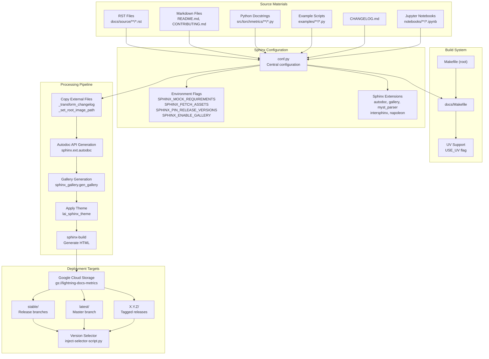
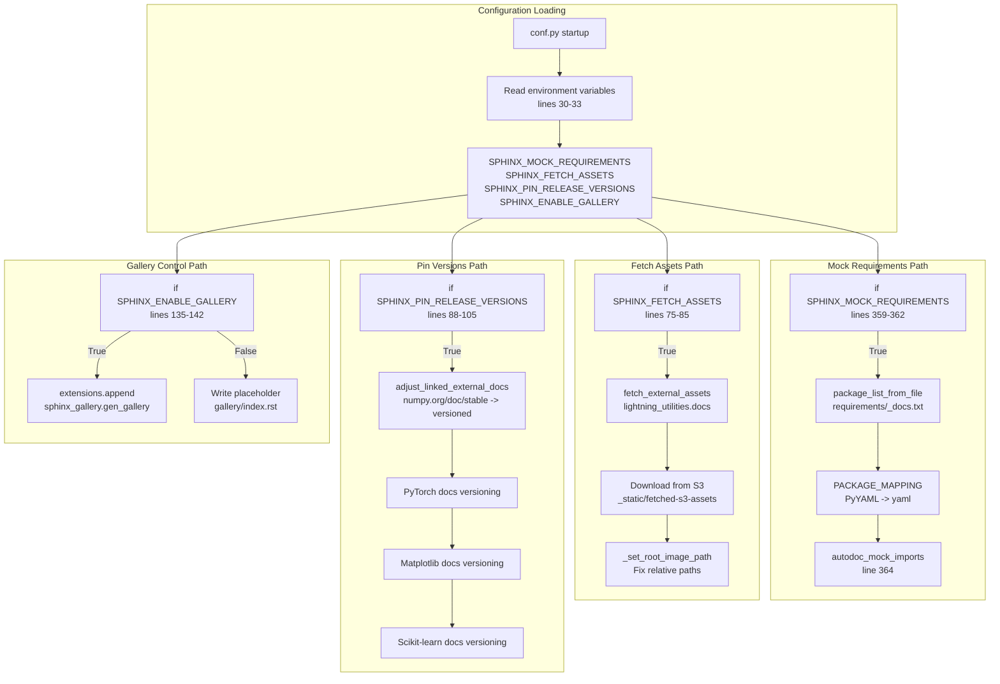
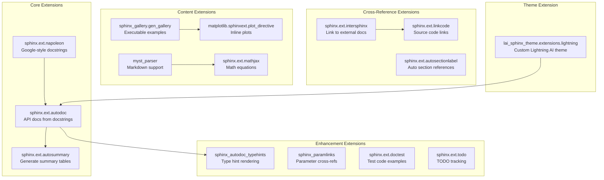
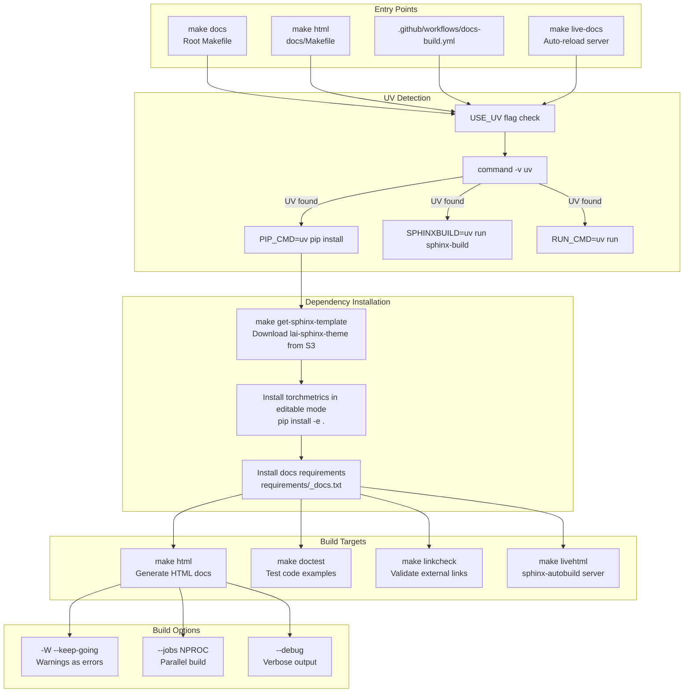
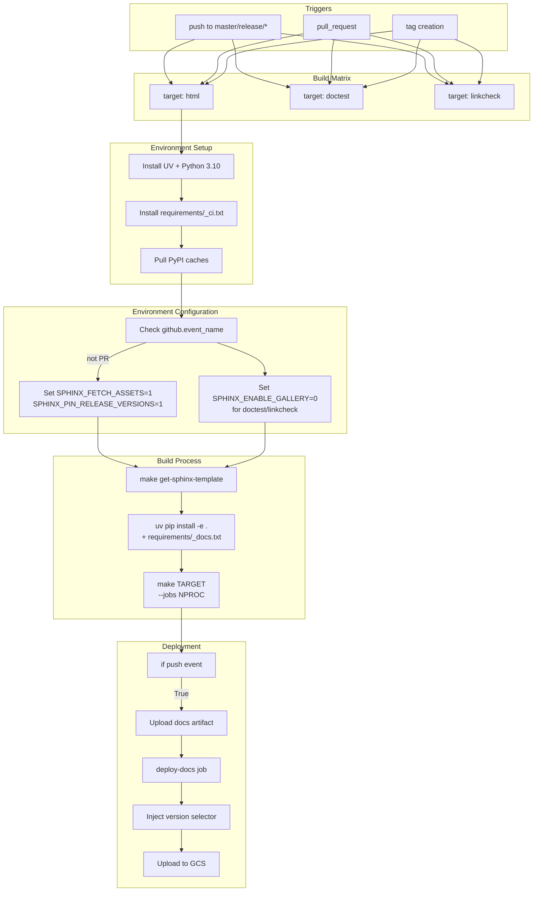
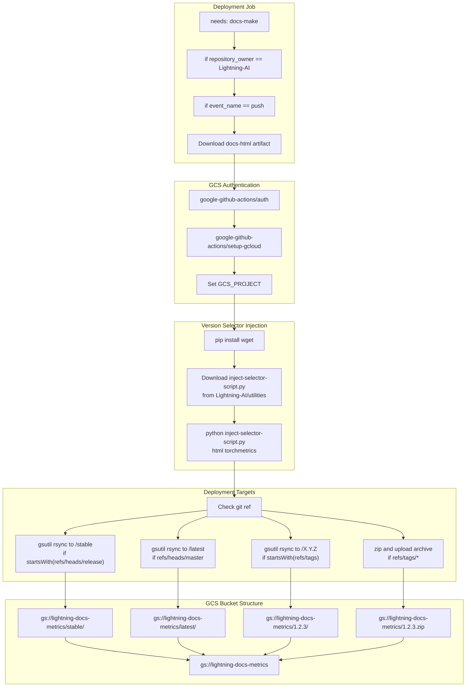
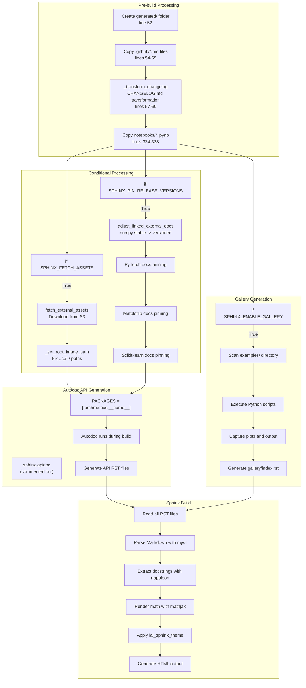
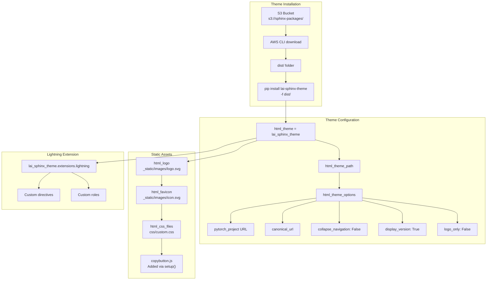

<!-- source: DeepWiki mcp.deepwiki.com · repo Lightning-AI/torchmetrics · page 15.3 Documentation System · fetched 2026-10-21 -->

# Documentation System

<details>
<summary>Relevant source files</summary>

The following files were used as context for generating this wiki page:

- [.github/actions/pull-caches/action.yml](.github/actions/pull-caches/action.yml)
- [.github/actions/push-caches/action.yml](.github/actions/push-caches/action.yml)
- [.github/assistant.py](.github/assistant.py)
- [.github/workflows/_focus-diff.yml](.github/workflows/_focus-diff.yml)
- [.github/workflows/ci-integrate.yml](.github/workflows/ci-integrate.yml)
- [.github/workflows/cmd-help.yml](.github/workflows/cmd-help.yml)
- [.github/workflows/cmd-rebase.yml](.github/workflows/cmd-rebase.yml)
- [.github/workflows/docs-build.yml](.github/workflows/docs-build.yml)
- [.github/workflows/labeler.yml](.github/workflows/labeler.yml)
- [.github/workflows/publish-pkg.yml](.github/workflows/publish-pkg.yml)
- [.github/workflows/slash-cmd-dispatch.yml](.github/workflows/slash-cmd-dispatch.yml)
- [docs/source/regression/critical_success_index.rst](docs/source/regression/critical_success_index.rst)
- [examples/audio/text_to_speech.py](examples/audio/text_to_speech.py)
- [requirements/_ci.txt](requirements/_ci.txt)
- [requirements/_docs.txt](requirements/_docs.txt)
- [requirements/classification_test.txt](requirements/classification_test.txt)
- [requirements/image_test.txt](requirements/image_test.txt)
- [requirements/nominal_test.txt](requirements/nominal_test.txt)
- [requirements/segmentation_test.txt](requirements/segmentation_test.txt)
- [requirements/visual.txt](requirements/visual.txt)
- [src/torchmetrics/functional/image/__init__.py](src/torchmetrics/functional/image/__init__.py)
- [src/torchmetrics/functional/regression/csi.py](src/torchmetrics/functional/regression/csi.py)
- [src/torchmetrics/image/__init__.py](src/torchmetrics/image/__init__.py)
- [src/torchmetrics/regression/csi.py](src/torchmetrics/regression/csi.py)
- [tests/unittests/classification/test_auc.py](tests/unittests/classification/test_auc.py)
- [tests/unittests/image/test_csi.py](tests/unittests/image/test_csi.py)

</details>


## Purpose and Scope

The documentation system generates, builds, and deploys comprehensive user-facing documentation for the torchmetrics library. This page covers the Sphinx-based documentation infrastructure, build pipeline configuration, environment-controlled feature flags, and deployment to Google Cloud Storage. For information about testing documentation (doctests), see [Testing Framework](#15.2). For CI/CD workflows that trigger documentation builds, see [CI/CD Pipeline](#15.1).

---

## Architecture Overview

The documentation system is a multi-stage pipeline that transforms various source formats into deployable HTML documentation with three distinct release streams.



**Sources:** docs/source/conf.py, Makefile, docs/Makefile, .github/workflows/docs-build.yml

---

## Environment Flag System

The documentation build behavior is controlled by four key environment variables that enable flexible builds for different contexts (local development, CI, Read the Docs, production deployment).

| Environment Variable | Default | Purpose | When Enabled |
|---------------------|---------|---------|--------------|
| `SPHINX_MOCK_REQUIREMENTS` | `1` | Mock heavy dependencies to allow building without installing PyTorch, transformers, etc. | Read the Docs builds, fast local builds |
| `SPHINX_FETCH_ASSETS` | `0` | Download external assets from S3 (images, pre-computed data) | Production deployments only |
| `SPHINX_PIN_RELEASE_VERSIONS` | `0` | Pin external documentation links to specific library versions | Production deployments only |
| `SPHINX_ENABLE_GALLERY` | `1` | Generate executable example gallery using sphinx-gallery | HTML builds (disabled for doctest/linkcheck) |



**Sources:** docs/source/conf.py:30-33, docs/source/conf.py:75-85, docs/source/conf.py:88-105, docs/source/conf.py:135-142, docs/source/conf.py:359-364

### Mock Requirements Implementation

The mock requirements system allows building documentation without installing heavy dependencies like PyTorch, torchvision, or transformers. This is critical for Read the Docs, which has limited resources.

**Key Functions:**

- `package_list_from_file(file)` [docs/source/conf.py:343-351](): Parses requirement files and extracts package names by finding the first special character (`,`, `=`, `<`, `>`, `#`).
- `PACKAGE_MAPPING` [docs/source/conf.py:355-357](): Maps PyPI package names to Python import names (e.g., `PyYAML` → `yaml`).
- `autodoc_mock_imports` [docs/source/conf.py:364](): List of modules to mock during autodoc API generation.

When `SPHINX_MOCK_REQUIREMENTS=1`, the system reads [requirements/_docs.txt]() and adds all packages to `autodoc_mock_imports`, replacing actual imports with mock objects during API documentation generation.

**Sources:** docs/source/conf.py:343-364, requirements/_docs.txt

---

## Sphinx Extensions Configuration

The documentation system uses 13+ Sphinx extensions to provide comprehensive functionality.



**Sources:** docs/source/conf.py:117-134

### Key Extension Configurations

**sphinx_gallery** [docs/source/conf.py:152-164]():
- `examples_dirs`: [examples/]() directory containing Python scripts
- `gallery_dirs`: Output to [docs/source/gallery/]()
- `filename_pattern`: Include all files (`.`)
- `abort_on_example_error`: True (strict mode)
- `thumbnail_size`: (400, 280) pixels

**intersphinx** [docs/source/conf.py:300-305]():
Maps external documentation for cross-referencing:
- Python: https://docs.python.org/3
- PyTorch: https://pytorch.org/docs/stable/
- NumPy: https://numpy.org/doc/stable/
- Matplotlib: https://matplotlib.org/stable/

**autodoc** [docs/source/conf.py:378-384]():
- `members`: True (document all members)
- `special-members`: `__call__` only
- `exclude-members`: `_abc_impl`
- `autodoc_member_order`: `"groupwise"` (group by type)
- `autoclass_content`: `"class"` (class docstring only)

**Sources:** docs/source/conf.py:152-164, docs/source/conf.py:300-305, docs/source/conf.py:378-384

---

## Build Pipeline

The build system provides multiple entry points for local development and CI/CD automation with optional UV support for fast dependency installation.



**Sources:** Makefile:1-74, docs/Makefile:1-35, .github/workflows/docs-build.yml:29-97

### Make Targets

**Root Makefile** [Makefile:1-74]():

| Target | Command | Purpose |
|--------|---------|---------|
| `clean` | Remove build artifacts | Clean `docs/build/`, `docs/source/generated/`, etc. |
| `get-sphinx-theme` | Download theme from S3 | Fetch `lai-sphinx-theme` package |
| `docs` | Full build with theme | Clean + get theme + build HTML |
| `live-docs` | Development server | Run `sphinx-autobuild` with auto-reload |

**Docs Makefile** [docs/Makefile:1-35]():

| Target | Command | Purpose |
|--------|---------|---------|
| `html` | sphinx-build HTML | Generate static HTML documentation |
| `doctest` | sphinx-build doctest | Run doctests in code examples |
| `linkcheck` | sphinx-build linkcheck | Validate all external links |
| `livehtml` | sphinx-autobuild | Development server with live reload |

### UV Support

Both Makefiles detect UV availability and automatically use it when `USE_UV=1`:

```makefile
USE_UV ?= 0
HAS_UV := $(shell command -v uv >/dev/null 2>&1 && echo 1 || echo 0)

ifeq ($(USE_UV),1)
  ifeq ($(HAS_UV),1)
    PIP_CMD := uv pip install
    SPHINXBUILD := uv run --no-project sphinx-build
  else
    $(error "USE_UV=1 but uv not found in PATH")
  endif
endif
```

This enables faster builds: `make USE_UV=1 docs`

**Sources:** Makefile:10-25, docs/Makefile:9-20

---

## CI/CD Integration

The GitHub Actions workflow builds documentation for multiple targets with environment-specific configurations.



**Sources:** .github/workflows/docs-build.yml:1-148

### Build Configuration by Context

**Pull Request Builds** [.github/workflows/docs-build.yml:67-73]():
- `SPHINX_FETCH_ASSETS=0`: Skip S3 asset download
- `SPHINX_PIN_RELEASE_VERSIONS=0`: Use latest external docs
- `SPHINX_ENABLE_GALLERY=0` (for doctest/linkcheck only)
- Build all three targets: html, doctest, linkcheck
- Do not deploy

**Production Builds** [.github/workflows/docs-build.yml:67-70]() (push to master/release/tag):
- `SPHINX_FETCH_ASSETS=1`: Download S3 assets
- `SPHINX_PIN_RELEASE_VERSIONS=1`: Pin external doc versions
- `SPHINX_ENABLE_GALLERY=1`: Generate full gallery
- Build HTML only
- Deploy to GCS

### Environment Variables

The workflow sets multiple environment variables [.github/workflows/docs-build.yml:19-27]():

```yaml
env:
  FREEZE_REQUIREMENTS: "1"
  TORCH_URL: "https://download.pytorch.org/whl/cpu/"
  PYPI_CACHE: "_ci-cache_PyPI"
  PROTOCOL_BUFFERS_PYTHON_IMPLEMENTATION: "python"
  TOKENIZERS_PARALLELISM: false
  SPHINX_MOCK_REQUIREMENTS: 0
  SPHINX_FETCH_ASSETS: 0
  SPHINX_PIN_RELEASE_VERSIONS: 0
```

**Sources:** .github/workflows/docs-build.yml:19-27, .github/workflows/docs-build.yml:67-73

---

## Deployment System

Documentation is deployed to Google Cloud Storage with three concurrent release streams and version-aware navigation.



**Sources:** .github/workflows/docs-build.yml:98-148

### Deployment Rules

| Git Reference | GCS Path | Purpose | Archive |
|--------------|----------|---------|---------|
| `refs/heads/release/*` | `/stable` | Latest stable release branch | No |
| `refs/heads/master` | `/latest` | Latest development version | No |
| `refs/tags/X.Y.Z` | `/X.Y.Z` | Specific version documentation | Yes (`.zip`) |

**Commands Used:**

- `gsutil -m rsync -d -R`: Mirror with delete and recursive flags
- Version selector injection adds JavaScript for cross-version navigation
- Archives enable rollback and offline documentation access

**Sources:** .github/workflows/docs-build.yml:120-147

### Version Selector Implementation

The version selector [.github/workflows/docs-build.yml:127-132]() is injected post-build:

1. Downloads `inject-selector-script.py` from Lightning-AI/utilities repository
2. Runs: `python inject-selector-script.py html torchmetrics`
3. Modifies HTML to add version dropdown in navigation bar
4. Dropdown populated by querying GCS bucket for available versions

This allows users to switch between stable/latest/versioned docs without leaving the site.

**Sources:** .github/workflows/docs-build.yml:127-132

---

## Source Processing Pipeline

The system processes multiple source formats and performs several transformations before the Sphinx build.



**Sources:** docs/source/conf.py:52-106, docs/source/conf.py:152-164, docs/source/conf.py:321-323

### Changelog Transformation

The `_transform_changelog` function [docs/source/conf.py:57-60]() from `lightning_utilities.docs.formatting`:
- Converts `CHANGELOG.md` to documentation-friendly format
- Adjusts heading levels for proper TOC integration
- Fixes relative links to absolute GitHub URLs
- Outputs to `docs/source/generated/CHANGELOG.md`

### Image Path Correction

The `_set_root_image_path` function [docs/source/conf.py:63-72]() fixes gallery image paths:
- Finds patterns: `:image: (.*)\.svg`
- Removes `../` prefixes: `../../../_static/image.svg` → `_static/image.svg`
- Necessary because gallery generates pages at different directory depths

### Autodoc Mock Imports

When `SPHINX_MOCK_REQUIREMENTS=1`, the `package_list_from_file` function [docs/source/conf.py:343-351]() parses requirement files:

```python
def package_list_from_file(file: str) -> list[str]:
    mocked_packages = []
    with open(file) as fp:
        for ln in fp.readlines():
            found = [ln.index(ch) for ch in list(",=<>#") if ch in ln]
            pkg = ln[: min(found)] if found else ln
            if pkg.rstrip():
                mocked_packages.append(pkg.rstrip())
    return mocked_packages
```

This extracts package names from lines like `torch >=2.0.0, <2.5.0` → `torch`.

**Sources:** docs/source/conf.py:52-72, docs/source/conf.py:343-351

---

## Theme Configuration

The documentation uses `lai_sphinx_theme`, a custom theme from Lightning AI with specific configuration.



**Sources:** docs/source/conf.py:202-223, Makefile:53-56, .github/workflows/docs-build.yml:62-64

### Theme Options

The theme is configured with specific options [docs/source/conf.py:209-215]():

```python
html_theme_options = {
    "pytorch_project": "https://pytorchlightning.ai",
    "canonical_url": torchmetrics.__docs_url__,
    "collapse_navigation": False,
    "display_version": True,
    "logo_only": False,
}
```

- `pytorch_project`: Links to PyTorch Lightning ecosystem
- `canonical_url`: SEO canonical URL from `torchmetrics.__docs_url__`
- `collapse_navigation`: Keep TOC expanded
- `display_version`: Show version number in header
- `logo_only`: Show full title, not just logo

### Static Files

Custom assets [docs/source/conf.py:217-223]():
- `html_logo`: [_static/images/logo.svg]() (sidebar logo)
- `html_favicon`: [_static/images/icon.svg]() (browser tab icon)
- `html_css_files`: [`css/custom.css`]() (custom styling)
- JavaScript: `copybutton.js` added via `setup()` function for code block copy buttons

**Sources:** docs/source/conf.py:202-223, docs/source/conf.py:326-330

---

## Development Workflow

Local documentation development uses incremental builds and auto-reload for rapid iteration.

### Quick Start

```bash
# Option 1: Full build (clean + theme + build)
make docs

# Option 2: Fast rebuild (assumes theme installed)
cd docs && make html

# Option 3: Live development server
make live-docs

# Option 4: With UV (faster)
make USE_UV=1 docs
```

**Sources:** Makefile:58-65, .github/CONTRIBUTING.md:119-123

### Development Targets

| Target | Speed | Use Case |
|--------|-------|----------|
| `make clean` | N/A | Remove all build artifacts |
| `make get-sphinx-theme` | Slow | Download theme from S3 (once per environment) |
| `make docs` | Slow | Full clean build with theme download |
| `cd docs && make html` | Fast | Incremental rebuild (most common) |
| `make live-docs` | N/A | Auto-reload server for active development |
| `cd docs && make doctest` | Medium | Test code examples in docstrings |
| `cd docs && make linkcheck` | Slow | Validate all external links |

### Live Development Server

The `make live-docs` target [Makefile:63-65]() uses `sphinx-autobuild` [docs/Makefile:33-34]():

```bash
cd docs && make livehtml --jobs $(nproc)
```

This:
1. Starts a local web server (default: http://127.0.0.1:8000)
2. Watches for file changes in `docs/source/`
3. Automatically rebuilds and refreshes browser
4. Uses parallel jobs for faster rebuilds

**Sources:** Makefile:63-65, docs/Makefile:33-34

### Doctests

Doctests validate code examples in docstrings [docs/source/conf.py:401-410]():

```python
doctest_test_doctest_blocks = ""
doctest_global_setup = """
import os
import torch
from torch import Tensor
from torchmetrics import Metric
"""
```

Configuration:
- `doctest_test_doctest_blocks = ""`: Only run doctests marked with `.. doctest::`
- `doctest_global_setup`: Implicit imports available in all doctests
- Run via: `cd docs && make doctest`

**Sources:** docs/source/conf.py:401-410, .github/workflows/docs-build.yml:36

---

## Link Validation

The system includes comprehensive link checking to prevent broken external references.

### Linkcheck Configuration

```python
linkcheck_anchors = False  # Skip anchor validation (too many false positives)
linkcheck_timeout = 30  # 30 seconds per URL
linkcheck_exclude_documents = [r"^(.*\)*CHANGELOG.*$"]  # Skip changelogs
linkcheck_ignore = [...]  # List of known problematic URLs
```

**Sources:** docs/source/conf.py:414-458

### Ignored Domains

The system ignores specific domains that have technical restrictions [docs/source/conf.py:423-458]():

- **IEEE Xplore**: Cannot be accessed by bots (returns 403)
- **JSTOR**: Requires authentication
- **ScienceDirect**: Bot detection prevents validation
- **ACL Anthology**: Occasional timeouts
- **Visual Studio Code**: Unstable `.devcontainer` links

These URLs are validated manually during development.

**Sources:** docs/source/conf.py:423-458

---

## Requirements Management

Documentation builds require numerous dependencies organized in [requirements/_docs.txt]().

### Core Dependencies

| Package | Version | Purpose |
|---------|---------|---------|
| `sphinx` | ==5.3.0 | Documentation generator |
| `myst-parser` | ==1.0.0 | Markdown support |
| `sphinx-gallery` | ==0.19.0 | Example gallery generation |
| `lai-sphinx-theme` | Latest from S3 | Custom Lightning AI theme |
| `sphinx-autodoc-typehints` | ==1.23.0 | Type hint rendering |
| `sphinx-autobuild` | ==2024.10.3 | Live reload server |

### Integration Dependencies

The docs requirements include integration requirements [requirements/_docs.txt:20-28]():

```
-r _integrate.txt
-r audio.txt
-r clustering.txt
-r detection.txt
-r image.txt
-r multimodal.txt
-r text.txt
-r visual.txt
```

This ensures all metric domains can be documented with examples.

### Platform-Specific Requirements

For gallery generation [requirements/_docs.txt:34-35]():

```
scikit-image ~=0.22; python_version < "3.10"
scikit-image ~=0.25; python_version > "3.9"
```

Different scikit-image versions for Python version compatibility.

**Sources:** requirements/_docs.txt:1-36

---

## Directory Structure

The documentation follows a standard Sphinx layout with several generated directories.

```
docs/
├── Makefile                    # Build orchestration
├── source/                     # Source files
│   ├── conf.py                # Central configuration
│   ├── index.rst              # Homepage
│   ├── *.rst                  # Various documentation pages
│   ├── _static/               # Static assets
│   │   ├── images/           # Logos, icons
│   │   ├── css/              # Custom CSS
│   │   └── fetched-s3-assets/ # Downloaded assets (generated)
│   ├── _templates/            # Custom templates
│   ├── generated/             # Generated files (gitignored)
│   │   ├── *.md              # Copied markdown files
│   │   └── CHANGELOG.md      # Transformed changelog
│   ├── gallery/               # Example gallery (generated)
│   │   ├── index.rst
│   │   └── *.py              # Example scripts
│   ├── notebooks/             # Copied notebooks (generated)
│   └── api/                   # API docs (generated, gitignored)
└── build/                      # Build output (gitignored)
    ├── html/                  # HTML output
    ├── doctrees/              # Cached doctrees
    └── linkcheck/             # Link validation results
```

**Generated directories** (.gitignore):
- `generated/`: Copied/transformed markdown files
- `gallery/`: Sphinx-gallery output
- `api/`: Autodoc API documentation
- `build/`: All build outputs
- `_static/fetched-s3-assets/`: Downloaded S3 assets

**Sources:** .gitignore:59-66, docs/source/conf.py:29-60

---

## Summary

The documentation system implements a flexible, multi-stage build pipeline with:

1. **Environment-controlled features** via 4 flags enabling different build modes
2. **13+ Sphinx extensions** providing comprehensive functionality
3. **Dual build system** supporting both standard `pip` and fast `uv` workflows
4. **CI/CD integration** with matrix testing across 3 targets (html, doctest, linkcheck)
5. **Three-stream deployment** (stable/latest/versioned) with version selector
6. **Source processing** for multiple formats (RST, Markdown, docstrings, notebooks)
7. **Mock requirements** enabling builds without heavy dependencies
8. **Live development** with auto-reload for rapid iteration

The system balances flexibility (local fast builds) with rigor (production pinned builds) while maintaining comprehensive validation through doctests and linkcheck.

**Sources:** docs/source/conf.py, Makefile, docs/Makefile, .github/workflows/docs-build.yml, requirements/_docs.txt

---

