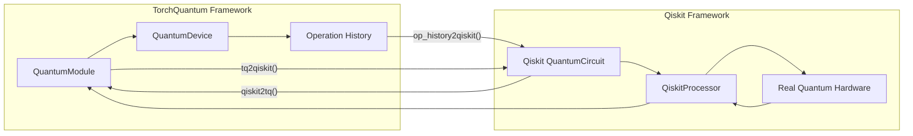
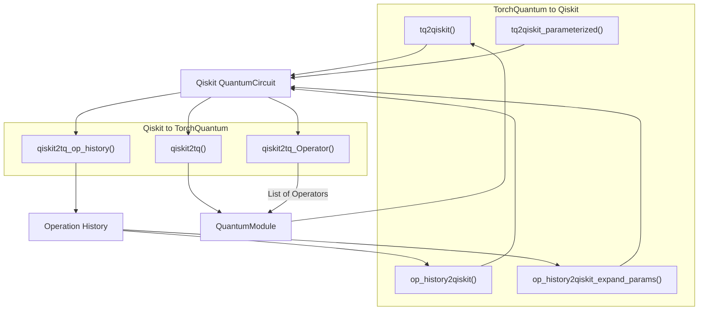
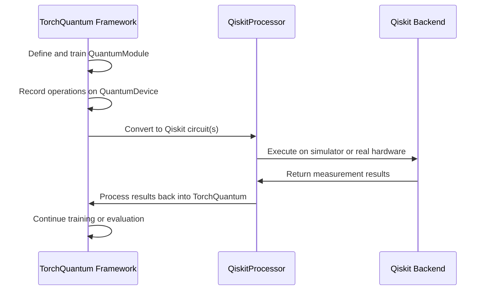
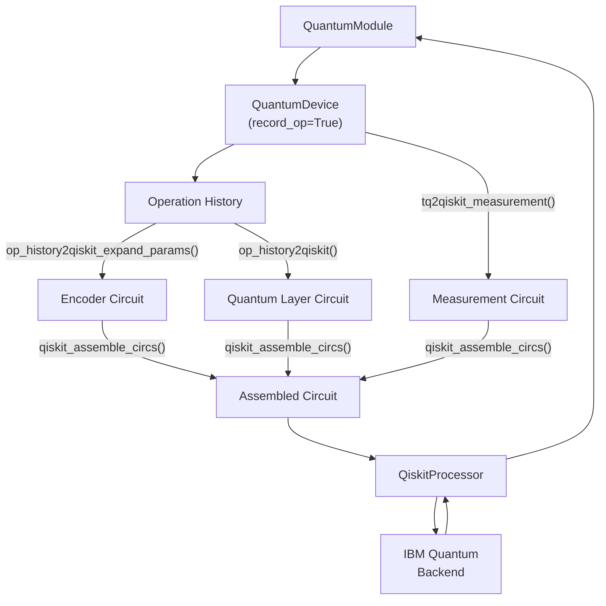
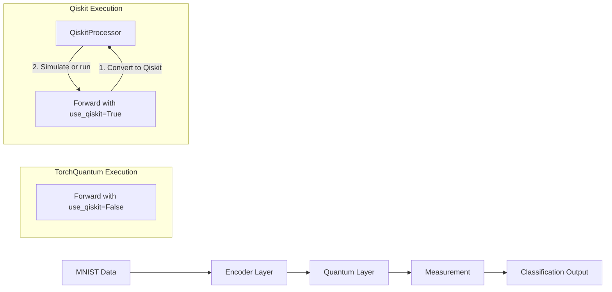

<!-- source: DeepWiki mcp.deepwiki.com · repo mit-han-lab/torchquantum · page 5.1 Qiskit Integration · fetched 2026-10-30 -->

# Qiskit Integration

<details>
<summary>Relevant source files</summary>

The following files were used as context for generating this wiki page:

- [.github/workflows/functional_tests.yaml](.github/workflows/functional_tests.yaml)
- [examples/amplitude_encoding_mnist/mnist_new.py](examples/amplitude_encoding_mnist/mnist_new.py)
- [examples/mnist/mnist.py](examples/mnist/mnist.py)
- [examples/optimal_control/optimal_control.py](examples/optimal_control/optimal_control.py)
- [examples/optimal_control/optimal_control_gaussian.py](examples/optimal_control/optimal_control_gaussian.py)
- [examples/optimal_control/optimal_control_multi_qubit.py](examples/optimal_control/optimal_control_multi_qubit.py)
- [examples/qaoa/max_cut_backprop.py](examples/qaoa/max_cut_backprop.py)
- [examples/regression/run_regression.py](examples/regression/run_regression.py)
- [test/__init__.py](test/__init__.py)
- [test/functional/test_func_mat_exp.py](test/functional/test_func_mat_exp.py)
- [test/operator/test_op_hamil_exp.py](test/operator/test_op_hamil_exp.py)
- [test/random_layer_test.py](test/random_layer_test.py)
- [test/static_mode_test.py](test/static_mode_test.py)
- [test/utils.py](test/utils.py)
- [torchquantum/device/devices.py](torchquantum/device/devices.py)
- [torchquantum/encoding/encodings.py](torchquantum/encoding/encodings.py)
- [torchquantum/operator/__init__.py](torchquantum/operator/__init__.py)
- [torchquantum/plugin/qiskit/qiskit_plugin.py](torchquantum/plugin/qiskit/qiskit_plugin.py)

</details>


TorchQuantum provides comprehensive integration with IBM's Qiskit framework, enabling quantum models to be executed on both Qiskit simulators and real quantum hardware. This page documents the integration mechanisms between TorchQuantum and Qiskit, including conversion utilities, execution patterns, and real hardware deployment.

For information about NVIDIA cuQuantum integration, see [cuQuantum Integration](#5.2).

## Overview

TorchQuantum's Qiskit integration allows seamless conversion between TorchQuantum's native representation of quantum circuits and Qiskit's quantum circuits. This enables users to:

1. Design and train quantum neural networks using TorchQuantum's PyTorch-based framework
2. Convert these networks to Qiskit circuits
3. Execute the circuits on Qiskit simulators or real quantum hardware
4. Process measurement results within the TorchQuantum framework



Sources: [torchquantum/plugin/qiskit/qiskit_plugin.py:399-585](), [examples/mnist/mnist.py:87-134]()

## Conversion Utilities

TorchQuantum provides several functions to convert between TorchQuantum and Qiskit circuit representations:



Sources: [torchquantum/plugin/qiskit/qiskit_plugin.py:44-59](), [torchquantum/plugin/qiskit/qiskit_plugin.py:399-772]()

### TorchQuantum to Qiskit

- **tq2qiskit**: Converts a TorchQuantum `QuantumModule` to a Qiskit `QuantumCircuit`
- **tq2qiskit_parameterized**: Creates a parameterized Qiskit circuit from TorchQuantum function list
- **op_history2qiskit**: Converts operation history from a `QuantumDevice` to a Qiskit circuit
- **op_history2qiskit_expand_params**: Expands parameters in operation history into multiple Qiskit circuits

Table of key conversion functions:

| Function | Input | Output | Description |
|----------|-------|--------|-------------|
| `tq2qiskit` | `QuantumDevice`, `QuantumModule` | `QuantumCircuit` | Converts a module to a fixed Qiskit circuit |
| `tq2qiskit_parameterized` | `QuantumDevice`, function list | `QuantumCircuit`, parameters | Creates a parameterized circuit |
| `op_history2qiskit` | Number of wires, operation history | `QuantumCircuit` | Converts operation history to circuit |
| `op_history2qiskit_expand_params` | Number of wires, operation history, batch size | List of `QuantumCircuit` | Creates multiple circuits with expanded parameters |

Sources: [torchquantum/plugin/qiskit/qiskit_plugin.py:399-676]()

### Qiskit to TorchQuantum

- **qiskit2tq**: Converts a Qiskit `QuantumCircuit` to a TorchQuantum `QuantumModule`
- **qiskit2tq_op_history**: Extracts operation history from a Qiskit circuit
- **qiskit2tq_Operator**: Converts a Qiskit circuit to a list of TorchQuantum operators

Sources: [torchquantum/plugin/qiskit/qiskit_plugin.py:62-153](), [torchquantum/plugin/qiskit/qiskit_plugin.py:680-772]()

## Gate Compatibility

TorchQuantum supports conversion of most standard quantum gates between the frameworks, including:

### Single-qubit Gates
- Pauli gates (`X`, `Y`, `Z`)
- Hadamard (`H`)
- Phase gates (`S`, `T`, `SX`)
- Rotation gates (`RX`, `RY`, `RZ`, `PhaseShift`)
- Universal gates (`U1`, `U2`, `U3`)

### Two-qubit Gates
- `CNOT`, `CZ`, `CY`
- Controlled rotations (`CRX`, `CRY`, `CRZ`)
- `SWAP`, `CSWAP`

### Multi-qubit Gates
- `Toffoli` (CCX)
- `MultiCNOT`
- Unitary gates

Some specialized TorchQuantum operations have restrictions when converting to Qiskit. These are defined in the `QISKIT_INCOMPATIBLE_OPS` and `QISKIT_INCOMPATIBLE_FUNC_NAMES` lists.

Sources: [torchquantum/plugin/qiskit/qiskit_plugin.py:90-152](), [torchquantum/plugin/qiskit/qiskit_plugin.py:231-335](), [test/static_mode_test.py:33-39]()

## Executing on Qiskit Backends

The process of executing a TorchQuantum model on Qiskit backends involves several steps:



Example implementation pattern for executing on a Qiskit backend:

1. Create a `QuantumDevice` with `record_op=True`
2. Apply quantum operations, recording operation history
3. Convert operation history to Qiskit circuits
4. Execute circuits on Qiskit backend
5. Process results back in TorchQuantum

Sources: [examples/mnist/mnist.py:87-134](), [examples/mnist/mnist.py:245-272]()

## Real Quantum Hardware Execution

TorchQuantum supports executing quantum models on real quantum hardware through IBM Quantum:



To execute a TorchQuantum model on a real quantum device:

1. Create a `QiskitProcessor` with `use_real_qc=True`
2. Configure IBMQ account information
3. Specify the target backend
4. Convert and execute the TorchQuantum model

Example configuration:

```python
from torchquantum.plugin import QiskitProcessor

# For simulation
processor_sim = QiskitProcessor(use_real_qc=False)
model.set_qiskit_processor(processor_sim)

# For real quantum hardware
processor_qc = QiskitProcessor(
    use_real_qc=True,
    backend_name="ibm_quantum_device_name",
    hub="ibm-q",
    group="open",
    project="main"
)
model.set_qiskit_processor(processor_qc)
```

Sources: [examples/mnist/mnist.py:247-272]()

## Usage Example

Below is a simplified example showing how to use Qiskit integration in a quantum neural network for MNIST classification:



In this example:
1. The model architecture is defined in TorchQuantum
2. Input images are encoded into quantum states
3. The model can be executed either directly in TorchQuantum or via Qiskit
4. For Qiskit execution, circuits are converted, executed, and results are processed back

A complete implementation example can be found in the MNIST example file in the TorchQuantum repository.

Sources: [examples/mnist/mnist.py:44-134]()

## IBMQ Account Setup

To use real quantum hardware, you need an IBMQ account:

1. Register at the [IBM Quantum Experience](https://quantum-computing.ibm.com)
2. Get your API token
3. Configure your IBMQ account with Qiskit:

```python
from qiskit import IBMQ
IBMQ.save_account('YOUR_API_TOKEN')
```

For premium IBM Quantum Network access, configure your specific hub, group, and project information in the `QiskitProcessor`.

Sources: [examples/mnist/mnist.py:260-272]()

## Limitations and Considerations

When using the Qiskit integration, be aware of the following:

1. Not all TorchQuantum operations have direct Qiskit equivalents
2. Real quantum hardware has constraints on:
   - Available gate sets
   - Qubit connectivity
   - Decoherence and noise
3. Execution on real hardware may take time due to queue waiting times
4. Parameter shift gradients must be used for on-chip training, as automatic differentiation is not available on real hardware

For complex models, consider using the static mode in TorchQuantum for faster execution during development before deployment to real hardware.

Sources: [examples/mnist/mnist.py:247-272](), [test/static_mode_test.py:33-39]()

---

