# Page: Overview

# Overview

<details>
<summary>Relevant source files</summary>

The following files were used as context for generating this wiki page:

- [README.md](README.md)
- [docs/Makefile](docs/Makefile)
- [docs/make.bat](docs/make.bat)
- [docs/source/_templates/classtemplate_auto.rst](docs/source/_templates/classtemplate_auto.rst)
- [docs/source/_templates/classtemplate_controlflow.rst](docs/source/_templates/classtemplate_controlflow.rst)
- [docs/source/_templates/functiontemplate.rst](docs/source/_templates/functiontemplate.rst)
- [docs/source/api_functional.rst](docs/source/api_functional.rst)
- [docs/source/api_layers.rst](docs/source/api_layers.rst)
- [docs/source/api_operators.rst](docs/source/api_operators.rst)
- [docs/source/api_torchquantum.rst](docs/source/api_torchquantum.rst)
- [docs/source/index.rst](docs/source/index.rst)
- [docs/source/usage_installation.rst](docs/source/usage_installation.rst)
- [setup.py](setup.py)
- [torchquantum/__init__.py](torchquantum/__init__.py)

</details>


TorchQuantum is a PyTorch-based framework for quantum simulation and quantum machine learning. It enables the simulation of quantum computations on classical hardware using PyTorch, supporting statevector simulation and quantum circuit construction with automatic differentiation capabilities. The framework is designed to leverage GPU acceleration for scaling up to 30+ qubits and provides seamless integration between classical and quantum computing paradigms.

This page provides a high-level overview of TorchQuantum, explaining its purpose, key features, and architectural components. For specific installation instructions, see [Installation and Requirements](#1.1), and for a detailed list of features, see [Key Features](#1.2).

## Purpose and Scope

TorchQuantum provides tools for researchers and developers working on quantum algorithm design, parameterized quantum circuit training, quantum optimal control, quantum machine learning, and quantum neural networks. Its primary goal is to make quantum computing more accessible to the PyTorch community while providing high-performance simulation capabilities.

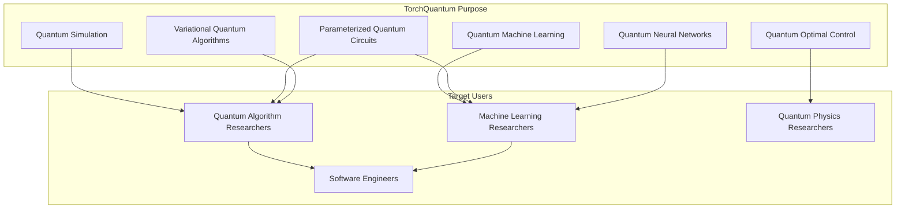

Sources: [README.md:50-55](), [docs/source/index.rst:52-63]()

## Core Architecture

TorchQuantum's architecture is built around several key components that provide the foundation for quantum simulation and computation:

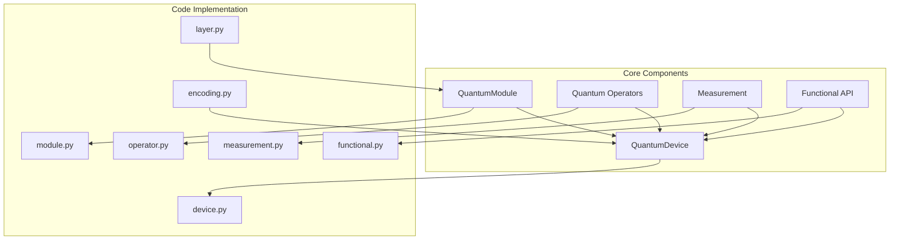

Sources: [README.md:262-275](), [docs/source/index.rst:284-317]()

The architecture consists of:

1. **QuantumDevice**: The central component that stores and manages quantum states. It serves as the quantum memory that operators act upon.

2. **Quantum Operators**: Classes that implement various quantum gates (like Hadamard, PauliX, CNOT, etc.) which manipulate the quantum states in the QuantumDevice.

3. **QuantumModule**: A PyTorch-compatible module for constructing quantum circuits in an object-oriented manner, similar to `nn.Module` in PyTorch.

4. **Measurement**: Tools for extracting classical information from quantum states, including expectation values and sampling-based measurements.

5. **Functional API**: A functional interface for applying quantum operations, offering an alternative to the object-oriented approach.

## Execution Flow and Integration

TorchQuantum integrates with the PyTorch ecosystem and enables the construction of hybrid classical-quantum computational flows:

```mermaid
sequenceDiagram
    participant CML as Classical ML (PyTorch)
    participant QD as QuantumDevice
    participant QO as Quantum Operators
    participant MS as Measurement
    participant OPT as PyTorch Optimizer
    
    CML->>QD: Create quantum device
    Note over QD: Initialize quantum state
    QD->>QO: Apply quantum gates
    Note over QO: Transform quantum state
    QD->>MS: Measure quantum state
    MS->>CML: Return classical values
    CML->>OPT: Calculate loss
    OPT->>QO: Update parameters
    Note over QO: Parameters updated via PyTorch autograd
```

Sources: [README.md:92-145](), [docs/source/index.rst:108-149]()

This execution flow demonstrates how TorchQuantum seamlessly integrates quantum computation within the PyTorch ecosystem:

1. Classical PyTorch code creates a quantum device with specified number of qubits
2. Quantum operators (gates) are applied to transform the quantum state
3. Measurements convert quantum information back to classical values
4. These classical values can be used in PyTorch's optimization process
5. The quantum circuit parameters are updated through PyTorch's autograd mechanism

## Key Differentiators

What sets TorchQuantum apart from other quantum computing frameworks like Qiskit or Pennylane:

| Feature | TorchQuantum | Other Frameworks |
|---------|--------------|------------------|
| Computation Graph | Dynamic computation graph | Static computation graph |
| Gradient Computation | Automatic via PyTorch autograd | Often manual or limited |
| GPU Support | Native support with batch processing | Limited or no GPU support |
| Debugging | Easy with PyTorch's tools | Usually more complex |
| Integration | Seamless with PyTorch ecosystem | May require adapters |
| Batch Processing | Tensorized batch processing | Often sequential |

Sources: [README.md:56-58](), [docs/source/index.rst:65-69]()

## Usage Modes

TorchQuantum offers multiple ways to construct and execute quantum circuits:

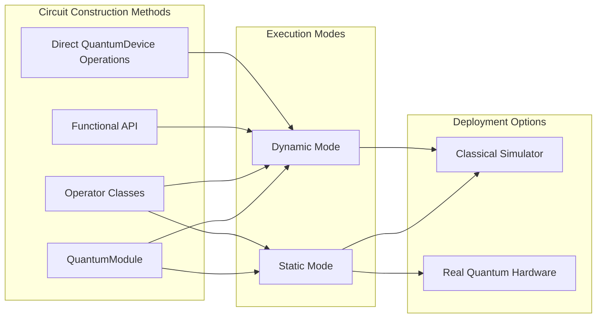

Sources: [README.md:90-145](), [docs/source/index.rst:108-149]()

TorchQuantum provides flexibility in how quantum circuits are constructed and executed:

1. Direct operations on the QuantumDevice
2. Using the functional API (similar to PyTorch's functional API)
3. Using Operator classes for a more object-oriented approach
4. Building circuits with QuantumModule (similar to PyTorch's nn.Module)

Circuits can be executed in dynamic mode (step-by-step execution with dynamic computation graph) or static mode (pre-compiled circuits), and can be deployed on classical simulators or real quantum hardware through integrations with platforms like IBMQ.

## Application Areas

TorchQuantum has been used in various quantum computing applications:

- Quantum Neural Networks for classification tasks (e.g., MNIST)
- Quantum Convolution (Quanvolution)
- Variational Quantum Algorithms (VQE, QAOA)
- Quantum Kernel Methods
- Quantum Approximate Optimization
- Noise-resilient quantum circuit design (QuantumNAS)

Sources: [README.md:171-179](), [docs/source/index.rst:174-196]()

TorchQuantum has been used in several published papers, including works on noise-adaptive search for robust quantum circuits (QuantumNAS), quantum noise-aware training, quantum on-chip training, variational quantum pulse learning, and quantum neural network compression.

## Software Components

The TorchQuantum codebase is organized into several key modules:

| Module | File | Description |
|--------|------|-------------|
| QuantumDevice | device.py | Stores and manages quantum states |
| Encoding | encoding.py | Encodes classical data into quantum states |
| Functional API | functional.py | Provides functional interface for quantum operations |
| Operators | operator.py | Implements quantum gate classes |
| Layers | layer.py | Provides layer templates for circuit construction |
| Measurement | measurement.py | Tools for measuring quantum states |
| Graph | graph.py | Quantum gate graph used in static mode |
| Qiskit Integration | plugins/qiskit* | Connectors for IBMQ deployment |

Sources: [README.md:262-275](), [docs/source/index.rst:284-317]()

This modular organization allows for flexibility and extensibility, making it easy to add new features or integrate with other quantum computing frameworks.

---

# Page: Installation and Requirements

# Installation and Requirements

<details>
<summary>Relevant source files</summary>

The following files were used as context for generating this wiki page:

- [README.md](README.md)
- [docs/requirements.txt](docs/requirements.txt)
- [docs/source/conf.py](docs/source/conf.py)
- [docs/source/examples/quanvolution/README.md](docs/source/examples/quanvolution/README.md)
- [docs/source/examples/quanvolution/quanvolution.ipynb](docs/source/examples/quanvolution/quanvolution.ipynb)
- [docs/source/examples_README.md](docs/source/examples_README.md)
- [examples/README.md](examples/README.md)
- [examples/clifford_qnn/README.md](examples/clifford_qnn/README.md)
- [examples/quanvolution/README.md](examples/quanvolution/README.md)
- [examples/quanvolution/quanvolution.ipynb](examples/quanvolution/quanvolution.ipynb)
- [readthedocs.yaml](readthedocs.yaml)
- [requirements.txt](requirements.txt)
- [setup.py](setup.py)
- [torchquantum/__init__.py](torchquantum/__init__.py)

</details>


This page details the process of installing TorchQuantum and setting up the required dependencies to run quantum simulations and quantum machine learning workloads. TorchQuantum is designed to seamlessly integrate with PyTorch, enabling quantum computing simulations on classical hardware with optional GPU acceleration.

For information about TorchQuantum's capabilities and features, see [Key Features](#1.2).

## System Requirements

### Python Version Compatibility

TorchQuantum works with Python versions between 3.7 and 3.9. Python 3.10 may have compatibility issues with the `concurrent` package used by Qiskit.

Sources: [README.md:381-387]()

### Hardware Requirements

- **CPU**: Standard CPU compatible with PyTorch
- **GPU**: NVIDIA GPUs are required for GPU-accelerated model training and simulation
- **Memory**: Requirements scale with the size of quantum systems being simulated (each additional qubit doubles the memory needs)

Sources: [README.md:386-387]()

## Installation Methods

### From Source (Recommended)

The recommended installation method is cloning the repository and installing in editable mode:

```bash
git clone https://github.com/mit-han-lab/torchquantum.git
cd torchquantum
pip install --editable .
```

Installing in editable mode allows you to modify the code and see changes immediately without reinstallation.

Sources: [README.md:83-88]()

### Via pip

TorchQuantum is also available on PyPI:

```bash
pip install torchquantum
```

Sources: [README.md:83-88]()

## Dependencies

TorchQuantum relies on several key libraries for its functionality:

### Core Dependencies

| Package | Version | Purpose |
|---------|---------|---------|
| PyTorch | ≥ 1.8.0 | Deep learning framework foundation |
| Qiskit | ≥ 0.39.0, < 1.0.0 | Quantum circuit simulation and hardware access |
| qiskit-aer | 0.13.3 | High-performance quantum simulators |
| qiskit_ibm_runtime | 0.20.0 | IBM Quantum hardware execution |
| NumPy | ≥ 1.19.2 | Numerical computations |
| SciPy | ≥ 1.5.2 | Scientific computing utilities |
| setuptools | ≥ 52.0.0 | Package installation tools |

### Additional Libraries

| Package | Purpose |
|---------|---------|
| matplotlib | Visualization of quantum states and circuits |
| tqdm | Progress tracking for quantum simulations |
| torchvision | Image processing for QML examples |
| torchpack | Training utilities |
| opt_einsum | Optimized tensor contractions |
| pathos | Parallel processing |

Sources: [requirements.txt:1-25](), [README.md:381-387]()

## TorchQuantum Architecture and Dependencies

Title: TorchQuantum Component Dependency Structure
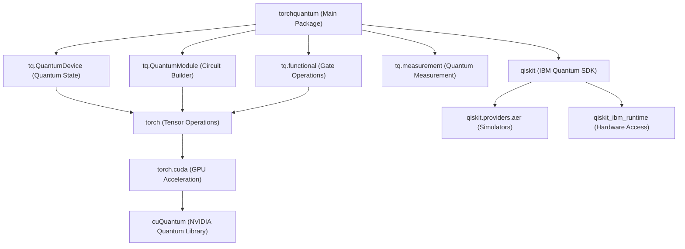

Sources: [__init__.py:25-42](), [README.md:47-80]()

## Installation Process

Title: TorchQuantum Installation Workflow
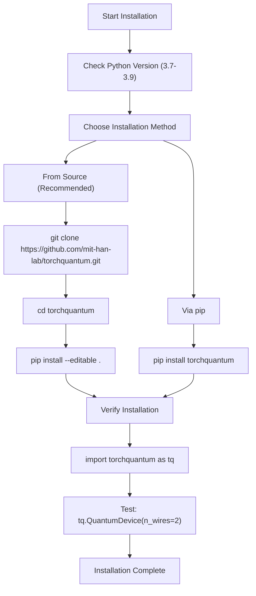

Sources: [README.md:83-88](), [README.md:92-105]()

## Verification and Basic Usage

After installation, verify that TorchQuantum is working correctly:

```python
import torchquantum as tq
import torchquantum.functional as tqf

# Create a quantum device
qdev = tq.QuantumDevice(n_wires=2, bsz=5, device="cpu")  # use device='cuda' for GPU

# Apply quantum gates
qdev.h(wires=0)
qdev.cnot(wires=[0, 1])

# Print the current state
print(qdev)
```

This basic example creates a quantum device with 2 qubits and applies a Hadamard gate followed by a CNOT gate.

Sources: [README.md:92-115]()

## Common Issues and Troubleshooting

### Qiskit Compatibility

TorchQuantum automatically checks for compatibility with Qiskit. The package will display warnings if there are Qiskit parameterization issues that need to be fixed.

Sources: [__init__.py:43-64]()

### GPU Support

When using GPU acceleration:
- Ensure your NVIDIA drivers are up-to-date
- Verify CUDA compatibility with your PyTorch installation
- For larger quantum simulations, more GPU memory will be required

### Environment Compatibility

- For Jupyter notebooks or Google Colab: You may need to install additional visualization packages
- For containerized environments: Ensure the container has access to GPU resources if needed

## Example Installation in Jupyter/Colab

For notebook environments like Google Colab, you can install TorchQuantum with:

```python
!pip install qiskit==0.32.1  # Install compatible Qiskit version
!git clone https://github.com/mit-han-lab/torchquantum.git
%cd torchquantum
!pip install --editable .
%env PYTHONPATH=.
```

This approach is demonstrated in the Quanvolution example notebook.

Sources: [examples/quanvolution/quanvolution.ipynb:83-486]()

## Next Steps

After installation, you can explore:
- Basic quantum circuit creation in the [Core Components](#2) section
- Example notebooks in the examples directory
- Integration with Qiskit for real quantum hardware execution

The installation provides all necessary components to start building and simulating quantum circuits using the PyTorch framework, with seamless GPU acceleration for larger simulations.

---

# Page: Key Features

# Key Features

<details>
<summary>Relevant source files</summary>

The following files were used as context for generating this wiki page:

- [README.md](README.md)
- [docs/Makefile](docs/Makefile)
- [docs/make.bat](docs/make.bat)
- [docs/source/_templates/classtemplate_auto.rst](docs/source/_templates/classtemplate_auto.rst)
- [docs/source/_templates/classtemplate_controlflow.rst](docs/source/_templates/classtemplate_controlflow.rst)
- [docs/source/_templates/functiontemplate.rst](docs/source/_templates/functiontemplate.rst)
- [docs/source/api_functional.rst](docs/source/api_functional.rst)
- [docs/source/api_layers.rst](docs/source/api_layers.rst)
- [docs/source/api_operators.rst](docs/source/api_operators.rst)
- [docs/source/api_torchquantum.rst](docs/source/api_torchquantum.rst)
- [docs/source/index.rst](docs/source/index.rst)
- [docs/source/usage_installation.rst](docs/source/usage_installation.rst)
- [setup.py](setup.py)
- [torchquantum/__init__.py](torchquantum/__init__.py)

</details>


This page provides an overview of the main features and capabilities of TorchQuantum, a PyTorch-based framework for quantum simulation and quantum machine learning. TorchQuantum enables researchers and developers to easily construct, simulate, and train quantum circuits using the familiar PyTorch ecosystem.

## PyTorch Integration and Design Philosophy

TorchQuantum is built on PyTorch, providing a seamless integration with the PyTorch ecosystem. The framework is designed to leverage PyTorch's capabilities while extending them to quantum computing.

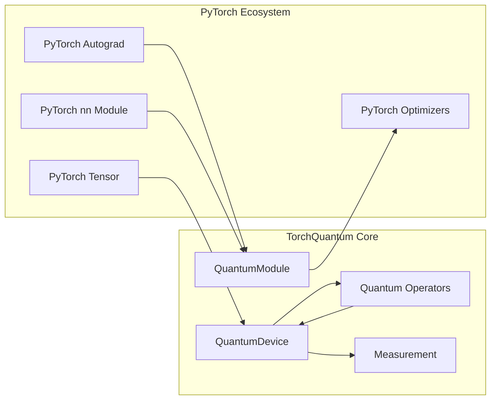

Sources: [README.md:72-80](), [torchquantum/__init__.py:28-42]()

The key design features include:

### 1. Dynamic Computation Graph

Unlike some other quantum computing frameworks, TorchQuantum leverages PyTorch's dynamic computation graph, which allows for:

- Easy debugging of quantum circuits at runtime
- Step-by-step inspection of quantum states
- On-the-fly modification of circuit architecture
- Interactive development and testing

```python
# Example of dynamic graph inspection
qdev = tq.QuantumDevice(n_wires=2, bsz=5, device="cpu", record_op=True)
qdev.h(wires=0)
qdev.cnot(wires=[0, 1])

# Print the current quantum state at any point
print(qdev)  # Shows the full state vector in real-time
```

Sources: [README.md:76](), [README.md:110-111]()

### 2. Automatic Differentiation

TorchQuantum fully supports automatic differentiation through PyTorch's autograd, enabling:

- Gradient computation for trainable quantum circuit parameters
- End-to-end training of hybrid quantum-classical models
- Support for various optimization algorithms in PyTorch

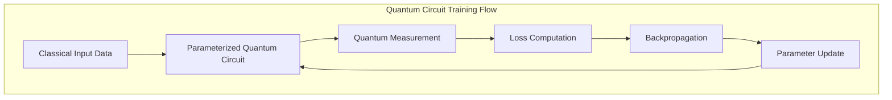

Sources: [README.md:77](), [README.md:130-132]()

### 3. Batch Processing

TorchQuantum supports batch processing of quantum operations, allowing for:

- Processing multiple quantum circuit instances simultaneously
- Parallelized simulation of multiple input data samples
- Efficient training of quantum models on large datasets

```python
# Example of batch processing
qdev = tq.QuantumDevice(n_wires=4, bsz=32, device="cuda")  # Batch size of 32
```

Sources: [README.md:78](), [README.md:96]()

### 4. GPU Acceleration

TorchQuantum provides GPU support for quantum simulations, offering:

- Significant speedups for quantum circuit simulation
- Ability to scale to larger qubit systems (30+ qubits)
- Batched operations leveraging GPU parallelism

This is achieved through PyTorch's GPU support and dedicated optimizations for quantum operations.

Sources: [README.md:78](), [README.md:52]()

## Quantum Circuit Construction

TorchQuantum provides flexible ways to construct quantum circuits:

```mermaid
graph TD
    subgraph "Circuit Construction Methods"
        QM["QuantumModule Class"]
        Func["Functional API"]
        DevOP["Device Op Methods"]
        QMO["QuantumModule.from_op_history"]
    end
    
    subgraph "Circuit Building Blocks"
        SingleQubit["Single-Qubit Gates"]
        TwoQubit["Two-Qubit Gates"]
        MultiQubit["Multi-Qubit Gates"]
        Custom["Custom Unitary Gates"]
    end
    
    subgraph "Layer Abstractions"
        Templates["Layer Templates"]
        NLocal["N-Local Circuits"]
        TwoLocal["Two-Local Circuits"]
    end
    
    QM --> SingleQubit
    Func --> SingleQubit
    DevOP --> SingleQubit
    QMO --> SingleQubit
    
    SingleQubit --> Templates
    TwoQubit --> Templates
    MultiQubit --> Templates
    Templates --> NLocal
    NLocal --> TwoLocal
```

Sources: [README.md:98-106](), [README.md:136-145]()

### 1. Multiple API Styles

TorchQuantum provides multiple ways to build circuits:

- **QuantumModule API**: Object-oriented approach similar to PyTorch's nn.Module
- **Functional API**: Function-based approach for direct gate application
- **Device Operation Methods**: Direct method calls on the QuantumDevice object

```python
# Three equivalent ways to apply Hadamard gate
# 1. Using device operation methods
qdev.h(wires=0)

# 2. Using functional API
tqf.h(qdev, wires=0)

# 3. Using operator objects
h_op = tq.Hadamard()
h_op(qdev, wires=0)
```

Sources: [README.md:98-108]()

### 2. Comprehensive Gate Set

TorchQuantum provides a comprehensive set of quantum gates:

- Single-qubit gates: H, X, Y, Z, RX, RY, RZ, etc.
- Two-qubit gates: CNOT, CZ, SWAP, etc.
- Multi-qubit gates: Toffoli, QubitUnitary, etc.
- Parameterized gates with trainable parameters

Sources: [docs/source/api_operators.rst:13-67](), [docs/source/api_functional.rst:43-100]()

### 3. Layer Templates

Higher-level abstractions for building complex quantum circuits:

- Random layers
- N-local circuit templates
- Entanglement layers
- QFT layers

Sources: [docs/source/api_layers.rst:12-29]()

## Measurement and Classical Processing

TorchQuantum provides various measurement options to extract classical information from quantum states:

### 1. Measurement Types

- **Direct sampling**: Obtain bitstring samples from the quantum state
- **Expectation values**: Compute expectation values of observables
- **Analytical computation**: Exact calculation of expectation values (simulator only)
- **Stochastic sampling**: Approximation of expectation values through sampling (works on real quantum hardware)

```python
# Example of different measurement types
# Direct sampling
samples = tq.measure(qdev, n_shots=1024)

# Expectation value via sampling
from torchquantum.measurement import expval_joint_sampling
expval_sampling = expval_joint_sampling(qdev, 'ZX', n_shots=1024)

# Expectation value via analytical computation
from torchquantum.measurement import expval_joint_analytical
expval = expval_joint_analytical(qdev, 'ZX')
```

Sources: [README.md:117-128]()

## Integration Capabilities

TorchQuantum provides integration with other quantum computing frameworks and hardware:

### 1. Qiskit Integration

- Convert TorchQuantum circuits to Qiskit for execution on real IBM quantum hardware
- Obtain QASM representation of quantum circuits
- Access IBM Quantum hardware and simulators

```python
# Example of QASM conversion
from torchquantum.plugin import op_history2qasm
qasm_str = op_history2qasm(qdev.n_wires, qdev.op_history)
```

Sources: [README.md:113-115]()

### 2. NVIDIA cuQuantum Integration

- Leverage NVIDIA's cuQuantum SDK for accelerated quantum simulation
- Significant speedups for large-scale simulations

## Advanced Features

TorchQuantum includes several advanced features for quantum research:

### 1. Noise Models and Density Matrix Simulation

- Support for realistic noise modeling
- Density matrix simulation for mixed quantum states

### 2. Parameter Shift for On-Chip Training

- Implementation of parameter shift rule for gradient computation on actual quantum hardware
- Enables training directly on quantum devices

### 3. Static and Dynamic Execution Modes

- **Dynamic Mode**: Step-by-step gate application with state inspection (default)
- **Static Mode**: Pre-compiled circuit execution for performance

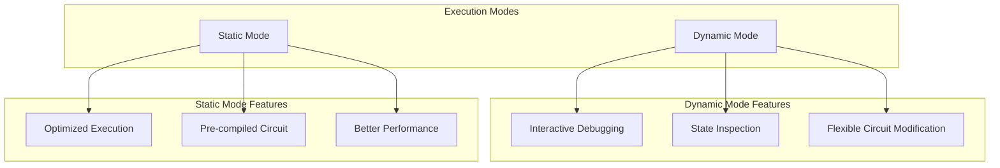

Sources: [README.md:76]()

### 4. Hybrid Classical-Quantum Models

TorchQuantum makes it easy to build hybrid models that combine classical neural networks with quantum circuits:

```python
# Example of hybrid classical-quantum model structure
class HybridModel(nn.Module):
    def __init__(self):
        super().__init__()
        self.classical_pre = nn.Sequential(
            nn.Conv2d(1, 16, kernel_size=5),
            nn.MaxPool2d(2),
            nn.ReLU(),
            nn.Flatten(),
            nn.Linear(16*12*12, 64)
        )
        self.quantum_layer = tq.QuantumModule(...)
        self.classical_post = nn.Linear(4, 10)
        
    def forward(self, x):
        x = self.classical_pre(x)
        x = self.quantum_layer(x)
        x = self.classical_post(x)
        return x
```

Sources: [README.md:79](), [README.md:191-240]()

## Comparison with Other Quantum Frameworks

TorchQuantum offers several distinct advantages compared to other quantum computing frameworks:

| Feature | TorchQuantum | Qiskit | PennyLane |
|---------|--------------|--------|-----------|
| Computation Graph | Dynamic | Static | Static |
| Gradient Computation | Automatic (PyTorch autograd) | Manual | Automatic |
| GPU Support | Native, optimized | Limited | Limited |
| Batch Processing | Native tensors | Limited | Limited |
| PyTorch Integration | Native | Via adapters | Via adapters |
| Debugging | Interactive state inspection | Post-execution | Post-execution |

Sources: [README.md:56-58]()

For more information about installation, see [Installation and Requirements](#1.1). For details about core components like QuantumDevice and Operators, see [Core Components](#2).

---

# Page: Core Components

# Core Components

<details>
<summary>Relevant source files</summary>

The following files were used as context for generating this wiki page:

- [README.md](README.md)
- [setup.py](setup.py)
- [torchquantum/__init__.py](torchquantum/__init__.py)
- [torchquantum/macro.py](torchquantum/macro.py)

</details>


Core Components in TorchQuantum are the fundamental building blocks that provide the foundation for quantum circuit simulation and quantum machine learning. These components work together to enable quantum operations, state management, and integration with PyTorch's ecosystem.

For information about how to build quantum circuits using these components, see [Circuit Construction](#3).

## Component Overview

TorchQuantum's architecture is built around five key core components:

1. **QuantumDevice** - Manages quantum states and tracks operation history
2. **Operators and Gates** - Quantum operations that transform quantum states
3. **Measurement** - Extracts classical information from quantum states
4. **Functional API** - Provides alternative functional interface for applying quantum operations
5. **QuantumModule** - PyTorch module-based interface for building quantum circuits

The following diagram illustrates the relationships between these components:

## Component Architecture

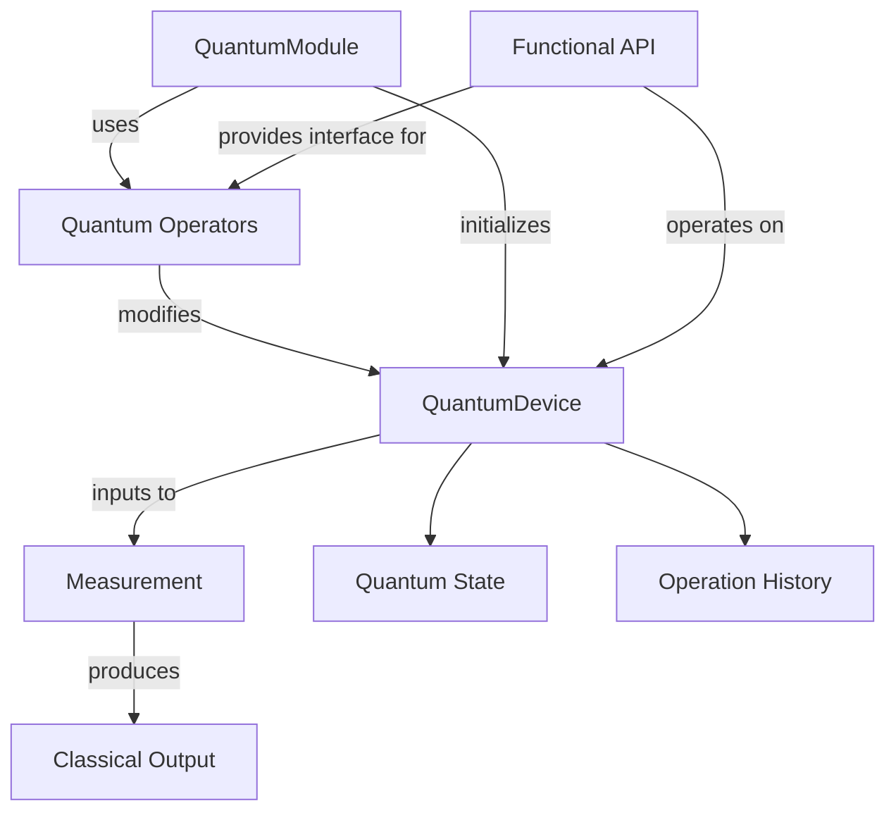

Sources: [torchquantum/__init__.py:29-36]()

## QuantumDevice

The `QuantumDevice` class is the central component of TorchQuantum. It stores and manages quantum states, provides methods for quantum operations, and tracks operation history.

### Key Features

- Stores quantum states (statevector or density matrix)
- Records operation history for conversion to other formats (e.g., QASM)
- Supports batch processing for parallel simulation
- Compatible with CPU and GPU backends
- Integrates with PyTorch's autograd system

### Usage Example

```python
import torchquantum as tq

# Create a quantum device with 2 qubits and batch size 5
qdev = tq.QuantumDevice(n_wires=2, bsz=5, device="cpu", record_op=True)

# Apply quantum operations directly on the device
qdev.h(wires=0)
qdev.cnot(wires=[0, 1])

# Print current state
print(qdev)

# Access operation history
print(qdev.op_history)
```

Sources: [README.md:96-101]()

## Operators and Gates

TorchQuantum provides a comprehensive set of quantum operators (gates) that can be applied to transform quantum states. These are implemented as both classes (for object-oriented usage) and functions (for functional usage).

### Categories of Operators

| Category | Examples | Description |
|----------|----------|-------------|
| Single-qubit gates | H, X, Y, Z, S, T | Act on individual qubits |
| Two-qubit gates | CNOT, CZ, SWAP | Act on pairs of qubits |
| Multi-qubit gates | Toffoli, QubitUnitary | Act on three or more qubits |
| Parameterized gates | RX, RY, RZ, U3 | Gates with trainable parameters |

### Operator Implementation

Operators in TorchQuantum inherit from a base `Operator` class and can be instantiated with configurable parameters:

```python
import torchquantum as tq

# Create a parameterized RX gate with trainable parameters
rx = tq.RX(has_params=True, trainable=True, init_params=0.5)

# Apply the gate to a quantum device
rx(qdev, wires=0)

# Get gradient after backpropagation
print(rx.params.grad)
```

Sources: [README.md:106-108]()

## Measurement

Measurement components extract classical information from quantum states, providing the interface between quantum and classical computation. TorchQuantum supports multiple measurement approaches:

### Measurement Types

- **Computational basis measurement**: Projects qubits onto computational basis states
- **Expectation values**: Computes expected values of observables
- **Sampling**: Generates measurement samples according to quantum probabilities
- **Joint measurements**: Measures multiple qubits with respect to different observables

### Measurement Functions

```python
import torchquantum as tq
from torchquantum.measurement import expval_joint_analytical, expval_joint_sampling

# Measure in computational basis with 1024 shots
result = tq.measure(qdev, n_shots=1024)

# Compute expectation value of a ZX observable analytically
expval = expval_joint_analytical(qdev, 'ZX')

# Compute expectation value by sampling (works on real quantum hardware)
expval_sample = expval_joint_sampling(qdev, 'ZX', n_shots=1024)
```

Sources: [README.md:118-128]()

## Functional API

TorchQuantum provides a functional API as an alternative to the object-oriented approach. This API offers a more direct way to apply quantum operations.

### Features

- Direct application of gates to quantum devices
- Named functions for all supported quantum operations
- Easy integration with PyTorch's autograd system

### Example Usage

```python
import torchquantum as tq
import torchquantum.functional as tqf

# Create a quantum device
qdev = tq.QuantumDevice(n_wires=2, bsz=1, device="cpu")

# Apply gates using the functional API
tqf.hadamard(qdev, wires=0)
tqf.cnot(qdev, wires=[0, 1])
tqf.rx(qdev, wires=0, params=0.5)
```

Sources: [README.md:102-104]()

## QuantumModule

The `QuantumModule` class extends PyTorch's `nn.Module` to provide a base class for quantum circuits. It allows quantum circuits to be defined and used like standard PyTorch modules.

### Features

- Inherits from PyTorch's `nn.Module`
- Manages quantum operators as submodules
- Supports forward pass for quantum circuit execution
- Can be combined with classical neural network components

### Example Usage

```python
import torchquantum as tq

# Create a QuantumModule from operation description
ops = [
    {'name': 'hadamard', 'wires': 0}, 
    {'name': 'cnot', 'wires': [0, 1]},
    {'name': 'rx', 'wires': 0, 'params': 0.5, 'trainable': True}
]

qmodule = tq.QuantumModule.from_op_history(ops)
qmodule(qdev)
```

Sources: [README.md:136-145]()

## Component Interaction Workflow

The following diagram illustrates how the core components interact during quantum circuit execution:

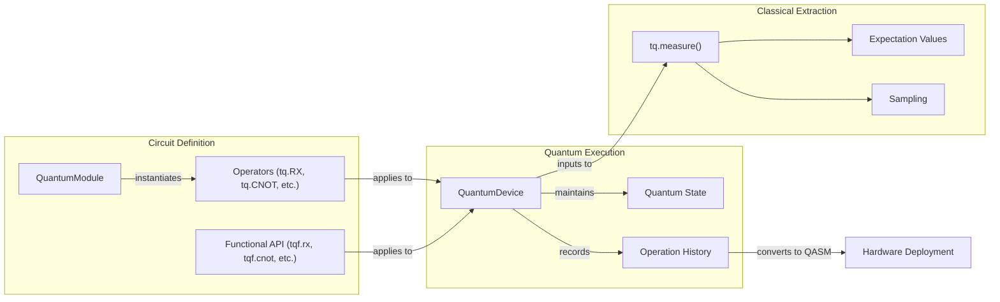

Sources: [README.md:96-132]()

## Code to File Mapping

The following diagram shows how the core components map to specific files in the TorchQuantum codebase:

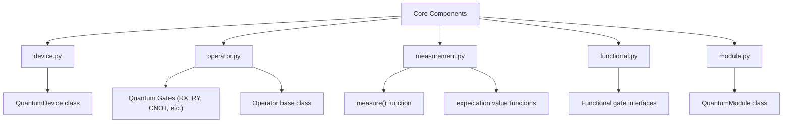

Sources: [torchquantum/__init__.py:29-36](), [README.md:266-270]()

## Integration with PyTorch

TorchQuantum's core components are designed to integrate seamlessly with PyTorch's ecosystem:

- `QuantumModule` extends `torch.nn.Module`
- Quantum states are stored as PyTorch tensors
- Gradients flow through quantum operations via PyTorch's autograd
- Parameters of quantum gates can be optimized using PyTorch optimizers
- Batched processing enables efficient training with large datasets

This tight integration enables the development of hybrid quantum-classical models where traditional neural networks work alongside quantum circuits.

Sources: [README.md:184-239]()

## Conclusion

The core components of TorchQuantum provide a flexible and powerful foundation for quantum computing within the PyTorch ecosystem. Understanding these components is essential for building effective quantum circuits and quantum machine learning models with TorchQuantum.

For more information on how to construct quantum circuits using these components, see [Circuit Construction](#3).

---

# Page: QuantumDevice

# QuantumDevice

<details>
<summary>Relevant source files</summary>

The following files were used as context for generating this wiki page:

- [README.md](README.md)
- [setup.py](setup.py)
- [test/__init__.py](test/__init__.py)
- [test/functional/test_func_mat_exp.py](test/functional/test_func_mat_exp.py)
- [test/operator/test_op_hamil_exp.py](test/operator/test_op_hamil_exp.py)
- [test/random_layer_test.py](test/random_layer_test.py)
- [test/static_mode_test.py](test/static_mode_test.py)
- [test/utils.py](test/utils.py)
- [torchquantum/__init__.py](torchquantum/__init__.py)
- [torchquantum/device/devices.py](torchquantum/device/devices.py)
- [torchquantum/operator/__init__.py](torchquantum/operator/__init__.py)

</details>


QuantumDevice is a fundamental class in TorchQuantum that provides the underlying quantum state storage and manipulation capabilities. It serves as the quantum computing equivalent of tensors in classical deep learning, managing quantum states and facilitating quantum gate operations.

## Overview

QuantumDevice maintains a quantum state vector (or multiple vectors in batch mode) and provides methods to manipulate these states through quantum operations. It bridges the gap between PyTorch's classical computation and quantum simulation by integrating with PyTorch's tensor operations and automatic differentiation.

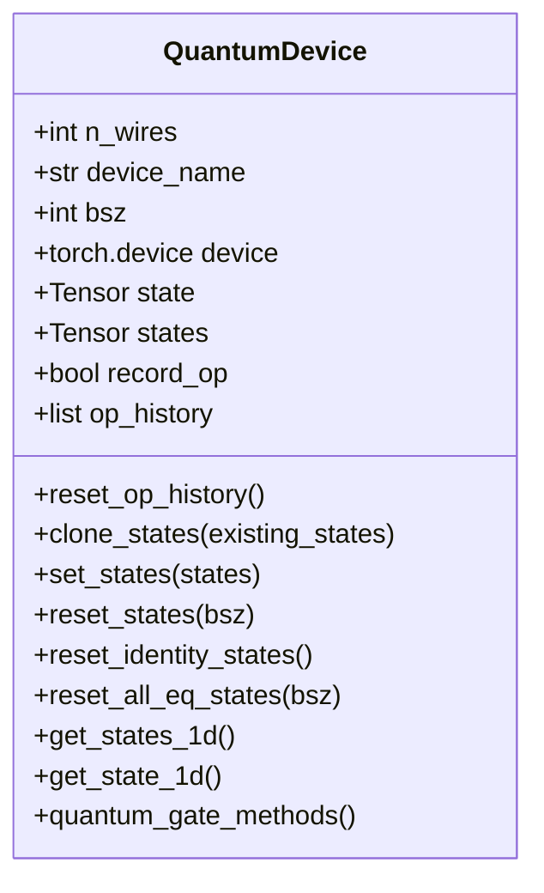

Sources: [torchquantum/device/devices.py:37-136]()

## Initialization and Parameters

QuantumDevice is initialized with the following parameters:

```python
QuantumDevice(
    n_wires: int,
    device_name: str = "default",
    bsz: int = 1,
    device: Union[torch.device, str] = "cpu",
    record_op: bool = False
)
```

| Parameter | Type | Description |
|-----------|------|-------------|
| n_wires | int | Number of qubits in the quantum system |
| device_name | str | Name identifier for the quantum device (default: "default") |
| bsz | int | Batch size for batch processing of quantum states (default: 1) |
| device | torch.device or str | PyTorch device to use ("cpu" or "cuda") (default: "cpu") |
| record_op | bool | Whether to record operation history (default: False) |

When a QuantumDevice is created, it initializes the quantum state to |0⟩^n (all qubits in the 0 state), represented as a multi-dimensional tensor where each dimension corresponds to a qubit.

Sources: [torchquantum/device/devices.py:37-74]()

## State Representation

The quantum state in QuantumDevice is stored as a tensor with the following structure:

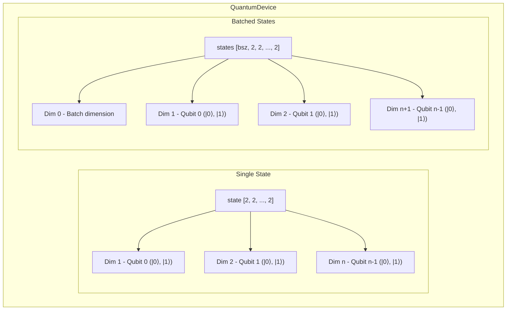

- **Single state**: A tensor of shape [2, 2, ..., 2] (n_wires dimensions) representing one quantum state
- **Batch states**: A tensor of shape [bsz, 2, 2, ..., 2] representing a batch of quantum states

The state uses PyTorch's complex tensor type (C_DTYPE) to represent complex amplitudes.

Sources: [torchquantum/device/devices.py:64-71]()

## State Manipulation Methods

QuantumDevice provides several methods to manipulate quantum states:

| Method | Description |
|--------|-------------|
| reset_states(bsz) | Reset to initial |0⟩^n state with specified batch size |
| reset_identity_states() | Set states to identity matrix (useful for verification) |
| reset_all_eq_states(bsz) | Set states to equal superposition (useful for verification) |
| clone_states(existing_states) | Clone existing states into this device |
| set_states(states) | Set quantum states from provided tensor |
| get_states_1d() | Return states as a 1D tensor of shape [bsz, 2^n_wires] |
| get_state_1d() | Return single state as a 1D tensor of shape [2^n_wires] |

These methods allow for flexible manipulation of quantum states for various quantum algorithm implementations.

Sources: [torchquantum/device/devices.py:80-121]()

## Operation History

When initialized with `record_op=True`, QuantumDevice keeps track of all quantum operations applied to it. This operation history is stored in `op_history` as a list and can be reset using `reset_op_history()`.

The operation history is useful for:
- Constructing static computation graphs
- Converting quantum circuits to other formats (e.g., QASM)
- Visualizing quantum circuits
- Deploying circuits to real quantum hardware

Sources: [torchquantum/device/devices.py:73-78]()

## Integration with Quantum Operations

QuantumDevice dynamically adds all quantum gate operations from `func_name_dict` and `func_name_dict_collect` as methods. This allows for intuitive application of quantum gates directly on the device.

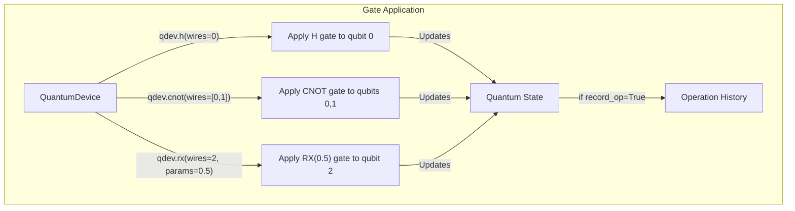

Common gate operations include:
- Single-qubit gates: h, x, y, z, s, t, rx, ry, rz, etc.
- Two-qubit gates: cnot, cz, swap, crx, cry, crz, etc.
- Multi-qubit gates: toffoli, qubitunitary, etc.

Sources: [torchquantum/device/devices.py:132-136](), [README.md:98-105]()

## Role in TorchQuantum Framework

QuantumDevice plays a central role in the TorchQuantum framework:

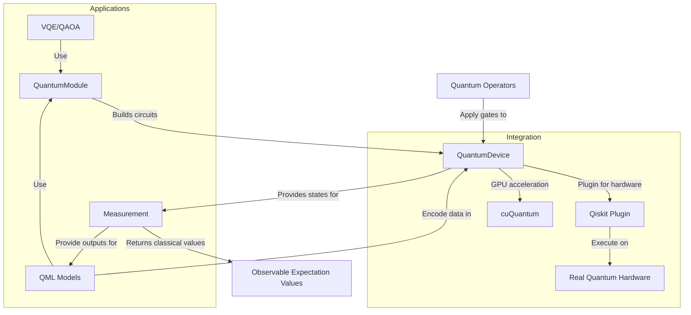

Sources: [README.md:96-105](), [README.md:183-239]()

## Usage Example

Here's a basic example of using QuantumDevice:

```python
import torchquantum as tq
import torchquantum.functional as tqf

# Create a quantum device with 2 qubits and batch size 5
qdev = tq.QuantumDevice(n_wires=2, bsz=5, device="cpu", record_op=True)

# Apply gates using qdev.op methods
qdev.h(wires=0)
qdev.cnot(wires=[0, 1])

# Apply gates using functional API
tqf.h(qdev, wires=1)
tqf.x(qdev, wires=1)

# Print the current state
print(qdev)

# Obtain measurement results
measurement_results = tq.measure(qdev, n_shots=1024)
```

This example creates a 2-qubit quantum device, applies several quantum gates, and measures the resulting state.

Sources: [README.md:92-118]()

## Accessing State Information

After performing operations, you can access the quantum state in several ways:

1. Directly access the `.states` tensor property
2. Use `get_states_1d()` to get states in a flattened representation
3. For debugging, print the QuantumDevice object to see its current state
4. Measure the state to obtain expectation values or samples

The state can be further processed using PyTorch operations since it's a standard PyTorch tensor with gradient tracking capabilities.

```python
# Example of accessing and processing states
states = qdev.get_states_1d()
processed_states = states.abs().pow(2)  # Get probabilities
```

Sources: [torchquantum/device/devices.py:114-121](), [README.md:110-132]()

## Performance Considerations

- Using `device="cuda"` allows for GPU acceleration of quantum simulations
- Batch processing multiple states simultaneously improves throughput
- For larger numbers of qubits (>25), memory becomes a constraint due to the exponential growth of the state vector
- Setting `record_op=False` reduces memory usage when operation history isn't needed

Sources: [torchquantum/device/devices.py:37-74](), [README.md:52-53]()

## Related Components

- For building more complex quantum circuits, see [QuantumModule](#3.1)
- For detailed information about available quantum gates, see [Operators and Gates](#2.2)
- For measuring quantum states, see [Measurement](#2.3)
- For using the functional API instead of methods, see [Functional API](#2.4)

---

# Page: Operators and Gates

# Operators and Gates

<details>
<summary>Relevant source files</summary>

The following files were used as context for generating this wiki page:

- [test/operator/test_op.py](test/operator/test_op.py)
- [torchquantum/algorithm/vqe.py](torchquantum/algorithm/vqe.py)
- [torchquantum/functional/functionals.py](torchquantum/functional/functionals.py)
- [torchquantum/graph/graphs.py](torchquantum/graph/graphs.py)
- [torchquantum/macro.py](torchquantum/macro.py)
- [torchquantum/operator/op_types.py](torchquantum/operator/op_types.py)
- [torchquantum/operator/standard_gates/__init__.py](torchquantum/operator/standard_gates/__init__.py)

</details>


This page documents the quantum operators and quantum gates available in TorchQuantum, how they are implemented, and how they can be used in quantum circuits. For information about constructing full quantum circuits, see [Circuit Construction](#3), and for details about applying quantum operations, see [Functional API](#2.4).

## Overview

Quantum operators and gates are the fundamental building blocks of quantum circuits in TorchQuantum. They represent unitary transformations that act on quantum states, enabling the manipulation of qubits to perform quantum computations. TorchQuantum provides a comprehensive set of quantum gates modeled after those found in real quantum computers and quantum programming frameworks.

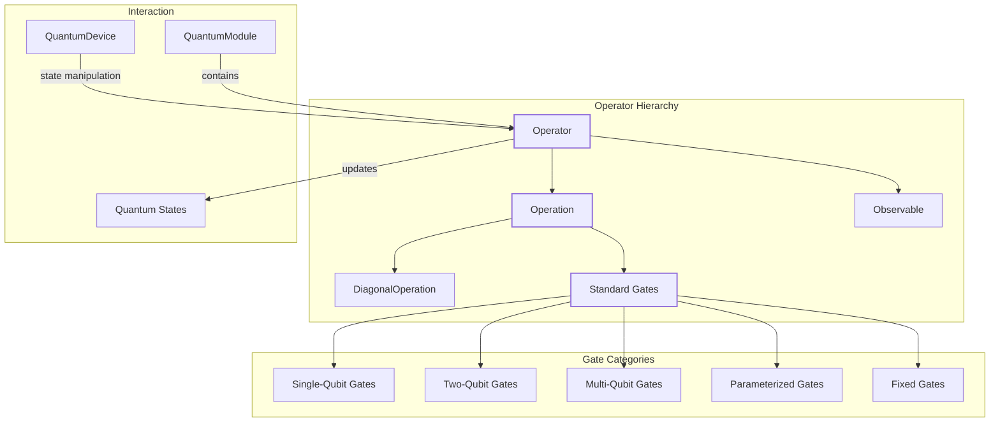

Sources: [torchquantum/operator/op_types.py:53-267](), [torchquantum/operator/standard_gates/__init__.py:25-162]()

## Operator Class Hierarchy

TorchQuantum implements quantum operators through a hierarchical class structure, with the base `Operator` class serving as the foundation for all quantum operations.

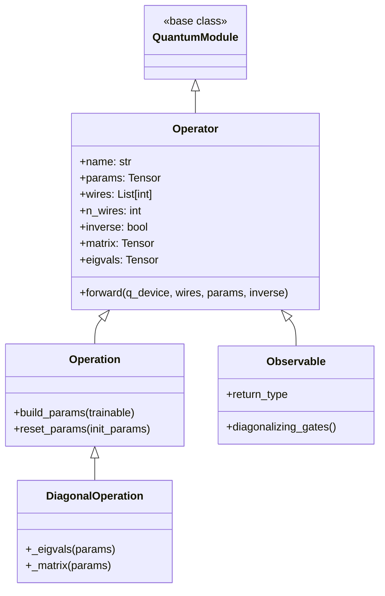

Sources: [torchquantum/operator/op_types.py:53-444]()

### Operator Base Class

The `Operator` class serves as the base class for all quantum operators in TorchQuantum. It inherits from `QuantumModule` and provides core functionality for quantum operations:

- Managing operator parameters
- Tracking which qubits (wires) the operation acts on
- Providing matrix representations of operations
- Applying operations to quantum states
- Supporting inverse operations

Key properties and methods:

- `name`: Name of the operator (e.g., "Hadamard", "PauliX")
- `matrix`: Unitary matrix representation of the operator
- `eigvals`: Eigenvalues of the operator
- `forward()`: Method to apply the operator to a quantum device

Sources: [torchquantum/operator/op_types.py:53-267]()

### Operation and Observable Classes

TorchQuantum differentiates between two main types of operators:

1. **Operations**: Standard quantum gates that transform quantum states
   - Implemented by the `Operation` class
   - Includes methods for parameter initialization and management
   - Examples: Pauli gates, rotation gates, controlled gates

2. **Observables**: Quantum operators used for measurements
   - Implemented by the `Observable` class
   - Used to calculate expectation values or sample measurement outcomes
   - Examples: Pauli observables for energy measurements in VQE algorithms

The `DiagonalOperation` class is a specialized operation where the unitary matrix is diagonal and can be represented by its eigenvalues.

Sources: [torchquantum/operator/op_types.py:270-444]()

## Available Gates

TorchQuantum provides a comprehensive set of quantum gates, ranging from simple single-qubit operations to complex multi-qubit gates.

### Gate Categories

The gates can be categorized based on the number of qubits they operate on and whether they are parameterized:

1. **Single-qubit gates**: Act on one qubit (e.g., Pauli-X, Hadamard)
2. **Two-qubit gates**: Act on two qubits (e.g., CNOT, SWAP)
3. **Multi-qubit gates**: Act on three or more qubits (e.g., Toffoli, MultiRZ)
4. **Fixed gates**: Gates with no adjustable parameters (e.g., Pauli gates, Hadamard)
5. **Parameterized gates**: Gates with adjustable parameters (e.g., rotation gates)

The following table shows some of the commonly used gates in each category:

| Category | Examples |
|----------|----------|
| Single-qubit fixed | PauliX (X), PauliY (Y), PauliZ (Z), Hadamard (H), S, T |
| Single-qubit parameterized | RX, RY, RZ, PhaseShift, U1, U2, U3 |
| Two-qubit fixed | CNOT, CZ, SWAP |
| Two-qubit parameterized | CRX, CRY, CRZ, RXX, RYY, RZZ |
| Multi-qubit fixed | Toffoli (CCX), CCZ, CSWAP |
| Multi-qubit parameterized | MultiRZ, C3X, C4X |

Sources: [torchquantum/operator/standard_gates/__init__.py:25-162](), [test/operator/test_op.py:42-100]()

### Common Single-Qubit Gates

Here are some of the most common single-qubit gates in TorchQuantum:

| Gate | TorchQuantum Class | Description | Matrix Representation |
|------|-------------------|-------------|-------------------------|
| Pauli-X | `PauliX` | Bit-flip gate | [[0, 1], [1, 0]] |
| Pauli-Y | `PauliY` | Phase and bit-flip | [[0, -i], [i, 0]] |
| Pauli-Z | `PauliZ` | Phase-flip gate | [[1, 0], [0, -1]] |
| Hadamard | `Hadamard` or `H` | Creates superposition | 1/√2 * [[1, 1], [1, -1]] |
| S | `S` | Phase gate (π/2) | [[1, 0], [0, i]] |
| T | `T` | Phase gate (π/4) | [[1, 0], [0, e^(iπ/4)]] |
| RX | `RX` | Rotation around X-axis | [[cos(θ/2), -i*sin(θ/2)], [-i*sin(θ/2), cos(θ/2)]] |
| RY | `RY` | Rotation around Y-axis | [[cos(θ/2), -sin(θ/2)], [sin(θ/2), cos(θ/2)]] |
| RZ | `RZ` | Rotation around Z-axis | [[e^(-iθ/2), 0], [0, e^(iθ/2)]] |

Sources: [test/operator/test_op.py:42-75]()

### Common Two-Qubit Gates

TorchQuantum provides various two-qubit gates for entanglement and controlled operations:

| Gate | TorchQuantum Class | Description |
|------|-------------------|-------------|
| CNOT | `CNOT` | Controlled-NOT gate (flips target if control is 1) |
| CZ | `CZ` | Controlled-Z gate (applies Z if control is 1) |
| SWAP | `SWAP` | Swaps the state of two qubits |
| CRX | `CRX` | Controlled RX rotation gate |
| CRY | `CRY` | Controlled RY rotation gate |
| CRZ | `CRZ` | Controlled RZ rotation gate |
| RXX | `RXX` | Two-qubit rotation around XX axis |
| RYY | `RYY` | Two-qubit rotation around YY axis |
| RZZ | `RZZ` | Two-qubit rotation around ZZ axis |
| ISWAP | `ISWAP` | Swaps with an additional phase factor |

Sources: [torchquantum/operator/standard_gates/__init__.py:25-50](), [test/operator/test_op.py:52-69]()

### Multi-Qubit Gates

For operations involving three or more qubits, TorchQuantum provides:

| Gate | TorchQuantum Class | Description |
|------|-------------------|-------------|
| Toffoli | `Toffoli` or `CCX` | Controlled-controlled-X gate |
| CCZ | `CCZ` | Controlled-controlled-Z gate |
| CSWAP | `CSWAP` | Controlled-SWAP (Fredkin) gate |
| C3X | `C3X` | 3-controlled X gate |
| C4X | `C4X` | 4-controlled X gate |
| MultiRZ | `MultiRZ` | Multi-qubit rotation around Z-axis |

Sources: [torchquantum/operator/standard_gates/__init__.py:30-97](), [test/operator/test_op.py:63-97]()

## Using Gates in Quantum Circuits

Quantum gates can be used in TorchQuantum in several ways, depending on whether you're using the object-oriented or functional API.

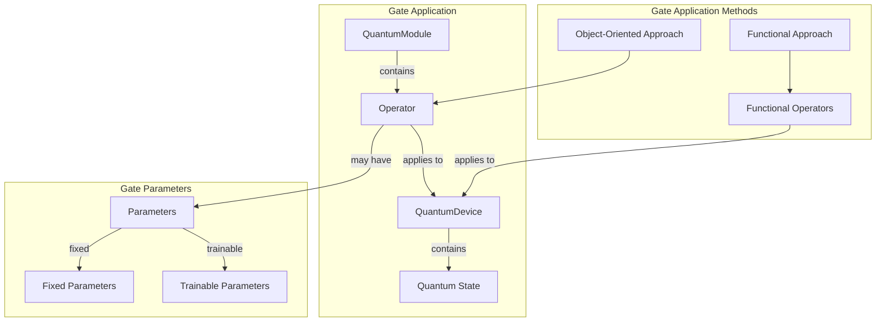

Sources: [torchquantum/operator/op_types.py:182-264](), [torchquantum/functional/functionals.py:25-34]()

### Object-Oriented Approach

In the object-oriented approach, gates are instantiated as objects and then applied to a `QuantumDevice`:

1. Create a gate instance:
   ```python
   h_gate = tq.Hadamard(wires=0)
   rx_gate = tq.RX(has_params=True, trainable=True, wires=1)
   ```

2. Apply the gate to a quantum device:
   ```python
   h_gate(q_device)  # Apply Hadamard to wire 0
   rx_gate(q_device, params=torch.tensor([[0.5]]))  # Apply RX with parameter 0.5 to wire 1
   ```

3. Gates can also be used within a `QuantumModule` to build complex circuits:
   ```python
   class MyCircuit(tq.QuantumModule):
       def __init__(self):
           super().__init__()
           self.h = tq.Hadamard(wires=0)
           self.rx = tq.RX(has_params=True, trainable=True, wires=1)
       
       def forward(self, q_device):
           self.h(q_device)
           self.rx(q_device)
   ```

Sources: [torchquantum/operator/op_types.py:182-264]()

### Functional Approach

TorchQuantum also provides a functional API for applying gates:

```python
q_device = tq.QuantumDevice(n_wires=2)
tq.hadamard(q_device, wires=0)  # Apply Hadamard to wire 0
tq.rx(q_device, wires=1, params=torch.tensor([[0.5]]))  # Apply RX to wire 1
```

The functional approach is useful for more dynamic circuit construction and can be more concise in some cases.

Sources: [torchquantum/functional/functionals.py:25-34]()

### Parameterized Gates

Parameterized gates have adjustable parameters that can be trained in quantum machine learning applications:

1. Creating a parameterized gate with trainable parameters:
   ```python
   rx_gate = tq.RX(has_params=True, trainable=True, wires=0)
   ```

2. Initializing parameters:
   ```python
   rx_gate = tq.RX(has_params=True, trainable=True, init_params=torch.tensor([[0.1]]), wires=0)
   ```

3. Setting parameters during forward pass:
   ```python
   rx_gate(q_device, params=torch.tensor([[0.5]]))
   ```

Trainable parameters are implemented as PyTorch Parameters, allowing them to be optimized using PyTorch's automatic differentiation and optimizers.

Sources: [torchquantum/operator/op_types.py:116-120](), [torchquantum/operator/op_types.py:377-405]()

### Gate Inverse Operations

TorchQuantum supports inverse operations for quantum gates:

```python
# Create a gate with inverse=True
h_inv = tq.Hadamard(wires=0, inverse=True)

# Or set inverse during forward pass
h_gate = tq.Hadamard(wires=0)
h_gate(q_device, inverse=True)
```

When `inverse=True`, the gate applies the conjugate transpose of its unitary matrix to the quantum state.

Sources: [torchquantum/operator/op_types.py:198-200]()

## Gate Execution Modes

TorchQuantum supports two execution modes for quantum gates:

1. **Dynamic Mode**: Gates are applied sequentially to the quantum state
2. **Static Mode**: Gates are compiled into a quantum circuit graph for optimized execution

### Dynamic Mode

In dynamic mode, each gate directly modifies the quantum state when its `forward` method is called:

```python
q_device = tq.QuantumDevice(n_wires=2)
tq.hadamard(q_device, wires=0)  # State is immediately updated
tq.cnot(q_device, wires=[0, 1])  # State is immediately updated again
```

This mode is flexible and allows for dynamic circuit construction.

### Static Mode

In static mode, gates are collected into a quantum circuit graph and then executed together:

```python
class MyCircuit(tq.QuantumModule):
    def __init__(self):
        super().__init__()
        self.h = tq.Hadamard(wires=0)
        self.cnot = tq.CNOT(wires=[0, 1])
        self.static_mode = True  # Enable static mode
    
    def forward(self, q_device):
        self.h(q_device)  # Gate is added to the graph, not executed yet
        self.cnot(q_device)  # Gate is added to the graph, not executed yet
        # After all gates are added, the entire circuit is executed
```

Static mode can provide performance benefits for complex circuits, especially when running on GPU.

Sources: [torchquantum/graph/graphs.py:124-137](), [torchquantum/operator/op_types.py:231-234]()

## Comparison with Qiskit

TorchQuantum's quantum gates are compatible with those in Qiskit, making it easy to translate circuits between the two frameworks. The main difference is in the endianness convention:

- In Qiskit, higher qubit indices are more significant
- In TorchQuantum, higher qubit indices are less significant

This difference affects the matrix representation of multi-qubit gates. TorchQuantum provides utilities to convert between these conventions.

Sources: [test/operator/test_op.py:108-123]()

## Using Gates in Applications

Quantum gates in TorchQuantum are particularly useful for quantum machine learning applications. For example, in the Variational Quantum Eigensolver (VQE) algorithm:

```python
# Example of using gates in a VQE ansatz
class VQEAnsatz(tq.QuantumModule):
    def __init__(self, n_wires):
        super().__init__()
        self.n_wires = n_wires
        self.layers = 2
        
        # Create parameterized rotation gates
        self.rx_layers = nn.ModuleList([
            nn.ModuleList([
                tq.RX(has_params=True, trainable=True) 
                for _ in range(n_wires)
            ])
            for _ in range(self.layers)
        ])
        
        # Create entangling gates
        self.entangling = nn.ModuleList([
            tq.CNOT() for _ in range(n_wires - 1)
        ])
    
    def forward(self, q_device):
        # Apply parameterized layers with entanglement
        for l in range(self.layers):
            for i in range(self.n_wires):
                self.rx_layers[l][i](q_device, wires=i)
            
            # Add entanglement
            for i in range(self.n_wires - 1):
                self.entangling[i](q_device, wires=[i, i+1])
```

This circuit could then be used with VQE to find ground state energies of quantum systems.

Sources: [torchquantum/algorithm/vqe.py:36-133]()

---

# Page: Measurement

# Measurement

<details>
<summary>Relevant source files</summary>

The following files were used as context for generating this wiki page:

- [examples/PauliSumOp/pauli_sum_op.py](examples/PauliSumOp/pauli_sum_op.py)
- [test/algorithm/test_hamiltonian.py](test/algorithm/test_hamiltonian.py)
- [test/hadamard_grad/test_hadamard_grad.py](test/hadamard_grad/test_hadamard_grad.py)
- [test/measurement/test_eval_observable.py](test/measurement/test_eval_observable.py)
- [test/measurement/test_expval_joint_sampling_grouping.py](test/measurement/test_expval_joint_sampling_grouping.py)
- [test/measurement/test_find_observable_groups.py](test/measurement/test_find_observable_groups.py)
- [test/measurement/test_measure.py](test/measurement/test_measure.py)
- [test/plugin/test_qiskit_plugins.py](test/plugin/test_qiskit_plugins.py)

</details>


## Purpose and Scope

This document covers the measurement functionality in TorchQuantum, which provides mechanisms to extract classical information from quantum states. Measurement is a crucial component of quantum computing, serving as the bridge between quantum and classical information. TorchQuantum offers various measurement techniques including basic state measurements, expectation value calculations, observable grouping for efficient measurements, and support for Pauli sum operator measurements.

For information about quantum operators and gates that can be measured, see [Operators and Gates](#2.2). For details on how to use the functional interface for applying quantum operations before measurement, see [Functional API](#2.4).

## Conceptual Overview

In quantum computing, measurement collapses a quantum state to a classical state according to quantum mechanical principles. TorchQuantum provides both analytical (exact) and sampling-based (stochastic) approaches to measurement, as well as functionality for measuring multiple observables efficiently.

```mermaid
flowchart TD
    subgraph "Quantum State"
        QS["Quantum System"]
    end
    
    subgraph "Measurement Types"
        BM["Basic Measurement"]
        EV["Expectation Value"]
        JM["Joint Measurement"]
        PS["Pauli Sum Measurement"]
    end
    
    subgraph "Implementation Methods"
        AN["Analytical"]
        SA["Sampling"]
        GR["Grouping"]
    end
    
    subgraph "Results"
        BC["Bitstring Counts"]
        EXP["Expectation Values"]
        HAM["Hamiltonian Expectation"]
    end
    
    QS --> BM
    QS --> EV
    QS --> JM
    QS --> PS
    
    BM --> SA --> BC
    
    EV --> AN --> EXP
    EV --> SA --> EXP
    
    JM --> AN
    JM --> SA
    JM --> GR --> EXP
    
    PS --> HAM
```

Sources: `test/measurement/test_measure.py`, `test/measurement/test_eval_observable.py`, `test/measurement/test_expval_joint_sampling_grouping.py`, `examples/PauliSumOp/pauli_sum_op.py`

## Basic Measurement

The most fundamental form of measurement in TorchQuantum is implemented through the `tq.measure` function, which samples from the quantum state to produce bitstring outcomes with their corresponding counts.

```mermaid
sequenceDiagram
    participant QD as "QuantumDevice"
    participant MF as "measure()"
    participant RES as "Measurement Results"
    
    QD->>QD: "Prepare quantum state"
    QD->>MF: "Provide quantum state"
    MF->>MF: "Sample from state distribution"
    MF->>RES: "Return bitstring counts"
    Note over RES: "{'000': 5000, '001': 2500, ...}"
```

### Example Usage

```python
# Create and prepare a quantum device
qdev = tq.QuantumDevice(n_wires=3, bsz=1)
qdev.x(wires=0)
qdev.h(wires=1)

# Measure the state with 1000 shots
counts = tq.measure(qdev, n_shots=1000)
```

Sources: `test/measurement/test_measure.py`

## Expectation Value Measurements

Expectation value measurements calculate the expected value of an observable with respect to a quantum state. TorchQuantum provides both analytical (exact) and sampling-based (stochastic) methods for calculating expectation values.

### Analytical Method

The `expval_joint_analytical` function calculates expectation values analytically, providing exact results without sampling errors.

### Sampling Method

The `expval_joint_sampling` function calculates expectation values using a finite number of measurements (shots), which introduces statistical noise but more closely resembles how measurements would be performed on real quantum hardware.

```mermaid
flowchart TD
    subgraph "QuantumDevice"
        QS["Quantum State"]
    end
    
    subgraph "Observable"
        PA["Pauli String (e.g., 'XYZII')"]
    end
    
    subgraph "Expectation Value Methods"
        EA["expval_joint_analytical()"]
        ES["expval_joint_sampling()"]
    end
    
    subgraph "Results"
        EV["Expectation Value"]
    end
    
    QS --> EA
    PA --> EA
    QS --> ES
    PA --> ES
    EA --> EV
    ES --> EV
```

### Example Usage

```python
# Prepare quantum state
qdev = tq.QuantumDevice(n_wires=4, bsz=1)
# Apply some operations...

# Calculate expectation value analytically
expval_analytical = tq.measurement.expval_joint_analytical(qdev, observable="XYZZ")

# Calculate expectation value using sampling
expval_sampling = tq.measurement.expval_joint_sampling(qdev, observable="XYZZ", n_shots=10000)
```

Sources: `test/measurement/test_eval_observable.py`

## Observable Grouping

TorchQuantum provides functionality to group compatible observables together for more efficient measurement. Observables can be measured in the same group if they share a common eigenbasis, which reduces the number of circuit executions needed.

The `find_observable_groups` function analyzes a list of observables and returns groups that can be measured simultaneously.

```mermaid
flowchart LR
    subgraph "Input Observables"
        O1["XXIII"]
        O2["YZXXX"]
        O3["YZIXX"]
        O4["ZZZZI"]
    end
    
    subgraph "find_observable_groups()"
        GA["Grouping Algorithm"]
    end
    
    subgraph "Output Groups"
        G1["Group 1: XXZZX (XXIII, XIZZX)"]
        G2["Group 2: YZXXX (YZXXX, YZIXX)"]
        G3["Group 3: ZZZZZ (ZZZZZ, ZZZZI)"]
    end
    
    O1 --> GA
    O2 --> GA
    O3 --> GA
    O4 --> GA
    GA --> G1
    GA --> G2
    GA --> G3
```

### Example Usage

```python
observables = [
    "XXIII",
    "YZXXX",
    "YZIXX",
    "ZZZZI"
]
groups = tq.measurement.find_observable_groups(observables)
```

Sources: `test/measurement/test_find_observable_groups.py`

## Joint Measurements with Grouping

The `expval_joint_sampling_grouping` function combines observable grouping with sampling-based expectation value calculation, allowing efficient measurement of multiple observables.

```mermaid
sequenceDiagram
    participant QD as "QuantumDevice"
    participant FOG as "find_observable_groups()"
    participant EJS as "expval_joint_sampling()"
    participant RES as "Results Dictionary"
    
    QD->>QD: "Prepare quantum state"
    FOG->>FOG: "Group compatible observables"
    loop For each group
        QD->>EJS: "Measure group with sampling"
        EJS->>RES: "Store results for observables in group"
    end
```

### Example Usage

```python
# Prepare a list of observables
observables = ["XXII", "YYII", "ZZII", "XIXI"]

# Calculate expectation values for all observables efficiently
results = tq.measurement.expval_joint_sampling_grouping(
    qdev, 
    observables=observables, 
    n_shots_per_group=10000
)
```

Sources: `test/measurement/test_expval_joint_sampling_grouping.py`

## Pauli Sum Operator Measurements

TorchQuantum provides the `MeasureMultiPauliSum` class for measuring expectation values of multiple Pauli sum operators. This is particularly useful for algorithms like VQE (Variational Quantum Eigensolver) that require measuring the expectation value of a Hamiltonian.

```mermaid
classDiagram
    class MeasureMultiPauliSum {
        +obs_list
        +__init__(obs_list)
        +forward(q_device)
    }
    
    class Observable {
        +wires
        +observables
        +coefficients
    }
    
    class QuantumDevice {
        +states
        +n_wires
        +op_history
    }
    
    MeasureMultiPauliSum "1" --> "many" Observable : contains
    MeasureMultiPauliSum --> QuantumDevice : measures
```

### Example Usage

```python
# Define the measurement module
measure = tq.MeasureMultiPauliSum(
    obs_list=[
        {
            "wires": [0, 2, 3, 1],
            "observables": ["x", "y", "z", "i"],
            "coefficient": [1, 0.5, 0.4, 0.3],
        },
        {
            "wires": [0, 2, 3, 1],
            "observables": ["x", "x", "z", "i"],
            "coefficient": [1, 0.5, 0.4, 0.3],
        },
    ]
)

# Use in a quantum circuit
result = measure(q_device)
```

Sources: `examples/PauliSumOp/pauli_sum_op.py`

## Integration with TorchQuantum Core

The measurement system is tightly integrated with the core TorchQuantum components, particularly with the `QuantumDevice` class which stores the quantum state and operation history.

```mermaid
flowchart TD
    subgraph "TorchQuantum Core"
        QD["QuantumDevice"]
        QM["QuantumModule"]
        OP["Operators/Gates"]
    end
    
    subgraph "Measurement System"
        BM["tq.measure()"]
        EA["expval_joint_analytical()"]
        ES["expval_joint_sampling()"]
        EG["expval_joint_sampling_grouping()"]
        FOG["find_observable_groups()"]
        MP["MeasureMultiPauliSum"]
    end
    
    QD --> BM
    QD --> EA
    QD --> ES
    QD --> MP
    
    QM --> MP
    
    ES --> EG
    FOG --> EG
```

Sources: All files reviewed

## Integration with External Libraries

TorchQuantum's measurement system can be validated against and integrated with other quantum computing libraries like Qiskit.

### Comparison with Qiskit

The test files demonstrate how TorchQuantum's measurement results are compared with Qiskit's results for validation:

```python
# TorchQuantum measurement
tq_counts = tq.measure(qdev, n_shots=n_shots)

# Equivalent Qiskit measurement
circ = op_history2qiskit(qdev.n_wires, qdev.op_history)
circ.measure_all()
simulator = Aer.get_backend("aer_simulator")
circ = transpile(circ, simulator)
qiskit_res = simulator.run(circ, shots=n_shots).result()
qiskit_counts = qiskit_res.get_counts()
```

Sources: `test/measurement/test_measure.py`, `test/measurement/test_eval_observable.py`, `test/plugin/test_qiskit_plugins.py`

## Summary

TorchQuantum provides a comprehensive measurement system for quantum computing, ranging from basic measurements to advanced techniques like observable grouping and Pauli sum operator measurements. The system supports both analytical (exact) and sampling-based (stochastic) methods, making it suitable for both simulation and hardware-based quantum computing.

The measurement functionality is essential for extracting classical information from quantum states and is a crucial component in quantum algorithms like VQE, QAOA, and quantum machine learning applications.

---

# Page: Functional API

# Functional API

<details>
<summary>Relevant source files</summary>

The following files were used as context for generating this wiki page:

- [README.md](README.md)
- [setup.py](setup.py)
- [test/operator/test_op.py](test/operator/test_op.py)
- [torchquantum/__init__.py](torchquantum/__init__.py)
- [torchquantum/algorithm/vqe.py](torchquantum/algorithm/vqe.py)
- [torchquantum/functional/functionals.py](torchquantum/functional/functionals.py)

</details>


The Functional API in TorchQuantum provides a direct, function-based approach for applying quantum operations to quantum devices. This page explains how to use the functional interface to build quantum circuits efficiently, as an alternative to the object-oriented approach using `QuantumModule` (see [QuantumModule](#3.1)). Both approaches can be used interchangeably based on your programming style preference.

## Overview

The Functional API serves as a bridge between quantum operations and the `QuantumDevice` that stores the quantum state. It allows for a more direct and sometimes more readable way to apply quantum gates, especially when building circuits step by step.

```mermaid
graph TD
    subgraph "Functional API Structure"
        tqf["torchquantum.functional as tqf"]
        qdev["QuantumDevice"]
        gates["Quantum Gates Functions"]
        qdev_methods["qdev direct methods"]
        qm["QuantumModule approach"]
        
        tqf --> gates
        gates -- "Apply to" --> qdev
        qdev_methods -- "Alternative to" --> gates
        qm -- "Alternative to" --> gates
    end
    
    subgraph "Gate Categories"
        gates --> single["Single-Qubit Gates<br>h(), x(), y(), z(), etc."]
        gates --> two["Two-Qubit Gates<br>cnot(), cx(), cz(), etc."]
        gates --> param["Parameterized Gates<br>rx(), ry(), rz(), etc."]
        gates --> multi["Multi-Qubit Gates<br>swap(), cswap(), etc."]
    end
```

Sources: [README.md:92-105](), [torchquantum/__init__.py:33]()

## Using the Functional API

To use the Functional API, first import the functional module and create a quantum device:

```python
import torchquantum as tq
import torchquantum.functional as tqf

qdev = tq.QuantumDevice(n_wires=2, bsz=5, device="cpu", record_op=True)
```

Then apply quantum operations using the functions provided by `tqf`:

```python
tqf.h(qdev, wires=1)        # Apply Hadamard gate to wire 1
tqf.x(qdev, wires=0)        # Apply Pauli-X gate to wire 0
tqf.cnot(qdev, wires=[0,1]) # Apply CNOT gate with control wire 0 and target wire 1
```

Each function takes a `QuantumDevice` as its first argument, followed by parameters specific to the operation.

Sources: [README.md:92-105]()

## Functional API vs Direct Device Methods

TorchQuantum offers multiple ways to apply gates to a quantum device:

```mermaid
graph LR
    subgraph "Methods to Apply Gates"
        func["Functional API<br>tqf.h(qdev, wires=0)"]
        dev["Device Methods<br>qdev.h(wires=0)"]
        op["Operator Objects<br>op=tq.RX(...)<br>op(qdev, wires=0)"]
        qmod["QuantumModule<br>qmodule(qdev)"]
    end
    
    func -- "applies to" --> qdev["QuantumDevice"]
    dev -- "directly modifies" --> qdev
    op -- "applies to" --> qdev
    qmod -- "applies multiple gates to" --> qdev
```

Sources: [README.md:92-133]()

### Comparison Table

| Approach | Syntax | Use Case | Advantages |
|----------|--------|----------|------------|
| Functional API | `tqf.h(qdev, wires=0)` | Step-by-step circuit building | Clean, functional style |
| Device Methods | `qdev.h(wires=0)` | Direct device manipulation | More concise for simple operations |
| Operator Objects | `op = tq.RX(...); op(qdev, wires=0)` | Parameterized operations | Better for trainable parameters |
| QuantumModule | `qmodule = tq.QuantumModule.from_op_history(ops); qmodule(qdev)` | Complete circuit definition | Reusable circuit templates |

Sources: [README.md:92-145]()

## Available Quantum Operations

The Functional API provides a comprehensive set of quantum gates, including:

1. **Single-qubit gates**: Hadamard (`h`), Pauli gates (`x`, `y`, `z`), phase gates (`s`, `t`), etc.
2. **Two-qubit gates**: CNOT (`cnot`), controlled-Z (`cz`), SWAP (`swap`), etc.
3. **Parameterized gates**: Rotation gates (`rx`, `ry`, `rz`), etc.
4. **Multi-qubit gates**: Toffoli, Fredkin, etc.

A complete list of supported gates can be found in the operator test file, which compares TorchQuantum's implementation with Qiskit's gates.

Sources: [test/operator/test_op.py:42-101]()

## Parameters and Arguments

Most quantum gate functions accept the following arguments:

- `qdev`: The quantum device to apply the operation to
- `wires`: Qubit indices the operation acts on (integer or list of integers)
- `params`: Parameters for parameterized gates (e.g., rotation angles)
- `inverse`: Boolean flag to apply the inverse of the operation

Example with a parameterized gate:

```python
# Apply RX rotation with angle 0.5 to wire 0
tqf.rx(qdev, wires=0, params=0.5)

# Apply RY rotation with different angles to each instance in the batch
batch_params = torch.rand(5)  # Batch size of 5
tqf.ry(qdev, wires=1, params=batch_params)
```

Sources: [README.md:92-105]()

## Integration with PyTorch

The Functional API seamlessly integrates with PyTorch, enabling automatic differentiation and gradient-based optimization of quantum circuits.

```mermaid
graph TD
    subgraph "PyTorch Integration"
        params["PyTorch Tensor Parameters"]
        tqf["Functional API<br>tqf.rx(qdev, wires=0, params)"]
        qdev["QuantumDevice<br>(Quantum State)"]
        measure["Measurement<br>tq.measure(qdev)"]
        expval["Expectation Values<br>(PyTorch Tensor)"]
        backward["Backward Pass<br>expval.backward()"]
        grad["Parameter Gradients<br>params.grad"]
    end
    
    params --> tqf
    tqf --> qdev
    qdev --> measure
    measure --> expval
    expval --> backward
    backward --> grad
    grad -- "Update" --> params
```

Sources: [README.md:92-133]()

### Example: Computing Gradients

```python
import torch
import torchquantum as tq
import torchquantum.functional as tqf

# Create a parameterized rotation with requires_grad=True
params = torch.tensor([0.5], requires_grad=True)

# Create quantum device
qdev = tq.QuantumDevice(n_wires=2, device="cpu", record_op=True)

# Apply quantum operations
tqf.h(qdev, wires=0)
tqf.rx(qdev, wires=0, params=params)
tqf.cnot(qdev, wires=[0, 1])

# Measure expectation value
from torchquantum.measurement import expval_joint_analytical
expval = expval_joint_analytical(qdev, 'ZX')

# Compute gradient
expval.backward()
print(params.grad)  # Gradient of expval with respect to params
```

Sources: [README.md:117-133]()

## Use Cases for the Functional API

The Functional API is particularly useful in several scenarios:

1. **Dynamic circuit construction**: When you need to build circuits based on runtime conditions
2. **Step-by-step simulation**: For debugging or understanding quantum algorithms
3. **Integration with classical processing**: When interleaving quantum operations with classical computations
4. **Educational purposes**: For teaching quantum computing concepts

It's commonly used in quantum machine learning applications, variational quantum algorithms (like VQE), and quantum simulations.

Sources: [torchquantum/algorithm/vqe.py:35-134]()

## Summary

The Functional API provides a direct, intuitive way to apply quantum operations in TorchQuantum. It complements the object-oriented approach of `QuantumModule` and offers flexibility in how you construct and manipulate quantum circuits. The API's integration with PyTorch's automatic differentiation makes it particularly suitable for training variational quantum circuits and implementing quantum machine learning models.

---

# Page: Circuit Construction

# Circuit Construction

<details>
<summary>Relevant source files</summary>

The following files were used as context for generating this wiki page:

- [.gitignore](.gitignore)
- [README.md](README.md)
- [setup.py](setup.py)
- [torchquantum/__init__.py](torchquantum/__init__.py)

</details>


This document explains how to build quantum circuits using TorchQuantum. It covers various methods for applying quantum gates, using the `QuantumModule` class for structured circuit construction, leveraging layer abstractions, and understanding the static versus dynamic execution modes.

For information on quantum gates and operators, see [Operators and Gates](#2.2). For details on the underlying quantum device, see [QuantumDevice](#2.1).

## Basic Methods for Applying Quantum Gates

TorchQuantum provides three primary methods for applying quantum gates to a `QuantumDevice`:

```mermaid
graph TD
    subgraph "Quantum Gate Application Methods"
        QD["QuantumDevice"]
        
        subgraph "Method 1: Direct API"
            DM["qdev.h(wires=0)
                qdev.cnot(wires=[0,1])"]
        end
        
        subgraph "Method 2: Functional API"
            FA["tqf.h(qdev, wires=0)
                tqf.x(qdev, wires=1)"]
        end
        
        subgraph "Method 3: Operator Objects"
            OI["op = tq.RX(has_params=True)
                op(qdev, wires=0)"]
        end
        
        DM --> QD
        FA --> QD
        OI --> QD
    end
```

Sources: [README.md:97-108]()

### Direct Method

The direct method calls gate operations directly on the `QuantumDevice` instance:

```python
qdev = tq.QuantumDevice(n_wires=2, bsz=5, device="cpu", record_op=True)
qdev.h(wires=0)
qdev.cnot(wires=[0, 1])
```

This approach is concise and intuitive, especially for simple circuit construction.

### Functional API

The functional API uses functions from `torchquantum.functional` module (typically imported as `tqf`):

```python
import torchquantum.functional as tqf
tqf.h(qdev, wires=1)
tqf.x(qdev, wires=1)
```

This approach enables functional programming patterns and is useful when gates need to be passed as arguments.

### Operator Objects

The third method uses instances of gate operators that can be parameterized:

```python
op = tq.RX(has_params=True, trainable=True, init_params=0.5)
op(qdev, wires=0)
```

This approach is particularly useful for parameterized gates that require training.

Sources: [README.md:97-108]()

## QuantumModule for Circuit Construction

The `QuantumModule` class extends PyTorch's `nn.Module` to create quantum circuits that integrate seamlessly with PyTorch's ecosystem.

```mermaid
graph TD
    subgraph "QuantumModule Architecture"
        QM["QuantumModule"]
        OPS["Operation List/History"]
        GR["Graph (Static Mode)"]
        
        subgraph "Gate Types"
            PG["Parameterized Gates
                (RX, RY, RZ, etc.)"]
            NPG["Fixed Gates
                (H, X, CNOT, etc.)"]
        end
        
        QM --> OPS
        QM --> GR
        OPS --> PG
        OPS --> NPG
        GR --> PG
        GR --> NPG
        
        PG & NPG --> QD["QuantumDevice"]
        QD --> ST["Quantum State"]
    end
```

Sources: [README.md:135-145]()

### Creating a QuantumModule

There are several ways to create a `QuantumModule`:

#### 1. From Operation History

You can create a `QuantumModule` from a list of operations:

```python
ops = [
    {'name': 'hadamard', 'wires': 0}, 
    {'name': 'cnot', 'wires': [0, 1]},
    {'name': 'rx', 'wires': 0, 'params': 0.5, 'trainable': True},
    {'name': 'u3', 'wires': 0, 'params': [0.1, 0.2, 0.3], 'trainable': True},
    {'name': 'h', 'wires': 1, 'inverse': True}
]

qmodule = tq.QuantumModule.from_op_history(ops)
qmodule(qdev)
```

Each operation dictionary can include:
- `name`: Gate name
- `wires`: Target qubit(s)
- `params`: Gate parameters (if applicable)
- `trainable`: Whether parameters can be updated during training
- `inverse`: Whether to apply the inverse of the gate

#### 2. Custom QuantumModule Class

For more complex circuits, you can create a custom class that inherits from `QuantumModule`:

```python
class QCircuit(tq.QuantumModule):
    def __init__(self):
        super().__init__()
        self.rx0 = tq.RX(has_params=True, trainable=True)
        self.ry0 = tq.RY(has_params=True, trainable=True)
        self.rz0 = tq.RZ(has_params=True, trainable=True)
        self.crx0 = tq.CRX(has_params=True, trainable=True)
        
    def forward(self, qdev):
        self.rx0(qdev, wires=0)
        self.ry0(qdev, wires=1)
        self.rz0(qdev, wires=3)
        self.crx0(qdev, wires=[0, 2])
        qdev.h(wires=3)
        qdev.cnot(wires=[3, 0])
```

Sources: [README.md:135-145](), [README.md:191-204]()

### Integration with PyTorch's Ecosystem

One of TorchQuantum's key advantages is seamless integration with PyTorch, allowing quantum circuits to be part of larger hybrid classical-quantum models:

```python
class HybridModel(nn.Module):
    def __init__(self):
        super().__init__()
        self.conv = nn.Conv2d(1, 16, kernel_size=5, padding=0)
        self.pool = nn.MaxPool2d(2)
        self.quantum_circuit = QCircuit()
        self.measure = tq.MeasureAll(tq.PauliZ)
        self.fc = nn.Linear(4, 10)
        
    def forward(self, x):
        # Classical processing
        x = self.pool(F.relu(self.conv(x)))
        
        # Quantum processing
        qdev = tq.QuantumDevice(n_wires=4, bsz=x.shape[0])
        self.quantum_circuit(qdev)
        x = self.measure(qdev)
        
        # Post-quantum classical processing
        x = self.fc(x)
        return F.log_softmax(x, dim=1)
```

Sources: [README.md:191-239]()

## Layer Abstractions

TorchQuantum provides layer abstractions for constructing more complex quantum circuits:

```mermaid
graph TD
    subgraph "Layer Abstraction Hierarchy"
        QM["QuantumModule"]
        L["Layers"]
        NL["N-Local Circuits"]
        TL["Two-Local Circuits"]
        EL["Entanglement Layers"]
        SU2["EfficientSU2"]
        
        QM --> L
        L --> NL
        L --> EL
        NL --> TL
        NL --> SU2
    end
```

Sources: [README.md:272]()

### Layer Templates

Layer templates are pre-defined structures for building quantum circuits with common patterns. They simplify the construction of complex circuits by providing reusable components.

### N-Local Circuits

N-Local circuits are a common architecture in parameterized quantum circuits:

1. They consist of alternating rotation layers and entanglement layers
2. The rotation layers apply single-qubit gates to individual qubits
3. The entanglement layers create quantum correlations between qubits
4. This pattern repeats for a specified number of layers

#### Two-Local Circuits

Two-Local circuits are a specific type of N-Local circuits where the entanglement operations involve pairs of qubits (hence "two-local"). This is a common pattern in Variational Quantum Algorithms (VQAs) like QAOA and VQE.

Example structure:

```mermaid
graph LR
    subgraph "Two-Local Circuit Structure"
        subgraph "Layer 1"
            R1["Rotation Gates
                (RX, RY, RZ)"]
            E1["Entanglement Gates
                (CNOT, CZ)"]
        end
        
        subgraph "Layer 2"
            R2["Rotation Gates
                (RX, RY, RZ)"]
            E2["Entanglement Gates
                (CNOT, CZ)"]
        end
        
        subgraph "Layer 3"
            R3["Rotation Gates
                (RX, RY, RZ)"]
        end
        
        R1 --> E1 --> R2 --> E2 --> R3
    end
```

Sources: [README.md:272]()

## Static vs Dynamic Mode

TorchQuantum supports two execution modes for quantum circuits:

```mermaid
graph LR
    subgraph "Execution Modes"
        subgraph "Dynamic Mode"
            DD["Create QuantumDevice"]
            DA["Apply Gates
                Step-by-Step"]
            DM["Measure"]
        end
        
        subgraph "Static Mode"
            SD["Create QuantumDevice"]
            SC["Create Circuit Graph"]
            SX["Compile and
                Execute Circuit"]
            SM["Measure"]
        end
        
        DD --> DA --> DM
        SD --> SC --> SX --> SM
    end
```

Sources: [README.md:273]()

### Dynamic Mode

In dynamic mode (the default):
- Gates are applied to the quantum state one by one during execution
- The computation graph is built dynamically, similar to PyTorch's eager execution
- Advantages:
  - Easier debugging (state can be inspected after each operation)
  - More flexible (circuit structure can depend on runtime conditions)
  - Simpler to understand and use

### Static Mode

In static mode:
- The entire circuit is pre-compiled into a computation graph
- The circuit is executed in one go, rather than gate by gate
- Advantages:
  - Potentially faster execution for large circuits
  - Optimization opportunities at the circuit level
  - Required for certain hardware backends

## Examples of Circuit Construction

### Basic Circuit Example

```python
# Create a quantum device
qdev = tq.QuantumDevice(n_wires=2, bsz=5)

# Apply gates using different methods
qdev.h(wires=0)  # Direct method
tqf.cnot(qdev, wires=[0, 1])  # Functional API

# Measure the quantum state
results = tq.measure(qdev, n_shots=1024)
```

### Parameterized Circuit Using QuantumModule

```python
# Define operations with parameters
ops = [
    {'name': 'rx', 'wires': 0, 'params': 0.5, 'trainable': True},
    {'name': 'ry', 'wires': 1, 'params': 0.3, 'trainable': True},
    {'name': 'cnot', 'wires': [0, 1]},
    {'name': 'rz', 'wires': 1, 'params': 0.7, 'trainable': True}
]

# Create a QuantumModule from operations
qmodule = tq.QuantumModule.from_op_history(ops)

# Apply the circuit to a quantum device
qdev = tq.QuantumDevice(n_wires=2, bsz=10)
qmodule(qdev)

# Measure expectation value
expval = tq.expval(qdev, op=tq.PauliZ, wires=1)

# Backpropagate to update parameters
expval.backward()
```

Sources: [README.md:97-132](), [README.md:135-145]()

### Hybrid Classical-Quantum Model

The example below demonstrates a hybrid model for MNIST classification:

```python
class QFCModel(nn.Module):
  def __init__(self):
    super().__init__()
    self.n_wires = 4
    self.measure = tq.MeasureAll(tq.PauliZ)

    # Define encoder gates
    self.encoder_gates = [tqf.rx] * 4 + [tqf.ry] * 4 + \
                         [tqf.rz] * 4 + [tqf.rx] * 4
    
    # Define trainable gates
    self.rx0 = tq.RX(has_params=True, trainable=True)
    self.ry0 = tq.RY(has_params=True, trainable=True)
    self.rz0 = tq.RZ(has_params=True, trainable=True)
    self.crx0 = tq.CRX(has_params=True, trainable=True)

  def forward(self, x):
    bsz = x.shape[0]
    # Classical preprocessing
    x = F.avg_pool2d(x, 6).view(bsz, 16)

    # Create quantum device
    qdev = tq.QuantumDevice(n_wires=self.n_wires, bsz=bsz, device=x.device)

    # Encode classical data into quantum state
    for k, gate in enumerate(self.encoder_gates):
      gate(qdev, wires=k % self.n_wires, params=x[:, k])

    # Apply trainable gates
    self.rx0(qdev, wires=0)
    self.ry0(qdev, wires=1)
    self.rz0(qdev, wires=3)
    self.crx0(qdev, wires=[0, 2])

    # Apply fixed gates
    qdev.h(wires=3)
    qdev.sx(wires=2)
    qdev.cnot(wires=[3, 0])
    
    # Measurement (quantum to classical conversion)
    x = self.measure(qdev).reshape(bsz, 2, 2)

    # Classical postprocessing
    x = x.sum(-1).squeeze()
    x = F.log_softmax(x, dim=1)

    return x
```

This model demonstrates a complete quantum-classical hybrid workflow:
1. Classical preprocessing of input data
2. Encoding classical data into quantum states
3. Applying parameterized quantum gates
4. Measurement to convert quantum information back to classical
5. Classical postprocessing for final prediction

Sources: [README.md:191-239]()

## Summary

TorchQuantum provides multiple approaches to construct quantum circuits, from direct gate application to high-level abstractions:

1. **Basic Gate Application**:
   - Direct method on `QuantumDevice`
   - Functional API through `torchquantum.functional`
   - Parameterized operator objects

2. **QuantumModule**:
   - Integrates with PyTorch's `nn.Module`
   - Supports parameterized gates for training
   - Can be created from operation history or custom classes

3. **Layer Abstractions**:
   - Provides templates for common circuit patterns
   - Supports N-Local circuits like Two-Local circuits

4. **Execution Modes**:
   - Dynamic mode for step-by-step execution and debugging
   - Static mode for optimized circuit execution

These tools enable building everything from simple quantum circuits to complex hybrid quantum-classical models.

---

# Page: QuantumModule

# QuantumModule

<details>
<summary>Relevant source files</summary>

The following files were used as context for generating this wiki page:

- [.gitignore](.gitignore)
- [README.md](README.md)
- [setup.py](setup.py)
- [torchquantum/__init__.py](torchquantum/__init__.py)

</details>


This page documents the `QuantumModule` class, which is a fundamental building block for constructing quantum circuits in TorchQuantum. `QuantumModule` extends PyTorch's module system to the quantum domain, allowing developers to create quantum circuits in a PyTorch-like manner with support for parameterized gates, automatic differentiation, and seamless integration with classical neural networks. For information about pre-defined circuit layers and templates, see [Layers](#3.2).

## Purpose and Position in the Architecture

The `QuantumModule` class serves as the bridge between PyTorch's classical neural network framework and quantum operations. It inherits from PyTorch's `nn.Module`, giving it the ability to:

1. Track and manage trainable parameters
2. Integrate with PyTorch's optimization ecosystem
3. Support the familiar forward/backward paradigm
4. Enable composition of complex quantum circuits

```mermaid
graph TD
    subgraph "PyTorch Framework"
        PyModule["torch.nn.Module"]
    end

    subgraph "TorchQuantum Framework"
        QModule["QuantumModule"] --> PyModule
        QDevice["QuantumDevice"]
        QOps["Quantum Operators"]
        QModule --> QOps
        QModule --> QDevice
        QMeasure["Measurement"] <-- "Provides classical output" --> QDevice
    end

    subgraph "Applications"
        QNN["Quantum Neural Networks"]
        QAOA["QAOA"]
        VQE["VQE"]
        QNN --> QModule
        QAOA --> QModule
        VQE --> QModule
    end
```

**Diagram: Position of QuantumModule in TorchQuantum Architecture**

Sources: [README.md:134-238]()

## Creating a QuantumModule

There are several ways to create a `QuantumModule`:

### 1. Direct Instantiation with Gate Definitions

```python
import torchquantum as tq

# Create a custom quantum module
class MyQuantumModule(tq.QuantumModule):
    def __init__(self):
        super().__init__()
        # Define trainable gates as attributes
        self.rx0 = tq.RX(has_params=True, trainable=True)
        self.ry0 = tq.RY(has_params=True, trainable=True)
        
    def forward(self, qdev):
        # Apply gates to the quantum device
        self.rx0(qdev, wires=0)
        self.ry0(qdev, wires=1)
        qdev.cnot(wires=[0, 1])
```

### 2. From Operation History

TorchQuantum provides a factory method to create a `QuantumModule` from a list of operation specifications:

```python
# Define operations
ops = [
    {'name': 'hadamard', 'wires': 0},
    {'name': 'cnot', 'wires': [0, 1]},
    {'name': 'rx', 'wires': 0, 'params': 0.5, 'trainable': True},
    {'name': 'u3', 'wires': 0, 'params': [0.1, 0.2, 0.3], 'trainable': True}
]

# Create QuantumModule from operations
qmodule = tq.QuantumModule.from_op_history(ops)
```

Sources: [README.md:134-146]()

## Module Structure and Components

```mermaid
classDiagram
    class "torch.nn.Module" {
        +parameters()
        +forward()
        +train()
        +eval()
    }
    
    class "QuantumModule" {
        +from_op_history(ops)
        +forward(qdev)
        +op_history_to_module(op_history)
        +set_op_trainable(name, trainable)
    }
    
    class "QuantumDevice" {
        +states
        +n_wires
        +bsz
        +op_history
        +op(wires, params)
    }
    
    class "QuantumOperator" {
        +params
        +trainable
        +n_wires
        +matrix
        +__call__(qdev, wires, params)
    }
    
    "torch.nn.Module" <|-- "QuantumModule"
    "QuantumModule" --> "QuantumOperator" : contains
    "QuantumModule" ..> "QuantumDevice" : operates on
```

**Diagram: QuantumModule Class Structure**

Sources: [README.md:192-239]()

## Using QuantumModules

### Basic Usage Pattern

1. Create a `QuantumDevice` instance
2. Create or instantiate a `QuantumModule`
3. Apply the module to the device
4. Measure the resulting quantum state for classical output

```python
# Create quantum device
qdev = tq.QuantumDevice(n_wires=2, bsz=10, device="cpu")

# Create and apply QuantumModule
qmodule = MyQuantumModule()
qmodule(qdev)

# Measure the resulting state
results = tq.measure(qdev, n_shots=1024)
```

### Integration in Hybrid Classical-Quantum Models

The `QuantumModule` class can be seamlessly integrated with classical PyTorch models:

```mermaid
flowchart LR
    subgraph "Classical Domain"
        Input["Classical Input"] --> ClassicalPreproc["Classical Preprocessing"]
        QOutput["Quantum Measurement"] --> ClassicalPostproc["Classical Postprocessing"]
        ClassicalPostproc --> Output["Final Output"]
    end
    
    subgraph "Quantum Domain"
        ClassicalPreproc --> Encoding["Data Encoding"]
        Encoding --> QCircuit["QuantumModule Circuit"]
        QCircuit --> QOutput
    end
```

**Diagram: Hybrid Classical-Quantum Model Flow**

Sources: [README.md:191-238]()

## Example: MNIST Classification

Here's an example of creating a `QuantumModule`-based model for MNIST classification:

```python
class QFCModel(nn.Module):
  def __init__(self):
    super().__init__()
    self.n_wires = 4
    self.measure = tq.MeasureAll(tq.PauliZ)

    self.encoder_gates = [tqf.rx] * 4 + [tqf.ry] * 4 + \
                         [tqf.rz] * 4 + [tqf.rx] * 4
    self.rx0 = tq.RX(has_params=True, trainable=True)
    self.ry0 = tq.RY(has_params=True, trainable=True)
    self.rz0 = tq.RZ(has_params=True, trainable=True)
    self.crx0 = tq.CRX(has_params=True, trainable=True)

  def forward(self, x):
    bsz = x.shape[0]
    # down-sample the image
    x = F.avg_pool2d(x, 6).view(bsz, 16)

    # create a quantum device to run the gates
    qdev = tq.QuantumDevice(n_wires=self.n_wires, bsz=bsz, device=x.device)

    # encode the classical image to quantum domain
    for k, gate in enumerate(self.encoder_gates):
      gate(qdev, wires=k % self.n_wires, params=x[:, k])

    # add some trainable gates (need to instantiate ahead of time)
    self.rx0(qdev, wires=0)
    self.ry0(qdev, wires=1)
    self.rz0(qdev, wires=3)
    self.crx0(qdev, wires=[0, 2])

    # add some more non-parameterized gates (add on-the-fly)
    qdev.h(wires=3)
    qdev.sx(wires=2)
    qdev.cnot(wires=[3, 0])
    qdev.qubitunitary(wires=[1, 2], params=[[1, 0, 0, 0],
                                            [0, 1, 0, 0],
                                            [0, 0, 0, 1j],
                                            [0, 0, -1j, 0]])

    # perform measurement to get expectations (back to classical domain)
    x = self.measure(qdev).reshape(bsz, 2, 2)

    # classification
    x = x.sum(-1).squeeze()
    x = F.log_softmax(x, dim=1)

    return x
```

Sources: [README.md:191-239]()

## Key Features and Benefits

1. **PyTorch Integration**: Inherits from PyTorch's `nn.Module`, allowing it to be used in standard PyTorch workflows.

2. **Parameter Management**: Automatically registers quantum gate parameters as PyTorch parameters, enabling gradient-based optimization.

3. **Dynamic Computation Graph**: Supports PyTorch's dynamic computation graph for easy debugging and flexible circuit creation.

4. **Batch Processing**: Efficiently applies quantum operations on batches of inputs, accelerating training and inference.

5. **GPU Acceleration**: Can leverage GPU processing for faster quantum circuit simulation when available.

6. **Deployment on Real Quantum Hardware**: Circuits built with `QuantumModule` can be deployed on real quantum hardware through integrations like Qiskit.

Sources: [README.md:72-80]()

## Creating Complex Circuits

`QuantumModule` can be combined with layer abstractions to create more complex circuits:

```mermaid
graph TD
    subgraph "Circuit Construction Hierarchy"
        QModule["QuantumModule"] --> QLayer["Layer Templates"]
        QLayer --> NLocal["N-Local Circuits"]
        NLocal --> TwoLocal["Two-Local Circuits"]
        QLayer --> EntagleLayer["Entanglement Layers"]
    end
```

**Diagram: Circuit Construction Hierarchy**

Sources: [README.md:82-146]()

## Relationship with Other Components

The `QuantumModule` works closely with other key components in TorchQuantum:

- **QuantumDevice**: `QuantumModule` operates on a `QuantumDevice` which stores the quantum state and tracks operation history.
- **Quantum Operators**: `QuantumModule` contains and applies quantum operators (gates) to the quantum device.
- **Measurement**: After applying a `QuantumModule` to a device, measurements extract classical information from the quantum state.
- **Functional API**: While `QuantumModule` provides an object-oriented interface, TorchQuantum also offers a functional API for applying quantum operations.

Sources: [README.md:96-105]()

## Best Practices

1. **Define trainable parameters during initialization**: Create parameter-containing gates as attributes in `__init__` for proper parameter tracking.

2. **Use QuantumDevice for state management**: Always operate on a `QuantumDevice` instance which manages the quantum state.

3. **Combine with PyTorch modules**: `QuantumModule` can be combined with classical PyTorch modules to create hybrid quantum-classical models.

4. **Measurement selection**: Choose appropriate measurement operators based on your task requirements (e.g., `MeasureAll`, `MeasureSingle`).

5. **Static vs. Dynamic mode**: Consider using static mode for performance-critical applications to pre-compile the circuit.

---

# Page: Layers

# Layers

<details>
<summary>Relevant source files</summary>

The following files were used as context for generating this wiki page:

- [test/layers/test_nlocal.py](test/layers/test_nlocal.py)
- [test/layers/test_rotgate.py](test/layers/test_rotgate.py)
- [torchquantum/layer/__init__.py](torchquantum/layer/__init__.py)
- [torchquantum/layer/entanglement/__init__.py](torchquantum/layer/entanglement/__init__.py)
- [torchquantum/layer/entanglement/entanglement.py](torchquantum/layer/entanglement/entanglement.py)
- [torchquantum/layer/entanglement/op2_layer.py](torchquantum/layer/entanglement/op2_layer.py)
- [torchquantum/layer/general/__init__.py](torchquantum/layer/general/__init__.py)
- [torchquantum/layer/general/globalr.py](torchquantum/layer/general/globalr.py)
- [torchquantum/layer/layers/__init__.py](torchquantum/layer/layers/__init__.py)
- [torchquantum/layer/layers/cx_layer.py](torchquantum/layer/layers/cx_layer.py)
- [torchquantum/layer/layers/layers.py](torchquantum/layer/layers/layers.py)
- [torchquantum/layer/layers/qft_layer.py](torchquantum/layer/layers/qft_layer.py)
- [torchquantum/layer/layers/ry_layer.py](torchquantum/layer/layers/ry_layer.py)
- [torchquantum/layer/nlocal/__init__.py](torchquantum/layer/nlocal/__init__.py)
- [torchquantum/layer/nlocal/efficient_su2.py](torchquantum/layer/nlocal/efficient_su2.py)
- [torchquantum/layer/nlocal/excitation_preserving.py](torchquantum/layer/nlocal/excitation_preserving.py)
- [torchquantum/layer/nlocal/nlocal.py](torchquantum/layer/nlocal/nlocal.py)
- [torchquantum/layer/nlocal/pauli_two.py](torchquantum/layer/nlocal/pauli_two.py)
- [torchquantum/layer/nlocal/real_amplitudes.py](torchquantum/layer/nlocal/real_amplitudes.py)
- [torchquantum/layer/nlocal/two_local.py](torchquantum/layer/nlocal/two_local.py)

</details>


Layers in TorchQuantum provide higher-level abstractions for constructing quantum circuits. Rather than defining circuits gate by gate, layers allow users to add entire structured patterns of quantum operations with just a few lines of code. This page details the available layer types, their organization, and how to use them to efficiently build quantum circuits.

For information about the basic building block of quantum circuits, see [QuantumModule](#3.1). For details about N-Local circuits specifically, see [N-Local Circuits](#3.3).

## Layer Organization

Layers in TorchQuantum are organized into several categories:

```mermaid
flowchart TD
    subgraph "Layer Categories"
        BasicLayers["Basic Layers"] --> L1["Op1QAllLayer"]
        BasicLayers --> L2["SimpleQLayer"]
        BasicLayers --> L3["LayerTemplate0"]
        
        NLocalLayers["N-Local Layers"] --> NL1["NLocal"]
        NLocalLayers --> NL2["TwoLocal"]
        NLocalLayers --> NL3["EfficientSU2"]
        NLocalLayers --> NL4["ExcitationPreserving"]
        NLocalLayers --> NL5["RealAmplitudes"]
        NLocalLayers --> NL6["PauliTwoDesign"]
        
        EntanglementLayers["Entanglement Layers"] --> EL1["EntangleLinear"]
        EntanglementLayers --> EL2["EntangleCircular"]
        EntanglementLayers --> EL3["EntanglePairwise"]
        EntanglementLayers --> EL4["EntangleFull/Op2QDenseLayer"]
        EntanglementLayers --> EL5["Op2QAllLayer"]
        
        GeneralLayers["General Layers"] --> GL1["GlobalR"]
        GeneralLayers --> GL2["GlobalRX"]
        GeneralLayers --> GL3["GlobalRY"]
        GeneralLayers --> GL4["GlobalRZ"]
        
        SpecialLayers["Special Layers"] --> SL1["QFTLayer"]
        SpecialLayers --> SL2["RYRYCXLayer0"]
        SpecialLayers --> SL3["MaxwellLayer0"]
        SpecialLayers --> SL4["BarrenLayer0"]
    end
```

Sources: [torchquantum/layer/__init__.py:25-28](), [torchquantum/layer/layers/__init__.py:1-41](), [torchquantum/layer/nlocal/__init__.py:1-6](), [torchquantum/layer/entanglement/__init__.py:1-9](), [torchquantum/layer/general/__init__.py:1-1]()

## Basic Layers

Basic layers provide fundamental building blocks for quantum circuits.

### Op1QAllLayer

The `Op1QAllLayer` applies the same single-qubit operation to all wires in the quantum device:

```python
# Apply RX gate to all qubits
layer = tq.layer.Op1QAllLayer(
    op=tq.RX,
    n_wires=n_qubits,
    has_params=True,
    trainable=True
)
```

This layer is useful for creating uniform gate patterns across all qubits.

Sources: [torchquantum/layer/layers/layers.py:71-96]()

### LayerTemplate0

`LayerTemplate0` serves as a template class for building more complex layer structures. It provides a common interface and methods for quantum layers:

```mermaid
classDiagram
    class "LayerTemplate0" {
        +n_wires: int
        +arch: dict
        +n_blocks: int
        +n_layers_per_block: int
        +layers_all: QuantumModuleList
        +build_layers(): QuantumModuleList
        +forward(q_device): None
    }
    class "CXRZSXLayer0" {
        +name: str = "cxrzsx_0"
        +build_layers(): QuantumModuleList
    }
    class "RZZLayer0" {
        +name: str = "rzz_0"
        +build_layers(): QuantumModuleList
    }
    class "BarrenLayer0" {
        +name: str = "barren_0"
        +build_layers(): QuantumModuleList
    }
    
    LayerTemplate0 <|-- CXRZSXLayer0
    LayerTemplate0 <|-- RZZLayer0
    LayerTemplate0 <|-- BarrenLayer0
```

Many specialized circuit layers in TorchQuantum extend this template.

Sources: [torchquantum/layer/layers/layers.py:99-139](), [torchquantum/layer/layers/layers.py:141-331]()

## N-Local Layers

N-Local layers implement a common pattern in quantum circuit design where rotation and entanglement layers alternate in a repeating structure.

### NLocal Base Class

The `NLocal` class serves as the base for all N-Local circuit implementations:

```mermaid
classDiagram
    class "NLocal" {
        +rotation_ops: list
        +entanglement_ops: list
        +rotation_layer: QuantumModule
        +entanglement_layer: QuantumModule
        +reps: int
        +build_rotation_block(): list
        +build_entanglement_block(): list
        +build_layers(): QuantumModuleList
    }
    class "TwoLocal" {
        +__init__(n_wires, rotation_ops, entanglement_ops, entanglement_layer, reps)
    }
    class "EfficientSU2" {
        +__init__(n_wires, entanglement_layer, reps)
    }
    class "ExcitationPreserving" {
        +__init__(n_wires, entanglement_layer, reps)
    }
    class "RealAmplitudes" {
        +__init__(n_wires, entanglement_layer, reps)
    }
    class "PauliTwoDesign" {
        +__init__(n_wires, entanglement_layer, reps, seed)
    }
    
    NLocal <|-- TwoLocal
    TwoLocal <|-- EfficientSU2
    TwoLocal <|-- ExcitationPreserving
    TwoLocal <|-- RealAmplitudes
    TwoLocal <|-- PauliTwoDesign
```

The `NLocal` class provides methods to build rotation blocks, entanglement blocks, and combine them into layers.

Sources: [torchquantum/layer/nlocal/nlocal.py:37-134]()

### TwoLocal Implementation

`TwoLocal` is a common implementation of the `NLocal` pattern that alternates between single-qubit rotation gates and two-qubit entanglement gates:

```python
# Create a TwoLocal layer with RY and RZ rotations, CZ entanglement
layer = tq.layer.TwoLocal(
    n_wires=n_qubits,
    rotation_ops=["ry", "rz"],
    entanglement_ops="cz",
    entanglement_layer="linear",
    reps=3
)
```

The pattern of a `TwoLocal` circuit is:

```mermaid
flowchart LR
    subgraph "TwoLocal Structure"
        direction LR
        R1["Rotation Layer"] --> E1["Entanglement Layer"]
        E1 --> R2["Rotation Layer"]
        R2 --> E2["Entanglement Layer"]
        E2 --> R3["Rotation Layer"]
        R3 --> EN["..."]
        EN --> RF["Final Rotation Layer"]
    end
```

Sources: [torchquantum/layer/nlocal/two_local.py:42-111](), [test/layers/test_nlocal.py:54-83]()

### Common Circuit Templates

TorchQuantum provides several pre-configured circuit templates that extend `TwoLocal`:

| Template | Rotation Gates | Entanglement Gates | Default Pattern |
|----------|----------------|-------------------|-----------------|
| `EfficientSU2` | RY, RZ | CNOT | reverse_linear |
| `ExcitationPreserving` | RZ | RXX, RYY | full |
| `RealAmplitudes` | RY | CNOT | reverse_linear |
| `PauliTwoDesign` | Random | CNOT | reverse_linear |

These templates are compatible with popular quantum algorithms and can be used as building blocks for quantum machine learning models.

Sources: [torchquantum/layer/nlocal/efficient_su2.py:33-58](), [torchquantum/layer/nlocal/excitation_preserving.py:33-59](), [torchquantum/layer/nlocal/real_amplitudes.py:33-58](), [torchquantum/layer/nlocal/pauli_two.py:35-75](), [test/layers/test_nlocal.py:89-105]()

## Entanglement Layers

Entanglement layers provide different patterns for applying two-qubit operations, which are essential for creating entanglement between qubits.

### Entanglement Patterns

TorchQuantum supports various entanglement patterns:

```mermaid
flowchart TD
    subgraph "Entanglement Patterns"
        direction TB
        
        subgraph "Linear"
            L0["Qubit 0"] --- L1["Qubit 1"]
            L1 --- L2["Qubit 2"]
            L2 --- L3["Qubit 3"]
        end
        
        subgraph "Circular"
            C0["Qubit 0"] --- C1["Qubit 1"]
            C1 --- C2["Qubit 2"]
            C2 --- C3["Qubit 3"]
            C3 --- C0
        end
        
        subgraph "Pairwise"
            P0["Qubit 0"] --- P1["Qubit 1"]
            P2["Qubit 2"] --- P3["Qubit 3"]
            P1 -.-> P2
        end
        
        subgraph "Full"
            F0["Qubit 0"] --- F1["Qubit 1"]
            F0 --- F2["Qubit 2"]
            F0 --- F3["Qubit 3"]
            F1 --- F2
            F1 --- F3
            F2 --- F3
        end
    end
```

- **Linear**: Each qubit is entangled with its adjacent neighbor
- **Circular**: Like linear, but with a connection between the first and last qubit
- **Pairwise**: First entangles even-indexed pairs, then odd-indexed pairs
- **Full**: Each qubit is entangled with every other qubit

Sources: [torchquantum/layer/entanglement/entanglement.py:51-232](), [torchquantum/layer/entanglement/op2_layer.py:43-110]()

### Op2QAllLayer

`Op2QAllLayer` is a fundamental layer that applies the same two-qubit operation to specified pairs of wires:

```python
# Apply CNOT gates in a circular pattern
layer = tq.layer.Op2QAllLayer(
    op=tq.CNOT,
    n_wires=n_qubits,
    jump=1,
    circular=True
)
```

The `jump` parameter determines which qubits to connect, and `circular` determines whether to include a connection between the last and first qubit.

Sources: [torchquantum/layer/entanglement/op2_layer.py:43-110]()

## General Layers

General layers provide specialized gate applications across multiple qubits.

### Global Rotation Layers

Global rotation layers apply the same rotation gate to all qubits:

```mermaid
flowchart LR
    subgraph "Global Rotation Gates"
        direction LR
        GlobalR["GlobalR"] --> GlobalRX["GlobalRX"]
        GlobalR --> GlobalRY["GlobalRY"]
        GlobalR -.-> GlobalRZ["GlobalRZ"]
    end
```

- `GlobalR`: Applies an arbitrary rotation to all qubits
- `GlobalRX`: Applies an X-rotation to all qubits
- `GlobalRY`: Applies a Y-rotation to all qubits
- `GlobalRZ`: Applies a Z-rotation to all qubits

These layers are useful for preparing uniform superpositions and applying global phase shifts.

Sources: [torchquantum/layer/general/globalr.py:43-103]()

## Special Circuit Layers

TorchQuantum includes several specialized circuit layers for specific quantum algorithms and applications.

### QFT Layer

The Quantum Fourier Transform (QFT) layer implements the QFT algorithm:

```python
# Apply QFT to a register of qubits
layer = tq.layer.QFTLayer(
    n_wires=n_qubits,
    inverse=False,
    do_swaps=True
)
```

The QFT is a fundamental primitive in many quantum algorithms, including Shor's algorithm and quantum phase estimation.

Sources: [torchquantum/layer/layers/qft_layer.py:11-115]()

### Template-Based Layers

TorchQuantum provides several predefined layer templates for common circuit architectures:

| Layer | Description | Gates Used |
|-------|-------------|------------|
| `RYRYCXLayer0` | Alternating RY and CNOT gates | RY, CNOT |
| `BarrenLayer0` | Barren plateau circuit structure | RX, RY, RZ, CZ |
| `MaxwellLayer0` | Complex circuit with various gates | RX, RY, RZ, S, T, CNOT, SWAP |
| `FarhiLayer0` | Farhi-style quantum circuit | RZX, RXX |

These templates can be used as starting points for various quantum algorithms and experiments.

Sources: [torchquantum/layer/layers/ry_layer.py:14-149](), [torchquantum/layer/layers/layers.py:233-330]()

## Using Layers in Circuits

Layers can be used within quantum circuits by adding them to a `QuantumModule`:

```python
import torchquantum as tq

class MyCircuit(tq.QuantumModule):
    def __init__(self, n_qubits):
        super().__init__()
        # Add a two-qubit entanglement layer
        self.entangle_layer = tq.layer.Op2QAllLayer(
            op=tq.CNOT,
            n_wires=n_qubits,
            circular=True
        )
        # Add a parameterized rotation layer
        self.rotation_layer = tq.layer.Op1QAllLayer(
            op=tq.RY,
            n_wires=n_qubits,
            has_params=True,
            trainable=True
        )
        # Add a specialized circuit template
        self.template = tq.layer.EfficientSU2(
            n_wires=n_qubits,
            reps=2
        )
    
    def forward(self, q_device):
        # Apply the layers in sequence
        self.entangle_layer(q_device)
        self.rotation_layer(q_device)
        self.template(q_device)
```

By combining different layer types, complex quantum circuits can be constructed efficiently and clearly.

## Conclusion

Layers in TorchQuantum provide a powerful abstraction for building quantum circuits. They encapsulate common patterns of quantum operations, making it easier to construct and experiment with different circuit architectures. From basic single-qubit gates to complex entanglement structures and specialized algorithm implementations, layers enable clear and concise quantum circuit construction.

---

# Page: N-Local Circuits

# N-Local Circuits

<details>
<summary>Relevant source files</summary>

The following files were used as context for generating this wiki page:

- [test/layers/test_nlocal.py](test/layers/test_nlocal.py)
- [torchquantum/layer/nlocal/__init__.py](torchquantum/layer/nlocal/__init__.py)
- [torchquantum/layer/nlocal/efficient_su2.py](torchquantum/layer/nlocal/efficient_su2.py)
- [torchquantum/layer/nlocal/excitation_preserving.py](torchquantum/layer/nlocal/excitation_preserving.py)
- [torchquantum/layer/nlocal/nlocal.py](torchquantum/layer/nlocal/nlocal.py)
- [torchquantum/layer/nlocal/pauli_two.py](torchquantum/layer/nlocal/pauli_two.py)
- [torchquantum/layer/nlocal/real_amplitudes.py](torchquantum/layer/nlocal/real_amplitudes.py)
- [torchquantum/layer/nlocal/two_local.py](torchquantum/layer/nlocal/two_local.py)

</details>


N-Local circuits are parameterized quantum circuit templates in TorchQuantum that alternate between local single-qubit rotations and entangling operations. These templates are essential building blocks for constructing variational quantum algorithms and quantum machine learning models.

For information about basic circuit construction using `QuantumModule`, see [QuantumModule](#3.1). For details on other layer abstractions, see [Layers](#3.2).

## Architecture Overview

N-Local circuits follow a specific structure where rotation layers and entanglement layers are alternated:

```mermaid
flowchart TD
    subgraph "N-Local Circuit Structure"
        Initial["Initial Circuit (Optional)"] --> Rotation1["Rotation Layer"]
        Rotation1 --> Entangle1["Entanglement Layer"]
        Entangle1 --> Rotation2["Rotation Layer"]
        Rotation2 --> Entangle2["Entanglement Layer"]
        Entangle2 --> RepeatDots["..."]
        RepeatDots --> RotationFinal["Final Rotation Layer (Optional)"]
    end
```

Sources: [torchquantum/layer/nlocal/nlocal.py:112-134]()

## Class Hierarchy

TorchQuantum implements several N-Local circuit templates following a hierarchical structure:

```mermaid
classDiagram
    direction TB
    class "LayerTemplate0" {
        +build_layers()
        +forward()
    }
    class "NLocal" {
        +rotation_ops
        +entanglement_ops
        +reps
        +build_initial_layer()
        +build_rotation_block()
        +build_entanglement_block()
        +build_layers()
    }
    class "TwoLocal" {
        +n_wires
        +rotation_ops
        +entanglement_ops
        +entanglement_layer
    }
    class "EfficientSU2" {
        +RY and RZ rotations
        +CNOT entanglement
    }
    class "RealAmplitudes" {
        +RY rotations
        +CNOT entanglement
    }
    class "ExcitationPreserving" {
        +RZ rotations
        +RXX and RYY entanglement
    }
    class "PauliTwoDesign" {
        +Random rotations
        +CNOT entanglement
        +seed
    }
    
    LayerTemplate0 <|-- NLocal
    NLocal <|-- TwoLocal
    TwoLocal <|-- EfficientSU2
    TwoLocal <|-- RealAmplitudes
    TwoLocal <|-- ExcitationPreserving
    TwoLocal <|-- PauliTwoDesign
```

Sources: [torchquantum/layer/nlocal/__init__.py:1-6](), [torchquantum/layer/nlocal/nlocal.py:37-134]()

## Base Class: NLocal

The `NLocal` class is the foundation for all N-Local circuits in TorchQuantum. It defines the basic structure and functionality:

```python
class NLocal(LayerTemplate0):
    """Layer Template for a NLocal Class"""
    
    def __init__(
        self,
        rotation_ops: list = None,
        entanglement_ops: list = None,
        arch: dict = None,
        rotation_layer: tq.QuantumModule = Op1QAllLayer,
        entanglement_layer: tq.QuantumModule = Op2QAllLayer,
        reps: int = 1,
        rotation_layer_params: dict = {},
        entanglement_layer_params: dict = {},
        initial_circuit: tq.QuantumModule = None,
        skip_final_rotation_layer: bool = False,
    ):
        # ... implementation ...
```

The key parameters include:
- `rotation_ops`: List of single-qubit gates to use in rotation layers
- `entanglement_ops`: List of two-qubit gates to use in entanglement layers
- `reps`: Number of repetitions of rotation+entanglement blocks
- `initial_circuit`: Optional circuit to apply before the main structure
- `skip_final_rotation_layer`: Whether to omit the final rotation layer

Sources: [torchquantum/layer/nlocal/nlocal.py:37-135]()

## TwoLocal Implementation

`TwoLocal` is the primary implementation of N-Local circuits in TorchQuantum, inheriting from `NLocal` and providing additional configuration options:

```python
class TwoLocal(NLocal):
    """Layer Template for a TwoLocal Class"""
    
    def __init__(
        self,
        n_wires: int = 1,
        rotation_ops: list = None,
        entanglement_ops: list = None,
        rotation_layer: tq.QuantumModule = Op1QAllLayer,
        entanglement_layer: str = "linear",
        reps: int = 1,
        entanglement_layer_params: dict = {},
        initial_circuit: tq.QuantumModule = None,
        skip_final_rotation_layer: bool = False,
    ):
        # ... implementation ...
```

The `TwoLocal` class adds support for different entanglement patterns through the `entanglement_layer` parameter:

| Entanglement Pattern | Description |
|-----------------|-------------|
| `"linear"` | Connects adjacent qubits (q₀-q₁-q₂-...) |
| `"reverse_linear"` | Same as linear but with reversed qubit order |
| `"circular"` | Linear plus a connection between the last and first qubit |
| `"full"` | All-to-all connections between qubits |

```mermaid
graph TD
    subgraph "Entanglement Patterns"
        subgraph "linear"
            L0["q0"] --- L1["q1"]
            L1 --- L2["q2"]
            L2 --- L3["q3"]
        end
        
        subgraph "circular"
            C0["q0"] --- C1["q1"]
            C1 --- C2["q2"]
            C2 --- C3["q3"]
            C3 --- C0
        end
        
        subgraph "full"
            F0["q0"] --- F1["q1"]
            F0 --- F2["q2"]
            F0 --- F3["q3"]
            F1 --- F2
            F1 --- F3
            F2 --- F3
        end
    end
```

Sources: [torchquantum/layer/nlocal/two_local.py:42-111]()

## Specialized N-Local Circuits

TorchQuantum implements several specialized N-Local circuits that are commonly used in quantum algorithms:

### EfficientSU2

```python
class EfficientSU2(TwoLocal):
    def __init__(
        self,
        n_wires: int = None,
        entanglement_layer: str = "reverse_linear",
        reps: int = 3,
        skip_final_rotation_layer: bool = False,
    ):
        # Uses RY and RZ rotations with CNOT entanglement
```

Sources: [torchquantum/layer/nlocal/efficient_su2.py:33-58]()

### RealAmplitudes

```python
class RealAmplitudes(TwoLocal):
    def __init__(
        self,
        n_wires: int = 1,
        entanglement_layer: str = "reverse_linear",
        reps: int = 3,
        skip_final_rotation_layer: bool = False,
    ):
        # Uses RY rotations with CNOT entanglement
```

Sources: [torchquantum/layer/nlocal/real_amplitudes.py:33-58]()

### ExcitationPreserving

```python
class ExcitationPreserving(TwoLocal):
    def __init__(
        self,
        n_wires: int = 1,
        entanglement_layer: str = "full",
        reps: int = 3,
        skip_final_rotation_layer: bool = False,
    ):
        # Uses RZ rotations with RXX and RYY entanglement
```

Sources: [torchquantum/layer/nlocal/excitation_preserving.py:33-59]()

### PauliTwoDesign

```python
class PauliTwoDesign(TwoLocal):
    def __init__(
        self,
        n_wires: int = 1,
        entanglement_layer: str = "reverse_linear",
        reps: int = 3,
        skip_final_rotation_layer: bool = False,
        seed: int = 0,
    ):
        # Uses random rotations with CNOT entanglement
        # Includes initial Ry(π/4) layer
```

Sources: [torchquantum/layer/nlocal/pauli_two.py:35-75]()

## Usage Examples

Here's an example of how to create and use a `TwoLocal` circuit:

```python
import torchquantum as tq

# Create a TwoLocal circuit with 4 qubits
circuit = tq.layer.TwoLocal(
    n_wires=4,
    rotation_ops=["ry", "rz"],  # Can specify as strings
    entanglement_ops="cz",      # Can use a single operation
    entanglement_layer="circular",
    reps=2
)

# Create quantum device to run the circuit
qdev = tq.QuantumDevice(4, record_op=True)

# Execute the circuit
circuit(qdev)
```

For specialized circuit templates:

```python
# Create an EfficientSU2 circuit
circuit_su2 = tq.layer.EfficientSU2(n_wires=4)

# Create a RealAmplitudes circuit with full entanglement
circuit_real = tq.layer.RealAmplitudes(
    n_wires=4,
    entanglement_layer="full"
)

# Create an ExcitationPreserving circuit
circuit_excite = tq.layer.ExcitationPreserving(n_wires=6)

# Create a PauliTwoDesign circuit with specific seed
circuit_pauli = tq.layer.PauliTwoDesign(n_wires=4, seed=42)
```

Sources: [test/layers/test_nlocal.py:55-83]()

## Compatibility with Qiskit

TorchQuantum's N-Local circuit implementations are designed to be compatible with Qiskit's equivalent circuit libraries, making it easy to move between frameworks:

```python
import torchquantum as tq
from qiskit.circuit.library import TwoLocal as QiskitTwoLocal

# Create TorchQuantum circuit
tq_circuit = tq.layer.TwoLocal(
    n_wires=4,
    rotation_ops=["ry", "rz"],
    entanglement_ops="cz",
    entanglement_layer="linear",
    reps=2
)

# Equivalent Qiskit circuit
qiskit_circuit = QiskitTwoLocal(
    4,
    ["ry", "rz"],
    "cz",
    "linear",
    reps=2,
    insert_barriers=False
)
```

The `test_nlocal.py` file includes tests that verify the equivalence between TorchQuantum and Qiskit implementations.

Sources: [test/layers/test_nlocal.py:10-49](), [test/layers/test_nlocal.py:89-105]()

## Best Practices

When using N-Local circuits in TorchQuantum:

1. Choose the appropriate specialized circuit based on your application:
   - `EfficientSU2`: General-purpose circuit with good expressivity
   - `RealAmplitudes`: When working with real amplitudes only
   - `ExcitationPreserving`: For problems with conserved quantities
   - `PauliTwoDesign`: For applications needing randomized operation

2. Select the entanglement pattern based on the problem structure:
   - `linear`: For problems with nearest-neighbor interactions
   - `circular`: For problems with periodic boundary conditions
   - `full`: For maximum expressivity when qubit count is low

3. Balance expressivity with trainability by adjusting the `reps` parameter:
   - More repetitions increase expressivity but can lead to training difficulties
   - Start with a small number of repetitions and increase as needed

Sources: [torchquantum/layer/nlocal/two_local.py:70-79]()

---

# Page: Static vs Dynamic Mode

# Static vs Dynamic Mode

<details>
<summary>Relevant source files</summary>

The following files were used as context for generating this wiki page:

- [README.md](README.md)
- [setup.py](setup.py)
- [test/__init__.py](test/__init__.py)
- [test/functional/test_func_mat_exp.py](test/functional/test_func_mat_exp.py)
- [test/operator/test_op_hamil_exp.py](test/operator/test_op_hamil_exp.py)
- [test/random_layer_test.py](test/random_layer_test.py)
- [test/static_mode_test.py](test/static_mode_test.py)
- [test/utils.py](test/utils.py)
- [torchquantum/__init__.py](torchquantum/__init__.py)
- [torchquantum/device/devices.py](torchquantum/device/devices.py)
- [torchquantum/operator/__init__.py](torchquantum/operator/__init__.py)

</details>


## Purpose and Scope

This document explains the two execution modes available in TorchQuantum: Static Mode and Dynamic Mode. It covers their differences, advantages, and how to switch between them for optimal performance and debugging. For information about specific implementations of quantum circuits using these modes, see [Circuit Construction](#3) and [QuantumModule](#3.1).

## Overview

TorchQuantum supports two execution paradigms for quantum circuits:

1. **Dynamic Mode**: The default execution mode where operations are executed immediately when called, following a step-by-step approach similar to PyTorch's dynamic computation graph.

2. **Static Mode**: A pre-compilation mode where the circuit is compiled into a computational graph before execution, potentially offering performance benefits for repeated executions.

### Execution Flow Comparison

```mermaid
graph TD
    subgraph "Dynamic Mode Execution"
        D_Input["Input Quantum States"] --> D_Op1["Execute Op1"]
        D_Op1 --> D_Op2["Execute Op2"]
        D_Op2 --> D_Op3["Execute Op3"]
        D_Op3 --> D_Output["Output Quantum States"]
    end
```

```mermaid
graph TD
    subgraph "Static Mode Execution"
        S_Input["Input Quantum States"] --> S_Compile["Compile Circuit Graph"]
        S_Compile --> S_Execute["Execute Entire Circuit"]
        S_Execute --> S_Output["Output Quantum States"]
    end
```

Sources:
- [test/static_mode_test.py:258-360]()
- [README.md:72-76]()

## System Architecture

The following diagram illustrates how static and dynamic modes are implemented in TorchQuantum:

```mermaid
graph TD
    subgraph "TorchQuantum Execution Modes"
        QM["QuantumModule"] --> |"@static_support decorator"| Forward["forward() method"]
        Forward --> DynamicExec["Dynamic Execution (Default)"]
        Forward --> |"static_on()"| StaticExec["Static Execution"]
        
        DynamicExec --> |"Direct gate application"| QD["QuantumDevice"]
        StaticExec --> |"Build"| CG["ComputationGraph"]
        CG --> |"Execute"| QD
        
        QD --> |"record_op=True"| OH["op_history"]
        
        StaticExec --> |"static_off()"| DynamicExec
    end
```

```mermaid
classDiagram
    class QuantumModule {
        +static_mode: bool
        +graph: ComputationGraph
        +static_on(wires_per_block)
        +static_off()
        +forward()
    }
    
    class QuantumDevice {
        +states: Tensor
        +n_wires: int
        +op_history: list
        +record_op: bool
    }
    
    class ComputationGraph {
        +add_op(op, wires, params)
        +execute(q_device)
    }
    
    QuantumModule --> QuantumDevice: operates on
    QuantumModule --> ComputationGraph: uses when static
```

Sources:
- [test/static_mode_test.py:42-254]()
- [torchquantum/device/devices.py:36-72]()
- [README.md:90-138]()

## Dynamic Mode

Dynamic mode is the default execution mode in TorchQuantum and is highlighted as a key feature in the README. In this mode:

- Quantum operations are executed immediately when called
- The quantum state is updated after each operation
- Circuit construction can be dynamic and conditional
- Debugging is more straightforward as you can inspect the state after each operation

Dynamic mode is ideal for development, debugging, and circuits that need to be constructed dynamically based on runtime conditions.

Sources:
- [README.md:72-74]()
- [torchquantum/device/devices.py:36-72]()

## Static Mode

Static mode pre-compiles the quantum circuit before execution:

- Operations are added to a computation graph instead of being executed immediately
- The entire graph is executed at once when the forward pass completes
- Can provide performance benefits for repeated executions or larger circuits
- Less flexible for dynamic circuits that change based on runtime conditions

Static mode is beneficial for deployment, production use, and when the same circuit is executed multiple times.

Sources:
- [test/static_mode_test.py:171-254]()
- [test/static_mode_test.py:362-402]()

## Switching Between Modes

To use static mode, you need to:

1. Decorate your `forward` method with `@tq.static_support`
2. Enable static mode with `static_on(wires_per_block)`
3. Execute your circuit
4. Disable static mode when done with `static_off()`

Example:

```python
import torchquantum as tq

class MyCircuit(tq.QuantumModule):
    def __init__(self):
        super().__init__()
        self.rx = tq.RX(has_params=True, trainable=True)
        
    @tq.static_support
    def forward(self, q_device):
        self.rx(q_device, wires=0)
        
# Dynamic mode (default)
circuit = MyCircuit()
q_device = tq.QuantumDevice(n_wires=1)
circuit(q_device)

# Static mode
circuit.static_on(wires_per_block=1)
q_device = tq.QuantumDevice(n_wires=1)
circuit(q_device)
circuit.static_off()
```

The `wires_per_block` parameter controls how operations are grouped during compilation. It can affect performance based on the specific circuit topology.

Sources:
- [test/static_mode_test.py:172]()
- [test/static_mode_test.py:284]()
- [test/static_mode_test.py:317]()
- [test/static_mode_test.py:340-342]()
- [test/static_mode_test.py:359]()
- [test/static_mode_test.py:384]()
- [test/static_mode_test.py:389]()

## Performance Comparison

Both modes produce equivalent results and support gradient computation, as verified by tests in TorchQuantum. The choice between them depends on your specific use case:

| Aspect | Dynamic Mode | Static Mode |
|--------|-------------|-------------|
| Execution Speed | Standard | Potentially faster for repeated runs |
| Memory Usage | Lower | Higher (stores graph) |
| Flexibility | High (on-the-fly circuit construction) | Limited (pre-defined circuit) |
| Debugging | Easier (step-by-step execution) | More complex (compiled execution) |
| Gradient Computation | Supported | Supported |
| Use Case | Development, debugging, dynamic circuits | Production, repeated execution |

Sources:
- [test/static_mode_test.py:258-316]() (Gradient comparison)
- [test/static_mode_test.py:320-360]() (State comparison)
- [test/static_mode_test.py:362-402]() (Unitary matrix comparison)

## Verification Tests

TorchQuantum includes comprehensive tests to ensure that static and dynamic modes produce equivalent results:

1. **State Vector Comparison**: Tests verify that the final quantum states are identical between static and dynamic modes for various circuit configurations.

2. **Gradient Computation**: Tests confirm that gradients calculated in static mode match those from dynamic mode, which is critical for training quantum neural networks.

3. **Unitary Matrix Comparison**: Tests compare the unitary matrices generated by both modes to ensure mathematical equivalence.

These tests help ensure that switching between modes doesn't affect the correctness of your quantum computations.

Sources:
- [test/static_mode_test.py:258-316]()
- [test/static_mode_test.py:320-360]()
- [test/static_mode_test.py:362-402]()

## Best Practices

1. **Always disable static mode** when you're done with it using `static_off()` to avoid unexpected behavior in subsequent computations.

2. **Experiment with `wires_per_block`**: Different values may yield different performance benefits depending on your circuit structure and hardware.

3. **Use dynamic mode during development** for easier debugging, then switch to static mode for production or benchmarking.

4. **Keep circuits deterministic** when using static mode, as dynamic branching logic may not work as expected.

## Common Pitfalls

1. **Forgetting to disable static mode** after use, which can lead to unexpected behavior in subsequent operations.

2. **Using dynamic branching logic** in static mode, which may not behave as expected since the entire circuit is pre-compiled.

3. **Not decorating the forward method** with `@tq.static_support`, which is required for static mode to work properly.

4. **Setting `wires_per_block` too high or too low**, which might not yield optimal performance for your specific circuit.

Sources:
- [test/static_mode_test.py:317]()
- [test/static_mode_test.py:359]()
- [test/static_mode_test.py:389]()

## Conclusion

TorchQuantum's support for both static and dynamic execution modes provides flexibility for different use cases. Dynamic mode offers ease of use and debugging capabilities, while static mode can provide performance benefits for well-defined circuits. Understanding the differences and knowing when to use each mode is important for effectively using TorchQuantum in quantum machine learning applications.

---

# Page: Advanced Features

# Advanced Features

<details>
<summary>Relevant source files</summary>

The following files were used as context for generating this wiki page:

- [README.md](README.md)
- [examples/density/dexample.py](examples/density/dexample.py)
- [setup.py](setup.py)
- [torchquantum/__init__.py](torchquantum/__init__.py)
- [torchquantum/density/density_func.py](torchquantum/density/density_func.py)
- [torchquantum/density/density_mat.py](torchquantum/density/density_mat.py)
- [torchquantum/density/test.py](torchquantum/density/test.py)
- [torchquantum/device/__init__.py](torchquantum/device/__init__.py)
- [torchquantum/device/noisedevices.py](torchquantum/device/noisedevices.py)
- [torchquantum/functional/ecr.py](torchquantum/functional/ecr.py)
- [torchquantum/functional/gate_wrapper.py](torchquantum/functional/gate_wrapper.py)
- [torchquantum/functional/global_phase.py](torchquantum/functional/global_phase.py)
- [torchquantum/functional/hadamard.py](torchquantum/functional/hadamard.py)
- [torchquantum/functional/i.py](torchquantum/functional/i.py)
- [torchquantum/functional/paulix.py](torchquantum/functional/paulix.py)
- [torchquantum/functional/pauliy.py](torchquantum/functional/pauliy.py)
- [torchquantum/measurement/measurements.py](torchquantum/measurement/measurements.py)

</details>


This page covers the sophisticated capabilities of TorchQuantum that enable realistic quantum simulation, precise control, and advanced training methods. These features extend TorchQuantum's basic functionality to address challenges in quantum computing research and development.

For basic quantum circuit construction and execution, see [Core Components](#2) and [Circuit Construction](#3).

## Overview of Advanced Features

TorchQuantum includes several advanced features that enhance its capabilities for quantum simulation and quantum machine learning:

```mermaid
graph TD
    subgraph "Advanced Features Architecture"
        DM["Density Matrix Simulation"] --- NM["Noise Models"]
        PSM["Parameter Shift Method"] --- HC["Hardware Compatibility"]
        PC["Pulse-Level Control"] --- QOC["Quantum Optimal Control"]
    end

    subgraph "Integration with Core"
        QD["QuantumDevice"] --- DM
        QD --- PC
        QM["QuantumModule"] --- PSM
        QM --- HC
        NM --- QD
        QOC --- PC
    end

    style DM fill:white,stroke:black
    style NM fill:white,stroke:black
    style PSM fill:white,stroke:black
    style PC fill:white,stroke:black
    style HC fill:white,stroke:black
    style QOC fill:white,stroke:black
    style QD fill:white,stroke:black
    style QM fill:white,stroke:black
```

Sources:
- [README.md:62-81]()
- [torchquantum/__init__.py:28-42]()

## Density Matrix Simulation

TorchQuantum supports density matrix simulation for modeling mixed quantum states and open quantum systems. Unlike statevector simulation which represents pure quantum states, density matrix simulation can model statistical mixtures of quantum states, crucial for realistic simulations with decoherence and noise.

### Architecture

```mermaid
graph TD
    subgraph "Density Matrix System"
        DM["DensityMatrix"] --- DF["density_func"]
        ND["NoiseDevice"] --- DM
        DF --- GW["gate_wrapper"]
    end
    
    subgraph "Integration Points"
        DF --- MS["Measurement"]
        ND --- QD["QuantumDevice"]
        GW --- FN["Functional API"]
    end
    
    MS --- EXP["Expectation Values"]
    MS --- SAMP["Sampling Methods"]
    
    style DM fill:white,stroke:black
    style DF fill:white,stroke:black
    style ND fill:white,stroke:black
    style MS fill:white,stroke:black
    style QD fill:white,stroke:black
    style GW fill:white,stroke:black
    style FN fill:white,stroke:black
    style EXP fill:white,stroke:black
    style SAMP fill:white,stroke:black
```

Sources:
- [torchquantum/density/density_mat.py:24-76]()
- [torchquantum/density/density_func.py:24-52]()
- [torchquantum/device/noisedevices.py:24-36]()

### NoiseDevice Class

The `NoiseDevice` class extends the standard `QuantumDevice` to support density matrix representation of quantum states. It provides operations for density matrix manipulation and measurement.

```python
# Example usage of NoiseDevice
import torchquantum as tq

q_device = tq.NoiseDevice(n_wires=2, bsz=1, device="cpu", record_op=True)
q_device.h(wires=0)
q_device.cnot(wires=[0, 1])

# Measure the noisy quantum state
probabilities = q_device.get_probs_1d()
```

Key features of the `NoiseDevice` class:
- Maintains quantum state as a density matrix
- Supports batch processing
- Records operation history
- Integrates with quantum gates
- Provides measurement functionality

Sources:
- [torchquantum/device/noisedevices.py:36-105]()

### Applying Quantum Operations

In density matrix simulation, quantum operations are applied differently from pure state simulation. The operation is applied as `U ρ U†` where:
- `U` is the unitary operation
- `ρ` is the density matrix
- `U†` is the conjugate transpose of `U`

TorchQuantum supports two methods for applying quantum operations to density matrices:
1. `einsum` method - Uses Einstein summation for matrix multiplication
2. `bmm` method - Uses batch matrix multiplication for better performance

Sources:
- [torchquantum/density/density_func.py:51-231]()
- [torchquantum/functional/gate_wrapper.py:143-262]()

## Noise Models

TorchQuantum allows for the simulation of noisy quantum systems by incorporating various noise models. This feature is crucial for developing quantum algorithms that are robust to real-world imperfections in quantum hardware.

### Types of Quantum Noise

```mermaid
graph TD
    subgraph "Quantum Noise Types"
        dep["Depolarizing Noise"] --- noise["Noise Models"]
        amp["Amplitude Damping"] --- noise
        pha["Phase Damping"] --- noise
        bit["Bit Flip"] --- noise
        pha_bit["Phase Flip"] --- noise
        meas["Measurement Error"] --- noise
    end
    
    subgraph "Integration"
        noise --- ND["NoiseDevice"]
        ND --- DM["Density Matrix"]
        noise --- gates["Gate Operations"]
    end
    
    style dep fill:white,stroke:black
    style amp fill:white,stroke:black
    style pha fill:white,stroke:black
    style bit fill:white,stroke:black
    style pha_bit fill:white,stroke:black
    style meas fill:white,stroke:black
    style noise fill:white,stroke:black
    style ND fill:white,stroke:black
    style DM fill:white,stroke:black
    style gates fill:white,stroke:black
```

Sources:
- [torchquantum/__init__.py:38]()
- [torchquantum/device/noisedevices.py:24-105]()

### Reset Operation

TorchQuantum includes a non-unitary `reset` operation that resets target qubits to the state |0⟩, which is useful in noise modeling and error mitigation:

```python
# Reset a specific qubit to the |0⟩ state
tq.reset(q_device, wires=1)

# Reset multiple qubits
tq.reset(q_device, wires=[0, 2])
```

Sources:
- [torchquantum/density/density_func.py:330-373]()

## Pulse-Level Control

Pulse-level control provides a lower-level interface for manipulating quantum systems, enabling more precise quantum control and optimization.

```mermaid
graph TD
    subgraph "Pulse-Level System"
        PC["Pulse Control"] --- HAM["Hamiltonian Engineering"]
        PC --- TD["Time-Dependent Control"]
        PC --- QOC["Quantum Optimal Control"]
    end
    
    subgraph "Applications"
        QOC --- GRAPE["GRAPE Algorithm"]
        QOC --- CRAB["CRAB Algorithm"]
        HAM --- CS["Custom Gate Synthesis"]
    end
    
    PC --- Gates["Gate Implementation"]
    
    style PC fill:white,stroke:black
    style HAM fill:white,stroke:black
    style TD fill:white,stroke:black
    style QOC fill:white,stroke:black
    style GRAPE fill:white,stroke:black
    style CRAB fill:white,stroke:black
    style CS fill:white,stroke:black
    style Gates fill:white,stroke:black
```

Sources:
- [torchquantum/__init__.py:41]()
- [README.md:80]()

## Parameter Shift Training

The parameter shift method enables gradient-based training of quantum circuits on actual quantum hardware, where automatic differentiation is not available.

### Parameter Shift Method Workflow

```mermaid
graph TD
    subgraph "Parameter Shift Method"
        PS["Parameter Shift"] --- FD["Forward & Shifted Evaluations"]
        FD --- GC["Gradient Calculation"]
        GC --- UP["Parameter Update"]
        UP --- IT["Iterate"]
    end
    
    subgraph "Hybrid Quantum-Classical Computing"
        CL["Classical Optimizer"] --- PS
        QM["Quantum Module"] --- PS
        CL --- UP
    end
    
    style PS fill:white,stroke:black
    style FD fill:white,stroke:black
    style GC fill:white,stroke:black
    style UP fill:white,stroke:black
    style IT fill:white,stroke:black
    style CL fill:white,stroke:black
    style QM fill:white,stroke:black
```

Sources:
- [README.md:179]()

### Mathematical Formulation

The parameter shift rule for calculating the gradient of an expectation value with respect to a circuit parameter is:

$$\frac{\partial \langle O \rangle}{\partial \theta_i} = \frac{1}{2} \left[ \langle O \rangle_{\theta_i + \frac{\pi}{2}} - \langle O \rangle_{\theta_i - \frac{\pi}{2}} \right]$$

Where:
- $\langle O \rangle$ is the expectation value of observable $O$
- $\theta_i$ is the i-th circuit parameter
- $\langle O \rangle_{\theta_i \pm \frac{\pi}{2}}$ is the expectation value when the parameter $\theta_i$ is shifted by $\pm \frac{\pi}{2}$

This method allows calculating gradients on quantum hardware without requiring quantum automatic differentiation.

## Advanced Measurement Techniques

TorchQuantum provides sophisticated measurement capabilities for working with quantum states and observables.

### Joint Measurements

The framework supports joint measurements across multiple qubits, which is essential for observing quantum correlations like entanglement:

```python
# Measure expectation value of joint observable ZZ on qubits 0 and 1
expval = tq.expval_joint_sampling(q_device, 'ZZ', n_shots=1024)

# Analytical computation of joint expectation (for simulation)
expval_analytical = tq.expval_joint_analytical(q_device, 'ZZ')
```

### Observable Grouping

For efficient measurement of multiple observables, TorchQuantum can group compatible observables into measurement groups to reduce the number of required circuit executions:

```python
# Group observables and measure them efficiently
observables = ['XX', 'ZZ', 'YY']
grouped_results = tq.expval_joint_sampling_grouping(q_device, observables, n_shots_per_group=1024)
```

Sources:
- [torchquantum/measurement/measurements.py:33-164]()
- [torchquantum/measurement/measurements.py:168-229]()

## Global Phase Operations

TorchQuantum supports global phase operations, which are important for certain quantum algorithms and simulations:

```python
# Apply a global phase to the quantum state
tq.globalphase(q_device, wires=0, params=torch.tensor(0.5))
```

Sources:
- [torchquantum/functional/global_phase.py:19-80]()

## Static vs. Dynamic Mode

Advanced features in TorchQuantum can be used in both static and dynamic execution modes:

1. **Static Mode**: Pre-compiles quantum circuits for optimization
2. **Dynamic Mode**: Executes operations step-by-step for flexibility

For more information on these execution modes, see [Static vs Dynamic Mode](#3.4).

Sources:
- [torchquantum/density/density_func.py:233-291]()

## Integration with External Systems

The advanced features in TorchQuantum are designed to integrate with external systems and libraries:

```mermaid
graph TD
    subgraph "Advanced Features Integration"
        DM["Density Matrix"] --- QK["Qiskit Integration"]
        NM["Noise Models"] --- QK
        PS["Parameter Shift"] --- QH["Quantum Hardware"]
        PC["Pulse Control"] --- CQ["cuQuantum"]
    end
    
    subgraph "External Systems"
        QK --- IBM["IBM Quantum"]
        CQ --- NV["NVIDIA GPU"]
        QH --- RQ["Real Quantum Processors"]
    end
    
    style DM fill:white,stroke:black
    style NM fill:white,stroke:black
    style PS fill:white,stroke:black
    style PC fill:white,stroke:black
    style QK fill:white,stroke:black
    style QH fill:white,stroke:black
    style CQ fill:white,stroke:black
    style IBM fill:white,stroke:black
    style NV fill:white,stroke:black
    style RQ fill:white,stroke:black
```

Sources:
- [README.md:39-41]()
- [README.md:62-69]()

## Further Reading

For specific implementations and more detailed explanations, refer to the following subsections:

- [Density Matrix Simulation](#4.1)
- [Noise Models](#4.2)
- [Pulse-Level Control](#4.3)
- [Parameter Shift Training](#4.4)

---

# Page: Density Matrix Simulation

# Density Matrix Simulation

<details>
<summary>Relevant source files</summary>

The following files were used as context for generating this wiki page:

- [examples/density/dexample.py](examples/density/dexample.py)
- [torchquantum/density/density_func.py](torchquantum/density/density_func.py)
- [torchquantum/density/density_mat.py](torchquantum/density/density_mat.py)
- [torchquantum/density/test.py](torchquantum/density/test.py)
- [torchquantum/device/__init__.py](torchquantum/device/__init__.py)
- [torchquantum/device/noisedevices.py](torchquantum/device/noisedevices.py)
- [torchquantum/functional/ecr.py](torchquantum/functional/ecr.py)
- [torchquantum/functional/gate_wrapper.py](torchquantum/functional/gate_wrapper.py)
- [torchquantum/functional/global_phase.py](torchquantum/functional/global_phase.py)
- [torchquantum/functional/hadamard.py](torchquantum/functional/hadamard.py)
- [torchquantum/functional/i.py](torchquantum/functional/i.py)
- [torchquantum/functional/paulix.py](torchquantum/functional/paulix.py)
- [torchquantum/functional/pauliy.py](torchquantum/functional/pauliy.py)
- [torchquantum/measurement/measurements.py](torchquantum/measurement/measurements.py)

</details>


## Purpose and Scope

This document explains how to use density matrix simulation in TorchQuantum, which enables the representation of mixed quantum states and noisy quantum systems. Unlike statevector simulation (which is limited to pure states), density matrices can model statistical mixtures, decoherence, and partial traces of entangled systems. For information on implementing specific noise models with density matrices, see [Noise Models](#4.2).

## What is a Density Matrix?

A density matrix is a mathematical representation that generalizes the quantum state representation beyond pure states. For a pure quantum state |ψ⟩, the density matrix is:

ρ = |ψ⟩⟨ψ|

For mixed states (statistical ensembles), it's a weighted sum of pure state density matrices:

ρ = Σᵢ pᵢ |ψᵢ⟩⟨ψᵢ|

where pᵢ are probabilities that sum to 1.

## Architecture Overview

```mermaid
graph TD
    subgraph "Core Components"
        ND["NoiseDevice class<br>(noisedevices.py)"] --> DENSITY["density<br>(quantum state)"]
        ND --> DENSITIES["densities<br>(batched states)"]
        ND --> OH["op_history<br>(record_op)"]
        ND --> PROBS["get_probs_1d()<br>(measurement)"]
    end
    
    subgraph "Gate Application Functions"
        DENSITY --> AUDE["apply_unitary_density_einsum<br>(density_func.py)"]
        DENSITY --> AUDB["apply_unitary_density_bmm<br>(density_func.py)"]
        AUDE --> TRANSFORM1["U ρ U†<br>(einsum implementation)"]
        AUDB --> TRANSFORM2["U ρ U†<br>(bmm implementation)"]
    end
    
    subgraph "Density Matrix Operations"
        DM["DensityMatrix class<br>(density_mat.py)"] --> VECTOR["vector()<br>(reshape to 1D)"]
        DM --> TRACE["trace()<br>(compute trace)"]
        DM --> PSD["positive_semidefinite()<br>(check validity)"]
        DM --> PURITY["purity()<br>(tr(ρ²))"]
        DM --> GATES["Gate methods<br>(hadamard, paulix, etc.)"]
    end
    
    subgraph "Measurement"
        PROBS --> ME["measure()<br>(measurements.py)"]
        ME --> DISTRI["Distribution of<br>measurement outcomes"]
    end
    
    subgraph "Integration"
        ND --> GW["gate_wrapper()<br>(gate_wrapper.py)"]
        GW --> STATIC["static mode<br>(pre-compilation)"]
        GW --> DYNAMIC["dynamic mode<br>(immediate execution)"]
    end
```

Sources: [torchquantum/device/noisedevices.py:35-104](), [torchquantum/density/density_func.py:43-48](), [torchquantum/density/density_mat.py:36-222]()

## Density Matrix Simulation Workflow

```mermaid
sequenceDiagram
    participant User
    participant ND as NoiseDevice
    participant GW as gate_wrapper
    participant AUDB as apply_unitary_density_bmm
    participant ME as measure
    
    User->>ND: Create NoiseDevice(n_wires=n)
    Note over ND: Initialize density matrix to |0⟩⟨0|
    User->>ND: Apply gates (h, cnot, etc.)
    ND->>GW: Call gate_wrapper for each gate
    GW->>AUDB: Apply unitary using bmm method
    AUDB->>ND: Update density matrix
    User->>ND: Get probabilities (get_probs_1d())
    User->>ME: Simulate measurements (measure())
    ME->>User: Return measurement distribution
```

Sources: [torchquantum/density/density_func.py:233-328](), [torchquantum/device/noisedevices.py:89-98](), [torchquantum/measurement/measurements.py:37-74]()

## Core Components

### NoiseDevice

The `NoiseDevice` class is the main interface for density matrix simulation in TorchQuantum. It inherits from `nn.Module` and initializes with a density matrix representation of the quantum state.

Key features:
- Initialize a quantum system with n qubits in the |0⟩ state
- Support batch processing of density matrices
- Apply quantum gates through inherited gate functions
- Perform measurements through the `get_probs_1d` method
- Record operation history if needed

```python
# Creating a NoiseDevice with 2 qubits
device = tq.NoiseDevice(n_wires=2)
```

The implementation sets up the density matrix as a tensor shaped according to the number of qubits, with the initial state set to |0⟩⟨0|:

```python
_density = torch.zeros(2 ** (2 * self.n_wires), dtype=C_DTYPE)
_density[0] = 1 + 0j
_density = torch.reshape(_density, [2] * (2 * self.n_wires))
```

Sources: [torchquantum/device/noisedevices.py:36-71]()

### DensityMatrix

The `DensityMatrix` class provides a more detailed implementation of the density matrix and operations on it. It includes methods for:

- Creating and manipulating density matrices
- Computing properties like trace and purity
- Checking if a matrix is a valid density matrix (trace 1 and positive semidefinite)
- Applying various quantum gates

Methods include:
- `vector()`: Reshape the density matrix into a vector
- `trace()`: Compute the trace of the density matrix
- `positive_semidefinite()`: Check if the matrix is positive semidefinite
- `purity()`: Calculate the purity of the density matrix (tr(ρ²))
- Gate methods like `hadamard`, `paulix`, etc. that delegate to functions in the `density_func` module

Sources: [torchquantum/density/density_mat.py:39-767]()

### Gate Application Functions

The `density_func` module provides functions for applying unitary operations to density matrices:

1. `apply_unitary_density_einsum`: Applies a unitary using Einstein summation convention
2. `apply_unitary_density_bmm`: Applies a unitary using batch matrix multiplication
3. `gate_wrapper`: A wrapper function that dispatches to the appropriate application method

Both application methods implement the transformation:

ρ' = U ρ U†

where U is the unitary gate and U† is its adjoint.

Sources: [torchquantum/density/density_func.py:51-231](), [torchquantum/functional/gate_wrapper.py:143-321]()

### Reset Function

The `reset` function allows resetting specific qubits to the |0⟩ state. This is a non-unitary operation that can be used to initialize or reset parts of the quantum system.

Sources: [torchquantum/density/density_func.py:330-373]()

## Implementation Details

### Density Matrix Representation

In TorchQuantum, a density matrix for an n-qubit system is represented as a tensor of shape [2^n, 2^n] or, in batch mode, [batch_size, 2^n, 2^n]. The elements of the matrix are complex numbers, represented using PyTorch's complex tensor type.

For efficiency and to match the tensor operations in TorchQuantum, the matrix is often reshaped as a tensor with shape [2, 2, ..., 2] with 2n dimensions, or [batch_size, 2, 2, ..., 2] in batch mode.

Sources: [torchquantum/device/noisedevices.py:63-71](), [torchquantum/density/density_mat.py:53-57]()

### Applying Gates to Density Matrices

When applying a unitary gate U to a density matrix ρ, the transformation is implemented in two steps:

1. Compute U ρ
2. Compute (U ρ) U†

TorchQuantum provides two methods for this computation:

#### Batch Matrix Multiplication (BMM) Method

```
# Step 1: Compute U ρ
devices_dims = [w + 1 for w in device_wires]
permute_to = list(range(density.dim()))
for d in sorted(devices_dims, reverse=True):
    del permute_to[d]
permute_to = permute_to[:1] + devices_dims + permute_to[1:]
permute_back = list(np.argsort(permute_to))
original_shape = density.shape
permuted = density.permute(permute_to).reshape([original_shape[0], mat.shape[-1], -1])

# Apply the matrix
new_density = mat.bmm(permuted)  # Or mat.expand().bmm(permuted) for non-batch matrix

# Step 2: Compute (U ρ) U†
# Similar implementation for multiplying by the adjoint
```

Sources: [torchquantum/density/density_func.py:173-231](), [torchquantum/functional/gate_wrapper.py:265-321]()

#### Einstein Summation (Einsum) Method

This method performs tensor contractions using `torch.einsum`:

```
# Step 1: Compute U ρ
einsum_indices = f"{new_indices}{affected_indices},{density_indices}->{new_density_indices}"
new_density = torch.einsum(einsum_indices, mat, density)

# Step 2: Compute (U ρ) U†
einsum_indices = f"{density_indices},{affected_indices}{new_indices}->{new_density_indices}"
new_density = torch.einsum(einsum_indices, density, matdag)
```

Sources: [torchquantum/density/density_func.py:51-170](), [torchquantum/functional/gate_wrapper.py:143-262]()

### Measurement with Density Matrices

Measurements on density matrices return probabilities directly from the diagonal elements of the density matrix. This is implemented in the `get_probs_1d` method of `NoiseDevice`:

```python
def get_probs_1d(self):
    """Return the states in a 1d tensor."""
    bsz = self.densities.shape[0]
    densities2d = torch.reshape(self.densities, [bsz, 2**self.n_wires, 2**self.n_wires])
    return torch.diagonal(densities2d, offset=0, dim1=1, dim2=2)
```

For simulating multiple measurements, the `measure` function in the `measurement` module can be used:

```python
# For NoiseDevice, state_mag is:
state_mag = qdev.get_probs_1d().abs().detach().cpu().numpy()
```

Sources: [torchquantum/device/noisedevices.py:89-98](), [torchquantum/measurement/measurements.py:37-74]()

## Usage Examples

### Basic Usage

```python
# Import TorchQuantum
import torchquantum as tq

# Create a NoiseDevice with 2 qubits
device = tq.NoiseDevice(n_wires=2)

# Apply some gates
device.h(wires=0)
device.cnot(wires=[0, 1])

# Get the probabilities of measuring each computational basis state
probabilities = device.get_probs_1d()

# Simulate multiple measurement shots
results = tq.measure(device, n_shots=1024)
```

### Using Functional API

```python
import torchquantum as tq
import torchquantum.functional as tqf

# Create a NoiseDevice
device = tq.NoiseDevice(n_wires=2)

# Use the functional API
tqf.hadamard(device, wires=0)
tqf.cnot(device, wires=[0, 1])

# Custom gate using a unitary matrix
unitary = torch.tensor([[0.7, 0.7j], [0.7j, 0.7]], dtype=torch.complex64)
tqf.qubitunitary(device, wires=0, params=unitary)
```

## Comparison with State Vector Simulation

| Feature | State Vector Simulation | Density Matrix Simulation |
|---------|-------------------------|---------------------------|
| Representation | Pure states only | Both pure and mixed states |
| Memory usage | O(2^n) | O(2^(2n)) |
| Gate application | U\|ψ⟩ | UρU† |
| Measurement | \|⟨ψ\|m⟩\|² | Tr(ρ\|m⟩⟨m\|) = ρ_mm |
| Noise modeling | Limited | Comprehensive |
| Use case | Ideal quantum systems | Realistic quantum systems with noise |

This table highlights the key differences between state vector and density matrix simulation. While state vector simulation is more memory-efficient, density matrix simulation provides a more comprehensive framework for modeling realistic quantum systems with noise.

Sources: [torchquantum/device/noisedevices.py](), [torchquantum/density/density_mat.py]()

---

# Page: Noise Models

# Noise Models

<details>
<summary>Relevant source files</summary>

The following files were used as context for generating this wiki page:

- [examples/quantumnat/quantize.py](examples/quantumnat/quantize.py)
- [examples/quantumnat/quantumnat.py](examples/quantumnat/quantumnat.py)

</details>


## Introduction

Noise Models in TorchQuantum provide a framework for simulating the effects of realistic quantum noise that occurs on actual quantum hardware. This page documents how to configure and use noise models to create more accurate quantum circuit simulations that account for errors and imperfections in quantum computation.

For information about density matrix simulation, which is closely related to noise modeling, see [Density Matrix Simulation](#4.1).

Sources: [examples/quantumnat/quantumnat.py:257-264]()

## Quantum Noise Fundamentals

Quantum noise refers to unwanted interactions between a quantum system and its environment that cause errors in quantum computations. Unlike classical computers, quantum systems are extremely sensitive to environmental disturbances due to quantum decoherence and other quantum effects. 

Noise modeling is essential for:
- Simulating how quantum algorithms would perform on real hardware
- Designing error mitigation strategies
- Testing the robustness of quantum algorithms
- Benchmarking quantum computers

In TorchQuantum, noise modeling is primarily implemented through the `NoiseModelTQ` class, which can simulate various types of quantum noise effects.

```mermaid
flowchart TD
    subgraph "Quantum Noise Types"
        BF["Bit Flip"] --> DP["Depolarizing"]
        PF["Phase Flip"] --> DP
        AD["Amplitude Damping"] --> TR["Thermal Relaxation"]
        PD["Phase Damping"] --> TR
    end

    subgraph "TorchQuantum Implementation"
        NM["NoiseModelTQ"] --> HN["Hardware Noise Profiles"]
        NM --> CN["Custom Noise Definitions"]
        HN --> IH["IBMQ Hardware"]
    end

    QC["Quantum Circuits"] --> NM
    NM --> NS["Noisy Simulation"]
```

Sources: [examples/quantumnat/quantumnat.py:257-264]()

## The NoiseModelTQ Class

The primary interface for noise modeling in TorchQuantum is the `NoiseModelTQ` class. It allows you to specify noise characteristics based on real quantum hardware or custom parameters.

### Initialization and Configuration

```mermaid
flowchart LR
    subgraph "NoiseModelTQ Configuration"
        Init["Initialization\n- noise_model_name\n- n_epochs\n- factor\n- add_thermal"] --> Config["Configuration\n- is_add_noise\n- Register Mappings"]
        Config --> Apply["Application\n- model.set_noise_model_tq()"]
        Apply --> Track["Tracking\n- noise_counter"]
    end
```

Here's how to initialize a noise model based on the example in `quantumnat.py`:

```python
noise_model_tq = tq.NoiseModelTQ(
    noise_model_name="ibmq_quito",  # Hardware-specific noise profile
    n_epochs=n_epochs,             # Number of training epochs
    factor=10,                     # Noise scaling factor
    add_thermal=True,              # Include thermal noise
)
```

After initialization, additional configuration is required:

```python
noise_model_tq.is_add_noise = True  # Enable noise application
# Set register mappings for proper noise application
noise_model_tq.v_c_reg_mapping = get_v_c_reg_mapping(circ_transpiled)
noise_model_tq.p_c_reg_mapping = get_p_c_reg_mapping(circ_transpiled)
noise_model_tq.p_v_reg_mapping = get_p_v_reg_mapping(circ_transpiled)
```

Sources: [examples/quantumnat/quantumnat.py:257-264](), [examples/quantumnat/quantumnat.py:266-270]()

### Key Parameters

The `NoiseModelTQ` constructor accepts the following parameters:

| Parameter | Description |
|-----------|-------------|
| `noise_model_name` | Specifies a predefined noise profile (e.g., "ibmq_quito") |
| `n_epochs` | Number of training epochs (for progressive noise simulation) |
| `factor` | Scaling factor for noise intensity |
| `add_thermal` | Whether to include thermal noise |
| `noise_total_prob` (optional) | Total probability of noise occurring |
| `ignored_ops` (optional) | Operations to exclude from noise application |

Sources: [examples/quantumnat/quantumnat.py:257-264]()

## Register Mappings for Noise Application

Proper application of noise requires setting up register mappings that relate virtual qubits (in the simulation) to physical qubits (on hardware) and classical registers:

```mermaid
flowchart TD
    subgraph "Register Mappings"
        VC["v_c_reg_mapping\n(Virtual to Classical)"]
        PC["p_c_reg_mapping\n(Physical to Classical)"]
        PV["p_v_reg_mapping\n(Physical to Virtual)"]
    end

    QC["Quantum Circuit"] --> Transpiled["Transpiled Circuit"]
    Transpiled --> VC
    Transpiled --> PC
    Transpiled --> PV
    
    VC --> NM["NoiseModelTQ"]
    PC --> NM
    PV --> NM
    
    NM --> NS["Noisy Simulation"]
```

These mappings are obtained from a transpiled circuit and provide the necessary information for applying noise correctly according to the actual hardware topology.

Sources: [examples/quantumnat/quantumnat.py:266-270]()

## Integration with Quantum Hardware

TorchQuantum's noise models can be configured to match the characteristics of specific quantum hardware platforms:

```mermaid
flowchart TD
    subgraph "Hardware Integration"
        HWP["Hardware Profiles"] --> IBMQ["IBMQ Hardware\n- ibmq_quito\n- ibmq_manila\n- etc."]
        HWP --> Custom["Custom Hardware\nDefinitions"]
    end
    
    QP["Qiskit Processor"] --> Transpile["Circuit Transpilation"]
    Transpile --> RM["Register Mappings"]
    RM --> NM["NoiseModelTQ"]
    HWP --> NM
    
    NM --> Noise["Noise Injection"]
    Noise --> NS["Noisy Simulation"]
```

By specifying a hardware profile like "ibmq_quito", the noise model will approximate the noise characteristics of that specific quantum processor, simulating how your quantum circuit would perform on that hardware.

Sources: [examples/quantumnat/quantumnat.py:235-255](), [examples/quantumnat/quantumnat.py:257-264]()

## Complete Example Workflow

The following diagram shows the complete workflow for using noise models in TorchQuantum, based on the example in `quantumnat.py`:

```mermaid
flowchart TD
    subgraph "Quantum Circuit Preparation"
        QM["QuantumModule Definition"] --> QD["QuantumDevice Creation"]
        QD --> Encode["Data Encoding"]
        Encode --> Circuit["Circuit Execution"]
    end
    
    subgraph "Noise Model Integration"
        IBMQ["IBMQ Account Load"] --> QP["QiskitProcessor"]
        QP --> Transpile["Circuit Transpilation"]
        Transpile --> RM["Register Mappings"]
        RM --> NM["NoiseModelTQ Creation"]
        NM --> Config["Configure Noise Parameters"]
    end
    
    subgraph "Execution"
        Train["Training"] --> Valid["Validation"]
        Valid --> Test["Testing"]
        Test --> Analyze["Result Analysis"]
    end
    
    Circuit --> IBMQ
    Config --> Train
    Analyze --> NC["Noise Counter Statistics"]
```

In this workflow:
1. A quantum circuit is defined and prepared for execution
2. The circuit is transpiled for compatibility with real hardware
3. Register mappings are extracted from the transpiled circuit
4. A noise model is created and configured based on hardware characteristics
5. The quantum circuit is executed with noise simulation
6. Results are analyzed to understand the impact of noise

Sources: [examples/quantumnat/quantumnat.py:185-306]()

## Noise Injection and Tracking

The noise model tracks the injected noise through a `noise_counter` property, which can be printed to analyze the frequency and distribution of noise events:

```python
print(noise_model_tq.noise_counter)
```

This counter helps understand which types of noise were most prevalent during the simulation, allowing users to identify potential points of failure in their quantum algorithms.

Sources: [examples/quantumnat/quantumnat.py:299]()

## Quantization and Noise Resilience

TorchQuantum also supports post-training quantization through the `PACTActivationQuantizer`, which can be used in conjunction with noise models to study the resilience of quantized quantum circuits to noise:

```python
quantizer = PACTActivationQuantizer(
    module=model,
    precision=4,
    alpha=1.0,
    backprop_alpha=False,
    device=device,
    lower_bound=-5,
    upper_bound=5,
)
```

This approach helps determine optimal bit-width configurations for quantum circuit parameters that balance performance and noise resilience.

Sources: [examples/quantumnat/quantumnat.py:277-285](), [examples/quantumnat/quantize.py:91-147]()

## Summary

Noise Models in TorchQuantum provide a realistic framework for simulating quantum circuits with hardware-like noise characteristics. By properly configuring the `NoiseModelTQ` class and setting up the appropriate register mappings, users can:

1. Simulate the performance of quantum algorithms on specific hardware
2. Test error mitigation strategies
3. Benchmark algorithm robustness 
4. Optimize circuit designs for noise resilience

This capability is essential for bridging the gap between idealized quantum simulations and the reality of current noisy intermediate-scale quantum (NISQ) devices.

---

# Page: Pulse-Level Control

# Pulse-Level Control

<details>
<summary>Relevant source files</summary>

The following files were used as context for generating this wiki page:

- [torchquantum/pulse/ISCA_tutorial_pulse.ipynb](torchquantum/pulse/ISCA_tutorial_pulse.ipynb)
- [torchquantum/pulse/MESolver_example.ipynb](torchquantum/pulse/MESolver_example.ipynb)
- [torchquantum/pulse/SESolver_example.ipynb](torchquantum/pulse/SESolver_example.ipynb)
- [torchquantum/pulse/Two_qubit_simple_example.ipynb](torchquantum/pulse/Two_qubit_simple_example.ipynb)
- [torchquantum/pulse/mesolve/__init__.py](torchquantum/pulse/mesolve/__init__.py)
- [torchquantum/pulse/mesolve/mesolve.py](torchquantum/pulse/mesolve/mesolve.py)
- [torchquantum/pulse/sec2_pulse.ipynb](torchquantum/pulse/sec2_pulse.ipynb)

</details>


This section covers pulse-level quantum control capabilities in TorchQuantum, allowing users to simulate and optimize quantum dynamics at the pulse level rather than through discrete gate operations. While gate-level quantum computing abstracts away the physical implementation details, pulse-level control provides direct access to the underlying quantum system dynamics through time-dependent control signals.

## Overview

Pulse-level quantum control enables the manipulation of quantum systems by defining time-dependent control signals (pulses) that govern the system's Hamiltonian. This approach offers several advantages:

1. Fine-grained control over quantum dynamics
2. Implementation of custom quantum operations beyond standard gates
3. Mitigation of hardware-specific noise and errors
4. Optimization of control protocols for specific quantum hardware

TorchQuantum's pulse-level control framework provides tools for:
- Simulating qubit dynamics governed by pulses
- Solving quantum dynamics through differential equations
- Optimizing control pulses for target operations
- Modeling noise and decoherence effects

```mermaid
flowchart TB
    subgraph "Pulse-Level Control Framework"
        Pulse["Pulse Definition\n(Schedule)"]
        Hamiltonian["Hamiltonian Construction"]
        Dynamics["Quantum Dynamics\n(SE/ME Solvers)"]
        Optimization["Pulse Optimization\n(Gradient-based)"]
        
        Pulse --> Hamiltonian
        Hamiltonian --> Dynamics
        Dynamics --> Optimization
        Optimization --> Pulse
    end
    
    subgraph "Applications"
        QOC["Quantum Optimal Control"]
        StatePrep["State Preparation"]
        GateImpl["Custom Gate Implementation"]
        NoiseChar["Noise Characterization"]
    end
    
    Optimization --> QOC
    Dynamics --> StatePrep
    Dynamics --> GateImpl
    Dynamics --> NoiseChar
```

Sources: [torchquantum/pulse/ISCA_tutorial_pulse.ipynb:1-66](), [torchquantum/pulse/sec2_pulse.ipynb:1-50]()

## Core Components

The pulse-level control system consists of several key components that work together to simulate and optimize quantum dynamics:

### Initial State Representation

TorchQuantum provides classes for representing both pure states (state vectors) and mixed states (density matrices):

- `InitialState`: Creates an initial pure quantum state
- `InitialDensity`: Creates an initial mixed quantum state (density matrix)

These serve as the starting point for quantum evolution under pulse control.

### Pulse Definition and Scheduling

The `Schedule` class allows defining time-dependent control pulses:

```mermaid
classDiagram
    class Schedule {
        +parameters: tensor
        +__init__(pulse_data)
        +get_pulse_data()
    }
    
    class PulseUtils {
        +sigmax()
        +sigmay()
        +sigmaz()
        +sigmai()
        +sigmaminus()
    }
    
    Schedule --> PulseUtils: "uses for\nHamiltonian terms"
```

Pulses are typically defined as amplitude values over discrete time steps, which can be optimized through PyTorch's gradient-based optimization.

Sources: [torchquantum/pulse/ISCA_tutorial_pulse.ipynb:96-121](), [torchquantum/pulse/SESolver_example.ipynb:38-41]()

### Hamiltonian Construction

The framework allows constructing time-dependent Hamiltonians controlled by pulses. Common components include:

- Pauli matrices (`sigmax`, `sigmay`, `sigmaz`, `sigmai`)
- Custom Hamiltonian construction functions (e.g., `H_qubit_example`)
- Support for multi-qubit Hamiltonians

Example Hamiltonian construction:

```
H = H_qubit_example(n_qubit=1, pulse=pulse, dt=dt)
```

Sources: [torchquantum/pulse/ISCA_tutorial_pulse.ipynb:103-113](), [torchquantum/pulse/SESolver_example.ipynb:35-41]()

### Quantum Dynamics Solvers

Two primary solvers are available for simulating quantum dynamics:

1. `sesolve`: Schrödinger Equation solver for pure states
2. `mesolve`: Master Equation solver for mixed states (density matrices)

```mermaid
flowchart LR
    InitialState["InitialState"] --> SEsolver["sesolve\n(Schrödinger Equation)"]
    InitialDensity["InitialDensity"] --> MEsolver["mesolve\n(Master Equation)"]
    
    subgraph "Input"
        Hamiltonian["Hamiltonian H(t)"]
        TimeSteps["Time steps & dt"]
    end
    
    Hamiltonian --> SEsolver
    Hamiltonian --> MEsolver
    TimeSteps --> SEsolver
    TimeSteps --> MEsolver
    
    SEsolver --> PureStateEvolution["Pure State\nEvolution"]
    MEsolver --> DensityMatrixEvolution["Density Matrix\nEvolution (with noise)"]
```

Sources: [torchquantum/pulse/ISCA_tutorial_pulse.ipynb:113-119](), [torchquantum/pulse/mesolve/__init__.py:1-2](), [torchquantum/pulse/MESolver_example.ipynb:37-47]()

## Quantum Optimal Control

One of the key applications of pulse-level control is quantum optimal control (QOC), which aims to find optimal pulse sequences to perform specific quantum operations.

### Principles of QOC

Quantum optimal control leverages gradient-based optimization to find pulses that:

1. Prepare specific quantum states
2. Implement target unitary operations
3. Maximize fidelity metrics
4. Minimize operation time or energy

```mermaid
flowchart TB
    InitState["Initial State\nψ(0)"] --> Dynamics["Quantum Dynamics\nU(t)"]
    Pulses["Control Pulses\nu(t)"] --> Hamiltonian["System Hamiltonian\nH(t)"]
    Hamiltonian --> Dynamics
    Dynamics --> FinalState["Final State\nψ(T)"]
    FinalState --> CostFunction["Cost Function\nJ = 1-|⟨ψ(T)|ψtarget⟩|²"]
    CostFunction --> Optimizer["Gradient-based\nOptimizer"]
    Optimizer --> Pulses
```

### Implementation in TorchQuantum

TorchQuantum implements QOC through:

1. PyTorch's automatic differentiation for gradient computation
2. Optimizers like Adam or SGD for pulse parameter updates
3. Cost functions based on state/operator fidelity

Example workflow:

1. Define initial state and target operation
2. Initialize pulse parameters
3. Simulate system dynamics under the pulse
4. Compute cost function (e.g., infidelity)
5. Backpropagate gradients and update pulse parameters
6. Repeat until convergence

Sources: [torchquantum/pulse/sec2_pulse.ipynb:327-349](), [torchquantum/pulse/ISCA_tutorial_pulse.ipynb:344-363]()

## Advanced Features

### Multi-Qubit Dynamics

The framework supports multi-qubit systems, allowing for:
- Definition of coupled qubit Hamiltonians
- Simulation of entanglement generation
- Control of multi-qubit operations

Example from Two_qubit_simple_example.ipynb:

```
rho0 = InitialDensity(n_qubit=2, state=[0,0])
pulse = Schedule(0.1 * np.ones((n_dt,1)))
H = H_2q_example(pulse=pulse, dt=dt)
```

Sources: [torchquantum/pulse/Two_qubit_simple_example.ipynb:37-40]()

### Noise and Decoherence Modeling

The Master Equation solver (`mesolve`) enables modeling of open quantum systems with:
- Decoherence effects
- Amplitude damping
- Dephasing noise
- Thermal relaxation

```mermaid
flowchart LR
    subgraph "Open Quantum System"
        System["Quantum System"] <--> Environment["Environment"]
    end
    
    subgraph "Master Equation Components"
        Hamiltonian["Coherent Evolution\n(Hamiltonian)"]
        Lindblad["Dissipative Terms\n(Lindblad Operators)"]
    end
    
    subgraph "Effects"
        T1["T1 Relaxation"]
        T2["T2 Dephasing"]
        Thermal["Thermal Effects"]
    end
    
    System --> Hamiltonian
    Environment --> Lindblad
    Lindblad --> T1
    Lindblad --> T2
    Lindblad --> Thermal
```

Sources: [torchquantum/pulse/MESolver_example.ipynb:39-41](), [torchquantum/pulse/ISCA_tutorial_pulse.ipynb:57-67]()

## Practical Usage

### Basic Simulation of Qubit Dynamics

To simulate qubit dynamics under a constant pulse:

```python
# Define simulation parameters
n_dt = 160  # Number of time steps
dt = 0.22   # Time step size

# Initialize quantum state (|0⟩ state)
psi = InitialState(n_qubit=1, state=[0])

# Define a constant pulse
pulse = Schedule(0.1 * np.ones((n_dt, 1)))

# Construct the Hamiltonian
H = H_qubit_example(n_qubit=1, pulse=pulse, dt=dt)

# Solve Schrödinger equation
result = sesolve(psi0=psi, H=H, n_dt=n_dt, dt=dt)

# Extract and analyze results
psi0_t = torch.abs(result[0][:,0]).tolist()
```

Sources: [torchquantum/pulse/ISCA_tutorial_pulse.ipynb:96-120](), [torchquantum/pulse/SESolver_example.ipynb:26-41]()

### Implementing Quantum Optimal Control

To optimize a pulse for implementing a target unitary operation:

```python
# Define target unitary (e.g., X-gate)
target_unitary = torch.tensor([[0, 1], [1, 0]], dtype=torch.complex128)

# Initialize pulse parameters with random values
pulse_params = torch.rand(n_dt, requires_grad=True)

# Setup optimizer
optimizer = torch.optim.Adam([pulse_params], lr=0.01)

for epoch in range(n_epochs):
    # Create pulse schedule
    pulse = Schedule(pulse_params)
    
    # Construct Hamiltonian
    H = H_qubit_example(n_qubit=1, pulse=pulse, dt=dt)
    
    # Propagate initial state
    result = sesolve(psi0=psi, H=H, n_dt=n_dt, dt=dt)
    
    # Compute the evolved unitary
    evolved_unitary = compute_unitary_from_evolution(result)
    
    # Calculate fidelity/error
    loss = 1 - fidelity(evolved_unitary, target_unitary)
    
    # Backpropagate and update
    loss.backward()
    optimizer.step()
    optimizer.zero_grad()
```

Sources: [torchquantum/pulse/sec2_pulse.ipynb:358-420](), [torchquantum/pulse/ISCA_tutorial_pulse.ipynb:363-400]()

## Integration with TorchQuantum

The pulse-level control framework integrates with the broader TorchQuantum ecosystem:

```mermaid
flowchart TB
    subgraph "TorchQuantum Framework"
        GateLevel["Gate-Level\nQuantum Computing"]
        PulseLevel["Pulse-Level\nQuantum Control"]
        Backend["Quantum Backends\n(Simulators/Hardware)"]
        ML["Machine Learning\nIntegration"]
    end
    
    PulseLevel <--> GateLevel: "Gate Decomposition/\nCompilation"
    PulseLevel --> Backend: "Pulse-optimized\nExecution"
    ML --> PulseLevel: "Neural Network\nControllers"
    
    subgraph "Applications"
        QOC["Quantum Optimal\nControl"]
        NISQ["NISQ Algorithm\nOptimization"]
        ErrorMit["Error Mitigation"]
        Calibration["Hardware\nCalibration"]
    end
    
    PulseLevel --> QOC
    PulseLevel --> NISQ
    PulseLevel --> ErrorMit
    PulseLevel --> Calibration
```

This integration enables:
- Translating gate sequences to optimized pulses
- Hardware-aware quantum algorithm optimization
- Pulse-level error mitigation strategies
- Advanced quantum machine learning techniques

Sources: [torchquantum/pulse/sec2_pulse.ipynb:12-32](), [torchquantum/pulse/ISCA_tutorial_pulse.ipynb:1-22]()

## Summary

The pulse-level control system in TorchQuantum provides powerful tools for simulating and optimizing quantum dynamics at the pulse level. It leverages PyTorch's automatic differentiation capabilities to enable gradient-based optimization of control pulses, making it suitable for a wide range of applications in quantum computing and quantum control.

Key features include:
- Pure and mixed state evolution simulation
- Quantum optimal control for state preparation and gate implementation
- Multi-qubit system dynamics
- Noise and decoherence modeling
- Seamless integration with TorchQuantum's gate-level quantum computing framework

This system serves as a bridge between high-level quantum algorithms and their physical implementation on quantum hardware, enabling more efficient and robust quantum operations.

---

# Page: Parameter Shift Training

# Parameter Shift Training

<details>
<summary>Relevant source files</summary>

The following files were used as context for generating this wiki page:

- [examples/__init__.py](examples/__init__.py)
- [examples/clifford_qnn/mnist_clifford_qnn.py](examples/clifford_qnn/mnist_clifford_qnn.py)
- [examples/gradient_pruning/__init__.py](examples/gradient_pruning/__init__.py)
- [examples/gradient_pruning/callbacks.py](examples/gradient_pruning/callbacks.py)
- [examples/gradient_pruning/q_models.py](examples/gradient_pruning/q_models.py)
- [examples/gradient_pruning/trainers.py](examples/gradient_pruning/trainers.py)
- [examples/param_shift_onchip_training/README.md](examples/param_shift_onchip_training/README.md)
- [examples/param_shift_onchip_training/intro1.png](examples/param_shift_onchip_training/intro1.png)
- [examples/param_shift_onchip_training/intro2.png](examples/param_shift_onchip_training/intro2.png)
- [examples/param_shift_onchip_training/intro3.png](examples/param_shift_onchip_training/intro3.png)
- [examples/quest/utils/gen_app_data.py](examples/quest/utils/gen_app_data.py)
- [examples/quest/utils/gen_app_data_real.py](examples/quest/utils/gen_app_data_real.py)
- [examples/quest/utils/load_data.py](examples/quest/utils/load_data.py)
- [torchquantum/quantization/clifford_quantization.py](torchquantum/quantization/clifford_quantization.py)

</details>


Parameter Shift Training is a technique for training quantum neural networks (QNNs) that enables gradient-based optimization directly on quantum hardware. Unlike traditional backpropagation used in classical deep learning, parameter shift rules allow for computing gradients of quantum circuit parameters without requiring access to the quantum state vector, making it suitable for on-chip training where direct access to wavefunctions is impossible.

This page explains how parameter shift training is implemented in TorchQuantum, its mathematical foundations, and how to use it for on-chip quantum neural network training.

## Parameter Shift Rule: Mathematical Foundation

The parameter shift rule provides a way to compute gradients of expectation values with respect to gate parameters without backpropagation. For a quantum circuit that computes an expectation value `f(θ)`, where `θ` is a vector of gate parameters, the derivative with respect to a parameter `θᵢ` can be calculated as:

```
∂f/∂θᵢ = r/2 * [f(θᵢ + π/(2r)) - f(θᵢ - π/(2r))]
```

Where:
- `r` is a constant that depends on the gate (r=0.5 for Pauli rotation gates)
- The gradient is obtained by evaluating the circuit twice with shifted parameter values

This approach is particularly useful for quantum hardware where traditional backpropagation is not feasible.

```mermaid
graph TD
    A["Original Circuit f(θ)"] --> B["Forward Pass with θᵢ + π/2"]
    A --> C["Forward Pass with θᵢ - π/2"]
    B --> D["Compute f(θᵢ + π/2)"]
    C --> E["Compute f(θᵢ - π/2)"]
    D --> F["Calculate Gradient: ∂f/∂θᵢ = [f(θᵢ + π/2) - f(θᵢ - π/2)]/2"]
    E --> F
    F --> G["Update Parameter θᵢ"]
```

Sources: [examples/param_shift_onchip_training/README.md:25-38]()

## Parameter Shift Implementation in TorchQuantum

TorchQuantum implements parameter shift training through a specialized training flow that differs from standard PyTorch backpropagation. The implementation involves two main components:

1. **Parameter shifting in quantum models**: The model executes multiple forward passes with shifted parameters
2. **Custom gradient computation**: The gradients are calculated from the differences in outputs and used to update the parameters

```mermaid
classDiagram
    class ParamsShiftTrainer {
        +model: QuantumModule
        +criterion: Loss function
        +optimizer: Optimizer
        +scheduler: Scheduler
        +run_step()
        +_run_step()
        +_before_epoch()
    }
    
    class QMultiFCModel0 {
        +nodes: QuantumNodes
        +shift_and_run()
        +backprop_grad()
        +shift_this_step
        +num_forwards
    }
    
    class QuantumNode {
        +encoder
        +q_layer
        +shift_this_step
        +grad_qlayer
        +grad_encoder
        +circuit_in
        +circuit_out
    }
    
    ParamsShiftTrainer --> QMultiFCModel0: trains
    QMultiFCModel0 *-- QuantumNode: contains
    QuantumNode --> "shift_and_run()" : implements
```

Sources: [examples/gradient_pruning/q_models.py:35-319](), [examples/gradient_pruning/trainers.py:38-75]()

### Key Components

1. **ParamsShiftTrainer**: Coordinates the parameter shift training process, managing model execution and parameter updates.

2. **QMultiFCModel0**: A quantum model with parameter shift capability. Contains:
   - `shift_and_run()`: Performs forward passes with shifted parameters
   - `backprop_grad()`: Computes gradients based on shifted outputs
   - `shift_this_step`: Tracks which parameters to shift in the current step

3. **Pruning Methods**: Several approaches to determine which parameters to shift:
   - Random pruning
   - Per-layer pruning
   - Per-qubit pruning
   - Gradient-based pruning
   - Phase-based pruning

Sources: [examples/gradient_pruning/q_models.py:54-98](), [examples/gradient_pruning/q_models.py:130-238]()

## The Parameter Shift Training Flow

The parameter shift training process follows these steps:

```mermaid
flowchart TD
    A["Input Data"] --> B["Select Parameters to Shift"]
    B --> C["Shift Selected Parameters ±π/2"]
    C --> D["Execute Multiple Forward Passes"]
    D --> E["Compute Gradients from Output Differences"]
    E --> F["Update Parameters using Computed Gradients"]
    F --> G["Next Batch/Epoch"]
    G --> B
```

1. **Parameter Selection**: Based on the chosen pruning method, determine which parameters to shift in the current step
2. **Forward Execution**: Run the model multiple times with shifted parameters
3. **Gradient Computation**: Calculate gradients from the differences in outputs
4. **Parameter Update**: Update the model parameters using the computed gradients

Sources: [examples/gradient_pruning/q_models.py:147-240](), [examples/gradient_pruning/q_models.py:285-307]()

## Parameter Shifting and Gradient Computation

The core of parameter shift training lies in the `shift_and_run` and `backprop_grad` methods:

### shift_and_run Method

This method:
1. Selects parameters to shift based on pruning strategy
2. Executes forward passes with shifted parameters
3. Records results for gradient computation

Key implementation elements:
- Sets `shift_this_step` flags to determine which parameters to shift
- Tracks number of forward passes with `num_forwards` counter
- Records intermediate values for gradient calculation

Sources: [examples/gradient_pruning/q_models.py:130-283]()

### backprop_grad Method

This method:
1. Computes parameter gradients based on the results from `shift_and_run`
2. Propagates gradients through the computation graph
3. Sets gradients to zero for parameters that weren't shifted

Key implementation aspects:
- Computes `param.grad` for each parameter based on recorded outputs
- For parameters that weren't shifted, sets gradient to zero
- Records the absolute gradient values for future parameter selection

Sources: [examples/gradient_pruning/q_models.py:285-318]()

## Pruning Strategies for Parameter Shift

TorchQuantum implements several strategies to reduce the computational cost of parameter shift by selectively shifting only certain parameters:

| Pruning Method | Description | Implementation |
|----------------|-------------|----------------|
| Random Pruning | Randomly selects a subset of parameters to shift | [examples/gradient_pruning/q_models.py:149-154]() |
| Per-layer Pruning | Shifts parameters in selected layers of the circuit | [examples/gradient_pruning/q_models.py:154-164]() |
| Per-qubit Pruning | Shifts parameters associated with selected qubits | [examples/gradient_pruning/q_models.py:164-173]() |
| Gradient-based Pruning | Shifts parameters with larger historical gradients | [examples/gradient_pruning/q_models.py:173-194]() |
| Phase-based Pruning | Selects parameters based on their phase values | [examples/gradient_pruning/q_models.py:194-238]() |

The choice of pruning method represents a trade-off between training accuracy and computational efficiency (number of circuit executions).

Sources: [examples/gradient_pruning/q_models.py:54-98](), [examples/gradient_pruning/q_models.py:147-238]()

## Using Parameter Shift Training

To use parameter shift training in TorchQuantum:

1. **Create a quantum model** that supports parameter shifting
2. **Configure the pruning strategy** to determine which parameters to shift
3. **Initialize the ParamsShiftTrainer** with your model, criterion, optimizer, and scheduler
4. **Run the training loop** which will use parameter shifting for gradient computation

Example configuration for a model with gradient-based pruning:

```python
model = QMultiFCModel0({
    "n_nodes": 1,
    "node_archs": [{"n_wires": 4, "n_blocks": 5, "n_layers_per_block": 2}],
    "pruning_method": "gradient_based_pruning",
    "accumulation_window_size": 10,
    "pruning_window_size": 5,
    "pruning_ratio": 0.5,  # Shift only 50% of parameters
    "act_norm": False,
    "residual": False
})

trainer = ParamsShiftTrainer(
    model=model,
    criterion=nn.NLLLoss(),
    optimizer=optim.Adam(model.parameters(), lr=0.01),
    scheduler=lr_scheduler.CosineAnnealingLR(optimizer, T_max=epochs)
)
```

Sources: [examples/gradient_pruning/q_models.py:35-319](), [examples/gradient_pruning/trainers.py:38-75]()

## Advantages and Limitations

### Advantages
- Enables training directly on quantum hardware where backpropagation is not possible
- Does not require access to quantum state vectors or density matrices
- Compatible with existing gradient-based optimizers (Adam, SGD, etc.)
- Pruning strategies can significantly reduce the number of circuit executions needed

### Limitations
- Requires 2 additional circuit evaluations per shifted parameter
- Can be computationally expensive for large circuits
- Without pruning, computational cost scales linearly with the number of parameters
- Numerical precision may be affected by quantum hardware noise

Sources: [examples/param_shift_onchip_training/README.md:23-38](), [examples/gradient_pruning/q_models.py:239-240]()

## Comparison with Classical Backpropagation

```mermaid
graph TD
    subgraph "Classical Backpropagation"
        CB1["Forward Pass (1 evaluation)"] --> CB2["Store Intermediate Activations"]
        CB2 --> CB3["Backward Pass (Compute all gradients at once)"]
        CB3 --> CB4["Update Parameters"]
    end
    
    subgraph "Parameter Shift Training"
        PS1["Select Parameters to Shift"] --> PS2["Forward Pass with Shifted Parameters (2N evaluations)"]
        PS2 --> PS3["Compute Gradients from Output Differences"]
        PS3 --> PS4["Update Parameters"]
    end
```

In classical backpropagation:
- A single forward pass computes the output
- Automatic differentiation computes all gradients simultaneously
- Computational cost is proportional to circuit size

In parameter shift training:
- Multiple forward passes with shifted parameters
- Gradients computed from differences in outputs
- Computational cost scales with the number of parameters (without pruning)
- Pruning methods reduce computational cost by selectively computing gradients

Sources: [examples/param_shift_onchip_training/README.md:28-38](), [examples/gradient_pruning/q_models.py:239-240]()

## Related Features

For related quantum circuit training methods in TorchQuantum, see:
- [Clifford Quantization](#4.3) for quantum parameter quantization techniques
- [Noise Models](#4.2) for simulating realistic quantum hardware noise during training
- [Qiskit Integration](#5.1) for connecting TorchQuantum models to real quantum hardware

---

# Page: Integration

# Integration

<details>
<summary>Relevant source files</summary>

The following files were used as context for generating this wiki page:

- [.github/workflows/functional_tests.yaml](.github/workflows/functional_tests.yaml)
- [README.md](README.md)
- [examples/amplitude_encoding_mnist/mnist_new.py](examples/amplitude_encoding_mnist/mnist_new.py)
- [examples/mnist/mnist.py](examples/mnist/mnist.py)
- [examples/optimal_control/optimal_control.py](examples/optimal_control/optimal_control.py)
- [examples/optimal_control/optimal_control_gaussian.py](examples/optimal_control/optimal_control_gaussian.py)
- [examples/optimal_control/optimal_control_multi_qubit.py](examples/optimal_control/optimal_control_multi_qubit.py)
- [examples/qaoa/max_cut_backprop.py](examples/qaoa/max_cut_backprop.py)
- [examples/regression/run_regression.py](examples/regression/run_regression.py)
- [setup.py](setup.py)
- [torchquantum/__init__.py](torchquantum/__init__.py)
- [torchquantum/encoding/encodings.py](torchquantum/encoding/encodings.py)
- [torchquantum/plugin/qiskit/qiskit_plugin.py](torchquantum/plugin/qiskit/qiskit_plugin.py)

</details>


This page documents how TorchQuantum interfaces with other quantum computing libraries and platforms. TorchQuantum provides seamless integration with both quantum simulation libraries and real quantum hardware providers, allowing users to develop quantum circuits in PyTorch and then execute them on various backends.

## Integration Overview

TorchQuantum was designed with extensibility in mind, enabling connections to multiple quantum computing ecosystems. Currently, the framework officially supports two major integrations:

1. **Qiskit Integration** - Enables running TorchQuantum circuits on IBM's quantum hardware and simulators
2. **NVIDIA cuQuantum Integration** - Accelerates quantum simulations using NVIDIA GPUs

```mermaid
graph TD
    subgraph "TorchQuantum Framework"
        TQ["TorchQuantum Core"]
        QDev["QuantumDevice"]
        OpHistory["Operation History"]
    end
    
    subgraph "Integration Interfaces"
        QiskitPlugin["Qiskit Plugin"]
        cuQuantumPlugin["cuQuantum Plugin"]
    end
    
    subgraph "External Systems"
        IBMQHardware["IBM Quantum Hardware"]
        Aer["Qiskit Aer Simulator"]
        cuQuantum["NVIDIA cuQuantum Accelerator"]
    end
    
    TQ --> QDev
    QDev --> OpHistory
    OpHistory --> QiskitPlugin
    QDev --> cuQuantumPlugin
    
    QiskitPlugin --> Aer
    QiskitPlugin --> IBMQHardware
    cuQuantumPlugin --> cuQuantum
```

Sources: [README.md:38-41](), [torchquantum/plugin/qiskit/qiskit_plugin.py:33-42]()

## Integration Architecture

TorchQuantum implements integration through an architecture that preserves the quantum state while providing translation layers to external systems. This allows the framework to maintain its PyTorch-based differentiable programming model while leveraging external systems for execution.

```mermaid
flowchart LR
    subgraph "TorchQuantum"
        QM["QuantumModule"] --> QD["QuantumDevice"]
        QD --> OH["Operation History"]
    end
    
    subgraph "Conversion Layer"
        OH --> Conv["Converter Functions"]
        Conv -- "tq2qiskit()" --> QC["Qiskit Circuit"]
        Conv -- "op_history2qiskit()" --> QC
        QC -- "qiskit2tq()" --> QM2["Imported QuantumModule"]
    end
    
    subgraph "Execution Layer"
        QC --> QP["QiskitProcessor"]
        QP --> QES["Qiskit Execution System"]
        QES --> Sim["Simulator"]
        QES --> Real["Real Hardware"]
    end
    
    subgraph "Results"
        Sim --> Res["Measurement Results"]
        Real --> Res
        Res --> QM
    end
```

Sources: [torchquantum/plugin/qiskit/qiskit_plugin.py:44-59](), [examples/mnist/mnist.py:87-134]()

## Qiskit Integration

The Qiskit integration is the most developed aspect of TorchQuantum's external connectivity. It allows users to:

1. Convert TorchQuantum circuits to Qiskit circuits
2. Convert Qiskit circuits to TorchQuantum modules
3. Execute TorchQuantum circuits on IBM's quantum hardware
4. Leverage Qiskit's visualization and optimization tools

### Circuit Conversion

TorchQuantum provides bidirectional conversion between its circuit representations and Qiskit's:

```mermaid
sequenceDiagram
    participant TQ as TorchQuantum
    participant Conv as Conversion Layer
    participant QK as Qiskit
    
    TQ->>TQ: Create QuantumDevice
    TQ->>TQ: Apply quantum operations
    TQ->>TQ: Record operation history
    TQ->>Conv: Convert via tq2qiskit() or op_history2qiskit()
    Conv->>QK: Generate Qiskit QuantumCircuit
    
    QK->>QK: Create QuantumCircuit
    QK->>QK: Apply quantum gates
    QK->>Conv: Convert via qiskit2tq()
    Conv->>TQ: Generate TorchQuantum QuantumModule
```

Sources: [torchquantum/plugin/qiskit/qiskit_plugin.py:400-559](), [torchquantum/plugin/qiskit/qiskit_plugin.py:631-647](), [torchquantum/plugin/qiskit/qiskit_plugin.py:680-772]()

### Key Conversion Functions

TorchQuantum provides several functions for converting between TorchQuantum and Qiskit representations:

| Function | Description |
|----------|-------------|
| `tq2qiskit` | Converts a TorchQuantum module to a Qiskit circuit |
| `qiskit2tq` | Converts a Qiskit circuit to a TorchQuantum module |
| `op_history2qiskit` | Converts TorchQuantum operation history to a Qiskit circuit |
| `op_history2qasm` | Converts TorchQuantum operation history to a QASM string |
| `tq2qiskit_parameterized` | Creates a parameterized Qiskit circuit from TorchQuantum |

Sources: [torchquantum/plugin/qiskit/qiskit_plugin.py:44-59]()

### Hardware Execution Flow

To run TorchQuantum circuits on real quantum hardware:

```mermaid
flowchart TD
    subgraph "Preparation"
        QM["QuantumModule"] -->|forward| QD["QuantumDevice"]
        QD -->|record_op=True| OpHist["Operation History"]
    end
    
    subgraph "Conversion"
        OpHist --> C1["op_history2qiskit_expand_params()"]
        C1 --> QC1["Encoder Circuits"]
        
        QD --> C2["op_history2qiskit()"]
        C2 --> QC2["Main Circuit"]
        
        QD --> C3["tq2qiskit_measurement()"]
        C3 --> QC3["Measurement Circuit"]
        
        QC1 & QC2 & QC3 --> A["qiskit_assemble_circs()"]
        A --> FC["Final Circuits"]
    end
    
    subgraph "Execution"
        FC --> QP["QiskitProcessor"]
        QP -->|"use_real_qc=True"| RH["Real Hardware"]
        QP -->|"use_real_qc=False"| Sim["Qiskit Simulator"]
    end
    
    subgraph "Results"
        RH & Sim --> Res["Measurement Results"]
        Res --> Proc["Post-processing"]
    end
```

Sources: [examples/mnist/mnist.py:96-122](), [examples/mnist/mnist.py:247-278]()

### Using Real Quantum Hardware

To run on real IBM Q hardware, TorchQuantum provides the `QiskitProcessor` class:

```python
from torchquantum.plugin import QiskitProcessor

# For simulation
processor_simulation = QiskitProcessor(use_real_qc=False)
model.set_qiskit_processor(processor_simulation)

# For real quantum hardware
processor_real_qc = QiskitProcessor(
    use_real_qc=True,
    backend_name="ibmq_lima",  # Choose your backend
    hub="ibm-q",
    group="open",
    project="main"
)
model.set_qiskit_processor(processor_real_qc)
```

Sources: [examples/mnist/mnist.py:253-272]()

## NVIDIA cuQuantum Integration

NVIDIA cuQuantum is a library for accelerating quantum circuit simulations on NVIDIA GPUs. TorchQuantum integrates with cuQuantum to provide significant performance improvements for quantum circuit simulation.

```mermaid
flowchart LR
    subgraph "TorchQuantum"
        QM["QuantumModule"]
        QD["QuantumDevice"]
        QM --> QD
    end
    
    subgraph "Acceleration Layer"
        QD -->|"device='cuda'"| CUQ["cuQuantum Acceleration"]
        CUQ --> GPU["GPU Tensor Operations"]
        GPU --> QD
    end
    
    subgraph "Performance Benefits"
        GPU --> SU["Speedup for:"]
        SU --> S1["Large Circuits"]
        SU --> S2["Batched Execution"]
        SU --> S3["Complex Operations"]
    end
```

TorchQuantum leverages cuQuantum for:

1. Accelerated statevector and density matrix simulation
2. Optimized gate operations for quantum circuits
3. Efficient batch processing of quantum circuits
4. Improved performance for circuits with many qubits

To use cuQuantum acceleration, simply set the device parameter to 'cuda' when creating a QuantumDevice:

```python
# Create a GPU-accelerated quantum device
qdev = tq.QuantumDevice(n_wires=10, bsz=32, device="cuda")
```

Sources: [README.md:96-99]()

## PyTorch Integration

As its name suggests, TorchQuantum is built on PyTorch, providing seamless integration with the PyTorch ecosystem. This allows users to:

1. Combine classical and quantum components in hybrid models
2. Use PyTorch's automatic differentiation for training quantum circuits
3. Leverage PyTorch's GPU acceleration for classical parts of the computation
4. Access the PyTorch ecosystem of tools and libraries

```mermaid
flowchart TD
    subgraph "PyTorch Ecosystem"
        Optim["torch.optim"]
        NN["torch.nn"]
        AD["Autograd"]
        Data["DataLoader"]
    end
    
    subgraph "TorchQuantum"
        QM["QuantumModule"] -.-> NN
        QM <--> AD
        Training["Circuit Training"] <--> Optim
        QEncoder["Quantum Encoders"] <--> Data
    end
    
    subgraph "Applications"
        HQC["Hybrid Quantum-Classical Models"]
        VQA["Variational Quantum Algorithms"]
        QML["Quantum Machine Learning"]
    end
    
    TorchQuantum --- Applications
```

Sources: [README.md:35-37](), [examples/mnist/mnist.py:137-170](), [examples/regression/run_regression.py:144-175]()

## Integration Examples

### MNIST Classification on Real Quantum Hardware

The MNIST example demonstrates a complete hybrid quantum-classical workflow, including execution on real quantum hardware:

```python
# Define a quantum neural network
class QFCModel(tq.QuantumModule):
    # [Class definition...]

# Create and train the model
model = QFCModel().to(device)
train(dataflow, model, device, optimizer)

# Test with Qiskit simulator
processor_simulation = QiskitProcessor(use_real_qc=False)
model.set_qiskit_processor(processor_simulation)
valid_test(dataflow, "test", model, device, qiskit=True)

# Test on real quantum hardware
processor_real_qc = QiskitProcessor(
    use_real_qc=True,
    backend_name="ibmq_lima",
    hub="ibm-q", group="open", project="main"
)
model.set_qiskit_processor(processor_real_qc)
valid_test(dataflow, "test", model, device, qiskit=True)
```

Sources: [examples/mnist/mnist.py:44-134](), [examples/mnist/mnist.py:247-278]()

### Quantum Optimal Control

TorchQuantum also provides integration for quantum optimal control applications:

```python
import torchquantum as tq
import torch.optim as optim

# Define a target unitary operation
target_unitary = torch.tensor([...], dtype=torch.complex64)

# Create a quantum pulse
pulse = tq.pulse.QuantumPulseDirect(n_steps=4, hamil=[[0, 1], [1, 0]])

# Optimize the pulse to implement the target unitary
optimizer = optim.Adam(params=pulse.parameters(), lr=5e-3)
for k in range(epochs):
    loss = 1 - (torch.trace(pulse.get_unitary() @ target_unitary) / target_unitary.shape[0]).abs() ** 2
    optimizer.zero_grad()
    loss.backward()
    optimizer.step()
```

Sources: [examples/optimal_control/optimal_control.py:45-75](), [examples/optimal_control/optimal_control_gaussian.py:46-77](), [examples/optimal_control/optimal_control_multi_qubit.py:47-96]()

## Summary

TorchQuantum's integration capabilities allow users to:

1. Develop quantum circuits with PyTorch's powerful differentiable programming model
2. Execute circuits on real quantum hardware through Qiskit integration
3. Accelerate simulations with NVIDIA cuQuantum
4. Build hybrid quantum-classical models using the PyTorch ecosystem

This integration-focused design makes TorchQuantum a flexible and powerful framework for quantum machine learning and quantum algorithm development.

For detailed information about:
- Qiskit integration specifics, see [Qiskit Integration](#5.1)
- cuQuantum acceleration, see [cuQuantum Integration](#5.2)

---

# Page: Qiskit Integration

# Qiskit Integration

<details>
<summary>Relevant source files</summary>

The following files were used as context for generating this wiki page:

- [.github/workflows/functional_tests.yaml](.github/workflows/functional_tests.yaml)
- [examples/amplitude_encoding_mnist/mnist_new.py](examples/amplitude_encoding_mnist/mnist_new.py)
- [examples/mnist/mnist.py](examples/mnist/mnist.py)
- [examples/optimal_control/optimal_control.py](examples/optimal_control/optimal_control.py)
- [examples/optimal_control/optimal_control_gaussian.py](examples/optimal_control/optimal_control_gaussian.py)
- [examples/optimal_control/optimal_control_multi_qubit.py](examples/optimal_control/optimal_control_multi_qubit.py)
- [examples/qaoa/max_cut_backprop.py](examples/qaoa/max_cut_backprop.py)
- [examples/regression/run_regression.py](examples/regression/run_regression.py)
- [test/__init__.py](test/__init__.py)
- [test/functional/test_func_mat_exp.py](test/functional/test_func_mat_exp.py)
- [test/operator/test_op_hamil_exp.py](test/operator/test_op_hamil_exp.py)
- [test/random_layer_test.py](test/random_layer_test.py)
- [test/static_mode_test.py](test/static_mode_test.py)
- [test/utils.py](test/utils.py)
- [torchquantum/device/devices.py](torchquantum/device/devices.py)
- [torchquantum/encoding/encodings.py](torchquantum/encoding/encodings.py)
- [torchquantum/operator/__init__.py](torchquantum/operator/__init__.py)
- [torchquantum/plugin/qiskit/qiskit_plugin.py](torchquantum/plugin/qiskit/qiskit_plugin.py)

</details>


TorchQuantum provides comprehensive integration with IBM's Qiskit framework, enabling quantum models to be executed on both Qiskit simulators and real quantum hardware. This page documents the integration mechanisms between TorchQuantum and Qiskit, including conversion utilities, execution patterns, and real hardware deployment.

For information about NVIDIA cuQuantum integration, see [cuQuantum Integration](#5.2).

## Overview

TorchQuantum's Qiskit integration allows seamless conversion between TorchQuantum's native representation of quantum circuits and Qiskit's quantum circuits. This enables users to:

1. Design and train quantum neural networks using TorchQuantum's PyTorch-based framework
2. Convert these networks to Qiskit circuits
3. Execute the circuits on Qiskit simulators or real quantum hardware
4. Process measurement results within the TorchQuantum framework

```mermaid
flowchart LR
    subgraph "TorchQuantum Framework"
        TQCircuit["QuantumModule"]
        TQDevice["QuantumDevice"]
        OpHistory["Operation History"]
    end
    
    subgraph "Qiskit Framework"
        QCircuit["Qiskit QuantumCircuit"]
        QProcessor["QiskitProcessor"]
        QHardware["Real Quantum Hardware"]
    end
    
    TQCircuit --> TQDevice
    TQDevice --> OpHistory
    OpHistory --> |"op_history2qiskit()"| QCircuit
    TQCircuit --> |"tq2qiskit()"| QCircuit
    QCircuit --> |"qiskit2tq()"| TQCircuit
    QCircuit --> QProcessor
    QProcessor --> QHardware
    QHardware --> QProcessor --> TQCircuit
```

Sources: [torchquantum/plugin/qiskit/qiskit_plugin.py:399-585](), [examples/mnist/mnist.py:87-134]()

## Conversion Utilities

TorchQuantum provides several functions to convert between TorchQuantum and Qiskit circuit representations:

```mermaid
flowchart TD
    subgraph "TorchQuantum to Qiskit"
        tq2qiskit["tq2qiskit()"]
        tq2qiskit_param["tq2qiskit_parameterized()"]
        op_history2qiskit["op_history2qiskit()"]
        op_history2qiskit_expand["op_history2qiskit_expand_params()"]
    end
    
    subgraph "Qiskit to TorchQuantum"
        qiskit2tq["qiskit2tq()"]
        qiskit2tq_op["qiskit2tq_op_history()"]
        qiskit2tq_Operator["qiskit2tq_Operator()"]
    end
    
    TQModel["QuantumModule"] --> tq2qiskit
    OpHistory["Operation History"] --> op_history2qiskit
    OpHistory --> op_history2qiskit_expand
    QCircuit["Qiskit QuantumCircuit"] --> qiskit2tq
    QCircuit --> qiskit2tq_op
    QCircuit --> qiskit2tq_Operator
    
    tq2qiskit --> QCircuit
    tq2qiskit_param --> QCircuit
    op_history2qiskit --> QCircuit
    op_history2qiskit_expand --> QCircuit
    
    qiskit2tq --> TQModel
    qiskit2tq_op --> OpHistory
    qiskit2tq_Operator --> |"List of Operators"| TQModel
```

Sources: [torchquantum/plugin/qiskit/qiskit_plugin.py:44-59](), [torchquantum/plugin/qiskit/qiskit_plugin.py:399-772]()

### TorchQuantum to Qiskit

- **tq2qiskit**: Converts a TorchQuantum `QuantumModule` to a Qiskit `QuantumCircuit`
- **tq2qiskit_parameterized**: Creates a parameterized Qiskit circuit from TorchQuantum function list
- **op_history2qiskit**: Converts operation history from a `QuantumDevice` to a Qiskit circuit
- **op_history2qiskit_expand_params**: Expands parameters in operation history into multiple Qiskit circuits

Table of key conversion functions:

| Function | Input | Output | Description |
|----------|-------|--------|-------------|
| `tq2qiskit` | `QuantumDevice`, `QuantumModule` | `QuantumCircuit` | Converts a module to a fixed Qiskit circuit |
| `tq2qiskit_parameterized` | `QuantumDevice`, function list | `QuantumCircuit`, parameters | Creates a parameterized circuit |
| `op_history2qiskit` | Number of wires, operation history | `QuantumCircuit` | Converts operation history to circuit |
| `op_history2qiskit_expand_params` | Number of wires, operation history, batch size | List of `QuantumCircuit` | Creates multiple circuits with expanded parameters |

Sources: [torchquantum/plugin/qiskit/qiskit_plugin.py:399-676]()

### Qiskit to TorchQuantum

- **qiskit2tq**: Converts a Qiskit `QuantumCircuit` to a TorchQuantum `QuantumModule`
- **qiskit2tq_op_history**: Extracts operation history from a Qiskit circuit
- **qiskit2tq_Operator**: Converts a Qiskit circuit to a list of TorchQuantum operators

Sources: [torchquantum/plugin/qiskit/qiskit_plugin.py:62-153](), [torchquantum/plugin/qiskit/qiskit_plugin.py:680-772]()

## Gate Compatibility

TorchQuantum supports conversion of most standard quantum gates between the frameworks, including:

### Single-qubit Gates
- Pauli gates (`X`, `Y`, `Z`)
- Hadamard (`H`)
- Phase gates (`S`, `T`, `SX`)
- Rotation gates (`RX`, `RY`, `RZ`, `PhaseShift`)
- Universal gates (`U1`, `U2`, `U3`)

### Two-qubit Gates
- `CNOT`, `CZ`, `CY`
- Controlled rotations (`CRX`, `CRY`, `CRZ`)
- `SWAP`, `CSWAP`

### Multi-qubit Gates
- `Toffoli` (CCX)
- `MultiCNOT`
- Unitary gates

Some specialized TorchQuantum operations have restrictions when converting to Qiskit. These are defined in the `QISKIT_INCOMPATIBLE_OPS` and `QISKIT_INCOMPATIBLE_FUNC_NAMES` lists.

Sources: [torchquantum/plugin/qiskit/qiskit_plugin.py:90-152](), [torchquantum/plugin/qiskit/qiskit_plugin.py:231-335](), [test/static_mode_test.py:33-39]()

## Executing on Qiskit Backends

The process of executing a TorchQuantum model on Qiskit backends involves several steps:

```mermaid
sequenceDiagram
    participant TQ as TorchQuantum Framework
    participant QP as QiskitProcessor
    participant QB as Qiskit Backend
    
    TQ->>TQ: Define and train QuantumModule
    TQ->>TQ: Record operations on QuantumDevice
    TQ->>QP: Convert to Qiskit circuit(s)
    QP->>QB: Execute on simulator or real hardware
    QB->>QP: Return measurement results
    QP->>TQ: Process results back into TorchQuantum
    TQ->>TQ: Continue training or evaluation
```

Example implementation pattern for executing on a Qiskit backend:

1. Create a `QuantumDevice` with `record_op=True`
2. Apply quantum operations, recording operation history
3. Convert operation history to Qiskit circuits
4. Execute circuits on Qiskit backend
5. Process results back in TorchQuantum

Sources: [examples/mnist/mnist.py:87-134](), [examples/mnist/mnist.py:245-272]()

## Real Quantum Hardware Execution

TorchQuantum supports executing quantum models on real quantum hardware through IBM Quantum:

```mermaid
flowchart TD
    TQModel["QuantumModule"]
    QDevice["QuantumDevice\n(record_op=True)"]
    OpHistory["Operation History"]
    Encoder["Encoder Circuit"]
    QLayer["Quantum Layer Circuit"]
    Measure["Measurement Circuit"]
    Assembled["Assembled Circuit"]
    Processor["QiskitProcessor"]
    IBMQ["IBM Quantum\nBackend"]
    
    TQModel --> QDevice
    QDevice --> OpHistory
    OpHistory --> |"op_history2qiskit_expand_params()"| Encoder
    OpHistory --> |"op_history2qiskit()"| QLayer
    QDevice --> |"tq2qiskit_measurement()"| Measure
    Encoder --> |"qiskit_assemble_circs()"| Assembled
    QLayer --> |"qiskit_assemble_circs()"| Assembled
    Measure --> |"qiskit_assemble_circs()"| Assembled
    Assembled --> Processor
    Processor --> IBMQ
    IBMQ --> Processor
    Processor --> TQModel
```

To execute a TorchQuantum model on a real quantum device:

1. Create a `QiskitProcessor` with `use_real_qc=True`
2. Configure IBMQ account information
3. Specify the target backend
4. Convert and execute the TorchQuantum model

Example configuration:

```python
from torchquantum.plugin import QiskitProcessor

# For simulation
processor_sim = QiskitProcessor(use_real_qc=False)
model.set_qiskit_processor(processor_sim)

# For real quantum hardware
processor_qc = QiskitProcessor(
    use_real_qc=True,
    backend_name="ibm_quantum_device_name",
    hub="ibm-q",
    group="open",
    project="main"
)
model.set_qiskit_processor(processor_qc)
```

Sources: [examples/mnist/mnist.py:247-272]()

## Usage Example

Below is a simplified example showing how to use Qiskit integration in a quantum neural network for MNIST classification:

```mermaid
flowchart LR
    Data["MNIST Data"] --> Encoder["Encoder Layer"]
    Encoder --> QLayer["Quantum Layer"]
    QLayer --> Measure["Measurement"]
    Measure --> Output["Classification Output"]
    
    subgraph "TorchQuantum Execution"
        TQFlow["Forward with use_qiskit=False"]
    end
    
    subgraph "Qiskit Execution"
        QProcessor["QiskitProcessor"]
        QFlow["Forward with use_qiskit=True"]
        QFlow --> |"1. Convert to Qiskit"| QProcessor
        QProcessor --> |"2. Simulate or run"| QFlow
    end
```

In this example:
1. The model architecture is defined in TorchQuantum
2. Input images are encoded into quantum states
3. The model can be executed either directly in TorchQuantum or via Qiskit
4. For Qiskit execution, circuits are converted, executed, and results are processed back

A complete implementation example can be found in the MNIST example file in the TorchQuantum repository.

Sources: [examples/mnist/mnist.py:44-134]()

## IBMQ Account Setup

To use real quantum hardware, you need an IBMQ account:

1. Register at the [IBM Quantum Experience](https://quantum-computing.ibm.com)
2. Get your API token
3. Configure your IBMQ account with Qiskit:

```python
from qiskit import IBMQ
IBMQ.save_account('YOUR_API_TOKEN')
```

For premium IBM Quantum Network access, configure your specific hub, group, and project information in the `QiskitProcessor`.

Sources: [examples/mnist/mnist.py:260-272]()

## Limitations and Considerations

When using the Qiskit integration, be aware of the following:

1. Not all TorchQuantum operations have direct Qiskit equivalents
2. Real quantum hardware has constraints on:
   - Available gate sets
   - Qubit connectivity
   - Decoherence and noise
3. Execution on real hardware may take time due to queue waiting times
4. Parameter shift gradients must be used for on-chip training, as automatic differentiation is not available on real hardware

For complex models, consider using the static mode in TorchQuantum for faster execution during development before deployment to real hardware.

Sources: [examples/mnist/mnist.py:247-272](), [test/static_mode_test.py:33-39]()

---

# Page: cuQuantum Integration

# cuQuantum Integration

<details>
<summary>Relevant source files</summary>

The following files were used as context for generating this wiki page:

- [examples/cuquantum/cuquantum_plugin.py](examples/cuquantum/cuquantum_plugin.py)
- [examples/mnist/mnist_2qubit_4class.py](examples/mnist/mnist_2qubit_4class.py)
- [examples/qaoa/max_cut_paramshift.py](examples/qaoa/max_cut_paramshift.py)
- [examples/quanvolution/quanvolution_trainable_quantum_layer.py](examples/quanvolution/quanvolution_trainable_quantum_layer.py)
- [examples/vqe/vqe.py](examples/vqe/vqe.py)

</details>


This page documents the integration between TorchQuantum and NVIDIA's cuQuantum library, which enables GPU-accelerated quantum circuit simulations. This integration allows TorchQuantum users to leverage NVIDIA's high-performance quantum simulation capabilities for significant speedups in quantum circuit simulations, especially for larger qubit systems.

## Overview of cuQuantum

NVIDIA cuQuantum is a software development kit (SDK) designed to accelerate quantum circuit simulations on NVIDIA GPUs. It provides optimized implementations of quantum computing algorithms using tensor network methods and state vector simulations.

The key components of cuQuantum that TorchQuantum integrates with include:

- **CircuitToEinsum**: Converts quantum circuits to Einstein summation (einsum) expressions
- **contract**: Performs optimized tensor contractions for efficient quantum circuit simulation

```mermaid
graph TD
    subgraph "TorchQuantum Framework"
        QD["QuantumDevice"]
        OpHist["Operation History"]
        ExpVal["Expectation Value Calculation"]
    end
    
    subgraph "cuQuantum Integration"
        CircToEin["CircuitToEinsum"]
        Contract["contract"]
        CuPy["cupy"]
    end
    
    subgraph "Backend"
        CUDA["NVIDIA GPU"]
    end
    
    QD --> OpHist
    OpHist --> Qiskit["op_history2qiskit"]
    Qiskit --> CircToEin
    CircToEin --> Contract
    Contract --> ExpVal
    CuPy --> CircToEin
    CUDA --> CuPy
```

Sources: [examples/cuquantum/cuquantum_plugin.py:25-46]()

## Integration Architecture

The integration between TorchQuantum and cuQuantum follows a conversion-based approach. TorchQuantum's quantum operations are first converted to Qiskit circuits, which are then converted to einsum expressions that cuQuantum can efficiently process.

```mermaid
sequenceDiagram
    participant QD as "QuantumDevice"
    participant QK as "Qiskit Converter"
    participant CQ as "cuQuantum"
    participant CP as "CuPy"
    
    QD ->> QD: "Perform quantum operations"
    QD ->> QD: "Record operation history"
    QD ->> QK: "Convert op_history to Qiskit circuit"
    QK ->> CQ: "Create CircuitToEinsum converter"
    CQ ->> CQ: "Generate expression and operands"
    CQ ->> CP: "Process using GPU tensors"
    CQ ->> QD: "Return expectation value"
```

Sources: [examples/cuquantum/cuquantum_plugin.py:32-47]()

## Using cuQuantum with TorchQuantum

### Prerequisites

To use the cuQuantum integration, you need:

1. NVIDIA GPU with CUDA support
2. cuQuantum SDK installed
3. CuPy library installed 
4. TorchQuantum with Qiskit support

### Computing Expectation Values

The primary use case for cuQuantum integration is computing expectation values of observables. TorchQuantum provides the `expval_joint_analytical_cuquantum` function for this purpose:

```mermaid
graph LR
    subgraph "API Usage Flow"
        QDev["QuantumDevice with\noperation history"] --> ExpFunc["expval_joint_analytical_cuquantum"]
        Obs["Observable (e.g., 'XX', 'ZZ')"] --> ExpFunc
        ExpFunc --> Result["Expectation Value"]
    end
```

Sources: [examples/cuquantum/cuquantum_plugin.py:32-47]()

### Implementation Details

The implementation involves several key steps:

1. Converting TorchQuantum's operation history to a Qiskit circuit
2. Creating a `CircuitToEinsum` converter from cuQuantum
3. Generating einsum expressions for the observable
4. Using cuQuantum's `contract` function to efficiently compute the result

Here's a table showing the conversion process:

| TorchQuantum Component | Intermediate Representation | cuQuantum Component |
|------------------------|------------------------------|---------------------|
| QuantumDevice with op_history | Qiskit Circuit | CircuitToEinsum |
| Observable (e.g., "XX") | Pauli String | Expectation expression + operands |
| - | Einsum expression | contract function |

Sources: [examples/cuquantum/cuquantum_plugin.py:32-47](), [examples/cuquantum/cuquantum_plugin.py:73-79]()

## Example Usage

The following example demonstrates how to use cuQuantum integration to calculate expectation values for a quantum circuit:

```mermaid
graph TD
    subgraph "Example Workflow"
        A["1. Create QuantumDevice"] --> B["2. Define quantum circuit"]
        B --> C["3. Apply operations"]
        C --> D["4. Compute expectation value\nusing cuQuantum"]
        D --> E["5. Compare with standard\nTorchQuantum result"]
    end
```

In the example provided in the repository, a simple quantum circuit is created with several operations, and then the expectation value of a Pauli observable is computed using both the standard TorchQuantum method and the cuQuantum-accelerated method:

1. A circuit with U3 and CX gates is defined
2. The circuit is applied to a quantum device
3. The expectation value for an observable (e.g., "IX") is computed using cuQuantum
4. The result is compared with TorchQuantum's built-in method

Sources: [examples/cuquantum/cuquantum_plugin.py:50-83]()

## Performance Benefits

Using cuQuantum integration can provide significant performance improvements for:

- Larger quantum circuits (more qubits)
- Circuits with complex gate structures
- Batch processing multiple circuits
- Computing multiple observables

The primary benefit comes from cuQuantum's optimized tensor network contractions that leverage GPU acceleration. This is particularly valuable for quantum machine learning applications that require repeated circuit evaluations during training.

## Technical Details of the Integration

### Key Components

```mermaid
classDiagram
    class expval_joint_analytical_cuquantum {
        +function(qdev, observable)
        -Compute expectation value using cuQuantum
    }
    
    class op_history2qiskit {
        +function(n_wires, op_history)
        -Convert TorchQuantum operations to Qiskit circuit
    }
    
    class CircuitToEinsum {
        +constructor(circuit, dtype, backend)
        +expectation(observable, lightcone)
        -Convert circuit to einsum representation
    }
    
    class contract {
        +function(expression, operands)
        -Perform tensor contraction
    }
    
    expval_joint_analytical_cuquantum --> op_history2qiskit
    expval_joint_analytical_cuquantum --> CircuitToEinsum
    CircuitToEinsum --> contract
```

Sources: [examples/cuquantum/cuquantum_plugin.py:32-47]()

### Conversion Pipeline

The core functionality of the cuQuantum integration is implemented in the `expval_joint_analytical_cuquantum` function, which follows this processing pipeline:

1. Retrieve the operation history from the quantum device
2. Convert the operation history to a Qiskit circuit using `op_history2qiskit`
3. Create a `CircuitToEinsum` converter with the Qiskit circuit, specifying dtype and backend (CuPy)
4. Generate the expression and operands for the expectation value computation
5. Use cuQuantum's `contract` function to compute the final result

This pipeline enables seamless integration between TorchQuantum's quantum operations and cuQuantum's accelerated tensor computation capabilities.

Sources: [examples/cuquantum/cuquantum_plugin.py:32-47]()

## Practical Applications

The cuQuantum integration is particularly useful for applications that involve:

1. **Quantum Machine Learning** - For models like those in MNIST classification examples where repeated circuit evaluations are needed during training
2. **Quantum Algorithm Simulation** - For algorithms like QAOA and VQE that require computation of multiple expectation values
3. **Quanvolution** - For quantum convolution operations that process multiple spatial regions

Each of these applications can benefit from the accelerated expectation value calculations provided by cuQuantum.

Sources: [examples/qaoa/max_cut_paramshift.py:146-184](), [examples/quanvolution/quanvolution_trainable_quantum_layer.py:42-95](), [examples/vqe/vqe.py:37-81](), [examples/mnist/mnist_2qubit_4class.py:51-103]()

## Limitations and Considerations

While cuQuantum integration provides significant performance benefits, there are some considerations:

1. **Hardware Requirements**: Requires an NVIDIA GPU with sufficient CUDA capabilities
2. **Additional Dependencies**: Requires installation of cuQuantum SDK and CuPy
3. **Conversion Overhead**: The conversion process from TorchQuantum to Qiskit to cuQuantum adds some overhead, which may not be justified for very small circuits

For small quantum circuits or when GPU resources are limited, the standard TorchQuantum simulation methods may be more appropriate.

## Related Pages

For information about Qiskit integration for real quantum hardware execution, see [Qiskit Integration](#5.1).

---

# Page: Applications and Examples

# Applications and Examples

<details>
<summary>Relevant source files</summary>

The following files were used as context for generating this wiki page:

- [.gitignore](.gitignore)
- [examples/grover/README.md](examples/grover/README.md)
- [examples/grover/grover_example_sudoku.py](examples/grover/grover_example_sudoku.py)
- [examples/qubit_rotation/README.md](examples/qubit_rotation/README.md)
- [examples/qubit_rotation/TQ_Qubit_Rotation_Tutorial.ipynb](examples/qubit_rotation/TQ_Qubit_Rotation_Tutorial.ipynb)
- [examples/qubit_rotation/qubit_rotation.py](examples/qubit_rotation/qubit_rotation.py)
- [examples/regression/new_run_regression.py](examples/regression/new_run_regression.py)
- [torchquantum/algorithm/__init__.py](torchquantum/algorithm/__init__.py)
- [torchquantum/algorithm/qft.py](torchquantum/algorithm/qft.py)

</details>


## Purpose and Scope

This page documents the practical applications and examples included in the TorchQuantum repository, demonstrating how to utilize the framework for various quantum computing tasks. It covers basic tutorial examples, quantum machine learning applications, and implementations of standard quantum algorithms. For information about the core components of TorchQuantum, see [Core Components](#2), and for details on integrating with external frameworks, see [Integration](#5).

## Overview of Examples

TorchQuantum provides a diverse collection of examples showcasing its capabilities across different domains of quantum computing. These examples serve as starting points for developing your own quantum applications and demonstrate best practices when working with the framework.

```mermaid
graph TD
    subgraph "TorchQuantum Examples"
        A["Basic Tutorials"] --> A1["Qubit Rotation"]
        A --> A2["Circuit Construction"]
        
        B["Quantum Machine Learning"] --> B1["MNIST Classification"]
        B --> B2["Quantum Convolution\n(Quanvolution)"]
        B --> B3["Quantum LSTM"]
        
        C["Quantum Algorithms"] --> C1["Variational Quantum\nEigensolver (VQE)"]
        C --> C2["Quantum Fourier\nTransform (QFT)"]
        C --> C3["Grover's Search"]
        
        D["Advanced Applications"] --> D1["Quantum Regression"]
        D --> D2["Hardware Integration"]
    end
    
    style A fill:#f9f9f9,stroke:#333,stroke-width:1px
    style B fill:#f9f9f9,stroke:#333,stroke-width:1px
    style C fill:#f9f9f9,stroke:#333,stroke-width:1px
    style D fill:#f9f9f9,stroke:#333,stroke-width:1px
```

Sources: [examples/qubit_rotation/qubit_rotation.py](), [examples/grover/grover_example_sudoku.py](), [examples/regression/new_run_regression.py](), [torchquantum/algorithm/__init__.py]()

## Basic Tutorial Examples

### Qubit Rotation

The qubit rotation example demonstrates one of the simplest quantum optimization tasks: rotating a single qubit from state |0⟩ to state |1⟩ using parameterized gates. This serves as an excellent introduction to the core concepts of TorchQuantum.

```mermaid
graph LR
    subgraph "Qubit Rotation Example"
        A["QuantumDevice\nn_wires=1"] --> B["RX Gate\n(trainable)"]
        B --> C["RY Gate\n(trainable)"]
        C --> D["Z Measurement"]
        D --> E["Optimization\n(minimize expval)"]
        E -->|"Update parameters"| B
    end
```

The implementation defines a simple `OptimizationModel` class with RX and RY gates, and optimizes their parameters to flip the qubit from |0⟩ to |1⟩ state. This can be seen in the `qubit_rotation.py` example:

```
class OptimizationModel(torch.nn.Module):
    def __init__(self):
        super().__init__()
        self.rx0 = tq.RX(has_params=True, trainable=True, init_params=0.011)
        self.ry0 = tq.RY(has_params=True, trainable=True, init_params=0.012)

    def forward(self):
        qdev = tq.QuantumDevice(n_wires=1)
        self.rx0(qdev, wires=0)
        self.ry0(qdev, wires=0)
        return expval_joint_analytical(qdev, "Z")
```

The training loop optimizes these parameters to minimize the expectation value, thereby rotating the qubit to the |1⟩ state.

Sources: [examples/qubit_rotation/qubit_rotation.py](), [examples/qubit_rotation/TQ_Qubit_Rotation_Tutorial.ipynb](), [examples/qubit_rotation/README.md]()

## Quantum Machine Learning Applications

TorchQuantum enables the construction of quantum machine learning models that can be integrated with classical neural networks for various tasks.

### MNIST Classification

The MNIST classification example demonstrates how to use TorchQuantum to build a quantum neural network for classifying handwritten digits.

The general workflow involves:
1. Encoding classical image data into quantum states
2. Processing with a parameterized quantum circuit
3. Measuring the quantum states to extract classical prediction
4. Optimizing the circuit parameters through backpropagation

The example uses a `QModule` class that defines a quantum circuit with rotation and entanglement layers.

### Quantum Convolution (Quanvolution)

Quantum convolution, or "Quanvolution," is a quantum approach to the classical convolution operation used in neural networks. It replaces the classical convolution kernel with a parameterized quantum circuit.

This technique allows for processing image data using quantum operations in a way similar to how traditional convolutional neural networks work, but with the advantages of quantum computation.

```mermaid
flowchart LR
    subgraph "Quanvolution Process"
        I["Input Image"] --> P["Patch Extraction"]
        P --> E["Encoder\n(data embedding)"]
        E --> Q["Quantum Circuit\n(parameterized)"]
        Q --> M["Measurement"]
        M --> F["Feature Map"]
        F --> CL["Classical Layers\n(FC, softmax)"]
        CL --> O["Output\n(classification)"]
    end
```

### Quantum LSTM

The Quantum LSTM example demonstrates how to implement a quantum version of the Long Short-Term Memory (LSTM) network for sequence modeling tasks. It replaces certain classical operations in LSTM cells with parameterized quantum circuits.

The implementation combines classical and quantum components:
- Classical memory mechanisms (gates) control information flow
- Quantum circuits process the input and hidden states
- Hybrid optimization techniques train both classical and quantum parameters

Sources: [referenced in the table of contents but no direct file examples were provided]

## Quantum Algorithms

TorchQuantum implements several standard quantum algorithms that serve as building blocks for more complex applications.

### Variational Quantum Eigensolver (VQE)

The Variational Quantum Eigensolver (VQE) is a hybrid quantum-classical algorithm for finding the ground state energy of a quantum system. It combines a parameterized quantum circuit with classical optimization.

TorchQuantum's implementation allows defining Hamiltonians and creating ansatz circuits for VQE applications, particularly useful for quantum chemistry and physics simulations.

### Quantum Fourier Transform (QFT)

The Quantum Fourier Transform is a quantum version of the classical discrete Fourier transform and a fundamental component of many quantum algorithms.

TorchQuantum provides a `QFT` class in `torchquantum/algorithm/qft.py` that allows for easy application of QFT to quantum states:

```python
# Creating a QFT module
qft = QFT(n_wires=3)

# Constructing the circuit
qft_circuit = qft.construct_qft_circuit()

# For inverse QFT
inverse_qft_circuit = qft.construct_inverse_qft_circuit()
```

The QFT implementation supports both regular and inverse transformations, with options to control wire ordering through the `do_swaps` parameter.

Sources: [torchquantum/algorithm/qft.py](), [torchquantum/algorithm/__init__.py]()

### Grover's Search Algorithm

Grover's algorithm is a quantum search algorithm that provides a quadratic speedup over classical search algorithms for unstructured search problems. TorchQuantum includes an implementation of Grover's algorithm that can be applied to various search problems.

The repository contains a practical example of Grover's algorithm applied to a 2x2 binary sudoku problem in `examples/grover/grover_example_sudoku.py`.

```mermaid
graph TD
    subgraph "Grover's Algorithm Implementation"
        A["Problem Definition\n(Oracle Construction)"] --> B["Initial State\nPreparation"]
        B --> C["Oracle Application\n(Mark Solutions)"]
        C --> D["Diffusion Operator\n(Amplify Marked States)"]
        D -->|"Iterate"| C
        D --> E["Measurement\n(Get Solution)"]
    end
```

The example demonstrates:
1. How to encode problem constraints (sudoku rules) into a quantum oracle
2. How to apply Grover's search to find valid solutions
3. How to extract and interpret the measurement results

The implementation uses `tq.QuantumModule.from_op_history()` to create a circuit from a sequence of operations that define the oracle for the sudoku problem.

Sources: [examples/grover/grover_example_sudoku.py](), [examples/grover/README.md](), [torchquantum/algorithm/__init__.py]()

## Regression and Optimization Examples

### Quantum Regression

TorchQuantum includes examples of using quantum neural networks for regression tasks. The `examples/regression/new_run_regression.py` file demonstrates how to:

1. Create quantum datasets for regression
2. Define parameterized quantum circuits as regression models
3. Train the quantum model using gradient-based optimization
4. Evaluate the model on test data

The example creates a `QModel` class with multiple blocks of parameterized gates, each containing rotation gates (RX, RY, RZ) and entanglement operations (CNOT).

```python
class QLayer(tq.QuantumModule):
    def __init__(self, n_wires, n_blocks):
        super().__init__()
        # inside one block, we have one u3 layer one each qubit and one layer
        # cu3 layer with ring connection
        self.n_wires = n_wires
        self.n_blocks = n_blocks
        self.rx_layers = tq.QuantumModuleList()
        self.ry_layers = tq.QuantumModuleList()
        self.rz_layers = tq.QuantumModuleList()
        self.cnot_layers = tq.QuantumModuleList()
        
        # Define layers of parameterized gates
        # ... (code to initialize layers)
```

The regression example also demonstrates integration with Qiskit to run the quantum circuits on simulators or real quantum hardware.

Sources: [examples/regression/new_run_regression.py]()

## Code Organization of Examples

The following diagram shows the relationship between example applications and the core TorchQuantum components they utilize:

```mermaid
graph TD
    subgraph "TorchQuantum Core"
        QD["QuantumDevice"] --> QM["QuantumModule"]
        OP["Operators/Gates"] --> QM
        MEAS["Measurement\nFunctions"] --> QD
        LAYER["Layer Templates"] --> QM
        ALG["Algorithms"] --> QM
    end
    
    subgraph "Examples"
        QR["Qubit Rotation\n(qubit_rotation.py)"] --> QD
        QR --> OP
        QR --> MEAS
        
        GR["Grover Search\n(grover_example_sudoku.py)"] --> QM
        GR --> ALG
        GR --> QD
        
        REG["Regression\n(new_run_regression.py)"] --> QM
        REG --> QD
        REG --> LAYER
        REG --> MEAS
    end
```

Sources: All example files mentioned above

## Execution Flow of Examples

The typical execution flow of a TorchQuantum example involves:

1. **Initialization**: Creating devices, modules, and setting up training data
2. **Circuit Construction**: Defining quantum circuit structure using gates and layers
3. **Forward Pass**: Running the circuit and collecting measurements
4. **Training Loop**: Computing loss, gradient backpropagation, parameter updates
5. **Evaluation**: Assessing model performance on validation/test data

```mermaid
sequenceDiagram
    participant User
    participant QDevice as "QuantumDevice"
    participant QModule as "QuantumModule"
    participant Optimizer as "PyTorch Optimizer"
    participant Measurement as "Measurement"
    
    User->>QDevice: Create quantum device
    User->>QModule: Define quantum circuit
    
    loop Training
        User->>QModule: Forward pass
        QModule->>QDevice: Apply quantum operations
        QDevice->>Measurement: Perform measurement
        Measurement-->>User: Return expectation values
        User->>Optimizer: Compute loss & backprop
        Optimizer->>QModule: Update parameters
    end
    
    User->>QModule: Evaluate on test data
```

Sources: [examples/qubit_rotation/qubit_rotation.py](), [examples/regression/new_run_regression.py]()

## Summary and Next Steps

TorchQuantum's examples demonstrate a wide range of quantum computing applications, from basic qubit manipulations to complex quantum machine learning models and standard quantum algorithms. These examples serve as learning resources and starting points for developing custom quantum applications.

For more detailed information on specific components:
- See [Circuit Construction](#3) for details on building quantum circuits
- See [Advanced Features](#4) for density matrix simulation and noise models
- See [Integration](#5) for connecting with other libraries like Qiskit and cuQuantum

---

# Page: MNIST Classification

# MNIST Classification

<details>
<summary>Relevant source files</summary>

The following files were used as context for generating this wiki page:

- [.gitignore](.gitignore)
- [examples/cuquantum/cuquantum_plugin.py](examples/cuquantum/cuquantum_plugin.py)
- [examples/mnist/mnist_2qubit_4class.py](examples/mnist/mnist_2qubit_4class.py)
- [examples/qaoa/max_cut_paramshift.py](examples/qaoa/max_cut_paramshift.py)
- [examples/quanvolution/quanvolution_trainable_quantum_layer.py](examples/quanvolution/quanvolution_trainable_quantum_layer.py)
- [examples/vqe/vqe.py](examples/vqe/vqe.py)

</details>


This page details how to use TorchQuantum for quantum machine learning-based classification of MNIST handwritten digits. The examples demonstrate how to encode classical image data into quantum states, process them with parameterized quantum circuits, and perform measurements to classify the digits.

## Overview

TorchQuantum provides several approaches for MNIST digit classification using quantum neural networks, including:

1. Quantum Fully Connected (QFC) models
2. Quantum Convolutional (Quanvolution) models
3. Hybrid quantum-classical architectures

The examples focus on 4-class classification (digits 0-3) to demonstrate quantum classification with a manageable number of qubits.

```mermaid
flowchart LR
    subgraph "Classical Data"
        MNIST["MNIST Dataset"] --> PreProcess["Preprocessing\n(Downsampling)"]
    end
    
    PreProcess --> Encoding["Quantum Encoding"]
    
    subgraph "Quantum Processing"
        Encoding --> QCircuit["Parameterized\nQuantum Circuit"]
        QCircuit --> Measurement["Quantum\nMeasurement"]
    end
    
    Measurement --> ClassicalPostProc["Classical\nPost-processing"]
    ClassicalPostProc --> Output["Classification\nOutput"]
    
    style MNIST stroke-width:2px
    style QCircuit stroke-width:2px
    style Measurement stroke-width:2px
```

Sources: [examples/mnist/mnist_2qubit_4class.py](), [examples/quanvolution/quanvolution_trainable_quantum_layer.py]()

## Model Architectures

TorchQuantum implements several quantum model architectures for MNIST classification:

### 2-Qubit Model for 4-Class Classification

The simplest model uses just 2 qubits to classify 4 classes (digits 0, 1, 2, and 3). This model:
1. Encodes downsampled MNIST images into a 2-qubit quantum state
2. Processes the state with parameterized quantum gates
3. Measures the state with multiple observables (XX, YY, ZZ, XY)
4. Maps the measurement results to class probabilities

```mermaid
classDiagram
    class QFCModel {
        +n_wires: int
        +encoder: GeneralEncoder
        +q_layer: QLayer
        +forward(x, use_qiskit)
    }
    
    class QLayer {
        +n_wires: int
        +random_layer: RandomLayer
        +rx0, ry0, rz0, crx0: QuantumGates
        +forward(qdev)
    }
    
    QFCModel --> QLayer: contains
    
    note for QFCModel "Main model class for\n2-qubit classification"
    note for QLayer "Trainable quantum\ncircuit layer"
```

Sources: [examples/mnist/mnist_2qubit_4class.py]()

### Quanvolution Models

Quanvolution models apply quantum operations in a convolution-like pattern over the image. TorchQuantum implements several variants:

```mermaid
flowchart TD
    subgraph "Quanvolution Models"
        Model1["Model1\n(Quanvolution + Linear)"]
        Model2["Model2\n(Quanvolution + QFC)"]
        Model3["Model3\n(QuantumClassifier only)"]
        Model4["Model4\n(Classical only)"]
    end
    
    subgraph "Components"
        QF["TrainableQuanvFilter\n(4-qubit Filter)"]
        QFC["QFC\n(4-qubit Processor)"]
        Linear["Linear Layer"]
    end
    
    Model1 --> QF
    Model1 --> Linear
    Model2 --> QF
    Model2 --> QFC
    Model3 --> QC["QuantumClassifier"]
    Model4 --> CL["Classical Layers"]
    
    QF --> Encoder["Encoder (RY gates)"]
    QF --> Circuit["Parameterized Circuit"]
    QF --> Measure["Measurement Layer"]
    
    style QF stroke-width:2px
    style QFC stroke-width:2px
```

Sources: [examples/quanvolution/quanvolution_trainable_quantum_layer.py]()

## Implementation Details

### Data Preparation

MNIST data is preprocessed before encoding into quantum states:

1. Select only digits 0-3 for 4-class classification
2. Downsample the 28×28 images to smaller size (usually 4×4) using average pooling
3. Normalize the data to values suitable for quantum encoding

```python
# Typical preprocessing
x = F.avg_pool2d(x, 6).view(bsz, 16)  # Convert 28×28 to 4×4 = 16 values
```

### Quantum Encoding

MNIST data is encoded into quantum states using various encoding strategies:

```mermaid
flowchart LR
    subgraph "MNIST Image"
        Raw["28×28 Image"]
    end
    
    subgraph "Preprocessing"
        Pool["Average Pooling"]
        Reshape["Reshape"]
    end
    
    subgraph "Quantum Encoding"
        Encoder["GeneralEncoder"]
        EncodeOps["RX/RY/RZ Gates"]
    end
    
    Raw --> Pool
    Pool --> Reshape
    Reshape --"Feature Vector"--> Encoder
    Encoder --> EncodeOps
    EncodeOps --"Encoded State"--> QCircuit["Quantum Circuit"]
    
    style Encoder stroke-width:2px
    style QCircuit stroke-width:2px
```

Sources: [examples/mnist/mnist_2qubit_4class.py:79-81](), [examples/quanvolution/quanvolution_trainable_quantum_layer.py:46-53]()

The encoding schemes include:
- Direct amplitude encoding
- Angle encoding (mapping pixel values to rotation angles)
- Basis encoding (using binary representation of pixel values)

For example, the 2-qubit model uses the `2x8_rxryrzrxryrzrxry` encoding scheme which applies RX, RY, and RZ gates in sequence based on the input features.

### Quantum Circuit Structure

Quantum circuits in TorchQuantum for MNIST classification typically follow this structure:

1. **Encoder layer**: Maps classical data to quantum states
2. **Parameterized circuit layers**: Process quantum information with trainable gates
3. **Measurement layer**: Extracts classical information via measurement observables

```mermaid
sequenceDiagram
    participant Data as "Input Data"
    participant QD as "QuantumDevice"
    participant Enc as "Encoder"
    participant QLayer as "Quantum Layer"
    participant Meas as "Measurement"
    participant Output as "Output Layer"
    
    Data->>QD: Initialize quantum device
    QD->>Enc: Setup quantum state
    Enc->>QD: Encode classical data
    QD->>QLayer: Process quantum state
    QLayer->>QD: Apply trainable gates
    QD->>Meas: Measure quantum state
    Meas->>Output: Convert to class probabilities
    
    note right of QLayer: U3CU3Layer, RandomLayer,<br/>or custom quantum layers
    note right of Meas: Expectation values of<br/>observables like PauliZ
```

Sources: [examples/mnist/mnist_2qubit_4class.py:85-103](), [examples/quanvolution/quanvolution_trainable_quantum_layer.py:59-93]()

### Quanvolution Process

The quanvolution approach applies quantum operations to image patches in a sliding window pattern, similar to classical convolution:

```mermaid
flowchart TD
    subgraph "Input Image"
        Image["4×4 Image"]
    end
    
    subgraph "Patch Extraction"
        Patch1["2×2 Patch 1"]
        Patch2["2×2 Patch 2"]
        Patch3["2×2 Patch 3"]
        Patch4["2×2 Patch 4"]
    end
    
    subgraph "Quantum Processing"
        QC1["Quantum Circuit 1"]
        QC2["Quantum Circuit 2"]
        QC3["Quantum Circuit 3"]
        QC4["Quantum Circuit 4"]
    end
    
    subgraph "Feature Map"
        FM["2×2 Feature Map"]
    end
    
    Image --> Patch1
    Image --> Patch2
    Image --> Patch3
    Image --> Patch4
    
    Patch1 --> QC1
    Patch2 --> QC2
    Patch3 --> QC3
    Patch4 --> QC4
    
    QC1 --> FM
    QC2 --> FM
    QC3 --> FM
    QC4 --> FM
    
    style QC1 stroke-width:2px
    style QC2 stroke-width:2px
    style QC3 stroke-width:2px
    style QC4 stroke-width:2px
```

Sources: [examples/quanvolution/quanvolution_trainable_quantum_layer.py:59-93]()

## Training Process

The training process for quantum MNIST classification follows the standard PyTorch training loop:

1. **Forward pass**: Encode data, run quantum circuit, measure
2. **Loss calculation**: Calculate loss (typically NLL loss)
3. **Backward pass**: Calculate gradients
4. **Parameter update**: Update quantum circuit parameters

```mermaid
flowchart TD
    subgraph "Training Loop"
        Init["Initialize Model"]
        Data["Load MNIST Batch"]
        FWD["Forward Pass"]
        Loss["Calculate Loss"]
        BWD["Backward Pass"]
        Update["Update Parameters"]
        Check["Check Convergence"]
    end
    
    Init --> Data
    Data --> FWD
    FWD --> Loss
    Loss --> BWD
    BWD --> Update
    Update --> Check
    Check --"Not Converged"--> Data
    Check --"Converged"--> Eval["Evaluate Model"]
    
    style FWD stroke-width:2px
    style BWD stroke-width:2px
    style Update stroke-width:2px
```

Sources: [examples/mnist/mnist_2qubit_4class.py:106-116](), [examples/quanvolution/quanvolution_trainable_quantum_layer.py:202-213]()

The training functions handle both classical and quantum components consistently:

```python
def train(dataflow, model, device, optimizer):
    for feed_dict in dataflow["train"]:
        inputs = feed_dict["image"].to(device)
        targets = feed_dict["digit"].to(device)

        outputs = model(inputs)  # Forward pass through quantum circuit
        loss = F.nll_loss(outputs, targets)
        optimizer.zero_grad()
        loss.backward()  # Backpropagation through quantum circuit
        optimizer.step()
```

## Evaluation

TorchQuantum allows evaluation of trained quantum models on test data:

```mermaid
flowchart LR
    subgraph "Evaluation Process"
        TestData["Test Dataset"]
        FWD["Forward Pass"]
        Pred["Prediction"]
        Metrics["Calculate Metrics"]
    end
    
    TestData --> FWD
    FWD --> Pred
    Pred --> Metrics
    
    subgraph "Quantum Backend Options"
        TQ["TorchQuantum Simulator"]
        QK["Qiskit Backend"]
        CuQ["cuQuantum Accelerator"]
    end
    
    FWD --> TQ
    FWD --> QK
    FWD --> CuQ
    
    style FWD stroke-width:2px
    style TQ stroke-width:2px
    style QK stroke-width:2px
    style CuQ stroke-width:2px
```

Sources: [examples/mnist/mnist_2qubit_4class.py:119-143](), [examples/quanvolution/quanvolution_trainable_quantum_layer.py:215-240](), [examples/cuquantum/cuquantum_plugin.py]()

The `valid_test` function evaluates model performance, with options to use different backends:
- Native TorchQuantum simulator
- Qiskit backend (useful for real quantum hardware)
- cuQuantum accelerated simulation (for faster execution)

## Performance Considerations

When working with MNIST classification in TorchQuantum, consider these performance aspects:

| Aspect | Description | Impact |
|--------|-------------|--------|
| Number of qubits | More qubits = larger Hilbert space | Exponential increase in simulation complexity |
| Circuit depth | Number of gate layers | Affects training time and hardware noise on real devices |
| Batch size | Number of samples processed together | Affects GPU memory usage and training speed |
| Backend | TorchQuantum, Qiskit, or cuQuantum | Different performance and hardware access trade-offs |
| Encoding scheme | How classical data is mapped to quantum states | Affects expressivity and trainability |

Sources: [examples/mnist/mnist_2qubit_4class.py](), [examples/quanvolution/quanvolution_trainable_quantum_layer.py](), [examples/cuquantum/cuquantum_plugin.py]()

## Related Applications

For other quantum machine learning applications using TorchQuantum, see:
- [Quantum Convolution](#6.2) - Details on quanvolution for image processing
- [Quantum Algorithms](#6.3) - Implementation of algorithms like QAOA and VQE
- [Quantum LSTM](#6.4) - Quantum approach to sequence modeling

---

# Page: Quantum Convolution

# Quantum Convolution

<details>
<summary>Relevant source files</summary>

The following files were used as context for generating this wiki page:

- [docs/requirements.txt](docs/requirements.txt)
- [docs/source/conf.py](docs/source/conf.py)
- [docs/source/examples/quanvolution/README.md](docs/source/examples/quanvolution/README.md)
- [docs/source/examples/quanvolution/quanvolution.ipynb](docs/source/examples/quanvolution/quanvolution.ipynb)
- [docs/source/examples_README.md](docs/source/examples_README.md)
- [examples/README.md](examples/README.md)
- [examples/clifford_qnn/README.md](examples/clifford_qnn/README.md)
- [examples/cuquantum/cuquantum_plugin.py](examples/cuquantum/cuquantum_plugin.py)
- [examples/mnist/mnist_2qubit_4class.py](examples/mnist/mnist_2qubit_4class.py)
- [examples/qaoa/max_cut_paramshift.py](examples/qaoa/max_cut_paramshift.py)
- [examples/quanvolution/README.md](examples/quanvolution/README.md)
- [examples/quanvolution/quanvolution.ipynb](examples/quanvolution/quanvolution.ipynb)
- [examples/quanvolution/quanvolution_trainable_quantum_layer.py](examples/quanvolution/quanvolution_trainable_quantum_layer.py)
- [examples/vqe/vqe.py](examples/vqe/vqe.py)
- [readthedocs.yaml](readthedocs.yaml)
- [requirements.txt](requirements.txt)

</details>


Quantum Convolution (also known as Quanvolution) is a quantum approach to implementing convolutional operations in neural networks by replacing classical convolution filters with quantum circuits. This page documents the implementation of quantum convolution in TorchQuantum, including its design principles, implementation details, and usage examples.

For information about general quantum circuit construction, see [Circuit Construction](#3).

## Introduction to Quantum Convolution

Classical convolutional neural networks (CNNs) are widely used in image processing, using convolutional filters that perform operations like edge detection or feature extraction. Quantum convolution extends this idea by using quantum circuits as convolutional filters, potentially enabling more complex operations in higher-dimensional Hilbert spaces.

In a quantum convolution, small patches of classical data (e.g., image pixels) are encoded into quantum states, processed by parameterized quantum circuits, and then measured to produce classical output values. These output values form feature maps that can be used for downstream tasks like classification.

```mermaid
flowchart LR
    subgraph "Classical Convolution"
        cInput["Input Image"] --> cFilter["Convolutional Filter"] --> cOutput["Feature Map"]
    end
    
    subgraph "Quantum Convolution"
        qInput["Input Image"] --> qEncoder["Quantum Encoder"] --> qCircuit["Quantum Circuit"] --> qMeasure["Measurement"] --> qOutput["Feature Map"]
    end
```

Sources: 
- examples/quanvolution/README.md
- examples/quanvolution/quanvolution.ipynb

## Architecture and Implementation

### Quanvolution Architecture

The quantum convolution operation involves several key steps:
1. Dividing the input image into patches
2. Encoding each patch into a quantum state
3. Processing through a quantum circuit (fixed or trainable)
4. Measuring the quantum state to obtain classical output values
5. Assembling these measurements into a feature map

```mermaid
flowchart TD
    Image["Input Image"] --> SlidingWindow["Sliding Window\n(2x2 pixel patches)"]
    SlidingWindow --> Encoder["Quantum Encoder\n(tq.GeneralEncoder)"]
    Encoder --> QCircuit["Quantum Circuit\n(Fixed or Trainable)"]
    QCircuit --> Measurement["Measurement\n(tq.MeasureAll)"]
    Measurement --> FeatureMap["Feature Map"]
    FeatureMap --> ClassicalNN["Classical Neural Network"]
    ClassicalNN --> Output["Classification Output"]
```

Sources:
- examples/quanvolution/quanvolution_trainable_quantum_layer.py
- examples/quanvolution/quanvolution.ipynb

### Key Components in TorchQuantum

The TorchQuantum implementation of quantum convolution consists of these main classes:

```mermaid
classDiagram
    class TrainableQuanvFilter {
        +n_wires: int
        +encoder: tq.GeneralEncoder
        +q_layer: tq.QuantumModule
        +measure: tq.MeasureAll
        +forward(x, use_qiskit): tensor
    }
    
    class Model1 {
        +qf: TrainableQuanvFilter
        +linear: torch.nn.Linear
        +forward(x): tensor
    }
    
    class Model2 {
        +qf: TrainableQuanvFilter
        +qfc: QFC
        +forward(x): tensor
    }
    
    TrainableQuanvFilter <-- Model1
    TrainableQuanvFilter <-- Model2
```

Sources:
- examples/quanvolution/quanvolution_trainable_quantum_layer.py:42-96

## Implementation Details

### TrainableQuanvFilter

The `TrainableQuanvFilter` class implements the core quantum convolution operation:

1. It initializes a quantum device with a specified number of qubits (typically 4)
2. Encodes input data using a general encoder (typically `RY` rotations)
3. Processes the encoded quantum state through a quantum circuit layer
4. Measures the final state to produce classical output

The quantum filter works by sliding over the input image in a way similar to classical convolution, processing small patches (typically 2×2) at a time.

Key implementation in [examples/quanvolution/quanvolution_trainable_quantum_layer.py:42-96]():

```
class TrainableQuanvFilter(tq.QuantumModule):
    def __init__(self):
        super().__init__()
        self.n_wires = 4
        self.encoder = tq.GeneralEncoder(...)
        self.arch = {"n_wires": self.n_wires, "n_blocks": 5, "n_layers_per_block": 2}
        self.q_layer = U3CU3Layer0(self.arch)
        self.measure = tq.MeasureAll(tq.PauliZ)
```

The forward function implements the sliding window operation:

```python
def forward(self, x, use_qiskit=False):
    bsz = x.shape[0]
    qdev = tq.QuantumDevice(self.n_wires, bsz=bsz, device=x.device)
    x = F.avg_pool2d(x, 6).view(bsz, 4, 4)
    # Process 2×2 patches with stride 2
    for c in range(0, size, stride):
        for r in range(0, size, stride):
            # Extract patch data and encode into quantum state
            # Process through quantum circuit
            # Measure and collect results
```

Sources:
- examples/quanvolution/quanvolution_trainable_quantum_layer.py:42-96
- examples/quanvolution/quanvolution.ipynb

### Quantum Encoding for Image Data

Image patches are encoded into quantum states using various encoding schemes. The most common approach in the examples is using `RY` rotation gates to encode pixel values:

```mermaid
flowchart LR
    subgraph "Quantum Encoding of 2×2 Image Patch"
        Pixel1["Pixel (0,0)"] --> |"RY rotation"| Q0["Qubit 0"]
        Pixel2["Pixel (0,1)"] --> |"RY rotation"| Q1["Qubit 1"]
        Pixel3["Pixel (1,0)"] --> |"RY rotation"| Q2["Qubit 2"]
        Pixel4["Pixel (1,1)"] --> |"RY rotation"| Q3["Qubit 3"]
    end
```

The encoder is defined as:

```python
self.encoder = tq.GeneralEncoder(
    [
        {"input_idx": [0], "func": "ry", "wires": [0]},
        {"input_idx": [1], "func": "ry", "wires": [1]},
        {"input_idx": [2], "func": "ry", "wires": [2]},
        {"input_idx": [3], "func": "ry", "wires": [3]},
    ]
)
```

Sources:
- examples/quanvolution/quanvolution_trainable_quantum_layer.py:46-53

## Hybrid Model Architectures

TorchQuantum provides several hybrid quantum-classical model architectures that utilize quantum convolution:

### Model1: Quantum Convolution + Classical Linear Layer

```mermaid
flowchart LR
    Input["Input Image"] --> QF["TrainableQuanvFilter"]
    QF --> Reshape["Reshape (16 features)"]
    Reshape --> Linear["Linear Layer (16→4)"]
    Linear --> Softmax["LogSoftmax"]
    Softmax --> Output["Classification Output"]
```

Sources:
- examples/quanvolution/quanvolution_trainable_quantum_layer.py:148-159

### Model2: Quantum Convolution + Quantum Fully Connected

```mermaid
flowchart LR
    Input["Input Image"] --> QF["TrainableQuanvFilter"]
    QF --> Reshape["Reshape (16 features)"]
    Reshape --> QFC["Quantum Fully Connected"]
    QFC --> Softmax["LogSoftmax"]
    Softmax --> Output["Classification Output"]
```

Sources:
- examples/quanvolution/quanvolution_trainable_quantum_layer.py:162-173

### Model3: Pure Quantum Classification

Uses a quantum circuit directly for classification without the convolutional step.

### Model4: Pure Classical Baseline

Uses only classical neural network layers for comparison purposes.

Sources:
- examples/quanvolution/quanvolution_trainable_quantum_layer.py:176-199

## Training and Evaluation

The training process for Quanvolutional Neural Networks follows standard PyTorch training loops:

1. Forward pass through the hybrid model
2. Compute loss using `F.nll_loss`
3. Backpropagation through both quantum and classical components
4. Parameter update using optimizers like Adam

Example training code:

```python
def train(dataflow, model, device, optimizer):
    for feed_dict in dataflow["train"]:
        inputs = feed_dict["image"].to(device)
        targets = feed_dict["digit"].to(device)
        
        outputs = model(inputs)
        loss = F.nll_loss(outputs, targets)
        optimizer.zero_grad()
        loss.backward()
        optimizer.step()
```

For evaluation on real quantum hardware, the model can be configured to use Qiskit:

```python
valid_test(dataflow, "test", model, device, qiskit=True)
```

Sources:
- examples/quanvolution/quanvolution_trainable_quantum_layer.py:202-240
- examples/quanvolution/quanvolution.ipynb

## Performance and Advantages

Quantum convolution offers potential advantages over classical convolution:

1. **Expressivity**: Quantum circuits can represent more complex functions in a higher-dimensional Hilbert space
2. **Non-linearity**: Quantum operations naturally introduce non-linearities that may benefit neural network performance
3. **Quantum advantage**: Potential for computational advantage as quantum hardware improves

Comparative performance analysis between different model architectures (with/without quantum components) shows the potential of quantum approaches while also highlighting current limitations.

Sources:
- examples/quanvolution/README.md
- examples/quanvolution/quanvolution.ipynb

## Usage Example

To use quantum convolution in a hybrid neural network:

1. Define a `TrainableQuanvFilter` for quantum convolution
2. Define a model architecture combining quantum and classical components
3. Train using standard PyTorch training loops
4. Evaluate on test data, optionally using quantum hardware via Qiskit integration

For a complete example, see the [examples/quanvolution]() directory in the TorchQuantum repository.

Sources:
- examples/quanvolution/quanvolution_trainable_quantum_layer.py
- examples/quanvolution/quanvolution.ipynb
- examples/quanvolution/README.md

---

# Page: Quantum Algorithms

# Quantum Algorithms

<details>
<summary>Relevant source files</summary>

The following files were used as context for generating this wiki page:

- [examples/grover/README.md](examples/grover/README.md)
- [examples/grover/grover_example_sudoku.py](examples/grover/grover_example_sudoku.py)
- [examples/qiskit/job_manager.py](examples/qiskit/job_manager.py)
- [examples/qubit_rotation/README.md](examples/qubit_rotation/README.md)
- [examples/qubit_rotation/TQ_Qubit_Rotation_Tutorial.ipynb](examples/qubit_rotation/TQ_Qubit_Rotation_Tutorial.ipynb)
- [examples/qubit_rotation/qubit_rotation.py](examples/qubit_rotation/qubit_rotation.py)
- [examples/regression/new_run_regression.py](examples/regression/new_run_regression.py)
- [torchquantum/algorithm/__init__.py](torchquantum/algorithm/__init__.py)
- [torchquantum/algorithm/qft.py](torchquantum/algorithm/qft.py)
- [torchquantum/dataset/vqe.py](torchquantum/dataset/vqe.py)
- [torchquantum/plugin/qiskit_pulse.py](torchquantum/plugin/qiskit_pulse.py)

</details>


This page documents the quantum algorithms implemented in TorchQuantum and how to use them. It covers the fundamental quantum algorithms, variational quantum algorithms, and their implementation details in the codebase. For information about general quantum operations and gates, see [Operators and Gates](#2.2). For details on building quantum circuits, see [Circuit Construction](#3).

## Quantum Algorithms Overview

TorchQuantum provides implementations of several key quantum algorithms that leverage PyTorch's differentiability for gradient-based optimization. The library includes both foundational algorithms from quantum computing literature and variational quantum algorithms for machine learning applications.

```mermaid
graph TD
    subgraph "Quantum Algorithms in TorchQuantum"
        direction TB
        
        subgraph "Fundamental Algorithms"
            QFT["Quantum Fourier Transform"]
            Grover["Grover's Search Algorithm"]
        end
        
        subgraph "Variational Algorithms"
            VQE["Variational Quantum Eigensolver"]
            QAOA["Quantum Approximate Optimization Algorithm"]
            QNN["Quantum Neural Networks"]
        end
        
        subgraph "Example Applications"
            QRot["Qubit Rotation"]
            Sudoku["Sudoku Solver"]
            QReg["Quantum Regression"]
        end
        
        QFT --> QReg
        Grover --> Sudoku
        VQE --> QReg
        QNN --> QRot
    end
```

Sources: [torchquantum/algorithm/__init__.py:25-28](), [examples/grover/grover_example_sudoku.py:1-42](), [examples/qubit_rotation/qubit_rotation.py:1-76](), [examples/regression/new_run_regression.py:1-50]()

## Variational Quantum Algorithms

Variational Quantum Algorithms (VQAs) combine quantum circuits with classical optimization to solve problems that would be difficult for purely classical or purely quantum approaches.

### Variational Quantum Eigensolver (VQE)

The Variational Quantum Eigensolver is one of the most prominent hybrid quantum-classical algorithms, designed to find the ground state energy of quantum systems such as molecules.

```mermaid
flowchart TD
    subgraph "VQE Implementation"
        direction TB
        
        Init["Initialize Parameters"] --> PrepareState["Prepare Quantum State"]
        PrepareState --> MeasureEnergy["Measure Energy\n<Hamiltonian>"]
        MeasureEnergy --> Optimize["Classical Optimization\n(Gradient Descent)"]
        Optimize --> CondCheck{"Converged?"}
        CondCheck -->|"No"| PrepareState
        CondCheck -->|"Yes"| FinalResult["Return Ground State Energy"]
        
        Hamiltonian["Hamiltonian Class"] --> MeasureEnergy
    end
```

VQE in TorchQuantum works through the following classes:

- `VQE`: Main algorithm implementation
- `Hamiltonian`: Representation of the quantum system being simulated
- `VQEDataset`: Dataset class for training and evaluation

The typical workflow involves:

1. Defining a parameterized quantum circuit (ansatz)
2. Setting up the Hamiltonian representing the system
3. Using gradient-based optimization to minimize the expected energy

Sources: [torchquantum/algorithm/__init__.py:25](), [torchquantum/dataset/vqe.py:1-92]()

### Quantum Approximate Optimization Algorithm (QAOA)

QAOA is a variational algorithm designed for approximately solving combinatorial optimization problems. In TorchQuantum, QAOA can be implemented as a special case of VQE with a specific Hamiltonian structure.

### Quantum Neural Networks

Quantum Neural Networks (QNNs) are implemented as parameterized quantum circuits that can be trained using gradient-based optimization, similar to classical neural networks. Examples include:

```python
# Example QNN architecture (from regression example)
class QModel(tq.QuantumModule):
    class QLayer(tq.QuantumModule):
        def __init__(self, n_wires, n_blocks):
            super().__init__()
            self.n_wires = n_wires
            self.n_blocks = n_blocks
            self.rx_layers = tq.QuantumModuleList()
            self.ry_layers = tq.QuantumModuleList()
            self.rz_layers = tq.QuantumModuleList()
            self.cnot_layers = tq.QuantumModuleList()
            
            # Initialize parameter layers
            for _ in range(n_blocks):
                self.rx_layers.append(tq.Op1QAllLayer(op=tq.RX, n_wires=n_wires, has_params=True, trainable=True))
                self.ry_layers.append(tq.Op1QAllLayer(op=tq.RY, n_wires=n_wires, has_params=True, trainable=True))
                self.rz_layers.append(tq.Op1QAllLayer(op=tq.RZ, n_wires=n_wires, has_params=True, trainable=True))
                self.cnot_layers.append(tq.Op2QAllLayer(op=tq.CNOT, n_wires=n_wires, has_params=False, trainable=False, circular=True))
```

Sources: [examples/regression/new_run_regression.py:99-146]()

## Fundamental Quantum Algorithms

### Quantum Fourier Transform (QFT)

The Quantum Fourier Transform is a quantum version of the discrete Fourier transform and a fundamental building block for many quantum algorithms, including Shor's algorithm and quantum phase estimation.

```mermaid
classDiagram
    class QFT {
        +n_wires: int
        +wires: Iterable
        +do_swaps: bool
        +construct_qft_circuit()
        +construct_inverse_qft_circuit()
    }
    
    class QFTLayer {
        +n_wires: int
        +wires: Iterable
        +do_swaps: bool
        +inverse: bool
        +forward(q_device)
    }
    
    QFT --> QFTLayer : uses
```

In TorchQuantum, QFT is implemented through:

1. The `QFT` class, which provides a high-level interface for QFT operations
2. The `QFTLayer` class, which implements the quantum circuit for the QFT

The implementation allows:
- Constructing standard QFT circuits
- Constructing inverse QFT circuits
- Customizing the wires on which the QFT operates
- Controlling whether the final swap operations are performed

Sources: [torchquantum/algorithm/qft.py:1-35]()

### Grover's Search Algorithm

Grover's algorithm provides a quadratic speedup for unstructured search problems, finding marked items in an unsorted database in O(√N) time instead of the classical O(N).

```mermaid
graph TD
    subgraph "Grover's Algorithm Implementation"
        direction TB
        
        Init["Initialize to Uniform\nSuperposition"] --> Oracle["Apply Oracle\n(Marks Solution)"]
        Oracle --> Diffusion["Apply Diffusion\nOperator"]
        Diffusion --> Iterate{"Enough\nIterations?"}
        Iterate -->|"No"| Oracle
        Iterate -->|"Yes"| Measure["Measure Result"]
    end
```

The implementation in TorchQuantum includes:

- The `Grover` class that orchestrates the algorithm
- Support for building custom oracles for specific problems
- Integration with TorchQuantum's measurement system

The example in the codebase shows how to use Grover's algorithm to solve a 2x2 binary sudoku puzzle:

```python
# From Grover's sudoku example
qmodule = tq.QuantumModule.from_op_history(ops)  # Oracle operators
iterations = 2
qdev = tq.QuantumDevice(n_wires=9, device="cpu")

# Initialize output qubit in state |->
qdev.x(wires=8)
qdev.h(wires=8)

# Perform Grover's Search
grover = Grover(qmodule, iterations, 4)
result = grover.execute(qdev)
```

Sources: [examples/grover/grover_example_sudoku.py:37-78](), [torchquantum/algorithm/__init__.py:28]()

## Simple Quantum Optimization Examples

### Qubit Rotation

The qubit rotation example demonstrates the simplest form of a variational quantum algorithm, optimizing two rotation gates to transform a qubit from state |0⟩ to state |1⟩.

```mermaid
graph LR
    subgraph "Qubit Rotation Optimization"
        direction LR
        
        Init["Initial State\n|0⟩"] --> RX["RX Gate\n(Trainable)"]
        RX --> RY["RY Gate\n(Trainable)"]
        RY --> Measure["Measure\nZ-Expectation"]
        Measure --> Loss["Loss"]
        Loss --> Backward["Backpropagate"]
        Backward --> Update["Update\nParameters"]
        Update --> Init
    end
```

The implementation uses a simple `OptimizationModel` class:

```python
class OptimizationModel(torch.nn.Module):
    def __init__(self):
        super().__init__()
        self.rx0 = tq.RX(has_params=True, trainable=True, init_params=0.011)
        self.ry0 = tq.RY(has_params=True, trainable=True, init_params=0.012)

    def forward(self):
        qdev = tq.QuantumDevice(n_wires=1)
        self.rx0(qdev, wires=0)
        self.ry0(qdev, wires=0)
        return expval_joint_analytical(qdev, "Z")
```

The training process uses standard PyTorch optimization:

```python
model = OptimizationModel()
optimizer = torch.optim.SGD(model.parameters(), lr=0.1)

for epoch in range(1, n_epochs + 1):
    outputs = model()
    loss = outputs
    optimizer.zero_grad()
    loss.backward()
    optimizer.step()
```

Sources: [examples/qubit_rotation/qubit_rotation.py:11-76]()

### Quantum Regression

The quantum regression example demonstrates how to use quantum circuits for regression tasks, where a parameterized quantum circuit is trained to approximate a function.

```mermaid
flowchart TD
    subgraph "Quantum Regression"
        direction TB
        
        Data["Input Data"] --> Encode["Encode to\nQuantum State"]
        Encode --> QCircuit["Parameterized\nQuantum Circuit"]
        QCircuit --> Measure["Measure\nExpectation Values"]
        Measure --> Loss["Loss Function"]
        Loss --> Optimize["Optimize Parameters"]
        Optimize --> QCircuit
    end
```

The implementation uses a quantum model with a customizable number of layers:

```python
class QModel(tq.QuantumModule):
    def __init__(self, n_wires, n_blocks):
        super().__init__()
        self.q_layer = self.QLayer(n_wires=n_wires, n_blocks=n_blocks)
        self.encoder = tq.StateEncoder()
        self.measure = tq.MeasureAll(tq.PauliZ)
```

Sources: [examples/regression/new_run_regression.py:100-184]()

## Algorithm Integration with TorchQuantum Framework

The quantum algorithms are integrated with the broader TorchQuantum framework, leveraging its core components for quantum circuit construction, execution, and optimization.

```mermaid
graph TD
    subgraph "Algorithm Integration"
        direction TB
        
        QDevice["QuantumDevice\n(State Management)"] --> Algs["Quantum Algorithms"]
        QModule["QuantumModule\n(Circuit Abstraction)"] --> Algs
        Measure["Measurement\n(Observable Extraction)"] --> Algs
        
        Algs --> QFTImpl["QFT Implementation"]
        Algs --> GroverImpl["Grover Implementation"]
        Algs --> VQEImpl["VQE Implementation"]
        
        QFTImpl --> QFTApps["QFT Applications"]
        GroverImpl --> GroverApps["Search Applications"]
        VQEImpl --> VQEApps["Chemistry/Optimization Applications"]
    end
```

The integration points include:

- Using `QuantumDevice` for state preparation and manipulation
- Building algorithms on top of `QuantumModule` for circuit construction
- Leveraging TorchQuantum's measurement capabilities for extracting classical information
- Using PyTorch's automatic differentiation for gradient-based optimization of variational algorithms
- Supporting both simulators and hardware backends through the Qiskit integration

Sources: [torchquantum/algorithm/qft.py:1-35](), [examples/grover/grover_example_sudoku.py:30-78](), [examples/qubit_rotation/qubit_rotation.py:11-40]()

## Real Device Execution

TorchQuantum's algorithms can be executed on real quantum hardware through its Qiskit integration. This allows algorithms to be developed and tested in simulation before being deployed on actual quantum devices.

```mermaid
flowchart LR
    subgraph "Hardware Execution Flow"
        direction LR
        
        TQAlg["TorchQuantum\nAlgorithm"] --> Converter["TQ to Qiskit\nConverter"]
        Converter --> QiskitCirc["Qiskit Circuit"]
        QiskitCirc --> Transpile["Transpile for\nTarget Hardware"]
        Transpile --> IBMQBackend["IBMQ Backend"]
        IBMQBackend --> Results["Measurement\nResults"]
        Results --> PostProcess["Post-processing\nin TorchQuantum"]
    end
```

The execution flow typically includes:

1. Defining the algorithm using TorchQuantum's interface
2. Converting to Qiskit circuits using the plugin system
3. Transpiling the circuits for the target hardware
4. Executing on the quantum device
5. Processing the results back in TorchQuantum

Example for executing a quantum model on Qiskit simulator:

```python
from torchquantum.plugin import QiskitProcessor

processor_simulation = QiskitProcessor(use_real_qc=False)
model.set_qiskit_processor(processor_simulation)
# Execute on Qiskit simulator
valid_test(dataflow, q_device, "test", model, device, qiskit=True)
```

Sources: [examples/regression/new_run_regression.py:299-310](), [torchquantum/plugin/qiskit_pulse.py:1-34]()

## Algorithm Performance Considerations

When using quantum algorithms in TorchQuantum, several performance factors should be considered:

| Factor | Consideration | Impact |
|--------|---------------|--------|
| Number of qubits | Limits the problem size that can be addressed | Simulation becomes exponentially more resource-intensive with more qubits |
| Circuit depth | Affects the complexity of the algorithm | Deeper circuits are more susceptible to noise in actual quantum hardware |
| Optimization method | For variational algorithms | Different optimizers may have different convergence properties |
| Measurement strategy | How classical information is extracted | Can affect the number of circuit repetitions needed |
| Batch size | For training quantum models | Larger batches use more memory but may speed up training |

For variational algorithms in particular:

1. **Parameter initialization**: Good initial parameters can speed up convergence 
2. **Learning rate**: Needs careful tuning for quantum circuit optimization
3. **Barren plateaus**: Avoiding regions where gradients vanish
4. **Noise resilience**: Designing circuits that are robust to quantum noise

Sources: [examples/qubit_rotation/qubit_rotation.py:46-65](), [examples/regression/new_run_regression.py:186-218]()

## Algorithm Usage Examples

Here are some examples of how to use the quantum algorithms in TorchQuantum:

### Using QFT

```python
# Create a QFT object
qft = tq.algorithm.QFT(n_wires=4, do_swaps=True)

# Get the QFT circuit
qft_circuit = qft.construct_qft_circuit()

# Apply to a quantum device
q_device = tq.QuantumDevice(n_wires=4)
qft_circuit(q_device)

# Get the inverse QFT circuit
inverse_qft_circuit = qft.construct_inverse_qft_circuit()
```

### Using Grover's Algorithm for Search

```python
# Define oracle operations (marking solutions)
ops = [...]  # Define operations that mark the solution states

# Create a quantum module from operations
qmodule = tq.QuantumModule.from_op_history(ops)

# Initialize quantum device
qdev = tq.QuantumDevice(n_wires=n_qubits)

# Create and execute Grover's algorithm
grover = tq.algorithm.Grover(qmodule, n_iterations, n_solution_qubits)
result = grover.execute(qdev)
```

### Using VQE

```python
# Define Hamiltonian
hamiltonian = tq.algorithm.Hamiltonian(...)

# Create VQE instance with a parameterized ansatz
ansatz = create_parametrized_circuit()
vqe = tq.algorithm.VQE(ansatz, hamiltonian)

# Optimize to find ground state energy
optimizer = torch.optim.Adam(ansatz.parameters(), lr=0.1)
energy = vqe.optimize(optimizer, n_epochs=100)
```

Sources: [torchquantum/algorithm/qft.py:25-35](), [examples/grover/grover_example_sudoku.py:67-78]()

---

# Page: Quantum LSTM

# Quantum LSTM

<details>
<summary>Relevant source files</summary>

The following files were used as context for generating this wiki page:

- [examples/quantum_lstm/README.md](examples/quantum_lstm/README.md)
- [examples/quantum_lstm/pos_training_torch.pdf](examples/quantum_lstm/pos_training_torch.pdf)
- [examples/quantum_lstm/pos_training_torch.png](examples/quantum_lstm/pos_training_torch.png)
- [examples/quantum_lstm/qlstm.ipynb](examples/quantum_lstm/qlstm.ipynb)
- [examples/quantum_lstm/qlstm.py](examples/quantum_lstm/qlstm.py)
- [examples/quanvolution/quanvolution.py](examples/quanvolution/quanvolution.py)

</details>


This page documents the Quantum LSTM (QLSTM) implementation in TorchQuantum. QLSTM is a quantum-enhanced version of the classical Long Short-Term Memory network architecture that replaces traditional linear operations with quantum circuits.

## Overview

Long Short-Term Memory (LSTM) is a type of recurrent neural network architecture widely used for sequential data before transformers became dominant. LSTMs use a combination of "memory" and "statefulness" tricks to understand which parts of the input are relevant to compute the output.

In a classical LSTM, there are four main components:
- Forget gate (f): determines what information to discard from the cell state
- Input gate (i): determines what new information to store in the cell state
- Update gate (g): creates new candidate values to add to the cell state
- Output gate (o): determines what information to output from the cell state

Quantum LSTM enhances this architecture by replacing the classical linear operations in each of these gates with hybrid quantum-classical components. Each component consists of a Variational Quantum Circuit sandwiched between classical preprocessing and postprocessing layers.

Sources: [examples/quantum_lstm/README.md:4-10](), [examples/quantum_lstm/qlstm.py:37-233]()

## Architecture

### QLSTM Cell Structure

```mermaid
graph TD
    Input["Input (x_t)"] --> Concat["Concatenate with previous hidden state (h_{t-1})"]
    Concat --> Linear["Classical Linear Layer (clayer_in)"]
    Linear --> QForget["Quantum Forget Gate"]
    Linear --> QInput["Quantum Input Gate"]
    Linear --> QUpdate["Quantum Update Gate"]
    Linear --> QOutput["Quantum Output Gate"]
    QForget --> SigmoidF["Sigmoid (f_t)"]
    QInput --> SigmoidI["Sigmoid (i_t)"]
    QUpdate --> TanhG["Tanh (g_t)"]
    QOutput --> SigmoidO["Sigmoid (o_t)"]
    PrevCell["Previous Cell State (c_{t-1})"] --> CellMul["×"]
    SigmoidF --> CellMul
    SigmoidI --> UpdateMul["×"]
    TanhG --> UpdateMul
    CellMul --> CellAdd["+"]
    UpdateMul --> CellAdd
    CellAdd --> NewCell["New Cell State (c_t)"]
    NewCell --> CellTanh["Tanh"]
    CellTanh --> HiddenMul["×"]
    SigmoidO --> HiddenMul
    HiddenMul --> NewHidden["New Hidden State (h_t)"]
```

### Quantum Gate Structure 

Each quantum gate (forget, input, update, output) in the QLSTM has an identical structure:

```mermaid
graph TD
    Input["Classical Input"] --> QDev["Quantum Device (4 qubits)"]
    QDev --> Encoder["Quantum Encoder (RX gates)"]
    Encoder --> RXGates["Parameterized RX Gates"]
    RXGates --> CNOT["CNOT Entanglement"]
    CNOT --> Measure["PauliZ Measurement"]
    Measure --> Output["Gate Output"]
```

Sources: [examples/quantum_lstm/qlstm.py:39-157]()

## Implementation Details

The QLSTM implementation in TorchQuantum consists of the following components:

### QLSTM Class

The main `QLSTM` class defines the Quantum LSTM architecture and implements the forward pass. It contains four quantum layer subclasses that implement the quantum circuits for each gate.

```mermaid
classDiagram
    class QLSTM {
        +n_inputs: int
        +hidden_size: int
        +concat_size: int
        +n_qubits: int
        +n_qlayers: int
        +backend: string
        +batch_first: bool
        +return_sequences: bool
        +return_state: bool
        +clayer_in: Linear
        +VQC: dict
        +clayer_out: Linear
        +__init__(input_size, hidden_size, n_qubits, n_qlayers, batch_first, return_sequences, return_state, backend)
        +forward(x, init_states)
    }
    
    class QLayer_forget {
        +n_wires: int
        +encoder: GeneralEncoder
        +rx0, rx1, rx2, rx3: RX
        +measure: MeasureAll
        +__init__()
        +forward(x)
    }
    
    class QLayer_input {
        +n_wires: int
        +encoder: GeneralEncoder
        +rx0, rx1, rx2, rx3: RX
        +measure: MeasureAll
        +__init__()
        +forward(x)
    }
    
    class QLayer_update {
        +n_wires: int
        +encoder: GeneralEncoder
        +rx0, rx1, rx2, rx3: RX
        +measure: MeasureAll
        +__init__()
        +forward(x)
    }
    
    class QLayer_output {
        +n_wires: int
        +encoder: GeneralEncoder
        +rx0, rx1, rx2, rx3: RX
        +measure: MeasureAll
        +__init__()
        +forward(x)
    }
    
    QLSTM *-- QLayer_forget
    QLSTM *-- QLayer_input
    QLSTM *-- QLayer_update
    QLSTM *-- QLayer_output
```

### Quantum Layers

Each quantum layer follows the same structure:

1. Initialize a quantum device with a specified number of qubits (default is 4)
2. Encode classical inputs to quantum states using RX gates
3. Apply parameterized RX rotations on each qubit
4. Apply CNOT gates for entanglement between qubits
5. Measure the qubits using PauliZ measurement to get classical outputs

The implementation of each quantum layer is nearly identical, differing only in their usage in the LSTM cell's equations.

Sources: [examples/quantum_lstm/qlstm.py:39-157]()

### Forward Pass

The forward pass of the QLSTM processes the input sequence as follows:

1. For each time step in the sequence:
   - Concatenate the current input `x_t` with the previous hidden state `h_{t-1}`
   - Pass the concatenated vector through a classical linear layer
   - Pass the processed vector through each quantum gate
   - Apply appropriate activation functions (sigmoid, tanh) to the gate outputs
   - Update the cell state and hidden state according to the LSTM equations:
     ```
     f_t = σ(QLayer_forget(v_t))
     i_t = σ(QLayer_input(v_t))
     g_t = tanh(QLayer_update(v_t))
     o_t = σ(QLayer_output(v_t))
     c_t = (f_t * c_{t-1}) + (i_t * g_t)
     h_t = o_t * tanh(c_t)
     ```
2. Return the sequence of hidden states and/or the final states based on the configuration

Sources: [examples/quantum_lstm/qlstm.py:190-233]()

## Example: Part-of-Speech Tagging

The QLSTM implementation includes a part-of-speech tagging example that demonstrates how to use Quantum LSTM for a practical NLP task. The example compares the performance of classical LSTM and Quantum LSTM on tagging words with their grammatical categories.

```mermaid
graph LR
    Input["Word Sequence"] --> Embed["Word Embeddings"]
    Embed --> QLSTM["QLSTM Layer"]
    QLSTM --> Linear["Linear Layer"]
    Linear --> LogSoftmax["Log Softmax"]
    LogSoftmax --> Output["POS Tags"]
```

### LSTMTagger Class

The `LSTMTagger` class demonstrates how to incorporate either a classical or quantum LSTM into a neural network model:

```mermaid
classDiagram
    class LSTMTagger {
        +hidden_dim: int
        +word_embeddings: Embedding
        +lstm: LSTM or QLSTM
        +hidden2tag: Linear
        +__init__(embedding_dim, hidden_dim, vocab_size, tagset_size, n_qubits)
        +forward(sentence)
    }
```

When the `n_qubits` parameter is set to a positive value, the `LSTMTagger` uses a Quantum LSTM; otherwise, it uses a classical LSTM.

Sources: [examples/quantum_lstm/qlstm.py:241-265]()

### Training and Evaluation

The example provides functions for training and evaluating the tagger:

```mermaid
graph TD
    Data["Training Data"] --> Train["Train Function"]
    Train --> ClassicalModel["Classical LSTM Model"]
    Train --> QuantumModel["Quantum LSTM Model"]
    ClassicalModel --> Evaluate["Evaluate and Print Results"]
    QuantumModel --> Evaluate
    ClassicalModel --> PlotHistory["Plot Training History"]
    QuantumModel --> PlotHistory
```

The training results can be visualized using the `plot_history` function, which compares the loss and accuracy of classical and quantum models over training epochs.

Sources: [examples/quantum_lstm/qlstm.py:267-327](), [examples/quantum_lstm/qlstm.py:331-358]()

## Using QLSTM in Custom Applications

To use the QLSTM in your own applications, follow these steps:

1. Import the QLSTM class:
   ```python
   from examples.quantum_lstm.qlstm import QLSTM
   ```

2. Create an instance of the QLSTM:
   ```python
   qlstm = QLSTM(
       input_size=input_features,  # Number of input features
       hidden_size=hidden_dim,     # Size of hidden state
       n_qubits=4,                # Number of qubits per gate
       n_qlayers=1,               # Number of quantum layers
       batch_first=True,          # Whether batch is the first dimension
       return_sequences=False,    # Whether to return all hidden states
       return_state=False,        # Whether to return state
       backend="default.qubit"    # Quantum backend
   )
   ```

3. Use the QLSTM in your PyTorch model:
   ```python
   class MyQuantumModel(nn.Module):
       def __init__(self, input_size, hidden_size, output_size, n_qubits):
           super(MyQuantumModel, self).__init__()
           self.qlstm = QLSTM(input_size, hidden_size, n_qubits=n_qubits)
           self.linear = nn.Linear(hidden_size, output_size)
           
       def forward(self, x):
           lstm_out, _ = self.qlstm(x)
           output = self.linear(lstm_out)
           return output
   ```

4. Train your model as you would with any PyTorch model.

Sources: [examples/quantum_lstm/qlstm.py:159-189]()

## Performance Considerations

When using the Quantum LSTM, consider the following performance factors:

1. **Number of qubits**: Increasing the number of qubits allows for more complex quantum operations but increases the computational cost exponentially.

2. **Number of quantum layers**: More quantum layers can capture more complex patterns but increase training time.

3. **Backend**: Different quantum backends (simulators or real quantum hardware) offer different performance characteristics.

4. **Batch size**: Smaller batch sizes might be necessary due to the increased computational requirements of quantum simulation.

The example in the codebase demonstrates that the Quantum LSTM can achieve comparable or better performance than classical LSTM on the part-of-speech tagging task, suggesting that quantum enhancements may be beneficial for certain sequence modeling tasks.

Sources: [examples/quantum_lstm/qlstm.py:361-422]()

## References

- Chen, Samuel Yen-Chi, Shinjae Yoo, and Yao-Lung L. Fang. "Quantum long short-term memory." ICASSP 2022-2022 IEEE International Conference on Acoustics, Speech and Signal Processing (ICASSP). IEEE, 2022.
- The implementation in TorchQuantum is by Mohammadreza Tavasoli Naeini, adapted from a previous implementation by Riccardo Di Sipio.

Sources: [examples/quantum_lstm/README.md:16-17]()

---

# Page: Developer Guide

# Developer Guide

<details>
<summary>Relevant source files</summary>

The following files were used as context for generating this wiki page:

- [.github/workflows/functional_tests.yaml](.github/workflows/functional_tests.yaml)
- [README.md](README.md)
- [examples/amplitude_encoding_mnist/mnist_new.py](examples/amplitude_encoding_mnist/mnist_new.py)
- [examples/mnist/mnist.py](examples/mnist/mnist.py)
- [examples/optimal_control/optimal_control.py](examples/optimal_control/optimal_control.py)
- [examples/optimal_control/optimal_control_gaussian.py](examples/optimal_control/optimal_control_gaussian.py)
- [examples/optimal_control/optimal_control_multi_qubit.py](examples/optimal_control/optimal_control_multi_qubit.py)
- [examples/qaoa/max_cut_backprop.py](examples/qaoa/max_cut_backprop.py)
- [examples/regression/run_regression.py](examples/regression/run_regression.py)
- [setup.py](setup.py)
- [torchquantum/__init__.py](torchquantum/__init__.py)
- [torchquantum/encoding/encodings.py](torchquantum/encoding/encodings.py)
- [torchquantum/plugin/qiskit/qiskit_plugin.py](torchquantum/plugin/qiskit/qiskit_plugin.py)

</details>


This guide is intended for developers who want to contribute to or extend the TorchQuantum framework. It provides information about the development environment, code structure, testing framework, and contribution guidelines. For information on using TorchQuantum in your applications, see [Applications and Examples](#6).

## Development Environment Setup

### Prerequisites

- Python 3.7-3.9 (Python 3.10 may have the `concurrent` package issue for Qiskit)
- PyTorch >= 1.8.0
- GPU support requires NVIDIA GPUs

### Installation for Development

```bash
git clone https://github.com/mit-han-lab/torchquantum.git
cd torchquantum
pip install --editable .
```

The `--editable` flag ensures that changes to the source code are immediately reflected without reinstallation.

### Code Style and Pre-commit Hooks

TorchQuantum uses pre-commit hooks to ensure Python style consistency and prevent common mistakes:

```bash
pip install pre-commit
pre-commit install
```

Sources: [README.md:278-285](), [setup.py:24-49]()

## Project Structure

TorchQuantum follows a modular architecture with clear separation of concerns. Here's a diagram of the main components:

```mermaid
graph TD
    subgraph "Core Components"
        A["device.py"] --> A1["QuantumDevice class"]
        B["operator.py"] --> B1["Quantum gate classes"]
        C["functional.py"] --> C1["Quantum gate functions"]
        D["module.py"] --> D1["QuantumModule class"]
        E["measurement.py"] --> E1["Measurement classes"]
        F["encoding.py"] --> F1["Encoding classes"]
        G["layer.py"] --> G1["Layer templates"]
        H["graph.py"] --> H1["Quantum circuit graph"]
    end
    
    subgraph "Extensions"
        I["plugin/"] --> I1["Qiskit integration"]
        I["plugin/"] --> I2["cuQuantum integration"]
        J["noise_model.py"] --> J1["Noise simulation"]
        K["pulse.py"] --> K1["Pulse-level control"]
    end
    
    subgraph "Testing & Examples"
        L["tests/"] --> L1["Unit tests"]
        M["examples/"] --> M1["Example applications"]
    end
```

The main Python modules and their purposes are:

| Module | Description |
| ------ | ----------- |
| `device.py` | Contains the `QuantumDevice` class for managing quantum states |
| `operator.py` | Defines quantum operators (gates) as `QuantumModule` subclasses |
| `functional.py` | Provides functional interface for applying quantum operations |
| `module.py` | Contains base `QuantumModule` class for building quantum circuits |
| `measurement.py` | Handles measurement of quantum states to extract classical information |
| `encoding.py` | Handles encoding of classical data into quantum states |
| `layer.py` | Provides layer templates for building complex circuits |
| `graph.py` | Implements quantum circuit graph for static mode execution |
| `plugin/` | Integration with external libraries like Qiskit and cuQuantum |
| `noise_model.py` | Implements noise models for realistic quantum simulation |
| `pulse.py` | Provides pulse-level quantum control capabilities |

Sources: [README.md:262-276](), [torchquantum/__init__.py:25-41]()

## Testing Framework

TorchQuantum uses pytest for testing. The test suite includes functional tests, operator tests, and example tests. Tests are automatically run in GitHub Actions CI pipeline.

### Test Structure

```mermaid
flowchart TD
    subgraph "Testing Framework"
        A["Functional Tests"] --> A1["Core functionality"]
        B["Operator Tests"] --> B1["Quantum gates"]
        C["Example Tests"] --> C1["End-to-end examples"]
    end
    
    subgraph "CI/CD Pipeline"
        D["GitHub Actions"] --> E["functional_tests.yaml"]
        E --> F["Run pytest"]
        E --> G["Run example scripts"]
    end
    
    F --> A
    F --> B
    G --> C
```

### Running Tests

To run the tests locally:

```bash
python -m pytest -m "not skip"
```

The CI pipeline runs this command along with a series of example scripts to ensure that all features work correctly.

### Writing Tests

When adding new features to TorchQuantum, you should also add corresponding tests. Test files should be placed in the `tests/` directory with a name that matches the module being tested (e.g., `test_operators.py` for testing `operators.py`).

Example of a simple test:

```python
def test_rx_gate():
    qdev = tq.QuantumDevice(n_wires=1)
    rx = tq.RX(has_params=True, trainable=True, init_params=0.5)
    rx(qdev, wires=0)
    # Assert expected state values
```

Sources: [.github/workflows/functional_tests.yaml:1-70]()

## Contributing to TorchQuantum

### Contribution Process

```mermaid
flowchart LR
    A["Fork Repository"] --> B["Create Feature Branch"]
    B --> C["Develop Changes"]
    C --> D["Run Tests"]
    D --> E["Submit Pull Request"]
    E --> F["Code Review"]
    F --> G["Merge to Main"]
```

### Contribution Guidelines

1. **Fork the Repository**: Create your own fork of the TorchQuantum repository.
2. **Create a Feature Branch**: Create a branch for your feature or bugfix.
3. **Develop Changes**: Implement your changes, following the code style guidelines.
4. **Run Tests**: Ensure all tests pass with your changes.
5. **Submit a Pull Request**: Open a PR against the main branch with a clear description of your changes.
6. **Code Review**: Address any feedback from reviewers.

### Code Style

TorchQuantum follows Python style guidelines enforced by pre-commit hooks. Ensure your code adheres to these styles by running the pre-commit hooks before submitting a PR.

Sources: [README.md:278-286]()

## Extending TorchQuantum

TorchQuantum is designed to be extensible. Here are common ways to extend the framework:

### Adding New Quantum Operators

```mermaid
classDiagram
    class QuantumModule {
        +forward(qdev, wires, params)
    }
    
    class Operator {
        +matrix: torch.Tensor
        +n_wires: int
        +num_params: int
        +forward(qdev, wires, params)
    }
    
    class NewOperator {
        +matrix: torch.Tensor
        +n_wires: int
        +num_params: int
        +forward(qdev, wires, params)
    }
    
    QuantumModule <|-- Operator
    Operator <|-- NewOperator
```

To add a new quantum operator:

1. Create a new class that inherits from an appropriate base class (typically `tq.Operator`).
2. Define the matrix representation of the operator.
3. Implement the `forward` method to apply the operator to a quantum device.
4. Register the operator in the appropriate dictionaries for both object-oriented and functional access.

Example for implementing a custom gate:

```python
class MyGate(tq.Operator):
    def __init__(self, has_params=False, trainable=False, init_params=None):
        super().__init__(has_params, trainable, init_params)
        self.n_wires = 1  # Number of qubits this gate acts on
        self.num_params = 1  # Number of parameters this gate takes
        
    @staticmethod
    def matrix(params):
        # Define the matrix representation of the gate
        return torch.tensor([[torch.cos(params/2), -1j*torch.sin(params/2)],
                           [-1j*torch.sin(params/2), torch.cos(params/2)]])
```

### Adding New Encoders

Encoders convert classical data to quantum states. To add a new encoder:

1. Create a new class that inherits from `tq.Encoder`.
2. Implement the `forward` method to encode classical data into a quantum device.

Example:

```python
class MyEncoder(tq.Encoder):
    def __init__(self):
        super().__init__()
        
    @tq.static_support
    def forward(self, qdev, x):
        # Implement encoding logic here
        for k in range(qdev.n_wires):
            tqf.rx(qdev, wires=k, params=x[:, k])
```

### Developing Qiskit Plugins

To extend the Qiskit integration:

1. Add new converters in `plugin/qiskit/` to translate between TorchQuantum and Qiskit representations.
2. Implement functions to handle specific Qiskit features.

Sources: [torchquantum/encoding/encodings.py:35-838](), [torchquantum/plugin/qiskit/qiskit_plugin.py:25-875]()

## Quantum Optimal Control Development

TorchQuantum supports quantum optimal control for low-level pulse control. To develop new pulse-based features:

```mermaid
flowchart TD
    A["QuantumPulseDirect"] -->|"Basic pulse shapes"| B["Pulse Parameters"]
    C["QuantumPulseGaussian"] -->|"Gaussian pulse shapes"| B
    B --> D["get_unitary()"]
    D --> E["Optimization"]
    E --> F["Apply in Quantum Circuits"]
```

Example workflow:

1. Define a pulse using `QuantumPulseDirect` or `QuantumPulseGaussian`
2. Set up optimization to find optimal pulse parameters
3. Use the optimized pulse in quantum circuits

Sources: [examples/optimal_control/optimal_control.py:1-76](), [examples/optimal_control/optimal_control_gaussian.py:1-78](), [examples/optimal_control/optimal_control_multi_qubit.py:1-96]()

## Example-Driven Development

TorchQuantum follows an example-driven development approach. When adding new features, it's recommended to also add examples that demonstrate the feature.

```mermaid
flowchart LR
    A["Implement Feature"] --> B["Write Tests"]
    B --> C["Create Example"]
    C --> D["Update Documentation"]
    D --> E["Submit PR"]
```

The examples directory contains numerous examples that can serve as templates for developing new features.

Sources: [examples/mnist/mnist.py:1-284](), [examples/amplitude_encoding_mnist/mnist_new.py:1-174]()

## Debugging and Troubleshooting

### Common Issues

1. **Quantum State Shape Mismatch**: Ensure that the batch size is consistent throughout your quantum circuit.
2. **Parameter Gradients**: Issues with backpropagation can occur if parameters are not properly tracked by PyTorch's autograd.
3. **Device Placement**: Ensure all tensors are on the same device (CPU/GPU).

### Debugging Techniques

1. **Print Quantum States**: Use `print(qdev)` to inspect the current quantum state.
2. **Generate QASM**: Use `op_history2qasm(qdev.n_wires, qdev.op_history)` to get a QASM representation of your circuit.
3. **Static vs. Dynamic Mode**: Toggle between static and dynamic modes for debugging complex circuits.

### Visualization

Use the Qiskit integration to visualize quantum circuits:

```python
from torchquantum.plugin import tq2qiskit

circ = tq2qiskit(qdev, model)
circ.draw(output='mpl')
```

Sources: [README.md:90-145](), [examples/qaoa/max_cut_backprop.py:1-210](), [examples/regression/run_regression.py:1-265]()

## Advanced Development Topics

### Implementing Parameter Shift for On-chip Training

TorchQuantum supports parameter shift for on-chip quantum training. When implementing new algorithms that need to run on real quantum hardware, consider using parameter shift instead of backpropagation.

### Working with Density Matrices

For noisy quantum simulations, implement features using density matrix representations rather than pure state vectors.

### Multi-GPU Support

For large quantum simulations, implement features with multi-GPU support to scale beyond 30+ qubits.

Sources: [README.md:47-71]()

---

# Page: Testing Framework

# Testing Framework

<details>
<summary>Relevant source files</summary>

The following files were used as context for generating this wiki page:

- [.github/workflows/functional_tests.yaml](.github/workflows/functional_tests.yaml)
- [examples/PauliSumOp/pauli_sum_op.py](examples/PauliSumOp/pauli_sum_op.py)
- [examples/amplitude_encoding_mnist/mnist_new.py](examples/amplitude_encoding_mnist/mnist_new.py)
- [examples/grover/README.md](examples/grover/README.md)
- [examples/grover/grover_example_sudoku.py](examples/grover/grover_example_sudoku.py)
- [examples/mnist/mnist.py](examples/mnist/mnist.py)
- [examples/optimal_control/optimal_control.py](examples/optimal_control/optimal_control.py)
- [examples/optimal_control/optimal_control_gaussian.py](examples/optimal_control/optimal_control_gaussian.py)
- [examples/optimal_control/optimal_control_multi_qubit.py](examples/optimal_control/optimal_control_multi_qubit.py)
- [examples/qaoa/max_cut_backprop.py](examples/qaoa/max_cut_backprop.py)
- [examples/qubit_rotation/README.md](examples/qubit_rotation/README.md)
- [examples/qubit_rotation/TQ_Qubit_Rotation_Tutorial.ipynb](examples/qubit_rotation/TQ_Qubit_Rotation_Tutorial.ipynb)
- [examples/qubit_rotation/qubit_rotation.py](examples/qubit_rotation/qubit_rotation.py)
- [examples/regression/new_run_regression.py](examples/regression/new_run_regression.py)
- [examples/regression/run_regression.py](examples/regression/run_regression.py)
- [test/measurement/test_measure.py](test/measurement/test_measure.py)
- [torchquantum/algorithm/__init__.py](torchquantum/algorithm/__init__.py)
- [torchquantum/algorithm/qft.py](torchquantum/algorithm/qft.py)
- [torchquantum/encoding/encodings.py](torchquantum/encoding/encodings.py)
- [torchquantum/plugin/qiskit/qiskit_plugin.py](torchquantum/plugin/qiskit/qiskit_plugin.py)

</details>


The TorchQuantum testing framework ensures correctness and reliability of quantum simulation and machine learning functionalities. It provides infrastructure for testing quantum operations, algorithms, and applications across different Python versions.

## Overview

The testing framework consists of three main components:

1. **Unit Tests**: Located in the `test/` directory, using pytest to verify functionality by comparing with reference implementations like Qiskit
2. **Example-based Tests**: Located in the `examples/` directory, demonstrating use cases while serving as functional tests
3. **Continuous Integration**: GitHub Actions workflows automatically running tests on multiple Python versions

```mermaid
graph TD
    subgraph "Testing Framework Components"
        UnitTests["Unit Tests"] --> FunctionalTests["Functional Tests"]
        UnitTests --> ExampleTests["Example Tests"]
        UnitTests --> OperatorTests["Operator Tests"]
        UnitTests --> MeasurementTests["Measurement Tests"]
        
        CIWorkflow["CI/CD Workflow"] --> UnitTests
        CIWorkflow --> Examples["Example Applications"]
        
        Examples --> QubitRotation["Qubit Rotation"]
        Examples --> VQE["Variational Quantum Eigensolver"]
        Examples --> MNIST["MNIST Classification"]
        Examples --> QuanVolution["Quantum Convolution"]
        Examples --> QLSTM["Quantum LSTM"]
        Examples --> QAOA["QAOA"]
        Examples --> OptimalControl["Optimal Control"]
    end
```

Sources: `.github/workflows/functional_tests.yaml`

## Test Organization

### Unit Tests

Unit tests validate TorchQuantum functionality by comparing results with reference implementations like Qiskit or verifying expected behaviors. The tests are typically organized in the `test/` directory with subdirectories matching the modules being tested.

For example, `test/measurement/test_measure.py` validates measurement functionality by comparing TorchQuantum's results with Qiskit's results within a specified tolerance.

### Example-based Tests

The `examples/` directory contains demonstration code that also serves as functional tests. These examples cover a wide range of quantum computing and quantum machine learning applications:

- Qubit rotation (`examples/qubit_rotation/qubit_rotation.py`)
- Variational Quantum Eigensolver (`examples/vqe/vqe.py`)
- MNIST classification (`examples/mnist/mnist.py`)
- Quantum convolution (`examples/quanvolution/quanvolution.py`)
- QAOA for MaxCut (`examples/qaoa/max_cut_backprop.py`)
- Quantum Optimal Control (`examples/optimal_control/optimal_control.py`)
- Parameter-shift on-chip training (`examples/param_shift_onchip_training/param_shift.py`)
- Grover's algorithm (`examples/grover/grover_example_sudoku.py`)

Most examples include command-line arguments (like `--epochs`) to control execution parameters, making them suitable for both learning and testing.

Sources: `.github/workflows/functional_tests.yaml`, `examples/qubit_rotation/qubit_rotation.py`, `examples/qaoa/max_cut_backprop.py`, `examples/optimal_control/optimal_control.py`, `examples/grover/grover_example_sudoku.py`

## Writing Tests

### Unit Test Pattern

TorchQuantum unit tests often follow a reference-based testing pattern, comparing results with Qiskit or other reference implementations:

```python
def test_measure():
    # Setup quantum device with operation recording
    qdev = tq.QuantumDevice(n_wires=3, bsz=1, record_op=True)
    
    # Apply quantum operations
    qdev.x(wires=0)
    qdev.h(wires=1)
    qdev.cnot(wires=[0, 2])
    
    # Get TorchQuantum results
    tq_results = tq.measure(qdev, n_shots=1000)
    
    # Convert to Qiskit and get reference results
    circ = op_history2qiskit(qdev.n_wires, qdev.op_history)
    circ.measure_all()
    simulator = Aer.get_backend("aer_simulator")
    circ = transpile(circ, simulator)
    qiskit_results = simulator.run(circ, shots=1000).result()
    
    # Compare results within a tolerance
    for k, v in tq_results[0].items():
        qiskit_ratio = qiskit_counts.get(k[::-1], 0) / 1000  # Reverse due to endianness
        tq_ratio = v / 1000
        assert np.isclose(qiskit_ratio, tq_ratio, atol=0.1)
```

### Test Markers

TorchQuantum uses pytest markers to categorize tests. The most important marker is `skip`, which identifies tests that should be skipped in the CI workflow:

```python
import pytest

@pytest.mark.skip(reason="This test is slow and should be run manually")
def test_slow_functionality():
    # Test code here
    pass
```

In the CI workflow, tests marked with `skip` are excluded using the `-m "not skip"` flag.

Sources: `test/measurement/test_measure.py`, `.github/workflows/functional_tests.yaml`

## Execution Flow

The diagram below shows how tests are executed in the CI workflow:

```mermaid
sequenceDiagram
    participant CI as GitHub Actions
    participant PyTest as PyTest
    participant TQ as TorchQuantum
    participant Examples as Example Scripts
    participant Qiskit as Qiskit Reference
    
    CI->>CI: Set up Python environment (3.8-3.12)
    CI->>PyTest: Run unit tests with -m "not skip"
    PyTest->>TQ: Test functionalities
    PyTest->>Qiskit: Get reference results
    Qiskit-->>PyTest: Return reference results
    PyTest->>PyTest: Compare TQ with reference
    PyTest-->>CI: Report unit test results
    
    CI->>TQ: Install TorchQuantum
    CI->>Examples: Run example scripts with minimal epochs
    Examples->>TQ: Use TorchQuantum
    Examples-->>CI: Report example test results
    
    CI->>CI: Generate overall test report
```

Sources: `.github/workflows/functional_tests.yaml`

## Running Tests

### Unit Tests

To run all unit tests:

```bash
python -m pytest
```

To run tests excluding those marked with "skip":

```bash
python -m pytest -m "not skip"
```

To run a specific test file:

```bash
python -m pytest test/measurement/test_measure.py
```

### Example-based Tests

To run an example with default parameters:

```bash
python examples/qubit_rotation/qubit_rotation.py
```

For quick testing with fewer epochs:

```bash
python examples/qubit_rotation/qubit_rotation.py --epochs 1
```

Common command-line arguments include:

| Argument | Description |
|----------|-------------|
| `--epochs` | Number of training epochs |
| `--steps_per_epoch` | Number of steps per epoch |
| `--lr` | Learning rate |
| `--pdb` | Enable debugging with pdb |
| `--static` | Use static mode for optimization |
| `--qiskit-simulation` | Run on Qiskit simulator |

Sources: `examples/qubit_rotation/qubit_rotation.py`, `examples/regression/run_regression.py`, `examples/mnist/mnist.py`

## Continuous Integration

TorchQuantum uses GitHub Actions for CI/CD. The workflow defined in `.github/workflows/functional_tests.yaml` includes:

```mermaid
graph TD
    Trigger["Push/Pull Request"] --> Setup["Setup Python Environment"]
    Setup --> Install["Install Dependencies"]
    Install --> Lint["Run Flake8 Linting"]
    Lint --> UnitTests["Run Unit Tests with PyTest"]
    UnitTests --> InstallTQ["Install TorchQuantum"]
    InstallTQ --> Examples["Run Example Scripts"]
    Examples --> Report["Report Results"]
```

The CI workflow:

1. Is triggered on both push and pull request events
2. Tests multiple Python versions (3.8, 3.9, 3.10, 3.11, 3.12) in parallel
3. Installs dependencies from requirements.txt
4. Runs linting with flake8
5. Runs unit tests with `pytest -m "not skip"`
6. Installs TorchQuantum with `pip install --editable .`
7. Runs all example scripts with minimal epochs

This ensures TorchQuantum works correctly across different Python versions and that all functionality remains intact as the codebase evolves.

Sources: `.github/workflows/functional_tests.yaml`

## Contributing New Tests

When adding new features or fixing bugs, follow these guidelines:

1. **Unit Tests**: Add unit tests for new functionalities in the `test/` directory, comparing with reference implementations when possible.

2. **Example-based Tests**: For new quantum algorithms or applications, create examples in the `examples/` directory.

3. **Test Coverage**: Cover all code paths and edge cases in your tests.

4. **Performance Considerations**: Mark slow tests with `@pytest.mark.skip` to prevent them from running in CI.

5. **Documentation**: Include clear docstrings and comments to explain what is being tested.

Follow these guidelines to help maintain the quality and reliability of TorchQuantum.

---

# Page: Contributing

# Contributing

<details>
<summary>Relevant source files</summary>

The following files were used as context for generating this wiki page:

- [.github/workflows/functional_tests.yaml](.github/workflows/functional_tests.yaml)
- [README.md](README.md)
- [examples/amplitude_encoding_mnist/mnist_new.py](examples/amplitude_encoding_mnist/mnist_new.py)
- [examples/mnist/mnist.py](examples/mnist/mnist.py)
- [examples/optimal_control/optimal_control.py](examples/optimal_control/optimal_control.py)
- [examples/optimal_control/optimal_control_gaussian.py](examples/optimal_control/optimal_control_gaussian.py)
- [examples/optimal_control/optimal_control_multi_qubit.py](examples/optimal_control/optimal_control_multi_qubit.py)
- [examples/qaoa/max_cut_backprop.py](examples/qaoa/max_cut_backprop.py)
- [examples/regression/run_regression.py](examples/regression/run_regression.py)
- [setup.py](setup.py)
- [torchquantum/__init__.py](torchquantum/__init__.py)
- [torchquantum/encoding/encodings.py](torchquantum/encoding/encodings.py)
- [torchquantum/plugin/qiskit/qiskit_plugin.py](torchquantum/plugin/qiskit/qiskit_plugin.py)

</details>


This guide provides detailed instructions for contributing to the TorchQuantum project. It covers the development workflow, code style conventions, testing procedures, and submission process for adding new features or fixing bugs in the framework.

For information about the testing framework, see [Testing Framework](#7.1).

## Contribution Workflow

The TorchQuantum contribution process follows a standard GitHub workflow:

```mermaid
flowchart TD
    A["Fork Repository"] --> B["Clone Repository"]
    B --> C["Create Branch"]
    C --> D["Make Changes"]
    D --> E["Run Tests"]
    E --> F["Create Pull Request"]
    F --> G["Code Review"]
    G --> H["Merge"]
    
    style A stroke-width:2px
    style H stroke-width:2px
```

Sources: [README.md:277-285]()

## Development Environment Setup

### Prerequisites

Before contributing to TorchQuantum, ensure you have the following prerequisites:

- Python 3.7-3.9 (Python 3.10 may have issues with the `concurrent` package for Qiskit)
- PyTorch >= 1.8.0
- Git

### Installation for Development

```
git clone https://github.com/mit-han-lab/torchquantum.git
cd torchquantum
pip install --editable .
```

This installs TorchQuantum in development mode, allowing changes to the source code to be immediately reflected without reinstallation.

### Setting Up Code Style Tools

TorchQuantum uses pre-commit hooks to ensure Python style consistency:

```
pip install pre-commit
pre-commit install
```

Sources: [README.md:84-88](), [README.md:277-285]()

## Repository Structure

Understanding the repository structure is essential for making effective contributions:

```mermaid
graph TD
    subgraph "Core Components"
        TQ["torchquantum/"]
        TQ --> DEV["device.py<br>(QuantumDevice)"]
        TQ --> MOD["module.py<br>(QuantumModule)"]
        TQ --> OPS["operator.py<br>(Quantum Gates)"]
        TQ --> FUNC["functional.py<br>(Gate Functions)"]
        TQ --> MEAS["measurement.py<br>(Measurement)"]
        TQ --> LAY["layer.py<br>(Layer Templates)"]
        TQ --> ENC["encoding/<br>(Encoders)"]
        TQ --> NOISE["noise_model.py<br>(Noise Models)"]
        TQ --> ALG["algorithm/<br>(Quantum Algorithms)"]
        TQ --> PULSE["pulse/<br>(Pulse Control)"]
    end
    
    subgraph "Integration"
        TQ --> PLUGINS["plugin/<br>(Qiskit Integration)"]
    end
    
    subgraph "Tests & Examples"
        ROOT["Repository Root"]
        ROOT --> EX["examples/<br>(Example Applications)"]
        ROOT --> TEST["test/<br>(Unit Tests)"]
    end
    
    subgraph "Infrastructure"
        ROOT --> GITHUB[".github/<br>(CI/CD Workflows)"]
        ROOT --> SETUP["setup.py<br>(Package Setup)"]
        ROOT --> REQ["requirements.txt<br>(Dependencies)"]
    end
```

This diagram shows the main directories and files in the TorchQuantum repository. When contributing, focus on the appropriate component for your feature or bug fix.

Sources: [README.md:262-275](), [torchquantum/__init__.py:28-41]()

## Coding Style and Guidelines

TorchQuantum follows specific coding conventions to maintain code quality:

### Python Style

- Follow PEP 8 style guidelines
- Use 4 spaces for indentation (no tabs)
- Maximum line length of 127 characters
- Use docstrings for all public modules, functions, classes, and methods

### Documentation Standard

When adding new features, include comprehensive docstrings following this format:

```python
def function_name(parameter1, parameter2):
    """Short description of the function.
    
    Detailed description of the function behavior.
    
    Args:
        parameter1 (type): Description of parameter1
        parameter2 (type): Description of parameter2
        
    Returns:
        type: Description of return value
        
    Example:
        >>> example_usage()
    """
```

For classes, include docstrings that describe the purpose and usage of the class.

Sources: [README.md:277-285](), [.github/workflows/functional_tests.yaml:30-35]()

## Quantum Circuit Components

When extending TorchQuantum with new quantum circuit components, follow this component structure:

```mermaid
classDiagram
    class QuantumModule {
        +forward(q_device)
        +static_on()
        +static_off()
    }
    
    class Operator {
        +forward(q_device, wires, params)
        +has_params
        +trainable
        +n_wires
    }
    
    class QuantumDevice {
        +states
        +n_wires
        +op_history
        +reset_states()
        +apply_operator()
    }
    
    QuantumModule --> Operator : contains
    Operator --> QuantumDevice : acts on
```

### Adding New Gates

To add a new quantum gate:

1. Define the gate in `torchquantum/operator.py`
2. Add a functional version in `torchquantum/functional.py`
3. Register the gate in the appropriate dictionaries (e.g., `op_name_dict`, `func_name_dict`)
4. Add corresponding tests in the test directory

Sources: [torchquantum/plugin/qiskit/qiskit_plugin.py:704-758](), [torchquantum/encoding/encodings.py:35-98]()

## Testing Guidelines

TorchQuantum uses a comprehensive testing framework to ensure code quality.

### Running Tests

All contributions should include appropriate tests. To run the tests:

```
python -m pytest -m "not skip"
```

### Types of Tests

1. **Unit Tests**: Test individual components in isolation
2. **Functional Tests**: Test functionality across components
3. **Example Tests**: Test example applications end-to-end

### Test Coverage

When adding new features, ensure:

1. All public methods and functions have unit tests
2. Edge cases are covered
3. Integration with existing components is tested

Sources: [.github/workflows/functional_tests.yaml:36-38](), [.github/workflows/functional_tests.yaml:42-69]()

## Example Applications

Adding example applications is an excellent way to contribute to TorchQuantum. The repository structure for examples follows this pattern:

```mermaid
graph TD
    subgraph "Example Structure"
        EX["examples/"]
        EX --> MNIST["mnist/<br>(Classification)"]
        EX --> QUANV["quanvolution/<br>(Quantum Convolution)"]
        EX --> VQE["vqe/<br>(Variational Quantum Eigensolver)"]
        EX --> QAOA["qaoa/<br>(Quantum Optimization)"]
        EX --> QLSTM["quantum_lstm/<br>(Quantum LSTM)"]
        EX --> OC["optimal_control/<br>(Pulse Control)"]
        EX --> PS["param_shift_onchip_training/<br>(Parameter Shift)"]
    end
    
    subgraph "Example Components"
        EXAMPLE["Example File"] --> ARGS["Parse Arguments"]
        ARGS --> MODEL["Define Model"]
        MODEL --> TRAIN["Training Loop"]
        TRAIN --> EVAL["Evaluation"]
    end
```

When adding a new example:

1. Create a new directory under `examples/`
2. Include a comprehensive README
3. Follow the standard structure for examples
4. Ensure the example runs with the CI system

Sources: [README.md:171-175](), [examples/mnist/mnist.py:24-283](), [examples/qaoa/max_cut_backprop.py:24-209](), [examples/optimal_control/optimal_control.py:24-76]()

## Pull Request Process

When submitting a pull request:

1. **Title and Description**: Use a descriptive title and detailed description
2. **Changes**: Describe what changes you've made and why
3. **Tests**: Confirm that all tests pass
4. **Documentation**: Update relevant documentation
5. **Review**: Address review comments promptly

```mermaid
sequenceDiagram
    participant C as "Contributor"
    participant R as "Reviewer"
    participant M as "Maintainer"
    
    C->>C: Fork & Clone Repository
    C->>C: Create Branch
    C->>C: Make Changes & Test
    C->>R: Submit Pull Request
    R->>R: Review Code
    R->>C: Provide Feedback
    C->>C: Address Feedback
    R->>M: Approve Changes
    M->>M: Merge Pull Request
```

Sources: [README.md:69]()

## Communication Channels

For support and discussion:

- [GitHub Issues](https://github.com/mit-han-lab/torchquantum/issues): For bug reports, feature requests
- [Slack](https://join.slack.com/t/torchquantum/shared_invite/zt-1ghuf283a-OtP4mCPJREd~367VX~TaQQ): For real-time support and discussions
- [Discord](https://discord.gg/VTHZAB5E): Alternative communication channel

Sources: [README.md:15-21](), [README.md:67-69]()

## License and Copyright

All contributions must adhere to the MIT License. Include the following copyright notice at the top of each file:

```python
"""
MIT License

Copyright (c) 2020-present TorchQuantum Authors

Permission is hereby granted, free of charge, to any person obtaining a copy
of this software and associated documentation files (the "Software"), to deal
in the Software without restriction, including without limitation the rights
to use, copy, modify, merge, publish, distribute, sublicense, and/or sell
copies of the Software, and to permit persons to whom the Software is
furnished to do so, subject to the following conditions:

The above copyright notice and this permission notice shall be included in all
copies or substantial portions of the Software.

THE SOFTWARE IS PROVIDED "AS IS", WITHOUT WARRANTY OF ANY KIND, EXPRESS OR
IMPLIED, INCLUDING BUT NOT LIMITED TO THE WARRANTIES OF MERCHANTABILITY,
FITNESS FOR A PARTICULAR PURPOSE AND NONINFRINGEMENT. IN NO EVENT SHALL THE
AUTHORS OR COPYRIGHT HOLDERS BE LIABLE FOR ANY CLAIM, DAMAGES OR OTHER
LIABILITY, WHETHER IN AN ACTION OF CONTRACT, TORT OR OTHERWISE, ARISING FROM,
OUT OF OR IN CONNECTION WITH THE SOFTWARE OR THE USE OR OTHER DEALINGS IN THE
SOFTWARE.
"""
```

Sources: [torchquantum/__init__.py:1-23](), [setup.py:1-23](), [examples/optimal_control/optimal_control.py:1-23]()

## Dependency Management

When adding new dependencies:

1. Add them to `requirements.txt`
2. Update `setup.py` if necessary
3. Consider compatibility with supported Python versions (3.7-3.9)
4. Consider the impact on installation size and complexity

The current core dependencies are:

| Dependency | Minimum Version | Purpose |
|------------|----------------|---------|
| Python     | 3.7 | Base language |
| PyTorch    | 1.8.0 | Tensor operations and autograd |
| configargparse | 0.14 | Configuration handling |
| Qiskit     | - | Optional for real quantum hardware |

Sources: [README.md:381-387](), [setup.py:33-49]()

## Release Process

If your contribution is significant enough to warrant a version change:

1. Update version in `torchquantum/__version__.py`
2. Update the changelog if present
3. Ensure all tests pass
4. Draft release notes for the new version

Sources: [torchquantum/__init__.py:25]()